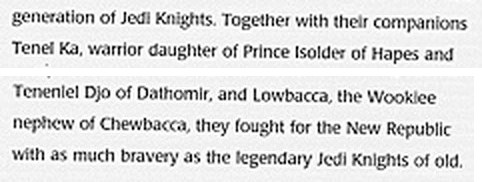
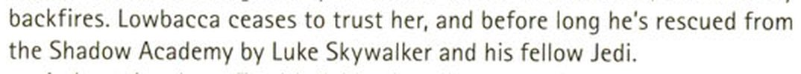
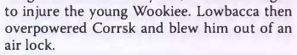
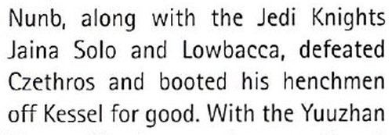

# Lowbacca

- **Aliases:** Lowie
- **Era:** NR–LotF
- **Continuity:** default Legends; entries present for: Legends
- **Research tier:** untiered (not listed as INTRO/DEEP/MASTERY in legends-feats.md)
- **Entries:** 137 (123 with quotations; 90 quotations extended to the full sentence/passage from the source text on file; 12 marked as fragments; 37 before the 2026-11-17 fragment fill). Rebuilt 2026-11-17 from 78 old entries; old file: `characters/_bak/lowbacca.md.bak-20261117`. Added 2026-11-19: 14 entries from Young Jedi Knights 1: Heirs of the Force (full read). Added 2026-11-20: 17 entries from Young Jedi Knights 2: Shadow Academy (full read). Added 2026-11-20: 13 entries from Young Jedi Knights 3: The Lost Ones (full read). Added 2026-11-20: 13 entries from Young Jedi Knights 4: Lightsabers (full read). Added 2026-11-20: 8 entries from Young Jedi Knights 5: Darkest Knight (full read), plus 2 non-Force-feat addendum entries.
- **How to read:** each entry is the quotation in full (block quote), then its source and point of view. "Note" lines are summaries from our notes, not quotations. `[fragment — full passage not on file]` means the source text is not on the box, so only the words in our notes are shown. Debate and forum material is in the last section and is unverified.

# LEGENDS (Legends / EU — main focus)

## Legacy of the Force 1–9: novel notes from the other agent (reference copy)

What it shows (our notes): Ch15 · L3623 · Caedus: in a regretful meld with Lowbacca he senses «the weight of a shadow bomb in Lowbacca's Force grasp».
> That was when Jacen located his old classmate in the Force and felt him coming up under the Anakin Solo’s bow. He also felt the presences of non-Jedi Wookiee pilots blinking out as the Star Destoyer’s cluster bombs and auto cannons did their work. And for an instant he sensed the weight of a shadow bomb in Lowbacca’s Force grasp.
— Source: Ch15 · L3623 — Legacy of the Force 6: Inferno (novel, read in full): feats, scaling and story notes.
(Excerpt widened 2026-11-17 to the relevant passage, word for word from Inferno (Troy Denning) (text copy `MEGA_Legend_The_Legacy_of_the_Force_Series_Star_Wars_Legacy_of_the_Force_06_Inferno_Troy_Denning_epub`).)
(Full sentence/passage taken from the source text on file: `novels_tmp_inferno_FULL_txt`.)
Our notes: `notes/materials/021-legacy-of-the-force/lotf-6-inferno-notes.md:70`

> Caedus did not feel what came next, not really. He simply realized a bolt of danger sense was sizzling down his spine and whirled away from the holodisplay, then felt the heat of a lightsaber brush across his ribs as Ben’s blade snapped to life and buried itself in the torso of Commander Twizzl.
>
> It might have been Lowbacca's shadow bomb or Caedus's own swift reflexes that saved his life. *(L3631)*
— Source: Ch15 · L3627; L3631 — Legacy of the Force 6: Inferno (novel, read in full): feats, scaling and story notes.
(Excerpt widened 2026-11-17 to the relevant passage, word for word from Inferno (Troy Denning) (text copy `MEGA_Legend_The_Legacy_of_the_Force_Series_Star_Wars_Legacy_of_the_Force_06_Inferno_Troy_Denning_epub`).)
(Full sentence/passage taken from the source text on file: `novels_tmp_inferno_FULL_txt`.)
Note (our notes, around the quote): Ch15 · L3627 · Ben vs. Caedus: Ben's surprise strike only grazes him: «a bolt of danger sense was sizzling down his spine and whirled away from the holodisplay, then felt the heat of a lightsaber brush across his ribs as Ben's blade snapped to life and buried itself in the torso of Commander Twizzl.» *Shows:* Caedus's danger sense saves him from a 14-year-old's well-hidden attack, barely. «It might have been Lowbacca's shadow bomb or Caedus's own swift reflexes that saved his life.» (L3631).
Our notes: `notes/materials/021-legacy-of-the-force/lotf-6-inferno-notes.md:71`

- Note (summary from our notes, not a quotation): | B | Ben vs. Caedus (assassination) | Ch15, L3627–3641 | instant | Caedus | Full surprise. Lowbacca's shadow bomb hit at the same moment (L3631). Caedus's ribs were burned. | Caedus's danger sense and lightning beat a hidden apprentice, barely. |
  — Source: Ch15, L3627–3641; L3631 — Legacy of the Force 6: Inferno (novel, read in full): feats, scaling and story notes.
Context: | # | Fight | Where (lines) | Length | Winner | Holding back / help / injuries | What it suggests |
Our notes: `notes/materials/021-legacy-of-the-force/lotf-6-inferno-notes.md:148`

> Caedus returned to his bubble, but made no attempt to resume his battle meditation. The technique—at least as Lumiya had taught it to him—was Sith, and he did not want to risk using it while what felt like half the Jedi Order was attempting to draw him into a meld. *(L2037)*
>
> The Sith way was one of deep sacrifice, and only now was Caedus coming to understand that he had not sacrificed the ability to love—only the ability to be loved in return. *(L2041)*
— Source: L2021–2023; L2045; L2037; L2041 — Legacy of the Force 6: Inferno (novel, read in full): feats, scaling and story notes.
(Full sentence/passage taken from the source text on file: `novels_tmp_inferno_FULL_txt`.)
Note (our notes, around the quote): Jedi battle-meld (Saba, Kyp, Corran, Tesar, Lowbacca etc.) invites Caedus in (L2021–2023); ~70+ StealthXs (L2045). Caedus avoids Sith battle meditation in the meld: «The technique-at least as Lumiya had taught it to him-was Sith» (L2037). Caedus: he had «not sacrificed the ability to love-only the ability to be loved in return.» (L2041).
Our notes: `notes/materials/021-legacy-of-the-force/lotf-6-inferno-notes.md:298`

- Note (summary from our notes, not a quotation): Ben suggests targeting cities to stay in character (L3587). Wookie Owools «riding the stripe» (using the Star Destroyer's own turbolaser strikes for sensor cover) — Lowbacca leads (L3603–3615).
  — Source: L3587; L3603–3615 — Legacy of the Force 6: Inferno (novel, read in full): feats, scaling and story notes.
Our notes: `notes/materials/021-legacy-of-the-force/lotf-6-inferno-notes.md:343`

> And, for a moment, Caedus became Jacen once again, filled with sorrow for what he had become, yet still knowing how necessary it all was. *(L3617–3625)*
— Source: L3617–3625; L3623 — Legacy of the Force 6: Inferno (novel, read in full): feats, scaling and story notes; Caedus opens a regretful battle-meld to Lowbacca.
(Full sentence/passage taken from the source text on file: `novels_tmp_inferno_FULL_txt`.)
Note (our notes, around the quote): Caedus opens a regretful battle-meld to Lowbacca: «for a moment, Caedus became Jacen once again» (L3617–3625); senses the shadow bomb in Lowie's Force grasp (L3623).
Our notes: `notes/materials/021-legacy-of-the-force/lotf-6-inferno-notes.md:344`

> He simply realized a bolt of danger sense was sizzling down his spine and whirled away from the holodisplay, then felt the heat of a lightsaber brush across his ribs as Ben’s blade snapped to life and buried itself in the torso of Commander Twizzl. *(L3627)*
>
> It might have been Lowbacca's shadow bomb or Caedus's own swift reflexes that saved his life. *(L3631)*
>
> How terribly he had underestimated his young cousin! *(L3631)*
— Source: L3627–3641; L3627; L3631 — Legacy of the Force 6: Inferno (novel, read in full): feats, scaling and story notes; BEN vs CAEDUS (assassination attempt), flight deck (L3627–3641).
(Full sentence/passage taken from the source text on file: `novels_tmp_inferno_FULL_txt`.)
Note (our notes, around the quote): BEN vs CAEDUS (assassination attempt), flight deck (L3627–3641): «a bolt of danger sense was sizzling down his spine and whirled away ... then felt the heat of a lightsaber brush across his ribs as Ben's blade snapped to life and buried itself in the torso of Commander Twizzl.» (L3627) — Ben's surprise strike grazes/burns Caedus's ribs (scorched flesh, L3629). Lowbacca's shadow bomb hits simultaneously; «It might have been Lowbacca's shadow bomb or Caedus's own swift reflexes that saved his life.» (L3631). Caedus: «How terribly he had underestimated his young cousin!» (L3631).
Our notes: `notes/materials/021-legacy-of-the-force/lotf-6-inferno-notes.md:345`

- Note (summary from our notes, not a quotation): L3846–3858 · Jaina: beats Zekk, Lowbacca, Tesar and Jag at once with electrostaffs (training, three days post-surgery).
  — Source: Legacy of the Force 9: Invincible (novel, read in full): feats, scaling and story notes.
Our notes: `notes/materials/021-legacy-of-the-force/lotf-9-invincible-notes.md:54`

> The attack landed but did not slice, the blade sliding along a beskar neck guard to burn a dark furrow into Fett’s green armor. Jaina gasped in surprise, but managed to stifle the apology—regret is a weakness—that rose automatically to her lips.
>
> Despite the ringing in her ears and the gauze in her head—despite her hugely aching skull and the big knot of hurt swelling on her brow—Jaina had never been so filled with the Force. *(L2552)*
>
> The Force came pouring in from all sides, saturating Jaina and devouring her, filling her with a roaring maelstrom of power, carrying away her pain and leaving in its place the strength not only to survive, but to rise and fight. *(L5154–5160)*
— Source: Ch1, L481; L2552; L2564–2566; L3846–3858 — Legacy of the Force 9: Invincible (novel, read in full): feats, scaling and story notes; Key feats: her saber.
(Excerpt widened 2026-11-17 to the relevant passage, word for word from Invincible (Troy Denning) (text copy `MEGA_Legend_The_Legacy_of_the_Force_Series_Star_Wars_Legacy_of_the_Force_09_Invincible_Troy_Denning_epub`).)
(Full sentence/passage taken from the source text on file: `lotf_tmp_b8_epub`.)
Note (our notes, around the quote): Key feats: her saber «landed but did not slice» on Fett's beskar (Ch1, L481). Kills a twelve-man gun crew in seconds (Ch6–7). At Nickel One she «had never been so filled with the Force» (L2552) and cuts off Caedus's arm with a beskad (L2564–2566). Beats Zekk, Lowbacca, Tesar and Jag at once in training three days after surgery (L3846–3858). Shatterpoint crumbles raw beskar (L3896–3906). In the final duel she draws «a roaring maelstrom of power» (L5154–5160), cuts his Achilles tendon (L5164–5172) and kills him (L5180–5186).
Our notes: `notes/materials/021-legacy-of-the-force/lotf-9-invincible-notes.md:267`

## Star Wars: The New Essential Chronology (Del Rey, 2005): power-scaling and lore notes

> Since the Chiss had a moral principle against making first strikes, Formbi had hoped the Vagaari would take advantage of the Outbound Flight bait and make an aggressive move, Now that they had, war had been declared between the Chiss Ascendancy and the Vagaari.
>
> Dean Jinzler found closure, realizing that his sister had done everything she could to protect Outbound Right, and had died with honor during Thrawn’s attack. The Outbound Flight colonists teft the Redoubt, the only home they'd knovm for decades. Most of them began new fives in the Empire of the Hand.
>
> THe Stiapow Academy AND THE SECOND Imperium 23 A.B.Y.
>
> ™ 9" he Solo twins-Jacen with his quirky sense of humor | and rapport with animals, and Jaina with her aptitude for mechanics—became two of the most talented of the new Seneration of Jedi Knights. Together with their companions Tenel Ka, warrior daughter of Prince Isolder of Hapes and Tenenlel Djo of Dathomir, and Lowbacca, the Wookiee nephew of Chewbacca, they fought for the New Republic with as much bravery as the legendary Jedi Knights of old, SN 198 ) ey, During a training exerdse in the jungles of Yavin 4, the young Jedi Knights discovered the wreckage of a TIE fighter— an Imperial ship that had crashed there years before, during the Rebel battle against the first Death Star.
>
> ™ 9" he Solo twins-Jacen with his quirky sense of humor | and rapport with animals, and Jaina with her aptitude for mechanics—became two of the most talented of the new Seneration of Jedi Knights. Together with their companions Tenel Ka, warrior daughter of Prince Isolder of Hapes and Tenenlel Djo of Dathomir, and Lowbacca, the Wookiee nephew of Chewbacca, they fought for the New Republic with as much bravery as the legendary Jedi Knights of old, SN 198 ) ey, During a training exerdse in the jungles of Yavin 4, the young Jedi Knights discovered the wreckage of a TIE fighter— an Imperial ship that had crashed there years before, during the Rebel battle against the first Death Star. The Jedi Knights were unaware that the original pilot, a grizzled old man named Qorl, had survived the crash and had been eking out a living In the wilderness. Qorl forced the Jedi students {o complete the final repalrs so that he could flee the jungle moon, and then flew off to rejoin the Empire... wherever he could find it.
— Source: Part Eleven: Generations of Jedi; Jacen Solo; Jaina Solo — young Jedi Knights.
(Excerpt widened 2026-11-17 to the relevant passage, word for word from research primary new essential chronology nec paged (text copy `research_primary_new_essential_chronology_nec_paged_txt_88b808b5bc`).)
(Excerpt widened 2026-11-17 to the relevant passage, word for word from research primary new essential chronology nec paged (text copy `research_primary_new_essential_chronology_nec_paged_txt_88b808b5bc`).)
(Full sentence/passage taken from the source text on file: `research_primary_new_essential_chronology_nec_paged_txt`.)
Note (our notes, around the quote): Jacen Solo; Jaina Solo — young Jedi Knights: "Together with their companions Tenel Ka ... and Lowbacca, the Wookiee nephew of Chewbacca, they fought for the New Republic with as much bravery as the legendary Jedi Knights of old." Source: The New Essential Chronology, p.198

Our notes: `notes/materials/027-new-essential-chronology/11-part-eleven-generations-of-jedi.md:38`

## Star Wars Saga Edition: Jedi Academy Training Manual (WotC, 2009): power-scaling and lore notes

> After creating a pact with the Second Imperium, Kai volunteers to serve as a liaison between the Second Imperium and the Nightsisters and assists Brakiss with running the Shadow Academy. Brakiss would identify students in need of discipline before turning them over to Kai to handle.
>
> One student assigned to Kai is Lowbacca. Kai decides to take advantage of the young Wookiee's short temper and use it to fuel his hatred, thus expediting his fall to the dark side. Her teaching methods are vicious but highly effective. Though the plan seems to work for a while, it ultimately backfires. Lowbacca ceases to trust her, and before long he's rescued from the Shadow Academy by Luke Skywalker and his fellow Jedi.
>
> A short time later, Tamith Kai leads a direct assault on the Jedi Praxeum on Yavin 4, where she falls in a duel against Tenel Ka, one of Luke Skywalker's students.
>
> Tamith Kai Encounters Although she acts as Brakiss's assistant at the Shadow Academy, Kai is more visible than her leader, mainly due to her position as field commander when the students of the Shadow Academy venture forth to enact the plans devised by their master.
— Source: Chapter VI: Dangers of Study; Brakiss; Luke Skywalker; Lowbacca — Tamith Kai — Lowbacca rescued.
(Excerpt widened 2026-11-17 to the relevant passage, word for word from research primary jedi academy training manual jatm paged (text copy `research_primary_jedi_academy_training_manual_jatm_paged_txt_fea130719f`).)
(Excerpt widened 2026-11-17 to the relevant passage, word for word from research primary jedi academy training manual jatm paged (text copy `research_primary_jedi_academy_training_manual_jatm_paged_txt_fea130719f`).)
Note (our notes, around the quote): Brakiss; Luke Skywalker; Lowbacca — Tamith Kai — Lowbacca rescued: "Lowbacca ceases to trust her, and before long he's rescued from the Shadow Academy by Luke Skywalker and his fellow Jedi." Source: Jedi Academy Training Manual, p.129

Our notes: `notes/materials/028-jedi-academy-training-manual/06-ch6-dangers-of-study.md:116`

## The Complete Star Wars Encyclopedia, Vol. I (A–G)

> During the Empire's reign, the Black Sword Command was charged with the defense of Corridan, Praxlis, and the entire Kokash and Farlax sec­ tors. corridorghoulsQuadrupeds about knee­ high, these fast and deadly creatures native to Coruscant's lowest levels seemed to be mam­ mals. They had no fur, just stark white skin. Although they were blind, their navigation by echolocation gave them plenty of speed and agility. They had big ears and sharp teeth and emitted high-pitched screams. CorrskA Trandoshan, he worked for Nolaa Tarkona and her Diversity Alliance movement opposing the New Republic. In battle with Jedi Knight Lowbacca on Ryloth, Corrsk managed to injure the young Wookiee. Lowbacca then overpowered Corrsk and blew him out of an air lock. Corrupter A Victory-class Star Destroyer, it was formerly assigned to patrol the Outer Rim, hunting down pirates and smugglers for the Empire. When director of Imperial Intelligence Ysanne Isard fled Coruscant, she used the Corrupter to defend her position on Thyferra and protect convoys of bacta leav­ ing the planet. Under Captain Convarion, the ship caught up with and destroyed one bacta freighter that had been hijacked by Rogue Squadron. Several Rebel Alliance pilots were killed.
— Source: scan pages 121–160; Lowbacca. POV: Lowbacca.
(Excerpt widened 2026-11-17 to the relevant passage, word for word from research primary cse vol1 (text copy `research_primary_cse_vol1_pdf_45a954be6d`).)
(Excerpt widened 2026-11-17 to the relevant passage, word for word from research primary cse vol1 (text copy `research_primary_cse_vol1_pdf_45a954be6d`).)
Note (our notes, around the quote): Lowbacca: "Lowbacca then overpowered Corrsk and blew him out of an air lock." Source: The Complete Star Wars Encyclopedia, Vol. I, p.145

Our notes: `notes/materials/030-complete-star-wars-encyclopedia-vol-1/03-v1-scan-121-160.md:285`

## The Complete Star Wars Encyclopedia, Vol. II (H–O)

- Note (summary from our notes, not a quotation): Page contents: 969 words, 19 paragraphs | headings/entries: Lost Ones; Lost Twenty, the; Lotide; Lotor, Mak; Love Commander; Love Is Waiting; Lowbacca
  — Source: scan pages 241–280.
Our notes: `notes/materials/031-complete-star-wars-encyclopedia-vol-2/06-v2-scan-241-280.md:248`

## Power of the Jedi Sourcebook (d20, 2002)

- Note (summary from our notes, not a quotation): Page contents: 977 words, 210 paragraphs | headings/entries: Kenzon, Ephaan 152, 153; Kerilt 64; Keto, Aleema 8; Keto, Satal 8; Khommite 67; Ki-Adi-Mundi 117, 119, 120; Kiffar 17, 123, 124; Kil'qiy, Surenit 32; Kirrek 7, 98; Koba system 112; Koon, Plo 113, 117, 124; Koros system 98, 99; Koros Major 103, 106; Korriban 102; Koth, Eeth 114; Krevaaki 68, 102; Kushiban 68, 129; Kut, Plovin 112; Lah, Tsavong 139; Lannik 69, 113, 117; Lowbacca 11; Madine, Crix 131; Malacia 13, 118; Malastare 113, 116, 117; Mandalore 102; Mar, Easal 132; Marspa, Master 33; Massassi 7, 8, 98, 138, 139; Maul, Darth 43; MedCorps worker 94; Meditative Canyon on Ambria 145-147; Mid Rim 76, 79, 132, 153; Miraluka 70, 107; Mirial 127, 128; Mon Calamari 130; Mon, Ephant 119; Morichro 16, 113; Mothma, Mon 11, 130, 131; Nadill, Memit 7, 99; Nam Chorios 78; Nam Priax 77; Nar Shaddaa 114, 123; Nautolan 71, 125; Nazzar 72; Nebulon Front 113, 114; Nebulon Ranger 59, 103, 104, 105; Neti
  — Source: Chapter Seven: Where the Force is strong; Index.
Our notes: `notes/materials/033-power-of-the-jedi-sourcebook/07-ch7-locations-index.md:181`

## The New Essential Guide to Characters (2002)

> Nunb, along with the Jedi Knights Jaina Solo and Lowbacca, defeated Czethros and booted his henchmen off Kessel for good.
— Source: scan pages 91–120; Jaina Solo; Lowbacca.
Note (our notes, around the quote): Jaina Solo; Lowbacca: "Nunb, along with the Jedi Knights Jaina Solo and Lowbacca, defeated Czethros and booted his henchmen off Kessel for good." Source: The New Essential Guide to Characters, p.122

Our notes: `notes/materials/034-new-essential-guide-to-characters/03-negc-scan-091-120.md:186`

## Sourcebooks/The New Jedi Order Sourcebook.pdf [Star Wars Roleplaying Game (d20, 2000)] (scan pages 121–162)

- Note (summary from our notes, not a quotation): Page contents: 856 words, 28 paragraphs | headings/entries: Lowbacca, Wookiee Jedi; Ulaha Hore, Bith Jedi
  — Source: Sourcebooks/The New Jedi Order Sourcebook.pdf [Star Wars Roleplaying Game.
Our notes: `notes/materials/037-sw-d20-folder/049-the-new-jedi-order-sourcebook-scan-121-162.md:174`

> could add +2 to each skill check, attack roll, and saving throw
> [fragment — full passage not on file]
— Source: Sourcebooks/The New Jedi Order Sourcebook.pdf [Star Wars Roleplaying Game.
Note (our notes, around the quote): Page contents: Battle meld: in a meld with Jacen, Jaina and Lowbacca, Anakin "could add +2 to each skill check, attack roll, and saving throw". p.155 Luke and Mara fight off a horde of Vong ships over Coruscant. p.160 Jaina's rage opens her to the dark side. (hand-read)
Our notes: `notes/materials/037-sw-d20-folder/049-the-new-jedi-order-sourcebook-scan-121-162.md:184`

## Star Wars Gamer/Star Wars Gamer 08.pdf [Star Wars Roleplaying Game (d20, 2000)] (scan pages 1–60)

- Note (summary from our notes, not a quotation): Page contents: The Apprentice: Tenel Ka distrusts Kyp after Sernpidal, where he used the Force to make Jaina believe the Vong were building superweapons and used her name to bring Rogue Squadron into attacking a civilian target, the new worldship; Lowbacca defends Chewbacca's honor and his life debt (hand-read)
  — Source: Star Wars Gamer/Star Wars Gamer 08.pdf [Star Wars Roleplaying Game (d20,.
Our notes: `notes/materials/037-sw-d20-folder/057-star-wars-gamer-08-scan-001-060.md:135`

## Sourcebooks/Ultimate Alien Anthology.pdf [Star Wars Roleplaying Game Revised Core (d20, 2002)] (scan pages 181–225)

- Note (summary from our notes, not a quotation): Page contents: Wookiee (example names incl. Lowbacca, Attichitcuk, Mallatobuk) traits; illustrations. (hand-read)
  — Source: Sourcebooks/Ultimate Alien Anthology.pdf [Star Wars Roleplaying Game Revi.
Our notes: `notes/materials/037-sw-d20-folder/673-ultimate-alien-anthology-scan-181-225.md:32`

## Star Wars Insider #58 (2002)

- Note (summary from our notes, not a quotation): Page contents: "Flirting with the Dark Side" ends (magazine p. 79): Jaina sees romance as a distraction; Cunningham read all the Young Jedi Knights books (Tenel Ka, Zekk, Lowbacca appear); her three Star Wars Gamer stories ("The Crystal" #5, "Red Sky, Blue Flame" #7, "The Apprentice" #8); on the Episode II title; her next book The Wizardwar. Pull quote repeats the Han/Jaina line. Caption: Gamer story art credits. (hand-read)
  — Source: Star Wars Insider #58 (2002). POV: Page contents, about Lowbacca.
Our notes: `notes/materials/038-star-wars-insider/058-ins058.md:391`

## Legacy of the Force, own full read (Betrayal, Revelation, Invincible)

- Note (summary from our notes, not a quotation): | F25 | c14 ¶5–8 | Jaina | Training: drops Zekk, Lowbacca, Tesar and Jag with electrostaffs | Spar |
  — Source: Legacy of the Force 9: Invincible (Troy Denning, 2008) — own full read.
Context: | # | Ref | Character | Feat | Quote / note |
Our notes: `notes/materials/040-lotf-own-read/lotf-9-invincible.md:41`

## The Dark Nest Trilogy (Troy Denning, Del Rey 2005): FULL consecutive re-read (2026-11-16 CST)

What it shows (our notes): The seven Jedi are Myrkr survivors: Jaina, Alema, Zekk, Lowbacca, Tesar, Tekli and Tahiri. "six young Jedi Knights had died in the process—including Anakin himself—and another was missing and presumed lost". This is Raynar.
> “I wish we knew,” Luke said. Undertaken in the middle of the war with the Yuuzhan Vong, the Myrkr mission had been as costly as it had been successful. Anakin Solo and his strike team had destroyed the enemy’s Jedi-killing voxyn. But six young Jedi Knights had died in the process—including Anakin himself—and another was missing and presumed lost. “All I can tell you is that for several weeks, Jaina and the other survivors of that mission reported feeling a ‘call’ from the Unknown Regions. On the day they left, that call became a cry for help.”
— Source: Dark Nest I: The Joiner King (Troy Denning, Del Rey 2005): notes part 1.
(Excerpt widened 2026-11-17 to the relevant passage, word for word from The Joiner King (Troy Denning) (text copy `MEGA_Legend_The_Dark_Nest_Trilogy_Star_Wars_Dark_Nest_01_The_Joiner_King_Troy_Denning_epub`).)
(Full sentence/passage taken from the source text on file: `dn_tmp_jk_epub`.)
Our notes: `notes/materials/051-dark-nest-trilogy/jk-01.md:24`

What it shows (our notes): The Mueum suicide swarm drops the Star Destroyer's shields and destroys the ship from inside: "a rip seemed to open in the Force". Lowbacca ejects and drifts, and is later captured. His thought: "She’ll be doing well ... just to save herself."
> A wave of explosions shook the Star Destroyer, and the hull began to come apart. Jaina was shaken by an all-too-familiar wave of anguish and fear, then a rip seemed to open in the Force as the huge vessel began to disintegrate from the inside.
>
> She’ll be doing well ... just to save herself.
> [fragment — full passage not on file]
— Source: Dark Nest I: The Joiner King: notes part 2 (ch. 9 onward).
(Excerpt widened 2026-11-17 to the relevant passage, word for word from The Joiner King (Troy Denning) (text copy `MEGA_Legend_The_Dark_Nest_Trilogy_Star_Wars_Dark_Nest_01_The_Joiner_King_Troy_Denning_epub`).)
(Full sentence/passage taken from the source text on file: `dn_tmp_jk_epub`.)
Our notes: `notes/materials/051-dark-nest-trilogy/jk-02.md:47`

> “Lowbacca won’t be captured,” Reya said. “The Colony does not wish it.”
>
> The Taat continued to place themselves in front of their enemies, but instead of pursuing Tahiri and Jacen all the more ferociously, the clawcraft peeled away, giving them a clear route to freedom. Jaina exhaled in relief. At least Jag—or whoever was commanding this task force—still had the sense to back off before the conflict escalated.
— Source: Dark Nest I: The Joiner King: notes part 2 (ch. 9 onward); Reya. POV: Reya, about Lowbacca.
(Excerpt widened 2026-11-17 to the relevant passage, word for word from The Joiner King (Troy Denning) (text copy `MEGA_Legend_The_Dark_Nest_Trilogy_Star_Wars_Dark_Nest_01_The_Joiner_King_Troy_Denning_epub`).)
(Excerpt widened 2026-11-17 to the relevant passage, word for word from The Joiner King (Troy Denning) (text copy `MEGA_Legend_The_Dark_Nest_Trilogy_Star_Wars_Dark_Nest_01_The_Joiner_King_Troy_Denning_epub`).)
(Full sentence/passage taken from the source text on file: `dn_tmp_jk_epub`.)
Our notes: `notes/materials/051-dark-nest-trilogy/jk-02.md:48`

> “That’s what I mean,” Han said. “Everything was a compromise for those kids. They never had anything simple to fight for.”
>
> “They had the Dark Jedi and the Diversity Alliance,” Leia countered. “They had the Yuuzhan Vong. That was all pretty clear.”
>
> “And all of it was stuff to fight against,” Han said. “I’m talking about something to fight for, something pure to build.
>
> Leia was beginning to see what Han was driving at. “You mean they didn’t have the Rebellion.”
>
> “Right,” Han said. “The Killiks are peaceful underdogs, minding their own business in neutral territory, and the Chiss are trying to starve them out. I can see how Jaina might think that’s a pretty clear-cut case of the weak needing protection from the strong. Heck, it almost makes me want to fight for them.”
>
> “What a relief,” Leia said. “I thought for a minute you were going to say we had to let her and the others stay with the Colony.”
>
> “When black holes shine,” Han scoffed. “What I’m saying is we have to make them think it’s their choice. I don’t want to take that spark away. Jaina finally has the same look in her eye that you did when I rescued you from the Death Star.”
— Source: Dark Nest I: The Joiner King: notes part 2 (ch. 9 onward); Han's theory of Jaina. POV: Han's theory of Jaina, about Lowbacca.
(Excerpt widened 2026-11-17 to the relevant passage, word for word from The Joiner King (Troy Denning) (text copy `MEGA_Legend_The_Dark_Nest_Trilogy_Star_Wars_Dark_Nest_01_The_Joiner_King_Troy_Denning_epub`).)
(Excerpt widened 2026-11-17 to the relevant passage, word for word from The Joiner King (Troy Denning) (text copy `MEGA_Legend_The_Dark_Nest_Trilogy_Star_Wars_Dark_Nest_01_The_Joiner_King_Troy_Denning_epub`).)
(Full sentence/passage taken from the source text on file: `dn_tmp_jk_epub`.)
Our notes: `notes/materials/051-dark-nest-trilogy/jk-02.md:69`

What it shows (our notes): Leia on Zekk: "that unwashed vent crawler she brought home". Juun cites the "Talu insertion in the Zsinj campaign" and the holovid *Special Delivery*.
> “We can,” Leia corrected. She could sense that Han did not entirely agree with her; that now he was the one hiding something up his sleeve. “We’re in this together, nerf herder. This won’t be like the time you left me to deal with that unwashed vent crawler she brought home.”
>
> “Like the Talu insertion in the Zsinj campaign,” Juun declared. “The Falcon will act as a decoy while the StealthXs penetrate the enemy’s perimeter.”
— Source: Dark Nest I: The Joiner King: notes part 2 (ch. 9 onward); Leia on Zekk. POV: Leia, about Lowbacca.
(Excerpt widened 2026-11-17 to the relevant passage, word for word from The Joiner King (Troy Denning) (text copy `MEGA_Legend_The_Dark_Nest_Trilogy_Star_Wars_Dark_Nest_01_The_Joiner_King_Troy_Denning_epub`).)
(Full sentence/passage taken from the source text on file: `dn_tmp_jk_epub`.)
(Fragment completed 2026-11-17: full sentence/passage matched word for word in the source text on file: `MEGA_Legend_The_Dark_Nest_Trilogy_Star_Wars_Dark_Nest_01_The_Joiner_King_Troy_Denning_epub`.)
Our notes: `notes/materials/051-dark-nest-trilogy/jk-02.md:70`

What it shows (our notes): Lowbacca dreams of Chewbacca in the Shadow Forest. Jaina EV at Kalarba "spent several hours talking to Yoda ... because he spent the whole time speaking in Gamorrean."
> It was probably just an empty wreck. Or maybe Lowbacca was seeing things. His EV suit was automatically holding his oxygen consumption at a minimum, feeding him just enough air to keep him functional, and hallucinations were common under such circumstances. Jaina had told him she spent several hours talking to Yoda when she went EV Unfortunately, she had not been able to understand anything he said because he spent the whole time speaking in Gamorrean.
— Source: Dark Nest I: The Joiner King: notes part 2 (ch. 9 onward).
(Excerpt widened 2026-11-17 to the relevant passage, word for word from The Joiner King (Troy Denning) (text copy `MEGA_Legend_The_Dark_Nest_Trilogy_Star_Wars_Dark_Nest_01_The_Joiner_King_Troy_Denning_epub`).)
(Full sentence/passage taken from the source text on file: `dn_tmp_jk_epub`.)
Our notes: `notes/materials/051-dark-nest-trilogy/jk-02.md:71`

What it shows (our notes): The Chiss lay a clawcraft ambush in the rings. Lowbacca triggers his own beacon so the Jedi won't fly into it. "Jaina had lost too much during the war—Anakin, Chewbacca, Ganner, Ulaha, and on and on."
> Jaina had lost too much during the war—Anakin, Chewbacca, Ganner, Ulaha, and on and on. She was determined to lose no more.
— Source: Dark Nest I: The Joiner King: notes part 2 (ch. 9 onward).
(Excerpt widened 2026-11-17 to the relevant passage, word for word from The Joiner King (Troy Denning) (text copy `MEGA_Legend_The_Dark_Nest_Trilogy_Star_Wars_Dark_Nest_01_The_Joiner_King_Troy_Denning_epub`).)
Our notes: `notes/materials/051-dark-nest-trilogy/jk-02.md:72`

> “That would fall under the heading of military intelligence, Captain Solo,” Jag replied. “But rest assured, the Jedi Wookiee has been recovered. He’ll be treated with all the rights and privileges due any enemy combatant—as will the rest of your rogue Jedi, when we capture them.”
— Source: Dark Nest I: The Joiner King: notes part 2 (ch. 9 onward); Jag Fel is "Rescue One"..
(Excerpt widened 2026-11-17 to the relevant passage, word for word from The Joiner King (Troy Denning) (text copy `MEGA_Legend_The_Dark_Nest_Trilogy_Star_Wars_Dark_Nest_01_The_Joiner_King_Troy_Denning_epub`).)
Our notes: `notes/materials/051-dark-nest-trilogy/jk-02.md:73`

What it shows (our notes): Jaina refuses to leave without Lowbacca ("Don’t try the Desilijic shift on me"). The trio finish each other's sentences: "No daughter of mine— ... —is going to become a bughugger". Leia: "Raynar isn’t the earnest young man who went to Myrkr with you. He’s desperate and lonely." Jaina: "Mom, sometimes you think too much." Alema goes along as "guide".
> “Don’t try the Desilijic shift on me,” Jaina said. “The terms were that we had to bring him back.”
>
> “We all can,” Zekk added. “No daughter of mine—”
>
> “—is going to become a bughugger” Alema finished.
>
> “Hey, no fair!” Han objected. “Just because I don’t like bugs doesn’t mean I’m wrong. There’s something sneaky going on here—and Raynar’s in it up to his neck.”
>
> “I wish you’d listen to your father.” Leia’s chest grew heavy, for she could see Han’s frustration with Jaina turning to anger. “You do know you might be the real prize in this conflict? Raynar isn’t the earnest young man who went to Myrkr with you. He’s desperate and lonely. I wouldn’t be surprised if he had instigated the whole border conflict just to draw you—”
>
> “Mom, sometimes you think too much.” Jaina lowered her arms, then turned and started away. “You’d better get the Falcon off this moon. I’ll try to warn Aunt Mara through the Force.”
— Source: Dark Nest I: The Joiner King: notes part 3 (ch. 18 onward); Jaina refuses to leave without Lowbacca (.
(Excerpt widened 2026-11-17 to the relevant passage, word for word from The Joiner King (Troy Denning) (text copy `MEGA_Legend_The_Dark_Nest_Trilogy_Star_Wars_Dark_Nest_01_The_Joiner_King_Troy_Denning_epub`).)
(Excerpt widened 2026-11-17 to the relevant passage, word for word from The Joiner King (Troy Denning) (text copy `MEGA_Legend_The_Dark_Nest_Trilogy_Star_Wars_Dark_Nest_01_The_Joiner_King_Troy_Denning_epub`).)
(Full sentence/passage taken from the source text on file: `dn_tmp_jk_epub`.)
(Fragment completed 2026-11-17: full sentence/passage matched word for word in the source text on file: `MEGA_Legend_The_Dark_Nest_Trilogy_Star_Wars_Dark_Nest_01_The_Joiner_King_Troy_Denning_epub`.)
Our notes: `notes/materials/051-dark-nest-trilogy/jk-03.md:15`

What it shows (our notes): StealthX evasion, the Force-shoved shadow bomb; Lowbacca's Dreadnaught jumps away
> Blossoms of turbolaser fire lit the space around them. Jaina and Zekk surrendered their hands to the Force, and their StealthXs began to weave and bob, swinging wide before a strike exploded in front of them, climbing away from a beam even as it lanced out behind them.
>
> Jaina’s hand pushed the stick forward. The third StealthX—the one slaved to her controls—followed her into a dive and slammed into a blossom of fire behind her. Her R9 let out a sad whistle as it received the final data burst from its counterpart, then Jaina jinked starboard and Zekk juked port, and a trio of turbolaser strikes burst into a miniature sun between them.
>
> Our boyfriend means business, Zekk observed.
>
> Don’t know that it’s him. And it’s old boyfriend.
>
> Right. We’re so over him.
>
> We?
>
> Jaina and Zekk dropped the line of thought there. It was just getting too creepy, with Zekk sharing everything that Jaina still felt for Jag, and Jaina sharing everything that Zekk still felt for her, and it didn’t help matters that, at the moment, Jag was doing his best to kill them both.
>
> He’s just following orders, Zekk consoled.
>
> He has to, Jaina agreed. He’s Chiss.
>
> They continued to dodge through the barrage, angling first one direction, then another, always working deeper into the fleet. Despite the loss of the third StealthX, they could still rescue Lowbacca. Zekk’s storage compartment was filled with oxygen tanks, and there was an air feed running into the empty torpedo bay below his seat. Unfortunately for Jaina, she was the only one small enough to fit inside.
>
> The Chiss brought more ships to bear, stringing kilometer-wide screens of crimson energy ahead of the StealthXs, hoping the elusive starfighters would simply fly into a strike. Jaina and Zekk rolled away from one beam and found another crossing their noses. Jaina pulled up hard, her astromech screeching alarms as the inertial compensator strained to keep the ship together. Zekk dropped his nose and squeezed past underneath, his StealthX shuddering and bouncing as its shields crackled and overloaded.
>
> Enough! To her droid, Jaina said, “Sneaky, give us a one-second fuse and drop a shadow bomb … now!”
>
> The droid tweeted its alarm, but obeyed.
>
> Jaina gave the bomb an aftward Force shove, and a silver flash filled the space behind them. The shock wave hit an instant later, slamming both StealthXs forward and pushing their tails down. Jaina and Zekk did not right themselves. They simply poured on the power and shot away, doing anything they could to change course and location before the Chiss eyes tracking them recovered from the blinding flash of the shadow bomb.
>
> The Chiss brought even more turbolasers to bear—but well behind and below the StealthXs. Jaina and Zekk were close enough now to feel Lowbacca’s presence aboard a heavily armored Dreadnaught escorting the flagship. They closed formation and swung toward it, then finally had time to check their tactical displays.
>
> Unu had listened to their warning. The Great Swarm remained at Qoribu, spread out just beneath the southern pole, with the Hapans taking a supporting position behind the dartships. Meanwhile, the Chiss had given up trying to draw out the Colony and were smoothly dispersing into their own defensive wall, three layers deep and just out of Hapan turbolaser range.
>
> Could have timed this better.
>
> Going to be hot as a nova getting through that picket field, Zekk agreed.
>
> The Dreadnaught’s ion drives suddenly brightened, then Jaina and Zekk’s heart sank as the ship turned and accelerated away from the fleet. The Chiss were not fools. Having lost track of their quarry, they had decided to remove the bait.
>
> Could have timed this a lot better. Jaina’s vision blurred with welling tears, and she and Zekk reached out to Lowbacca, trying to reach him through the stupor in which his captors were keeping him, trying to assure him that they would find him, urging him not to lose faith.
>
> They felt a question struggling toward the top of Lowbacca’s mind, then anger; then the Dreadnaught vanished into hyper-space and they felt nothing at all.
> [fragment — full passage not on file]
— Source: The Joiner King (Troy Denning, Del Rey 2005), JK ch. 38 — 051 Dark Nest trilogy notes (re-read 2026-11-16).
(Fragment completed 2026-11-17 with the full excerpt, word for word from The Joiner King (Troy Denning) (text copy `MEGA_Legend_The_Dark_Nest_Trilogy_Star_Wars_Dark_Nest_01_The_Joiner_King_Troy_Denning_epub`).)
(Excerpt widened 2026-11-17 to the relevant passage, word for word from The Joiner King (Troy Denning) (text copy `MEGA_Legend_The_Dark_Nest_Trilogy_Star_Wars_Dark_Nest_01_The_Joiner_King_Troy_Denning_epub`).)
(Fragment completed 2026-11-17 with the full excerpt, word for word from The Joiner King (Troy Denning) (text copy `MEGA_Legend_The_Dark_Nest_Trilogy_Star_Wars_Dark_Nest_01_The_Joiner_King_Troy_Denning_epub`).)
(Fragment completed 2026-11-17 with the full excerpt, word for word from The Joiner King (Troy Denning) (text copy `MEGA_Legend_The_Dark_Nest_Trilogy_Star_Wars_Dark_Nest_01_The_Joiner_King_Troy_Denning_epub`).)
(Excerpt widened 2026-11-17 to the relevant passage, word for word from The Joiner King (Troy Denning) (text copy `MEGA_Legend_The_Dark_Nest_Trilogy_Star_Wars_Dark_Nest_01_The_Joiner_King_Troy_Denning_epub`).)
(Fragment completed 2026-11-17: full sentence/passage matched word for word in the source text on file: `MEGA_Legend_The_Dark_Nest_Trilogy_Star_Wars_Dark_Nest_01_The_Joiner_King_Troy_Denning_epub`.)
Note text that was attached to the quote line: (JK ch. 38) — **StealthX evasion, the Force-shoved shadow bomb; Lowbacca's Dreadnaught jumps away**
Our notes: `notes/materials/051-dark-nest-trilogy/jk-03.md:77`

> Our boyfriend means business ... old boyfriend ... We're so over him.
>
> We?
> [fragment — full passage not on file]
— Source: Dark Nest I: The Joiner King: notes part 4 (end of ch. 29 onward); Jaina and Zekk now think as a single "we" (.
Note (our notes, around the quote): Jaina and Zekk now think as a single "we" ("Our boyfriend means business ... old boyfriend ... We're so over him. / We?"). The Chiss retreat is "A Bothan fade" meant to draw the Swarm out of the gravity well.
Our notes: `notes/materials/051-dark-nest-trilogy/jk-04.md:62`

What it shows (our notes): They weigh letting the Swarm die ("maybe not a bad thing") but fear that "If UnuThul died, Welk—or Lomi Plo ... might become the new Prime Unu ... perhaps even to draw the entire galaxy into a single collective mind." UnuThul: "It must be a coincidence. There were no Chiss in our tactics classes." Still, Unu halts the Swarm.
> Impossible, Jaina agreed. But maybe not a bad thing.
>
> Jaina and Zekk waited, expecting to feel Unu’s Will pressing down on them, driving them to act in the Colony’s best interest.
>
> The possibility was almost too terrible to consider. If UnuThul died, Welk—or Lomi Plo, if she had survived—might become the new Prime Unu. They did not know what that would mean for the Colony, but it would certainly be bad for the rest of the galaxy. The Dark Jedi would use the Killiks for their own ends, perhaps even to draw the entire galaxy into a single collective mind.
>
> Then UnuThul said, “It must be a coincidence. There were no Chiss in our tactics classes.”
>
> Jaina and Zekk knew better than to waste time pointing out the flaws in Unu’s argument. Killik logic did not follow the same rules as that of most species—in fact, it did not follow rules at all.
— Source: Dark Nest I: The Joiner King: notes part 4 (end of ch. 29 onward); They weigh letting the Swarm die (.
(Excerpt widened 2026-11-17 to the relevant passage, word for word from The Joiner King (Troy Denning) (text copy `MEGA_Legend_The_Dark_Nest_Trilogy_Star_Wars_Dark_Nest_01_The_Joiner_King_Troy_Denning_epub`).)
(Excerpt widened 2026-11-17 to the relevant passage, word for word from The Joiner King (Troy Denning) (text copy `MEGA_Legend_The_Dark_Nest_Trilogy_Star_Wars_Dark_Nest_01_The_Joiner_King_Troy_Denning_epub`).)
(Full sentence/passage taken from the source text on file: `dn_tmp_jk_epub`.)
(Fragment completed 2026-11-17: full sentence/passage matched word for word in the source text on file: `MEGA_Legend_The_Dark_Nest_Trilogy_Star_Wars_Dark_Nest_01_The_Joiner_King_Troy_Denning_epub`.)
Our notes: `notes/materials/051-dark-nest-trilogy/jk-04.md:63`

What it shows (our notes): They lose the slaved third StealthX and use a shadow bomb. The Dreadnaught carrying Lowbacca jumps away: "Could have timed this a lot better."
> Could have timed this a lot better. Jaina’s vision blurred with welling tears, and she and Zekk reached out to Lowbacca, trying to reach him through the stupor in which his captors were keeping him, trying to assure him that they would find him, urging him not to lose faith.
— Source: Dark Nest I: The Joiner King: notes part 4 (end of ch. 29 onward).
(Excerpt widened 2026-11-17 to the relevant passage, word for word from The Joiner King (Troy Denning) (text copy `MEGA_Legend_The_Dark_Nest_Trilogy_Star_Wars_Dark_Nest_01_The_Joiner_King_Troy_Denning_epub`).)
Our notes: `notes/materials/051-dark-nest-trilogy/jk-04.md:64`

What it shows (our notes): Mara spent a month in bacta. The Chiss release Lowbacca at Jag's "very vigorous objections". The Fel family guarantees his parole. "Commander Fel will receive a promotion". Formbi to Leia: "You have achieved peace in our time." (an ironic echo)
> “Commander Fel will receive a promotion in recognition of his judgment here,” Formbi said. “But is you who deserves our thanks. You have achieved peace in our time.”
>
> You have achieved peace in our time. *(an ironic echo)*
— Source: Dark Nest I: The Joiner King: notes part 4 (end of ch. 29 onward).
(Excerpt widened 2026-11-17 to the relevant passage, word for word from The Joiner King (Troy Denning) (text copy `MEGA_Legend_The_Dark_Nest_Trilogy_Star_Wars_Dark_Nest_01_The_Joiner_King_Troy_Denning_epub`).)
(Fragment completed 2026-11-17: full sentence/passage matched word for word in the source text on file: `MEGA_Legend_The_Dark_Nest_Trilogy_Star_Wars_Dark_Nest_01_The_Joiner_King_Troy_Denning_epub`.)
Our notes: `notes/materials/051-dark-nest-trilogy/jk-04.md:91`

What it shows (our notes): Thrackan's escape: "Ludus Fazum" and "Farglblag". Jaina: "Hi, Cousin Thrackan ... However did you know we’ve been looking for you?" General Tigran Jamira. Lowbacca: "They got revenge by making you President! If you killed more of them, they’d make you emperor?" The Centerpoint Party has expelled Thrackan.
> “Hi, Cousin Thrackan,” Jaina Solo called. “However did you know we’ve been looking for you?”
>
> “I wonder if you can remember when you held me prisoner,” Jaina said cheerfully.
>
> Lowbacca, who had been listening, gave a complex series of moans and howls, and Jaina translated. “He says, ‘They got revenge by making you President! If you killed more of them, they’d make you emperor?’”
— Source: Bundled e-book: *Star Wars: The New Jedi Order: Ylesia* (Walter Jon Williams, 2002), as included in the Joiner King epub; Thrackan's escape: "Ludus Fazum" and "Farglblag". Jaina. POV: Thrackan's escape, about Lowbacca.
(Excerpt widened 2026-11-17 to the relevant passage, word for word from The Joiner King (Troy Denning) (text copy `MEGA_Legend_The_Dark_Nest_Trilogy_Star_Wars_Dark_Nest_01_The_Joiner_King_Troy_Denning_epub`).)
(Excerpt widened 2026-11-17 to the relevant passage, word for word from The Joiner King (Troy Denning) (text copy `MEGA_Legend_The_Dark_Nest_Trilogy_Star_Wars_Dark_Nest_01_The_Joiner_King_Troy_Denning_epub`).)
(Full sentence/passage taken from the source text on file: `novels_tmp_ylesia_ylesia_epub`.)
Our notes: `notes/materials/051-dark-nest-trilogy/jk-05-ylesia.md:25`

- Note (summary from our notes, not a quotation): Tesar and Lowbacca leaked the Raynar debate.
  — Source: Dark Nest III: *The Swarm War* (Troy Denning, 2006), notes part 1: front matter, prologue, ch. 1–.
Our notes: `notes/materials/051-dark-nest-trilogy/sw-01.md:32`

> Lowbacca rowled the opinion that being paralyzed was better than following a yuugrr out on its limb.
>
> Luke frowned. Yuugrrs were dim-witted predators famous for stealing Wookiee children out of their beds, then trying to shake their pursuit by going out on a thin limb. More often than not, the limb broke, plunging the yuugrr, the child, and sometimes the pursuers into the depths of the Kashyyyk forest.
>
> Tahiri took a seat between Lowbacca and Tesar, rubbing her forearms against theirs in the Killik manner. “You listen to Jacen as though he were a senior Master, and his advice can’t be trusted. He has his own agenda.”
>
> “We think Jacen may be lying about his vision.”
>
> Luke’s brow shot up. “I didn’t sense any lies when he told me about it.”
— Source: Dark Nest III: *The Swarm War* (Troy Denning, 2006), notes part 1: front matter, prologue, ch. 1–; Lowbacca's.
(Excerpt widened 2026-11-17 to the relevant passage, word for word from The Swarm War (Troy Denning) (text copy `MEGA_Legend_The_Dark_Nest_Trilogy_Star_Wars_Dark_Nest_03_The_Swarm_War_Troy_Denning_epub`).)
(Excerpt widened 2026-11-17 to the relevant passage, word for word from The Swarm War (Troy Denning) (text copy `MEGA_Legend_The_Dark_Nest_Trilogy_Star_Wars_Dark_Nest_03_The_Swarm_War_Troy_Denning_epub`).)
(Full sentence/passage taken from the source text on file: `dn_tmp_sw_epub`.)
(Fragment completed 2026-11-17: full sentence/passage matched word for word in the source text on file: `MEGA_Legend_The_Dark_Nest_Trilogy_Star_Wars_Dark_Nest_03_The_Swarm_War_Troy_Denning_epub`.)
Label in our notes: analogy. Tahiri
Our notes: `notes/materials/051-dark-nest-trilogy/sw-01.md:40`

What it shows (our notes): Luke defends Jacen ("Sometimes it’s better to hit first"). He learns of Jacen blocking Ben's memories ("a technique he learned from the Adepts of the White Current"). Luke: "I never heard of anything like that from them".
> “I’m afraid that isn’t possible,” Luke said.
>
> “But we would like to know how you came by your information,” Mara added, also rising. Her stomach was knotting in anger, though not because of any threat Bornaryn Trading might pose to the Jedi’s TibannaX supplies. Someone—almost certainly a Jedi—had betrayed the confidence of Luke and the order. “Who told you?”
>
> Madame Thul lifted her brow. “You truly expect me to reveal that?”
>
> “You really don’t have a choice,” Mara said.
>
> “This is outrageous!” Tyko snapped.
>
> He started to rise, but Mara flicked a finger in his direction, and he dropped back into his chair, paralyzed by her Force grasp. Gundar, the thick-necked bodyguard who had been doubling as their waiter, reached for his blaster and started to leave his station near the kitchen.
>
> Luke wagged a finger at the hulking human, then used the Force to pin him against a wall and looked to Madame Thul.
>
> “I take security breaches very seriously,” he said. “Don’t make me use the Force on you.”
>
> Madame Thul sighed, then looked away. “You mustn’t be too hard on them,” she said. “They were convinced they were doing the right thing.”
>
> “They always are,” Mara said. “Who was it?”
>
> “The Barabel and his Wookiee,” Madame Thul said. “Tesar and … Lowbacca it was, I believe.”
>
> Mara could sense Madame Thul’s truthfulness in the Force, but she still found it difficult to believe—if only because it proved just how deeply divided the order remained even after Luke’s gambit.
>
> “It makes sense.” Luke sounded as defeated as Mara was shocked. “I had just hoped for better.”
>
> “If you are disappointed, perhaps you should look to yourself for the reason,” Madame Thul suggested. “Tesar and the Wookiee have good hearts, Master Skywalker. They would not betray your confidence unless they believed they had no other choice.”
>
> “Or unless they were under the Colony’s control,” Mara said. She turned toward the restaurant’s transparisteel wall and looked across the green glow of Victory Square, toward the golden sheen of the Jedi Temple’s giant pyramid. “They were back among the Killiks for more than a month.”
— Source: Dark Nest III: *The Swarm War* (Troy Denning, 2006), notes part 1: front matter, prologue, ch. 1–.
(Excerpt widened 2026-11-17 to the relevant passage, word for word from The Swarm War (Troy Denning) (text copy `MEGA_Legend_The_Dark_Nest_Trilogy_Star_Wars_Dark_Nest_03_The_Swarm_War_Troy_Denning_epub`).)
(Excerpt widened 2026-11-17 to the relevant passage, word for word from The Swarm War (Troy Denning) (text copy `MEGA_Legend_The_Dark_Nest_Trilogy_Star_Wars_Dark_Nest_03_The_Swarm_War_Troy_Denning_epub`).)
(Fragment completed 2026-11-17: full sentence/passage matched word for word in the source text on file: `MEGA_Legend_The_Dark_Nest_Trilogy_Star_Wars_Dark_Nest_03_The_Swarm_War_Troy_Denning_epub`.)
Note text that was attached to the quote line: (SW ch. 3) — **Mara's Force grasp paralyzes Tyko; Luke pins Gundar to the wall: "Don't make me use the Force on you."; Tesar and Lowbacca leaked the plan**
Our notes: `notes/materials/051-dark-nest-trilogy/sw-01.md:41`

What it shows (our notes): Cilghal finds a "moderate correlation in the aural activity" among the three. Luke sends them to Dagobah "Until I send for you ... I’ll take any failure ... as your resignation."
> Luke glanced over at Cilghal, reaching out to her in the Force with a single question in mind. She raised a webbed hand and gave it an ambiguous flutter that Luke interpreted to suggest a moderate correlation in the aural activity of the three Jedi Knights—enough to suggest there was still a link, but certainly not the complete fusion typical of Joiners.
>
> Until I send for you ... I’ll take any failure ... as your resignation.
> [fragment — full passage not on file]
— Source: Dark Nest III: *The Swarm War* (Troy Denning, 2006), notes part 1: front matter, prologue, ch. 1–; Cilghal finds a.
(Excerpt widened 2026-11-17 to the relevant passage, word for word from The Swarm War (Troy Denning) (text copy `MEGA_Legend_The_Dark_Nest_Trilogy_Star_Wars_Dark_Nest_03_The_Swarm_War_Troy_Denning_epub`).)
(Fragment completed 2026-11-17: full sentence/passage matched word for word in the source text on file: `MEGA_Legend_The_Dark_Nest_Trilogy_Star_Wars_Dark_Nest_03_The_Swarm_War_Troy_Denning_epub`.)
Our notes: `notes/materials/051-dark-nest-trilogy/sw-01.md:42`

What it shows (our notes): Luke exiles Tesar, Lowbacca and Tahiri to Dagobah
> “I know that’s what you think,” Luke said, raising a hand to silence him. “But what I think is that you would rather believe Jacen has betrayed his family, friends, and the order than admit that the Colony is on the brink of plunging the galaxy into the eternal war he saw in his vision.”
>
> Tesar ruffled his scales. “That is zilly! We are not under the Colony’z influence!”
>
> “I’m sorry, Jedi Sebatyne,” Cilghal said, speaking for the first time since the discussion had begun. “But we can’t know that for certain. Your minds are still connected, at least rudimentarily, and Raynar was able to exert a considerable influence over you even before you were exposed to the collective mind.”
>
> “So you’re going to base your decision on the possibility that we’re Joiners?” Tahiri stared at Luke as she asked this, her green eyes as hard and emotionless as olivon. “That’s not like you, Master Skywalker.”
>
> “If you’re asking me to give you the benefit of the doubt, you’re right,” Luke said. “There are many questions about why you betrayed the order, but there are none as to whether you did. You tried to influence my decision by bringing pressure to bear from Madame Thul.”
>
> The three Jedi Knights continued to stare at him, their emotionless eyes neither blinking nor flicking away as they awaited the rest.
>
> “Your actions cast serious doubt on your desire to remain Jedi Knights,” Luke said. “I suggest you go to Dagobah to reflect on the subject.”
>
> “Dagobah?” Tesar rasped. “You are sending us on vacation?”
>
> “On retreat,” Luke corrected. “To meditate on what it means to be a Jedi Knight.”
>
> Tahiri and Lowbacca exchanged glances, then Tahiri asked, “For how long?”
>
> “Until I send for you,” Luke replied. “And if you have any desire at all to remain members of the Jedi order, you will obey me in this. I’ll take any failure—for any reason whatsoever—as your resignation.”
— Source: The Swarm War (Troy Denning, Del Rey 2005), SW ch. 5 — 051 Dark Nest trilogy notes (re-read 2026-11-16).
(Excerpt widened 2026-11-17 to the relevant passage, word for word from The Swarm War (Troy Denning) (text copy `MEGA_Legend_The_Dark_Nest_Trilogy_Star_Wars_Dark_Nest_03_The_Swarm_War_Troy_Denning_epub`).)
(Excerpt widened 2026-11-17 to the relevant passage, word for word from The Swarm War (Troy Denning) (text copy `MEGA_Legend_The_Dark_Nest_Trilogy_Star_Wars_Dark_Nest_03_The_Swarm_War_Troy_Denning_epub`).)
(Fragment completed 2026-11-17: full sentence/passage matched word for word in the source text on file: `MEGA_Legend_The_Dark_Nest_Trilogy_Star_Wars_Dark_Nest_03_The_Swarm_War_Troy_Denning_epub`.)
Note text that was attached to the quote line: (SW ch. 5) — **Luke exiles Tesar, Lowbacca and Tahiri to Dagobah**
Our notes: `notes/materials/051-dark-nest-trilogy/sw-01.md:56`

> Jacen hesitated a fraction of a second, then seemed to realize he had made a mistake and said, “Tahiri and I still talk.”
>
> “About what Lowie and Tesar are doing?” Mara demanded. “Is she spying for you?”
>
> “Actually, spying builds trust.” Jacen was quoting a maxim that Luke had often heard Leia use as the New Republic’s Chief of State. He must have sensed Luke’s displeasure, because he quickly added, “But it looks like I won’t be talking to Tahiri anytime soon, anyway.”
— Source: Dark Nest III: *The Swarm War* (Troy Denning, 2006), notes part 1: front matter, prologue, ch. 1–; Jacen knows about the Tesar/Lowie leak through Tahiri (.
(Excerpt widened 2026-11-17 to the relevant passage, word for word from The Swarm War (Troy Denning) (text copy `MEGA_Legend_The_Dark_Nest_Trilogy_Star_Wars_Dark_Nest_03_The_Swarm_War_Troy_Denning_epub`).)
(Excerpt widened 2026-11-17 to the relevant passage, word for word from The Swarm War (Troy Denning) (text copy `MEGA_Legend_The_Dark_Nest_Trilogy_Star_Wars_Dark_Nest_03_The_Swarm_War_Troy_Denning_epub`).)
(Fragment completed 2026-11-17: full sentence/passage matched word for word in the source text on file: `MEGA_Legend_The_Dark_Nest_Trilogy_Star_Wars_Dark_Nest_03_The_Swarm_War_Troy_Denning_epub`.)
Our notes: `notes/materials/051-dark-nest-trilogy/sw-01.md:63`

> “You think I care whose antennae you rub?” Jagged retorted. “You betrayed your honor.”
>
> “Our honor?” Jaina was confused. “We haven’t made you any—”
>
> “I guaranteed Lowbacca’s parole at Qoribu,” Jagged reminded her. “And you returned my courtesy with betrayal. at Supply Depot Thrago and the Battle of Snevu. My family’s reputation has suffered.”
>
> “Don’t apologize. The fault is all mine.” Jagged continued his turn and started to climb, trying to set up Jaina and Zekk for his wingmates. “I should never have made the mistake of thinking Jedi had honor.”
>
> “Jagged, we—I—want you to know that I still love you. And I always will.” Jaina activated her attack sensors and locked Jagged’s clawcraft as the primary target. “But if you can eject, you should do it now.”
>
> Yeah, but not over you, Zekk replied. No one can fly like that without the Force!
>
> A cannon bolt flashed past Jaina’s cockpit—so close that it raised a heat blister in the canopy—and she and Zekk turned and dived. With their forward shields down and the Chiss behaving more like Killik suicide fliers than clawcraft pilots, their only chance of stopping the defoliators lay in catching the two vessels in the clouds, where their StealthXs could remain hidden until they attacked. The clawcraft pursued, but both Jaina and Zekk still had their rear shields and were able to endure the short pounding they received before reaching cover.
— Source: *The Swarm War* notes part 3: ch. 20 (cont.)–25, epilogue, end matter.
(Excerpt widened 2026-11-17 to the relevant passage, word for word from The Swarm War (Troy Denning) (text copy `MEGA_Legend_The_Dark_Nest_Trilogy_Star_Wars_Dark_Nest_03_The_Swarm_War_Troy_Denning_epub`).)
(Excerpt widened 2026-11-17 to the relevant passage, word for word from The Swarm War (Troy Denning) (text copy `MEGA_Legend_The_Dark_Nest_Trilogy_Star_Wars_Dark_Nest_03_The_Swarm_War_Troy_Denning_epub`).)
(Full sentence/passage taken from the source text on file: `dn_tmp_sw_epub`.)
Note (our notes, around the quote): Clawcraft ram proton torpedoes to protect the defoliators. Jag to Jaina: "You betrayed your honor ... I guaranteed Lowbacca’s parole at Qoribu ... My family’s reputation has suffered." / "I should never have made the mistake of thinking Jedi had honor." Jaina: "I still love you. And I always will ... if you can eject, you should do it now." Jag does a "Clawcraft Spin" in atmosphere; Zekk: "No one can fly like that without the Force!"
Our notes: `notes/materials/051-dark-nest-trilogy/sw-03.md:10`

> The Force wanted him to protect its child.
>
> The Force wanted him to do to the Killiks what he had done to Ta’a Chume.
>
> “Stop the war.” Jacen slowly drew a veneer of calm over his presence, projecting an aura of tranquillity into the Force that would prevent the others from sensing the lies he was about to tell. “In my vision, the war starts in earnest when the Chiss launch a surprise attack against the new Killik colonies.”
>
> “Exactly,” Jacen said. “Chiss lie—visions don’t.”
>
> Seeing the alarm in their faces—and sensing it in the Force even more clearly—Jacen fell quiet and allowed the others a few moments to contemplate what he was asking. With the Jedi essentially leaderless and in disarray, he had no doubts about their eventual decision. In times of turmoil, most people were eager to follow a being with a vision. Vergere had taught him that.
— Source: The Unseen Queen: notes part 2, ch. 10–; Jacen's reasoning and lies.
(Excerpt widened 2026-11-17 to the relevant passage, word for word from The Unseen Queen (Troy Denning) (text copy `MEGA_Legend_The_Dark_Nest_Trilogy_Star_Wars_Dark_Nest_02_The_Unseen_Queen_Troy_Denning_epub`).)
(Excerpt widened 2026-11-17 to the relevant passage, word for word from The Unseen Queen (Troy Denning) (text copy `MEGA_Legend_The_Dark_Nest_Trilogy_Star_Wars_Dark_Nest_02_The_Unseen_Queen_Troy_Denning_epub`).)
(Full sentence/passage taken from the source text on file: `dn_tmp_uq_epub`.)
(Fragment completed 2026-11-17: full sentence/passage matched word for word in the source text on file: `MEGA_Legend_The_Dark_Nest_Trilogy_Star_Wars_Dark_Nest_02_The_Unseen_Queen_Troy_Denning_epub`.)
Note (our notes, around the quote): Jacen's reasoning and lies: "The Force wanted him to protect its child. / The Force wanted him to do to the Killiks what he had done to Ta’a Chume." He "drew a veneer of calm over his presence ... that would prevent the others from sensing the lies he was about to tell." "Chiss lie—visions don’t." "In times of turmoil, most people were eager to follow a being with a vision. Vergere had taught him that." He takes Jaina, Zekk, Tesar, Lowbacca and Tahiri in six StealthXs.
Our notes: `notes/materials/051-dark-nest-trilogy/uq-02.md:27`

## NJO 4, *Agents of Chaos I: Hero's Trial* (James Luceno, Del Rey 2000): FULL consecutive re-read (2026-11-16 CST)

> In a galaxy fraught with wonders, the convergence of columnar tree trunks and forking branches that supported the Wookiee city of Rwookrrorro enjoyed a place of special honor. Viewed from above against its backdrop of fathomless forest, the city appeared to have been rescued from the planet’s harsh underworld and submitted to Kashyyyk’s scudded sky as an example of nature and technology in consummate poise.
>
> At the outskirts of the city, distant from the circular buildings that rose from its spongy floor and scaled the trunks of the giant trees themselves, atop a massive fallen branch that spanned several treetops, a ceremony was in progress, enacted in observance of nature’s timeless cycle of life and death.
>
> The participants, including two dozen Wookiees and humans of both sexes, were arranged in a loose circle around a wooden table that happened also to be circular. Some stood, others sat on their haunches or on the ground, but all wore solemn expressions, save for the group’s only nonliving members, the droids C-3PO and R2-D2, whose alloy countenances remained, in all circumstances, essentially neutral.
>
> C-3PO stood with his bulbous head tilted slightly to one side and his arms bent at angles rarely adopted by the life-form after which he had been modeled. To the droid the rigid posture seemed entirely natural, a consequence of the way he was put together and the ever-changing demands of the servomotors that permitted him to gesticulate and move about. Beside him, R2-D2 stood still as a fixture, locomotion struts planted firmly on the fallen wroshyr tree branch and center tread retracted.
>
> In passing, C-3PO noted that the view from the fallen branch was really quite extraordinary. Fog was thick in the treetops, concealing the nearest of the Wookiee nursery rings and diffusing the morning light as might a prism. The view could even be said—though certainly not by him—to be breathtaking.
>
> [We gather in memory of Chewbacca: honorable son, beloved mate, devoted father, loyal friend and comrade in arms, champion and clan uncle to all of us in spirit, if not in the traditional way.]
>
> The Wookiee speaker was called Ralrracheen, though C-3PO had often heard him referred to simply as Ralrra. He was tall and aged, even for his arboreal species, but it wasn’t the graying muzzle that distinguished him so much as his curious speech impediment. On any other occasion C-3PO would have been tasked to serve as translator and interpreter, but none of the humans present had need of his polyglot faculties that particular morning.
>
> [In Chewbacca, the defiant flame burned brightest,] Ralrra went on, black nose twitching and long arms dangling at his sides. [On Kashyyyk or farr afield on distant worlds, he was never less than courageous and incorruptible—a Wookiee with heart enough for ten and eagerr strength enough forr fifty.]
>
> Chewbacca had died six standard months earlier, during an ill-fated rescue attempt on the planet Sernpidal, after it had been targeted for destruction by the Yuuzhan Vong. The fact that it hadn’t been possible to retrieve his body was a source of sorrow to all, for had Chewbacca been returned to Kashyyyk a funeral would have been held—though for honor family members only. What Wookiees did with their dead remained a closely guarded secret. Some experts speculated that the dead were cremated; others, that they were either buried within tree knots or lowered by kshyy vines into the murky depths from which the species had risen. Still others claimed that the dead were hacked to pieces with sacred ryyyk blades and scattered on select wroshyr branches to be carried off by predatory katarns or kroyie birds.
>
> C-3PO understood that he may not have been allowed to attend the funeral, in any case. Everyone attending the memorial was a member of Chewbacca’s extended family, but it was unlikely that the affiliation applied to him—much less to his counterpart, R2-D2. For all their espousal to machines, intelligent and otherwise, flesh and bloods could be extremely proprietary about matters of kinship and family.
>
> Close to Ralrra squatted Chewbacca’s father, Attichitcuk, along with Chewbacca’s auburn-furred sister, Kallabow. Alongside them sat Chewbacca’s widow, Mallatobuck, and their son, Lumpawarrump, who had taken the name Lumpawaroo—Waroo for short—on the successful completion of his rite of passage. Interspersed among the Wookiee contingent stood assorted friends, kin-brothers, cousins, nieces, and nephews—Lowbacca among the latter, a Jedi Knight.
>
> The humans numbered only six: Master Luke, Mistress Leia, Master Han, and the three Solo offspring, Anakin, Jacen, and Jaina. Conspicuously absent was Lando Calrissian, who, much to Master Han’s disquiet, had sent word that unexpected—and unspecified—developments would prevent his attending. Master Luke’s wife, Mara, might have attended if a sudden relapse in her mysterious malady hadn’t forced her to remain on Coruscant.
— Source: The New Jedi Order: Agents of Chaos I: Hero’s Trial (James Luceno, Del Rey 2000), HT ch. 2 — 117 Hero’s Trial notes (re-read 2026-11-16).
(Fragment completed 2026-11-17: full sentence/passage matched word for word in the source text on file: `MEGA_Legend_The_New_Jedi_Order_Series_Star_Wars_New_Jedi_Order_04_Agents_of_Chaos_01_Hero_s_Trial_James_Luceno_epub`.)
Note text that was attached to the quote line: (HT ch. 2) — **the memorial at Rwookrrorro: "a Wookiee with heart enough for ten and eagerr strength enough forr fifty"; Chewbacca died six months earlier at Sernpidal; Lowbacca, a Jedi Knight**
Context: the memorial at Rwookrrorro: "a Wookiee with heart enough for ten and eagerr strength enough forr fifty"; Chewbacca died six months earlier at Sernpidal; Lowbacca, a Jedi Knight
Our notes: `notes/materials/117-njo-04-heros-trial/ht-01.md:17`

What it shows (our notes): Waroo and Lowbacca will assume Chewbacca's life debt; Han refuses: "Chewie's still alive for me"; "The life debt … succors the spirit, as well"
> Jowdrrl, Chewbacca’s chestnut-colored female cousin, growled something to Malla that Han didn’t catch. Seeing Han’s inquisitive expression, Malla explained. [Jowdrrl is wondering when you and your family will be returning to Coruscant.]
>
> Han and Jaina traded shrugs. “I hadn’t thought about it,” Han said. “Tomorrow sometime, I suppose.”
>
> Jowdrrl lowed in elaboration. [I ask only because Dryanta and I need a small measure of time to prepare.]
>
> Han’s features mirrored his bewilderment. “Prepare for what? Are you coming to Coruscant with us?”
>
> Chewbacca’s father, Attichitcuk, yaupped in a meaningful way. [Jowdrrl and Dryanta are arranging the feast for Waroo and Lowbacca’s farewell.]
>
> “Waroo and Lowbacca,” Han said nervously.
>
> [They will be assuming Chewbacca’s life debt.] Han’s jaw came unhinged. He glanced from one Wookiee to the next in rising dismay. “But—but you can’t. Chewie’s dead. All debts are off.”
>
> Attichitcuk issued a sustained, bass-register growl. [Death may have extinguished my son’s defiant flame, but our debt to you continues until yours is extinguished.] Her lower lip between her teeth, Jaina placed a comforting hand on her father’s arm, only to have it shrugged off. Han was shaking his head back and forth.
>
> “No, no, I can’t accept this. Chewie saved my life ten times over. He died saving Anakin’s life.” His agitation increased as he spoke. “Besides, I’m the one who owes all of you a life debt.” He cut his eyes to the dark-brown son of Dewlannamapia. “Your mother was kinder to me than my own.” He searched out Gorrlyn. “Your husband, Salporin, gave his life protecting Leia from Noghri assassins.” He appealed to Jowdrrl and Dryanta. “Your cousin Shoran died aboard the Pride of Yevetha saving me!”
>
> [As you would have died for them,] Attichitcuk rumbled, nearly showing his fangs. [A life debt is just that.] Malla, too, was glowering at Han. [You would not defame Chewbacca’s memory by refusing to allow his debt to be honored.]
>
> Jaina swallowed audibly. “Dad doesn’t mean any dishonor.” She glanced at her father. “Right, Dad?”
>
> Han stared at her, mouth still ajar. Malla’s vibrato growl had summoned a memory of a day following the wedding when Han had tried to persuade Chewie into remaining behind with his bride rather than accompanying him back to Nar Shaddaa. He thought, too, of Groznik, a Wookiee who had attached himself to the Rogue Squadron pilot Elscol Loro, wife of a man named Throm to whom Groznik was life-debted.
>
> “Right, right,” he said at last, looking from Jaina to Malla. “I’d cut off my arm before I’d dishonor Chewie’s memory in any way. You know that. It’s just that …”
>
> Everyone waited.
>
> “It’s just that I’m not ready.” He shook his head as if to clear it, then looked up at Attichitcuk and the others. “Chewie’s still alive for me. I can’t just allow him to be … replaced. You’ve gotta understand that. He was more than a protector. He was my closest friend.”
>
> The Wookiees exchanged sympathetic looks and indecipherable brays.
>
> [He clings to his memory of my husband,] Malla remarked sadly.
>
> [He needs time,] Attichitcuk growled, somehow without making it sound menacing.
>
> “That’s it,” Han said, grasping at straws. “I just need time.”
>
> After what seemed an eternity, Chewbacca’s father nodded his huge head. [Then time we’ll grant you. The life debt involves more than simply providing shelter from bodily harm. It succors the spirit, as well.]
>
> Han saw the truth of it. “I want that to go on.”
>
> Malla put her huge paws on his shoulders. [Then it shall.]
— Source: The New Jedi Order: Agents of Chaos I: Hero’s Trial (James Luceno, Del Rey 2000), HT ch. 2 — 117 Hero’s Trial notes (re-read 2026-11-16).
(Excerpt widened 2026-11-17 to the relevant passage, word for word from Hero's Trial: Agents of Chaos I (James Luceno) (text copy `MEGA_Legend_The_New_Jedi_Order_Series_Star_Wars_New_Jedi_Order_04_Agents_of_Chaos_01_Hero_s_Trial_James_Luceno_epub`).)
(A fragment line was removed 2026-11-17: its words appear word for word inside the full excerpt in this entry.)
(Fragment completed 2026-11-17 with the full excerpt, word for word from Hero's Trial: Agents of Chaos I (James Luceno) (text copy `MEGA_Legend_The_New_Jedi_Order_Series_Star_Wars_New_Jedi_Order_04_Agents_of_Chaos_01_Hero_s_Trial_James_Luceno_epub`).)
(Excerpt widened 2026-11-17 to the relevant passage, word for word from Hero's Trial: Agents of Chaos I (James Luceno) (text copy `MEGA_Legend_The_New_Jedi_Order_Series_Star_Wars_New_Jedi_Order_04_Agents_of_Chaos_01_Hero_s_Trial_James_Luceno_epub`).)
(Fragment completed 2026-11-17: full sentence/passage matched word for word in the source text on file: `MEGA_Legend_The_New_Jedi_Order_Series_Star_Wars_New_Jedi_Order_04_Agents_of_Chaos_01_Hero_s_Trial_James_Luceno_epub`.)
Note text that was attached to the quote line: (HT ch. 2) — **Waroo and Lowbacca will assume Chewbacca's life debt; Han refuses: "Chewie's still alive for me"; "The life debt … succors the spirit, as well"**
Our notes: `notes/materials/117-njo-04-heros-trial/ht-01.md:22`

What it shows (our notes): Lowbacca via Em Teedee: "Together, we are stronger than the sum of our individual powers"; Streen and Tenel Ka; Luke recalls the dark Jedi spirit at Yavin 4 and the dead (Daeshara'cor …)
> Lowbacca brayed forcefully. Em Teedee, the miniaturized translator droid hovering near Lowie’s shoulder on his own repulsorlift jets, supplied, “We’re all for one. Together, we are stronger than the sum of our individual powers.” Built by Chewbacca and programmed by C-3PO, Em Teedee spoke in the voice of the protocol droid, but absent his sometimes prissy inflection.
>
> “I stand with Lowbacca,” Streen said. “Whatever insights are to be gained about the Yuuzhan Vong will be shared by all of us.”
>
> “I, too,” Tenel Ka added.
>
> Luke clasped his hands behind his back and paced to the windows. The camaraderie heartened him. He thought back to the early years of the academy, and how his students had rallied to defeat the spirit of a dark Jedi who had sought to possess Yavin 4. Some of those in the room now had been there—Cilghal, Streen, even the kids. And some who had joined the fight were dead, as were Cray Mingla, Nichos Marr, Miko Reglia, Daeshara’cor …
>
> Luke exhaled slowly, turned, and nodded. “I’ll inform New Republic Intelligence of our decision. We’ll meet with the defectors as soon as they arrive on Coruscant.”
— Source: The New Jedi Order: Agents of Chaos I: Hero’s Trial (James Luceno, Del Rey 2000), HT ch. 20 — 117 Hero’s Trial notes (re-read 2026-11-16).
(Excerpt widened 2026-11-17 to the relevant passage, word for word from Hero's Trial: Agents of Chaos I (James Luceno) (text copy `MEGA_Legend_The_New_Jedi_Order_Series_Star_Wars_New_Jedi_Order_04_Agents_of_Chaos_01_Hero_s_Trial_James_Luceno_epub`).)
(Excerpt widened 2026-11-17 to the relevant passage, word for word from Hero's Trial: Agents of Chaos I (James Luceno) (text copy `MEGA_Legend_The_New_Jedi_Order_Series_Star_Wars_New_Jedi_Order_04_Agents_of_Chaos_01_Hero_s_Trial_James_Luceno_epub`).)
(Fragment completed 2026-11-17: full sentence/passage matched word for word in the source text on file: `MEGA_Legend_The_New_Jedi_Order_Series_Star_Wars_New_Jedi_Order_04_Agents_of_Chaos_01_Hero_s_Trial_James_Luceno_epub`.)
Note text that was attached to the quote line: (HT ch. 20) — **Lowbacca via Em Teedee: "Together, we are stronger than the sum of our individual powers"; Streen and Tenel Ka; Luke recalls the dark Jedi spirit at Yavin 4 and the dead (Daeshara'cor …)**
Our notes: `notes/materials/117-njo-04-heros-trial/ht-03.md:37`

## *Star by Star* (Troy Denning, Del Rey 2001): FULL consecutive re-read (2026-11-16 CST)

What it shows (our notes): the young Jedi Knights at the tissue locker (Anakin and barefoot Tahiri, Lowbacca and Jaina, Zekk, one-armed Tenel Ka, Raynar sobbing); Lusa the Chironian "just running through a meadow" when voxyn ran her down; Jaina: "we should just go off into the Unknown Regions"; "what will we do when the Yuuzhan Vong come for us there?"
> Cilghal peered through the door and saw a line of young Jedi standing on the other side of the room, looking through a transparisteel observation panel into the frozen tissue locker. At one end of the group stood Anakin, tall, lanky, and broad-shouldered in the way of human males as they crossed from adolescence into adulthood, recognizable even from behind by his sandy-brown tousled mane. Beside him, as always, stood Tahiri, small and svelte with short-cropped blond hair, feet customarily bare, her EV footwear in one hand and Anakin’s arm in the other. The Wookiee groan had come from the opposite end of the line, where russet-furred Lowbacca stood with Jaina Solo’s slender form wrapped into his hairy arm. Next to them stood Zekk and Tenel Ka, Zekk a wiry young man with shaggy black hair hanging over his collar, Tenel Ka a tall and willowy beauty with rust-colored hair and an arm amputated just above the elbow. And more or less in the center was the one Cilghal had heard crying, blond-haired Raynar Thul, standing alone with his fists pressed against the transparisteel, his shoulders rising and falling as he sobbed.
>
> Cilghal remained outside, trying to decide whether collecting yet another tissue sample justified the intrusion. The young Jedi Knights were a close-knit group, having spent many of their formative years studying at Luke’s Jedi academy on Yavin 4. Together, they had fought off Imperial kidnappers, Dark Jedi, ruthless crime organizations, and more hazards than the Mon Calamari healer could name. Whatever was grieving them, it did not seem right to trespass on their gathering now.
>
> She started to back away, but her presence had not gone unnoticed. Tenel Ka turned and fixed a pair of red-rimmed eyes on her.
>
> “Do not mind us,” she said. “We are not here to disturb your work.”
>
> Feeling the companions’ anguish through the Force but unsure of what to do about it, Cilghal entered the room and went to the closet where she kept the cryosuit she would need to collect her samples.
>
> “Someone else has died?” she asked, fearing the truth even as she surmised it.
>
> “Lusa,” Anakin said, voice cracking. Lusa was one of their close friends from the academy on Yavin 4, a nature-loving Chironian female. Anakin gestured vaguely toward the frozen carcasses in the tissue locker. “A pack of voxyn ran her down.”
>
> “We just heard over the subspace,” Tahiri added. “She was at home, just running through a meadow.”
>
> “She was supposed to be safe,” Jaina added, finally pulling her face out of Lowbacca’s fur. “Chiron is a long way from the Yuuzhan Vong.”
>
> Cilghal felt a stab of guilt. “I am sorry to be so slow. I have learned much about these creatures, but nothing of use.”
>
> Raynar mumbled a suggestion that she work harder. Out of respect for his grief, Cilghal pretended not to hear and began to fumble into her cryosuit.
>
> Lowbacca was not so generous, groaning softly and admonishing the young Jedi for his rudeness. Raynar started to say something in reply, but his throat failed him and he turned back toward the tissue locker.
>
> Jaina stepped away from Lowbacca and patted Raynar’s arm, then turned to Cilghal. “Forgive Raynar, Cilghal. He and Lusa were very close.” Though Jaina’s eyes were puffy from crying, Cilghal could feel that the red came from anger. “No one is angry at you. Jedi are dying, and the senate blames us for losing the war. Sometimes, I think we should just go off into the Unknown Regions and leave the New Republic to the Yuuzhan Vong.”
>
> “I understand,” Cilghal said. Grief—especially young grief—had to have an outlet, or it would eat away the vessel. “But what will we do when the Yuuzhan Vong come for us there?”
>
> Jaina’s eyes hardened, but she nodded. “I know—and I suppose there’s no guarantee the Chiss would welcome us.”
— Source: The New Jedi Order: Star by Star (Troy Denning, Del Rey 2001), SBS ch. 8 — 124 notes (re-read 2026-11-16).
(Excerpt widened 2026-11-17 to the relevant passage, word for word from Star by Star (Troy Denning) (text copy `MEGA_Legend_The_New_Jedi_Order_Series_Star_Wars_New_Jedi_Order_10_Star_by_Star_Troy_Denning_epub`).)
(Excerpt widened 2026-11-17 to the relevant passage, word for word from Star by Star (Troy Denning) (text copy `MEGA_Legend_The_New_Jedi_Order_Series_Star_Wars_New_Jedi_Order_10_Star_by_Star_Troy_Denning_epub`).)
(Fragment completed 2026-11-17: full sentence/passage matched word for word in the source text on file: `MEGA_Legend_The_New_Jedi_Order_Series_Star_Wars_New_Jedi_Order_10_Star_by_Star_Troy_Denning_epub`.)
Note text that was attached to the quote line: (SBS ch. 8) — **the young Jedi Knights at the tissue locker (Anakin and barefoot Tahiri, Lowbacca and Jaina, Zekk, one-armed Tenel Ka, Raynar sobbing); Lusa the Chironian "just running through a meadow" when voxyn ran her down; Jaina: "we should just go off into the Unknown Regions"; "what will we do when the Yuuzhan Vong come for us there?"**
Our notes: `notes/materials/124-njo-10-star-by-star/sbs-02.md:70`

What it shows (our notes): the Big Eye blastboat with Tenel Ka, Lowie, Raynar and the Bith Ulaha Kore; the Speed Queen and a corvette interdictor; Anakin senses with his Yavin crystal, and a startled human presence on a moon in Orbit Twelve; the Barabels in XJ3s: "Tail Two, Little Brother."
> “Excuse me,” Tenel Ka said. Along with Lowbacca, Raynar, and Ulaha Kore—who in addition to being a talented musician was also a Force-gifted tactical analyst—Tenel Ka was manning their sensor platform, a converted blastboat named the Big Eye. “We have a contact entering the system. Their transponder identifies them as the freighter Speed Queen.”
>
> Tenel Ka fed the coordinates directly to the X-wing astromech droids, then added, “A second craft has exited hyperspace. It is on a convergence course to the first.”
>
> “Enemy interdictor?” Jaina asked.
>
> A favorite tactic of the Yuuzhan Vong interdiction forces was to lurk outside their assigned system, then catch inbound traffic with a quick hyperspace hop.
>
> Tenel Ka took only a moment to confirm Jaina’s deduction. “It does not register on the sensors, and there is no ion efflux. It masses out at corvette size.”
>
> “Little Brother?” Jaina said.
>
> “Give me a sec.”
>
> Being the group’s most powerful in the Force, Anakin reached out, stretching his awareness to just shy of the population concentration around Froz. He felt no voxyn aboard the corvette, nor even the Yuuzhan Vong flying it. This latter was no surprise. Though the living crystal he had stolen from the enemy base on Yavin 4 enabled him to sense Yuuzhan Vong—in a different, much hazier way than Jedi sensed most other beings—his perceptions at such distances were too weak to discern anything less than a massive concentration. He was somewhat surprised to detect a more ordinary presence on a frozen moon near the edge of the system, something that was startled to feel his touch.
>
> Well, let him think it, then. He opened the channel for a reply. “Just give me a sec, will you? He is my son, after all.”
>
> “Negative voxyn,” he reported. “Something on that moon in Orbit Twelve, but I can’t tell what. Not Yuuzhan Vong, though.”
>
> “Nor did we three feel anything hungry,” the rasping voice of one of Saba Sebatyne’s Barabel apprentices agreed. Anakin had been reluctant to bring the newcomers along until Luke pointedly reminded him that they had survived more than fifty space battles flying ancient Y-wings for the Wild Knights. On the way out, they had also proven adept pilots in the new XJ3—with variable-stutter lasers, decoy-enhanced proton torpedoes, and grab-proof shields, the newest and most sophisticated X-wing yet. “But the presence in Orbit Twelve was human.”
>
> Unsure of whether the Barabel was trying to show him up or be helpful, Anakin assumed the latter. “Thanks for the backup, uh, One?”
>
> There was a rhythmic hissing that suggested chuckling. “Tail Two, Little Brother.”
>
> Anakin felt the heat rise to his cheeks. “Sorry.”
>
> Tail One was the male, Tesar Sebatyne. Two and Three were Bela and Krasov Hara—not sisters, they insisted, but hatchmates. Whatever that meant, their sense of humor gave Anakin the shudders. They had been the ones to suggest the Tail code names, which they seemed to find hilarious for some reason no one understood.
>
> Raynar saved Anakin the embarrassment of a more protracted silence. “Why are we sitting here? Let’s do something.”
> [fragment — full passage not on file]
— Source: The New Jedi Order: Star by Star (Troy Denning, Del Rey 2001), SBS ch. 9 — 124 notes (re-read 2026-11-16).
(Fragment completed 2026-11-17 with the full excerpt, word for word from Star by Star (Troy Denning) (text copy `MEGA_Legend_The_New_Jedi_Order_Series_Star_Wars_New_Jedi_Order_10_Star_by_Star_Troy_Denning_epub`).)
(Excerpt widened 2026-11-17 to the relevant passage, word for word from Star by Star (Troy Denning) (text copy `MEGA_Legend_The_New_Jedi_Order_Series_Star_Wars_New_Jedi_Order_10_Star_by_Star_Troy_Denning_epub`).)
(Fragment completed 2026-11-17 with the full excerpt, word for word from Star by Star (Troy Denning) (text copy `MEGA_Legend_The_New_Jedi_Order_Series_Star_Wars_New_Jedi_Order_10_Star_by_Star_Troy_Denning_epub`).)
(Fragment completed 2026-11-17 with the full excerpt, word for word from Star by Star (Troy Denning) (text copy `MEGA_Legend_The_New_Jedi_Order_Series_Star_Wars_New_Jedi_Order_10_Star_by_Star_Troy_Denning_epub`).)
(Fragment completed 2026-11-17 with the full excerpt, word for word from Star Wars: The New Jedi Order: Edge of Victory II: Rebirth (Greg Keyes) (text copy `MEGA_Legend_The_New_Jedi_Order_Series_Star_Wars_New_Jedi_Order_09_Edge_of_Victory_02_Rebirth_Greg_Keyes_epub`).)
(Excerpt widened 2026-11-17 to the relevant passage, word for word from Star by Star (Troy Denning) (text copy `MEGA_Legend_The_New_Jedi_Order_Series_Star_Wars_New_Jedi_Order_10_Star_by_Star_Troy_Denning_epub`).)
(Excerpt widened 2026-11-17 to the relevant passage, word for word from Star Wars: The New Jedi Order: Edge of Victory II: Rebirth (Greg Keyes) (text copy `MEGA_Legend_The_New_Jedi_Order_Series_Star_Wars_New_Jedi_Order_09_Edge_of_Victory_02_Rebirth_Greg_Keyes_epub`).)
(Fragment completed 2026-11-17: full sentence/passage matched word for word in the source text on file: `MEGA_Legend_The_New_Jedi_Order_Series_Star_Wars_New_Jedi_Order_10_Star_by_Star_Troy_Denning_epub`.)
(Fragment completed 2026-11-17: full sentence/passage matched word for word in the source text on file: `MEGA_Legend_The_New_Jedi_Order_Series_Star_Wars_New_Jedi_Order_09_Edge_of_Victory_02_Rebirth_Greg_Keyes_epub`.)
Note text that was attached to the quote line: (SBS ch. 9) — **the Big Eye blastboat with Tenel Ka, Lowie, Raynar and the Bith Ulaha Kore; the Speed Queen and a corvette interdictor; Anakin senses with his Yavin crystal, and a startled human presence on a moon in Orbit Twelve; the Barabels in XJ3s: "Tail Two, Little Brother."**
Our notes: `notes/materials/124-njo-10-star-by-star/sbs-02.md:75`

What it shows (our notes): Raynar: "So how come this one isn't going to feel the droids attaching?"; "like a shenbit feeling something on itz shell"; Jacen: "Imagine standing on Hoth barefoot."; Lowbacca, Em Teedee and the war droid; Ulaha's "seventy-two percent chance of success"
> “I have a question,” Raynar said.
>
> “Why am I not surprised,” Jaina muttered.
>
> Lando smiled. “Ask away. You need to be confident in this plan.”
>
> “Yuuzhan Vong ships are alive, right?” he asked. “So how come this one isn’t going to feel the droids attaching?”
>
> “That would be like a shenbit feeling something on itz shell,” Bela Hara rasped. “Armor serves no purpose if one feelz pain when it is struck.”
>
> “These are hulls, not armor,” Raynar objected. “And if the ships are alive—”
>
> “They’re not alive like that,” Jaina said. “They have brains, but the brains only control certain functions, like computers do aboard our ships. And they don’t have feeling in their hulls—at least none of the ships I’ve been on did.”
>
> “They couldn’t,” Jacen said. “Feeling requires nerve endings, and nerve endings close enough to feel the exterior of the hull would freeze solid. Imagine standing on Hoth barefoot.”
>
> This seemed to convince Raynar. He winced and nodded to Lando. “Thanks—now I’m confident.”
>
> YVH 1-1A swiveled toward Lowbacca. “Point thirty-three, Private.”
>
> Lowbacca groaned something long and low that Anakin recognized as a crude offer involving a memory wipe. The Wookiee’s translation droid, Em Teedee, flitted down in front of him.
>
> “Are you sure you want to say that to a war droid, Master Lowbacca?”
>
> When Lowbacca answered with a growl, Em Teedee zipped around behind Tekli and emitted a burst of static that caused 1-1A’s photoreceptors to light.
>
> Lando interposed himself between Lowbacca and the war droid. “That’s all for now, One-One-A. Stand down.” He shot Lowbacca a weary look, then turned to the others. “We’ve transferred the extra two YVHs and your equipment pod, and Tendra is down on the bridge plotting our route with the crew.”
>
> “We’re ready,” Tahiri said confidently. “One-One-A has seen to that.”
>
> Lando’s expression grew even more stern. “One-One-A is a droid. He can make you drill and practice, but he can’t prepare you—not for something like this.”
>
> “I’m not sure I understand,” Ulaha Kore ventured. “Our rehearsals have been flawless. Certainly, we must be ready to improvise—every good ensemble is—but current projections give us a … seventy-two percent chance of success.”
>
> Anakin did not want to ask about the margin of error. There were still so many unknowns that he suspected the swing could place their chances either above 100 percent or below 50.
— Source: The New Jedi Order: Star by Star (Troy Denning, Del Rey 2001), SBS ch. 14 — 124 notes (re-read 2026-11-16).
(Excerpt widened 2026-11-17 to the relevant passage, word for word from Star by Star (Troy Denning) (text copy `MEGA_Legend_The_New_Jedi_Order_Series_Star_Wars_New_Jedi_Order_10_Star_by_Star_Troy_Denning_epub`).)
(Excerpt widened 2026-11-17 to the relevant passage, word for word from Star by Star (Troy Denning) (text copy `MEGA_Legend_The_New_Jedi_Order_Series_Star_Wars_New_Jedi_Order_10_Star_by_Star_Troy_Denning_epub`).)
(Fragment completed 2026-11-17: full sentence/passage matched word for word in the source text on file: `MEGA_Legend_The_New_Jedi_Order_Series_Star_Wars_New_Jedi_Order_10_Star_by_Star_Troy_Denning_epub`.)
Note text that was attached to the quote line: (SBS ch. 14) — **Raynar: "So how come this one isn't going to feel the droids attaching?"; "like a shenbit feeling something on itz shell"; Jacen: "Imagine standing on Hoth barefoot."; Lowbacca, Em Teedee and the war droid; Ulaha's "seventy-two percent chance of success"**
Our notes: `notes/materials/124-njo-10-star-by-star/sbs-03.md:36`

What it shows (our notes): Tendra's G-9 stuns Zekk, Jovan, Eryl, Lowie and Krasov; Jacen feels every bolt; the lightsabers and Em Teedee go down a chute to the flushlock (the first problem); "Fitzgibbon just doesn't like cowards."; "Talfaglio"
> Lando’s tall wife entered the dining room from the main cabin, a nasty G-9 power blaster cradled in her arms. Zekk and Jovan instantly pushed away from the table and reached for their lightsabers. Tendra loosed a flurry of blue stun bolts, blasting both Jedi and red-haired Eryl into the wall—all as planned. Lowbacca and Krasov tried to rise and were dropped by stun shots from Yarsroot and his assistant, also as planned.
>
> Feeling the impact of each bolt through the team’s battle meld, Jacen groaned and would have tumbled from his chair, had Tenel Ka not steadied him.
>
> That was not part of the plan.
>
> Tendra flipped her power blaster to full automatic/lethal. “Anyone else moves—or even looks my way—you all die.” She glanced at Ganner, supporting the role he was to play as the decoy leader. “That clear?”
>
> “As transparisteel.” Ganner kept his eyes fixed on the center of the table. “Do as she says.”
>
> “Good.” Tendra motioned two crew members behind her into the room. “Now sit very still and no one gets hurt.”
>
> The two crew members started around the table, unclipping the strike team’s lightsabers and tossing them down the food disposal chute—along with Lowbacca’s protesting translation droid, Em Teedee. Jacen experienced a moment of panic from Anakin and realized they had just run into their first problem. The disposal chutes still led to the flushlock instead of their weapons pod; they had intended to make the changeover after the evening meal. Jacen reached out to Jaina and moved some of her serenity toward Anakin. Nothing to be done about it. Follow the Force.
>
> “Tendra, what’s all this about?” Ganner asked. This wasn’t in the script, but Ganner knew what was needed—Jacen could feel it. Ganner always knew. “Haven’t we been good guests?”
>
> “The best,” Tendra replied. “Fitzgibbon just doesn’t like cowards.”
>
> Jacen did not even feel Yarsroot’s assistant remove his lightsaber; he only saw it go down the chute with the others.
>
> “Cowards?” Ganner asked. “What are you—”
>
> “Talfaglio,” Tendra said simply. A native of nearby Sacorria, she did not need to work to make herself sound angry. “Now shut that fly hangar of yours and stand up. There’s someone who wants to see you—all of you.”
>
> Back to the script. Jacen felt himself stand and turn toward the door, Tenel Ka close behind. She would be his watcher, her one arm strong enough to carry them both. Tendra stepped aside and motioned the strike team through the door. Down the corridor past the guest cabins and up three stairs onto the transfer deck. Things would be crowded—air lock, escape pods, who knows how many Yuuzhan Vong. Would the voxyn be there? Probably not—nobody could feel it yet.
— Source: The New Jedi Order: Star by Star (Troy Denning, Del Rey 2001), SBS ch. 17 — 124 notes (re-read 2026-11-16).
(Excerpt widened 2026-11-17 to the relevant passage, word for word from Star by Star (Troy Denning) (text copy `MEGA_Legend_The_New_Jedi_Order_Series_Star_Wars_New_Jedi_Order_10_Star_by_Star_Troy_Denning_epub`).)
(Excerpt widened 2026-11-17 to the relevant passage, word for word from Star by Star (Troy Denning) (text copy `MEGA_Legend_The_New_Jedi_Order_Series_Star_Wars_New_Jedi_Order_10_Star_by_Star_Troy_Denning_epub`).)
(Fragment completed 2026-11-17: full sentence/passage matched word for word in the source text on file: `MEGA_Legend_The_New_Jedi_Order_Series_Star_Wars_New_Jedi_Order_10_Star_by_Star_Troy_Denning_epub`.)
Note text that was attached to the quote line: (SBS ch. 17) — **Tendra's G-9 stuns Zekk, Jovan, Eryl, Lowie and Krasov; Jacen feels every bolt; the lightsabers and Em Teedee go down a chute to the flushlock (the first problem); "Fitzgibbon just doesn't like cowards."; "Talfaglio"**
Our notes: `notes/materials/124-njo-10-star-by-star/sbs-03.md:56`

What it shows (our notes): the list: Ganner, Tesar, Lowbacca, the wounded Ulaha, "the Solo name"; Bel Iblis: "Anakin or the twins?" / "Twins?"; Shesh: "They're twins, just like their mother and Luke Skywalker."; "as long as the New Republic continues to turn over its Jedi"; "A like number every ten standard days."
> Nom Anor sneered. “I have a list.” He made a show of consulting a sheet of what looked like the shed skin of a snake, then said, “The leader is Ganner Rhysode. His assistants seem to be Tesar Sebatyne and a Wookiee named Lowbacca.”
>
> A plaintive howl echoed down from the Wookiee gallery, and a security droid was slapped out of the air by a hairy claw.
>
> “The Bith Jedi Ulaha Kore was wounded resisting capture, and I certainly recognize the Solo name.”
>
> “Solo?” Wedge Antilles gasped. Along with Garm Bel Iblis, he was standing behind Fey’lya’s seat for some reason Viqi did not yet understand. “You have a Solo?”
>
> The chamber fell so quiet that the next question, from General Bel Iblis, would have carried to the top gallery even without being picked up by Fey’lya’s microphone. “Which one? Anakin or the twins?”
>
> The smug look vanished from Nom Anor’s face. “Twins?” He quickly forced a sneer, but, to Viqi, the expression looked more sick than snide. “We have the three young ones.”
>
> The two generals glanced at each other with fallen faces, and Fey’lya’s ears drooped, but only Viqi seemed to perceive Nom Anor’s subtle shift of attitude. She did not know what significance twins had to the Yuuzhan Vong, but it seemed clear enough to her that there was one—and that, with a little help from her, Nom Anor would look like a fool to Tsavong Lah for not realizing it.
>
> Viqi leaned forward and glared at the Yuuzhan Vong as though challenging his claim. “Jacen and Jaina are twins, Mr. Ambassador.” She leaned back, then added with a disdainful smirk, “It’s common knowledge. They’re twins, just like their mother and Luke Skywalker.”
>
> Nom Anor’s good eye narrowed, and he glared at her in open anger. “It does not matter what they are.” He forced himself to look back to Fey’lya. “What I came here to say, what the warmaster wishes me to say, is that he is not unreasonable. He will spare the Talfaglion hostages as long as the New Republic continues to turn over its Jedi.”
>
> Fey’lya rose from his seat. “Never!”
>
> Nom Anor ignored him and turned to the gallery. “A like number every …”
>
> His microphone suddenly went dead, preventing his last three words from reaching the senate gallery.
>
> Viqi keyed her own microphone. “A like number every ten standard days. You have the right to know, whether the chief of state wants you to or not.”
>
> Viqi keyed her own microphone. “A like number every ten standard days. You have the right to know, whether the chief of state wants you to or not.” (SBS ch. 18) — **the list: Ganner, Tesar, Lowbacca, the wounded Ulaha, "the Solo name"; Bel Iblis: "Anakin or the twins?"
>
> "Twins?"; Shesh: "They're twins, just like their mother and Luke Skywalker."; "as long as the New Republic continues to turn over its Jedi"; "A like number every ten standard days."**
> [fragment — full passage not on file]
— Source: The New Jedi Order: Star by Star (Troy Denning, Del Rey 2001), SBS ch. 18 — 124 notes (re-read 2026-11-16).
(Excerpt widened 2026-11-17 to the relevant passage, word for word from Star by Star (Troy Denning) (text copy `MEGA_Legend_The_New_Jedi_Order_Series_Star_Wars_New_Jedi_Order_10_Star_by_Star_Troy_Denning_epub`).)
(Fragment completed 2026-11-17 with the full excerpt, word for word from Star by Star (Troy Denning) (text copy `MEGA_Legend_The_New_Jedi_Order_Series_Star_Wars_New_Jedi_Order_10_Star_by_Star_Troy_Denning_epub`).)
(Excerpt widened 2026-11-17 to the relevant passage, word for word from Star by Star (Troy Denning) (text copy `MEGA_Legend_The_New_Jedi_Order_Series_Star_Wars_New_Jedi_Order_10_Star_by_Star_Troy_Denning_epub`).)
(Fragment completed 2026-11-17: full sentence/passage matched word for word in the source text on file: `MEGA_Legend_The_New_Jedi_Order_Series_Star_Wars_New_Jedi_Order_10_Star_by_Star_Troy_Denning_epub`.)
Our notes: `notes/materials/124-njo-10-star-by-star/sbs-03.md:67`

What it shows (our notes): Tesar kicks a detonite-cut slab through; a voxyn's acid misses Lowie; Tesar's power blaster chokes its screech; the maimed voxyn escapes into the ducts; Anakin beheads a warrior; "There's another one."
> Tesar and Lowbacca were in the forward cabin, already outlining a new doorway with elastic detonite. As Anakin approached, the pair pressed themselves flat against the wall and ignited the charge with the tip of Lowie’s lightsaber. There was a sharp crack and the clatter of spraying shrapnel, then smoke filled the air and the new door remained closed. Tesar stepped away from the wall and sprang into the yorik coral feetfirst.
>
> The slab flew into the adjacent cabin, slammed into something large, and drew a startled Yuuzhan Vong curse. Tesar silenced the voice with the staccato roar of his power blaster, then Lowbacca charged in behind him. Anakin ignited his own lightsaber and … heard the all-too-familiar burp of a voxyn expelling acid.
>
> Anakin’s thoughts leapt to Lowbacca—he could not bear the thought of telling Chewbacca’s family that another member had died with him—then the brown mucus came shooting out of the makeshift door and splashed against the far wall. From inside came a Wookiee growl and the shrill sizzle of a lightsaber straining to cut, then a ghostly squeal of pain that quickly modulated into the opening burst of a screech attack.
>
> Tesar’s power blaster roared again.
>
> The screech choked to an end. Anakin stepped through the doorway and found himself looking into a large wardroom, where a blaster-scorched voxyn was scurrying toward a lopsided hole in the rear wall. The thing was missing at least a tail and two rear legs, but remained quick enough to dodge a blaster bolt.
>
> Scattered across the floor were nearly a dozen coma-gassed Yuuzhan Vong, but two more stood behind the claw-scarred remnants of a ysalamiri tree, their faces half hidden behind gnulliths, amphistaffs held ready. Tesar disposed of the sickly looking ysalamiri with a quick shot from his power blaster, and the Yuuzhan Vong warriors rushed to do battle.
>
> Tesar brought his power blaster around and burned a hole through the chest armor of the first one, hurling him back against the wall. Anakin intercepted the second, freeing Lowbacca to make one last stab at the vanishing voxyn.
>
> The Yuuzhan Vong tried to pin Anakin against the wall, changing his amphistaff into whip form and flicking the fanged head at the Jedi’s eyes. It was a tired tactic, almost disrespectful. Anakin feigned a stumble and dropped into a crouch, catching the attack on his lightsaber’s fiery blade.
>
> The serpent recoiled. Anakin posted his free hand, whipped his feet around and trapped the Yuuzhan Vong’s knees, scissored his legs. The warrior yelled and hit the floor like a bag of rocks. The amphistaff struck again. Anakin blocked, flicked the thing away, brought his own blade down across the enemy’s throat.
>
> As the head rolled away, he spun toward the rear wall and was relieved to find Lowbacca holding yet another voxyn leg. The Wookiee’s disappointed growls left no doubt that the creature had escaped, but Anakin was happy enough to see him standing. He gathered his own feet beneath him and saw, as he had feared, no sign of Ganner in the room.
>
> Anakin noticed a chill along his spine and realized that his sense of the Yuuzhan Vong had returned, then he felt Jacen’s touch brush his mind. There was also another sensation, the familiar hunger of the voxyn, wounded and angry, lurking somewhere in the ducts. They would hunt it down later, after the vessel was secure. Waving his lightsaber out the door to avoid being blasted by a minicannon, Anakin motioned Tesar and Lowbacca after him and stepped into the corridor.
>
> Jaina’s voice came over the comlink. “What’s that I feel? It can’t be a voxyn. Two-Four-S and I killed it. I’m looking at its body right now.”
>
> “Just keep an eye on those ducts,” Anakin said, resisting the urge to comm 2-1S about the odds of all three escaping the thermal detonator. “There’s another one.”
— Source: The New Jedi Order: Star by Star (Troy Denning, Del Rey 2001), SBS ch. 23 — 124 notes (re-read 2026-11-16).
(Excerpt widened 2026-11-17 to the relevant passage, word for word from Star by Star (Troy Denning) (text copy `MEGA_Legend_The_New_Jedi_Order_Series_Star_Wars_New_Jedi_Order_10_Star_by_Star_Troy_Denning_epub`).)
(Excerpt widened 2026-11-17 to the relevant passage, word for word from Star by Star (Troy Denning) (text copy `MEGA_Legend_The_New_Jedi_Order_Series_Star_Wars_New_Jedi_Order_10_Star_by_Star_Troy_Denning_epub`).)
(Fragment completed 2026-11-17: full sentence/passage matched word for word in the source text on file: `MEGA_Legend_The_New_Jedi_Order_Series_Star_Wars_New_Jedi_Order_10_Star_by_Star_Troy_Denning_epub`.)
Note text that was attached to the quote line: (SBS ch. 23) — **Tesar kicks a detonite-cut slab through; a voxyn's acid misses Lowie; Tesar's power blaster chokes its screech; the maimed voxyn escapes into the ducts; Anakin beheads a warrior; "There's another one."**
Our notes: `notes/materials/124-njo-10-star-by-star/sbs-04.md:42`

What it shows (our notes): Lowie rewires a targeting brain ("That's just Sith"); 2-1S repaired with parts Zekk's Force talent finds; Zekk's look; Jaina's feelings for him now "closer to what she felt for her brothers"; the spark of Jag Fel on the Tafanda Bay; "Where did I put that hydrospanner?"
> On the deck below, a Yuuzhan Vong targeting brain lay open on a wardroom table, its nutrient bath filling the chamber with the stink of rotten seaweed. Nestled in a nutlike shell no larger than a human fist, the organ was a tangle of axons and dendrons webbing together a gelatinous muddle of neuron clusters. Though Jaina found the structure of the biotic computer hopelessly bewildering, Lowbacca was engrossed in dissecting the thing, using a small set of steristeel tools to snip here and move there, grunting in satisfaction as the fibers reattached themselves in new locations. Finally, he fused a short thread of axon between two lengths of dendron, then chortled in delight as an eyestalk hanging from the front of the casing rose and focused on Jaina.
>
> Lowbacca growled a request, which Em Teedee, recently retrieved from the equipment pod, translated as, “Master Lowbacca asks if you would be kind enough to circumnavigate the table.”
>
> Though Jaina understood Wookiee well enough to know Lowbacca had phrased the request somewhat less eloquently, she did as asked. The eye followed her progress, using a control stem on the back of the shell to spin the brain around as she circled.
>
> “Lowie, get some help,” Jaina laughed. “That’s just Sith.”
>
> Lowbacca growled a chuckle, then steadied the shell with a big hand and slipped a pair of needle-nosed fiber snips inside. Turning away from the targeting brain, Jaina found Zekk waiting with a photon trap from their equipment pod’s sensor system.
>
> “There weren’t any extra detector films in the droid kit,” he said. “Maybe we can take a sheet from this and trim one down.”
>
> Dagga gave the matter some thought, then nodded. “It’s worth a try.”
>
> She turned to examine the situation more closely just as the second pilot stepped around the Wookiee’s craft. Thrackan saw the slim, dark-haired form and felt all the color drain from his face. He turned away abruptly, but it was too late.
>
> Jaina led the way across the wardroom to where 2-1S stood, silently regrowing his laminanium armor and running internal diagnostics. Since awakening from their healing trances, Jaina, Zekk, and Lowbacca had been working nonstop to help the war droid repair himself, but 2-1S still looked like he had grabbed the wrong end of a turbolaser. They had replaced his recessed photoreceptors with extras from the repair kit Lando had included in the equipment pod, but several thud bugs had penetrated deep inside the skull casing, smashing circuit boards and detection mediums beyond all hope of repair. Fortunately, having spent much of his life as an equipment forager in Coruscant’s dangerous undercity, Zekk had a Force-enhanced talent for finding things. So far, he had scavenged substitutes for the infrared and ultrasonic sensors, and now possibly the gamma analyzers, as well.
>
> Jaina took the thin sheet of detector film from the photon trap and held it up for 2-1S. “What about this for your gamma system?”
>
> YVH 2-1S ran his photoreceptors over the sheet, then crackled, “Affirmative.” His voice was a static-filled ghost of Lando’s, but that was the least of their worries. “Double the thickness.”
>
> “Another success for Zekk,” Jaina said. She turned and found herself looking directly into his green two-tone eyes, a sentiment much deeper than friendship evident in the way he held her gaze. Jaina waited a moment for him to look away, and, when he did not, passed the detector film back to him. “Hold this while I get the cutter.”
>
> Though hardly blind to the disappointment that clouded Zekk’s face, Jaina was careful to maintain a neutral expression as she reached for the lasicutter. Her reaction was not because she lacked feelings for Zekk—in fact, a few years ago she had found it difficult to keep her thoughts off him—but over time her feelings had changed from infatuation to something closer to what she felt for her brothers. It was love, certainly, but nothing physical—nothing like the spark that had passed through her on the Tafanda Bay, when Jag Fel had ignored Borsk Fey’lya’s entire cabinet to introduce himself to her.
>
> That had made her stomach flutter … but she was being silly. She had no idea where Jag Fel was—probably not even in the known galaxy—and even less whether they were ever likely to meet again. If she insisted on waiting for a jolt like that again, she would be Mara’s age before she ever …
>
> “Jaina?” Zekk fluttered the detector film in her face. “Are you going to cut or not?”
>
> “Of course, but we need measurements.” Jaina turned away to hide her blush. “Where did I put that hydrospanner?”
— Source: The New Jedi Order: Star by Star (Troy Denning, Del Rey 2001), SBS ch. 25 — 124 notes (re-read 2026-11-16).
(Excerpt widened 2026-11-17 to the relevant passage, word for word from Star by Star (Troy Denning) (text copy `MEGA_Legend_The_New_Jedi_Order_Series_Star_Wars_New_Jedi_Order_10_Star_by_Star_Troy_Denning_epub`).)
(Excerpt widened 2026-11-17 to the relevant passage, word for word from The Joiner King (Troy Denning) (text copy `MEGA_Legend_The_Dark_Nest_Trilogy_Star_Wars_Dark_Nest_01_The_Joiner_King_Troy_Denning_epub`).)
(Excerpt widened 2026-11-17 to the relevant passage, word for word from Star by Star (Troy Denning) (text copy `MEGA_Legend_The_New_Jedi_Order_Series_Star_Wars_New_Jedi_Order_10_Star_by_Star_Troy_Denning_epub`).)
(Excerpt widened 2026-11-17 to the relevant passage, word for word from The Joiner King (Troy Denning) (text copy `MEGA_Legend_The_Dark_Nest_Trilogy_Star_Wars_Dark_Nest_01_The_Joiner_King_Troy_Denning_epub`).)
(Fragment completed 2026-11-17: full sentence/passage matched word for word in the source text on file: `MEGA_Legend_The_Dark_Nest_Trilogy_Star_Wars_Dark_Nest_01_The_Joiner_King_Troy_Denning_epub`.)
(Fragment completed 2026-11-17: full sentence/passage matched word for word in the source text on file: `MEGA_Legend_The_New_Jedi_Order_Series_Star_Wars_New_Jedi_Order_10_Star_by_Star_Troy_Denning_epub`.)
Note text that was attached to the quote line: (SBS ch. 25) — **Lowie rewires a targeting brain ("That's just Sith"); 2-1S repaired with parts Zekk's Force talent finds; Zekk's look; Jaina's feelings for him now "closer to what she felt for her brothers"; the spark of Jag Fel on the Tafanda Bay; "Where did I put that hydrospanner?"**
Our notes: `notes/materials/124-njo-10-star-by-star/sbs-04.md:53`

What it shows (our notes): Lowie in the cognition hood with Em Teedee's polite translations; Yuuzhan Vong sensors read gravitational distortions in internal space-time; "A Yuuzhan Vong moon" — 120 km across, "as large as the first Death Star"
> As the Exquisite Death sped insystem, shedding velocity and swinging into Myrkr’s gravity well, the planet swelled from a greenish pinpoint to an emerald disk the size of a thumbnail. Though Anakin did not recall the world having a moon, the pearly fleck hanging beside it was too bright to be a background star and too steady to be an optical illusion. He turned to the sensor station, where Lowbacca sat with his emergency vac suit pulled over his jumpsuit, his head buried in a cognition hood, and his huge hands squeezed into a pair of control gloves.
>
> “Lowie, anything?” Anakin asked.
>
> The Wookiee groaned a reply, which Em Teedee, hovering alongside, translated as, “Master Lowbacca continues to apply his best efforts and assures you he will inform you the moment he succeeds.”
>
> Anakin knew well enough what Lowbacca had really said, but he did not remark on the gentle editing or unnecessary translation. Not everyone knew the language, and Em Teedee insisted it was his duty to make certain the whole strike team understood Lowbacca as well as he did them.
>
> Lowbacca growled something short, and Em Teedee added, “He also wishes me to suggest that frequent requests for information only interrupt his concentration.”
>
> “I know,” Anakin said. “Sorry.”
>
> Though the strike team had quickly mastered most of the Exquisite Death’s systems—having studied all available data on Yuuzhan Vong vessels and even experimented with a captured assault boat—the sensors remained a problem. In contrast to the externally oriented observation technologies of the New Republic, the Yuuzhan Vong gathered information by analyzing the infinitesimal distortions that the gravity of distant objects caused in the ship’s internal space-time. Given that the galaxy’s finest scientists were still struggling to comprehend the basic science of Yuuzhan Vong sensors, it was no wonder Lowbacca was having difficulties operating them—even with Tahiri at his side translating and providing insight into how Yuuzhan Vong thought.
>
> When Anakin looked back to Myrkr, the planet had grown to a cloud-mottled circle the size of Ulaha’s head. The gray fleck beside it was now a tiny disk.
>
> “Definitely a moon,” Anakin said. At this distance, he could not expect to feel anything through the lambent crystal. But he knew what he was seeing. “A Yuuzhan Vong moon.”
>
> Lowbacca let out a victorious growl, and Em Teedee reported, “Master Lowbacca feels it is, indeed, a Yuuzhan Vong worldship.” Lowbacca grunted and yowled a few more times, and the translation droid added, “There are several corvette analogs in orbit around it, though the diameter is quite large for a worldship—approximately one hundred and twenty kilometers.”
>
> That was as large as the first Death Star. Anakin whistled softly to himself, then reached out toward the distant fleck with the Force. Not one to rule out the possibility of coincidence, he was nevertheless suspicious enough of it to inspect it carefully. He felt an all-too-familiar stirring, the feral agitation of a voxyn—but also something else, another presence full of terror and pain … and surprise.
— Source: The New Jedi Order: Star by Star (Troy Denning, Del Rey 2001), SBS ch. 26 — 124 notes (re-read 2026-11-16).
(Excerpt widened 2026-11-17 to the relevant passage, word for word from Star by Star (Troy Denning) (text copy `MEGA_Legend_The_New_Jedi_Order_Series_Star_Wars_New_Jedi_Order_10_Star_by_Star_Troy_Denning_epub`).)
(Excerpt widened 2026-11-17 to the relevant passage, word for word from Star by Star (Troy Denning) (text copy `MEGA_Legend_The_New_Jedi_Order_Series_Star_Wars_New_Jedi_Order_10_Star_by_Star_Troy_Denning_epub`).)
(Fragment completed 2026-11-17: full sentence/passage matched word for word in the source text on file: `MEGA_Legend_The_New_Jedi_Order_Series_Star_Wars_New_Jedi_Order_10_Star_by_Star_Troy_Denning_epub`.)
Note text that was attached to the quote line: (SBS ch. 26) — **Lowie in the cognition hood with Em Teedee's polite translations; Yuuzhan Vong sensors read gravitational distortions in internal space-time; "A Yuuzhan Vong moon" — 120 km across, "as large as the first Death Star"**
Our notes: `notes/materials/124-njo-10-star-by-star/sbs-04.md:58`

What it shows (our notes): half a dozen more voxyn upstream; Nom Anor with about a hundred warriors; "Can anything else go wrong?"; Zekk's fatalism weighs on the meld; "This is no problem"; Em Teedee: "Master Lowbacca wishes to inquire if you have lost your mind."; Jaina: "Ambush."; the killing zone
> “Perhaps, but it would be wise to be sure,” Tenel Ka said, glancing in Jacen’s direction. “Do you feel any more?”
>
> Jacen reached out to see if he could locate any other creatures. It took a moment, but he finally located a large group of presences several hundred meters up the canyon.
>
> “There are more,” he reported. “A half a dozen, at least. They seem kind of stunned and wary.”
>
> “Good,” Tenel Ka said. “Then that will give us plenty of time to go the other way.”
>
> Anakin nodded, and the strike team turned to go. Twenty meters from the intersection, they found Tahiri and the others rushing back toward them.
>
> “No! Go that way!” Tahiri pointed up the canyon toward the voxyn. “Nom Anor and his bird are coming this way with about a hundred Yuuzhan Vong!”
>
> “What next?” Raynar complained. He slapped a hand to his forehead and ran it over his blond hair. “Can anything else go wrong?”
>
> Zekk glanced at Lomi, then turned away shaking his head as if to say this was what came of consorting with Dark Jedi. Jacen realized that he needed to speak with Zekk at the first opportunity about his impact on the battle meld, but Anakin seemed oblivious to the strike team’s growing sense of fatalism.
>
> Not seeming to hear Raynar, Anakin clapped a hand on Tahiri’s shoulder and flashed a brash Solo smile. “This is no problem,” he said.
>
> Lowbacca growled a question, which Em Teedee translated almost accurately as, “Master Lowbacca wishes to inquire if you have lost your mind.”
>
> “That was a long time ago,” Jaina answered, not quite laughing. “And if he’s thinking what I’m thinking, it’s just crazy enough to work.”
>
> Hoping to share with the others the positive emotional spark from which Jaina’s words sprang, Jacen reached out to his sister—and found only the same battle numbness as before. Trying not to let his concern show, he asked, “What are you thinking?”
>
> “Ambush,” Jaina said.
>
> Anakin nodded and pointed to four trees. “That will be our killing zone. We’ll close the Yuuzhan Vong off from behind and fire from adjacent sides, with high in the back covering low on the side.”
>
> The battle meld remained tight enough so that was all he needed to say. The firing teams rushed to their assigned places, the humans spreading out in the water along the canyon wall, while Lowbacca took Jovan Drark and the Barabels high into the trees and spread out across the channel. Tekli used the Force to lift Alema and Welk into the trees well outside the ambush area. Jacen placed himself at the corner of the angle, where he would be as close as possible to everyone in the battle meld.
— Source: The New Jedi Order: Star by Star (Troy Denning, Del Rey 2001), SBS ch. 30 — 124 notes (re-read 2026-11-16).
(Excerpt widened 2026-11-17 to the relevant passage, word for word from Star by Star (Troy Denning) (text copy `MEGA_Legend_The_New_Jedi_Order_Series_Star_Wars_New_Jedi_Order_10_Star_by_Star_Troy_Denning_epub`).)
(Excerpt widened 2026-11-17 to the relevant passage, word for word from Star by Star (Troy Denning) (text copy `MEGA_Legend_The_New_Jedi_Order_Series_Star_Wars_New_Jedi_Order_10_Star_by_Star_Troy_Denning_epub`).)
(Fragment completed 2026-11-17: full sentence/passage matched word for word in the source text on file: `MEGA_Legend_The_New_Jedi_Order_Series_Star_Wars_New_Jedi_Order_10_Star_by_Star_Troy_Denning_epub`.)
Note text that was attached to the quote line: (SBS ch. 30) — **half a dozen more voxyn upstream; Nom Anor with about a hundred warriors; "Can anything else go wrong?"; Zekk's fatalism weighs on the meld; "This is no problem"; Em Teedee: "Master Lowbacca wishes to inquire if you have lost your mind."; Jaina: "Ambush."; the killing zone**
Our notes: `notes/materials/124-njo-10-star-by-star/sbs-05.md:28`

What it shows (our notes): the AT-AT cockpit swarming with flitnats; "The flitnats are starting to bite."; Jovan hanging from a belly hatch; Lowie "suffering a processor crash", still going for the face masks; they cut the hatch at Lomi's direction; "Jovan's alive, but dizzy and sick."
> They crested the dune and found themselves looking into the AT-AT’s transparisteel viewport. Jaina thought at first that the interior lighting had been dimmed, but then she noticed Lowbacca’s jumpsuit-covered rump protruding up behind the instrument console and realized the murk had less to do with illumination than swarming flitnats. So thick were the insects that the main access tunnel was not even visible, only a slight darkening where it led out of the cockpit back into the passenger compartment.
>
> Anakin was instantly on his comlink. “Streak, what are you doing in there? I said—”
>
> Lowbacca growled a terse reply, his shaggy hand reaching up to slap a filter housing on the console.
>
> “Master Lowbacca reports that he is simply trying to retrieve some needed equipment,” Em Teedee translated for those who did not understand Shyriiwook. “And please forgive his brusqueness. The flitnats are starting to bite.”
>
> “Bite?” Jaina echoed. She eyed the distance up to the cockpit and began to gather the Force in preparation for a long jump. “What about you, Jovan?”
>
> When no answer came, Anakin commed, “Jovan?”
>
> Lowbacca’s furry head appeared from behind the instrument console and turned toward the rear of the cockpit. He barked a query through the access tunnel, then rose to his feet, a second filter housing dangling from his hand.
>
> “Jedi Drark fails to answer,” Em Teedee reported. “Master Lowbacca can see him—”
>
> “Dangling from a belly hatch,” Tesar interrupted. “Krasov will bring him down.”
>
> Lowbacca grunted an acknowledgment and, scratching furiously beneath the collar of his jumpsuit, turned back to the instrument console.
>
> “Lowbacca?” Jaina called. “What are you doing? Get out of there!”
>
> The Wookiee growled a garbled explanation about needing face masks, then dropped heavily to his knees and returned to his work. A long arm rose into view and clumsily piled a handful of hoses with the filter housings, then slipped down behind the console and did not reappear.
>
> “Oh my,” Em Teedee reported. “Master Lowbacca seems to be suffering a processor crash.”
>
> Using the Force to lift her the extra five meters in height, Jaina somersaulted off the chalk dune and landed lightly atop the cockpit roof, then nearly plummeted backward when Anakin and Zekk landed beside her. Anakin thumbed his lightsaber active and plunged it into the seam of the cockpit escape hatch. Jaina ignited her own blade and began to work in the opposite direction, while Zekk dropped to his belly and dangled over the front to peer in through the viewport.
>
> “I can’t believe it!” he said. “He’s still trying to get the face masks.”
>
> “Perhaps he is getting tired of carrying unconscious Jedi,” Lomi said, alighting next to the others. She pointed to two places on opposite sides of the hatch. “Cut there and there.”
>
> Jaina and Anakin did as she instructed, their lightsabers whining sharply as they burned through the hatch’s locking bolt and reinforced hinges.
>
> As they continued to work, Ganner’s voice came over the comlink. “Jovan’s alive, but dizzy and sick. Tekli thinks she can save him.”
>
> “Save him?” Anakin gasped.
>
> “You should see, Anakin,” Tahiri commed. “I didn’t know Rodians swelled up like that.”
— Source: The New Jedi Order: Star by Star (Troy Denning, Del Rey 2001), SBS ch. 33 — 124 notes (re-read 2026-11-16).
(Excerpt widened 2026-11-17 to the relevant passage, word for word from Star by Star (Troy Denning) (text copy `MEGA_Legend_The_New_Jedi_Order_Series_Star_Wars_New_Jedi_Order_10_Star_by_Star_Troy_Denning_epub`).)
(Excerpt widened 2026-11-17 to the relevant passage, word for word from Star by Star (Troy Denning) (text copy `MEGA_Legend_The_New_Jedi_Order_Series_Star_Wars_New_Jedi_Order_10_Star_by_Star_Troy_Denning_epub`).)
(Fragment completed 2026-11-17: full sentence/passage matched word for word in the source text on file: `MEGA_Legend_The_New_Jedi_Order_Series_Star_Wars_New_Jedi_Order_10_Star_by_Star_Troy_Denning_epub`.)
Note text that was attached to the quote line: (SBS ch. 33) — **the AT-AT cockpit swarming with flitnats; "The flitnats are starting to bite."; Jovan hanging from a belly hatch; Lowie "suffering a processor crash", still going for the face masks; they cut the hatch at Lomi's direction; "Jovan's alive, but dizzy and sick."**
Our notes: `notes/materials/124-njo-10-star-by-star/sbs-05.md:55`

What it shows (our notes): a dust cloud coming; Anakin hauls the swollen, bitten Lowie out; Lomi's feeble Force wind; "Mustn't forget these … The Wookiee did risk his life for them."; "Still determined to fight?" / "Blaster bolts! … Ganner, let's go. Retreat."
> “Anakin, there’s a dust cloud coming up the canyon toward us, and I don’t think it’s a New Republic landspeeder,” Ganner said. “How about those orders?”
>
> “In a second!” Anakin snapped. He let out a calming breath, then knelt beside the hatch and looked to Jaina. “Ready?”
>
> “Ready.” Even without the battle meld—perhaps even without the Force—she was close enough to her younger brother to sense what he wanted from her. “Watch yourselves.”
>
> Jaina levitated the heavy escape hatch out of its seat and moved it aside. A few flitnats drifted out of the opening, their wings emitting a barely audible buzz as they circled Anakin and began to land on his face. Paying no attention, he peered into the cockpit and used the Force to pull Lowbacca up into the hatchway. Even beneath his thick fur, the flitnats were visible on his face, teeming over his eyelids and swarming inside his black nostrils. His cheeks and lips were swollen to twice their normal size, and his breath came in strangled coughs.
>
> The Wookiee’s huge shoulders proved too broad to fit through the hatchway, and Anakin had to lower him back into the cockpit. The instant the opening was clear, clouds of flitnats began to pour out, lighting on Anakin’s face and drawing a hissed curse as they started to bite. He leaned into the AT-AT and grabbed Lowbacca’s arms, then pulled them through the hatchway first. Along with Zekk, Jaina dropped to her brother’s side and grabbed an arm so Anakin could concentrate on squeezing the unconscious Wookiee through the narrow space. Her hands and face exploded in stinging pain as the flitnats swarmed. Lomi stepped behind the others and made a feeble attempt to call up a Force wind, which failed to blow the insects away.
>
> As Lowbacca’s torso came through the hatchway, masses of blood-bloated flitnats began to drop from his sleeves. The skin on his hands had been chewed bald and was already erupting into purple lumps the size of Jaina’s fingertips.
>
> Anakin’s only reply was to pull Lowbacca the rest of the way through. A billowing cloud of flitnats poured out behind the Wookiee, prompting Jaina to turn for the hatch. The flitnat bites were already making her sick, and itching so madly she had to take a second to concentrate before she could levitate the heavy piece of steel. When she turned back around, it was to find Lomi summoning an armful of filter housings and breath masks through the hatchway.
>
> “Mustn’t forget these.” Lomi gathered the equipment into her arms and started toward the front of the cockpit, where Anakin was already lowering Lowbacca to the dune below. “The Wookiee did risk his life for them.”
>
> Jaina slipped the hatch into place, then felt Zekk’s hand on her arm. She was surprised to find herself stumbling as he pulled her off the front of the cockpit after the others. Though the drop was brief, it was long enough to draw a distracting rise from her queasy stomach. They landed hard between Anakin and Lomi, where Jaina fell to her knees and remained, at once choking on chalk dust, itching madly, and trying to keep her gorge down.
>
> Across her back, Lomi asked, “What do you think now, young Solo? Still determined to fight?”
>
> Anakin thought for a moment, then said, “Blaster bolts!” He pulled Jaina to her feet and sent her stumbling down the back side of the dune, then activated his comlink. “Ganner, let’s go. Retreat.”
>
> "Blaster bolts! … Ganner, let's go. Retreat."**
> [fragment — full passage not on file]
— Source: The New Jedi Order: Star by Star (Troy Denning, Del Rey 2001), SBS ch. 33 — 124 notes (re-read 2026-11-16).
(Excerpt widened 2026-11-17 to the relevant passage, word for word from Star by Star (Troy Denning) (text copy `MEGA_Legend_The_New_Jedi_Order_Series_Star_Wars_New_Jedi_Order_10_Star_by_Star_Troy_Denning_epub`).)
(Excerpt widened 2026-11-17 to the relevant passage, word for word from Star by Star (Troy Denning) (text copy `MEGA_Legend_The_New_Jedi_Order_Series_Star_Wars_New_Jedi_Order_10_Star_by_Star_Troy_Denning_epub`).)
(Fragment completed 2026-11-17: full sentence/passage matched word for word in the source text on file: `MEGA_Legend_The_New_Jedi_Order_Series_Star_Wars_New_Jedi_Order_10_Star_by_Star_Troy_Denning_epub`.)
Note text that was attached to the quote line: (SBS ch. 33) — **a dust cloud coming; Anakin hauls the swollen, bitten Lowie out; Lomi's feeble Force wind; "Mustn't forget these … The Wookiee did risk his life for them."; "Still determined to fight?"
Our notes: `notes/materials/124-njo-10-star-by-star/sbs-05.md:57`

What it shows (our notes): Lowie readies the Tachyon Flier (Raynar sedated); Lomi: "the scarheads have your friends cornered."; the drained minicannon; Welk: "Because your friends are going to get themselves and everyone with them killed, that's why"; stun bolts: "Play nice, Wookiee … We could have set our weapons to kill."
> Inside the Tachyon Flier, a battered but serviceable Corellian Engineering Corporation YV-888 light freighter, Lowbacca tightened the last shielding bolt to its proper torque, then initiated a self-test. The instrument panel broke into a flurry of dancing lights as the reactor brain checked its circuits. Finally, bright green steam began to rise behind the shielding door’s observation panel. When none of it appeared to be seeping through the seal, he authorized a pressure check, slipped the hydrospanner into his equipment belt, and started forward to check on his patient. Tekli had assured him that the dose of tranqarest would keep even a Jedi quiet until long after the others returned, but Lowbacca wanted to be sure. He had already been forced to secure Raynar in crash webbing after the feverish Jedi Knight thrashed his wrist against the bunk’s safety rail.
>
> As Lowbacca passed the air lock, he heard someone banging on the outer hatch. He went to the security panel and activated the external monitor. The vidcam was so dust-caked he could see only the vague shape of a small vac-suited human, hammering at the durasteel with the butt of a minicannon. He activated his comlink and started to ask what was wrong, then recalled Anakin’s request for comm silence and stepped into the equalization chamber. He sealed his vac suit, then shorted two wires dangling from the control box.
>
> As the outer seal broke, he experienced a sudden ripple of danger sense and snapped his lightsaber off his belt. The hatch opened, and Lomi Plo’s voice came over his personal channel.
>
> “There’s no need for that.” She tossed the minicannon at his waist, forcing him to lower his arms to catch it. “Come along—the scarheads have your friends cornered.”
>
> She turned and started down the boarding ramp, unslinging her own T-21 repeating blaster as she ran. Pausing only to clip his lightsaber on his harness, Lowbacca rushed after her.
>
> The Wookiee was already at the bottom of the ramp when he sensed another human behind him, lurking somewhere beneath the Tachyon Flier. Instinctively bringing the minicannon up, Lowbacca spun around to find Welk stepping out from behind a landing strut, a blaster pistol aimed at his chest. Needing no further evidence of the pair’s treachery, Lowbacca squeezed the minicannon’s trigger.
>
> The power pack did not even contain enough energy to activate the depletion alarm. Struck by the depth of the betrayal, Lowbacca lowered the minicannon and switched to Welk’s personal channel, then growled a one-word question.
>
> “Because your friends are going to get themselves and everyone with them killed, that’s why,” Welk answered.
>
> He fired, catching Lowbacca full in the chest with a blue stun bolt. The Wookiee choked out a pained growl and dropped to a knee, drawing on the Force to keep himself conscious. He hurled the minicannon at Welk and reached for his lightsaber, then rolled over his shoulder and came up on a knee, molten bronze blade slashing toward the Dark Jedi’s waist.
>
> Stun bolts began to pour in from behind.
>
> “Play nice, Wookiee,” Lomi said. “We could have set our weapons to kill.”
— Source: The New Jedi Order: Star by Star (Troy Denning, Del Rey 2001), SBS ch. 43 — 124 notes (re-read 2026-11-16).
(Excerpt widened 2026-11-17 to the relevant passage, word for word from Star by Star (Troy Denning) (text copy `MEGA_Legend_The_New_Jedi_Order_Series_Star_Wars_New_Jedi_Order_10_Star_by_Star_Troy_Denning_epub`).)
(Excerpt widened 2026-11-17 to the relevant passage, word for word from Star by Star (Troy Denning) (text copy `MEGA_Legend_The_New_Jedi_Order_Series_Star_Wars_New_Jedi_Order_10_Star_by_Star_Troy_Denning_epub`).)
(Fragment completed 2026-11-17: full sentence/passage matched word for word in the source text on file: `MEGA_Legend_The_New_Jedi_Order_Series_Star_Wars_New_Jedi_Order_10_Star_by_Star_Troy_Denning_epub`.)
Note text that was attached to the quote line: (SBS ch. 43) — **Lowie readies the Tachyon Flier (Raynar sedated); Lomi: "the scarheads have your friends cornered."; the drained minicannon; Welk: "Because your friends are going to get themselves and everyone with them killed, that's why"; stun bolts: "Play nice, Wookiee … We could have set our weapons to kill."**
Our notes: `notes/materials/124-njo-10-star-by-star/sbs-06.md:68`

What it shows (our notes): skips and Nom Anor's frigate chase the Flier; Alema: "I hope they dump 'em in a voxyn pen." / Tenel Ka: "Our friend Raynar is still aboard."; Lowie's comlink silent: "if he had been killed, I'm pretty sure we would have felt him die."; "In war, people sometimes just disappeared."; "Now might be nice."
> The blue dot of the Tachyon Flier’s ion drives blinked completely out of sight, then a flight of coralskippers streaked across a patching membrane and shot into space. A moment after that, the dark shape of Nom Anor’s frigate floated over the horizon, also pursuing the YV-888.
>
> “I hope the scarheads catch them,” Alema Rar said, her voice full of bitterness. “I hope they dump ’em in a voxyn pen.”
>
> “I do not.” Tenel Ka displayed her comlink, which was already pulsing static as the first plasma balls battered the Flier’s shields. “Our friend Raynar is still aboard.”
>
> The sinking feeling in Anakin’s chest was all too familiar. He activated Lowbacca’s comlink remotely and found it completely silent.
>
> “But not Lowie,” he said. “And if he had been killed, I’m pretty sure we would have felt him die.”
>
> “But not Lowie,” he said. “And if he had been killed, I’m pretty sure we would have felt him die.”
>
> “But not Lowie,” he said. “And if he had been killed, I’m pretty sure we would have felt him die.”
>
> When no one said anything, he looked up from his comlink and found everyone else studying him. There were tears welling in Jacen’s and Jaina’s eyes, and Tahiri was wiping her cheeks with the cuff of her sleeve.
>
> “We’d better do this now,” Anakin said, not wanting to lose focus. He disengaged from Tekli, then took Raynar’s G-9 power blaster off his shoulder and raised the long-range sight. “Jaina, keep a channel open to Raynar. Maybe we’ll hear what becomes of him.”
>
> And maybe they wouldn’t, Anakin knew. In war, people sometimes just disappeared. No one ever found out what had happened to them, leaving friends and family with lifetimes of longing and uncertainty.
>
> When no one moved to ready themselves, Anakin said, “Now might be nice.” (SBS ch. 43) — **skips and Nom Anor's frigate chase the Flier; Alema: "I hope they dump 'em in a voxyn pen."
>
> “I do not.” Tenel Ka displayed her comlink, which was already pulsing static as the first plasma balls battered the Flier’s shields. “Our friend Raynar is still aboard.”
— Source: The New Jedi Order: Star by Star (Troy Denning, Del Rey 2001), SBS ch. 43 — 124 notes (re-read 2026-11-16).
(Fragment completed 2026-11-17 with the full excerpt, word for word from Star by Star (Troy Denning) (text copy `MEGA_Legend_The_New_Jedi_Order_Series_Star_Wars_New_Jedi_Order_10_Star_by_Star_Troy_Denning_epub`).)
Note text that was attached to the quote line: Tenel Ka: Lowie's comlink silent: "if he had been killed, I'm pretty sure we would have felt him die."; "In war, people sometimes just disappeared."; "Now might be nice."**
(Excerpt widened 2026-11-17 to the relevant passage, word for word from Star by Star (Troy Denning) (text copy `MEGA_Legend_The_New_Jedi_Order_Series_Star_Wars_New_Jedi_Order_10_Star_by_Star_Troy_Denning_epub`).)
(Excerpt widened 2026-11-17 to the relevant passage, word for word from Star by Star (Troy Denning) (text copy `MEGA_Legend_The_New_Jedi_Order_Series_Star_Wars_New_Jedi_Order_10_Star_by_Star_Troy_Denning_epub`).)
Our notes: `notes/materials/124-njo-10-star-by-star/sbs-06.md:70`

What it shows (our notes): a tall "Lowie" comes through the door — "Impostor! … Trying for pens."
> When Anakin saw the figure who stepped through, he nearly dropped the detonator. The newcomer’s back was turned, but he wore a tattered jumpsuit and stood a head taller than most humans. He set off for the voxyn pen at a sprint.
>
> “Lowie?” Anakin called, using the Force to make his weak voice carry.
>
> He reached out, but felt only the same hazy Yuuzhan Vong presence as before. The newcomer turned, revealing the profile of a sandy-haired human, and raised an old E-11 blaster rifle.
>
> Anakin was already behind a planting bin, activating his comlink. “Impostor!” he warned. “Trying for pens.”
>
> The blasterfire crescendoed to a deafening roar, as did the Jedi frustration. The firing angles were impossible. A grenade detonated somewhere, and Jaina yelled for a charge.
— Source: The New Jedi Order: Star by Star (Troy Denning, Del Rey 2001), SBS ch. 43 — 124 notes (re-read 2026-11-16).
(Excerpt widened 2026-11-17 to the relevant passage, word for word from Star by Star (Troy Denning) (text copy `MEGA_Legend_The_New_Jedi_Order_Series_Star_Wars_New_Jedi_Order_10_Star_by_Star_Troy_Denning_epub`).)
(Excerpt widened 2026-11-17 to the relevant passage, word for word from Star by Star (Troy Denning) (text copy `MEGA_Legend_The_New_Jedi_Order_Series_Star_Wars_New_Jedi_Order_10_Star_by_Star_Troy_Denning_epub`).)
(Fragment completed 2026-11-17: full sentence/passage matched word for word in the source text on file: `MEGA_Legend_The_New_Jedi_Order_Series_Star_Wars_New_Jedi_Order_10_Star_by_Star_Troy_Denning_epub`.)
Note text that was attached to the quote line: (SBS ch. 43) — **a tall "Lowie" comes through the door — "Impostor! … Trying for pens."**
Our notes: `notes/materials/124-njo-10-star-by-star/sbs-06.md:76`

What it shows (our notes): Lowie alive on the comlink, apologizing; the Yuuzhan Vong are taking Anakin's body; Tahiri: "Going after Anakin's body—what do you think? … They're not taking him anywhere."; Jacen: "He told us to destroy the queen." / Jaina: "Then destroy her … But I'm going back."
> They were spared the necessity of a long wait by a low growl over their comlinks. Jacen snatched up his own comlink.
>
> “Tesar?” he asked. As the strike team’s stealthiest member and only natural night hunter, the Barabel had been the obvious choice to send slinking through the murky lanes of the domicile warren. “Did you find her?”
>
> He was answered not by the Barabel’s voice, but by another low growl. It took him a moment to recognize the sound as a Shyriiwook word, as Wookiee voices did not carry well over comlinks.
>
> “Lowie?” Jaina gasped, grabbing her own comlink. “Is that you?”
>
> Lowbacca confirmed his identity with a groan, then began a long apology for allowing the Tachyon Flier to be stolen.
>
> “Lowie, forget it—they fooled us, too,” Jacen said. “Where are you now?”
>
> The answer Lowbacca rumbled was considerably more than a location.
>
> “Why would they do that?” Jacen asked.
>
> Lowbacca grunted a guess.
>
> “Keep watching,” Jaina said. “And whatever you do, stay with him. I’ll be there as soon as I can.”
>
> She snapped her comlink off, and Jacen barely caught her arm before she reached the door.
>
> “What are you doing?”
>
> Leia activated her comlink and opened a channel to the droid. “What are you doing?”
>
> C-3PO raised his own comlink. “They appear to need a translator. I was going to offer my—”
>
> “Going after Anakin’s body—what do you think?” It was Tahiri who said this, speaking for the first time since they had fled the grashal. “They’re not taking him anywhere.”
>
> She rose and went to Jaina’s side, as did Alema and, a moment later, Zekk. Jacen ignored them all and continued to hold his sister’s arm.
>
> “What about Anakin’s last words?” he asked. “He told us to destroy the queen.”
>
> “Then destroy her.” Jaina tore her arm free of his hand and slapped the tickle pad. “But I’m going back.”
>
> Not even checking to see if she would be seen, Jaina jerked her lightsaber off her belt and led the others out into the dark.
>
> Jaina: "Then destroy her … But I'm going back."**
> [fragment — full passage not on file]
— Source: The New Jedi Order: Star by Star (Troy Denning, Del Rey 2001), SBS ch. 46 — 124 notes (re-read 2026-11-16).
(Excerpt widened 2026-11-17 to the relevant passage, word for word from Star by Star (Troy Denning) (text copy `MEGA_Legend_The_New_Jedi_Order_Series_Star_Wars_New_Jedi_Order_10_Star_by_Star_Troy_Denning_epub`).)
(Excerpt widened 2026-11-17 to the relevant passage, word for word from A Forest Apart (Troy Denning) (text copy `MEGA_Legend_Tatooine_Ghost_Star_Wars_A_Forest_Apart_Troy_Denning_epub`).)
(Fragment completed 2026-11-17 with the full excerpt, word for word from Star by Star (Troy Denning) (text copy `MEGA_Legend_The_New_Jedi_Order_Series_Star_Wars_New_Jedi_Order_10_Star_by_Star_Troy_Denning_epub`).)
(Fragment completed 2026-11-17 with the full excerpt, word for word from A Forest Apart (Troy Denning) (text copy `MEGA_Legend_Tatooine_Ghost_Star_Wars_A_Forest_Apart_Troy_Denning_epub`).)
(Excerpt widened 2026-11-17 to the relevant passage, word for word from Star by Star (Troy Denning) (text copy `MEGA_Legend_The_New_Jedi_Order_Series_Star_Wars_New_Jedi_Order_10_Star_by_Star_Troy_Denning_epub`).)
(Excerpt widened 2026-11-17 to the relevant passage, word for word from A Forest Apart (Troy Denning) (text copy `MEGA_Legend_Tatooine_Ghost_Star_Wars_A_Forest_Apart_Troy_Denning_epub`).)
(Fragment completed 2026-11-17: full sentence/passage matched word for word in the source text on file: `MEGA_Legend_The_New_Jedi_Order_Series_Star_Wars_New_Jedi_Order_10_Star_by_Star_Troy_Denning_epub`.)
(Fragment completed 2026-11-17: full sentence/passage matched word for word in the source text on file: `MEGA_Legend_Tatooine_Ghost_Star_Wars_A_Forest_Apart_Troy_Denning_epub`.)
Note text that was attached to the quote line: (SBS ch. 46) — **Lowie alive on the comlink, apologizing; the Yuuzhan Vong are taking Anakin's body; Tahiri: "Going after Anakin's body—what do you think? … They're not taking him anywhere."; Jacen: "He told us to destroy the queen."
Our notes: `notes/materials/124-njo-10-star-by-star/sbs-06.md:113`

What it shows (our notes): the crash; Tahiri, one arm broken, talking to Anakin's husk; concussed Lowie lobbing plasma from a salvaged launcher; "Nom Anor is trying to capture us alive." / "Let him try … I'm going to enjoy this."
> Gritting her teeth against the pain, Jaina sat up and looked around. The inside of the shuttle was a listing mass of clutter, with a long crack running the length of the hull and a fluid-smeared tangle of cognition hoods and burst villips strewn across the flight deck. Jaina flashed on a garbled memory of struggling with those controls to keep the nose up, of skimming a crater rim and coming down like the rock the shuttle was, of skipping across the basin floor and rolling sideways and decelerating sharply as the nose caught … then there was nothing, only a vague feeling of pitching forward and the sound of screaming voices and a sudden darkness.
>
> Across from Jaina, Tahiri lay on a litter next to Anakin, one obviously broken arm resting across the husk in which his body was encased. Barely half lucid, she was still talking to him, describing how they had tracked him down in the Yuuzhan Vong mortuary.
>
> In the back of the vessel, Lowbacca let out a low groan as he moved something heavy into place. He rumbled softly to himself in the half-slurred voice of a Wookiee with a concussion, then let what sounded like a rock plop into a pool of viscous liquid. A sodden bang followed, and an instant after that, the distant crackle of an erupting plasma ball.
>
> “A little short,” Alema called from the forward door. “Raise it one degree, and you’ll burn them crisp.”
>
> “I take it we’re under attack,” Jaina said to Zekk.
>
> “Not exactly under attack, but they’re coming,” Zekk confirmed. “Nom Anor is trying to capture us alive.”
>
> A sneer came to Jaina’s lips. “Let him try.” She swung her legs off her makeshift litter and reached for her power blaster. “I’m going to enjoy this.” (SBS ch. 52) — **the crash; Tahiri, one arm broken, talking to Anakin's husk; concussed Lowie lobbing plasma from a salvaged launcher; "Nom Anor is trying to capture us alive."
>
> "Let him try … I'm going to enjoy this."**
> [fragment — full passage not on file]
— Source: The New Jedi Order: Star by Star (Troy Denning, Del Rey 2001), SBS ch. 52 — 124 notes (re-read 2026-11-16).
(Excerpt widened 2026-11-17 to the relevant passage, word for word from Star by Star (Troy Denning) (text copy `MEGA_Legend_The_New_Jedi_Order_Series_Star_Wars_New_Jedi_Order_10_Star_by_Star_Troy_Denning_epub`).)
(Fragment completed 2026-11-17 with the full excerpt, word for word from Star by Star (Troy Denning) (text copy `MEGA_Legend_The_New_Jedi_Order_Series_Star_Wars_New_Jedi_Order_10_Star_by_Star_Troy_Denning_epub`).)
(Excerpt widened 2026-11-17 to the relevant passage, word for word from Star by Star (Troy Denning) (text copy `MEGA_Legend_The_New_Jedi_Order_Series_Star_Wars_New_Jedi_Order_10_Star_by_Star_Troy_Denning_epub`).)
(Fragment completed 2026-11-17: full sentence/passage matched word for word in the source text on file: `MEGA_Legend_The_New_Jedi_Order_Series_Star_Wars_New_Jedi_Order_10_Star_by_Star_Troy_Denning_epub`.)
Our notes: `notes/materials/124-njo-10-star-by-star/sbs-07.md:68`

What it shows (our notes): Zekk: "We have Lowbacca—and Anakin's body." / "And Jaina?" / "She's here, Jacen." (a cold darkness when he reaches for her); "somebody's coming for you."; Tesar takes the last sentry; the minicannon and T-21 cover Jacen
> “Jacen?” The voice on the comlink belonged not to Jaina, but to Zekk. “That you?”
>
> “Who else?” Jacen continued forward, tried not to be disappointed that he wasn’t talking to Jaina. “What’s your condition?”
>
> “A few injuries, but everybody’s stable,” Zekk reported. “We have Lowbacca—and Anakin’s body.”
>
> “And Jaina?” Jacen asked, concerned by what Zekk left unsaid.
>
> Zekk paused, no doubt surprised Jacen would need to ask. “She’s here, Jacen.”
>
> Something in Zekk’s tone hinted at the cold darkness Jacen found whenever he reached out to his sister, but he was happy enough for now to hear she was still alive. “Good. Wait there—somebody’s coming for you.”
>
> Jacen risked a glance at the frigate. Whether or not the ramp guards realized who he was, the sudden appearance of a single Jedi had proved too much of a temptation. Leaving one warrior on-station, the other three were racing after him, amphistaffs in hand. Behind them, Tesar Sebatyne’s dark figure was creeping into the shadows beneath the frigate’s nose, gathering himself to pounce on the last sentry.
>
> Jacen raced after the shaper and fleeing voxyn. The minicannon roared once, then twice, and two of his pursuers fell. The third dropped under a torrent of T-21 bolts. Jacen did not even look back. By now, Tesar would be boarding the frigate, the others rushing to join him. (SBS ch. 54) — **Zekk: "We have Lowbacca—and Anakin's body."
>
> "And Jaina?"
>
> "She's here, Jacen." (a cold darkness when he reaches for her); "somebody's coming for you."; Tesar takes the last sentry; the minicannon and T-21 cover Jacen**
> [fragment — full passage not on file]
— Source: The New Jedi Order: Star by Star (Troy Denning, Del Rey 2001), SBS ch. 54 — 124 notes (re-read 2026-11-16).
(Excerpt widened 2026-11-17 to the relevant passage, word for word from Star by Star (Troy Denning) (text copy `MEGA_Legend_The_New_Jedi_Order_Series_Star_Wars_New_Jedi_Order_10_Star_by_Star_Troy_Denning_epub`).)
(Excerpt widened 2026-11-17 to the relevant passage, word for word from Star by Star (Troy Denning) (text copy `MEGA_Legend_The_New_Jedi_Order_Series_Star_Wars_New_Jedi_Order_10_Star_by_Star_Troy_Denning_epub`).)
Our notes: `notes/materials/124-njo-10-star-by-star/sbs-07.md:98`

What it shows (our notes): the Ksstarr circling back for Jacen; "Zekk! … We're farther away!" / "We won't save him by getting blasted ourselves. Clear me a lane!"; Jaina works the Yuuzhan Vong targeting mask by trial and error; "Incoming!"; Lowie spots arriving ships
> They brought the Ksstarr around again. The targeting mask on Jaina’s face showed three yorik coral corvettes coming straight at them. Behind the trio, the worldship was silhouetted against Myrkr, a huge gray disk overlapping an even larger green disk. The basin where she had last seen Jacen was smaller than the last time they had come around, about the size of a fefze’s compound eye.
>
> “Zekk!” she yelled into the targeting mask. “We’re farther away!”
>
> “Because they keep getting closer,” Zekk growled back. “We won’t save him by getting blasted ourselves. Clear me a lane!”
>
> “Done!”
>
> Cursing Zekk for a Sith-spawned coward, Jaina raised her left thumb. The control glove on her hand activated the mask’s targeting reticle, basically a set of increasingly blurry rings. She fixed her gaze on the rightmost blur and—working through trial and error, with no idea what the strange flashes in the viewfinder might mean—ran her right hand through an awkward finger dance that brought each concentric ring into focus. When the center disk showed a clear image of her target, she made a fist with her left hand.
>
> From the other side of the blastule came the loud plop of the plasma gun’s automatic loader, then the deafening bang of the actuator charge ionizing the medium. Jaina’s mask went dark, and the blazing sphere streaked away.
>
> The viewfinder cleared two seconds later. Her plasma ball was arcing toward her target—and a long line of enemy rounds was streaking back toward her.
>
> “Incoming!” she yelled.
>
> Zekk put the frigate into a tight rising turn, and they swung away from the worldship.
>
> “Zekk!”
>
> Lowbacca cut her off with an urgent bellow.
>
> “A fleet?” Jaina cried.
>
> She craned her neck around, and a dozen oblong flecks appeared in her targeting mask, streaking in from the edge of the system. Her heart fell. It wasn’t a fleet—not exactly—but if they tried to return to the worldship, they would be trapped.
>
> “Zekk!” she yelled into the targeting mask. “We’re farther away!”
>
> “Because they keep getting closer,” Zekk growled back. “We won’t save him by getting blasted ourselves. Clear me a lane!”
> [fragment — full passage not on file]
— Source: The New Jedi Order: Star by Star (Troy Denning, Del Rey 2001), SBS ch. 55 — 124 notes (re-read 2026-11-16).
(Fragment completed 2026-11-17 with the full excerpt, word for word from Star by Star (Troy Denning) (text copy `MEGA_Legend_The_New_Jedi_Order_Series_Star_Wars_New_Jedi_Order_10_Star_by_Star_Troy_Denning_epub`).)
Note text that was attached to the quote line: Jaina works the Yuuzhan Vong targeting mask by trial and error; "Incoming!"; Lowie spots arriving ships**
(Excerpt widened 2026-11-17 to the relevant passage, word for word from Star by Star (Troy Denning) (text copy `MEGA_Legend_The_New_Jedi_Order_Series_Star_Wars_New_Jedi_Order_10_Star_by_Star_Troy_Denning_epub`).)
(Fragment completed 2026-11-17 with the full excerpt, word for word from Star by Star (Troy Denning) (text copy `MEGA_Legend_The_New_Jedi_Order_Series_Star_Wars_New_Jedi_Order_10_Star_by_Star_Troy_Denning_epub`).)
(Excerpt widened 2026-11-17 to the relevant passage, word for word from Star by Star (Troy Denning) (text copy `MEGA_Legend_The_New_Jedi_Order_Series_Star_Wars_New_Jedi_Order_10_Star_by_Star_Troy_Denning_epub`).)
(Fragment completed 2026-11-17: full sentence/passage matched word for word in the source text on file: `MEGA_Legend_The_New_Jedi_Order_Series_Star_Wars_New_Jedi_Order_10_Star_by_Star_Troy_Denning_epub`.)
Note text that was attached to the quote line: (SBS ch. 55) — **the Ksstarr circling back for Jacen; "Zekk! … We're farther away!"
Our notes: `notes/materials/124-njo-10-star-by-star/sbs-07.md:125`

## https://starwars.fandom.com/wiki/Darth_Caedus

- Note (summary from our notes, not a quotation): [FEAT] Section: Jedi training — Temptation at the Shadow Academy
  — Source: Young Jedi Knights: Shadow Academy [per Wookieepedia "Darth Caedus" rev 15733922, ref 54; exact text match; agrees with the entry's own ref marker]; per Wookieepedia "Darth Caedus" rev 15733922, ref 54; exact text match; agrees with the entry's own ref marker — Darth Caedus (Jacen Solo) — article extraction — https://starwars.fandom.com/wiki/Darth_Caedus.
(“From within the room, he used the extremely hard gem to slice out the back of the control box that opened the door from outside, allowing him to hot-wire the door open.” [54])
(Scaling: The gem was the Corusca gem he had won while mining with Lando Calrissian; he then freed Jaina and Lowbacca.)
(Source: Young Jedi Knights: Shadow Academy [per Wookieepedia "Darth Caedus" rev 15733922, ref 54; exact text match; agrees with the entry's own ref marker])
Our notes: `external/mega-notes/caedus-legends-quotes.txt:60`

## Young Jedi Knights 1: *Heirs of the Force* (Kevin J. Anderson & Rebecca Moesta, Boulevard 1995): FULL consecutive read (2026-11-19 CST)

What it shows (our notes): Lowbacca is uncomfortable in wide-open spaces so close to the ground.
> He was still uncomfortable with wide-open spaces so close to the ground. On the Wookiee homeworld all cities were built high in the tops of the massive intertwining trees, supported by sturdy branches. Even the most courageous of Wookiees seldom ventured to the inhospitable lower levels of the forest—much less all the way to the ground, where dangers abounded.
>
> TO Lowbacca, height meant civilization, comfort, safety, home.
— Source: Young Jedi Knights 1: Heirs of the Force (Kevin J. Anderson & Rebecca Moesta, 1995), ch. 6 (p.67–68).
(Full sentence/passage taken from the source text on file: `YJK01 Heirs of the Force epub`, checked against the 1995 print scan; OCR slips corrected to the printed text.)
Our notes: `notes/materials/173-yjk-01-heirs-of-the-force/hotf-02.md:14`

What it shows (our notes): Lowbacca runs the Falcon's navicomputer preflight twice, for enjoyment.
> The navicomputer was an enjoyable challenge. Lowie ran through all the preflight requirements twice—not because he thought he might have missed something the first time, but because the two places he felt most at home were in the treetops and in front of a computer.
— Source: Young Jedi Knights 1: Heirs of the Force (Kevin J. Anderson & Rebecca Moesta, 1995), ch. 6 (p.70).
(Full sentence/passage taken from the source text on file: `YJK01 Heirs of the Force epub`, checked against the 1995 print scan; OCR slips corrected to the printed text.)
Our notes: `notes/materials/173-yjk-01-heirs-of-the-force/hotf-02.md:17`

What it shows (our notes): Lowbacca lands his T-23 in the uppermost branches of the Massassi trees.
> Scarcely half an hour later, far away from the Jedi academy and the Great Temple, he landed the T-23 on the sturdy treetops, settling the craft in the uppermost branches of the Massassi trees.
— Source: Young Jedi Knights 1: Heirs of the Force (Kevin J. Anderson & Rebecca Moesta, 1995), ch. 6 (p.75).
(Full sentence/passage taken from the source text on file: `YJK01 Heirs of the Force epub`, checked against the 1995 print scan; OCR slips corrected to the printed text.)
Our notes: `notes/materials/173-yjk-01-heirs-of-the-force/hotf-02.md:21`

What it shows (our notes): Under Qorl's fire, Lowbacca surges up the tree to escape.
> The young Wookiee let out a bellow of surprise and anger, then instinctively surged up the ancient bole of the nearest Massassi tree, climbing higher, up, where it was safe.
>
> He grabbed branches and vines, hauling himself up toward the thick, spicy-smelling canopy. Behind him, the Imperial fighter began shooting wildly. Explosions and bright flames from burning foliage ballooned out from where the blaster bolts struck the branches under Lowie’s feet. He smelled the ozone of energy discharge, the steam of disintegrated vegetation.
>
> With Wookiee strength, Lowbacca climbed higher and higher, finally reaching thick, flat branches that allowed him to make his way across the treetops toward where he had landed the T-23.
— Source: Young Jedi Knights 1: Heirs of the Force (Kevin J. Anderson & Rebecca Moesta, 1995), ch. 11 (p.117).
(Full sentence/passage taken from the source text on file: `YJK01 Heirs of the Force epub`, checked against the 1995 print scan; OCR slips corrected to the printed text.)
Our notes: `notes/materials/173-yjk-01-heirs-of-the-force/hotf-02.md:93`

What it shows (our notes): Lowbacca nurses the damaged T-23 across the treetops.
> The T-23 jolted and dipped. Once, it bounced against some upraised branches, which scraped like long fingernails against the ship’s lower foils and bottom hull, but Lowbacca managed to wrench the T-23 back on course.
— Source: Young Jedi Knights 1: Heirs of the Force (Kevin J. Anderson & Rebecca Moesta, 1995), ch. 12 (p.127).
(Full sentence/passage taken from the source text on file: `YJK01 Heirs of the Force epub`, checked against the 1995 print scan; OCR slips corrected to the printed text.)
Our notes: `notes/materials/173-yjk-01-heirs-of-the-force/hotf-03.md:7` (chapter notes; this passage is quoted here from the book text)

What it shows (our notes): After the crash, Lowbacca tears his restraints free.
> Finally, with a burst of determination he yanked on the straps until, loosened by the crash, they tore away. Two of the restraints came free in his hands, and he wriggled out of the remaining webbing.
— Source: Young Jedi Knights 1: Heirs of the Force (Kevin J. Anderson & Rebecca Moesta, 1995), ch. 12 (p.129).
(Full sentence/passage taken from the source text on file: `YJK01 Heirs of the Force epub`, checked against the 1995 print scan; OCR slips corrected to the printed text.)
Our notes: `notes/materials/173-yjk-01-heirs-of-the-force/hotf-03.md:17`

What it shows (our notes): Lowbacca travels through the trees all night on an injured knee, using Wookiee night vision and his other senses.
> Sometimes when he began to tire, or when his injured knee threatened to give way beneath him, Lowbacca relied on his powerful arms instead, swinging from branch to branch, using his keen Wookiee night vision in the murky shadows.
>
> But he never stopped to rest. He could rest later.
>
> Right now all of his senses were as finely tuned as a medical droid’s laser beam. The pads of his feet and his acute sense of smell helped him to avoid decaying patches or slippery growths on the tree branches as he walked. His sharp hearing could distinguish between the sounds of wind through the leaves and the rustling of nocturnal animals as they stalked the jungle heights. For the most part, he managed to stay clear of them.
— Source: Young Jedi Knights 1: Heirs of the Force (Kevin J. Anderson & Rebecca Moesta, 1995), ch. 12 (p.130).
(Full sentence/passage taken from the source text on file: `YJK01 Heirs of the Force epub`, checked against the 1995 print scan; OCR slips corrected to the printed text.)
Our notes: `notes/materials/173-yjk-01-heirs-of-the-force/hotf-03.md:10`

What it shows (our notes): Lowbacca does not fear the jungle: Kashyyyk's held far greater dangers.
> Lowbacca did not fear the darkness or the jungle. The jungles of Kashyyyk held far greater dangers—and he had faced those and survived.
— Source: Young Jedi Knights 1: Heirs of the Force (Kevin J. Anderson & Rebecca Moesta, 1995), ch. 12 (p.131).
(Full sentence/passage taken from the source text on file: `YJK01 Heirs of the Force epub`, checked against the 1995 print scan; OCR slips corrected to the printed text.)
Our notes: `notes/materials/173-yjk-01-heirs-of-the-force/hotf-03.md:10`

What it shows (our notes): For his rite of passage, Lowbacca chose to face the syren plant alone.
> But Lowbacca had chosen to go alone, preferring to meet the challenge of the voracious syren plant using his own wits rather than borrowed muscles.
— Source: Young Jedi Knights 1: Heirs of the Force (Kevin J. Anderson & Rebecca Moesta, 1995), ch. 12 (p.131).
(Full sentence/passage taken from the source text on file: `YJK01 Heirs of the Force epub`, checked against the 1995 print scan; OCR slips corrected to the printed text.)
Our notes: `notes/materials/173-yjk-01-heirs-of-the-force/hotf-03.md:11`

What it shows (our notes): Lowbacca harvests the syren fibers alone and escapes as the jaws snap shut.
> Lowie had positioned himself as close as he dared to the gently undulating petals of the hungry syren blossom, an arm’s length from the tantalizing tuft. He’d gripped the end of the long rope in his strong jaws to hold himself in place and free his hands. Then, using the loop of thin cord to lasso the tuft of precious fibers, he’d pulled himself close enough to slice them loose with his vibroblade. With a triumphant growl he’d jerked his prize toward himself, trapped the bundle against his body with one hairy arm, and stuffed the fiber into his knapsack.
>
> In his excitement, however, the rope had slipped from his teeth. The trailing end uncoiled, dangled precariously, and then brushed one glossy petal of the deadly flower below.
>
> With a surge of gut-wrenching terror, Lowbacca had grabbed the tied end of rope and hauled himself upward as the syren’s jaws snapped shut. The petals just grazed one foot as they closed with an ominous slurp and a backwash of wind.
— Source: Young Jedi Knights 1: Heirs of the Force (Kevin J. Anderson & Rebecca Moesta, 1995), ch. 12 (p.134).
(Full sentence/passage taken from the source text on file: `YJK01 Heirs of the Force epub`, checked against the 1995 print scan; OCR slips corrected to the printed text.)
Our notes: `notes/materials/173-yjk-01-heirs-of-the-force/hotf-03.md:20`

What it shows (our notes): Lowbacca makes his way from tree to tree all night, then collapses on reaching the academy.
> Exhaustion sank its claws into every muscle as Lowbacca made his way from one Massassi tree to the next, hour after hour, all through the night.
>
> Distance held no more meaning for him; he had to get to the Jedi academy. He could hear nothing but his own ragged breathing. His injured leg wobbled unsteadily at each step.
— Source: Young Jedi Knights 1: Heirs of the Force (Kevin J. Anderson & Rebecca Moesta, 1995), ch. 12 (p.135).
(Full sentence/passage taken from the source text on file: `YJK01 Heirs of the Force epub`, checked against the 1995 print scan; OCR slips corrected to the printed text.)
Our notes: `notes/materials/173-yjk-01-heirs-of-the-force/hotf-03.md:13`

What it shows (our notes): Lowbacca works the comm-center controls with speed and opens a channel to the Falcon before the others catch up.
> Lowbacca worked the controls with speed and determination, tapping his clawed fingers over the appropriate buttons. He had already established an open channel to the Falcon by the time Tionne and the others caught up with him in the Communications Center.
— Source: Young Jedi Knights 1: Heirs of the Force (Kevin J. Anderson & Rebecca Moesta, 1995), ch. 17 (p.174).
(Full sentence/passage taken from the source text on file: `YJK01 Heirs of the Force epub`, checked against the 1995 print scan; OCR slips corrected to the printed text.)
Our notes: `notes/materials/173-yjk-01-heirs-of-the-force/hotf-03.md:88`

### Limitations and anti-feats (Heirs of the Force)

What it shows (our notes): LIMITATION / ANTI-FEAT — Lowbacca collapses at the academy when his knee gives out.
> The numbness imposed by his own determination had worn off, and his knee refused to hold him any longer. His gangly legs gave way, and he collapsed to the ground, moaning his message.
— Source: Young Jedi Knights 1: Heirs of the Force (Kevin J. Anderson & Rebecca Moesta, 1995), ch. 12 (p.135).
(Full sentence/passage taken from the source text on file: `YJK01 Heirs of the Force epub`, checked against the 1995 print scan; OCR slips corrected to the printed text.)
Our notes: `notes/materials/173-yjk-01-heirs-of-the-force/hotf-03.md:13`

What it shows (our notes): LIMITATION / ANTI-FEAT — Without Em Teedee, Lowbacca cannot make anyone understand him. In frustration he pounds the stone walls.
> Lowbacca tried to think of how to explain, but his growing frustration made it more and more difficult. He had no words they could understand.
>
> Yes, he could gesture back toward the jungle—but how to describe a crashed TIE fighter? A surviving Imperial pilot? The twins taken hostage?
>
> The young Jedi Knights had kept their little project completely secret while they were making repairs to the crashed ship. Jaina had wanted the revamped craft to be a surprise she could show off to the other trainees. But now having kept it a secret was working against them. No one could guess what he was talking about; no one knew about the crash site.
>
> He didn’t know what had happened to Tenel Ka, either. Had she been killed, or had she somehow escaped? Was she even now lost in the jungles by herself, being stalked by predators? He moaned in dismay.
>
> Unable to restrain himself, Lowie rattled off the whole story in loud Wookiee grunts and roars. Everyone around him grew agitated, unable to decipher a word he was saying. Finally, his frustration got the best of him: Lowie pounded his fists on one of the stone walls and pushed past Tionne and the other Jedi candidates into the cool shadows of the Great Temple.
— Source: Young Jedi Knights 1: Heirs of the Force (Kevin J. Anderson & Rebecca Moesta, 1995), ch. 17 (p.172–173).
(Full sentence/passage taken from the source text on file: `YJK01 Heirs of the Force epub`, checked against the 1995 print scan; OCR slips corrected to the printed text.)
Our notes: `notes/materials/173-yjk-01-heirs-of-the-force/hotf-03.md:92`

## Young Jedi Knights 2: *Shadow Academy* (Kevin J. Anderson & Rebecca Moesta, Boulevard 1995): FULL consecutive read (2026-11-20 CST)

What it shows (our notes): Lowbacca programs the holoprojector's schematic of his T-23.
> “Show-off,” Jaina said, chuckling at the speed with which Lowie had programmed the holo map. “Tell you what, from now on I build ‘em, you program ‘em - fair enough?”
— Source: Young Jedi Knights 2: Shadow Academy (Kevin J. Anderson & Rebecca Moesta, 1995), ch. 1 (p.9).
(Full sentence/passage taken from the source text on file: `YJK02 Shadow Academy epub`, checked against the 1995 print scan; e-book glitches corrected to the printed text.)
Our notes: `notes/materials/174-yjk-02-shadow-academy/sa-01.md:36`

What it shows (our notes): Lowbacca's touch breaks Brakiss's hold on Jaina.
> Then suddenly, for some reason-perhaps it was the light touch of a furry hand on her back-the words came into focus again, began to penetrate the complacent fog of unquestioning agreement that had blanketed her mind.
— Source: Young Jedi Knights 2: Shadow Academy (Kevin J. Anderson & Rebecca Moesta, 1995), ch. 10 (p.93).
(Full sentence/passage taken from the source text on file: `YJK02 Shadow Academy epub`, checked against the 1995 print scan; e-book glitches corrected to the printed text.)
Our notes: `notes/materials/174-yjk-02-shadow-academy/sa-02.md:87`

What it shows (our notes): Enraged by Brakiss's lightning on Jaina, Lowbacca hurls a bench that bowls over the guards, then uses it as shield and missile.
> Brakiss’s calm cruelty against Jaina launched Lowbacca into an unbridled rage. Unable to control himself, he leaped from his cramped seat, knocking over the blond student. He howled at the top of his lungs and bared long Wookiee fangs. Ginger-colored fur stuck out in all directions as he yanked up the bench he had been sitting on and raised it over his head.
>
> Lowie threw the bench at the incoming stormtroopers. His blow knocked the first cluster of guards backward into each other, tumbling them down like children’s blocks. Five more stormtroopers tripped over their fallen companions but still managed to wade into the room.
>
> They pointed their stun pistols and fired, but the beam caught the front of the bench, doing no damage. Lowie tossed it, and the troopers scrambled out of the way as the bench crashed against the side wall.
>
> Glowing blue arcs shot over Lowie’s back, missing him and striking full against three of the second set of troopers on the other side, stunning them.
— Source: Young Jedi Knights 2: Shadow Academy (Kevin J. Anderson & Rebecca Moesta, 1995), ch. 10 (p.96–98).
(Full sentence/passage taken from the source text on file: `YJK02 Shadow Academy epub`, checked against the 1995 print scan; e-book glitches corrected to the printed text.)
Our notes: `notes/materials/174-yjk-02-shadow-academy/sa-02.md:96`

What it shows (our notes): Under Tamith Kai, Lowbacca resolves to resist his anger.
> He could resist giving in to his anger. He pounded a furry fist against the wall at his side and bellowed his defiance. He would resist.
— Source: Young Jedi Knights 2: Shadow Academy (Kevin J. Anderson & Rebecca Moesta, 1995), ch. 14 (p.121).
(Full sentence/passage taken from the source text on file: `YJK02 Shadow Academy epub`, checked against the 1995 print scan; e-book glitches corrected to the printed text.)
Our notes: `notes/materials/174-yjk-02-shadow-academy/sa-03.md:43`

What it shows (our notes): Lowbacca controls himself and removes his syren-fiber belt without a snarl.
> He had risked his life to acquire these fibers from the syren plant as part of his rites of passage into Wookiee adulthood; then he had painstakingly woven them into a belt that symbolized his independence and self-reliance.
>
> He opened his mouth to snarl an angry objection but stopped short, realizing that this was exactly the response Tamith Kai hoped for-to goad him into anger. He would not be so easily fooled this time. He stood, resolute and passive, while the stormtroopers removed the precious belt.
— Source: Young Jedi Knights 2: Shadow Academy (Kevin J. Anderson & Rebecca Moesta, 1995), ch. 14 (p.122).
(Full sentence/passage taken from the source text on file: `YJK02 Shadow Academy epub`, checked against the 1995 print scan; e-book glitches corrected to the printed text.)
Our notes: `notes/materials/174-yjk-02-shadow-academy/sa-03.md:46`

What it shows (our notes): Lowbacca endures hours of Tamith Kai's alternating sensory tortures.
> Lowie concentrated, focused his mind inside himself. He mutely endured.
>
> From all sides, jets of icy water exploded from the walls, buffeting him with bruising force. He was drenched and shivering, but still the high-pressure streams pummeled him, invaded him. The prying liquid forced itself up under his eyelids, inside his ears and mouth, and streamed down his body, chilling him to the bone.
>
> Anger welled up within him, but he suppressed it, let it flow out of him as the water had streamed down his body. He tried instead to shift the sonic generator again, but to no avail.
>
> Instead, he concentrated on thoughts of his friends Jacen and Jaina. He would be strong.
>
> How long these tortures alternated, Lowie could not say.
>
> After a time, it seemed his life had always been a litany of lights, sound, water, lights, sound, water …And still he did not give in to his anger.
— Source: Young Jedi Knights 2: Shadow Academy (Kevin J. Anderson & Rebecca Moesta, 1995), ch. 14 (p.124–126).
(Full sentence/passage taken from the source text on file: `YJK02 Shadow Academy epub`, checked against the 1995 print scan; e-book glitches corrected to the printed text.)
Our notes: `notes/materials/174-yjk-02-shadow-academy/sa-03.md:49`

What it shows (our notes): In the test, Lowbacca runs four remotes at once.
> In the observation chamber, Lowbacca worked frantically at his computer controls, guiding the four defensive drones. He fired their lasers and vaporized a few targets.
>
> Lowie began shooting all the remotes at once-targeting, firing, targeting, firing.
>
> He had already slagged one of the portholes so it could no longer launch stones.
— Source: Young Jedi Knights 2: Shadow Academy (Kevin J. Anderson & Rebecca Moesta, 1995), ch. 18 (p.161).
(Full sentence/passage taken from the source text on file: `YJK02 Shadow Academy epub`, checked against the 1995 print scan; e-book glitches corrected to the printed text.)
Our notes: `notes/materials/174-yjk-02-shadow-academy/sa-04.md:22`

What it shows (our notes): Lowbacca slices the training-room computer under pressure and crashes the whole room.
> He worked the complex controls, calling up programming, reassigning parameters, hammering instructions with his left hand, controlling the remotes with his right hand, using everything he knew about computers. Lowie had a desperate plan - but his attempt absorbed part of his concentration. In his moment of distraction more and more of the hard rocks got through to pummel the Jedi twins. But Lowie had no choice, if he was to make his plan come off.
>
> He sensed that in order to demonstrate their power, the teachers at the Shadow Academy were willing to risk hurting their students. As long as they were left with the strongest trainees, they didn’t care if someone actually got killed during the exercises. Lowie’s only hope was to bring it all down.
>
> Lowie punched in a command string that he hoped would bypass all other informational sequences, then executed it.
>
> Suddenly, the entire training room shut down. The lights winked out. The porthole doors slammed shut. Everything went dark. With a heavy groan of relief, Lowie slumped back in his chair, running a broad hand over the black streak of fur above his eyebrow. At last he had managed to crash the murderous testing routine.
>
> “Oh, Lowbacca!” Em Teedee wailed. “Dear me, you’ve really botched everything up! Have you any idea how much trouble it will be to fix this mess?”
— Source: Young Jedi Knights 2: Shadow Academy (Kevin J. Anderson & Rebecca Moesta, 1995), ch. 18 (p.162–163).
(Full sentence/passage taken from the source text on file: `YJK02 Shadow Academy epub`, checked against the 1995 print scan; e-book glitches corrected to the printed text.)
Our notes: `notes/materials/174-yjk-02-shadow-academy/sa-04.md:26`

What it shows (our notes): Brakiss praises Lowbacca's initiative.
> “The Wookiee has done exactly what I told him to do,” Brakiss said. “He defended his two friends. We didn’t tell him he had to follow our rules. It seems he accomplished the objective admirably.”
>
> “It shows initiative,” he said. “Learning to find innovative solutions is an important skill. Lowbacca here will be a fine addition to the defenders of the Empire.”
— Source: Young Jedi Knights 2: Shadow Academy (Kevin J. Anderson & Rebecca Moesta, 1995), ch. 18 (p.164).
(Full sentence/passage taken from the source text on file: `YJK02 Shadow Academy epub`, checked against the 1995 print scan; e-book glitches corrected to the printed text.)
Our notes: `notes/materials/174-yjk-02-shadow-academy/sa-04.md:29`

What it shows (our notes): Lowbacca slices into the station's main core, drops the cloaking device and seals every door.
> His ginger-furred fingers were a blur as he descended rapidly through menu after menu, finally penetrating all the way into the station computer’s main core.
>
> With two swift commands Lowie shut down the Shadow Academy’s cloaking device. Then, with a resounding clunk that echoed throughout the station, he closed and sealed every door except those the three of them would need to escape. He yowled in triumph.
— Source: Young Jedi Knights 2: Shadow Academy (Kevin J. Anderson & Rebecca Moesta, 1995), ch. 20 (p.184–185).
(Full sentence/passage taken from the source text on file: `YJK02 Shadow Academy epub`, checked against the 1995 print scan; e-book glitches corrected to the printed text.)
Our notes: `notes/materials/174-yjk-02-shadow-academy/sa-04.md:70`

What it shows (our notes): Luke calls Lowbacca an electronics specialist.
> “Go right ahead if you want, but I’ve got a skilled mechanic and an electronics specialist right here on Yavin 4, ready to start on the project right away - Jaina and Lowie.”
— Source: Young Jedi Knights 2: Shadow Academy (Kevin J. Anderson & Rebecca Moesta, 1995), ch. 22 (p.201).
(Full sentence/passage taken from the source text on file: `YJK02 Shadow Academy epub`, checked against the 1995 print scan; e-book glitches corrected to the printed text.)
Our notes: `notes/materials/174-yjk-02-shadow-academy/sa-04.md:109`

### Limitations and anti-feats (Shadow Academy)

What it shows (our notes): LIMITATION / ANTI-FEAT — Lowbacca tries and fails to find a Corusca gem.
> The young Wookiee crouched in a seat that was far too small for him and rested his hands on the multiple joysticks of the controls. He directed the dangling, sizzling energy cables that trailed out like magnetic tentacles through the stormy atmosphere.
>
> After a few moments, Lowie groaned in frustration.
— Source: Young Jedi Knights 2: Shadow Academy (Kevin J. Anderson & Rebecca Moesta, 1995), ch. 3 (p.26).
(Full sentence/passage taken from the source text on file: `YJK02 Shadow Academy epub`, checked against the 1995 print scan; e-book glitches corrected to the printed text.)
Our notes: `notes/materials/174-yjk-02-shadow-academy/sa-01.md:68`

What it shows (our notes): LIMITATION / ANTI-FEAT — Ready to fight the raiders, Lowbacca sees he is clearly outnumbered.
> Lowbacca looked from side to side, fingers spread, arms ready to tear something apart, until he saw he was clearly outnumbered.
— Source: Young Jedi Knights 2: Shadow Academy (Kevin J. Anderson & Rebecca Moesta, 1995), ch. 10 (p.98).
(Full sentence/passage taken from the source text on file: `YJK02 Shadow Academy epub`, checked against the 1995 print scan; e-book glitches corrected to the printed text.)
Our notes: `notes/materials/174-yjk-02-shadow-academy/sa-02.md:101`

What it shows (our notes): LIMITATION / ANTI-FEAT — Lowbacca reproaches himself for giving in to rage under Brakiss's teaching.
> He had let the riptide of Brakiss’s teaching draw him further and further into his sea of anger until he had been immersed in it, swept away by its current.
>
> He alone, who had always prided himself on his thoughtfulness-on his dedication to studying, to learning, to understanding-had allowed himself to be influenced by the poisonous teachings. He would have to be more careful in the future. Resist, block out the words.
— Source: Young Jedi Knights 2: Shadow Academy (Kevin J. Anderson & Rebecca Moesta, 1995), ch. 14 (p.120).
(Full sentence/passage taken from the source text on file: `YJK02 Shadow Academy epub`, checked against the 1995 print scan; e-book glitches corrected to the printed text.)
Our notes: `notes/materials/174-yjk-02-shadow-academy/sa-03.md:42`

What it shows (our notes): LIMITATION / ANTI-FEAT — Lowbacca cannot lift the sonic generator with a calm use of the Force.
> Lowie tried to heft the object, found that she was correct. He closed his eyes and concentrated, drawing on the Force, and tried again. The generator hardly budged. Lowie shook his head in confusion.
— Source: Young Jedi Knights 2: Shadow Academy (Kevin J. Anderson & Rebecca Moesta, 1995), ch. 14 (p.125).
(Full sentence/passage taken from the source text on file: `YJK02 Shadow Academy epub`, checked against the 1995 print scan; e-book glitches corrected to the printed text.)
Our notes: `notes/materials/174-yjk-02-shadow-academy/sa-03.md:51`

What it shows (our notes): LIMITATION / ANTI-FEAT — Shown holograms of the twins mocking him, Lowbacca breaks in rage and destroys the sonic generator in a blackout fury.
> From deep within him, horror mixed with rage and a sense of betrayal, fanning the embers that had smoldered for so long. Flames of anger sprang up inside him, warming him with their undeniable heat, rising higher and higher until they burst from his throat in a howl of fury.
>
> And he knew no more.
>
> “With your anger you succeeded beyond my highest expectations,” Tamith Kai said, looking at him with obvious pride.
>
> “After you unleashed your anger, we were unable even to repair the sonic generator, as we have every time before.”
— Source: Young Jedi Knights 2: Shadow Academy (Kevin J. Anderson & Rebecca Moesta, 1995), ch. 14 (p.127–128).
(Full sentence/passage taken from the source text on file: `YJK02 Shadow Academy epub`, checked against the 1995 print scan; e-book glitches corrected to the printed text.)
Our notes: `notes/materials/174-yjk-02-shadow-academy/sa-03.md:56`

What it shows (our notes): LIMITATION / ANTI-FEAT — Lowbacca runs into a wall of security passwords he cannot break.
> Lowie tapped the keyboard of the computer terminal with his long hairy fingers. He hunched low to stare at the screen, which was not mounted for someone of Wookiee stature. Lowie called up the screens he needed, showing the status of the Shadow Academy’s shuttle bay.
>
> Lowbacca grunted in agreement and kept working, but he soon encountered an impenetrable wall of security passwords. He groaned in frustration.
— Source: Young Jedi Knights 2: Shadow Academy (Kevin J. Anderson & Rebecca Moesta, 1995), ch. 20 (p.183).
(Full sentence/passage taken from the source text on file: `YJK02 Shadow Academy epub`, checked against the 1995 print scan; e-book glitches corrected to the printed text.)
Our notes: `notes/materials/174-yjk-02-shadow-academy/sa-04.md:67`

## Young Jedi Knights 3: *The Lost Ones* (Kevin J. Anderson & Rebecca Moesta, 1995): FULL consecutive read (2026-11-20 CST)

What it shows (our notes): Lowie is a computer whiz; Jacen has no chance against him at games.
> Jacen knew he didn’t stand a chance against the computer whiz-especially not while Jaina was helping Lowie.
— Source: Young Jedi Knights 3: The Lost Ones (Kevin J. Anderson & Rebecca Moesta, 1995), ch. 1.
(Full sentence/passage taken from the source text on file: `YJK03 The Lost Ones epub`; no print scan in the library, so no page numbers; e-book spacing glitches such as joined words normalized.)
Our notes: `notes/materials/175-yjk-03-the-lost-ones/lo-01.md:16`

What it shows (our notes): Lowie enjoyed optimizing the Falcon's computers.
> The landing on Coruscant had been smooth, and he had enjoyed his time optimizing the Falcon’s computers-but he was anxious to get back into the open air. Even city air, as long as he could be high enough off the ground.
— Source: Young Jedi Knights 3: The Lost Ones (Kevin J. Anderson & Rebecca Moesta, 1995), ch. 1.
(Full sentence/passage taken from the source text on file: `YJK03 The Lost Ones epub`; no print scan in the library, so no page numbers; e-book spacing glitches such as joined words normalized.)
Our notes: `notes/materials/175-yjk-03-the-lost-ones/lo-01.md:21`

What it shows (our notes): Lowie slides down the fibercord with ease.
> Lowie slid down the fibercord with ease, while Em Teedee wailed all the way.
— Source: Young Jedi Knights 3: The Lost Ones (Kevin J. Anderson & Rebecca Moesta, 1995), ch. 2.
(Full sentence/passage taken from the source text on file: `YJK03 The Lost Ones epub`; no print scan in the library, so no page numbers; e-book spacing glitches such as joined words normalized.)
Our notes: `notes/materials/175-yjk-03-the-lost-ones/lo-01.md:64`

What it shows (our notes): Lowie growls loudly enough to startle the Lost Ones, baring his fangs.
> Lowbacca growled loudly enough to startle the Lost Ones, baring his long Wookiee fangs.
— Source: Young Jedi Knights 3: The Lost Ones (Kevin J. Anderson & Rebecca Moesta, 1995), ch. 3.
(Full sentence/passage taken from the source text on file: `YJK03 The Lost Ones epub`; no print scan in the library, so no page numbers; e-book spacing glitches such as joined words normalized.)
Our notes: `notes/materials/175-yjk-03-the-lost-ones/lo-01.md:84`

What it shows (our notes): Lowie charges the gang member blocking the walkway and scatters her.
> At the same time, Lowie-focusing on the lone woman guarding the opposite end of the walkway-let out a ferocious roar and charged forward.
>
> Distracted by the attacking hawkbat and startled by the snarling battering ram of Wookiee fur, the gang member backed off and leaped aside.
— Source: Young Jedi Knights 3: The Lost Ones (Kevin J. Anderson & Rebecca Moesta, 1995), ch. 3.
(Full sentence/passage taken from the source text on file: `YJK03 The Lost Ones epub`; no print scan in the library, so no page numbers; e-book spacing glitches such as joined words normalized.)
Our notes: `notes/materials/175-yjk-03-the-lost-ones/lo-01.md:90`

What it shows (our notes): Lowie suggests going up to repair the mirror station, and is sure he can persuade Chewbacca.
> “Master Lowbacca suggests that perhaps he and you, Mistress Jaina, along with his uncle Chewbacca—if we can convince him—might accompany Master Peckhum up to his mirror station to see if we can effect temporary repairs.”
>
> “Master Lowbacca is confident that he can use his powers of persuasion to convince his uncle Chewbacca to accompany us into orbit,” Em Teedee said.
— Source: Young Jedi Knights 3: The Lost Ones (Kevin J. Anderson & Rebecca Moesta, 1995), ch. 15.
(Full sentence/passage taken from the source text on file: `YJK03 The Lost Ones epub`; no print scan in the library, so no page numbers; e-book spacing glitches such as joined words normalized.)
Our notes: `notes/materials/175-yjk-03-the-lost-ones/lo-03.md:83`

What it shows (our notes): Em Teedee: Lowie is exceedingly talented with electronic systems.
> “Lowie, you’re good with computers. Give me a hand here.”
>
> “Oh, absolutely,” Em Teedee said. “Master Lowbacca is exceedingly talented when it comes to electronic systems.” Lowie growled a response, and the miniature translating droid answered, “Of course they already know that. I was simply reminding them.”
— Source: Young Jedi Knights 3: The Lost Ones (Kevin J. Anderson & Rebecca Moesta, 1995), ch. 16.
(Full sentence/passage taken from the source text on file: `YJK03 The Lost Ones epub`; no print scan in the library, so no page numbers; e-book spacing glitches such as joined words normalized.)
Our notes: `notes/materials/175-yjk-03-the-lost-ones/lo-04.md:16`

What it shows (our notes): From the mirror station, Lowie feels both part of the universe and apart from it.
> Lowie had seen planets from space before, but somehow it had never struck him how intimate the setting was. Here, high above the world, he felt a part of the universe and apart from it, a piece of the cosmos and an observer at the same time. It was strange to have such a perspective, and it made the galaxy seem both small and immensely large at the same time.
— Source: Young Jedi Knights 3: The Lost Ones (Kevin J. Anderson & Rebecca Moesta, 1995), ch. 16.
(Full sentence/passage taken from the source text on file: `YJK03 The Lost Ones epub`; no print scan in the library, so no page numbers; e-book spacing glitches such as joined words normalized.)
Our notes: `notes/materials/175-yjk-03-the-lost-ones/lo-04.md:15`

What it shows (our notes): Lowie has extreme patience for a Wookiee with computers and plots the debris lanes.
> Lowie, on the other hand, had extreme patience for a Wookiee, especially around computers. He diligently plotted one blip after another, noting the more dangerous space lanes in the heavily traveled orbits around the capital world.
— Source: Young Jedi Knights 3: The Lost Ones (Kevin J. Anderson & Rebecca Moesta, 1995), ch. 20.
(Full sentence/passage taken from the source text on file: `YJK03 The Lost Ones epub`; no print scan in the library, so no page numbers; e-book spacing glitches such as joined words normalized.)
Our notes: `notes/materials/175-yjk-03-the-lost-ones/lo-04.md:90`

What it shows (our notes): Lowie finds the debris-free hole in space where the Moon Dash had struck something.
> Lowie, wedged into a chair built for humans with his knobby knees thrust high and his arms reaching almost to the ground, cradled his datapad in his lap, studying coordinates of the known items of space debris. He roared his own question, and waved the datapad in the air.
>
> “Attention! Excuse me!” Em Teedee shrilled. “Master Lowbacca believes he has also found something of utmost importance, an inconsistency in the positions of orbital debris. I can’t see it myself since he hasn’t shown me the datapad”—the miniature droid huffed—“but I trust it’s something highly unusual for him to become so excited. You really must calm down, Master Lowbacca, and explain yourself.”
>
> Instead of revealing the uncharted hazard that had destroyed the Moon Dash, though, Lowie’s map of space wreckage showed absolutely nothing in the marked zone. In fact, it was more like a forbidden area in space, an island empty of all known debris, as if somehow it had already been swept clear. But they knew the Moon Dash had struck something large enough to destroy it…
— Source: Young Jedi Knights 3: The Lost Ones (Kevin J. Anderson & Rebecca Moesta, 1995), ch. 20.
(Full sentence/passage taken from the source text on file: `YJK03 The Lost Ones epub`; no print scan in the library, so no page numbers; e-book spacing glitches such as joined words normalized.)
Our notes: `notes/materials/175-yjk-03-the-lost-ones/lo-04.md:94`

What it shows (our notes): Lowie's touch restores Jaina's strength and optimism.
> When Lowie placed a sympathetic hand on her shoulder, Jaina felt strength and optimism flow back into her, as soothing as cool water to her burning sorrow.
— Source: Young Jedi Knights 3: The Lost Ones (Kevin J. Anderson & Rebecca Moesta, 1995), ch. 21.
(Full sentence/passage taken from the source text on file: `YJK03 The Lost Ones epub`; no print scan in the library, so no page numbers; e-book spacing glitches such as joined words normalized.)
Our notes: `notes/materials/175-yjk-03-the-lost-ones/lo-04.md:116`

What it shows (our notes): Lowie's grip leaves deep indentations in the seat padding.
> Only the deep indentations left by his hairy fingers in the foam padding of the arm cushions told Jaina that the young Wookiee felt a tension similar to hers.
— Source: Young Jedi Knights 3: The Lost Ones (Kevin J. Anderson & Rebecca Moesta, 1995), ch. 21.
(Full sentence/passage taken from the source text on file: `YJK03 The Lost Ones epub`; no print scan in the library, so no page numbers; e-book spacing glitches such as joined words normalized.)
Our notes: `notes/materials/175-yjk-03-the-lost-ones/lo-04.md:121`

### Limitations and anti-feats (The Lost Ones)

What it shows (our notes): LIMITATION / ANTI-FEAT — Lowie is uneasy in the undercity; the forest underworld of Kashyyyk was extremely dangerous.
> Lowbacca looked decidedly uneasy, and Jacen remembered that the lanky Wookiee had grown up on Kashyyyk, where the deep forest underworld was an extremely dangerous place.
— Source: Young Jedi Knights 3: The Lost Ones (Kevin J. Anderson & Rebecca Moesta, 1995), ch. 2.
(Full sentence/passage taken from the source text on file: `YJK03 The Lost Ones epub`; no print scan in the library, so no page numbers; e-book spacing glitches such as joined words normalized.)
Our notes: `notes/materials/175-yjk-03-the-lost-ones/lo-01.md:46`

## Young Jedi Knights 4: *Lightsabers* (Kevin J. Anderson & Rebecca Moesta, 1996): FULL consecutive read (2026-11-20 CST)

What it shows (our notes): Lowbacca finds a focusing lens and enhancement jewel in an old projector by instinct.
> With a sudden bellow of triumph, Lowie reached into the cluttered interior of a small, high-resolution projection system and withdrew two glittering components: a flat focusing lens and a spherical enhancement jewel. The items had been used in the high-res display, and Lowie knew instinctively that they could be applied to the same general purpose inside his new lightsaber.
>
> With great delight, he held them in his long hairy fingers in front of Em Teedee's optical sensors. He growled with pleasure, and a hint of smugness.
>
> Em Teedee replied with some degree of petulance, "Well, of course I could be wrong."
— Source: Young Jedi Knights 4: Lightsabers (Kevin J. Anderson & Rebecca Moesta, 1996), ch. 2 (p.24–25).
(Full sentence/passage taken from the source text on file: `YJK04 Lightsabers OCR epub (1996 Boulevard paperback), checked against the print scan`; OCR glitches such as split words and misread letters corrected.)
Our notes: `notes/materials/176-yjk-04-lightsabers/ls-01.md:71`

What it shows (our notes): Lowbacca's syren-plant belt.
> Lowbacca wore no garment other than his belt, woven of strands he had harvested from a deadly syren plant in the deep forests on Kashyyyk.
— Source: Young Jedi Knights 4: Lightsabers (Kevin J. Anderson & Rebecca Moesta, 1996), ch. 4 (p.37).
(Full sentence/passage taken from the source text on file: `YJK04 Lightsabers OCR epub (1996 Boulevard paperback), checked against the print scan`; OCR glitches such as split words and misread letters corrected.)
Our notes: `notes/materials/176-yjk-04-lightsabers/ls-01.md:96`

What it shows (our notes): Luke on Lowbacca: three times Jaina's strength and a longer reach.
> Though lanky, Lowbacca was much taller than she, and Jaina knew he was about three times as strong. But in his furry expression she saw an uncertainty, a genuine discomfort that mirrored her own.
>
> He stepped back and motioned to Jacen and Tenel Ka, who waited on the edge of the clearing, sitting next to each other on the burned tree trunk. "You two will be next. Jaina, don't worry about Lowie being so much bigger and stronger than you are. Dueling with a lightsaber is primarily skill, and I think you're equally matched in that. Your one true disadvantage is that his reach is much longer than yours. Unfortunately," Luke said with a sigh, "circumstances don't always pit us against equal opponents. As for you, Lowie, be careful not to underestimate Jaina."
— Source: Young Jedi Knights 4: Lightsabers (Kevin J. Anderson & Rebecca Moesta, 1996), ch. 4 (p.45–46).
(Full sentence/passage taken from the source text on file: `YJK04 Lightsabers OCR epub (1996 Boulevard paperback), checked against the print scan`; OCR glitches such as split words and misread letters corrected.)
Our notes: `notes/materials/176-yjk-04-lightsabers/ls-01.md:115`

What it shows (our notes): Lowbacca fights back with greater strength and skill once he warms up.
> Lowbacca responded with greater strength, a better show of his abilities, as he parried her blows and struck back with his own. She had to move quickly to cross blades with him again. They clashed and struck. Sparks flew.
>
> Lowie spun and chopped down, but she met his lightsaber with hers, smiling, intently focused. She heard Jacen cheering from the side.
>
> Jaina felt the Force flowing through her; Lowbacca wore an expression of exhilaration on his furry face. He opened his mouth, showing fangs and letting out a bellow of challenge—not mean or angry, simply an outpouring of excitement.
— Source: Young Jedi Knights 4: Lightsabers (Kevin J. Anderson & Rebecca Moesta, 1996), ch. 4 (p.48).
(Full sentence/passage taken from the source text on file: `YJK04 Lightsabers OCR epub (1996 Boulevard paperback), checked against the print scan`; OCR glitches such as split words and misread letters corrected.)
Our notes: `notes/materials/176-yjk-04-lightsabers/ls-01.md:121`

What it shows (our notes): Lowbacca's molten-bronze blade.
> Though a frown of doubt crossed Jacen's face, he soon held a glowing emerald blade. With a snap-hiss, Lowie's blade appeared too, blazing a deep gold, like molten bronze. He held it at his side.
— Source: Young Jedi Knights 4: Lightsabers (Kevin J. Anderson & Rebecca Moesta, 1996), ch. 9 (p.84).
(Full sentence/passage taken from the source text on file: `YJK04 Lightsabers OCR epub (1996 Boulevard paperback), checked against the print scan`; OCR glitches such as split words and misread letters corrected.)
Our notes: `notes/materials/176-yjk-04-lightsabers/ls-02.md:70`

What it shows (our notes): Lowbacca cuts the wavespeeder free of the seaweed with two-handed lightsaber strokes.
> Roaring, Lowbacca ignited his own blazing lightsaber and held it with both hands, a glowing bludgeon of molten-bronze light.
>
> Lowie raced to the rail. Bellowing a warning, he swept down with his lightsaber blade again and again, slicing through the seaweed that still held their craft.
>
> Grunting a reply, Lowie slashed at the tentacle, and the little translating droid said, "Excellently done, Master Lowbacca! And it's quite a comfort to hear you would rather I didn't wind up as an appetizer for a mass of salivating seaweed."
>
> Lowie hacked with his blade, severing the last of the seaweed tentacles holding the boat. The wavespeeder broke loose and lurched away while thorny fronds writhed and lashed out, struggling to recapture their prize.
— Source: Young Jedi Knights 4: Lightsabers (Kevin J. Anderson & Rebecca Moesta, 1996), ch. 16 (p.158–159).
(Full sentence/passage taken from the source text on file: `YJK04 Lightsabers OCR epub (1996 Boulevard paperback), checked against the print scan`; OCR glitches such as split words and misread letters corrected.)
Our notes: `notes/materials/176-yjk-04-lightsabers/ls-04.md:37`

What it shows (our notes): Lowbacca spots that the wavespeeder's course was sabotaged.
> Lowbacca growled and pointed toward the navigation console. "Oh, dear! Master Lowbacca suggests that it might, perhaps, be premature to feel safe and comfortable quite yet," Em Teedee translated. "You see, he hypothesizes that this wavespeeder was purposely sabotaged."
>
> "I think he means this." Jaina nodded down at the console, indicating the preprogrammed course coordinates. "The autopilot was set to take us into the middle of that killer seaweed—with no return course!"
— Source: Young Jedi Knights 4: Lightsabers (Kevin J. Anderson & Rebecca Moesta, 1996), ch. 16 (p.161).
(Full sentence/passage taken from the source text on file: `YJK04 Lightsabers OCR epub (1996 Boulevard paperback), checked against the print scan`; OCR glitches such as split words and misread letters corrected.)
Our notes: `notes/materials/176-yjk-04-lightsabers/ls-04.md:47`

What it shows (our notes): Lowbacca bisects a Bartokk and smashes another against the wall.
> Beside her, Lowbacca met the second assassin with a sideways sweep of his lightsaber that sliced the Bartokk into smoking halves that fell twitching to the floor.
>
> With their lightsabers ignited, Jacen and Jaina slashed in, chopping the two frontmost Bartokks into quivering bug pieces. Lowbacca barreled into a third assassin, knocking it against the stone wall with such force that its black carapace split open.
— Source: Young Jedi Knights 4: Lightsabers (Kevin J. Anderson & Rebecca Moesta, 1996), ch. 19 (p.190–191).
(Full sentence/passage taken from the source text on file: `YJK04 Lightsabers OCR epub (1996 Boulevard paperback), checked against the print scan`; OCR glitches such as split words and misread letters corrected.)
Our notes: `notes/materials/176-yjk-04-lightsabers/ls-05.md:23`

What it shows (our notes): Lowbacca hurls a Bartokk out of the tower window and stomps its severed head.
> With a roar, Lowbacca left his post at the rattling door and grasped the remaining Bartokk, lifting it bodily off the floor. Its many sharp arms thrashed as Lowie pushed forward to the high open window and heaved the creature over the ledge. The assassin tumbled nearly thirty meters to splatter on the jagged reef far below.
>
> Lowbacca marched over to where the severed insect head lay near the wall. Then with great pleasure he stomped down, squashing it as one might step on an annoying beetle.
— Source: Young Jedi Knights 4: Lightsabers (Kevin J. Anderson & Rebecca Moesta, 1996), ch. 19 (p.192–193).
(Full sentence/passage taken from the source text on file: `YJK04 Lightsabers OCR epub (1996 Boulevard paperback), checked against the print scan`; OCR glitches such as split words and misread letters corrected.)
Our notes: `notes/materials/176-yjk-04-lightsabers/ls-05.md:31`

What it shows (our notes): Lowbacca goes down the rope first as the experienced climber and catches the falling matriarch.
> Lowbacca blatted a comment and Em Teedee said, "Oh, dear— must I?" At the Wookiee's growled response, the little droid heaved an electronic sigh. "Master Lowbacca believes he would be the most sensible choice to go first—and unfortunately I'm forced to admit that he is correct. Firstly, because he is an experienced climber, and secondly because he is strong and will be able to hold the rope steady for the rest of you once he reaches the bottom."
>
> While Em Teedee twittered about the impending danger, Lowie swung himself over the sill and supported his full weight on the glistening fibercord. Then, using his long arms, he lowered himself hand-over-hand down the vertical stone wall. Em Teedee's pitiful moans grew more and more faint until finally Lowie touched down on the rocks below, stood away from the wall, and gave the rope a yank.
>
> Lowbacca roared and with lightning-fast reflexes dropped the end of the severed rope, held out his arms, and caught the old matriarch as she plunged.
— Source: Young Jedi Knights 4: Lightsabers (Kevin J. Anderson & Rebecca Moesta, 1996), ch. 20 (p.197–199).
(Full sentence/passage taken from the source text on file: `YJK04 Lightsabers OCR epub (1996 Boulevard paperback), checked against the print scan`; OCR glitches such as split words and misread letters corrected.)
Our notes: `notes/materials/176-yjk-04-lightsabers/ls-05.md:42`

What it shows (our notes): Lowbacca watches the pursuit with his dark-adapted Wookiee eyes.
> Lowbacca, sitting in the navigator's chair, turned his shaggy head to gaze back at the tall citadel with his dark-adapted Wookiee eyes. He growled, stretching out a hairy arm. Jaina risked a glance and saw the insectoid murderers swarming down the tower wall toward their assault craft.
— Source: Young Jedi Knights 4: Lightsabers (Kevin J. Anderson & Rebecca Moesta, 1996), ch. 20 (p.201).
(Full sentence/passage taken from the source text on file: `YJK04 Lightsabers OCR epub (1996 Boulevard paperback), checked against the print scan`; OCR glitches such as split words and misread letters corrected.)
Our notes: `notes/materials/176-yjk-04-lightsabers/ls-05.md:54`

### Limitations and anti-feats (Lightsabers)

What it shows (our notes): LIMITATION / ANTI-FEAT — LIMITATION: Lowbacca's first swings at the invisible remote miss badly.
> The buzzing lightsabers muted all other sounds, just as the red filter drowned all other colors. Suddenly Jacen heard a snapping shot, though he saw nothing. A loud Wookiee yowl preceded the vibrating hum of a lightsaber blade sweeping sideways and hitting nothing. Lowie roared again.
>
> "Dear me, Master Lowbacca, that wasn't even close," Em Teedee exclaimed. "I do hope you'll improve significantly with practice."
— Source: Young Jedi Knights 4: Lightsabers (Kevin J. Anderson & Rebecca Moesta, 1996), ch. 4 (p.42).
(Full sentence/passage taken from the source text on file: `YJK04 Lightsabers OCR epub (1996 Boulevard paperback), checked against the print scan`; OCR glitches such as split words and misread letters corrected.)
Our notes: `notes/materials/176-yjk-04-lightsabers/ls-01.md:106`

What it shows (our notes): LIMITATION / ANTI-FEAT — LIMITATION: Lowbacca is reluctant to fight Jaina at first.
> Lowie defended himself. He seemed reluctant to do battle.
— Source: Young Jedi Knights 4: Lightsabers (Kevin J. Anderson & Rebecca Moesta, 1996), ch. 4 (p.47).
(Full sentence/passage taken from the source text on file: `YJK04 Lightsabers OCR epub (1996 Boulevard paperback), checked against the print scan`; OCR glitches such as split words and misread letters corrected.)
Our notes: `notes/materials/176-yjk-04-lightsabers/ls-01.md:119`

## Young Jedi Knights 5: *Darkest Knight* (Kevin J. Anderson & Rebecca Moesta, 1996): FULL consecutive read (2026-11-20 CST)

What it shows (our notes): Lowie obtained his syren-plant fiber belt alone.
> He ran his long, strong fingers over the pearly strands of his fiber belt, woven from threads harvested from the deadly jaws of the carnivorous syren plant. It had been quite an ordeal for him to obtain those strands, but he had succeeded. Alone.
— Source: Young Jedi Knights 5: Darkest Knight (Kevin J. Anderson & Rebecca Moesta, 1996), ch. 1 (p.4).
(Full sentence/passage taken from the source text on file: `YJK05 Darkest Knight OCR epub (1996 Boulevard paperback), checked against the print scan`; OCR glitches such as split words and misread letters corrected.)
Our notes: `notes/materials/177-yjk-05-darkest-knight/dk-01.md:10`

What it shows (our notes): Lowie calls his solo syren-plant feat foolhardy and fears grief will make him less able to support Sirra.
> "Master Lowbacca decided to prove himself with such an act of bravery, since he knew that it would be difficult for many Wookiees to accept his decision to train at the Jedi academy rather than follow a more traditional calling. He was so proud of his intellectual skills that he chose to rely only on his wits; he descended to the deep forest levels on Kashyyyk without telling a single friend. Alone, he harvested these fibers from the dangerous syren plant. Though Master Lowbacca emerged unharmed with the trophy he had sought, he now admits that his solo expedition was foolhardy and ill-advised. And he fears that Sirrakuk is considerably more impulsive, more impetuous than he."
>
> After Lowie's response, Em Teedee said, "Master Lowbacca is also concerned that his grief over the loss of Raabakyysh will render him less capable of supporting his sister at this critical time. He realizes that it may not be feasible, but he was hoping to impose on one of you to accompany him to his home-world."
— Source: Young Jedi Knights 5: Darkest Knight (Kevin J. Anderson & Rebecca Moesta, 1996), ch. 2 (p.23–26).
(Full sentence/passage taken from the source text on file: `YJK05 Darkest Knight OCR epub (1996 Boulevard paperback), checked against the print scan`; OCR glitches such as split words and misread letters corrected.)
Our notes: `notes/materials/177-yjk-05-darkest-knight/dk-01.md:23`

What it shows (our notes): Lowie's Force aptitude, introspection and obedience set against Sirra's nature; Wookiees can excel at anything with work; practice is never wasted.
> Lowie had a strong aptitude for the Force, whereas Sirra showed neither potential nor interest in the Jedi Knights. Lowie's quiet introspective nature had always been a sharp contrast to her confident outspokenness—until recently, that is, when she'd become so quiet. And, while Lowie could sit engrossed for hours in the intricacies of a computer system, Sirra became restless quickly and longed for excitement and adventure. In addition, Lowie had always prided himself in being obedient, finding it simpler to do what was expected of him than to expend effort on meaningless acts of rebellion against authority.
>
> Lowie shook his head sternly. Wookiees could excel in engineering, in science, in piloting—anything they wanted to. But such success did not come easily. He nodded toward his friends to indicate how hard they were training at the moment. Lowie and Sirra walked together for a while in silence.
>
> Lowie fixed his sister with a challenging look, trying to explain difficult concepts. His friends were merely "exercising" their abilities. Learning and practice were never wasted. He insisted that his friends were much stronger than they appeared.
— Source: Young Jedi Knights 5: Darkest Knight (Kevin J. Anderson & Rebecca Moesta, 1996), ch. 6 (p.66–70).
(Full sentence/passage taken from the source text on file: `YJK05 Darkest Knight OCR epub (1996 Boulevard paperback), checked against the print scan`; OCR glitches such as split words and misread letters corrected.)
Our notes: `notes/materials/177-yjk-05-darkest-knight/dk-01.md:55`

What it shows (our notes): Lowie and Sirra trace the single-point failure in the control tower.
> "One at a time, please!" the little droid said. "All right, I believe I understand the basics of what you're saying. Master Lowbacca and Mistress Sirrakuk have determined that a single-point defensive failure occurred in the traffic control tower for this facility. Somehow, all of the central command systems have been compromised. It appears that the attack is being guided from there."
>
> Lowie roared a suggestion. "Oh dear," Em Teedee said. "Master Lowbacca suggests we would be well advised to go to the heart of the problem and leave these well-trained Wookiee gunners to continue the fight here. While I agree that it might be safer to move inside—I am skeptical about the wisdom of rushing into greater danger."
— Source: Young Jedi Knights 5: Darkest Knight (Kevin J. Anderson & Rebecca Moesta, 1996), ch. 13 (p.140).
(Full sentence/passage taken from the source text on file: `YJK05 Darkest Knight OCR epub (1996 Boulevard paperback), checked against the print scan`; OCR glitches such as split words and misread letters corrected.)
Our notes: `notes/materials/177-yjk-05-darkest-knight/dk-03.md:15`

What it shows (our notes): Lowie carries Jacen across the boughs.
> Lowie leaped after her, one arm around Jacen's waist, then sprinted across the moss-covered boughs. Farther from the warm sunlight, each forest level had a different ecosystem made up of matted platforms of interlaced vines, branches that grew together, accumulations of mulch in which other plants—fungi, lichens, squirming flowers—flourished. Thousands of insects, reptiles, birds, and rodents fled at the sound of the intruders.
— Source: Young Jedi Knights 5: Darkest Knight (Kevin J. Anderson & Rebecca Moesta, 1996), ch. 16 (p.170).
(Full sentence/passage taken from the source text on file: `YJK05 Darkest Knight OCR epub (1996 Boulevard paperback), checked against the print scan`; OCR glitches such as split words and misread letters corrected.)
Our notes: `notes/materials/177-yjk-05-darkest-knight/dk-03.md:42`

What it shows (our notes): Lowie and Sirra use the computers to locate the defense breakdown.
> The two Wookiees chattered to each other. Em Teedee called, "Master Jacen! Master Lowbacca and Mistress Sirrakuk have decided to use the computers to determine where the breakdown in the facility's defensive systems occurred. Perhaps they can prevent further Imperial fighters from getting through. Oh, I do hope they're successful."
— Source: Young Jedi Knights 5: Darkest Knight (Kevin J. Anderson & Rebecca Moesta, 1996), ch. 13 (p.138).
(Full sentence/passage taken from the source text on file: `YJK05 Darkest Knight OCR epub (1996 Boulevard paperback), checked against the print scan`; OCR glitches such as split words and misread letters corrected.)
Our notes: `notes/materials/177-yjk-05-darkest-knight/dk-05.md:12`

What it shows (our notes): Lowie and Sirra's darkness-adapted Wookiee vision.
> Lowie and Sirra did their best to lead Jacen and Tenel Ka, using their darkness-adapted Wookiee vision to find broad, sturdy branches along the trunks of the wroshyr trees. Panting with the desperate effort, Lowie wheezed encouragement. The friends pressed on blindly, with no specific destination, knowing only that they had to keep going if they were to lose their pursuers in the maze of the forest underworld.
— Source: Young Jedi Knights 5: Darkest Knight (Kevin J. Anderson & Rebecca Moesta, 1996), ch. 16 (p.169).
(Full sentence/passage taken from the source text on file: `YJK05 Darkest Knight OCR epub (1996 Boulevard paperback), checked against the print scan`; OCR glitches such as split words and misread letters corrected.)
Our notes: `notes/materials/177-yjk-05-darkest-knight/dk-05.md:15`

### Limitations and anti-feats (Darkest Knight)

What it shows (our notes): LIMITATION / ANTI-FEAT — Lowie doesn't know how to help Sirra, loses concentration and topples during exercises.
> Lowie absently grunted his agreement, still looking at Sirra's hunched shoulders. It occurred to him that although he had come home to support her in this difficult time, he had no idea how to do it. Clearly, his presence alone was not enough. He wanted to try talking with her, but what if she had problems he couldn't solve? What if he was part of the problem, having set a dangerous example that his sister felt obligated to follow, though it might mean her death?
>
> Still balanced on his hands but deep in thought about Sirra, Lowie lost his concentration and his balance again, this time with embarrassing results. He teetered precariously for a moment, trying to regain his equilibrium. Em Teedee let out a squeal of surprise, then Lowie toppled over, landing on his rear end with a loud thump.
>
> Lowie wished his friends had ignored the entire incident. To Jaina's credit, as soon as she had determined he was unhurt, she made a hasty retreat and became absorbed in her exercises again, studiously pretending not to notice while Lowie picked himself up off the platform's floorboards and dusted off his fur.
— Source: Young Jedi Knights 5: Darkest Knight (Kevin J. Anderson & Rebecca Moesta, 1996), ch. 6 (p.65–66).
(Full sentence/passage taken from the source text on file: `YJK05 Darkest Knight OCR epub (1996 Boulevard paperback), checked against the print scan`; OCR glitches such as split words and misread letters corrected.)
Our notes: `notes/materials/177-yjk-05-darkest-knight/dk-01.md:53`

What it shows (our notes): LIMITATION / ANTI-FEAT — Vonnda Ra's lightning stuns Lowie and the cape slips through his fingers.
> Suddenly, Vonnda Ra leaped out of nowhere and slammed into Lowie, her hands crackling with evil lightning force. Jolts of searing electricity coursed through Lowie, and his fur began to smoke even as he staggered backward with a bellowing roar, stunned and disoriented.
>
> Lowie shook himself and leaped into motion, rushing toward his sister. He reached out and caught the falling Nightsister's black cape, but the tough, slick fabric slipped through his fingers.
>
> Sirra and Vonnda Ra fell.
>
> Lowie howled in despair as the two combatants careened directly toward the waiting jaws of the syren plant.
— Source: Young Jedi Knights 5: Darkest Knight (Kevin J. Anderson & Rebecca Moesta, 1996), ch. 18 (p.189–190).
(Full sentence/passage taken from the source text on file: `YJK05 Darkest Knight OCR epub (1996 Boulevard paperback), checked against the print scan`; OCR glitches such as split words and misread letters corrected.)
Our notes: `notes/materials/177-yjk-05-darkest-knight/dk-04.md:14`

What it shows (our notes): LIMITATION / ANTI-FEAT — Lowie can't use his lightsaber on the syren plant without killing Sirra; he strains at the petals.
> Lowie reached the syren plant, then grasped the leathery petals with his clawed hands, pulling, straining. The roots of the plant squirmed, digging deeper into the forest loam.
>
> Lowie didn't dare take out his lightsaber and slash the flower to pieces, because he knew that would kill his sister as surely as the plant would. He tugged, groaning, and the sealed petals peeled slightly apart. The syren plant made a gurgling, gasping sound. Sirra's hand still protruded from the opening, flexing and struggling, as if she were in great pain.
— Source: Young Jedi Knights 5: Darkest Knight (Kevin J. Anderson & Rebecca Moesta, 1996), ch. 18 (p.191).
(Full sentence/passage taken from the source text on file: `YJK05 Darkest Knight OCR epub (1996 Boulevard paperback), checked against the print scan`; OCR glitches such as split words and misread letters corrected.)
Our notes: `notes/materials/177-yjk-05-darkest-knight/dk-04.md:17`

# Debate and forum claims (unverified)

Forum posts, Suspect Insight debates and Discord debates, respect threads, and verdicts. These are posters' arguments or quotations they typed; none is checked against the book here unless the entry says so.

## Lord Hoth (Vaelias) vs Odan-Urr (Darthor)

> The call had arisen a few hours earlier, in the middle of a StealthX assault that had failed to turn hack the Chiss task force. The summons was coming from the direction of the known galaxy, a sense of beckoning and urgency that was growing more powerful by the hour, calling the Jedi Knights back toward Ossus, demanding they return to the Academy at once.
>
> "We all feel it," Tahiri said. She furrowed her scarred brow, then turned to Tesar and Lowbacca. "At least I think we do."
>
> The Barabel and the Wookiee nodded in agreement.
>
> “It iz hard to ignore,” Tesar said.
>
> “It iz hard to ignore,” Tesar said.
>
> “And we shouldn’t try,” Jacen replied. “Something bad must be happening for my uncle to summon us all like this. Even Luke Skywalker can’t pull on the Force that hard without suffering for it.”
>
> Luke's entire body felt stiff and sore, his head was aching, and his hands were trembling. He tested his legs and found them a little wobbly.
>
> “I’m fine,” he said. His stomach felt as empty as space. “A little hungry, maybe.”
>
> “I’ll bet.” Continuing to hold his arm, Mara turned to leave the meditation pavilion. “Let’s get you something to eat … and some rest.”
>
> Luke did not follow her. "I can last another hour." Through the Force, he could feel nearly the entire Jedi order gathered in the lecture hall, waiting to learn why he had summoned them. "We need to do this now."
>
> "Luke, you look like you've been hanging out in wampa caves again," Mara said. "You need to rest."
— Source: Lord Hoth (Vaelias) vs Odan-Urr (Darthor) — https://www.suspectinsightforums.com/t4487-ss-lord-hoth-vaelias-vs-odan-urr-darthor.
(Excerpt widened 2026-11-17 to the relevant passage, word for word from The Unseen Queen (Troy Denning) (text copy `MEGA_Legend_The_Dark_Nest_Trilogy_Star_Wars_Dark_Nest_02_The_Unseen_Queen_Troy_Denning_epub`).)
(Excerpt widened 2026-11-17 to the relevant passage, word for word from The Swarm War (Troy Denning) (text copy `MEGA_Legend_The_Dark_Nest_Trilogy_Star_Wars_Dark_Nest_03_The_Swarm_War_Troy_Denning_epub`).)
(Excerpt widened 2026-11-17 to the relevant passage, word for word from The Unseen Queen (Troy Denning) (text copy `MEGA_Legend_The_Dark_Nest_Trilogy_Star_Wars_Dark_Nest_02_The_Unseen_Queen_Troy_Denning_epub`).)
(Excerpt widened 2026-11-17 to the relevant passage, word for word from The Swarm War (Troy Denning) (text copy `MEGA_Legend_The_Dark_Nest_Trilogy_Star_Wars_Dark_Nest_03_The_Swarm_War_Troy_Denning_epub`).)
Context: Q75 — Source: Dark Nest III: The Swarm War
Posted by: not named in our notes (see thread/notes link).
Our notes: `suspect-insight/debates/121-lord-hoth-vs-odan-urr.md:372`

## The Father of Mortis Respect Thread — respect-thread notes

What it shows (our notes): The Father was able to hold his children at bay in his prime with Force lightning.
> Say nothing until the meaning grows clear.
>
> The images on Lowbacca’s datapad continued to advance, now showing the Father arguing with the Son and the Daughter, gesturing wildly while boulders and six-legged lizards whirled through the air around them.
>
> “As Abeloth aged, she appears to have become a disruptive influence,” Tekli said. “We think she may have been growing resentful of her mortality, since the rest of the family never seems to age.”
>
> Lowbacca changed the image on the datapad, to a panel that showed an elderly Abeloth sneaking a drink from the Font of Power while the Father hurled Force lightning at both the Son and Daughter. In the next image, a much younger-looking Abeloth was swimming in the Pool of Knowledge, looking sly and defiant as the Father used the Force to pull her from the water.
>
> “In her desire to remain with her immortal family, she did the Forbidden—and paid a terrible price.”
— Source: SI respect-thread directory: The Father of Mortis Respect Thread — https://comicvine.gamespot.com/profile/emperordmb/blog/the-father-of-mortis-respect-thread/128630/.
(Excerpt widened 2026-11-17 to the relevant passage, word for word from Star Wars: Fate of the Jedi: Apocalypse (Troy Denning) (text copy `MEGA_Legend_The_Fate_of_the_Jedi_Series_Star_Wars_Fate_of_the_Jedi_09_Apocalypse_Troy_Denning_epub`).)
(Excerpt widened 2026-11-17 to the relevant passage, word for word from Star Wars: Fate of the Jedi: Apocalypse (Troy Denning) (text copy `MEGA_Legend_The_Fate_of_the_Jedi_Series_Star_Wars_Fate_of_the_Jedi_09_Apocalypse_Troy_Denning_epub`).)
Posted by: not named in our notes (see thread/notes link).
(Source (as named in the post's quote header): Fate of the Jedi: Apocalypse)
Our notes: `suspect-insight/respect-threads/the-father.md:192`

## Verdict pointers

- `verdicts.md:963` — #36 — Plo Koon and Darth Nihl (Darth Durin’s Baneling) vs Saba Sebatyne, Kam Solusar, and Lowbacca (RNGesus)
- `suspect-insight/debates/036-plo-koon-and-darth-nihl-vs-saba-sebatyne-kam-solusar-and-lowbacca.md` — SI debate #36: Plo Koon and Darth Nihl (Darth Durin’s Baneling) vs Saba Sebatyne, Kam Solusar, and Lowbacca (RNGesus) — Result (FORUM OPINION): 

# NJO FULL re-read additions (2026-11-17)
Verbatim excerpts from the full consecutive re-read of the New Jedi Order novels (Dark Journey through The Unifying Force), each shown with the text around it and its source chapter.

## *Dark Journey*
Lowbacca boots in the breach and ignites his bronze lightsaber as the Jedi board the Starsprite.

> The “door” went in and fell hard, taking down two humans in red uniforms. Lowbacca strode over them, igniting his bronze lightsaber as he went. The other Jedi spilled through the portal, falling in on either side of the Wookiee.
>
> A double ping sounded as blaster bolts greeted them. Tenel Ka’s turquoise blade picked off both of them before her “rescuers” could respond.

— Source: *Dark Journey* (Elaine Cunningham, Del Rey 2002), chapter 12 (DJ).

## *The Final Prophecy*
Lowbacca deflects Prann's blaster bolt with his lightsaber.

> Prann jerked the gun up and fired as Jaina whipped her head around. She was in time to see a large, furry mass intersect the bolt with a blazing bronze lightsaber and send it whining into the bulkhead, missing its intended target—her father.
>
> Lowbacca—the furry mass—growled and leapt toward Prann, followed closely by Alema Rar, whose lightsaber was also blazing. Then the air was suddenly full of blaster fire. Lowbacca slashed through Prann’s weapon and then knocked him to the ground with an elbow strike; Rar leapt straight at the bridge crew. Her mother and father were suddenly in front of her, Leia blocking any shots coming their way and Han taking careful aim so as not to damage the consoles.

— Source: *The Final Prophecy* (Greg Keyes, Del Rey 2003), chapter 34 (FP).

