# Luke Skywalker

Evidence file for Luke Skywalker, **Star Wars Legends** continuity, from the Galactic Civil War through the New Republic, the New Jedi Order, the Dark Nest crisis, Legacy of the Force and Fate of the Jedi. Each entry is a short description of what he does or what is said about him, then the full quote with its source on the last line inside the same block. Anti-feats and limitations have their own section at the end, each backed by quotes.

**How to read this file**

- Quotes are word for word from the source texts, with whitespace and curly quotes normalized. `[…]` marks an omission inside a quote; quotes are extended to the full paragraph.
- The source is the last line inside each code block, so one copy grabs both. Novels carry a chapter number; novellas, short stories and journals have no chapters and are cited by title only.
- **†** after a source means the quote comes from a published source we could not check against the original. Treat those as secondhand.
- Entries about the same fight are split: what he does well is under the feat sections, what goes wrong is under Limitations.
- Sources read for this rebuild: the original trilogy novelizations; Heir to the Empire, Dark Force Rising, The Last Command; Shadows of the Empire; Dark Empire (companion essays, marked †); the Jedi Academy trilogy; Children of the Jedi, Darksaber, Planet of Twilight; I, Jedi; The New Rebellion; Vision of the Future; Survivor's Quest; New Jedi Order (Dark Tide, Star by Star, Rebel Stand, The Unifying Force); the Dark Nest trilogy; Legacy of the Force (Betrayal, Exile, Sacrifice, Inferno, Fury, Revelation, Invincible); Fate of the Jedi: Vortex.
- Narration and guide text is under Author and Guide Statements; what characters say or think is under Statements from Other Characters.
- Canon material is not covered.
- This file has 103 entries and 103 quotes (7 marked †).

## Contents

- [Growth and Evolution](#growth-and-evolution) (1)
- [Force Knowledge and Training](#force-knowledge-and-training) (1)
- [Force Sense and Precognition](#force-sense-and-precognition) (3)
- [Telekinesis](#telekinesis) (12)
- [Telepathy and Mind Control](#telepathy-and-mind-control) (1)
- [Force Defense and Resistance](#force-defense-and-resistance) (1)
- [Strength, Speed, Durability and Pain Tolerance](#strength-speed-durability-and-pain-tolerance) (1)
- [Lightsaber Skill and Combat Mastery](#lightsaber-skill-and-combat-mastery) (31)
- [Fights and Combat Feats](#fights-and-combat-feats) (15)
- [Acrobatics and Agility](#acrobatics-and-agility) (1)
- [Statements from Other Characters](#statements-from-other-characters) (5)
- [Author and Guide Statements](#author-and-guide-statements) (7)
- [Limitations](#limitations) (24)
- [Comic Panels Without a Matching Entry](#comic-panels-without-a-matching-entry) (5)

## Growth and Evolution

### 1. Luke is described as growing rapidly stronger with the Force and accomplishing miracles, lifting two large equipment cases and suspending them in midair while Yoda watches.

```
Luke was rapidly growing stronger with the Force and, indeed, was accomplishing miracles. Yoda grew more pleased with his apprentice’s progress. Once, while Yoda stood watching nearby, Luke used the Force to lift two large equipment cases and suspend them in midair. Yoda was pleased, but noticed Artoo-Detoo observing this apparent impossibility and emitting electronic beeps of disbelief. The Jedi Master raised his hand and, with the Force, lifted the little droid off the ground.

— The Empire Strikes Back (Donald F. Glut, 1980), ch. 11
```

## Force Knowledge and Training

### 2. In the Jedi hibernation trance, Luke has no consciousness, yet his time sense keeps functioning, "something he'd learned to recognize and use," and it wakes him when his X-wing drops out of hyperspace early.

```
There was no dreaming in the Jedi hibernation trance. No dreaming, no consciousness, virtually no awareness of the outside world. It was very much like a coma, in fact, except for one interesting anomaly: despite the absence of true consciousness, Luke’s time sense still somehow managed to function. He didn’t understand it, exactly, but it was something he’d learned to recognize and use.

It was that time sense, coupled with Artoo’s frantic gurgling in the foggy distance, that was his first hint something was wrong.

— Heir to the Empire (Timothy Zahn, 1991), ch. 16
```

## Force Sense and Precognition

### 3. On Dagobah, Luke, blind-folded to nothing but the Force, ignites his lightsaber and deflects the training remote's bolts with extreme grace, leaping to meet them.

```
In that instant Luke sprang to life and ignited his laser sword. He leaped to his feet and, with pure concentration, began deflecting the bolts as they spun toward him. Fearlessly he faced the attack, and moved and dodged with extreme grace. His leaps into the air, as he jumped to meet the bolts, were higher than any he had achieved before. Luke wasted not a single motion as he concentrated only on every bolt as it sped his way.

— The Empire Strikes Back (Donald F. Glut, 1980), ch. 10
```

### 4. When the Masters hurl a shower of old nuts and bolts at him, Luke calculates which objects will hit him and incinerates only those with his two blades, letting the rest fly past.

```
Luke felt the attack—the Force, propelling numerous small objects at him. He jumped back and brought up both lightsabers as a shower of old nuts and bolts came at him with missile speed. It was like defending himself against Yuuzhan Vong thud bugs for the first time in years, but the old skill was undiminished—he calculated which objects had a chance of hitting him and incinerated only them with his blades, letting the others fly harmlessly past.

— Fury (Aaron Allston, 2007), ch. 4
```

### 5. Blinded to the Force by the ysalamiri effect, Luke points his lightsaber at a wall, hoping the Force can guide him as it does when blocking bolts, then thrusts the blade through the wall to slash the upper part of an unseen alien's weapon aimed at Mara.

```
Luke didn’t wait any longer. Straightening up, he drew back his lightsaber, stretching out to the Force as he pointed the tip of the glowing green blade at the wall, agonizingly aware that he would have only one shot at this. But if the Force could guide him with the pinpoint precision necessary to block blaster bolts …

And then, with a clarity that was startling in its unexpectedness, an image sprang into his mind: an alien standing with his back toward Luke, almost in front of him, raising a weapon toward Mara. Setting his teeth, Luke thrust his lightsaber through the wall to slash the green blade into the upper part of the alien’s weapon.

— Vision of the Future (Timothy Zahn, 1998), ch. 28
```

## Telekinesis

### 6. Confronting Raynar in The Swarm War, Luke flicks his hand and Force-bats the incoming projectiles into a wall, then walks forward and ignites his own blade, saying "I'm not eager to do this" after Raynar has deflected most of a cannon volley.

```
Luke flicked his hand and Force-batted the projectiles into a wall, then the bugcrunchers at his back sent a stream of cannon fire down the hall. Raynar ignited a gold lightsaber and deflected most of the volley, but a few of the bolts made it through and splattered his bodyguards across the walls.

“It’s not too late to surrender.” Luke started forward at a walk. “I’m not eager to do this.”

Raynar’s burn-scarred lips twitched in a faint hint of a smile. “We are.”

Raynar raised his lightsaber and jumped onto the carnage heap.

Luke ignited his own blade and raced forward, using the Force to keep himself from stumbling over debris. A loud crunching erupted behind him as his surviving droids raced after him, then half a dozen of Raynar’s bodyguards leapt up from the other end of the pile and started forward, firing shatter guns with their lower set of arms and carrying flame tridents with their upper pair.

A flurry of cannon bolts zipped past Luke from behind and took out three insects. Raynar pointed at the attacking droids. A muffled thump erupted inside one of them, and it went down in a sizzling, popping crash of laminanium. Luke killed the last of Raynar’s bodyguards by Force-slamming them into the wall so hard their thoraxes burst, then the two Jedi were on one another, their lightsabers flashing toward each other’s heads with all the speed and might they could summon.

That was the trouble with powerful men—especially younger ones. Awed by their own strength, they so often believed strength was the answer to every problem. Luke was older and wiser. While Raynar swung, he pivoted.

As Raynar’s gold blade sliced the air where Luke’s head had been, Luke’s boot was kicking him behind the ankles, knocking his legs out from under him and stretching him out flat.

But Raynar was a Jedi, and all Jedi were quick. He caught himself in the Force, levitating himself just long enough to bring his golden blade sweeping in at Luke’s shoulder.

— The Swarm War (Troy Denning, 2006), ch. 25
```

### 7. On Jabba's barge, Luke calls his lightsaber from ten feet away, leaps as two guards' bolts kill each other, and ignites his blade in the air.

```
The explosions rocked the great barge, momentarily distracting the five guards who surrounded Luke. In that moment he reached out his hand, and the lightsaber, lying on the deck ten feet away, flew into it. He leaped straight up as two guards fired at him—their laser bolts killed each other. He ignited his blade in the air and, swinging it as he came down, mortally wounded the others.

— Return of the Jedi (James Kahn, 1983), ch. 2
```

### 8. Hanging upside down in the Wampa's lair, Luke calls his lightsaber to his hand as the creature lunges, and severs his icy bonds with the blade.

```
The Wampa Ice Creature spread its black, hooked claws and lumbered toward the hanging youth. Suddenly the lightsaber, as if by magic, sprang to Luke’s hand. Instantly, he depressed a colored button on the weapon, releasing a bladelike beam that quickly severed his icy bonds.

— The Empire Strikes Back (Donald F. Glut, 1980), ch. 2
```

### 9. In his sparring duel with Gantoris, Luke grasps with the Force, yanks the lightsaber handle out of Gantoris's grip, and uses it to press the button that deactivates the blade.

```
The outburst distracted Gantoris for only a second. But Luke used the moment to reach out with the Force. Grasping with invisible hands, he yanked the lightsaber handle out of Gantoris’s grip and used his skill to push the button that deactivated the blade.

— Dark Apprentice (Kevin J. Anderson, 1994), ch. 7
```

### 10. After the duel, Luke deactivates his lightsaber, lifts Raynar by the collar, slams him against the wall, and uses the Force to pin him there while he waits for an answer.

```
Luke deactivated his lightsaber and picked Raynar up by the collar and slammed him against the wall. He used the Force to pin him there, waiting for an answer to his question, watching as the expression in his captive’s pained eyes turned from astonishment to anger to calculation.

— The Swarm War (Troy Denning, 2006), ch. 25
```

### 11. Luke catches the lightsaber Leia sends sailing through the air to him, dodging Kueller's blade as he does so.

```
Leia! She had her lightsaber. Luke extended his hand, and Kueller brought his blade down at it. Luke dodged as Leia’s lightsaber sailed in the air toward him, landing neatly in his fingers.

— The New Rebellion (Kristine Kathryn Rusch, 1996), ch. 49
```

### 12. In the Dark Nest crisis, Luke uses the Force to sweep the Gorog's shatter gun barrels aside, then ignites his lightsaber and opens four pressure suits in a single slash.

```
By the time Luke and Juun arrived, the Gorog had recovered from the initial shock of Han’s attack and were turning to fight, their shatter guns rising to fire. Luke used the Force to sweep the barrels aside, then, ignited his own lightsaber and opened four pressure suits in a single slash. Juun clung to his back, firing point-blank into any insect that made the mistake of trying to close from the sides.

— The Unseen Queen (Troy Denning, 2005), ch. 22
```

### 13. In Planet of Twilight, Luke ignites his lightsaber, uses the Force to pull Dzym away from Liegeus and hurl him against the wall; Dzym is nimble and swift, and Luke feels the Force used to strike at him in return.

```
Lightsaber flaring to life in his hand, Luke reached out with the Force and pulled Dzym from Liegeus, as he had pulled the drochs from himself, and hurled him against the wall. But Dzym was nimble and swift. He scrambled around, twisted as he struck the wall and fell to the floor, gummed mouth parting in a hiss of rage, and for a moment Luke felt the Force used to strike at him in return.

— Planet of Twilight (Barbara Hambly, 1997), ch. 17
```

### 14. About to hit a Killik nest wall, Luke deactivates his lightsaber, reaches out in the Force and jerks a larva from its cell, slams into it in midair and tumbles off in a new direction.

```
Luke saw the wall flashing past, coming up fast, barbed mandibles protruding where he was about to hit. He deactivated the lightsaber, then reached out in the Force and jerked the larva from its cell, slammed into it in midair, and tumbled off in a new direction.

— The Joiner King (Troy Denning, 2005), ch. 40
```

### 15. Trapped in silver netting on Corellia, Luke flexes his body and control of the Force and tears the netting away; his lightsaber pops back to his hand and he drives a glowing metal panel before him at his attackers.

```
Luke flexed both his body and his control of the Force, and the remaining silver netting on him tore away. His lightsaber popped back up into his hand. His Force-senses focused, he walked forward, pushing the glowing metal panel before him, driving it toward his attackers.

— Betrayal (Aaron Allston, 2006), ch. 19
```

### 16. With his face smashed into the deck by a falling light fixture, Luke Force-hurls the fixture off his back and hobbles up, sending Jacen into flight.

```
Jacen’s lightsaber droned twice, filling that corner of the torture chamber with flickering green light. Luke Force-hurled the light fixture off his back, then hobbled to his feet.

Jacen launched himself over Luke in a high Force flip. They exchanged perfunctory attacks as he tumbled past, then Luke was alone in the corner, watching the green column of his nephew’s lightsaber move toward the door.

Jacen was running.

— Inferno (Troy Denning, 2007), ch. 19
```

### 17. Luke flicks a finger and sends Vestara tumbling into the injured Sith High Lord Taalon, then grasps Taalon in the Force to pull him onto his blade.

```
Luke flicked a finger in Vestara’s direction and sent her tumbling toward Taalon, who was limping across the floor toward Ben, one knee buckling every time he placed weight on it. Had the High Lord been at his best, he would simply have redirected the girl straight into Luke. Weakened as he was by his injury and his ongoing transformation, he barely managed to Force-jump over her—and that left him vulnerable.

Luke raised his lightsaber and grasped the Sith in the Force, intending to bring him tumbling into an ignited blade … then felt something catch him across the ankles. He had no time to be astonished, barely even the nanosecond required to realize Abeloth had survived her fall into the cleft. He merely felt his feet shoot away and found himself dropping face-first.

— Vortex (Troy Denning, 2010), ch. 32
```

## Telepathy and Mind Control

### 18. Before the New Republic Senate, Luke uses the Force to project a calm "No" into every niche of the vast chamber: "The Jedi will not disarm," then answers a charge of mind tricks with "No trick. Only one calm voice."

```
“No.” Luke spoke softly but firmly, using the Force to project the word into every niche in the vast chamber. “The Jedi will not disarm.”

As he had hoped, the shock of hearing his calm voice quieted the chamber, and he continued, “We have in no way influenced any New Republic officer to disobey orders.”

“You expect us to believe you?” Shesh cast a meaningful eye over the suddenly tranquil gallery. “When you are so obviously using your mind tricks on us now?”

Luke allowed himself a wry smile. “No trick,” he said. “Only one calm voice.”

This drew a chuckle from many in the gallery, and, with the arrival of the security droid, Fyor Rodan feigned surprise and stepped aside.

“All the same, I insist,” Shesh said quickly. “If the Jedi will not disarm, the senate must prohibit the New Republic military from having any contact with them whatsoever.” The chamber broke into an uproar, but Shesh elevated the speaker volume and spoke over the tumult. “There will be no more ‘spare’ X-wings rotated into your hangars, Master Skywalker, nor will there be any more intelligence-sharing sessions. If you continue to abuse us—”

“You are exceeding your authority, Senator Shesh,” Fey’lya interrupted. The Bothan shouldered her aside and reclaimed control of his console. “Return to your seat, or I will have you removed from the chamber.”

Shesh gave him an acid smile and obeyed, but the damage had already been done. She had turned the Jedi’s moment of triumph into yet another senate-dividing issue—and Luke had to wonder why. As the supervising senator of SELCORE, the Kuati had certainly proven herself corrupt, and Leia’s accusations of misconduct had done nothing to endear the Jedi to her, but this seemed to go beyond even that level of depravity. This was more than opportunistic vengeance; this was treachery with a plan. Had Luke not been able to feel the woman’s darkness through the Force, he would have stepped onto the dais and started trying to remove an ooglith masquer; as it was, he vowed to watch this woman until he knew the source of the darkness and danger in her.

Fey’lya repeatedly called for order, then finally gave up and sank into his chair to wait for the tumult to yell itself out. Luke merely crossed his wrists and did likewise, knowing he would only play into Shesh’s hands by using another Jedi technique to calm the gathering. He saw no real hope of accomplishing what he had come to do, but he could not leave without appearing arrogant—and arrogance would only be another weapon for Viqi Shesh to use against the Jedi.

— Star by Star (Troy Denning, 2001), ch. 31
```

## Force Defense and Resistance

### 19. Against Kueller, Luke reaches out with the Force and goes back to the place he went when he first fought Exar Kun, out of his body but protected within the Force, as Ben had done against Vader.

```
Luke was raising his lightsaber, his heart pounding. He was reaching out with the Force, going back to the place he had gone when he first fought Exar Kun. He would be out of his body but protected within the Force. Just as Ben had done in his battle with Darth Vader.

— The New Rebellion (Kristine Kathryn Rusch, 1996), ch. 51
```

## Strength, Speed, Durability and Pain Tolerance

### 20. As the bridge decompresses, Luke leaps over and around control consoles using the wind at his back for speed, closes down and recalls Mara's lightsaber with the Force, and stretches out to the Force for strength as air pressure drops nearly to zero.

```
But Luke was already gone. Even as the windstorm erupted around him he began leaping over and around the control consoles, letting the wind at his back add to his speed as he raced across the bridge toward the hole Mara had cut. Her lightsaber was bouncing precariously along the edge; reaching out with the Force, he closed down the weapon and drew it back to him, jamming it into his belt alongside his. His lungs were starting to ache as the air pressure dropped nearly to zero, and he again stretched out to the Force for strength. Reaching the viewport, he skidded to a halt beside the crack and spun around.

— Survivor's Quest (Timothy Zahn, 2004), ch. 26
```

## Lightsaber Skill and Combat Mastery

### 21. In Return of the Jedi, wrapped in Boba Fett's cable with only his sword hand free, Luke bends his wrist, spins the lightsaber along the cable, and cuts through the lasso instantly.

```
The cable wrapped itself several times around Luke, pinning his arms to his sides, his sword arm now free only from the wrist down. He bent his wrist, so the lightsaber pointed straight up … and then spun toward Boba along the cable. In a moment, the lightsaber touched the end of the wire lasso, cutting through it instantly. Luke shrugged the cable away, just as another blast hit the skiff, knocking Boba unconscious to the deck. Unfortunately this explosion also dislodged the strut from which Lando was hanging, sending him careening into the Sarlacc pit.

— Return of the Jedi (James Kahn, 1983), ch. 2
```

### 22. Outnumbered on the second skiff, Luke follows the Jedi rule of thumb, attack, jumping into the center and decimating the soldiers with lightning sweeps of his lightsaber.

```
It was a Jedi rule-of-thumb, but it took the soldiers in the second skiff by surprise: when outnumbered, attack. This drives the force of the enemy in toward himself. Luke jumped directly into the center of the skiff and immediately began decimating them in their midst with lightning sweeps of his lightsaber.

— Return of the Jedi (James Kahn, 1983), ch. 2
```

### 23. On Endor, Luke ignites his lightsaber and stands his ground against a charging speeder bike, his weapon deflecting every bolt the scout fires.

```
Luke stumbled out of the bushes as the speeder was bearing down on him full throttle, laser cannon firing. Luke ignited his lightsaber and stood his ground. His weapon deflected every bolt the scout fired at Luke; but the bike kept coming. In a few moments, the two would meet; the bike accelerated even more, intent on bodily slicing the young Jedi in half. At the last moment, though, Luke stepped aside—with perfect timing, like a master matador facing a rocket-powered bull—and chopped off the bike’s steering vanes with a single mighty slash of his lightsaber.

— Return of the Jedi (James Kahn, 1983), ch. 5
```

### 24. In the Death Star II duel, Luke opens from the classic first position, feints from a high strike to cut low, and meets Vader's classic lateral stance.

```
Slowly, Luke and Vader circled. Lightsaber high above his head, Luke readied his attack from classic first-position; the Dark Lord held a lateral stance, in classic answer. Without announcement, Luke brought his blade straight down—then, when Vader moved to parry, Luke feinted and cut low. Vader counterparried, let the impact direct his sword toward Luke’s throat … but Luke met the riposte and stepped back. The first blows, traded without injury. Again, they circled.

— Return of the Jedi (James Kahn, 1983), ch. 8
```

### 25. Shielding Mara from C'baoth's Force lightning, Luke steps in front of her, ignites his lightsaber and catches most of the blue-white bursts on the blade, though the part he misses jolts through his muscles.

```
The blast caught Mara square in the chest, throwing her backward to slam into the guardrail behind her. “Stop it!” Luke shouted, getting in front of her and igniting his lightsaber. C’baoth ignored him, firing a second burst. Luke caught most of it on his lightsaber blade, grimacing as the part he missed jolted through his muscles. C’baoth fired a third burst, and a fourth, and a fifth—

— The Last Command (Timothy Zahn, 1993), ch. 26
```

### 26. Fighting up a narrow stairway in the Yuuzhan Vong Citadel, Luke is described as his own vortex, deflecting amphistaff strikes, whiplike lashes and venom while dodging thud bugs and parrying coufee thrusts, in ways that seem to defy gravity.

```
In most places the stairway wasn’t wide enough for the two people to stand abreast, and in those stretches Luke had to face the brunt of the attacks. He was his own vortex, deflecting amphistaff strikes, whiplike lashes, and spurts of deadly venom; dodging or redirecting flights of thud bugs; parrying the thrusts of coufees, to sidestep, duck, maneuver his body in ways that seemed to defy gravity. Stunned or burned by Luke’s green blade, thud bugs were ricocheting from the walls and high ceiling, chipping away at the yorik coral surface. Dropped in their tracks, warriors sprawled with hands pressed to stumps of legs and opened foreheads, or with black blood welling where the lightsaber had found defenseless areas between living armor and tattooed flesh.

— The Unifying Force (James Luceno, 2003), ch. 39
```

### 27. In the same fight, Luke vaults through a half-twisting front flip, kills a warrior with a strike to the head, then leaps again to cleave the neck of the most formidable of the slayers attacking Jacen.

```
Luke vaulted through a half-twisting front flip that landed him back to back with Jaina, killing a third warrior on the way down, with a strike to the top of the head. With some effort, Luke saw Jacen through the Force, pressed hard by the four slayers who had dedicated themselves to him. Again Luke leapt, swinging his blade through the air and cleaving the neck of the most formidable of the slayers attacking his nephew. Two slender amphistaffs shot for Luke’s legs, but he managed to jump over both, as if skipping rope, then decapitated the slower amphistaff before it could withdraw.

— The Unifying Force (James Luceno, 2003), ch. 40
```

### 28. In the corridor duel with Raynar Thul, Luke has no place to block but the forearm; Raynar's lightsaber, still gripped in his severed forearm, goes spinning off and slices six centimeters through a bugcrunchers' armor.

```
Luke had no choice but to block with his blade, and no place to block but the forearm. Raynar’s lightsaber went spinning off, still securely in the grasp of his three-fingered hand, and caught one of Luke’s bugcrunchers squarely in the back. The weapon sliced through six centimeters of laminanium armor before the severed forearm flew free. The blade deactivated, and the hilt disappeared into the tangle of death and destruction at the droid’s feet.

— The Swarm War (Troy Denning, 2006), ch. 25
```

### 29. Sparring with Masters, Luke senses Cilghal behind him, leaps up and backward inverting in flight, and blocks her strike with his blade in passing as he lands behind her.

```
Luke felt the approach of Cilghal from behind. He leapt up and backward, inverting as he flew, and blocked the Mon Cal Master’s strike with his blade in passing. He landed behind her. A few meters away, Saba Sebatyne and Corran Horn dueled, each adopting a traditional, formalized lightsaber posture—Saba using a lightsaber in each hand, Corran with his own weapon adjusted to its second setting, its blade now three meters in length and a brilliant purple instead of its usual silver. Octa Ramis, who had supplied Saba with her second weapon, was content to stand off to one side, using the Force to hurl stones, plucked from the ground far below, through the tumult of practicing Masters. Kyle Katarn stood near her, watching all the others, practicing ritualized sword forms and waiting for an opponent to come open.

— Fury (Aaron Allston, 2007), ch. 4
```

### 30. Sensing Cilghal's attack, Luke bends over backward until her blade passes where his waist was, straightens, catches her hilt with his free hand, and twirls a blade at each Master.

```
“Yeah.” Luke felt Cilghal’s approach behind him. He bent over backward, his lightsaber hand coming down on the landing pad surface to hold his upper body clear of it, and Cilghal’s lightsaber passed through where his waist would have been. Luke instantly straightened, catching her hilt with his free hand, and stepped away, her lightsaber now in his grip. He twirled one blade at each Master. “Go on.”

— Fury (Aaron Allston, 2007), ch. 4
```

### 31. Guided by the Force, Luke shifts his lightsaber into the path of each blaster bolt, ordering Lando to get behind him as bolts spatter from the blade.

```
“Get behind me!” Luke ordered Lando as a second bolt sizzled the air toward them. Guided by the Force, his hands again shifted the lightsaber blade into the path of the attack. A third bolt spattered from the blade, followed by a fourth. From a doorway farther down the corridor a second blaster opened up, adding its voice to the first.

— Dark Force Rising (Timothy Zahn, 1992), ch. 2
```

### 32. In Heir to the Empire, Luke blocks a dozen stinger blasts from an attacking training remote in succession, swinging the lightsaber in a flashing arc that seems to engulf him.

```
The only response was a flicker of movement from the still-paused remote. On sudden impulse, Luke kicked the device to life again, snatching his lightsaber from his belt as it moved to the attack. A dozen stinger blasts shot out in quick succession as the remote swooped like a crazed insect; effortlessly, Luke blocked each in turn, swinging the lightsaber in a flashing arc that seemed to engulf him, a strange exultation flowing through mind and body. This was something he could fight—not distant and shadowy like his private fears, but something solid and tangible. The remote fired again and again, each shot ricocheting harmlessly from the lightsaber blade—

— Heir to the Empire (Timothy Zahn, 1991), ch. 9
```

### 33. In I, Jedi, Corran Horn watches Luke face Gantoris's doubled blade: Luke moves faster than Corran thought possible, takes only a smoking sleeve, and braces his green blade between himself and his student.

```
Then Gantoris did something that extended the blade, doubling its length. He slashed at Luke, but the Jedi Master moved faster than I ever thought possible. The sleeve of Luke’s grey flightsuit smoked from where the lightsaber’s blade had caressed it, but Gantoris had done no real harm. Luke set himself, imposing his green blade between himself and his student, bracing for another attack.

— I, Jedi (Michael A. Stackpole, 1998), ch. 13
```

### 34. After the duel with Gantoris, Luke plucks the lightsaber from the air and extinguishes his own blade.

```
Luke plucked the lightsaber from the air, then extinguished his own blade. The two of them stood there, facing each other. Sweat streamed down their faces and their breath came ragged, yet neither one wanted to show any sign of weakness. In the absence of the lightsaber hissing, the fading sounds of the runyip’s squeals and the normal sound of the rainforest fought for supremacy.

— I, Jedi (Michael A. Stackpole, 1998), ch. 13
```

### 35. Surprised by Brakiss on Telos, Luke has his lightsaber in hand instantly, parries Brakiss's thrust and smashes his blade against a conveyor belt.

```
Luke’s lightsaber was in his hand instantly. He parried Brakiss’s thrust, smashing Brakiss’s lightblade against a nearby conveyor belt. Sparks flew. Brakiss recovered, slashed again, and Luke blocked the hit.

— The New Rebellion (Kristine Kathryn Rusch, 1996), ch. 20
```

### 36. Against unseen enemies, Luke dances back into the fight, slashing high and low, spinning directly into the next attack as his blade blocks and deflects strikes he cannot see.

```
Luke danced back into the combat, slashing high and low with his lightsaber, missing more often than not, but spinning directly into the next attack, his blade sparking and flashing as it blocked and deflected the unseen strikes coming his way. Han and Tarfang scrambled after the fight, firing more or less where the Jedi was attacking, drawing just enough attention so that Luke could continue to drive the unseen enemy back.

— The Unseen Queen (Troy Denning, 2005), ch. 20
```

### 37. Facing a droideka, Luke's lightsaber flashes back and forth deflecting its blasterfire as he slowly retreats to the corner and ducks to safety.

```
The droideka obliged with a burst of blasterfire. Luke’s lightsaber flashed back and forth, deflecting the shots as he slowly reversed direction back the way he’d come. He made it back to the corner and ducked back to safety. Closing down his lightsaber, he turned aft and started running down the corridor, listening between the thudding of his footsteps for the sounds of the droideka giving chase.

— Survivor's Quest (Timothy Zahn, 2004), ch. 25
```

### 38. Luke ducks beneath Estosh's poison spray and, with two quick slashes, slices open Estosh's sleeves and the gas canisters strapped to his forearms.

```
And as he looked away, Luke took a long step toward him, ducking low to stay beneath the poison spray. With two quick slashes of his lightsaber, he sliced open Estosh’s sleeves and the gas canisters strapped to his forearms.

— Survivor's Quest (Timothy Zahn, 2004), ch. 26
```

### 39. In Shadows of the Empire, Luke weaves a curtain of hard light with his blade, deflecting blaster bolts and driving the attackers back before leaping aside.

```
Luke wove a curtain of hard light with his blade, deflecting blaster bolts and driving the attackers back temporarily. He leaped to the side, and Melan fired repeatedly into the opening, momentarily clearing it.

— Shadows of the Empire (Steve Perry, 1996), ch. 21
```

### 40. Luke deflects another beam, leaps within reach of a shooter and whips his lightsaber down, dropping the hand holding the blaster, then knocks the guard flat with a side kick.

```
Luke deflected another beam, leaped forward, and found himself within reach of the man who’d shot at him. He whipped the lightsaber down, and the hand holding the blaster dropped to the floor. Luke spun and thrust a side kick at the guard, hit him squarely on the nose, and knocked him flat.

— Shadows of the Empire (Steve Perry, 1996), ch. 37
```

### 41. In Darksaber, Luke draws his lightsaber and deflects a blaster cannon's beam with blinding speed, though the sheer power makes him reel and only the strength of his synthetic hand lets him withstand the blast.

```
As the blaster cannon fired a third time, Luke drew his lightsaber and deflected the beam with blinding speed, countering the bolt with the energy blade. The sheer power of the blaster cannon made Luke reel, and only the strength of his synthetic hand allowed him to withstand the blast.

— Darksaber (Kevin J. Anderson, 1995), ch. 28
```

### 42. In Children of the Jedi, Luke spins and ducks a gaffe stick, then cuts the first of four Sand People clean through from shoulder to hip and takes the hands off a second as it raises its rifle.

```
Luke spun, ducked, and had his lightsaber in hand and bladed as the weighted end of a gaffe stick nearly took his head off. The four Sand People who’d sprung from the pump station behind him fell on him, howling. Luke slashed the first one clean through the body, shoulder to hip, and took the hands off a second as it was bringing its rifle to bear. Threepio bleated, “Master Luke! Master Luke!” as he was knocked over in the fray and lay against the wall where he’d been kicked. “Switch off!” Luke yelled and dropped the blade a split second before a third Tusken fired its blaster at him, the bolt whining off the concentrated core of laser light.

— Children of the Jedi (Barbara Hambly, 1995), ch. 11
```

### 43. Against Lord Nyax's forearm and elbow blades, Luke catches the downward sweep with his lightsaber, spins clockwise to narrow his profile, and keeps his guard up in time to intercept the elbow blade.

```
Luke raised his lightsaber, caught the downward sweep of Lord Nyax’s right-hand forearm weapon. He spun clockwise, narrowing his profile as the left-hand forearm blade thrust toward him, and kept his guard up in time to intercept the right-hand elbow blade. Mara leapt forward, unleashing two fast blows that the thing’s left-elbow blade caught, then folded over nearly double as she leaped back from a strike from its left knee.

— Enemy Lines II: Rebel Stand (Aaron Allston, 2002), ch. 13
```

### 44. In Onslaught, Luke blocks a Yuuzhan Vong warrior's amphistaff smash, declines an easy belly cut, sweeps the warrior's legs out and smashes the lightsaber pommel into his face; a second warrior is battered by Force-flung stones that shatter his helmet.

```
While his uncle was distant enough to seem no taller than a toy figure, a Yuuzhan Vong warrior darted at him from the left. The Yuuzhan Vong smashed his amphistaff down at Luke’s head. The Jedi Master raised his right lightsaber to block the blow and could have easily stroked the other blade across the Yuuzhan Vong’s unprotected stomach. Instead he pivoted on his left foot, scything his right leg through the Yuuzhan Vong’s legs, dumping the alien hard to the rock-strewn ground. Luke then brought his right hand down and smashed the pommel of his lightsaber into the Yuuzhan Vong’s face, leaving the warrior limp in the dust.

Another Yuuzhan Vong came in from the right and slashed his amphistaff at Luke’s middle. Luke leapt back from the tip, then caught the return cut on both lightsaber blades. He raised the amphistaff high in a parry, then spun beneath it. As the Yuuzhan Vong warrior whirled to face the Jedi Master again, a fist-size stone shot from the ground and clipped the warrior in the side of the head. It shattered his helmet, spraying pieces of it into the air, then another slammed into his shoulder. More stones stormed through the air as if trapped in a cyclone, battering the alien warrior relentlessly. Finally one arced in at his forehead, skipped off the shallow dome of his head, and dropped him cleanly to the dirt.

— Dark Tide I: Onslaught (Michael A. Stackpole, 2000), ch. 21
```

### 45. With both lightsabers, Luke slashes over an amphistaff's throat, snipping off the first twenty-five centimeters, even though its flesh is dense enough to prevent a lightsaber from shearing through immediately.

```
Then Luke slashed both lightsabers outward, drawing their glowing lengths over the amphistaff’s throat. While its flesh might have been dense enough to prevent a lightsaber from immediately shearing through it, the double assault snipped the first twenty-five centimeters from the amphistaff with no problem. The rest of the amphistaff recoiled in pain, and the Yuuzhan Vong warrior, who had been leaning heavily on the amphistaff to keep Luke down, stumbled forward. Without rising, Luke brought his right lightsaber up to stroke the Yuuzhan Vong’s belly, then spun and slashed the other against the back of the warrior’s thighs.

— Dark Tide I: Onslaught (Michael A. Stackpole, 2000), ch. 21
```

### 46. Facing Lumiya after Mara's death, Luke leaves the shoto behind, confident he can take her lightwhip "with just the lightsaber," and stalks her with the blade rotating two-handed over his head.

```
He knew the lightwhip by now. He’d relied on the shoto as an extra weapon in the past to counter the whip’s twin elements of matter and energy, but he was flooded with a new confidence that he could take her with just the lightsaber that had always stood between him and darkness. Holding it two-handed over his head, he rotated it slowly, stalking around her.

— Sacrifice (Karen Traviss, 2007), ch. 22
```

### 47. Luke closes inside the lightwhip's reach so Lumiya cannot build its lethal speed, then drives her "like a battering ram" step by step to the edge of the mesa.

```
Then, as she began to raise her arm again, he ran at her, so close in that she couldn’t get the whip traveling at its maximum lethal speed. He forced her back, step by step, as she tried to maintain the distance she needed.

One—two—three—four; she blocked him, handle held this way, then that, using the whip like a short lightsaber to deflect him, but Luke didn’t pause or shift direction to wrong-foot her. He drove her like a battering ram toward the edge of the mesa, pushing her within meters, then a step, of the edge.

— Sacrifice (Karen Traviss, 2007), ch. 22
```

### 48. At Nickel One, Luke comes up under Caedus's Force flip with "pure relentless ferocity"; even Force-bolstered, Caedus can barely keep the strikes from knocking his guard aside, and Luke lands more lightly after the exchange.

```
Luke flew after him, not even bothering to try for the high position, simply coming up under him with a wild slash combination that was anything but subtle or deft or even tricky; just pure relentless ferocity. Caedus had to stretch himself out belly-down in midair to meet the attack, and even calling on the Force to bolster the strength in his good arm, it was all he could do to keep the powerful strikes from knocking his guard aside and leaving him wide open.

They started to drop, trading a trio of lightning-fast blows that left Caedus’s hands stinging and his heart racing. The last time he had fought Luke, he had started with a painful kidney wound but two good arms—and barely managed to survive. Now, with a relatively bearable shoulder wound and a single good arm, he had to do more than survive, he had to prevail—because now there would be no mercy at the last minute. This time, his uncle would not care whether he survived as long as Caedus died, because now Luke knew the truth about who had killed his wife.

After the third exchange, Caedus and Luke came down in the seating area, two rows apart. Both landed on their feet, Luke more lightly than Caedus.

— Invincible (Troy Denning, 2008), ch. 9
```

### 49. Against Lomi Plo's twin blades, Luke parries a low-high-low combination, ducks and jumps, then elbows her under the mandibles and sends her staggering.

```
Lomi clacked her mandibles and hissed, then launched a deadly low—high—low combination with her flashing blades. Luke parried, ducked, and jumped, then brought an elbow up under her mandibles and sent her staggering back, all four arms flailing as she struggled to catch her balance on her mismatched legs.

— The Swarm War (Troy Denning, 2006), ch. 25
```

### 50. Having seen through Lomi Plo's bluff, Luke anticipates her desperate high-low attack — "Lomi Plo had no power over him" — steps inside it and cuts her into four parts with two flicks of the wrist.

```
Lomi Plo’s reaction came so suddenly that Luke doubted even she was expecting it. She just came flying at him with both blades flashing, striking high and low from opposite sides in a desperate attempt to finish him off.

Luke, of course, had anticipated this, too. Lomi Plo had no power over him. He simply stepped inside her attack and flicked his wrist twice, first sweeping his blade upward, then whipping it around in a backslash, and she landed at his feet in four parts.

— The Swarm War (Troy Denning, 2006), ch. 25
```

### 51. In Vortex, Luke's thrust kick lands on Abeloth "like a durasteel wall," but when she rakes at his eyes his blade burns through her arm "as though it were nutripaste"; ignoring her pleas in Akanah's voice, he slices her leg and Force-nudges her into the magma cleft.

```
Luke was already on Abeloth, launching a vicious thrust kick. She took it like a durasteel wall, then her arm flew up to rake at his eyes. Luke was ready, and his blade burned through the limb as though it were nutripaste.

“Luke!” The cry came in Akanah’s voice, the terror unmistakable. “Don’t! It’s me! Akanah!”

Luke knew better than to believe her, even for a heartbeat. He continued his swing, sweeping the blade across at thigh level, and felt it slice into a leg. Abeloth shrieked in a dozen voices and spun away, falling toward the tiers of sunken seating. He used a Force nudge to send her arcing toward the cleft in the stage floor and lost sight of her against the glow of the magma.

— Vortex (Troy Denning, 2010), ch. 32
```

## Fights and Combat Feats

### 52. Held down by pain in Rebel Stand, Luke still reaches out through the Force, grabs the stone Nyax had tried to use against him and slams it into Nyax's back, driving him off his feet and giving Tahiri an opening.

```
Luke could feel Nyax’s anger, his moment of confusion. And though Luke couldn’t move, he could act. He reached out through the Force and grabbed the stone that Nyax had tried to use against him moments earlier. He jerked it toward his enemy.

And though he was weakened by pain, by distraction, it flew those few meters and slammed into Nyax’s back, driving him forward, slamming him off his feet.

Tahiri leapt forward, bringing her lightsaber down in an all-out attack. Nyax managed to get one of his arm-blades up to intercept it, then kicked out, shoving off against a pile of rubble. He slid away from Tahiri, and the slide continued well past the point that it should, carrying him clear of her … but he left skin and blood behind on rubble he crossed.

Luke felt Nyax’s astonishment, his outrage at having been wounded, however trivially. Then Nyax drove another thought into Luke’s brain: Kill Tahiri.

This time, Luke was ready for it. He’d had a moment to center his thoughts and, most important, emotions. He was ready with his memories of Tahiri, all the time’s he’d been delighted as she’d made another gain in her study of the Force, all the hopes he’d had for her future and happiness. He could hold up like a shield his memory of her love for his nephew Anakin Solo. All those memories blunted Nyax’s attack, shattered its speartip.

— Enemy Lines II: Rebel Stand (Aaron Allston, 2002), ch. 14
```

### 53. Facing Supreme Overlord Shimrra, Luke slits the throat of his amphistaff, cuts it into segments, then crosses his blades and shoves them through Shimrra's neck; Shimrra's head drops to the floor.

```
In a motion almost too swift for Jacen’s eyes to follow, Luke slit the throat of Shimrra’s amphistaff. As its coils began to relax, he sliced his own lighsaber blade upward, cutting the amphistaff’s body into segments. As a horrified Shimrra leaned forward, as if to vise his huge hands around Luke’s neck, Luke crossed the blades and shoved them upward toward Shimrra’s neck. The blades burned clean through. Shimrra’s decapitated head dropped to the floor with a loud thud! and his body crumbled.

— The Unifying Force (James Luceno, 2003), ch. 40
```

### 54. Against Lomi Plo's twin lightsabers, Luke launches a furious assault, slips under her upper blade, catches her lower guard on the backswing, and drives his blade tip deep into the belly of her carapace.

```
Luke launched a furious assault, slipping under her upper lightsaber and catching her lower guard on the backswing, then driving forward and slashing at her midsection. She pivoted, dropping one side back, and Luke switched to a lunge, driving the tip of his blade deep in the belly of her carapace.

— The Swarm War (Troy Denning, 2006), ch. 18
```

### 55. Recalling his duel with Luke, Caedus says the advantage was held first by Luke, then by Caedus, in "brilliant demonstrations of lightsaber technique, of raw power within the Force, of subtle Jedi and Sith skills."

```
That fight … Caedus wished he had a holorecording of it. It had gone on for what had felt like forever. It had been brutal, with the advantage being held first by Luke, then by Caedus, in what he knew had been brilliant demonstrations of lightsaber technique, of raw power within the Force, of subtle Jedi and Sith skills. For all his pain, Caedus felt a swelling of pride—not just that he had survived that duel, but that he had waged it so well.

— Fury (Aaron Allston, 2007), ch. 2
```

### 56. Rolling clear of a vornskr's whip tail, Luke moves out of range around Artoo and brushes the vornskr's nose with the blazing blade.

```
The whip tail slashed toward him as he rolled back to his feet, but by the time it got there Luke was out of range around Artoo’s side again. Igniting the lightsaber, he reached the blazing blade past the flailing claws and brushed the vornskrs nose.

— Heir to the Empire (Timothy Zahn, 1991), ch. 26
```

### 57. In Inferno, Luke leaps after Jacen with a low clearing sweep, slashes through a thorn bed, kicks Jacen a meter off the deck and follows with a slash to the neck.

```
Luke raised his lightsaber, slashing through the thorn bed as he sprang. Jacen scrambled to his feet, barely bringing his weapon up in time to block a vicious downstroke. Luke landed a snap-kick to the stomach that lifted Jacen a meter off the deck, then followed it with a slash to the neck—

— Inferno (Troy Denning, 2007), ch. 19
```

### 58. Striking with both hands and all his strength, Luke beats Jacen's guard down until Jacen's own emerald blade bites his shoulder, though Jacen's kick to the side of Luke's knee makes something pop and Luke goes down.

```
Luke struck again with his lightsaber, using both hands and putting all his strength into the attack, beating his nephew’s guard down so far that Jacen’s emerald blade bit into his own shoulder. Jacen kicked at Luke’s legs, catching the side of a knee. Something popped and Luke felt himself going down. On the way, he swept his blade horizontally.

— Inferno (Troy Denning, 2007), ch. 19
```

### 59. Spitting blood, Luke Force-leaps after Jacen and the two collide in a flurry of sparks faster than the eye can follow; Luke catches another kick to the knee, calls on the Force to keep his balance, and shatters a bone in Jacen's face with an elbow.

```
Luke spat out a mouthful of blood and Force-leapt after his nephew, at the same time reaching out to drag him back. They came together in a blinding flurry of sparks, their blades colliding faster than the eye could follow, filling the dark chamber with flashing fans of color. Blows came out of nowhere. Luke caught another kick in his knee and found himself calling on the Force to keep his balance. He landed an elbow and felt a bone in Jacen’s face shatter.

— Inferno (Troy Denning, 2007), ch. 19
```

### 60. In Exile, Luke draws a second lightsaber, the half-length shoto, and uses his primary lightsaber to deflect a weapon that looks like Lumiya's lightwhip.

```
As Han and Leia approached, the nature of the battle before them changed in an instant. Abruptly Luke was drawing and igniting his second lightsaber, the half-length shoto, and using his primary lightsaber to deflect a weapon that looked oddly like Lumiya’s lightwhip.

— Exile (Aaron Allston, 2007), ch. 20
```

### 61. Luke charges a blaster turret, scrambles up the tower and slashes off the cannon's barrel with his lightsaber; the fused cannon then blows up the entire turret when it fires.

```
Luke plunged forward until he landed in front of the cannon. Holding the lightsaber in one hand, he scrambled up the tower and slashed with the glowing blade, severing the barrel of the weapon. He threw himself onto the snow and scrambled to the second turret just as the damaged one fired. With the barrel gone and its end fused, the cannon blast blew up the entire turret.

— Darksaber (Kevin J. Anderson, 1995), ch. 28
```

### 62. In The Joiner King, Luke taps a Twi'lek attacker's lightsaber aside, uses the Force to pull her hand toward him and draw her off balance, and his blade slices down through her clavicle into her shoulder.

```
Suddenly the Twi’lek stopped, determined to stand her ground. Luke tapped her lightsaber aside, then used the Force to pull her hand toward him, drawing her off balance onto his own weapon. Her eyes widened, and the blade sliced down through her clavicle, deep into her shoulder.

— The Joiner King (Troy Denning, 2005), ch. 39
```

### 63. When the mesa edge crumbles under Lumiya, Luke catches her hand, pulls her back to safety and then kills her with a single decapitating arc.

```
Luke reached out and caught her hand as she fell, whip tumbling and bouncing down the steep rock face into oblivion. He leaned back, all his weight on his heels, knuckles clenched white with the strain of holding her weight, and for a second he wanted to see her face dwindling as she fell to her death, mouth open in a scream, but that wasn’t the way to end this.

“I’d never let you fall,” Luke said, and pulled her back to safety. As she straightened up, he looked her in the eyes—calm, eerily calm—and swung his lightsaber in a single decapitating arc.

Now he could breathe again.

— Sacrifice (Karen Traviss, 2007), ch. 22
```

### 64. Luke drives a finger-strike into Jacen's eye, feints to his blind side, then hits him with a Force wave that sends him flying into the tendril rack.

```
His blade met Jacen’s in a shower of brilliant sparks. Luke freed one hand and drove a finger-strike at Jacen’s eyes.

Jacen turned his head, but Luke’s little finger scratched across something soft and bulbous. Jacen roared and stumbled away, shaking his head. Luke feinted a dash toward his nephew’s blind side, then—as Jacen pivoted to protect his injured eye—Luke hit him with a Force wave.

Jacen went flying, and it required only a soft nudge to steer him into a tendril-draped rack in the far corner. He hit with so much cracking and crashing that Luke worried the rack had broken, but the thin tendrils quickly entwined Jacen in a net of pulsing green.

— Inferno (Troy Denning, 2007), ch. 19
```

### 65. Garroted, Luke uses the Force to hurl himself and Jacen into the nearest wall, then hammers an elbow and a palm-heel under Jacen's chin until the garrote goes slack.

```
Luke slammed an elbow into Jacen’s ribs, but it was like hitting a permacrete wall. Instead of continuing to fight, he accelerated into the spin, using the Force to hurl them both into the nearest wall.

Jacen hit first, his skull clunking hard into the durasteel. The garrote loosened a little. Luke dropped his lightsaber, bracing one hand against the other so he could use the strength of both arms to hammer his elbow up under Jacen’s chin.

The garrote went completely slack. Luke followed up with a palm-heel to the same target, using the impact to drive himself away from his attacker and buy some maneuvering room.

— Inferno (Troy Denning, 2007), ch. 19
```

### 66. Desperate, Luke breaks Lomi Plo's knee with a scissoring kick, yanks a disabled bugcruncher droid out of the carnage heap with the Force to hurl at her, and knocks Raynar out.

```
So he dropped to his side and caught Lomi Plo’s human leg in a scissoring motion between his feet. The knee bent backward and popped with a sickening crunch.

She fell, squealing in pain and clacking her mandibles—and redoubled her attacks, slashing so ferociously with her twin blades that Luke’s lone hand barely had the strength to block.

Of course, Control picked that moment for an important announcement from the Megador. “Be advised that three Killik swarms are diverting to attack Healing Star.”

Lomi Plo’s attacks slackened for a moment, and Luke realized that she was gently probing him through the Force, searching for any hint of fear or doubt. He put the Healing Star—the fleet’s main hospital ship—out of his mind and remained focused on the fight. Lomi Plo had almost certainly used the Dark Nest to divert those swarms, to try to create an opening that would give her power over his mind.

Still dodging shatter gun pellets, rolling back and forth on the floor and parrying madly, Luke glanced up the corridor and used the Force to reach into the carnage heap beneath Raynar’s feet. He grabbed the largest, heaviest thing he could find—a disabled bugcruncher droid—and jerked it free.

The pile shifted and Raynar crashed down on his back, but Luke barely noticed. He was pulling the droid down the corridor straight at Lomi Plo.

She deflected it easily, of course—but she had to spin away from Luke and wave a hand, and that gave him the chance he needed to Force-spring up the corridor toward Raynar, who was just returning to his feet.

“As I was saying,” Luke said, pointing his lightsaber down at Raynar’s chest. “You never learn.”

Raynar’s eyes flashed with alarm and he rolled away—presenting the side of his head for a perfect knockout blow. Luke brought his lightsaber down, but deactivated the blade and flipped it around at the last second to strike at the base of the ear.

The blow landed with a sharp crack that suggested a breaking skull, but Luke had no time to worry about Raynar. Lomi Plo was dragging herself out the hatchway, trying to escape into the general confusion of the Ackbar’s recapture. He sprang after her, using the Force to drag her back into the corridor.

— The Swarm War (Troy Denning, 2006), ch. 25
```

## Acrobatics and Agility

### 67. Against a cautious third warrior who twirls his amphistaff like a propeller, Luke dodges, uses the Force to push himself high into the air, twists through a somersault and lands behind his foe.

```
A third warrior came at Luke, but he displayed more caution than his enthusiastic companions had. He twirled his amphistaff around like a propeller, arcing cuts in at Luke’s feet or head. The Jedi Master dodged back, then leapt above a slash. He used the Force to push himself high in the air, then he twisted through a somersault and landed behind his foe.

— Dark Tide I: Onslaught (Michael A. Stackpole, 2000), ch. 21
```

## Statements from Other Characters

### 68. Watching Corran fight a Yuuzhan Vong warrior, Luke feels the Force wreathing him, strengthening and quickening him, but notes that it "could not predict for him what his enemy would do."

```
Amphistaff spun and lightsaber rose. A slash blocked high, a low cut burning grass but not leaping legs. Combatants slipping past each other, turning, striking, blocking. The amphistaff’s hiss rivaling that of the lightsaber. Weapons flashing forward, retreating, then riposting.

Luke felt the Force wreathing Corran. It strengthened him and quickened him, but could not predict for him what his enemy would do. The amphistaff cut and stabbed, always missing Corran by centimeters, or being parried aside. The Yuuzhan Vong managed to whirl his amphistaff around in time to parry Corran’s lunges, or to bat away slashes. They seemed, the two of them, to be perfectly matched. Defeat will come from a single mistake.

The argent lightsaber whirled in a grand arc, then sliced in at Shedao Shai. The Yuuzhan Vong warrior moved to block the cut, but Corran dipped the blade beneath the staff. He whipped his lightsaber up in a stroke that should have split the Yuuzhan Vong from groin to throat, but Shedao Shai danced back, leaving only the smoking tails of his loincloth fluttering to the ground in his wake.

— Dark Tide II: Ruin (Michael A. Stackpole, 2000), ch. 35
```

### 69. In Revelation, Caedus thinks of Luke as "the greatest Jedi Master" who has just exposed the absolute limits of his powers in a suicidal gamble, concluding that Luke's best shot was not good enough.

```
Luke was the greatest Jedi Master, and he’d just exposed the absolute limits of his powers, a suicidal gamble in any war. No—no, the Force had laid out the evidence for Caedus, and all he had to do was look at it from the right perspective. Caedus truly knew his enemy now. And he knew that Luke’s best shot wasn’t good enough.

— Revelation (Karen Traviss, 2008), ch. 13
```

### 70. In Vortex, Jaina says that Luke Skywalker is still the most powerful Jedi in the galaxy and that they should assume he has a plan.

```
“Luke Skywalker is still the most powerful Jedi in the galaxy. I think we should assume he has a plan,” Jaina said. A sudden tingle of danger sense raced down her spine, prompting her to hit the quick-release on her crash harness. “Besides, we need to start worrying about saving our own skins.”

— Vortex (Troy Denning, 2010), ch. 1
```

### 71. In Shadows of the Empire, Vader's thoughts on Luke: "So strong, the boy. Who could have known? Luke Skywalker—his son—might well be the most powerful man in the galaxy."

```
So strong, the boy. Who could have known? Luke Skywalker—his son—might well be the most powerful man in the galaxy.

— Shadows of the Empire (Steve Perry, 1996), ch. 29
```

### 72. In The New Rebellion, Kueller declares: "Skywalker is the most powerful man in the galaxy."

```
“Skywalker needs no favors.” He was speaking now not just for her, but for his guards. He had brought them as witnesses, so that tales of her treachery would be muted by tales of his response to it. “Skywalker is the most powerful man in the galaxy.”

— The New Rebellion (Kristine Kathryn Rusch, 1996), ch. 13
```

## Author and Guide Statements

### 73. Luke tells Vader, "Your thoughts betray you, Father. I feel the good in you," and recalls that twice before Vader could have killed him but did not.

```
Luke heard something else, though. “Your thoughts betray you, Father. I feel the good in you … the conflict. You could not bring yourself to kill me before—and you won’t destroy me now.” Twice before, in fact—to Luke’s recollection—Vader could have killed him, but didn’t. In the dogfight over the first Death Star, and later in the lightsaber duel on Bespin. He thought of Leia, briefly now, too—of how Vader had had her in his clutches once, had even tortured her … but didn’t kill her. He winced to think of her agony, but quickly pushed that from his mind. The point was clear to him, now, though so often so murky: there was still good in his father.

— Return of the Jedi (James Kahn, 1983), ch. 8
```

### 74. Luke himself admits that his training was rushed and that with the deaths of Obi-Wan and Yoda he had to find his own way to mastery; he may have become more a Master of the Living Force than of the Unifying Force.

```
Luke could accept that. His training had been rushed; and with the deaths of Obi-Wan and Yoda he had been obliged largely to pursue his own counsel, and find his own way to mastery. He would have been the first to admit that his understanding of the Force might be limited or incomplete; that he had perhaps become more a Master of the Living Force than what the late Vergere had called the Unifying Force. But even that deficiency should not have prevented him from being able to see Harrar.

— The Unifying Force (James Luceno, 2003), ch. 15
```

### 75. Caedus thinks Luke is the one swordsman in the galaxy he dares not fight one-armed; Luke leaps forward weaving a basket of slashes and Caedus must flip away to gain distance.

```
All that mattered was that Luke was here, somehow, and that he was the one swordsman in the galaxy whom Caedus did not dare fight one-armed. Even as Luke leapt forward weaving a basket of lightsaber slashes, Caedus sprang back out of the projection booth, launching himself into a high Force flip designed to put as much distance between himself and his attacker as possible.

— Invincible (Troy Denning, 2008), ch. 9
```

### 76. A Dark Empire companion essay says Luke, using only a lightsaber, was able to deflect the cannonfire of an AT-AT walker back on itself, disabling the walker.

```
warfare. Using only a lightsaber, Luke Skywalker was able to deflect the cannonfire of an AT-AT Imperial walker back on itself, disabling the walker.

— Dark Empire #6, companion text (Dark Horse Comics, 1991) †
```

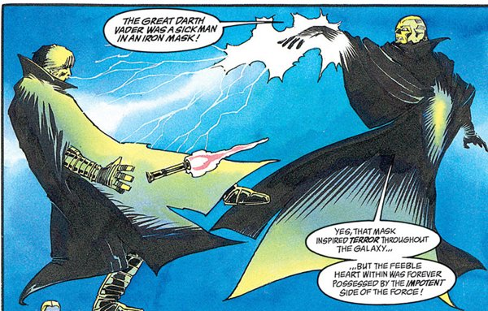
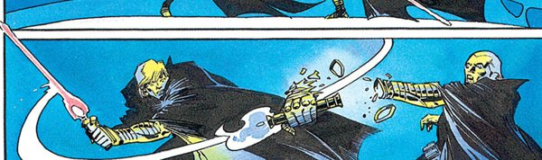
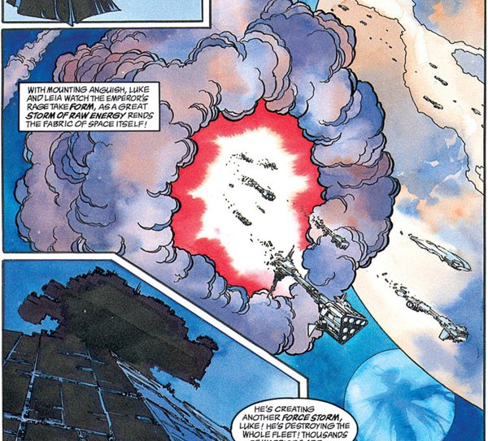
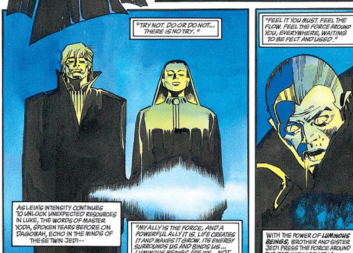
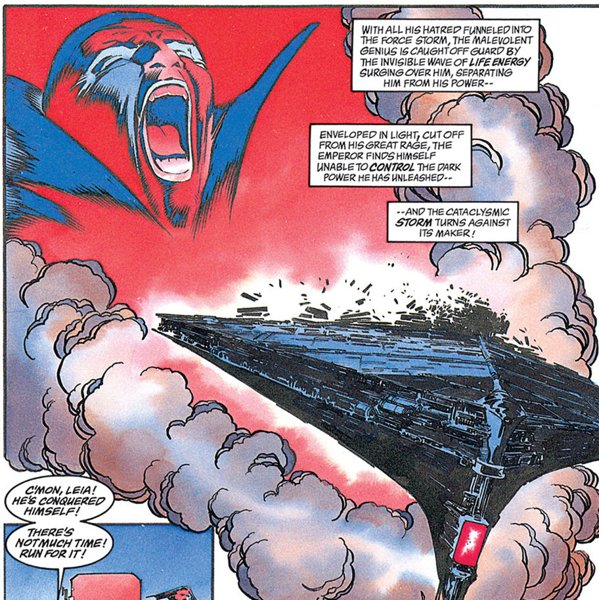
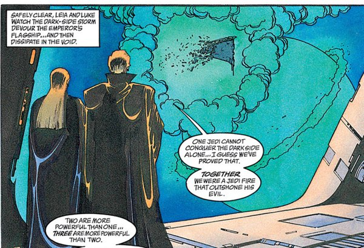

### 77. A Dark Empire companion essay says that, personally trained by Obi-Wan and Yoda and linked to their strength through the Force, Luke rose quickly through the initial stages of Jedi knowledge.

```
Personally trained by these two great Jedi and linked to their strength and wisdom through the power of the Force, Luke rose quickly through the initial stages of Jedi knowledge. Thus he became instrumental in the overthrow of his father, the fall of the Emperor, and the

— Dark Empire #1, companion text (Dark Horse Comics, 1991) †
```

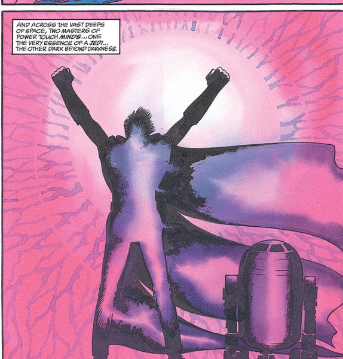
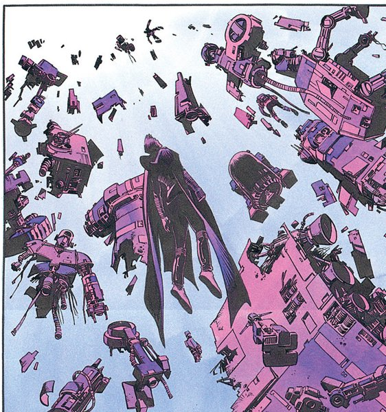

### 78. Dark Empire II's introduction says it quickly became clear to Luke that the Emperor was masterfully adept in the ways of the dark side, "the dark side's most powerful expression," as Vader had warned.

```
It quickly became clear to Luke that this decrepit and seemingly defenseless old man was masterfully adept in the ways of the dark side of the Force. Indeed, as Vader had warned, the Emperor had become the dark side's most powerful expression.

— Dark Empire #2, companion text (Dark Horse Comics, 1991) †
```

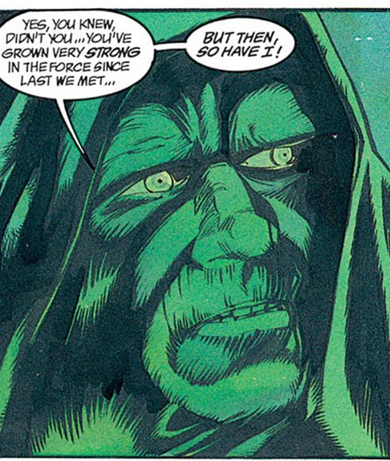
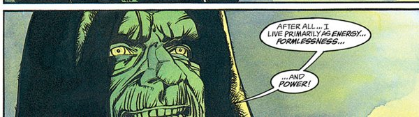

### 79. A Dark Empire essay calls Luke "the last fully realized Jedi Master" and "the most important key to the rebirth and restoration of the Jedi Knights".

```
As the last fully realized Jedi Master, Luke Skywalker is the most important key to the rebirth and restoration of the Jedi Knights.

— Dark Empire #3, companion text (Dark Horse Comics, 1991) †
```

## Limitations

*These are anti-feats, limits and caveats, each followed by the evidence behind it.*

### 80. OVERWHELMED BY THE EMPEROR'S LIGHTNING: Hit by the Emperor's Force lightning, Luke raises his arms and at first rebounds the bolts into the walls, but the shocks come with such speed and power that they course through him and he can only shrink before them, convulsing.

```
But if it was Force-generated, it could be Force-repelled. Luke raised his arms to deflect the bolts. Initially, he was successful—the lightning rebounded from his touch, harmlessly into the walls. Soon, though, the shocks came with such speed and power, they coursed over and into him, and he could only shrink before them, convulsed with pain, his knees buckling, his powers at ebb.

— Return of the Jedi (James Kahn, 1983), ch. 8
```

### 81. HATRED MAKES HIM RECKLESS: In the Cloud City duel, Luke's great hatred of Vader makes him lunge savagely, and the Dark Lord effortlessly deflects the blow with a defensive turn of his own weapon.

```
His great hatred for Vader impelled Luke to lunge at him savagely, bringing his sizzling blade down upon Vader’s. But effortlessly, the Dark Lord deflected the blow with a defensive turn of his own weapon.

— The Empire Strikes Back (Donald F. Glut, 1980), ch. 12
```

### 82. DISARMED AND MAIMED BY VADER: During the Cloud City duel, Luke involuntarily glances at a floating instrument panel; Vader's blade slashes across Luke's hand and sends his lightsaber flying.

```
An instant of distraction was all Vader needed. As the instrument panel floated away, Luke involuntarily glanced at it. At that second, the Dark Lord’s laser blade came slashing down across Luke’s hand, cutting it, and sending the youth’s lightsaber flying.

— The Empire Strikes Back (Donald F. Glut, 1980), ch. 13
```

### 83. KNOCKED DOWN BY C'BAOTH: In the throne room fight, C'baoth's lightning bursts knock Luke off balance onto his knees, a falling rock slams into his head, and the lightsaber is plucked from his fingers and flies across the throne room.

```
Luke dropped his lightsaber back into defense position, senses again tingling with danger. But once again, the knowledge did him little good. C’baoth’s lightning burst flashed against the lightsaber blade, the impact knocking Luke off balance and dropping him painfully onto his knees in the pile of stones around him. Even as he struggled to get up, one of the falling rocks slammed hard into the side of his head. He staggered, toppling sideways onto one hand. Again the lightning flashed, throwing coronal fire all through the stone pile and sending wave after wave of agony through him. The lightsaber was plucked from his fingers; dimly he saw it fly over the railing toward the far end of the throne room.

— The Last Command (Timothy Zahn, 1993), ch. 28
```

### 84. SURPRISED BY GANTORIS: Standing over a beaten Gantoris, Luke is surprised when Gantoris extends his violet blade like a spear to nearly double its length.

```
Luke stood over him, intending to call an end to the duel, but Gantoris’s eyes blazed brighter. As if springing a trap, he fingered a button on his lightsaber handle—and the violet-edged blade suddenly extended like a spear, flashing outward to nearly double its length.

— Dark Apprentice (Kevin J. Anderson, 1994), ch. 7
```

### 85. DEFEATED BY KYP AND EXAR KUN: Facing the black-hooded apparition, Luke's lightsaber turns cold, frost forms on the handle, a shadow rots the green beam from its core, and the blade dies with a fizzle of sparks.

```
Luke stumbled backward. The lightsaber turned cold in his hand. Frost crystals grew in feathery patterns around the handle. At the core of the brilliant green blade a shadow appeared, a black disease rotting away the purity of the beam. The humming blade sputtered, sounding like a sickly cough. The black taint rapidly grew stronger, swallowing up the green beam.

With a fizzle of sparks Luke’s lightsaber died.

— Dark Apprentice (Kevin J. Anderson, 1994), ch. 32
```

### 86. BLADE TURNED BY FIREWORM ARMOR: Slashing at a fireworm in the Great Temple on Yavin 4, Luke's blade smashes against the mirrored armor plates and the green edge refracts into a thousand components that ricochet around the chamber.

```
As the fireworm struck, Luke slashed with his humming green blade. But when the lightsaber smashed against the mirrored armor plates, the glowing green edge refracted into a thousand components, splitting and ricocheting around the chamber. Sparks showered all around him. The energy blade that could supposedly slice through anything broke only one small silicon armor plate.

— Jedi Search (Kevin J. Anderson, 1994), ch. 8
```

### 87. PINNED BY SHIMRRA: Shimrra's three-meter amphistaff wraps around Luke's torso, pinning his right arm and lightsaber hilt to his side with the blade pointed at the floor.

```
Lunging, the thick, three-meter-long amphistaff wound itself around Luke’s torso, pinning his right arm and light-saber hilt to his side, the green blade aimed at the floor. Just in time, Luke managed to get his left hand gripped on the snake’s uppermost coils and avert the head as it loosed volumes of venom at him. But Luke was rapidly being squeezed to death by the amphistaff. Feeling his uncle’s suffocation in his own crushed chest, Jacen summoned his strength and crawled frantically for his lightsaber. Calling it to his right hand, he sent it hurtling through the air at Shimrra’s head.

— The Unifying Force (James Luceno, 2003), ch. 40
```

### 88. TRAPPED IN LOMI PLO'S NET: When Lomi Plo's net closes, Luke pushes out with the Force to stop it constricting and slicing his vac suit, but is not strong enough to break the attack outright, because she can still draw on her nest to enhance her Force potential.

```
Luke knew what was coming next: the Myrkr strike team had described how Lomi Plo had used a similar net to dice a Yuuzhan Vong captor into bits. Luke began to push out with the Force, stopping the net from constricting any further and slicing through this vac suit. But he was not strong enough to break the attack outright. Cilghal’s Dazer had cut Lomi Plo off from the collective mind of the Gorog, but not from the Force. She could still draw on her nest to enhance her Force potential, and as strong as Luke was, he was not strong enough to overpower an entire nest of Killiks. He would simply have to hold on—and hope she ran out of air before he ran out of strength.

— The Swarm War (Troy Denning, 2006), ch. 18
```

### 89. WEAKER ONE-HANDED: The narration notes that Luke favors two-handed styles and can fight single-handed with his weak hand as well as anyone in the academy, but cannot fight wounded and weak-handed against twin blades while a second party fires shatter gun pellets at him.

```
In lightsaber combat, Luke favored two-handed styles, but he could still fight single-handed—even with his weak hand—just as well as anyone in the academy. What he could not do, however, was fight wounded and weak-handed against twin blades while a second party fired a steady stream of hard-to-deflect shatter gun pellets at him.

— The Swarm War (Troy Denning, 2006), ch. 25
```

### 90. OUTPACED BY C'BAOTH: Luke senses the danger half a second before Svan dives for a slugthrower and ignites his lightsaber in one motion, but C'baoth is faster and fires a volley of blue Force lightning.

```
Luke caught the flicker of sense a half second before Svan dived for the slugthrower. With a single smooth motion he had his lightsaber free of his belt and ignited. But C’baoth was faster. Even as Luke’s green-white blade snapped into existence, C’baoth raised his hand; and from his fingertips flashed a sizzling volley of all-too-well-remembered blue lightning bolts.

— Dark Force Rising (Timothy Zahn, 1992), ch. 14
```

### 91. NEARLY CUT BY BRAKISS: In the Brakiss duel, Luke does not move quickly enough against a great circular slash and his shirt is seared, narrowly missing his skin, before he begins to match each movement.

```
Brakiss tried a series of small thrusts, little movements designed to be parried, and then he arched the lightsaber in one great circular movement. Luke didn’t move quickly enough. Brakiss’s lightsaber seared Luke’s shirt, narrowly missing his skin. Luke then matched each movement of Brakiss’s.

— The New Rebellion (Kristine Kathryn Rusch, 1996), ch. 20
```

### 92. BROKEN ANKLE AGAINST KUELLER: Fighting Kueller with a broken ankle, Luke parries five rapid thrusts but cannot keep his balance, his ankle buckles, and Kueller knocks the lightsaber from his hand.

```
In a series of five rapid thrusts, Kueller moved Luke backward again. Luke parried, parried, parried, but couldn’t keep his balance. His ankle was clearly broken and unable to support him. Kueller jabbed at Luke’s left side. Luke swiveled to dodge, and Kueller jabbed again. Luke’s ankle buckled, but he didn’t fall. Kueller pushed closer, and knocked Luke’s lightsaber from his hand.

— The New Rebellion (Kristine Kathryn Rusch, 1996), ch. 32
```

### 93. NEARLY KILLED BY A TUSKEN: On Tatooine, a Tusken Raider's gaderffii would have cleaved Luke's skull in two but for his instinctive throw up of his rifle, which deflects the blow but is shattered by it.

```
As the moment of confrontation passed, the Tusken let out a terrifying grunt of fury and pleasure and brought down his heavy gaderffii. The double-edged ax would have cleaved Luke’s skull neatly in two, except that he threw the rifle up in a gesture more instinctive than calculated. His weapon deflected the blow, but would never do so again. Made from cannibalized freighter plating the huge ax shattered the barrel and made metallic confetti of the gun’s delicate insides.

— Star Wars: From the Adventures of Luke Skywalker (George Lucas [Alan Dean Foster], 1976), ch. 4
```

### 94. OVERPOWERED BY VADER'S CUT: In a lightsaber exchange with Vader in Shadows of the Empire, Vader's powerful cut at Luke's left side hits so hard it vibrates him and nearly tears the lightsaber from his grip.

```
Luke pulled his lightsaber, lit it, brought it up. The gleaming blue white of his blade met Vader’s reddish beam as they crossed in on-guard salute. The power hum and energy crackle grew louder.

Suddenly Vader swung, a powerful cut at Luke’s left side—

Luke jerked his blade up and over, dropped the point, blocked the slash; it hit so hard it vibrated him, nearly tore his lightsaber from his grip—

— Shadows of the Empire (Steve Perry, 1996), ch. 1
```

### 95. STUBBORN: A Dark Empire essay says Luke's teachers nearly despaired over his willingness to disregard the advice of those older and wiser, and his failure to come to terms with his hotheaded recklessness.

```
And yet... Luke's teachers nearly despaired over his willingness to disregard the advice of those older and wiser than himself -- and his failure to come to terms with his hotheaded recklessness. At times it seemed he was even on the verge of following the selfish and willful

— Dark Empire #1, companion text (Dark Horse Comics, 1991) †
```

### 96. IMPETUOUS: Another Dark Empire essay says that Yoda tried to move Luke to the higher levels of Jedi training, but Luke, impetuous, willful, full of youthful hunger for action, seemed never to hear him.

```
Gently, persistently, Master Yoda tried to move Luke through the rigors of physical combat to the higher levels of Jedi training. But Luke, impetuous, willful, full of youthful hunger for action, seemed to never hear what Yoda tried to tell him.

— Dark Empire #6, companion text (Dark Horse Comics, 1991) †
```

### 97. NEAR THE DARK SIDE: In the second Death Star duel Luke fought his father with a frenzy that took him to the edge of victory and madness; with his lightsaber at Vader's throat, he realized another inch of hatred would make him belong to the dark side forever.

```
faced off again...and again their lightsabers clashed. Filled with rage against his father's betrayal, Luke fought with a frenzy that took him to the very edge of victory and madness. With his lightsaber pressed against his father's throat, a movement away from committing patricide -- Luke suddenly understood that if he gave another inch to his hatred, he would belong to the dark side -- forever.

— Dark Empire #1, companion text (Dark Horse Comics, 1991) †
```

### 98. CAN'T OUTLAST HER EASILY: Lumiya's lightwhip misses Luke by centimeters and he is driven back on each lunge; "She'd slow sooner or later. But so would he."

```
She drew back her arm and brought the lightwhip crackling through the air, missing Luke by centimeters. He lunged at her again and again, driven back each time. She’d slow sooner or later.

But so would he.

— Sacrifice (Karen Traviss, 2007), ch. 22
```

### 99. BLINDSIDED AND POISONED BY JACEN: Expecting lightning, Luke is instead slammed into a durasteel wall by a hurled thorn bed whose thorns pump venom into him.

```
The lightning never came. Instead, Luke was blindsided by something heavy and spiky, and his body exploded into pain as he slammed into a durasteel wall. He found himself pinned in place, trapped by a bed of thorns Jacen had hurled across the cabin. He felt the hot sting of the thorns pumping their venom into him. His hearing faded and his head began to spin, and he saw Jacen, one hand still raised to keep Luke pinned, sneering and taking his time rising.

— Inferno (Troy Denning, 2007), ch. 19
```

### 100. CRIPPLED KNEE AND RIBS: Jacen's Force-enhanced punch leaves Luke croaking for breath, a kick pops his knee, and the knee keeps buckling as he tries to finish the fight.

```
—which Jacen ducked. He came up under Luke’s guard, holding his weapon with one hand and driving a Force-enhanced punch into Luke’s ribs with the other, striking for the same place he had kicked earlier. Luke’s chest exploded into pain, and he found himself croaking instead of breathing.

[…]

Luke started forward, his injured knee buckling each time he put weight on it. The rack’s slender tendrils were tightening around Jacen, cutting into his flesh and oozing a yellowish irritant that made skin puff up and split. Jacen began to slash his lightsaber up and down, cutting the vines away two and three at a time. If Luke wanted to finish this—and it seemed like a good idea, given how battered he was himself—he had only a few seconds.

— Inferno (Troy Denning, 2007), ch. 19
```

### 101. GARROTED BY JACEN: Beating Jacen's guard down "too quickly," Luke walks into a trap; a toxic tendril loop tightens around his throat, and Jacen keeps Luke's body between himself and the blade.

```
Luke Force-leapt after him, knowing that this Jacen—the Jacen he had caught torturing his son—would not hesitate to take Ben hostage … or to kill him. Luke landed half a meter in front of Jacen’s lightsaber and quickly beat down his nephew’s guard—too quickly. When he did not glimpse a face in the light of his own blade, Luke knew something was wrong and stopped.

Which was exactly what Jacen was waiting for, of course.

Luke had barely started to turn before a loop of thin tendril slipped over his head and tightened around his throat, oozing toxin and cutting deep into the flesh. The wound swelled and burned as if it were on fire. Luke whipped his lightsaber around, trying to cut Jacen off his back, but Jacen was already spinning away, tightening his garrote and placing Luke’s body between himself and the deadly blade.

“Should have let me go when you had the chance,” Jacen snarled. “Now you’re done.”

— Inferno (Troy Denning, 2007), ch. 19
```

### 102. SHOT DURING THE LOMI PLO DUEL: Cocking a death slash, Luke is hit by a shatter gun pellet that sends him tumbling and paralyzes his prosthetic arm, leaving him driven into a corner.

```
Luke whipped his blade around, cocking it for a death slash across her middle—then had a prickle of danger sense between his shoulder blades and tried to spin away. He almost made it.

Something heavy and huge slammed into his shoulder—a shatter gun pellet?—and sent him tumbling across the floor past Lomi Plo’s feet. He tried a reactionary slash as he rolled by, only to discover that was he was no longer holding his lightsaber, and he could not move his prosthetic hand—nor the rest of his arm.

Lomi Plo’s two blades began to chop the floor behind him, so he used the Force to accelerate himself and continued to roll, then came to his feet two meters on the other side of her and called his lightsaber back to his good hand.

The weapon arrived just ahead of Lomi Plo, and suddenly Luke found himself on the defensive, being driven into a corner while Raynar Thul—not so impotent after all—used his other hand to fire more shatter gun pellets.

— The Swarm War (Troy Denning, 2006), ch. 25
```

### 103. OUTMATCHED IN FORCE STRENGTH BY ABELOTH: Pinned by Abeloth, Luke can only reinforce his larynx with the Force to keep her from crushing it; "Abeloth had a dozen times the Force strength Luke had." He breaks free by igniting his lightsaber through her stomach.

```
Luke tucked his chin and managed to flip to his back before he hit the stone floor. Abeloth was on top of him, her flesh blistered and smoking, her remaining leg entwining both of his, her remaining arm wrapped around the back of his neck. She drove the still-sizzling stump of her amputated arm into his throat, catching him square in the voice box and pressing hard. The cartilage began to give. He pushed back with the Force, reinforcing his larynx and trying to throw her off.

It was no good. Abeloth had a dozen times the Force strength Luke had, and he could do no more than keep her from crushing his throat. He tried to bring his knee up and found his legs incapable of moving. She straightened her leg, forcing his knee to bend against the joint, and something gave with a muted pop. He slammed a Force-enhanced knuckle strike into her side and heard three ribs snap … and remained entangled. She dug her nails into the root of his ear, then twisted, and his head erupted in pain. He slipped his deactivated lightsaber between their bodies and jammed the blade emitter against her stomach. He thumbed the activation slide and saw the blade shoot out the other side.

— Vortex (Troy Denning, 2010), ch. 32
```

## Comic Panels Without a Matching Entry

*Panels from the old version of this file, or from the same comics, that no quoted entry above covers yet.*

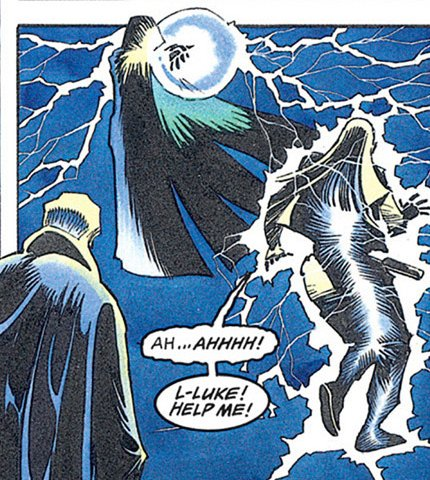
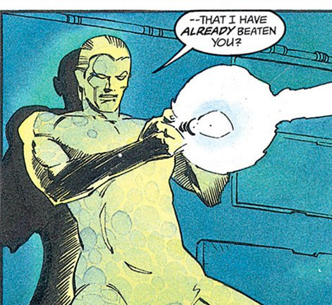
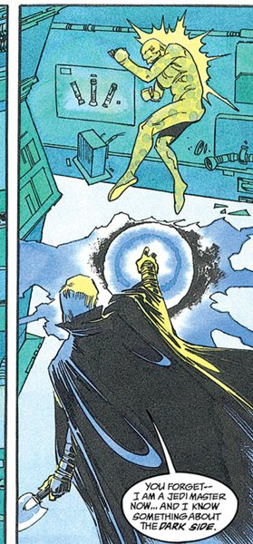
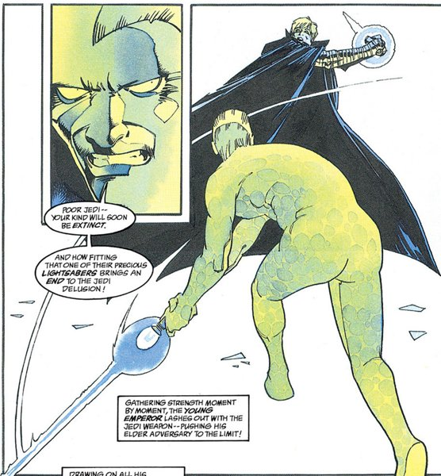
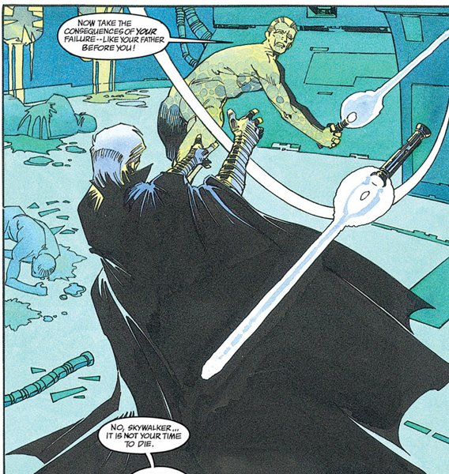
