# Luke Skywalker — part 1 of 9

[All parts](README.md) · [Next](02-legends-the-complete-star-wars-encyclopedia-vol-ii.md)

# Luke Skywalker

- **Aliases:** Luke, DE Luke
- **Era:** GCW–LotF
- **Continuity:** default Legends; entries present for: Canon, Legends
- **Research tier:** MASTERY (Jedi Academy trilogy 026 version only: Jedi Search, Dark Apprentice, Champions of the Force; primary read 2026-10-28); DEEP
- **Entries:** 5430 (3468 with quotations; 1535 marked as fragments; recounted after the public-release cleanup). Rebuilt 2026-11-17 from 6473 old entries; old file: `characters/_bak/luke-skywalker.md.bak-20261117`.
- **How to read:** each entry is the quotation in full (block quote), then its source and point of view. "Note" lines are summaries from our notes, not quotations. `[fragment — full passage not on file]` means the source text is not on the box, so only the words in our notes are shown. Debate and forum material is in the last section and is unverified.

# LEGENDS (Legends / EU — main focus)

## Legacy of the Force 1–9: novel notes from the other agent (reference copy)

- Note (summary from our notes, not a quotation): Headline: the Jacen-turns book. Jacen's commando raids (Adumar, Centerpoint) show a cold, efficient Knight. Lumiya, disguised as "Brisha Syo", lures him to the Vectivus asteroid near Bimmiel, tests him with Force phantoms (a phantom Luke nearly beats him), reveals herself, and argues that the Sith can rule without corruption. Jacen foresees that he kills Luke in every future where Nelani reports what she saw, so he cripples and kills Nelani, edits Ben's memory, and lets Lumiya go. Lumiya's closing scene confirms Luke's dream figure is the Sith Jacen will become.
  — Source: Legacy of the Force 1: Betrayal (novel): feats, scaling and story notes.
Our notes: `notes/materials/021-legacy-of-the-force/lotf-1-betrayal-notes.md:9`

> And he brings great pain to the galaxy … *(L93)*
— Source: L93 — Legacy of the Force 1: Betrayal (novel): feats, scaling and story notes.
(Full sentence/passage taken from the source text on file: `lotf_tmp_b1_epub`.)
Note (our notes, around the quote): Ch1–2: Luke dreams of a shadowed, Anakin-like figure who «brings great pain to the galaxy» (L93). Jacen and Ben raid an Adumari munitions factory and escape a missile-armed airspeeder.
Our notes: `notes/materials/021-legacy-of-the-force/lotf-1-betrayal-notes.md:16`

- Note (summary from our notes, not a quotation): Ch17–21: Peace talks at Toryaz Station. A commando raid hits every delegation at once; Luke, Mara, Jacen, Jaina, Zekk, Han and Leia repel it (Ch19–20). Investigation follows.
  — Source: Legacy of the Force 1: Betrayal (novel): feats, scaling and story notes.
Our notes: `notes/materials/021-legacy-of-the-force/lotf-1-betrayal-notes.md:19`

- Note (summary from our notes, not a quotation): Ch22–28: Luke and Corran in Coronet; Han throws in with Corellia; Jacen and Ben, with Nelani Dinn, track Jedi-linked "phantom" incidents on Lorrd and meet "Brisha Syo".
  — Source: Legacy of the Force 1: Betrayal (novel): feats, scaling and story notes.
Our notes: `notes/materials/021-legacy-of-the-force/lotf-1-betrayal-notes.md:20`

- Note (summary from our notes, not a quotation): Ch29–33: The Bimmiel-area asteroid. Phantoms separate Ben and Nelani; a phantom Luke tests Jacen. Simultaneously phantom Jacen and phantom Ben attack Luke and Mara on Coruscant. Brisha reveals she is Lumiya; Nelani fights her; Jacen's foresight shows Luke dying by his hand along every path where Nelani lives; he kills Nelani.
  — Source: Legacy of the Force 1: Betrayal (novel): feats, scaling and story notes.
Our notes: `notes/materials/021-legacy-of-the-force/lotf-1-betrayal-notes.md:21`

- Note (summary from our notes, not a quotation): Ch34: The Tralus battle ends; Leia renounces doing evil to protect family. Lumiya, alone, talks with a phantom of the Sith Jacen will become. Jacen lies to Ben. Luke senses «He exists» (L8269).
  — Source: L8269 — Legacy of the Force 1: Betrayal (novel): feats, scaling and story notes.
Our notes: `notes/materials/021-legacy-of-the-force/lotf-1-betrayal-notes.md:22`

> Luke can’t make out his features because he’s not willing to accept what he sees through the Force—your face where the next Lord of the Sith stands.” *(L7905)*
— Source: L7905 — Legacy of the Force 1: Betrayal (novel): feats, scaling and story notes.
(Full sentence/passage taken from the source text on file: `lotf_tmp_b1_epub`.)
Note (our notes, around the quote): Luke's denial. Lumiya: Luke can't see the dream figure's face because he won't accept «your face where the next Lord of the Sith stands» (L7905).
Our notes: `notes/materials/021-legacy-of-the-force/lotf-1-betrayal-notes.md:28`

> Luke turned left, rotating on the ball of one foot. He dropped his lightsaber and gestured with the hand that had held it. Ahead of him, the ceiling, a cool-blue, sound-insulating foam over metal, buckled and tore free, slamming down across those invaders. The attackers must have fired; in an instant, the ruined ceiling began to superheat from the blasts, the insulation on the far side bursting into flame and sending sheets of smoke up into the air.
— Source: Legacy of the Force 1: Betrayal (novel): feats, scaling and story notes; | F15 | Ch19 | L4145 | Luke |.
(Excerpt widened 2026-11-17 to the relevant passage, word for word from Betrayal (Aaron Allston), Chapter Nineteen (text copy `MEGA_Legend_The_Legacy_of_the_Force_Series_Star_Wars_Legacy_of_the_Force_01_Betrayal_Aaron_Allston_epub`).)
(Full sentence/passage taken from the source text on file: `lotf_tmp_b1_epub`.)
Context: | # | Ch | Line | Character | Feat (exact quote) |
Our notes: `notes/materials/021-legacy-of-the-force/lotf-1-betrayal-notes.md:50`

> Luke flexed both his body and his control of the Force, and the remaining silver netting on him tore away. His lightsaber popped back up into his hand. His Force-senses focused, he walked forward, pushing the glowing metal panel before him, driving it toward his attackers.
— Source: Legacy of the Force 1: Betrayal (novel): feats, scaling and story notes; | F16 | Ch19 | L4149 | Luke |.
(Excerpt widened 2026-11-17 to the relevant passage, word for word from Betrayal (Aaron Allston), Chapter Nineteen (text copy `MEGA_Legend_The_Legacy_of_the_Force_Series_Star_Wars_Legacy_of_the_Force_01_Betrayal_Aaron_Allston_epub`).)
Context: | # | Ch | Line | Character | Feat (exact quote) |
Our notes: `notes/materials/021-legacy-of-the-force/lotf-1-betrayal-notes.md:51`

> The not-Jacen struck, a fast, powerful lateral blow that Luke met with little effort, without conscious thought. Not-Jacen’s blade was immediately in guard position for an anticipated counterstrike, but Luke held back. Oddly, the force of the impact sent his opponent floating backward. Not-Jacen drifted until he hit the corridor wall, which checked his motion, and he floated gently to the floor.
— Source: Legacy of the Force 1: Betrayal (novel): feats, scaling and story notes; | F21 | Ch31 | L7225 | Luke vs phantom Jacen |.
(Excerpt widened 2026-11-17 to the relevant passage, word for word from Betrayal (Aaron Allston), Chapter Thirty-One (text copy `MEGA_Legend_The_Legacy_of_the_Force_Series_Star_Wars_Legacy_of_the_Force_01_Betrayal_Aaron_Allston_epub`).)
(Full sentence/passage taken from the source text on file: `lotf_tmp_b1_epub`.)
Context: | # | Ch | Line | Character | Feat (exact quote) |
Also cited as: L8273 — Legacy of the Force 1: Betrayal (novel): feats, scaling and story notes; | D7 | Ch31 | L7225 | Luke vs phantom Jacen |.
Also noted as: | D7 | Ch31 | L7225 | Luke vs phantom Jacen | «Luke met with little effort» | Luke even-to-ahead; phantom breaks off when Luke senses the "creation" (L8273) |
Our notes: `notes/materials/021-legacy-of-the-force/lotf-1-betrayal-notes.md:56`; `notes/materials/021-legacy-of-the-force/lotf-1-betrayal-notes.md:113`

> Luke countered every blow and pitched attacks of his own. He felt the skin of his left forearm pucker a little from the heat of a near hit, saw the Not-Jacen’s robes catch fire just under the right armpit from an especially close thrust of Luke’s … but Not-Jacen patted the flames out and merely grinned at him.
— Source: Legacy of the Force 1: Betrayal (novel): feats, scaling and story notes; | F23 | Ch31 | L7449 | Luke vs phantom Jacen |.
(Excerpt widened 2026-11-17 to the relevant passage, word for word from Betrayal (Aaron Allston), Chapter Thirty-One (text copy `MEGA_Legend_The_Legacy_of_the_Force_Series_Star_Wars_Legacy_of_the_Force_01_Betrayal_Aaron_Allston_epub`).)
Context: | # | Ch | Line | Character | Feat (exact quote) |
Our notes: `notes/materials/021-legacy-of-the-force/lotf-1-betrayal-notes.md:58`

> It was no use. The false Luke adapted instantly to his change in tactics, reverting to a softer, defensive style, turning away each of Jacen’s all-out attacks. And he did so grinning, silently mocking.
— Source: Legacy of the Force 1: Betrayal (novel): feats, scaling and story notes; | F26 | Ch32 | L7507 | phantom Luke vs Jacen |.
(Excerpt widened 2026-11-17 to the relevant passage, word for word from Betrayal (Aaron Allston), Chapter Thirty-Two (text copy `MEGA_Legend_The_Legacy_of_the_Force_Series_Star_Wars_Legacy_of_the_Force_01_Betrayal_Aaron_Allston_epub`).)
Context: | # | Ch | Line | Character | Feat (exact quote) |
Also cited as: Legacy of the Force 1: Betrayal (Aaron Allston, 2006) — own full read.
Also noted as: D12 Jacen vs phantom Luke [c32 ¶2–12]: Jacen's low-gravity bounding tactics are read; he switches to Force-braced flurries; the phantom shifts to soft defense "turning away each of Jacen’s all-out attacks" [c32 ¶10], then sidesteps the fifth blow and counters into his back. Lumiya cancels it; Jacen still feels pain and his robe is burning [c32 ¶12]. Loss. CONDITION: the phantom drew on the asteroid's dark-side energy; Jacen did not.
Our notes: `notes/materials/021-legacy-of-the-force/lotf-1-betrayal-notes.md:61`; `notes/materials/040-lotf-own-read/lotf-1-betrayal.md:77`

> He nodded. “I’ve had the dream a couple of times before. It’s not just a dream. It’s coming to me through currents in the Force. He’s all wrapped up in shadows—a dark hooded cloak, but more than that, shadows of light and …” Luke shook his head, struggling for the correct word. “And ignorance. And denial. And he brings great pain to the galaxy … and to me.”
>
> And denial. And he brings great pain to the galaxy … and to me.”
>
> “Well, if he brings pain to the galaxy, you’re obviously going to feel it.”
>
> “No, to me personally, in addition to his other evil.” Luke sighed and lay down again.
— Source: Legacy of the Force 1: Betrayal (novel): feats, scaling and story notes; | S1 | Ch1 | L93 | Luke |.
(Excerpt widened 2026-11-17 to the relevant passage, word for word from Shadow Hunter (Michael Reaves) (text copy `MEGA_Legend_Darth_Maul_Star_Wars_Darth_Maul_02_Shadow_Hunter_Michael_Reaves_epub`).)
(Excerpt widened 2026-11-17 to the relevant passage, word for word from Betrayal (Aaron Allston) (text copy `MEGA_Legend_The_Legacy_of_the_Force_Series_Star_Wars_Legacy_of_the_Force_01_Betrayal_Aaron_Allston_epub`).)
(Excerpt widened 2026-11-17 to the relevant passage, word for word from Betrayal (Aaron Allston) (text copy `MEGA_Legend_The_Legacy_of_the_Force_Series_Star_Wars_Legacy_of_the_Force_01_Betrayal_Aaron_Allston_epub`).)
Note (our notes, around the quote): | S1 | Ch1 | L93 | Luke | «And he brings great pain to the galaxy . . and to me.» | High (Force vision; fulfilled by Caedus) |
Context: | # | Ch | Line | Speaker | Statement (exact quote) | Reliability |
Our notes: `notes/materials/021-legacy-of-the-force/lotf-1-betrayal-notes.md:79`

> No, just educated in different directions. *(asked if he is stronger than Luke)*
— Source: Legacy of the Force 1: Betrayal (novel): feats, scaling and story notes; | S3 | Ch10 | L1971 | Jacen |.
Note (our notes, around the quote): | S3 | Ch10 | L1971 | Jacen | «No, just educated in different directions.» (asked if he is stronger than Luke) | High; Jacen himself puts Luke above him in 40 ABY |
Context: | # | Ch | Line | Speaker | Statement (exact quote) | Reliability |
Our notes: `notes/materials/021-legacy-of-the-force/lotf-1-betrayal-notes.md:81`

> Not-Jacen seized a ceiling glow rod fixture and hung there as though his weight were nothing. “You’re just about as good as my true Master,” Not-Jacen said.
— Source: Legacy of the Force 1: Betrayal (novel): feats, scaling and story notes; | S7 | Ch31 | L7451 | phantom Jacen to Luke |.
(Full sentence/passage taken from the source text on file: `lotf_tmp_b1_epub`.)
Label in our notes: | Low-medium (phantom) |
Context: | # | Ch | Line | Speaker | Statement (exact quote) | Reliability |
Our notes: `notes/materials/021-legacy-of-the-force/lotf-1-betrayal-notes.md:85`

> This combat was not just pointless, being carried out at someone else’s wish for someone else’s ends, but also dangerous—the false Luke was potentially good enough to kill Jacen.
— Source: Legacy of the Force 1: Betrayal (novel): feats, scaling and story notes; | S9 | Ch32 | L7499 | Jacen POV |.
(Full sentence/passage taken from the source text on file: `lotf_tmp_b1_epub`.)
Label in our notes: | Medium-high |
Context: | # | Ch | Line | Speaker | Statement (exact quote) | Reliability |
Our notes: `notes/materials/021-legacy-of-the-force/lotf-1-betrayal-notes.md:87`

> She was a Sith, and yet she helped give Luke Skywalker a son. *(Vergere)*
— Source: Legacy of the Force 1: Betrayal (novel): feats, scaling and story notes; | S16 | Ch32 | L7849 | Lumiya |. POV: Vergere, about Luke Skywalker.
Label in our notes: Vergere) | Low-medium (Lumiya's spin) |
Context: | # | Ch | Line | Speaker | Statement (exact quote) | Reliability |
Our notes: `notes/materials/021-legacy-of-the-force/lotf-1-betrayal-notes.md:94`

> It’s life. We just have to find a way … to make ourselves stronger because of it.”
>
> Ben nodded. “I guess you’re right.”
>
> CORUSCANT “He exists.” Luke looked up from his terminal.
>
> CORUSCANT “He exists.” Luke looked up from his terminal. On its screen scrolled updated reports of the engagement at Tralus, but Mara could feel that the worry on his face was caused by something else. “He finally exists, for real.”
>
> On its screen scrolled updated reports of the engagement at Tralus, but Mara could feel that the worry on his face was caused by something else. “He finally exists, for real.”
>
> “Your phantom enemy.”
>
> “Yes.” Luke rose.
>
> “Yes.”
— Source: Legacy of the Force 1: Betrayal (novel): feats, scaling and story notes; | S21 | Ch34 | L8269 | Luke |.
(Excerpt widened 2026-11-17 to the relevant passage, word for word from Betrayal (Aaron Allston) (text copy `MEGA_Legend_The_Legacy_of_the_Force_Series_Star_Wars_Legacy_of_the_Force_01_Betrayal_Aaron_Allston_epub`).)
(Excerpt widened 2026-11-17 to the relevant passage, word for word from Betrayal (Aaron Allston) (text copy `MEGA_Legend_The_Legacy_of_the_Force_Series_Star_Wars_Legacy_of_the_Force_01_Betrayal_Aaron_Allston_epub`).)
(Full sentence/passage taken from the source text on file: `lotf_tmp_b1_epub`.)
Label in our notes: | High (vision confirmation) |
Context: | # | Ch | Line | Speaker | Statement (exact quote) | Reliability |
Also cited as: Legacy of the Force 1: Betrayal (Aaron Allston, 2006) — own full read; | S14 | c34 ¶72 | Luke |.
Also noted as: | S14 | c34 ¶72 | Luke | "He finally exists, for real." | High |
Our notes: `notes/materials/021-legacy-of-the-force/lotf-1-betrayal-notes.md:99`; `notes/materials/040-lotf-own-read/lotf-1-betrayal.md:63`

> At the end of his spin, Luke stood up, and something fell away from each of his attackers
> [fragment — full passage not on file]
— Source: Legacy of the Force 1: Betrayal (novel): feats, scaling and story notes; | D5 | Ch19 | L4159 | Luke, Mara, Jacen vs commando raiders |.
Note (our notes, around the quote): | D5 | Ch19 | L4159 | Luke, Mara, Jacen vs commando raiders | «At the end of his spin, Luke stood up, and something fell away from each of his attackers» | Jedi rout an anti-Jedi team (nets, poison) |
Context: | # | Ch | Line | Fight | Result (exact quote) | Context / what it suggests |
Our notes: `notes/materials/021-legacy-of-the-force/lotf-1-betrayal-notes.md:111`

> “Enough,” Brisha said, and the false Luke vanished. Jacen, straightening, still felt a tremor of pain from the area where the blow would have landed, and looked down to see a portion of his robe, a long black mark, on fire. He patted it out and looked up at Brisha. “Who was that, really?”
— Source: Legacy of the Force 1: Betrayal (novel): feats, scaling and story notes; | D10 | Ch32 | L7511 | Jacen vs phantom Luke |.
(Excerpt widened 2026-11-17 to the relevant passage, word for word from Betrayal (Aaron Allston), Chapter Thirty-Two (text copy `MEGA_Legend_The_Legacy_of_the_Force_Series_Star_Wars_Legacy_of_the_Force_01_Betrayal_Aaron_Allston_epub`).)
Note (our notes, around the quote): | D10 | Ch32 | L7511 | Jacen vs phantom Luke | «"Enough," Brisha said, and the false Luke vanished.» | Jacen losing: the counterstrike was landing on his back; phantom = Luke + dark side energy (S10) |
Context: | # | Ch | Line | Fight | Result (exact quote) | Context / what it suggests |
Our notes: `notes/materials/021-legacy-of-the-force/lotf-1-betrayal-notes.md:116`

What it shows (our notes): Luke vs Jacen (Betrayal-era): S3 (Jacen concedes), D10/S8–S10 (a phantom at roughly Luke's level, boosted by the place's dark side energy, beats Jacen; Jacen judges it «a fair match for Luke»). Indirect but consistent: Luke > Jacen at 40 ABY start, matching `lotf-2..4` and the high-confidence Luke > Caedus verdict.
> Jacen seized a rock outcropping and held it, keeping him from dropping once more toward the man with the face of Luke Skywalker. “You’re just about as good as my true Master,” Jacen said. And it was true—the phantom he fought had the speed and moves of a Jedi Master. He’d be a fair match for Luke.
— Source: Legacy of the Force 1: Betrayal (novel): feats, scaling and story notes.
(Excerpt widened 2026-11-17 to the relevant passage, word for word from Betrayal (Aaron Allston), Chapter Thirty-Two (text copy `MEGA_Legend_The_Legacy_of_the_Force_Series_Star_Wars_Legacy_of_the_Force_01_Betrayal_Aaron_Allston_epub`).)
(Full sentence/passage taken from the source text on file: `lotf_tmp_b1_epub`.)
Our notes: `notes/materials/021-legacy-of-the-force/lotf-1-betrayal-notes.md:123`

- Note (summary from our notes, not a quotation): Jacen's growth line: Betrayal Jacen = elite Knight (bolt-catching F11, decisive TK F10, perfect foresight F33, kills Nelani without effort). Already a top duelist below Luke, far below his Sacrifice–Invincible Caedus peak.
  — Source: Legacy of the Force 1: Betrayal (novel): feats, scaling and story notes.
Our notes: `notes/materials/021-legacy-of-the-force/lotf-1-betrayal-notes.md:124`

- Note (summary from our notes, not a quotation): Lumiya: superior technique vs a Knight (D11), multi-phantom coordination (F27), even TK push-of-war with Nelani while talking (F31, she is visibly straining, L7897). Fits the existing `verdicts.md` entries Mara ≥ Lumiya and Luke > Lumiya.
  — Source: Legacy of the Force 1: Betrayal (novel): feats, scaling and story notes.
Our notes: `notes/materials/021-legacy-of-the-force/lotf-1-betrayal-notes.md:125`

> Luke would have said that obedience to the guidance of the Force would give him direction and purpose, but since the end of the Yuuzhan Vong war, except for those times when he faced foes whose behavior lit up the Force like a KILL ME SOON sign, the life of the Jedi hadn’t given him the sense of purpose it seemed to have provided his uncle. *(L7785)*
— Source: L7785; L7983 — Legacy of the Force 1: Betrayal (novel): feats, scaling and story notes; Role/arc: a disillusioned Knight whose.
(Full sentence/passage taken from the source text on file: `lotf_tmp_b1_epub`.)
Note (our notes, around the quote): Role/arc: a disillusioned Knight whose «life of the Jedi hadn't given him the sense of purpose it seemed to have provided his uncle» (L7785). Persuaded by argument, not manipulation (S15), he frees Lumiya and kills Nelani to avert the future where he kills Luke (L7983).
Our notes: `notes/materials/021-legacy-of-the-force/lotf-1-betrayal-notes.md:135`

> That you’re destined to become the next Sith Lord—the first Sith Lord to be active in decades, the first one in centuries with the strength to use the Sith techniques to help others. *(S13, pitch)*
— Source: Legacy of the Force 1: Betrayal (novel): feats, scaling and story notes; Statements about him: Thrackan, impressed (S4). Lumiya.
(Full sentence/passage taken from the source text on file: `lotf_tmp_b1_epub`.)
Note (our notes, around the quote): Statements about him: Thrackan, impressed (S4). Lumiya: «the first one in centuries with the strength to use the Sith techniques to help others» (S13, pitch). Luke's dream: Anakin-like features (S2).
Our notes: `notes/materials/021-legacy-of-the-force/lotf-1-betrayal-notes.md:137`

- Note (summary from our notes, not a quotation): Fights/results: wins D1–D3 (with Thrackan's tricks costing him twice), D12 (kills Nelani). Loses D10 to phantom Luke.
  — Source: Legacy of the Force 1: Betrayal (novel): feats, scaling and story notes.
Our notes: `notes/materials/021-legacy-of-the-force/lotf-1-betrayal-notes.md:139`

- Note (summary from our notes, not a quotation): Scaling: high Knight / near-Master; clearly below Luke here (S3, D10). LotF 1 adds no new peak to Caedus's tier (verdicts.md unchanged on tier).
  — Source: Legacy of the Force 1: Betrayal (novel): feats, scaling and story notes.
Our notes: `notes/materials/021-legacy-of-the-force/lotf-1-betrayal-notes.md:140`

- Note (summary from our notes, not a quotation): Role/arc: Grand Master haunted by a dream (S1–S2); politically sidelined; at the end he knows the figure «finally exists» (S21).
  — Source: Legacy of the Force 1: Betrayal (novel): feats, scaling and story notes.
Our notes: `notes/materials/021-legacy-of-the-force/lotf-1-betrayal-notes.md:143`

- Note (summary from our notes, not a quotation): Key feats: reverses a blast-propelled door (F13); simultaneous Force sweeps (F14); tears down a ceiling on attackers (F15); rips a Jedi-trap net (F16); fends off phantom Jacen «with little effort» (F21, F23).
  — Source: Legacy of the Force 1: Betrayal (novel): feats, scaling and story notes.
Our notes: `notes/materials/021-legacy-of-the-force/lotf-1-betrayal-notes.md:144`

> Jacen offered a humorless smile. “No, just educated in different directions. Besides, it’s been my experience that anyone who claims to be stronger than Luke Skywalker receives a lot of grief from his admirers.”
— Source: Legacy of the Force 1: Betrayal (novel): feats, scaling and story notes; Statements: Jacen.
(Excerpt widened 2026-11-17 to the relevant passage, word for word from Betrayal (Aaron Allston), Chapter Ten (text copy `MEGA_Legend_The_Legacy_of_the_Force_Series_Star_Wars_Legacy_of_the_Force_01_Betrayal_Aaron_Allston_epub`).)
(Full sentence/passage taken from the source text on file: `lotf_tmp_b1_epub`.)
Note (our notes, around the quote): Statements: Jacen: «No, just educated in different directions» when asked if he's stronger than Luke (S3). The phantom built from him nearly kills Jacen (S9–S10).
Our notes: `notes/materials/021-legacy-of-the-force/lotf-1-betrayal-notes.md:145`

- Note (summary from our notes, not a quotation): Quote: his waking words open the book (L81): he doesn't exist (printed in capitals in the source).
  — Source: L81 — Legacy of the Force 1: Betrayal (novel): feats, scaling and story notes.
Our notes: `notes/materials/021-legacy-of-the-force/lotf-1-betrayal-notes.md:146`

- Note (summary from our notes, not a quotation): Fights: D5, D7 (wins).
  — Source: Legacy of the Force 1: Betrayal (novel): feats, scaling and story notes.
Our notes: `notes/materials/021-legacy-of-the-force/lotf-1-betrayal-notes.md:147`

- Note (summary from our notes, not a quotation): Scaling: top of the LotF ladder; supports Luke > Jacen/Caedus (high).
  — Source: Legacy of the Force 1: Betrayal (novel): feats, scaling and story notes.
Our notes: `notes/materials/021-legacy-of-the-force/lotf-1-betrayal-notes.md:148`

What it shows (our notes): Role/arc: Luke's partner; protective of Ben («is more open. More trusting.», L673).
> “Ben,” Mara said, “is more open. More trusting.” Her words, directed at Jacen, were as much question as statement.
— Source: Legacy of the Force 1: Betrayal (novel): feats, scaling and story notes; Role/arc: Luke's partner; protective of Ben (.
(Excerpt widened 2026-11-17 to the relevant passage, word for word from Betrayal (Aaron Allston), Chapter Four (text copy `MEGA_Legend_The_Legacy_of_the_Force_Series_Star_Wars_Legacy_of_the_Force_01_Betrayal_Aaron_Allston_epub`).)
(Full sentence/passage taken from the source text on file: `lotf_tmp_b1_epub`.)
Our notes: `notes/materials/021-legacy-of-the-force/lotf-1-betrayal-notes.md:158`

> If it had been an assault, I would have let the Luke phantom kill you. *(L7521)*
— Source: L7521 — Legacy of the Force 1: Betrayal (novel): feats, scaling and story notes; Statements.
Note (our notes, around the quote): Statements: «If it had been an assault, I would have let the Luke phantom kill you.» (L7521). Her own lore claim that cyborgs can't reach «true Mastery» (S11, L7735) also downgrades Vader (S12); treat as self-serving.
Our notes: `notes/materials/021-legacy-of-the-force/lotf-1-betrayal-notes.md:167`

- Note (summary from our notes, not a quotation): Scaling: strong dark-sider with exceptional illusion range; below Luke and Mara in direct combat (other LotF books).
  — Source: Legacy of the Force 1: Betrayal (novel): feats, scaling and story notes.
Our notes: `notes/materials/021-legacy-of-the-force/lotf-1-betrayal-notes.md:169`

- Note (summary from our notes, not a quotation): Scaling: Knight; below Luke/Mara/Jacen.
  — Source: Legacy of the Force 1: Betrayal (novel): feats, scaling and story notes.
Our notes: `notes/materials/021-legacy-of-the-force/lotf-1-betrayal-notes.md:181`

- Note (summary from our notes, not a quotation): Structure: Prologue (Fett, first person), then Chapters 1–23. Each chapter opens with an in-universe epigraph (news reports, memoirs, messages). The POVs alternate between Jacen, Luke, Ben, Han/Leia, and Boba Fett. Karen Traviss gives Fett and the Mandalorians about a third of the book.
  — Source: Legacy of the Force 2: Bloodlines (novel), feats and scaling notes.
Our notes: `notes/materials/021-legacy-of-the-force/lotf-2-bloodlines-notes.md:9`

- Note (summary from our notes, not a quotation): Headline: this book has no lightsaber duel between major Force users. No Jacen vs. Luke, no Mara vs. Lumiya, and Alema Rar does not appear. Its scaling value comes from Jacen's stealth, illusion, and mind feats against Luke, from narration that directly compares Jacen with Luke and with Anakin/Vader, and from the Jacen–Lumiya power relationship.
  — Source: Legacy of the Force 2: Bloodlines (novel), feats and scaling notes.
Our notes: `notes/materials/021-legacy-of-the-force/lotf-2-bloodlines-notes.md:11`

What it shows (our notes): Ch3 · L1157 · Jacen vs. Luke and Mara (FEAT, concealment): «He hadn't even felt Jacen enter the room. The fact that Jacen could startle him was disturbing.» (Luke POV). Jacen then floods the room with his presence: «So he wants to show me how powerful he is.» *Context:* Luke and Mara were not hunting for him, but neither felt him. Earlier, Mara feels him «just blinked out» (L1049).
> He hadn't even felt Jacen enter the room. The fact that Jacen could startle him was disturbing. *(Luke POV)*
>
> He hadn’t even felt Jacen enter the room. The fact that Jacen could startle him was disturbing. Mara turned, too, and even though Jacen was standing there in front of them, Luke couldn’t feel him, and—judging by her expression and her little flare of anxiety in the Force—Mara couldn’t, either. Then, like scent suddenly wafting up from a blossom, Jacen’s presence was there, all around them, magnified. So he wants to show me how powerful he is. Luke regretted the hostility in his thoughts. But it did nothing to reassure him.
— Source: Ch3 · L1157; L1049 — Legacy of the Force 2: Bloodlines (novel), feats and scaling notes; Ch3 · L1157 · Jacen vs. Luke and Mara (FEAT, concealment).
(Excerpt widened 2026-11-17 to the relevant passage, word for word from Bloodlines (Karen Traviss), Chapter Three (text copy `MEGA_Legend_The_Legacy_of_the_Force_Series_Star_Wars_Legacy_of_the_Force_02_Bloodlines_Karen_Traviss_epub`).)
Our notes: `notes/materials/021-legacy-of-the-force/lotf-2-bloodlines-notes.md:46`

> Jacen cloaked Lumiya in a Force illusion and projected his own unconcerned calm as Luke approached. It was an exhausting maneuver, nothing beyond him when dealing with ordinary people, but something that took all his strength when deceiving a Jedi Master of Luke's stature. *(L2379)*
>
> Luke was sensing Lumiya, but very faintly. Jacen knew it. *(L2389)*
— Source: Ch5 · L2371–2389; L2379; L2389; L2385 — Legacy of the Force 2: Bloodlines (novel), feats and scaling notes; Ch5 · L2371–2389 · Jacen (+ Lumiya) vs. Luke (FEAT, KEY).
Note (our notes, around the quote): Ch5 · L2371–2389 · Jacen (+ Lumiya) vs. Luke (FEAT, KEY): «Jacen cloaked Lumiya in a Force illusion and projected his own unconcerned calm as Luke approached. It was an exhausting maneuver, nothing beyond him when dealing with ordinary people, but something that took all his strength when deceiving a Jedi Master of Luke's stature.» (L2379). «Luke was sensing Lumiya, but very faintly. Jacen knew it.» (L2389). *Context:* this is two people's concealment stacked (Lumiya's own cloak plus Jacen's illusion). Luke is rushing out of a Council meeting and suspects nothing. It costs Jacen «all his strength». Luke «seemed baffled» (L2385), so he still half-caught her. Read it as a partial win under favorable conditions, not proof that Jacen outclasses Luke.
Our notes: `notes/materials/021-legacy-of-the-force/lotf-2-bloodlines-notes.md:56`; `suspect-insight/respect-threads/darth-caedus.md:126`; `suspect-insight/debates/005-darth-caedus-vs-kyp-durron.md:197`

> Jacen had mastered a Theran technique that let him use the Force to hear remotely. *(L2569)*
>
> That was what he needed to know. He was certain now that his mother was using the Force to stop the cracks in the drive housing from spreading and ripping the Falcon apart as the ship reentered the atmosphere. It was a massive task. She needed help.
>
> Use the Force I'm channeling through you. *(L2599–2603)*
>
> He had drowned out her presence in his own mind with the sheer strength of the telekinesis he was projecting. *(L2601, about Jaina)*
>
> But he had the sense of clutching something tight to his chest, and an awareness somewhere outside his mind and yet at its core showed him the Falcon enveloped in the Force, the hull around her drive assembly compressed instead of expanding catastrophically. *(L2605)*
>
> If Jacen hadn't projected the Force through Leia, you'd have needed a shovel to pick us up at the spaceport. *(L2985)*
>
> You've developed some impressive skills lately. *(L3033)*
— Source: Ch6 · L2569–2609; L2569; L2599–2603; L2605 — Legacy of the Force 2: Bloodlines (novel), feats and scaling notes; Ch6 · L2569–2609 · Jacen + Leia (FEAT, KEY, shared).
(Excerpt widened 2026-11-17 to the relevant passage, word for word from Bloodlines (Karen Traviss) (text copy `MEGA_Legend_The_Legacy_of_the_Force_Series_Star_Wars_Legacy_of_the_Force_02_Bloodlines_Karen_Traviss_epub`).)
(Full sentence/passage taken from the source text on file: `novels_tmp_bloodlines_bloodlines_epub`.)
Note (our notes, around the quote): Ch6 · L2569–2609 · Jacen + Leia (FEAT, KEY, shared): «Jacen had mastered a Theran technique that let him use the Force to hear remotely.» (L2569). From the Temple he listens to the Falcon's cockpit as it re-enters. Leia is holding the ship's cracking drive housing together with the Force («It was a massive task.», L2593). Jacen channels his telekinesis through her: «Use the Force I'm channeling through you.» (L2599–2603). «He had drowned out her presence in his own mind with the sheer strength of the telekinesis he was projecting.» (L2601, about Jaina). Result: «the hull around her drive assembly compressed instead of expanding catastrophically» (L2605). Afterward: Han, «If Jacen hadn't projected the Force through Leia, you'd have needed a shovel to pick us up at the spaceport.» (L2985). Luke: «You've developed some impressive skills lately.» (L3033).
Our notes: `notes/materials/021-legacy-of-the-force/lotf-2-bloodlines-notes.md:60`

What it shows (our notes): Ch7 · L3039–3045 · Luke (FEAT, sensing): catches «a very faint touch of something familiar» and works out who the hooded man from his vision is: «I know who the hooded man is. I know now, and it's not a man at all.» (L3045). This partly undoes feat #10. Luke did register Lumiya.
> I have a lot of doubts. I think I have more doubts than certainties right now.
>
> But as Jacen turned away from him, Luke caught a very faint touch of something familiar in his mind, almost like a trace of a familiar perfume. It was an echo; it felt ancient. Luke almost opened his mouth to inhale it.
>
> I know who the hooded man is. I know now, and it's not a man at all. *(L3045)*
— Source: Ch7 · L3039–3045; L3045 — Legacy of the Force 2: Bloodlines (novel), feats and scaling notes; Ch7 · L3039–3045 · Luke (FEAT, sensing): catches.
(Excerpt widened 2026-11-17 to the relevant passage, word for word from Bloodlines (Karen Traviss) (text copy `MEGA_Legend_The_Legacy_of_the_Force_Series_Star_Wars_Legacy_of_the_Force_02_Bloodlines_Karen_Traviss_epub`).)
(Excerpt widened 2026-11-17 to the relevant passage, word for word from Bloodlines (Karen Traviss) (text copy `MEGA_Legend_The_Legacy_of_the_Force_Series_Star_Wars_Legacy_of_the_Force_02_Bloodlines_Karen_Traviss_epub`).)
(Full sentence/passage taken from the source text on file: `novels_tmp_bloodlines_bloodlines_epub`.)
Our notes: `notes/materials/021-legacy-of-the-force/lotf-2-bloodlines-notes.md:63`

What it shows (our notes): Ch8 · L3495–3519 · Jacen vs. Luke, second time (FEAT): he «projected a Force illusion around Lumiya to bolster her own cloaking» (L3495), with a «ball of heat building in his chest». Luke walks past, and Jacen holds it for ten more minutes (L3517). Lumiya: «I'm impressed by your ability to deceive Luke» (L3519). *Context:* stacked concealment again. Luke was distracted after the Niathal meeting.
> He centered himself and projected a Force illusion around Lumiya to bolster her own cloaking of her identity again. *(L3495)*
>
> “Relax,” said Jacen. He centered himself and projected a Force illusion around Lumiya to bolster her own cloaking of her identity again. He felt the sensation of a ball of heat building in his chest, and he nudged her with his elbow. “Go on. Brief me on the strength of the Corellian fleet and don’t react to anyone passing by.”
>
> “I’m impressed by your ability to deceive Luke,” said Lumiya. *(L3519)*
— Source: Ch8 · L3495–3519; L3495; L3517; L3519 — Legacy of the Force 2: Bloodlines (novel), feats and scaling notes; Ch8 · L3495–3519 · Jacen vs. Luke, second time (FEAT): he.
(Excerpt widened 2026-11-17 to the relevant passage, word for word from Bloodlines (Karen Traviss), Chapter Eight (text copy `MEGA_Legend_The_Legacy_of_the_Force_Series_Star_Wars_Legacy_of_the_Force_02_Bloodlines_Karen_Traviss_epub`).)
(Full sentence/passage taken from the source text on file: `novels_tmp_bloodlines_bloodlines_epub`.)
Our notes: `notes/materials/021-legacy-of-the-force/lotf-2-bloodlines-notes.md:66`

> Even for him, Jaina Solo was a serious challenge in aerial combat. *(L4561)*
>
> He realized he could have taken a serious shot and he still might not have hit her. *(L4577)*
>
> Or maybe I'm slowing down. *(L4563)*
— Source: Ch11 · L4561–4577; L4561; L4577; L4563 — Legacy of the Force 2: Bloodlines (novel), feats and scaling notes; Ch11 · L4561–4577 · Jaina vs. Luke, training (FEAT, piloting).
(Full sentence/passage taken from the source text on file: `novels_tmp_bloodlines_bloodlines_epub`.)
Note (our notes, around the quote): Ch11 · L4561–4577 · Jaina vs. Luke, training (FEAT, piloting): «Even for him, Jaina Solo was a serious challenge in aerial combat.» (L4561). Luke «could have taken a serious shot and he still might not have hit her» (L4577). *Context:* a live-fire exercise. Luke wonders «Or maybe I'm slowing down.» (L4563).
Our notes: `notes/materials/021-legacy-of-the-force/lotf-2-bloodlines-notes.md:75`

What it shows (our notes): Ch11 · L4621 · Jaina (FEAT, surprise): «Luke, caught off-guard by his own shame at Ben's appearance, failed to block Jaina's Force push as the captain hit the wall of the mess». *Context:* Luke was distracted and not opposing her as an enemy.
> This time it was Jaina who exploded. Her fists were balled. Luke, caught off-guard by his own shame at Ben’s appearance, failed to block Jaina’s Force push as the captain hit the wall of the mess, upending his chair. Jaina lunged forward. Luke managed to shove in front of her. Two other pilot officers stepped in, sending chairs tumbling to stop their comrade from doing anything else stupid.
— Source: Ch11 · L4621 — Legacy of the Force 2: Bloodlines (novel), feats and scaling notes; Ch11 · L4621 · Jaina (FEAT, surprise).
(Excerpt widened 2026-11-17 to the relevant passage, word for word from Bloodlines (Karen Traviss), Chapter Eleven (text copy `MEGA_Legend_The_Legacy_of_the_Force_Series_Star_Wars_Legacy_of_the_Force_02_Bloodlines_Karen_Traviss_epub`).)
(Full sentence/passage taken from the source text on file: `novels_tmp_bloodlines_bloodlines_epub`.)
Our notes: `notes/materials/021-legacy-of-the-force/lotf-2-bloodlines-notes.md:76`

What it shows (our notes): Ch15 · L5869 · Jacen vs. Luke and Mara (FEAT, emotional masking): he «suppressed his detectable feelings further so that he presented quiet bewilderment to Luke and Mara». This works, though Luke had felt him «flinch as if he'd had an electric shock» (L5857) at a touch.
> Jacen inclined his head politely and suppressed his detectable feelings further so that he presented quiet bewilderment to Luke and Mara. The doors of the side room closed behind them.
>
> But Jacen sensed him flinch as if he’d had an electric shock. *(L5857)*
— Source: Ch15 · L5869; L5857 — Legacy of the Force 2: Bloodlines (novel), feats and scaling notes.
(Excerpt widened 2026-11-17 to the relevant passage, word for word from Bloodlines (Karen Traviss), Chapter Fifteen (text copy `MEGA_Legend_The_Legacy_of_the_Force_Series_Star_Wars_Legacy_of_the_Force_02_Bloodlines_Karen_Traviss_epub`).)
(Full sentence/passage taken from the source text on file: `novels_tmp_bloodlines_bloodlines_epub`.)
Our notes: `notes/materials/021-legacy-of-the-force/lotf-2-bloodlines-notes.md:86`

> snatched back under cover
> [fragment — full passage not on file]
>
> Maybe he could mask the presence of others. *(L7581)*
— Source: Ch19 · L7571–7581; L7581 — Legacy of the Force 2: Bloodlines (novel), feats and scaling notes.
(Full sentence/passage taken from the source text on file: `novels_tmp_bloodlines_bloodlines_epub`.)
Note (our notes, around the quote): Ch19 · L7571–7581 · Luke (FEAT, sensing, failed): Luke feels Ben's pain for a moment, then it is «snatched back under cover». He guesses Jacen «could mask the presence of others» (L7581).
Our notes: `notes/materials/021-legacy-of-the-force/lotf-2-bloodlines-notes.md:105`

What it shows (our notes): S5 · L2299 · Lumiya: «I can hide indefinitely-anywhere.» *Partly supported* (feat #9), but Luke senses her anyway (feat #13).
> “I’ve hidden for decades.” She replaced the veil. “I can hide indefinitely—anywhere.”
>
> This was arcane mysticism on a scale that only a handful of people in the galaxy had ever needed to consider. And yet Jacen found himself hailing an air taxi and getting into it with a Sith Master, as mundane and everyday an act as he could imagine. He savored the incongruity of it. They didn’t speak at all on the way to the Temple.
— Source: Legacy of the Force 2: Bloodlines (novel), feats and scaling notes; S5 · L2299 · Lumiya.
(Excerpt widened 2026-11-17 to the relevant passage, word for word from Bloodlines (Karen Traviss) (text copy `MEGA_Legend_The_Legacy_of_the_Force_Series_Star_Wars_Legacy_of_the_Force_02_Bloodlines_Karen_Traviss_epub`).)
(Excerpt widened 2026-11-17 to the relevant passage, word for word from Bloodlines (Karen Traviss) (text copy `MEGA_Legend_The_Legacy_of_the_Force_Series_Star_Wars_Legacy_of_the_Force_02_Bloodlines_Karen_Traviss_epub`).)
(Full sentence/passage taken from the source text on file: `novels_tmp_bloodlines_bloodlines_epub`.)
Our notes: `notes/materials/021-legacy-of-the-force/lotf-2-bloodlines-notes.md:116`

What it shows (our notes): S6 · L3027, L3033 · Luke: Jacen's skills are «getting stronger and more subtle every day»; «You've developed some impressive skills lately.» *Reliable.*
> It crossed Luke’s mind that Jacen should have been able to detect his and Mara’s presence in the Force, but it was an unkind thought. Perhaps part of shutting down his own presence was becoming insensitive to others. Luke realized Jacen’s Force skills seemed to be getting stronger and more subtle every day, and he felt uneasy.
>
> “Almost,” said Luke. No, they hadn’t quite done that: channeling the Force was a new one to him. “You’ve developed some impressive skills lately.”
— Source: Legacy of the Force 2: Bloodlines (novel), feats and scaling notes; S6 · L3027, L3033 · Luke: Jacen's skills are.
(Excerpt widened 2026-11-17 to the relevant passage, word for word from Bloodlines (Karen Traviss), Chapter Seven (text copy `MEGA_Legend_The_Legacy_of_the_Force_Series_Star_Wars_Legacy_of_the_Force_02_Bloodlines_Karen_Traviss_epub`).)
(Full sentence/passage taken from the source text on file: `novels_tmp_bloodlines_bloodlines_epub`.)
Our notes: `notes/materials/021-legacy-of-the-force/lotf-2-bloodlines-notes.md:117`

What it shows (our notes): S7 · L3035 · Luke (POV): «Jacen was the only other Jedi Luke knew who could defeat Lomi Plo's illusion of invisibility.» *Reliable.* This connects to the *Dark Nest* events.
> Jacen was the only other Jedi Luke knew who could defeat Lomi Plo’s illusion of invisibility. The trick was to have no doubts that could be turned against you as a diversion.
— Source: Legacy of the Force 2: Bloodlines (novel), feats and scaling notes; S7 · L3035 · Luke (POV).
(Excerpt widened 2026-11-17 to the relevant passage, word for word from Bloodlines (Karen Traviss), Chapter Seven (text copy `MEGA_Legend_The_Legacy_of_the_Force_Series_Star_Wars_Legacy_of_the_Force_02_Bloodlines_Karen_Traviss_epub`).)
Our notes: `notes/materials/021-legacy-of-the-force/lotf-2-bloodlines-notes.md:118`

> As for Jacen being seen as the Jedi who kicked down doors … he couldn’t touch him. People were reassured by his hard line. And even if the Jedi order threw him out—by whatever mechanism they might have to draw up for that—Jacen would still be a massively powerful Force-user, and nothing could take that from him.
— Source: Legacy of the Force 2: Bloodlines (novel), feats and scaling notes; S9 · L5179 · Luke (POV).
(Excerpt widened 2026-11-17 to the relevant passage, word for word from Bloodlines (Karen Traviss), Chapter Twelve (text copy `MEGA_Legend_The_Legacy_of_the_Force_Series_Star_Wars_Legacy_of_the_Force_02_Bloodlines_Karen_Traviss_epub`).)
Our notes: `notes/materials/021-legacy-of-the-force/lotf-2-bloodlines-notes.md:120`

> It was a boy’s expression of anger, but it was true. And, as history repeated itself because it had no other choice, Jacen was more powerful than any of them except Luke. And he was growing closer to Luke’s strength by the day.
>
> When he achieved Sith Mastery, he would surpass him. He hadn’t yet thought how Luke and he would coexist after that point had been reached. For a brief and tempting moment Jacen considered Force-walking into the future, as he had done before, but his instinct said to leave it alone for the time being.
— Source: Legacy of the Force 2: Bloodlines (novel), feats and scaling notes; S12 · L6653–6655 · Narration (Jacen POV), KEY.
(Excerpt widened 2026-11-17 to the relevant passage, word for word from Bloodlines (Karen Traviss), Chapter Seventeen (text copy `MEGA_Legend_The_Legacy_of_the_Force_Series_Star_Wars_Legacy_of_the_Force_02_Bloodlines_Karen_Traviss_epub`).)
Note (our notes, around the quote): S12 · L6653–6655 · Narration (Jacen POV), KEY: «Jacen was more powerful than any of them except Luke. And he was growing closer to Luke's strength by the day.» Then «When he achieved Sith Mastery, he would surpass him.» *The first sentence reads as reliable narration about 40 ABY: Luke > Jacen > everyone else. The second is Jacen's expectation.* "Them" is the Jedi Order (the context is the Council chamber).
Our notes: `notes/materials/021-legacy-of-the-force/lotf-2-bloodlines-notes.md:123`

- Note (summary from our notes, not a quotation): F. Contests of will rather than fights: Jacen's illusions vs. Luke (Ch5, Ch8, partly successful). Jacen vs. Jaina's mind (Ch17, Jaina pushes him out). Jacen's dispel vs. Lumiya's illusion (Ch16). Jacen's masking vs. Lumiya's reading (Ch23, Jacen wins).
  — Source: Legacy of the Force 2: Bloodlines (novel), feats and scaling notes.
Our notes: `notes/materials/021-legacy-of-the-force/lotf-2-bloodlines-notes.md:144`

- Note (summary from our notes, not a quotation): Jacen's stealth wins over Luke all come with conditions: concealment stacked with Lumiya's, Luke distracted, and Jacen using «all his strength» (L2379). Luke still half-senses Lumiya (L2389) and later identifies her (L3045).
  — Source: L2379; L2389; L3045 — Legacy of the Force 2: Bloodlines (novel), feats and scaling notes.
Our notes: `notes/materials/021-legacy-of-the-force/lotf-2-bloodlines-notes.md:152`

- Note (summary from our notes, not a quotation): Reading: Luke > Jacen in overall power. Jacen ≥ Luke at hiding and deception. This sets up Exile and Sacrifice. See `[local path]` and `luke-legends-quotes.txt` for the later endpoint (Invincible).
  — Source: Legacy of the Force 2: Bloodlines (novel), feats and scaling notes.
Our notes: `notes/materials/021-legacy-of-the-force/lotf-2-bloodlines-notes.md:153`

> “No, I feel that Jacen’s developing powers way beyond mine, and that he’s good for Ben, and that he would never harm him.” *(L837)*
>
> She was far more attuned to Jacen than Luke was, and he wondered if she kept tabs on her nephew as a precaution. *(L1051)*
— Source: L837; L1051 — Legacy of the Force 2: Bloodlines (novel), feats and scaling notes; Mara: Jacen's.
(Full sentence/passage taken from the source text on file: `novels_tmp_bloodlines_bloodlines_epub`.)
Note (our notes, around the quote): Mara: Jacen's «developing powers way beyond mine» (L837). Mara is «far more attuned to Jacen than Luke was» (L1051), which foreshadows her being the one to find him out. No fight happens in this book.
Our notes: `notes/materials/021-legacy-of-the-force/lotf-2-bloodlines-notes.md:159`; `notes/materials/021-legacy-of-the-force/lotf-2-bloodlines-notes.md:269`

- Note (summary from our notes, not a quotation): Lomi Plo (S7): Luke and Jacen both beat her invisibility. That links to Dark Nest feats.
  — Source: Legacy of the Force 2: Bloodlines (novel), feats and scaling notes.
Our notes: `notes/materials/021-legacy-of-the-force/lotf-2-bloodlines-notes.md:169`

- Note (summary from our notes, not a quotation): Jaina: pushes Jacen out of her mind (feat #31) and challenges Luke in the air (feat #19). This foreshadows her role in Invincible.
  — Source: Legacy of the Force 2: Bloodlines (novel), feats and scaling notes.
Our notes: `notes/materials/021-legacy-of-the-force/lotf-2-bloodlines-notes.md:171`

What it shows (our notes): Fathers and legacies: Jango/Boba/Ailyn/Mirta mirror Anakin/Jacen and Luke/Ben. The epigraph at L5371 reads «Train your sons to be strong but your daughters to be stronger.»
> Ke barjurir gar’ade, jagyc’ade kot’la a dalyc’ade kotla’shya.
>
> Train your sons to be strong but your daughters to be stronger.
— Source: Legacy of the Force 2: Bloodlines (novel), feats and scaling notes.
(Excerpt widened 2026-11-17 to the relevant passage, word for word from Bloodlines (Karen Traviss), Chapter Fourteen (text copy `MEGA_Legend_The_Legacy_of_the_Force_Series_Star_Wars_Legacy_of_the_Force_02_Bloodlines_Karen_Traviss_epub`).)
Our notes: `notes/materials/021-legacy-of-the-force/lotf-2-bloodlines-notes.md:206`

> as a commanding fist *(Ch4, L1879–1883)*
> [fragment — full passage not on file]
— Source: Ch2, L989; Ch4, L1879–1883; Ch5, L2379; Ch8, L3495; Ch6, L2599–2605 — Legacy of the Force 2: Bloodlines (novel), feats and scaling notes.
Note (our notes, around the quote): Key feats: Force shield around Niathal's taxi in a bomb blast (Ch2, L989). Summons Lumiya from the Bimmiel system «as a commanding fist» (Ch4, L1879–1883). Hides Lumiya from Luke twice by stacking illusion on her cloak, at «all his strength» (Ch5, L2379; Ch8, L3495). Channels telekinesis through Leia to keep the *Falcon*'s drive housing together (Ch6, L2599–2605). Paralyzes three unseen targets at once (Ch9, L3713). Shields a crowd of about half a million (Ch15, L5797–5799). Holds invisibility, presence-erasure and flow-walking at once (Ch17, L6595–6631). Dispels Lumiya's illusion with a clap (Ch16, L6305).
Our notes: `notes/materials/021-legacy-of-the-force/lotf-2-bloodlines-notes.md:244`

> “No, I feel that Jacen’s developing powers way beyond mine, and that he’s good for Ben, and that he would never harm him.” *(Ch2, L837)*
>
> Jacen was more powerful than any of them except Luke. And he was growing closer to Luke's strength by the day. *(Ch17, L6653)*
>
> You've developed some impressive skills lately. *(Ch6, L3033)*
>
> Because Jacen Solo was becoming a pale imitation of his grandfather, Lord Vader, and would take on more than he had ever bargained for. *(Ch23, L8679)*
— Source: Ch2, L837; Ch17, L6653; Ch6, L3033; Ch23, L8679 — Legacy of the Force 2: Bloodlines (novel), feats and scaling notes; Statements about him: Mara.
(Full sentence/passage taken from the source text on file: `novels_tmp_bloodlines_bloodlines_epub`.)
Note (our notes, around the quote): Statements about him: Mara: «No, I feel that Jacen's developing powers way beyond mine» (Ch2, L837). Narration: «Jacen was more powerful than any of them except Luke. And he was growing closer to Luke's strength by the day.» (Ch17, L6653). Luke: «You've developed some impressive skills lately.» (Ch6, L3033). Fett's closing line calls him «a pale imitation of his grandfather, Lord Vader» (Ch23, L8679).
Our notes: `notes/materials/021-legacy-of-the-force/lotf-2-bloodlines-notes.md:245`

- Note (summary from our notes, not a quotation): Scaling: Luke > Jacen in overall power, but Jacen is the best in the book at stealth, illusion and mind work, with the widest toolkit of the era. Jacen > Lumiya in raw power by the end of the book.
  — Source: Legacy of the Force 2: Bloodlines (novel), feats and scaling notes.
Our notes: `notes/materials/021-legacy-of-the-force/lotf-2-bloodlines-notes.md:248`

- Note (summary from our notes, not a quotation): Scaling: an illusion and stealth specialist, below Jacen in power. Luke still identifies her (Ch7, L3045), so Luke > Lumiya at sensing. This lines up with Luke vs. Lumiya in Exile.
  — Source: Ch7, L3045 — Legacy of the Force 2: Bloodlines (novel), feats and scaling notes.
Our notes: `notes/materials/021-legacy-of-the-force/lotf-2-bloodlines-notes.md:256`

- Note (summary from our notes, not a quotation): Role/arc: a Grand Master held back by politics and by his reluctance to push Ben. He senses a darkness and works out that the hooded figure is Lumiya.
  — Source: Legacy of the Force 2: Bloodlines (novel), feats and scaling notes.
Our notes: `notes/materials/021-legacy-of-the-force/lotf-2-bloodlines-notes.md:259`

> I know who the hooded man is. I know now, and it's not a man at all. *(Ch7, L3045)*
— Source: Ch5, L2385–2389; Ch7, L3045; Ch19, L7571–7581 — Legacy of the Force 2: Bloodlines (novel), feats and scaling notes.
Note (our notes, around the quote): Key feats: half-senses Lumiya through two layers of concealment (Ch5, L2385–2389) and then identifies her: «I know who the hooded man is. I know now, and it's not a man at all.» (Ch7, L3045). Briefly feels Ben's masked pain (Ch19, L7571–7581).
Our notes: `notes/materials/021-legacy-of-the-force/lotf-2-bloodlines-notes.md:260`

> Or maybe I'm slowing down. *(Ch11, L4563)*
>
> I know Jacen is turning to the dark side, and that it's beyond anything that you or I did when we ventured there. *(Ch19, L7533)*
— Source: Ch11, L4563; Ch19, L7533 — Legacy of the Force 2: Bloodlines (novel), feats and scaling notes.
Note (our notes, around the quote): Statements: narration still ranks him first (L6653, above). He admits to Jaina's flying, «Or maybe I'm slowing down.» (Ch11, L4563). Luke on Jacen: «I know Jacen is turning to the dark side, and that it's beyond anything that you or I did when we ventured there.» (Ch19, L7533).
Our notes: `notes/materials/021-legacy-of-the-force/lotf-2-bloodlines-notes.md:261`; `notes/materials/021-legacy-of-the-force/lotf-2-bloodlines-notes.md:127`

> “I’m not a great student of history,” said Luke. “But I think we’ve been here before somehow. *(L7887)*
— Source: L7887 — Legacy of the Force 2: Bloodlines (novel), feats and scaling notes; Notable quote.
(Full sentence/passage taken from the source text on file: `novels_tmp_bloodlines_bloodlines_epub`.)
Label in our notes: L7887
Our notes: `notes/materials/021-legacy-of-the-force/lotf-2-bloodlines-notes.md:262`

- Note (summary from our notes, not a quotation): Fights/results: a training dogfight in which Jaina is «a serious challenge» (Ch11, L4561). Jaina's Force push lands while he is distracted (Ch11, L4621). No real duel.
  — Source: Ch11, L4561; Ch11, L4621 — Legacy of the Force 2: Bloodlines (novel), feats and scaling notes.
Our notes: `notes/materials/021-legacy-of-the-force/lotf-2-bloodlines-notes.md:263`

- Note (summary from our notes, not a quotation): Scaling: the top of this book on narration alone. Losing to Jacen's illusions came with conditions (distracted, double concealment), so it does not show Jacen > Luke.
  — Source: Legacy of the Force 2: Bloodlines (novel), feats and scaling notes.
Our notes: `notes/materials/021-legacy-of-the-force/lotf-2-bloodlines-notes.md:264`

- Note (summary from our notes, not a quotation): Role/arc: a Jedi Master who defends Jacen to Luke out of loyalty, though she is the one most «attuned» to him (L1051), which sets up Sacrifice.
  — Source: L1051 — Legacy of the Force 2: Bloodlines (novel), feats and scaling notes.
Our notes: `notes/materials/021-legacy-of-the-force/lotf-2-bloodlines-notes.md:267`

> He realized he could have taken a serious shot and he still might not have hit her. *(Ch11, L4577)*
>
> Get out of my head *(Ch17, L6817–6819)*
— Source: Ch11, L4577; Ch11, L4621; Ch17, L6817–6819 — Legacy of the Force 2: Bloodlines (novel), feats and scaling notes; Key feats: in training, Luke.
(Full sentence/passage taken from the source text on file: `novels_tmp_bloodlines_bloodlines_epub`.)
Note (our notes, around the quote): Key feats: in training, Luke «could have taken a serious shot and he still might not have hit her» (Ch11, L4577). She lands a Force push on Luke (Ch11, L4621). She expels Jacen from her mind: «Get out of my head» (Ch17, L6817–6819).
Our notes: `notes/materials/021-legacy-of-the-force/lotf-2-bloodlines-notes.md:283`

- Note (summary from our notes, not a quotation): Scaling: an elite pilot, close to Luke in a fighter. Her mental resistance to Jacen foreshadows the Invincible duel.
  — Source: Legacy of the Force 2: Bloodlines (novel), feats and scaling notes.
Our notes: `notes/materials/021-legacy-of-the-force/lotf-2-bloodlines-notes.md:286`

- Note (summary from our notes, not a quotation): Headline: this is the combat book of the first LotF trilogy. It contains: Tresina Lobi vs. Lumiya + Alema (Ch6), Jacen vs. Aurra Sing (Ch19), Luke + Mara vs. Lumiya + Alema at Roqoo Depot (Ch21), and Jacen ordering the Anakin Solo to fire on the Falcon (Ch23).
  — Source: Legacy of the Force 3: Tempest (novel), feats and scaling notes.
Our notes: `notes/materials/021-legacy-of-the-force/lotf-3-tempest-notes.md:11`

What it shows (our notes): Prologue · L224 · Alema (FEAT, stealth ability): «Lomi Plo-had helped her develop a slippery presence in the Force. Now, as soon as Alema vanished from someone's sight, she also vanished from memory.» This is her signature tool, and it explains how she gets the drop on Luke and Mara later.
> “You must stop the intruder from entering.”
>
> Three Tentacle pressed a nerve bundle, closing the door, then both Quarren pointed their blaster rifles at the heart of the membrane.
>
> “Good,” Alema said.
>
> She turned away from the door, confident the two Quarren had already forgotten her.
>
> During her time with the Killiks, the queen of her nest—a Dark Jedi named Lomi Plo—had helped her develop a slippery presence in the Force.
>
> During her time with the Killiks, the queen of her nest—a Dark Jedi named Lomi Plo—had helped her develop a slippery presence in the Force. Now, as soon as Alema vanished from someone’s sight, she also vanished from memory.
>
> Alema left the vestibule and entered a warren of winding, tunnel-like passages lit by the bioluminescent lichen typical of Yuuzhan Vong-converted buildings. She selected the largest, most heavily trodden corridor and started forward at a brisk pace.
— Source: Legacy of the Force 3: Tempest (novel), feats and scaling notes; Prologue · L224 · Alema (FEAT, stealth ability).
(Excerpt widened 2026-11-17 to the relevant passage, word for word from Star Wars: Legacy of the Force: Tempest (Troy Denning) (text copy `MEGA_Legend_The_Legacy_of_the_Force_Series_Star_Wars_Legacy_of_the_Force_03_Tempest_Troy_Denning_epub`).)
(Excerpt widened 2026-11-17 to the relevant passage, word for word from Star Wars: Legacy of the Force: Tempest (Troy Denning) (text copy `MEGA_Legend_The_Legacy_of_the_Force_Series_Star_Wars_Legacy_of_the_Force_03_Tempest_Troy_Denning_epub`).)
Our notes: `notes/materials/021-legacy-of-the-force/lotf-3-tempest-notes.md:40`

> Luke evaded the attack by dropping into a squat, then thrust his foot out to sweep Ben’s leading leg out from beneath him.
>
> Ben slammed to the floor, then cleared the area by whipping his blade in a circle around his body. The boy might not be much at sparring, but he did know how to fight. Had Luke not already launched himself into a backward spring, the attack would have taken his legs off at the knees. He landed just beyond reach and allowed Ben’s blade to sweep past, then stepped forward again and deadened the brachial nerve bundle by kicking Ben under the arm, hard.
>
> Ben’s hand opened, and the blade of his lightsaber fizzled out as the hilt went spinning across the vault. Luke somersaulted three meters up to land atop a balance beam.
>
> “You’ll have to do better than that, son,” he said. Though his tone was light, inside he was cringing at how hard Ben had thumped the floor.
>
> Luke did not budge
> [fragment — full passage not on file]
>
> A Jedi's greatest weapon is his mind. *(L964)*
— Source: Ch3 · L834–962; L962; L840; L842–844 — Legacy of the Force 3: Tempest (novel), feats and scaling notes.
(Excerpt widened 2026-11-17 to the relevant passage, word for word from Star Wars: Legacy of the Force: Tempest (Troy Denning) (text copy `MEGA_Legend_The_Legacy_of_the_Force_Series_Star_Wars_Legacy_of_the_Force_03_Tempest_Troy_Denning_epub`).)
(Excerpt widened 2026-11-17 to the relevant passage, word for word from Star Wars: Legacy of the Force: Tempest (Troy Denning) (text copy `MEGA_Legend_The_Legacy_of_the_Force_Series_Star_Wars_Legacy_of_the_Force_03_Tempest_Troy_Denning_epub`).)
(Fragment completed 2026-11-17: full sentence/passage matched word for word in the source text on file: `MEGA_Legend_The_Legacy_of_the_Force_Series_Star_Wars_Legacy_of_the_Force_03_Tempest_Troy_Denning_epub`.)
Note text that was attached to the quote line: *(L844)*
Note (our notes, around the quote): Ch3 · L834–962 · Luke vs. Ben, sparring (FEAT, holding back heavily). Luke never ignites his saber; it has no power cell (L962). He uses a leg sweep (L840) and a nerve-kick disarm (L842–844), and «Luke somersaulted three meters up to land atop a balance beam.» (L844). Ben scores once by Force-shoving a wobble ball into Luke's chest and knocking him off the beam (L866). At L942 Luke, eyes closed, holds Ben's saber hilt motionless «two meters away» through the Force (the text has the OCR typos "thi hilt" and "mo tionless"). At L948 «Luke did not budge». Luke: «A Jedi's greatest weapon is his mind.» (L964). *Use:* this is a teaching spar and gives no ceiling for Luke.
Our notes: `notes/materials/021-legacy-of-the-force/lotf-3-tempest-notes.md:48`

- Note (summary from our notes, not a quotation): Ch10 · L2388–2400 · Luke and Mara (FEAT, danger sense): they detect a booby-trapped detonator on Lumiya's door keypad. Luke also spots the «Force-flash» used to blank cameras (L2338).
  — Source: Ch10 · L2388–2400; L2338 — Legacy of the Force 3: Tempest (novel), feats and scaling notes.
Our notes: `notes/materials/021-legacy-of-the-force/lotf-3-tempest-notes.md:59`

What it shows (our notes): Ch16 · L4256 · Jacen (FEAT, concealment): Luke cannot sense Jacen while Jacen is standing in front of him. See also L4352 and L4472 «Jacen was keeping his Force presence buried and unreadable».
> Tell Tenel Ka we’re sorry about that mess in the palace. Gejjen was using us to set her up, and we didn’t know.”
>
> The hologram vanished, leaving them to stand there in silence. Though Luke was intrigued by the mentions of Alema Rar and Jagged Fel, he didn’t give it much thought. He was more interested in his nephew’s reaction to what they had just seen.
>
> Jacen was keeping his Force presence buried and unreadable, but he was scowling at the floor and taking long breaths. Luke resisted the temptation to suggest that it had been wrong to doubt the Solos in the first place.
>
> Jacen was keeping his Force presence buried and unreadable, but he was scowling at the floor and taking long breaths. Luke resisted the temptation to suggest that it had been wrong to doubt the Solos in the first place. If Jacen was going to break the dark side’s hold, he had to rediscover for himself that a Jedi trusted his feelings as much as his eyes.
— Source: Ch16 · L4256 — Legacy of the Force 3: Tempest (novel), feats and scaling notes.
(Excerpt widened 2026-11-17 to the relevant passage, word for word from Star Wars: Legacy of the Force: Tempest (Troy Denning) (text copy `MEGA_Legend_The_Legacy_of_the_Force_Series_Star_Wars_Legacy_of_the_Force_03_Tempest_Troy_Denning_epub`).)
(Excerpt widened 2026-11-17 to the relevant passage, word for word from Star Wars: Legacy of the Force: Tempest (Troy Denning) (text copy `MEGA_Legend_The_Legacy_of_the_Force_Series_Star_Wars_Legacy_of_the_Force_03_Tempest_Troy_Denning_epub`).)
(Full sentence/passage taken from the source text on file: `novels_tmp_tempest_tempest_epub`.)
Our notes: `notes/materials/021-legacy-of-the-force/lotf-3-tempest-notes.md:63`

- Note (summary from our notes, not a quotation): Ch21 · L5718 · Luke (FEAT): Force-hurls Alema's grenade back. Alema is in Force shadow and Luke cannot feel her.
  — Source: Ch21 · L5718 — Legacy of the Force 3: Tempest (novel), feats and scaling notes.
Our notes: `notes/materials/021-legacy-of-the-force/lotf-3-tempest-notes.md:71`

- Note (summary from our notes, not a quotation): Ch21 · L5736–5756 · Lumiya (FEAT): the lightwhip butchers cantina patrons, and she uses the Force to turn the crowd's fear and anger on Luke (L5754).
  — Source: Ch21 · L5736–5756; L5754 — Legacy of the Force 3: Tempest (novel), feats and scaling notes.
Our notes: `notes/materials/021-legacy-of-the-force/lotf-3-tempest-notes.md:72`

What it shows (our notes): Ch21 · L5766–5776 · Luke vs. Lumiya, exchange (FEAT): «Lumiya's counter was, of course, masterful.» (L5766; Alema POV). Luke cuts away a strand of the whip (L5768). L5776: Luke «made an unbelievable parry across his body with his short blade, then spun into a slashing, whirling advance», and Lumiya retreats behind bystanders (L5780).
> Lumiya's counter was, of course, masterful. *(L5766; Alema POV)*
>
> Luke Skywalker had taken so much from her—the use of her arm, her nest, her identity—and it would not be right for Alema to simply kill him. She had to destroy him, to let him watch Mara die first so that when he died, he would know that there was no hope—so he would know that Lumiya had won, that the Sith would have his nephew and his son, and that the Jedi order would die with him.
>
> So Alema held her dart, waiting motionless while Lumiya’s lightwhip flashed again and again, keeping Skywalker framed in the hatchway for her, striking at his flanks and head to keep him from pivoting or somersaulting or simply advancing out of her line of sight.
>
> Finally Skywalker feinted a leap for the hatchway. When Lumiya made the mistake of trying only halfheartedly to block his “escape,” he made an unbelievable parry across his body with his short blade, then spun into a slashing, whirling advance with his long blade.
>
> Lumiya had no choice except to retreat. Skywalker vanished from the hatchway and out of Alema’s sight, then the last of the lightwhip’s metallic strands whirled past the hatchway.
— Source: Ch21 · L5766–5776; L5768; L5780 — Legacy of the Force 3: Tempest (novel), feats and scaling notes; Ch21 · L5766–5776 · Luke vs. Lumiya, exchange (FEAT).
(Excerpt widened 2026-11-17 to the relevant passage, word for word from Star Wars: Legacy of the Force: Tempest (Troy Denning) (text copy `MEGA_Legend_The_Legacy_of_the_Force_Series_Star_Wars_Legacy_of_the_Force_03_Tempest_Troy_Denning_epub`).)
(Excerpt widened 2026-11-17 to the relevant passage, word for word from Star Wars: Legacy of the Force: Tempest (Troy Denning) (text copy `MEGA_Legend_The_Legacy_of_the_Force_Series_Star_Wars_Legacy_of_the_Force_03_Tempest_Troy_Denning_epub`).)
(Full sentence/passage taken from the source text on file: `novels_tmp_tempest_tempest_epub`.)
Our notes: `notes/materials/021-legacy-of-the-force/lotf-3-tempest-notes.md:73`

What it shows (our notes): Ch21 · L5786–5790 · Lumiya + Alema maim Luke (FEAT, 2v1 + distraction): Alema projects her anguish into Luke. «A bolt of surprise shot through the Force», and the whip wraps him «in a fiery cage». «The short blade went flying, taking along the hand that had been holding it» (his cybernetic hand), and his torso is lacerated. *Context:* 2v1, a surprise psychic attack, and Luke protecting bystanders.
> When Alema looked back into the cantina, it was to find Mara crouching opposite her, just inside the hatchway and facing away. Half a dozen meters beyond her, Skywalker and Lumiya were fighting a frantic battle in the midst of the crowd, Skywalker trying to remain in clear areas so no bystanders would be injured, Lumiya working to keep those same bystanders in front of her so Skywalker could not attack without cutting his way through them first.
>
> Now was Alema’s chance—but it would not be enough to simply kill Mara. Alema was a Jedi, and Jedi served the Balance.
>
> As she filled her lungs, Alema was also reaching out to Skywalker, sharing with him all the sorrow and loneliness and despair he had caused her—the shame and hopelessness and unending anguish.
>
> A bolt of surprise shot through the Force.
>
> A bolt of surprise shot through the Force. Skywalker’s eyes widened and slid toward the hatchway—and that was all the opening Lumiya needed.
>
> The lightwhip cracked again, wrapping Skywalker in a fiery cage of light and leather.
>
> The short blade went flying, taking along the hand that had been holding it, and Skywalker’s *(his cybernetic hand)*
— Source: Ch21 · L5786–5790 — Legacy of the Force 3: Tempest (novel), feats and scaling notes.
(Excerpt widened 2026-11-17 to the relevant passage, word for word from Star Wars: Legacy of the Force: Tempest (Troy Denning) (text copy `MEGA_Legend_The_Legacy_of_the_Force_Series_Star_Wars_Legacy_of_the_Force_03_Tempest_Troy_Denning_epub`).)
(A fragment line was removed 2026-11-17: its words appear word for word inside the full excerpt in this entry.)
(Excerpt widened 2026-11-17 to the relevant passage, word for word from Star Wars: Legacy of the Force: Tempest (Troy Denning) (text copy `MEGA_Legend_The_Legacy_of_the_Force_Series_Star_Wars_Legacy_of_the_Force_03_Tempest_Troy_Denning_epub`).)
(Full sentence/passage taken from the source text on file: `novels_tmp_tempest_tempest_epub`.)
(Fragment completed 2026-11-17: full sentence/passage matched word for word in the source text on file: `MEGA_Legend_The_Legacy_of_the_Force_Series_Star_Wars_Legacy_of_the_Force_03_Tempest_Troy_Denning_epub`.)
Our notes: `notes/materials/021-legacy-of-the-force/lotf-3-tempest-notes.md:74`

> an all-out attack, but Alema was not much of a challenge and Luke was running out *(L5832; Mara POV)*
>
> As overconfidence always does, Mara's proved costly *(L5834)*
— Source: Ch21 · L5792–5840; L5792; L5808; L5810 — Legacy of the Force 3: Tempest (novel), feats and scaling notes.
(Full sentence/passage taken from the source text on file: `novels_tmp_tempest_tempest_epub`.)
Note (our notes, around the quote): Ch21 · L5792–5840 · Mara vs. Alema (FEAT): Mara dodges the dart on Luke's warning (L5792). Alema stabs through an Arcona at her (L5808), and Mara grazes Alema's lekku (L5810). «Alema was not much of a challenge» (L5832; Mara POV). Then «As overconfidence always does, Mara's proved costly» (L5834): Alema's talons pierce Mara's throat, and her lightning misses narrowly (L5836–5838). Mara's scissor takedown knocks Alema out (L5838–5840). Mara spares her and disarms Alema's dead-man vest (L5846–5848). Result: Mara wins.
Our notes: `notes/materials/021-legacy-of-the-force/lotf-3-tempest-notes.md:75`

What it shows (our notes): Ch21 · L5850–5862 · Luke vs. Lumiya, wounded (FEAT): «He was calling on the Force to keep fighting» … «literally boiling his own cells. At most, he had another minute of fight in him» (L5850). He refuses to cut through a hostage (L5854), Force-shoves Lumiya into a spin (L5856), and wrenches the hostage free (L5858). His saber slips from his weakening grip (L5862).
> Mara only hoped that Luke could hold Lumiya off until she finished. Even with the Force to guide her, this was going to take time.
>
> And time was something Luke did not have. He could feel that in the fire eating his lungs, in the raw nettling of his flesh. His breath came in inadequate gasps, and his blood was bubbling from his side in a pink froth. He was calling on the Force to keep fighting, drawing it through himself faster than his body could endure, literally boiling his own cells. At most, he had another minute of fight in him … maybe less.
>
> Luke had to end this now.
>
> He blocked a pair of crackling energy strands with his lightsaber and flung them aside, then launched himself across a claqball table toward Lumiya.
>
> boiling his own cells. At most, he had another minute of fight in him … *(L5850)*
— Source: Ch21 · L5850–5862; L5850; L5854; L5856 — Legacy of the Force 3: Tempest (novel), feats and scaling notes; Ch21 · L5850–5862 · Luke vs. Lumiya, wounded (FEAT).
(Excerpt widened 2026-11-17 to the relevant passage, word for word from Star Wars: Legacy of the Force: Tempest (Troy Denning) (text copy `MEGA_Legend_The_Legacy_of_the_Force_Series_Star_Wars_Legacy_of_the_Force_03_Tempest_Troy_Denning_epub`).)
(Excerpt widened 2026-11-17 to the relevant passage, word for word from Star Wars: Legacy of the Force: Tempest (Troy Denning) (text copy `MEGA_Legend_The_Legacy_of_the_Force_Series_Star_Wars_Legacy_of_the_Force_03_Tempest_Troy_Denning_epub`).)
(Full sentence/passage taken from the source text on file: `novels_tmp_tempest_tempest_epub`.)
Our notes: `notes/materials/021-legacy-of-the-force/lotf-3-tempest-notes.md:76`

> the dead spacer’s holster, allowing the Force to guide his hand, squeezing the trigger *(L5892)*
>
> You can't kill her! *(L5898)*
>
> “In fact, I think we’d better run.” *(L5912)*
— Source: Ch21 · L5892–5900; L5892; L5900; L5898 — Legacy of the Force 3: Tempest (novel), feats and scaling notes.
(Full sentence/passage taken from the source text on file: `novels_tmp_tempest_tempest_epub`.)
Note (our notes, around the quote): Ch21 · L5892–5900 · Luke beats Lumiya (FEAT): falling back under the whip, Luke fires a dead spacer's blaster, «allowing the Force to guide his hand» (L5892). Lumiya goes down with her life-support girdle sparking (L5900). Mara: «You can't kill her!» (L5898), because of the dead-man vest. Mara: «I think we'd better run.» (L5912). Result: Luke wins while one-handed and bleeding out, against a 2v1 that was handled by splitting the pair.
Our notes: `notes/materials/021-legacy-of-the-force/lotf-3-tempest-notes.md:77`

What it shows (our notes): S4 · L810 · Ben on Luke: «The greatest sword handler in the galaxy». *Biased (his son), but consistent with the era.*
> “I just don’t.”
>
> Ben shrugged and refused to meet Luke’s eyes. “I just don’t.”
>
> “Are you afraid I’ll hurt you?”
>
> “Yeah, right.” Ben’s voice was sarcastic.
>
> “Yeah, right.” Ben’s voice was sarcastic. “The greatest sword handler in the galaxy accidentally cuts up his own son. Like that’s going to happen.”
>
> “The greatest sword handler in the galaxy accidentally cuts up his own son. Like that’s going to happen.”
>
> Luke had to force himself to keep a serious expression. “Then you’re afraid you’ll hurt me. Is that it?”
— Source: Legacy of the Force 3: Tempest (novel), feats and scaling notes; S4 · L810 · Ben on Luke.
(Excerpt widened 2026-11-17 to the relevant passage, word for word from Star Wars: Legacy of the Force: Tempest (Troy Denning) (text copy `MEGA_Legend_The_Legacy_of_the_Force_Series_Star_Wars_Legacy_of_the_Force_03_Tempest_Troy_Denning_epub`).)
(Excerpt widened 2026-11-17 to the relevant passage, word for word from Star Wars: Legacy of the Force: Tempest (Troy Denning) (text copy `MEGA_Legend_The_Legacy_of_the_Force_Series_Star_Wars_Legacy_of_the_Force_03_Tempest_Troy_Denning_epub`).)
(Full sentence/passage taken from the source text on file: `novels_tmp_tempest_tempest_epub`.)
Our notes: `notes/materials/021-legacy-of-the-force/lotf-3-tempest-notes.md:91`

What it shows (our notes): Mara: (L1006). *Opinion.*
> “Come on, Skywalker,” Mara said. “You can’t dispute Jacen’s Force knowledge. And being a Master might pull him back into the Jedi order. It might give you some control over him—at the least, you’d have a formal means to oversee how he’s training Ben.”
>
> The disapproval vanished from Luke’s face. “There’s something to what you’re saying, but I just can’t do it.
>
> The disapproval vanished from Luke’s face. “There’s something to what you’re saying, but I just can’t do it. Jacen isn’t ready to be a Master … and I don’t think he ever will be. The sooner we get Ben away from him, the better.”
>
> Jacen isn’t ready to be a Master … and I don’t think he ever will be. The sooner we get Ben away from him, the better.”
>
> He started through the door toward the changing rooms, but Mara caught him by the arm.
>
> “Actually, Luke, I’m not so sure of that.” She told him about the profound sense of certainty she had experienced earlier, about how convinced she was that the Force had drawn Ben to Jacen for a reason.
>
> You can't dispute Jacen's Force knowledge. *(L1006)*
— Source: L1006 — Legacy of the Force 3: Tempest (novel), feats and scaling notes; S6 · L1008 · Luke.
(Excerpt widened 2026-11-17 to the relevant passage, word for word from Star Wars: Legacy of the Force: Tempest (Troy Denning) (text copy `MEGA_Legend_The_Legacy_of_the_Force_Series_Star_Wars_Legacy_of_the_Force_03_Tempest_Troy_Denning_epub`).)
(Excerpt widened 2026-11-17 to the relevant passage, word for word from Star Wars: Legacy of the Force: Tempest (Troy Denning) (text copy `MEGA_Legend_The_Legacy_of_the_Force_Series_Star_Wars_Legacy_of_the_Force_03_Tempest_Troy_Denning_epub`).)
Our notes: `notes/materials/021-legacy-of-the-force/lotf-3-tempest-notes.md:93`

What it shows (our notes): S7 · L1044 · narration: the shoto was «built after nearly losing his life the first time he encountered Lumiya's lightwhip» (Jar'Kai). *Reliable history: Lumiya's whip once nearly killed Luke.*
> “I don’t like that throne, though. It smacks of empire.”
>
> “It certainly does,” Luke said, nodding. “So I think it’s time to break out my shoto.”
>
> Mara raised her brow. The shoto was a special half-length lightsaber that Luke had built after nearly losing his life the first time he encountered Lumiya’s lightwhip.
>
> Mara raised her brow. The shoto was a special half-length lightsaber that Luke had built after nearly losing his life the first time he encountered Lumiya’s lightwhip. The shorter blade allowed him to fight in the Jar’Kai style—with a weapon in each hand—which counteracted the advantage of the lightwhip’s dual-natured strands of energy and matter.
>
> “So you’re going after her?”
>
> Lumiya’s lightwhip. *(Jar'Kai)*
— Source: Legacy of the Force 3: Tempest (novel), feats and scaling notes; S7 · L1044 · narration: the shoto was.
(Excerpt widened 2026-11-17 to the relevant passage, word for word from Star Wars: Legacy of the Force: Tempest (Troy Denning) (text copy `MEGA_Legend_The_Legacy_of_the_Force_Series_Star_Wars_Legacy_of_the_Force_03_Tempest_Troy_Denning_epub`).)
(Excerpt widened 2026-11-17 to the relevant passage, word for word from Star Wars: Legacy of the Force: Tempest (Troy Denning) (text copy `MEGA_Legend_The_Legacy_of_the_Force_Series_Star_Wars_Legacy_of_the_Force_03_Tempest_Troy_Denning_epub`).)
(Full sentence/passage taken from the source text on file: `novels_tmp_tempest_tempest_epub`.)
Our notes: `notes/materials/021-legacy-of-the-force/lotf-3-tempest-notes.md:94`

What it shows (our notes): S11 · L2708 · Lumiya: «Kyp Durron is too stubborn and unpredictable, Mara too committed to her attachments, your sister too ruled by emotion». Luke is «too bound by Jedi dogma» (L2712). *She names the Jedi she considered as candidates.*
> “And that is how I know you won’t fall to the temptations that undid them.” Lumiya paused to think, then added, “Vergere certainly didn’t think so, either … or you wouldn’t have been the one she chose.”
>
> Jacen raised his brow. “There were other candidates?”
>
> “Of course,” Lumiya said. “Do you think we would select someone for such an important role without considering all our options?
>
> “Of course,” Lumiya said. “Do you think we would select someone for such an important role without considering all our options? Kyp Durron is too stubborn and unpredictable, Mara too committed to her attachments, your sister too ruled by emotion—”
>
> “You considered Mara?” Jacen gasped. “And Jaina?”
>
> He was too bound by Jedi dogma.” *(L2712)*
— Source: L2712 — Legacy of the Force 3: Tempest (novel), feats and scaling notes; S11 · L2708 · Lumiya.
(Excerpt widened 2026-11-17 to the relevant passage, word for word from Star Wars: Legacy of the Force: Tempest (Troy Denning) (text copy `MEGA_Legend_The_Legacy_of_the_Force_Series_Star_Wars_Legacy_of_the_Force_03_Tempest_Troy_Denning_epub`).)
(Excerpt widened 2026-11-17 to the relevant passage, word for word from Star Wars: Legacy of the Force: Tempest (Troy Denning) (text copy `MEGA_Legend_The_Legacy_of_the_Force_Series_Star_Wars_Legacy_of_the_Force_03_Tempest_Troy_Denning_epub`).)
(Full sentence/passage taken from the source text on file: `novels_tmp_tempest_tempest_epub`.)
Our notes: `notes/materials/021-legacy-of-the-force/lotf-3-tempest-notes.md:98`

- Note (summary from our notes, not a quotation): S14 · L2732: Vergere helped the Yuuzhan Vong capture Jacen to isolate him from Luke. *A retcon, from Lumiya.*
  — Source: Legacy of the Force 3: Tempest (novel), feats and scaling notes.
Our notes: `notes/materials/021-legacy-of-the-force/lotf-3-tempest-notes.md:101`

What it shows (our notes): S17 · L4220 · Mara (key): «If you're right-if Jacen has been making a fool of me-he won't be easy to handle. It'll take both of us.» *Mara's own judgment: she and Luke would need to team up against Jacen. Strong framing for Mara < Jacen.*
> “That’s why we have to work together on this, Skywalker. We need to keep each other honest … and if we don’t like what we find, we’re going to need each other more than ever.”
>
> Her tone made Luke frown. “What are you saying?”
>
> “You know what I mean, Skywalker,” she replied. “If you’re right—if Jacen has been making a fool of me—he won’t be easy to handle.
>
> “You know what I mean, Skywalker,” she replied. “If you’re right—if Jacen has been making a fool of me—he won’t be easy to handle. It’ll take both of us.”
>
> Luke raised his brow, surprised by the ice in Mara’s voice. “What about that sense of certainty you experienced back at the Sparring Arena?
— Source: Legacy of the Force 3: Tempest (novel), feats and scaling notes; S17 · L4220 · Mara (key).
(Excerpt widened 2026-11-17 to the relevant passage, word for word from Star Wars: Legacy of the Force: Tempest (Troy Denning) (text copy `MEGA_Legend_The_Legacy_of_the_Force_Series_Star_Wars_Legacy_of_the_Force_03_Tempest_Troy_Denning_epub`).)
(Excerpt widened 2026-11-17 to the relevant passage, word for word from Star Wars: Legacy of the Force: Tempest (Troy Denning) (text copy `MEGA_Legend_The_Legacy_of_the_Force_Series_Star_Wars_Legacy_of_the_Force_03_Tempest_Troy_Denning_epub`).)
Our notes: `notes/materials/021-legacy-of-the-force/lotf-3-tempest-notes.md:104`

> “If I’m wrong, Jacen won’t have a path,” Mara said. “We’ll have to end it.” *(L4228)*
>
> “Even I’m not that naïve. Lumiya is going down.” *(L4242)*
— Source: L4228; L4242 — Legacy of the Force 3: Tempest (novel), feats and scaling notes; S18 · L4228–4242 · Mara/Luke.
(Full sentence/passage taken from the source text on file: `novels_tmp_tempest_tempest_epub`.)
Label in our notes: L4228), Luke: (L4242
Our notes: `notes/materials/021-legacy-of-the-force/lotf-3-tempest-notes.md:105`

> sacrifice—and just as intolerant of those who did not share his commitment. Jacen
>
> Jacen stood.
>
> “My parents are terrorist scum, and that is why I have turned my back on them.”
>
> The fire in Jacen’s eyes was as anguished as it was intense, and Luke finally began to understand just how alone his nephew really was. He had lost his younger brother during the last pan-galactic war and renounced his sister and parents in an attempt to prevent another one, and in his unwavering battle against the evil he saw threatening the galaxy, he was clearly ready to surrender his relationship with his aunt and uncle, as well.
>
> Like the Yuuzhan Vong who had once held him captive, Jacen had become capable of any sacrifice—and just as intolerant of those who did not share his commitment. Jacen Solo had fallen not because he was selfish, Luke realized, but because he was selfless.
>
> “Jacen, I know your parents’ actions are confusing,” Mara said. “But you need to trust your—”
>
> “Let Jacen judge his parents for himself,” Luke interrupted.
— Source: Legacy of the Force 3: Tempest (novel), feats and scaling notes; S19 · L4326 · Luke (POV).
(Excerpt widened 2026-11-17 to the relevant passage, word for word from Star Wars: Legacy of the Force: Tempest (Troy Denning) (text copy `MEGA_Legend_The_Legacy_of_the_Force_Series_Star_Wars_Legacy_of_the_Force_03_Tempest_Troy_Denning_epub`).)
(Excerpt widened 2026-11-17 to the relevant passage, word for word from Star Wars: Legacy of the Force: Tempest (Troy Denning) (text copy `MEGA_Legend_The_Legacy_of_the_Force_Series_Star_Wars_Legacy_of_the_Force_03_Tempest_Troy_Denning_epub`).)
(Full sentence/passage taken from the source text on file: `novels_tmp_tempest_tempest_epub`.)
Label in our notes: *Authorial thesis.*
Our notes: `notes/materials/021-legacy-of-the-force/lotf-3-tempest-notes.md:106`

> Jacen came to me as soon as the Skywalkers ended their little visit.
>
> I fear I’ve become a liability.”
>
> Alema returned the light to Lumiya’s work. “You think Jacen is sending you into a trap?”
>
> “I know he is. He’s arranging a fight between me and Luke.”
>
> “I know he is. He’s arranging a fight between me and Luke.” Lumiya returned the fusioncutter to the weld and resumed work. “If I kill Luke, it creates an opening for Jacen to take over leadership of the Jedi order.
— Source: Legacy of the Force 3: Tempest (novel), feats and scaling notes; S20 · L4574 · Lumiya.
(Excerpt widened 2026-11-17 to the relevant passage, word for word from Star Wars: Legacy of the Force: Tempest (Troy Denning) (text copy `MEGA_Legend_The_Legacy_of_the_Force_Series_Star_Wars_Legacy_of_the_Force_03_Tempest_Troy_Denning_epub`).)
(Excerpt widened 2026-11-17 to the relevant passage, word for word from Star Wars: Legacy of the Force: Tempest (Troy Denning) (text copy `MEGA_Legend_The_Legacy_of_the_Force_Series_Star_Wars_Legacy_of_the_Force_03_Tempest_Troy_Denning_epub`).)
Our notes: `notes/materials/021-legacy-of-the-force/lotf-3-tempest-notes.md:107`

> “Master Skywalker is not someone to trifle with,” Alema said. *(L4594)*
>
> I have fought him before, you know. *(L4596)*
>
> that being killed is a more likely outcome than I would prefer.” *(L4638)*
— Source: L4594; L4596; L4638 — Legacy of the Force 3: Tempest (novel), feats and scaling notes; S21 · L4594–4638 · Alema/Lumiya (key): Alema.
(Full sentence/passage taken from the source text on file: `novels_tmp_tempest_tempest_epub`.)
Note (our notes, around the quote): S21 · L4594–4638 · Alema/Lumiya (key): Alema: «Master Skywalker is not someone to trifle with» (L4594). Lumiya: «I have fought him before, you know.» (L4596) and «being killed is a more likely outcome than I would prefer» (L4638). *Lumiya expects to lose to Luke. High reliability; it comes from the Sith's own POV.*
Our notes: `notes/materials/021-legacy-of-the-force/lotf-3-tempest-notes.md:108`

- Note (summary from our notes, not a quotation): S25 · L5700 · narration: Luke had captured Raynar «in personal combat».
  — Source: Legacy of the Force 3: Tempest (novel), feats and scaling notes.
Our notes: `notes/materials/021-legacy-of-the-force/lotf-3-tempest-notes.md:112`

> “A bomb that exploded after we left the cantina,” Luke reminded him. *(L7010)*
>
> It took nearly two minutes for that bomb to detonate. *(L7012)*
— Source: L7010; L7012 — Legacy of the Force 3: Tempest (novel), feats and scaling notes; S29 · L7010–7014 · Luke/Mara: the bomb went off.
(Full sentence/passage taken from the source text on file: `novels_tmp_tempest_tempest_epub`.)
Note (our notes, around the quote): S29 · L7010–7014 · Luke/Mara: the bomb went off «after we left the cantina» (L7010). Mara: «It took nearly two minutes for that bomb to detonate.» (L7012). Luke won't believe Lumiya is dead «until» he cremates her body (L7014; the text prints "1 won't believe" with OCR digit "1"). *Lumiya's survival is left open for Exile.*
Our notes: `notes/materials/021-legacy-of-the-force/lotf-3-tempest-notes.md:116`

- Note (summary from our notes, not a quotation): | D2 | Luke vs. Ben (spar) | Ch3 | Luke dominates | Luke unarmed in practice and holding back |
  — Source: Legacy of the Force 3: Tempest (novel), feats and scaling notes.
Context: | # | Fight | Where | Result | Context |
Our notes: `notes/materials/021-legacy-of-the-force/lotf-3-tempest-notes.md:124`

- Note (summary from our notes, not a quotation): | D7 | Luke + Mara vs. Lumiya + Alema | Ch21, Roqoo Depot | Skywalkers win; Alema KO'd, Lumiya shot | Ambush, hostages, crowd turned against Luke; Luke loses his hand |
  — Source: Legacy of the Force 3: Tempest (novel), feats and scaling notes.
Context: | # | Fight | Where | Result | Context |
Our notes: `notes/materials/021-legacy-of-the-force/lotf-3-tempest-notes.md:129`

- Note (summary from our notes, not a quotation): Lumiya herself expects to lose (S21). Luke out-parries her in an even exchange (feat 25). She only lands the maiming blow because Alema projects distress into Luke (feat 26), and Luke still finishes her one-handed (feats 28–29).
  — Source: Legacy of the Force 3: Tempest (novel), feats and scaling notes.
Our notes: `notes/materials/021-legacy-of-the-force/lotf-3-tempest-notes.md:137`

- Note (summary from our notes, not a quotation): History: her whip once nearly killed him (S7). Luke > Lumiya clearly. Compare Lobi, a Council Master below Luke, who was already beating Lumiya 1v1 (feat 12).
  — Source: Legacy of the Force 3: Tempest (novel), feats and scaling notes.
Our notes: `notes/materials/021-legacy-of-the-force/lotf-3-tempest-notes.md:138`

> “But we’d better work fast. Jacen is too powerful already, *(S24, L5696)*
— Source: Legacy of the Force 3: Tempest (novel), feats and scaling notes.
(Full sentence/passage taken from the source text on file: `novels_tmp_tempest_tempest_epub`.)
Note (our notes, around the quote): Jacen's concealment beats Luke's senses (feat 19). Mara says it would take both of them (S17) and «Jacen is too powerful already» (S24, L5696). No direct fight. This confirms the Bloodlines picture (Luke > Jacen in power, Jacen ≥ Luke at hiding) and points to *Sacrifice*. See `[local path]` §5A, `caedus-legends-quotes.txt`, and `mara-jade-quotes.txt`.
Our notes: `notes/materials/021-legacy-of-the-force/lotf-3-tempest-notes.md:147`

> Mara only hoped that Luke could hold Lumiya off until she finished. Even with the Force to guide her, this was going to take time.
>
> And time was something Luke did not have. He could feel that in the fire eating his lungs, in the raw nettling of his flesh. His breath came in inadequate gasps, and his blood was bubbling from his side in a pink froth. He was calling on the Force to keep fighting, drawing it through himself faster than his body could endure, literally boiling his own cells. At most, he had another minute of fight in him … maybe less.
>
> Luke had to end this now.
>
> He blocked a pair of crackling energy strands with his lightsaber and flung them aside, then launched himself across a claqball table toward Lumiya.
— Source: Legacy of the Force 3: Tempest (novel), feats and scaling notes; L5850: Luke.
(Excerpt widened 2026-11-17 to the relevant passage, word for word from Star Wars: Legacy of the Force: Tempest (Troy Denning) (text copy `MEGA_Legend_The_Legacy_of_the_Force_Series_Star_Wars_Legacy_of_the_Force_03_Tempest_Troy_Denning_epub`).)
(Excerpt widened 2026-11-17 to the relevant passage, word for word from Star Wars: Legacy of the Force: Tempest (Troy Denning) (text copy `MEGA_Legend_The_Legacy_of_the_Force_Series_Star_Wars_Legacy_of_the_Force_03_Tempest_Troy_Denning_epub`).)
(Full sentence/passage taken from the source text on file: `novels_tmp_tempest_tempest_epub`.)
Our notes: `notes/materials/021-legacy-of-the-force/lotf-3-tempest-notes.md:201`

What it shows (our notes): 40 ABY. Han is «not even seventy yet» (L402) and «already older than Obi-Wan Kenobi had been» (L5256). Allana is about 4. LotF 3 of 9: after *Bloodlines*, before *Exile*. Lumiya's survival and Luke's suspicion carry into *Exile*.
> not even seventy yet *(L402)*
> [fragment — full passage not on file]
>
> “Yedi never kill helpless people—even bad ones like you.”
>
> “That’s right.” Jacen took Allana’s hand and, surprised by how right her words felt, pulled her up to stand at his side. “We just put them in a confinement facility for a very, very long time.” chapter twenty Outside the Falcon’s canopy hung a streaming veil of blue and white brilliance, so intense that it made Han’s eyes hurt like a Fogblaster hangover. He hesitated at the back of the flight deck, trying to make some sense of what he was seeing, half convinced that it was the efflux tail of some Death Star-type megaship.
>
> And if it was some big new superweapon, Han knew he and Leia would end up trying to destroy the thing before it blew up Tenel Ka’s throneworld or something—and he had no doubts about how that would turn out. Han was already older than Obi-Wan Kenobi had been when he’d died aboard the original Death Star, and on crazy missions like that, wasn’t it always the wise old man who got killed first?
>
> And if it was some big new superweapon, Han knew he and Leia would end up trying to destroy the thing before it blew up Tenel Ka’s throneworld or something—and he had no doubts about how that would turn out. Han was already older than Obi-Wan Kenobi had been when he’d died aboard the original Death Star, and on crazy missions like that, wasn’t it always the wise old man who got killed first? If it happened, Han only hoped his kids would figure out he and Leia had been no part of the assassination attempt on Tenel Ka. Dying, he could take—he just didn’t want to go out with people thinking he was some kind of terrorist.
>
> had been when he’d died aboard the original Death Star, and on crazy missions like *(L5256)*
— Source: L402; L5256 — Legacy of the Force 3: Tempest (novel), feats and scaling notes; 40 ABY. Han is.
(Excerpt widened 2026-11-17 to the relevant passage, word for word from Star Wars: Legacy of the Force: Tempest (Troy Denning) (text copy `MEGA_Legend_The_Legacy_of_the_Force_Series_Star_Wars_Legacy_of_the_Force_03_Tempest_Troy_Denning_epub`).)
(Excerpt widened 2026-11-17 to the relevant passage, word for word from Star Wars: Legacy of the Force: Tempest (Troy Denning) (text copy `MEGA_Legend_The_Legacy_of_the_Force_Series_Star_Wars_Legacy_of_the_Force_03_Tempest_Troy_Denning_epub`).)
(Full sentence/passage taken from the source text on file: `novels_tmp_tempest_tempest_epub`.)
Our notes: `notes/materials/021-legacy-of-the-force/lotf-3-tempest-notes.md:213`

What it shows (our notes): Key feats: Alema says that if he had been behind the door «she would have sensed nothing at all» (Prologue, L138). Luke cannot sense him face to face (Ch16, L4256). He dominates Aurra Sing's mind by surprise: «she simply was not strong enough» (Ch19, L5150). He chokes Espara: «Jacen made a pinching motion with his fingers» (Ch23, L6314).
> behind the door, she would have sensed nothing at all. *(Prologue, L138)*
>
> Jacen spoke the word with his mind instead of his mouth. At the same time, he was expanding his Force presence into Sing’s mind, opening himself fully to the Force and using its power to push himself deeper into her mind, to crush her own presence and force it deep down into the bottom of her being.
>
> “Wait,” he repeated.
>
> Sing fought back, trying to push him from her mind, but Jacen had taken her by surprise.
>
> He had the power of his anger and his fear and his hatred behind him, and she simply was not strong enough.
>
> Jacen started forward again, then dropped his blaster pistol and retrieved his comlink.
>
> “Double-Ex, open—”
>
> The doors to his stateroom slid open, grating loudly as the damaged area scraped past the jambs.
>
> was not strong enough. *(Ch19, L5150)*
>
> Jacen made a pinching motion with his fingers, and Espara was suddenly too busy gasping *(Ch23, L6314)*
— Source: Ch16, L4256; Ch19, L5150; Ch23, L6314 — Legacy of the Force 3: Tempest (novel), feats and scaling notes.
(Excerpt widened 2026-11-17 to the relevant passage, word for word from Star Wars: Legacy of the Force: Tempest (Troy Denning) (text copy `MEGA_Legend_The_Legacy_of_the_Force_Series_Star_Wars_Legacy_of_the_Force_03_Tempest_Troy_Denning_epub`).)
(Excerpt widened 2026-11-17 to the relevant passage, word for word from Star Wars: Legacy of the Force: Tempest (Troy Denning) (text copy `MEGA_Legend_The_Legacy_of_the_Force_Series_Star_Wars_Legacy_of_the_Force_03_Tempest_Troy_Denning_epub`).)
(Full sentence/passage taken from the source text on file: `novels_tmp_tempest_tempest_epub`.)
Our notes: `notes/materials/021-legacy-of-the-force/lotf-3-tempest-notes.md:226`

> If you're right-if Jacen has been making a fool of me-he won't be easy to handle. It'll take both of us. *(Ch16, L4220)*
>
> “But we’d better work fast. Jacen is too powerful already, *(Ch21, L5696)*
>
> By the sound of it, whoever was following Alema was using some sort of strange lightsaber technology—and using it well. The Quarren had bought Alema even less time than she had expected.
>
> But which way had Jacen gone—into the joy cave, or deeper into the building? Searching for him in the Force would do no good—indeed, would probably prove disastrous. Even if he wasn’t concealing his own presence, he would feel her looking for him, and Alema could not best Jacen Solo in a straight duel—not with one half-useless arm and one clumsy half foot.
>
> Fortunately, Alema knew males, and males—especially important males who pursued their secret passions in low places—did not like to wait for their pleasure.
>
> She went down the side passage and was surprised to find no panderer there to greet her, nor any spice dealers, nor any glitter girls waiting for new clients.
>
> could not best Jacen Solo in a straight duel—not with one half-useless arm and one *(L234)*
>
> a thernbee-sly, ruthless, and deadly. I couldn't be more proud. *(L4578)*
>
> Jacen isn't ready to be a Master . . . and I don't think he ever will be. *(L1008)*
— Source: Ch16, L4220; Ch21, L5696; L234; L4578 — Legacy of the Force 3: Tempest (novel), feats and scaling notes; Statements: Mara.
(Excerpt widened 2026-11-17 to the relevant passage, word for word from Star Wars: Legacy of the Force: Tempest (Troy Denning) (text copy `MEGA_Legend_The_Legacy_of_the_Force_Series_Star_Wars_Legacy_of_the_Force_03_Tempest_Troy_Denning_epub`).)
(Excerpt widened 2026-11-17 to the relevant passage, word for word from Star Wars: Legacy of the Force: Tempest (Troy Denning) (text copy `MEGA_Legend_The_Legacy_of_the_Force_Series_Star_Wars_Legacy_of_the_Force_03_Tempest_Troy_Denning_epub`).)
(Full sentence/passage taken from the source text on file: `novels_tmp_tempest_tempest_epub`.)
Note (our notes, around the quote): Statements: Mara: «If you're right-if Jacen has been making a fool of me-he won't be easy to handle. It'll take both of us.» (Ch16, L4220) and «Jacen is too powerful already» (Ch21, L5696). Alema: «Alema could not best Jacen Solo in a straight duel» (L234). Lumiya calls him «a thernbee-sly, ruthless, and deadly. I couldn't be more proud.» (L4578). Luke: «Jacen isn't ready to be a Master . . . and I don't think he ever will be.» (L1008).
Our notes: `notes/materials/021-legacy-of-the-force/lotf-3-tempest-notes.md:227`

- Note (summary from our notes, not a quotation): Scaling: stealth and mind domination are elite. His saber showing is modest. Mara's statements put him above her alone, and Luke remains above him in power.
  — Source: Legacy of the Force 3: Tempest (novel), feats and scaling notes.
Our notes: `notes/materials/021-legacy-of-the-force/lotf-3-tempest-notes.md:230`

- Note (summary from our notes, not a quotation): Role/arc: hunts Lumiya, fighting Jar'Kai with a shoto. He loses his cybernetic hand at Roqoo and still wins.
  — Source: Legacy of the Force 3: Tempest (novel), feats and scaling notes.
Our notes: `notes/materials/021-legacy-of-the-force/lotf-3-tempest-notes.md:233`

> somersaulted three meters up
> [fragment — full passage not on file]
>
> Luke Skywalker had taken so much from her—the use of her arm, her nest, her identity—and it would not be right for Alema to simply kill him. She had to destroy him, to let him watch Mara die first so that when he died, he would know that there was no hope—so he would know that Lumiya had won, that the Sith would have his nephew and his son, and that the Jedi order would die with him.
>
> So Alema held her dart, waiting motionless while Lumiya’s lightwhip flashed again and again, keeping Skywalker framed in the hatchway for her, striking at his flanks and head to keep him from pivoting or somersaulting or simply advancing out of her line of sight.
>
> Finally Skywalker feinted a leap for the hatchway. When Lumiya made the mistake of trying only halfheartedly to block his “escape,” he made an unbelievable parry across his body with his short blade, then spun into a slashing, whirling advance with his long blade.
>
> Lumiya had no choice except to retreat. Skywalker vanished from the hatchway and out of Alema’s sight, then the last of the lightwhip’s metallic strands whirled past the hatchway.
>
> Mara only hoped that Luke could hold Lumiya off until she finished. Even with the Force to guide her, this was going to take time.
>
> And time was something Luke did not have. He could feel that in the fire eating his lungs, in the raw nettling of his flesh. His breath came in inadequate gasps, and his blood was bubbling from his side in a pink froth. He was calling on the Force to keep fighting, drawing it through himself faster than his body could endure, literally boiling his own cells. At most, he had another minute of fight in him … maybe less.
>
> Luke had to end this now.
>
> He blocked a pair of crackling energy strands with his lightsaber and flung them aside, then launched himself across a claqball table toward Lumiya.
>
> boiling his own cells. *(L5850)*
— Source: Ch3, L942; Ch21, L5718; L844; L5776 — Legacy of the Force 3: Tempest (novel), feats and scaling notes.
(Excerpt widened 2026-11-17 to the relevant passage, word for word from Star Wars: Legacy of the Force: Tempest (Troy Denning) (text copy `MEGA_Legend_The_Legacy_of_the_Force_Series_Star_Wars_Legacy_of_the_Force_03_Tempest_Troy_Denning_epub`).)
(Excerpt widened 2026-11-17 to the relevant passage, word for word from Star Wars: Legacy of the Force: Tempest (Troy Denning) (text copy `MEGA_Legend_The_Legacy_of_the_Force_Series_Star_Wars_Legacy_of_the_Force_03_Tempest_Troy_Denning_epub`).)
(Full sentence/passage taken from the source text on file: `novels_tmp_tempest_tempest_epub`.)
Note (our notes, around the quote): Key feats: holds Ben's hilt motionless two meters away with his eyes closed (Ch3, L942) and «somersaulted three meters up» onto a beam (L844). In the cantina he hurls Alema's grenade back while unable to feel her (Ch21, L5718). He «made an unbelievable parry across his body with his short blade, then spun into a slashing, whirling advance» against Lumiya (L5776). Wounded and «literally boiling his own cells» (L5850), he keeps fighting and drops Lumiya with a Force-guided blaster shot (L5892–5900).
Our notes: `notes/materials/021-legacy-of-the-force/lotf-3-tempest-notes.md:234`

> Ben’s voice was sarcastic. “The greatest sword handler in the galaxy *(L810)*
>
> “Master Skywalker is not someone to trifle with,” Alema said. *(L4594)*
>
> that being killed is a more likely outcome than I would prefer.” *(L4638)*
— Source: L810; L4594; L4638 — Legacy of the Force 3: Tempest (novel), feats and scaling notes; Statements: Ben.
(Full sentence/passage taken from the source text on file: `novels_tmp_tempest_tempest_epub`.)
Note (our notes, around the quote): Statements: Ben: «The greatest sword handler in the galaxy» (L810). Alema: «Master Skywalker is not someone to trifle with» (L4594). Lumiya: «being killed is a more likely outcome than I would prefer» (L4638).
Our notes: `notes/materials/021-legacy-of-the-force/lotf-3-tempest-notes.md:235`

> A Jedi's greatest weapon is his mind. *(L964)*
>
> You're very quick to believe the worst about someone you love. That's a problem. *(L6880)*
— Source: L964; L6880 — Legacy of the Force 3: Tempest (novel), feats and scaling notes; Notable quotes.
Label in our notes: L964). (L6880
Our notes: `notes/materials/021-legacy-of-the-force/lotf-3-tempest-notes.md:236`

- Note (summary from our notes, not a quotation): Fights/results: dominates Ben in a spar while holding back (Ch3). With Mara, beats Lumiya and Alema (Ch21). He was maimed only through a 2v1 psychic distraction (L5786–5790).
  — Source: L5786–5790 — Legacy of the Force 3: Tempest (novel), feats and scaling notes.
Our notes: `notes/materials/021-legacy-of-the-force/lotf-3-tempest-notes.md:237`

- Note (summary from our notes, not a quotation): Scaling: Luke > Lumiya clearly. The top of the book.
  — Source: Legacy of the Force 3: Tempest (novel), feats and scaling notes.
Our notes: `notes/materials/021-legacy-of-the-force/lotf-3-tempest-notes.md:238`

- Note (summary from our notes, not a quotation): Key feats: detects the booby trap on Lumiya's door with Luke (Ch10, L2388–2400). Beats Alema with a scissor takedown after her throat is pierced (Ch21, L5836–5840), then disarms Alema's dead-man vest (L5846–5848).
  — Source: Ch10, L2388–2400; Ch21, L5836–5840; L5846–5848 — Legacy of the Force 3: Tempest (novel), feats and scaling notes.
Our notes: `notes/materials/021-legacy-of-the-force/lotf-3-tempest-notes.md:242`

> an all-out attack, but Alema was not much of a challenge and Luke was running out *(L5832)*
>
> As overconfidence always does, Mara's proved costly *(L5834)*
>
> You can't dispute Jacen's Force knowledge. *(L1006)*
— Source: L5832; L5834; L1006 — Legacy of the Force 3: Tempest (novel), feats and scaling notes; Statements: her own POV.
(Full sentence/passage taken from the source text on file: `novels_tmp_tempest_tempest_epub`.)
Note (our notes, around the quote): Statements: her own POV: «Alema was not much of a challenge» (L5832). Narration: «As overconfidence always does, Mara's proved costly» (L5834). To Luke: «You can't dispute Jacen's Force knowledge.» (L1006).
Our notes: `notes/materials/021-legacy-of-the-force/lotf-3-tempest-notes.md:243`

- Note (summary from our notes, not a quotation): Scaling: well above Alema. Her own judgment that it would take her and Luke together (L4220) places her below Jacen.
  — Source: L4220 — Legacy of the Force 3: Tempest (novel), feats and scaling notes.
Our notes: `notes/materials/021-legacy-of-the-force/lotf-3-tempest-notes.md:245`

> to the weld and resumed work. “If I kill Luke, it creates an opening for Jacen to *(L4574)*
— Source: L4574; L7014 — Legacy of the Force 3: Tempest (novel), feats and scaling notes.
(Full sentence/passage taken from the source text on file: `novels_tmp_tempest_tempest_epub`.)
Note (our notes, around the quote): Role/arc: a Sith Master who walks into Jacen's trap knowingly to clear his path: «If I kill Luke, it creates an opening for Jacen» (L4574). She is shot and her fate is left open (L7014).
Our notes: `notes/materials/021-legacy-of-the-force/lotf-3-tempest-notes.md:248`

- Note (summary from our notes, not a quotation): Key feats: lightwhip skill against Quarren guards (Prologue, L232). Senses Alema's hidden dart when Jacen does not and saves him (L320–322). Turns a cantina crowd's fear on Luke (Ch21, L5754).
  — Source: Ch21, L5754; L320–322 — Legacy of the Force 3: Tempest (novel), feats and scaling notes.
Our notes: `notes/materials/021-legacy-of-the-force/lotf-3-tempest-notes.md:249`

> slowly forcing Lumiya back
> [fragment — full passage not on file]
— Source: Ch6, L1668–1674; L1696–1700 — Legacy of the Force 3: Tempest (novel), feats and scaling notes; Fights/results: a Council Master, Tresina Lobi, was.
Note (our notes, around the quote): Fights/results: a Council Master, Tresina Lobi, was «slowly forcing Lumiya back» 1v1 and severed her cybernetic arm (Ch6, L1668–1674). She killed Lobi only 2v1 with Alema (L1696–1700). Luke beats her (Ch21).
Our notes: `notes/materials/021-legacy-of-the-force/lotf-3-tempest-notes.md:251`

- Note (summary from our notes, not a quotation): Scaling: below a Council-level duelist in a straight fight. She is an ambusher and manipulator, so Luke > Lobi ≳ Lumiya.
  — Source: Legacy of the Force 3: Tempest (novel), feats and scaling notes.
Our notes: `notes/materials/021-legacy-of-the-force/lotf-3-tempest-notes.md:252`

What it shows (our notes): Key feats: knocks Luke off the beam with a Force-shoved wobble ball (Ch3, L866). Hides a lie from Jaina and Zekk (Ch18, L4936). Narration: «not even Jacen could always tell when he was lying» (L4942).
> “It makes sense. The real spy is probably one of Galney’s consorts.
>
> Tenel Ka would have no reason to talk to them anyway.” She glanced back to Ben. “And Hapan noblewomen have a bad habit of underestimating male duplicity.”
>
> The comment sent a bolt of alarm shooting through Ben, but he did his best to stay calm, reminding himself that during their practice sessions, not even Jacen could always tell when he was lying. “I’m glad that stuff finally came in useful.
>
> The comment sent a bolt of alarm shooting through Ben, but he did his best to stay calm, reminding himself that during their practice sessions, not even Jacen could always tell when he was lying. “I’m glad that stuff finally came in useful. To tell the truth, I was beginning to wonder if those instructors were making it up.”
>
> always tell when he was lying. *(L4942)*
— Source: Ch3, L866; Ch18, L4936; L4942 — Legacy of the Force 3: Tempest (novel), feats and scaling notes.
(Excerpt widened 2026-11-17 to the relevant passage, word for word from Star Wars: Legacy of the Force: Tempest (Troy Denning) (text copy `MEGA_Legend_The_Legacy_of_the_Force_Series_Star_Wars_Legacy_of_the_Force_03_Tempest_Troy_Denning_epub`).)
(Excerpt widened 2026-11-17 to the relevant passage, word for word from Star Wars: Legacy of the Force: Tempest (Troy Denning) (text copy `MEGA_Legend_The_Legacy_of_the_Force_Series_Star_Wars_Legacy_of_the_Force_03_Tempest_Troy_Denning_epub`).)
(Full sentence/passage taken from the source text on file: `novels_tmp_tempest_tempest_epub`.)
Our notes: `notes/materials/021-legacy-of-the-force/lotf-3-tempest-notes.md:271`

- Note (summary from our notes, not a quotation): Fights/results: loses the spar with Luke. Accidentally slashes Zekk when the ship is hit (Ch24, L6712–6722).
  — Source: Ch24, L6712–6722 — Legacy of the Force 3: Tempest (novel), feats and scaling notes.
Our notes: `notes/materials/021-legacy-of-the-force/lotf-3-tempest-notes.md:273`

- Note (summary from our notes, not a quotation): Headline: Exile is a spy and intrigue book with limited saber combat. The key items: Lumiya's long-range possession and phantom feat (Ch10); Luke vs. Lumiya at Gilatter VIII (brief, no decision; Lumiya stands down); Leia vs. Alema (Errant Venture trap and Gilatter); Ben's Ziost survival story with TK kills; and two characters saying Lumiya fought Luke "to a standstill" at Roqoo (L3545, L4815). Lumiya's own POV contradicts that (L865).
  — Source: L865 — Legacy of the Force 4: Exile (novel), feats and scaling notes.
Our notes: `notes/materials/021-legacy-of-the-force/lotf-4-exile-notes.md:11`

What it shows (our notes): Ch7 · L1575 · Lumiya's injuries (context): «Not long ago, Luke Skywalker had shot her five times with a blaster. Two of those shots had hit prosthetic limbs». The other three «had found meat», and despite Force healing trances and the Emperor's alterations, «she was far from recovered.» She is about 60 (L1583).
> It was painful, of course. Not long ago, Luke Skywalker had shot her five times with a blaster. Two of those shots had hit prosthetic limbs, with simulated pain that could be switched off instantly and damage that could be repaired within minutes. But three of those shots had found meat, and despite the fact that she healed at an unnaturally high rate—both from Force-based healing trances and from the alterations made to her body decades earlier by the science of Emperor Palpatine—she was far from recovered. She hurt.
— Source: Ch7 · L1575; L1583 — Legacy of the Force 4: Exile (novel), feats and scaling notes; Ch7 · L1575 · Lumiya's injuries (context).
(Excerpt widened 2026-11-17 to the relevant passage, word for word from Exile (Aaron Allston), Chapter Seven (text copy `MEGA_Legend_The_Legacy_of_the_Force_Series_Star_Wars_Legacy_of_the_Force_04_Exile_Aaron_Allston_epub`).)
(Full sentence/passage taken from the source text on file: `novels_tmp_exile_exile_epub`.)
Our notes: `notes/materials/021-legacy-of-the-force/lotf-4-exile-notes.md:42`

> Even if Jacen had been lying, he was sure Luke would not have been able to detect it. *(L2355; Jacen POV)*
>
> Jacen smiled. Causing people to think and feel what he wanted them to, even without resorting to the Force, was becoming easier and easier … even with difficult subjects like the almighty Luke Skywalker. *(L2377)*
— Source: Ch9 · L2353–2377; L2377 — Legacy of the Force 4: Exile (novel), feats and scaling notes; Ch9 · L2353–2377 · Jacen deceives Luke (FEAT, concealment).
(Full sentence/passage taken from the source text on file: `novels_tmp_exile_exile_epub`.)
Label in our notes: L2355; Jacen POV). (L2377
Our notes: `notes/materials/021-legacy-of-the-force/lotf-4-exile-notes.md:45`

> She got her dart in hand, placed it into the mouthpiece of her blowgun, and was just raising the weapon to her lips when Luke stood and looked straight at her.
— Source: Ch14 · L3869; L3887–3889 — Legacy of the Force 4: Exile (novel), feats and scaling notes.
(Full sentence/passage taken from the source text on file: `novels_tmp_exile_exile_epub`.)
Note (our notes, around the quote): Ch14 · L3869 · Luke (FEAT, sensing): Alema is hidden in casino shadow and about to fire, but Luke «stood and looked straight at her». She holds off. Her later dart hits an Ortolan instead of Mara (L3887–3889).
Our notes: `notes/materials/021-legacy-of-the-force/lotf-4-exile-notes.md:52`

- Note (summary from our notes, not a quotation): Ch14 · L4107–4111 · Luke + Mara (FEAT, piloting): a StealthX torpedo run cripples a Nebulon-B frigate.
  — Source: Ch14 · L4107–4111 — Legacy of the Force 4: Exile (novel), feats and scaling notes.
Our notes: `notes/materials/021-legacy-of-the-force/lotf-4-exile-notes.md:54`

What it shows (our notes): Ch20 · L6319–6323 · Jacen → Luke (FEAT, telepathy): Jacen projects «It's a trap! Mines!» upward. Luke, in a StealthX hundreds of km away, relays it: «He's visualizing mines.» (L6323). Leia, outside the system, feels it too (L6363).
> Yes, he’d fight his way out. But he had something to do first. He gestured upward, toward Gilatter VIII, and put his whole heart into two thoughts: It’s a trap! Mines!
— Source: Ch20 · L6319–6323; L6323; L6363 — Legacy of the Force 4: Exile (novel), feats and scaling notes; Ch20 · L6319–6323 · Jacen → Luke (FEAT, telepathy): Jacen projects.
(Excerpt widened 2026-11-17 to the relevant passage, word for word from Exile (Aaron Allston), Chapter Twenty (text copy `MEGA_Legend_The_Legacy_of_the_Force_Series_Star_Wars_Legacy_of_the_Force_04_Exile_Aaron_Allston_epub`).)
(Full sentence/passage taken from the source text on file: `novels_tmp_exile_exile_epub`.)
Our notes: `notes/materials/021-legacy-of-the-force/lotf-4-exile-notes.md:61`

- Note (summary from our notes, not a quotation): Ch20 · L6529 · Luke + Mara (FEAT): Luke's blade cuts five or six blaster barrels in one circle, and Mara Force-sweeps half a dozen agents.
  — Source: Ch20 · L6529 — Legacy of the Force 4: Exile (novel), feats and scaling notes.
Our notes: `notes/materials/021-legacy-of-the-force/lotf-4-exile-notes.md:63`

- Note (summary from our notes, not a quotation): Ch20 · L6541–6595 · Luke vs. Lumiya, Gilatter (FEAT, brief duel): Luke fights with saber plus shoto (L6541), and Lumiya dodges Han's shot (L6543). Luke presses in with the shoto, and Lumiya TK-lifts a severed head into the blow (L6555). Luke TK-whips a tablecloth at her back; she cuts it and attacks, and Luke deflects whip tendrils with both blades (L6559). Luke leaps a sweep (L6563). Then Lumiya stands down, offers her hand, and Luke takes it: «And nothing happened.» (L6595). *Result:* no decision. Both are fully healed and in the open; she chose to disengage.
  — Source: Ch20 · L6541–6595; L6541; L6543; L6555 — Legacy of the Force 4: Exile (novel), feats and scaling notes.
Our notes: `notes/materials/021-legacy-of-the-force/lotf-4-exile-notes.md:64`

- Note (summary from our notes, not a quotation): Ch20 · L6639–6649 · Leia + Luke: Leia Force-shoves Han to the exit and is nearly pulled into space. Luke's grappling line saves her.
  — Source: Ch20 · L6639–6649 — Legacy of the Force 4: Exile (novel), feats and scaling notes.
Our notes: `notes/materials/021-legacy-of-the-force/lotf-4-exile-notes.md:66`

What it shows (our notes): S3 · L589 · Omas: Jacen «possesses skills and power that not even most confirmed Masters can match.» *A politician's claim. Luke: Jacen «lacks the emotional maturity» (L583). Mara: «It's not a matter of power, either.» (L591).*
> Luke shrugged. “It’s not a question of age.”
>
> “And,” Omas continued, “he has demonstrated that he possesses skills and power that not even most confirmed Masters can match.”
>
> lacks the emotional maturity *(L583)*
> [fragment — full passage not on file]
>
> It's not a matter of power, either. *(L591)*
— Source: L583; L591 — Legacy of the Force 4: Exile (novel), feats and scaling notes; S3 · L589 · Omas: Jacen.
(Excerpt widened 2026-11-17 to the relevant passage, word for word from Exile (Aaron Allston) (text copy `MEGA_Legend_The_Legacy_of_the_Force_Series_Star_Wars_Legacy_of_the_Force_04_Exile_Aaron_Allston_epub`).)
(Excerpt widened 2026-11-17 to the relevant passage, word for word from Exile (Aaron Allston) (text copy `MEGA_Legend_The_Legacy_of_the_Force_Series_Star_Wars_Legacy_of_the_Force_04_Exile_Aaron_Allston_epub`).)
(Full sentence/passage taken from the source text on file: `novels_tmp_exile_exile_epub`.)
Our notes: `notes/materials/021-legacy-of-the-force/lotf-4-exile-notes.md:75`

What it shows (our notes): S5 · L861–865 · Lumiya (key): «I am healing. Here I can summon my strength. Your uncle hurt me.» and «When ever we meet, I expect him to hurt me. He will probably do so until I die». *Lumiya admits Luke beats her every time. High reliability: it is her own words, said to her apprentice.*
> “Thank you.” She laid her head down again, as if on a pillow. Her movements suggested exhaustion, even pain. “I am healing. Here I can summon my strength. Your uncle hurt me.”
>
> When ever we meet, I expect him to hurt me. He will probably do so until I die
> [fragment — full passage not on file]
— Source: Legacy of the Force 4: Exile (novel), feats and scaling notes; S5 · L861–865 · Lumiya (key).
(Excerpt widened 2026-11-17 to the relevant passage, word for word from Exile (Aaron Allston), Chapter Four (text copy `MEGA_Legend_The_Legacy_of_the_Force_Series_Star_Wars_Legacy_of_the_Force_04_Exile_Aaron_Allston_epub`).)
Our notes: `notes/materials/021-legacy-of-the-force/lotf-4-exile-notes.md:77`

What it shows (our notes): S13 · L5035–5049 · Lumiya (POV): Ben protecting Kiara is «not Sith thinking»; «He was just too much like his father.» Then «Kill them» (L5039), and «One more reason for him to kill her if he found out about it.» (L5049). *She expects Luke would kill her.*
> And the boy must know it. He was just too much like his father.
>
> And that meant he’d never be good Sith material.
>
> One more reason for him to kill her if he found out about it. *(L5049)*
— Source: L5039; L5049 — Legacy of the Force 4: Exile (novel), feats and scaling notes.
(Excerpt widened 2026-11-17 to the relevant passage, word for word from Exile (Aaron Allston) (text copy `MEGA_Legend_The_Legacy_of_the_Force_Series_Star_Wars_Legacy_of_the_Force_04_Exile_Aaron_Allston_epub`).)
(Excerpt widened 2026-11-17 to the relevant passage, word for word from Exile (Aaron Allston) (text copy `MEGA_Legend_The_Legacy_of_the_Force_Series_Star_Wars_Legacy_of_the_Force_04_Exile_Aaron_Allston_epub`).)
Our notes: `notes/materials/021-legacy-of-the-force/lotf-4-exile-notes.md:85`

> “I don’t hate.” She lowered her whip. “I’m sorry you think that of me. I haven’t hated for … a very long time. Yes, I’ve tried to kill you—but that was professional. Not personal.”
>
> Luke held up his own weapon long enough to deflect a stray blaster bolt, a security agent attack that merely strayed too near him, then lowered the lightsaber, matching Lumiya’s action. “You don’t hate. Somehow I don’t believe that.”
>
> “We belong to rival schools, Luke. That’s all. Shall I prove it?”
>
> “No tactic, Luke. Listen to my voice. Listen to my feelings. I’m not offering you poisoned fingers or Force lightning, just a touch.” Her voice became more sad. “If I’d wanted to hurt you tonight, I would have killed your nephew instead of letting him flee.”
— Source: L6591; L6709 — Legacy of the Force 4: Exile (novel), feats and scaling notes; S16 · L6565–6581 · Lumiya to Luke.
(Excerpt widened 2026-11-17 to the relevant passage, word for word from Exile (Aaron Allston) (text copy `MEGA_Legend_The_Legacy_of_the_Force_Series_Star_Wars_Legacy_of_the_Force_04_Exile_Aaron_Allston_epub`).)
(Excerpt widened 2026-11-17 to the relevant passage, word for word from Exile (Aaron Allston) (text copy `MEGA_Legend_The_Legacy_of_the_Force_Series_Star_Wars_Legacy_of_the_Force_04_Exile_Aaron_Allston_epub`).)
Note (our notes, around the quote): S16 · L6565–6581 · Lumiya to Luke: «Yes, I've tried to kill you-but that was professional. Not personal.»; «We belong to rival schools, Luke. That's all.»; «If I'd wanted to hurt you tonight, I would have killed your nephew instead of letting him flee.» *Manipulative and boastful. Jacen had in fact run off. Luke senses «only peaceful intent» (L6591) and later thinks her gentleness was real (L6709).*
Our notes: `notes/materials/021-legacy-of-the-force/lotf-4-exile-notes.md:88`

- Note (summary from our notes, not a quotation): | D5 | Luke vs. Lumiya | Ch20, Gilatter VIII | No decision; Lumiya stands down | Both healthy; short exchange |
  — Source: Legacy of the Force 4: Exile (novel), feats and scaling notes.
Context: | # | Fight | Where | Result | Context |
Our notes: `notes/materials/021-legacy-of-the-force/lotf-4-exile-notes.md:101`

> When ever we meet, I expect him to hurt me *(L865)*
> [fragment — full passage not on file]
— Source: L865; L1575; L5049 — Legacy of the Force 4: Exile (novel), feats and scaling notes; Primary sources favor Luke: Lumiya's own.
Note (our notes, around the quote): Primary sources favor Luke: Lumiya's own «When ever we meet, I expect him to hurt me» (L865), her healing from his five shots (L1575), and her fear that Luke would kill her (L5049). Tempest Ch21 shows Luke winning (see `lotf-3-tempest-notes.md` §2 #23–29).
Our notes: `notes/materials/021-legacy-of-the-force/lotf-4-exile-notes.md:111`

What it shows (our notes): Secondary framing ("fought Luke to a standstill"): L3545 (Luke POV) and L4815 (Zekk). Read these as acknowledging that Roqoo was close because of the ambush, not as a parity verdict.
> Luke shook his head. “We don’t know that Jacen wounded Brisha. How could he have done so and then left the habitat without thinking of her as an enemy? Ben must have done it, during one of the periods of time his memory doesn’t cover. Which would make Ben the target.” His stomach began doing flip-flops. In addition to being a cocky teenager alone in a galaxy at war, Ben might now be the target of one of the galaxy’s deadliest killers—a woman who had fought Luke to a standstill mere weeks before.
— Source: Legacy of the Force 4: Exile (novel), feats and scaling notes; **Secondary framing (.
(Excerpt widened 2026-11-17 to the relevant passage, word for word from Exile (Aaron Allston), Chapter Thirteen (text copy `MEGA_Legend_The_Legacy_of_the_Force_Series_Star_Wars_Legacy_of_the_Force_04_Exile_Aaron_Allston_epub`).)
(Full sentence/passage taken from the source text on file: `novels_tmp_exile_exile_epub`.)
Also cited as: Legacy of the Force 4: Exile (novel), feats and scaling notes; S10 · L3545 · Luke (POV): Ben may be targeted by.
Also noted as: S10 · L3545 · Luke (POV): Ben may be targeted by «one of the galaxy's deadliest killers-a woman who had fought Luke to a standstill mere weeks before.» *Luke is generous about Roqoo here. Contradicted by S5 and by the Tempest text, where Luke won, though he was crippled by the 2v1.*
Our notes: `notes/materials/021-legacy-of-the-force/lotf-4-exile-notes.md:112`; `notes/materials/021-legacy-of-the-force/lotf-4-exile-notes.md:82`

- Note (summary from our notes, not a quotation): Gilatter (D5): an even but very short exchange, and she disengages. Verdict: Luke > Lumiya, with high confidence.
  — Source: Legacy of the Force 4: Exile (novel), feats and scaling notes.
Our notes: `notes/materials/021-legacy-of-the-force/lotf-4-exile-notes.md:113`

- Note (summary from our notes, not a quotation): Jacen out-deceives Luke repeatedly (feat #8, L3803–3837). Jacen also sends a clear telepathic warning to Luke over a long distance (feat #24). There is no fight. The power gap is unchanged from *Bloodlines* L6653 (Luke ahead). See `caedus-legends-quotes.txt`.
  — Source: Legacy of the Force 4: Exile (novel), feats and scaling notes.
Our notes: `notes/materials/021-legacy-of-the-force/lotf-4-exile-notes.md:119`

- Note (summary from our notes, not a quotation): Brisha Syo as Lumiya's daughter: Luke's hypothesis, from a coded «the Lady's daughter» report (L3523–3535). It is not confirmed in this book, and it reframes *Betrayal*.
  — Source: L3523–3535 — Legacy of the Force 4: Exile (novel), feats and scaling notes.
Our notes: `notes/materials/021-legacy-of-the-force/lotf-4-exile-notes.md:176`

- Note (summary from our notes, not a quotation): Role/arc: clinical and openly contemptuous of Luke. He tests Ben through Lumiya and, by the end, is resolving to kill a loved one (L6809–6811).
  — Source: L6809–6811 — Legacy of the Force 4: Exile (novel), feats and scaling notes.
Our notes: `notes/materials/021-legacy-of-the-force/lotf-4-exile-notes.md:191`

What it shows (our notes): Key feats: finds Lumiya across the galaxy while levitating (Ch4, L849–851). Deceives Luke: «Even if Jacen had been lying, he was sure Luke would not have been able to detect it.» (Ch9, L2355). Sends a telepathic «It's a trap! Mines!» that Luke picks up in a StealthX hundreds of km away (Ch20, L6319–6323). «He leapt above the torrent of blaster shots» and beheads two guards (L6391).
> Even if Jacen had been lying, he was sure Luke would not have been able to detect it. *(Ch9, L2355)*
>
> Yes, he’d fight his way out. But he had something to do first. He gestured upward, toward Gilatter VIII, and put his whole heart into two thoughts: It’s a trap! Mines!
>
> He stood alone, a semicircle of security guards from several different forces blocking his path, and as she watched they opened fire. He leapt above the torrent of blaster shots, igniting his lightsaber as he rose, and came down behind his enemies. He spun, and two of them were suddenly headless. The rest fell back from him, firing as they turned.
— Source: Ch4, L849–851; Ch9, L2355; Ch20, L6319–6323; L6391 — Legacy of the Force 4: Exile (novel), feats and scaling notes.
(Excerpt widened 2026-11-17 to the relevant passage, word for word from Exile (Aaron Allston) (text copy `MEGA_Legend_The_Legacy_of_the_Force_Series_Star_Wars_Legacy_of_the_Force_04_Exile_Aaron_Allston_epub`).)
(Full sentence/passage taken from the source text on file: `novels_tmp_exile_exile_epub`.)
Our notes: `notes/materials/021-legacy-of-the-force/lotf-4-exile-notes.md:192`

> Luke shrugged. “It’s not a question of age.”
>
> “And,” Omas continued, “he has demonstrated that he possesses skills and power that not even most confirmed Masters can match.”
>
> lacks the emotional maturity *(L583)*
> [fragment — full passage not on file]
>
> “I was wrong,” she said. “You’re not quite ready. *(L6803)*
— Source: L589; L583; L6803 — Legacy of the Force 4: Exile (novel), feats and scaling notes; Statements: Omas: he.
(Excerpt widened 2026-11-17 to the relevant passage, word for word from Exile (Aaron Allston) (text copy `MEGA_Legend_The_Legacy_of_the_Force_Series_Star_Wars_Legacy_of_the_Force_04_Exile_Aaron_Allston_epub`).)
(Excerpt widened 2026-11-17 to the relevant passage, word for word from Exile (Aaron Allston) (text copy `MEGA_Legend_The_Legacy_of_the_Force_Series_Star_Wars_Legacy_of_the_Force_04_Exile_Aaron_Allston_epub`).)
(Full sentence/passage taken from the source text on file: `novels_tmp_exile_exile_epub`.)
(Fragment completed 2026-11-17: full sentence/passage matched word for word in the source text on file: `MEGA_Legend_The_Legacy_of_the_Force_Series_Star_Wars_Legacy_of_the_Force_04_Exile_Aaron_Allston_epub`.)
Note text that was attached to the quote line: *(L589)*
Note (our notes, around the quote): Statements: Omas: he «possesses skills and power that not even most confirmed Masters can match.» (L589). Luke says he «lacks the emotional maturity» (L583). Lumiya: «You're not quite ready.» (L6803).
Our notes: `notes/materials/021-legacy-of-the-force/lotf-4-exile-notes.md:193`

- Note (summary from our notes, not a quotation): Scaling: unchanged from Bloodlines. Luke > Jacen in power, and Jacen is the best deceiver of the era.
  — Source: Legacy of the Force 4: Exile (novel), feats and scaling notes.
Our notes: `notes/materials/021-legacy-of-the-force/lotf-4-exile-notes.md:196`

- Note (summary from our notes, not a quotation): Role/arc: fitted with a new cybernetic hand. He hunts Lumiya and ends up taking her offered hand at Gilatter.
  — Source: Legacy of the Force 4: Exile (novel), feats and scaling notes.
Our notes: `notes/materials/021-legacy-of-the-force/lotf-4-exile-notes.md:199`

- Note (summary from our notes, not a quotation): Key feats: looks straight at the hidden Alema in a casino, and she holds her fire (Ch14, L3869). StealthX torpedo run cripples a Nebulon-B (L4107–4111). Cuts five or six blaster barrels in one circle (Ch20, L6529). At Gilatter he deflects lightwhip tendrils with both blades and leaps her sweep (L6559–6563).
  — Source: Ch14, L3869; Ch20, L6529; L4107–4111; L6559–6563 — Legacy of the Force 4: Exile (novel), feats and scaling notes.
Our notes: `notes/materials/021-legacy-of-the-force/lotf-4-exile-notes.md:200`

> “Meaning,” Mara said, “that he’s dropped from being the most accomplished lightsaber artist in the galaxy to, well, still being the most accomplished, just a little less so for the time being.” *(L165)*
>
> When ever we meet, I expect him to hurt me. *(L865)*
>
> In addition to being a cocky teenager alone in a galaxy at war, Ben might now be the target of one of the galaxy’s deadliest killers—a woman who had fought Luke to a standstill mere weeks before. *(L3545)*
— Source: L165; L865; L3545 — Legacy of the Force 4: Exile (novel), feats and scaling notes; Statements: Mara.
(Full sentence/passage taken from the source text on file: `novels_tmp_exile_exile_epub`.)
Note (our notes, around the quote): Statements: Mara: «he's dropped from being the most accomplished lightsaber artist in the galaxy to, well, still being the most accomplished, just a little less so for the time being.» (L165). Lumiya: «When ever we meet, I expect him to hurt me.» (L865). Luke's own POV calls her a woman who «had fought Luke to a standstill mere weeks before» (L3545). Luke is being generous; the Tempest text shows him winning.
Our notes: `notes/materials/021-legacy-of-the-force/lotf-4-exile-notes.md:201`; `notes/materials/021-legacy-of-the-force/lotf-4-exile-notes.md:73`

- Note (summary from our notes, not a quotation): Fights/results: vs. Lumiya at Gilatter, no decision after a short exchange because she stands down (L6595).
  — Source: L6595 — Legacy of the Force 4: Exile (novel), feats and scaling notes.
Our notes: `notes/materials/021-legacy-of-the-force/lotf-4-exile-notes.md:202`

- Note (summary from our notes, not a quotation): Scaling: still the best duelist alive per in-book framing. Luke > Lumiya (high confidence).
  — Source: Legacy of the Force 4: Exile (novel), feats and scaling notes.
Our notes: `notes/materials/021-legacy-of-the-force/lotf-4-exile-notes.md:203`

- Note (summary from our notes, not a quotation): Role/arc: recovering from Luke's five shots (L1575). A tired, professional Sith who says «I don't hate.» (L6565).
  — Source: L1575; L6565 — Legacy of the Force 4: Exile (novel), feats and scaling notes.
Our notes: `notes/materials/021-legacy-of-the-force/lotf-4-exile-notes.md:206`

> Like a spectral parasite *(Ch10, L2717–2813)*
> [fragment — full passage not on file]
>
> She wondered what would have happened if she had continued it to the point of her own collapse. Would she have died? *(L2823)*
— Source: Ch10, L2717–2813; Ch4, L853–859; Ch20, L6555; L2823 — Legacy of the Force 4: Exile (novel), feats and scaling notes.
(Full sentence/passage taken from the source text on file: `novels_tmp_exile_exile_epub`.)
Note (our notes, around the quote): Key feats: long-range possession. From near Bimmiel she reshapes and frees Klauskin on Coruscant through a Quarren nurse, «Like a spectral parasite» (Ch10, L2717–2813). It nearly kills her: «Would she have died?» (L2823). She projects a phantom of herself to Jacen (Ch4, L853–859). She TK-lifts a severed head into Luke's blow (Ch20, L6555).
Our notes: `notes/materials/021-legacy-of-the-force/lotf-4-exile-notes.md:207`

- Note (summary from our notes, not a quotation): Scaling: a top-tier manipulator who is physically capped, so Luke > Lumiya and Jacen > her in potential.
  — Source: Legacy of the Force 4: Exile (novel), feats and scaling notes.
Our notes: `notes/materials/021-legacy-of-the-force/lotf-4-exile-notes.md:210`

- Note (summary from our notes, not a quotation): Headline: this is the Mara vs. Jacen book. It has three real fights: Mara vs. Lumiya (+ the Sith sphere) on Hesperidium in Ch10, Mara vs. Jacen in the Kavan tunnels in Ch20–21, and Luke vs. Lumiya on Terephon in Ch22. On points, Mara is beating Jacen when he wins with an illusion of Ben's face and a poison dart.
  — Source: Legacy of the Force 5: Sacrifice (novel, read in full): feats, scaling and story notes.
Our notes: `notes/materials/021-legacy-of-the-force/lotf-5-sacrifice-notes.md:11`

- Note (summary from our notes, not a quotation): Ch8 · L4529–4543 · Luke vs. Lumiya (sensing): Luke senses Lumiya at his apartment, but only because she lets him (L4527). He Force-jams the corridor doors (L4535), but she is already gone and leaves Ben's boots behind. *Shows:* Lumiya's stealth beats Luke's sensing until she chooses to show herself. Luke also gets an impression of Ben from the boots (L4543).
  — Source: Ch8 · L4529–4543; L4527; L4535; L4543 — Legacy of the Force 5: Sacrifice (novel, read in full): feats, scaling and story notes.
Our notes: `notes/materials/021-legacy-of-the-force/lotf-5-sacrifice-notes.md:54`

- Note (summary from our notes, not a quotation): Ch22 · L8998–9000 · Luke: tractors the Sith sphere, slows it, and forces it down onto a mesa on Terephon.
  — Source: Ch22 · L8998–9000 — Legacy of the Force 5: Sacrifice (novel, read in full): feats, scaling and story notes.
Our notes: `notes/materials/021-legacy-of-the-force/lotf-5-sacrifice-notes.md:101`

> He drove her like a battering ram toward the edge of the mesa, pushing her within meters, then a step, of the edge. *(L9026)*
>
> "I'd never let you fall," Luke said, and pulled her back to safety. As she straightened up, he looked her in the eyes-calm, eerily calm-and swung his lightsaber in a single decapitating arc. *(L9034)*
>
> “My work and my life are done, Jacen. I’d really welcome a rest.”
>
> Death seemed a very routine commodity lately. Jacen wasn’t comfortable with that. He had a sudden urge to embrace life. Deep in him, for all the boy inside that still expected a lightning bolt to mark his passage into Sith maturity, there was a feeling of optimism, green and fresh. It took him aback.
— Source: Ch22 · L9008–9034; L9026; L9028; L9034 — Legacy of the Force 5: Sacrifice (novel, read in full): feats, scaling and story notes.
(Excerpt widened 2026-11-17 to the relevant passage, word for word from Sacrifice (Karen Traviss) (text copy `MEGA_Legend_The_Legacy_of_the_Force_Series_Star_Wars_Legacy_of_the_Force_05_Sacrifice_Karen_Traviss_epub`).)
(Excerpt widened 2026-11-17 to the relevant passage, word for word from Sacrifice (Karen Traviss) (text copy `MEGA_Legend_The_Legacy_of_the_Force_Series_Star_Wars_Legacy_of_the_Force_05_Sacrifice_Karen_Traviss_epub`).)
(Full sentence/passage taken from the source text on file: `novels_tmp_sacrifice_FULL_txt`.)
Note (our notes, around the quote): Ch22 · L9008–9034 · Luke vs. Lumiya, DUEL C: Luke uses only his lightsaber, no shoto. He gets inside the whip's range, drives her «like a battering ram toward the edge of the mesa» (L9026), and holds a blade lock against the whip handle (L9028). She slips, and he catches her hand: «"I'd never let you fall," Luke said, and pulled her back to safety. As she straightened up, he looked her in the eyes-calm, eerily calm-and swung his lightsaber in a single decapitating arc.» (L9034). Context: Lumiya came to die («My work and my life are done, Jacen. I'd really welcome a rest.» L8704) and falsely claimed Mara's killing (L8986).
Our notes: `notes/materials/021-legacy-of-the-force/lotf-5-sacrifice-notes.md:102`

> “Think laterally,” Lumiya said gently. “Luke can still take you in a lightsaber fight.”
>
> “I’m already a few steps ahead of him. Trust me.”
— Source: Legacy of the Force 5: Sacrifice (novel, read in full): feats, scaling and story notes; | S1 | L3958 | Lumiya, to Jacen |.
(Excerpt widened 2026-11-17 to the relevant passage, word for word from Sacrifice (Karen Traviss) (text copy `MEGA_Legend_The_Legacy_of_the_Force_Series_Star_Wars_Legacy_of_the_Force_05_Sacrifice_Karen_Traviss_epub`).)
(Excerpt widened 2026-11-17 to the relevant passage, word for word from Sacrifice (Karen Traviss) (text copy `MEGA_Legend_The_Legacy_of_the_Force_Series_Star_Wars_Legacy_of_the_Force_05_Sacrifice_Karen_Traviss_epub`).)
Note (our notes, around the quote): | S1 | L3958 | Lumiya, to Jacen | «Luke can still take you in a lightsaber fight.» | High. She is his teacher and has fought Luke. It is mid-40 ABY, before Jacen becomes a Sith Lord. |
Context: | # | Line | Speaker / POV | Statement | Reliability |
Also cited as: L3958; L6948 — Legacy of the Force 5: Sacrifice (novel, read in full): feats, scaling and story notes; Caedus vs. Luke: this book only gives statements. Lumiya's.
Also noted as: Caedus vs. Luke: this book only gives statements. Lumiya's «Luke can still take you in a lightsaber fight.» (L3958) and Jacen's own poison planning (L6948) both point to Luke.
Our notes: `notes/materials/021-legacy-of-the-force/lotf-5-sacrifice-notes.md:112`; `notes/materials/021-legacy-of-the-force/lotf-5-sacrifice-notes.md:236`

> Jacen dried himself and spent the rest of the evening assembling his personal armory. He examined his lightsaber and blaster, and knew that those still wouldn’t be enough when Luke and Mara came after him to exact vengeance for Ben. He took out the box of assorted poisons and pathogens that could be delivered by dart or projectile, yet another range of weapons that might make it past the defenses of his most persistent enemies. He had all the bases covered: chemical, biological, mechanical.
— Source: Legacy of the Force 5: Sacrifice (novel, read in full): feats, scaling and story notes; | S4 | L6948 | Jacen (POV) | lightsaber and blaster.
(Excerpt widened 2026-11-17 to the relevant passage, word for word from Sacrifice (Karen Traviss), Chapter Fourteen (text copy `MEGA_Legend_The_Legacy_of_the_Force_Series_Star_Wars_Legacy_of_the_Force_05_Sacrifice_Karen_Traviss_epub`).)
(Full sentence/passage taken from the source text on file: `novels_tmp_sacrifice_FULL_txt`.)
Note (our notes, around the quote): | S4 | L6948 | Jacen (POV) | lightsaber and blaster «still wouldn't be enough when Luke and Mara came after him», so he prepares «poisons and pathogens» | High as self-assessment. Jacen does not think he can beat a vengeful Luke and Mara straight up. |
Context: | # | Line | Speaker / POV | Statement | Reliability |
Our notes: `notes/materials/021-legacy-of-the-force/lotf-5-sacrifice-notes.md:115`

> The StealthX lifted clear, and Hapes dwindled into a sumptuous quilt of gardens and canals again. He had a good idea now of what he’d face when Ben was gone: Mara, an animal robbed of her young with all the primeval wounded rage that went with it, and Luke—he had no idea how Luke would react, only that a man who could bring down the Empire, and whose blood was closer to Vader’s even than his own, wouldn’t be paralyzed by grief.
— Source: Legacy of the Force 5: Sacrifice (novel, read in full): feats, scaling and story notes; | S11 | L8034 | Jacen (POV) | Luke is.
(Excerpt widened 2026-11-17 to the relevant passage, word for word from Sacrifice (Karen Traviss), Chapter Eighteen (text copy `MEGA_Legend_The_Legacy_of_the_Force_Series_Star_Wars_Legacy_of_the_Force_05_Sacrifice_Karen_Traviss_epub`).)
(Full sentence/passage taken from the source text on file: `novels_tmp_sacrifice_FULL_txt`.)
Label in our notes: | Respect and fear of Luke. |
Context: | # | Line | Speaker / POV | Statement | Reliability |
Our notes: `notes/materials/021-legacy-of-the-force/lotf-5-sacrifice-notes.md:122`

> Jacen was now more afraid of the Skywalkers discovering Allana’s parentage than of the Hapan nobles. He could probably protect her from the Hapans if he had to, but it would be far harder to protect her from the vengeance of Luke or Mara. Allana was his weak point.
— Source: Legacy of the Force 5: Sacrifice (novel, read in full): feats, scaling and story notes; | S12 | L8036 | Jacen (POV) | it would be.
(Excerpt widened 2026-11-17 to the relevant passage, word for word from Sacrifice (Karen Traviss), Chapter Eighteen (text copy `MEGA_Legend_The_Legacy_of_the_Force_Series_Star_Wars_Legacy_of_the_Force_05_Sacrifice_Karen_Traviss_epub`).)
(Full sentence/passage taken from the source text on file: `novels_tmp_sacrifice_FULL_txt`.)
Note (our notes, around the quote): | S12 | L8036 | Jacen (POV) | it would be «far harder to protect her from the vengeance of Luke or Mara» than from the Hapans | Fear statement. |
Context: | # | Line | Speaker / POV | Statement | Reliability |
Our notes: `notes/materials/021-legacy-of-the-force/lotf-5-sacrifice-notes.md:123`

> And now I act sensibly and soberly, because I’m leader of the Jedi Council, and I’m not nineteen anymore.
>
> But it wasn’t his nature. It wasn’t what he did best. Just because he had whatever gifts the Force had given him more generously than other Jedi, it didn’t mean he was cut out for … management. Yes, management: that was it. He thought of the nagging frustration he always felt when he sent other Jedi on missions, and how he thought that was just reluctance to admit it was the turn of the young Jedi to take on the physical derring-do while he made wise judgments in the Chamber.
— Source: Legacy of the Force 5: Sacrifice (novel, read in full): feats, scaling and story notes; | S13 | L4609 | narration, Luke POV |.
(Excerpt widened 2026-11-17 to the relevant passage, word for word from Sacrifice (Karen Traviss) (text copy `MEGA_Legend_The_Legacy_of_the_Force_Series_Star_Wars_Legacy_of_the_Force_05_Sacrifice_Karen_Traviss_epub`).)
(Excerpt widened 2026-11-17 to the relevant passage, word for word from Sacrifice (Karen Traviss) (text copy `MEGA_Legend_The_Legacy_of_the_Force_Series_Star_Wars_Legacy_of_the_Force_05_Sacrifice_Karen_Traviss_epub`).)
(Full sentence/passage taken from the source text on file: `novels_tmp_sacrifice_FULL_txt`.)
Note (our notes, around the quote): | S13 | L4609 | narration, Luke POV | «whatever gifts the Force had given him more generously than other Jedi» | High (canon framing: Luke is the most gifted Jedi). |
Context: | # | Line | Speaker / POV | Statement | Reliability |
Our notes: `notes/materials/021-legacy-of-the-force/lotf-5-sacrifice-notes.md:124`

> He was Luke Skywalker. And if he could take on the Empire without a second thought, he could certainly finish off one of the last pitiful remnants of its rule—Lumiya.
— Source: Legacy of the Force 5: Sacrifice (novel, read in full): feats, scaling and story notes; | S14 | L4619 | Luke (POV) |.
(Excerpt widened 2026-11-17 to the relevant passage, word for word from Sacrifice (Karen Traviss), Chapter Eight (text copy `MEGA_Legend_The_Legacy_of_the_Force_Series_Star_Wars_Legacy_of_the_Force_05_Sacrifice_Karen_Traviss_epub`).)
(Full sentence/passage taken from the source text on file: `novels_tmp_sacrifice_FULL_txt`.)
Note (our notes, around the quote): | S14 | L4619 | Luke (POV) | «if he could take on the Empire without a second thought, he could certainly finish off one of the last pitiful remnants of its rule-Lumiya.» | Confidence. It is borne out in Ch22, though Lumiya was not trying to win. |
Context: | # | Line | Speaker / POV | Statement | Reliability |
Our notes: `notes/materials/021-legacy-of-the-force/lotf-5-sacrifice-notes.md:125`

> He’d promised her. If anyone could take Lumiya, Mara could, and he knew he had to put his own fixation with Lumiya out of his mind—stop it from clouding his judgment. He’d give Mara a little more time, but wondered how he’d feel if she came home battered and bruised like this again.
— Source: Legacy of the Force 5: Sacrifice (novel, read in full): feats, scaling and story notes; | S18 | L5943 | Luke (POV) |.
(Excerpt widened 2026-11-17 to the relevant passage, word for word from Sacrifice (Karen Traviss), Chapter Eleven (text copy `MEGA_Legend_The_Legacy_of_the_Force_Series_Star_Wars_Legacy_of_the_Force_05_Sacrifice_Karen_Traviss_epub`).)
(Full sentence/passage taken from the source text on file: `novels_tmp_sacrifice_FULL_txt`.)
Label in our notes: | Medium (spouse). |
Context: | # | Line | Speaker / POV | Statement | Reliability |
Our notes: `notes/materials/021-legacy-of-the-force/lotf-5-sacrifice-notes.md:129`

- Note (summary from our notes, not a quotation): | D | Luke vs. Lumiya | Terephon, L8998–9034 | short | Luke, by decapitation | Lumiya was on a planned suicide mission (L8696–8704). Luke uses no shoto, by choice (L9008). | Luke handles the lightwhip easily on his own. Not a fair test, because she wanted to die. |
  — Source: L8696–8704; L9008 — Legacy of the Force 5: Sacrifice (novel, read in full): feats, scaling and story notes.
Context: | # | Fight | Where (lines) | Length | Winner | Holding back / help / injuries | What it suggests |
Our notes: `notes/materials/021-legacy-of-the-force/lotf-5-sacrifice-notes.md:151`

- Note (summary from our notes, not a quotation): Parents and children: Mara, Ben and Luke. Fett, Ailyn, Mirta and Sintas. Jacen and Allana. Han and Leia's absent grief (L8776).
  — Source: L8776 — Legacy of the Force 5: Sacrifice (novel, read in full): feats, scaling and story notes.
Our notes: `notes/materials/021-legacy-of-the-force/lotf-5-sacrifice-notes.md:205`

> In the cockpit of his StealthX heading for Hapes, Luke Skywalker felt a hand brush his hair, and as he reached out involuntarily to touch it, he knew his world had ended. *(L8577)*
— Source: L8577 — Legacy of the Force 5: Sacrifice (novel, read in full): feats, scaling and story notes.
Label in our notes: L8577
Also cited as: Ch21 · L8567 — Legacy of the Force 5: Sacrifice (novel, read in full): feats, scaling and story notes.
Also noted as: Ch21 · L8567, L8577 · Ben, Luke: both feel her death at a distance. Luke «felt a hand brush his hair».
Our notes: `notes/materials/021-legacy-of-the-force/lotf-5-sacrifice-notes.md:214`; `notes/materials/021-legacy-of-the-force/lotf-5-sacrifice-notes.md:97`

- Note (summary from our notes, not a quotation): 40 ABY. Follows *Exile* (Lumiya and Alema hunt; Gilatter VIII; Ailyn Vel's death under Jacen's interrogation, L727). Followed by *Inferno*, where Ben investigates Mara's murder, and later Luke vs. Caedus.
  — Source: Legacy of the Force 5: Sacrifice (novel, read in full): feats, scaling and story notes.
Our notes: `notes/materials/021-legacy-of-the-force/lotf-5-sacrifice-notes.md:228`

- Note (summary from our notes, not a quotation): Callbacks: Luke shot down Shira Brie's TIE (L883). Vergere's torture of Jacen (L9536). Kamino and the Null ARCs (Jaing). Geonosis (Fett, L9231).
  — Source: L883; L9536 — Legacy of the Force 5: Sacrifice (novel, read in full): feats, scaling and story notes.
Our notes: `notes/materials/021-legacy-of-the-force/lotf-5-sacrifice-notes.md:229`

> Luke will crush you *(L8541)*
> [fragment — full passage not on file]
>
> Alema is still prowling *(L8708)*
> [fragment — full passage not on file]
— Source: L8541; L9554; L8708; L9410 — Legacy of the Force 5: Sacrifice (novel, read in full): feats, scaling and story notes; Foreshadowing: Mara's last words.
Note (our notes, around the quote): Foreshadowing: Mara's last words «Luke will crush you» (L8541). Caedus expects Ben's future hatred (L9554). Lumiya warns «Alema is still prowling» (L8708). The sphere is stolen from Terephon (L9410).
Our notes: `notes/materials/021-legacy-of-the-force/lotf-5-sacrifice-notes.md:230`

> Luke can still take you in a lightsaber fight. *(L3958)*
>
> He examined his lightsaber and blaster, and knew that those still wouldn’t be enough when Luke and Mara came after him to exact vengeance for Ben. *(L6948)*
>
> Either way, she was going to get a reaction out of him. She couldn’t outstrip his Force powers, but the tricks of flesh and blood put her on a more level playing field. *(L7444)*
>
> Jacen Solo, the boy who wants to be Vader when he grows up. *(L6682)*
— Source: L3958; L6948; L7444; L6682 — Legacy of the Force 5: Sacrifice (novel, read in full): feats, scaling and story notes; Statements: Lumiya.
(Full sentence/passage taken from the source text on file: `novels_tmp_sacrifice_FULL_txt`.)
Note (our notes, around the quote): Statements: Lumiya: «Luke can still take you in a lightsaber fight.» (L3958). Jacen's own fear: blade and blaster «still wouldn't be enough when Luke and Mara came after him» (L6948). Mara: «She couldn't outstrip his Force powers» (L7444). Fett: «Jacen Solo, the boy who wants to be Vader when he grows up.» (L6682).
Our notes: `notes/materials/021-legacy-of-the-force/lotf-5-sacrifice-notes.md:456`; `external/mega-notes/legends-feats.md:584`

- Note (summary from our notes, not a quotation): Scaling: Jacen > Mara in raw Force, but Mara ≥ him in close-quarters killing. Luke > Jacen with a saber (stated). His power jumps after Mara's death, which feeds into Inferno.
  — Source: Legacy of the Force 5: Sacrifice (novel, read in full): feats, scaling and story notes.
Our notes: `notes/materials/021-legacy-of-the-force/lotf-5-sacrifice-notes.md:459`

> I'm much more dangerous now I have a cub to protect. *(L1876)*
>
> No edge: she was as good a pilot. *(L8105)*
>
> It wasn’t pretty, and it wouldn’t capture the public’s imagination like a lightsaber display at the academy, but her training was in destruction. Jacen’s was in deception. *(L8410)*
>
> He’d promised her. If anyone could take Lumiya, Mara could, and he knew he had to put his own fixation with Lumiya out of his mind—stop it from clouding his judgment. *(L5943)*
— Source: L1876; L8105; L8410; L5943 — Legacy of the Force 5: Sacrifice (novel, read in full): feats, scaling and story notes; Statements: Mara.
(Full sentence/passage taken from the source text on file: `novels_tmp_sacrifice_FULL_txt`.)
Note (our notes, around the quote): Statements: Mara: «I'm much more dangerous now I have a cub to protect.» (L1876). Narration: «No edge: she was as good a pilot.» (L8105). Her own POV: «her training was in destruction. Jacen's was in deception.» (L8410). Luke's POV: «If anyone could take Lumiya, Mara could» (L5943).
Our notes: `notes/materials/021-legacy-of-the-force/lotf-5-sacrifice-notes.md:464`

> “You think … you’ve won,” she said, slurred, but utterly lucid and unafraid. “But Luke will crush you … *(L8541)*
— Source: L8541 — Legacy of the Force 5: Sacrifice (novel, read in full): feats, scaling and story notes; Notable quote.
(Full sentence/passage taken from the source text on file: `novels_tmp_sacrifice_FULL_txt`.)
Label in our notes: L8541
Also cited as: Legacy of the Force 5: Sacrifice (novel, read in full): feats, scaling and story notes; | S10 | L8541 | dying Mara |.
Also noted as: | S10 | L8541 | dying Mara | «But Luke will crush you» | Prediction and motivated, but foreshadowing (pays off in *Inferno* and later). |
Our notes: `notes/materials/021-legacy-of-the-force/lotf-5-sacrifice-notes.md:465`; `notes/materials/021-legacy-of-the-force/lotf-5-sacrifice-notes.md:121`

> Luke felt like his old self for the first time in years. *(L8940)*
— Source: L8940; L9397 — Legacy of the Force 5: Sacrifice (novel, read in full): feats, scaling and story notes; Role/arc: passive and over-trusting until Mara's death. Then.
Note (our notes, around the quote): Role/arc: passive and over-trusting until Mara's death. Then «Luke felt like his old self for the first time in years.» (L8940). He executes Lumiya and is broken to learn she was innocent (L9397).
Our notes: `notes/materials/021-legacy-of-the-force/lotf-5-sacrifice-notes.md:470`

What it shows (our notes): Key feats: tractors the Sith sphere down onto a mesa (Ch22, L8998–9000). Beats Lumiya with a single saber and no shoto (L9008–9034): «"I'd never let you fall," Luke said, and pulled her back to safety.» Then the decapitation (L9034). Feels Mara's death from a distance (L8577).
> “I’d never let you fall,” Luke said, and pulled her back to safety. As she straightened up, he looked her in the eyes—calm, eerily calm—and swung his lightsaber in a single decapitating arc.
— Source: Ch22, L8998–9000; L9008–9034; L9034; L8577 — Legacy of the Force 5: Sacrifice (novel, read in full): feats, scaling and story notes.
(Excerpt widened 2026-11-17 to the relevant passage, word for word from Sacrifice (Karen Traviss), Chapter Twenty-Two (text copy `MEGA_Legend_The_Legacy_of_the_Force_Series_Star_Wars_Legacy_of_the_Force_05_Sacrifice_Karen_Traviss_epub`).)
Our notes: `notes/materials/021-legacy-of-the-force/lotf-5-sacrifice-notes.md:471`

> Just because he had whatever gifts the Force had given him more generously than other Jedi, it didn’t mean he was cut out for … *(L4609)*
>
> He had a good idea now of what he’d face when Ben was gone: Mara, an animal robbed of her young with all the primeval wounded rage that went with it, and Luke—he had no idea how Luke would react, only that a man who could bring down the Empire, and whose blood was closer to Vader’s even than his own, wouldn’t be paralyzed by grief. *(L8034)*
— Source: L4609; L8034 — Legacy of the Force 5: Sacrifice (novel, read in full): feats, scaling and story notes; Statements: narration.
(Full sentence/passage taken from the source text on file: `novels_tmp_sacrifice_FULL_txt`.)
Note (our notes, around the quote): Statements: narration: «whatever gifts the Force had given him more generously than other Jedi» (L4609). Jacen's POV calls Luke «a man who could bring down the Empire» (L8034).
Our notes: `notes/materials/021-legacy-of-the-force/lotf-5-sacrifice-notes.md:472`

- Note (summary from our notes, not a quotation): Fights/results: beats Lumiya, though she came to die (L8704). Lumiya's stealth beats his sensing until she lets him find her (Ch8, L4527).
  — Source: Ch8, L4527; L8704 — Legacy of the Force 5: Sacrifice (novel, read in full): feats, scaling and story notes.
Our notes: `notes/materials/021-legacy-of-the-force/lotf-5-sacrifice-notes.md:473`

- Note (summary from our notes, not a quotation): Scaling: still the top Jedi. Luke > Jacen with a saber (L3958).
  — Source: L3958 — Legacy of the Force 5: Sacrifice (novel, read in full): feats, scaling and story notes.
Our notes: `notes/materials/021-legacy-of-the-force/lotf-5-sacrifice-notes.md:474`

- Note (summary from our notes, not a quotation): Fights/results: vs. Mara, wounded and fleeing (Ch10). Beheaded by Luke (Ch22, by choice).
  — Source: Legacy of the Force 5: Sacrifice (novel, read in full): feats, scaling and story notes.
Our notes: `notes/materials/021-legacy-of-the-force/lotf-5-sacrifice-notes.md:485`

- Note (summary from our notes, not a quotation): Scaling: below Mara 1v1 and well below Luke. Her strength is influence.
  — Source: Legacy of the Force 5: Sacrifice (novel, read in full): feats, scaling and story notes.
Our notes: `notes/materials/021-legacy-of-the-force/lotf-5-sacrifice-notes.md:486`

> Luke had beaten him. *(L4961)*
— Source: L4961 — Legacy of the Force 6: Inferno (novel, read in full): feats, scaling and story notes.
Note (our notes, around the quote): Headline: this is the Luke vs. Caedus book. Luke humiliates Caedus with raw telekinesis in Ch11, hides from him completely (Ch8, Ch17, Ch19), and then beats him in a no-quarter duel in the Embrace-of-Pain chamber (Ch19). Caedus's own POV concedes: «Luke had beaten him.» (L4961). Also: Ben's assassination attempt on Caedus, Caedus burns Kashyyyk, Jaina "kills" Luke (he faked it), Tenel Ka turns on Caedus, Leia vs. Tahiri, and the One Sith on Korriban.
Our notes: `notes/materials/021-legacy-of-the-force/lotf-6-inferno-notes.md:11`

> Caedus frowned and extended his Force-awareness first to his entire day cabin, then to the entire Anakin Solo. He felt no sign of his uncle’s presence anywhere. *(L2117)*
— Source: Ch8 · L2061–2127; L2117 — Legacy of the Force 6: Inferno (novel, read in full): feats, scaling and story notes.
(Full sentence/passage taken from the source text on file: `novels_tmp_inferno_FULL_txt`.)
Note (our notes, around the quote): Ch8 · L2061–2127 · Luke: appears in Caedus's day cabin, speaks, and vanishes. Caedus searches «the entire Anakin Solo. He felt no sign of his uncle's presence anywhere.» (L2117). *Shows:* Luke's concealment or projection beats Caedus's senses on his own flagship.
Our notes: `notes/materials/021-legacy-of-the-force/lotf-6-inferno-notes.md:53`

- Note (summary from our notes, not a quotation): Ch11 · L2613–2619 · Luke: keeps Caedus pinned while walking to the door, with only part of his attention.
  — Source: Ch11 · L2613–2619 — Legacy of the Force 6: Inferno (novel, read in full): feats, scaling and story notes.
Our notes: `notes/materials/021-legacy-of-the-force/lotf-6-inferno-notes.md:60`

> Jacen had been looking for the Jedi combat-meld. *(L4253)*
— Source: Ch17 · L4261; L4253 — Legacy of the Force 6: Inferno (novel, read in full): feats, scaling and story notes.
(Full sentence/passage taken from the source text on file: `novels_tmp_inferno_FULL_txt`.)
Note (our notes, around the quote): Ch17 · L4261 · Luke and Jaina: both draw their presences in to hide from Caedus, who is «looking for the Jedi combat-meld» (L4253).
Our notes: `notes/materials/021-legacy-of-the-force/lotf-6-inferno-notes.md:76`

> Her brother seemed to anticipate every shot before she took it. *(L4303)*
— Source: Ch17 · L4285–4315; L4291; L4303; L4301 — Legacy of the Force 6: Inferno (novel, read in full): feats, scaling and story notes.
Note (our notes, around the quote): Ch17 · L4285–4315 · Caedus in a StealthX vs. Luke + Jaina: Caedus was waiting for them (L4291). «Her brother seemed to anticipate every shot before she took it.» (L4303). Jaina still lands hits (L4301) and takes off one of his wing cannons (L4315). Caedus goads her through the Force (L4307–4309).
Our notes: `notes/materials/021-legacy-of-the-force/lotf-6-inferno-notes.md:77`

What it shows (our notes): Ch17 · L4317–4325 · Luke (fake death): Luke's damaged fighter skids into Jaina's fire and explodes. «Luke Skywalker was dead. / And Jaina had shot him down.» Revealed later as a fake (L4739–4741, L5301).
> She pulled up more by instinct than because she wanted to avoid crashing. Had there been time to think about it, she might well have flown her battered StealthX straight into the looming mass of the Anakin Solo’s bridge, because this was one mission from which she truly did not want to return.
>
> Luke Skywalker was dead.
>
> And Jaina had shot him down.
— Source: Ch17 · L4317–4325 — Legacy of the Force 6: Inferno (novel, read in full): feats, scaling and story notes.
(Excerpt widened 2026-11-17 to the relevant passage, word for word from Inferno (Troy Denning) (text copy `MEGA_Legend_The_Legacy_of_the_Force_Series_Star_Wars_Legacy_of_the_Force_06_Inferno_Troy_Denning_epub`).)
(Excerpt widened 2026-11-17 to the relevant passage, word for word from Inferno (Troy Denning) (text copy `MEGA_Legend_The_Legacy_of_the_Force_Series_Star_Wars_Legacy_of_the_Force_06_Inferno_Troy_Denning_epub`).)
Our notes: `notes/materials/021-legacy-of-the-force/lotf-6-inferno-notes.md:78`

> How long could the Embrace have held you, had I let you keep the Force? *(L4725)*
— Source: Ch19 · L4719–4735; L4725 — Legacy of the Force 6: Inferno (novel, read in full): feats, scaling and story notes.
Note (our notes, around the quote): Ch19 · L4719–4735 · Caedus: cuts Ben off from the Force and restores it with a touch. «How long could the Embrace have held you, had I let you keep the Force?» (L4725).
Our notes: `notes/materials/021-legacy-of-the-force/lotf-6-inferno-notes.md:85`

> But Jacen thrived on pain, fed on it to make himself stronger and faster. *(L4815)*
— Source: Ch19 · L4813–4815; L4815 — Legacy of the Force 6: Inferno (novel, read in full): feats, scaling and story notes.
Note (our notes, around the quote): Ch19 · L4813–4815 · Luke opens: kidney stab from surprise; Caedus partly parries. «But Jacen thrived on pain, fed on it to make himself stronger and faster.» (L4815). He answers with a rib-crunching roundhouse.
Our notes: `notes/materials/021-legacy-of-the-force/lotf-6-inferno-notes.md:87`

What it shows (our notes): Ch19 · L4825–4827 · Caedus: feints lightning, then Force-hurls a thorn bed that pins Luke to the wall. «The lightning never came.»
> The lightning never came. Instead, Luke was blindsided by something heavy and spiky, and his body exploded into pain as he slammed into a durasteel wall. He found himself pinned in place, trapped by a bed of thorns Jacen had hurled across the cabin. He felt the hot sting of the thorns pumping their venom into him. His hearing faded and his head began to spin, and he saw Jacen, one hand still raised to keep Luke pinned, sneering and taking his time rising.
— Source: Ch19 · L4825–4827 — Legacy of the Force 6: Inferno (novel, read in full): feats, scaling and story notes.
(Excerpt widened 2026-11-17 to the relevant passage, word for word from Inferno (Troy Denning) (text copy `MEGA_Legend_The_Legacy_of_the_Force_Series_Star_Wars_Legacy_of_the_Force_06_Inferno_Troy_Denning_epub`).)
Our notes: `notes/materials/021-legacy-of-the-force/lotf-6-inferno-notes.md:89`

What it shows (our notes): Ch19 · L4835 · Luke (bind): «beating his nephew's guard down so far that Jacen's emerald blade bit into his own shoulder.» Caedus pops Luke's knee; Luke's sweep scorches Caedus's skull (L4837).
> Luke struck again with his lightsaber, using both hands and putting all his strength into the attack, beating his nephew’s guard down so far that Jacen’s emerald blade bit into his own shoulder. Jacen kicked at Luke’s legs, catching the side of a knee. Something popped and Luke felt himself going down. On the way, he swept his blade horizontally.
— Source: Ch19 · L4835; L4837 — Legacy of the Force 6: Inferno (novel, read in full): feats, scaling and story notes; Ch19 · L4835 · Luke (bind).
(Excerpt widened 2026-11-17 to the relevant passage, word for word from Inferno (Troy Denning) (text copy `MEGA_Legend_The_Legacy_of_the_Force_Series_Star_Wars_Legacy_of_the_Force_06_Inferno_Troy_Denning_epub`).)
(Full sentence/passage taken from the source text on file: `novels_tmp_inferno_FULL_txt`.)
Our notes: `notes/materials/021-legacy-of-the-force/lotf-6-inferno-notes.md:91`

- Note (summary from our notes, not a quotation): Ch19 · L4842–4843 · Luke: finger-strike to the eye, feint, then a Force wave: «Jacen went flying».
  — Source: Ch19 · L4842–4843 — Legacy of the Force 6: Inferno (novel, read in full): feats, scaling and story notes.
Our notes: `notes/materials/021-legacy-of-the-force/lotf-6-inferno-notes.md:92`

- Note (summary from our notes, not a quotation): Ch19 · L4865–4875 · Caedus: drops the ceiling light panel on Luke (breaks his nose), then flips over him and runs: «Jacen was running.» (L4875).
  — Source: Ch19 · L4865–4875; L4875 — Legacy of the Force 6: Inferno (novel, read in full): feats, scaling and story notes.
Our notes: `notes/materials/021-legacy-of-the-force/lotf-6-inferno-notes.md:93`

What it shows (our notes): Ch19 · L4877 · Luke: drags him back through the Force; «their blades colliding faster than the eye could follow ... He landed an elbow and felt a bone in Jacen's face shatter.»
> Luke spat out a mouthful of blood and Force-leapt after his nephew, at the same time reaching out to drag him back. They came together in a blinding flurry of sparks, their blades colliding faster than the eye could follow, filling the dark chamber with flashing fans of color. Blows came out of nowhere. Luke caught another kick in his knee and found himself calling on the Force to keep his balance. He landed an elbow and felt a bone in Jacen’s face shatter.
— Source: Ch19 · L4877 — Legacy of the Force 6: Inferno (novel, read in full): feats, scaling and story notes.
(Excerpt widened 2026-11-17 to the relevant passage, word for word from Inferno (Troy Denning) (text copy `MEGA_Legend_The_Legacy_of_the_Force_Series_Star_Wars_Legacy_of_the_Force_06_Inferno_Troy_Denning_epub`).)
(Full sentence/passage taken from the source text on file: `novels_tmp_inferno_FULL_txt`.)
Our notes: `notes/materials/021-legacy-of-the-force/lotf-6-inferno-notes.md:94`; `notes/materials/021-legacy-of-the-force/lotf-6-inferno-notes.md:392`

What it shows (our notes): Ch19 · L4885–4893 · Caedus garrote / Luke escape: Caedus baits Luke and garrotes him with a toxic tendril: «Should have let me go when you had the chance, "Jacen snarled. "Now you're done.» Luke Force-hurls them both into the wall, and «The garrote went completely slack.» (L4893).
> “Should have let me go when you had the chance,” Jacen snarled. “Now you’re done.”
>
> Luke slammed an elbow into Jacen’s ribs, but it was like hitting a permacrete wall. Instead of continuing to fight, he accelerated into the spin, using the Force to hurl them both into the nearest wall.
>
> The garrote went completely slack. *(L4893)*
— Source: Ch19 · L4885–4893; L4893 — Legacy of the Force 6: Inferno (novel, read in full): feats, scaling and story notes.
(Excerpt widened 2026-11-17 to the relevant passage, word for word from Inferno (Troy Denning) (text copy `MEGA_Legend_The_Legacy_of_the_Force_Series_Star_Wars_Legacy_of_the_Force_06_Inferno_Troy_Denning_epub`).)
(Excerpt widened 2026-11-17 to the relevant passage, word for word from Inferno (Troy Denning) (text copy `MEGA_Legend_The_Legacy_of_the_Force_Series_Star_Wars_Legacy_of_the_Force_06_Inferno_Troy_Denning_epub`).)
Our notes: `notes/materials/021-legacy-of-the-force/lotf-6-inferno-notes.md:95`

> His face was inflamed and misshapen, his clothes were smoking and tattered, a hand-sized rectangle of scorched skull showed through his scalp, and still he was stretching a hand toward his lightsaber. *(L4901)*
— Source: Ch19 · L4895–4901; L4901 — Legacy of the Force 6: Inferno (novel, read in full): feats, scaling and story notes.
(Full sentence/passage taken from the source text on file: `novels_tmp_inferno_FULL_txt`.)
Note (our notes, around the quote): Ch19 · L4895–4901 · Ben: stabs Caedus between the shoulder blades with the vibrodagger. Caedus: «a hand-sized rectangle of scorched skull showed through his scalp, and still he was stretching a hand toward his lightsaber.» (L4901). Luke spares him to keep Ben from the dark side.
Our notes: `notes/materials/021-legacy-of-the-force/lotf-6-inferno-notes.md:96`

- Note (summary from our notes, not a quotation): Ch19 · L4921 · Luke: sabotaged all four long-range turbolaser batteries; they blew during the fight.
  — Source: Ch19 · L4921 — Legacy of the Force 6: Inferno (novel, read in full): feats, scaling and story notes.
Our notes: `notes/materials/021-legacy-of-the-force/lotf-6-inferno-notes.md:97`

> It was a memory that both frightened Caedus and burned his pride, but it was one that he would have to contemplate at length. Now he knew what to expect when Luke discovered who really killed Mara—and when Luke came after him next time, Caedus would be ready.
— Source: Legacy of the Force 6: Inferno (novel, read in full): feats, scaling and story notes; | S3 | L4963 | Caedus (POV) |.
(Excerpt widened 2026-11-17 to the relevant passage, word for word from Inferno (Troy Denning) (text copy `MEGA_Legend_The_Legacy_of_the_Force_Series_Star_Wars_Legacy_of_the_Force_06_Inferno_Troy_Denning_epub`).)
(Full sentence/passage taken from the source text on file: `novels_tmp_inferno_FULL_txt`.)
Note (our notes, around the quote): | S3 | L4963 | Caedus (POV) | «when Luke came after him next time, Caedus would be ready» | Low–medium. Wounded pride. It does mark that he was caught unprepared. |
Context: | # | Line | Speaker / POV | Statement | Reliability |
Our notes: `notes/materials/021-legacy-of-the-force/lotf-6-inferno-notes.md:118`

> The irony of the statement was far from lost on Caedus, but he was too astonished—and too frightened—to take any pleasure in it. While it was true that Luke had taken him by surprise, it was equally true that he had done so with no visible effort—and that he was continuing to hold him with no apparent exertion.
— Source: Legacy of the Force 6: Inferno (novel, read in full): feats, scaling and story notes; | S4 | L2569 | Caedus (POV) | Luke surprised him, but.
(Excerpt widened 2026-11-17 to the relevant passage, word for word from Inferno (Troy Denning) (text copy `MEGA_Legend_The_Legacy_of_the_Force_Series_Star_Wars_Legacy_of_the_Force_06_Inferno_Troy_Denning_epub`).)
(Full sentence/passage taken from the source text on file: `novels_tmp_inferno_FULL_txt`.)
Note (our notes, around the quote): | S4 | L2569 | Caedus (POV) | Luke surprised him, but «with no visible effort ... with no apparent exertion» | High. Concedes the surprise caveat and the gap in raw power together. |
Context: | # | Line | Speaker / POV | Statement | Reliability |
Our notes: `notes/materials/021-legacy-of-the-force/lotf-6-inferno-notes.md:119`

> Keenly aware that all that stood between him and a quick death was Luke Skywalker’s much-strained sense of decency, Caedus let a little of his very real fear seep into the Force, just enough to seem properly alarmed.
>
> Caedus would have shaken his head, save that it was still being held motionless with the Force. Had it been Mara’s death instead of Omas’s that Luke had just heard about, Caedus knew he would already be dead. Another reminder that anyone could be surprised.
— Source: Legacy of the Force 6: Inferno (novel, read in full): feats, scaling and story notes; | S5 | L2571, L2585–2587 | Caedus (POV) | only.
(Excerpt widened 2026-11-17 to the relevant passage, word for word from Inferno (Troy Denning) (text copy `MEGA_Legend_The_Legacy_of_the_Force_Series_Star_Wars_Legacy_of_the_Force_06_Inferno_Troy_Denning_epub`).)
(Full sentence/passage taken from the source text on file: `novels_tmp_inferno_FULL_txt`.)
Note (our notes, around the quote): | S5 | L2571, L2585–2587 | Caedus (POV) | only «Luke Skywalker's much-strained sense of decency» stands between him and death; had it been Mara's death Luke had just learned of, «Caedus knew he would already be dead.» | High as Caedus's belief. |
Context: | # | Line | Speaker / POV | Statement | Reliability |
Our notes: `notes/materials/021-legacy-of-the-force/lotf-6-inferno-notes.md:120`

> Jacen turned and strode down the aisle, driving his boot heels into the sturdimoss and using the Force to gently move people aside. Luke watched him go in equal parts hope and dread. If anything remained of the gentle-hearted boy he remembered from the Jedi academy on Yavin 4, he could no longer find it. Jacen was swaddled in a darkness deeper than any he had felt in recent memory—perhaps since the days of Darth Vader and the Emperor—and it was not at all clear that he could be drawn back into the light. Yet Luke had to try—if not for Jacen, then for Leia and even the Alliance … but most of all for himself. After the mistake he had made with Lumiya—after his erroneous vengeance killing of her—he could not bear the thought of making such an error with his own nephew. If there was still a way to reach Jacen, he had to try.
— Source: Legacy of the Force 6: Inferno (novel, read in full): feats, scaling and story notes; | S8 | L829 | Luke (POV) | Jacen's darkness is the deepest.
(Excerpt widened 2026-11-17 to the relevant passage, word for word from Inferno (Troy Denning) (text copy `MEGA_Legend_The_Legacy_of_the_Force_Series_Star_Wars_Legacy_of_the_Force_06_Inferno_Troy_Denning_epub`).)
(Full sentence/passage taken from the source text on file: `novels_tmp_inferno_FULL_txt`.)
Note (our notes, around the quote): | S8 | L829 | Luke (POV) | Jacen's darkness is the deepest «perhaps since the days of Darth Vader and the Emperor» | High on darkness; says nothing about power. |
Context: | # | Line | Speaker / POV | Statement | Reliability |
Our notes: `notes/materials/021-legacy-of-the-force/lotf-6-inferno-notes.md:123`

> Not even Jacen had that kind of control. *(Luke's selective presence-hiding)*
— Source: Legacy of the Force 6: Inferno (novel, read in full): feats, scaling and story notes; | S9 | L4741 | narration (Ben POV) |.
Note (our notes, around the quote): | S9 | L4741 | narration (Ben POV) | «Not even Jacen had that kind of control.» (Luke's selective presence-hiding) | High. Narration frames it as a Luke-only skill. |
Context: | # | Line | Speaker / POV | Statement | Reliability |
Our notes: `notes/materials/021-legacy-of-the-force/lotf-6-inferno-notes.md:124`

> Luke was weaving through the storm almost effortlessly, slipping away from turbolaser strikes half a second before they blossomed, ducking cannon bolts as though he had a telepathic connection to the gunner’s mind. And maybe he did, for all Jaina knew. She had thought she had a fair understanding of his Force abilities, but if his flying was any example, he hadn’t revealed half of what he could do. Maybe not even a quarter.
— Source: Legacy of the Force 6: Inferno (novel, read in full): feats, scaling and story notes; | S12 | L4227 | Jaina (POV) | Luke.
(Excerpt widened 2026-11-17 to the relevant passage, word for word from Inferno (Troy Denning) (text copy `MEGA_Legend_The_Legacy_of_the_Force_Series_Star_Wars_Legacy_of_the_Force_06_Inferno_Troy_Denning_epub`).)
(Full sentence/passage taken from the source text on file: `novels_tmp_inferno_FULL_txt`.)
Note (our notes, around the quote): | S12 | L4227 | Jaina (POV) | Luke «hadn't revealed half of what he could do. Maybe not even a quarter.» | Medium-high. A hype statement from a top pilot. |
Context: | # | Line | Speaker / POV | Statement | Reliability |
Our notes: `notes/materials/021-legacy-of-the-force/lotf-6-inferno-notes.md:127`

> “Thank you.” Alema tucked her lightsaber under her arm and rubbed her throat, then said, “Luke Skywalker will soon discover who killed his wife. Do you really want him to track us here?”
— Source: Legacy of the Force 6: Inferno (novel, read in full): feats, scaling and story notes; | S19 | L4051–4053 | Alema / One Sith reaction |.
(Excerpt widened 2026-11-17 to the relevant passage, word for word from Inferno (Troy Denning) (text copy `MEGA_Legend_The_Legacy_of_the_Force_Series_Star_Wars_Legacy_of_the_Force_06_Inferno_Troy_Denning_epub`).)
Note (our notes, around the quote): | S19 | L4051–4053 | Alema / One Sith reaction | «Luke Skywalker will soon discover who killed his wife. Do you really want him to track us here?», which produces «misgivings and concern» | High as reaction. The One Sith fear Luke. |
Context: | # | Line | Speaker / POV | Statement | Reliability |
Our notes: `notes/materials/021-legacy-of-the-force/lotf-6-inferno-notes.md:134`

- Note (summary from our notes, not a quotation): | A | Luke vs. Caedus, TK confrontation | Ch11, L2559–2639 | short | Luke (no blades) | Luke had surprise (L2569). Caedus had prepared weapons and traps at his desk (L2535) but never reached them. | Luke's raw TK is far above Caedus's. |
  — Source: Ch11, L2559–2639; L2569; L2535 — Legacy of the Force 6: Inferno (novel, read in full): feats, scaling and story notes.
Context: | # | Fight | Where (lines) | Length | Winner | Holding back / help / injuries | What it suggests |
Our notes: `notes/materials/021-legacy-of-the-force/lotf-6-inferno-notes.md:147`

- Note (summary from our notes, not a quotation): | C | Caedus vs. Luke + Jaina, StealthX | Ch17, L4273–4319 | short | No result. Luke fakes his death | Caedus was waiting in ambush. Luke was flying a damaged fighter on purpose. | Caedus ≥ Jaina as a pilot here; his precognition beats her aim. |
  — Source: Ch17, L4273–4319 — Legacy of the Force 6: Inferno (novel, read in full): feats, scaling and story notes.
Context: | # | Fight | Where (lines) | Length | Winner | Holding back / help / injuries | What it suggests |
Our notes: `notes/materials/021-legacy-of-the-force/lotf-6-inferno-notes.md:149`

> With a bruised face, two black eyes, and half a dozen casts and bandages not quite hidden beneath his cloak, he looked like he had actually taken the beating that Leia and Jaina had threatened to give him if he ever faked his death again. *(L5301)*
— Source: Ch19, L4809–4943; L5301; L5007 — Legacy of the Force 6: Inferno (novel, read in full): feats, scaling and story notes.
(Full sentence/passage taken from the source text on file: `novels_tmp_inferno_FULL_txt`.)
Note (our notes, around the quote): | E | Luke vs. Caedus, Embrace-of-Pain chamber | Ch19, L4809–4943 | the book's main duel: several exchanges plus a Force-pulled re-engagement | Luke (Caedus's own POV, L4961) | Luke had surprise; Caedus believed him dead. Luke was in a battle rage. Luke's injuries: re-cracked Lumiya rib wound, a knee that "popped", broken nose, toxic garrote wound; later «two black eyes, and half a dozen casts» (L5301). Caedus's injuries: kidney stab, shoulder bitten by his own blade, scorched skull, eye injury, shattered facial bone, then Ben's vibrodagger near the heart; perforated lung and brain swelling (L5007). Ben's stab ended it, but Caedus says Luke had already escaped the garrote. | Luke wins a lightsaber-and-Force duel against Darth Caedus. Caedus's best moves are tricks (thorn bed, light panel, garrote), not straight dueling. |
Context: | # | Fight | Where (lines) | Length | Winner | Holding back / help / injuries | What it suggests |
Our notes: `notes/materials/021-legacy-of-the-force/lotf-6-inferno-notes.md:151`

- Note (summary from our notes, not a quotation): Deception against a deceiver: Luke's fake reconciliation and fake death, and Ben's double-agent play, turn Caedus's methods back on him.
  — Source: Legacy of the Force 6: Inferno (novel, read in full): feats, scaling and story notes.
Our notes: `notes/materials/021-legacy-of-the-force/lotf-6-inferno-notes.md:200`

> She pulled up more by instinct than because she wanted to avoid crashing. Had there been time to think about it, she might well have flown her battered StealthX straight into the looming mass of the Anakin Solo’s bridge, because this was one mission from which she truly did not want to return.
>
> Luke Skywalker was dead.
>
> And Jaina had shot him down.
>
> And Jaina had shot him down. *(L4323–4325)*
— Source: L4323–4325 — Legacy of the Force 6: Inferno (novel, read in full): feats, scaling and story notes.
(Excerpt widened 2026-11-17 to the relevant passage, word for word from Inferno (Troy Denning) (text copy `MEGA_Legend_The_Legacy_of_the_Force_Series_Star_Wars_Legacy_of_the_Force_06_Inferno_Troy_Denning_epub`).)
(Excerpt widened 2026-11-17 to the relevant passage, word for word from Inferno (Troy Denning) (text copy `MEGA_Legend_The_Legacy_of_the_Force_Series_Star_Wars_Legacy_of_the_Force_06_Inferno_Troy_Denning_epub`).)
Label in our notes: / (L4323–4325
Our notes: `notes/materials/021-legacy-of-the-force/lotf-6-inferno-notes.md:207`

> Luke had beaten him. *(L4961)*
— Source: L4961 — Legacy of the Force 6: Inferno (novel, read in full): feats, scaling and story notes.
Label in our notes: L4961
Our notes: `notes/materials/021-legacy-of-the-force/lotf-6-inferno-notes.md:210`

> I will use it when the time is right.
— Source: L95 — Legacy of the Force 6: Inferno (novel, read in full): feats, scaling and story notes.
(Full sentence/passage taken from the source text on file: `lotf_tmp_b1_epub`.)
Note (our notes, around the quote): 40 ABY, about a week after Mara's death (L95). It follows *Sacrifice* and leads into *Fury* (Alema and the One Sith, Luke and Ben's promise to come for Jacen «when the time is right», L4937).
Our notes: `notes/materials/021-legacy-of-the-force/lotf-6-inferno-notes.md:223`

> “He barely talks to anyone, and he’s drawn in on himself so far he’s practically cut off from the Force.” *(L315)*
>
> “I think he’s having a crisis of confidence, Tenel Ka. I think he’s stopped trusting himself … and the Force.” *(L327)*
— Source: L315; L327 — Legacy of the Force 6: Inferno (novel, read in full): feats, scaling and story notes; Jacen on Luke. POV: Jacen, about Luke Skywalker.
(Full sentence/passage taken from the source text on file: `novels_tmp_inferno_FULL_txt`.)
Note (our notes, around the quote): Jacen on Luke: «he's drawn in on himself so far he's practically cut off from the Force.» (L315); «I think he's stopped trusting himself... and the Force.» (L327) — STATEMENT (Jacen, self-serving but partially true).
Our notes: `notes/materials/021-legacy-of-the-force/lotf-6-inferno-notes.md:251`

> Leia reached out in the Force to let him know they had arrived, but Luke’s presence was so drawn in on itself that it was almost undetectable—and it shrank even more when she tried to touch him. *(L445)*
— Source: L445; L453–455 — Legacy of the Force 6: Inferno (novel, read in full): feats, scaling and story notes; Luke's presence.
(Full sentence/passage taken from the source text on file: `novels_tmp_inferno_FULL_txt`.)
Note (our notes, around the quote): Luke's presence «so drawn in on itself that it was almost undetectable» (L445). Leia wonders when Jacen changed (L453–455).
Our notes: `notes/materials/021-legacy-of-the-force/lotf-6-inferno-notes.md:255`

What it shows (our notes): ** (L713) — STATEMENT (Caedus's respect/fear
> “Mara was a great Jedi and a loving aunt.” As Jacen clasped arms, he took extra care to hide his feelings from the Force. It was hard to imagine his uncle having the strength to probe for guilty emotions right now, but the galaxy was littered with the body parts of those who had underestimated the strength of Luke Skywalker. “I would never have missed the chance to show my respect for her.”
— Source: L713 — Legacy of the Force 6: Inferno (novel, read in full): feats, scaling and story notes; **Jacen POV on Luke. POV: Jacen POV, about Luke Skywalker.
(Excerpt widened 2026-11-17 to the relevant passage, word for word from Inferno (Troy Denning) (text copy `MEGA_Legend_The_Legacy_of_the_Force_Series_Star_Wars_Legacy_of_the_Force_06_Inferno_Troy_Denning_epub`).)
Our notes: `notes/materials/021-legacy-of-the-force/lotf-6-inferno-notes.md:262`

> Saba sissed in astonishment and several other Masters sighed in relief, but Jacen nearly choked on his shock. If Mara was trying to tell anyone anything, it had nothing to do with reconciliation—and everything to do with exposing her killer. *(L721)*
— Source: L723–727; L721 — Legacy of the Force 6: Inferno (novel, read in full): feats, scaling and story notes.
(Full sentence/passage taken from the source text on file: `novels_tmp_inferno_FULL_txt`.)
Note (our notes, around the quote): Mara's body dematerializes at the funeral (L721, L743, L771): Luke misreads it as a call to reconcile with Jacen (L723–727). Jacen: «If Mara was trying to tell anyone anything ... everything to do with exposing her killer.» (L721).
Our notes: `notes/materials/021-legacy-of-the-force/lotf-6-inferno-notes.md:263`

> If anything remained of the gentle-hearted boy he remembered from the Jedi academy on Yavin 4, he could no longer find it. Jacen was swaddled in a darkness deeper than any he had felt in recent memory—perhaps since the days of Darth Vader and the Emperor—and it was not at all clear that he could be drawn back into the light. *(L829)*
>
> With only an aching void where there used to be Mara, Luke felt like the victim of a heart amputation, everything inside burning in grief, his thoughts whirling with memories of Mara’s death … that sudden awful pulling on their Force-bond, as though she were falling into a star, then trying to reach out and draw her to safety, but the bond just snapping and leaving him broken and lost and hurting. *(L833)*
— Source: L811; L829; L833 — Legacy of the Force 6: Inferno (novel, read in full): feats, scaling and story notes; Jacen accompanying Fourth Fleet, requested Jedi StealthXs (L811). Luke POV.
(Full sentence/passage taken from the source text on file: `novels_tmp_inferno_FULL_txt`.)
Note (our notes, around the quote): Jacen accompanying Fourth Fleet, requested Jedi StealthXs (L811). Luke POV: «Jacen was swaddled in a darkness deeper than any he had felt in recent memory - perhaps since the days of Darth Vader and the Emperor» (L829) — STATEMENT (Luke; high reliability re darkness, not power). Luke's guilt over killing Lumiya wrongly (L829). Mara's death felt as «that sudden awful pulling on their Force - bond, as though she were falling into a star» (L833).
Our notes: `notes/materials/021-legacy-of-the-force/lotf-6-inferno-notes.md:266`

> “We are not going to bring Jacen back at all,” Saba said. “Jacen is beyond saving.” *(L841)*
>
> “We don’t know.” he said, “They escaped into fellowship Plaza, and Leia’s been Force-flashing the security cams.” *(L881)*
>
> With everyone focused on finding Mara’s killer and worrying about me, there’ll never be a better time to cripple the Jedi.” *(L895)*
>
> “Maybe—but Jacen isn’t the only one who knows how to set a trap,” Luke said. *(L927)*
— Source: L841; L849–853; L855; L881 — Legacy of the Force 6: Inferno (novel, read in full): feats, scaling and story notes; Saba. POV: Saba, about Luke Skywalker.
(Full sentence/passage taken from the source text on file: `novels_tmp_inferno_FULL_txt`.)
Note (our notes, around the quote): Saba: «Jacen is beyond saving.» (L841). Ben: Mom's message wasn't to trust Jacen (L849–853); Luke can't detect if Ben is lying (L855). Leia «Force-flashing the security cams» (L881). Luke: «there'll never be a better time to cripple the Jedi» (L895). Luke: «Jacen isn't the only one who knows how to set a trap» (L927) — Luke's counter-plan (fake reconciliation).
Our notes: `notes/materials/021-legacy-of-the-force/lotf-6-inferno-notes.md:267`

> Instead of looking smug, Luke’s face fell. “Nothing, Jacen. We didn’t set you up.” He reached into the battle-meld and urged the Jedi to attack. “I just wanted you to know we could have.”
>
> As the battle continued to unfold, Luke kept his distance from Caedus, watching the holodisplay from over near the observation bubble. Caedus was just as happy to have the extra space between them; he remained suspicious of Luke’s presence and was glad for the reaction time.
>
> He let the sentence trail off as he realized Luke was no longer standing there. Caedus frowned and extended his Force-awareness first to his entire day cabin, then to the entire Anakin Solo. He felt no sign of his uncle’s presence anywhere.
>
> “But there was no one here.
>
> I don't know how, but he was here. *(L2127)*
— Source: L2061–2127; L2077; L2089; L2117 — Legacy of the Force 6: Inferno (novel, read in full): feats, scaling and story notes.
(Excerpt widened 2026-11-17 to the relevant passage, word for word from Inferno (Troy Denning) (text copy `MEGA_Legend_The_Legacy_of_the_Force_Series_Star_Wars_Legacy_of_the_Force_06_Inferno_Troy_Denning_epub`).)
(Full sentence/passage taken from the source text on file: `novels_tmp_inferno_FULL_txt`.)
(Fragment completed 2026-11-17: full sentence/passage matched word for word in the source text on file: `MEGA_Legend_The_Legacy_of_the_Force_Series_Star_Wars_Legacy_of_the_Force_06_Inferno_Troy_Denning_epub`.)
Note text that was attached to the quote line: *(L2077)*
Note text that was attached to the quote line: *(L2089)*
Note text that was attached to the quote line: *(L2117)*
Note text that was attached to the quote line: *(L2123)*
Note (our notes, around the quote): Luke appears in Caedus's day cabin undetected (L2061–2127): speaks over Caedus's comm to Darklighter («Carry on, Gavin.» L2065); «I just wanted you to know we could have.» (L2077). Caedus keeps his distance «glad for the reaction time» (L2089). Luke vanishes; Caedus extends his awareness to «the entire Anakin Solo. He felt no sign of his uncle's presence anywhere.» (L2117); SD-XX: «there was no one here» (L2123); Caedus: «I don't know how, but he was here.» (L2127) — FEAT (Luke: undetectable presence/projection aboard Caedus's flagship; Caedus cannot explain it). [Likely a Force projection/illusion — the droid didn't see him, but Darklighter heard him.]
Our notes: `notes/materials/021-legacy-of-the-force/lotf-6-inferno-notes.md:299`

What it shows (our notes): Jedi StealthX strike cripples the Commenorian capital ships (L2079, L2087). Caedus orders the Fourth to abandon Balmorrans and hunt Hutt capital ships (L2099–2109). Luke: «You planned this. You sacrificed a whole planet...» / Caedus: «I foresaw it» (L2113–2115).
> “You planned this. You sacrificed a whole planet—”
>
> “I foresaw it,” Caedus interrupted, turning back to his uncle. “All I did was take advantage … of …”
— Source: L2099–2109; L2113–2115 — Legacy of the Force 6: Inferno (novel, read in full): feats, scaling and story notes.
(Excerpt widened 2026-11-17 to the relevant passage, word for word from Inferno (Troy Denning) (text copy `MEGA_Legend_The_Legacy_of_the_Force_Series_Star_Wars_Legacy_of_the_Force_06_Inferno_Troy_Denning_epub`).)
(Excerpt widened 2026-11-17 to the relevant passage, word for word from Inferno (Troy Denning) (text copy `MEGA_Legend_The_Legacy_of_the_Force_Series_Star_Wars_Legacy_of_the_Force_06_Inferno_Troy_Denning_epub`).)
Our notes: `notes/materials/021-legacy-of-the-force/lotf-6-inferno-notes.md:300`

> But Ben was hiding from the Force again—one more thing Jacen should not have taught him so early—and Luke felt nothing in return except the anonymous mass of life that called the planet home. *(L2359)*
— Source: L2359; L2355 — Legacy of the Force 6: Inferno (novel, read in full): feats, scaling and story notes; Luke can't sense Ben, who hides in the Force.
(Full sentence/passage taken from the source text on file: `novels_tmp_inferno_FULL_txt`.)
Note (our notes, around the quote): Luke can't sense Ben, who hides in the Force: «one more thing Jacen should not have taught him so early» (L2359). Luke senses Ben's guilt (L2355).
Our notes: `notes/materials/021-legacy-of-the-force/lotf-6-inferno-notes.md:306`

> Does it bother anyone else that we're delivering the galaxy to Jacen on an aurodium platter? *(L2413)*
>
> Given the choice between a despot and utter lawlessness, I think we have to go with the despot. For now. *(L2451)*
>
> Finally, Saba half turned in her chair, looking away. “You are the longfang, Master Skywalker. We draw the line where you say to draw it.” *(L2465)*
>
> We won't let Jacen push us much farther, I promise. *(L2471)*
— Source: L2413; L2451; L2465; L2471 — Legacy of the Force 6: Inferno (novel, read in full): feats, scaling and story notes; Council consensus: Kyp.
(Full sentence/passage taken from the source text on file: `novels_tmp_inferno_FULL_txt`.)
Note (our notes, around the quote): Council consensus: Kyp: «Does it bother anyone else that we're delivering the galaxy to Jacen on an aurodium platter?» (L2413); Kenth: «Given the choice between a despot and utter lawlessness, I think we have to go with the despot. For now.» (L2451); Saba: «You are the longfang ... We draw the line where you say to draw it.» (L2465). Luke: «We won't let Jacen push us much farther, I promise.» (L2471). Cilghal: Omas murdered, Ben was there (L2475).
Our notes: `notes/materials/021-legacy-of-the-force/lotf-6-inferno-notes.md:308`

- Note (summary from our notes, not a quotation): Caedus senses the whole battle: Corellians, Bothans hampered, Commenorians/Hutts relegated (L2485). Tahiri informs Caedus — she's his spy in the Jedi (L2505–2517); they've flow-walked twice more to Anakin (L2511).
  — Source: L2485; L2505–2517; L2511 — Legacy of the Force 6: Inferno (novel, read in full): feats, scaling and story notes.
Our notes: `notes/materials/021-legacy-of-the-force/lotf-6-inferno-notes.md:310`

> Luke’s presence was already close, ascending a nearby turbolift, and the Force was rolling and crashing with his anger. *(L2521)*
>
> Caedus was glad to see Luke’s lightsaber still hanging from its belt clip, but he took the precaution of slipping toward his desk, where he would have access to a dozen weapons and traps he had prepared in anticipation of just such a confrontation. *(L2535)*
— Source: L2521; L2535 — Legacy of the Force 6: Inferno (novel, read in full): feats, scaling and story notes; Caedus senses Luke's presence ascending a turbolift.
(Full sentence/passage taken from the source text on file: `novels_tmp_inferno_FULL_txt`.)
Note (our notes, around the quote): Caedus senses Luke's presence ascending a turbolift, «rolling and crashing with his anger» (L2521). Caedus moves to his desk «where he would have access to a dozen weapons and traps he had prepared in anticipation of just such a confrontation» (L2535) — PREP vs Luke.
Our notes: `notes/materials/021-legacy-of-the-force/lotf-6-inferno-notes.md:311`

- Note (summary from our notes, not a quotation): Caedus retains personal control of the Hapan Home Fleet (L2601).
  — Source: L2601 — Legacy of the Force 6: Inferno (novel, read in full): feats, scaling and story notes.
Our notes: `notes/materials/021-legacy-of-the-force/lotf-6-inferno-notes.md:315`

> Caedus knew he would be freed as soon as Luke turned his concentration to something other than Force-pinning him—but that might take minutes, and Caedus needed to send in the Home Fleet now. *(L2613)*
— Source: L2613; L2619 — Legacy of the Force 6: Inferno (novel, read in full): feats, scaling and story notes; Caedus remains Force-pinned while Luke walks to the door.
(Full sentence/passage taken from the source text on file: `novels_tmp_inferno_FULL_txt`.)
Note (our notes, around the quote): Caedus remains Force-pinned while Luke walks to the door: «Caedus knew he would be freed as soon as Luke turned his concentration to something other than Force-pinning him-but that might take minutes» (L2613); tries to rise again and can't (L2619) — Luke holds him without attention/at distance.
Our notes: `notes/materials/021-legacy-of-the-force/lotf-6-inferno-notes.md:316`

> "There is no Alliance." Luke turned to leave. "It died with Cal Omas." *(L2661)*
>
> Luke’s hand brushed the hilt of his lightsaber, and Caedus thought for a moment that the fight he had been anticipating since Mara’s death—anticipating, dreading, and wanting—was finally going to come. *(L2665)*
— Source: L2661; L2665; L2667 — Legacy of the Force 6: Inferno (novel, read in full): feats, scaling and story notes; Luke. POV: Luke.
(Full sentence/passage taken from the source text on file: `novels_tmp_inferno_FULL_txt`.)
Note (our notes, around the quote): Luke: «"There is no Alliance." Luke turned to leave. "It died with Cal Omas."» (L2661). Luke's hand brushes his saber; Caedus anticipates «the fight he had been anticipating since Mara's death-anticipating, dreading, and wanting» (L2665); Luke declines because of the hostages (L2667).
Our notes: `notes/materials/021-legacy-of-the-force/lotf-6-inferno-notes.md:318`

- Note (summary from our notes, not a quotation): SD-XX: Caedus talks in his sleep about Mara and «your daughter» (L2685–2695).
  — Source: L2685–2695 — Legacy of the Force 6: Inferno (novel, read in full): feats, scaling and story notes.
Our notes: `notes/materials/021-legacy-of-the-force/lotf-6-inferno-notes.md:319`

> No matter how hard he exerted himself, it would not budge. *(L2733)*
— Source: L2733 — Legacy of the Force 6: Inferno (novel, read in full): feats, scaling and story notes.
Note (our notes, around the quote): Caedus later can't turn his damaged meditation chair even with the Force: «No matter how hard he exerted himself, it would not budge.» (L2733) [ambiguous: mechanical damage vs lingering Luke hold].
Our notes: `notes/materials/021-legacy-of-the-force/lotf-6-inferno-notes.md:320`

> Caedus closed his eyes and did his best to grasp the battle in all its complexity, nudging a task force commander forward here, warning off a Star Destroyer captain there, always keeping track of the Jedi StealthXs creeping along the edges of the fight toward the Bothan fleet. *(L2739)*
— Source: L2739 — Legacy of the Force 6: Inferno (novel, read in full): feats, scaling and story notes; Caedus's battle meditation at Kuat. POV: Caedus's battle meditation at Kuat, about Luke Skywalker.
(Full sentence/passage taken from the source text on file: `novels_tmp_inferno_FULL_txt`.)
Label in our notes: L2739) — works this time
Our notes: `notes/materials/021-legacy-of-the-force/lotf-6-inferno-notes.md:321`

What it shows (our notes): The Jedi desert at Kuat: StealthXs fly through the Hapan fleet and out of the system (L2753–2755). Bwua'tu won't press without them; Caedus calls off the attack to protect Tenel Ka and Allana (L2769–2775): «The Jedi have betrayed us.»
> “Then I’m afraid we can no longer press the attack, Admiral.” Caedus went cold inside. “The Jedi have betrayed us.”
— Source: L2753–2755; L2769–2775 — Legacy of the Force 6: Inferno (novel, read in full): feats, scaling and story notes.
(Excerpt widened 2026-11-17 to the relevant passage, word for word from Inferno (Troy Denning) (text copy `MEGA_Legend_The_Legacy_of_the_Force_Series_Star_Wars_Legacy_of_the_Force_06_Inferno_Troy_Denning_epub`).)
(Full sentence/passage taken from the source text on file: `novels_tmp_inferno_FULL_txt`.)
Our notes: `notes/materials/021-legacy-of-the-force/lotf-6-inferno-notes.md:322`

> “What you probably don’t know is that Jacen Solo arranged it.” The Rock Council received this news in utter, stunned silence, and Luke pressed on. “Therefore, the Jedi Council has voted to begin active opposition to his continued leadership of the Galactic Alliance, and we have come to Kashyyyk to ask the Wookiees to join us.”
>
> “But this is not a good day for anyone, Jedi Solo—especially not for you.” *(L2995)*
— Source: L2973–2977; L3003; L2995 — Legacy of the Force 6: Inferno (novel, read in full): feats, scaling and story notes.
(Full sentence/passage taken from the source text on file: `novels_tmp_inferno_FULL_txt`.)
Note (our notes, around the quote): Luke arrives with Saba and Council Masters (L2973–2977). Luke to Rock Council: «What you probably don't know is that Jacen Solo arranged it ... the Jedi Council has voted to begin active opposition to his continued leadership» (L3003) — Jedi openly break with Caedus. Saba: «this is not a good day for anyone, Jedi Solo-especially not for you.» (L2995).
Our notes: `notes/materials/021-legacy-of-the-force/lotf-6-inferno-notes.md:328`

> “It might—but if you can’t handle an old man like Omas, how are you going to eliminate two Jedi Masters and Jaina?” *(L3129)*
>
> “No—we’re going to Kashyyyk to hunt down a band of traitors and deserters.” *(L3159–3163)*
>
> The Battle of Kuat had been raging for over a week now, and both sides were losing several capital ships a day and suffering casualties ten thousand at a time. *(L3153)*
— Source: L3129; L3137–3141; L3147; L3159–3163 — Legacy of the Force 6: Inferno (novel, read in full): feats, scaling and story notes; Caedus. POV: Caedus, about Luke Skywalker.
(Full sentence/passage taken from the source text on file: `novels_tmp_inferno_FULL_txt`.)
Note (our notes, around the quote): Caedus: «if you can't handle an old man like Omas, how are you going to eliminate two Jedi Masters and Jaina?» (L3129). Ben betrays Luke's Kashyyyk plan to regain trust (L3137–3141). Caedus punches the wall (L3147); orders Fifth Fleet + *Anakin Solo* to Kashyyyk «to hunt down a band of traitors and deserters» (L3159–3163). Battle of Kuat «raging for over a week» (L3153).
Our notes: `notes/materials/021-legacy-of-the-force/lotf-6-inferno-notes.md:332`

> Forceenhanced knife-hand strike *(sic, OCR)*
> [fragment — full passage not on file]
>
> Had Jaina been as skilled as her uncle, there might have been a way to incapacitate the pair without killing them. *(L3327, POV statement Luke > Jaina in control)*
>
> Jaina crossed the roof in two Force bounds and came down between the two troopers. Before they could turn, she had pressed the muzzle of her longblaster against the sharpshooter’s helmet and planted one boot in the middle of his spotter’s back.
>
> "You're a Jedi, "Jag replied. "How can anyone sneak up on you?" *(L3283)*
— Source: L3325–3329; L3337; L3341–3343; L3283 — Legacy of the Force 6: Inferno (novel, read in full): feats, scaling and story notes.
(Excerpt widened 2026-11-17 to the relevant passage, word for word from Inferno (Troy Denning) (text copy `MEGA_Legend_The_Legacy_of_the_Force_Series_Star_Wars_Legacy_of_the_Force_06_Inferno_Troy_Denning_epub`).)
(Full sentence/passage taken from the source text on file: `novels_tmp_inferno_FULL_txt`.)
Note (our notes, around the quote): Jaina's commando feats: Force-snapped branch distraction; silently kills a sniper team by neck-snap + «Forceenhanced knife-hand strike» (sic, OCR) (L3325–3329): «Had Jaina been as skilled as her uncle, there might have been a way to incapacitate the pair without killing them.» (L3327, POV statement Luke > Jaina in control). Force-leap halfway up a roof (L3337); «crossed the roof in two Force bounds» and kills second sniper team (L3341–3343). Jag: «"You're a Jedi, "Jag replied. "How can anyone sneak up on you?"» (L3283).
Our notes: `notes/materials/021-legacy-of-the-force/lotf-6-inferno-notes.md:337`; `notes/materials/021-legacy-of-the-force/lotf-6-inferno-notes.md:128`

> Jacen Solo is dead. My son wouldn't do this. *(L3663)*
>
> Whatever Jacen has become, he was a hero once. Jacen Solo saved the galaxy.” *(L3661)*
>
> “I’m sorry, but you’re not in a good frame of mind to fight.” *(L3703)*
— Source: L3663; L3669–3671; L3661; L3703 — Legacy of the Force 6: Inferno (novel, read in full): feats, scaling and story notes; Han. POV: Han, about Luke Skywalker.
(Full sentence/passage taken from the source text on file: `novels_tmp_inferno_FULL_txt`.)
Note (our notes, around the quote): Han: «Jacen Solo is dead. My son wouldn't do this.» (L3663); Leia accepts it (L3669–3671). Leia: «Jacen Solo saved the galaxy.» (L3661). Luke: Han and Leia «not in a good frame of mind to fight» (L3703). Leia's plan (unspecified) (L3739).
Our notes: `notes/materials/021-legacy-of-the-force/lotf-6-inferno-notes.md:349`

> Luke Skywalker will soon discover who killed his wife. Do you really want him to track us here? *(L4051)*
>
> We may have something for Jacen Solo after all. *(L4061)*
— Source: L4057; L4051; L4053; L4061 — Legacy of the Force 6: Inferno (novel, read in full): feats, scaling and story notes.
Note (our notes, around the quote): White Eyes Force-silences Alema with a gesture (L4039, L4045); hurls Morto into a pillar with a look (L4057). Alema's leverage: «Luke Skywalker will soon discover who killed his wife. Do you really want him to track us here?» (L4051) — the One Sith fear Luke (L4053). White Eyes: «We may have something for Jacen Solo after all.» (L4061).
Our notes: `notes/materials/021-legacy-of-the-force/lotf-6-inferno-notes.md:357`

> “After my mistake with Lumiya?” Luke shook his head.
>
> “It’s better for someone else to handle this. Talk to the Council Masters if you need additional resources.”
>
> seems to have disappeared *(L4155)*
> [fragment — full passage not on file]
— Source: L4083; L4095; L4119–4135; L4139 — Legacy of the Force 6: Inferno (novel, read in full): feats, scaling and story notes.
(Excerpt widened 2026-11-17 to the relevant passage, word for word from Inferno (Troy Denning) (text copy `MEGA_Legend_The_Legacy_of_the_Force_Series_Star_Wars_Legacy_of_the_Force_06_Inferno_Troy_Denning_epub`).)
(Excerpt widened 2026-11-17 to the relevant passage, word for word from Inferno (Troy Denning) (text copy `MEGA_Legend_The_Legacy_of_the_Force_Series_Star_Wars_Legacy_of_the_Force_06_Inferno_Troy_Denning_epub`).)
(Full sentence/passage taken from the source text on file: `novels_tmp_inferno_FULL_txt`.)
(Fragment completed 2026-11-17: full sentence/passage matched word for word in the source text on file: `MEGA_Legend_The_Legacy_of_the_Force_Series_Star_Wars_Legacy_of_the_Force_06_Inferno_Troy_Denning_epub`.)
Note text that was attached to the quote line: *(L4139)*
Note (our notes, around the quote): Students got their lightsabers back; Serpa's battalion subdued (L4083). Luke can't feel Ben (L4095). Jaina tells Luke about Alema at Roqoo Depot; Luke suspects Alema of Mara's murder (L4119–4135) and delegates hunting her to Jaina: «After my mistake with Lumiya? ... It's better for someone else to handle this.» (L4139). Luke's plan: diversion strike on the Fifth Fleet, then a run at the *Anakin Solo* (L4151). Jaina flies with Luke. Tahiri «seems to have disappeared» (L4155).
Our notes: `notes/materials/021-legacy-of-the-force/lotf-6-inferno-notes.md:359`

> He’d become another Emperor, and he simply had to be stopped. *(L4175)*
— Source: L4169; L4175; L4179–4193; L4213 — Legacy of the Force 6: Inferno (novel, read in full): feats, scaling and story notes; Luke draws his presence in, won't meld (L4169). Jaina: Jacen.
(Full sentence/passage taken from the source text on file: `novels_tmp_inferno_FULL_txt`.)
Note (our notes, around the quote): Luke draws his presence in, won't meld (L4169). Jaina: Jacen «become another Emperor, and he simply had to be stopped» (L4175). A Bothan fleet arrives to defend Kashyyyk (L4179–4193) — Caedus's strategy working. StealthX wing splits into six squadrons (L4213).
Our notes: `notes/materials/021-legacy-of-the-force/lotf-6-inferno-notes.md:360`

> Luke was weaving through the storm almost effortlessly, slipping away from turbolaser strikes half a second before they blossomed, ducking cannon bolts as though he had a telepathic connection to the gunner’s mind. And maybe he did, for all Jaina knew. She had thought she had a fair understanding of his Force abilities, but if his flying was any example, he hadn’t revealed half of what he could do. Maybe not even a quarter. *(L4227)*
— Source: L4217–4237; L4227 — Legacy of the Force 6: Inferno (novel, read in full): feats, scaling and story notes.
(Full sentence/passage taken from the source text on file: `novels_tmp_inferno_FULL_txt`.)
Note (our notes, around the quote): *Vulnerator* anticipates the StealthXs; three Night Blades killed in the opening salvo (L4217–4237). Luke's flying: «weaving through the storm almost effortlessly, slipping away from turbolaser strikes half a second before they blossomed, ducking cannon bolts as though he had a telepathic connection to the gunner's mind ... if his flying was any example, he hadn't revealed half of what he could do. Maybe not even a quarter.» (L4227) — FEAT + Jaina POV STATEMENT (Luke's hidden depth).
Our notes: `notes/materials/021-legacy-of-the-force/lotf-6-inferno-notes.md:361`; `notes/materials/021-legacy-of-the-force/lotf-6-inferno-notes.md:75`

What it shows (our notes): Jaina realizes «Luke was hiding from Jacen» — Jacen had been «looking for the Jedi combat-meld» (L4251–4253). Luke and Jaina draw in their presences (L4261). Luke's wild maneuvers: «it was the Force instead of bolts and welds holding his craft together» (L4269).
> Luke was hiding from Jacen.
>
> Jacen was the reason the Fifth was so prepared, why they seemed to be expecting the StealthX attack—even with the distraction provided by the arrival of the Bothan fleet. Jacen had been looking for the Jedi combat-meld.
>
> Jacen had been looking for the Jedi combat-meld. *(L4251–4253)*
>
> Still, Luke pushed his StealthX harder, accelerating into a wild series of rolls that made her suspect it was the Force instead of bolts and welds holding his craft together. *(L4269)*
— Source: L4251–4253; L4261; L4269 — Legacy of the Force 6: Inferno (novel, read in full): feats, scaling and story notes; Jaina realizes.
(Excerpt widened 2026-11-17 to the relevant passage, word for word from Inferno (Troy Denning) (text copy `MEGA_Legend_The_Legacy_of_the_Force_Series_Star_Wars_Legacy_of_the_Force_06_Inferno_Troy_Denning_epub`).)
(Excerpt widened 2026-11-17 to the relevant passage, word for word from Inferno (Troy Denning) (text copy `MEGA_Legend_The_Legacy_of_the_Force_Series_Star_Wars_Legacy_of_the_Force_06_Inferno_Troy_Denning_epub`).)
(Full sentence/passage taken from the source text on file: `novels_tmp_inferno_FULL_txt`.)
Our notes: `notes/materials/021-legacy-of-the-force/lotf-6-inferno-notes.md:362`

> He had to have been waiting for Luke to come after him. "He knew the whole plan!" *(L4291)*
— Source: L4273–4299; L4285; L4291 — Legacy of the Force 6: Inferno (novel, read in full): feats, scaling and story notes.
Note (our notes, around the quote): CAEDUS (in a StealthX) ambushes Luke & Jaina at the *Anakin Solo* (L4273–4299): blows down Jaina's rear shields and an engine (L4273, L4281); hems Luke below the midline with fire (L4285). «He had to have been waiting for Luke to come after him. "He knew the whole plan!"» (L4291).
Our notes: `notes/materials/021-legacy-of-the-force/lotf-6-inferno-notes.md:363`

> He anticipated and slipped in the opposite direction, and one of her bolts lit up Luke's rear shields. *(L4297)*
>
> Her brother seemed to anticipate every shot before she took it. *(L4303)*
>
> Jaina reached out to Luke, trying to draw him into a combat-meld—and found only Jacen’s presence, powerful and dark and mocking. She had no business flying here against real pilots, he seemed to be saying; she ought to be back at the academy looking after the young ones. *(L4307)*
>
> Jacen jinked out of the way, taking a wing hit that sent a laser cannon spinning away, and Jaina found herself looking at the stern of Luke’s StealthX, watching in relief as it veered away from her line of cannon bolts. *(L4315)*
— Source: L4297; L4303; L4307; L4309 — Legacy of the Force 6: Inferno (novel, read in full): feats, scaling and story notes; Jaina vs Caedus dogfight. POV: Jaina vs Caedus dogfight, about Luke Skywalker.
(Full sentence/passage taken from the source text on file: `novels_tmp_inferno_FULL_txt`.)
Note (our notes, around the quote): Jaina vs Caedus dogfight: «He anticipated and slipped in the opposite direction, and one of her bolts lit up Luke's rear shields.» (L4297); «Her brother seemed to anticipate every shot before she took it.» (L4303) — FEAT (Caedus precognitive evasion). Caedus mocks her in the Force: «She had no business flying here against real pilots» (L4307); «a dark chuckle» goading her (L4309). Jaina stitches bolts across his upper shields (L4301); Caedus takes «a wing hit that sent a laser cannon spinning away» (L4315).
Our notes: `notes/materials/021-legacy-of-the-force/lotf-6-inferno-notes.md:364`

> Do it! ... Lock'em down! *(L4311)*
> [fragment — full passage not on file]
>
> Luke Skywalker was dead. And Jaina had shot him down. *(L4323–4325)*
— Source: L4317–4325; L4311; L4323–4325 — Legacy of the Force 6: Inferno (novel, read in full): feats, scaling and story notes; Luke's StealthX "destroyed" by Jaina's fire (L4317–4325): Luke's voice.
Note (our notes, around the quote): Luke's StealthX "destroyed" by Jaina's fire (L4317–4325): Luke's voice «Do it! ... Lock'em down!» (L4311); his damaged engine flames and skids into her line of fire. «Luke Skywalker was dead. And Jaina had shot him down.» (L4323–4325). [Wookieepedia: Luke faked his death to infiltrate the *Anakin Solo* — see luke-legends-quotes.txt L108, L157; check later chapters.]
Our notes: `notes/materials/021-legacy-of-the-force/lotf-6-inferno-notes.md:365`

> Leia shook her head. “I felt this surprise, then … this anguish. And Luke was just gone.” *(L4375)*
— Source: L4375; L4359 — Legacy of the Force 6: Inferno (novel, read in full): feats, scaling and story notes; Leia senses Luke's "death".
(Full sentence/passage taken from the source text on file: `novels_tmp_inferno_FULL_txt`.)
Note (our notes, around the quote): Leia senses Luke's "death": «I felt this surprise, then.... this anguish. And Luke was just gone.» (L4375). Han and Leia decided Jacen is dead to them (L4359).
Our notes: `notes/materials/021-legacy-of-the-force/lotf-6-inferno-notes.md:367`

> But mostly, Ben sensed his father—a small, tight presence a deck or two above. *(L4739)*
>
> Ben was the only one whom his dad was allowing to sense him through the Force. Not even Jacen had that kind of control. *(L4741)*
>
> “It’s no trick, Ben. Even I’m not good enough to project emotions into other Force-users,” Jacen said. *(L4747)*
>
> “I know because I felt him die,” Jacen said. *(L4751)*
>
> “I’m afraid so,” he said. “I don’t feel any Jedi presence at all, and if I don’t, then neither do you—nothing real, anyway.” *(L4785)*
— Source: L4739; L4741; L4747; L4751 — Legacy of the Force 6: Inferno (novel, read in full): feats, scaling and story notes; LUKE HIDES FROM CAEDUS (fake death confirmed): Ben senses Luke.
(Full sentence/passage taken from the source text on file: `novels_tmp_inferno_FULL_txt`.)
Note (our notes, around the quote): LUKE HIDES FROM CAEDUS (fake death confirmed): Ben senses Luke «a small, tight presence a deck or two above» (L4739); «Ben was the only one whom his dad was allowing to sense him through the Force. Not even Jacen had that kind of control.» (L4741) — FEAT + narrator STATEMENT (Luke's Force concealment/selective projection > Caedus). Caedus: «Even I'm not good enough to project emotions into other Force-users» (L4747); «I know because I felt him die» (L4751) — Caedus fooled. Luke sabotages a long-range turbolaser (cooling coils, L4773–4777). Caedus searches and finds nothing: «I don't feel any Jedi presence at all» (L4785) — Luke undetected at close range (cf. Ch8 cabin, L2061–2127).
Our notes: `notes/materials/021-legacy-of-the-force/lotf-6-inferno-notes.md:377`; `notes/materials/021-legacy-of-the-force/lotf-6-inferno-notes.md:86`; `notes/materials/021-legacy-of-the-force/lotf-6-inferno-notes.md:125`

What it shows (our notes): Luke POV: Jacen using the Embrace on Ben (L4799–4807). «Luke didn't give Jacen a chance to surrender. He just sprang.» (L4809). Jacen spins, igniting his saber «in the same motion» (L4811). → DUEL: LUKE vs CAEDUS (Anakin Solo).
> Luke didn’t give Jacen a chance to surrender. He just sprang.
>
> Ben’s jaw dropped, and Jacen started to spin, snatching his lightsaber from his belt and igniting it in the same motion, bringing the emerald blade around high to protect his heart and head.
>
> in the same motion *(L4811)*
> [fragment — full passage not on file]
— Source: L4799–4807; L4809; L4811 — Legacy of the Force 6: Inferno (novel, read in full): feats, scaling and story notes; Luke POV: Jacen using the Embrace on Ben (L4799–4807). **.
(Excerpt widened 2026-11-17 to the relevant passage, word for word from Inferno (Troy Denning) (text copy `MEGA_Legend_The_Legacy_of_the_Force_Series_Star_Wars_Legacy_of_the_Force_06_Inferno_Troy_Denning_epub`).)
(Excerpt widened 2026-11-17 to the relevant passage, word for word from Inferno (Troy Denning) (text copy `MEGA_Legend_The_Legacy_of_the_Force_Series_Star_Wars_Legacy_of_the_Force_06_Inferno_Troy_Denning_epub`).)
Our notes: `notes/materials/021-legacy-of-the-force/lotf-6-inferno-notes.md:378`

> Jacen had caught him on the barely healed scar from his first fight with Lumiya, and now his breath was coming in short painful gasps. *(L4817)*
— Source: L4817 — Legacy of the Force 6: Inferno (novel, read in full): feats, scaling and story notes.
(Full sentence/passage taken from the source text on file: `novels_tmp_inferno_FULL_txt`.)
Note (our notes, around the quote): Context: Luke attacks from surprise (Caedus distracted taunting Ben). Luke is in a battle rage (grief over Mara + finding Ben tortured). Luke's ribs carry «the barely healed scar from his first fight with Lumiya» (L4817). No-quarter fight in the dark; ends with Ben's vibrodagger in Caedus's back.
Our notes: `notes/materials/021-legacy-of-the-force/lotf-6-inferno-notes.md:381`

What it shows (our notes): L4823–4827: Caedus Force-slides away; Luke anticipates lightning and raises a Force shield, but «The lightning never came. Instead, Luke was blindsided by something heavy and spiky» — Caedus TK-hurls a thorn bed, pinning Luke to the wall (L4827) — FEAT (Caedus feint/TK).
> The lightning never came. Instead, Luke was blindsided by something heavy and spiky, and his body exploded into pain as he slammed into a durasteel wall. He found himself pinned in place, trapped by a bed of thorns Jacen had hurled across the cabin. He felt the hot sting of the thorns pumping their venom into him. His hearing faded and his head began to spin, and he saw Jacen, one hand still raised to keep Luke pinned, sneering and taking his time rising.
— Source: L4827 — Legacy of the Force 6: Inferno (novel, read in full): feats, scaling and story notes.
(Excerpt widened 2026-11-17 to the relevant passage, word for word from Inferno (Troy Denning) (text copy `MEGA_Legend_The_Legacy_of_the_Force_Series_Star_Wars_Legacy_of_the_Force_06_Inferno_Troy_Denning_epub`).)
(Full sentence/passage taken from the source text on file: `novels_tmp_inferno_FULL_txt`.)
Our notes: `notes/materials/021-legacy-of-the-force/lotf-6-inferno-notes.md:384`

- Note (summary from our notes, not a quotation): L4839–4843: finger-strike to Jacen's eye; feint to the blind side; Force wave sends Jacen flying into the tendril rack (L4842–4843) — FEAT (Luke).
  — Source: L4842–4843 — Legacy of the Force 6: Inferno (novel, read in full): feats, scaling and story notes.
Our notes: `notes/materials/021-legacy-of-the-force/lotf-6-inferno-notes.md:388`

> "Wait!" Ben cried from behind him. "Let me do it!" *(L4849)*
— Source: L4849; L4851 — Legacy of the Force 6: Inferno (novel, read in full): feats, scaling and story notes; L4845–4847: Luke closes to finish; Ben.
Note (our notes, around the quote): L4845–4847: Luke closes to finish; Ben: «"Wait!" Ben cried from behind him. "Let me do it!"» (L4849); Luke falls on the injured knee (L4851).
Our notes: `notes/materials/021-legacy-of-the-force/lotf-6-inferno-notes.md:389`

> The fixture smashed into his head and shoulders, slamming his face into the deck. He heard something crunch in his nose and was instantly choking on his own thick blood. *(L4869)*
— Source: L4869 — Legacy of the Force 6: Inferno (novel, read in full): feats, scaling and story notes.
(Full sentence/passage taken from the source text on file: `novels_tmp_inferno_FULL_txt`.)
Note (our notes, around the quote): L4865–4871: Caedus TK-drops the ceiling illumination panel on Luke — «He heard something crunch in his nose» (L4869). Luke Force-hurls it off.
Our notes: `notes/materials/021-legacy-of-the-force/lotf-6-inferno-notes.md:390`

- Note (summary from our notes, not a quotation): L4875: «Jacen was running.» — Caedus disengages toward the door (Force flip over Luke, L4873).
  — Source: Legacy of the Force 6: Inferno (novel, read in full): feats, scaling and story notes.
Our notes: `notes/materials/021-legacy-of-the-force/lotf-6-inferno-notes.md:391`

> “Should have let me go when you had the chance,” Jacen snarled. “Now you’re done.” *(L4887)*
>
> Luke slammed an elbow into Jacen’s ribs, but it was like hitting a permacrete wall. *(L4889)*
— Source: L4887; L4889 — Legacy of the Force 6: Inferno (novel, read in full): feats, scaling and story notes.
(Full sentence/passage taken from the source text on file: `novels_tmp_inferno_FULL_txt`.)
Note (our notes, around the quote): L4881–4887: Luke beats down his guard «too quickly» — a trap; Caedus garrotes Luke with a toxic tendril from behind: «Should have let me go when you had the chance ... Now you're done.» (L4887) — FEAT (Caedus guile). Elbow to Jacen's ribs «was like hitting a permacrete wall» (L4889).
Our notes: `notes/materials/021-legacy-of-the-force/lotf-6-inferno-notes.md:393`

> The garrote went completely slack. *(L4893)*
— Source: L4893 — Legacy of the Force 6: Inferno (novel, read in full): feats, scaling and story notes.
Note (our notes, around the quote): L4889–4893: Luke escapes the garrote himself — Force-hurls them both into the wall, Jacen's skull hits first; double-armed elbow under the chin; «The garrote went completely slack.» (L4893).
Our notes: `notes/materials/021-legacy-of-the-force/lotf-6-inferno-notes.md:394`

> I did that with Lumiya, and all it did was make me weak. *(L4909)*
— Source: L4943; L4909; L4921 — Legacy of the Force 6: Inferno (novel, read in full): feats, scaling and story notes.
Note (our notes, around the quote): Luke refuses to let Ben kill him; spares Caedus to save Ben from the dark side (L4909, L4933–4941); Luke takes Caedus's lightsaber (L4943). Luke: «I did that with Lumiya, and all it did was make me weak.» (L4909). Luke sabotaged all four long-range batteries (L4921) and they blew during the fight.
Also cited as: L4909 — Legacy of the Force 6: Inferno (novel, read in full): feats, scaling and story notes.
Also noted as: Role/arc: goes from grief to decisive deception (a fake reconciliation, then a fake death). Refuses vengeance: «I did that with Lumiya, and all it did was make me weak.» (L4909).
Our notes: `notes/materials/021-legacy-of-the-force/lotf-6-inferno-notes.md:396`; `notes/materials/021-legacy-of-the-force/lotf-6-inferno-notes.md:436`

> Luke had beaten him. Luke had just kept coming despite his injuries. He had inflicted more damage on Caedus than he had suffered himself, and he had even escaped the garrote before Ben struck. In fact, it was probably that attack that had saved Caedus's life. Nothing else could have shocked Luke out of his battle rage-only the sight of Ben slipping so far to the dark side.
>
> Now he knew what to expect when Luke discovered who really killed Mara—and when Luke came after him next time, Caedus would be ready. *(L4963)*
— Source: Ch20, L4961; L4963 — Legacy of the Force 6: Inferno (novel, read in full): feats, scaling and story notes.
(Full sentence/passage taken from the source text on file: `novels_tmp_inferno_FULL_txt`.)
Note (our notes, around the quote): Caedus's own verdict (Ch20, L4961) — key STATEMENT (high reliability, loser's POV): «Luke had beaten him. Luke had just kept coming despite his injuries. He had inflicted more damage on Caedus than he had suffered himself, and he had even escaped the garrote before Ben struck. In fact, it was probably that attack that had saved Caedus's life. Nothing else could have shocked Luke out of his battle rage-only the sight of Ben slipping so far to the dark side.» Caedus: «when Luke came after him next time, Caedus would be ready» (L4963) — hedge: he was unprepared.
Our notes: `notes/materials/021-legacy-of-the-force/lotf-6-inferno-notes.md:397`

> Even if the swelling in your brain doesn't destroy your balance, you have burn damage to your kidney and a perforation in your lung. You're simply too weak. *(L5007)*
>
> “I’m a master of the Force, EmDee.” Caedus jerked his arm free of the droid’s grasp, then thrust the datapad back into Orlopp’s hands. “I’m never weak.” *(L5009)*
— Source: L5007; L5009; L5011 — Legacy of the Force 6: Inferno (novel, read in full): feats, scaling and story notes; Caedus's injury list after Luke+Ben (MD droid).
(Full sentence/passage taken from the source text on file: `novels_tmp_inferno_FULL_txt`.)
Note (our notes, around the quote): Caedus's injury list after Luke+Ben (MD droid): «Even if the swelling in your brain doesn't destroy your balance, you have burn damage to your kidney and a perforation in your lung. You're simply too weak.» (L5007). Caedus: «I'm a master of the Force, EmDee ... I'm never weak.» (L5009); uses the Force to hold himself upright (L5011) — FEAT (durability).
Our notes: `notes/materials/021-legacy-of-the-force/lotf-6-inferno-notes.md:401`

> Caedus settled back in his seat, sinking into his pain, and was surprised at how much he just wanted to sleep. The fight with Luke had drained him, of course, but this exhaustion was emotional and spiritual. *(L5091)*
— Source: L5019–5035; L5031; L5057–5069; L5091 — Legacy of the Force 6: Inferno (novel, read in full): feats, scaling and story notes.
(Full sentence/passage taken from the source text on file: `novels_tmp_inferno_FULL_txt`.)
Note (our notes, around the quote): Caedus considers having the Fifth Fleet (70,000+ crew) fight to the death (L5019–5035); planned to escape in a StealthX (L5031). Mistakes the arriving Hapans for allies (L5057–5069); «The fight with Luke had drained him» (L5091); isolation (L5091–5093).
Our notes: `notes/materials/021-legacy-of-the-force/lotf-6-inferno-notes.md:403`

> “Which the enemy certainly realized,” Babo replied. “Your son is a master tactician, Captain Solo. *(L5295)*
>
> “There may also have been some Force pressure involved,” Luke added from the end of the table. With a bruised face, two black eyes, and half a dozen casts and bandages not quite hidden beneath his cloak, he looked like he had actually taken the beating that Leia and Jaina had threatened to give him if he ever faked his death again. “The colonel may be using ancient battle meditation techniques to confuse his opponents.”
>
> With a bruised face, two black eyes, and half a dozen casts and bandages not quite hidden beneath his cloak, he looked like he had actually taken the beating that Leia and Jaina had threatened to give him if he ever faked his death again. *(L5301)*
— Source: L5295; L5301 — Legacy of the Force 6: Inferno (novel, read in full): feats, scaling and story notes; Babo (Bothan). POV: Babo, about Luke Skywalker.
(Full sentence/passage taken from the source text on file: `novels_tmp_inferno_FULL_txt`.)
Note (our notes, around the quote): Babo (Bothan): «Your son is a master tactician» (L5295). Luke: «There may also have been some Force pressure involved ... The colonel may be using ancient battle meditation techniques to confuse his opponents.» (L5301). Luke's injuries: «a bruised face, two black eyes, and half a dozen casts and bandages» (L5301) — Luke took real damage in the duel. Luke had faked his death (L5301 «if he ever faked his death again»).
Our notes: `notes/materials/021-legacy-of-the-force/lotf-6-inferno-notes.md:410`; `notes/materials/021-legacy-of-the-force/lotf-6-inferno-notes.md:135`

What it shows (our notes): Tenel Ka: «Colonel Solo is not the Alliance» (L5309). Luke: «As long as Jacen controls the Alliance, there is no Alliance.» (L5325). Jedi will not interfere with Bothan assassins (L5365). Leia: «Han, what have we done?» Han: «What we had to.» (L5375–5377).
> “Colonel Solo is not the Alliance,” Tenel Ka replied simply. *(L5309)*
>
> Luke thought for a moment, then shifted forward in his chair. “Our position is this: As long as Jacen controls the Alliance, there is no Alliance.”
>
> “Han, what have we done?”
>
> Han slid around and took her in his arms. “The same thing we always have, Princess,” he said. “What we had to.”
>
> “The same thing we always have, Princess,” he said. “What we had to.” *(L5375–5377)*
— Source: L5309; L5325; L5365; L5375–5377 — Legacy of the Force 6: Inferno (novel, read in full): feats, scaling and story notes; Tenel Ka. POV: Tenel Ka, about Luke Skywalker.
(Excerpt widened 2026-11-17 to the relevant passage, word for word from Inferno (Troy Denning) (text copy `MEGA_Legend_The_Legacy_of_the_Force_Series_Star_Wars_Legacy_of_the_Force_06_Inferno_Troy_Denning_epub`).)
(Excerpt widened 2026-11-17 to the relevant passage, word for word from Inferno (Troy Denning) (text copy `MEGA_Legend_The_Legacy_of_the_Force_Series_Star_Wars_Legacy_of_the_Force_06_Inferno_Troy_Denning_epub`).)
(Full sentence/passage taken from the source text on file: `novels_tmp_inferno_FULL_txt`.)
Our notes: `notes/materials/021-legacy-of-the-force/lotf-6-inferno-notes.md:411`

> putting characters in danger and then never killing any of them ... robs a series of any tension. Oh, dear, Luke is in danger again, hohum. *(L5415)*
> [fragment — full passage not on file]
— Source: L5415 — Legacy of the Force 6: Inferno (novel, read in full): feats, scaling and story notes; Allston on danger. POV: Allston, about Luke Skywalker.
Label in our notes: L5415
Our notes: `notes/materials/021-legacy-of-the-force/lotf-6-inferno-notes.md:414`

> This was what it meant to be Sith: to use friends without hesitation, to sacrifice family for destiny, to live with a stained soul. *(L179)*
— Source: L179 — Legacy of the Force 6: Inferno (novel, read in full): feats, scaling and story notes.
Note (our notes, around the quote): Role/arc: de facto ruler. Frames Omas, burns Kashyyyk, tortures Ben, and loses to Luke. «This was what it meant to be Sith: to use friends without hesitation, to sacrifice family for destiny, to live with a stained soul.» (L179).
Our notes: `notes/materials/021-legacy-of-the-force/lotf-6-inferno-notes.md:428`

> Luke had beaten him. Luke had just kept coming despite his injuries. *(L4961)*
>
> His parents had turned the Wookiees against him, his classmate Lowbacca had hurled a shadow bomb at him, his uncle had nearly killed him, and his cousin had planted a vibrodagger so near his heart that the handle had twitched in time to his pulse. *(L5067)*
>
> If Caedus could hide his presence in the Force, so could the Masters—as Mara had demonstrated when she nearly killed him on Kavan. *(L2011)*
>
> Jacen is actually just a very smart guy with an excessively high opinion of himself. *(L5449, author interview)*
— Source: L4961; L5067; L2011 — Legacy of the Force 6: Inferno (novel, read in full): feats, scaling and story notes; Statements: his own POV after Ch19.
(Full sentence/passage taken from the source text on file: `novels_tmp_inferno_FULL_txt`.)
Note (our notes, around the quote): Statements: his own POV after Ch19: «Luke had beaten him. Luke had just kept coming despite his injuries.» (L4961); «his uncle had nearly killed him» (L5067). On Mara: «so could the Masters-as Mara had demonstrated when she nearly killed him on Kavan.» (L2011). Traviss: «Jacen is actually just a very smart guy with an excessively high opinion of himself.» (L5449, author interview).
Our notes: `notes/materials/021-legacy-of-the-force/lotf-6-inferno-notes.md:431`

- Note (summary from our notes, not a quotation): Fights/results: loses to Luke twice (Ch11 TK, Ch19 duel). Beats Ben (Ch15). Draws the dogfight with Luke and Jaina (Ch17).
  — Source: Legacy of the Force 6: Inferno (novel, read in full): feats, scaling and story notes.
Our notes: `notes/materials/021-legacy-of-the-force/lotf-6-inferno-notes.md:432`

- Note (summary from our notes, not a quotation): Scaling: Luke > Caedus in TK and in a duel. Caedus's best tools are tricks and battle meditation.
  — Source: Legacy of the Force 6: Inferno (novel, read in full): feats, scaling and story notes.
Our notes: `notes/materials/021-legacy-of-the-force/lotf-6-inferno-notes.md:433`

> In the next instant, Caedus found himself flying across the cabin toward his observation bubble. Luke had not gestured, had not flinched, had not even shifted his gaze; he had simply grabbed Caedus in the Force and hurled him five meters into his chair.
>
> with no apparent exertion *(L2569)*
> [fragment — full passage not on file]
>
> Not even Jacen had that kind of control. *(Ch19, L4741)*
>
> Luke blocked and spun inside, landing an elbow smash to the temple that dropped Jacen to his knees. *(L4821)*
>
> Luke landed a snap-kick to the stomach that lifted Jacen a meter off the deck, then followed it with a slash to the neck— *(L4831)*
>
> Luke was weaving through the storm almost effortlessly, slipping away from turbolaser strikes half a second before they blossomed, ducking cannon bolts as though he had a telepathic connection to the gunner’s mind. *(Ch17, L4227)*
— Source: Ch11, L2559; Ch19, L4741; Ch17, L4227; L2569 — Legacy of the Force 6: Inferno (novel, read in full): feats, scaling and story notes; Key feats: pins Caedus without effort.
(Full sentence/passage taken from the source text on file: `novels_tmp_inferno_FULL_txt`.)
(Fragment completed 2026-11-17: full sentence/passage matched word for word in the source text on file: `MEGA_Legend_The_Legacy_of_the_Force_Series_Star_Wars_Legacy_of_the_Force_06_Inferno_Troy_Denning_epub`.)
Note text that was attached to the quote line: *(Ch11, L2559)*
Note (our notes, around the quote): Key feats: pins Caedus without effort: «he had simply grabbed Caedus in the Force and hurled him five meters into his chair.» (Ch11, L2559). Holds him «with no apparent exertion» (L2569), then collapses the chair pedestal with a finger tap (L2631–2635). Hides from all but Ben: «Not even Jacen had that kind of control.» (Ch19, L4741). In the duel he lands «an elbow smash to the temple that dropped Jacen to his knees» (L4821) and «a snap-kick to the stomach that lifted Jacen a meter off the deck» (L4831), and escapes the garrote (L4893). Flying: «ducking cannon bolts as though he had a telepathic connection to the gunner's mind» (Ch17, L4227).
Our notes: `notes/materials/021-legacy-of-the-force/lotf-6-inferno-notes.md:437`

> It was hard to imagine his uncle having the strength to probe for guilty emotions right now, but the galaxy was littered with the body parts of those who had underestimated the strength of Luke Skywalker. *(L713)*
>
> She had thought she had a fair understanding of his Force abilities, but if his flying was any example, he hadn’t revealed half of what he could do. Maybe not even a quarter. *(L4227)*
— Source: L713; L4227 — Legacy of the Force 6: Inferno (novel, read in full): feats, scaling and story notes; Statements: Caedus's POV.
(Full sentence/passage taken from the source text on file: `novels_tmp_inferno_FULL_txt`.)
Note (our notes, around the quote): Statements: Caedus's POV: «the galaxy was littered with the body parts of those who had underestimated the strength of Luke Skywalker.» (L713). Jaina's POV: he «hadn't revealed half of what he could do. Maybe not even a quarter.» (L4227).
Our notes: `notes/materials/021-legacy-of-the-force/lotf-6-inferno-notes.md:438`; `notes/materials/021-legacy-of-the-force/lotf-6-inferno-notes.md:121`; `notes/materials/021-legacy-of-the-force/lotf-6-inferno-notes.md:204`

- Note (summary from our notes, not a quotation): Fights/results: beats Caedus (Ch19). Injuries include a broken nose, a popped knee and a garrote wound. He had surprise and was in a battle rage.
  — Source: Legacy of the Force 6: Inferno (novel, read in full): feats, scaling and story notes.
Our notes: `notes/materials/021-legacy-of-the-force/lotf-6-inferno-notes.md:439`

- Note (summary from our notes, not a quotation): Scaling: the decisive Luke > Caedus data point (high confidence).
  — Source: Legacy of the Force 6: Inferno (novel, read in full): feats, scaling and story notes.
Our notes: `notes/materials/021-legacy-of-the-force/lotf-6-inferno-notes.md:440`

> He was losing his identity because he was more like Jacen than even Jacen knew. *(L4695)*
— Source: L4695 — Legacy of the Force 6: Inferno (novel, read in full): feats, scaling and story notes; Role/arc: a double agent.
(Full sentence/passage taken from the source text on file: `novels_tmp_inferno_FULL_txt`.)
Note (our notes, around the quote): Role/arc: a double agent «more like Jacen than even Jacen knew» (L4695). Luke pulls him back from the kill.
Our notes: `notes/materials/021-legacy-of-the-force/lotf-6-inferno-notes.md:443`

- Note (summary from our notes, not a quotation): Scaling: Caedus ≥ Jaina in a fighter here. Luke > Jaina in control.
  — Source: Legacy of the Force 6: Inferno (novel, read in full): feats, scaling and story notes.
Our notes: `notes/materials/021-legacy-of-the-force/lotf-6-inferno-notes.md:452`

> “You were taught the old ways,” the voice said. “We are only one Sith now.” *(L3923)*
>
> Our Master met Vergere while he was a captive of the Yuuzhan Vong. She liked his vision of One Sith. *(L4025)*
— Source: L3923; L4025; L4051–4053 — Legacy of the Force 6: Inferno (novel, read in full): feats, scaling and story notes; Statements.
(Full sentence/passage taken from the source text on file: `novels_tmp_inferno_FULL_txt`.)
Note (our notes, around the quote): Statements: «You were taught the old ways ... We are only one Sith now.» (L3923). «Our Master met Vergere while he was a captive of the Yuuzhan Vong. She liked his vision of One Sith.» (L4025). The cloister reacts with «misgivings and concern» at the thought of Luke tracking them (L4051–4053).
Our notes: `notes/materials/021-legacy-of-the-force/lotf-6-inferno-notes.md:486`

- Note (summary from our notes, not a quotation): Scaling: the first on-page One Sith, and they fear Luke. "Our Master" is Krayt only in wider Legends [wiki inference].
  — Source: Legacy of the Force 6: Inferno (novel, read in full): feats, scaling and story notes.
Our notes: `notes/materials/021-legacy-of-the-force/lotf-6-inferno-notes.md:487`

> Jacen was Luke's match *(L6729)*
> [fragment — full passage not on file]
— Source: L345; L6729 — Legacy of the Force 7: Fury (novel, read in full): feats, scaling and story notes.
Note (our notes, around the quote): Feat vs. statement: Section 2 covers what the narration shows happening. Section 3 covers what characters say or think, marked STATEMENT. Allston writes in rotating tight third person, so a lot of "narration" is a character's view; those are marked *(POV)*. Allston's framing of Caedus is kinder than Denning's. In Caedus's POV the Luke duel was even (L345), and in Luke's POV «Jacen was Luke's match» (L6729). Weigh that against *Inferno*, where Caedus's own POV says Luke beat him.
Our notes: `notes/materials/021-legacy-of-the-force/lotf-7-fury-notes.md:10`

What it shows (our notes): L1719–1723 · Caedus: catches a bolt and Mithric's blade in one motion, deflects the bolt into Mithric's chest, then «Mithric's head fell from his shoulders.» *Caveat:* Caedus «wasn't yet recovered from his duel with Luke» (L1715). He is grazed by a bolt (L1685), and Mithric «was starting to beat down his parries» (L1713).
> Mithric’s head fell from his shoulders. His body toppled down half a second later.
>
> Caedus and Horn spun to face each other. An expression of sadness crossed Horn’s face, but his dismay did not distract him. He caught three more blaster bolts with his lightsaber blade without looking at their firers.
>
> wasn't yet recovered from his duel with Luke *(L1715)*
>
> And this madman of a Falleen Jedi was starting to beat down his parries. *(L1713)*
— Source: L1715; L1685; L1713 — Legacy of the Force 7: Fury (novel, read in full): feats, scaling and story notes.
(Excerpt widened 2026-11-17 to the relevant passage, word for word from Fury (Aaron Allston) (text copy `MEGA_Legend_The_Legacy_of_the_Force_Series_Star_Wars_Legacy_of_the_Force_07_Fury_Aaron_Allston_epub`).)
(Excerpt widened 2026-11-17 to the relevant passage, word for word from Fury (Aaron Allston) (text copy `MEGA_Legend_The_Legacy_of_the_Force_Series_Star_Wars_Legacy_of_the_Force_07_Fury_Aaron_Allston_epub`).)
(Full sentence/passage taken from the source text on file: `novels_tmp_fury_FULL_txt`.)
Our notes: `notes/materials/021-legacy-of-the-force/lotf-7-fury-notes.md:54`

> He felt his enemies seeking him, felt them turning after him. He made himself smaller in the Force, reducing his presence to nothingness. He would give them nothing to work with.
>
> His anger grew, consuming him, casting everything he saw within the cockpit, every star outside the viewpoint, in a haze of redness. So great it was that he could no longer contain his presence in the Force—his anger flowed through him, through Allana, through his pursuers, through everything in tune with him or the Force.
>
> It was so strong it felt like a kick in the gut, and he wondered for an instant if Jacen had perfected some new Force attack. *(L3279)*
— Source: L3279 — Legacy of the Force 7: Fury (novel, read in full): feats, scaling and story notes; L3241, L3251 · Caedus.
(Excerpt widened 2026-11-17 to the relevant passage, word for word from Fury (Aaron Allston) (text copy `MEGA_Legend_The_Legacy_of_the_Force_Series_Star_Wars_Legacy_of_the_Force_07_Fury_Aaron_Allston_epub`).)
Note (our notes, around the quote): L3241, L3251 · Caedus: «made himself smaller in the Force, reducing his presence to nothingness», then loses it to rage: «So great it was that he could no longer contain his presence in the Force-his anger flowed through him, through Allana, through his pursuers, through everything in tune with him or the Force.» Luke: «It was so strong it felt like a kick in the gut, and he wondered for an instant if Jacen had perfected some new Force attack.» (L3279).
Our notes: `notes/materials/021-legacy-of-the-force/lotf-7-fury-notes.md:67`

> There was, in fact, a little girl in the cockpit with Jacen. *(L3343)*
— Source: L3343 — Legacy of the Force 7: Fury (novel, read in full): feats, scaling and story notes.
Note (our notes, around the quote): L3283 · Caedus (piloting): survives Luke, Kyp and Corran by «brilliant evasive flying». Luke breaks off on sensing Allana: «There was, in fact, a little girl in the cockpit with Jacen.» (L3343).
Our notes: `notes/materials/021-legacy-of-the-force/lotf-7-fury-notes.md:68`

What it shows (our notes): L5021 · Luke (sensing): feels the outpost «as though it were a skin», down to the moon's core. After Ben's intervention he takes up his duty again (L5133–5143).
> He could feel the permacrete surface beneath him, feel it as though it were a skin, connected to the outpost’s permacrete and durasteel “bones”—its beams, its support columns extending down into the soil and all the way to bedrock. He could feel the kilometers-thick mantle of stone beneath the bedrock, stretching down to the core of the moon, its massiveness suggesting eternity.
— Source: L5133–5143 — Legacy of the Force 7: Fury (novel, read in full): feats, scaling and story notes; L5021 · Luke (sensing): feels the outpost.
(Excerpt widened 2026-11-17 to the relevant passage, word for word from Fury (Aaron Allston), Chapter Twenty-Eight (text copy `MEGA_Legend_The_Legacy_of_the_Force_Series_Star_Wars_Legacy_of_the_Force_07_Fury_Aaron_Allston_epub`).)
(Full sentence/passage taken from the source text on file: `novels_tmp_fury_fury_epub`.)
Our notes: `notes/materials/021-legacy-of-the-force/lotf-7-fury-notes.md:81`

What it shows (our notes): L6003–6005 · Luke, Ben, Saba, Leia: «Moving so fast that they blurred»; six guards drop in an instant.
> Moving so fast that they blurred, the four Jedi, breather masks over their faces, emerged from the edges of the smoke cloud.
>
> The security team at the entrance to the turbolift corridor opened fire—too late; the Jedi were already among them, striking with fists, feet, and, in Saba’s case, tail. Six security personnel fell in an instant, their blaster rifles clattering to the deck plates, barely audible over the alarms howling through the hangar bay.
— Source: Legacy of the Force 7: Fury (novel, read in full): feats, scaling and story notes; L6003–6005 · Luke, Ben, Saba, Leia.
(Excerpt widened 2026-11-17 to the relevant passage, word for word from Fury (Aaron Allston) (text copy `MEGA_Legend_The_Legacy_of_the_Force_Series_Star_Wars_Legacy_of_the_Force_07_Fury_Aaron_Allston_epub`).)
(Excerpt widened 2026-11-17 to the relevant passage, word for word from Fury (Aaron Allston) (text copy `MEGA_Legend_The_Legacy_of_the_Force_Series_Star_Wars_Legacy_of_the_Force_07_Fury_Aaron_Allston_epub`).)
(Full sentence/passage taken from the source text on file: `novels_tmp_fury_FULL_txt`.)
Our notes: `notes/materials/021-legacy-of-the-force/lotf-7-fury-notes.md:85`

- Note (summary from our notes, not a quotation): L6237, L6261, L6269 · Luke vs YVH: herded by cannon fire at first (L6237). Then he detonates a droid's minirocket in its port (L6261) and Force-topples and stabs another (L6269).
  — Source: L6237; L6261; L6269 — Legacy of the Force 7: Fury (novel, read in full): feats, scaling and story notes.
Our notes: `notes/materials/021-legacy-of-the-force/lotf-7-fury-notes.md:88`

- Note (summary from our notes, not a quotation): L6723–6725 · Luke: feints at Jacen and hurls a YVH through the weakened viewport. Caedus staggers in the decompression.
  — Source: Legacy of the Force 7: Fury (novel, read in full): feats, scaling and story notes.
Our notes: `notes/materials/021-legacy-of-the-force/lotf-7-fury-notes.md:93`

> That fight … Caedus wished he had a holorecording of it. It had gone on for what had felt like forever. It had been brutal, with the advantage being held first by Luke, then by Caedus, in what he knew had been brilliant demonstrations of lightsaber technique, of raw power within the Force, of subtle Jedi and Sith skills. For all his pain, Caedus felt a swelling of pride—not just that he had survived that duel, but that he had waged it so well.
— Source: Legacy of the Force 7: Fury (novel, read in full): feats, scaling and story notes; | S1 | L345 | Caedus (POV) on the *Inferno* duel |.
(Excerpt widened 2026-11-17 to the relevant passage, word for word from Fury (Aaron Allston), Chapter Two (text copy `MEGA_Legend_The_Legacy_of_the_Force_Series_Star_Wars_Legacy_of_the_Force_07_Fury_Aaron_Allston_epub`).)
(Full sentence/passage taken from the source text on file: `novels_tmp_fury_FULL_txt`.)
Note (our notes, around the quote): | S1 | L345 | Caedus (POV) on the *Inferno* duel | «with the advantage being held first by Luke, then by Caedus ... Caedus felt a swelling of pride» | Low–medium. Self-flattering. It contradicts Denning's *Inferno* L4961, also Caedus's POV, which concedes Luke beat him. Allston's framing. |
Context: | # | Line | Speaker / POV | Statement | Reliability |
Our notes: `notes/materials/021-legacy-of-the-force/lotf-7-fury-notes.md:104`

> “You’re no Jedi.” Corran’s voice was harsh. “Your emotions are all over the map. Even an apprentice knows that. So we can’t trust you as a Jedi, we can’t trust you to be a calm, collected operative, and now you’ve left the most dangerous man in the galaxy disappointed in you—” He gestured at Luke. “Plus, you’ve volunteered to go on a mission to capture the second-most dangerous man, when all you had to do to retain everyone’s trust was keep your mouth shut.”
— Source: L787 — Legacy of the Force 7: Fury (novel, read in full): feats, scaling and story notes; | S4 | L783 | Corran | Luke is.
(Excerpt widened 2026-11-17 to the relevant passage, word for word from Fury (Aaron Allston), Chapter Four (text copy `MEGA_Legend_The_Legacy_of_the_Force_Series_Star_Wars_Legacy_of_the_Force_07_Fury_Aaron_Allston_epub`).)
(Full sentence/passage taken from the source text on file: `novels_tmp_fury_FULL_txt`.)
Note (our notes, around the quote): | S4 | L783 | Corran | Luke is «the most dangerous man in the galaxy»; Jacen «the second-most dangerous man» | Medium–high. Partly a pep-talk act (L787), but it fits the book. |
Context: | # | Line | Speaker / POV | Statement | Reliability |
Our notes: `notes/materials/021-legacy-of-the-force/lotf-7-fury-notes.md:107`

> “You can. You should. Jacen is … extraordinarily dangerous. If he sees you, he might devote only a single, negligent attack to you. Such an attack would distract a Jedi Master, hurt a Jedi Knight … and kill you.”
— Source: Legacy of the Force 7: Fury (novel, read in full): feats, scaling and story notes; | S5 | L795 | Luke | a single «negligent attack» from Jacen would.
(Excerpt widened 2026-11-17 to the relevant passage, word for word from Fury (Aaron Allston), Chapter Four (text copy `MEGA_Legend_The_Legacy_of_the_Force_Series_Star_Wars_Legacy_of_the_Force_07_Fury_Aaron_Allston_epub`).)
(Full sentence/passage taken from the source text on file: `novels_tmp_fury_FULL_txt`.)
Label in our notes: | High. Master-tier framing. |
Context: | # | Line | Speaker / POV | Statement | Reliability |
Our notes: `notes/materials/021-legacy-of-the-force/lotf-7-fury-notes.md:108`

> Caedus hadn’t spotted his mother, though he had felt her presence, as he had felt Luke, searching in the Force. Luke had found him easily enough—Caedus wasn’t hiding. Leia’s presence, however, had brushed over him and gone on. Caedus wondered if she might be wounded, which would account both for the fact that she wasn’t keeping up with the others and that her ability to detect him seemed to be reduced.
— Source: Legacy of the Force 7: Fury (novel, read in full): feats, scaling and story notes; | S17 | L6067 | Caedus (POV) |.
(Excerpt widened 2026-11-17 to the relevant passage, word for word from Fury (Aaron Allston), Chapter Thirty-Three (text copy `MEGA_Legend_The_Legacy_of_the_Force_Series_Star_Wars_Legacy_of_the_Force_07_Fury_Aaron_Allston_epub`).)
Label in our notes: | High. |
Context: | # | Line | Speaker / POV | Statement | Reliability |
Our notes: `notes/materials/021-legacy-of-the-force/lotf-7-fury-notes.md:120`

> Three YVH droids were left. And Jacen. Against Luke and Ben. Jacen was Luke’s match, which meant Ben had to cope with three combat droids. The odds weren’t good.
— Source: Legacy of the Force 7: Fury (novel, read in full): feats, scaling and story notes; | S18 | L6729 | Luke (POV) |.
(Excerpt widened 2026-11-17 to the relevant passage, word for word from Fury (Aaron Allston), Chapter Thirty-Six (text copy `MEGA_Legend_The_Legacy_of_the_Force_Series_Star_Wars_Legacy_of_the_Force_07_Fury_Aaron_Allston_epub`).)
Note (our notes, around the quote): | S18 | L6729 | Luke (POV) | «Jacen was Luke's match, which meant Ben had to cope with three combat droids.» | Medium–high. Luke's sober estimate of a fresh, healed Caedus. Allston's framing; this is the strongest pro-Caedus line on Luke in LOTF 5–7. |
Context: | # | Line | Speaker / POV | Statement | Reliability |
Our notes: `notes/materials/021-legacy-of-the-force/lotf-7-fury-notes.md:121`; `notes/materials/021-legacy-of-the-force/lotf-7-fury-notes.md:196`

> “Are you all right?”
>
> Luke nodded. “Better. Mara’s murderer has met justice, and we can put that uncertainty behind us.”
— Source: Legacy of the Force 7: Fury (novel, read in full): feats, scaling and story notes; | S20 | L4991, L5001 | Luke (POV) | Luke believes Alema killed Mara.
(Excerpt widened 2026-11-17 to the relevant passage, word for word from Fury (Aaron Allston) (text copy `MEGA_Legend_The_Legacy_of_the_Force_Series_Star_Wars_Legacy_of_the_Force_07_Fury_Aaron_Allston_epub`).)
(Full sentence/passage taken from the source text on file: `novels_tmp_fury_FULL_txt`.)
Label in our notes: | False in-universe. Dramatic irony. |
Context: | # | Line | Speaker / POV | Statement | Reliability |
Our notes: `notes/materials/021-legacy-of-the-force/lotf-7-fury-notes.md:123`

> Luke felt his spirits sag even lower. “Oh, Ben. They’re asking that sort of question out of a misguided sense of what I can accomplish. They’ve based their impressions of what I can do on things that happened when I was a younger man with blind luck and boundless energy … and when you could count all the known Force-users in the galaxy on the fingers of one hand. Other Jedi can do what I do.”
>
> “No, they can’t. They can’t be Luke Skywalker.”
>
> Luke studied the landing pad’s surface for a moment. It could still serve its primary purpose, but it was scuffed, weathered, more frail than it had been when first installed. It seemed a perfect metaphor for his situation. “You can’t turn back time. It’s not a landspeeder resting on my back, it’s the weight of years and events. I can’t cast them off, and even if I could, I’d undo everything I’ve learned from them. Today I’m more useful as a teacher, a distributor of resources. That’s my role. I really ought to be thinking about grooming a viable candidate to become the next Grand Master.”
— Source: Legacy of the Force 7: Fury (novel, read in full): feats, scaling and story notes; | S21 | L5075–5077 | Luke / Ben |.
(Excerpt widened 2026-11-17 to the relevant passage, word for word from Fury (Aaron Allston) (text copy `MEGA_Legend_The_Legacy_of_the_Force_Series_Star_Wars_Legacy_of_the_Force_07_Fury_Aaron_Allston_epub`).)
(Excerpt widened 2026-11-17 to the relevant passage, word for word from Fury (Aaron Allston) (text copy `MEGA_Legend_The_Legacy_of_the_Force_Series_Star_Wars_Legacy_of_the_Force_07_Fury_Aaron_Allston_epub`).)
Label in our notes: / | Character, not power. |
Context: | # | Line | Speaker / POV | Statement | Reliability |
Our notes: `notes/materials/021-legacy-of-the-force/lotf-7-fury-notes.md:124`

- Note (summary from our notes, not a quotation): | A | Caedus vs. Katarn, Valin, Mithric, Hu'lya | Ch10–11, L1545–1745 | about 20–30 s of fighting | Caedus (Katarn down, Mithric killed); the Jedi plant the tracer anyway | Caedus was still recovering from Luke (L1715) and grazed by a bolt (L1685). The Jedi used gas and dazzle grenades. Katarn was downed by a speeder trick, not swordplay. | Caedus beats a Master plus three Knights while hurt. Strong Master tier. |
  — Source: L1715; L1685 — Legacy of the Force 7: Fury (novel, read in full): feats, scaling and story notes.
Context: | # | Fight | Where (lines) | Length | Winner | Holding back / help / injuries | What it suggests |
Our notes: `notes/materials/021-legacy-of-the-force/lotf-7-fury-notes.md:135`

- Note (summary from our notes, not a quotation): | B | Luke + Red Sword Flight vs. Caedus (TIE Blur) | Ch18–19, L3187–3377 | minutes | None. Luke withdraws to spare Allana | Allana in Caedus's lap. Caedus enraged and leaking presence. | Luke out-senses him (first-shot hit by feel). Caedus is an elite evasive pilot. |
  — Source: Legacy of the Force 7: Fury (novel, read in full): feats, scaling and story notes.
Context: | # | Fight | Where (lines) | Length | Winner | Holding back / help / injuries | What it suggests |
Our notes: `notes/materials/021-legacy-of-the-force/lotf-7-fury-notes.md:136`

- Note (summary from our notes, not a quotation): | E | Caedus + 8 YVHs vs. Luke, Saba, Ben (bridge) | Ch35–36, L6459–6755 | a minute or two | None. Caedus abandons the fight to chase Allana; the Jedi extract | Caedus was «fresh» (L6453). The Jedi were absorbing cannon fire all through. Saba was knocked out of the fight by Caedus's TK. Luke and Caedus never cross blades. | Caedus can remove a Master with opportunistic TK. Luke judges him «Luke's match» (L6729). |
  — Source: L6453; L6729 — Legacy of the Force 7: Fury (novel, read in full): feats, scaling and story notes.
Context: | # | Fight | Where (lines) | Length | Winner | Holding back / help / injuries | What it suggests |
Our notes: `notes/materials/021-legacy-of-the-force/lotf-7-fury-notes.md:139`

- Note (summary from our notes, not a quotation): Fathers and children: Luke/Ben, Caedus/Allana, Wedge/Syal, Han/Leia/Allana.
  — Source: Legacy of the Force 7: Fury (novel, read in full): feats, scaling and story notes.
Our notes: `notes/materials/021-legacy-of-the-force/lotf-7-fury-notes.md:188`

> And Luke. ... did not hate. *(L3283)*
> [fragment — full passage not on file]
— Source: L3283 — Legacy of the Force 7: Fury (novel, read in full): feats, scaling and story notes.
Label in our notes: L3283
Our notes: `notes/materials/021-legacy-of-the-force/lotf-7-fury-notes.md:193`

- Note (summary from our notes, not a quotation): Author intent: there is no interview in this edition. Allston's narrative choices (S1, S7, S18) deliberately rebuild Caedus as Luke's near-equal after Denning's *Inferno*. Readers should treat these as one author's framing.
  — Source: Legacy of the Force 7: Fury (novel, read in full): feats, scaling and story notes.
Our notes: `notes/materials/021-legacy-of-the-force/lotf-7-fury-notes.md:209`

> “In conclusion, the withdrawal of the entire Hapan fleet from Alliance forces removes at least twenty percent of our naval strength and puts us into a game of withdrawal and entrenchment if we are to keep the Confederation from overrunning us. *(L327)*
— Source: L327 — Legacy of the Force 7: Fury (novel, read in full): feats, scaling and story notes; Hapan withdrawal removes.
(Full sentence/passage taken from the source text on file: `novels_tmp_fury_FULL_txt`.)
Label in our notes: L327
Our notes: `notes/materials/021-legacy-of-the-force/lotf-7-fury-notes.md:236`

> At the end, Caedus had lost a position of advantage-Luke had slipped free of the poison-injecting torture vines with which Caedus had been strangling him-when Ben had driven a vibroblade deep into Caedus's back, punching clean through a shoulder blade, nearly reaching his heart. *(L347)*
>
> Caedus should have been killed immediately. *(L349)*
>
> Bearing dozens of minor and major wounds, including the vibroblade puncture, a lightsaber-scored kidney, and a fierce scalp wound, Caedus had been treated and resumed command of the Anakin Solo, only to experience more injury—emotional injury, this time. *(L351)*
— Source: L347; L349; L351 — Legacy of the Force 7: Fury (novel, read in full): feats, scaling and story notes.
(Full sentence/passage taken from the source text on file: `novels_tmp_fury_FULL_txt`.)
Label in our notes: L347). (L349). Injuries: (L351
Context: Allston's Caedus POV on the Luke duel (contrasts Denning): «Mere days before, he had waged the most ferocious, most terrible lightsaber duel of his life.» (L343); «It had been brutal, with the advantage being held first by Luke, then by Caedus, in what he knew had been brilliant demonstrations
Our notes: `notes/materials/021-legacy-of-the-force/lotf-7-fury-notes.md:238`

What it shows (our notes): Caedus: «I have an operation in motion» to force the Hapans back (L365) [→ kidnap Allana?]. Orders Seyah's arrest/execution (L389). Isolation: «Everyone he had loved now hated him ... except Allana.» (L423); «He would cut down anyone who stood between him and his child. / Anyone.» (L423–425).
> “I guarantee it. I have an operation in motion that will ensure it.”
>
> “What resources do you need to carry it out?”
>
> Everyone he had loved now hated him ... except Allana. *(L423)*
>
> Everyone he had loved now hated him … except Allana. And he would not allow Tenel Ka to turn his daughter against him. He would cut down anyone who stood between him and his child.
>
> Anyone. *(L423–425)*
— Source: L365; L389; L423; L423–425 — Legacy of the Force 7: Fury (novel, read in full): feats, scaling and story notes; Caedus. POV: Caedus, about Luke Skywalker.
(Excerpt widened 2026-11-17 to the relevant passage, word for word from Fury (Aaron Allston) (text copy `MEGA_Legend_The_Legacy_of_the_Force_Series_Star_Wars_Legacy_of_the_Force_07_Fury_Aaron_Allston_epub`).)
(Excerpt widened 2026-11-17 to the relevant passage, word for word from Fury (Aaron Allston) (text copy `MEGA_Legend_The_Legacy_of_the_Force_Series_Star_Wars_Legacy_of_the_Force_07_Fury_Aaron_Allston_epub`).)
(Full sentence/passage taken from the source text on file: `novels_tmp_fury_FULL_txt`.)
Our notes: `notes/materials/021-legacy-of-the-force/lotf-7-fury-notes.md:239`

> The duel that followed, Luke against the nephew he’d once loved … the nephew who now commanded Master-level abilities in the Force, though he had not been, and never would be, elevated to the rank of Jedi Master. *(L441)*
>
> And Luke would be responsible. *(L453)*
— Source: L441; L453; L435 — Legacy of the Force 7: Fury (novel, read in full): feats, scaling and story notes; Luke POV (Endor): Jacen.
(Full sentence/passage taken from the source text on file: `novels_tmp_fury_FULL_txt`.)
Note (our notes, around the quote): Luke POV (Endor): Jacen «now commanded Master-level abilities in the Force, though he had not been, and never would be, elevated to the rank of Jedi Master.» (L441) — STATEMENT (Luke; Caedus = Master-tier). Luke agonizes over sparing Jacen: «And Luke would be responsible.» (L453). Yoda lore: electrical shocks prevent a Jedi from channeling the Force (L435).
Our notes: `notes/materials/021-legacy-of-the-force/lotf-7-fury-notes.md:240`

What it shows (our notes): Luke passive; turns his comlink off without noticing (L469); «I don't know. Why don't you arrange that?» re next action vs Jacen (L489). Memory of Jacen «bloodied and battered almost beyond recognition, crawling away from him» (L495).
> “Ah, yes.” Luke turned to look out the viewport again. “I don’t know. Why don’t you arrange that?”
>
> And confronted by the memory of Jacen, bloodied and battered almost beyond recognition, crawling away from him, Ben’s vibroblade lodged in his back. *(L495)*
— Source: L469; L489; L495 — Legacy of the Force 7: Fury (novel, read in full): feats, scaling and story notes.
(Excerpt widened 2026-11-17 to the relevant passage, word for word from Fury (Aaron Allston), Chapter Two (text copy `MEGA_Legend_The_Legacy_of_the_Force_Series_Star_Wars_Legacy_of_the_Force_07_Fury_Aaron_Allston_epub`).)
(Full sentence/passage taken from the source text on file: `novels_tmp_fury_FULL_txt`.)
Our notes: `notes/materials/021-legacy-of-the-force/lotf-7-fury-notes.md:241`

> Octa, trained by Kam and Tionne Solusar, both still recovering from their near-fatal wounds at the hands of Jacen Solo’s soldiers, was more subdued than the rest, her stillness in the Force clearly a consequence of rigid self-control rather than inner peace. *(L683)*
— Source: L683 — Legacy of the Force 7: Fury (novel, read in full): feats, scaling and story notes.
(Full sentence/passage taken from the source text on file: `novels_tmp_fury_FULL_txt`.)
Note (our notes, around the quote): Masters present: Luke, Kyle Katarn, Cilghal, Kyp, Corran, Saba, Octa Ramis (L683). Kam and Tionne «both still recovering from their near-fatal wounds» (L683) [Allston: Kam alive; contrast Inferno L3345–3355 where Kam appeared killed — continuity note].
Our notes: `notes/materials/021-legacy-of-the-force/lotf-7-fury-notes.md:245`

> Luke heard snap-hisses as the other Masters lit their weapons. This friendly exercise would be horribly dangerous to anyone but a Jedi Master, but all of those present were so in tune with the Force and one another that the odds of a mishap were, as usual, almost nil. *(L691)*
>
> Tactical superiority is never fair. *(L697)*
— Source: L685; L691; L693; L697 — Legacy of the Force 7: Fury (novel, read in full): feats, scaling and story notes.
(Full sentence/passage taken from the source text on file: `novels_tmp_fury_FULL_txt`.)
Note (our notes, around the quote): Kyp Force-hurls a wheel at Luke (L685); «This friendly exercise would be horribly dangerous to anyone but a Jedi Master» (L691). Luke Force-yanks a tree branch down onto Kyp (L693) — «Tactical superiority is never fair.» (L697).
Our notes: `notes/materials/021-legacy-of-the-force/lotf-7-fury-notes.md:246`

> A few meters away, Saba Sebatyne and Corran Horn dueled, each adopting a traditional, formalized lightsaber posture—Saba using a lightsaber in each hand, Corran with his own weapon adjusted to its second setting, its blade now three meters in length and a brilliant purple instead of its usual silver. *(L701)*
>
> It was like defending himself against Yuuzhan Vong thud bugs for the first time in years, but the old skill was undiminished—he calculated which objects had a chance of hitting him and incinerated only them with his blades, letting the others fly harmlessly past. *(L717)*
— Source: L701–717; L701; L711; L715 — Legacy of the Force 7: Fury (novel, read in full): feats, scaling and story notes.
(Full sentence/passage taken from the source text on file: `novels_tmp_fury_FULL_txt`.)
Note (our notes, around the quote): Masters' free-for-all (L701–717): Saba dual-wields; Corran's saber «adjusted to its second setting, its blade now three meters in length» (L701); Octa Ramis Force-hurls stones; Luke inverted back-flip block on Cilghal (L701), bends backward and disarms Cilghal by catching her hilt (L711), then fights Kyp two-bladed (L715). Luke vs Force-propelled bolt swarm: «he calculated which objects had a chance of hitting him and incinerated only them with his blades» (L717) — FEAT (casual, sparring). Cilghal Force-pulls Kyle's saber (L713).
Our notes: `notes/materials/021-legacy-of-the-force/lotf-7-fury-notes.md:247`

> So we can’t trust you as a Jedi, we can’t trust you to be a calm, collected operative, and now you’ve left the most dangerous man in the galaxy disappointed in you—” He gestured at Luke. *(gesturing at Luke)*
>
> “Plus, you’ve volunteered to go on a mission to capture the second-most dangerous man, when all you had to do to retain everyone’s trust was keep your mouth shut.” *(L783)*
— Source: L783 — Legacy of the Force 7: Fury (novel, read in full): feats, scaling and story notes; Corran STATEMENT. POV: Corran STATEMENT, about Luke Skywalker.
(Full sentence/passage taken from the source text on file: `novels_tmp_fury_FULL_txt`.)
Note (our notes, around the quote): Corran STATEMENT: «you've left the most dangerous man in the galaxy disappointed in you» (gesturing at Luke) ... «you've volunteered to go on a mission to capture the second-most dangerous man» (L783) — Corran ranks Luke #1, Jacen #2 (partly simulated emotion, L787).
Our notes: `notes/materials/021-legacy-of-the-force/lotf-7-fury-notes.md:250`

> You should. Jacen is … extraordinarily dangerous. If he sees you, he might devote only a single, negligent attack to you. Such an attack would distract a Jedi Master, hurt a Jedi Knight … and kill you.” *(L795)*
— Source: L795 — Legacy of the Force 7: Fury (novel, read in full): feats, scaling and story notes; Luke STATEMENT. POV: Luke STATEMENT.
(Full sentence/passage taken from the source text on file: `novels_tmp_fury_FULL_txt`.)
Label in our notes: L795
Our notes: `notes/materials/021-legacy-of-the-force/lotf-7-fury-notes.md:251`

> If I lead this mission, I will strike at]acen with hatred. *(L837, sic OCR)*
>
> Luke had neither heard nor felt him coming. *(L823)*
— Source: L815–819; L839; L823 — Legacy of the Force 7: Fury (novel, read in full): feats, scaling and story notes.
(Full sentence/passage taken from the source text on file: `novels_tmp_fury_FULL_txt`.)
Note (our notes, around the quote): Luke feels the Force silent on the bigger picture since Mara's death (L815–819); refuses to lead: «If I lead this mission, I will strike at]acen with hatred.» (L837, sic OCR). Kyle Katarn leads (L839). Luke «had neither heard nor felt him coming» (L823) — Luke's senses dulled by grief.
Our notes: `notes/materials/021-legacy-of-the-force/lotf-7-fury-notes.md:252`

> wasn't yet recovered from his duel with Luke *(L1715)*
— Source: L1715; L1515 — Legacy of the Force 7: Fury (novel, read in full): feats, scaling and story notes.
Note (our notes, around the quote): Context: Jedi ambush with dazzle grenades and gas; Caedus escorting a crate with Allana inside (YVH-908 carries it, L1527, L1549). Caedus «wasn't yet recovered from his duel with Luke» (L1715). GAG troopers blinded at first, later firing. A YVH droid: Jedi Knight vs YVH «about even» (L1515).
Our notes: `notes/materials/021-legacy-of-the-force/lotf-7-fury-notes.md:273`

> Seha saw the Jedi exchanging words. Valin spun away from the engagement with Jacen and moved toward the one sighted trooper. That man fired again and Valin deflected the bolt with his lightsaber—deflected it straight toward Jacen. The improvised attack evidently came as a surprise: The bolt grazed Jacen’s right leg, sending him to his knee. Mithric redoubled his attack, hammering away at Jacen’s defense like a toolsmith on a primitive world battering away at a stubborn harvester droid.
>
> Caedus hadn’t felt the blaster bolt coming. His concentration was slipping.
>
> And this madman of a Falleen Jedi was starting to beat down his parries. His strength was slipping.
>
> He wasn’t yet recovered from his duel with Luke. And now, as more of his troopers began firing, Horn began deflecting more bolts at him. The imprecise, barely aimed nature of the attacks worked in Horn’s favor. The shots were unpredictable and Caedus had to divide his attention between a mad swordsman and a growing number of half-blind snipers.
— Source: Legacy of the Force 7: Fury (novel, read in full): feats, scaling and story notes; L1685: Valin deflects a trooper's bolt into Caedus.
(Excerpt widened 2026-11-17 to the relevant passage, word for word from Fury (Aaron Allston) (text copy `MEGA_Legend_The_Legacy_of_the_Force_Series_Star_Wars_Legacy_of_the_Force_07_Fury_Aaron_Allston_epub`).)
(Excerpt widened 2026-11-17 to the relevant passage, word for word from Fury (Aaron Allston) (text copy `MEGA_Legend_The_Legacy_of_the_Force_Series_Star_Wars_Legacy_of_the_Force_07_Fury_Aaron_Allston_epub`).)
(Full sentence/passage taken from the source text on file: `novels_tmp_fury_FULL_txt`.)
Label in our notes: L1711: L1713: Mithric L1715
Our notes: `notes/materials/021-legacy-of-the-force/lotf-7-fury-notes.md:281`

What it shows (our notes): Endor: Ben (narration, his POV): «He suspected-he knew, deep down-that it had been Jacen, not Alema Rar, who had killed his mother.» (L1803). Ben on Vader's isolation = what Jacen did to him (L1819–1823). Luke: «Ben, I would kill Jacen.» (L1861) — choosing Valin over Jacen; admits special treatment of Ben (L1865). Luke's condition: «you take your shot only if you can do it without hate» (L1881).
> He suspected-he knew, deep down-that it had been Jacen, not Alema Rar, who had killed his mother. *(L1803)*
>
> “Ben, I would kill Jacen.”
>
> “So you gave me special consideration you wouldn’t give Valin.”
>
> “Yes.” Luke lowered his gaze to his hands, which rested in his lap. “Speaking as the Grand Master … I shouldn’t have.”
>
> “If you’re ever in the same position you were on the Anakin Solo, with Jacen at your mercy, you take your shot only if you can do it without hate. *(L1881)*
— Source: L1803; L1819–1823; L1861; L1865 — Legacy of the Force 7: Fury (novel, read in full): feats, scaling and story notes; Endor: Ben (narration, his POV).
(Excerpt widened 2026-11-17 to the relevant passage, word for word from Fury (Aaron Allston) (text copy `MEGA_Legend_The_Legacy_of_the_Force_Series_Star_Wars_Legacy_of_the_Force_07_Fury_Aaron_Allston_epub`).)
(Excerpt widened 2026-11-17 to the relevant passage, word for word from Fury (Aaron Allston) (text copy `MEGA_Legend_The_Legacy_of_the_Force_Series_Star_Wars_Legacy_of_the_Force_07_Fury_Aaron_Allston_epub`).)
(Full sentence/passage taken from the source text on file: `novels_tmp_fury_FULL_txt`.)
Our notes: `notes/materials/021-legacy-of-the-force/lotf-7-fury-notes.md:287`

> Kyp’s voice became more sober. “The mission group reports partial success. *(L1905)*
>
> I was certain Kyle would be able to escape-or die before being broken. *(L1921)*
— Source: L1905; L1913–1921; L1921; L1927 — Legacy of the Force 7: Fury (novel, read in full): feats, scaling and story notes; Kyp. POV: Kyp, about Luke Skywalker.
(Full sentence/passage taken from the source text on file: `novels_tmp_fury_FULL_txt`.)
Note (our notes, around the quote): Kyp: «The mission group reports partial success» (L1905); Katarn badly injured, Mithric dead; the ambush was designed to fail; the tracer was the real goal (L1913–1921). Luke: «I was certain Kyle would be able to escape-or die before being broken.» (L1921). Luke calls in Wedge, Booster, Karrde (L1927); Kyp: «Welcome back.» (L1929).
Our notes: `notes/materials/021-legacy-of-the-force/lotf-7-fury-notes.md:288`

> No, I was going to say, you’ve brought me in for military advice, you’re acquiring personnel and matériel, you have a base of operations and an agenda that involves interacting with two major galactic powers—has it occurred to you that you’re setting up a third government here?” *(L2457–2461)*
— Source: L2429–2449; L2451; L2457–2461 — Legacy of the Force 7: Fury (novel, read in full): feats, scaling and story notes.
(Full sentence/passage taken from the source text on file: `novels_tmp_fury_FULL_txt`.)
Note (our notes, around the quote): Wedge arrives; intel on the Corellian meeting (L2429–2449); Luke sends a StealthX to shadow the *Anakin Solo* (L2451). Wedge: the Jedi are «setting up a third government here» (L2457–2461).
Our notes: `notes/materials/021-legacy-of-the-force/lotf-7-fury-notes.md:303`

> Alema attacked, lunging at Zekk with speed surpassing that which her Jedi training should have allowed her. *(L3127)*
>
> Experimentally, he launched a sonar ping. Registering higher than the range of hearing of most species, it was not audible, but it returned an image about as crude as that of his radar set. And Alema was nowhere on that image.
>
> If you just want some more sword training, Alema, come back to the Order. Luke will whistle you up a youngling to practice against. *(L3157)*
— Source: L3127; L3133; L3135; L3157 — Legacy of the Force 7: Fury (novel, read in full): feats, scaling and story notes; Alema projection vs Zekk, Leia, Jag: lunges.
(Excerpt widened 2026-11-17 to the relevant passage, word for word from Fury (Aaron Allston), Chapter Eighteen (text copy `MEGA_Legend_The_Legacy_of_the_Force_Series_Star_Wars_Legacy_of_the_Force_07_Fury_Aaron_Allston_epub`).)
(Full sentence/passage taken from the source text on file: `novels_tmp_fury_FULL_txt`.)
Note (our notes, around the quote): Alema projection vs Zekk, Leia, Jag: lunges «with speed surpassing that which her Jedi training should have allowed her» (L3127). Leia fights her only defensively, like «a stage performer» (L3133). Jag's sensor helmet: on infrared Alema is «a homogeneous color» (L3135); «And Alema was nowhere on that image.» (sonar, L3137) — the projection is detectable by tech. Leia: «If you just want some more sword training, Alema, come back to the Order. Luke will whistle you up a youngling to practice against.» (L3157). The projection ripples like a sail and vanishes (L3161–3163). Lesson: the projection can only hurt those who fight back/accept it [check later].
Our notes: `notes/materials/021-legacy-of-the-force/lotf-7-fury-notes.md:320`

- Note (summary from our notes, not a quotation): Red Sword Flight: Luke, Kyp, Corran, Tyria Tainer, Twool (sensor StealthX tracking Caedus's tracer), Sanola Ti (L3177–3185).
  — Source: L3177–3185 — Legacy of the Force 7: Fury (novel, read in full): feats, scaling and story notes.
Our notes: `notes/materials/021-legacy-of-the-force/lotf-7-fury-notes.md:321`

> Simultaneously, not bothering to work with targeting computers, blips, and brackets, he swung his snubfighter’s nose a trifle to starboard, located his target by feel, and fired. *(L3215)*
— Source: L3215 — Legacy of the Force 7: Fury (novel, read in full): feats, scaling and story notes.
(Full sentence/passage taken from the source text on file: `novels_tmp_fury_FULL_txt`.)
Note (our notes, around the quote): Luke locates Jacen via Twool's tracer sensors; initiates the battle-meld at the moment of firing: «not bothering to work with targeting computers, blips, and brackets, he swung his snubfighter's nose a trifle to starboard, located his target by feel, and fired» (L3215) — FEAT (Luke Force-aimed first-shot hit on a stealth fighter).
Our notes: `notes/materials/021-legacy-of-the-force/lotf-7-fury-notes.md:324`; `notes/materials/021-legacy-of-the-force/lotf-7-fury-notes.md:66`

> Luke felt the wave of hatred flow through him. It was so strong it felt like a kick in the gut, and he wondered for an instant if Jacen had perfected some new Force attack.
>
> But no, the undercurrent was of frustration, helplessness, even fear. It was no attack. It was like a man in his last seconds of life, recognizing that fact.
>
> And Luke. ... did not hate.
> [fragment — full passage not on file]
>
> He could not comfort her. To comfort her now would be to die.
>
> Juking and jinking, his own skills and Force insights making him an unpredictable target, he moved away from the Alliance formation, driven by his pursuers, his maneuvers eating up so much of his speed that he had no chance of outdistancing them. Luke’s lasers, sometimes joined by Kyp’s or Corran’s, came perilously close to him, occasionally brightening his shields and rattling his Blur.
>
> lost in his rage *(L3311)*
> [fragment — full passage not on file]
— Source: L3279; L3281; L3283; L3301–3303 — Legacy of the Force 7: Fury (novel, read in full): feats, scaling and story notes; **Luke POV. POV: Luke POV.
(Excerpt widened 2026-11-17 to the relevant passage, word for word from Fury (Aaron Allston) (text copy `MEGA_Legend_The_Legacy_of_the_Force_Series_Star_Wars_Legacy_of_the_Force_07_Fury_Aaron_Allston_epub`).)
(Excerpt widened 2026-11-17 to the relevant passage, word for word from Fury (Aaron Allston) (text copy `MEGA_Legend_The_Legacy_of_the_Force_Series_Star_Wars_Legacy_of_the_Force_07_Fury_Aaron_Allston_epub`).)
(Full sentence/passage taken from the source text on file: `novels_tmp_fury_FULL_txt`.)
(Fragment completed 2026-11-17: full sentence/passage matched word for word in the source text on file: `MEGA_Legend_The_Legacy_of_the_Force_Series_Star_Wars_Legacy_of_the_Force_07_Fury_Aaron_Allston_epub`.)
Note text that was attached to the quote line: *(L3281)*
Note text that was attached to the quote line: *(L3307)*
Note (our notes, around the quote): Luke POV: «It was so strong it felt like a kick in the gut, and he wondered for an instant if Jacen had perfected some new Force attack.» (L3279) — but reads it as «frustration, helplessness, even fear ... like a man in his last seconds of life» (L3281). «And Luke. ... did not hate.» (L3283) — Luke keeps his promise (cf. L1881). Caedus survives by «brilliant evasive flying» (L3283) — FEAT (Caedus pilot); Kyp and Corran herd him (L3301–3303). Caedus: «To comfort her now would be to die.» (L3307); «lost in his rage» (L3311).
Our notes: `notes/materials/021-legacy-of-the-force/lotf-7-fury-notes.md:327`

What it shows (our notes): Luke breaks off when he senses Allana: «There was, in fact, a little girl in the cockpit with Jacen.» (L3343); «Kill Jacen. ... kill an innocent.» (L3347). He withdraws the Jedi (L3349–3351). Syal Antilles's Aleph had grazed him (L3345).
> There was, in fact, a little girl in the cockpit with Jacen. Her presence had been washed out by the hatred Jacen was pouring into the Force, but now Jacen was calming, and the little girl’s distress made her a brighter presence.
>
> Kill Jacen. ... kill an innocent. *(L3347)*
> [fragment — full passage not on file]
— Source: L3343; L3347; L3349–3351; L3345 — Legacy of the Force 7: Fury (novel, read in full): feats, scaling and story notes; Luke breaks off when he senses Allana.
(Excerpt widened 2026-11-17 to the relevant passage, word for word from Fury (Aaron Allston), Chapter Nineteen (text copy `MEGA_Legend_The_Legacy_of_the_Force_Series_Star_Wars_Legacy_of_the_Force_07_Fury_Aaron_Allston_epub`).)
(Fragment completed 2026-11-17: full sentence/passage matched word for word in the source text on file: `MEGA_Legend_The_Legacy_of_the_Force_Series_Star_Wars_Legacy_of_the_Force_07_Fury_Aaron_Allston_epub`.)
Note text that was attached to the quote line: *(L3343)*
Our notes: `notes/materials/021-legacy-of-the-force/lotf-7-fury-notes.md:328`

> Antilles, you just sent Luke Skywalker into retreat. *(L3377)*
— Source: L3377 — Legacy of the Force 7: Fury (novel, read in full): feats, scaling and story notes; Caedus. POV: Caedus, about Luke Skywalker.
Note (our notes, around the quote): Caedus: «Antilles, you just sent Luke Skywalker into retreat.» (L3377) — Caedus's spin; real cause = Allana. RESULT: no result; Luke withdraws by choice.
Also cited as: L3343–3351 — Legacy of the Force 7: Fury (novel, read in full): feats, scaling and story notes; | S12 | L3377 | Caedus |.
Also noted as: | S12 | L3377 | Caedus | «Antilles, you just sent Luke Skywalker into retreat.» | Low. Spin; Luke withdrew because of Allana (L3343–3351). |
Our notes: `notes/materials/021-legacy-of-the-force/lotf-7-fury-notes.md:329`; `notes/materials/021-legacy-of-the-force/lotf-7-fury-notes.md:115`

- Note (summary from our notes, not a quotation): Centerpoint fires (L3379–3393): a kilometers-wide twisting beam erases both task forces (GA and Corellian); Allana faints from the death-shock (L3391). Luke feels it (L3401). Leia compares it to Alderaan (L3419). The Corellians sacrificed their own old ships as bait (L3317).
  — Source: L3379–3393; L3391; L3401; L3419 — Legacy of the Force 7: Fury (novel, read in full): feats, scaling and story notes.
Our notes: `notes/materials/021-legacy-of-the-force/lotf-7-fury-notes.md:330`

- Note (summary from our notes, not a quotation): Tenel Ka on Endor with Luke (L3903–3931).
  — Source: L3903–3931 — Legacy of the Force 7: Fury (novel, read in full): feats, scaling and story notes.
Our notes: `notes/materials/021-legacy-of-the-force/lotf-7-fury-notes.md:341`

> With the odds shifted away from the Alliance, Jacen and Niathal may have to sue for peace. Rescuing Allana could end this war, Tenel Ka.” *(L3973)*
>
> I don't see visions of the future anymore. *(L3955)*
— Source: L3963; L3965; L3973–3975; L3973 — Legacy of the Force 7: Fury (novel, read in full): feats, scaling and story notes.
(Full sentence/passage taken from the source text on file: `novels_tmp_fury_FULL_txt`.)
Note (our notes, around the quote): Tenel Ka tells Luke of Allana's kidnapping; she can feel Allana moving with the *Anakin Solo* (L3963). Luke realizes the girl in the Blur was Allana (L3965). The Jedi Order offers to rescue Allana (L3973–3975); Luke: «Rescuing Allana could end this war» (L3973). Tenel Ka: «I don't see visions of the future anymore.» (L3955).
Our notes: `notes/materials/021-legacy-of-the-force/lotf-7-fury-notes.md:342`

> “Big news calls for a big show. Luke, Alema Rar is dead.” *(L4965)*
— Source: L4965 — Legacy of the Force 7: Fury (novel, read in full): feats, scaling and story notes; Leia. POV: Leia, about Luke Skywalker.
(Full sentence/passage taken from the source text on file: `novels_tmp_fury_FULL_txt`.)
Label in our notes: L4965
Our notes: `notes/materials/021-legacy-of-the-force/lotf-7-fury-notes.md:373`

> He felt a touch of regret—unlike Jacen, Alema Rar had insanity to blame for the evils she perpetrated. *(L4991)*
— Source: L5001; L5005; L4991 — Legacy of the Force 7: Fury (novel, read in full): feats, scaling and story notes.
(Full sentence/passage taken from the source text on file: `novels_tmp_fury_FULL_txt`.)
Note (our notes, around the quote): Luke believes Mara's killer has met justice (L5001); senses Ben's doubt (L5005). Luke on Alema: «unlike Jacen, Alema Rar had insanity to blame» (L4991).
Our notes: `notes/materials/021-legacy-of-the-force/lotf-7-fury-notes.md:374`

> He could feel the permacrete surface beneath him, feel it as though it were a skin, connected to the outpost’s permacrete and durasteel “bones”—its beams, its support columns extending down into the soil and all the way to bedrock. He could feel the kilometers-thick mantle of stone beneath the bedrock, stretching down to the core of the moon, its massiveness suggesting eternity.
>
> Once, such a contact would have brought him serenity; it would have been peace to his spirit. Now it was merely information.
>
> And the Force still offered him no guidance, no visions of his enemies, no glimpses of his future.
>
> Luke felt his spirits sag even lower. “Oh, Ben. They’re asking that sort of question out of a misguided sense of what I can accomplish. They’ve based their impressions of what I can do on things that happened when I was a younger man with blind luck and boundless energy … and when you could count all the known Force-users in the galaxy on the fingers of one hand. Other Jedi can do what I do.”
>
> “No, they can’t. They can’t be Luke Skywalker.”
>
> Luke studied the landing pad’s surface for a moment. It could still serve its primary purpose, but it was scuffed, weathered, more frail than it had been when first installed. It seemed a perfect metaphor for his situation. “You can’t turn back time. It’s not a landspeeder resting on my back, it’s the weight of years and events. I can’t cast them off, and even if I could, I’d undo everything I’ve learned from them. Today I’m more useful as a teacher, a distributor of resources. That’s my role. I really ought to be thinking about grooming a viable candidate to become the next Grand Master.”
>
> the next Grand Master *(L5079)*
> [fragment — full passage not on file]
>
> “Yes, but for me it’s different. I want her to be here, with us.” Ben stopped in midstride and whirled to face his father, a graceful move that Luke could appreciate with the Jedi Master portion of his mind. “You want to be with her where she is.”
>
> “What do you mean?”
>
> “You want to be dead. At peace. With her. Dead.”
— Source: L5019–5173; L5021; L5027; L5075–5077 — Legacy of the Force 7: Fury (novel, read in full): feats, scaling and story notes.
(Excerpt widened 2026-11-17 to the relevant passage, word for word from Fury (Aaron Allston) (text copy `MEGA_Legend_The_Legacy_of_the_Force_Series_Star_Wars_Legacy_of_the_Force_07_Fury_Aaron_Allston_epub`).)
(Fragment completed 2026-11-17 with the full excerpt, word for word from Fury (Aaron Allston) (text copy `MEGA_Legend_The_Legacy_of_the_Force_Series_Star_Wars_Legacy_of_the_Force_07_Fury_Aaron_Allston_epub`).)
(Excerpt widened 2026-11-17 to the relevant passage, word for word from Fury (Aaron Allston) (text copy `MEGA_Legend_The_Legacy_of_the_Force_Series_Star_Wars_Legacy_of_the_Force_07_Fury_Aaron_Allston_epub`).)
(Full sentence/passage taken from the source text on file: `novels_tmp_fury_fury_epub`.)
(Fragment completed 2026-11-17: full sentence/passage matched word for word in the source text on file: `MEGA_Legend_The_Legacy_of_the_Force_Series_Star_Wars_Legacy_of_the_Force_07_Fury_Aaron_Allston_epub`.)
Note text that was attached to the quote line: *(L5027)*
Note text that was attached to the quote line: *(L5075–5077)*
Note (our notes, around the quote): Luke's death-wish and recovery (L5019–5173): Luke's sensing — he feels the outpost «as though it were a skin» down to the moon's core (L5021); but «the Force still offered him no guidance» (L5027). Luke: «Other Jedi can do what I do.» Ben: «No, they can't. They can't be Luke Skywalker.» (L5075–5077). Luke plans to groom «the next Grand Master» (L5079). Ben: «You want to be dead. At peace. With her. Dead.» (L5097); attachment defined (L5107–5109). Luke steps out from under his grief and takes up duty again (L5133–5143) — turning point (Luke "back"). Luke tells Ben to build his lightsaber — trials counted as passed (L5165–5169).
Our notes: `notes/materials/021-legacy-of-the-force/lotf-7-fury-notes.md:375`

> “Let me make this clear, though.” Luke fixed Tycho with his gaze. “We serve the Galactic Alliance. When Jacen Solo is no longer a factor, we will return our seat of authority to Coruscant. We retain trust in Admiral Niathal.”
>
> Luke began looking from face to face as he spoke. “Wedge, handpick a starfighter squadron. We’ll use it to chase the shuttle to safety aboard the Anakin Solo, then to support any operation against Centerpoint Station. I’ll lead a unit of Jedi to assault Jacen; our job will be to take him out if possible, and to distract him from the rescue operation in any case. Han, Leia, I want you to lead the expedition to rescue the Chume’da. Master Katarn, I want you in reserve for extraction of the assault and rescue teams. Doctor Seyah and our scientific staff will come up with the best ways to destroy Centerpoint Station. Ben, owing to your experience there, I want you on that mission.”
>
> Not revenge?
>
> Yes, Grand Master. *(L5351–5355)*
> [fragment — full passage not on file]
— Source: L5253–5381; L5253; L5271; L5273 — Legacy of the Force 7: Fury (novel, read in full): feats, scaling and story notes.
(Excerpt widened 2026-11-17 to the relevant passage, word for word from Fury (Aaron Allston), Chapter Twenty-Nine (text copy `MEGA_Legend_The_Legacy_of_the_Force_Series_Star_Wars_Legacy_of_the_Force_07_Fury_Aaron_Allston_epub`).)
(Full sentence/passage taken from the source text on file: `novels_tmp_fury_FULL_txt`.)
(Fragment completed 2026-11-17: full sentence/passage matched word for word in the source text on file: `MEGA_Legend_The_Legacy_of_the_Force_Series_Star_Wars_Legacy_of_the_Force_07_Fury_Aaron_Allston_epub`.)
Note text that was attached to the quote line: *(L5273)*
Note text that was attached to the quote line: *(L5345)*
Note (our notes, around the quote): Planning session under the Death Star hull (L5253–5381): Katarn up and «moving well» (L5253). Luke refuses Niathal's request to return the Order to the GA under Jacen (L5271); «We retain trust in Admiral Niathal.» (L5273). Plan: rescue Allana; destroy Centerpoint when Jacen moves to capture it (L5277–5291). Zekk had planted a full-power holocomm beacon on the *Anakin Solo* (L5305–5307). Infiltrate via Tycho's shuttle. Luke leads a Jedi unit to assault Jacen — «to take him out if possible, and to distract him from the rescue operation in any case» (L5345); Han & Leia lead the Allana rescue; Ben insists on coming as a diversion, «Not revenge? / Yes, Grand Master.» (L5351–5355). Syal named GA envoy to the Jedi (L5371).
Our notes: `notes/materials/021-legacy-of-the-force/lotf-7-fury-notes.md:378`

What it shows (our notes): Caedus POV: Allana accepted him «instantly, with boundless affection-as her father» (L5573); «Caedus himself felt healthy again, fully healed for the first time since his fight with Luke.» (L5573) — STATEMENT (narrator via Caedus POV, reliable): the Luke duel's injuries lasted weeks. Overconfidence: «In a day, he would own Centerpoint.» (L5575).
> Allana was no longer afraid of him, and had accepted him—instantly, with boundless affection—as her father. *(L5573)*
>
> Allana was no longer afraid of him, and had accepted him—instantly, with boundless affection—as her father. The Hapans were still behaving well enough, now staging raids on critical Confederation sites and resources. Caedus himself felt healthy again, fully healed for the first time since his fight with Luke. And right up to the day of Caedus’s operation to capture Centerpoint, Corellia’s defenses had been growing weaker, more lax. Caedus was certain this was no ploy on the part of the Corellians—GA Intelligence believed that Confederation supply lines were being taxed past their limits, and Corellia was not being adequately reprovisioned.
>
> In a day, he would own Centerpoint. *(L5575)*
— Source: L5573; L5575 — Legacy of the Force 7: Fury (novel, read in full): feats, scaling and story notes; Caedus POV: Allana accepted him.
(Excerpt widened 2026-11-17 to the relevant passage, word for word from Fury (Aaron Allston), Chapter Thirty-One (text copy `MEGA_Legend_The_Legacy_of_the_Force_Series_Star_Wars_Legacy_of_the_Force_07_Fury_Aaron_Allston_epub`).)
(Full sentence/passage taken from the source text on file: `novels_tmp_fury_FULL_txt`.)
Our notes: `notes/materials/021-legacy-of-the-force/lotf-7-fury-notes.md:384`

What it shows (our notes): Caedus senses «Luke. Ben. Saba Sebatyne. / His mother.» (L5973–5975); his battle meditation collapses (L5977). Plan Bastion: eight YVH droids on the bridge (L5991).
> On the other hand, he could not afford to ignore the possible presence of Jedi, either. He carefully withdrew from the active influence of his ship commanders, then opened himself up to a different flow of the Force.
>
> Yes, there were Jedi aboard. Luke. Ben. Saba Sebatyne.
>
> His mother. *(L5973–5975)*
— Source: L5973–5975; L5977; L5991 — Legacy of the Force 7: Fury (novel, read in full): feats, scaling and story notes; Caedus senses.
(Excerpt widened 2026-11-17 to the relevant passage, word for word from Fury (Aaron Allston) (text copy `MEGA_Legend_The_Legacy_of_the_Force_Series_Star_Wars_Legacy_of_the_Force_07_Fury_Aaron_Allston_epub`).)
(Excerpt widened 2026-11-17 to the relevant passage, word for word from Fury (Aaron Allston) (text copy `MEGA_Legend_The_Legacy_of_the_Force_Series_Star_Wars_Legacy_of_the_Force_07_Fury_Aaron_Allston_epub`).)
Our notes: `notes/materials/021-legacy-of-the-force/lotf-7-fury-notes.md:395`

> Caedus didn't think these measures would stop the Jedi. *(L5993)*
>
> Jacen could defeat his mother or Ben without trouble; Saba, with difficulty. Saba plus Luke would be impossible odds. One of the Masters had to fall if Caedus was to survive this day.
— Source: L5993; L5995 — Legacy of the Force 7: Fury (novel, read in full): feats, scaling and story notes.
Note (our notes, around the quote): Caedus's self-assessment (STATEMENT, Caedus POV, fairly reliable but self-serving): «Caedus didn't think these measures would stop the Jedi.» (L5993); «Jacen could defeat his mother or Ben without trouble; Saba, with difficulty. Saba plus Luke would be impossible odds. One of the Masters had to fall if Caedus was to survive this day.» (L5995) — he ranks Saba near his level and Luke + Saba as far beyond him.
Our notes: `notes/materials/021-legacy-of-the-force/lotf-7-fury-notes.md:396`; `notes/materials/021-legacy-of-the-force/lotf-7-fury-notes.md:119`

What it shows (our notes): Caedus watches Luke, Ben and Saba cut through hardpoints (L6065). He notes that «Luke had found him easily enough-Caedus wasn't hiding» and that Leia's presence slid past him (L6067). Leia is in fact hiding/on the rescue.
> Caedus hadn’t spotted his mother, though he had felt her presence, as he had felt Luke, searching in the Force. Luke had found him easily enough—Caedus wasn’t hiding. Leia’s presence, however, had brushed over him and gone on. Caedus wondered if she might be wounded, which would account both for the fact that she wasn’t keeping up with the others and that her ability to detect him seemed to be reduced.
— Source: L6065; L6067 — Legacy of the Force 7: Fury (novel, read in full): feats, scaling and story notes.
(Excerpt widened 2026-11-17 to the relevant passage, word for word from Fury (Aaron Allston), Chapter Thirty-Three (text copy `MEGA_Legend_The_Legacy_of_the_Force_Series_Star_Wars_Legacy_of_the_Force_07_Fury_Aaron_Allston_epub`).)
(Full sentence/passage taken from the source text on file: `novels_tmp_fury_FULL_txt`.)
Our notes: `notes/materials/021-legacy-of-the-force/lotf-7-fury-notes.md:398`

> Saba, her sword work brilliant, was parrying full-autofire streams of blaster cannon fire. Luke, more mobile, was avoiding the fire aimed at him—like a dancer, he kept ahead of every stream, but was making no headway, and in fact was being herded back toward the blast doors. A few moments more and the droids might pin him against the doors, denying him maneuverability, and finish him.
>
> Luke, more mobile, was avoiding the fire aimed at him—like a dancer, he kept ahead of every stream, but was making no headway, and in fact was being herded back toward the blast doors. *(L6237)*
— Source: L6237; L6241–6245; L6255–6257; L6261 — Legacy of the Force 7: Fury (novel, read in full): feats, scaling and story notes; YVH droids with blaster cannons. POV: YVH droids with blaster cannons, about Luke Skywalker.
(Excerpt widened 2026-11-17 to the relevant passage, word for word from Fury (Aaron Allston), Chapter Thirty-Four (text copy `MEGA_Legend_The_Legacy_of_the_Force_Series_Star_Wars_Legacy_of_the_Force_07_Fury_Aaron_Allston_epub`).)
(Full sentence/passage taken from the source text on file: `novels_tmp_fury_FULL_txt`.)
Note (our notes, around the quote): YVH droids with blaster cannons: «Saba, her sword work brilliant, was parrying full-autofire streams of blaster cannon fire. Luke, more mobile, was avoiding the fire» but «was being herded back toward the blast doors» (L6237) — Luke is pressed by four YVHs; not a top-tier showing. Ben deflects at an angle rather than blocking (L6241–6245). Ben Force-wrenches a YVH's cannon arm to shoot another droid (L6255–6257) — FEAT (Ben TK vs a heavy laminanium droid). Luke makes a droid's minirocket explode in its chest port (L6261) — FEAT (Luke TK precision).
Our notes: `notes/materials/021-legacy-of-the-force/lotf-7-fury-notes.md:404`

- Note (summary from our notes, not a quotation): Saba vs YVH: she walks up the cannon stream, catches its lightning arc on her blade, rolls under and beheads it through laminanium (L6265) — FEAT (Saba). Luke Force-topples his YVH and stabs it (L6269). Saba: «Good tacticz» (L6271).
  — Source: L6265; L6269; L6271 — Legacy of the Force 7: Fury (novel, read in full): feats, scaling and story notes.
Our notes: `notes/materials/021-legacy-of-the-force/lotf-7-fury-notes.md:405`

> was fresh. He had eight YVH droids. *(L6453)*
>
> Uncle Luke. Ben. Master Sabatyne. Care for some caf? *(L6461)*
>
> And yet, in the Force, he felt not one flicker of anger from either of them. *(L6469)*
— Source: L6453; L6461; L6465; L6469 — Legacy of the Force 7: Fury (novel, read in full): feats, scaling and story notes; Bridge confrontation: Caedus.
(Full sentence/passage taken from the source text on file: `novels_tmp_fury_FULL_txt`.)
Note (our notes, around the quote): Bridge confrontation: Caedus «was fresh. He had eight YVH droids.» (L6453). Caedus: «Uncle Luke. Ben. Master Sabatyne. Care for some caf?» (L6461). Luke: «Care to surrender?» (L6465). Caedus's taunt about Ben draws «not one flicker of anger from either of them» (L6469). «All right. Kill.» (L6471).
Our notes: `notes/materials/021-legacy-of-the-force/lotf-7-fury-notes.md:411`

- Note (summary from our notes, not a quotation): Caedus «waited, patient» while the Jedi absorb fire (L6619). Ben plants plundered YVH grenades on droids (L6621–6627); Luke and Saba kick two droids into the pits (L6627).
  — Source: L6619; L6621–6627; L6627 — Legacy of the Force 7: Fury (novel, read in full): feats, scaling and story notes.
Our notes: `notes/materials/021-legacy-of-the-force/lotf-7-fury-notes.md:417`

- Note (summary from our notes, not a quotation): Saba stands again, charred, and deflects bolts (L6711) — durability FEAT. Luke orders her out (L6717–6721).
  — Source: L6711; L6717–6721 — Legacy of the Force 7: Fury (novel, read in full): feats, scaling and story notes.
Our notes: `notes/materials/021-legacy-of-the-force/lotf-7-fury-notes.md:419`

- Note (summary from our notes, not a quotation): Luke's feint: Caedus guards against an attack while Luke hurls a YVH droid through the weakened viewport (L6723–6725).
  — Source: L6723–6725 — Legacy of the Force 7: Fury (novel, read in full): feats, scaling and story notes.
Our notes: `notes/materials/021-legacy-of-the-force/lotf-7-fury-notes.md:420`

> Keeping his father and the nearly impenetrable blaster shield Luke represented between himself and the YVH combat droids, Ben backflipped through the blast doors and darted to the right, getting behind the cover the door frame represented. *(L6745)*
— Source: L6731–6735; L6745; L6753 — Legacy of the Force 7: Fury (novel, read in full): feats, scaling and story notes.
(Full sentence/passage taken from the source text on file: `novels_tmp_fury_FULL_txt`.)
Note (our notes, around the quote): Caedus senses Allana's joy and abandons the fight (L6731–6735). Luke covers Ben's exit as «the nearly impenetrable blaster shield» (L6745); Ben welds the doors (L6753).
Our notes: `notes/materials/021-legacy-of-the-force/lotf-7-fury-notes.md:422`

> Two seconds had passed since the attack began. *(L1577)*
>
> Katarn looked down to see Caedus's lightsaber buried to its hilt in his chest. *(L1649)*
>
> Mithric's head fell from his shoulders. *(L1719–1723)*
>
> Luke felt the wave of hatred flow through him. It was so strong it felt like a kick in the gut, and he wondered for an instant if Jacen had perfected some new Force attack. *(Ch19, L3279)*
>
> The sound of Tebut’s neck breaking was startlingly loud over the hum of the bridge’s monitors and computer gear. *(L6957–6969)*
— Source: Ch10, L1557; Ch19, L3279; Ch36, L6629–6633; L1577 — Legacy of the Force 7: Fury (novel, read in full): feats, scaling and story notes.
(Full sentence/passage taken from the source text on file: `novels_tmp_fury_FULL_txt`.)
Note (our notes, around the quote): Key feats: turns back rolling grenades with a contemptuous flick (Ch10, L1557). Downs three Jedi: «Two seconds had passed since the attack began.» (L1577). Yanks a speeder into Katarn's back so «Katarn looked down to see Caedus's lightsaber buried to its hilt in his chest.» (L1649). Deflects a bolt into Mithric, then «Mithric's head fell from his shoulders.» (L1719–1723). Rage leaks through the Force; Luke: «It was so strong it felt like a kick in the gut» (Ch19, L3279). TK-slips Saba into a grenade pit (Ch36, L6629–6633). Chokes Tebut: «The sound of Tebut's neck breaking was startlingly loud» (L6957–6969).
Our notes: `notes/materials/021-legacy-of-the-force/lotf-7-fury-notes.md:446`

> “You’re no Jedi.” Corran’s voice was harsh. “Your emotions are all over the map. Even an apprentice knows that. So we can’t trust you as a Jedi, we can’t trust you to be a calm, collected operative, and now you’ve left the most dangerous man in the galaxy disappointed in you—” He gestured at Luke. “Plus, you’ve volunteered to go on a mission to capture the second-most dangerous man, when all you had to do to retain everyone’s trust was keep your mouth shut.”
>
> But he was still the best lightsaber swordsman around—excepting possibly Luke, perhaps the best there ever had been.
>
> Caedus waited until the timing was perfect, waited until an incoming bolt arrived at the same moment as one of Mithric’s attacks so he could devote a single maneuver to both. He caught Mithric’s blow toward the hilt of his lightsaber. He caught the bolt near the tip, deflecting it up and straight into Mithric’s chest.
>
> They had to. Jacen could defeat his mother or Ben without trouble; Saba, with difficulty. Saba plus Luke would be impossible odds. One of the Masters had to fall if Caedus was to survive this day.
>
> Jacen was Luke's match *(L6729)*
> [fragment — full passage not on file]
>
> Caedus himself felt healthy again, fully healed for the first time since his fight with Luke. *(L5573)*
— Source: L783; L1717; L5993–5995; L6729 — Legacy of the Force 7: Fury (novel, read in full): feats, scaling and story notes; Statements: Corran calls him.
(Excerpt widened 2026-11-17 to the relevant passage, word for word from Fury (Aaron Allston) (text copy `MEGA_Legend_The_Legacy_of_the_Force_Series_Star_Wars_Legacy_of_the_Force_07_Fury_Aaron_Allston_epub`).)
(Excerpt widened 2026-11-17 to the relevant passage, word for word from Fury (Aaron Allston) (text copy `MEGA_Legend_The_Legacy_of_the_Force_Series_Star_Wars_Legacy_of_the_Force_07_Fury_Aaron_Allston_epub`).)
(Excerpt widened 2026-11-17 to the relevant passage, word for word from Fury (Aaron Allston) (text copy `MEGA_Legend_The_Legacy_of_the_Force_Series_Star_Wars_Legacy_of_the_Force_07_Fury_Aaron_Allston_epub`).)
(Excerpt widened 2026-11-17 to the relevant passage, word for word from Fury (Aaron Allston) (text copy `MEGA_Legend_The_Legacy_of_the_Force_Series_Star_Wars_Legacy_of_the_Force_07_Fury_Aaron_Allston_epub`).)
(Full sentence/passage taken from the source text on file: `novels_tmp_fury_FULL_txt`.)
(Fragment completed 2026-11-17: full sentence/passage matched word for word in the source text on file: `MEGA_Legend_The_Legacy_of_the_Force_Series_Star_Wars_Legacy_of_the_Force_07_Fury_Aaron_Allston_epub`.)
Note text that was attached to the quote line: *(L1717)*
(Fragment completed 2026-11-17: full sentence/passage matched word for word in the source text on file: `MEGA_Legend_The_Legacy_of_the_Force_Series_Star_Wars_Legacy_of_the_Force_07_Fury_Aaron_Allston_epub`.)
Note text that was attached to the quote line: *(L5993–5995)*
Note (our notes, around the quote): Statements: Corran calls him «the second-most dangerous man» after Luke (L783). His own POV: «But he was still the best lightsaber swordsman around-excepting possibly Luke» (L1717). His threat assessment: «Jacen could defeat his mother or Ben without trouble; Saba, with difficulty. Saba plus Luke would be impossible odds.» (L5993–5995). Luke's POV: «Jacen was Luke's match» (L6729). Healing: «fully healed for the first time since his fight with Luke.» (L5573).
Our notes: `notes/materials/021-legacy-of-the-force/lotf-7-fury-notes.md:447`

- Note (summary from our notes, not a quotation): Fights/results: beats Katarn, Valin, Mithric and Hu'lya while still hurt (L1715). Escapes Luke's flight in the Blur (Luke breaks off for Allana). The bridge fight has no result.
  — Source: L1715 — Legacy of the Force 7: Fury (novel, read in full): feats, scaling and story notes.
Our notes: `notes/materials/021-legacy-of-the-force/lotf-7-fury-notes.md:448`

- Note (summary from our notes, not a quotation): Scaling: strong Master tier, above every Jedi except Luke. Allston frames a healed Caedus as Luke's match, which is the strongest pro-Caedus line in LotF 5–7.
  — Source: Legacy of the Force 7: Fury (novel, read in full): feats, scaling and story notes.
Our notes: `notes/materials/021-legacy-of-the-force/lotf-7-fury-notes.md:449`

What it shows (our notes): Role/arc: depressed and death-seeking («You want to be dead. At peace. With her. Dead.», L5097). Ben shakes him back into duty in Ch28.
> “Yes, but for me it’s different. I want her to be here, with us.” Ben stopped in midstride and whirled to face his father, a graceful move that Luke could appreciate with the Jedi Master portion of his mind. “You want to be with her where she is.”
>
> “What do you mean?”
>
> “You want to be dead. At peace. With her. Dead.”
— Source: Legacy of the Force 7: Fury (novel, read in full): feats, scaling and story notes; Role/arc: depressed and death-seeking (.
(Excerpt widened 2026-11-17 to the relevant passage, word for word from Fury (Aaron Allston) (text copy `MEGA_Legend_The_Legacy_of_the_Force_Series_Star_Wars_Legacy_of_the_Force_07_Fury_Aaron_Allston_epub`).)
Our notes: `notes/materials/021-legacy-of-the-force/lotf-7-fury-notes.md:452`

> It was like defending himself against Yuuzhan Vong thud bugs for the first time in years, but the old skill was undiminished—he calculated which objects had a chance of hitting him and incinerated only them with his blades, letting the others fly harmlessly past. *(Ch4, L717)*
— Source: Ch4, L717; L3215; L6261; L6723–6725 — Legacy of the Force 7: Fury (novel, read in full): feats, scaling and story notes; Key feats: in the Masters' free-for-all.
(Full sentence/passage taken from the source text on file: `novels_tmp_fury_FULL_txt`.)
Note (our notes, around the quote): Key feats: in the Masters' free-for-all «he calculated which objects had a chance of hitting him and incinerated only them with his blades» (Ch4, L717). Hits the stealth Blur first time «by feel» (L3215). Detonates a YVH's minirocket in its port (L6261) and hurls a droid through the viewport (L6723–6725).
Also cited as: Ch4 · L693; L693; L711; L717 — Legacy of the Force 7: Fury (novel, read in full): feats, scaling and story notes.
Also noted as: Ch4 · L693, L711, L717 · Luke (Masters' sparring): pulls a tree branch onto Kyp (L693), disarms Cilghal by catching her hilt (L711), and against a swarm of Force-thrown bolts «he calculated which objects had a chance of hitting him and incinerated only them with his blades» (L717). *Shows:* casual Master-tier control, even while depressed.
Our notes: `notes/materials/021-legacy-of-the-force/lotf-7-fury-notes.md:453`; `notes/materials/021-legacy-of-the-force/lotf-7-fury-notes.md:44`

> So we can’t trust you as a Jedi, we can’t trust you to be a calm, collected operative, and now you’ve left the most dangerous man in the galaxy disappointed in you—” He gestured at Luke. *(L783)*
>
> Such an attack would distract a Jedi Master, hurt a Jedi Knight … and kill you.” *(L795)*
>
> No, they can't. They can't be Luke Skywalker. *(L5077)*
— Source: L783; L795; L5077 — Legacy of the Force 7: Fury (novel, read in full): feats, scaling and story notes; Statements: Corran.
(Full sentence/passage taken from the source text on file: `novels_tmp_fury_FULL_txt`.)
Note (our notes, around the quote): Statements: Corran: «the most dangerous man in the galaxy» (L783). Luke on Caedus: a single «negligent attack» would «distract a Jedi Master, hurt a Jedi Knight... . and kill you» (L795). Ben: «No, they can't. They can't be Luke Skywalker.» (L5077).
Our notes: `notes/materials/021-legacy-of-the-force/lotf-7-fury-notes.md:454`

- Note (summary from our notes, not a quotation): Scaling: at the top; ≈ Caedus here, and > Caedus on Inferno.
  — Source: Legacy of the Force 7: Fury (novel, read in full): feats, scaling and story notes.
Our notes: `notes/materials/021-legacy-of-the-force/lotf-7-fury-notes.md:455`

- Note (summary from our notes, not a quotation): Method (be precise about depth): I went through every line in order, front matter to L8485. Because of length, most narrative paragraphs were read through a per-paragraph view (first 150–230 characters of each paragraph, with the file line number); every combat, Force-use, power-statement, and Caedus/Jaina/Luke/Ben/Fett/Tahiri passage that matters for verdicts was then pulled and read in full, and all «…» quotes below were copied from full lines. Politics-only passages (Moff Council, Niathal–Pellaeon talks, Fett family scenes) were read at the paragraph-opening level, so fine detail inside long paragraphs there could be missed. `L####` is the line number in the source file. There is no back-matter interview in this edition.
  — Source: Legacy of the Force 8: Revelation (novel, read in full): feats, scaling and story notes.
Our notes: `notes/materials/021-legacy-of-the-force/lotf-8-revelation-notes.md:8`

- Note (summary from our notes, not a quotation): Feat vs. statement: Section 2 is what the narration shows; Section 3 is what characters say or think (STATEMENT); *(POV)* marks narration filtered through a character. Traviss's framing: Caedus is shown as powerful but brittle, increasingly self-deceiving, and repeatedly beaten by *non-Force* means (mines destroyed undetected, Mandalorian beskar, a kneecapping). Luke is shown restraining himself, not lacking power. Treat Caedus-POV self-assessments as unreliable when they flatter him (see S6).
  — Source: Legacy of the Force 8: Revelation (novel, read in full): feats, scaling and story notes.
Our notes: `notes/materials/021-legacy-of-the-force/lotf-8-revelation-notes.md:10`

- Note (summary from our notes, not a quotation): Headline: the Mandalorian training / Mara-evidence book. Jaina goes to Boba Fett and is trained in anti-Jedi thinking (Fett, Beviin, Mirta, ex-Jedi Bardan Jusik). Ben and Shevu prove Jacen killed Mara (her hair in his StealthX; his recorded confession). Luke beats Caedus in a StealthX duel at Fondor, ripping his fighter apart with the Force, but lets him escape rather than kill civilians. Caedus brings down Fondor's planetary shield by mass mind-influence and bombs Oridin City. Niathal relieves him; the GA splits. Tahiri murders Pellaeon and becomes Caedus's apprentice. Daala returns. On *Bloodfin*, Mirta and Jaina gut Tahiri, Jaina breaks Caedus's Force choke, and a Mandalorian kneecaps Caedus. Jaina resolves to kill her brother «out of love».
  — Source: Legacy of the Force 8: Revelation (novel, read in full): feats, scaling and story notes.
Our notes: `notes/materials/021-legacy-of-the-force/lotf-8-revelation-notes.md:11`

What it shows (our notes): Ch11 · L5127–5187 · Luke (illusion): a phantom fleet «in a complete 360- degree ring» (L5127), seen by Caedus alone (L5249); he broadcasts warnings to the whole fleet; nothing is there. Caedus later calls it «a brilliant Fallanassi illusion» (L5677).
> Caedus had jerked the StealthX ninety degrees to starboard before his retina—fractionally slower than Force senses—registered a slab of ship filling his vision. And it wasn’t the Anakin. He righted himself relative to the assembled fleet; but he was suddenly overwhelmed, ships popping into existence all around him in a complete 360-degree ring. Wherever he turned the StealthX, he was facing the spars and sensor masts and patchworked hatches of warships. Cannon turrets—he couldn’t identify the type, the navy, anything. It was a fleet from another time and place.
>
> a brilliant Fallanassi illusion *(L5677)*
> [fragment — full passage not on file]
— Source: Ch11 · L5127–5187; L5127; L5249; L5677 — Legacy of the Force 8: Revelation (novel, read in full): feats, scaling and story notes; Ch11 · L5127–5187 · Luke (illusion): a phantom fleet.
(Excerpt widened 2026-11-17 to the relevant passage, word for word from Revelation (Karen Traviss), Chapter Eleven (text copy `MEGA_Legend_The_Legacy_of_the_Force_Series_Star_Wars_Legacy_of_the_Force_08_Revelation_Karen_Traviss_epub`).)
(Full sentence/passage taken from the source text on file: `lotf_tmp_b8_epub`.)
(Fragment completed 2026-11-17: full sentence/passage matched word for word in the source text on file: `MEGA_Legend_The_Legacy_of_the_Force_Series_Star_Wars_Legacy_of_the_Force_08_Revelation_Karen_Traviss_epub`.)
Note text that was attached to the quote line: *(L5127)*
Our notes: `notes/materials/021-legacy-of-the-force/lotf-8-revelation-notes.md:46`

What it shows (our notes): Ch12 · L5281–5287 · Luke (concealment + flying): twice wingtip-rams Caedus undetected: «Caedus hadn't felt anyone. Luke-he could always sense Luke.»
> Caedus hadn’t felt anyone. Luke—he could always sense Luke. But Ben had taken to Force hiding instantly. Mara had managed it for critical moments and nearly killed him, but this smacked of Ben.
— Source: Ch12 · L5281–5287 — Legacy of the Force 8: Revelation (novel, read in full): feats, scaling and story notes.
(Excerpt widened 2026-11-17 to the relevant passage, word for word from Revelation (Karen Traviss), Chapter Twelve (text copy `MEGA_Legend_The_Legacy_of_the_Force_Series_Star_Wars_Legacy_of_the_Force_08_Revelation_Karen_Traviss_epub`).)
Also cited as: Legacy of the Force 8: Revelation (Karen Traviss, 2008) — own full read; | F11 | c12 ¶24–39 | Luke | Rams Caedus's StealthX twice undetected |.
Also noted as: | F11 | c12 ¶24–39 | Luke | Rams Caedus's StealthX twice undetected | "Caedus hadn’t felt anyone. Luke—he could always sense Luke." [c12 ¶36] |
Our notes: `notes/materials/021-legacy-of-the-force/lotf-8-revelation-notes.md:47`; `notes/materials/040-lotf-own-read/lotf-8-revelation.md:26`

What it shows (our notes): Ch12 · L5333–5335 · Luke vs Caedus (TK): Luke tears at the StealthX's drives through the Force; «Caedus tried to block Luke in the Force and suddenly got an idea of just how much power Luke could muster.» His seat shears off; «Something cracked in his chest.» Cannons ripped off (L5311–5313).
> Caedus tried to block Luke in the Force and suddenly got an idea of just how much power Luke could muster. His seat shot forward, sheared off the runners, tipped to one side, and he hit the console at an angle before he could buffer the collision with the Force. Something cracked in his chest. Pain flared, stopping his breathing. Then he was aware of brilliant white light coming right at him. In the moments before he managed to veer off to starboard, almost blinded, he got a glimpse of a StealthX’s uneven outline with two grappling arms extended, and the sense of a Jedi other than Luke.
— Source: Ch12 · L5333–5335; L5311–5313 — Legacy of the Force 8: Revelation (novel, read in full): feats, scaling and story notes.
(Excerpt widened 2026-11-17 to the relevant passage, word for word from Revelation (Karen Traviss), Chapter Twelve (text copy `MEGA_Legend_The_Legacy_of_the_Force_Series_Star_Wars_Legacy_of_the_Force_08_Revelation_Karen_Traviss_epub`).)
(Full sentence/passage taken from the source text on file: `lotf_tmp_b8_epub`.)
Our notes: `notes/materials/021-legacy-of-the-force/lotf-8-revelation-notes.md:48`; `notes/materials/021-legacy-of-the-force/lotf-8-revelation-notes.md:160`

> He was holding the fighter steady as much by the Force as by its controls, and trying to slow it with the Force as well, because the braking burn wasn’t enough. *(L5363)*
— Source: Ch12 · L5339–5363; L5363 — Legacy of the Force 8: Revelation (novel, read in full): feats, scaling and story notes.
(Full sentence/passage taken from the source text on file: `lotf_tmp_b8_epub`.)
Note (our notes, around the quote): Ch12 · L5339–5363 · Caedus (escape): aims at a civilian replenishment tunnel so Luke balks (L5351, L5359); crash-lands holding the wreck «as much by the Force as by its controls» (L5363).
Our notes: `notes/materials/021-legacy-of-the-force/lotf-8-revelation-notes.md:49`

- Note (summary from our notes, not a quotation): Ch15–16 · L6437–6447 · Caedus (misread): assumes Daala's real fleet is another Luke illusion; he no longer trusts his senses.
  — Source: Legacy of the Force 8: Revelation (novel, read in full): feats, scaling and story notes.
Our notes: `notes/materials/021-legacy-of-the-force/lotf-8-revelation-notes.md:53`

> Luke looked strangely embarrassed. She wasn’t sure why. “Not really. He’s just very strong, and he has an ability to use a battle meditation technique that gives him a remarkable awareness of the battlefield.”
— Source: Legacy of the Force 8: Revelation (novel, read in full): feats, scaling and story notes; | S3 | L1059 | Luke to Niathal | Jacen has no special powers.
(Excerpt widened 2026-11-17 to the relevant passage, word for word from Revelation (Karen Traviss), Chapter Three (text copy `MEGA_Legend_The_Legacy_of_the_Force_Series_Star_Wars_Legacy_of_the_Force_08_Revelation_Karen_Traviss_epub`).)
Note (our notes, around the quote): | S3 | L1059 | Luke to Niathal | Jacen has no special powers: «He's just very strong, and he has an ability to use a battle meditation technique that gives him a remarkable awareness of the battlefield.» | High. Luke's sober, slightly dismissive rating. |
Context: | # | Line | Speaker / POV | Statement | Reliability |
Our notes: `notes/materials/021-legacy-of-the-force/lotf-8-revelation-notes.md:73`; `notes/materials/040-lotf-own-read/lotf-8-revelation.md:50`

> the best Luke ... could do
> [fragment — full passage not on file]
>
> Luke was the greatest Jedi Master, and he’d just exposed the absolute limits of his powers, a suicidal gamble in any war. No—no, the Force had laid out the evidence for Caedus, and all he had to do was look at it from the right perspective. Caedus truly knew his enemy now. And he knew that Luke’s best shot wasn’t good enough.
— Source: Legacy of the Force 8: Revelation (novel, read in full): feats, scaling and story notes.
(Excerpt widened 2026-11-17 to the relevant passage, word for word from Revelation (Karen Traviss), Chapter Thirteen (text copy `MEGA_Legend_The_Legacy_of_the_Force_Series_Star_Wars_Legacy_of_the_Force_08_Revelation_Karen_Traviss_epub`).)
Note (our notes, around the quote): | S6 | L5683–5687 | Caedus (POV) | the illusion and the StealthX attack were «the best Luke ... could do»; «Luke's best shot wasn't good enough.» | Low for power (rationalization; Luke was capturing, not killing). High as characterization: Caedus believes Luke won't kill him — the blind spot *Invincible* exploits via Jaina. |
Context: | # | Line | Speaker / POV | Statement | Reliability |
Our notes: `notes/materials/021-legacy-of-the-force/lotf-8-revelation-notes.md:76`

> But what do you do with a Sith? What do you do to restrain a man who has powers like Luke Skywalker, but no rules, no moral limits? It was hard to see him as simply someone who believed in benign dictatorship but whose law-and-order policy sometimes got out of hand. His otherness disturbed her. She could barely remember Palpatine’s reign, just his image everywhere, and Vader at parades on the holonews—occasionally. But she hadn’t known they were Sith. She didn’t even know then that Jedi existed. When she studied history at school, she learned about the Sith—Jedi wars by rote, but now that she could actually put it in a personal context of individuals she worked with, it had taken on a whole new meaning. She was a little alarmed by both sides. The mind influence was the most corrosive realization she’d had; how much of what she’d done was purely of her own volition? Luke could even deceive Jacen into fighting a fleet that wasn’t there.
— Source: Legacy of the Force 8: Revelation (novel, read in full): feats, scaling and story notes; | S15 | L5413 | Niathal (POV) | Jacen is.
(Excerpt widened 2026-11-17 to the relevant passage, word for word from Revelation (Karen Traviss), Chapter Twelve (text copy `MEGA_Legend_The_Legacy_of_the_Force_Series_Star_Wars_Legacy_of_the_Force_08_Revelation_Karen_Traviss_epub`).)
(Full sentence/passage taken from the source text on file: `lotf_tmp_b8_epub`.)
Label in our notes: | Low-medium (non-Force observer). |
Context: | # | Line | Speaker / POV | Statement | Reliability |
Our notes: `notes/materials/021-legacy-of-the-force/lotf-8-revelation-notes.md:85`

- Note (summary from our notes, not a quotation): | A | Luke (+1 Jedi wingmate) vs Caedus, StealthX duel | Ch11–12, L5127–5389 | minutes | Luke on the exchange; Caedus escapes | Luke trying to capture, not kill (S4); a second Jedi with grappling arms; Caedus rested but in a fighter. Caedus: cracked chest, fighter gutted. He escapes by threatening civilians. | Luke > Caedus in illusion, concealment and raw TK (S5). Strongest LotF-8 data point on the Luke–Caedus gap. |
  — Source: Legacy of the Force 8: Revelation (novel, read in full): feats, scaling and story notes.
Context: | # | Fight | Where (lines) | Length | Winner | Holding back / help / injuries | What it suggests |
Our notes: `notes/materials/021-legacy-of-the-force/lotf-8-revelation-notes.md:101`

- Note (summary from our notes, not a quotation): Luke: older, grieving, but capable and controlled. Beats Caedus in Fight A and refuses to kill civilians to finish him (L5359). Weeps with pride at Ben (L4271). Ends comforted by Mara's ghost (L8479).
  — Source: L5359; L4271; L8479 — Legacy of the Force 8: Revelation (novel, read in full): feats, scaling and story notes.
Our notes: `notes/materials/021-legacy-of-the-force/lotf-8-revelation-notes.md:141`

> He was sure now that he didn’t mean killing him. *(L851)*
>
> “Look, I’m not the jury or the judge. *(L4263)*
— Source: L851; L4263; L4351 — Legacy of the Force 8: Revelation (novel, read in full): feats, scaling and story notes; Ben: cop, not avenger.
(Full sentence/passage taken from the source text on file: `lotf_tmp_b8_epub`.)
Note (our notes, around the quote): Ben: cop, not avenger: «he didn't mean killing him» (L851); «I'm not the jury or the judge» (L4263). Luke calls him «a moral compass» (L4351). Sees Mara's ghost first.
Our notes: `notes/materials/021-legacy-of-the-force/lotf-8-revelation-notes.md:142`

- Note (summary from our notes, not a quotation): The cost of restraint: Luke's mercy lets Caedus escape and bomb Oridin; Gotab calls the Jedi's restraint moral cowardice (L8339).
  — Source: L8339 — Legacy of the Force 8: Revelation (novel, read in full): feats, scaling and story notes.
Our notes: `notes/materials/021-legacy-of-the-force/lotf-8-revelation-notes.md:154`

- Note (summary from our notes, not a quotation): Author intent: Traviss consistently frames Jedi/Sith Force power as overrated against preparation and will (S19; L6577; L8339). She gives Luke the clear win in Fight A but makes his restraint the reason Caedus survives.
  — Source: Legacy of the Force 8: Revelation (novel, read in full): feats, scaling and story notes.
Our notes: `notes/materials/021-legacy-of-the-force/lotf-8-revelation-notes.md:175`

> “Not really. He’s just very strong, and he has an ability to use a battle meditation technique that gives him a remarkable awareness of the battlefield.” *(L1059)*
>
> I'm not omnipotent. I have to understand my limits. *(L5003)*
>
> I had lightsaber, blaster, and crush injuries, and the only way I could stop her was to use the poison darts I keep as a last line of defense.” *(L7501)*
— Source: L1059; L5003; L7501; L7675 — Legacy of the Force 8: Revelation (novel, read in full): feats, scaling and story notes; Statements: Luke.
(Full sentence/passage taken from the source text on file: `lotf_tmp_b8_epub`.)
Note (our notes, around the quote): Statements: Luke: «He's just very strong, and he has an ability to use a battle meditation technique» (L1059). Caedus: «I'm not omnipotent. I have to understand my limits.» (L5003). His recorded confession about Mara: «the only way I could stop her was to use the poison darts I keep as a last line of defense.» (L7501). Fett: «She nearly succeeded.» (L7675).
Our notes: `notes/materials/021-legacy-of-the-force/lotf-8-revelation-notes.md:313`

- Note (summary from our notes, not a quotation): Fights/results: loses to Luke in fighters (Ch12). Jaina breaks his choke (L7027). Carid shoots him through the knee after seeing through the Ailyn Vel illusion (L7135–7143).
  — Source: L7027; L7135–7143 — Legacy of the Force 8: Revelation (novel, read in full): feats, scaling and story notes.
Our notes: `notes/materials/021-legacy-of-the-force/lotf-8-revelation-notes.md:314`

- Note (summary from our notes, not a quotation): Scaling: high Sith Lord tier, below Luke. Beatable by collective concealment, preparation, and when drained.
  — Source: Legacy of the Force 8: Revelation (novel, read in full): feats, scaling and story notes.
Our notes: `notes/materials/021-legacy-of-the-force/lotf-8-revelation-notes.md:315`

- Note (summary from our notes, not a quotation): Role/arc: grieving but controlled. Refuses to fire through civilians to finish Caedus (L5359). Ends comforted by Mara's ghost (L8479).
  — Source: L5359; L8479 — Legacy of the Force 8: Revelation (novel, read in full): feats, scaling and story notes.
Our notes: `notes/materials/021-legacy-of-the-force/lotf-8-revelation-notes.md:318`

What it shows (our notes): Key feats: a phantom fleet «in a complete 360- degree ring» seen only by Caedus (Ch11, L5127). Twice wingtip-rams Caedus unsensed: «Luke-he could always sense Luke.» (L5281–5287). The TK contest: «Caedus tried to block Luke in the Force and suddenly got an idea of just how much power Luke could muster.» (L5335).
> Caedus had jerked the StealthX ninety degrees to starboard before his retina—fractionally slower than Force senses—registered a slab of ship filling his vision. And it wasn’t the Anakin. He righted himself relative to the assembled fleet; but he was suddenly overwhelmed, ships popping into existence all around him in a complete 360-degree ring. Wherever he turned the StealthX, he was facing the spars and sensor masts and patchworked hatches of warships. Cannon turrets—he couldn’t identify the type, the navy, anything. It was a fleet from another time and place.
>
> Luke-he could always sense Luke. *(L5281–5287)*
>
> Caedus tried to block Luke in the Force and suddenly got an idea of just how much power Luke could muster. *(L5335)*
— Source: Ch11, L5127; L5281–5287; L5335 — Legacy of the Force 8: Revelation (novel, read in full): feats, scaling and story notes; Key feats: a phantom fleet.
(Excerpt widened 2026-11-17 to the relevant passage, word for word from Revelation (Karen Traviss) (text copy `MEGA_Legend_The_Legacy_of_the_Force_Series_Star_Wars_Legacy_of_the_Force_08_Revelation_Karen_Traviss_epub`).)
(Full sentence/passage taken from the source text on file: `lotf_tmp_b8_epub`.)
Our notes: `notes/materials/021-legacy-of-the-force/lotf-8-revelation-notes.md:319`

> There was flash of blackness in the cockpit as the pursuing vessel blocked the sun for a moment. Luke’s presence faded back into the Force like a sunrise. “If I wanted to kill you, I could have done it several times over by now.”
>
> a brilliant Fallanassi illusion *(L5677)*
> [fragment — full passage not on file]
— Source: L5299; L5677 — Legacy of the Force 8: Revelation (novel, read in full): feats, scaling and story notes; Statements: to Caedus.
(Excerpt widened 2026-11-17 to the relevant passage, word for word from Revelation (Karen Traviss), Chapter Twelve (text copy `MEGA_Legend_The_Legacy_of_the_Force_Series_Star_Wars_Legacy_of_the_Force_08_Revelation_Karen_Traviss_epub`).)
(Fragment completed 2026-11-17: full sentence/passage matched word for word in the source text on file: `MEGA_Legend_The_Legacy_of_the_Force_Series_Star_Wars_Legacy_of_the_Force_08_Revelation_Karen_Traviss_epub`.)
Note text that was attached to the quote line: *(L5299)*
Note (our notes, around the quote): Statements: to Caedus: «If I wanted to kill you, I could have done it several times over by now.» (L5299). Caedus later calls the illusion «a brilliant Fallanassi illusion» (L5677).
Our notes: `notes/materials/021-legacy-of-the-force/lotf-8-revelation-notes.md:320`; `notes/materials/021-legacy-of-the-force/lotf-8-revelation-notes.md:74`; `notes/materials/040-lotf-own-read/lotf-8-revelation.md:51`

- Note (summary from our notes, not a quotation): Scaling: Luke > Caedus in illusion, concealment and TK (medium-high).
  — Source: Legacy of the Force 8: Revelation (novel, read in full): feats, scaling and story notes.
Our notes: `notes/materials/021-legacy-of-the-force/lotf-8-revelation-notes.md:321`

> “Look, I’m not the jury or the judge. *(L4263)*
— Source: L4263; L4351 — Legacy of the Force 8: Revelation (novel, read in full): feats, scaling and story notes; Role/arc: a cop, not an avenger.
(Full sentence/passage taken from the source text on file: `lotf_tmp_b8_epub`.)
Note (our notes, around the quote): Role/arc: a cop, not an avenger: «I'm not the jury or the judge» (L4263). Luke calls him «a moral compass» (L4351).
Our notes: `notes/materials/021-legacy-of-the-force/lotf-8-revelation-notes.md:330`

What it shows (our notes): Role: her ghost tugs Ben's hair, «Love you too, Ben.» (L1841–1843). To Luke: «Oh.... sweetheart.... you found me.» (L8479).
> Then she turned, tugged at a lock of her hair, and he read her lips: Love you too, Ben.
>
> And she was gone.
>
> Oh.... sweetheart.... you found me. *(L8479)*
> [fragment — full passage not on file]
— Source: L1841–1843; L8479 — Legacy of the Force 8: Revelation (novel, read in full): feats, scaling and story notes; Role: her ghost tugs Ben's hair.
(Excerpt widened 2026-11-17 to the relevant passage, word for word from Revelation (Karen Traviss) (text copy `MEGA_Legend_The_Legacy_of_the_Force_Series_Star_Wars_Legacy_of_the_Force_08_Revelation_Karen_Traviss_epub`).)
(Fragment completed 2026-11-17 with the full excerpt, word for word from Revelation (Karen Traviss) (text copy `MEGA_Legend_The_Legacy_of_the_Force_Series_Star_Wars_Legacy_of_the_Force_08_Revelation_Karen_Traviss_epub`).)
(Excerpt widened 2026-11-17 to the relevant passage, word for word from Revelation (Karen Traviss) (text copy `MEGA_Legend_The_Legacy_of_the_Force_Series_Star_Wars_Legacy_of_the_Force_08_Revelation_Karen_Traviss_epub`).)
(Full sentence/passage taken from the source text on file: `lotf_tmp_b8_epub`.)
(Fragment completed 2026-11-17: full sentence/passage matched word for word in the source text on file: `MEGA_Legend_The_Legacy_of_the_Force_Series_Star_Wars_Legacy_of_the_Force_08_Revelation_Karen_Traviss_epub`.)
Note text that was attached to the quote line: *(L1841–1843)*
Our notes: `notes/materials/021-legacy-of-the-force/lotf-8-revelation-notes.md:370`

- Note (summary from our notes, not a quotation): Role: an admiral who leaks to Luke and breaks with Jacen.
  — Source: Legacy of the Force 8: Revelation (novel, read in full): feats, scaling and story notes.
Our notes: `notes/materials/021-legacy-of-the-force/lotf-8-revelation-notes.md:375`

> What do you do to restrain a man who has powers like Luke Skywalker, but no rules, no moral limits? *(L5413)*
>
> Not knowing how powerful he actually was-that troubled her. *(L2303–2305)*
— Source: L5413; L2303–2305 — Legacy of the Force 8: Revelation (novel, read in full): feats, scaling and story notes; Statements: Jacen is.
(Full sentence/passage taken from the source text on file: `lotf_tmp_b8_epub`.)
Note (our notes, around the quote): Statements: Jacen is «a man who has powers like Luke Skywalker, but no rules» (L5413). «Not knowing how powerful he actually was-that troubled her.» (L2303–2305).
Our notes: `notes/materials/021-legacy-of-the-force/lotf-8-revelation-notes.md:376`

- Note (summary from our notes, not a quotation): Method (be precise about depth): I went through every non-blank line in order, front matter to L5971. Most narrative paragraphs were read through a per-paragraph view (first ~105 characters, with the file line number). Every fight and Force-power passage was then pulled and read in full: Nickel One (Ch8–9), Ben vs Tahiri (Ch10, Ch19), shatterpoint (Ch14), the Throat battle (Ch15), the final duel (Ch18). So were every Caedus/Jaina/Luke power statement and the epilogue. All «…» quotes were copied from full lines. Politics and banter passages were read at the paragraph-opening level only. `L####` is the line number in the source file.
  — Source: Legacy of the Force 9: Invincible (novel, read in full): feats, scaling and story notes.
Our notes: `notes/materials/021-legacy-of-the-force/lotf-9-invincible-notes.md:8`

- Note (summary from our notes, not a quotation): Ch5 · L1469–1513 · Luke (foresight jamming): alters what Caedus sees in his visions and hides Jaina from them.
  — Source: Ch5 · L1469–1513 — Legacy of the Force 9: Invincible (novel, read in full): feats, scaling and story notes.
Our notes: `notes/materials/021-legacy-of-the-force/lotf-9-invincible-notes.md:37`

- Note (summary from our notes, not a quotation): L2469 · Luke: body «just wasn't there» in the blastboat during the fight (flow-walking or projecting).
  — Source: Legacy of the Force 9: Invincible (novel, read in full): feats, scaling and story notes.
Our notes: `notes/materials/021-legacy-of-the-force/lotf-9-invincible-notes.md:44`

> Aing-Tii fighting-sight
> [fragment — full passage not on file]
— Source: L2503; L2517; L2525; L2533 — Legacy of the Force 9: Invincible (novel, read in full): feats, scaling and story notes.
Note (our notes, around the quote): L2503–2545 · "Luke"/Jaina vs Caedus (Caedus POV): a kick lands before his «Aing-Tii fighting-sight» warns him (L2503). A «pure relentless ferocity» combination (L2517); a Force blast «through the seats» (L2525); Caedus's darts dodged (L2533). He buries the attacker under a corpse and throws a grenade (L2535–2545).
Our notes: `notes/materials/021-legacy-of-the-force/lotf-9-invincible-notes.md:45`

- Note (summary from our notes, not a quotation): L4344–4354 · Luke: Bes'uliik bombing run on the bridge; Caedus survives by sealing a hatch (L4382).
  — Source: L4382 — Legacy of the Force 9: Invincible (novel, read in full): feats, scaling and story notes.
Our notes: `notes/materials/021-legacy-of-the-force/lotf-9-invincible-notes.md:59`

- Note (summary from our notes, not a quotation): L5680 · Luke: Force-opens a locked blast door, shearing thirty-centimeter locking pins.
  — Source: Legacy of the Force 9: Invincible (novel, read in full): feats, scaling and story notes.
Our notes: `notes/materials/021-legacy-of-the-force/lotf-9-invincible-notes.md:74`

> “It’s worse,” Luke said. “I win.”
>
> As usual, it was Jaina’s mother who understood first. “Oh,” she said simply. Her hand went to her mouth, then she reached for his arm. “Luke, I’m sorry. What I said earlier, about going to the dark side, I didn’t mean …”
— Source: Legacy of the Force 9: Invincible (novel, read in full): feats, scaling and story notes; | S1 | L1505 | Luke | (on fighting Caedus himself).
(Excerpt widened 2026-11-17 to the relevant passage, word for word from Invincible (Troy Denning) (text copy `MEGA_Legend_The_Legacy_of_the_Force_Series_Star_Wars_Legacy_of_the_Force_09_Invincible_Troy_Denning_epub`).)
(Excerpt widened 2026-11-17 to the relevant passage, word for word from Invincible (Troy Denning) (text copy `MEGA_Legend_The_Legacy_of_the_Force_Series_Star_Wars_Legacy_of_the_Force_09_Invincible_Troy_Denning_epub`).)
Note (our notes, around the quote): | S1 | L1505 | Luke | (on fighting Caedus himself) «"It's worse," Luke said. "I win."» | High (foresight; the price is his fall, not the outcome). Key Luke > Caedus statement. |
Context: | # | Line | Speaker / POV | Statement | Reliability |
Our notes: `notes/materials/021-legacy-of-the-force/lotf-9-invincible-notes.md:82`

> “But I’m not going to need support because I can’t kill Caedus.” *(meaning he must not; Saba: it would taint him, L769)*
— Source: Legacy of the Force 9: Invincible (novel, read in full): feats, scaling and story notes; | S2 | L743 | Luke |.
(Full sentence/passage taken from the source text on file: `lotf_tmp_b9_epub`.)
Note (our notes, around the quote): | S2 | L743 | Luke | «I can't kill Caedus.» (meaning he must not; Saba: it would taint him, L769) | High (moral, not power). |
Context: | # | Line | Speaker / POV | Statement | Reliability |
Our notes: `notes/materials/021-legacy-of-the-force/lotf-9-invincible-notes.md:83`

> barely managed to survive
> [fragment — full passage not on file]
— Source: Legacy of the Force 9: Invincible (novel, read in full): feats, scaling and story notes; | S4 | L2519 | Caedus POV | the last fight with Luke (*Inferno*).
Note (our notes, around the quote): | S4 | L2519 | Caedus POV | the last fight with Luke (*Inferno*): «barely managed to survive» | High. Confirms the Inferno result from Caedus's side. |
Context: | # | Line | Speaker / POV | Statement | Reliability |
Our notes: `notes/materials/021-legacy-of-the-force/lotf-9-invincible-notes.md:85`

> Then Caedus had spotted the Bes’uliik. When he realized Luke was flying it, his intestines had filled with ice. Knowing that Luke was coming for him—just as Caedus had seen in his visions—he had leapt from his meditation chair and rushed into the Tactical Salon, barely sealing the hatch before Luke launched his bombs.
— Source: Legacy of the Force 9: Invincible (novel, read in full): feats, scaling and story notes; | S5 | L4382 | Caedus POV | seeing Luke's Bes'uliik.
(Excerpt widened 2026-11-17 to the relevant passage, word for word from Invincible (Troy Denning) (text copy `MEGA_Legend_The_Legacy_of_the_Force_Series_Star_Wars_Legacy_of_the_Force_09_Invincible_Troy_Denning_epub`).)
(Full sentence/passage taken from the source text on file: `lotf_tmp_b9_epub`.)
Label in our notes: | High. |
Context: | # | Line | Speaker / POV | Statement | Reliability |
Our notes: `notes/materials/021-legacy-of-the-force/lotf-9-invincible-notes.md:86`

> “You’re welcome,” Mirta said. “Now, the thing you need to know about your brother … he underestimates you.”
>
> “That’s not really news, Mirta,” Jaina said. “Maybe not even true. He’s magnitudes stronger than me in the Force. All I’ve got on him is five weeks of Mandalorian commando training.”
>
> “And that’s enough to get the job done.” Mirta’s tone was reprimanding, like a parent scolding a child for wanting a third bowl of frezgel. “But I mean, his weakness is more delusional. He’s convinced you couldn’t have taken his arm—at least not alone. He thinks Luke was with us.”
— Source: Legacy of the Force 9: Invincible (novel, read in full): feats, scaling and story notes; | S8 | L4838 | Mirta |.
(Excerpt widened 2026-11-17 to the relevant passage, word for word from Invincible (Troy Denning) (text copy `MEGA_Legend_The_Legacy_of_the_Force_Series_Star_Wars_Legacy_of_the_Force_09_Invincible_Troy_Denning_epub`).)
(Excerpt widened 2026-11-17 to the relevant passage, word for word from Invincible (Troy Denning) (text copy `MEGA_Legend_The_Legacy_of_the_Force_Series_Star_Wars_Legacy_of_the_Force_09_Invincible_Troy_Denning_epub`).)
(Full sentence/passage taken from the source text on file: `lotf_tmp_b9_epub`.)
Note (our notes, around the quote): | S8 | L4838 | Mirta | «he underestimates you ... He's convinced you couldn't have taken his arm-at least not alone. He thinks Luke was with us.» | Medium (outsider; partly wrong: Luke *was* there in some form, L3688, L2598). |
Context: | # | Line | Speaker / POV | Statement | Reliability |
Our notes: `notes/materials/021-legacy-of-the-force/lotf-9-invincible-notes.md:89`

> “Jaina is coming for me,” Caedus explained, still laughing. “Luke Skywalker couldn’t kill me. What does she expect to do?”
>
> “Practically dead already,” Caedus said, starting toward the turbolift. “My sister is nothing to be concerned with. We’ve won. I’ve seen it.”
— Source: Legacy of the Force 9: Invincible (novel, read in full): feats, scaling and story notes; | S9 | L4400–4404 | Caedus |.
(Excerpt widened 2026-11-17 to the relevant passage, word for word from Invincible (Troy Denning) (text copy `MEGA_Legend_The_Legacy_of_the_Force_Series_Star_Wars_Legacy_of_the_Force_09_Invincible_Troy_Denning_epub`).)
Note (our notes, around the quote): | S9 | L4400–4404 | Caedus | «Luke Skywalker couldn't kill me. What does she expect to do?» / «My sister is nothing to be concerned with. We've won. I've seen it.» | Low for scaling (hubris, refuted). High as authorial set-up. |
Context: | # | Line | Speaker / POV | Statement | Reliability |
Our notes: `notes/materials/021-legacy-of-the-force/lotf-9-invincible-notes.md:90`; `notes/materials/040-lotf-own-read/lotf-9-invincible.md:72`; `notes/materials/021-legacy-of-the-force/lotf-9-invincible-notes.md:162`

> Jaina should not have been surprised that her uncle had mastered the technique himself—but she was. So she had foolishly blurted out something about it being a lost art, and that hardly anyone could master it. Luke had simply smiled and replied that an art was not lost just because it could be wielded only by a handful, and that if her twin brother was one of the few capable of learning it, so was she.
— Source: Legacy of the Force 9: Invincible (novel, read in full): feats, scaling and story notes; | S11 | L3892 | Luke (reported) | shatterpoint.
(Excerpt widened 2026-11-17 to the relevant passage, word for word from Invincible (Troy Denning) (text copy `MEGA_Legend_The_Legacy_of_the_Force_Series_Star_Wars_Legacy_of_the_Force_09_Invincible_Troy_Denning_epub`).)
(Full sentence/passage taken from the source text on file: `lotf_tmp_b9_epub`.)
Note (our notes, around the quote): | S11 | L3892 | Luke (reported) | shatterpoint: «if her twin brother was one of the few capable of learning it, so was she» | High (Luke); also says Luke has mastered it. |
Context: | # | Line | Speaker / POV | Statement | Reliability |
Our notes: `notes/materials/021-legacy-of-the-force/lotf-9-invincible-notes.md:92`

> Recalling the surge of Force power she had experienced when she fought Caedus the first time, Jaina wondered if she should reach out to her uncle Luke when the fight began. Perhaps he would be able to bolster her strength as he had on Nickel One. But then she recalled Mirta’s comment about her brother underestimating her, and she realized that calling on Luke would be a mistake. From what Mirta had said—and what she had observed herself on Nickel One—Caedus was obsessed with their uncle. He would be ready for Luke’s strength, prepared to see through Luke’s illusions as he had not been the first time.
>
> If Jaina expected to win this fight, she would have to fight in a different way—her own way.
>
> She stepped into the cargo lift and descended. There was a growing stench of disinfectant and hot metal, and the air grew warm and still. When she reached the morgue level, she was tempted to use the Force to probe for the location of Caedus’s guards. She resisted. Either the guards were waiting for her or they weren’t—and if they weren’t, she would only be giving Caedus a warning he did not need or deserve.
— Source: Legacy of the Force 9: Invincible (novel, read in full): feats, scaling and story notes; | S12 | L5004 | Jaina POV | Caedus.
(Excerpt widened 2026-11-17 to the relevant passage, word for word from Invincible (Troy Denning) (text copy `MEGA_Legend_The_Legacy_of_the_Force_Series_Star_Wars_Legacy_of_the_Force_09_Invincible_Troy_Denning_epub`).)
(Excerpt widened 2026-11-17 to the relevant passage, word for word from Invincible (Troy Denning) (text copy `MEGA_Legend_The_Legacy_of_the_Force_Series_Star_Wars_Legacy_of_the_Force_09_Invincible_Troy_Denning_epub`).)
(Full sentence/passage taken from the source text on file: `lotf_tmp_b9_epub`.)
Note (our notes, around the quote): | S12 | L5004 | Jaina POV | Caedus «would be ready for Luke's strength ... she would have to fight in a different way-her own way.» | High. The final duel is explicitly Jaina without Luke's boost. |
Context: | # | Line | Speaker / POV | Statement | Reliability |
Our notes: `notes/materials/021-legacy-of-the-force/lotf-9-invincible-notes.md:93`

> had been the last
> [fragment — full passage not on file]
— Source: Legacy of the Force 9: Invincible (novel, read in full): feats, scaling and story notes; | S18 | L2309 | Narration (Jaina POV) | shatterpoint: Mace Windu.
Note (our notes, around the quote): | S18 | L2309 | Narration (Jaina POV) | shatterpoint: Mace Windu «had been the last» | Medium (Jaina's academy knowledge; Luke also knows it, S11). |
Context: | # | Line | Speaker / POV | Statement | Reliability |
Our notes: `notes/materials/021-legacy-of-the-force/lotf-9-invincible-notes.md:99`

> filled with the Force
> [fragment — full passage not on file]
— Source: Legacy of the Force 9: Invincible (novel, read in full): feats, scaling and story notes.
Note (our notes, around the quote): | B | Jaina (Luke-boosted, seen as Luke) vs Caedus, Nickel One | L2499–2612 | under a minute | Jaina/Luke on damage (arm, thigh); Jaina also badly hurt by lightning | Caedus already pellet-shot; Jaina dazed but «filled with the Force» via Luke (L2552, L2598, S10) | Not clean Jaina-solo evidence; reads as Jaina+Luke > wounded Caedus. Caedus fears Luke one-on-one (S3). |
Context: | # | Fight | Where (lines) | Length | Winner | Holding back / help / injuries | What it suggests |
Our notes: `notes/materials/021-legacy-of-the-force/lotf-9-invincible-notes.md:110`

> Jaina wins the war she prepared for
> [fragment — full passage not on file]
— Source: Legacy of the Force 9: Invincible (novel, read in full): feats, scaling and story notes.
Note (our notes, around the quote): | C | Jaina (alone) vs Caedus, biodisposal pit — FINAL DUEL | L5088–5186 | ~a minute or two | Jaina kills Caedus | Caedus one-armed, gut-stabbed in the first second, distracted by the Allana threat, stops defending at the end. Jaina: ribs re-broken, cheekbone smashed, forearm broken, abdomen cut, back burned. No Luke boost (S12). | Jaina's prep, commitment and light-side surge beat a crippled, distracted Caedus. Caedus still had the edge in melee and TK until the tendon cut. Supports "Jaina wins the war she prepared for", not "Jaina > peak Caedus". |
Context: | # | Fight | Where (lines) | Length | Winner | Holding back / help / injuries | What it suggests |
Our notes: `notes/materials/021-legacy-of-the-force/lotf-9-invincible-notes.md:111`

- Note (summary from our notes, not a quotation): | E | Luke vs Caedus (indirect) | S1, S3–S5, L4382 | n/a | — | — | Luke foresees winning and fears what winning would make him; Caedus fears him and «barely» survived Inferno. Luke > Caedus. |
  — Source: Legacy of the Force 9: Invincible (novel, read in full): feats, scaling and story notes.
Context: | # | Fight | Where (lines) | Length | Winner | Holding back / help / injuries | What it suggests |
Our notes: `notes/materials/021-legacy-of-the-force/lotf-9-invincible-notes.md:113`

- Note (summary from our notes, not a quotation): Luke: foresight strategist. He jams Caedus's visions, sacrifices Ben's freedom and Jaina's anonymity, and refuses to be the killer because «I win» would make him the next darkness (L1505, L769). Political endgame: Jag over the Moffs.
  — Source: Legacy of the Force 9: Invincible (novel, read in full): feats, scaling and story notes.
Our notes: `notes/materials/021-legacy-of-the-force/lotf-9-invincible-notes.md:146`

- Note (summary from our notes, not a quotation): Mara's aftermath: present only as motive (Luke's vengeance, L731, L2519).
  — Source: Legacy of the Force 9: Invincible (novel, read in full): feats, scaling and story notes.
Our notes: `notes/materials/021-legacy-of-the-force/lotf-9-invincible-notes.md:149`

- Note (summary from our notes, not a quotation): Sacrifice and its cost: Luke won't kill Caedus because victory would corrupt him; Jaina kills Caedus at the cost of her twin.
  — Source: Legacy of the Force 9: Invincible (novel, read in full): feats, scaling and story notes.
Our notes: `notes/materials/021-legacy-of-the-force/lotf-9-invincible-notes.md:154`

- Note (summary from our notes, not a quotation): Hubris and foresight: Caedus «I've seen it» (L4404) vs Luke's jamming (L1469).
  — Source: L4404; L1469 — Legacy of the Force 9: Invincible (novel, read in full): feats, scaling and story notes.
Our notes: `notes/materials/021-legacy-of-the-force/lotf-9-invincible-notes.md:156`

- Note (summary from our notes, not a quotation): Shatterpoint (L2307–2309, L3884–3906): perceiving the Force-bonds of matter; Mace Windu named; Luke has mastered it and teaches Jaina.
  — Source: Legacy of the Force 9: Invincible (novel, read in full): feats, scaling and story notes.
Our notes: `notes/materials/021-legacy-of-the-force/lotf-9-invincible-notes.md:168`

- Note (summary from our notes, not a quotation): Author intent: Denning chooses Jaina to win (Sword of the Jedi), Luke to remain the stronger but morally restrained Master (S1), and Caedus to die half-redeemed. He goes out of his way to show Caedus as frightening even crippled (L2586, L5102–5104, L5134), so the win reads as earned but not a power upset.
  — Source: Legacy of the Force 9: Invincible (novel, read in full): feats, scaling and story notes.
Our notes: `notes/materials/021-legacy-of-the-force/lotf-9-invincible-notes.md:176`

> All that mattered was that Luke was here, somehow, and that he was the one swordsman in the galaxy whom Caedus did not dare fight one-armed. Even as Luke leapt forward weaving a basket of lightsaber slashes, Caedus sprang back out of the projection booth, launching himself into a high Force flip designed to put as much distance between himself and his attacker as possible.
>
> barely managed to survive *(L2519)*
> [fragment — full passage not on file]
>
> When he realized Luke was flying it, his intestines had filled with ice. *(L4382)*
>
> He's magnitudes stronger than me in the Force. *(L4836)*
>
> Not like your brother. Not anyone that powerful. *(L229)*
— Source: L2515; L2519; L4382; L4836 — Legacy of the Force 9: Invincible (novel, read in full): feats, scaling and story notes; Statements: his POV: Luke is.
(Excerpt widened 2026-11-17 to the relevant passage, word for word from Invincible (Troy Denning) (text copy `MEGA_Legend_The_Legacy_of_the_Force_Series_Star_Wars_Legacy_of_the_Force_09_Invincible_Troy_Denning_epub`).)
(Full sentence/passage taken from the source text on file: `lotf_tmp_b9_epub`.)
(Fragment completed 2026-11-17: full sentence/passage matched word for word in the source text on file: `MEGA_Legend_The_Legacy_of_the_Force_Series_Star_Wars_Legacy_of_the_Force_09_Invincible_Troy_Denning_epub`.)
Note text that was attached to the quote line: *(L2515)*
Note (our notes, around the quote): Statements: his POV: Luke is «the one swordsman in the galaxy whom Caedus did not dare fight one-armed» (L2515). On Inferno: he «barely managed to survive» (L2519). Seeing Luke's Bes'uliik, «his intestines had filled with ice» (L4382). Jaina: «He's magnitudes stronger than me in the Force.» (L4836). Fett: «Not like your brother. Not anyone that powerful.» (L229).
Our notes: `notes/materials/021-legacy-of-the-force/lotf-9-invincible-notes.md:260`

- Note (summary from our notes, not a quotation): Fights/results: beats four Mandalorian commandos. Loses an arm to Jaina, boosted by Luke (Nickel One). Killed by Jaina alone (Ch18) while one-armed and gut-stabbed in the first second, and he stops defending at the end (L5182–5184).
  — Source: L5182–5184 — Legacy of the Force 9: Invincible (novel, read in full): feats, scaling and story notes.
Our notes: `notes/materials/021-legacy-of-the-force/lotf-9-invincible-notes.md:262`

- Note (summary from our notes, not a quotation): Scaling: below Luke, above Jaina in raw power. Peak LotF Caedus is a top-tier Sith but not at the Sidious/Vader peak (see verdicts.md).
  — Source: Legacy of the Force 9: Invincible (novel, read in full): feats, scaling and story notes.
Our notes: `notes/materials/021-legacy-of-the-force/lotf-9-invincible-notes.md:263`

- Note (summary from our notes, not a quotation): Role/arc: a foresight strategist who will not be the killer.
  — Source: Legacy of the Force 9: Invincible (novel, read in full): feats, scaling and story notes.
Our notes: `notes/materials/021-legacy-of-the-force/lotf-9-invincible-notes.md:273`

> Now you know who to call if you need a mountain moved. *(L5684)*
— Source: Ch5, L1469–1513; L2469; L4344–4354; L5680 — Legacy of the Force 9: Invincible (novel, read in full): feats, scaling and story notes.
Note (our notes, around the quote): Key feats: jams and edits Caedus's visions (Ch5, L1469–1513). His body «just wasn't there» during Nickel One (L2469), meaning he was flow-walking or projecting through Jaina. Bes'uliik bombing run on the bridge (L4344–4354). Shears a blast door's thirty-centimeter locking pins (L5680). Han: «Now you know who to call if you need a mountain moved.» (L5684).
Also cited as: Legacy of the Force 9: Invincible (novel, read in full): feats, scaling and story notes; | S20 | L5684 | Han |.
Also noted as: | S20 | L5684 | Han | «Now you know who to call if you need a mountain moved.» (after Luke's blast door) | Flavor; supports Luke TK. |
Our notes: `notes/materials/021-legacy-of-the-force/lotf-9-invincible-notes.md:274`; `notes/materials/021-legacy-of-the-force/lotf-9-invincible-notes.md:101`

> "It's worse," Luke said. "I win." *(L1505)*
>
> He had been fighting Luke one moment, Jaina the next, and then they had both been there—not just illusions of them, but presences real enough to bat blaster bolts back at the stormtroopers attacking them. *(L3688)*
— Source: L1505; L3688 — Legacy of the Force 9: Invincible (novel, read in full): feats, scaling and story notes; Statements: on fighting Caedus himself.
(Full sentence/passage taken from the source text on file: `lotf_tmp_b9_epub`.)
Note (our notes, around the quote): Statements: on fighting Caedus himself: «"It's worse," Luke said. "I win."» (L1505). Caedus's POV: «fighting Luke one moment, Jaina the next, and then they had both been there-not just illusions» (L3688).
Our notes: `notes/materials/021-legacy-of-the-force/lotf-9-invincible-notes.md:275`

- Note (summary from our notes, not a quotation): Scaling: Luke > Caedus. The strongest statement in the series, and Caedus agrees.
  — Source: Legacy of the Force 9: Invincible (novel, read in full): feats, scaling and story notes.
Our notes: `notes/materials/021-legacy-of-the-force/lotf-9-invincible-notes.md:276`

> “He knowz you are the Sword,” Saba corrected. “Does one win a battle by breaking the Sword, or the warrior who wieldz it?” *(L4028)*
— Source: L4028 — Legacy of the Force 9: Invincible (novel, read in full): feats, scaling and story notes; Statement.
(Full sentence/passage taken from the source text on file: `lotf_tmp_b9_epub`.)
Note (our notes, around the quote): Statement: «He knowz you are the Sword ... Does one win a battle by breaking the Sword, or the warrior who wieldz it?» (L4028). Caedus targets Luke instead of Jaina, which is his blind spot.
Our notes: `notes/materials/021-legacy-of-the-force/lotf-9-invincible-notes.md:311`; `notes/materials/021-legacy-of-the-force/lotf-9-invincible-notes.md:100`; `notes/materials/040-lotf-own-read/lotf-9-invincible.md:78`

## Dark Lord trilogy (Labyrinth of Evil, Revenge of the Sith, Dark Lord): novel notes from the other agent (reference copy)

What it shows (our notes): The Force endures. Shryne's closing realization: «the Force will never die» (L5467). Bail's «keep hope hidden» (L5661) and the Luke thread on Tatooine point forward.
> “An explosion bright as a star,” Shryne said. “A forest world, intrepid defenders, escaping ships, and … you, I think, somehow at the center of it all.” His bloodstained lips formed themselves into a sublime smile, and a tear ran from his right eye. “Skywalker, it won’t matter if you find them. It won’t matter if you find and kill every Jedi who survived Order Sixty-Six. I understand now … the Force will never die.”
— Source: L5467; L5661 — Dark Lord: The Rise of Darth Vader: combat and Force feats (novel, read in full); The Force endures. Shryne's closing realization.
(Excerpt widened 2026-11-17 to the relevant passage, word for word from Dark Lord: The Rise of Darth Vader (James Luceno) (text copy `MEGA_Legend_The_Episode_Novelizations_Star_Wars_Revenge_of_the_Sith_03_Dark_Lord_The_Rise_of_Darth_Vader_James_Luceno_epub`).)
(Fragment completed 2026-11-17: full sentence/passage matched word for word in the source text on file: `MEGA_Legend_The_Episode_Novelizations_Star_Wars_Revenge_of_the_Sith_03_Dark_Lord_The_Rise_of_Darth_Vader_James_Luceno_epub`.)
Note text that was attached to the quote line: *(L5467)*
Our notes: `notes/materials/022-dark-lord-trilogy/dark-lord-novel-feats.md:583`

- Note (summary from our notes, not a quotation): Chapter (added 2026-10-11, from the L-numbers above and the chapter headings in the source text): Part IV, Ch49, Part IV, Ch51
  — Source: Dark Lord: The Rise of Darth Vader: combat and Force feats (novel, read in full).
Context: The Force endures. Shryne's closing realization: «the Force will never die» (L5467). Bail's «keep hope hidden» (L5661) and the Luke thread on Tatooine point forward.
Our notes: `notes/materials/022-dark-lord-trilogy/dark-lord-novel-feats.md:584`

- Note (summary from our notes, not a quotation): Forward links: the moonlet-size battle station (L1359, L4417, L5501); Vader's Sienar fighter (L1785); C-3PO's memory wipe (L3291); Luke with Owen and Beru (L5769); Obi-Wan as "Ben" (L5751); Qui-Gon's voice (L5857).
  — Source: L1785; L3291; L5769; L5751 — Dark Lord: The Rise of Darth Vader: combat and Force feats (novel, read in full).
Our notes: `notes/materials/022-dark-lord-trilogy/dark-lord-novel-feats.md:777`

- Note (summary from our notes, not a quotation): Chapter (added 2026-10-11, from the L-numbers above and the chapter headings in the source text): Part II, Ch13, Part IV, Ch37, Part IV, Ch50, Part II, Ch16, Part III, Ch29, Part IV, Ch54
  — Source: Dark Lord: The Rise of Darth Vader: combat and Force feats (novel, read in full).
Context: Forward links: the moonlet-size battle station (L1359, L4417, L5501); Vader's Sienar fighter (L1785); C-3PO's memory wipe (L3291); Luke with Owen and Beru (L5769); Obi-Wan as "Ben" (L5751); Qui-Gon's voice (L5857).
Our notes: `notes/materials/022-dark-lord-trilogy/dark-lord-novel-feats.md:778`

## Jedi Academy Trilogy (Kevin J. Anderson, 1994): Jedi Search, Dark Apprentice, Champions of the Force (power-scaling notes)

> Luke reached out invisibly to tap Artoo’s shell, hoping to make a loud spang that would at least let the droid know something was amiss. He pushed and thumped with all his intangible might, and succeeded only in what he thought was a barely audible bump against the droid’s metal casing.
— Source: Champions of the Force, ch.3, PDF p.34 — Owner Material 026 — Jedi Academy Trilogy: Champions of the Force (Kevin J. Anderson); Luke’s spirit can barely touch Artoo.
(Excerpt widened 2026-11-17 to the relevant passage, word for word from Champions of the Force (Kevin Anderson), Chapter 3 (text copy `MEGA_Legend_The_Jedi_Academy_Trilogy_Star_Wars_Jedi_Academy_03_Champions_of_the_Force_Kevin_J_Anderson_epub`).)
Note (our notes, around the quote): Luke’s spirit can barely touch Artoo: "He pushed and thumped with all his intangible might, and succeeded only in what he thought was a barely audible bump against the droid’s metal casing." Source: Champions of the Force, ch.3, PDF p.34
Our notes: `notes/materials/026-jedi-academy-trilogy/champions-of-the-force.md:12`

> Master Skywalker gazed back at them in silence. The breeze stopped. The predators growled, opening their mouths to expose scimitar fangs, and let out a purring howl before they melted back into the jungle.
— Source: Champions of the Force, ch.27, PDF p.169 — Owner Material 026 — Jedi Academy Trilogy: Champions of the Force (Kevin J. Anderson); Luke stares down two jungle predators.
Note (our notes, around the quote): Luke stares down two jungle predators: "Master Skywalker gazed back at them in silence. The breeze stopped. The predators growled, opening their mouths to expose scimitar fangs, and let out a purring howl before they melted back into the jungle." Source: Champions of the Force, ch.27, PDF p.169
Our notes: `notes/materials/026-jedi-academy-trilogy/champions-of-the-force.md:13`

> For two Jedi, finding a safe path through the labyrinth of gravity wells proved simple enough. Working together, Luke and Kyp reinforced each other’s perceptions, flying the Sun Crusher in tandem, like linked navicomputers.
— Source: Champions of the Force, ch.33, PDF p.203 — Owner Material 026 — Jedi Academy Trilogy: Champions of the Force (Kevin J. Anderson).
Note (our notes, around the quote): Luke and Kyp navigate the Maw together (also: Kyp Durron, Sun Crusher (superweapon)): "For two Jedi, finding a safe path through the labyrinth of gravity wells proved simple enough. Working together, Luke and Kyp reinforced each other’s perceptions, flying the Sun Crusher in tandem, like linked navicomputers." Source: Champions of the Force, ch.33, PDF p.203
Our notes: `notes/materials/026-jedi-academy-trilogy/champions-of-the-force.md:14`

> With his astral body he leaped to tackle the shimmering silhouette of the Sith lord. But though his sparkling body passed smoothly through the shadow, Exar Kun did seem to discorporate momentarily. Luke felt a spear of ice plunge through his core as he touched Kun, but he stood firm while the Dark Lord reeled against the stone wall, seeping back into the cracks to escape.
— Source: Champions of the Force, ch.11, PDF p.86-87 — Owner Material 026 — Jedi Academy Trilogy: Champions of the Force (Kevin J. Anderson); Luke’s spirit tackles Kun’s spirit (also: Exar Kun (spirit)).
Note (our notes, around the quote): Luke’s spirit tackles Kun’s spirit (also: Exar Kun (spirit)): "With his astral body he leaped to tackle the shimmering silhouette of the Sith lord. But though his sparkling body passed smoothly through the shadow, Exar Kun did seem to discorporate momentarily. Luke felt a spear of ice plunge through his core as he touched Kun, but he stood firm while the Dark Lord reeled against the stone wall, seeping back into the cracks to escape." Source: Champions of the Force, ch.11, PDF p.86-87
Our notes: `notes/materials/026-jedi-academy-trilogy/champions-of-the-force.md:18`

> Cilghal scooped Jaina up in her arms and ran down the halls as Dorsk 81 and Tionne joined her at the turbolift. They rose to the highest level, ready to battle for their Master, as they had done against the unleashed storm. But even Cilghal’s greatest fears did not prepare her for the astonishing sight that greeted her as she entered the grand audience chamber.
>
> Little Jacen held a lightsaber in his hand with all the grace and confidence of a master swordsman. The trio of flying creatures came at him, jabbing with their dripping stingers, snapping with long teeth, reaching with hooked claws. But Jacen pirouetted with the energy blade, wielding the lightsaber as if it were an extension of his arm. The blade crackled and hummed through the air.
— Source: Champions of the Force, ch.11, PDF p.90 — Owner Material 026 — Jedi Academy Trilogy: Champions of the Force (Kevin J. Anderson).
(Excerpt widened 2026-11-17 to the relevant passage, word for word from Champions of the Force (Kevin Anderson), Chapter 11 (text copy `MEGA_Legend_The_Jedi_Academy_Trilogy_Star_Wars_Jedi_Academy_03_Champions_of_the_Force_Kevin_J_Anderson_epub`).)
(Full sentence/passage taken from the source text on file: `research_primary_jedi_academy_trilogy_champions_of_the_force_pdf`.)
Note (our notes, around the quote): Jacen (guided by Luke’s spirit) fights the creatures with Luke’s lightsaber (also: Jacen Solo): "Little Jacen held a lightsaber in his hand with all the grace and confidence of a master swordsman. … But Jacen pirouetted with the energy blade, wielding the lightsaber as if it were an extension of his arm." Source: Champions of the Force, ch.11, PDF p.90
Our notes: `notes/materials/026-jedi-academy-trilogy/champions-of-the-force.md:19`

> “Do you enjoy having your spirit trapped away from your body, Skywalker?” Kun said in a mocking voice. “I have had four thousand years to get accustomed to it. The first century or two are the worst.”
— Source: Champions of the Force, ch.7, PDF p.58 — Owner Material 026 — Jedi Academy Trilogy: Champions of the Force (Kevin J. Anderson); Exar Kun’s spirit taunts Luke (also: Exar Kun (spirit)).
Note (our notes, around the quote): Exar Kun’s spirit taunts Luke (also: Exar Kun (spirit)): "“Do you enjoy having your spirit trapped away from your body, Skywalker?” Kun said in a mocking voice. “I have had four thousand years to get accustomed to it. The first century or two are the worst.”" Source: Champions of the Force, ch.7, PDF p.58
Our notes: `notes/materials/026-jedi-academy-trilogy/champions-of-the-force.md:23`

> “I’ve already been tempered by the dark side,” Luke said. “I came out stronger. You are weak because you know only the evil teachings. Your understanding is no greater than that of my apprentices.”
— Source: Champions of the Force, ch.11, PDF p.87 — Owner Material 026 — Jedi Academy Trilogy: Champions of the Force (Kevin J. Anderson); Luke to Kun (also: Exar Kun (spirit)).
Note (our notes, around the quote): Luke to Kun (also: Exar Kun (spirit)): "“I’ve already been tempered by the dark side,” Luke said. “I came out stronger. You are weak because you know only the evil teachings. Your understanding is no greater than that of my apprentices.”" Source: Champions of the Force, ch.11, PDF p.87
Our notes: `notes/materials/026-jedi-academy-trilogy/champions-of-the-force.md:25`

> “I don’t think so,” Luke said with fresh certainty. “I have instructed them well. You might show them easy ways to glory, but your tricks carry a high price. I have taught them diligence, confidence in their own worth and abilities. What you offer, Exar Kun, is mere parlor magic. I have given them the true strength and meaning of the Force.”
— Source: Champions of the Force, ch.13, PDF p.104 — Owner Material 026 — Jedi Academy Trilogy: Champions of the Force (Kevin J. Anderson); Luke’s spirit to Kun (also: Exar Kun (spirit)).
Note (our notes, around the quote): Luke’s spirit to Kun (also: Exar Kun (spirit)): "“I don’t think so,” Luke said with fresh certainty. “I have instructed them well. You might show them easy ways to glory, but your tricks carry a high price. I have taught them diligence, confidence in their own worth and abilities. What you offer, Exar Kun, is mere parlor magic. I have given them the true strength and meaning of the Force.”" Source: Champions of the Force, ch.13, PDF p.104
Our notes: `notes/materials/026-jedi-academy-trilogy/champions-of-the-force.md:26`

> Luke Skywalker smiled out at his students, his face glowing with pride for the group of Jedi Knights he had trained.
>
> “Together,” he said, “you make a formidable team indeed! Perhaps we need no longer fear the darkness.”
— Source: Champions of the Force, ch.15, PDF p.114 — Owner Material 026 — Jedi Academy Trilogy: Champions of the Force (Kevin J. Anderson); Luke wakes. POV: Luke wakes.
(Excerpt widened 2026-11-17 to the relevant passage, word for word from Champions of the Force (Kevin Anderson), Chapter 15 (text copy `MEGA_Legend_The_Jedi_Academy_Trilogy_Star_Wars_Jedi_Academy_03_Champions_of_the_Force_Kevin_J_Anderson_epub`).)
Note (our notes, around the quote): Luke wakes: "“Together,” he said, “you make a formidable team indeed! Perhaps we need no longer fear the darkness.”" Source: Champions of the Force, ch.15, PDF p.114
Our notes: `notes/materials/026-jedi-academy-trilogy/champions-of-the-force.md:27`

> The rest of the chamber fell into a deep hush as she began to talk. “Kyp Durron,” she said, “you have the blood of millions, perhaps billions, on your hands. We are a governing body here, not a judicial council. We have no right to decide your fate. You—” She gasped as if using most of her energy just to fill her lungs. “You must be judged by the Jedi Master. We are not qualified to judge your crimes.”
— Source: Champions of the Force, ch.21, PDF p.143 — Owner Material 026 — Jedi Academy Trilogy: Champions of the Force (Kevin J. Anderson); Mon Mothma’s verdict (also: Kyp Durron).
(Full sentence/passage taken from the source text on file: `research_primary_jedi_academy_trilogy_champions_of_the_force_pdf`.)
Note (our notes, around the quote): Mon Mothma’s verdict (also: Kyp Durron): "“Kyp Durron,” she said, “you have the blood of millions, perhaps billions, on your hands. We are a governing body here, not a judicial council. We have no right to decide your fate. You—” … “You must be judged by the Jedi Master. We are not qualified to judge your crimes.”" Source: Champions of the Force, ch.21, PDF p.143
Our notes: `notes/materials/026-jedi-academy-trilogy/champions-of-the-force.md:28`

> “I did not plan these things, but each time I passed through the fire of an ordeal such as those, I emerged a more powerful Jedi. You, Kyp, have been thrown into the flames. I must determine whether you have been consumed—or tempered into a great Jedi. Can you forsake the dark side?”
— Source: Champions of the Force, ch.23, PDF p.152 — Owner Material 026 — Jedi Academy Trilogy: Champions of the Force (Kevin J. Anderson); Luke to Kyp (also: Kyp Durron). POV: Luke.
Note (our notes, around the quote): Luke to Kyp (also: Kyp Durron): "“I did not plan these things, but each time I passed through the fire of an ordeal such as those, I emerged a more powerful Jedi. You, Kyp, have been thrown into the flames. I must determine whether you have been consumed—or tempered into a great Jedi. Can you forsake the dark side?”" Source: Champions of the Force, ch.23, PDF p.152
Our notes: `notes/materials/026-jedi-academy-trilogy/champions-of-the-force.md:29`

> “No!” Luke shouted with the first glimmering of anger that Han had heard in his voice. “There is no try. You must believe you will do it, or you will fail.”
— Source: Champions of the Force, ch.23, PDF p.152-153 — Owner Material 026 — Jedi Academy Trilogy: Champions of the Force (Kevin J. Anderson); Luke (also: Kyp Durron). POV: Luke.
Note (our notes, around the quote): Luke (also: Kyp Durron): "“No!” Luke shouted with the first glimmering of anger that Han had heard in his voice. “There is no try. You must believe you will do it, or you will fail.”" Source: Champions of the Force, ch.23, PDF p.152-153
Our notes: `notes/materials/026-jedi-academy-trilogy/champions-of-the-force.md:30`

> “The dark side is easier, faster, more seductive,” Luke said. “But you can identify it by your own emotions. If you use it for enlightenment to help others, it may be from the light side. But if you use it for your own advancement, out of anger or revenge, then the power is tainted. Don’t use it. You will know when you are calm, passive.”
— Source: Champions of the Force, ch.27, PDF p.170 — Owner Material 026 — Jedi Academy Trilogy: Champions of the Force (Kevin J. Anderson); Luke on the dark side. POV: Luke.
Note (our notes, around the quote): Luke on the dark side: "“The dark side is easier, faster, more seductive,” Luke said. “But you can identify it by your own emotions. If you use it for enlightenment to help others, it may be from the light side. But if you use it for your own advancement, out of anger or revenge, then the power is tainted. Don’t use it. You will know when you are calm, passive.”" Source: Champions of the Force, ch.27, PDF p.170
Our notes: `notes/materials/026-jedi-academy-trilogy/champions-of-the-force.md:31`

> “Come back and join us, Kyp,” Master Skywalker called. His voice echoed across the flat surface of the still water. “Welcome home, Jedi Knight.”
— Source: Champions of the Force, ch.27, PDF p.173 — Owner Material 026 — Jedi Academy Trilogy: Champions of the Force (Kevin J. Anderson); Kyp’s trial ends (also: Kyp Durron). POV: Kyp’s trial ends, about Luke Skywalker.
Note (our notes, around the quote): Kyp’s trial ends (also: Kyp Durron): "“Come back and join us, Kyp,” Master Skywalker called. His voice echoed across the flat surface of the still water. “Welcome home, Jedi Knight.”" Source: Champions of the Force, ch.27, PDF p.173
Our notes: `notes/materials/026-jedi-academy-trilogy/champions-of-the-force.md:32`

> “Yeah, I figured that out,” Leia answered with a touch of irony. “I’ll do everything I can, of course. What do you need?”
>
> “Kyp and I have … made our peace. He has the potential to be the greatest of the Jedi I am training, but there’s one thing he must do before I can consider him completely absolved.”
>
> Leia swallowed, already afraid of what he might say. “And what is this ‘one thing’?”
>
> Luke did not flinch. “The Sun Crusher must be destroyed. Everyone in the New Republic knows that. But Kyp must do it himself.”
— Source: Champions of the Force, ch.31, PDF p.192 — Owner Material 026 — Jedi Academy Trilogy: Champions of the Force (Kevin J. Anderson); Luke on Kyp (also: Kyp Durron, Sun Crusher (superweapon)).
(Excerpt widened 2026-11-17 to the relevant passage, word for word from Champions of the Force (Kevin Anderson) (text copy `MEGA_Legend_The_Jedi_Academy_Trilogy_Star_Wars_Jedi_Academy_03_Champions_of_the_Force_Kevin_J_Anderson_epub`).)
(Excerpt widened 2026-11-17 to the relevant passage, word for word from Champions of the Force (Kevin Anderson) (text copy `MEGA_Legend_The_Jedi_Academy_Trilogy_Star_Wars_Jedi_Academy_03_Champions_of_the_Force_Kevin_J_Anderson_epub`).)
(Full sentence/passage taken from the source text on file: `research_primary_jedi_academy_trilogy_champions_of_the_force_pdf`.)
Note (our notes, around the quote): Luke on Kyp (also: Kyp Durron, Sun Crusher (superweapon)): "“Kyp and I have … made our peace. He has the potential to be the greatest of the Jedi I am training, but there’s one thing he must do before I can consider him completely absolved.” … “The Sun Crusher must be destroyed. Everyone in the New Republic knows that. But Kyp must do it himself.”" Source: Champions of the Force, ch.31, PDF p.192
Our notes: `notes/materials/026-jedi-academy-trilogy/champions-of-the-force.md:33`

> “Leia, just as I had to face our father, this is a test Kyp must complete. Tell the Council that if he passes this test successfully, Kyp Durron could become the most powerful Jedi Knight of this generation.”
— Source: Champions of the Force, ch.31, PDF p.193 — Owner Material 026 — Jedi Academy Trilogy: Champions of the Force (Kevin J. Anderson); Luke on Kyp’s potential (also: Kyp Durron). POV: Luke.
Note (our notes, around the quote): Luke on Kyp’s potential (also: Kyp Durron): "“Leia, just as I had to face our father, this is a test Kyp must complete. Tell the Council that if he passes this test successfully, Kyp Durron could become the most powerful Jedi Knight of this generation.”" Source: Champions of the Force, ch.31, PDF p.193
Our notes: `notes/materials/026-jedi-academy-trilogy/champions-of-the-force.md:34`

> “Yoda made me take a test of my own,” Luke told him. “I had to go into a cave in the swamps of Dagobah, where I confronted a vision of Darth Vader. I attacked and defeated him, only to find that I was fighting myself. I failed my test, but you succeeded.”
— Source: Champions of the Force, ch.33, PDF p.202 — Owner Material 026 — Jedi Academy Trilogy: Champions of the Force (Kevin J. Anderson); Luke on Dagobah cave (also: Kyp Durron, Darth Vader). POV: Luke.
Note (our notes, around the quote): Luke on Dagobah cave (also: Kyp Durron, Darth Vader): "“Yoda made me take a test of my own,” Luke told him. “I had to go into a cave in the swamps of Dagobah, where I confronted a vision of Darth Vader. I attacked and defeated him, only to find that I was fighting myself. I failed my test, but you succeeded.”" Source: Champions of the Force, ch.33, PDF p.202
Our notes: `notes/materials/026-jedi-academy-trilogy/champions-of-the-force.md:35`

> The others stood on the chipped flagstones of the observation platform, looking out toward the hidden sun. Luke tried to find words to express his glowing pride and his high expectations.
>
> “You are the first of the new Jedi Knights,” he said, raising his hands as if in a benediction. “You are the core of what will become a great order to protect the New Republic. You are champions of the Force.”
>
> “You are the core of what will become a great order to protect the New Republic. You are champions of the Force.”
>
> Though his students did not speak or respond, he felt the upsurge of their emotions, their swelling pride.
>
> There would be other students, new trainees who would come to his Jedi academy. Luke had to face the fact that he might lose a few to the dark side—but the more defenders of the Force he could train, the stronger would be the legions of the light side.
— Source: Champions of the Force, ch.44, PDF p.257 — Owner Material 026 — Jedi Academy Trilogy: Champions of the Force (Kevin J. Anderson); Luke’s closing speech. POV: Luke’s closing speech.
(Excerpt widened 2026-11-17 to the relevant passage, word for word from Champions of the Force (Kevin Anderson) (text copy `MEGA_Legend_The_Jedi_Academy_Trilogy_Star_Wars_Jedi_Academy_03_Champions_of_the_Force_Kevin_J_Anderson_epub`).)
(Excerpt widened 2026-11-17 to the relevant passage, word for word from Champions of the Force (Kevin Anderson) (text copy `MEGA_Legend_The_Jedi_Academy_Trilogy_Star_Wars_Jedi_Academy_03_Champions_of_the_Force_Kevin_J_Anderson_epub`).)
Note (our notes, around the quote): Luke’s closing speech: "“You are the first of the new Jedi Knights,” he said, raising his hands as if in a benediction. “You are the core of what will become a great order to protect the New Republic. You are champions of the Force.”" Source: Champions of the Force, ch.44, PDF p.257
Our notes: `notes/materials/026-jedi-academy-trilogy/champions-of-the-force.md:36`

> The destruction of Carida screamed through the Force, building power as it reflected off other sensitive minds. It rose to a tumult that struck— And woke.
— Source: Champions of the Force, ch.3, PDF p.32 — Owner Material 026 — Jedi Academy Trilogy: Champions of the Force (Kevin J. Anderson); Carida’s death-cry wakes Luke’s spirit.
Note (our notes, around the quote): Carida’s death-cry wakes Luke’s spirit: "The destruction of Carida screamed through the Force, building power as it reflected off other sensitive minds. It rose to a tumult that struck— And woke." Source: Champions of the Force, ch.3, PDF p.32
Our notes: `notes/materials/026-jedi-academy-trilogy/champions-of-the-force.md:40`

> Finally Luke looked at himself—the part of himself that was aware—and saw an insubstantial image, like a ghost reflection of his body, as if he had reconstructed a hologram using his impression of what he looked like. His spectral arms and legs appeared to be garbed in a flowing Jedi robe, but the colors were washed-out and weak. Everything was sketched with a lambent blue glow that sparkled as he moved.
— Source: Champions of the Force, ch.3, PDF p.33 — Owner Material 026 — Jedi Academy Trilogy: Champions of the Force (Kevin J. Anderson); Luke is a disembodied spirit.
(Excerpt widened 2026-11-17 to the relevant passage, word for word from Champions of the Force (Kevin Anderson), Chapter 3 (text copy `MEGA_Legend_The_Jedi_Academy_Trilogy_Star_Wars_Jedi_Academy_03_Champions_of_the_Force_Kevin_J_Anderson_epub`).)
Note (our notes, around the quote): Luke is a disembodied spirit: "Finally Luke looked at himself—the part of himself that was aware—and saw an insubstantial image, like a ghost reflection of his body, as if he had reconstructed a hologram using his impression of what he looked like." Source: Champions of the Force, ch.3, PDF p.33
Our notes: `notes/materials/026-jedi-academy-trilogy/champions-of-the-force.md:41`

> Luke clapped him on the back and smiled with dark-ringed eyes that shone with an inner brightness stronger than ever before. As he conquered each seemingly insurmountable obstacle, Luke’s Jedi powers grew greater and greater—but, like Obi-Wan Kenobi and Yoda, a Jedi Master learned to use his powers even less, relying on wits instead of showmanship.
— Source: Champions of the Force, ch.23, PDF p.151 — Owner Material 026 — Jedi Academy Trilogy: Champions of the Force (Kevin J. Anderson); Luke’s growing power and restraint. POV: Luke’s growing power and restraint.
(Excerpt widened 2026-11-17 to the relevant passage, word for word from Champions of the Force (Kevin Anderson), Chapter 23 (text copy `MEGA_Legend_The_Jedi_Academy_Trilogy_Star_Wars_Jedi_Academy_03_Champions_of_the_Force_Kevin_J_Anderson_epub`).)
Note (our notes, around the quote): Luke’s growing power and restraint: "As he conquered each seemingly insurmountable obstacle, Luke’s Jedi powers grew greater and greater—but, like Obi-Wan Kenobi and Yoda, a Jedi Master learned to use his powers even less, relying on wits instead of showmanship." Source: Champions of the Force, ch.23, PDF p.151
Our notes: `notes/materials/026-jedi-academy-trilogy/champions-of-the-force.md:42`

> But while Kyp had been through the greatest ordeal of the new Jedi, Luke’s other students had also proved themselves to be greater than he had foreseen, greater than he had hoped.
>
> Together they had overthrown Exar Kun, the Dark Lord of the Sith. Cilghal had saved Mon Mothma’s life with new techniques in Jedi healing. Streen had recovered his confidence and had shown remarkable adeptness at feeling and touching the weather.
>
> Tionne continued her quest to resurrect Jedi history, a job made more difficult now that the Jedi Holocron had been destroyed—but Luke knew there were other Holocrons to be found, though they might have been lost over the millennia. Many of the ancient Jedi Masters had recorded their lives and their wisdom in such devices.
>
> Others, such as Dorsk 81, Kam Solusar, and Kirana Ti had not exhibited their particular aptitudes yet, though their powers were broad and strong. Some of the new Jedi would stay on Yavin 4 and continue to train and grow; others would take their skills out to the galaxy, as knights to defend the New Republic.
— Source: Champions of the Force, ch.44, PDF p.256 — Owner Material 026 — Jedi Academy Trilogy: Champions of the Force (Kevin J. Anderson).
(Excerpt widened 2026-11-17 to the relevant passage, word for word from Champions of the Force (Kevin Anderson), Chapter 44 (text copy `MEGA_Legend_The_Jedi_Academy_Trilogy_Star_Wars_Jedi_Academy_03_Champions_of_the_Force_Kevin_J_Anderson_epub`).)
(Full sentence/passage taken from the source text on file: `research_primary_jedi_academy_trilogy_champions_of_the_force_pdf`.)
Note (our notes, around the quote): Luke’s assessment of the trainees (also: Streen, Cilghal, Tionne, Dorsk 81, Kam Solusar, Kirana Ti): "Together they had overthrown Exar Kun, the Dark Lord of the Sith. Cilghal had saved Mon Mothma’s life with new techniques in Jedi healing. Streen had recovered his confidence and had shown remarkable adeptness at feeling and touching the weather. … Others, such as Dorsk 81, Kam Solusar, and Kirana Ti had not exhibited their particular aptitudes yet, though their powers were broad and strong." Source: Champions of the Force, ch.44, PDF p.256
Our notes: `notes/materials/026-jedi-academy-trilogy/champions-of-the-force.md:43`

> Leia knew that even powerful Jedi could not manipulate large-scale phenomena like the weather; but they could move objects, and she realized that was what Streen did now. Not changing the weather, but simply moving the air, drawing it in from all directions, creating a self-contained but destructive tornado that struck toward Luke’s body.
— Source: Champions of the Force, ch.7, PDF p.59-60 — Owner Material 026 — Jedi Academy Trilogy: Champions of the Force (Kevin J. Anderson); Streen’s Kun-driven cyclone (also: Streen). POV: Streen’s Kun-driven cyclone, about Luke Skywalker.
Note (our notes, around the quote): Streen’s Kun-driven cyclone (also: Streen): "Leia knew that even powerful Jedi could not manipulate large-scale phenomena like the weather; but they could move objects, and she realized that was what Streen did now. Not changing the weather, but simply moving the air, drawing it in from all directions, creating a self-contained but destructive tornado that struck toward Luke’s body." Source: Champions of the Force, ch.7, PDF p.59-60
Our notes: `notes/materials/026-jedi-academy-trilogy/champions-of-the-force.md:49`

> Alchemical monsters created long ago during the dominion of Exar Kun on Yavin 4, these creatures had lived for generations in the black and dripping grottoes of distant mountains. Now three of them had awakened, called to destroy the body of Luke Skywalker.
— Source: Champions of the Force, ch.11, PDF p.87 — Owner Material 026 — Jedi Academy Trilogy: Champions of the Force (Kevin J. Anderson); Exar Kun summons alchemical winged monsters.
Note (our notes, around the quote): Exar Kun summons alchemical winged monsters: "Alchemical monsters created long ago during the dominion of Exar Kun on Yavin 4, these creatures had lived for generations in the black and dripping grottoes of distant mountains. Now three of them had awakened, called to destroy the body of Luke Skywalker." Source: Champions of the Force, ch.11, PDF p.87
Our notes: `notes/materials/026-jedi-academy-trilogy/champions-of-the-force.md:50`

> The two of them ate rations and shared a warm silence. When they finished, Kyp fell into a deep rejuvenation trance, a form of deathlike hibernation that Luke taught all his students; the young Jedi awoke after only an hour, looking greatly refreshed.
— Source: Champions of the Force, ch.33, PDF p.202 — Owner Material 026 — Jedi Academy Trilogy: Champions of the Force (Kevin J. Anderson); Kyp’s rejuvenation trance. POV: Kyp’s rejuvenation trance, about Luke Skywalker.
(Excerpt widened 2026-11-17 to the relevant passage, word for word from Champions of the Force (Kevin Anderson), Chapter 33 (text copy `MEGA_Legend_The_Jedi_Academy_Trilogy_Star_Wars_Jedi_Academy_03_Champions_of_the_Force_Kevin_J_Anderson_epub`).)
Note (our notes, around the quote): Kyp’s rejuvenation trance: "When they finished, Kyp fell into a deep rejuvenation trance, a form of deathlike hibernation that Luke taught all his students; the young Jedi awoke after only an hour, looking greatly refreshed." Source: Champions of the Force, ch.33, PDF p.202
Our notes: `notes/materials/026-jedi-academy-trilogy/champions-of-the-force.md:90`

> “Kyp,” Han shouted. His voice cracked with astonished joy, yet he tried to hold back his hope. “Kyp!”
>
> Somehow Kyp had crammed himself inside the small volume of the message cylinder, a vessel barely large enough to hold a child. But Kyp had managed to crush his legs, fold his arms until the bones snapped, pressed down on his rib cage until ribs cracked, compacting himself.
>
> Han leaned closer to the ashen face. “Is he alive? He’s in some kind of Jedi trance.” In his final desperation Kyp had somehow found the strength to use his Jedi pain-blocking techniques, his determination, and all the knowledge Luke had taught him … to do this to himself, as his only chance for survival.
— Source: Champions of the Force, ch.40, PDF p.237 — Owner Material 026 — Jedi Academy Trilogy: Champions of the Force (Kevin J. Anderson).
(Excerpt widened 2026-11-17 to the relevant passage, word for word from Champions of the Force (Kevin Anderson), Chapter 40 (text copy `MEGA_Legend_The_Jedi_Academy_Trilogy_Star_Wars_Jedi_Academy_03_Champions_of_the_Force_Kevin_J_Anderson_epub`).)
(Full sentence/passage taken from the source text on file: `research_primary_jedi_academy_trilogy_champions_of_the_force_pdf`.)
Note (our notes, around the quote): Kyp crushes himself into the message cylinder and survives in a Jedi trance: "Somehow Kyp had crammed himself inside the small volume of the message cylinder, a vessel barely large enough to hold a child. But Kyp had managed to crush his legs, fold his arms until the bones snapped, pressed down on his rib cage until ribs cracked, compacting himself. … In his final desperation Kyp had somehow found the strength to use his Jedi pain-blocking techniques, his determination, and all the knowledge Luke had taught him … to do this to himself, as his only chance for survival." Source: Champions of the Force, ch.40, PDF p.237
Our notes: `notes/materials/026-jedi-academy-trilogy/champions-of-the-force.md:94`

> “Kyp Durron,” Dodonna said, “you stole the Sun Crusher. You attacked and temporarily incapacitated the Jedi Master Luke Skywalker. You blew up the Cauldron Nebula and obliterated two other inhabited star systems. I will not debate the tactical significance of your actions—but we cannot tolerate juggernauts who make up their own orders and cause wholesale destruction on a whim!”
— Source: Champions of the Force, ch.21, PDF p.142 — Owner Material 026 — Jedi Academy Trilogy: Champions of the Force (Kevin J. Anderson); Dodonna’s charge. POV: Dodonna’s charge, about Luke Skywalker.
(Excerpt widened 2026-11-17 to the relevant passage, word for word from Champions of the Force (Kevin Anderson), Chapter 21 (text copy `MEGA_Legend_The_Jedi_Academy_Trilogy_Star_Wars_Jedi_Academy_03_Champions_of_the_Force_Kevin_J_Anderson_epub`).)
Note (our notes, around the quote): Dodonna’s charge: "“Kyp Durron,” Dodonna said, “you stole the Sun Crusher. You attacked and temporarily incapacitated the Jedi Master Luke Skywalker. You blew up the Cauldron Nebula and obliterated two other inhabited star systems.”" Source: Champions of the Force, ch.21, PDF p.142
Our notes: `notes/materials/026-jedi-academy-trilogy/champions-of-the-force.md:111`

> Tionne and Kam Solusar raced forward, stretching out their arms, using what they had been taught. Less than a meter above the crushing stones, Leia found herself slowed, pausing in the air beside Luke’s body. They drifted gently to the floor. Leia cradled Luke against her, but her brother did not respond.
— Source: Champions of the Force, ch.7, PDF p.61 — Owner Material 026 — Jedi Academy Trilogy: Champions of the Force (Kevin J. Anderson).
(Excerpt widened 2026-11-17 to the relevant passage, word for word from Champions of the Force (Kevin Anderson), Chapter 7 (text copy `MEGA_Legend_The_Jedi_Academy_Trilogy_Star_Wars_Jedi_Academy_03_Champions_of_the_Force_Kevin_J_Anderson_epub`).)
Note (our notes, around the quote): Tionne and Kam catch Leia and Luke mid-fall (also: Tionne, Leia Organa Solo): "Tionne and Kam Solusar raced forward, stretching out their arms, using what they had been taught. Less than a meter above the crushing stones, Leia found herself slowed, pausing in the air beside Luke’s body. They drifted gently to the floor." Source: Champions of the Force, ch.7, PDF p.61
Our notes: `notes/materials/026-jedi-academy-trilogy/champions-of-the-force.md:142`

> The Gorgon came on, unstoppable until—just as she soared over at closest approach—the attack breached the containment housing the unstable power reactor. Sitting in the cockpit of the personnel transport, Wedge and Luke both flinched as the entire Maw Installation suddenly became a blaze of light, like a miniature exploding star. The center of the Maw was filled with an incandescent purifying fire. The glare flooded outward, automatically causing the viewscreens to darken. Wedge flew blind, trusting the navigation computer’s controls and aiming toward the waiting New Republic flagships. When his vision finally cleared, he looked back to the stable point that had held the Empire’s most sophisticated weapons-research laboratory. He saw only a far-flung swarm of broken rocks and smoldering gases in an expanding backwash of energy. Eventually, the debris would drift far enough to be siphoned down to infinity through one of the black holes. As the glare faded and the fiery gases cleared, he saw no sign whatsoever of Admiral Daala or her last Star Destroyer.
— Source: Champions of the Force, ch.38, PDF p.226-227 — Owner Material 026 — Jedi Academy Trilogy: Champions of the Force (Kevin J. Anderson); Daala’s final run; Maw Installation explodes; Gorgon vanishes.
(Full sentence/passage taken from the source text on file: `research_primary_jedi_academy_trilogy_champions_of_the_force_pdf`.)
Note (our notes, around the quote): Daala’s final run; Maw Installation explodes; Gorgon vanishes: "Sitting in the cockpit of the personnel transport, Wedge and Luke both flinched as the entire Maw Installation suddenly became a blaze of light, like a miniature exploding star. … As the glare faded and the fiery gases cleared, he saw no sign whatsoever of Admiral Daala or her last Star Destroyer." Source: Champions of the Force, ch.38, PDF p.226-227
Our notes: `notes/materials/026-jedi-academy-trilogy/champions-of-the-force.md:166`

> “You have to be the champions of the Force, with or without your Jedi Master. Learn as Luke learned: step by step. You must work together, discover the things you don’t know, fight what has to be fought. But the one thing you can’t do is give up!”
— Source: Champions of the Force, ch.2, PDF p.30-31 — Owner Material 026 — Jedi Academy Trilogy: Champions of the Force (Kevin J. Anderson); Leia names the champions of the Force.
Note (our notes, around the quote): Leia names the champions of the Force: "“You have to be the champions of the Force, with or without your Jedi Master. Learn as Luke learned: step by step. You must work together, discover the things you don’t know, fight what has to be fought. But the one thing you can’t do is give up!”" Source: Champions of the Force, ch.2, PDF p.30-31
Our notes: `notes/materials/026-jedi-academy-trilogy/champions-of-the-force.md:185`

> Master Skywalker had explained Yoda’s teachings, his insistence that “size matters not.” Yoda had claimed that lifting Luke’s entire X-wing fighter was no different from lifting a pebble. But could Cilghal turn it the other way around? Could she use her precise control of the Force to move something so small?
— Source: Champions of the Force, ch.41, PDF p.241 — Owner Material 026 — Jedi Academy Trilogy: Champions of the Force (Kevin J. Anderson); Cilghal’s inspiration (Yoda, “size matters not”). POV: Cilghal’s inspiration, about Luke Skywalker.
Note (our notes, around the quote): Cilghal’s inspiration (Yoda, “size matters not”): "Master Skywalker had explained Yoda’s teachings, his insistence that “size matters not.” Yoda had claimed that lifting Luke’s entire X-wing fighter was no different from lifting a pebble. But could Cilghal turn it the other way around? Could she use her precise control of the Force to move something so small?" Source: Champions of the Force, ch.41, PDF p.241
Our notes: `notes/materials/026-jedi-academy-trilogy/champions-of-the-force.md:253`

> Luke closed his eyes and let his hands hang at his side, his fingers spread. He let his mind open and relax; he drew strength from the Force, touching ripples made by the life-forms crowding the jungles below. With heightened senses he could hear the rustle of millions of leaves, twigs scraping, small animals scurrying through the underbrush.
— Source: Dark Apprentice, ch.1, PDF p.9 — Owner Material 026 — Jedi Academy Trilogy: Dark Apprentice (Kevin J. Anderson); Luke’s Force senses atop the Great Temple.
(Excerpt widened 2026-11-17 to the relevant passage, word for word from Jedi Search (Kevin Anderson), Chapter 1 (text copy `MEGA_Legend_The_Jedi_Academy_Trilogy_Star_Wars_Jedi_Academy_01_Jedi_Search_Kevin_J_Anderson_epub`).)
Note (our notes, around the quote): Luke’s Force senses atop the Great Temple: "He let his mind open and relax; he drew strength from the Force, touching ripples made by the life-forms crowding the jungles below. With heightened senses he could hear the rustle of millions of leaves, twigs scraping, small animals scurrying through the underbrush." Source: Dark Apprentice, ch.1, PDF p.9
Our notes: `notes/materials/026-jedi-academy-trilogy/dark-apprentice.md:12`

> The bottom of the pool flickered, opening a gateway to the universe. He saw the glory of stars, arms of the galaxy, stars exploding in titanic death throes, nebulae coalescing in a blazing wash of birth.
>
> He heard unbridled gasps as the Jedi candidates saw the same vision. They each seemed to be a self-contained form hovering over the universe, where they could get the ultimate perspective, a true view from a height.
— Source: Dark Apprentice, ch.7, PDF p.70 — Owner Material 026 — Jedi Academy Trilogy: Dark Apprentice (Kevin J. Anderson); Luke’s Force vision of the galaxy in the hot spring.
(Excerpt widened 2026-11-17 to the relevant passage, word for word from Dark Apprentice (Kevin Anderson), Chapter 7 (text copy `MEGA_Legend_The_Jedi_Academy_Trilogy_Star_Wars_Jedi_Academy_02_Dark_Apprentice_Kevin_J_Anderson_epub`).)
Note (our notes, around the quote): Luke’s Force vision of the galaxy in the hot spring: "The bottom of the pool flickered, opening a gateway to the universe. He saw the glory of stars, arms of the galaxy, stars exploding in titanic death throes, nebulae coalescing in a blazing wash of birth. He heard unbridled gasps as the Jedi candidates saw the same vision." Source: Dark Apprentice, ch.7, PDF p.70
Our notes: `notes/materials/026-jedi-academy-trilogy/dark-apprentice.md:13`

> “A Jedi feels no heat or cold. A Jedi can extinguish pain. Strengthen yourselves with the Force!” Luke thought of the time he had walked across lava in one of the tests Gantoris had imposed upon him. He willed extra protection into his body, forming an imaginary sheath around his exposed skin, thin as a thought and strong as a thought.
— Source: Dark Apprentice, ch.7, PDF p.70 — Owner Material 026 — Jedi Academy Trilogy: Dark Apprentice (Kevin J. Anderson); Luke shields himself from volcanic gas.
Note (our notes, around the quote): Luke shields himself from volcanic gas: "“A Jedi feels no heat or cold. A Jedi can extinguish pain. Strengthen yourselves with the Force!” Luke thought of the time he had walked across lava in one of the tests Gantoris had imposed upon him. He willed extra protection into his body, forming an imaginary sheath around his exposed skin, thin as a thought and strong as a thought." Source: Dark Apprentice, ch.7, PDF p.70
Our notes: `notes/materials/026-jedi-academy-trilogy/dark-apprentice.md:14`

> Luke stood over him, intending to call an end to the duel, but Gantoris’s eyes blazed brighter. As if springing a trap, he fingered a button on his lightsaber handle—and the violet-edged blade suddenly extended like a spear, flashing outward to nearly double its length.
>
> Reacting with lightning reflexes, Luke jerked aside, and the point of Gantoris’s energy blade slashed through the sleeve of his gray flightsuit, leaving a smoldering gash.
>
> He stared at Gantoris in disbelief for a precious fraction of a second. Not only had Gantoris built his own lightsaber, but he had constructed a blade with multiple jewels, allowing him to adjust the amplitude of his blade. Such a weapon was at least twice as difficult to make as a traditional lightsaber, and Gantoris had done it by himself!
— Source: Dark Apprentice, ch.7, PDF p.73-74 — Owner Material 026 — Jedi Academy Trilogy: Dark Apprentice (Kevin J. Anderson); Gantoris’s extending blade nearly hits Luke (also: Gantoris).
(Excerpt widened 2026-11-17 to the relevant passage, word for word from Dark Apprentice (Kevin Anderson) (text copy `MEGA_Legend_The_Jedi_Academy_Trilogy_Star_Wars_Jedi_Academy_02_Dark_Apprentice_Kevin_J_Anderson_epub`).)
(Excerpt widened 2026-11-17 to the relevant passage, word for word from Dark Apprentice (Kevin Anderson) (text copy `MEGA_Legend_The_Jedi_Academy_Trilogy_Star_Wars_Jedi_Academy_02_Dark_Apprentice_Kevin_J_Anderson_epub`).)
Note (our notes, around the quote): Gantoris’s extending blade nearly hits Luke (also: Gantoris): "As if springing a trap, he fingered a button on his lightsaber handle—and the violet-edged blade suddenly extended like a spear, flashing outward to nearly double its length. Reacting with lightning reflexes, Luke jerked aside, and the point of Gantoris’s energy blade slashed through the sleeve of his gray flightsuit, leaving a smoldering gash." Source: Dark Apprentice, ch.7, PDF p.73-74
Our notes: `notes/materials/026-jedi-academy-trilogy/dark-apprentice.md:15`

> Slowly, Luke realized the truth. “You are not my father!” he shouted as the illusion began to crumble. “My father was a good man in the end, healed by the light side.”
— Source: Dark Apprentice, ch.10, PDF p.89 — Owner Material 026 — Jedi Academy Trilogy: Dark Apprentice (Kevin J. Anderson).
Note (our notes, around the quote): Luke sees through the disguise (also: Exar Kun (spirit), Darth Vader): "Slowly, Luke realized the truth. “You are not my father!” he shouted as the illusion began to crumble. “My father was a good man in the end, healed by the light side.”" Source: Dark Apprentice, ch.10, PDF p.89
Our notes: `notes/materials/026-jedi-academy-trilogy/dark-apprentice.md:18`

> The darkness inside the Holocron grew deeper and larger, swelling like a slow-motion explosion. Arcs of red fire struck out in all directions from the black fist. With a high-pitched shrieking noise of discharged energy, the faces of the cube split. The Holocron steamed as it collapsed with a shower of sparks, a stream of black curling smoke, and a stench of melted electronics and organic components.
— Source: Dark Apprentice, ch.29, PDF p.216-217 — Owner Material 026 — Jedi Academy Trilogy: Dark Apprentice (Kevin J. Anderson); Exar Kun destroys the Jedi Holocron (also: Exar Kun (spirit)).
Note (our notes, around the quote): Exar Kun destroys the Jedi Holocron (also: Exar Kun (spirit)): "The darkness inside the Holocron grew deeper and larger, swelling like a slow-motion explosion. Arcs of red fire struck out in all directions from the black fist. With a high-pitched shrieking noise of discharged energy, the faces of the cube split. The Holocron steamed as it collapsed with a shower of sparks, a stream of black curling smoke, and a stench of melted electronics and organic components." Source: Dark Apprentice, ch.29, PDF p.216-217
Our notes: `notes/materials/026-jedi-academy-trilogy/dark-apprentice.md:19`

> He got up, moving cautiously as he sent out his thoughts to check on his students: Kirana Ti, Dorsk 81, the new Calamarian arrival Cilghal, Streen, Tionne, Kam Solusar, and all the others. Nothing seemed amiss. They slept soundly—almost too soundly, as if a net of sleep had been cast over them.
— Source: Dark Apprentice, ch.32, PDF p.233 — Owner Material 026 — Jedi Academy Trilogy: Dark Apprentice (Kevin J. Anderson); Luke senses students under a sleep net.
(Excerpt widened 2026-11-17 to the relevant passage, word for word from Dark Apprentice (Kevin Anderson), Chapter 32 (text copy `MEGA_Legend_The_Jedi_Academy_Trilogy_Star_Wars_Jedi_Academy_02_Dark_Apprentice_Kevin_J_Anderson_epub`).)
Note (our notes, around the quote): Luke senses students under a sleep net: "They slept soundly—almost too soundly, as if a net of sleep had been cast over them." Source: Dark Apprentice, ch.32, PDF p.233
Our notes: `notes/materials/026-jedi-academy-trilogy/dark-apprentice.md:20`

> Darth Vader had discovered the wrong kind of knowledge. Luke could not dismiss the possibility that one of his students would be seduced by the dark side.
— Source: Dark Apprentice, ch.1, PDF p.12 — Owner Material 026 — Jedi Academy Trilogy: Dark Apprentice (Kevin J. Anderson); Luke’s fear for his students (also: Darth Vader). POV: Luke’s fear for his students.
Note (our notes, around the quote): Luke’s fear for his students (also: Darth Vader): "Darth Vader had discovered the wrong kind of knowledge. Luke could not dismiss the possibility that one of his students would be seduced by the dark side." Source: Dark Apprentice, ch.1, PDF p.12
Our notes: `notes/materials/026-jedi-academy-trilogy/dark-apprentice.md:30`

> “Your training will be a landscape of self-discovery. Learn new things and share what you have learned with others. I will call this place a praxeum. This word, made up of ancient roots, was first used by the Jedi scholar Karena, distilling the concepts of learning combined with action. Our praxeum, then, is a place for the learning of action. A Jedi is aware, but he does not waste time in mindless contemplation. When action is required, a Jedi acts.”
— Source: Dark Apprentice, ch.5, PDF p.53 — Owner Material 026 — Jedi Academy Trilogy: Dark Apprentice (Kevin J. Anderson); Luke names the praxeum. POV: Luke names the praxeum.
Note (our notes, around the quote): Luke names the praxeum: "“Your training will be a landscape of self-discovery. Learn new things and share what you have learned with others. I will call this place a praxeum. This word, made up of ancient roots, was first used by the Jedi scholar Karena, distilling the concepts of learning combined with action. Our praxeum, then, is a place for the learning of action. A Jedi is aware, but he does not waste time in mindless contemplation. When action is required, a Jedi acts.”" Source: Dark Apprentice, ch.5, PDF p.53
Our notes: `notes/materials/026-jedi-academy-trilogy/dark-apprentice.md:32`

> Anakin’s voice became tinged with anger. “Obi-Wan fought against the complex Sith teachings I had uncovered. He did not understand them himself, but he forbade me to study them—though he always insisted that I must learn for myself and choose my own path. I rebelled against him for his narrow-mindedness, and I insisted on unlocking secrets for which I was not ready. In the end it consumed me—I fell to the dark side, and I became the Dark Lord of the Sith.”
— Source: Dark Apprentice, ch.10, PDF p.88 — Owner Material 026 — Jedi Academy Trilogy: Dark Apprentice (Kevin J. Anderson).
(Excerpt widened 2026-11-17 to the relevant passage, word for word from Dark Apprentice (Kevin Anderson), Chapter 10 (text copy `MEGA_Legend_The_Jedi_Academy_Trilogy_Star_Wars_Jedi_Academy_02_Dark_Apprentice_Kevin_J_Anderson_epub`).)
Note (our notes, around the quote): Exar Kun, disguised as Anakin, tempts Luke in a dream (also: Exar Kun (spirit), Darth Vader): "“Obi-Wan fought against the complex Sith teachings I had uncovered. He did not understand them himself, but he forbade me to study them—though he always insisted that I must learn for myself and choose my own path. I rebelled against him for his narrow-mindedness, and I insisted on unlocking secrets for which I was not ready. In the end it consumed me—I fell to the dark side, and I became the Dark Lord of the Sith.”" Source: Dark Apprentice, ch.10, PDF p.88
Our notes: `notes/materials/026-jedi-academy-trilogy/dark-apprentice.md:34`

> Atop the dream temple, the wavering image of Anakin Skywalker spoke more forcefully. “Yes, but the ways of the Sith can lead you to a stronger grasp of your own power. You can wipe out the last vestiges of the pitiful Empire that continues to harass your New Republic. You can become more than a mere servant to a frail and corrupt government. You can administer the galaxy yourself as a benevolent ruler.
>
> “You deserve it more than any other person, Luke. You can control everything, if you use the Force as your tool, instead of allowing yourself to become its servant.”
— Source: Dark Apprentice, ch.10, PDF p.89 — Owner Material 026 — Jedi Academy Trilogy: Dark Apprentice (Kevin J. Anderson); The false Anakin offers Luke rule (also: Exar Kun (spirit)).
(Excerpt widened 2026-11-17 to the relevant passage, word for word from Dark Apprentice (Kevin Anderson), Chapter 10 (text copy `MEGA_Legend_The_Jedi_Academy_Trilogy_Star_Wars_Jedi_Academy_02_Dark_Apprentice_Kevin_J_Anderson_epub`).)
Note (our notes, around the quote): The false Anakin offers Luke rule (also: Exar Kun (spirit)): "“Yes, but the ways of the Sith can lead you to a stronger grasp of your own power. You can wipe out the last vestiges of the pitiful Empire that continues to harass your New Republic. You can become more than a mere servant to a frail and corrupt government. You can administer the galaxy yourself as a benevolent ruler. “You deserve it more than any other person, Luke. You can control everything, if you use the Force as your tool, instead of allowing yourself to become its servant.”" Source: Dark Apprentice, ch.10, PDF p.89
Our notes: `notes/materials/026-jedi-academy-trilogy/dark-apprentice.md:35`

> Luke smiled at his old friend. “I’d be honored to have him join us, Han. I’ve been waiting for him. He has the strongest potential of all the trainees I’ve seen so far.”
— Source: Dark Apprentice, ch.10, PDF p.92 — Owner Material 026 — Jedi Academy Trilogy: Dark Apprentice (Kevin J. Anderson); Luke on Kyp (also: Kyp Durron). POV: Luke.
(Excerpt widened 2026-11-17 to the relevant passage, word for word from Dark Apprentice (Kevin Anderson), Chapter 10 (text copy `MEGA_Legend_The_Jedi_Academy_Trilogy_Star_Wars_Jedi_Academy_02_Dark_Apprentice_Kevin_J_Anderson_epub`).)
Note (our notes, around the quote): Luke on Kyp (also: Kyp Durron): "“I’d be honored to have him join us, Han. I’ve been waiting for him. He has the strongest potential of all the trainees I’ve seen so far.”" Source: Dark Apprentice, ch.10, PDF p.92
Our notes: `notes/materials/026-jedi-academy-trilogy/dark-apprentice.md:36`

> Kyp stepped down the landing platform, averting his eyes at first; but then he paused and looked up to stare into Luke’s eyes. Luke saw an intelligence, a quick wit, and a quick temper, survival instincts born from years of struggle—but he also saw unshakable determination. That was the most important factor in a Jedi trainee.
>
> “Welcome, Kyp Durron,” Luke said.
>
> “I’m ready, Master Skywalker,” Kyp answered. “Teach me the Jedi ways.”
— Source: Dark Apprentice, ch.14, PDF p.113 — Owner Material 026 — Jedi Academy Trilogy: Dark Apprentice (Kevin J. Anderson); Kyp arrives (also: Kyp Durron). POV: Kyp arrives, about Luke Skywalker.
(Excerpt widened 2026-11-17 to the relevant passage, word for word from Dark Apprentice (Kevin Anderson), Chapter 14 (text copy `MEGA_Legend_The_Jedi_Academy_Trilogy_Star_Wars_Jedi_Academy_02_Dark_Apprentice_Kevin_J_Anderson_epub`).)
Note (our notes, around the quote): Kyp arrives (also: Kyp Durron): "“Welcome, Kyp Durron,” Luke said. “I’m ready, Master Skywalker,” Kyp answered. “Teach me the Jedi ways.”" Source: Dark Apprentice, ch.14, PDF p.113
Our notes: `notes/materials/026-jedi-academy-trilogy/dark-apprentice.md:37`

> “Very good, Kyp,” Master Skywalker said. “In fact, it’s incredible. I’m not sure even Obi-Wan or Yoda would know what to do with you.”
— Source: Dark Apprentice, ch.18, PDF p.143 — Owner Material 026 — Jedi Academy Trilogy: Dark Apprentice (Kevin J. Anderson); Luke on Kyp (also: Kyp Durron). POV: Luke.
Note (our notes, around the quote): Luke on Kyp (also: Kyp Durron): "“Very good, Kyp,” Master Skywalker said. “In fact, it’s incredible. I’m not sure even Obi-Wan or Yoda would know what to do with you.”" Source: Dark Apprentice, ch.18, PDF p.143
Our notes: `notes/materials/026-jedi-academy-trilogy/dark-apprentice.md:38`

> “I could show you techniques that were lost thousands of years ago, secret rites and hidden doorways of power that no weak Jedi Master like Skywalker dares to touch. But you are strong, Kyp Durron. Do you dare to learn?”
— Source: Dark Apprentice, ch.18, PDF p.145 — Owner Material 026 — Jedi Academy Trilogy: Dark Apprentice (Kevin J. Anderson); Exar Kun approaches Kyp (also: Exar Kun (spirit), Kyp Durron).
Note (our notes, around the quote): Exar Kun approaches Kyp (also: Exar Kun (spirit), Kyp Durron): "“I could show you techniques that were lost thousands of years ago, secret rites and hidden doorways of power that no weak Jedi Master like Skywalker dares to touch. But you are strong, Kyp Durron. Do you dare to learn?”" Source: Dark Apprentice, ch.18, PDF p.145
Our notes: `notes/materials/026-jedi-academy-trilogy/dark-apprentice.md:39`

> “Skywalker has taught you everything he knows. He makes excuses, but he can go no further because he has denied himself other options. He cannot grow as a Jedi by blocking out possibilities, by wearing blinders to what can be and what should be.” … “You have already learned more than Skywalker will ever know, my student.”
> [fragment — full passage not on file]
— Source: Dark Apprentice, ch.20, PDF p.159 — Owner Material 026 — Jedi Academy Trilogy: Dark Apprentice (Kevin J. Anderson); Exar Kun on Luke (also: Exar Kun (spirit), Kyp Durron).
Note (our notes, around the quote): Exar Kun on Luke (also: Exar Kun (spirit), Kyp Durron): "“Skywalker has taught you everything he knows. He makes excuses, but he can go no further because he has denied himself other options. He cannot grow as a Jedi by blocking out possibilities, by wearing blinders to what can be and what should be.” … “You have already learned more than Skywalker will ever know, my student.”" Source: Dark Apprentice, ch.20, PDF p.159
Our notes: `notes/materials/026-jedi-academy-trilogy/dark-apprentice.md:40`

> “He’s been practicing certain techniques that I fear may lead him to the dark side. I’m very concerned, Han. He’s the most powerful of all the students I’ve had here.” … “Kyp has a great deal of power, and a great deal of anger and ambition—but little understanding or patience. That’s a dangerous combination.”
> [fragment — full passage not on file]
— Source: Dark Apprentice, ch.30, PDF p.221 — Owner Material 026 — Jedi Academy Trilogy: Dark Apprentice (Kevin J. Anderson); Luke to Han on Kyp (also: Kyp Durron). POV: Luke.
Note (our notes, around the quote): Luke to Han on Kyp (also: Kyp Durron): "“He’s been practicing certain techniques that I fear may lead him to the dark side. I’m very concerned, Han. He’s the most powerful of all the students I’ve had here.” … “Kyp has a great deal of power, and a great deal of anger and ambition—but little understanding or patience. That’s a dangerous combination.”" Source: Dark Apprentice, ch.30, PDF p.221
Our notes: `notes/materials/026-jedi-academy-trilogy/dark-apprentice.md:41`

> Kyp laughed at him. “You haven’t taught me very much, Master Skywalker. I’ve learned a great deal beyond your feeble teachings. You pretend to be a great instructor, but you’re afraid to learn for yourself.”
— Source: Dark Apprentice, ch.32, PDF p.233 — Owner Material 026 — Jedi Academy Trilogy: Dark Apprentice (Kevin J. Anderson); Kyp to Luke (also: Kyp Durron). POV: Kyp, about Luke Skywalker.
(Excerpt widened 2026-11-17 to the relevant passage, word for word from Dark Apprentice (Kevin Anderson), Chapter 32 (text copy `MEGA_Legend_The_Jedi_Academy_Trilogy_Star_Wars_Jedi_Academy_02_Dark_Apprentice_Kevin_J_Anderson_epub`).)
Note (our notes, around the quote): Kyp to Luke (also: Kyp Durron): "“You haven’t taught me very much, Master Skywalker. I’ve learned a great deal beyond your feeble teachings. You pretend to be a great instructor, but you’re afraid to learn for yourself.”" Source: Dark Apprentice, ch.32, PDF p.233
Our notes: `notes/materials/026-jedi-academy-trilogy/dark-apprentice.md:42`

> Kyp laughed in disbelief. “Skywalker, it’s embarrassing for me to listen to you talk. You are afraid to risk anything yourself, yet you want to call yourself a Jedi Master. It doesn’t work that way. You’ve stunted the training of your other Jedi candidates because of your own narrow-mindedness. Perhaps I should just defeat you here and now, and then I can take over their training.”
— Source: Dark Apprentice, ch.32, PDF p.234 — Owner Material 026 — Jedi Academy Trilogy: Dark Apprentice (Kevin J. Anderson); Kyp (also: Kyp Durron). POV: Kyp, about Luke Skywalker.
(Excerpt widened 2026-11-17 to the relevant passage, word for word from Dark Apprentice (Kevin Anderson), Chapter 32 (text copy `MEGA_Legend_The_Jedi_Academy_Trilogy_Star_Wars_Jedi_Academy_02_Dark_Apprentice_Kevin_J_Anderson_epub`).)
Note (our notes, around the quote): Kyp (also: Kyp Durron): "“Skywalker, it’s embarrassing for me to listen to you talk. You are afraid to risk anything yourself, yet you want to call yourself a Jedi Master. It doesn’t work that way. You’ve stunted the training of your other Jedi candidates because of your own narrow-mindedness. Perhaps I should just defeat you here and now, and then I can take over their training.”" Source: Dark Apprentice, ch.32, PDF p.234
Our notes: `notes/materials/026-jedi-academy-trilogy/dark-apprentice.md:43`

> He heard them stirring, not speaking to each other, each one no doubt wrapped up in thoughts of touching the Force, finding new pathways to inner strength and windows to the universe that only Jedi teachings could open for them. Their collective talent amazed him, but he hoped for even more trainees. Soon Han Solo would send his young friend, Kyp Durron; and Luke had strongly hinted for his former opponent Mara Jade to join them, since they had struck an uneasy truce during the battle against Joruus C’baoth.
— Source: Dark Apprentice, ch.5, PDF p.53 — Owner Material 026 — Jedi Academy Trilogy: Dark Apprentice (Kevin J. Anderson); Luke hopes Mara will join (also: Mara Jade, Joruus C'baoth). POV: Luke hopes Mara will join.
(Excerpt widened 2026-11-17 to the relevant passage, word for word from Dark Apprentice (Kevin Anderson), Chapter 5 (text copy `MEGA_Legend_The_Jedi_Academy_Trilogy_Star_Wars_Jedi_Academy_02_Dark_Apprentice_Kevin_J_Anderson_epub`).)
Note (our notes, around the quote): Luke hopes Mara will join (also: Mara Jade, Joruus C'baoth): "Soon Han Solo would send his young friend, Kyp Durron; and Luke had strongly hinted for his former opponent Mara Jade to join them, since they had struck an uneasy truce during the battle against Joruus C’baoth." Source: Dark Apprentice, ch.5, PDF p.53
Our notes: `notes/materials/026-jedi-academy-trilogy/dark-apprentice.md:49`

> “What happened to him?” Dorsk 81 said in great alarm.
>
> “Is he alive?” Streen asked. “I can’t hear him.”
>
> Cilghal probed with her sensing abilities and shook her orange and muddy-green head. “He’s breathing.
>
> Cilghal probed with her sensing abilities and shook her orange and muddy-green head. “He’s breathing. I can sense very little heartbeat, just the faintest pulse. But I can’t find him inside. When I touch him with the Force, all I find is a great empty spot.…”
>
> But I can’t find him inside. When I touch him with the Force, all I find is a great empty spot.…”
>
> She turned to look at the others with her sad round Calamarian eyes. “It’s as if he has left us.”
>
> “What can we do?” Kirana Ti asked.
— Source: Dark Apprentice, ch.34, PDF p.245-246 — Owner Material 026 — Jedi Academy Trilogy: Dark Apprentice (Kevin J. Anderson); Cilghal finds Luke’s spirit gone (also: Cilghal). POV: Cilghal finds Luke’s spirit gone.
(Excerpt widened 2026-11-17 to the relevant passage, word for word from Dark Apprentice (Kevin Anderson) (text copy `MEGA_Legend_The_Jedi_Academy_Trilogy_Star_Wars_Jedi_Academy_02_Dark_Apprentice_Kevin_J_Anderson_epub`).)
(Excerpt widened 2026-11-17 to the relevant passage, word for word from Dark Apprentice (Kevin Anderson) (text copy `MEGA_Legend_The_Jedi_Academy_Trilogy_Star_Wars_Jedi_Academy_02_Dark_Apprentice_Kevin_J_Anderson_epub`).)
(Fragment completed 2026-11-17: full sentence/passage matched word for word in the source text on file: `MEGA_Legend_The_Jedi_Academy_Trilogy_Star_Wars_Jedi_Academy_02_Dark_Apprentice_Kevin_J_Anderson_epub`.)
Note (our notes, around the quote): Cilghal finds Luke’s spirit gone (also: Cilghal): "“He’s breathing. I can sense very little heartbeat, just the faintest pulse. But I can’t find him inside. When I touch him with the Force, all I find is a great empty spot.…” She turned to look at the others with her sad round Calamarian eyes. “It’s as if he has left us.”" Source: Dark Apprentice, ch.34, PDF p.245-246
Our notes: `notes/materials/026-jedi-academy-trilogy/dark-apprentice.md:50`

> Kyp didn’t seem to hear. “I’ve been thinking about what Luke Skywalker said when he found my ability to use the Force. I only know a little bit about it, but it seems to be calling me. I could do a huge service to the New Republic. The Empire ruined my life and destroyed my family—I wouldn’t mind getting a chance to strike back.”
— Source: Dark Apprentice, ch.3, PDF p.29 — Owner Material 026 — Jedi Academy Trilogy: Dark Apprentice (Kevin J. Anderson); Kyp decides to go to Yavin 4. POV: Kyp decides, about Luke Skywalker.
(Excerpt widened 2026-11-17 to the relevant passage, word for word from Dark Apprentice (Kevin Anderson), Chapter 3 (text copy `MEGA_Legend_The_Jedi_Academy_Trilogy_Star_Wars_Jedi_Academy_02_Dark_Apprentice_Kevin_J_Anderson_epub`).)
Note (our notes, around the quote): Kyp decides to go to Yavin 4: "“I’ve been thinking about what Luke Skywalker said when he found my ability to use the Force. I only know a little bit about it, but it seems to be calling me. I could do a huge service to the New Republic. The Empire ruined my life and destroyed my family—I wouldn’t mind getting a chance to strike back.”" Source: Dark Apprentice, ch.3, PDF p.29
Our notes: `notes/materials/026-jedi-academy-trilogy/dark-apprentice.md:113`

> Before Luke could move, Gantoris reached Dorsk 81, gripping the alien’s naked shoulder with his callused hand. “Ride it with me!” Gantoris said, raising his voice above the hissing noise. Volcanic gas bubbles surged to the surface of the hot spring. Luke saw a wall of protection surround Gantoris and Dorsk 81, incredibly strong—and then the primal, potent gases belched around them, churning the water into a foaming fury.
— Source: Dark Apprentice, ch.7, PDF p.70 — Owner Material 026 — Jedi Academy Trilogy: Dark Apprentice (Kevin J. Anderson); Gantoris shields Dorsk 81 from the scalding gas.
Note (our notes, around the quote): Gantoris shields Dorsk 81 from the scalding gas: "Before Luke could move, Gantoris reached Dorsk 81, gripping the alien’s naked shoulder with his callused hand. “Ride it with me!” Gantoris said, raising his voice above the hissing noise. Volcanic gas bubbles surged to the surface of the hot spring. Luke saw a wall of protection surround Gantoris and Dorsk 81, incredibly strong—and then the primal, potent gases belched around them, churning the water into a foaming fury." Source: Dark Apprentice, ch.7, PDF p.70
Our notes: `notes/materials/026-jedi-academy-trilogy/dark-apprentice.md:136`

> Mara stopped in front of him, glanced at the two Jedi trainees waiting to depart on their jungle trek, then ignored them completely. “I can’t deny what I’ve learned here, Luke. But Talon Karrde gave me control of the smugglers’ alliance, and I’ve got too much to do. I can’t just meditate all day long.” Her narrow chiseled face seemed flushed even in the dim light. “I need to send for another transport to get out of here, since your prize student ran off with my ship.”
— Source: Dark Apprentice, ch.30, PDF p.218 — Owner Material 026 — Jedi Academy Trilogy: Dark Apprentice (Kevin J. Anderson); Mara leaves. POV: Mara leaves, about Luke Skywalker.
(Excerpt widened 2026-11-17 to the relevant passage, word for word from Dark Apprentice (Kevin Anderson), Chapter 30 (text copy `MEGA_Legend_The_Jedi_Academy_Trilogy_Star_Wars_Jedi_Academy_02_Dark_Apprentice_Kevin_J_Anderson_epub`).)
Note (our notes, around the quote): Mara leaves: "“I can’t deny what I’ve learned here, Luke. But Talon Karrde gave me control of the smugglers’ alliance, and I’ve got too much to do. I can’t just meditate all day long.”" Source: Dark Apprentice, ch.30, PDF p.218
Our notes: `notes/materials/026-jedi-academy-trilogy/dark-apprentice.md:194`

> Dark patches stood out on the shoulders and sleeves of Mara’s flight jacket, as if it had once borne the insignia of military service. Mara Jade had been the Emperor’s Hand, a special servant to Palpatine himself, and she had seen her life crumble after his death; she had blamed Luke for that and held a vendetta against him until recently.
— Source: Dark Apprentice, ch.12, PDF p.100 — Owner Material 026 — Jedi Academy Trilogy: Dark Apprentice (Kevin J. Anderson); Mara recap (also: Palpatine (the Emperor), Grand Admiral Thrawn).
(Excerpt widened 2026-11-17 to the relevant passage, word for word from Dark Apprentice (Kevin Anderson), Chapter 12 (text copy `MEGA_Legend_The_Jedi_Academy_Trilogy_Star_Wars_Jedi_Academy_02_Dark_Apprentice_Kevin_J_Anderson_epub`).)
Note (our notes, around the quote): Mara recap (also: Palpatine (the Emperor), Grand Admiral Thrawn): "Mara Jade had been the Emperor’s Hand, a special servant to Palpatine himself, and she had seen her life crumble after his death; she had blamed Luke for that and held a vendetta against him until recently." Source: Dark Apprentice, ch.12, PDF p.100
Our notes: `notes/materials/026-jedi-academy-trilogy/dark-apprentice.md:198`

> Luke’s timing had been perfect. He stepped into the light at the entrance archway and drew back his hood. He spoke softly, but used his Jedi powers to project with sufficient strength that everyone in the entire amphitheater heard him.
— Source: Jedi Search, ch.2, PDF p.23 — Owner Material 026 — Jedi Academy Trilogy: Jedi Search (Kevin J. Anderson); Luke enters the Senate chamber.
(Excerpt widened 2026-11-17 to the relevant passage, word for word from Jedi Search (Kevin Anderson) (text copy `MEGA_Legend_The_Jedi_Academy_Trilogy_Star_Wars_Jedi_Academy_01_Jedi_Search_Kevin_J_Anderson_epub`).)
Note (our notes, around the quote): Luke enters the Senate chamber: "He spoke softly, but used his Jedi powers to project with sufficient strength that everyone in the entire amphitheater heard him." Source: Jedi Search, ch.2, PDF p.23
Our notes: `notes/materials/026-jedi-academy-trilogy/jedi-search.md:12`

> The statue continued to levitate, rising higher off the table; then suddenly it bumped forward to topple onto the floor.
>
> Leia heaved a sigh and slumped back in the self-conforming chair. Luke tried to cover his disappointment as he remembered his own training. Yoda had made him stand on his head while balancing rocks and other heavy objects. Luke had received other training from the twisted Joruus C’baoth, and he had learned the depths of the dark side from the resurrected Emperor himself.
— Source: Jedi Search, ch.3, PDF p.37 — Owner Material 026 — Jedi Academy Trilogy: Jedi Search (Kevin J. Anderson); Leia’s training: she levitates a sculpture (also: Leia Organa Solo).
(Excerpt widened 2026-11-17 to the relevant passage, word for word from Jedi Search (Kevin Anderson) (text copy `MEGA_Legend_The_Jedi_Academy_Trilogy_Star_Wars_Jedi_Academy_01_Jedi_Search_Kevin_J_Anderson_epub`).)
(Excerpt widened 2026-11-17 to the relevant passage, word for word from Jedi Search (Kevin Anderson) (text copy `MEGA_Legend_The_Jedi_Academy_Trilogy_Star_Wars_Jedi_Academy_01_Jedi_Search_Kevin_J_Anderson_epub`).)
Note (our notes, around the quote): Leia’s training: she levitates a sculpture (also: Leia Organa Solo): "The statue continued to levitate, rising higher off the table; then suddenly it bumped forward to topple onto the floor." Source: Jedi Search, ch.3, PDF p.37
Our notes: `notes/materials/026-jedi-academy-trilogy/jedi-search.md:13`

> As he kept probing deeper, Leia became better at fending him off. She parried his attempts with greater speed and stronger force as he guided her to put up barriers. He grew more pleased as he worked with her, touching random spots in her mind, trying to take her by surprise. He could feel her own delight with her improving abilities.
— Source: Jedi Search, ch.3, PDF p.38 — Owner Material 026 — Jedi Academy Trilogy: Jedi Search (Kevin J. Anderson).
(Excerpt widened 2026-11-17 to the relevant passage, word for word from Jedi Search (Kevin Anderson), Chapter 3 (text copy `MEGA_Legend_The_Jedi_Academy_Trilogy_Star_Wars_Jedi_Academy_01_Jedi_Search_Kevin_J_Anderson_epub`).)
Note (our notes, around the quote): Luke probes Leia’s mind; she learns to block (also: Leia Organa Solo): "As he kept probing deeper, Leia became better at fending him off. She parried his attempts with greater speed and stronger force as he guided her to put up barriers." Source: Jedi Search, ch.3, PDF p.38
Our notes: `notes/materials/026-jedi-academy-trilogy/jedi-search.md:14`

> And suddenly felt as if a giant invisible palm had planted itself on his chest and shoved backward. Luke stumbled to keep his balance, taking two steps away from her. Leia’s eyes went wide, and her mouth dropped open in surprise.
— Source: Jedi Search, ch.3, PDF p.38 — Owner Material 026 — Jedi Academy Trilogy: Jedi Search (Kevin J. Anderson).
(Excerpt widened 2026-11-17 to the relevant passage, word for word from Jedi Search (Kevin Anderson), Chapter 3 (text copy `MEGA_Legend_The_Jedi_Academy_Trilogy_Star_Wars_Jedi_Academy_01_Jedi_Search_Kevin_J_Anderson_epub`).)
Note (our notes, around the quote): The reflex “nub”: Leia’s mind throws Luke back (also: Leia Organa Solo): "And suddenly felt as if a giant invisible palm had planted itself on his chest and shoved backward. Luke stumbled to keep his balance, taking two steps away from her." Source: Jedi Search, ch.3, PDF p.38
Our notes: `notes/materials/026-jedi-academy-trilogy/jedi-search.md:15`

> Before he could finish his question, Leia stumbled backward into the self-conforming seat. “Wow! I found the nub, but when I touched it, you knocked me off my feet.”
— Source: Jedi Search, ch.3, PDF p.39 — Owner Material 026 — Jedi Academy Trilogy: Jedi Search (Kevin J. Anderson).
Note (our notes, around the quote): Leia touches the same spot in Luke’s mind (also: Leia Organa Solo): "Before he could finish his question, Leia stumbled backward into the self-conforming seat. “Wow! I found the nub, but when I touched it, you knocked me off my feet.”" Source: Jedi Search, ch.3, PDF p.39
Our notes: `notes/materials/026-jedi-academy-trilogy/jedi-search.md:16`

> When Luke stepped away from the passenger shuttle, he could feel the ground hum beneath his boots. With senses heightened from the Force, he could touch the incredible strain the close moon placed on Eol Sha, squeezing and tearing it with tidal forces that grew worse each passing year as the moon spiraled closer. A hissing white noise permeated the air, as if the innumerable steam vents and fumaroles breathed out gasps of pain from the world.
— Source: Jedi Search, ch.5, PDF p.60 — Owner Material 026 — Jedi Academy Trilogy: Jedi Search (Kevin J. Anderson); Luke senses the tidal strain on Eol Sha.
(Excerpt widened 2026-11-17 to the relevant passage, word for word from Jedi Search (Kevin Anderson), Chapter 5 (text copy `MEGA_Legend_The_Jedi_Academy_Trilogy_Star_Wars_Jedi_Academy_01_Jedi_Search_Kevin_J_Anderson_epub`).)
Note (our notes, around the quote): Luke senses the tidal strain on Eol Sha: "With senses heightened from the Force, he could touch the incredible strain the close moon placed on Eol Sha, squeezing and tearing it with tidal forces that grew worse each passing year as the moon spiraled closer." Source: Jedi Search, ch.5, PDF p.60
Our notes: `notes/materials/026-jedi-academy-trilogy/jedi-search.md:17`

> Before Warton had taken him to the base of the rockfall, Luke stopped and, with a quick glance, took in the positioning of the boulders. He let his arms fall to his sides, rolled his eyes back in concentration, and reached out through the Force, using the strength he found there to feel the boulders, to move them, and to keep other rocks from doing further damage. When Yoda had trained him to lift large stones, it had been merely a game, a training exercise; now two lives depended on it.
— Source: Jedi Search, ch.5, PDF p.62 — Owner Material 026 — Jedi Academy Trilogy: Jedi Search (Kevin J. Anderson); Luke clears the Eol Sha rockslide with telekinesis.
(Excerpt widened 2026-11-17 to the relevant passage, word for word from Jedi Search (Kevin Anderson), Chapter 5 (text copy `MEGA_Legend_The_Jedi_Academy_Trilogy_Star_Wars_Jedi_Academy_01_Jedi_Search_Kevin_J_Anderson_epub`).)
Note (our notes, around the quote): Luke clears the Eol Sha rockslide with telekinesis: "He let his arms fall to his sides, rolled his eyes back in concentration, and reached out through the Force, using the strength he found there to feel the boulders, to move them, and to keep other rocks from doing further damage. When Yoda had trained him to lift large stones, it had been merely a game, a training exercise; now two lives depended on it." Source: Jedi Search, ch.5, PDF p.62
Our notes: `notes/materials/026-jedi-academy-trilogy/jedi-search.md:18`

> He paid no attention to the astonished sounds as the colonists stepped back, ducking out of the way as Luke mentally hurled boulder after boulder from the top of the rock pile, tossing them into other parts of the crevasse. He could feel life down in the shadowy depths, somewhere.
— Source: Jedi Search, ch.5, PDF p.62 — Owner Material 026 — Jedi Academy Trilogy: Jedi Search (Kevin J. Anderson); Same rescue, continued.
Note (our notes, around the quote): Same rescue, continued: "He paid no attention to the astonished sounds as the colonists stepped back, ducking out of the way as Luke mentally hurled boulder after boulder from the top of the rock pile, tossing them into other parts of the crevasse. He could feel life down in the shadowy depths, somewhere." Source: Jedi Search, ch.5, PDF p.62
Our notes: `notes/materials/026-jedi-academy-trilogy/jedi-search.md:19`

> Luke sensed rather than heard the buildup of pressure deep within the planet, the water table heated against magma crouching near the surface, coming to a boil, rising up, finding the most direct way to escape.
— Source: Jedi Search, ch.8, PDF p.89 — Owner Material 026 — Jedi Academy Trilogy: Jedi Search (Kevin J. Anderson); Luke senses the geyser building.
Note (our notes, around the quote): Luke senses the geyser building: "Luke sensed rather than heard the buildup of pressure deep within the planet, the water table heated against magma crouching near the surface, coming to a boil, rising up, finding the most direct way to escape." Source: Jedi Search, ch.8, PDF p.89
Our notes: `notes/materials/026-jedi-academy-trilogy/jedi-search.md:20`

> He had done this in Cloud City on Bespin, and during his training with Yoda, and other times. As the jet of steam and deadly water blasted toward him, Luke gathered his strength, his concentration, and sprang straight up, hurling his body out of the geyser shaft. He used the Force as a springboard to throw himself high and free, just as if he were lifting an inanimate object.
— Source: Jedi Search, ch.8, PDF p.89-90 — Owner Material 026 — Jedi Academy Trilogy: Jedi Search (Kevin J. Anderson).
Note (our notes, around the quote): Gantoris’s geyser trap; Luke Force-leaps out of the chimney (also: Gantoris): "He had done this in Cloud City on Bespin, and during his training with Yoda, and other times. As the jet of steam and deadly water blasted toward him, Luke gathered his strength, his concentration, and sprang straight up, hurling his body out of the geyser shaft. He used the Force as a springboard to throw himself high and free, just as if he were lifting an inanimate object." Source: Jedi Search, ch.8, PDF p.89-90
Our notes: `notes/materials/026-jedi-academy-trilogy/jedi-search.md:21`

> Splatters of hardening lava rained down. Luke managed to deflect most of the burning chunks with the Force, but some scorched his back and shoulder. The fireworm’s death throes churned waves in the molten rock, then gradually subsided.
— Source: Jedi Search, ch.8, PDF p.94 — Owner Material 026 — Jedi Academy Trilogy: Jedi Search (Kevin J. Anderson); Luke deflects exploding lava with the Force.
(Excerpt widened 2026-11-17 to the relevant passage, word for word from Jedi Search (Kevin Anderson), Chapter 8 (text copy `MEGA_Legend_The_Jedi_Academy_Trilogy_Star_Wars_Jedi_Academy_01_Jedi_Search_Kevin_J_Anderson_epub`).)
Note (our notes, around the quote): Luke deflects exploding lava with the Force: "Splatters of hardening lava rained down. Luke managed to deflect most of the burning chunks with the Force, but some scorched his back and shoulder." Source: Jedi Search, ch.8, PDF p.94
Our notes: `notes/materials/026-jedi-academy-trilogy/jedi-search.md:22`

> Luke walked across the lake of fire. He did not think about it. The lava refused to touch his feet. Only the Force burned bright around him. One step after another, he strode across the flaming rock, letting himself see nothing but his goal until he stood again on solid ground on the far side of the lake of fire, with Gantoris and his people.
— Source: Jedi Search, ch.8, PDF p.94-95 — Owner Material 026 — Jedi Academy Trilogy: Jedi Search (Kevin J. Anderson); Luke walks across the lava lake.
Note (our notes, around the quote): Luke walks across the lava lake: "Luke walked across the lake of fire. He did not think about it. The lava refused to touch his feet. Only the Force burned bright around him. One step after another, he strode across the flaming rock, letting himself see nothing but his goal until he stood again on solid ground on the far side of the lake of fire, with Gantoris and his people." Source: Jedi Search, ch.8, PDF p.94-95
Our notes: `notes/materials/026-jedi-academy-trilogy/jedi-search.md:23`

> The strength of his reflexive reaction knocked Luke backward so that he had to catch his balance before tumbling into the lava. Gantoris did indeed have the Jedi potential, enough to make him a formidable candidate for the Jedi academy.
— Source: Jedi Search, ch.8, PDF p.95 — Owner Material 026 — Jedi Academy Trilogy: Jedi Search (Kevin J. Anderson); Luke tests Gantoris’s reflex nub (also: Gantoris). POV: Luke tests Gantoris’s reflex nub.
Note (our notes, around the quote): Luke tests Gantoris’s reflex nub (also: Gantoris): "The strength of his reflexive reaction knocked Luke backward so that he had to catch his balance before tumbling into the lava. Gantoris did indeed have the Jedi potential, enough to make him a formidable candidate for the Jedi academy." Source: Jedi Search, ch.8, PDF p.95
Our notes: `notes/materials/026-jedi-academy-trilogy/jedi-search.md:24`

> Gantoris, in the passenger compartment behind him, bent forward. “Is something wrong? I just sensed a strong flow of emotions from you.”
>
> Luke blinked. “You could detect that?”
>
> Gantoris shrugged. “Now that you’ve taught me how to feel and how to listen, it came through very clearly. What’s disturbing you? Are we in danger?”
— Source: Jedi Search, ch.12, PDF p.136 — Owner Material 026 — Jedi Academy Trilogy: Jedi Search (Kevin J. Anderson); Gantoris already senses Luke’s emotions (also: Gantoris). POV: Gantoris already senses Luke’s emotions.
(Excerpt widened 2026-11-17 to the relevant passage, word for word from Jedi Search (Kevin Anderson) (text copy `MEGA_Legend_The_Jedi_Academy_Trilogy_Star_Wars_Jedi_Academy_01_Jedi_Search_Kevin_J_Anderson_epub`).)
(Excerpt widened 2026-11-17 to the relevant passage, word for word from Jedi Search (Kevin Anderson) (text copy `MEGA_Legend_The_Jedi_Academy_Trilogy_Star_Wars_Jedi_Academy_01_Jedi_Search_Kevin_J_Anderson_epub`).)
Note (our notes, around the quote): Gantoris already senses Luke’s emotions (also: Gantoris): "“Is something wrong? I just sensed a strong flow of emotions from you.” Luke blinked. “You could detect that?” Gantoris shrugged. “Now that you’ve taught me how to feel and how to listen, it came through very clearly.”" Source: Jedi Search, ch.12, PDF p.136
Our notes: `notes/materials/026-jedi-academy-trilogy/jedi-search.md:25`

> Gantoris surprised him. “Luke, I think someone’s coming. I can sense it.” Luke became instantly awake and sat up from under the sheltered metal alcove, looking out at the washed-clean swirls of clouds. It took his mind only a moment to locate the approaching presence of a human—but he was impressed that Gantoris had been able to sense the distant stranger at all.
— Source: Jedi Search, ch.12, PDF p.137-138 — Owner Material 026 — Jedi Academy Trilogy: Jedi Search (Kevin J. Anderson); Gantoris senses Streen approaching before Luke wakes (also: Gantoris).
Note (our notes, around the quote): Gantoris senses Streen approaching before Luke wakes (also: Gantoris): "Gantoris surprised him. “Luke, I think someone’s coming. I can sense it.” Luke became instantly awake and sat up from under the sheltered metal alcove, looking out at the washed-clean swirls of clouds. It took his mind only a moment to locate the approaching presence of a human—but he was impressed that Gantoris had been able to sense the distant stranger at all." Source: Jedi Search, ch.12, PDF p.137-138
Our notes: `notes/materials/026-jedi-academy-trilogy/jedi-search.md:26`

> Skywalker’s face looked blank and lost in concentration for a moment, then suddenly he jerked backward as if his body had been burned. “Now I’m sure, Streen. You do have the talent. There is nothing to fear.”
— Source: Jedi Search, ch.12, PDF p.140 — Owner Material 026 — Jedi Academy Trilogy: Jedi Search (Kevin J. Anderson); Luke tests Streen’s reflex nub (also: Streen). POV: Luke tests Streen’s reflex nub.
Note (our notes, around the quote): Luke tests Streen’s reflex nub (also: Streen): "Skywalker’s face looked blank and lost in concentration for a moment, then suddenly he jerked backward as if his body had been burned. “Now I’m sure, Streen. You do have the talent. There is nothing to fear.”" Source: Jedi Search, ch.12, PDF p.140
Our notes: `notes/materials/026-jedi-academy-trilogy/jedi-search.md:27`

> “Faster! Faster!” Jacen cried.
>
> Instead, just to tease him, Luke stopped the boy cold in the air, letting him hang motionless as Luke orbited Jaina around him. The little girl squealed and stretched out her hand, trying to grab her brother’s ear as she spun.
— Source: Jedi Search, ch.14, PDF p.152 — Owner Material 026 — Jedi Academy Trilogy: Jedi Search (Kevin J. Anderson).
(Excerpt widened 2026-11-17 to the relevant passage, word for word from Jedi Search (Kevin Anderson) (text copy `MEGA_Legend_The_Jedi_Academy_Trilogy_Star_Wars_Jedi_Academy_01_Jedi_Search_Kevin_J_Anderson_epub`).)
(Excerpt widened 2026-11-17 to the relevant passage, word for word from Jedi Search (Kevin Anderson) (text copy `MEGA_Legend_The_Jedi_Academy_Trilogy_Star_Wars_Jedi_Academy_01_Jedi_Search_Kevin_J_Anderson_epub`).)
Note (our notes, around the quote): Luke juggles the twins with the Force (also: Jacen Solo, Jaina Solo): "Instead, just to tease him, Luke stopped the boy cold in the air, letting him hang motionless as Luke orbited Jaina around him." Source: Jedi Search, ch.14, PDF p.152
Our notes: `notes/materials/026-jedi-academy-trilogy/jedi-search.md:28`

> All day long he had been straining his senses, searching for some echo of Han or Chewbacca, but he had found nothing. Plenty of others wallowed in pain and misery here, but Luke found no hint of the ones he sought.
— Source: Jedi Search, ch.18, PDF p.185 — Owner Material 026 — Jedi Academy Trilogy: Jedi Search (Kevin J. Anderson); Luke searches Kessel with the Force for Han.
Note (our notes, around the quote): Luke searches Kessel with the Force for Han: "All day long he had been straining his senses, searching for some echo of Han or Chewbacca, but he had found nothing. Plenty of others wallowed in pain and misery here, but Luke found no hint of the ones he sought." Source: Jedi Search, ch.18, PDF p.185
Our notes: `notes/materials/026-jedi-academy-trilogy/jedi-search.md:29`

> Doole seemed completely astonished, flailing his splayed hands in the air. “What are you talking about?” he croaked. As Lando glared down into the Rybet’s huge eyes, Doole slipped one of his hands into his waistcoat and yanked free a small “hold-out” blaster pistol. Luke saw it and reacted instantly, shoving with his mind and using the Force to hurl Moruth Doole away from Lando.
— Source: Jedi Search, ch.22, PDF p.223 — Owner Material 026 — Jedi Academy Trilogy: Jedi Search (Kevin J. Anderson); Luke Force-shoves Doole off Lando (also: Moruth Doole).
(Excerpt widened 2026-11-17 to the relevant passage, word for word from Jedi Search (Kevin Anderson), Chapter 22 (text copy `MEGA_Legend_The_Jedi_Academy_Trilogy_Star_Wars_Jedi_Academy_01_Jedi_Search_Kevin_J_Anderson_epub`).)
Note (our notes, around the quote): Luke Force-shoves Doole off Lando (also: Moruth Doole): "As Lando glared down into the Rybet’s huge eyes, Doole slipped one of his hands into his waistcoat and yanked free a small “hold-out” blaster pistol. Luke saw it and reacted instantly, shoving with his mind and using the Force to hurl Moruth Doole away from Lando." Source: Jedi Search, ch.22, PDF p.223
Our notes: `notes/materials/026-jedi-academy-trilogy/jedi-search.md:30`

> Luke held the back of the pilot chair, his eyes half-closed. He breathed regularly, reaching out, sensing the pulsing power generated as a protective blanket by the garrison moon.
— Source: Jedi Search, ch.26, PDF p.249 — Owner Material 026 — Jedi Academy Trilogy: Jedi Search (Kevin J. Anderson).
Note (our notes, around the quote): Luke senses Kessel’s invisible energy shield; four pursuers die in it: "Luke held the back of the pilot chair, his eyes half-closed. He breathed regularly, reaching out, sensing the pulsing power generated as a protective blanket by the garrison moon." Source: Jedi Search, ch.26, PDF p.249
Our notes: `notes/materials/026-jedi-academy-trilogy/jedi-search.md:31`

> He pushed — and
>
> —and suddenly found himself hurled backward, tossed aside like a piece of fluff in a Bespin wind storm. He landed flat on his back on the other side of the room, gasping.
>
> room, gasping, ”
— Source: Jedi Search, ch.29, PDF p.271-272 — Owner Material 026 — Jedi Academy Trilogy: Jedi Search (Kevin J. Anderson).
(Excerpt widened 2026-11-17 to the relevant passage, word for word from Jedi Search (Kevin Anderson), Chapter 29 (text copy `MEGA_Legend_The_Jedi_Academy_Trilogy_Star_Wars_Jedi_Academy_01_Jedi_Search_Kevin_J_Anderson_epub`).)
(Full sentence/passage taken from the source text on file: `research_primary_jedi_academy_sourcebook_jas_clean_txt`.)
Note (our notes, around the quote): Kyp’s reflex nub hurls Luke across the room (also: Kyp Durron): "—and suddenly found himself hurled backward, tossed aside like a piece of fluff in a Bespin wind storm. He landed flat on his back on the other side of the room, gasping." Source: Jedi Search, ch.29, PDF p.271-272
Our notes: `notes/materials/026-jedi-academy-trilogy/jedi-search.md:33`

> As the fireworm struck, Luke slashed with his humming green blade. But when the lightsaber smashed against the mirrored armor plates, the glowing green edge refracted into a thousand components, splitting and ricocheting around the chamber. Sparks showered all around him. The energy blade that could supposedly slice through anything broke only one small silicon armor plate.
— Source: Jedi Search, ch.8, PDF p.93 — Owner Material 026 — Jedi Academy Trilogy: Jedi Search (Kevin J. Anderson).
Note (our notes, around the quote): Fireworm in the lava lake: lightsaber refracts off its silicon armor: "As the fireworm struck, Luke slashed with his humming green blade. But when the lightsaber smashed against the mirrored armor plates, the glowing green edge refracted into a thousand components, splitting and ricocheting around the chamber. Sparks showered all around him. The energy blade that could supposedly slice through anything broke only one small silicon armor plate." Source: Jedi Search, ch.8, PDF p.93
Our notes: `notes/materials/026-jedi-academy-trilogy/jedi-search.md:37`

> Luke Skywalker had been through the fire now. Inside, his heart seemed a diamond-hard lump. He wasn’t merely another Jedi Knight—he was the only remaining Jedi Master. He had survived tests and rigors more potent than routine Jedi training prepared him for. Luke understood more about the Force now than he had ever dreamed possible. Sometimes it terrified him.
— Source: Jedi Search, ch.2, PDF p.21 — Owner Material 026 — Jedi Academy Trilogy: Jedi Search (Kevin J. Anderson); Narration on Luke after the resurrected Emperor (Dark Empire).
Note (our notes, around the quote): Narration on Luke after the resurrected Emperor (Dark Empire): "Luke Skywalker had been through the fire now. Inside, his heart seemed a diamond-hard lump. He wasn’t merely another Jedi Knight—he was the only remaining Jedi Master. He had survived tests and rigors more potent than routine Jedi training prepared him for. Luke understood more about the Force now than he had ever dreamed possible. Sometimes it terrified him." Source: Jedi Search, ch.2, PDF p.21
Our notes: `notes/materials/026-jedi-academy-trilogy/jedi-search.md:41`

> “I have an important matter to address,” he said. For a moment he was reminded of when he had walked alone into the dank corridors of Jabba the Hutt’s palace—but this time there were no piglike Gamorrean guards that he could manipulate with a twist of his fingers and a touch of the Force.
— Source: Jedi Search, ch.2, PDF p.23-24 — Owner Material 026 — Jedi Academy Trilogy: Jedi Search (Kevin J. Anderson); Narration compares the Senate to Jabba’s palace.
(Excerpt widened 2026-11-17 to the relevant passage, word for word from Jedi Search (Kevin Anderson) (text copy `MEGA_Legend_The_Jedi_Academy_Trilogy_Star_Wars_Jedi_Academy_01_Jedi_Search_Kevin_J_Anderson_epub`).)
Note (our notes, around the quote): Narration compares the Senate to Jabba’s palace: "For a moment he was reminded of when he had walked alone into the dank corridors of Jabba the Hutt’s palace—but this time there were no piglike Gamorrean guards that he could manipulate with a twist of his fingers and a touch of the Force." Source: Jedi Search, ch.2, PDF p.23-24
Our notes: `notes/materials/026-jedi-academy-trilogy/jedi-search.md:42`

> “My sister is undergoing Jedi training. She has a great deal of skill in the Force. Her three children are also likely candidates to be trained as young Jedi. In recent years I have come to know a woman named Mara Jade, who is now unifying the smugglers—the former smugglers,” he amended, “into an organization that can support the needs of the New Republic. She also has a talent for the Force. I have encountered others in my travels.”
— Source: Jedi Search, ch.2, PDF p.24 — Owner Material 026 — Jedi Academy Trilogy: Jedi Search (Kevin J. Anderson).
Note (our notes, around the quote): Luke to the Senate on Force-sensitives he knows (also: Leia Organa Solo, Mara Jade): "“My sister is undergoing Jedi training. She has a great deal of skill in the Force. Her three children are also likely candidates to be trained as young Jedi. In recent years I have come to know a woman named Mara Jade, who is now unifying the smugglers—the former smugglers,” he amended, “into an organization that can support the needs of the New Republic. She also has a talent for the Force. I have encountered others in my travels.”" Source: Jedi Search, ch.2, PDF p.24
Our notes: `notes/materials/026-jedi-academy-trilogy/jedi-search.md:43`

> Senator Bel Iblis raised himself slowly to his feet. “A comment, if I may? I’m sorry, Luke, but I have to raise the question—we’ve already seen the terrible damage a Jedi can cause if he allows himself to be swayed by the dark side. We just recently fought against Joruus C’baoth, and of course Darth Vader nearly caused the death of us all. If a teacher as great as Obi-Wan Kenobi could fail and let his student fall to evil, how can we take the risk of training an entire new order of Jedi Knights? How many will turn to the dark side? How many new enemies will we make for ourselves?”
— Source: Jedi Search, ch.2, PDF p.26 — Owner Material 026 — Jedi Academy Trilogy: Jedi Search (Kevin J. Anderson).
(Excerpt widened 2026-11-17 to the relevant passage, word for word from Jedi Search (Kevin Anderson) (text copy `MEGA_Legend_The_Jedi_Academy_Trilogy_Star_Wars_Jedi_Academy_01_Jedi_Search_Kevin_J_Anderson_epub`).)
Note (our notes, around the quote): Senator Bel Iblis warns the Senate about fallen Jedi; Luke answers (also: Joruus C'baoth, Darth Vader): "“A comment, if I may? I’m sorry, Luke, but I have to raise the question—we’ve already seen the terrible damage a Jedi can cause if he allows himself to be swayed by the dark side. We just recently fought against Joruus C’baoth, and of course Darth Vader nearly caused the death of us all. If a teacher as great as Obi-Wan Kenobi could fail and let his student fall to evil, how can we take the risk of training an entire new order of Jedi Knights? How many will turn to the dark side? How many new enemies will we make for ourselves?”" Source: Jedi Search, ch.2, PDF p.26
Our notes: `notes/materials/026-jedi-academy-trilogy/jedi-search.md:44`

> Leia heaved a sigh and slumped back in the self-conforming chair. Luke tried to cover his disappointment as he remembered his own training. Yoda had made him stand on his head while balancing rocks and other heavy objects. Luke had received other training from the twisted Joruus C’baoth, and he had learned the depths of the dark side from the resurrected Emperor himself.
— Source: Jedi Search, ch.3, PDF p.37 — Owner Material 026 — Jedi Academy Trilogy: Jedi Search (Kevin J. Anderson).
(Excerpt widened 2026-11-17 to the relevant passage, word for word from Jedi Search (Kevin Anderson), Chapter 3 (text copy `MEGA_Legend_The_Jedi_Academy_Trilogy_Star_Wars_Jedi_Academy_01_Jedi_Search_Kevin_J_Anderson_epub`).)
Note (our notes, around the quote): Luke on his own training and Leia’s block (also: Leia Organa Solo, Joruus C'baoth, Palpatine (the Emperor)): "Luke tried to cover his disappointment as he remembered his own training. Yoda had made him stand on his head while balancing rocks and other heavy objects. Luke had received other training from the twisted Joruus C’baoth, and he had learned the depths of the dark side from the resurrected Emperor himself." Source: Jedi Search, ch.3, PDF p.37
Our notes: `notes/materials/026-jedi-academy-trilogy/jedi-search.md:46`

> Leia reacted more strongly than he had anticipated, drawing away. “Maybe I’m afraid of that, Luke. When I look at you, I see a haunted expression in your eyes, as if a vital part of you has been burned away by the personal hells you’ve walked through. Trying to kill your own father, dueling with a clone of yourself, serving the Dark Side for the Emperor. If that’s what it takes to be a powerful Jedi, maybe I don’t want the job!”
— Source: Jedi Search, ch.3, PDF p.37 — Owner Material 026 — Jedi Academy Trilogy: Jedi Search (Kevin J. Anderson). POV: Leia, about Luke Skywalker.
(Excerpt widened 2026-11-17 to the relevant passage, word for word from Jedi Search (Kevin Anderson), Chapter 3 (text copy `MEGA_Legend_The_Jedi_Academy_Trilogy_Star_Wars_Jedi_Academy_01_Jedi_Search_Kevin_J_Anderson_epub`).)
Note (our notes, around the quote): Leia on what Luke has been through (also: Leia Organa Solo): "“Maybe I’m afraid of that, Luke. When I look at you, I see a haunted expression in your eyes, as if a vital part of you has been burned away by the personal hells you’ve walked through. Trying to kill your own father, dueling with a clone of yourself, serving the Dark Side for the Emperor. If that’s what it takes to be a powerful Jedi, maybe I don’t want the job!”" Source: Jedi Search, ch.3, PDF p.37
Our notes: `notes/materials/026-jedi-academy-trilogy/jedi-search.md:47`

> Leia touched her brother’s temples, and he took a deep breath, using Jedi relaxation techniques to drop his guard. He had erected so much mental armor in the past seven years that he hoped he could still let her inside. He felt the touch of her thoughts, delicate mental fingers tracing the contours of his brain. He directed her search toward the back, where primitive thoughts slept. “Can you—”
— Source: Jedi Search, ch.3, PDF p.39 — Owner Material 026 — Jedi Academy Trilogy: Jedi Search (Kevin J. Anderson); Luke on his mental armor. POV: Luke.
(Excerpt widened 2026-11-17 to the relevant passage, word for word from Jedi Search (Kevin Anderson), Chapter 3 (text copy `MEGA_Legend_The_Jedi_Academy_Trilogy_Star_Wars_Jedi_Academy_01_Jedi_Search_Kevin_J_Anderson_epub`).)
Note (our notes, around the quote): Luke on his mental armor: "He had erected so much mental armor in the past seven years that he hoped he could still let her inside." Source: Jedi Search, ch.3, PDF p.39
Our notes: `notes/materials/026-jedi-academy-trilogy/jedi-search.md:48`

> The look on Gantoris’s face seemed a frightening mixture of horror and eagerness. “I have dreamed of you. A dark man who offers me incredible secrets, then destroys me. I am lost if I go with you.” Gantoris straightened. “You are a demon.”
— Source: Jedi Search, ch.5, PDF p.63 — Owner Material 026 — Jedi Academy Trilogy: Jedi Search (Kevin J. Anderson); Gantoris’s prophetic dream of the “dark man” (also: Gantoris).
(Excerpt widened 2026-11-17 to the relevant passage, word for word from Jedi Search (Kevin Anderson), Chapter 5 (text copy `MEGA_Legend_The_Jedi_Academy_Trilogy_Star_Wars_Jedi_Academy_01_Jedi_Search_Kevin_J_Anderson_epub`).)
Note (our notes, around the quote): Gantoris’s prophetic dream of the “dark man” (also: Gantoris): "“I have dreamed of you. A dark man who offers me incredible secrets, then destroys me. I am lost if I go with you.” Gantoris straightened. “You are a demon.”" Source: Jedi Search, ch.5, PDF p.63
Our notes: `notes/materials/026-jedi-academy-trilogy/jedi-search.md:49`

> Luke paid close attention to what he asked Gantoris to do. Obi-Wan Kenobi had spent some time training Luke, and Yoda had spent much more. But Luke had also undergone the abortive training of Joruus C’baoth as well as learning the powers of the dark side during his time with the resurrected Emperor.
>
> Luke could not forget that Obi-Wan’s training had also transformed Anakin Skywalker into Darth Vader. Would it be worth bringing back the Jedi Knights if the price was the creation of another Vader? Gantoris’s ominous dreams of a “dark man” who would show him power and then destroy him made Luke very uneasy.
— Source: Jedi Search, ch.12, PDF p.135 — Owner Material 026 — Jedi Academy Trilogy: Jedi Search (Kevin J. Anderson).
(Excerpt widened 2026-11-17 to the relevant passage, word for word from Jedi Search (Kevin Anderson), Chapter 12 (text copy `MEGA_Legend_The_Jedi_Academy_Trilogy_Star_Wars_Jedi_Academy_01_Jedi_Search_Kevin_J_Anderson_epub`).)
Note (our notes, around the quote): Luke worries about training while teaching Gantoris (also: Joruus C'baoth, Palpatine (the Emperor), Darth Vader): "Luke paid close attention to what he asked Gantoris to do. Obi-Wan Kenobi had spent some time training Luke, and Yoda had spent much more. But Luke had also undergone the abortive training of Joruus C’baoth as well as learning the powers of the dark side during his time with the resurrected Emperor. Luke could not forget that Obi-Wan’s training had also transformed Anakin Skywalker into Darth Vader. Would it be worth bringing back the Jedi Knights if the price was the creation of another Vader?" Source: Jedi Search, ch.12, PDF p.135
Our notes: `notes/materials/026-jedi-academy-trilogy/jedi-search.md:50`

> “We won’t harm them,” Skywalker said. “Just watch.” He lowered his voice to speak as an instructor to Gantoris. “This city is a complex mechanism. Every girder, every metal plate, every life-form from those rawwks to the airborne algae sacks and everything around us, each has its own position in the Force. Size matters not. Tiny insects or entire floating cities, each is an integral part of the universe. You must feel it, sense it.”
— Source: Jedi Search, ch.12, PDF p.141 — Owner Material 026 — Jedi Academy Trilogy: Jedi Search (Kevin J. Anderson); Luke’s lesson at Tibannopolis. POV: Luke’s lesson at Tibannopolis.
(Excerpt widened 2026-11-17 to the relevant passage, word for word from Jedi Search (Kevin Anderson), Chapter 12 (text copy `MEGA_Legend_The_Jedi_Academy_Trilogy_Star_Wars_Jedi_Academy_01_Jedi_Search_Kevin_J_Anderson_epub`).)
Note (our notes, around the quote): Luke’s lesson at Tibannopolis: "“This city is a complex mechanism. Every girder, every metal plate, every life-form from those rawwks to the airborne algae sacks and everything around us, each has its own position in the Force. Size matters not. Tiny insects or entire floating cities, each is an integral part of the universe. You must feel it, sense it.”" Source: Jedi Search, ch.12, PDF p.141
Our notes: `notes/materials/026-jedi-academy-trilogy/jedi-search.md:51`

> “Good!” Skywalker said. “I’m impressed. I thought this was going to be much more difficult.” Still grinning, he looked at Streen, who had been watching them in silence. “Would you like to try it? You have the potential. I could show you how.”
— Source: Jedi Search, ch.12, PDF p.142 — Owner Material 026 — Jedi Academy Trilogy: Jedi Search (Kevin J. Anderson); Luke’s reaction (also: Gantoris). POV: Luke’s reaction.
(Excerpt widened 2026-11-17 to the relevant passage, word for word from Jedi Search (Kevin Anderson), Chapter 12 (text copy `MEGA_Legend_The_Jedi_Academy_Trilogy_Star_Wars_Jedi_Academy_01_Jedi_Search_Kevin_J_Anderson_epub`).)
Note (our notes, around the quote): Luke’s reaction (also: Gantoris): "“Good!” Skywalker said. “I’m impressed. I thought this was going to be much more difficult.”" Source: Jedi Search, ch.12, PDF p.142
Our notes: `notes/materials/026-jedi-academy-trilogy/jedi-search.md:52`

> Leia came into the room. She forced a smile that Luke could tell was a mask. She looked very tired. It wasn’t just the strain of combining her diplomatic duties with being a mother; something else deeply concerned her, but she hadn’t said anything. Luke did not pry—he could have reached in and taken the secret from her mind, but he would not do that to his sister. And she might even have figured out how to block him by now. He would let her broach the subject in her own way.
— Source: Jedi Search, ch.14, PDF p.153 — Owner Material 026 — Jedi Academy Trilogy: Jedi Search (Kevin J. Anderson).
(Excerpt widened 2026-11-17 to the relevant passage, word for word from Jedi Search (Kevin Anderson), Chapter 14 (text copy `MEGA_Legend_The_Jedi_Academy_Trilogy_Star_Wars_Jedi_Academy_01_Jedi_Search_Kevin_J_Anderson_epub`).)
Note (our notes, around the quote): Luke could read Leia’s secret but won’t (also: Leia Organa Solo): "Luke did not pry—he could have reached in and taken the secret from her mind, but he would not do that to his sister. And she might even have figured out how to block him by now." Source: Jedi Search, ch.14, PDF p.153
Our notes: `notes/materials/026-jedi-academy-trilogy/jedi-search.md:53`

> “And—” He hesitated, but this was a private conversation with Leia; he could not hide any of his worries from her. “There is some danger about what we might do. Who am I to be teaching all these Jedi potentials? I have no way of knowing what might trigger a disaster like one of the Emperor’s Force storms. It would be better if we found someplace isolated, a place of solitude where we can conduct our training without interference.”
— Source: Jedi Search, ch.14, PDF p.154 — Owner Material 026 — Jedi Academy Trilogy: Jedi Search (Kevin J. Anderson).
(Excerpt widened 2026-11-17 to the relevant passage, word for word from Jedi Search (Kevin Anderson), Chapter 14 (text copy `MEGA_Legend_The_Jedi_Academy_Trilogy_Star_Wars_Jedi_Academy_01_Jedi_Search_Kevin_J_Anderson_epub`).)
Note (our notes, around the quote): Luke on why the academy must be isolated (also: Palpatine (the Emperor)): "“There is some danger about what we might do. Who am I to be teaching all these Jedi potentials? I have no way of knowing what might trigger a disaster like one of the Emperor’s Force storms. It would be better if we found someplace isolated, a place of solitude where we can conduct our training without interference.”" Source: Jedi Search, ch.14, PDF p.154
Our notes: `notes/materials/026-jedi-academy-trilogy/jedi-search.md:54`

> “Just checking,” Han said. “The code phrase is—” He looked to Kyp, desperately hoping that the young man would be able to pull the code out of the air, but even Luke Skywalker was unlikely to do something like that. Kyp could only shrug.
— Source: Jedi Search, ch.17, PDF p.176 — Owner Material 026 — Jedi Academy Trilogy: Jedi Search (Kevin J. Anderson).
(Excerpt widened 2026-11-17 to the relevant passage, word for word from Jedi Search (Kevin Anderson), Chapter 17 (text copy `MEGA_Legend_The_Jedi_Academy_Trilogy_Star_Wars_Jedi_Academy_01_Jedi_Search_Kevin_J_Anderson_epub`).)
Note (our notes, around the quote): Narration on pulling a code out of the air (also: Kyp Durron): "He looked to Kyp, desperately hoping that the young man would be able to pull the code out of the air, but even Luke Skywalker was unlikely to do something like that." Source: Jedi Search, ch.17, PDF p.176
Our notes: `notes/materials/026-jedi-academy-trilogy/jedi-search.md:55`

> “We’ll be all right,” Luke said. “I can use the Force to guide us through on a safe path.”
— Source: Jedi Search, ch.26, PDF p.251 — Owner Material 026 — Jedi Academy Trilogy: Jedi Search (Kevin J. Anderson); Luke offers to guide the Falcon through the Maw.
Note (our notes, around the quote): Luke offers to guide the Falcon through the Maw: "“We’ll be all right,” Luke said. “I can use the Force to guide us through on a safe path.”" Source: Jedi Search, ch.26, PDF p.251
Our notes: `notes/materials/026-jedi-academy-trilogy/jedi-search.md:56`

> Luke nodded. “I was about to do that trick in the Maw myself. I know how difficult it must have been.”
— Source: Jedi Search, ch.29, PDF p.271 — Owner Material 026 — Jedi Academy Trilogy: Jedi Search (Kevin J. Anderson); Luke on Kyp’s Maw run (also: Kyp Durron). POV: Luke.
Note (our notes, around the quote): Luke on Kyp’s Maw run (also: Kyp Durron): "Luke nodded. “I was about to do that trick in the Maw myself. I know how difficult it must have been.”" Source: Jedi Search, ch.29, PDF p.271
Our notes: `notes/materials/026-jedi-academy-trilogy/jedi-search.md:57`

> “I see a lot of power there. A lot,” Luke said, and Kyp sighed at the reassurance. “Let me try one other test.”
— Source: Jedi Search, ch.29, PDF p.271 — Owner Material 026 — Jedi Academy Trilogy: Jedi Search (Kevin J. Anderson); Luke on Kyp’s aura. POV: Luke.
(Excerpt widened 2026-11-17 to the relevant passage, word for word from Jedi Search (Kevin Anderson), Chapter 29 (text copy `MEGA_Legend_The_Jedi_Academy_Trilogy_Star_Wars_Jedi_Academy_01_Jedi_Search_Kevin_J_Anderson_epub`).)
Note (our notes, around the quote): Luke on Kyp’s aura: "“I see a lot of power there. A lot,” Luke said, and Kyp sighed at the reassurance." Source: Jedi Search, ch.29, PDF p.271
Our notes: `notes/materials/026-jedi-academy-trilogy/jedi-search.md:58`

> Luke blinked, then smiled at the others. “Don’t worry about me. I triggered that myself.” He shook his head. “Kyp, you have amazing power!”
>
> Luke stood up and gripped the young man’s hand. “You’re definitely welcome to train at my academy. I just hope I know how to handle it when you come into full control of your abilities!”
— Source: Jedi Search, ch.29, PDF p.272 — Owner Material 026 — Jedi Academy Trilogy: Jedi Search (Kevin J. Anderson); Luke’s verdict on Kyp (also: Kyp Durron).
(Excerpt widened 2026-11-17 to the relevant passage, word for word from Jedi Search (Kevin Anderson), Chapter 29 (text copy `MEGA_Legend_The_Jedi_Academy_Trilogy_Star_Wars_Jedi_Academy_01_Jedi_Search_Kevin_J_Anderson_epub`).)
Note (our notes, around the quote): Luke’s verdict on Kyp (also: Kyp Durron): "“Kyp, you have amazing power!” Luke stood up and gripped the young man’s hand. “You’re definitely welcome to train at my academy. I just hope I know how to handle it when you come into full control of your abilities!”" Source: Jedi Search, ch.29, PDF p.272
Our notes: `notes/materials/026-jedi-academy-trilogy/jedi-search.md:59`

> To begin his actual training, Luke tried to recreate all the exercises Yoda had taught him on Dagobah, as well as the practice sessions Obi-Wan Kenobi had begun. Luke also had the ancient Jedi Holocron, the visual historical database Leia had taken from the resurrected Emperor’s stronghold. He had studied the information from the hidden repository of Jedi knowledge on Dathomir. He had many tools, and his students carried inside themselves doorways to great power.
>
> But again Luke worried. If one of his trainees—or more than one!—fell to the dark side, would he himself have the power to bring him back? And who was this “dark man” who haunted Gantoris’s dreams with prophesies of destruction?
>
> If one of his trainees—or more than one!—fell to the dark side, would he himself have the power to bring him back? And who was this “dark man” who haunted Gantoris’s dreams with prophesies of destruction?
>
> As Luke looked across the sweeping vista of dense wilderness, he saw wide burned scars where fires had ravaged the rain forests. But the ecology of the moon struck back with a vengeance, healing itself. Dense clusters of sharp-smelling blueleaf shrubs, Massassi trees, and climbing ferns clogged the ground in an impenetrable mesh that stretched as far as he could see, broken only by scattered temple ruins poking through the greensward.
>
> The alien constructions left behind by the Massassi seemed filled with secrets and knowledge of their own.
— Source: Jedi Search, Epilogue, PDF p.274 — Owner Material 026 — Jedi Academy Trilogy: Jedi Search (Kevin J. Anderson).
(Excerpt widened 2026-11-17 to the relevant passage, word for word from Jedi Search (Kevin Anderson) (text copy `MEGA_Legend_The_Jedi_Academy_Trilogy_Star_Wars_Jedi_Academy_01_Jedi_Search_Kevin_J_Anderson_epub`).)
(Excerpt widened 2026-11-17 to the relevant passage, word for word from Jedi Search (Kevin Anderson) (text copy `MEGA_Legend_The_Jedi_Academy_Trilogy_Star_Wars_Jedi_Academy_01_Jedi_Search_Kevin_J_Anderson_epub`).)
Note (our notes, around the quote): Luke’s fear at the founding of the academy (also: Gantoris, Palpatine (the Emperor)): "But again Luke worried. If one of his trainees—or more than one!—fell to the dark side, would he himself have the power to bring him back? And who was this “dark man” who haunted Gantoris’s dreams with prophesies of destruction?" Source: Jedi Search, Epilogue, PDF p.274
Our notes: `notes/materials/026-jedi-academy-trilogy/jedi-search.md:60`

> Kyp reminded him of the brash and wide-eyed young Luke Skywalker Han had first met in the Mos Eisley cantina. But Kyp seemed tougher than Luke had been, not quite so naive. With the rough life Kyp had had, growing up on Kessel and locked in the spice mines without anyone to watch over him, it was no wonder the kid had a hard streak in him.
— Source: Jedi Search, ch.7, PDF p.85 — Owner Material 026 — Jedi Academy Trilogy: Jedi Search (Kevin J. Anderson); Han first sees Kyp (also: Kyp Durron, Han Solo). POV: Han first sees Kyp, about Luke Skywalker.
Note (our notes, around the quote): Han first sees Kyp (also: Kyp Durron, Han Solo): "Kyp reminded him of the brash and wide-eyed young Luke Skywalker Han had first met in the Mos Eisley cantina. But Kyp seemed tougher than Luke had been, not quite so naive. With the rough life Kyp had had, growing up on Kessel and locked in the spice mines without anyone to watch over him, it was no wonder the kid had a hard streak in him." Source: Jedi Search, ch.7, PDF p.85
Our notes: `notes/materials/026-jedi-academy-trilogy/jedi-search.md:64`

> During the previous year of violent strife, Luke had been whisked away to the resurrected Emperor’s stronghold in the galactic core, and there he had allowed himself to learn the dark side. He had become the Emperor’s chief lieutenant, just like his father, Darth Vader. The struggle had been great within him, and only with the help, and the friendship, and the love of Leia and Han had he been able to break free.…
— Source: Jedi Search, ch.2, PDF p.21 — Owner Material 026 — Jedi Academy Trilogy: Jedi Search (Kevin J. Anderson).
(Excerpt widened 2026-11-17 to the relevant passage, word for word from Jedi Search (Kevin Anderson) (text copy `MEGA_Legend_The_Jedi_Academy_Trilogy_Star_Wars_Jedi_Academy_01_Jedi_Search_Kevin_J_Anderson_epub`).)
Note (our notes, around the quote): Narration recaps Luke serving the reborn Emperor (also: Palpatine (the Emperor)): "During the previous year of violent strife, Luke had been whisked away to the resurrected Emperor’s stronghold in the galactic core, and there he had allowed himself to learn the dark side. He had become the Emperor’s chief lieutenant, just like his father, Darth Vader." Source: Jedi Search, ch.2, PDF p.21
Our notes: `notes/materials/026-jedi-academy-trilogy/jedi-search.md:68`

> “The Emperor’s teams used equipment like this as sort of a Force detector, for his henchmen to read the auras of people they suspected of having Jedi talent. According to the records, the remnants of the Jedi Knights held this thing in great fear—but maybe we can use it to restore the Jedi.”
— Source: Jedi Search, ch.3, PDF p.42 — Owner Material 026 — Jedi Academy Trilogy: Jedi Search (Kevin J. Anderson).
Note (our notes, around the quote): The Emperor’s Jedi-detector (sheet-crystal scanner) (also: Palpatine (the Emperor)): "“The Emperor’s teams used equipment like this as sort of a Force detector, for his henchmen to read the auras of people they suspected of having Jedi talent. According to the records, the remnants of the Jedi Knights held this thing in great fear—but maybe we can use it to restore the Jedi.”" Source: Jedi Search, ch.3, PDF p.42
Our notes: `notes/materials/026-jedi-academy-trilogy/jedi-search.md:69`

> Luke intended to bring together everyone he could, immediately—not just Gantoris and Streen, but also Kyp Durron, Mara Jade, several of the witches of Dathomir, Kam Solusar, and others he had encountered since the Battle of Endor. And the search for new people with Jedi potential would have to be intensified. He needed candidates, as many as possible.
— Source: Jedi Search, Epilogue, PDF p.273 — Owner Material 026 — Jedi Academy Trilogy: Jedi Search (Kevin J. Anderson).
(Excerpt widened 2026-11-17 to the relevant passage, word for word from Jedi Search (Kevin Anderson), Epilogue (text copy `MEGA_Legend_The_Jedi_Academy_Trilogy_Star_Wars_Jedi_Academy_01_Jedi_Search_Kevin_J_Anderson_epub`).)
Note (our notes, around the quote): Luke’s planned first class on Yavin 4 (Kam Solusar named) (also: Kyp Durron, Mara Jade, Kam Solusar, Gantoris, Streen): "Luke intended to bring together everyone he could, immediately—not just Gantoris and Streen, but also Kyp Durron, Mara Jade, several of the witches of Dathomir, Kam Solusar, and others he had encountered since the Battle of Endor." Source: Jedi Search, Epilogue, PDF p.273
Our notes: `notes/materials/026-jedi-academy-trilogy/jedi-search.md:70`

> To begin his actual training, Luke tried to recreate all the exercises Yoda had taught him on Dagobah, as well as the practice sessions Obi-Wan Kenobi had begun. Luke also had the ancient Jedi Holocron, the visual historical database Leia had taken from the resurrected Emperor’s stronghold. He had studied the information from the hidden repository of Jedi knowledge on Dathomir. He had many tools, and his students carried inside themselves doorways to great power.
— Source: Jedi Search, Epilogue, PDF p.274 — Owner Material 026 — Jedi Academy Trilogy: Jedi Search (Kevin J. Anderson); Luke’s teaching sources (also: Palpatine (the Emperor)).
(Excerpt widened 2026-11-17 to the relevant passage, word for word from Jedi Search (Kevin Anderson), Epilogue (text copy `MEGA_Legend_The_Jedi_Academy_Trilogy_Star_Wars_Jedi_Academy_01_Jedi_Search_Kevin_J_Anderson_epub`).)
Note (our notes, around the quote): Luke’s teaching sources (also: Palpatine (the Emperor)): "Luke also had the ancient Jedi Holocron, the visual historical database Leia had taken from the resurrected Emperor’s stronghold. He had studied the information from the hidden repository of Jedi knowledge on Dathomir." Source: Jedi Search, Epilogue, PDF p.274
Our notes: `notes/materials/026-jedi-academy-trilogy/jedi-search.md:71`

> Kyp’s reproduction hung in the air, bathed with the pale-blue corona Luke had found on the others with genuine Jedi potential. But the aura waxed and waned, knotting itself, turning darker, growing brighter, streaked with red, then becoming tangled.
— Source: Jedi Search, ch.29, PDF p.271 — Owner Material 026 — Jedi Academy Trilogy: Jedi Search (Kevin J. Anderson); Kyp’s tangled aura on the Imperial detector.
Note (our notes, around the quote): Kyp’s tangled aura on the Imperial detector: "Kyp’s reproduction hung in the air, bathed with the pale-blue corona Luke had found on the others with genuine Jedi potential. But the aura waxed and waned, knotting itself, turning darker, growing brighter, streaked with red, then becoming tangled." Source: Jedi Search, ch.29, PDF p.271
Our notes: `notes/materials/026-jedi-academy-trilogy/jedi-search.md:109`

> Gantoris crossed his arms over his chest and nodded. His face looked wide and bleak without eyebrows or eyelashes. “You passed my first test, dark man.” Luke sensed both eagerness and terror from the man. “Now come and face your last trial.”
— Source: Jedi Search, ch.8, PDF p.90 — Owner Material 026 — Jedi Academy Trilogy: Jedi Search (Kevin J. Anderson); Gantoris after the geyser. POV: Gantoris after the geyser.
(Excerpt widened 2026-11-17 to the relevant passage, word for word from Jedi Search (Kevin Anderson), Chapter 8 (text copy `MEGA_Legend_The_Jedi_Academy_Trilogy_Star_Wars_Jedi_Academy_01_Jedi_Search_Kevin_J_Anderson_epub`).)
Note (our notes, around the quote): Gantoris after the geyser: "“You passed my first test, dark man.” Luke sensed both eagerness and terror from the man. “Now come and face your last trial.”" Source: Jedi Search, ch.8, PDF p.90
Our notes: `notes/materials/026-jedi-academy-trilogy/jedi-search.md:119`

> According to the sociologist’s report, the leader of the ragtag colonists, a man named Gantoris, was said to be able to sense impending earthquakes, and he had miraculously survived as a child when his playmates were killed in an avalanche. Somehow Gantoris escaped injury while the others, a mere arm’s length away on either side of him, had been crushed.
— Source: Jedi Search, ch.5, PDF p.59-60 — Owner Material 026 — Jedi Academy Trilogy: Jedi Search (Kevin J. Anderson); The sociologist’s report that led Luke to Gantoris.
Note (our notes, around the quote): The sociologist’s report that led Luke to Gantoris: "According to the sociologist’s report, the leader of the ragtag colonists, a man named Gantoris, was said to be able to sense impending earthquakes, and he had miraculously survived as a child when his playmates were killed in an avalanche. Somehow Gantoris escaped injury while the others, a mere arm’s length away on either side of him, had been crushed." Source: Jedi Search, ch.5, PDF p.59-60
Our notes: `notes/materials/026-jedi-academy-trilogy/jedi-search.md:124`

> “Bespin has computerized satellites to detect these outbursts and to dispatch company men—but Streen always gets there first. He somehow knows an upheaval is going to happen before it does. He is there waiting with his empty tanks to siphon off whatever comes bubbling up and sell it back to the independent refineries.”
— Source: Jedi Search, ch.12, PDF p.139 — Owner Material 026 — Jedi Academy Trilogy: Jedi Search (Kevin J. Anderson); Luke on why Streen is a candidate. POV: Luke.
Note (our notes, around the quote): Luke on why Streen is a candidate: "“Bespin has computerized satellites to detect these outbursts and to dispatch company men—but Streen always gets there first. He somehow knows an upheaval is going to happen before it does. He is there waiting with his empty tanks to siphon off whatever comes bubbling up and sell it back to the independent refineries.”" Source: Jedi Search, ch.12, PDF p.139
Our notes: `notes/materials/026-jedi-academy-trilogy/jedi-search.md:134`

> Leia had to fall back on some of Luke’s tempercontrolling exercises, a Jedi mind-blanking technique that allowed her to quell the surge of anger. “I see you have not taken the time to familiarize yourself with the structure of our government, Ambassador. Though Mon Mothma is the New Republic’s Chief of State, the Cabinet is the actual governing body, of which the Minister of State and my subordinate diplomatic corps comprise perhaps the most important arm.”
— Source: Jedi Search, ch.20, PDF p.198 — Owner Material 026 — Jedi Academy Trilogy: Jedi Search (Kevin J. Anderson); Leia uses a Jedi calming technique on Furgan.
(Excerpt widened 2026-11-17 to the relevant passage, word for word from Jedi Search (Kevin Anderson), Chapter 20 (text copy `MEGA_Legend_The_Jedi_Academy_Trilogy_Star_Wars_Jedi_Academy_01_Jedi_Search_Kevin_J_Anderson_epub`).)
Note (our notes, around the quote): Leia uses a Jedi calming technique on Furgan: "Leia had to fall back on some of Luke’s tempercontrolling exercises, a Jedi mind-blanking technique that allowed her to quell the surge of anger." Source: Jedi Search, ch.20, PDF p.198
Our notes: `notes/materials/026-jedi-academy-trilogy/jedi-search.md:183`

## Star Wars: The New Essential Chronology (Del Rey, 2005): power-scaling and lore notes

> Ata secret location in the Polls Massa asteroks belt, Padmé had given birth to twins before her death. The girl, Leia, would be raised by Ball Organa and his wife on Akferaan. The boy, Luke, would be placed with Anakin’s stepbrother Owen at the Lars moisture farm on Tatooine, where Obi-Wan would watch over the chiki’s development as the hermit ‘Ben Kenobi.” The overly talkative droid C-3PO received a mem- ory wipe, and he and R2-D2 received new assignments in the serve of Captain Raymus Antilles of Alderaan.
>
> Yoda planned to go into hiding on the swamp planet of Dagobah. When Anakin’s children reached the appropriate age, Yoda belleved that the Force would bring one or both of them to him.
>
> Yoda planned to go into hiding on the swamp planet of Dagobah. When Anakin’s children reached the appropriate age, Yoda belleved that the Force would bring one or both of them to him. At that time, he would craft them into weapons that would spear the heart of Palpatine’s dark Empire.
>
> Darth Vader on an carly mission, fying an Ela-2 slarhgtler (acy on tower Lat Comssos!
>
> === PDF p.95 === Part THREE The Empire and the New Order Tre Dark TIMES Jeo! Survivors 19-0 B.B.Y. few Jedi, such as the blind archacologist Jerec, embraced the dark side to save their own lives.
— Source: Part Two: The Fall of the Republic.
(Excerpt widened 2026-11-17 to the relevant passage, word for word from research primary new essential chronology nec paged (text copy `research_primary_new_essential_chronology_nec_paged_txt_88b808b5bc`).)
(Excerpt widened 2026-11-17 to the relevant passage, word for word from research primary new essential chronology nec paged (text copy `research_primary_new_essential_chronology_nec_paged_txt_88b808b5bc`).)
Note (our notes, around the quote): Yoda; Luke Skywalker; Leia Organa Solo — Yoda's plan for the twins: "At that time, he would craft them into weapons that would spear the heart of Palpatine's dark Empire." Source: The New Essential Chronology, p.84
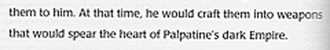
Our notes: `notes/materials/027-new-essential-chronology/02-part-two-fall-of-the-republic.md:528`

> Their father was Anakin Skywalker, one of the most powerful Jedi Knights in history, whose dark actions under the name Darth Vader nearly brought an end to that order.
— Source: Part Four: Profiles in History.
Note (our notes, around the quote): Luke Skywalker; Leia Organa Solo; Darth Vader (Anakin Skywalker) — Skywalker lineage: "Their father was Anakin Skywalker, one of the most powerful Jedi Knights in history, whose dark actions under the name Darth Vader nearly brought an end to that order." Source: The New Essential Chronology, p.104
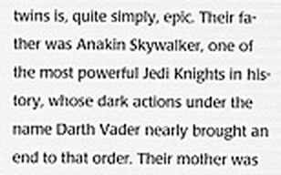
Our notes: `notes/materials/027-new-essential-chronology/04-part-four-profiles-in-history.md:119`

> Both infants were amazingly strong in the Force.
— Source: Part Four: Profiles in History; Luke Skywalker; Leia Organa Solo — amazingly strong in the Force.
Note (our notes, around the quote): Luke Skywalker; Leia Organa Solo — amazingly strong in the Force: "Both infants were amazingly strong in the Force." Source: The New Essential Chronology, p.104
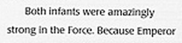
Our notes: `notes/materials/027-new-essential-chronology/04-part-four-profiles-in-history.md:121`

- Note (summary from our notes, not a quotation): Luke Skywalker — art caption: "Luke Skywalker" Source: The New Essential Chronology, p.104, caption
  — Source: Part Four: Profiles in History.
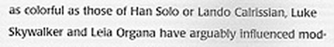
Our notes: `notes/materials/027-new-essential-chronology/04-part-four-profiles-in-history.md:123`

> As Obi-Wan had hoped, Luke possessed an astonishing natural talent, indicating that he had inherited the bloodline of the Chosen One.
— Source: Part Five: The Galactic Civil War; Luke Skywalker; Obi-Wan Kenobi — astonishing natural talent.
Note (our notes, around the quote): Luke Skywalker; Obi-Wan Kenobi — astonishing natural talent: "As Obi-Wan had hoped, Luke possessed an astonishing natural talent, indicating that he had inherited the bloodline of the Chosen One." Source: The New Essential Chronology, p.109
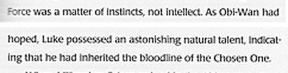
Our notes: `notes/materials/027-new-essential-chronology/05-part-five-galactic-civil-war.md:34`

> If a small ship were to or the bounty hunter Valance could extract a confession. fly into a surface trench and launch a proton torpedo into a Through the torture of another informant, Vader finally got | tiny thermal exhaust port, the torpedo could reach the hyper- the confirmation he sought—the Death Star's destroyer was matter core and annihilate the battle station in a catastrophic Luke Skywalker, Vader's own son. chain reaction.
>
> As the Death Star orbited into a firing position to destroy with the design flaw that had allowed the Rebels to an- the jungke moon, swarms of Rebel X-wings and Y-wings nihilate his Death Star. He summoned Bevel Lemelisk, the attacked like stinging Insects. Many Rebels died In the Battle of Yavin, but one pilot-Luke Skywalker, using his newfound skills with the Force=scored a direct hit. The Death Star exploded, killing Grand Moff Tarkin and eliminat- ing the Empire's ultimate weapon that had taken nearly twenty years to build.
>
> It was an enormous victory for the Rebel Alliance.
>
> IMPACT AND CONSEQUENCES 0-0.5 AB.Y. n his modified TIE fighter, Darth Vader escaped the destruction of the Death Star.
— Source: Part Five: The Galactic Civil War; Luke Skywalker; Grand Moff Tarkin — Battle of Yavin.
(Excerpt widened 2026-11-17 to the relevant passage, word for word from research primary new essential chronology nec paged (text copy `research_primary_new_essential_chronology_nec_paged_txt_88b808b5bc`).)
(Excerpt widened 2026-11-17 to the relevant passage, word for word from research primary new essential chronology nec paged (text copy `research_primary_new_essential_chronology_nec_paged_txt_88b808b5bc`).)
(Full sentence/passage taken from the source text on file: `research_primary_new_essential_chronology_nec_paged_txt`.)
Note (our notes, around the quote): Luke Skywalker; Grand Moff Tarkin — Battle of Yavin: "one pilot—Luke Skywalker, using his newfound skills with the Force—scored a direct hit. The Death Star exploded, killing Grand Moff Tarkin" Source: The New Essential Chronology, p.110
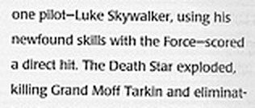
Our notes: `notes/materials/027-new-essential-chronology/05-part-five-galactic-civil-war.md:45`

> During the battle, he had sensed that the pilot who destroyed the station had shown unusual strength in the Force.
— Source: Part Five: The Galactic Civil War.
Note (our notes, around the quote): Darth Vader (Anakin Skywalker); Luke Skywalker — unusual strength in the Force: "During the battle, he had sensed that the pilot who destroyed the station had shown unusual strength in the Force." Source: The New Essential Chronology, p.110
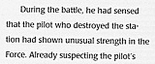
Our notes: `notes/materials/027-new-essential-chronology/05-part-five-galactic-civil-war.md:49`

> Not long after, while returning from a different mission, Skywalker eluded Imperial pursuit by plung- ing his ship into the slipstream of a passing hypercomet in an tsolated system. Following the comet's tra- Jectory along an asterold-filled orbit, Skywalker crashed on a forgotten, frozen planet named Hoth. There, he encountered an exiled Imperial governor who had made a primitive home in the Ke fields, Skywalker killed the treacherous governor in self-defense, and then reported to the Alliance, suggesting Hoth as @ possible location for their next headquarters stronghold The Rebellion desperately needed = Darth Vader to relocate, and fast-if the Executor” managed to wipe out the Yavin base, they woukl lose thelr emerging nudeus of top star pilots. Luke IMPERIAL COUNTERSTRIKE Skywalker had teamed with Wedge Antlles, a fellow veteran 0.52 A.B.Y. of the Death Star battle, to form a group of X-wing fliers that ™) “he blockade situation began to enrage local fleet com would ullimately become Rogue Squadron. The existence of the manders, who impressed upon Vader the need for Rogues helped offset the loss that the Alliance had suffered on @ qukk and decisive strike. Consequently, the Executor’s the same day as the Battle of Yavin, when several starfighter construction was stepped up.
— Source: Part Five: The Galactic Civil War; Luke Skywalker — Luke kills the Hoth governor.
(Excerpt widened 2026-11-17 to the relevant passage, word for word from research primary new essential chronology nec paged (text copy `research_primary_new_essential_chronology_nec_paged_txt_88b808b5bc`).)
(Excerpt widened 2026-11-17 to the relevant passage, word for word from research primary new essential chronology nec paged (text copy `research_primary_new_essential_chronology_nec_paged_txt_88b808b5bc`).)
(Full sentence/passage taken from the source text on file: `research_primary_new_essential_chronology_nec_paged_txt`.)
Note (our notes, around the quote): Luke Skywalker — Luke kills the Hoth governor: "Skywalker killed the treacherous governor in self-defense" Source: The New Essential Chronology, p.114
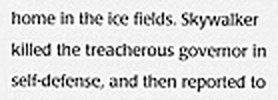
Our notes: `notes/materials/027-new-essential-chronology/05-part-five-galactic-civil-war.md:79`

> The temple held the fabled Kaiburr Crystal, a luminous shard capable of magnifying the Force a thousandfold.
— Source: Part Five: The Galactic Civil War; Luke Skywalker — Kaiburr Crystal.
Note (our notes, around the quote): Luke Skywalker — Kaiburr Crystal: "The temple held the fabled Kaiburr Crystal, a luminous shard capable of magnifying the Force a thousandfold." Source: The New Essential Chronology, p.116
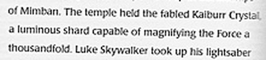
Our notes: `notes/materials/027-new-essential-chronology/05-part-five-galactic-civil-war.md:95`

> It is interesting to note that Skywalker, still an untrained Jedi, held his own against his much more experienced opponent. Possibly, the Kaiburr Crystal provided an edge, but Luke later admitted that the spirit of Obi-Wan Kenobi appeared to have inhabited his body, guiding his actions as a puppeteer directs a marionette.
— Source: Part Five: The Galactic Civil War.
Note (our notes, around the quote): Luke Skywalker; Darth Vader (Anakin Skywalker); Obi-Wan Kenobi — Mimban duel: "It is interesting to note that Skywalker, still an untrained Jedi, held his own against his much more experienced opponent. Possibly, the Kaiburr Crystal provided an edge, but Luke later admitted that the spirit of Obi-Wan Kenobi appeared to have inhabited his body, guiding his actions as a puppeteer directs a marionette." Source: The New Essential Chronology, p.116
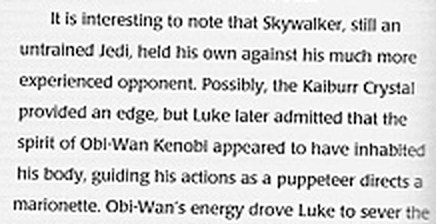
Our notes: `notes/materials/027-new-essential-chronology/05-part-five-galactic-civil-war.md:97`

> Obi-Wan's energy drove Luke to sever the Dark Lord's sword arm in a furious drive, but the effort seemed to exhaust Luke's intangible benefactor. Darth Vader shrugged off his injury, and only Vader's chance misstep into a crumbling well allowed Luke and Leia to escape.
— Source: Part Five: The Galactic Civil War; Luke Skywalker; Darth Vader (Anakin Skywalker) — Luke severs Vader's arm.
Note (our notes, around the quote): Luke Skywalker; Darth Vader (Anakin Skywalker) — Luke severs Vader's arm: "Obi-Wan's energy drove Luke to sever the Dark Lord's sword arm in a furious drive, but the effort seemed to exhaust Luke's intangible benefactor. Darth Vader shrugged off his injury, and only Vader's chance misstep into a crumbling well allowed Luke and Leia to escape." Source: The New Essential Chronology, p.116
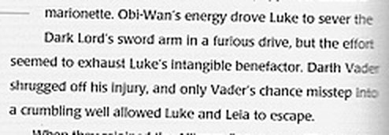
Our notes: `notes/materials/027-new-essential-chronology/05-part-five-galactic-civil-war.md:99`

> Darth Vader confronts Luke Skywalker in the jungles of Mimban.
— Source: Part Five: The Galactic Civil War; Luke Skywalker; Darth Vader (Anakin Skywalker) — art caption.
Note (our notes, around the quote): Luke Skywalker; Darth Vader (Anakin Skywalker) — art caption: "Darth Vader confronts Luke Skywalker in the jungles of Mimban." Source: The New Essential Chronology, p.116, caption
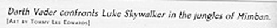
Our notes: `notes/materials/027-new-essential-chronology/05-part-five-galactic-civil-war.md:101`

> Eventually he used it as a teaching aid and even experimented by installing it as a focusing crystal in a lightsaber. He found the resulting blade to be remarkably strong and energy-efficient.
— Source: Part Five: The Galactic Civil War; Luke Skywalker — Kaiburr Crystal lightsaber.
Note (our notes, around the quote): Luke Skywalker — Kaiburr Crystal lightsaber: "Eventually he used it as a teaching aid and even experimented by installing it as a focusing crystal in a lightsaber. He found the resulting blade to be remarkably strong and energy-efficient." Source: The New Essential Chronology, p.117
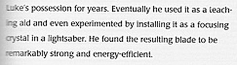
Our notes: `notes/materials/027-new-essential-chronology/05-part-five-galactic-civil-war.md:110`

> On Cloud City, he met up again with Lando Cal- tissian, former owner of the Falcon and now a respectaite businessman. Though they had had their disagreements in the past, most notably over the aftermath of Ylesia, Han still considered Lando a friend and requested his assistance In getting repairs for his ship.
>
> Unknown to Han or his passengers, Boba Fett had tracked the Fokon to Cloud City and betrayed the ship's lo- cation to Vader. Darth Vader coerced Lando into setting a trap for Han and Lela, and the two Rebel fugitives became prisoners In Goud Gty’s detention cells. Vader ordered the torture of Han Solo and Chewbacca, to no apparent purpose.
>
> In truth, he meant to stir the Force with the agony of Luke Skywalker's friends, and lure his true prize to Cloud City.
>
> A New Jeor 3 ABY. fter flying a snowspeeder alongside Wedge Antilles Avo the Battle of Hoth, Luke escaped the ice planet to follow a vision he had received from Obi-Wan Kenobi.
>
> Days earlier, while lost in a Hoth blizzard and bleeding from a wampa attack, Luke had been told to go to the Dagobab system and lear from a Jedi Master named Yoda, Luke flew: his X-wing to the coordinates laid out by R2-D2, crashlane Ing his starfighter in a swampy bog.
— Source: Part Five: The Galactic Civil War.
(Excerpt widened 2026-11-17 to the relevant passage, word for word from research primary new essential chronology nec paged (text copy `research_primary_new_essential_chronology_nec_paged_txt_88b808b5bc`).)
(Excerpt widened 2026-11-17 to the relevant passage, word for word from research primary new essential chronology nec paged (text copy `research_primary_new_essential_chronology_nec_paged_txt_88b808b5bc`).)
Note (our notes, around the quote): Darth Vader (Anakin Skywalker); Luke Skywalker — stirring the Force with agony: "In truth, he meant to stir the Force with the agony of Luke Skywalker's friends, and lure his true prize to Cloud City." Source: The New Essential Chronology, p.118
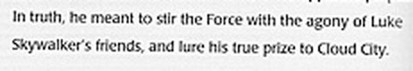
Our notes: `notes/materials/027-new-essential-chronology/05-part-five-galactic-civil-war.md:123`

> In truth, he meant to stir the Force with the agony of Luke Skywalker's friends, and lure his true prize to Cloud City.
>
> A New Jeor 3 ABY. fter flying a snowspeeder alongside Wedge Antilles Avo the Battle of Hoth, Luke escaped the ice planet to follow a vision he had received from Obi-Wan Kenobi.
>
> Days earlier, while lost in a Hoth blizzard and bleeding from a wampa attack, Luke had been told to go to the Dagobab system and lear from a Jedi Master named Yoda, Luke flew: his X-wing to the coordinates laid out by R2-D2, crashlane Ing his starfighter in a swampy bog.
>
> AT-ATs overrun Rebel Irenches in the Batlle of Hoth.
>
> [Aur an Teanee tat Lomaens) === PDF p.129 === === PDF p.130 === Jedi Master Yoos (Ast oy Mere Comnnioy Luke could not believe that the unassuming and gnomish «creature Who grected him couks possibly be a great wartior.
>
> Yoda, who had always believed that the Force would one day guide the offspring of Anakin Skywalker to him, had been waiting for this moment for more than two decades.
>
> Yoda, who had always believed that the Force would one day guide the offspring of Anakin Skywalker to him, had been waiting for this moment for more than two decades. He agreed to train the doubting youth in the ways of the Jedi, and to forge him into a weapon that could at last destroy the Sith. Yoda warned his pupil that upcoming decisions would be difficult, and that he must be strong. Luke Spent many long and discouraging days testing himsel in the Foxce, attempting to meet the Strange and seemingly Impossible challenges that Yoda gave him.
— Source: Part Five: The Galactic Civil War; Yoda; Luke Skywalker — Yoda's plan.
(Excerpt widened 2026-11-17 to the relevant passage, word for word from research primary new essential chronology nec paged (text copy `research_primary_new_essential_chronology_nec_paged_txt_88b808b5bc`).)
(Excerpt widened 2026-11-17 to the relevant passage, word for word from research primary new essential chronology nec paged (text copy `research_primary_new_essential_chronology_nec_paged_txt_88b808b5bc`).)
Note (our notes, around the quote): Yoda; Luke Skywalker — Yoda's plan: "He agreed to train the doubting youth in the ways of the Jedi, and to forge him into a weapon that could at last destroy the Sith." Source: The New Essential Chronology, p.120
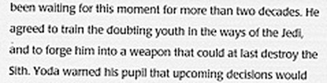
Our notes: `notes/materials/027-new-essential-chronology/05-part-five-galactic-civil-war.md:137`

> Darth Vader mercilessly hacked off Luke's right hand.
— Source: Part Five: The Galactic Civil War; Darth Vader (Anakin Skywalker); Luke Skywalker — Bespin.
Note (our notes, around the quote): Darth Vader (Anakin Skywalker); Luke Skywalker — Bespin: "Darth Vader mercilessly hacked off Luke's right hand." Source: The New Essential Chronology, p.121
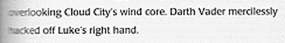
Our notes: `notes/materials/027-new-essential-chronology/05-part-five-galactic-civil-war.md:146`

> Shira survived the ordeal, and Vader rebuilt her body with cybernetic parts. Shira Brie became the Dark Lady Lumiya, disciple of the Sith.
— Source: Part Five: The Galactic Civil War; Luke Skywalker; Darth Vader (Anakin Skywalker) — Shira Brie becomes Lumiya.
Note (our notes, around the quote): Luke Skywalker; Darth Vader (Anakin Skywalker) — Shira Brie becomes Lumiya: "Shira survived the ordeal, and Vader rebuilt her body with cybernetic parts. Shira Brie became the Dark Lady Lumiya, disciple of the Sith." Source: The New Essential Chronology, p.121
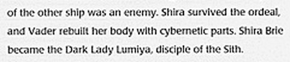
Our notes: `notes/materials/027-new-essential-chronology/05-part-five-galactic-civil-war.md:148`

> but the rookie Jedi Knight decimated the Hutt's entourage with ease. Leia strangled Jabba, leading to the collapse of the Desilijic crime family.
> [fragment — full passage not on file]
— Source: Part Five: The Galactic Civil War; Luke Skywalker — Jabba's sail barge.
Note (our notes, around the quote): Luke Skywalker — Jabba's sail barge: "but the rookie Jedi Knight decimated the Hutt's entourage with ease. Leia strangled Jabba, leading to the collapse of the Desilijic crime family." Source: The New Essential Chronology, p.123
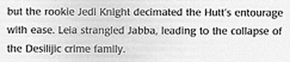
Our notes: `notes/materials/027-new-essential-chronology/05-part-five-galactic-civil-war.md:170`

> Knight decimated the Hutt’s entourage with ease. Leia strangled Jabba, leading to the collapse of the Desilijic aime family.
>
> (123 === PDF p.134 === Admiral Ackbar (Ant ny Mane Coastico} Leia, Lando, and a thawed Han Solo rejoined the Rebel fleet In preparation for a major strike against the Empire, Luke Skywalker returned to Dagobah to continue his training unger Yoda. When he arrived, however, he found the nine- hundred-year-old Jogi Master near death, Yoda said his fare- wells, and at last confirmed the truth that Darth Vader was Indeed Luke's father. The spirit of Obi-Wan Kenobi revealed another startling fact, telling Luke that Princess Lela Organa was his sister, Obi-Wan urged him to destroy Vader, calling the Dark Lord “more machine than man,’ but Luke couldn't entertain the thought of killing the man who had once been Anakin Skywalker, his father. Reeling from the information and from the death of Yoda, Luke retumed to the fleet.
>
> On the Rebel flagship out in open space, Alliance leader Mon Mothma addressed the troop leaders and explained the Rebellion’s latest plan. Bothan sples had delivered the =~ 124 } 4 decrypted computer core from Kothlis, containing the details of the second Death Star's construction site around the green moon of Endor.
— Source: Part Five: The Galactic Civil War.
(Excerpt widened 2026-11-17 to the relevant passage, word for word from research primary new essential chronology nec paged (text copy `research_primary_new_essential_chronology_nec_paged_txt_88b808b5bc`).)
(Excerpt widened 2026-11-17 to the relevant passage, word for word from research primary new essential chronology nec paged (text copy `research_primary_new_essential_chronology_nec_paged_txt_88b808b5bc`).)
(Full sentence/passage taken from the source text on file: `research_primary_new_essential_chronology_nec_paged_txt`.)
Note (our notes, around the quote): Yoda; Obi-Wan Kenobi; Darth Vader (Anakin Skywalker); Luke Skywalker — more machine than man: "Obi-Wan urged him to destroy Vader, calling the Dark Lord "more machine than man," but Luke couldn't entertain the thought of killing the man who had once been Anakin Skywalker, his father." Source: The New Essential Chronology, p.124
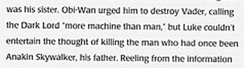
Our notes: `notes/materials/027-new-essential-chronology/05-part-five-galactic-civil-war.md:179`

> His fury gave him the strength to severely wound his father and cut off Vader's sword hand. Seeing Skywalker's raw emotion, the Emperor applauded, pleased to see him take the first steps toward the dark side.
— Source: Part Five: The Galactic Civil War.
Note (our notes, around the quote): Luke Skywalker; Darth Vader (Anakin Skywalker); Palpatine (Darth Sidious) — Luke's fury at Endor: "His fury gave him the strength to severely wound his father and cut off Vader's sword hand. Seeing Skywalker's raw emotion, the Emperor applauded, pleased to see him take the first steps toward the dark side." Source: The New Essential Chronology, p.126
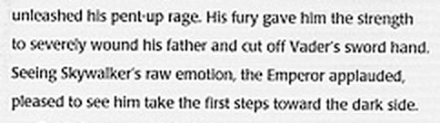
Our notes: `notes/materials/027-new-essential-chronology/05-part-five-galactic-civil-war.md:195`

> A livid Palpatine then used his own dark powers to attack, searing Luke with blasts of blue lightning. As he watched the agony of his son and the Emperor's glee, Vader finally broke the hold of evil that had suffocated him for so long. Vader grabbed the energy-seething Palpatine and hurled him into the Death Star reactor shaft, where the evil leader was disintegrated. The shock waves of dark power mortally wounded Vader
> [fragment — full passage not on file]
— Source: Part Five: The Galactic Civil War.
Note (our notes, around the quote): Palpatine (Darth Sidious); Darth Vader (Anakin Skywalker); Luke Skywalker — Palpatine's lightning and death: "A livid Palpatine then used his own dark powers to attack, searing Luke with blasts of blue lightning. As he watched the agony of his son and the Emperor's glee, Vader finally broke the hold of evil that had suffocated him for so long. Vader grabbed the energy-seething Palpatine and hurled him into the Death Star reactor shaft, where the evil leader was disintegrated. The shock waves of dark power mortally wounded Vader" Source: The New Essential Chronology, p.126
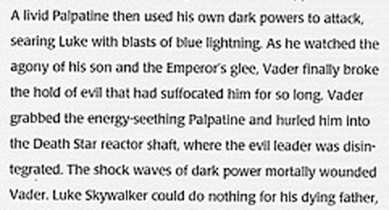
Our notes: `notes/materials/027-new-essential-chronology/05-part-five-galactic-civil-war.md:197`

> The Ssi-ruuk hoped this powerful Jedi would be capable of enteching victims from great distances, sucking their life-energies from afar.
— Source: Part Five: The Galactic Civil War; Luke Skywalker — Ssi-ruuk want Luke's power.
Note (our notes, around the quote): Luke Skywalker — Ssi-ruuk want Luke's power: "The Ssi-ruuk hoped this powerful Jedi would be capable of enteching victims from great distances, sucking their life-energies from afar." Source: The New Essential Chronology, p.128
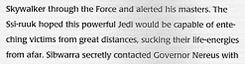
Our notes: `notes/materials/027-new-essential-chronology/05-part-five-galactic-civil-war.md:213`

> With the Ssi-ruuk gone, he ordered his fleet to open fire on their ostensible allies. The Rebel flagship and many other ships were de- stroyed by Nereus’s treachery. The surviving Rebel fighters were caught in a bottleneck with no hope of escape. General Solo grimly lined up a sukidal “carom shot’ in which the Fal- con would ram a small Imperial patrol craft, ricocheting the 128 patrol craft into the Imperial command ship's main genera- tor. Success meant escape for the Rebel fleet, but death for everyone aboard the Falcon, The enemy craft, however, broke formation to strike at the Shriwirr. The Falcon aborted Its carom shot, and instead rescued Luke Skywalker and Dev Sibwarra from the dam: aged Shriwirr. Luke had already sensed the presence of the Olabrian larval parasites in his bronchial tubes and used the Force to eliminate the threat.
>
> The Rebel fleet rallied from near disaster. Commander Pter Thanas, leader of the Imperial defense force, surren: dered.
— Source: Part Five: The Galactic Civil War; Luke Skywalker — Luke purges the larvae.
(Excerpt widened 2026-11-17 to the relevant passage, word for word from research primary new essential chronology nec paged (text copy `research_primary_new_essential_chronology_nec_paged_txt_88b808b5bc`).)
(Excerpt widened 2026-11-17 to the relevant passage, word for word from research primary new essential chronology nec paged (text copy `research_primary_new_essential_chronology_nec_paged_txt_88b808b5bc`).)
Note (our notes, around the quote): Luke Skywalker — Luke purges the larvae: "Luke had already sensed the presence of the Olabrian larval parasites in his bronchial tubes and used the Force to eliminate the threat." Source: The New Essential Chronology, p.128
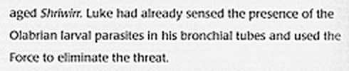
Our notes: `notes/materials/027-new-essential-chronology/05-part-five-galactic-civil-war.md:215`

> But Luke vowed to find more Force-sensitive candidates and eventually restore the order of Jedi Knights.
— Source: Part Five: The Galactic Civil War; Luke Skywalker — vow to restore the Jedi.
Note (our notes, around the quote): Luke Skywalker — vow to restore the Jedi: "But Luke vowed to find more Force-sensitive candidates and eventually restore the order of Jedi Knights." Source: The New Essential Chronology, p.128
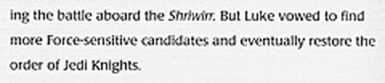
Our notes: `notes/materials/027-new-essential-chronology/05-part-five-galactic-civil-war.md:219`

> General Skywalker challenges Lord Shadowspawn's troops on Mindor.
— Source: Part Six: Birth of the New Republic; Luke Skywalker — art caption.
Note (our notes, around the quote): Luke Skywalker — art caption: "General Skywalker challenges Lord Shadowspawn's troops on Mindor." Source: The New Essential Chronology, p.134, caption
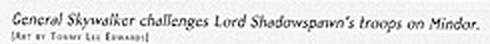
Our notes: `notes/materials/027-new-essential-chronology/06-part-six-birth-of-the-new-republic.md:43`

> Finally, Luke Skywalker's superior X-wing tactics forced the Imperials' surrender.
— Source: Part Six: Birth of the New Republic; Luke Skywalker — Milagro.
Note (our notes, around the quote): Luke Skywalker — Milagro: "Finally, Luke Skywalker's superior X-wing tactics forced the Imperials' surrender." Source: The New Essential Chronology, p.136
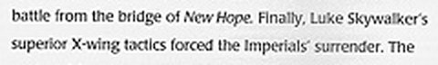
Our notes: `notes/materials/027-new-essential-chronology/06-part-six-birth-of-the-new-republic.md:55`

> Mara revealed that she had once been an Emperor's Hand in the service of Palpatine, and since Luke was indirectly responsible for the Emperor's death, she had vowed to kill him.
— Source: Part Seven: Empire Resurgent; Mara Jade Skywalker; Luke Skywalker — Mara's vow.
Note (our notes, around the quote): Mara Jade Skywalker; Luke Skywalker — Mara's vow: "Mara revealed that she had once been an Emperor's Hand in the service of Palpatine, and since Luke was indirectly responsible for the Emperor's death, she had vowed to kill him." Source: The New Essential Chronology, p.150
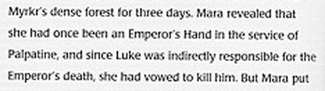
Our notes: `notes/materials/027-new-essential-chronology/07-part-seven-empire-resurgent.md:31`

> Admiral Ackbar was reinstated as fleet commander, the finandal scandal having been revealed as an Imperial setup.
>
> On Coruscant, Leia Organa Solo gave birth to twins, a boy and a girl—Jacen and Jaina-who were to join the new gen- eration of Jedi Knights.
>
> _ Because she had been an Emperor's Hand, Mara Jaxie had known many of Palpatine’s srets—inciuding the location of the Mount Tantiss Goning fadiity on Wayland. Mara ki Luke Skywalker, Han Solo, Chewbacca, Lando Calrissian, and their droids to Wayland to destray Thrawn’s ready-made soldier fac tory. Upon reaching Mount Tantiss, Luke and Mara headed for the Emperor's throne room. Waiting for them on the throne, Ike an arachnid at the center of Its web, was Joruus Cbaoth, The demented Jedi Master was easily a match for both Skywalker and Jade combined. While he toyed with them, he unleashed a shocking surprise: Cbaoth had grown a special clone from Skywalker's own genetic material, taken from the hand Luke had lost at Cloud City, The mindless drone, Luuke Skywalker, was his exact duplicate.
>
> The cone had a lightsaber as well-the blue-bladed saber that had once belonged to Anakin Skywalker, a weapon that had been considered lost since the agic events in Goud City.
— Source: Part Seven: Empire Resurgent.
(Excerpt widened 2026-11-17 to the relevant passage, word for word from research primary new essential chronology nec paged (text copy `research_primary_new_essential_chronology_nec_paged_txt_88b808b5bc`).)
(Excerpt widened 2026-11-17 to the relevant passage, word for word from research primary new essential chronology nec paged (text copy `research_primary_new_essential_chronology_nec_paged_txt_88b808b5bc`).)
Note (our notes, around the quote): Joruus C'baoth; Luke Skywalker; Mara Jade Skywalker — C'baoth a match for both: "The demented Jedi Master was easily a match for both Skywalker and Jade combined." Source: The New Essential Chronology, p.152
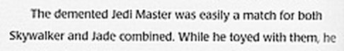
Our notes: `notes/materials/027-new-essential-chronology/07-part-seven-empire-resurgent.md:51`

> The doubles squared off in a frenzied duel. Though she had often expressed her desire to murder the man who had brought about the Emperor's death, Mara Jade ended the combat by killing the Luke clone. C'baoth, in a fit of rage, collapsed the chamber's ceiling, but Mara skewered him cleanly through the torso.
— Source: Part Seven: Empire Resurgent.
Note (our notes, around the quote): Mara Jade Skywalker; Luke Skywalker; Joruus C'baoth — Mara kills Luuke and C'baoth: "The doubles squared off in a frenzied duel. Though she had often expressed her desire to murder the man who had brought about the Emperor's death, Mara Jade ended the combat by killing the Luke clone. C'baoth, in a fit of rage, collapsed the chamber's ceiling, but Mara skewered him cleanly through the torso." Source: The New Essential Chronology, p.152
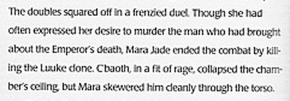
Our notes: `notes/materials/027-new-essential-chronology/07-part-seven-empire-resurgent.md:53`

> The brief but bloody struggle, known as the Imperial Mutiny, Involved the ruling council, the Moffs, the fleet, the Inquisitorius, COMPNOR, and the Imperial Security Bureau, each trying to claim the whole sabacc pot at the expense of the others. The New Republic selzed this chance to create confusion among the feuding Imperials, using two captured Star Destroyers to conduct hit-and-run sorties Into the war Zones. Longtime Alliance hero Wedge Antilles was promoted to general, while other old warriors, incfuding Han Solo and Lando Calrissian, reactivated thelr commissions and returned to the military. In one such raid over the battleground of Coruscant, the Alllance Star Destroyer Liberator, commanded by Luke Skywalker, Wedge Antilles, and Lando Calrissian, crashed Into the planet's surface. Lela Organa Solo and her husband led a mission to rescue their comrades.
>
> Taking Mivennium Faicon into the heart of the battle zone, they found Antilles and Calrissian barricaded In and fighting for their lives. Then, with a swirl of Force, Jedi Luke Skywalker strode into the fray and single-handedly defeated an AT-AT walker.
>
> Taking Mivennium Faicon into the heart of the battle zone, they found Antilles and Calrissian barricaded In and fighting for their lives. Then, with a swirl of Force, Jedi Luke Skywalker strode into the fray and single-handedly defeated an AT-AT walker. Luke had sensed an evil power reaching out to him, and wamed his companions to stay back. A Force storm opened a hole in space, dragging Luke and R2-D2 into it.
— Source: Part Seven: Empire Resurgent; Luke Skywalker — Luke defeats an AT-AT.
(Excerpt widened 2026-11-17 to the relevant passage, word for word from research primary new essential chronology nec paged (text copy `research_primary_new_essential_chronology_nec_paged_txt_88b808b5bc`).)
(Excerpt widened 2026-11-17 to the relevant passage, word for word from research primary new essential chronology nec paged (text copy `research_primary_new_essential_chronology_nec_paged_txt_88b808b5bc`).)
Note (our notes, around the quote): Luke Skywalker — Luke defeats an AT-AT: "Then, with a swirl of Force, Jedi Luke Skywalker strode into the fray and single-handedly defeated an AT-AT walker." Source: The New Essential Chronology, p.155
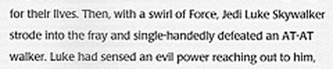
Our notes: `notes/materials/027-new-essential-chronology/07-part-seven-empire-resurgent.md:82`

> Believing that he could destroy the dark side from within, Luke agreed to join Palpatine as the Emperor's new apprentice.
— Source: Part Seven: Empire Resurgent; Luke Skywalker; Palpatine (Darth Sidious) — Luke becomes the Emperor's apprentice.
Note (our notes, around the quote): Luke Skywalker; Palpatine (Darth Sidious) — Luke becomes the Emperor's apprentice: "Believing that he could destroy the dark side from within, Luke agreed to join Palpatine as the Emperor's new apprentice." Source: The New Essential Chronology, p.156
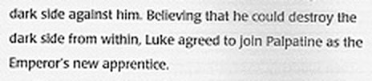
Our notes: `notes/materials/027-new-essential-chronology/07-part-seven-empire-resurgent.md:91`

> Filled with dark side power, the reborn Emperor engaged Skywalker in a ferocious lightsaber duel and forced the Jedi Knight into submission.
— Source: Part Seven: Empire Resurgent; Palpatine (Darth Sidious); Luke Skywalker — reborn Emperor defeats Luke.
Note (our notes, around the quote): Palpatine (Darth Sidious); Luke Skywalker — reborn Emperor defeats Luke: "Filled with dark side power, the reborn Emperor engaged Skywalker in a ferocious lightsaber duel and forced the Jedi Knight into submission." Source: The New Essential Chronology, p.157
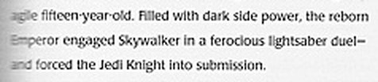
Our notes: `notes/materials/027-new-essential-chronology/07-part-seven-empire-resurgent.md:102`

> The desperate Emperor summoned up a huge Force storm, but he could no longer control what he had unleashed. As brother and sister fled, the conflagration consumed the gigantic black ship and, presumably, all that remained of the Emperor.
— Source: Part Seven: Empire Resurgent.
Note (our notes, around the quote): Palpatine (Darth Sidious); Leia Organa Solo; Luke Skywalker — Force storm consumes Eclipse: "The desperate Emperor summoned up a huge Force storm, but he could no longer control what he had unleashed. As brother and sister fled, the conflagration consumed the gigantic black ship and, presumably, all that remained of the Emperor." Source: The New Essential Chronology, p.157
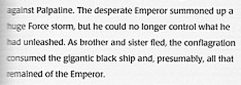
Our notes: `notes/materials/027-new-essential-chronology/07-part-seven-empire-resurgent.md:104`

> Solusar faced Skywalker in an ancient and risky Jedi game called lightsider. After Skywalker bested him, Solusar agreed to join the Jedi.
— Source: Part Seven: Empire Resurgent; Kam Solusar; Luke Skywalker — lightsider.
Note (our notes, around the quote): Kam Solusar; Luke Skywalker — lightsider: "Solusar faced Skywalker in an ancient and risky Jedi game called lightsider. After Skywalker bested him, Solusar agreed to join the Jedi." Source: The New Essential Chronology, p.157
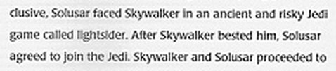
Our notes: `notes/materials/027-new-essential-chronology/07-part-seven-empire-resurgent.md:106`

> Luke tried to take Palpatine alive—but Han Solo shot the old man with his blaster.
— Source: Part Seven: Empire Resurgent; Han Solo; Palpatine (Darth Sidious); Luke Skywalker — Han shoots Palpatine.
Note (our notes, around the quote): Han Solo; Palpatine (Darth Sidious); Luke Skywalker — Han shoots Palpatine: "Luke tried to take Palpatine alive—but Han Solo shot the old man with his blaster." Source: The New Essential Chronology, p.158
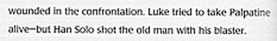
Our notes: `notes/materials/027-new-essential-chronology/07-part-seven-empire-resurgent.md:119`

> He knew that his sister Leia, her three children, Kam Solusar, the Witches of Dathomir, Kyle Katarn, and Mara Jade had all exhibited an aptitude for the Force.
— Source: Part Eight: The Return of the Jedi Knights; Luke Skywalker — academy recruits. POV: speaker not named in our notes.
Note (our notes, around the quote): Luke Skywalker — academy recruits: "He knew that his sister Leia, her three children, Kam Solusar, the Witches of Dathomir, Kyle Katarn, and Mara Jade had all exhibited an aptitude for the Force." Source: The New Essential Chronology, p.162
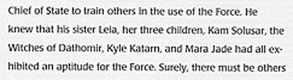
Our notes: `notes/materials/027-new-essential-chronology/08-part-eight-return-of-the-jedi-knights.md:11`

> Luke went to the volcanic planet Eol Sha, where he found a fiery-tempered leader named Gantoris. Next, he tracked down the cloud prospector Streen, living as a hermit in an abandoned floating city on Bespin.
— Source: Part Eight: The Return of the Jedi Knights; Gantoris; Streen; Luke Skywalker — Gantoris and Streen. POV: speaker not named in our notes.
Note (our notes, around the quote): Gantoris; Streen; Luke Skywalker — Gantoris and Streen: "Luke went to the volcanic planet Eol Sha, where he found a fiery-tempered leader named Gantoris. Next, he tracked down the cloud prospector Streen, living as a hermit in an abandoned floating city on Bespin." Source: The New Essential Chronology, p.162
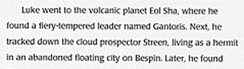
Our notes: `notes/materials/027-new-essential-chronology/08-part-eight-return-of-the-jedi-knights.md:13`

> Luke Skywalker and several members of his starting class at the Yavin 4 Jedi academy.
— Source: Part Eight: The Return of the Jedi Knights; Luke Skywalker — art caption. POV: speaker not named in our notes.
Note (our notes, around the quote): Luke Skywalker — art caption: "Luke Skywalker and several members of his starting class at the Yavin 4 Jedi academy." Source: The New Essential Chronology, p.162, caption
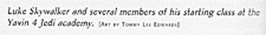
Our notes: `notes/materials/027-new-essential-chronology/08-part-eight-return-of-the-jedi-knights.md:19`

> Gantoris built his own lightsaber and challenged Master Skywalker to a duel. That night Gantoris was found burned to a crisp, consumed by a black fire within himself.
— Source: Part Eight: The Return of the Jedi Knights; Gantoris; Luke Skywalker — Gantoris's death. POV: speaker not named in our notes.
Note (our notes, around the quote): Gantoris; Luke Skywalker — Gantoris's death: "Gantoris built his own lightsaber and challenged Master Skywalker to a duel. That night Gantoris was found burned to a crisp, consumed by a black fire within himself." Source: The New Essential Chronology, p.164
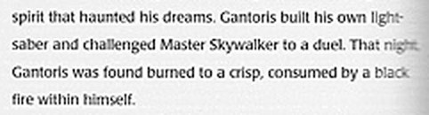
Our notes: `notes/materials/027-new-essential-chronology/08-part-eight-return-of-the-jedi-knights.md:35`

> Kyp took it upon himset to wipe out Admiral Daala’s renegade fleet. Still manipulates by Exar Kun, Durron stole a ship and flew off alone.
>
> The New Republic Senate had agreed to destroy the Sam === PDF p.175 === Crusher superweapon that they had recovered from Mew Installation, Their plan called for someone to de- posit the quantumarmored ship in the high-pressure heart of the gas giant Yavin. Wedge Antilles and Qui Xux sent the Sun Crusher into the swirling maelstrom, eaving Qui as the only person alive with knowledge of the Sun Crusher’s workings. But Kyp Durron tracked sown Xux on Ithor, using his newfound dark side pow: ers to wipe clean the weapons knowledge from her memory.
>
> Now set on his course of action, Kyp returned to Yavin 4. Standing alone atop the academy's Great Temple, he summoned the Sun Crusher from the mists of Yavin.
>
> Now set on his course of action, Kyp returned to Yavin 4. Standing alone atop the academy's Great Temple, he summoned the Sun Crusher from the mists of Yavin. Luke Skywalker confronted him in a titanic duel of Jedi powers, but the spirit of Exar Kun joined with Kyp to overwhelm Master Skywalker, leaving him for dead. The Jedi students found thelr Master's mo- Sonless body, showing no breathing, no heartbeat, and no response.
>
> Luke Skywalker confronted him in a titanic duel of Jedi powers, but the spirit of Exar Kun joined with Kyp to overwhelm Master Skywalker, leaving him for dead. The Jedi students found thelr Master's mo- Sonless body, showing no breathing, no heartbeat, and no response.
>
> Fleeing the scene, Kyp Durron piloted the Sun Crusher to the Cauldron Nebula, where Admiral Daala’s feet had hidden inside an ocean of coalescing gas. when Kyp triggered the supenweapon, a cluster of stars went supemova, obliterating the third ship from Daala’s original quartet of Star Destroyers. Kyp then reached Carida, the stormtrooper training center represented by Ambassador Furgan, Kyp issued an ultimatum: renounce the Empire or face complete destruction. When the planetary defenses mobilized instead of capitulating, Ourron fired at Carida’s sun, starting a chain reaction.
— Source: Part Eight: The Return of the Jedi Knights. POV: speaker not named in our notes.
(Excerpt widened 2026-11-17 to the relevant passage, word for word from research primary new essential chronology nec paged (text copy `research_primary_new_essential_chronology_nec_paged_txt_88b808b5bc`).)
(Excerpt widened 2026-11-17 to the relevant passage, word for word from research primary new essential chronology nec paged (text copy `research_primary_new_essential_chronology_nec_paged_txt_88b808b5bc`).)
Note (our notes, around the quote): Kyp Durron; Exar Kun; Luke Skywalker; Sun Crusher — Great Temple duel: "Standing alone atop the academy's Great Temple, he summoned the Sun Crusher from the mists of Yavin. Luke Skywalker confronted him in a titanic duel of Jedi powers, but the spirit of Exar Kun joined with Kyp to overwhelm Master Skywalker, leaving him for dead." Source: The New Essential Chronology, p.165
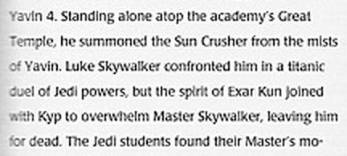
Our notes: `notes/materials/027-new-essential-chronology/08-part-eight-return-of-the-jedi-knights.md:48`

> In a final battle, fighting alongside the spirit-forms of Luke Skywalker and even the long-dead Jedi Master Vodo Siosk-Baas, the students vanquished Exar Kun for all time.
— Source: Part Eight: The Return of the Jedi Knights; Exar Kun; Luke Skywalker — Exar Kun vanquished. POV: speaker not named in our notes.
Note (our notes, around the quote): Exar Kun; Luke Skywalker — Exar Kun vanquished: "In a final battle, fighting alongside the spirit-forms of Luke Skywalker and even the long-dead Jedi Master Vodo Siosk-Baas, the students vanquished Exar Kun for all time." Source: The New Essential Chronology, p.165
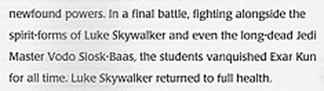
Our notes: `notes/materials/027-new-essential-chronology/08-part-eight-return-of-the-jedi-knights.md:52`

> The Eye slept for thirty years until Roganda Ismaren found it. While Irek Ismaren used his subelec- tronie converter to summon the ship, Jedl Master Luke Skywalker boarded the Eye in the Moonflower Nebula and was inadvertently carried along for the ride.
>
> Two of Luke's Jedi students—Cray Mingla and Nichos Marr—accompanied him, Both had recently Joined the Yavin 4 praxeum: Mingla was a brilliant com: puter programmer and showed much promise as a Jedi, but her lover Nichos Marr had been diagnosed with Callister fatal Quannot's syndrome. In order to preserve Marrs 168 life, Mingla had transferred his consciousness into the body of an amazingly life-tke droid, She had hoped to parallel the Sst-ruuvi “entechment’ method of hamessing lifeenergy, but instead it appeared that she had accomplished little more than programming a droid with a false set of memories.
>
> Trapped aboard the Eye, Luke and Cray Mingla were forcibly brainwashed by the ship's automated indoctrination equipment. Skywalker had the strength of mind to overcome the imprinting, but the other prisoners did not.
>
> Trapped aboard the Eye, Luke and Cray Mingla were forcibly brainwashed by the ship's automated indoctrination equipment. Skywalker had the strength of mind to overcome the imprinting, but the other prisoners did not. Eye of Paipo- tine had attempted to fulfill ts programming by picking up ils stormtrooper contingent=but after three decades, the Eye had settled for whatever warm bodles It found in the appro- priate places.
>
> [AAT ay deme Was Foerel === PDF p.179 === Two tribes of Gamorreans engaged In a full-scale dan war aboard the automated vessel. Talz, Kitonaks, Tusken Raiders, Affytechans, and other aliens almlessty roamed the halls, waiting for orders.
— Source: Part Eight: The Return of the Jedi Knights; Luke Skywalker — Luke resists the Eye. POV: speaker not named in our notes.
(Excerpt widened 2026-11-17 to the relevant passage, word for word from research primary new essential chronology nec paged (text copy `research_primary_new_essential_chronology_nec_paged_txt_88b808b5bc`).)
(Excerpt widened 2026-11-17 to the relevant passage, word for word from research primary new essential chronology nec paged (text copy `research_primary_new_essential_chronology_nec_paged_txt_88b808b5bc`).)
Note (our notes, around the quote): Luke Skywalker — Luke resists the Eye: "Skywalker had the strength of mind to overcome the imprinting, but the other prisoners did not." Source: The New Essential Chronology, p.168
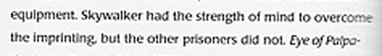
Our notes: `notes/materials/027-new-essential-chronology/08-part-eight-return-of-the-jedi-knights.md:81`

> Callista—someone whose strength in the Force was as great as his own—was a woman with whom he could spend the rest of his life.
— Source: Part Eight: The Return of the Jedi Knights; Luke Skywalker — Callista as strong as Luke. POV: speaker not named in our notes.
Note (our notes, around the quote): Luke Skywalker — Callista as strong as Luke: "Callista—someone whose strength in the Force was as great as his own—was a woman with whom he could spend the rest of his life." Source: The New Essential Chronology, p.169
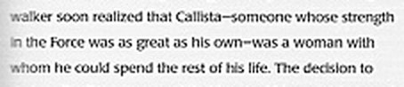
Our notes: `notes/materials/027-new-essential-chronology/08-part-eight-return-of-the-jedi-knights.md:90`

> Luke Skywalker's Jedi academy students take down a Juggernaut.
— Source: Part Eight: The Return of the Jedi Knights; Luke Skywalker — art caption. POV: speaker not named in our notes.
Note (our notes, around the quote): Luke Skywalker — art caption: "Luke Skywalker's Jedi academy students take down a Juggernaut." Source: The New Essential Chronology, p.173, caption
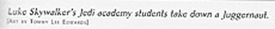
Our notes: `notes/materials/027-new-essential-chronology/08-part-eight-return-of-the-jedi-knights.md:126`

> In the atmosphere, Luke used the Force to convince the crystals of Nam Chorios of the danger the galaxy would face if Ashgad's plan succeeded.
— Source: Part Eight: The Return of the Jedi Knights; Luke Skywalker — Luke persuades the Chorian crystals. POV: speaker not named in our notes.
Note (our notes, around the quote): Luke Skywalker — Luke persuades the Chorian crystals: "In the atmosphere, Luke used the Force to convince the crystals of Nam Chorios of the danger the galaxy would face if Ashgad's plan succeeded." Source: The New Essential Chronology, p.175
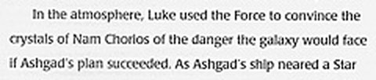
Our notes: `notes/materials/027-new-essential-chronology/08-part-eight-return-of-the-jedi-knights.md:140`

> He nearly fell into the dark vortex that led to Waru's home dimension, but broke the seductive spell and swam away from the swirling mass.
— Source: Part Nine: Uprisings and Insurgencies; Luke Skywalker — Luke escapes Waru.
Note (our notes, around the quote): Luke Skywalker — Luke escapes Waru: "He nearly fell into the dark vortex that led to Waru's home dimension, but broke the seductive spell and swam away from the swirling mass." Source: The New Essential Chronology, p.179
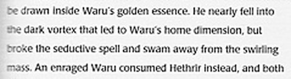
Our notes: `notes/materials/027-new-essential-chronology/09-part-nine-uprisings-and-insurgencies.md:31`

> The Force is a river from which many can drink, and the training of the Jedi is not the only cup which can catch it.
— Source: Part Nine: Uprisings and Insurgencies.
Note (our notes, around the quote): Luke Skywalker — Luke on the Force as a river: "As Luke Skywalker has said, "The Force is a river from which many can drink, and the training of the Jedi is not the only cup which can catch it."" Source: The New Essential Chronology, p.181
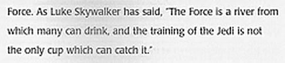
Our notes: `notes/materials/027-new-essential-chronology/09-part-nine-uprisings-and-insurgencies.md:49`

> Other groups, including the remnants of Pellaeon’s Emplre and the Deep Core warlords, began to reconskfer armed confiia against their old foe. To add more {uel to the fire, the Senate Passed a measure allowing former Imperial officals to hold elective office, The measure’s most vocal opponents predicted that ac mitting unrepentant Imperial loyalists into the Senate would cause the government to dissolve into partisan gridlock. The ex-Imperial Senators delighted in opposing Organa Solo st every tum. On the fifty-first day of the new term, when Or gana Solo stepped into the Senate Hall to address the body a tremendous explosion knocked her off her fect, The Chief of State survived with minor injuries, while dozens of Senators died instantly. Senate Hall was a ruin, dosed off to visitors as construction began on its replace- ment, the Grand Convocation Chamber.
>
> The bombing had been executed by Brakiss, a former Imperial spy who, years before, had unsuccessfully tried to infiltrate Luke Skywalker’s Jedi academy on Yavin 4. Brakes was in league with Dolph, a fallen Jedi trainee.
>
> The bombing had been executed by Brakiss, a former Imperial spy who, years before, had unsuccessfully tried to infiltrate Luke Skywalker’s Jedi academy on Yavin 4. Brakes was in league with Dolph, a fallen Jedi trainee. Dolph hac abandoned his training in order to fight the despotic Jehar regime on remote Almania.
— Source: Part Nine: Uprisings and Insurgencies; Brakiss; Luke Skywalker — Brakiss bombs the Senate.
(Excerpt widened 2026-11-17 to the relevant passage, word for word from research primary new essential chronology nec paged (text copy `research_primary_new_essential_chronology_nec_paged_txt_88b808b5bc`).)
(Excerpt widened 2026-11-17 to the relevant passage, word for word from research primary new essential chronology nec paged (text copy `research_primary_new_essential_chronology_nec_paged_txt_88b808b5bc`).)
Note (our notes, around the quote): Brakiss; Luke Skywalker — Brakiss bombs the Senate: "The bombing had been executed by Brakiss, a former Imperial spy who, years before, had unsuccessfully tried to infiltrate Luke Skywalker's Jedi academy on Yavin 4." Source: The New Essential Chronology, p.182
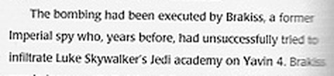
Our notes: `notes/materials/027-new-essential-chronology/09-part-nine-uprisings-and-insurgencies.md:56`

> Brakiss had fled the Jedi academy when Skywalker had forced Brakiss to confront the darkness in his soul.
— Source: Part Nine: Uprisings and Insurgencies; Brakiss; Luke Skywalker — Brakiss flees the academy.
Note (our notes, around the quote): Brakiss; Luke Skywalker — Brakiss flees the academy: "Brakiss had fled the Jedi academy when Skywalker had forced Brakiss to confront the darkness in his soul." Source: The New Essential Chronology, p.182
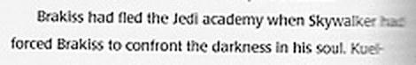
Our notes: `notes/materials/027-new-essential-chronology/09-part-nine-uprisings-and-insurgencies.md:60`

> Kueller ignited his energy blade and joined battle with Luke, who realized that his aggression was only making Kueller stronger.
— Source: Part Nine: Uprisings and Insurgencies; Luke Skywalker; Kueller — Luke vs Kueller.
Note (our notes, around the quote): Luke Skywalker; Kueller — Luke vs Kueller: "Kueller ignited his energy blade and joined battle with Luke, who realized that his aggression was only making Kueller stronger." Source: The New Essential Chronology, p.184
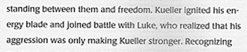
Our notes: `notes/materials/027-new-essential-chronology/09-part-nine-uprisings-and-insurgencies.md:78`

> a native thernbee animal—carrying Force-repelling ysalamiri in its belly—nullified Kueller's Force advantage.
> [fragment — full passage not on file]
— Source: Part Nine: Uprisings and Insurgencies; Kueller; Luke Skywalker — ysalamiri nullify Kueller.
Note (our notes, around the quote): Kueller; Luke Skywalker — ysalamiri nullify Kueller: "a native thernbee animal—carrying Force-repelling ysalamiri in its belly—nullified Kueller's Force advantage." Source: The New Essential Chronology, p.184

Our notes: `notes/materials/027-new-essential-chronology/09-part-nine-uprisings-and-insurgencies.md:80`

> On snowy Dolls 3, a band of Imperial partisans viewed the looming nuptials with contempt Believing the event to be more proof thal the Empire had been watered down like weak caf, the loyalists made plans to slip into Coruscant and sabotage the ceremony.
>
> One of their number claimed to be a former Royal Guardsman, and though his experience was likely a mere boast, his attempt to kill Mara Jade during her dress fitting gave a murderous edge to the plot. The other Imperiats focused on infiltrating the event site and hiring a gang of swoopbikers to harass the wedding guests, Despite the scheming, the wedding went off with mini mum mayhem. Following Luke's raucous bachelor party in Coruscant’s lower levels, the happy couple joined together in a private Jedi ceremony officiated by Kam Solusar in the renovated Jedi Temple. The public ceremony, held in Coruscant’s Reflection Gardens, remained peaceful thanks to extra muscle provided by Booster Terrik and others, who kept the swoopbikers at bay. When the final Imperial plotter crashed the ceremony and threatened to release a crippling computer virus, Luke persuaded him to give himself up and join the party. With that quiet denouncement, a generation Of hostilities suddenly seemed as dead as Palpatine himself.
>
> Weeks later, Lando Calrissian wed Tendra Risant, the woman he had met during the events of the Corellian insurrection.
— Source: Part Ten: A Lasting Peace; Kam Solusar; Luke Skywalker; Mara Jade Skywalker — Kam officiates.
(Excerpt widened 2026-11-17 to the relevant passage, word for word from research primary new essential chronology nec paged (text copy `research_primary_new_essential_chronology_nec_paged_txt_88b808b5bc`).)
(Excerpt widened 2026-11-17 to the relevant passage, word for word from research primary new essential chronology nec paged (text copy `research_primary_new_essential_chronology_nec_paged_txt_88b808b5bc`).)
(Full sentence/passage taken from the source text on file: `research_primary_new_essential_chronology_nec_paged_txt`.)
Note (our notes, around the quote): Kam Solusar; Luke Skywalker; Mara Jade Skywalker — Kam officiates: "the happy couple joined together in a private Jedi ceremony officiated by Kam Solusar in the renovated Jedi Temple." Source: The New Essential Chronology, p.194

Our notes: `notes/materials/027-new-essential-chronology/10-part-ten-a-lasting-peace.md:49`

> Luke and Mara activated the craft, caught up to the Dreadnaught, and eliminated the threat posed by the Vagaari renegades.
— Source: Part Eleven: Generations of Jedi; Luke Skywalker; Mara Jade Skywalker — Vagaari Dreadnaught.
Note (our notes, around the quote): Luke Skywalker; Mara Jade Skywalker — Vagaari Dreadnaught: "Luke and Mara activated the craft, caught up to the Dreadnaught, and eliminated the threat posed by the Vagaari renegades." Source: The New Essential Chronology, p.198

Our notes: `notes/materials/027-new-essential-chronology/11-part-eleven-generations-of-jedi.md:36`

> Other, more proactive Jedi Knights followed the lead of Kyp Durron and found new targets for their aggression. ... Jaina Solo found herself increasingly attracted to Kyp's aggressive faction; Anakin Solo remained loyal to his Uncle Luke. Jacen Solo found himself wondering if he could follow the Force without having to pick sides.
> [fragment — full passage not on file]
— Source: Part Twelve: The New Jedi Order; Kyp Durron; Jaina Solo; Anakin Solo; Jacen Solo — Jedi factions.
Note (our notes, around the quote): Kyp Durron; Jaina Solo; Anakin Solo; Jacen Solo — Jedi factions: "Other, more proactive Jedi Knights followed the lead of Kyp Durron and found new targets for their aggression. ... Jaina Solo found herself increasingly attracted to Kyp's aggressive faction; Anakin Solo remained loyal to his Uncle Luke. Jacen Solo found himself wondering if he could follow the Force without having to pick sides." Source: The New Essential Chronology, p.203

Our notes: `notes/materials/027-new-essential-chronology/12-part-twelve-new-jedi-order.md:11`

> Defeating an enraged Yomin Carr and witnessing the speed of the planet's environmental reprogramming, they realized the face of their enemy and the breathtaking extent of their foes' biology-based powers.
— Source: Part Twelve: The New Jedi Order; Luke Skywalker; Mara Jade Skywalker — Luke and Mara at Belkadan.
Note (our notes, around the quote): Luke Skywalker; Mara Jade Skywalker — Luke and Mara at Belkadan: "Defeating an enraged Yomin Carr and witnessing the speed of the planet's environmental reprogramming, they realized the face of their enemy and the breathtaking extent of their foes' biology-based powers." Source: The New Essential Chronology, p.204

Our notes: `notes/materials/027-new-essential-chronology/12-part-twelve-new-jedi-order.md:24`

> Corran Horn and Ganner Rhysode went to sand-swept Bimmiel in the Outer Rim, where an archaeological team hac uncovered the remains of a Yuuzhan Vong warrior, mumm> fled after fifty years in the desert. They discovered that the Yuuzhan Vong had already beat them to Bimmiel, and Cor- ran and Ganner enlisted the planet's native slashrats to help them wipe out the enemy’s slave colony. Yuuzhan Vong commander Shedao Shal arrived in the aftermath of the battle, and saw that the hated Jeedai Knights had disturbed the body of his ancestor Monge Shai. Enraged, he vowed to kill Corran Horn and taste his blood.
>
> Luke and Jacen arrived at Belkadan, discovering that the Yuuzhan Vong-terraformed planet now served as a “farm” for growing new coralskipper starfighters. The slaves tolling In the jungle fields remained docile due to chunks of surge coral implanted In their faces.
>
> Luke and Jacen arrived at Belkadan, discovering that the Yuuzhan Vong-terraformed planet now served as a “farm” for growing new coralskipper starfighters. The slaves tolling In the jungle fields remained docile due to chunks of surge coral implanted In their faces. Jacen recklessly tried to rescue them and became a prisoner himself, but Luke fought for Jacen’s freedom and both Jedi escaped Belkadan.
>
> Mara Jade and Anakin Solo traveled to Dantcoine, where Mara hoped to halt the progress of her disease in the un- Cosran Horn bstlles Shedso Shai for the fate of Ithar.
>
> [Ane ey Tose Lat Comsaze) === PDF p.217 === spoiled expanses of the gentile grasslands. Yet the Yuuzhan Vong invaders had already reached Dantooine, and what should have been a peaceful convalescence turned into a gritty struggle to stay alive.
— Source: Part Twelve: The New Jedi Order; Luke Skywalker; Jacen Solo — Luke frees Jacen at Belkadan.
(Excerpt widened 2026-11-17 to the relevant passage, word for word from research primary new essential chronology nec paged (text copy `research_primary_new_essential_chronology_nec_paged_txt_88b808b5bc`).)
(Excerpt widened 2026-11-17 to the relevant passage, word for word from research primary new essential chronology nec paged (text copy `research_primary_new_essential_chronology_nec_paged_txt_88b808b5bc`).)
Note (our notes, around the quote): Luke Skywalker; Jacen Solo — Luke frees Jacen at Belkadan: "Jacen recklessly tried to rescue them and became a prisoner himself, but Luke fought for Jacen's freedom and both Jedi escaped Belkadan." Source: The New Essential Chronology, p.206

Our notes: `notes/materials/027-new-essential-chronology/12-part-twelve-new-jedi-order.md:42`

> Luke vowed to win peace for the next generation, or die trying.
— Source: Part Twelve: The New Jedi Order; Luke Skywalker — Luke's vow.
Note (our notes, around the quote): Luke Skywalker — Luke's vow: "Luke vowed to win peace for the next generation, or die trying." Source: The New Essential Chronology, p.211

Our notes: `notes/materials/027-new-essential-chronology/12-part-twelve-new-jedi-order.md:87`

> Luke Skywalker and Mara Jade Skywalker, with newborn baby Ben
> [fragment — full passage not on file]
— Source: Part Twelve: The New Jedi Order; Luke Skywalker; Mara Jade Skywalker — art caption.
Note (our notes, around the quote): Luke Skywalker; Mara Jade Skywalker — art caption: "Luke Skywalker and Mara Jade Skywalker, with newborn baby Ben" Source: The New Essential Chronology, p.212, caption

Our notes: `notes/materials/027-new-essential-chronology/12-part-twelve-new-jedi-order.md:94`

> They rushed to the Givin homeworld to wam the skeletal mathematicians of the danger. During the Battle of YagDhul, the three JedI faced down Nom Anor, and Anakin and Tahiti shared a tentative kiss while sealed in a storage locker. The advanced ships of the Givin fleet helped beat back the Yuu- zhan Vong attackers, Luke and Mara arrived at Brant Venture after their depar- ture from unfriendly Coruscant There, a dscase~veakened Mara went into labor, knowing that the effort would probably kill her. Through the Force, Luke joined minds with his son, using their shared energies to scour every trace of contagion from the cells in Mara’s body. Mara and Luke named their new- bom baby Ben, in honor of Ben Kenobi.
>
> Elsewhere, the heretical shaper Nen Yim struggled with her punitive assignment to the dying workiship Baan Miir, Soon, aboard the vessel, a master shaper who had spent weeks tormenting Nen Yim revealed him self as Onimi, the misshapen court jester who served at the skie of Supreme Overlord Shimrra, it seemed that Shimrra had great need for someone with Nen Yim’'s scientific talents.
— Source: Part Twelve: The New Jedi Order; Luke Skywalker; Mara Jade Skywalker — Luke and Ben cure Mara.
(Excerpt widened 2026-11-17 to the relevant passage, word for word from research primary new essential chronology nec paged (text copy `research_primary_new_essential_chronology_nec_paged_txt_88b808b5bc`).)
(Excerpt widened 2026-11-17 to the relevant passage, word for word from research primary new essential chronology nec paged (text copy `research_primary_new_essential_chronology_nec_paged_txt_88b808b5bc`).)
Note (our notes, around the quote): Luke Skywalker; Mara Jade Skywalker — Luke and Ben cure Mara: "Through the Force, Luke joined minds with his son, using their shared energies to scour every trace of contagion from the cells in Mara's body." Source: The New Essential Chronology, p.213

Our notes: `notes/materials/027-new-essential-chronology/12-part-twelve-new-jedi-order.md:103`

> Anakin’s squad included his brother and sister, along with many of their old academy classmates such as Low: bacca, Tenel Ka, Raynar Thul, and Tahiri. Ganner Rhysode stood out in their ranks as the oldest adult. Despite their youth, the team landed on Baonu Rass and systematically fought their way to the heart of the cloning center, Along the way they liberated two prisoners, Lomi Pio and Welk, who had been caplured during the Yuuzhan Vong conquest of Dathomir. Both were disciples of the new Night- sister philosophy taught by Brakiss’s now-defunct Second Im- perium. True to their nature, they stole a ship and deserted Anakin’s group at the earliest opportunity, dragging Raynar with them to face an unknown fate.
>
> Anakin Solo had been widely considered the logical choice to succeed Luke Skywalker as head of the Jedi order.
>
> His actions on Baanu Rass only deepened his legend.
>
> His actions on Baanu Rass only deepened his legend. He fought against hordes of enemies without ego or fear, and in the end sacrificed himself so that the other members of his team could live.
>
> His actions on Baanu Rass only deepened his legend. He
>
> his team could live. Cut down by a rain of Yuuzhan Vong
>
> amphistaffs while buying time for the others to destroy the
>
> queen voxyn, Anakin passed Into the Force with a shudder
>
> felt halfway across the galaxy.
— Source: Part Twelve: The New Jedi Order; Anakin Solo; Luke Skywalker — Anakin's death.
(Excerpt widened 2026-11-17 to the relevant passage, word for word from research primary new essential chronology nec paged (text copy `research_primary_new_essential_chronology_nec_paged_txt_88b808b5bc`).)
(Excerpt widened 2026-11-17 to the relevant passage, word for word from research primary new essential chronology nec paged (text copy `research_primary_new_essential_chronology_nec_paged_txt_88b808b5bc`).)
(Full sentence/passage taken from the source text on file: `research_primary_new_essential_chronology_nec_paged_txt`.)
Note (our notes, around the quote): Anakin Solo; Luke Skywalker — Anakin's death: "Anakin Solo had been widely considered the logical choice to succeed Luke Skywalker as head of the Jedi order. His actions on Baanu Rass only deepened his legend. He fought against hordes of enemies without ego or fear, and in the end sacrificed himself so that the other members of his team could live. ... Anakin passed into the Force with a shudder felt halfway across the galaxy." Source: The New Essential Chronology, p.216

Our notes: `notes/materials/027-new-essential-chronology/12-part-twelve-new-jedi-order.md:126`

> Luke, Mara, and Tahiri faced off against Nyax, who by this time had tapped into the Force repository and could toss debris around in a whirlwind of power. Their combined efforts were enough to fell the Dark Jedi.
— Source: Part Twelve: The New Jedi Order.
Note (our notes, around the quote): Luke Skywalker; Mara Jade Skywalker — Luke, Mara and Tahiri fell Nyax: "Luke, Mara, and Tahiri faced off against Nyax, who by this time had tapped into the Force repository and could toss debris around in a whirlwind of power. Their combined efforts were enough to fell the Dark Jedi." Source: The New Essential Chronology, p.219

Our notes: `notes/materials/027-new-essential-chronology/12-part-twelve-new-jedi-order.md:155`

> Those with seats on the new council included Skywalker, Kyp Durron, and the Barabel Saba Sebatyne
> [fragment — full passage not on file]
— Source: Part Twelve: The New Jedi Order; Luke Skywalker; Kyp Durron — new Jedi Council.
Note (our notes, around the quote): Luke Skywalker; Kyp Durron — new Jedi Council: "Those with seats on the new council included Skywalker, Kyp Durron, and the Barabel Saba Sebatyne" Source: The New Essential Chronology, p.221

Our notes: `notes/materials/027-new-essential-chronology/12-part-twelve-new-jedi-order.md:177`

> The Supreme Overlord and his capering jester Onimi sent a phalanx of Slayers against the Jedi trio, only to see their finest warriors struck down.
— Source: Part Twelve: The New Jedi Order; Luke Skywalker; Jacen Solo; Jaina Solo — Slayers struck down.
Note (our notes, around the quote): Luke Skywalker; Jacen Solo; Jaina Solo — Slayers struck down: "The Supreme Overlord and his capering jester Onimi sent a phalanx of Slayers against the Jedi trio, only to see their finest warriors struck down." Source: The New Essential Chronology, p.225

Our notes: `notes/materials/027-new-essential-chronology/12-part-twelve-new-jedi-order.md:211`

> Shimrra launched himself at Luke, battering the Jedi with his amphistaff. Luke held him at bay, the Jedi's own lightsaber in one hand and Anakin's in the other. Luke burned through the amphistaff with the twin blades, then closed the tips together like a pair of shears, neatly severing Shimrra's head.
— Source: Part Twelve: The New Jedi Order; Luke Skywalker — Luke kills Shimrra.
Note (our notes, around the quote): Luke Skywalker — Luke kills Shimrra: "Shimrra launched himself at Luke, battering the Jedi with his amphistaff. Luke held him at bay, the Jedi's own lightsaber in one hand and Anakin's in the other. Luke burned through the amphistaff with the twin blades, then closed the tips together like a pair of shears, neatly severing Shimrra's head." Source: The New Essential Chronology, p.227

Our notes: `notes/materials/027-new-essential-chronology/12-part-twelve-new-jedi-order.md:223`

> Luke Skywalker battles Supreme Overlord Shimrra to the death.
— Source: Part Twelve: The New Jedi Order; Luke Skywalker — art caption.
Note (our notes, around the quote): Luke Skywalker — art caption: "Luke Skywalker battles Supreme Overlord Shimrra to the death." Source: The New Essential Chronology, p.227, caption

Our notes: `notes/materials/027-new-essential-chronology/12-part-twelve-new-jedi-order.md:229`

> Jacen Solo left on a personal journey, becoming a Jedi wanderer, not bound by the strictures of his uncle Luke's new Jedi order. Jacen intended to seek out other schools of thought regarding the Force in order to deepen his understanding of the immensity of the unifying Force.
— Source: Part Twelve: The New Jedi Order; Jacen Solo; Luke Skywalker — Jedi wanderer.
Note (our notes, around the quote): Jacen Solo; Luke Skywalker — Jedi wanderer: "Jacen Solo left on a personal journey, becoming a Jedi wanderer, not bound by the strictures of his uncle Luke's new Jedi order. Jacen intended to seek out other schools of thought regarding the Force in order to deepen his understanding of the immensity of the unifying Force." Source: The New Essential Chronology, p.227

Our notes: `notes/materials/027-new-essential-chronology/12-part-twelve-new-jedi-order.md:231`

> Luke Skywalker killed Welk, the Night Herald, and Leia Organa Solo secured a temporary cease-fire ... The experience prompted Leia to once again take up the path of the Jedi, a life decision she had been putting off for decades. She selected the Barabel Jedi Saba Sebatyne as her Jedi Master.
> [fragment — full passage not on file]
— Source: Part Twelve: The New Jedi Order.
Note (our notes, around the quote): Luke Skywalker; Leia Organa Solo — Luke kills Welk; Leia takes up the Jedi path: "Luke Skywalker killed Welk, the Night Herald, and Leia Organa Solo secured a temporary cease-fire ... The experience prompted Leia to once again take up the path of the Jedi, a life decision she had been putting off for decades. She selected the Barabel Jedi Saba Sebatyne as her Jedi Master." Source: The New Essential Chronology, p.229

Our notes: `notes/materials/027-new-essential-chronology/12-part-twelve-new-jedi-order.md:245`

> In his efforts to structure a new Jedi order in which everyone felt engaged and important, he had neglected to provide one critical element: leadership with vision.
— Source: Part Twelve: The New Jedi Order; Luke Skywalker — leadership with vision.
Note (our notes, around the quote): Luke Skywalker — leadership with vision: "In his efforts to structure a new Jedi order in which everyone felt engaged and important, he had neglected to provide one critical element: leadership with vision." Source: The New Essential Chronology, p.229

Our notes: `notes/materials/027-new-essential-chronology/12-part-twelve-new-jedi-order.md:249`

## Star Wars Saga Edition: Jedi Academy Training Manual (WotC, 2009): power-scaling and lore notes

> Following the Galactic Civil War, Luke Skywalker, the first of a new generation of Jedi Knights, reestablishes the Jedi Order and begins training new students in the ways of the Force.
— Source: Front matter and Introduction; Luke Skywalker — Introduction — Luke refounds the Order.
Note (our notes, around the quote): Luke Skywalker — Introduction — Luke refounds the Order: "Following the Galactic Civil War, Luke Skywalker, the first of a new generation of Jedi Knights, reestablishes the Jedi Order and begins training new students in the ways of the Force." Source: Jedi Academy Training Manual, p.5

Our notes: `notes/materials/028-jedi-academy-training-manual/00-front-matter-introduction.md:37`

> Chapter 3: Equipment & Artifacts includes an in-depth look at the physical objects that are key elements of the Jedi and Sith traditions. This chapter includes a comprehensive guide to lightsaber creation, lists many of the variant lightsabers available for use, and provides a close look at holocrons, including the holocron creation process (which is tied to the destiny system).
>
> Chapter 4: Affiliated Programs takes a look at several Force traditions that differ from the Jedi. These alternate Force traditions can serve as a basis for the creation of characters who use the Force but do not adhere to the tenets of the Jedi or the Sith.
>
> Chapter 5: Instructors & Alumni looks at some of the most influential beings in the history of the Jedi Order. This chapter covers many major figures stretching back as far as the Great Hyperspace War and as far forward as the founder of the new Jedi Order, Grand Master Luke Skywalker.
>
> Chapter 6: Dangers of Study introduces some of the threats that a Jedi apprentice might face during his or her career. This chapter includes many new beasts that threaten Jedi students, as well as a rogues gallery of those who have succumbed to the dark side of the Force.
— Source: Front matter and Introduction; Luke Skywalker — Introduction — Chapter 5 scope.
(Excerpt widened 2026-11-17 to the relevant passage, word for word from research primary jedi academy training manual jatm paged (text copy `research_primary_jedi_academy_training_manual_jatm_paged_txt_fea130719f`).)
(Excerpt widened 2026-11-17 to the relevant passage, word for word from research primary jedi academy training manual jatm paged (text copy `research_primary_jedi_academy_training_manual_jatm_paged_txt_fea130719f`).)
Note (our notes, around the quote): Luke Skywalker — Introduction — Chapter 5 scope: "This chapter covers many major figures stretching back as far as the Great Hyperspace War and as far forward as the founder of the new Jedi Order, Grand Master Luke Skywalker." Source: Jedi Academy Training Manual, p.6

Our notes: `notes/materials/028-jedi-academy-training-manual/00-front-matter-introduction.md:44`

> A Jedi must feel the Force to know it, and ancient texts and rules cannot substitute for that experience.
>
> At the same time, a Jedi's social behavior cannot be learned by applying the Force to it. The Jedi Code also gives a set of expectations and guidelines by which a Jedi must conduct himself. By following the Code, anyone can open up and allow the light side of the Force to flow freely through them and gain a better understanding of the universe and everything around them.
>
> A closer examination of the Jedi Code helps to provide some insight not only into the way Jedi behave but also into the way following such stric- tures helps to foster a way of life conducive to averting the temptations of the dark side. The Code is categorized into three subjects: self-discipline, responsibility, and public service.
>
> === sp042 LUKE SKYWALKER LEARNS SELF-DISCIPLINE ON DAGOBAH.
>
> The Jedi Code: Self-Discipline Self-discipline is one of the key factors of Jedi behavior, and many lessons taught to the Jedi from a very young age focus on this basic doctrine. At first, the lessons are simple and no different than the lessons taught to other children throughout the galaxy.
— Source: Chapter II: Philosophy; Luke Skywalker — art caption.
(Excerpt widened 2026-11-17 to the relevant passage, word for word from research primary jedi academy training manual jatm paged (text copy `research_primary_jedi_academy_training_manual_jatm_paged_txt_fea130719f`).)
(Excerpt widened 2026-11-17 to the relevant passage, word for word from research primary jedi academy training manual jatm paged (text copy `research_primary_jedi_academy_training_manual_jatm_paged_txt_fea130719f`).)
Note (our notes, around the quote): Luke Skywalker — art caption: "LUKE SKYWALKER LEARNS SELF-DISCIPLINE ON DAGOBAH." Source: Jedi Academy Training Manual, p.41, sidebar/caption

Our notes: `notes/materials/028-jedi-academy-training-manual/02-ch2-philosophy.md:29`

> If a character's Dark Side Score more than half of her Wisdom score, she can attempt to resist taking a Dark Side Point. If she makes a success- ful Wisdom check (DC = 5 + her Dark Side Score), she avoids increasing her Dark Side Score in a situation where she normally would.
>
> A DARK JED! GIVES IN TO HIS ANGER, CUTTING DOWN A SUBORDINATE.
>
> The Order of the Sith is the one Force tradition most recognized as having embraced the dark side of the Force. The Sith hate the fact that the Jedi Order has corrupted the galaxy with its false teachings, and its members struggle to destroy the Jedi and rule the galaxy forever.
>
> The Order of the Sith is the one Force tradition most recognized as having embraced the dark side of the Force. The Sith hate the fact that the Jedi Order has corrupted the galaxy with its false teachings, and its members struggle to destroy the Jedi and rule the galaxy forever. Although they do succeed for a time under Darth Sidious and his apprentice, Darth Vader, their rule of hatred and fear only lasts until Luke Skywalker redeems his father and helps him eradicate the last of the Sith to finally bring balance to the Force.
>
> THE DARK PATH Those who walk the path toward the dark side of the Force go through four different stages: temptation, imperilment, submission, and atonement or redemption. Most users of the Force, even the purest of the Jedi, can go through at least one of these stages as they walk through life.
— Source: Chapter II: Philosophy.
(Excerpt widened 2026-11-17 to the relevant passage, word for word from research primary jedi academy training manual jatm paged (text copy `research_primary_jedi_academy_training_manual_jatm_paged_txt_fea130719f`).)
(Excerpt widened 2026-11-17 to the relevant passage, word for word from research primary jedi academy training manual jatm paged (text copy `research_primary_jedi_academy_training_manual_jatm_paged_txt_fea130719f`).)
Note (our notes, around the quote): Palpatine (Darth Sidious); Darth Vader (Anakin Skywalker); Luke Skywalker — The Dark Side — the Sith: "Although they do succeed for a time under Darth Sidious and his apprentice, Darth Vader, their rule of hatred and fear only lasts until Luke Skywalker redeems his father and helps him eradicate the last of the Sith to finally bring balance to the Force." Source: Jedi Academy Training Manual, p.44

Our notes: `notes/materials/028-jedi-academy-training-manual/02-ch2-philosophy.md:46`

> by the time of the Rebellion against the Empire, Emperor Palpatine had already confiscated and, in many cases, destroyed ancient Jedi and Sith artifacts, meaning that very few such objects survive in that time period and beyond. By the time that Luke Skywalker founds the new Jedi Academy, the search for Jedi artifacts unearths a few items of significance.
> [fragment — full passage not on file]
— Source: Chapter III: Equipment and Artifacts; Palpatine (Darth Sidious); Luke Skywalker — Equipment & Artifacts — eras.
Note (our notes, around the quote): Palpatine (Darth Sidious); Luke Skywalker — Equipment & Artifacts — eras: "by the time of the Rebellion against the Empire, Emperor Palpatine had already confiscated and, in many cases, destroyed ancient Jedi and Sith artifacts, meaning that very few such objects survive in that time period and beyond. By the time that Luke Skywalker founds the new Jedi Academy, the search for Jedi artifacts unearths a few items of significance." Source: Jedi Academy Training Manual, p.49

Our notes: `notes/materials/028-jedi-academy-training-manual/03-ch3-equipment-and-artifacts.md:17`

> In the wake of the destruction of the Jedi Order by Emperor Palpatine, Luke Skywalker was forced to create a synthetic lightsaber crystal since he had no knowledge of the caves at Ilum or the significance of Adegan crystals.
— Source: Chapter III: Equipment and Artifacts; Luke Skywalker — Synthetic Crystals — Luke's lightsaber.
Note (our notes, around the quote): Luke Skywalker — Synthetic Crystals — Luke's lightsaber: "In the wake of the destruction of the Jedi Order by Emperor Palpatine, Luke Skywalker was forced to create a synthetic lightsaber crystal since he had no knowledge of the caves at Ilum or the significance of Adegan crystals." Source: Jedi Academy Training Manual, p.56

Our notes: `notes/materials/028-jedi-academy-training-manual/03-ch3-equipment-and-artifacts.md:29`

> In many ways, they are correct. But, the Fallanassi are not true nomads, since they move to protect their secrecy, not to find resources.
>
> HisToRY According to their own stories, the Fallanassi have existed for a long time and are perhaps older than even the Republic itself. Due to their desire to keep out of the public eye and their lack of records, much of their history is unknown.
>
> What little that is known about them was scarcely chronicled by Jedi Master Luke Skywalker after his encounter with them during the Black Fleet Crisis, when the New Republic clashed with the Yevethans. In fact, the New Republic defeated the Yevethans with the assistance of the Fallanassi through their use of an illusory space fleet that led the Yevethans to believe that the New Republic fleet was larger than it actually was.
>
> What little that is known about them was scarcely chronicled by Jedi Master Luke Skywalker after his encounter with them during the Black Fleet Crisis, when the New Republic clashed with the Yevethans. In fact, the New Republic defeated the Yevethans with the assistance of the Fallanassi through their use of an illusory space fleet that led the Yevethans to believe that the New Republic fleet was larger than it actually was. The Fallanassi maintained their confidentiality during the conflict and retreated back into obscurity after the battle was over by moving to a new home.
— Source: Chapter IV: Affiliated Programs; Luke Skywalker — Fallanassi — Luke's encounter.
(Excerpt widened 2026-11-17 to the relevant passage, word for word from research primary jedi academy training manual jatm paged (text copy `research_primary_jedi_academy_training_manual_jatm_paged_txt_fea130719f`).)
(Excerpt widened 2026-11-17 to the relevant passage, word for word from research primary jedi academy training manual jatm paged (text copy `research_primary_jedi_academy_training_manual_jatm_paged_txt_fea130719f`).)
(Full sentence/passage taken from the source text on file: `research_primary_jedi_academy_training_manual_jatm_paged_txt`.)
Note (our notes, around the quote): Luke Skywalker — Fallanassi — Luke's encounter: "What little that is known about them was scarcely chronicled by Jedi Master Luke Skywalker after his encounter with them during the Black Fleet Crisis" Source: Jedi Academy Training Manual, p.76

Our notes: `notes/materials/028-jedi-academy-training-manual/04-ch4-affiliated-programs.md:17`

> Some travel to Luke Skywalker's Jedi Academy after he expresses an interest in learning from other traditions.
— Source: Chapter IV: Affiliated Programs; Luke Skywalker — Matukai — at Luke's academy.
Note (our notes, around the quote): Luke Skywalker — Matukai — at Luke's academy: "Some travel to Luke Skywalker's Jedi Academy after he expresses an interest in learning from other traditions." Source: Jedi Academy Training Manual, p.80

Our notes: `notes/materials/028-jedi-academy-training-manual/04-ch4-affiliated-programs.md:19`

> DOAaAcEe DIATH A BSsidvHga c 0 @ % > iP C x 3 === sp101 INWIAVG © SHOLSNYLAS A esidvHS5 tN) GRAND MASTER LUKE SKYWALKER Grand Master Luke Skywalker CL 20 Medium Human scout 1/Jedi 7/ace pilot 2/Jedi Knight 5/Jedi Master 5 Destiny” 3; Force 7, Strong in the Force; Dark Side 3 Init +18; Senses Perception +18 Languages Basic, Huttese, Shyriiwook (understand only) Defenses Ref 36 (flat-footed 33), Fort 35, Will 36; Block, Deflect, Vehicular Combat hp 167; Threshold 36 Immune fear effects Speed 6 squares Melee lightsaber +25 (2d8+15) or Melee lightsaber +20/+20 (2d8+15) with Double Attack or Melee shoto +25 (2d6+15) Ranged by weapon +21 Base Atk +18; Grp +21 Atk Options Djem So, Double Attack (lightsabers), Melee Defense, Severing Strike Special Actions Redirect Shot, Shake It Off Force Powers Known (Use the Force +29): battle strike, farseeing, fluid riposte, Force disarm, Force grip, Force slam, inspire, mind trick, move object, rebuke (2), surge Force Secrets Devastating Power, Distant Power, Multitarget Power, Quicken Power, Shaped Power Force Techniques Force Point Recovery, Improved Move Light Object Abilities Str 14, Dex 17, Con 14, Int 14, Wis 16, Cha 18 Special Qualities fearless, serenity, vehicle dodge +1 Talents Ataru, Block, Deflect, Djem So, Elusive Dogfighter, Evasion, Force Pilot, Immerse Another, Redirect Shot, Severing Strike, Weapon Specialization (lightsabers), White Current Adept Feats Double Attack (lightsabers), Force Sensitivity, Force Training (3).
— Source: Chapter V: Instructors and Alumni.
(Excerpt widened 2026-11-17 to the relevant passage, word for word from research primary jedi academy training manual jatm paged (text copy `research_primary_jedi_academy_training_manual_jatm_paged_txt_fea130719f`).)
Note (our notes, around the quote): Luke Skywalker — Grand Master Luke Skywalker — stat block, level and class — RPG mechanics (weaker source): "Grand Master Luke Skywalker CL 20 Medium Human scout 1/Jedi 7/ace pilot 2/Jedi Knight 5/Jedi Master 5" Source: Jedi Academy Training Manual, p.100, stat block

Our notes: `notes/materials/028-jedi-academy-training-manual/05-ch5-instructors-and-alumni.md:41`

> DOAaAcEe DIATH A BSsidvHga c 0 @ % > iP C x 3 === sp101 INWIAVG © SHOLSNYLAS A esidvHS5 tN) GRAND MASTER LUKE SKYWALKER Grand Master Luke Skywalker CL 20 Medium Human scout 1/Jedi 7/ace pilot 2/Jedi Knight 5/Jedi Master 5 Destiny” 3; Force 7, Strong in the Force; Dark Side 3 Init +18; Senses Perception +18 Languages Basic, Huttese, Shyriiwook (understand only) Defenses Ref 36 (flat-footed 33), Fort 35, Will 36; Block, Deflect, Vehicular Combat hp 167; Threshold 36 Immune fear effects Speed 6 squares Melee lightsaber +25 (2d8+15) or Melee lightsaber +20/+20 (2d8+15) with Double Attack or Melee shoto +25 (2d6+15) Ranged by weapon +21 Base Atk +18; Grp +21 Atk Options Djem So, Double Attack (lightsabers), Melee Defense, Severing Strike Special Actions Redirect Shot, Shake It Off Force Powers Known (Use the Force +29): battle strike, farseeing, fluid riposte, Force disarm, Force grip, Force slam, inspire, mind trick, move object, rebuke (2), surge Force Secrets Devastating Power, Distant Power, Multitarget Power, Quicken Power, Shaped Power Force Techniques Force Point Recovery, Improved Move Light Object Abilities Str 14, Dex 17, Con 14, Int 14, Wis 16, Cha 18 Special Qualities fearless, serenity, vehicle dodge +1 Talents Ataru, Block, Deflect, Djem So, Elusive Dogfighter, Evasion, Force Pilot, Immerse Another, Redirect Shot, Severing Strike, Weapon Specialization (lightsabers), White Current Adept Feats Double Attack (lightsabers), Force Sensitivity, Force Training (3).
— Source: Chapter V: Instructors and Alumni.
(Excerpt widened 2026-11-17 to the relevant passage, word for word from research primary jedi academy training manual jatm paged (text copy `research_primary_jedi_academy_training_manual_jatm_paged_txt_fea130719f`).)
Note (our notes, around the quote): Luke Skywalker — Grand Master Luke Skywalker — stat block, defences and attacks — RPG mechanics (weaker source): "hp 167; Threshold 36 Immune fear effects Speed 6 squares Melee lightsaber +25 (2d8+15) or Melee lightsaber +20/+20 (2d8+15) with Double Attack or Melee shoto +25 (2d6+15)" Source: Jedi Academy Training Manual, p.100, stat block

Our notes: `notes/materials/028-jedi-academy-training-manual/05-ch5-instructors-and-alumni.md:43`

> DOAaAcEe DIATH A BSsidvHga c 0 @ % > iP C x 3 === sp101 INWIAVG © SHOLSNYLAS A esidvHS5 tN) GRAND MASTER LUKE SKYWALKER Grand Master Luke Skywalker CL 20 Medium Human scout 1/Jedi 7/ace pilot 2/Jedi Knight 5/Jedi Master 5 Destiny” 3; Force 7, Strong in the Force; Dark Side 3 Init +18; Senses Perception +18 Languages Basic, Huttese, Shyriiwook (understand only) Defenses Ref 36 (flat-footed 33), Fort 35, Will 36; Block, Deflect, Vehicular Combat hp 167; Threshold 36 Immune fear effects Speed 6 squares Melee lightsaber +25 (2d8+15) or Melee lightsaber +20/+20 (2d8+15) with Double Attack or Melee shoto +25 (2d6+15) Ranged by weapon +21 Base Atk +18; Grp +21 Atk Options Djem So, Double Attack (lightsabers), Melee Defense, Severing Strike Special Actions Redirect Shot, Shake It Off Force Powers Known (Use the Force +29): battle strike, farseeing, fluid riposte, Force disarm, Force grip, Force slam, inspire, mind trick, move object, rebuke (2), surge Force Secrets Devastating Power, Distant Power, Multitarget Power, Quicken Power, Shaped Power Force Techniques Force Point Recovery, Improved Move Light Object Abilities Str 14, Dex 17, Con 14, Int 14, Wis 16, Cha 18 Special Qualities fearless, serenity, vehicle dodge +1 Talents Ataru, Block, Deflect, Djem So, Elusive Dogfighter, Evasion, Force Pilot, Immerse Another, Redirect Shot, Severing Strike, Weapon Specialization (lightsabers), White Current Adept Feats Double Attack (lightsabers), Force Sensitivity, Force Training (3).
— Source: Chapter V: Instructors and Alumni.
(Excerpt widened 2026-11-17 to the relevant passage, word for word from research primary jedi academy training manual jatm paged (text copy `research_primary_jedi_academy_training_manual_jatm_paged_txt_fea130719f`).)
(Fragment completed 2026-11-17: full sentence/passage matched word for word in the source text on file: `research_primary_jedi_academy_training_manual_jatm_paged_txt_fea130719f`.)
Note (our notes, around the quote): Luke Skywalker — Grand Master Luke Skywalker — stat block, Force powers — RPG mechanics (weaker source): "Force Powers Known (Use the Force +29): battle strike, farseeing, fluid riposte, Force disarm, Force grip, Force slam, inspire, mind trick, move object, rebuke (2), surge Force Secrets Devastating Power, Distant Power, Multitarget Power, Quicken Power, Shaped Power" Source: Jedi Academy Training Manual, p.100, stat block

Our notes: `notes/materials/028-jedi-academy-training-manual/05-ch5-instructors-and-alumni.md:45`

> DOAaAcEe DIATH A BSsidvHga c 0 @ % > iP C x 3 === sp101 INWIAVG © SHOLSNYLAS A esidvHS5 tN) GRAND MASTER LUKE SKYWALKER Grand Master Luke Skywalker CL 20 Medium Human scout 1/Jedi 7/ace pilot 2/Jedi Knight 5/Jedi Master 5 Destiny” 3; Force 7, Strong in the Force; Dark Side 3 Init +18; Senses Perception +18 Languages Basic, Huttese, Shyriiwook (understand only) Defenses Ref 36 (flat-footed 33), Fort 35, Will 36; Block, Deflect, Vehicular Combat hp 167; Threshold 36 Immune fear effects Speed 6 squares Melee lightsaber +25 (2d8+15) or Melee lightsaber +20/+20 (2d8+15) with Double Attack or Melee shoto +25 (2d6+15) Ranged by weapon +21 Base Atk +18; Grp +21 Atk Options Djem So, Double Attack (lightsabers), Melee Defense, Severing Strike Special Actions Redirect Shot, Shake It Off Force Powers Known (Use the Force +29): battle strike, farseeing, fluid riposte, Force disarm, Force grip, Force slam, inspire, mind trick, move object, rebuke (2), surge Force Secrets Devastating Power, Distant Power, Multitarget Power, Quicken Power, Shaped Power Force Techniques Force Point Recovery, Improved Move Light Object Abilities Str 14, Dex 17, Con 14, Int 14, Wis 16, Cha 18 Special Qualities fearless, serenity, vehicle dodge +1 Talents Ataru, Block, Deflect, Djem So, Elusive Dogfighter, Evasion, Force Pilot, Immerse Another, Redirect Shot, Severing Strike, Weapon Specialization (lightsabers), White Current Adept Feats Double Attack (lightsabers), Force Sensitivity, Force Training (3).
— Source: Chapter V: Instructors and Alumni.
(Excerpt widened 2026-11-17 to the relevant passage, word for word from research primary jedi academy training manual jatm paged (text copy `research_primary_jedi_academy_training_manual_jatm_paged_txt_fea130719f`).)
Note (our notes, around the quote): Luke Skywalker — Grand Master Luke Skywalker — stat block, talents — RPG mechanics (weaker source): "Talents Ataru, Block, Deflect, Djem So, Elusive Dogfighter, Evasion, Force Pilot, Immerse Another, Redirect Shot, Severing Strike, Weapon Specialization (lightsabers), White Current Adept" Source: Jedi Academy Training Manual, p.100, stat block

Our notes: `notes/materials/028-jedi-academy-training-manual/05-ch5-instructors-and-alumni.md:47`

> Melee Defense, Shake It Off, Skill Focus (Use the Force), Strong in the Force, Vehicular Combat, Weapon Finesse, Weapon Focus (lightsabers), Weapon Proficiency (lightsabers, pistols, rifles, simple weapons) Skills Endurance +17, Initiative +18, Knowledge (galactic lore) +17, Mechanics +17, Perception +18, Pilot +29, Ride +18, Stealth +29, Survival +18, Use the Force +29 Possessions lightsaber (self-built), shoto (self-built), Jedi robes, comlink * Luke Skywalker is considered to have fulfilled both the Education and Redemption destinies (see page 114 of the Saga Edition core rulebook).
>
> In most epic sagas, the destruction of the Galactic Empire would be the end of the story.
— Source: Chapter V: Instructors and Alumni.
(Excerpt widened 2026-11-17 to the relevant passage, word for word from research primary jedi academy training manual jatm paged (text copy `research_primary_jedi_academy_training_manual_jatm_paged_txt_fea130719f`).)
(Excerpt widened 2026-11-17 to the relevant passage, word for word from research primary jedi academy training manual jatm paged (text copy `research_primary_jedi_academy_training_manual_jatm_paged_txt_fea130719f`).)
(Full sentence/passage taken from the source text on file: `research_primary_jedi_academy_training_manual_jatm_paged_txt`.)
Note (our notes, around the quote): Luke Skywalker — Grand Master Luke Skywalker — stat block, skills and gear — RPG mechanics (weaker source): "Pilot +29, Ride +18, Stealth +29, Survival +18, Use the Force +29 Possessions lightsaber (self-built), shoto (self-built), Jedi robes, comlink" Source: Jedi Academy Training Manual, p.100, stat block

Our notes: `notes/materials/028-jedi-academy-training-manual/05-ch5-instructors-and-alumni.md:49`

- Note (summary from our notes, not a quotation): Luke Skywalker; Grand Admiral Thrawn; Joruus C'baoth; Mara Jade Skywalker — Grand Master Luke Skywalker — Thrawn era: "Skywalker is faced with two threats related to Thrawn. One is a mad clone of the old Jedi Master Jorus C'Baoth. The clone "Joruus" tempts Skywalker toward the dark side but is defeated. The other threat is Mara Jade, an assassin with her sights set on Luke Skywalker." Source: Jedi Academy Training Manual, p.100
  — Source: Chapter V: Instructors and Alumni.

Our notes: `notes/materials/028-jedi-academy-training-manual/05-ch5-instructors-and-alumni.md:51`

> Skywalker is faced with two threats related to Thrawn. One is a mad clone of the old Jedi Master Jorus C'Baoth. The clone “Joruus” tempts Skywalker toward the dark side but is defeated. The other threat is Mara Jade, an assas- sin with her sights set on Luke Skywalker.
>
> Luke faces an even greater challenge in the form of the reawakened clone of Emperor Palpatine. This clone organizes an assault on the New Republic and pushes the former Rebel Alliance to the breaking point.
>
> Luke faces an even greater challenge in the form of the reawakened clone of Emperor Palpatine. This clone organizes an assault on the New Republic and pushes the former Rebel Alliance to the breaking point. The Emperor's clone succeeds where Palpatine failed and turns Skywalker to the dark side for a brief time. However, the intervention of his sister, Leia Organa-Solo, brings Luke back from the darkness, whereupon he defeats Palpatine’s clone.
>
> The Emperor's clone succeeds where Palpatine failed and turns Skywalker to the dark side for a brief time. However, the intervention of his sister, Leia Organa-Solo, brings Luke back from the darkness, whereupon he defeats Palpatine’s clone.
>
> As Luke sets about rebuilding the Jedi Order, a new threat appears from beyond the galaxy. The Yuuzhan Vong arrive, and their immunity to the Force makes them a great threat to the Jedi.
>
> Luke reluctantly takes the title of Grand Master, but to everyone he meets, from the most respected senator to the lowliest droid, he is still simply “Luke.” Luke hopes for a lasting peace but is ever vigilant.
— Source: Chapter V: Instructors and Alumni.
(Excerpt widened 2026-11-17 to the relevant passage, word for word from research primary jedi academy training manual jatm paged (text copy `research_primary_jedi_academy_training_manual_jatm_paged_txt_fea130719f`).)
(Excerpt widened 2026-11-17 to the relevant passage, word for word from research primary jedi academy training manual jatm paged (text copy `research_primary_jedi_academy_training_manual_jatm_paged_txt_fea130719f`).)
Note (our notes, around the quote): Luke Skywalker; Palpatine (Darth Sidious); Leia Organa Solo — Grand Master Luke Skywalker — Dark Empire: "The Emperor's clone succeeds where Palpatine failed and turns Skywalker to the dark side for a brief time. However, the intervention of his sister, Leia Organa-Solo, brings Luke back from the darkness, whereupon he defeats Palpatine's clone." Source: Jedi Academy Training Manual, p.100

Our notes: `notes/materials/028-jedi-academy-training-manual/05-ch5-instructors-and-alumni.md:53`

- Note (summary from our notes, not a quotation): Luke Skywalker — Grand Master Luke Skywalker — the title: "Luke reluctantly takes the title of Grand Master, but to everyone he meets, from the most respected senator to the lowliest droid, he is still simply "Luke."" Source: Jedi Academy Training Manual, p.100
  — Source: Chapter V: Instructors and Alumni.

Our notes: `notes/materials/028-jedi-academy-training-manual/05-ch5-instructors-and-alumni.md:55`

> The Yuuzhan Vong arrive, and their immunity to the Force makes them a great threat to the Jedi.
>
> Luke reluctantly takes the title of Grand Master, but to everyone he meets, from the most respected senator to the lowliest droid, he is still simply “Luke.” Luke hopes for a lasting peace but is ever vigilant. Whatever the next crisis might be, Luke plans to be at the forefront, ready to use his abilities to protect the galaxy once again.
>
> Grand Master Skywalker Encounters This is Luke Skywalker at the height of his powers. Although he is the most powerful Jedi in the galaxy after the Yuuzhan Vong invasion, the battles with the Yuuzhan Vong humble him.
>
> Heroes meeting Grand Master Skywalker should be awed by his power but impressed by his humility. Deep down, he is still that wide-eyed Tatooine farm boy, but he is fast on his way to becoming a legend.
— Source: Chapter V: Instructors and Alumni; Luke Skywalker — Grand Master Skywalker Encounters — power level.
(Excerpt widened 2026-11-17 to the relevant passage, word for word from research primary jedi academy training manual jatm paged (text copy `research_primary_jedi_academy_training_manual_jatm_paged_txt_fea130719f`).)
(Excerpt widened 2026-11-17 to the relevant passage, word for word from research primary jedi academy training manual jatm paged (text copy `research_primary_jedi_academy_training_manual_jatm_paged_txt_fea130719f`).)
Note (our notes, around the quote): Luke Skywalker — Grand Master Skywalker Encounters — power level: "This is Luke Skywalker at the height of his powers. Although he is the most powerful Jedi in the galaxy after the Yuuzhan Vong invasion, the battles with the Yuuzhan Vong humble him. Heroes meeting Grand Master Skywalker should be awed by his power but impressed by his humility." Source: Jedi Academy Training Manual, p.100

Our notes: `notes/materials/028-jedi-academy-training-manual/05-ch5-instructors-and-alumni.md:57`

> on Yavin 4, where he is briefly a student under Luke Skywalker.
> [fragment — full passage not on file]
— Source: Chapter V: Instructors and Alumni; Luke Skywalker — Kieran Halcyon — student of Luke.
Note (our notes, around the quote): Luke Skywalker — Kieran Halcyon — student of Luke: "on Yavin 4, where he is briefly a student under Luke Skywalker." Source: Jedi Academy Training Manual, p.101

Our notes: `notes/materials/028-jedi-academy-training-manual/05-ch5-instructors-and-alumni.md:64`

> Katarn is born on a farm planet but has dreams of attending the Imperial Academy. He also has untapped potential in the Force. Kyle discov- ers his Force potential much later in life, long after becoming a disillusioned gun-for-hire. His involvement with the destruction of the Dark Trooper Initia- tive brings him to the attention of the Rebel Alliance, but his discovery of the legendary Valley of the Jedi is what brings him to the attention of Luke Skywalker. Katarn eventually agrees to be taught by Skywalker and goes on to be an instructor at the Jedi Academy.
>
> Kyle Katarn brings a different perspective on the Force, one that occasionally conflicts with the teachings of Master Skywalker. While Skywalker mastered the force through empathy and feeling, Katarn did so through discipline and will.
>
> Skywalker appreciates the difference and Katarn's counsel in matters affecting the Academy. While Luke's journey gives him much wisdom, Kyle's pragmatism and plain speaking offer Luke an alternate viewpoint to consider.
— Source: Chapter V: Instructors and Alumni; Luke Skywalker; Kyle Katarn — Kyle Katarn — contrast with Luke.
(Excerpt widened 2026-11-17 to the relevant passage, word for word from research primary jedi academy training manual jatm paged (text copy `research_primary_jedi_academy_training_manual_jatm_paged_txt_fea130719f`).)
(Excerpt widened 2026-11-17 to the relevant passage, word for word from research primary jedi academy training manual jatm paged (text copy `research_primary_jedi_academy_training_manual_jatm_paged_txt_fea130719f`).)
Note (our notes, around the quote): Luke Skywalker; Kyle Katarn — Kyle Katarn — contrast with Luke: "While Skywalker mastered the force through empathy and feeling, Katarn did so through discipline and will." Source: Jedi Academy Training Manual, p.102

Our notes: `notes/materials/028-jedi-academy-training-manual/05-ch5-instructors-and-alumni.md:66`

> (2), mind trick, move object (2), surge Force Secrets Devastating Power Force Techniques Improved Force Trance, Improved Move Light Object, Improved Sense Surroundings Abilities Str 12, Dex 18, Con 14, Int 17, Wis 16, Cha 19 Special Qualities fearless, serenity Talents Ataru, Attune Weapon, Double Attack (lightsabers), Empower Weapon, Force Power Adept (move object), Foresight, Greater Weapon Focus (lightsabers), Greater Weapon Specialization (lightsabers), Weapon Specialization (lightsaber, pistols) Feats Armor Proficiency (light, medium), Force Sensitivity, Force Training (2), Skill Training (Acrobatics), Weapon Finesse (lightsabers), Weapon Focus (lightsabers, pistols), Weapon Proficiency (advanced melee weapons, heavy weapons, lightsabers, pistols, rifles, simple weapons) Skills Acrobatics +17, Deception +17, Initiative +17, Knowledge (galactic lore) +16, Perception +16, Pilot +17, Use Computer +16, Use the Force +17 Possessions lightsaber, heavy blaster pistol A BSsastdVvHoS c INNNVG © SHOLENHLASRNI Mara Jade Skywalker has a history as long and rich as her husband's. She begins her career as one of the Emperor's personal Force-trained assassins, although, unlike most of his servants, she only kills out of necessity. Highly talented, Mara trains in combat with the Imperial Royal Guard and receives personal tutelage in the Force from the Emperor himself. She performs dozens of missions on his behalf until his demise at the hands of Darth Vader. The Emperor's dying telepathic command to kill Luke Skywalker sets her destiny in a different direction.
>
> MARA JADE SKYWALKER === sp105 .
— Source: Chapter V: Instructors and Alumni.
(Excerpt widened 2026-11-17 to the relevant passage, word for word from research primary jedi academy training manual jatm paged (text copy `research_primary_jedi_academy_training_manual_jatm_paged_txt_fea130719f`).)
(Excerpt widened 2026-11-17 to the relevant passage, word for word from research primary jedi academy training manual jatm paged (text copy `research_primary_jedi_academy_training_manual_jatm_paged_txt_fea130719f`).)
Note (our notes, around the quote): Mara Jade Skywalker; Palpatine (Darth Sidious); Luke Skywalker — Mara Jade Skywalker — the last command: "The Emperor's dying telepathic command to kill Luke Skywalker sets her destiny in a different direction." Source: Jedi Academy Training Manual, p.103

Our notes: `notes/materials/028-jedi-academy-training-manual/05-ch5-instructors-and-alumni.md:81`

- Note (summary from our notes, not a quotation): Mara Jade Skywalker; Luke Skywalker — Mara Jade Skywalker — kills Luke's clone: "She manages to "complete" her mission by killing a clone of Luke Skywalker." Source: Jedi Academy Training Manual, p.103
  — Source: Chapter V: Instructors and Alumni.

Our notes: `notes/materials/028-jedi-academy-training-manual/05-ch5-instructors-and-alumni.md:83`

> Aggression, Double Attack Special Actions Channel Anger, Presence, Resilience Force Powers Known (Use the Force +18): Force lightning, mind trick, move object, rebuke (2), vital transfer Force Techniques Improved Sense Force Abilities Str 12, Dex 13, Con 12, Int 13, Wis 13, Cha 16 Talents Channel Aggression, Channel Anger, Deflect, Elusive Target, Force Perception, Presence, Resilience Feats Double Attack, Force Sensitivity, Force Training (3), Skill Focus (Persuasion, Use the Force), Weapon Focus (lightsabers), Weapon Proficiency (lightsabers, pistols, simple weapons) Skills Deception +13, Gather Information +13, Knowledge (galactic lore) +11, Perception +11, Persuasion +18, Stealth +11, Use the Force +18 Possessions lightsaber (self-built), silver robes When Luke Skywalker establishes his academy on Yavin 4, many students arrive to begin their training under his tutelage. A few are actually spies sent by the Empire and other interested parties that Skywalker quickly discovers and removes. Brakiss, on the other hand, actually holds true potential with the Force, and, despite having already begun down the path to the dark side, Skywalker allows him to stay, convinced that he can lead Brakiss down the path of the light side. Despite all of Skywalker’s efforts and training, Brakiss proves Luke wrong and flees from the academy.
>
> Brakiss has a difficult time dealing with his situation and is emotionally distraught until he joins forces with Kueller, another former student of the new Jedi Academy who had turned to the dark side.
— Source: Chapter VI: Dangers of Study; Brakiss; Luke Skywalker — Brakiss — at Luke's academy.
(Excerpt widened 2026-11-17 to the relevant passage, word for word from research primary jedi academy training manual jatm paged (text copy `research_primary_jedi_academy_training_manual_jatm_paged_txt_fea130719f`).)
(Excerpt widened 2026-11-17 to the relevant passage, word for word from research primary jedi academy training manual jatm paged (text copy `research_primary_jedi_academy_training_manual_jatm_paged_txt_fea130719f`).)
Note (our notes, around the quote): Brakiss; Luke Skywalker — Brakiss — at Luke's academy: "Brakiss, on the other hand, actually holds true potential with the Force, and, despite having already begun down the path to the dark side, Skywalker allows him to stay, convinced that he can lead Brakiss down the path of the light side. Despite all of Skywalker's efforts and training, Brakiss proves Luke wrong and flees from the academy." Source: Jedi Academy Training Manual, p.116

Our notes: `notes/materials/028-jedi-academy-training-manual/06-ch6-dangers-of-study.md:33`

> With the funds from the slave trade, he outfits the Empire Reborn with arms and ships.
>
> After establishing the armed forces for the Empire Reborn, Hethrir approaches a Chistori named Desann to create an army of Dark Jedi. By selecting only Humans with Force potential and cleansing them through Waru, Hethrir and Desann create the Reborn. However, the Reborn are defeated by Luke Skywalker and Kyle Katarn.
>
> After his defeat, Hethrir has one chance to redeem himself to Waru and return to power. He abducts Jacen, Jaina, and Anakin Solo with the inten- tion of sacrificing them to Waru.
>
> After his defeat, Hethrir has one chance to redeem himself to Waru and return to power. He abducts Jacen, Jaina, and Anakin Solo with the inten- tion of sacrificing them to Waru. However, Han Solo, his wife Leia, and Luke Skywalker join with Rillao and manage to rescue the abductees, although Anakin is nearly lost. Enraged by Hethrir's failure, Waru consumes him and returns home to its own dimension.
>
> Enraged by Hethrir's failure, Waru consumes him and returns home to its own dimension.
>
> Hethrir Encounters With Hethrir's slave trade in full swing during the early days of the New Republic, any number of people might find themselves abducted and imprisoned, especially those who are Force-sensitive, to be used either as test subjects for his experiments or as sacrifices to Waru. If any heroes find themselves pursuing Desann or the Reborn, they might choose to take their goal one step further and try to bring down Hethrir as well.
— Source: Chapter VI: Dangers of Study.
(Excerpt widened 2026-11-17 to the relevant passage, word for word from research primary jedi academy training manual jatm paged (text copy `research_primary_jedi_academy_training_manual_jatm_paged_txt_fea130719f`).)
(Excerpt widened 2026-11-17 to the relevant passage, word for word from research primary jedi academy training manual jatm paged (text copy `research_primary_jedi_academy_training_manual_jatm_paged_txt_fea130719f`).)
Note (our notes, around the quote): Han Solo; Leia Organa Solo; Luke Skywalker — Hethrir — rescue of the Solo children: "However, Han Solo, his wife Leia, and Luke Skywalker join with Rillao and manage to rescue the abductees, although Anakin is nearly lost." Source: Jedi Academy Training Manual, p.120

Our notes: `notes/materials/028-jedi-academy-training-manual/06-ch6-dangers-of-study.md:60`

> After pushing Rillao and their unborn son out of his life, Hethrir develops his abilities and proves his commitment by destroying his own homeworld of Firrerre.
>
> Hethrir foresees the Empire's demise at Endor and develops a plan for its revival called the Empire Reborn, with him as the new Emperor. After cementing his power base in the Crseih system and gaining the assistance of an extradimensional being called Waru, Hethrir finances the Empire Reborn through a slave trade created using political prisoners and his own people, the Firrerreo, that are stored in sleeper ships. With the funds from the slave trade, he outfits the Empire Reborn with arms and ships.
>
> After establishing the armed forces for the Empire Reborn, Hethrir approaches a Chistori named Desann to create an army of Dark Jedi. By selecting only Humans with Force potential and cleansing them through Waru, Hethrir and Desann create the Reborn.
>
> After establishing the armed forces for the Empire Reborn, Hethrir approaches a Chistori named Desann to create an army of Dark Jedi. By selecting only Humans with Force potential and cleansing them through Waru, Hethrir and Desann create the Reborn. However, the Reborn are defeated by Luke Skywalker and Kyle Katarn.
>
> After his defeat, Hethrir has one chance to redeem himself to Waru and return to power. He abducts Jacen, Jaina, and Anakin Solo with the inten- tion of sacrificing them to Waru.
— Source: Chapter VI: Dangers of Study; Luke Skywalker; Kyle Katarn — Hethrir — the Reborn.
(Excerpt widened 2026-11-17 to the relevant passage, word for word from research primary jedi academy training manual jatm paged (text copy `research_primary_jedi_academy_training_manual_jatm_paged_txt_fea130719f`).)
(Excerpt widened 2026-11-17 to the relevant passage, word for word from research primary jedi academy training manual jatm paged (text copy `research_primary_jedi_academy_training_manual_jatm_paged_txt_fea130719f`).)
Note (our notes, around the quote): Luke Skywalker; Kyle Katarn — Hethrir — the Reborn: "However, the Reborn are defeated by Luke Skywalker and Kyle Katarn." Source: Jedi Academy Training Manual, p.120

Our notes: `notes/materials/028-jedi-academy-training-manual/06-ch6-dangers-of-study.md:62`

> Without the ability to speak or recall his identity, Irek takes the name Lord Nyax from a Corellian myth, locates an abandoned Jedi temple, and taps into the Force wellspring there, increasing his power. While on Corus- cant as part of a reconnaissance team, Luke Skywalker, Mara Jade Skywalker, and Tahiri Veila encounter Lord Nyax and seal him in a pit, but he escapes. lrek Ismaren (Lord Nyax) Encounters Although encountering Irek Ismaren might be pos- sible during the time of the New Republic, he is more likely to be encoun- tered as Lord Nyax on Cor- uscant before or during the Yuuzhan Vong invasion.
— Source: Chapter VI: Dangers of Study.
(Excerpt widened 2026-11-17 to the relevant passage, word for word from research primary jedi academy training manual jatm paged (text copy `research_primary_jedi_academy_training_manual_jatm_paged_txt_fea130719f`).)
(Excerpt widened 2026-11-17 to the relevant passage, word for word from research primary jedi academy training manual jatm paged (text copy `research_primary_jedi_academy_training_manual_jatm_paged_txt_fea130719f`).)
Note (our notes, around the quote): Luke Skywalker; Mara Jade Skywalker — Lord Nyax — sealed in a pit: "Luke Skywalker, Mara Jade Skywalker, and Tahiri Veila encounter Lord Nyax and seal him in a pit, but he escapes." Source: Jedi Academy Training Manual, p.121

Our notes: `notes/materials/028-jedi-academy-training-manual/06-ch6-dangers-of-study.md:69`

> After defeating Skywalker in a lightsaber duel on Pydyr and imprisoning him to use as bait for Leia Organa-Solo.
— Source: Chapter VI: Dangers of Study; Kueller; Luke Skywalker — Kueller — first duel.
Note (our notes, around the quote): Kueller; Luke Skywalker — Kueller — first duel: "After defeating Skywalker in a lightsaber duel on Pydyr and imprisoning him to use as bait for Leia Organa-Solo." Source: Jedi Academy Training Manual, p.122

Our notes: `notes/materials/028-jedi-academy-training-manual/06-ch6-dangers-of-study.md:78`

> Kueller sets a trap for Luke Skywalker and lures him to Pydyr. After defeat- ing Skywalker in a lightsaber duel on Pydyr and imprisoning him to use as bait for Leia Organa-Solo. He issues demands that he become the new leader of the New Republic after displaying footage of Luke and detonating the explo- sives on Auyemesh as a demonstration of his power. After the Senate issues a Vote of No Confidence in her leadership, Leia resigns her position to Mon Mothma and leads an attack force against Almania to free her brother.
>
> Shortly after the New Republic fleet reaches Almania and engages the Almanian fleet, Leia flies to the planet's surface to free Luke, only to find that he has already escaped and is dueling Kueller. Kueller defeats the Jedi Master again and is about to strike him down when the untimely arrival of a ysalamir cancels his Force abilities.
>
> Shortly after the New Republic fleet reaches Almania and engages the Almanian fleet, Leia flies to the planet's surface to free Luke, only to find that he has already escaped and is dueling Kueller. Kueller defeats the Jedi Master again and is about to strike him down when the untimely arrival of a ysalamir cancels his Force abilities. With most of his defenses down, Leia shoots and kills Kueller.
>
> With most of his defenses down, Leia shoots and kills Kueller.
>
> Kueller Encounters Any heroes on Almania between 13 and 17 ABY will find Kueller as the planet's leader, rallying his people to support his campaign against the New Republic.
>
> Heroes might be dispatched to investigate sudden discord with the population of Almania or to track down a strange device found in a broken-down droid that was manufactured on Telti.
>
> === sp124 MASSASS!I ABOMINATION Massassi Abomination CL 10 Medium Massassi (mutated) soldier 7/Force adept 3 Force 3; Dark Side 10 Init +15; Senses low-light vision; Perception +6 Languages Massassi Defenses Ref 24 (flat-footed 19), Fort 24, Will 22 hp 127; Threshold 24 Speed 6 squares Melee Massassi lanvarok +11* (1d8+23) Ranged Massassi lanvarok +15 (3d4+7) Base Atk +9; Grp +15 Atk Options Channel Aggression, Cleave, Devastating Attack, Power Attack Special Actions Damage Reduction 10, Power of the Dark Side Force Powers Known (Use the Force +10): dark rage (2) .
— Source: Chapter VI: Dangers of Study.
(Excerpt widened 2026-11-17 to the relevant passage, word for word from research primary jedi academy training manual jatm paged (text copy `research_primary_jedi_academy_training_manual_jatm_paged_txt_fea130719f`).)
(Excerpt widened 2026-11-17 to the relevant passage, word for word from research primary jedi academy training manual jatm paged (text copy `research_primary_jedi_academy_training_manual_jatm_paged_txt_fea130719f`).)
Note (our notes, around the quote): Kueller; Luke Skywalker; Leia Organa Solo — Kueller — second duel and death: "Kueller defeats the Jedi Master again and is about to strike him down when the untimely arrival of a ysalamir cancels his Force abilities. With most of his defenses down, Leia shoots and kills Kueller." Source: Jedi Academy Training Manual, p.122

Our notes: `notes/materials/028-jedi-academy-training-manual/06-ch6-dangers-of-study.md:80`

> The last of the Emperor's clones orders Sedriss to bring Luke Skywalker to Byss alive. Sedriss eventually tracks Luke to Ossus, only to be killed by Jedi Master Ood Bnar.
— Source: Chapter VI: Dangers of Study; Palpatine (Darth Sidious); Luke Skywalker; Ood Bnar — Sedriss — hunting Luke.
Note (our notes, around the quote): Palpatine (Darth Sidious); Luke Skywalker; Ood Bnar — Sedriss — hunting Luke: "The last of the Emperor's clones orders Sedriss to bring Luke Skywalker to Byss alive. Sedriss eventually tracks Luke to Ossus, only to be killed by Jedi Master Ood Bnar." Source: Jedi Academy Training Manual, p.126

Our notes: `notes/materials/028-jedi-academy-training-manual/06-ch6-dangers-of-study.md:100`

> Senior Student of the Shadow Academy CL 6 Medium Human Jedi 6 Force 4; Dark Side 6 Init +9; Senses Perception +3 Languages Basic Defenses Ref 18 (flat-footed 17), Fort 18, Will 17; Deflect hp 62; Threshold 18 Speed 6 squares Melee lightsaber +8 (2d8+6) Ranged by weapon +7 Base Atk +6; Grp +7 Special Actions Quick Draw"
>
> Force Powers Known (Use the Force +9): battle strike, dark rage, Force thrust Abilities Str 12, Dex 12, Con 12, Int 10, Wis 10, Cha 13 Talents Deflect, Force Intuition Feats Force Sensitivity, Force Training (3), Quick Draw", Weapon Focus (lightsabers), Weapon Proficiency (lightsabers, simple weapons), Weapon Specialization (lightsabers) Skills Acrobatics +9, Endurance +9", Use the Force +9 Possessions lightsaber, dark-colored Jedi robes * Human bonus trained skill or feat.
>
> One of Luke Skywalker's early failures as leader of the New Jedi Order is Brakiss.
>
> One of Luke Skywalker's early failures as leader of the New Jedi Order is Brakiss. The young student's fall to the dark side of the Force forces him to leave the academy and pursue training elsewhere. With the assistance of a group of witches from the Nightsister clan of Dathomir, Brakiss establishes the Shadow Academy for the Second Imperium.
— Source: Chapter VI: Dangers of Study; Brakiss; Luke Skywalker — Shadow Academy Student — Brakiss.
(Excerpt widened 2026-11-17 to the relevant passage, word for word from research primary jedi academy training manual jatm paged (text copy `research_primary_jedi_academy_training_manual_jatm_paged_txt_fea130719f`).)
(Excerpt widened 2026-11-17 to the relevant passage, word for word from research primary jedi academy training manual jatm paged (text copy `research_primary_jedi_academy_training_manual_jatm_paged_txt_fea130719f`).)
Note (our notes, around the quote): Brakiss; Luke Skywalker — Shadow Academy Student — Brakiss: "One of Luke Skywalker's early failures as leader of the New Jedi Order is Brakiss." Source: Jedi Academy Training Manual, p.127

Our notes: `notes/materials/028-jedi-academy-training-manual/06-ch6-dangers-of-study.md:107`

> After creating a pact with the Second Imperium, Kai volunteers to serve as a liaison between the Second Imperium and the Nightsisters and assists Brakiss with running the Shadow Academy. Brakiss would identify students in need of discipline before turning them over to Kai to handle.
>
> One student assigned to Kai is Lowbacca. Kai decides to take advantage of the young Wookiee's short temper and use it to fuel his hatred, thus expediting his fall to the dark side. Her teaching methods are vicious but highly effective. Though the plan seems to work for a while, it ultimately backfires. Lowbacca ceases to trust her, and before long he's rescued from the Shadow Academy by Luke Skywalker and his fellow Jedi.
>
> A short time later, Tamith Kai leads a direct assault on the Jedi Praxeum on Yavin 4, where she falls in a duel against Tenel Ka, one of Luke Skywalker's students.
>
> Tamith Kai Encounters Although she acts as Brakiss's assistant at the Shadow Academy, Kai is more visible than her leader, mainly due to her position as field commander when the students of the Shadow Academy venture forth to enact the plans devised by their master.
— Source: Chapter VI: Dangers of Study; Brakiss; Luke Skywalker; Lowbacca — Tamith Kai — Lowbacca rescued.
(Excerpt widened 2026-11-17 to the relevant passage, word for word from research primary jedi academy training manual jatm paged (text copy `research_primary_jedi_academy_training_manual_jatm_paged_txt_fea130719f`).)
(Excerpt widened 2026-11-17 to the relevant passage, word for word from research primary jedi academy training manual jatm paged (text copy `research_primary_jedi_academy_training_manual_jatm_paged_txt_fea130719f`).)
Note (our notes, around the quote): Brakiss; Luke Skywalker; Lowbacca — Tamith Kai — Lowbacca rescued: "Lowbacca ceases to trust her, and before long he's rescued from the Shadow Academy by Luke Skywalker and his fellow Jedi." Source: Jedi Academy Training Manual, p.129

Our notes: `notes/materials/028-jedi-academy-training-manual/06-ch6-dangers-of-study.md:116`

> GVOUEY ONIAGALS HA BSLagVvVHo CHU’ UNTHOR Although the Jedi Temple on Coruscant is easily the largest and most famous Jedi training facility, the Order does train students in other locations.
>
> Chu'unthor is one such place. However, it's not a planet or temple, but an enormous ship designed by the Jedi both as a mobile training facility and as a symbol of the Republic's long reach and goodwill toward its citizens. A veritable army of engineers and shipbuilders from the Republic Fleet Systems built Chu'unthor (an old Cerean word, meaning “academy") four hundred years before the Rise of the Empire era.
>
> Chu'unthor serves the Jedi for nearly one hundred years until a series of catastrophic malfunctions forces the ship to crash land on the hostile planet of Dathomir, home of a mysterious group known as Force witches. Although unable to fly again, the ship holds untold secrets and information about the Force and the Jedi Order.
>
> Chu'unthor serves the Jedi for nearly one hundred years until a series of catastrophic malfunctions forces the ship to crash land on the hostile planet of Dathomir, home of a mysterious group known as Force witches. Although unable to fly again, the ship holds untold secrets and information about the Force and the Jedi Order. Recovery of this precious history helped Luke Skywalker create the foundation for his New Jedi Order.
>
> CHU'UNTHOR MESSAGE FROM THE FACULTY: CHU'UNTHOR ADVENTURE HOOKS Chu'unthor is large enough to serve as the hub for an entire campaign.
>
> Recovery of this precious history helped Luke Skywalker create the foundation for his New Jedi Order.
>
> CHU'UNTHOR MESSAGE FROM THE FACULTY: CHU'UNTHOR ADVENTURE HOOKS Chu'unthor is large enough to serve as the hub for an entire campaign.
>
> Here are some ways to incorporate Chu'unthor into a home campaign:
>
> © During what should have been a routine training exercise, one of Chu'unthor's new students is found dead inside a lightsaber spar- ring room. It's soon discovered that the unthinkable has occurred: murder. The student, a headstrong Rodian with a chip on his shoul- der, was generally disliked by the student body, but who, especially Jedi, would take this to such an extreme end?
>
> ¢ While a section of the Starboard Instructional Wing is refitted, the crew discovers several secret passageways.
— Source: Chapter VII: Studying Abroad, and back cover; Luke Skywalker — Chu'unthor — Luke's foundation.
(Excerpt widened 2026-11-17 to the relevant passage, word for word from research primary jedi academy training manual jatm paged (text copy `research_primary_jedi_academy_training_manual_jatm_paged_txt_fea130719f`).)
(Excerpt widened 2026-11-17 to the relevant passage, word for word from research primary jedi academy training manual jatm paged (text copy `research_primary_jedi_academy_training_manual_jatm_paged_txt_fea130719f`).)
Note (our notes, around the quote): Luke Skywalker — Chu'unthor — Luke's foundation: "Recovery of this precious history helped Luke Skywalker create the foundation for his New Jedi Order." Source: Jedi Academy Training Manual, p.150

Our notes: `notes/materials/028-jedi-academy-training-manual/07-ch7-studying-abroad-back-cover.md:22`

> Within these chambers also lie Sith holocrons and other dark side relics recovered from those who used them for their own dark purposes. Access to these items is understandably restricted.
>
> GVOUSY BNIAGALS | WA SBStdvHoD === sp155 GVEUSY ONIAGALS |.) THE JED! ACADEMY ON YAVIN 4 The Jedi Academy on Yavin 4 The Jedi Academy on Yavin 4 stands out from the other sites mentioned above due to its proximity to a major source of the dark side of the Force. Yavin 4 is where the Sith Lord Naga Sadow created the Massassi people as merciless dark side warriors and Exar Kun corrupted several Jedi Knights and brought the wrath of the Republic down upon the moon. Luke Skywalker chooses the moon as the location of the New Jedi Order because of these dark side influences, as a means to test his students.
>
> The academy is housed inside the Great Temple of the Massassi, a large pyramid surrounded by smaller ziggurats. The temple, previously used by the Rebel Alliance as a base of operations, contains a multitude of rooms and chambers that were once used by the Sith for their dark rituals and ceremonies.
— Source: Chapter VII: Studying Abroad, and back cover.
(Excerpt widened 2026-11-17 to the relevant passage, word for word from research primary jedi academy training manual jatm paged (text copy `research_primary_jedi_academy_training_manual_jatm_paged_txt_fea130719f`).)
(Excerpt widened 2026-11-17 to the relevant passage, word for word from research primary jedi academy training manual jatm paged (text copy `research_primary_jedi_academy_training_manual_jatm_paged_txt_fea130719f`).)
Note (our notes, around the quote): Exar Kun; Luke Skywalker — Yavin 4 Jedi Academy — why Yavin 4: "Yavin 4 is where the Sith Lord Naga Sadow created the Massassi people as merciless dark side warriors and Exar Kun corrupted several Jedi Knights and brought the wrath of the Republic down upon the moon. Luke Skywalker chooses the moon as the location of the New Jedi Order because of these dark side influences, as a means to test his students." Source: Jedi Academy Training Manual, p.154

Our notes: `notes/materials/028-jedi-academy-training-manual/07-ch7-studying-abroad-back-cover.md:33`

> Though many of the colonists and natives die in the cataclysm, some survive and adapt, allowing them to rebuild their societies. Despite the Jedi Order's inability to prevent the thought bomb, the Ruusanians still hold the Order in high regard.
>
> Wid ssiavHa ‘ 5 s 7 @ > D 2 @ > 9 BF = ”
>
> Mag === sp157 VuAdA BeSstadovwHDd ts ys QVORUSY OBNIAGALS FHMOLOCRON LESSON: THE CAVE ON DAGOBAFH The cave on Dagobah is a major dark side site rumored to have been created by a Dark Jedi. The cave sits beneath the roots of an ancient and massive gnarltree. This is the place that Luke Skywalker visits as part of his training under Jedi Master Yoda.
>
> Mag === sp157 VuAdA BeSstadovwHDd ts ys QVORUSY OBNIAGALS FHMOLOCRON LESSON: THE CAVE ON DAGOBAFH The cave on Dagobah is a major dark side site rumored to have been created by a Dark Jedi. The cave sits beneath the roots of an ancient and massive gnarltree. This is the place that Luke Skywalker visits as part of his training under Jedi Master Yoda. Luke feels compelled to enter the cave and there, he confronts his worst nightmare—Darth Vader. After cutting the head off his enemy, he sees his own surprised face resting within Vader's black helmet.
>
> Luke feels compelled to enter the cave and there, he confronts his worst nightmare—Darth Vader. After cutting the head off his enemy, he sees his own surprised face resting within Vader's black helmet.
>
> The cave is an insidious place that preys on the fears and misgivings of all who enter it. It corrupts from within, fueling doubts and holding a person's shortcomings in front of their eyes. No two people experience the same visions while inside the cave, but those who come out are changed forever.
>
> The other sapient species on the planet, the Bouncers, live a simple exis- tence near the mountain ranges.
— Source: Chapter VII: Studying Abroad, and back cover.
(Excerpt widened 2026-11-17 to the relevant passage, word for word from research primary jedi academy training manual jatm paged (text copy `research_primary_jedi_academy_training_manual_jatm_paged_txt_fea130719f`).)
(Excerpt widened 2026-11-17 to the relevant passage, word for word from research primary jedi academy training manual jatm paged (text copy `research_primary_jedi_academy_training_manual_jatm_paged_txt_fea130719f`).)
(Excerpt widened 2026-11-17 to the relevant passage, word for word from research primary jedi academy training manual jatm paged (text copy `research_primary_jedi_academy_training_manual_jatm_paged_txt_fea130719f`).)
Note (our notes, around the quote): Luke Skywalker; Darth Vader (Anakin Skywalker) — Holocron Lesson: The Cave on Dagobah (sidebar): "Luke feels compelled to enter the cave and there, he confronts his worst nightmare—Darth Vader. After cutting the head off his enemy, he sees his own surprised face resting within Vader's black helmet." Source: Jedi Academy Training Manual, p.156, sidebar/caption

Our notes: `notes/materials/028-jedi-academy-training-manual/07-ch7-studying-abroad-back-cover.md:40`

## The Jedi Academy Sourcebook (WEG, 1996): power-scaling and lore notes

> === sp1 8) ee ee ee === sp2 The New Republic has entered a period of relative co peace, rebuilding after the Empire’s unsuccessful bid for . | dominance. Palpatine’s grip on thousands of worlds has... weakened following the resurrected Emperor's defeat. ~ While Leia Organa Solo attempts to persuade new worlds to : :join the New Republic, Luke Skywalker begins his search for : Jedi students to teach, and a place to teach them. :
>
> But the Empire is restless. A new commander emerges - from the secret Maw Installation, an Imperial facility builtfor ~~ the express purpose of the creation of superweapons. ts <a While the New Republic is forced to combat Admiral Daala Cao and her plan to destroy Coruscant, Luke Skywalker must battle - something even more dangerous: the spirit of a Sith Lord who plans to enslave Luke’s students and bend the galaxy to his will ..
>
> === sp3 Design: Paul Sudlow Development and Editing: Bill Smith and Eric S. Trautmann Additional Design: Greg Costikyan and Greg Gorden (“Contort/escape,” “force of will,” “shift sense”); —.
>
> Palpatine’s grip on thousands of worlds has weakened following the resurrected Emperor's defeat.
>
> While Leia Organa Solo attempts to persuade new worlds to join the New Republic, Luke Skywalker begins his search for - Jedi students to teach, and a place to teach them. ; But the Empire is restless. A new commander emerges from the secret Maw Installation, an Imperial facility built for the express purpose of the creation of superweapons.
>
> ‘ . While the New Republic is forced to combat Admiral Daala and her plan to destroy Coruscant, Luke Skywalker must battle something even more dangerous: the spirit of a Sith Lord who plans to enslave Luke’s students and bend the galaxy to his will ...
>
> ' * This is the galaxy of «.., tlh === sp3 === sp4 === sp5 C ON T E N T S Chapter One: The New Republic ..............:.::00000 is ddaannbusidersnasiass sidiseeanienecsunensaeee excsenevenenesusseenes ) Chapter Two: Coruscant............. {eeauanvesocsiebincesss TAGUULSPADUET SEEN URSGHNEEGAEGESER snpegagucnnessackamiiosnnapnacs ey Chapter Three: The Jedi Academy.......... popcawaneesses sdaswisenacboneiusibasiannbackateccbessaucundebesncesneblusesaene 30 Chapter Four: Echoes of the Sith ............ccccssssceeesssssseessseseceesssntnseseeenees sciddiiduuasunuiscabonasuseueaee 48 Chapter Five: Forces of the Empire ................. iunsuckeuebacctuncdenneussetenssepasenen snnadasessnsvenconsererecnsnneten Chapter Six: Maw Installation.............ccsscsssseserseseessenceeseserersesssenneeenns SE eAONAGaREaAaasnenscebanasnasares tlie Chapter Seven: The Fringe ............... Soethdinanesexes Peatesenave aosoppanspaienhsecanecadenevccsen ssecapuscdaavabensaddacnes 82 Chapter Eight: Kessel ..............ssssseseeeeees PSGdaGeCeaensb i eadasesdanabnvanes hte cubavancva Genledbabaedsbesmcsvedesetevent 85 Chapter Nine: The Independent Class ...........:sssseen sasiselvsssbeuddenccenssusweateaves (acanbenslweveseuecinvitns 96 Chapter
>
> ' * This is the galaxy of «.., tlh === sp3 === sp4 === sp5 C ON T E N T S Chapter One: The New Republic ..............:.::00000 is ddaannbusidersnasiass sidiseeanienecsunensaeee excsenevenenesusseenes ) Chapter Two: Coruscant............. {eeauanvesocsiebincesss TAGUULSPADUET SEEN URSGHNEEGAEGESER snpegagucnnessackamiiosnnapnacs ey Chapter Three: The Jedi Academy.......... popcawaneesses sdaswisenacboneiusibasiannbackateccbessaucundebesncesneblusesaene 30 Chapter Four: Echoes of the Sith ............ccccssssceeesssssseessseseceesssntnseseeenees sciddiiduuasunuiscabonasuseueaee 48 Chapter Five: Forces of the Empire ................. iunsuckeuebacctuncdenneussetenssepasenen snnadasessnsvenconsererecnsnneten Chapter Six: Maw Installation.............ccsscsssseserseseessenceeseserersesssenneeenns SE eAONAGaREaAaasnenscebanasnasares tlie Chapter Seven: The Fringe ............... Soethdinanesexes Peatesenave aosoppanspaienhsecanecadenevccsen ssecapuscdaavabensaddacnes 82 Chapter Eight: Kessel ..............ssssseseeeeees PSGdaGeCeaensb i eadasesdanabnvanes hte cubavancva Genledbabaedsbesmcsvedesetevent 85 Chapter Nine: The Independent Class ...........:sssseen sasiselvsssbeuddenccenssusweateaves (acanbenslweveseuecinvitns 96 Chapter Ten: Plamets .....c..scssssssoressssessessvsscescessesseccessorascnssncensenesersasanessenssarsesscsesenceasscssrscseree 100 Chapter Eleven: Creatures ...........cccesessceessseseeees paseparesseussevaacnses sskacuouaseuavaeseevnsusecane siuesousenane
— Source: Front matter (covers, credits, contents); Admiral Daala; Luke Skywalker; Exar Kun — Inside cover blurb.
(Excerpt widened 2026-11-17 to the relevant passage, word for word from research primary jedi academy sourcebook jas clean (text copy `research_primary_jedi_academy_sourcebook_jas_clean_txt_04b8ab0d44`).)
(Excerpt widened 2026-11-17 to the relevant passage, word for word from research primary jedi academy sourcebook jas paged1 (text copy `research_primary_jedi_academy_sourcebook_jas_paged1_txt_2e98b5e043`).)
(Excerpt widened 2026-11-17 to the relevant passage, word for word from research primary jedi academy sourcebook jas paged1 (text copy `research_primary_jedi_academy_sourcebook_jas_paged1_txt_2e98b5e043`).)
Note (our notes, around the quote): Admiral Daala; Luke Skywalker; Exar Kun — Inside cover blurb: "While the New Republic is forced to combat Admiral Daala and her plan to destroy Coruscant, Luke Skywalker must battle something even more dangerous: the spirit of a Sith Lord who plans to enslave Luke's students and bend the galaxy to his will." Source: The Jedi Academy Sourcebook, inside front cover, sidebar/caption

Our notes: `notes/materials/029-jedi-academy-sourcebook/00-front-matter.md:16`

> She feels guilty for not devoting more time to her Jedi training, but it takes a definite back seat to her professional duties and family time. Luke has said nothing, but Leia knows that he worries about her lack of progress.
— Source: Chapter One: The New Republic; Leia Organa Solo; Luke Skywalker — Leia Organa Solo — Jedi training.
Note (our notes, around the quote): Leia Organa Solo; Luke Skywalker — Leia Organa Solo — Jedi training: "She feels guilty for not devoting more time to her Jedi training, but it takes a definite back seat to her professional duties and family time. Luke has said nothing, but Leia knows that he worries about her lack of progress." Source: The Jedi Academy Sourcebook, p.10

Our notes: `notes/materials/029-jedi-academy-sourcebook/01-ch1-the-new-republic.md:36`

> They immediately demonstrate a sensitivity for detecting the non-corporeal presences of Exar Kun and Luke in the complex, and play a key role in protecting Luke from the Sith Lord's attacks on Luke and the others.
— Source: Chapter One: The New Republic.
Note (our notes, around the quote): Jacen Solo; Jaina Solo; Exar Kun; Luke Skywalker — Jacen and Jaina Solo — protecting Luke: "They immediately demonstrate a sensitivity for detecting the non-corporeal presences of Exar Kun and Luke in the complex, and play a key role in protecting Luke from the Sith Lord's attacks on Luke and the others." Source: The Jedi Academy Sourcebook, p.12

Our notes: `notes/materials/029-jedi-academy-sourcebook/01-ch1-the-new-republic.md:58`

> Small wonder, then, that he decided that a quiet week or so in the relatively sedate environs of the Imperial database center would do him some good. At Luke's behest, he combs the Imperial databases in search of potential candidates for Luke’s Jedi academy, while Luke goes on to check a few leads of his own.
>
> He and Threepio accompany Lando ona trip to Umgul to check on one lead that he turns up, The lead turned out to be a dead end, but Artoo does help Lando land a million credit reward, for which Lando is no doubt grateful.
>
> When Luke returns from his journeys, Artoo resumes his duties of keeping a watchful eye on his master. He accompanies Luke and Lando to Kessel, and guards Luke's defenseless body on Yavin Four after Kyp places him in a Sith coma.
>
> === sp15 Chapter One: The New Re | Ls Chapter One: The New Repub TAR A Change of Command “The Admiral will see you now.”
>
> When Luke returns from his journeys, Artoo resumes his duties of keeping a watchful eye on his master. He accompanies Luke and Lando to Kessel, and guards Luke's defenseless body on Yavin Four after Kyp places him in a Sith coma.
>
> === sp15 Chapter One: The New Re | Ls Chapter One: The New Repub TAR A Change of Command “The Admiral will see you now.”
>
> Wedge nodded to the young ensign. She looked tired. He looked around the central corridor of the Headquarters Frigate. Every- one looked tired.
— Source: Chapter One: The New Republic; Luke Skywalker; Kyp Durron — Artoo-Detoo — guarding Luke.
(Excerpt widened 2026-11-17 to the relevant passage, word for word from research primary jedi academy sourcebook jas clean (text copy `research_primary_jedi_academy_sourcebook_jas_clean_txt_04b8ab0d44`).)
(Excerpt widened 2026-11-17 to the relevant passage, word for word from research primary jedi academy sourcebook jas clean (text copy `research_primary_jedi_academy_sourcebook_jas_clean_txt_04b8ab0d44`).)
Note (our notes, around the quote): Luke Skywalker; Kyp Durron — Artoo-Detoo — guarding Luke: "He accompanies Luke and Lando to Kessel, and guards Luke's defenseless body on Yavin Four after Kyp places him in a Sith coma." Source: The Jedi Academy Sourcebook, p.13

Our notes: `notes/materials/029-jedi-academy-sourcebook/01-ch1-the-new-republic.md:67`

> Together, they join the disaster relief crews on Vortex, and work to help the Vors clear away the ruins of their Cathedral of Winds.
>
> For a long while, Wedge holds himself re- sponsible for Qwi's memory loss. If she had had areal professional rather than a lovesick fighter pilot for a bodyguard, she wouldn't have fallen prey to Kyp. Only later can he accept Luke's gentle argument that if he, a Jedi Master, could not stand up to Kyp's Sith-augmented powers, Wedge could not be expected to do so when Kyp came for Qwi Xux.
>
> The emergence of Admiral Daala’s forces ends Wedge’s period of introspection and personal exploration.
— Source: Chapter One: The New Republic.
(Excerpt widened 2026-11-17 to the relevant passage, word for word from research primary jedi academy sourcebook jas clean (text copy `research_primary_jedi_academy_sourcebook_jas_clean_txt_04b8ab0d44`).)
(Excerpt widened 2026-11-17 to the relevant passage, word for word from research primary jedi academy sourcebook jas clean (text copy `research_primary_jedi_academy_sourcebook_jas_clean_txt_04b8ab0d44`).)
Note (our notes, around the quote): Kyp Durron; Luke Skywalker; Qwi Xux — General Wedge Antilles — Kyp and Qwi Xux: "Only later can he accept Luke's gentle argument that if he, a Jedi Master, could not stand up to Kyp's Sith-augmented powers, Wedge could not be expected to do so when Kyp came for Qwi Xux." Source: The Jedi Academy Sourcebook, p.16

Our notes: `notes/materials/029-jedi-academy-sourcebook/01-ch1-the-new-republic.md:84`

- Note (summary from our notes, not a quotation): Luke Skywalker; Darth Vader (Anakin Skywalker) — The Imperial Interrogation Chambers — the Force paddle: "Luke Skywalker discovers a device within which was once used by Darth Vader's minions to detect Jedi — a Force "paddle" — which he turns to the better end of seeking out potential candidates for his academy." Source: The Jedi Academy Sourcebook, p.25
  — Source: Chapter Two: Coruscant.

Our notes: `notes/materials/029-jedi-academy-sourcebook/02-ch2-coruscant.md:26`

> He has encountered several potential Jedi in his travels, among them Mara Jade, Kirana Ti and Kam Solusar.
— Source: Chapter Three: The Jedi Academy.
Note (our notes, around the quote): Luke Skywalker; Mara Jade Skywalker; Kirana Ti; Kam Solusar — The Jedi Search Begins: "He has encountered several potential Jedi in his travels, among them Mara Jade, Kirana Ti and Kam Solusar." Source: The Jedi Academy Sourcebook, p.30

Our notes: `notes/materials/029-jedi-academy-sourcebook/03-ch3-the-jedi-academy.md:11`

> Once upon a time, in a more naive and optimistic period of his life, Luke had supposed that his responsibilities as the last of the Jedi would end with the death of the Emperor. Only as the New Republic matured had he come to realize that defeating the Emperor was but a simple task next to his real duty... restoring the Order of Jedi Knights.
> [fragment — full passage not on file]
— Source: Chapter Three: The Jedi Academy.
Note (our notes, around the quote): Luke Skywalker; Palpatine (Darth Sidious) — Reflections (fiction sidebar) — Luke's real duty: "Once upon a time, in a more naive and optimistic period of his life, Luke had supposed that his responsibilities as the last of the Jedi would end with the death of the Emperor. Only as the New Republic matured had he come to realize that defeating the Emperor was but a simple task next to his real duty... restoring the Order of Jedi Knights." Source: The Jedi Academy Sourcebook, p.30, sidebar/caption

Our notes: `notes/materials/029-jedi-academy-sourcebook/03-ch3-the-jedi-academy.md:13`

> After a time, Luke succeeds in gathering together twelve students who are willing to learn how to harness the powers they have in the service of the New Republic.
— Source: Chapter Three: The Jedi Academy; Luke Skywalker — Birth of a Jedi Academy.
Note (our notes, around the quote): Luke Skywalker — Birth of a Jedi Academy: "After a time, Luke succeeds in gathering together twelve students who are willing to learn how to harness the powers they have in the service of the New Republic." Source: The Jedi Academy Sourcebook, p.31

Our notes: `notes/materials/029-jedi-academy-sourcebook/03-ch3-the-jedi-academy.md:20`

> Only as the New Republic ma- tured had hecome to realize that defeating the Emperor was but a simple task next to his real duty... restoring the Order of Jedi Knights.
>
> Luke watched as a patrol craft flew slowly through the upper spires of the Imperial Palace, sweeping its search lights here and there, no doubt looking for a The Jedi Academy Sourcebook === sp32 SE, | eT eee Chapter Three: The Jedi Academ VBR EE ——e Se “paddles” in the depths of Imperial City, and the ability to probe a person's mind and detect the presence of Force talents, Luke has the tools he needs to begin his search. With the blessing of the New Republic’s Senate, he begins to comb the galaxy for Jedi students, both by following his own leads and generating new ones by initi- ating computer searches in the Imperial data- bases designed to flag activities which suggest someone might be using the Force.
>
> Birth of a Jedi Academy After a time, Luke succeeds in gathering to- gether twelve students who are willing to learn how to harness the powers they have in the service of the New Republic.
>
> Luke has some doubts as to where he should train his Jedi candidates.
>
> Luke has some doubts as to where he should train his Jedi candidates. He is concerned that his students might unleash something like a Force storm while experimenting with the Force, and he doesn’t want any bystanders harmed. Ultimately, Leiaand Mon Mothma select Yavin Four as a good site for his academy. It is isolated, and already equipped with the infrastructure necessary to support a small colony.
— Source: Chapter Three: The Jedi Academy.
(Excerpt widened 2026-11-17 to the relevant passage, word for word from research primary jedi academy sourcebook jas clean (text copy `research_primary_jedi_academy_sourcebook_jas_clean_txt_04b8ab0d44`).)
(Excerpt widened 2026-11-17 to the relevant passage, word for word from research primary jedi academy sourcebook jas clean (text copy `research_primary_jedi_academy_sourcebook_jas_clean_txt_04b8ab0d44`).)
Note (our notes, around the quote): Luke Skywalker — Birth of a Jedi Academy — fear of a Force storm: "He is concerned that his students might unleash something like a Force storm while experimenting with the Force, and he doesn't want any bystanders harmed." Source: The Jedi Academy Sourcebook, p.31

Our notes: `notes/materials/029-jedi-academy-sourcebook/03-ch3-the-jedi-academy.md:22`

> That much he could feel, and for now that was enough.
>
> Luke looked out over the city as the sun rose, sending rays of light into darkened ur- ban canyons below. Far across the endless city, one of the towering demolition droids that dotted the landscape roared to life, and began tearing its way into a new block of buildings demolished in the recent battle with the Empire. Luke watched it a long time before going back inside, === sp33 Leia recovered from the resurrected Emperor's stronghold. The Holocron is very useful in aug- menting Luke's training regimen, but its true utility is in instilling in his students the knowl- edge of Jedi history and culture — all of the lessons Yoda never had the time or luxury to teach him on Dagobah when he was preparing him to face Vader.
>
> He has other resources as well, including a host of tutorial books and datatapes he found on ancient Ossus and Dathomir. He also draws on the Jedi training Kam Solusar received as a young man, because his master, Ranik Solusar, came from a different school of Jedi training than did Obi-Wan and Yoda.
>
> From Kam’s training he derives a series of exercises in resourcefulness and concentration.
>
> In one such exercise, Luke sends his students in pairs into the wilderness.
— Source: Chapter Three: The Jedi Academy; Luke Skywalker; Kam Solusar — Jedi Training — Kam Solusar's school.
(Excerpt widened 2026-11-17 to the relevant passage, word for word from research primary jedi academy sourcebook jas clean (text copy `research_primary_jedi_academy_sourcebook_jas_clean_txt_04b8ab0d44`).)
(Excerpt widened 2026-11-17 to the relevant passage, word for word from research primary jedi academy sourcebook jas clean (text copy `research_primary_jedi_academy_sourcebook_jas_clean_txt_04b8ab0d44`).)
Note (our notes, around the quote): Luke Skywalker; Kam Solusar — Jedi Training — Kam Solusar's school: "He also draws on the Jedi training Kam Solusar received as a young man, because his master, Ranik Solusar, came from a different school of Jedi training than did Obi-Wan and Yoda." Source: The Jedi Academy Sourcebook, p.32

Our notes: `notes/materials/029-jedi-academy-sourcebook/03-ch3-the-jedi-academy.md:29`

- Note (summary from our notes, not a quotation): Luke Skywalker; Gantoris; Kyp Durron — The Dangers of Training Jedi — missed warning signs: "He misses the warning signs that Gantoris and Kyp, impatient with Luke's apparent reluctance to teach them the "true" Jedi secrets, are moving into dangerous orbits." Source: The Jedi Academy Sourcebook, p.32
  — Source: Chapter Three: The Jedi Academy.

Our notes: `notes/materials/029-jedi-academy-sourcebook/03-ch3-the-jedi-academy.md:33`

> While Jedi teachers in the past could draw upon centuries of tradition and experience in training Jedi, Luke Skywalker has fewer re- sources available to him. Like Obi-Wan before him, Luke knows less than he should about the immense dangers which arise in training Jedi.
>
> While he restricts the pace of teaching to allow his students to develop at a safe pace, he fails to anticipate the problems this might cause in his star pupils. He misses the warning signs that Gantoris and Kyp, impatient with Luke's apparent reluctance to teach them the “true”
>
> Jedi secrets, are moving into dangerous orbits.
>
> Even though the corrupting influence of a power as great as Exar Kun is a special case not anticipated by most Jedi teachers, Luke comes out of the experience with a new respect for the awesome responsibility that comes with being the teacher of a new generation of Jedi.
>
> Luke Skywalker In the period following the defeat of the resur- rected Emperor, Luke Skywalker became in- creasingly convinced that his destiny was to forge a new order of Jedi Knights from the scattered remnants of the Jedi of old.
>
> For atime, the complex logistics of the opera- tion discouraged Luke from initiating his search, How to find people who successfully eluded the Emperor's agents for decades?
— Source: Chapter Three: The Jedi Academy.
(Excerpt widened 2026-11-17 to the relevant passage, word for word from research primary jedi academy sourcebook jas clean (text copy `research_primary_jedi_academy_sourcebook_jas_clean_txt_04b8ab0d44`).)
(Excerpt widened 2026-11-17 to the relevant passage, word for word from research primary jedi academy sourcebook jas clean (text copy `research_primary_jedi_academy_sourcebook_jas_clean_txt_04b8ab0d44`).)
Note (our notes, around the quote): Exar Kun; Luke Skywalker — The Dangers of Training Jedi — a power as great as Exar Kun: "Even though the corrupting influence of a power as great as Exar Kun is a special case not anticipated by most Jedi teachers, Luke comes out of the experience with a new respect for the awesome responsibility that comes with being the teacher of a new generation of Jedi." Source: The Jedi Academy Sourcebook, p.32

Our notes: `notes/materials/029-jedi-academy-sourcebook/03-ch3-the-jedi-academy.md:35`

> While training Leia, he probes her mind and finds an area which instinctively “knocks back” the prober if the subject is Force-sensitive. At almost the same time, he discovers a scanning device the Empire used to ferret out Force-sensitive people.
>
> By combining these discoveries with an exhaus- tive electronic search of galactic computer nets, Luke has the means to conduct his search for potential Jedi candidates.
>
> Though he easily convinces the New Repub- lic Senate that founding a Jedi academy is an The Jedi Academy Sourcebook === sp34 OO OWN Ir reer irs seen es oreo pemnnnee A NMS Oye o °° MERE, The Jedi Academy Sourcebook === sp35 important step toward restoring the values of the Old Republic, Luke is not entirely confident in his own ability to train a new. generation of Jedi Knights. He knows that he had good role models in Obi-Wan Kenobi and Yoda, but his recent experiences with Joruus C'baoth and the resurrected Emperor make him cautious.
>
> Though he easily convinces the New Repub- lic Senate that founding a Jedi academy is an The Jedi Academy Sourcebook === sp34 OO OWN Ir reer irs seen es oreo pemnnnee A NMS Oye o °° MERE, The Jedi Academy Sourcebook === sp35 important step toward restoring the values of the Old Republic, Luke is not entirely confident in his own ability to train a new. generation of Jedi Knights. He knows that he had good role models in Obi-Wan Kenobi and Yoda, but his recent experiences with Joruus C'baoth and the resurrected Emperor make him cautious. And ever-present at the back of his mind is the harsh lesson Kenobilearned in taking Anakin Skywalker as a student before he was truly prepared to teach Jedi. Luke wonders whether he has the strength to bring back a student who gives in to the dark side.
— Source: Chapter Three: The Jedi Academy.
(Excerpt widened 2026-11-17 to the relevant passage, word for word from research primary jedi academy sourcebook jas clean (text copy `research_primary_jedi_academy_sourcebook_jas_clean_txt_04b8ab0d44`).)
(Excerpt widened 2026-11-17 to the relevant passage, word for word from research primary jedi academy sourcebook jas clean (text copy `research_primary_jedi_academy_sourcebook_jas_clean_txt_04b8ab0d44`).)
(Full sentence/passage taken from the source text on file: `research_primary_jedi_academy_sourcebook_jas_clean_txt`.)
Note (our notes, around the quote): Luke Skywalker; Joruus C'baoth; Palpatine (Darth Sidious) — Luke Skywalker — caution as a teacher: "his recent experiences with Joruus C'baoth and the resurrected Emperor make him cautious." Source: The Jedi Academy Sourcebook, p.34

Our notes: `notes/materials/029-jedi-academy-sourcebook/03-ch3-the-jedi-academy.md:47`

> It seems that the more Jedi knowledge they acquire, the more volatile they become. Anger and ambition begin to domi- nate their actions — dangerous traits in a Jedi student.
>
> Ultimately, Luke comes to realize that there is an evil entity at work on Yavin Four, corrupt- ing his students with the dark teachings of the Sith religion and its promises of easy power. By the time Kyp returns to the Yavin moon to recover the Sun Crusher, Luke knows that some- thing has gone seriously wrong in the remote academy.
>
> By augmenting his power with that of Kun, Kyp places Luke in a deep coma from which even the best New Republic doctors cannot awaken him. Force probes by his students and Leia reveal only a great empty void within him.
>
> Until they can figure out what to do with him, they place Luke’s body on a raised dais in the grand audience chamber.
— Source: Chapter Three: The Jedi Academy; Kyp Durron; Exar Kun; Luke Skywalker — Luke Skywalker — the coma.
(Excerpt widened 2026-11-17 to the relevant passage, word for word from research primary jedi academy sourcebook jas clean (text copy `research_primary_jedi_academy_sourcebook_jas_clean_txt_04b8ab0d44`).)
(Excerpt widened 2026-11-17 to the relevant passage, word for word from research primary jedi academy sourcebook jas clean (text copy `research_primary_jedi_academy_sourcebook_jas_clean_txt_04b8ab0d44`).)
Note (our notes, around the quote): Kyp Durron; Exar Kun; Luke Skywalker — Luke Skywalker — the coma: "By augmenting his power with that of Kun, Kyp places Luke in a deep coma from which even the best New Republic doctors cannot awaken him." Source: The Jedi Academy Sourcebook, p.34

Our notes: `notes/materials/029-jedi-academy-sourcebook/03-ch3-the-jedi-academy.md:49`

> Until they can figure out what to do with him, they place Luke’s body on a raised dais in the grand audience chamber.
>
> The disturbance the destruction of Carida causes in the Force brings awareness back to Luke, though heis still separated from his body.
>
> He is in a ghost-like state, hovering over his body.
>
> While he is in this state, the evil force which has haunted the academy reveals itself to mock him. It is Exar Kun, a Sith Lord and former Jedi Knight long thought dead.
>
> While he is in this state, the evil force which has haunted the academy reveals itself to mock him. It is Exar Kun, a Sith Lord and former Jedi Knight long thought dead. While Kun believes that he can now corrupt Luke's students, it is they that prove to be the stronger. Together they defeat Kun, and revive Luke.
>
> Luke forgives Kyp for his actions, and ac- cepts him back as a student, but requires of him a penance —Kyp must cast the Sun Crusher into the Maw. Kyp agrees, though events do not play out exactly as anticipated.
— Source: Chapter Three: The Jedi Academy; Exar Kun; Luke Skywalker — Luke Skywalker — the students defeat Kun.
(Excerpt widened 2026-11-17 to the relevant passage, word for word from research primary jedi academy sourcebook jas clean (text copy `research_primary_jedi_academy_sourcebook_jas_clean_txt_04b8ab0d44`).)
(Excerpt widened 2026-11-17 to the relevant passage, word for word from research primary jedi academy sourcebook jas clean (text copy `research_primary_jedi_academy_sourcebook_jas_clean_txt_04b8ab0d44`).)
Note (our notes, around the quote): Exar Kun; Luke Skywalker — Luke Skywalker — the students defeat Kun: "While Kun believes that he can now corrupt Luke's students, it is they that prove to be the stronger. Together they defeat Kun, and revive Luke." Source: The Jedi Academy Sourcebook, p.34

Our notes: `notes/materials/029-jedi-academy-sourcebook/03-ch3-the-jedi-academy.md:51`

> Luke forgives Kyp for his actions, and accepts him back as a student, but requires of him a penance —Kyp must cast the Sun Crusher into the Maw.
— Source: Chapter Three: The Jedi Academy; Luke Skywalker; Kyp Durron; Sun Crusher — Luke Skywalker — Kyp's penance.
Note (our notes, around the quote): Luke Skywalker; Kyp Durron; Sun Crusher — Luke Skywalker — Kyp's penance: "Luke forgives Kyp for his actions, and accepts him back as a student, but requires of him a penance —Kyp must cast the Sun Crusher into the Maw." Source: The Jedi Academy Sourcebook, p.34

Our notes: `notes/materials/029-jedi-academy-sourcebook/03-ch3-the-jedi-academy.md:53`

> Chapter Three: The Jedi Academ eee lL ee), | = mi Luke Skywalker Type: Jedi Master DEXTERITY 3D+2 Blaster 6D+2, brawling parry 6D+2, dodge 9D, melee combat 5D+2, melee parry 10D+2, lightsaber 11D KNOWLEDGE 3D Allen species 5D+2, bureaucracy 5D-+2, intimidation 6D, languages 4D, planetary systems 5D+1, scholar 5D, streetwise 6D-1, survival 8D, value 5D, willpower 8D MECHANICAL 4D Astrogation 7D, beast riding 5D+1, beast riding: Tauntaun 6D+1, communications 4D+1, repulsorlift operation 8D+1, repulsorlift operation; airspeeder 8D+2, starfighter pl- loting 8D+1, starfighter piloting: X-wing 10D-+1, starship gunnery 8D+1, starship shields 7D+1 PERCEPTION 3D Bargain 5D, command 8D+1, con 4D, hide 7D, search 6D, sneak 7D+1 STRENGTH 3D+2 Brawling 6D+2, climbing/jumping 7D+2, lifting 6D, stamina TECHNICAL 3D Computer programming/repair 5D+2, droid program- ming 6D+1, droid repair 6D+1, droid repair: astromech 7D+1, first aid 5D+1, lightsaber repair 9D, repulsorlift repair 7D+1, security 5D+1, starfighter repair 6D+1 Special Abilities:
>
> Force Skills: Control 13D+1, sense 11D+1, alter 10D+2 These are only some of the powers that Luke has so far demonstrated:
>
> Control) Absorb/dissipate energy, accelerate healing, concentration***, control pain, detoxify poison*, empti- ness, enhance attribute’, hibernation trance, reduce injury, remain conscious, resist stun, short-term memory enhancement* Sense; Combat sense", danger sense’, instinctive astrogation**, life detection, life sense, magnify senses, receptive telepathy, sense Force, sense Force potential Alter: |Injure/kill, telekinesis Control and Sense: Farseeing*, lightsaber combat, pro- jective telepathy Control and Alter: Control another's pain’, inflict pain* Control, Sense and Alter: Affect mind, doppleganger**, force harmony**, telekinetic kill* Sense and Alter: Dim other's senses", lesser Force shield * Described in The Thrawn Trilogy Sourcebook ** Described in the Dark Empire Sourcebook *** Described in The Movie Trilogy Sourcebook This character is Force-sensitive.
— Source: Chapter Three: The Jedi Academy.
(Excerpt widened 2026-11-17 to the relevant passage, word for word from research primary jedi academy sourcebook jas clean (text copy `research_primary_jedi_academy_sourcebook_jas_clean_txt_04b8ab0d44`).)
(Excerpt widened 2026-11-17 to the relevant passage, word for word from research primary jedi academy sourcebook jas clean (text copy `research_primary_jedi_academy_sourcebook_jas_clean_txt_04b8ab0d44`).)
Note (our notes, around the quote): Luke Skywalker — Luke Skywalker — stat block, combat skills (RPG mechanics) — RPG mechanics (weaker source): "Blaster 6D+2, brawling parry 6D+2, dodge 9D, melee combat 5D+2, melee parry 10D+2, lightsaber 11D" Source: The Jedi Academy Sourcebook, p.34, stat block

Our notes: `notes/materials/029-jedi-academy-sourcebook/03-ch3-the-jedi-academy.md:55`

> Chapter Three: The Jedi Academ eee lL ee), | = mi Luke Skywalker Type: Jedi Master DEXTERITY 3D+2 Blaster 6D+2, brawling parry 6D+2, dodge 9D, melee combat 5D+2, melee parry 10D+2, lightsaber 11D KNOWLEDGE 3D Allen species 5D+2, bureaucracy 5D-+2, intimidation 6D, languages 4D, planetary systems 5D+1, scholar 5D, streetwise 6D-1, survival 8D, value 5D, willpower 8D MECHANICAL 4D Astrogation 7D, beast riding 5D+1, beast riding: Tauntaun 6D+1, communications 4D+1, repulsorlift operation 8D+1, repulsorlift operation; airspeeder 8D+2, starfighter pl- loting 8D+1, starfighter piloting: X-wing 10D-+1, starship gunnery 8D+1, starship shields 7D+1 PERCEPTION 3D Bargain 5D, command 8D+1, con 4D, hide 7D, search 6D, sneak 7D+1 STRENGTH 3D+2 Brawling 6D+2, climbing/jumping 7D+2, lifting 6D, stamina TECHNICAL 3D Computer programming/repair 5D+2, droid program- ming 6D+1, droid repair 6D+1, droid repair: astromech 7D+1, first aid 5D+1, lightsaber repair 9D, repulsorlift repair 7D+1, security 5D+1, starfighter repair 6D+1 Special Abilities:
>
> Force Skills: Control 13D+1, sense 11D+1, alter 10D+2 These are only some of the powers that Luke has so far demonstrated:
>
> Control) Absorb/dissipate energy, accelerate healing, concentration***, control pain, detoxify poison*, empti- ness, enhance attribute’, hibernation trance, reduce injury, remain conscious, resist stun, short-term memory enhancement* Sense; Combat sense", danger sense’, instinctive astrogation**, life detection, life sense, magnify senses, receptive telepathy, sense Force, sense Force potential Alter: |Injure/kill, telekinesis Control and Sense: Farseeing*, lightsaber combat, pro- jective telepathy Control and Alter: Control another's pain’, inflict pain* Control, Sense and Alter: Affect mind, doppleganger**, force harmony**, telekinetic kill* Sense and Alter: Dim other's senses", lesser Force shield * Described in The Thrawn Trilogy Sourcebook ** Described in the Dark Empire Sourcebook *** Described in The Movie Trilogy Sourcebook This character is Force-sensitive.
— Source: Chapter Three: The Jedi Academy.
(Excerpt widened 2026-11-17 to the relevant passage, word for word from research primary jedi academy sourcebook jas clean (text copy `research_primary_jedi_academy_sourcebook_jas_clean_txt_04b8ab0d44`).)
(Excerpt widened 2026-11-17 to the relevant passage, word for word from research primary jedi academy sourcebook jas clean (text copy `research_primary_jedi_academy_sourcebook_jas_clean_txt_04b8ab0d44`).)
Note (our notes, around the quote): Luke Skywalker — Luke Skywalker — stat block, Force skills (RPG mechanics) — RPG mechanics (weaker source): "Force Skills: Control 13D+1, sense 11D+1, alter 10D+2" Source: The Jedi Academy Sourcebook, p.34, stat block

Our notes: `notes/materials/029-jedi-academy-sourcebook/03-ch3-the-jedi-academy.md:57`

> Control, Sense and Alter: Affect mind, doppleganger**, force harmony**, telekinetic kill*
— Source: Chapter Three: The Jedi Academy.
Note (our notes, around the quote): Luke Skywalker — Luke Skywalker — stat block, Force powers (RPG mechanics) — RPG mechanics (weaker source): "Control, Sense and Alter: Affect mind, doppleganger, force harmony, telekinetic kill*" Source: The Jedi Academy Sourcebook, p.34, stat block

Our notes: `notes/materials/029-jedi-academy-sourcebook/03-ch3-the-jedi-academy.md:59`

> Force Points: 7 Dark Side Points: 3 Character Points: 24 Move: 10) Equipment: Lightsaber (5D), comlink, cloak Gantoris The blood of the Jedi runs in the veins of Gantoris, the charismatic and strong leader of the long-forgotten Eol Sha colony. Growing up in a harsh environment of sudden earthquakes and volcanic eruptions, Gantoris displayed an aptitude for manipulating the Force from an early age. On several occasions, he was able to sense impending groundquakes, and once mi- raculously survived an avalanche that killed all the other children in his play group.
— Source: Chapter Three: The Jedi Academy.
(Excerpt widened 2026-11-17 to the relevant passage, word for word from research primary jedi academy sourcebook jas clean (text copy `research_primary_jedi_academy_sourcebook_jas_clean_txt_04b8ab0d44`).)
(Excerpt widened 2026-11-17 to the relevant passage, word for word from research primary jedi academy sourcebook jas clean (text copy `research_primary_jedi_academy_sourcebook_jas_clean_txt_04b8ab0d44`).)
Note (our notes, around the quote): Luke Skywalker — Luke Skywalker — stat block, Force and Dark Side Points (RPG mechanics) — RPG mechanics (weaker source): "Force Points: 7 Dark Side Points: 3 Character Points: 24" Source: The Jedi Academy Sourcebook, p.34, stat block

Our notes: `notes/materials/029-jedi-academy-sourcebook/03-ch3-the-jedi-academy.md:61`

> It is not easy for this hardened man to yield to the authority of Luke Skywalker, especially since he has long been haunted by a mysterious vision of a dark man who would promise him glory and then destroy him. How- ever, Luke successfully runs Gantoris’ gauntlet of challenges, and the colony leader agrees to come with Luke, despite the dangers his fledg- ling Force abilities have revealed to him.
>
> Once over his initial resistance to Luke's teachings, Gantoris quickly proves himself to be a talented and dedicated student, mature and disciplined. Unfortunately, he is unwilling to slow down and absorb what he has learned, and harbors a desire to press on into areas of knowl- edge he is not yet prepared to handle. His impa- tience, coupled with his fierce independent streak, leaves him vulnerable to the tempta- tions of Exar Kun.
>
> The shade of Kun easily convinces Gantoris that Luke is withholding Jedi secrets from him, secrets which he tells Gantoris that he is ready to learn. Yielding to the temptation to take the easy path to power, Gantoris begins learning Sith philosophy and powers from his shadowy mentor, ignoring the premonition which has haunted him from childhood.
>
> Under Kun's guidance, Gantoris builds his own lightsaber in secret.
— Source: Chapter Three: The Jedi Academy; Gantoris; Exar Kun; Luke Skywalker — Gantoris — Kun's tutelage.
(Excerpt widened 2026-11-17 to the relevant passage, word for word from research primary jedi academy sourcebook jas clean (text copy `research_primary_jedi_academy_sourcebook_jas_clean_txt_04b8ab0d44`).)
(Excerpt widened 2026-11-17 to the relevant passage, word for word from research primary jedi academy sourcebook jas clean (text copy `research_primary_jedi_academy_sourcebook_jas_clean_txt_04b8ab0d44`).)
Note (our notes, around the quote): Gantoris; Exar Kun; Luke Skywalker — Gantoris — Kun's tutelage: "The shade of Kun easily convinces Gantoris that Luke is withholding Jedi secrets from him, secrets which he tells Gantoris that he is ready to learn." Source: The Jedi Academy Sourcebook, p.35

Our notes: `notes/materials/029-jedi-academy-sourcebook/03-ch3-the-jedi-academy.md:70`

> Unfortunately, he is unwilling to slow down and absorb what he has learned, and harbors a desire to press on into areas of knowl- edge he is not yet prepared to handle. His impa- tience, coupled with his fierce independent streak, leaves him vulnerable to the tempta- tions of Exar Kun.
>
> The shade of Kun easily convinces Gantoris that Luke is withholding Jedi secrets from him, secrets which he tells Gantoris that he is ready to learn. Yielding to the temptation to take the easy path to power, Gantoris begins learning Sith philosophy and powers from his shadowy mentor, ignoring the premonition which has haunted him from childhood.
>
> Under Kun's guidance, Gantoris builds his own lightsaber in secret. Ultimately, he grows bold enough in his new forbidden powers to challenge Luke to a duel.
>
> Under Kun's guidance, Gantoris builds his own lightsaber in secret. Ultimately, he grows bold enough in his new forbidden powers to challenge Luke to a duel. When Luke defeats him, he begins to suspect that he has taken the wrong path to achieve the goals he is seeking.
>
> When Luke defeats him, he begins to suspect that he has taken the wrong path to achieve the goals he is seeking.
>
> Unfortunately, this revelation comes too late to Gantoris. Still priding himself in his indepen- dence and knowledge of the Jedi Code, he be- lieves he can face Exar Kun alone. However, Kun easily goads Gantoris into striking out at him with his passions, by taunting him with a vision of the Eol Sha colonists dying.
— Source: Chapter Three: The Jedi Academy; Gantoris; Luke Skywalker — Gantoris — duel with Luke.
(Excerpt widened 2026-11-17 to the relevant passage, word for word from research primary jedi academy sourcebook jas clean (text copy `research_primary_jedi_academy_sourcebook_jas_clean_txt_04b8ab0d44`).)
(Excerpt widened 2026-11-17 to the relevant passage, word for word from research primary jedi academy sourcebook jas clean (text copy `research_primary_jedi_academy_sourcebook_jas_clean_txt_04b8ab0d44`).)
Note (our notes, around the quote): Gantoris; Luke Skywalker — Gantoris — duel with Luke: "Ultimately, he grows bold enough in his new forbidden powers to challenge Luke to a duel. When Luke defeats him, he begins to suspect that he has taken the wrong path to achieve the goals he is seeking." Source: The Jedi Academy Sourcebook, p.35

Our notes: `notes/materials/029-jedi-academy-sourcebook/03-ch3-the-jedi-academy.md:72`

> In his pride, Kyp believes that he has the strength of character to walk the path of the dark side and not be touched by it; that he can use the power of the dark side for the benefit of the New Republic.
>
> As his tutorials with Exar Kun advance, his respect for Luke decreases. He feels that Luke's emphasis on the model of the ancient Jedi order is erroneous — the Jedi Knights, for all their power, still fell victim to Palpatine and Vader. In Kyp’s view, Luke refuses to learn from that failure. To bring the new Jedi Knights to greater power, he should recognize new abilities, to make his Jedi Knights powerful enough to resist a purge like Vader's, Kyp believes that the pow- ers of the Sith, as revealed by Exar Kun, is the source of a greater power.
>
> Ultimately, Kyp openly defies Luke, and aided by Exar Kun's power, places the Jedi Master in a deep trance. He steals the Sun Crusher, which had been cast into the heart of the Yavin gas giant.
>
> Armed with the dread superweapon, Kyp begins a rampage of destruction aimed at crip- pling the remaining Imperial forces. He destroys one of Daala’s Star Destroyers, destroys Carida in a failed attempt to rescue his brother, and goes on to destroy a major Imperial depot in a peripheral Imperial Core system.
— Source: Chapter Three: The Jedi Academy.
(Excerpt widened 2026-11-17 to the relevant passage, word for word from research primary jedi academy sourcebook jas clean (text copy `research_primary_jedi_academy_sourcebook_jas_clean_txt_04b8ab0d44`).)
(Excerpt widened 2026-11-17 to the relevant passage, word for word from research primary jedi academy sourcebook jas clean (text copy `research_primary_jedi_academy_sourcebook_jas_clean_txt_04b8ab0d44`).)
Note (our notes, around the quote): Kyp Durron; Exar Kun; Luke Skywalker; Sun Crusher — Kyp Durron — defying Luke: "Ultimately, Kyp openly defies Luke, and aided by Exar Kun's power, places the Jedi Master in a deep trance. He steals the Sun Crusher, which had been cast into the heart of the Yavin gas giant." Source: The Jedi Academy Sourcebook, p.36

Our notes: `notes/materials/029-jedi-academy-sourcebook/03-ch3-the-jedi-academy.md:91`

> He steals the Sun Crusher, which had been cast into the heart of the Yavin gas giant.
>
> Armed with the dread superweapon, Kyp begins a rampage of destruction aimed at crip- pling the remaining Imperial forces. He destroys one of Daala’s Star Destroyers, destroys Carida in a failed attempt to rescue his brother, and goes on to destroy a major Imperial depot in a peripheral Imperial Core system. Along the way, he stops by Ithor to wipe Qwi Xux’s memory of the Sun Crusher and all knowledge she used to invent it. Only the death of Exar Kun breaks the spell that holds Kyp in thrall to the shade of the ancient Sith Lord.
>
> After facing the High Council, Kyp must face Luke. Luke tells him that he has been tested by his journey into the dark side, and may have emerged a stronger Jedi for it.
>
> After facing the High Council, Kyp must face Luke. Luke tells him that he has been tested by his journey into the dark side, and may have emerged a stronger Jedi for it. For the first time realizing the awesome responsibility of being a Jedi, Kyp fears the possibility he may again use his powers for evil.
>
> As penance, Luke requires Kyp to face the dark side in Kun’s temple.
— Source: Chapter Three: The Jedi Academy.
(Excerpt widened 2026-11-17 to the relevant passage, word for word from research primary jedi academy sourcebook jas clean (text copy `research_primary_jedi_academy_sourcebook_jas_clean_txt_04b8ab0d44`).)
(Excerpt widened 2026-11-17 to the relevant passage, word for word from research primary jedi academy sourcebook jas clean (text copy `research_primary_jedi_academy_sourcebook_jas_clean_txt_04b8ab0d44`).)
Note (our notes, around the quote): Kyp Durron; Luke Skywalker — Kyp Durron — tested by the dark side: "Luke tells him that he has been tested by his journey into the dark side, and may have emerged a stronger Jedi for it." Source: The Jedi Academy Sourcebook, p.36

Our notes: `notes/materials/029-jedi-academy-sourcebook/03-ch3-the-jedi-academy.md:99`

> When he re-emerges from the temple, Luke welcomes him as a Jedi Knight.
— Source: Chapter Three: The Jedi Academy; Kyp Durron; Luke Skywalker — Kyp Durron — Jedi Knight.
Note (our notes, around the quote): Kyp Durron; Luke Skywalker — Kyp Durron — Jedi Knight: "When he re-emerges from the temple, Luke welcomes him as a Jedi Knight." Source: The Jedi Academy Sourcebook, p.36

Our notes: `notes/materials/029-jedi-academy-sourcebook/03-ch3-the-jedi-academy.md:101`

> Empowered by Kun, Streen attacks Luke's sleeping body by creating a force of wind which lifts Luke up toward the skylight in the room. He is not aware of what he is doing, and ceases as soon as Kirana Ti tackles him and breaks his trance.
— Source: Chapter Three: The Jedi Academy.
Note (our notes, around the quote): Streen; Exar Kun; Luke Skywalker; Kirana Ti — Streen — the Force wind attack on Luke: "Empowered by Kun, Streen attacks Luke's sleeping body by creating a force of wind which lifts Luke up toward the skylight in the room. He is not aware of what he is doing, and ceases as soon as Kirana Ti tackles him and breaks his trance." Source: The Jedi Academy Sourcebook, p.37

Our notes: `notes/materials/029-jedi-academy-sourcebook/03-ch3-the-jedi-academy.md:120`

> The Force runs strong in his family, and Kam's father, Ranik Solusar, was a great Jedi master.
>
> Kam studied under his father for a number of years before the Imperial Jedi purges drove his family apart. Ranik fell at the hands of Lord Darth Vader, and Kam himself barely escaped the Imperial inquisition. He went into hiding in the isolated regions of the Outer Rim.
>
> Like Luke and Kyp, Kam has had his brush with the dark side of the Force. While in exile, he was captured and tortured by evil Jedi, and twisted to serve the dark side.
>
> Like Luke and Kyp, Kam has had his brush with the dark side of the Force. While in exile, he was captured and tortured by evil Jedi, and twisted to serve the dark side. Luke won him back over to the light side, and brought him back to the Core to serve as his apprentice.
>
> Kam's grasp of the Force is astounding in some areas, and remarkably weak in others, because he was forced to leave his master be- fore he could complete his training.
— Source: Chapter Three: The Jedi Academy.
(Excerpt widened 2026-11-17 to the relevant passage, word for word from research primary jedi academy sourcebook jas clean (text copy `research_primary_jedi_academy_sourcebook_jas_clean_txt_04b8ab0d44`).)
(Excerpt widened 2026-11-17 to the relevant passage, word for word from research primary jedi academy sourcebook jas clean (text copy `research_primary_jedi_academy_sourcebook_jas_clean_txt_04b8ab0d44`).)
Note (our notes, around the quote): Kam Solusar; Luke Skywalker; Kyp Durron — Kam Solusar — brush with the dark side: "Like Luke and Kyp, Kam has had his brush with the dark side of the Force. While in exile, he was captured and tortured by evil Jedi, and twisted to serve the dark side. Luke won him back over to the light side, and brought him back to the Core to serve as his apprentice." Source: The Jedi Academy Sourcebook, p.39

Our notes: `notes/materials/029-jedi-academy-sourcebook/03-ch3-the-jedi-academy.md:142`

> Luke is immediately im- pressed by her ability, and senses in her the potential to become a great healer. She agrees to stay on as his student.
>
> She finds her fellow students rather shaken by the death of Gantoris and the defection of Kyp. Somehow sensing that something evil is in their midst, the students are unsure of them- selves. Cilghal, a natural consensus-builder and peacemaker, immediately begins to draw the small group of Jedi students closer together. In the aftermath of Luke's fall, Cilghal emerges as the leader of the Jedi students, despite her status as the newest disciple.
>
> Cilghal soon lives up to Luke’s expectations, and reveals herself as a great healer. At his request, she sits down to combat the artificial virus destroying Mon Mothma’s body.
— Source: Chapter Three: The Jedi Academy; Cilghal; Luke Skywalker — Ambassador Cilghal — leader of the students.
(Excerpt widened 2026-11-17 to the relevant passage, word for word from research primary jedi academy sourcebook jas clean (text copy `research_primary_jedi_academy_sourcebook_jas_clean_txt_04b8ab0d44`).)
(Excerpt widened 2026-11-17 to the relevant passage, word for word from research primary jedi academy sourcebook jas clean (text copy `research_primary_jedi_academy_sourcebook_jas_clean_txt_04b8ab0d44`).)
Note (our notes, around the quote): Cilghal; Luke Skywalker — Ambassador Cilghal — leader of the students: "In the aftermath of Luke's fall, Cilghal emerges as the leader of the Jedi students, despite her status as the newest disciple." Source: The Jedi Academy Sourcebook, p.40

Our notes: `notes/materials/029-jedi-academy-sourcebook/03-ch3-the-jedi-academy.md:163`

> The control panels and sensory arrays are covered in grime and mildew. Few of the sensors still work, though the more essen- tial traffic control and meteorological computer systems have been repaired, and new glowpanels line the walls.
>
> The Underground Spring Deep within the bowels of the temple, a hot mineral spring bubbles up from the depths of the planet. The grotto is steamy and crusted with mineral deposits, and a strong smell of brimstone permeates the area. Far above, the grotto opens on jungle sky.
>
> Luke uses the spring to teach his students to protect themselves and one another against the heat. The cooperative lesson of mutual support is one the students find a ready application for in opposing Exar Kun.
>
> The Dark Temple Some distance from the Great Temple, hid- den amidst thick jungle foliage and rocky outcroppings, is a wide glassy lake, completely free of ripples. The lake is very deep, and the water crystal clear.
— Source: Chapter Three: The Jedi Academy; Luke Skywalker; Exar Kun — The Underground Spring — mutual protection.
(Excerpt widened 2026-11-17 to the relevant passage, word for word from research primary jedi academy sourcebook jas clean (text copy `research_primary_jedi_academy_sourcebook_jas_clean_txt_04b8ab0d44`).)
(Excerpt widened 2026-11-17 to the relevant passage, word for word from research primary jedi academy sourcebook jas clean (text copy `research_primary_jedi_academy_sourcebook_jas_clean_txt_04b8ab0d44`).)
Note (our notes, around the quote): Luke Skywalker; Exar Kun — The Underground Spring — mutual protection: "Luke uses the spring to teach his students to protect themselves and one another against the heat. The cooperative lesson of mutual support is one the students find a ready application for in opposing Exar Kun." Source: The Jedi Academy Sourcebook, p.42

Our notes: `notes/materials/029-jedi-academy-sourcebook/03-ch3-the-jedi-academy.md:181`

> Like weather sense, this power does not lend itself to quick predictions. It customarily takes weeks for a Jedi to acclimate to local weather patterns and topography.
>
> The prediction is effective for 12 hours. The difficulty increases by one level for each addi- tional 12-hour period by which the Jedi wishes to extend the prediction.
>
> Sense Force Potential “Luke closed his eyes and sent a tendril of thought to the back of Kyp’s mind where the deep primal memories hid, leaving little room for con- scious thought. Luke touched inward to the iso- lated nub in his subconscious.
>
> Sense Force Potential “Luke closed his eyes and sent a tendril of thought to the back of Kyp’s mind where the deep primal memories hid, leaving little room for con- scious thought. Luke touched inward to the iso- lated nub in his subconscious. He pushed — and suddenly found himself hurled backward, tossed aside like a piece of fluff in a Bespin wind storm.
>
> —and suddenly found himself hurled backward, tossed aside like a piece of fluff in a Bespin wind storm. He landed flat on his back on the other side of the room, gasping.
>
> Sense Difficulty: Moderate for friendly, non- resisting targets. Moderate plus target's Percep- tion or control roll (whichever is higher) to determine the difficulty of the probe on an unwilling subject.
>
> room, gasping, ”
— Source: Chapter Three: The Jedi Academy; Luke Skywalker; Kyp Durron — Sense Force Potential — quoted novel excerpt.
(Excerpt widened 2026-11-17 to the relevant passage, word for word from research primary jedi academy sourcebook jas clean (text copy `research_primary_jedi_academy_sourcebook_jas_clean_txt_04b8ab0d44`).)
(Excerpt widened 2026-11-17 to the relevant passage, word for word from Jedi Search (Kevin Anderson) (text copy `MEGA_Legend_The_Jedi_Academy_Trilogy_Star_Wars_Jedi_Academy_01_Jedi_Search_Kevin_J_Anderson_epub`).)
(Excerpt widened 2026-11-17 to the relevant passage, word for word from research primary jedi academy sourcebook jas clean (text copy `research_primary_jedi_academy_sourcebook_jas_clean_txt_04b8ab0d44`).)
(Excerpt widened 2026-11-17 to the relevant passage, word for word from Jedi Search (Kevin Anderson) (text copy `MEGA_Legend_The_Jedi_Academy_Trilogy_Star_Wars_Jedi_Academy_01_Jedi_Search_Kevin_J_Anderson_epub`).)
(Full sentence/passage taken from the source text on file: `research_primary_jedi_academy_sourcebook_jas_clean_txt`.)
Note (our notes, around the quote): Luke Skywalker; Kyp Durron — Sense Force Potential — quoted novel excerpt: "He pushed — and suddenly found himself hurled backward, tossed aside like a piece of fluff in a Bespin wind storm. He landed flat on his back on the other side of the room, gasping," Source: The Jedi Academy Sourcebook, p.45, sidebar/caption

Our notes: `notes/materials/029-jedi-academy-sourcebook/03-ch3-the-jedi-academy.md:200`

> A second after he hit the ground, a wall of steam and superheated water belched from the geyser. Luke shielded his exposed flesh from the scalding droplets and waited for the blast to dwindle.
— Source: Chapter Three: The Jedi Academy; Luke Skywalker — Lesser Force Shield — quoted novel excerpt.
(Excerpt widened 2026-11-17 to the relevant passage, word for word from Jedi Search (Kevin Anderson), Chapter 8 (text copy `MEGA_Legend_The_Jedi_Academy_Trilogy_Star_Wars_Jedi_Academy_01_Jedi_Search_Kevin_J_Anderson_epub`).)
Note (our notes, around the quote): Luke Skywalker — Lesser Force Shield — quoted novel excerpt: "Luke shielded his exposed flesh from the scalding droplets and waited for the blast to dwindle." Source: The Jedi Academy Sourcebook, p.46, sidebar/caption

Our notes: `notes/materials/029-jedi-academy-sourcebook/03-ch3-the-jedi-academy.md:207`

> But before he could gather enough strength to reach out to tap this energy source, the Force-user and his fellows departed, and Kun again lapsed into sleep.
>
> Afewscant years later, Kunis brought sharply awake by the arrival of not one or two, but a dozen humans blazing with the power he needed to live again. Eagerly but cautiously, Kun ob- serves each arrival, probing for weaknesses and the power he needs to restore his lost reserves of energy. For a time, he is able to subside by feeding on their residual energy, but soon he will need worshippers if he is to grow more active. With a nucleus of followers to provide him energy-providing anger and fear, Kun will have enough power to escape his exile and take on human form.
>
> To his surprise, Kun recognizes the leader to be the same man who had visited Yavin Four years earlier, now much more powerful in the Force. Too powerful, for the moment, for Kun to tackle.
>
> Kun finds Gantoris, strong-willed and impa- tient to learn, to be a more promising first _ candidate. He easily seduces Gantoris in the same manner that Nadd had seduced him — by promising forbidden knowledge and the truly powerful Jedi secrets Gantoris cannot wait to learn.
— Source: Chapter Four: Echoes of the Sith.
(Excerpt widened 2026-11-17 to the relevant passage, word for word from research primary jedi academy sourcebook jas clean (text copy `research_primary_jedi_academy_sourcebook_jas_clean_txt_04b8ab0d44`).)
(Excerpt widened 2026-11-17 to the relevant passage, word for word from research primary jedi academy sourcebook jas clean (text copy `research_primary_jedi_academy_sourcebook_jas_clean_txt_04b8ab0d44`).)
Note (our notes, around the quote): Exar Kun; Luke Skywalker — The Return of Exar Kun — Luke too powerful: "To his surprise, Kun recognizes the leader to be the same man who had visited Yavin Four years earlier, now much more powerful in the Force. Too powerful, for the moment, for Kun to tackle." Source: The Jedi Academy Sourcebook, p.49

Our notes: `notes/materials/029-jedi-academy-sourcebook/04-ch4-echoes-of-the-sith.md:26`

> Kun, posing as Anakin Skywalker, appears to Luke and attempts to pull him toward the forbidden Sith teachings by tempting him to use Sith power to seize control of the New Republic and destroy the Empire. Realizing that this shade is not that of his father, Luke rejects the offer.
— Source: Chapter Four: Echoes of the Sith.
Note (our notes, around the quote): Exar Kun; Luke Skywalker — The Return of Exar Kun — posing as Anakin Skywalker: "Kun, posing as Anakin Skywalker, appears to Luke and attempts to pull him toward the forbidden Sith teachings by tempting him to use Sith power to seize control of the New Republic and destroy the Empire. Realizing that this shade is not that of his father, Luke rejects the offer." Source: The Jedi Academy Sourcebook, p.49

Our notes: `notes/materials/029-jedi-academy-sourcebook/04-ch4-echoes-of-the-sith.md:28`

> Like Gantoris, Kyp is strong-willed and impatient to learn. Moreover, he is far more powerful than the Eol Sha leader, and young enough to be overconfident and naive.
>
> Over a number of weeks, Kun slowly bends Kyp to his will, and begins to augment his power.
>
> He grows very powerful on Kyp’s hate, and soon his hold on Kyp is so complete that he can send Kyp beyond the planet to do his will and still retain control over his subject.
>
> Ultimately, he has Kyp return to Yavin Four and helps him reclaim the Sun Crusher.
>
> Ultimately, he has Kyp return to Yavin Four and helps him reclaim the Sun Crusher. He also bolsters Kyp’s talents to allow him to defeat Luke and place him in a coma.
>
> He reveals himself to Luke in his coma-like state, to taunt him. He tells Luke of his plans to revive the Lords of the Sith, using his disciples as his first generation of students.
— Source: Chapter Four: Echoes of the Sith.
(Excerpt widened 2026-11-17 to the relevant passage, word for word from research primary jedi academy sourcebook jas clean (text copy `research_primary_jedi_academy_sourcebook_jas_clean_txt_04b8ab0d44`).)
(Excerpt widened 2026-11-17 to the relevant passage, word for word from research primary jedi academy sourcebook jas clean (text copy `research_primary_jedi_academy_sourcebook_jas_clean_txt_04b8ab0d44`).)
Note (our notes, around the quote): Exar Kun; Kyp Durron; Luke Skywalker; Sun Crusher — The Return of Exar Kun — bolstering Kyp against Luke: "Ultimately, he has Kyp return to Yavin Four and helps him reclaim the Sun Crusher. He also bolsters Kyp's talents to allow him to defeat Luke and place him in a coma." Source: The Jedi Academy Sourcebook, p.49

Our notes: `notes/materials/029-jedi-academy-sourcebook/04-ch4-echoes-of-the-sith.md:36`; `suspect-insight/debates/087-exar-kun-vs-darth-sidious.md:199`

> Ultimately, he has Kyp return to Yavin Four and helps him reclaim the Sun Crusher. He also bolsters Kyp’s talents to allow him to defeat Luke and place him in a coma.
>
> He reveals himself to Luke in his coma-like state, to taunt him. He tells Luke of his plans to revive the Lords of the Sith, using his disciples as his first generation of students. He boasts that he already owns Kyp and Streen, and de- stroyed Gantoris.
>
> Still not ready to take on Luke directly, Kun makes several attempts on Luke's body. Each attack is thwarted by the Jedi students and Leia.
>
> Thanks to the Solo twins (who can speak with Luke) and Kirana Ti (who has studied Exar Kun in the Holocron), the students learn the identity of their foe and how to defeat him.
>
> The students corner Kun in the great cham- ber where Luke's body is resting, He seeks to tempt and taunt each, but they close in on him.
— Source: Chapter Four: Echoes of the Sith.
(Excerpt widened 2026-11-17 to the relevant passage, word for word from research primary jedi academy sourcebook jas clean (text copy `research_primary_jedi_academy_sourcebook_jas_clean_txt_04b8ab0d44`).)
(Excerpt widened 2026-11-17 to the relevant passage, word for word from research primary jedi academy sourcebook jas clean (text copy `research_primary_jedi_academy_sourcebook_jas_clean_txt_04b8ab0d44`).)
Note (our notes, around the quote): Exar Kun; Luke Skywalker; Leia Organa Solo — The Return of Exar Kun — attempts on Luke's body: "Still not ready to take on Luke directly, Kun makes several attempts on Luke's body. Each attack is thwarted by the Jedi students and Leia." Source: The Jedi Academy Sourcebook, p.49

Our notes: `notes/materials/029-jedi-academy-sourcebook/04-ch4-echoes-of-the-sith.md:40`

> Still not ready to take on Luke directly, Kun makes several attempts on Luke's body. Each attack is thwarted by the Jedi students and Leia.
>
> Thanks to the Solo twins (who can speak with Luke) and Kirana Ti (who has studied Exar Kun in the Holocron), the students learn the identity of their foe and how to defeat him.
>
> The students corner Kun in the great cham- ber where Luke's body is resting, He seeks to tempt and taunt each, but they close in on him.
>
> Atthevery end, his master Vodo appears among them, along with Luke.
>
> Atthevery end, his master Vodo appears among them, along with Luke. Kirana Ti and Streen jointly deliver the final blow, using the lightsabers of Luke and Gantoris to destroy Exar Sith Powers The Sith philosophy is very different from the Jedi Code. Whereas a Jedi uses the Force for knowledge and defense, a Sith uses the Force to bend the universe to his will. The Jedi manipu- lates the Force passively, while in astate of calm and control.
— Source: Chapter Four: Echoes of the Sith.
(Excerpt widened 2026-11-17 to the relevant passage, word for word from research primary jedi academy sourcebook jas clean (text copy `research_primary_jedi_academy_sourcebook_jas_clean_txt_04b8ab0d44`).)
(Excerpt widened 2026-11-17 to the relevant passage, word for word from research primary jedi academy sourcebook jas clean (text copy `research_primary_jedi_academy_sourcebook_jas_clean_txt_04b8ab0d44`).)
(Full sentence/passage taken from the source text on file: `research_primary_jedi_academy_sourcebook_jas_clean_txt`.)
Note (our notes, around the quote): Exar Kun; Kirana Ti; Streen; Vodo-Siosk Baas; Luke Skywalker — The Return of Exar Kun — the final blow: "Kirana Ti and Streen jointly deliver the final blow, using the lightsabers of Luke and Gantoris to destroy Exar" Source: The Jedi Academy Sourcebook, p.49

Our notes: `notes/materials/029-jedi-academy-sourcebook/04-ch4-echoes-of-the-sith.md:42`

> Mara Jade When she was appointed by the Smugglers’
>
> Alliance as an SA representative, Mara Jade thought she'd found a job that would employ her skills as a negotiator and businesswoman rather than as some sort of armed trouble- shooter. However, it seems that Mara is des- tined to keep in the thick of things one way or another.
>
> She travels to Coruscant to warn the New Republic through Han Solo that Admiral Daala has been putting out feelers in the fringe, trying to hire spies and saboteurs. While there, she catches Lando’s eye.
>
> Mara attends Luke's Jedi academy for a time, but does not stay long; Kyp’s stealing of her ship sours her on the experience, and she begins to worry how the SA is getting on without her. She asks Lando to come pick her up.
>
> When Lando returns her to Coruscant, he fills her in on a plan he’s devised to take over the Kessel mining program if she can assure him that the SA can pick up distribution of the glitterstim.
— Source: Chapter Seven: The Fringe.
(Excerpt widened 2026-11-17 to the relevant passage, word for word from research primary jedi academy sourcebook jas clean (text copy `research_primary_jedi_academy_sourcebook_jas_clean_txt_04b8ab0d44`).)
(Excerpt widened 2026-11-17 to the relevant passage, word for word from research primary jedi academy sourcebook jas clean (text copy `research_primary_jedi_academy_sourcebook_jas_clean_txt_04b8ab0d44`).)
(Full sentence/passage taken from the source text on file: `research_primary_jedi_academy_sourcebook_jas_clean_txt`.)
Note (our notes, around the quote): Mara Jade Skywalker; Luke Skywalker; Kyp Durron — Mara Jade — at the Jedi academy: "Mara attends Luke's Jedi academy for a time, but does not stay long; Kyp's stealing of her ship sours her on the experience," Source: The Jedi Academy Sourcebook, p.80

Our notes: `notes/materials/029-jedi-academy-sourcebook/07-ch7-the-fringe.md:13`

> The computer core is in the center of the room, a pillar which runs from the ceiling through the floor. The core glows with oblong green lights which flicker downward in a soothing waterfall-like pattern, Wires and cables spill out of the sides of the station, leading into a tangled morass of computer stations, portable diagnos- tic machines, computer components, and gen- erators positioned along the walls.
>
> The room is an impressive display of techno- logical wonder, but most of it is just stage dress- ing for the actual purpose of the room: to kill intruders, This room was designed by Ackbar and Winter as a final, last-ditch defense should the base be penetrated by intruders (this de- fense will likely be dismantled when the base is transferred to government control).
>
> The Jedi Academy Sourcebook === sp102 Ne eet; ter Ten: Planets om WA Establishment of Anoth Base When Leia Organa Solo gave birth to twins who were strong in the Force, she and Luke Skywalker immediately appreciated the need to protect them from harm —the Empire was far from defeated, and the capture of a young Jedi child by one of Palpatine’s remaining Dark Adepts might prove disastrous to the future of the New Republic.
>
> It was a difficult decision for the young mother, but Leia decided that they would not be safe anywhere near her.
>
> It was a difficult decision for the young mother, but Leia decided that they would not be safe anywhere near her. In consultation with Winter, Luke and Admiral Ackbar, she decided to send them into exile, secluded on an unknown planet far from prying Imperial eyes or dark-side influences that might cor- rupt their fragile Force-sensitive minds.
>
> But, like all great legends, the fact that we can’t prove the veracity of every detail doesn’t make the stories any less entertaining or worthy of being read. These legends remain true to the spirit of Star Wars and in that way are another avenue through which we can get to know and understand our beloved heroes in that galaxy far, far away.
>
> —Del Rey Books, May 2014 Turn the page or jump to the timeline of Star Wars Legends novels to learn more.
>
> 1 The huge orange sphere of the gas planet Yavin heaved itself over the horizon of its fourth moon. Soft, misty light shone across the ever-stirring jungles and the ancient stone temples.
>
> Luke Skywalker used a Jedi refreshing technique to remove weariness from his body. He had slept soundly—but the future of the New Republic and the fate of the galaxy weighed heavily upon him.
>
> Luke stood atop the squared pyramid of the Great Temple that had been abandoned millennia before by the lost Massassi race. During the Alliance’s early struggles against the Empire, they had built a secret base in the ruins, from which they had launched their desperate attack against the first Death Star.
— Source: Chapter Ten: Planets.
(Excerpt widened 2026-11-17 to the relevant passage, word for word from research primary jedi academy sourcebook jas clean (text copy `research_primary_jedi_academy_sourcebook_jas_clean_txt_04b8ab0d44`).)
(Excerpt widened 2026-11-17 to the relevant passage, word for word from Jedi Search (Kevin Anderson) (text copy `MEGA_Legend_The_Jedi_Academy_Trilogy_Star_Wars_Jedi_Academy_01_Jedi_Search_Kevin_J_Anderson_epub`).)
(Excerpt widened 2026-11-17 to the relevant passage, word for word from research primary jedi academy sourcebook jas clean (text copy `research_primary_jedi_academy_sourcebook_jas_clean_txt_04b8ab0d44`).)
(Excerpt widened 2026-11-17 to the relevant passage, word for word from Jedi Search (Kevin Anderson) (text copy `MEGA_Legend_The_Jedi_Academy_Trilogy_Star_Wars_Jedi_Academy_01_Jedi_Search_Kevin_J_Anderson_epub`).)
(Full sentence/passage taken from the source text on file: `research_primary_jedi_academy_sourcebook_jas_clean_txt`.)
Note (our notes, around the quote): Leia Organa Solo; Luke Skywalker; Palpatine (Darth Sidious) — Establishment of Anoth Base (sidebar): "she and Luke Skywalker immediately appreciated the need to protect them from harm —the Empire was far from defeated, and the capture of a young Jedi child by one of Palpatine's remaining Dark Adepts might prove disastrous to the future of the New Republic." Source: The Jedi Academy Sourcebook, p.101, sidebar/caption

Our notes: `notes/materials/029-jedi-academy-sourcebook/10-ch10-planets.md:16`

> I'm very worried about having the twins here while whatever destroyed Gantoris and put Luke in a coma is still at large. Sometimes I can feel a sudden chill pass through me, as if something evil is watching me.
— Source: Chapter Ten: Planets.
Note (our notes, around the quote): Leia Organa Solo; Gantoris; Luke Skywalker; Exar Kun — Leia's datapad personal log (sidebar): "I'm very worried about having the twins here while whatever destroyed Gantoris and put Luke in a coma is still at large. Sometimes I can feel a sudden chill pass through me, as if something evil is watching me." Source: The Jedi Academy Sourcebook, p.107, sidebar/caption

Our notes: `notes/materials/029-jedi-academy-sourcebook/10-ch10-planets.md:50`

> Year by year the huge moon passes closer and closer to the doomed planet and within another hundred years the moon will crash into the planet, smashing both into rubble.
>
> The outpost was discovered recently by a New Republic sociologist who had visited them briefly, recorded his insights and filed a report recommending immediate evacuation for the doomed colony — all of which was promptly forgotten in the already blossoming bureau- cracy of the New Republic and the attacks by Grand Admiral Thrawn.
>
> The Eol Sha settlement consists of shored-up prefab habitation modules, which have been battered by decades of exposure to the planet’s abusive nature. They were built from modified cargo containers and modular self-erecting shel- ters. The maintenance systems, which long ago failed, have been cannibalized for other projects By the time Luke visits the settlement in search of a Jedi candidate, less than 40 colonists remain, lead by Gantoris, who traditionally wears the faded uniform of a trader captain on special occasions, carefully handed down from genera- tion to generation.
>
> The colonists get by largely on a few crops and dishes and soups made from small animals such as bugdillos. They harvest lichen within the numerous geysers found in the area, con- sulting a timetable on a battered datapad to determine how much time they have before the geyser erupts again.
— Source: Chapter Ten: Planets; Luke Skywalker; Gantoris — Eol Sha — Luke's visit.
(Excerpt widened 2026-11-17 to the relevant passage, word for word from research primary jedi academy sourcebook jas clean (text copy `research_primary_jedi_academy_sourcebook_jas_clean_txt_04b8ab0d44`).)
(Excerpt widened 2026-11-17 to the relevant passage, word for word from research primary jedi academy sourcebook jas clean (text copy `research_primary_jedi_academy_sourcebook_jas_clean_txt_04b8ab0d44`).)
(Full sentence/passage taken from the source text on file: `research_primary_jedi_academy_sourcebook_jas_clean_txt`.)
Note (our notes, around the quote): Luke Skywalker; Gantoris — Eol Sha — Luke's visit: "By the time Luke visits the settlement in search of a Jedi candidate, less than 40 colonists remain, lead by Gantoris," Source: The Jedi Academy Sourcebook, p.112

Our notes: `notes/materials/029-jedi-academy-sourcebook/10-ch10-planets.md:87`

> Though they were designed and built to pursue evil ends, Luke resolves to use them for good — to seek out potential Jedi students and so restore the Jedi Order to the galaxy.
— Source: Chapter Fourteen: Equipment and Droids, and back cover; Luke Skywalker — Force Detector — Luke's use.
Note (our notes, around the quote): Luke Skywalker — Force Detector — Luke's use: "Though they were designed and built to pursue evil ends, Luke resolves to use them for good — to seek out potential Jedi students and so restore the Jedi Order to the galaxy." Source: The Jedi Academy Sourcebook, p.140

Our notes: `notes/materials/029-jedi-academy-sourcebook/14-ch14-equipment-droids-back-cover.md:13`

## The Complete Star Wars Encyclopedia, Vol. I (A–G)

> Luke Skywalker's Jedi Order was instrumental in defeating the Yuuzhan Vong, who were relocated to the living planet Zonama Sekot.
— Source: scan pages 1–40; Luke Skywalker. POV: Luke Skywalker.
Note (our notes, around the quote): Luke Skywalker: "Luke Skywalker's Jedi Order was instrumental in defeating the Yuuzhan Vong, who were relocated to the living planet Zonama Sekot." Source: The Complete Star Wars Encyclopedia, Vol. I, scan p.15

Our notes: `notes/materials/030-complete-star-wars-encyclopedia-vol-1/00-v1-scan-001-040.md:86`

> The capital of the planet Almania-a large white-and-blue world sur­ rounded by clouds-was Stonia. Almania had three smaller moons, the most famous of which was Pydyr, SimAloo both for its exclusivity and for its wealth. Almania considered itself loosely aligned with the Rebellion during the Galactic Civil War and later with the New Re­ public. However, shortly after the New Republic defeated Grand Admiral Thrawn, the Je'har leadership on Almania changed. Some re­ ports told of hideous brutality under the new regime, and communications from Almania to the New Republic stopped; the planet was forgotten. In fact, the Je'har had grown jealous of Pydyr's wealth and begun ransacking the moon. During one raid, the parents of Dolph, a young Jedi trainee of Luke Skywalker, were killed in a particularly brutal fashion. Dolph returned home, let his anger turn him to the the Force. All Terrain Tactical Enforcer (AT-TE walker) 24 dark side, and undertook a holocaust even more terri­ ble than the one he wanted to avenge. He adopted the name · and death's-head mask of a long-ago despot named Kueller. On a mission to in­ vestigate, Luke Skywalker crashed and was imprisoned by Kueller, who threatened to kill him and Princess Leia Organa Solo.
— Source: scan pages 1–40; Luke Skywalker. POV: Luke Skywalker.
(Excerpt widened 2026-11-17 to the relevant passage, word for word from research primary cse vol1 (text copy `research_primary_cse_vol1_pdf_45a954be6d`).)
(Excerpt widened 2026-11-17 to the relevant passage, word for word from research primary cse vol1 (text copy `research_primary_cse_vol1_pdf_45a954be6d`).)
Note (our notes, around the quote): Luke Skywalker: "During one raid, the parents of Dolph, a young Jedi trainee of Luke Skywalker, were killed in a particularly brutal fashion." Source: The Complete Star Wars Encyclopedia, Vol. I, p.24

Our notes: `notes/materials/030-complete-star-wars-encyclopedia-vol-1/00-v1-scan-001-040.md:248`

> The New Republic launched an offensive, the Battle of Almania, and Leia eventually killed a weakened Kueller with a blaster shot while he was battling Luke.
— Source: scan pages 1–40; Leia Organa Solo; Kueller; Luke Skywalker.
Note (our notes, around the quote): Leia Organa Solo; Kueller; Luke Skywalker: "The New Republic launched an offensive, the Battle of Almania, and Leia eventually killed a weakened Kueller with a blaster shot while he was battling Luke." Source: The Complete Star Wars Encyclopedia, Vol. I, p.24

Our notes: `notes/materials/030-complete-star-wars-encyclopedia-vol-1/00-v1-scan-001-040.md:250`

> Andray, MoHA fiercely loyal New Order proponent and member of the Council of Moffs around the time Gilad Pellaeon sued for peace with the New Republic. AndreveaA river on Naboo. andris The more common of the two types of spice found on Sevarcos was the white andris, as opposed to the black carsu­ num. AndroosinLiann The two­ headed Troig host of the Eriadu talk show Essence. Andur A Coruscant bureau­ crat, he was vice chair of an or- Daria/ Anglethorn bital debris committee during the New Republic. Anduvil of Ogem A trader active during the Galactic Civil War, and one of the few fe­ male Ogemites in business. Anduvil alerted Luke Skywalker about an Imperial biological weapons test on Tatooine, and together the two of them destroyed an Imperial lab that was perfecting a genetically modified strain of Bledsoe's disease. Angel Often talked about by deep-space pilots, Angels were considered by some to be the most beautiful creatures in the universe. They were known to be good and kind, and so pretty they made even the most hardened spice pirate cry. Found on the moons of Iego, Angels (or Diathim, as they were scientifi­ cally cataloged) were described as thin, femi­ nine humanoids 2 to 3 meters tall, with six blade-like wings sprouting from their backs.
— Source: scan pages 41–80; Luke Skywalker. POV: Luke Skywalker.
(Excerpt widened 2026-11-17 to the relevant passage, word for word from research primary cse vol1 (text copy `research_primary_cse_vol1_pdf_45a954be6d`).)
(Excerpt widened 2026-11-17 to the relevant passage, word for word from research primary cse vol1 (text copy `research_primary_cse_vol1_pdf_45a954be6d`).)
Note (our notes, around the quote): Luke Skywalker: "Anduvil alerted Luke Skywalker about an Imperial biological weapons test on Tatooine, and together the two of them destroyed an Imperial lab that was perfecting a genetically modified strain of Bledsoe's disease." Source: The Complete Star Wars Encyclopedia, Vol. I, p.31

Our notes: `notes/materials/030-complete-star-wars-encyclopedia-vol-1/01-v1-scan-041-080.md:47`

> Anakin Solo's strike team infil­ trated the Baanu Rass to kill the queen voxyn. Baas, Bodo A Krevaaki Jedi Master in the Adega system some 600 years before the Battle of Yavin. Baas was gatekeeper of a Jedi Holocron that was mil­ lennia old. It eventually fell into the hands of Emperor Palpatine's reborn clone and was later taken by Leia Organa Solo. She listened intently as a holographic Vodo­ Siosk Baas spun tales of ancient Jedi and told of the seductive path to the dark side ofthe Force. A warning about her own future sent Leia to help Luke Skywalker destroy the clone of Palpatine. Later, Jedi historian Tionne Solu­ sar spent much time studying the Baas Holocron. Bodo Baas Master Vodo-Siosk Boos Baas, Master Vodo-SioskA Krevaaki Jedi Master and expert lightsaber crafts­ man who lived more than 4,000 years before the Battle of Yavin, he trained many Jedi, including the powerful Exar Kun. Kun was ambitious and impatient, and despite his Master's warnings he turned to the dark side of the Force, eventually betraying and killing Baas. The Jedi Mas­ ter then became one with the Force and started a Jedi Holo­ cron, an interactive repository of Jedi knowledge and history.
— Source: scan pages 41–80; Leia Organa Solo; Luke Skywalker; Palpatine (Darth Sidious).
(Excerpt widened 2026-11-17 to the relevant passage, word for word from research primary cse vol1 (text copy `research_primary_cse_vol1_pdf_45a954be6d`).)
(Excerpt widened 2026-11-17 to the relevant passage, word for word from research primary cse vol1 (text copy `research_primary_cse_vol1_pdf_45a954be6d`).)
Note (our notes, around the quote): Leia Organa Solo; Luke Skywalker; Palpatine (Darth Sidious): "A warning about her own future sent Leia to help Luke Skywalker destroy the clone of Palpatine." Source: The Complete Star Wars Encyclopedia, Vol. I, p.53

Our notes: `notes/materials/030-complete-star-wars-encyclopedia-vol-1/01-v1-scan-041-080.md:217`

> K. Burtola, Mari Amithest, Ashla, Chian, and Jempa. Bearsh A Vagaari general who posed as the First Steward of the Geroon Remnant during the operation to recover Outbound Flight, a few years prior to the Yuuzhan Vong inva­ sion. He claimed to the Chiss expedition to be a grateful Geroon wishing to accompany those who had freed the Geroon people from Vagaari slavery. Insinuating their way into the recovery mission, Bearsh and his Vagaari co­ conspirators attacked with the wolvik animals they had smuggled aboard as lifeless fur stoles. In fact Bearsh and his 300 soldiers sought to avenge the Vagaari defeated by Chiss Com­ mander Thrawn more than a generation earlier, and brought the battle to the wreckage of Outbound Flight. The Chiss, along with Luke Skywalker and Mara Jade, were able to defeat Bearsh. Bearus,Chairman A humanoid who was leader of the once powerful carbonite-mining guild in the Em­ press Teta system some 4,000 years before the Galactic Civil War. Beast In the Mouth of the Mountains An immense arach­ nid creature on the Forest Moon of Endor feared by the Ewoks. During the Clone Wars, Aayla Secura came to Endor to investigate a deserted Separatist outpost that was attacked by the creature. The Ewoks asked for Aayla's help in slaying the beast, and she killed it by crushing it with stalactites.
— Source: scan pages 41–80; Luke Skywalker; Mara Jade Skywalker.
(Excerpt widened 2026-11-17 to the relevant passage, word for word from research primary cse vol1 (text copy `research_primary_cse_vol1_pdf_45a954be6d`).)
(Excerpt widened 2026-11-17 to the relevant passage, word for word from research primary cse vol1 (text copy `research_primary_cse_vol1_pdf_45a954be6d`).)
Note (our notes, around the quote): Luke Skywalker; Mara Jade Skywalker: "The Chiss, along with Luke Skywalker and Mara Jade, were able to defeat Bearsh." Source: The Complete Star Wars Encyclopedia, Vol. I, p.65

Our notes: `notes/materials/030-complete-star-wars-encyclopedia-vol-1/01-v1-scan-041-080.md:325`

> When he needed to communicate, he took the form ofa strange black hologram. More visible were his forces-Blackhole stormtroopers (or shadow­ troopers) who wore the same armor as regular stormtroopers, but painted black and coated in a stygium-polymer substance that baffled sensor readings. Blackhole traveled in a simi­ larly darkened Star Destroyer named Singu­ larity. Blackhole was later known by the name Lord Cronal, and he specialized in using technology to develop devices to exploit the power of the Force. He also was responsible for the mutation ofGore and Pic, the so-called Brothers of the Sith. Under the alias Lord Shadowspawn, he led the Imperial resistance on the planet Mindor, before being defeated by Luke Skywalker and the armies of the New Republic, a little over a year after the Battle of Endor. Blackhole stormtroopers See shadow stormtroopers. lic E-wing squadron that protected Pyria VI's moon under the command of Captain Yakown Reth during the war against the Yuu­ zhan Vong. It engaged Czulkang Lah's forces. During the evacuation of Borleais, Luke Sky­ walker flew as Blackmoon Leader, with Mara Jade Skywalker flying as Blackmoon Two. The squadron helped to protect the Super Star De­ stroyer Lusankya. black nebula Located in the region of space known as Parfadi, it separated the plan­ ets Arat Fraca and Motexx.
— Source: scan pages 81–120; Luke Skywalker. POV: Luke Skywalker.
(Excerpt widened 2026-11-17 to the relevant passage, word for word from research primary cse vol1 (text copy `research_primary_cse_vol1_pdf_45a954be6d`).)
(Excerpt widened 2026-11-17 to the relevant passage, word for word from research primary cse vol1 (text copy `research_primary_cse_vol1_pdf_45a954be6d`).)
Note (our notes, around the quote): Luke Skywalker: "Under the alias Lord Shadowspawn, he led the Imperial resistance on the planet Mindor, before being defeated by Luke Skywalker and the armies of the New Republic, a little over a year after the Battle of Endor." Source: The Complete Star Wars Encyclopedia, Vol. I, p.77

Our notes: `notes/materials/030-complete-star-wars-encyclopedia-vol-1/02-v1-scan-081-120.md:89`

> Bll:z::z:ard ForceCode name of the AT-AT assault group on Hoth, it comprised at least five AT-AT walkers, a legion ofstormtroopers, and at least one AT-ST. Blizzard 1 was Gen­ eral Veers's personal AT-AT. Blizzard 2 was an AT-AT commanded by General Nevar, an im­ moral and paranoid Imperial officer. Blizzard Scout 1, led by Commander !gar, was an AT­ ST assigned to provide flanking support and cover fire for the AT-ATs and snowtroopers of Blizzard Force. Blizzard 4, commanded by Colonel Starck, was single-handedly downed by Luke Skywalker. blizzard walkerSee All Terrain Armored Transport. blobraceMuch like a steeplechase, this bizarre race of protoplasm-like gelatinous blobs through a course of obstacles (from fine mesh screens to a bed of nails) was Bloodfln ( I ) C]} a major betting sport in Umgul City on the planet Umgul. The syrupy masses, primar­ ily grayish green but laced with bright hues, rolled, slithered, and oozed their way through. Cheating on the races was punishable by death. blockade runnerSee Corellian corvette. blood beetleA scavenging insect known for its ability to locate fresh corpses and vora­ ciously turn them into skeletons. Blood Carver An impressive-looking species from Batorine: 2 meters tall, slender, graceful, with long three-jointed limbs, a small head mounted on a high thick neck, and iridescent gold skin.
— Source: scan pages 81–120; Luke Skywalker. POV: Luke Skywalker.
(Excerpt widened 2026-11-17 to the relevant passage, word for word from research primary cse vol1 (text copy `research_primary_cse_vol1_pdf_45a954be6d`).)
(Excerpt widened 2026-11-17 to the relevant passage, word for word from research primary cse vol1 (text copy `research_primary_cse_vol1_pdf_45a954be6d`).)
Note (our notes, around the quote): Luke Skywalker: "Blizzard 4, commanded by Colonel Starck, was single-handedly downed by Luke Skywalker." Source: The Complete Star Wars Encyclopedia, Vol. I, p.79

Our notes: `notes/materials/030-complete-star-wars-encyclopedia-vol-1/02-v1-scan-081-120.md:111`

> Bossk then spent some time in Jabba's palace, but fled the Hutt's sail barge before Luke Skywalker and Princess Leia destroyed the craft.
— Source: scan pages 81–120; Bossk; Luke Skywalker; Leia Organa Solo — entry/section: Bossk.
Note (our notes, around the quote): Bossk; Luke Skywalker; Leia Organa Solo — entry/section: Bossk: "Bossk then spent some time in Jabba's palace, but fled the Hutt's sail barge before Luke Skywalker and Princess Leia destroyed the craft." Source: The Complete Star Wars Encyclopedia, Vol. I, p.88

Our notes: `notes/materials/030-complete-star-wars-encyclopedia-vol-1/02-v1-scan-081-120.md:188`

> He would eventually command both the Fifth and Sixth fleets in battle with the Corellian Confederation that challenged the Galactic Alliance. Even though Bothans sided with the Confederation, Bwua'tu remained firmly loyal to the Alliance. As Jacen Solo consolidated his power over the GA and splintered from the com­ mand of Cha Niathal, Admiral Bwua'tu became the preeminent military officer in the Galactic Alliance. Solo, who had taken on the title of Darth Caedus, ordered the officer to track down the fleets that had harassed his actions at the Nickel One as­ teroid and destroy them. Admiral Bwua'tu later sent word that he had eliminated Niathal's small fleet of defectors, and had trapped the Corellian and Bothan fleets near Carbos XIII. However, after Caedus was killed and the Imperial Moffs surrendered to Jedi Grand Master Luke Skywalker, Admiral Bwua'tu was forced to stand down and break off his attacks. He was offered the chance to assume the role of Chief of State of the Galactic Al­ liance, but he politely refused in order to remain a military man. He suggested that Admiral Natisi Daala might be a better choice for the job. B'wuf A senior technical analyst aboard the Separatist vessel Corpulentus, serving under Pors Tonith during the Clone Wars. He had a habit ofspeaking with a slow drawl, which made it appear that he was choosing his words carefully.
— Source: scan pages 81–120; Jacen Solo (Darth Caedus); Luke Skywalker.
(Excerpt widened 2026-11-17 to the relevant passage, word for word from research primary cse vol1 (text copy `research_primary_cse_vol1_pdf_45a954be6d`).)
(Excerpt widened 2026-11-17 to the relevant passage, word for word from research primary cse vol1 (text copy `research_primary_cse_vol1_pdf_45a954be6d`).)
Note (our notes, around the quote): Jacen Solo (Darth Caedus); Luke Skywalker: "However, after Caedus was killed and the Imperial Moffs surrendered to Jedi Grand Master Luke Skywalker, Admiral Bwua'tu was forced to stand down and break off his attacks." Source: The Complete Star Wars Encyclopedia, Vol. I, p.99

Our notes: `notes/materials/030-complete-star-wars-encyclopedia-vol-1/02-v1-scan-081-120.md:269`

> He helped Luke Skywalker find recruits for his Jedi academy, rescued Leia at least once more, got involved in several dubious moneymaking schemes, crashed at least two converted Imperial Star Destroyers, helped put down major threats to the New Republic, and won—and lost—a dozen fortunes.
— Source: scan pages 121–160; Luke Skywalker; Leia Organa Solo.
Note (our notes, around the quote): Luke Skywalker; Leia Organa Solo: "He helped Luke Skywalker find recruits for his Jedi academy, rescued Leia at least once more, got involved in several dubious moneymaking schemes, crashed at least two converted Imperial Star Destroyers, helped put down major threats to the New Republic, and won—and lost—a dozen fortunes." Source: The Complete Star Wars Encyclopedia, Vol. I, p.106

Our notes: `notes/materials/030-complete-star-wars-encyclopedia-vol-1/03-v1-scan-121-160.md:12`

> It featured a pair of heavy mass-driver cannons and a concus­ sion missile battery. Candorian plague A deadly airborne plague weaponized by the Empire during the Galactic Civil War and unleashed on Dentaal. canir A title given to elected Vratix leaders on Thyferra. cannibal arachnid A legendary giant spider-like species on Duro that died out as the planet's ecosystem collapsed. cannok Vicious, wide-jawed predators that the Ithorians imported from Dxun to Telos to keep the herbivore population in check. cannonade An exploding projectile weapon, it was fired by a crossbow. Cant, Devin A trooper aboard the first Death Star, he was an elite soldier trained in combat techniques and weapons skills. He augmented security personnel guarding Prin­ cess Leia Organa in detention block AA-23. He was killed in the line of duty when Han Solo, Chewbacca, and Luke Skywalker freed Leia. Cantham House Bail Organa's residence on Coruscant, the site ofclandestine meetings among Organa, Mon Mothma, and Garm Bel Iblis during the early planning stages of the Rebel Alliance. cantinaSee Mos Eisley cantina. Canu A deity worshipped by the primitive inhabitants of Circarpous V.
— Source: scan pages 121–160; Han Solo; Chewbacca; Luke Skywalker; Leia Organa Solo.
(Excerpt widened 2026-11-17 to the relevant passage, word for word from research primary cse vol1 (text copy `research_primary_cse_vol1_pdf_45a954be6d`).)
(Excerpt widened 2026-11-17 to the relevant passage, word for word from research primary cse vol1 (text copy `research_primary_cse_vol1_pdf_45a954be6d`).)
Note (our notes, around the quote): Han Solo; Chewbacca; Luke Skywalker; Leia Organa Solo: "He was killed in the line of duty when Han Solo, Chewbacca, and Luke Skywalker freed Leia." Source: The Complete Star Wars Encyclopedia, Vol. I, p.107

Our notes: `notes/materials/030-complete-star-wars-encyclopedia-vol-1/03-v1-scan-121-160.md:19`

> The clones generated by Thrawn were based on approximately 20 templates. If C'baoth could learn to control only those 20 minds, then, he could command his own army. At this time, the New Republic had discov­ ered Thrawn's cloning operation, and a strike team infiltrated Mount Tantiss. The team in­ cluded Luke Skywalker and Mara Jade, whom C'baoth saw as prospective students. When C'baoth realized he could not turn Luke to the dark side, he unleashed a terrible and twisted weapon: a clone of Luke Skywalker. C'baoth had ordered the clone grown from a sample of Skywalker's genetic material kept in the Mount Tantiss storehouse. Luke faced his mindless doppelganger, but it was Mara Jade who eventually killed Luuke Skywalker. After the clone fell in combat, C'baoth let go of whatever tenuous grip he had on real­ ity and self-control. His rage overtook him, Cel,Lieutenante charged by the dark side. A whirling tempest of anger and the Force, C'baoth dropped his guard, and Mara Jade struck him down. C'borp The chief gunner of the pirate ma­ rauder ship Starjackersome4,000years before the Battle of Yavin, he destroyed an attacking spacecraft piloted by Dreebo, who worked for Great Bogga the Hutt.
— Source: scan pages 121–160; Luke Skywalker; Mara Jade Skywalker.
(Excerpt widened 2026-11-17 to the relevant passage, word for word from research primary cse vol1 (text copy `research_primary_cse_vol1_pdf_45a954be6d`).)
(Excerpt widened 2026-11-17 to the relevant passage, word for word from research primary cse vol1 (text copy `research_primary_cse_vol1_pdf_45a954be6d`).)
Note (our notes, around the quote): Luke Skywalker; Mara Jade Skywalker: "Luke faced his mindless doppelganger, but it was Mara Jade who eventually killed Luuke Skywalker." Source: The Complete Star Wars Encyclopedia, Vol. I, p.113

Our notes: `notes/materials/030-complete-star-wars-encyclopedia-vol-1/03-v1-scan-121-160.md:65`

> CE-3K A protocol droid who attended to Luke Skywalker on New Alderaan during the resurrected Emperor's campaign of terror.
— Source: scan pages 121–160; Luke Skywalker. POV: Luke Skywalker.
Note (our notes, around the quote): Luke Skywalker: "CE-3K A protocol droid who attended to Luke Skywalker on New Alderaan during the resurrected Emperor's campaign of terror." Source: The Complete Star Wars Encyclopedia, Vol. I, p.113

Our notes: `notes/materials/030-complete-star-wars-encyclopedia-vol-1/03-v1-scan-121-160.md:67`

> The moon survived the conquest of Coruscant by the Yuuzhan Vong, and later became a training facility used by the new Jedi Order established by Luke Skywalker.
— Source: scan pages 121–160; Luke Skywalker. POV: Luke Skywalker.
Note (our notes, around the quote): Luke Skywalker: "The moon survived the conquest of Coruscant by the Yuuzhan Vong, and later became a training facility used by the new Jedi Order established by Luke Skywalker." Source: The Complete Star Wars Encyclopedia, Vol. I, p.115

Our notes: `notes/materials/030-complete-star-wars-encyclopedia-vol-1/03-v1-scan-121-160.md:89`

> He didn't know that infiltrators on behalf of Luke Skywalker, including Dr. Toval Seyah, had sabotaged the station so that Vibro's last act destroyed Centerpoint and everything within a 250-kilometer radius of the blast.
— Source: scan pages 121–160; Luke Skywalker. POV: Luke Skywalker.
Note (our notes, around the quote): Luke Skywalker: "He didn't know that infiltrators on behalf of Luke Skywalker, including Dr. Toval Seyah, had sabotaged the station so that Vibro's last act destroyed Centerpoint and everything within a 250-kilometer radius of the blast." Source: The Complete Star Wars Encyclopedia, Vol. I, p.116

Our notes: `notes/materials/030-complete-star-wars-encyclopedia-vol-1/03-v1-scan-121-160.md:96`

> Chihdo helped Duel in a con that he pulled on Han Solo, Princess Leia Organa, and Luke Skywalker, on the planet Stenos shortly after the Battle of Yavin.
— Source: scan pages 121–160; Han Solo; Leia Organa Solo; Luke Skywalker.
Note (our notes, around the quote): Han Solo; Leia Organa Solo; Luke Skywalker: "Chihdo helped Duel in a con that he pulled on Han Solo, Princess Leia Organa, and Luke Skywalker, on the planet Stenos shortly after the Battle of Yavin." Source: The Complete Star Wars Encyclopedia, Vol. I, p.123

Our notes: `notes/materials/030-complete-star-wars-encyclopedia-vol-1/03-v1-scan-121-160.md:149`

> Admiral Natasi Daala 1 59 I D'aAlln,Joveh Though Daala was versed in many strategic theories, her inexperience hampered her efforts. Using decade-old tactics at a battle over Mon Calamari, Daala was easily thwarted by Admiral Ackbar. Before long, her task force of four de­ stroyers was reduced to just her flagship, Gorgon. Defeated, shejoined the squabbling Imperial war­ lords holed up in the Deep Core Worlds. Seeing the inefficiencies of the Emperor's heirs in person again gave fuel to Daala's fiery temper. In disgust, she murdered most of the warlords, then consolidated command over the remaining Imperial military. With Gilad Pellaeon at her side, Daala took command of the Super Star Destroyer Knight Hammer and engaged in an ill-advised strike against Luke Skywalker's Jedi academy on Yavin 4. The battle ended poorly for Daala, with the Knight Hammer falling victim to sabotage. Broken, Daala abandoned her command to Pel­ laeon and fled to the remote world of Pedducis Chorios. She settled into civilian life, leading a group ofsettlers on the distant world. A year later, the inhumane tactics of Moff Getelles brought Daala out of retirement.
— Source: scan pages 161–200; Admiral Daala; Luke Skywalker.
(Excerpt widened 2026-11-17 to the relevant passage, word for word from research primary cse vol1 (text copy `research_primary_cse_vol1_pdf_45a954be6d`).)
(Excerpt widened 2026-11-17 to the relevant passage, word for word from research primary cse vol1 (text copy `research_primary_cse_vol1_pdf_45a954be6d`).)
Note (our notes, around the quote): Admiral Daala; Luke Skywalker: "With Gilad Pellaeon at her side, Daala took command of the Super Star Destroyer Knight Hammer and engaged in an ill-advised strike against Luke Skywalker's Jedi academy on Yavin 4." Source: The Complete Star Wars Encyclopedia, Vol. I, p.160

Our notes: `notes/materials/030-complete-star-wars-encyclopedia-vol-1/04-v1-scan-161-200.md:124`

> Anakin Solo tracked her to Garos IV, captured her, and brought her back to the Jedi who had gathered on !thor. Remorseful for her actions, Daeshara'cor apologized. She redeemed herself fighting alongside Anakin against the Yuuzhan Vong, but died when poisoned by an amphistaff. Da'Gara, Prefect The huge and powerful prefect of the Praetorite Vong, the first invasion force of the extraga­ lactic Yuuzhan Vong, he com­ manded the living worldship Daeshara'cor that had breached the galactic rim and settled at the planet Helska. The greater mission was under the command of a yammosk, a creature genetically engineered to serve the Yuuzhan Vong and help them con­ quer their enemies. Da'Gara served as the yam­ mask's adviser. He died when New Republic forces led by Luke Skywalker attacked Helska and destroyed the powerful, deadly yammosk. Dagger-Ds Local police starfighters used by the Duro Defense Force, theywere built by Frei- DahlC!) Tek Incorporated, maker ofthe powerful E-wing fighter. They were armed with a triple blaster cannon, and could carry up to two passengers in addition to the pilot. daggerllpA predator native to the Arconan home planet of Cona. daggertSee mee. Dagobah A mysterious swamp planet in the distant Sluis sector.
— Source: scan pages 161–200; Luke Skywalker. POV: Luke Skywalker.
(Excerpt widened 2026-11-17 to the relevant passage, word for word from research primary cse vol1 (text copy `research_primary_cse_vol1_pdf_45a954be6d`).)
(Excerpt widened 2026-11-17 to the relevant passage, word for word from research primary cse vol1 (text copy `research_primary_cse_vol1_pdf_45a954be6d`).)
Note (our notes, around the quote): Luke Skywalker: "He died when New Republic forces led by Luke Skywalker attacked Helska and destroyed the powerful, deadly yammosk." Source: The Complete Star Wars Encyclopedia, Vol. I, p.161

Our notes: `notes/materials/030-complete-star-wars-encyclopedia-vol-1/04-v1-scan-161-200.md:133`

> Darb, Sergeant Whelmo A sergeant in the security detail assigned to the maiden voyage of the Star Destroyer Anakin Solo, he was ordered by Jacen Solo to accompany Luke Skywalker and his entourage to the ship's Situation Room fora meeting with Tenel Ka.
— Source: scan pages 161–200; Anakin Solo; Jacen Solo (Darth Caedus); Luke Skywalker.
Note (our notes, around the quote): Anakin Solo; Jacen Solo (Darth Caedus); Luke Skywalker: "Darb, Sergeant Whelmo A sergeant in the security detail assigned to the maiden voyage of the Star Destroyer Anakin Solo, he was ordered by Jacen Solo to accompany Luke Skywalker and his entourage to the ship's Situation Room fora meeting with Tenel Ka." Source: The Complete Star Wars Encyclopedia, Vol. I, p.165

Our notes: `notes/materials/030-complete-star-wars-encyclopedia-vol-1/04-v1-scan-161-200.md:173`

> At the Azure Dianoga cantina, Gavin made the mistake of rejecting the advances of Asyr Sei'lar, a female Bothan. Brought before the Alien Combine on charges of bigotry, he narrowly escaped death from the group, then from the squadron of stormtroopers that subsequently raided the Combine's hideout. vate, Biggs told Luke that he Biggs at the Battle of Yavin During that battle, Sei'lar and the Combine members realized that Darklighter and the other Rogues were not was going to join the Rebellion. Within weeks he and his ship's executive officer staged a mutiny, stole the ship and its valuable ore cargo, and turned it and themselves over to the Alliance. Biggs piloted an X-wing fighter in a num­ ber of battles before uniting with Luke Sky­ walker on Yavin 4 as the assault on the first Death Star was about to begin. As Red Three to Luke's Red Five, he destroyed several TIE fighters before finally being taken out by a blast from Darth Vader's TIE fighter. Darklighter, Dera Biggs Darklighter's younger sister. On Tatooine, she worked se­ cretly for the Rebel Alliance, using her cha­ risma and her skills in oration to inspire others to join.
— Source: scan pages 161–200; Luke Skywalker; Darth Vader (Anakin Skywalker).
(Excerpt widened 2026-11-17 to the relevant passage, word for word from research primary cse vol1 (text copy `research_primary_cse_vol1_pdf_45a954be6d`).)
(Excerpt widened 2026-11-17 to the relevant passage, word for word from research primary cse vol1 (text copy `research_primary_cse_vol1_pdf_45a954be6d`).)
Note (our notes, around the quote): Luke Skywalker; Darth Vader (Anakin Skywalker): "As Red Three to Luke's Red Five, he destroyed several TIE fighters before finally being taken out by a blast from Darth Vader's TIE fighter." Source: The Complete Star Wars Encyclopedia, Vol. I, p.167

Our notes: `notes/materials/030-complete-star-wars-encyclopedia-vol-1/04-v1-scan-161-200.md:189`

> DarkLordofthe SithSee Sith. Darkmere, Brigadier Colin A New Republic Intelligence officer tasked with gath­ ering information regarding the World Dev­ astators during the resurrected Emperor's campaign of terror. Dark Nest The Gorog hive of the collec­ tive Killik entity known as the Colony. While the Colony acquired extraordinary capacity for expansion by the adoption of Force-sensitive Raynar Thul into its ranks, the inclusion ofdark sider Lomi Plo into the Gorog hive strangely affected it. Plo's influence made the Gorog the Colony's dark subconscious, and the rest of the Colony was unaware of the Gorog hive's activi­ ties. It earned the Jedi nickname of Dark Nest. In the devastating Swarm War that followed, Luke Skywalker brought an end to the Dark Nest by defeating Lomi Plo in combat. Dark Reaper An ancient weapon con­ structed by the Sith during the early cam- 1 68 This weapon of mass destruction was the key to the Sith Empire's plan to destroy the Republic planet by planet. According to leg­ end, it was only through the valiant efforts of a group of Jedi Knights led by Ulic Qel-Droma that the disaster was avoided. Once defeated, the Force Harvester was removed from the Reaper and buried below tons of garbage on the little-known Outer Rim planet of Raxus Prime. This rendered the Dark Reaper power­ less.
— Source: scan pages 161–200; Luke Skywalker; Plo Koon.
(Excerpt widened 2026-11-17 to the relevant passage, word for word from research primary cse vol1 (text copy `research_primary_cse_vol1_pdf_45a954be6d`).)
(Excerpt widened 2026-11-17 to the relevant passage, word for word from research primary cse vol1 (text copy `research_primary_cse_vol1_pdf_45a954be6d`).)
Note (our notes, around the quote): Luke Skywalker; Plo Koon: "In the devastating Swarm War that followed, Luke Skywalker brought an end to the Dark Nest by defeating Lomi Plo in combat." Source: The Complete Star Wars Encyclopedia, Vol. I, p.168

Our notes: `notes/materials/030-complete-star-wars-encyclopedia-vol-1/04-v1-scan-161-200.md:196`

> He had completed three volumes of a proposed several-hundred-volume set before being defeated by Luke Skywalker and Princess Leia Organa Solo.
— Source: scan pages 161–200; Luke Skywalker; Leia Organa Solo.
Note (our notes, around the quote): Luke Skywalker; Leia Organa Solo: "He had completed three volumes of a proposed several-hundred-volume set before being defeated by Luke Skywalker and Princess Leia Organa Solo." Source: The Complete Star Wars Encyclopedia, Vol. I, p.168

Our notes: `notes/materials/030-complete-star-wars-encyclopedia-vol-1/04-v1-scan-161-200.md:200`

> The first known Sith Lords to use it were Darth Malak and Darth Revan, though it's possible the name predates even their use. Some Jedi historians believed the title Darth might have Rakatan origins, • Darth (!) Notable Darths Dorth T yronus DorthZannah 171 (!)Dartibeksystem given the similarities of certain Rakatan phrases; daritha meant "empero!',' while darr tah com­ bined could suggest "immortal" or "triumph over death:' The title dropped out ofvogue among the Sith when Lord Kaan founded the Brotherhood of Darkness and eschewed a philosophy that emphasizedthe Sith as an organi­ zation ofequals, rather than a hi­ erarchy of supremacy. When the Sith initiate Bane saw the inher­ ent flaws in Kaan's reasoning, he sought to rebuild the Sith Order and reclaim the Darth heritage. He became Darth Bane, and he Dashade passed the title on to his apprentice, Darth Zannah. This secret lineage of Sith continued through to the end ofthe Galactic Re­ public, and the emergence of the Empire under Darth Sidious and Darth Vader.
>
> When the Sith initiate Bane saw the inher­ ent flaws in Kaan's reasoning, he sought to rebuild the Sith Order and reclaim the Darth heritage.
>
> He became Darth Bane, and he Dashade passed the title on to his apprentice, Darth Zannah. This secret lineage of Sith continued through to the end of the Galactic Re­ public, and the emergence of the Empire under Darth Sidious and Darth Vader. When Luke Skywalker was able to bring Anakin Skywalker back to the light and defeat Darth Sidious, the line of Sith was broken and balance was restored to the Force. Within a few decades, however, the Sith Order began to reemerge, and Jacen Solo restored the Sith mantle when he adopted the guise of Darth Caedus during the war between the Galactic Alliance and the Confederation. A century later, the Sith were once again power­ ful, and many Sith Lords served a new ultimate Master, Darth Krayt, though they, too, bore the Darth title.
>
> Dartibek system A system that included the planet Moltok, it was the homeworld of the Ho'Din. dartship Tiny starfighters developed by the Colony of the Killik species during the Swarm War. Each was capable of carrying a single insectoid pilot and little more.
— Source: scan pages 161–200; Luke Skywalker; Darth Vader (Anakin Skywalker); Palpatine (Darth Sidious).
(Excerpt widened 2026-11-17 to the relevant passage, word for word from research primary cse vol1 (text copy `research_primary_cse_vol1_pdf_45a954be6d`).)
(Excerpt widened 2026-11-17 to the relevant passage, word for word from research audit work src m030 (text copy `research_audit_work_src_m030_txt_69ea9f4a41`).)
(Excerpt widened 2026-11-17 to the relevant passage, word for word from research audit work src m030 (text copy `research_audit_work_src_m030_txt_69ea9f4a41`).)
Note (our notes, around the quote): Luke Skywalker; Darth Vader (Anakin Skywalker); Palpatine (Darth Sidious): "When Luke Skywalker was able to bring Anakin Skywalker back to the light and defeat Darth Sidious, the line of Sith was broken and balance was restored to the Force." Source: The Complete Star Wars Encyclopedia, Vol. I, p.172

Our notes: `notes/materials/030-complete-star-wars-encyclopedia-vol-1/04-v1-scan-161-200.md:230`

> So, guided by the Force, Luke Skywalker was able to destroy this powerful weapon by firing proton torpedoes down an unshielded exhaust vent.
— Source: scan pages 161–200; Luke Skywalker. POV: Luke Skywalker.
Note (our notes, around the quote): Luke Skywalker: "So, guided by the Force, Luke Skywalker was able to destroy this powerful weapon by firing proton torpedoes down an unshielded exhaust vent." Source: The Complete Star Wars Encyclopedia, Vol. I, p.177

Our notes: `notes/materials/030-complete-star-wars-encyclopedia-vol-1/04-v1-scan-161-200.md:279`

> Instead, he railed at Sunber and the Imperials, claiming that Luke Skywalker—the man who'd single-handedly destroyed the first Death Star—would eventually detroy the Empire as well.
— Source: scan pages 161–200; Janek Sunber; Luke Skywalker.
Note (our notes, around the quote): Janek Sunber; Luke Skywalker: "Instead, he railed at Sunber and the Imperials, claiming that Luke Skywalker—the man who'd single-handedly destroyed the first Death Star—would eventually detroy the Empire as well." Source: The Complete Star Wars Encyclopedia, Vol. I, p.178

Our notes: `notes/materials/030-complete-star-wars-encyclopedia-vol-1/04-v1-scan-161-200.md:292`

> Kyle Katarn infiltrated the ship during its assault of Luke Skywalker's Jedi praxeum on Yavin 4, disabling its shield generators, which allowed Rogue Squadron to destroy the vessel.
— Source: scan pages 201–240; Kyle Katarn; Luke Skywalker.
Note (our notes, around the quote): Kyle Katarn; Luke Skywalker: "Kyle Katarn infiltrated the ship during its assault of Luke Skywalker's Jedi praxeum on Yavin 4, disabling its shield generators, which allowed Rogue Squadron to destroy the vessel." Source: The Complete Star Wars Encyclopedia, Vol. I, p.199

Our notes: `notes/materials/030-complete-star-wars-encyclopedia-vol-1/05-v1-scan-201-240.md:119`

> He felt he was a failure to his species until he heard about Luke Skywalker's plans to develop a Jedi praxeum-or an academy for the learning of action. He knew that he had a powerful affinity for the Force and left his planet for Yavin 4. Dorsk 81 became one of the first 12 Jedi trainees, although he had some problems eating the natural, rather than highly pro­ cessed, food set before him; he also pan­ icked once during an exercise floating in an underground lake. Dorsk 81 joined with the other Jedi initiates after the evil spirit of the long-dead Sith Lord Exar Kun drove Sky­ walker's spirit from his body and seduced Jedi trainee Kyp Durron with the dark side of the Force. Together they found a way to destroy Kun for all time and restore Luke's spirit to his body. Dorsk 81 died a hero after again joining with his fellow Jedi and channeling their com­ bined powers through himselfto create a Force storm that pushed an entire fleet of attacking Im­ perial StarDestroyersnearlyout of the Yavin system. Dorsk 82 The genetic de­ scendant of Jedi hero Dorsk Dorsk 8 1 Dorvald,Sehae 81, Dorsk 82 was likewise Force-sensitive and became a student at Luke Skywalker's Jedi praxeum on Yavin 4. Kyp Durron be­ friended Dorsk 82 and presented him with Dorsk 81's lightsaber.
— Source: scan pages 201–240; Luke Skywalker. POV: Luke Skywalker.
(Excerpt widened 2026-11-17 to the relevant passage, word for word from research primary cse vol1 (text copy `research_primary_cse_vol1_pdf_45a954be6d`).)
(Excerpt widened 2026-11-17 to the relevant passage, word for word from research primary cse vol1 (text copy `research_primary_cse_vol1_pdf_45a954be6d`).)
Note (our notes, around the quote): Luke Skywalker: "Together they found a way to destroy Kun for all time and restore Luke's spirit to his body." Source: The Complete Star Wars Encyclopedia, Vol. I, p.201

Our notes: `notes/materials/030-complete-star-wars-encyclopedia-vol-1/05-v1-scan-201-240.md:135`

> Duel and his partners, the Zel­ tron Dani and the Rodian Chihdo, were on the planet Stenos when they encountered and befriended Captain Kindar, who com­ manded a small Rebel group. Kindar be­ lieved that finding a statue of Vol, the god of the native Stenaxes, was the key to ally­ ing the flying warrior species to the Rebel cause. To this end, he left Duel, Dani, and Chihdo searching for the statue after the Rebels abandoned the base. Duel, in truth, planned to sell the idol to Imperial Gov­ ernor Quorl Matrin, an art collector. Duel encountered Han Solo, Princess Leia Or­ gana, and Luke Skywalker shortly after the Battle of Yavin attempting to make contact with Kindar. He explained the situation and got the Rebel heroes to help him uncover Vol. After Luke Skywalker found the statue, Duel double-crossed him and took it. The Stenaxes, aware that their god had been disinterred, took to flight and killed the statue's possessor: Governor Matrin. Duel and his partners survived that run­ in, reencountering Luke Skywalker with Lando Calrissian on Stenos three years later. Calrissian and Skywalker were in search of the carbon-frozen Han Solo. Duel helped the Rebels shake off pursuit from a syndi­ cate of hunters led by Bossk and IG-88.
— Source: scan pages 201–240; Luke Skywalker. POV: Luke Skywalker.
(Excerpt widened 2026-11-17 to the relevant passage, word for word from research primary cse vol1 (text copy `research_primary_cse_vol1_pdf_45a954be6d`).)
(Excerpt widened 2026-11-17 to the relevant passage, word for word from research primary cse vol1 (text copy `research_primary_cse_vol1_pdf_45a954be6d`).)
Note (our notes, around the quote): Luke Skywalker: "He explained the situation and got the Rebel heroes to help him uncover Vol. After Luke Skywalker found the statue, Duel double-crossed him and took it." Source: The Complete Star Wars Encyclopedia, Vol. I, p.213

Our notes: `notes/materials/030-complete-star-wars-encyclopedia-vol-1/05-v1-scan-201-240.md:219`

> Dua, Pa An aide to Rodian Senator Onaconda Farr during the time of the Clone Wars. Duaba, Trinto A member of the humanoid Stennes Shifter species, he had the ability to blend unnoticed into crowds. Trinto Duaba made a living by turning lawbreakers over to Imperial authorities. D'uat, Xufal A .Tiss'shar bounty hunter who worked in the vicinity of Elrood aboard his ship, Venom Sting. D'uat made extensive modifications to the Barloz-class freighter, adding anti­ intruder sensors and safeguards as well as a pair of turret-mounted quad laser cannons. Dug I eventually accompanied Chihdo and Dani with Luke Skywalker on various diplomatic missions for the Alliance of Free Planets. Rik Duel eventually became a member of the Alliance, receiving military training from Luke Skywalker. Duelist Elite A series of dueling droids produced by Trang Robotics. Darth Maul, Darth Vader, and Raskar the pirate were known to spar against Duelist Elites. Dubrava A swamp planet consid­ ered by some to be the "armpit of the universe:' It was home to the Dubravan species. The washed-out Rebel pilot Jal Rik Duel (center) with the Zeltron Doni (right) and the Radian Chihdo (left) DuH-Jikab An underworld blood sport also known as the Cutthroat Hunt that involved pursuing intel­ ligent prey.
— Source: scan pages 201–240; Luke Skywalker. POV: Luke Skywalker.
(Excerpt widened 2026-11-17 to the relevant passage, word for word from research primary cse vol1 (text copy `research_primary_cse_vol1_pdf_45a954be6d`).)
(Excerpt widened 2026-11-17 to the relevant passage, word for word from research primary cse vol1 (text copy `research_primary_cse_vol1_pdf_45a954be6d`).)
Note (our notes, around the quote): Luke Skywalker: "Rik Duel eventually became a member of the Alliance, receiving military training from Luke Skywalker." Source: The Complete Star Wars Encyclopedia, Vol. I, p.213

Our notes: `notes/materials/030-complete-star-wars-encyclopedia-vol-1/05-v1-scan-201-240.md:223`

> When Luke Skywalker tried to intervene, Kyp and Kun trapped Luke's spirit outside his body, placing the Jedi in a state near death. Kyp tracked down his most hated enemy, Admiral Daala, as she was about to attack Coruscant, and nearly destroyed her. Next, he tried to find his brother on Carida, but the rescue attempt failed when he accidentally incinerated his brother along with the planet. Later, as Kyp was about to destroy the Millennium Falcon with Han Solo and Lando Calrissian aboard, he was freed from Exar Kun's influence when the other Jedi trainees succeeded in destroying Kun's spirit. A recov- Kyp Durron ered Luke offered to continue Kyp's training if he forever renounced the dark side. On their way to destroy the Sun Crusher once and for all, Luke and Kyp ran into another battle with Admiral Daala. Kyp managed to destroy both the Sun Crusher and a prototype Death Star, barely escaping with his life. Kyp grappled with the guilt ofhis transgres­ sion for years, dedicating himself to the Jedi Order. He was instrumental in many heroic missions, and eventually grew to mentor sev­ eral younger Jedi Knights. His exploits became legends to the younger students, who admired Kyp for his bold actions.
— Source: scan pages 201–240; Sun Crusher (superweapon); Luke Skywalker; Kyp Durron; Admiral Daala.
(Excerpt widened 2026-11-17 to the relevant passage, word for word from research primary cse vol1 (text copy `research_primary_cse_vol1_pdf_45a954be6d`).)
(Excerpt widened 2026-11-17 to the relevant passage, word for word from research primary cse vol1 (text copy `research_primary_cse_vol1_pdf_45a954be6d`).)
Note (our notes, around the quote): Sun Crusher (superweapon); Luke Skywalker; Kyp Durron; Admiral Daala: "On their way to destroy the Sun Crusher once and for | all, Luke and Kyp ran into another battle with Admiral Daala." Source: The Complete Star Wars Encyclopedia, Vol. I, p.218

Our notes: `notes/materials/030-complete-star-wars-encyclopedia-vol-1/05-v1-scan-201-240.md:260`

> After a series of confrontations, Dzym managed to obtain an escape ship, but with the help of Luke Skywalker and the planet's natural Force components, the ship and its passengers were destroyed.
— Source: scan pages 201–240; Luke Skywalker. POV: Luke Skywalker.
Note (our notes, around the quote): Luke Skywalker: "After a series of confrontations, Dzym managed to obtain an escape ship, but with the help of Luke Skywalker and the planet's natural Force components, the ship and its passengers were destroyed." Source: The Complete Star Wars Encyclopedia, Vol. I, p.221

Our notes: `notes/materials/030-complete-star-wars-encyclopedia-vol-1/05-v1-scan-201-240.md:291`

> Solid black and armed with a planet-searing su­ perlaser, the first Eclipse-class Star De­ stroyer was designed to frighten and demoralize the enemy. Theship,withacrewofmorethan 700,000 plus 150,000 stormtroopers, was outfitted with 500 heavy laser Eclipse,Junoo Juno Eclipse cannons and 550 turbolasers. It carried 50 squadrons of TIE interceptors-a total of 600 ships-eight squadrons of TIE bombers, five prefabricated garrisons, and 100 AT-AT walkers. But the Eclipse was stopped over thePinnacle Moon when Luke Skywalker and Leia Organa Solo joined Force energies and engulfed Emperor Palpatine in a wave of life energy. The action stunned the Emperor, causing him to lose control over the mighty Force storms he had summoned. As Luke and Leia escaped from the ship, the storms consumed and destroyed the vessel. A second Eclipse-class ship, theEclipse II, was destroyed when the Galaxy Gun accidentally obliterated the Emperor's homeworld of Byss. EclipseBuilt on a planet deep inside a massive asteroid belt, Eclipse was used by the Jedi and members of the New Republic as a hidden base from which strikes were launched against the Yuuzhan Vong. Though it was eventually abandoned and destroyed, for a time it served as a Jedi hideout.
— Source: scan pages 201–240; Luke Skywalker; Leia Organa Solo.
(Excerpt widened 2026-11-17 to the relevant passage, word for word from research primary cse vol1 (text copy `research_primary_cse_vol1_pdf_45a954be6d`).)
(Excerpt widened 2026-11-17 to the relevant passage, word for word from research primary cse vol1 (text copy `research_primary_cse_vol1_pdf_45a954be6d`).)
Note (our notes, around the quote): Luke Skywalker; Leia Organa Solo: "As Luke and Leia escaped from the ship, the storms consumed and destroyed the vessel." Source: The Complete Star Wars Encyclopedia, Vol. I, p.225

Our notes: `notes/materials/030-complete-star-wars-encyclopedia-vol-1/05-v1-scan-201-240.md:319`

> He had one main goal in mind for the heavily armed space station: to wipe out a Jedi enclave that had been established decades earlier in the Plawal rift on the planet Belsavis. The Eye o f Palpatine was supposed to pick up contin­ gents of stormtroopers who had been scat­ tered on several planets to keep the mission secret. The ship never arrived, however, and a small backup force of TIE interceptors was quickly defeated by Belsavis's planetary de- fenses. The Emperor imprisoned many of those responsible for the design of the highly automated ship named for himself, and the Eye of Palpatine disappeared for nearly 30 years. Some eight years after the Battle of Endor, Luke Skywalker was drawn to the battlemoon's hiding place deep within a nebulous gas cloud in the asteroid-choked Moonflower Nebula. Weakened by injuries after a direct hit on his ship, Luke and two of his Jedi students-Cray Mingla and Nichos Marr-were taken aboard a reawakened Eye o fPalpatine as it restarted its long-ago mission. The ship was controlled by a super-sophisticated artificial intelligence known as the Will. Thirty years before, the Jedi Callista and Geith had discovered the ship and its mission and were killed trying to destroy the battlemoon.
— Source: scan pages 241–280; Luke Skywalker. POV: Luke Skywalker.
(Excerpt widened 2026-11-17 to the relevant passage, word for word from research primary cse vol1 (text copy `research_primary_cse_vol1_pdf_45a954be6d`).)
(Excerpt widened 2026-11-17 to the relevant passage, word for word from research primary cse vol1 (text copy `research_primary_cse_vol1_pdf_45a954be6d`).)
Note (our notes, around the quote): Luke Skywalker: "Some eight years after the Battle of Endor, Luke Skywalker was drawn to the battlemoon's hiding place deep within a nebulous gas cloud in the asteroid-choked Moonflower Nebula." Source: The Complete Star Wars Encyclopedia, Vol. I, p.247

Our notes: `notes/materials/030-complete-star-wars-encyclopedia-vol-1/06-v1-scan-241-280.md:135`

> With the eventual defeat of Darth Caedus—the former Jacen Solo—Luke Skywalker offered a splinter group of Imperial Moffs a chance to rejoin the Galactic Alliance provided they submit to the command and leadership of Jagged Fel.
— Source: scan pages 241–280; Jacen Solo (Darth Caedus); Luke Skywalker.
Note (our notes, around the quote): Jacen Solo (Darth Caedus); Luke Skywalker: "With the eventual defeat of Darth Caedus—the former Jacen Solo—Luke Skywalker offered a splinter group of Imperial Moffs a chance to rejoin the Galactic Alliance provided they submit to the command and leadership of Jagged Fel." Source: The Complete Star Wars Encyclopedia, Vol. I, p.260

Our notes: `notes/materials/030-complete-star-wars-encyclopedia-vol-1/06-v1-scan-241-280.md:222`

> Lando Calrissian and Luke Skywalker foiled Ferrier's plans to steal a few ships from the Sluis Van shipyards, but Ferrier was able to provide Thrawn with an even greater prize: the location of the legendary and longsought Katana fleet.
— Source: scan pages 241–280; Lando Calrissian; Luke Skywalker; Grand Admiral Thrawn.
Note (our notes, around the quote): Lando Calrissian; Luke Skywalker; Grand Admiral Thrawn: "Lando Calrissian and Luke Skywalker foiled Ferrier's plans to steal a few ships from the Sluis Van shipyards, but Ferrier was able to provide Thrawn with an even greater prize: the location of the legendary and longsought Katana fleet." Source: The Complete Star Wars Encyclopedia, Vol. I, p.265

Our notes: `notes/materials/030-complete-star-wars-encyclopedia-vol-1/06-v1-scan-241-280.md:265`

> Fing, Saluup This Yuuzhan Vong com­ mander was the first to appear before War­ master Nas Choka and announce that the sentient planet Zonama Sekot had traveled across the galaxy to appear near Coruscant some five years after the alien invasion of the galaxy began. The Yuuzhan Yong had spent years transforming Coruscant into a likeness of their long-lost homeworld of Yuuzhan'tar, only to have Zonama Sekot set off a chain re­ action of seismic events that damaged or de­ stroyed most of it. Fingal An undercover agent of the Empire, he had served on Berchest for nearly 10 years at the time of the Battle of Endor. Fingal had the uncanny ability to show absolutely no emotion. With the defeat of the Empire, he believed his career was over-until he was reactivated by Grand Admiral Thrawn, who wanted to monitor any possible activities of Luke Skywalker on the planet. fingerprint masque Similar in appear­ ance to an ink pad, this device attached a biochemical screen (or masque) to a being's fingertips. The screen could then be set to a random or known pattern, altering the finger­ print impression of the individual. Finn, a bartender at Rik's finger-spears Cephalopods that Yuuzhan Yong master shapers were allowed to graft onto their arms in place of hands, these crea­ tures could telescope outward up to 4 meters, forming razor-sharp tips.
— Source: scan pages 281–320; Grand Admiral Thrawn; Luke Skywalker.
(Excerpt widened 2026-11-17 to the relevant passage, word for word from research primary cse vol1 (text copy `research_primary_cse_vol1_pdf_45a954be6d`).)
(Excerpt widened 2026-11-17 to the relevant passage, word for word from research primary cse vol1 (text copy `research_primary_cse_vol1_pdf_45a954be6d`).)
Note (our notes, around the quote): Grand Admiral Thrawn; Luke Skywalker: "With the defeat of the Empire, he believed his career was over—until he was reactivated by Grand Admiral Thrawn, who wanted to monitor any possible activities of Luke Skywalker on the planet." Source: The Complete Star Wars Encyclopedia, Vol. I, p.273

Our notes: `notes/materials/030-complete-star-wars-encyclopedia-vol-1/07-v1-scan-281-320.md:73`

> For, in simple terms, there are two sides to the Force: The light side bestows great knowledge, peace, and an inner serenity; the dark side is filled with fear, anger, and the vilest aggression. Yet both sides of the Force, the life-affirming and the destructive, are part of the natural order. Through the Force, a Jedi Knight can see far-offplaces, perform amazing feats, and accomplish what would otherwise be impossible. A Jedi's strength flows from the Force, but a true Jedi uses it for knowledge and defense-never attack. The Force is a powerful ally, however it is used. A Dark Jedi gives in to his or her anger. "If you once startdown the dark path, forever will it dominate your destiny;' Yoda warned Luke Skywalker.
>
> A Jedi's strength flows from the Force, but a true Jedi uses it for knowledge and defense-never attack. The Force is a powerful ally, however it is used.
>
> A Dark Jedi gives in to his or her anger. "If you once start down the dark path, forever will it dominate your destiny;' Yoda warned Luke Skywalker. Emperor Palpatine, on the other hand, urged Skywalker to continue down the path of blind fury and aggression. "Give in to your anger;' he told Luke. "Strike me down with all of your hatred and your journey toward the dark side will be complete:' The ancient Jedi Knights were the first to openly contemplate the Force, although other groups were known to have investigated its ex­ istence before the formation of the Jedi Order.
>
> By being grounded in pure service to other beings, the Jedi saw the Force as its own end.
— Source: scan pages 281–320; Yoda; Luke Skywalker.
(Excerpt widened 2026-11-17 to the relevant passage, word for word from research primary cse vol1 (text copy `research_primary_cse_vol1_pdf_45a954be6d`).)
(Excerpt widened 2026-11-17 to the relevant passage, word for word from research audit work src m030 (text copy `research_audit_work_src_m030_txt_69ea9f4a41`).)
(Excerpt widened 2026-11-17 to the relevant passage, word for word from research audit work src m030 (text copy `research_audit_work_src_m030_txt_69ea9f4a41`).)
Note (our notes, around the quote): Yoda; Luke Skywalker: ""If you once start down the dark path, forever will it dominate your destiny,' Yoda warned Luke Skywalker." Source: The Complete Star Wars Encyclopedia, Vol. I, p.285

Our notes: `notes/materials/030-complete-star-wars-encyclopedia-vol-1/07-v1-scan-281-320.md:157`

> The harvester was designed to drain the energy ofthe Force from any living beings, regardless of whether they were Force-sensitive or not. The harvester was believed to have been lost on Raxus Prime and buried under endless mounds of trash. Around the time of the Battle of Geonosis, Count Dooku began a massive excavation ef­ fort to locate the harvester, but a task force of Jedi Knights and the Army of the Republic bombarded the location before it could be re­ covered. Force lightning Force lightning A Force ability, such as that used by Emperor Palpatine against Jedi Masters ' Mace Windu, Yoda, and later Luke Skywalker, it consisted of blue bolts of pure energy that flew from the user's fingertips toward a target. Force lightning, usually a cor­ ruption of the Force by those who followed the dark side, flowed into a target and caused great pain as it siphoned off the living energy and eventually killed its victim. Force mind trick: These aren't the droids you're looking for. Force meld The uniting of several Jedi Knights through the Force, a technique de­ veloped by the Jedi during the Yuuzhan Vong War to draw strength from one another and act as a single, powerful entity.
— Source: scan pages 281–320; Palpatine (Darth Sidious); Mace Windu; Yoda; Luke Skywalker.
(Excerpt widened 2026-11-17 to the relevant passage, word for word from research primary cse vol1 (text copy `research_primary_cse_vol1_pdf_45a954be6d`).)
(Excerpt widened 2026-11-17 to the relevant passage, word for word from research primary cse vol1 (text copy `research_primary_cse_vol1_pdf_45a954be6d`).)
Note (our notes, around the quote): Palpatine (Darth Sidious); Mace Windu; Yoda; Luke Skywalker: "Force lightning A Force ability, such as that used by Emperor Palpatine against Jedi Masters Mace Windu, Yoda, and later Luke Skywalker, it consisted of blue bolts of pure energy that flew from the user's fingertips toward a target." Source: The Complete Star Wars Encyclopedia, Vol. I, p.287

Our notes: `notes/materials/030-complete-star-wars-encyclopedia-vol-1/07-v1-scan-281-320.md:169`

> He was killed at the Great Pit of Carkoon during the escape of Luke Skywalker and friends.
— Source: scan pages 321–360; Luke Skywalker. POV: Luke Skywalker.
Note (our notes, around the quote): Luke Skywalker: "He was killed at the Great Pit of Carkoon during the escape of Luke Skywalker and friends." Source: The Complete Star Wars Encyclopedia, Vol. I, p.307

Our notes: `notes/materials/030-complete-star-wars-encyclopedia-vol-1/08-v1-scan-321-360.md:17`

> In re­ taliation, the Empire destroyed the company's Pondut research station. Galactic Empire, 0 the The regime established by Chancellor Palpatine when he named himself galactic Emperor and instituted his New Order in the wake of the Clone Wars. The Empire ruled by fear of force backed by force itself. Emperor Palpatine built a huge war machine in order to instill fear and used the dark side of the Force to further control the galaxy. Following the Battle of Endor, the Empire floundered. Various warlords and Imperial officers tried to reestablish its momentum in a se­ ries of skirmishes with the New Republic. But even when the reborn Emperor tried to strike back from a hidden base on Byss, he could not defeat Luke Skywalker and the New Republic. Galactic Encyclopedia, The A vast col­ lection of information, it documented nearly every major fact in the known universe. The development and maintenance of The Ga­ lactic Encyclopedia reached its height in the years following the Battle of Ruusan, but was severely curtailed during the era of the New Order. GalacticExoticsA Twi'lek business ven­ ture, it specialized in the development of rare agricultural goods. Based in Kala'uun on the planet Ryloth, Galactic Exotics de­ veloped the shalaman and podon orchards on Belsavis.
— Source: scan pages 321–360; Luke Skywalker. POV: Luke Skywalker.
(Excerpt widened 2026-11-17 to the relevant passage, word for word from research primary cse vol1 (text copy `research_primary_cse_vol1_pdf_45a954be6d`).)
(Excerpt widened 2026-11-17 to the relevant passage, word for word from research primary cse vol1 (text copy `research_primary_cse_vol1_pdf_45a954be6d`).)
Note (our notes, around the quote): Luke Skywalker: "But even when the reborn Emperor tried to strike back from a hidden base on Byss, he could not defeat Luke Skywalker and the New Republic." Source: The Complete Star Wars Encyclopedia, Vol. I, p.310

Our notes: `notes/materials/030-complete-star-wars-encyclopedia-vol-1/08-v1-scan-321-360.md:36`

> Several gharzr managed to bridge a narrow gap between Dxun and the planet Onderon and carved a niche for them­ selves in the planet's jungles. ghaswarA creature on the planet Exodo II, it bored tunnel-like holes into the lava forma­ tions covering the world. Ghator,SalOne ofthe manyYuuzhan Vong subalterns who lived in La'okio on Zonama Sekot following his species' defeat, he found it hard to adjust to the communal aspects of the settlement. Ghator was often caught stealing food from the communal gardens, claiming that his caste had been cursed by the gods and could not grow its own. ghaz:aklA lowly annelid, it was native to the Yuuzhan Vong homeworld. Ghaz:hak A Noghri who, with his clan­ brother Kohvrekhar, worked as a henchman for Darth Vader during the Galactic Civil War. The pair discovered Luke Skywalker's severed hand in the airways of Cloud City. Gheer, TrlsdlnA Hapan who was one of Queen Mother Ta'a Chume's retainers during the Yuuzhan Vong invasion, he plotted with her against her daughter-in-law, Teneniel Djo, who was opening up the Hapan Cluster for refugees. Jaina Solo discovered that Gheer was not wholly loyal to Ta'a Chume, but instead was a spy for Alyssia, Ta'a Chume's niece.
— Source: scan pages 321–360; Luke Skywalker. POV: Luke Skywalker.
(Excerpt widened 2026-11-17 to the relevant passage, word for word from research primary cse vol1 (text copy `research_primary_cse_vol1_pdf_45a954be6d`).)
(Excerpt widened 2026-11-17 to the relevant passage, word for word from research primary cse vol1 (text copy `research_primary_cse_vol1_pdf_45a954be6d`).)
Note (our notes, around the quote): Luke Skywalker: "The pair discovered Luke Skywalker's severed hand in the airways of Cloud City." Source: The Complete Star Wars Encyclopedia, Vol. I, p.337

Our notes: `notes/materials/030-complete-star-wars-encyclopedia-vol-1/08-v1-scan-321-360.md:219`

> Luke still managed to get a shot away and destroy the teezl.
— Source: scan pages 321–360; Luke Skywalker. POV: Luke Skywalker.
Note (our notes, around the quote): Luke Skywalker: "Luke still managed to get a shot away and destroy the teezl." Source: The Complete Star Wars Encyclopedia, Vol. I, p.340

Our notes: `notes/materials/030-complete-star-wars-encyclopedia-vol-1/08-v1-scan-321-360.md:240`

> When an Imperial ambush destroyed much of the Loyalist headquarters, Gillmunn and Luke Skywalker were captured and held for questioning by Commander Kraym.
— Source: scan pages 321–360; Luke Skywalker. POV: Luke Skywalker.
Note (our notes, around the quote): Luke Skywalker: "When an Imperial ambush destroyed much of the Loyalist headquarters, Gillmunn and Luke Skywalker were captured and held for questioning by Commander Kraym." Source: The Complete Star Wars Encyclopedia, Vol. I, p.341

Our notes: `notes/materials/030-complete-star-wars-encyclopedia-vol-1/08-v1-scan-321-360.md:251`

> Luke Skywalker and the new Jedi Order referred to the Gorog as the Dark Nest, and they believed that the Will of the Gorog nest was broken when Skywalker killed Welk in combat on Kr, but it became clear that this wasn't true.
— Source: scan pages 361–398; Luke Skywalker. POV: Luke Skywalker.
Note (our notes, around the quote): Luke Skywalker: "Luke Skywalker and the new Jedi Order referred to the Gorog as the Dark Nest, and they believed that the Will of the Gorog nest was broken when Skywalker killed Welk in combat on Kr, but it became clear that this wasn't true." Source: The Complete Star Wars Encyclopedia, Vol. I, p.354

Our notes: `notes/materials/030-complete-star-wars-encyclopedia-vol-1/09-v1-scan-361-398.md:70`

> Luke Skywalker and the new Jedi Order referred to the Gorog as the Dark Nest, and they be­ lieved that the Will of the Gorog nest was broken when Skywalker killed Welk in combat on Gorrm Kr, but it became clear that this wasn't true. Putting different bits of information together, Sky­ walker was able to figure out that the Gorog hive was try­ ingto break his will and invade his mind in an effort to make him a Joiner and gain control of the new Jedi Order. Jacen Solo had a similar revelation, although it came in the form of a Force­ induced vision that showed a galaxy in flames-indicating to him the Gorog's desire to take control of the entire galaxy. In a series of struggles, Luke managed to destroy Lomi Plo, then set out to confront UnuThul and force him to cut off his contact with the Killiks. Skywalker's plan Gorm the Dissolver King Gorneesh ultimately succeeded, and the Gorog hive was eliminated as the unconscious aspect of the Will of the Colony. But Alema Rar had survived her battle with Leia Organa Solo on Tenupe and considered herselfthe final member ofthe Gorog hive. gorph A species of frog-like creatures native to the For­ est Moon of Endor, they were known for their exceptionally long tongues, which they used to catch their food.
— Source: scan pages 361–398; Luke Skywalker; Plo Koon.
(Excerpt widened 2026-11-17 to the relevant passage, word for word from research primary cse vol1 (text copy `research_primary_cse_vol1_pdf_45a954be6d`).)
Note (our notes, around the quote): Luke Skywalker; Plo Koon: "In a series of struggles, Luke managed to destroy Lomi Plo, then set out to confront UnuThul and force him to cut off his contact with the Killiks." Source: The Complete Star Wars Encyclopedia, Vol. I, p.354

Our notes: `notes/materials/030-complete-star-wars-encyclopedia-vol-1/09-v1-scan-361-398.md:72`

> This delay allowed Rebel pilot Luke Skywalker to fire a proton torpedo into the station, setting off a chain reaction that caused it to explode.
— Source: scan pages 361–398; Luke Skywalker. POV: Luke Skywalker.
Note (our notes, around the quote): Luke Skywalker: "This delay allowed Rebel pilot Luke Skywalker to fire a proton torpedo into the station, setting off a chain reaction that caused it to explode." Source: The Complete Star Wars Encyclopedia, Vol. I, p.359

Our notes: `notes/materials/030-complete-star-wars-encyclopedia-vol-1/09-v1-scan-361-398.md:113`

> The Graveyard was destroyed prior to the Battle of Hoth when Arakkus trapped Han Solo, Luke Skywalker, and Chewbacca aboard the Millennium Falcon.
— Source: scan pages 361–398; Han Solo; Luke Skywalker; Chewbacca.
Note (our notes, around the quote): Han Solo; Luke Skywalker; Chewbacca: "The Graveyard was destroyed prior to the Battle of Hoth when Arakkus trapped Han Solo, Luke Skywalker, and Chewbacca aboard the Millennium Falcon." Source: The Complete Star Wars Encyclopedia, Vol. I, p.360

Our notes: `notes/materials/030-complete-star-wars-encyclopedia-vol-1/09-v1-scan-361-398.md:122`

> Groggin An Ugnaught, he discovered Luke Skywalker's severed hand in smelting core D on Bespin's Cloud City.
— Source: scan pages 361–398; Luke Skywalker. POV: Luke Skywalker.
Note (our notes, around the quote): Luke Skywalker: "Groggin An Ugnaught, he discovered Luke Skywalker's severed hand in smelting core D on Bespin's Cloud City." Source: The Complete Star Wars Encyclopedia, Vol. I, p.371

Our notes: `notes/materials/030-complete-star-wars-encyclopedia-vol-1/09-v1-scan-361-398.md:217`

> Luke agreed and overpowered Guri through the Force.
— Source: scan pages 361–398; Guri; Luke Skywalker — entry/section: Guri.
Note (our notes, around the quote): Guri; Luke Skywalker — entry/section: Guri: "Luke agreed and overpowered Guri through the Force." Source: The Complete Star Wars Encyclopedia, Vol. I, p.377

Our notes: `notes/materials/030-complete-star-wars-encyclopedia-vol-1/09-v1-scan-361-398.md:263`

> Luke Skywalker and the new Jedi Order used the planet as arendezvous point on their mission to destroy Centerpoint Station and rescue Allana, the daughter of the Hapan Queen Mother Tenel Ka.
— Source: scan pages 361–398; Luke Skywalker. POV: Luke Skywalker.
Note (our notes, around the quote): Luke Skywalker: "Luke Skywalker and the new Jedi Order used the planet as arendezvous point on their mission to destroy Centerpoint Station and rescue Allana, the daughter of the Hapan Queen Mother Tenel Ka." Source: The Complete Star Wars Encyclopedia, Vol. I, p.379

Our notes: `notes/materials/030-complete-star-wars-encyclopedia-vol-1/09-v1-scan-361-398.md:279`

## The Complete Star Wars Encyclopedia, Vol. II (H–O)

> Once they located it and defeated Darth Vader, Halla admitted that she was a charlatan and gave the crystal to Luke.
— Source: scan pages 1–40; Darth Vader (Anakin Skywalker); Luke Skywalker.
Note (our notes, around the quote): Darth Vader (Anakin Skywalker); Luke Skywalker: "Once they located it and defeated Darth Vader, Halla admitted that she was a charlatan and gave the crystal to Luke." Source: The Complete Star Wars Encyclopedia, Vol. II, p.9

Our notes: `notes/materials/031-complete-star-wars-encyclopedia-vol-2/00-v2-scan-001-040.md:94`

> Thanks to support from the Galactic Alliance's navy, the Home Fleet was able to defeat the Heritage Fleet, thereby keeping Tenel Ka on the throne, However, the Hapan Home Fleet was unable to regain much strength before Tenel Ka agreed to turn its control over to Jacen Solo, provided that he make peace with Jedi Grand Master Luke Skywalker.
— Source: scan pages 1–40; Jacen Solo (Darth Caedus); Luke Skywalker.
Note (our notes, around the quote): Jacen Solo (Darth Caedus); Luke Skywalker: "Thanks to support from the Galactic Alliance's navy, the Home Fleet was able to defeat the Heritage Fleet, thereby keeping Tenel Ka on the throne, However, the Hapan Home Fleet was unable to regain much strength before Tenel Ka agreed to turn its control over to Jacen Solo, provided that he make peace with Jedi Grand Master Luke Skywalker." Source: The Complete Star Wars Encyclopedia, Vol. II, p.15

Our notes: `notes/materials/031-complete-star-wars-encyclopedia-vol-2/00-v2-scan-001-040.md:138`

> Luke Skywalker, however, managed to free captured students and defeat Rahz.
— Source: scan pages 1–40; Luke Skywalker. POV: Luke Skywalker.
Note (our notes, around the quote): Luke Skywalker: "Luke Skywalker, however, managed to free captured students and defeat Rahz." Source: The Complete Star Wars Encyclopedia, Vol. II, p.19

Our notes: `notes/materials/031-complete-star-wars-encyclopedia-vol-2/00-v2-scan-001-040.md:166`

> Luke did allow him one parting gesture: Horn destroyed Exar Kun's statue and temple on Yavin 4 with a volley of proton torpedoes, forever eliminating the focal point of Sith energy on the moon.
— Source: scan pages 41–80; Luke Skywalker; Exar Kun.
Note (our notes, around the quote): Luke Skywalker; Exar Kun: "Luke did allow him one parting gesture: Horn destroyed Exar Kun's statue and temple on Yavin 4 with a volley of proton torpedoes, forever eliminating the focal point of Sith energy on the moon." Source: The Complete Star Wars Encyclopedia, Vol. II, p.58

Our notes: `notes/materials/031-complete-star-wars-encyclopedia-vol-2/01-v2-scan-041-080.md:157`

> Luke Skywalker and Callista, who happened to be on the planet, attempted to rescue the hunters, but the entire expedition was killed by the ice creatures, and Skywalker and Callista barely escaped with their lives.
— Source: scan pages 41–80; Luke Skywalker. POV: Luke Skywalker.
Note (our notes, around the quote): Luke Skywalker: "Luke Skywalker and Callista, who happened to be on the planet, attempted to rescue the hunters, but the entire expedition was killed by the ice creatures, and Skywalker and Callista barely escaped with their lives." Source: The Complete Star Wars Encyclopedia, Vol. II, p.61

Our notes: `notes/materials/031-complete-star-wars-encyclopedia-vol-2/01-v2-scan-041-080.md:192`

> The Jedi facilities on Ilum were destroyed during the Clone Wars, cutting off the source of lightsaber crystals for the Jedi of Luke Skywalker's Jedi praxeum.
— Source: scan pages 81–120; Luke Skywalker. POV: Luke Skywalker.
Note (our notes, around the quote): Luke Skywalker: "The Jedi facilities on Ilum were destroyed during the Clone Wars, cutting off the source of lightsaber crystals for the Jedi of Luke Skywalker's Jedi praxeum." Source: The Complete Star Wars Encyclopedia, Vol. II, p.84

Our notes: `notes/materials/031-complete-star-wars-encyclopedia-vol-2/02-v2-scan-081-120.md:71`

> Much of the oldest parts of the Palace were damaged by a Force storm sent by the reborn Emperor Palpatine to capture Luke Skywalker during the early years of the New Republic.
— Source: scan pages 81–120; Palpatine (Darth Sidious); Luke Skywalker.
Note (our notes, around the quote): Palpatine (Darth Sidious); Luke Skywalker: "Much of the oldest parts of the Palace were damaged by a Force storm sent by the reborn Emperor Palpatine to capture Luke Skywalker during the early years of the New Republic." Source: The Complete Star Wars Encyclopedia, Vol. II, p.94

Our notes: `notes/materials/031-complete-star-wars-encyclopedia-vol-2/02-v2-scan-081-120.md:129`

> The ship was captured by Luke Skywalker, Han Solo, and Chewbacca at Kessel, but Volz decided that it was too dangerous and destroyed it himself.
— Source: scan pages 81–120; Luke Skywalker; Han Solo; Chewbacca.
Note (our notes, around the quote): Luke Skywalker; Han Solo; Chewbacca: "The ship was captured by Luke Skywalker, Han Solo, and Chewbacca at Kessel, but Volz decided that it was too dangerous and destroyed it himself." Source: The Complete Star Wars Encyclopedia, Vol. II, p.112

Our notes: `notes/materials/031-complete-star-wars-encyclopedia-vol-2/02-v2-scan-081-120.md:251`

> Luke Skywalker infiltrated the ship and managed to destroy it from within.
— Source: scan pages 121–160; Luke Skywalker. POV: Luke Skywalker.
Note (our notes, around the quote): Luke Skywalker: "Luke Skywalker infiltrated the ship and managed to destroy it from within." Source: The Complete Star Wars Encyclopedia, Vol. II, p.120

Our notes: `notes/materials/031-complete-star-wars-encyclopedia-vol-2/03-v2-scan-121-160.md:47`

> Jedidiah went to help Luke, but was shot and killed by Captain Traal.
— Source: scan pages 121–160; Luke Skywalker. POV: Luke Skywalker.
Note (our notes, around the quote): Luke Skywalker: "Jedidiah went to help Luke, but was shot and killed by Captain Traal." Source: The Complete Star Wars Encyclopedia, Vol. II, p.148

Our notes: `notes/materials/031-complete-star-wars-encyclopedia-vol-2/03-v2-scan-121-160.md:253`

> Luke and Mara were forced to use Lorana's lightsaber in a desperate attempt to destroy the droideka that was protecting Estosh and his Vagaari aboard the D-Four Dreadnaught.
— Source: scan pages 161–200; Luke Skywalker; Mara Jade Skywalker.
Note (our notes, around the quote): Luke Skywalker; Mara Jade Skywalker: "Luke and Mara were forced to use Lorana's lightsaber in a desperate attempt to destroy the droideka that was protecting Estosh and his Vagaari aboard the D-Four Dreadnaught." Source: The Complete Star Wars Encyclopedia, Vol. II, p.166

Our notes: `notes/materials/031-complete-star-wars-encyclopedia-vol-2/04-v2-scan-161-200.md:95`

> Kee (2) A Yuzzem miner on the planet Mimban, he helped Luke Skywalker, Princess Leia Organa, and the old woman Halla retrieve the legendary Kaiburr crystal from the Temple of Pomojema.
— Source: scan pages 201–240; Luke Skywalker; Leia Organa Solo.
Note (our notes, around the quote): Luke Skywalker; Leia Organa Solo: "Kee (2) A Yuzzem miner on the planet Mimban, he helped Luke Skywalker, Princess Leia Organa, and the old woman Halla retrieve the legendary Kaiburr crystal from the Temple of Pomojema." Source: The Complete Star Wars Encyclopedia, Vol. II, p.205

Our notes: `notes/materials/031-complete-star-wars-encyclopedia-vol-2/05-v2-scan-201-240.md:102`

> Kell survived on Dathomir for the next three centuries, and eventually turned the reader tapes over to Luke Skywalker before dying of old age.
— Source: scan pages 201–240; Luke Skywalker. POV: Luke Skywalker.
Note (our notes, around the quote): Luke Skywalker: "Kell survived on Dathomir for the next three centuries, and eventually turned the reader tapes over to Luke Skywalker before dying of old age." Source: The Complete Star Wars Encyclopedia, Vol. II, p.207

Our notes: `notes/materials/031-complete-star-wars-encyclopedia-vol-2/05-v2-scan-201-240.md:118`

> But Luke and Ken combined their Force powers to defeat the Supreme Prophet.
— Source: scan pages 201–240; Luke Skywalker. POV: Luke Skywalker.
Note (our notes, around the quote): Luke Skywalker: "But Luke and Ken combined their Force powers to defeat the Supreme Prophet." Source: The Complete Star Wars Encyclopedia, Vol. II, p.208

Our notes: `notes/materials/031-complete-star-wars-encyclopedia-vol-2/05-v2-scan-201-240.md:125`

> Although Kenobi felt that the dark side could only be defeated by bringing about the deaths of Anakin and the Emperor, Luke strongly believed that his father still had good in him.
— Source: scan pages 201–240; Obi-Wan Kenobi; Darth Vader (Anakin Skywalker); Luke Skywalker.
Note (our notes, around the quote): Obi-Wan Kenobi; Darth Vader (Anakin Skywalker); Luke Skywalker: "Although Kenobi felt that the dark side could only be defeated by bringing about the deaths of Anakin and the Emperor, Luke strongly believed that his father still had good in him." Source: The Complete Star Wars Encyclopedia, Vol. II, p.212

Our notes: `notes/materials/031-complete-star-wars-encyclopedia-vol-2/05-v2-scan-201-240.md:181`

> Darth Vader created one in an effort to destroy Luke Skywalker on Circarpous V, but Luke was able to deflect it and send it back at Vader.
— Source: scan pages 201–240; Darth Vader (Anakin Skywalker); Luke Skywalker.
Note (our notes, around the quote): Darth Vader (Anakin Skywalker); Luke Skywalker: "Darth Vader created one in an effort to destroy Luke Skywalker on Circarpous V, but Luke was able to deflect it and send it back at Vader." Source: The Complete Star Wars Encyclopedia, Vol. II, p.218

Our notes: `notes/materials/031-complete-star-wars-encyclopedia-vol-2/05-v2-scan-201-240.md:251`

> It was Kithra who intercepted Luke Skywalker and Kyp Durron when they arrived at the Maw on a mission to destroy the Sun Crusher.
— Source: scan pages 201–240; Luke Skywalker; Kyp Durron; Sun Crusher (superweapon).
Note (our notes, around the quote): Luke Skywalker; Kyp Durron; Sun Crusher (superweapon): "It was Kithra who intercepted Luke Skywalker and Kyp Durron when they arrived at the Maw on a mission to destroy the Sun Crusher." Source: The Complete Star Wars Encyclopedia, Vol. II, p.220

Our notes: `notes/materials/031-complete-star-wars-encyclopedia-vol-2/05-v2-scan-201-240.md:263`

> He was killed after Luke Skywalker tampered with the master control signal that guided the Devastators, causing Silencer-7 to crash into the Mon Calamari ocean.
— Source: scan pages 201–240; Luke Skywalker. POV: Luke Skywalker.
Note (our notes, around the quote): Luke Skywalker: "He was killed after Luke Skywalker tampered with the master control signal that guided the Devastators, causing Silencer-7 to crash into the Mon Calamari ocean." Source: The Complete Star Wars Encyclopedia, Vol. II, p.221

Our notes: `notes/materials/031-complete-star-wars-encyclopedia-vol-2/05-v2-scan-201-240.md:276`

> After learning that Luke had survived the encounter, Vader ordered Kohvrekhar to Tatooine to ensure that Jabba the Hutt and his henchmen didn't capture or kill Skywalker.
— Source: scan pages 201–240; Luke Skywalker; Darth Vader (Anakin Skywalker).
Note (our notes, around the quote): Luke Skywalker; Darth Vader (Anakin Skywalker): "After learning that Luke had survived the encounter, Vader ordered Kohvrekhar to Tatooine to ensure that Jabba the Hutt and his henchmen didn't capture or kill Skywalker." Source: The Complete Star Wars Encyclopedia, Vol. II, p.223

Our notes: `notes/materials/031-complete-star-wars-encyclopedia-vol-2/05-v2-scan-201-240.md:290`

> During an attack led by Luke Skywalker, Ku fell from a destroyed catwalk and impaled himself on a length of rebar.
— Source: scan pages 201–240; Luke Skywalker. POV: Luke Skywalker.
Note (our notes, around the quote): Luke Skywalker: "During an attack led by Luke Skywalker, Ku fell from a destroyed catwalk and impaled himself on a length of rebar." Source: The Complete Star Wars Encyclopedia, Vol. II, p.234

Our notes: `notes/materials/031-complete-star-wars-encyclopedia-vol-2/05-v2-scan-201-240.md:417`

> Together Luke and Leia faced down Kueller, and when his dark side powers were curtailed by several ysalamiri that Han Solo brought to Almania, Leia killed Kueller with a blaster shot to the head.
— Source: scan pages 241–280; Luke Skywalker; Leia Organa Solo; Kueller; Han Solo.
Note (our notes, around the quote): Luke Skywalker; Leia Organa Solo; Kueller; Han Solo: "Together Luke and Leia faced down Kueller, and when his dark side powers were curtailed by several ysalamiri that Han Solo brought to Almania, Leia killed Kueller with a blaster shot to the head." Source: The Complete Star Wars Encyclopedia, Vol. II, p.235

Our notes: `notes/materials/031-complete-star-wars-encyclopedia-vol-2/06-v2-scan-241-280.md:12`

> Killed by an overwhelming force of Jedi, the dark spirit of Exar Kun survived across the vastness of time to challenge Luke Skywalker and a new group of Jedi trainees.
— Source: scan pages 241–280; Exar Kun; Luke Skywalker.
Note (our notes, around the quote): Exar Kun; Luke Skywalker: "Killed by an overwhelming force of Jedi, the dark spirit of Exar Kun survived across the vastness of time to challenge Luke Skywalker and a new group of Jedi trainees." Source: The Complete Star Wars Encyclopedia, Vol. II, p.235

Our notes: `notes/materials/031-complete-star-wars-encyclopedia-vol-2/06-v2-scan-241-280.md:16`

> After careful analysis, Lajaie discovered a fatal flaw that made it possible for Luke Skywalker to destroy the battle station.
— Source: scan pages 241–280; Luke Skywalker. POV: Luke Skywalker.
Note (our notes, around the quote): Luke Skywalker: "After careful analysis, Lajaie discovered a fatal flaw that made it possible for Luke Skywalker to destroy the battle station." Source: The Complete Star Wars Encyclopedia, Vol. II, p.242

Our notes: `notes/materials/031-complete-star-wars-encyclopedia-vol-2/06-v2-scan-241-280.md:77`

> Liberator One of two Imperial Star Destroyers captured by the Rebel Alliance during the Battle of Endor, the former Adjudicator was placed under the command of Luke Skywalker.
— Source: scan pages 241–280; Luke Skywalker. POV: Luke Skywalker.
Note (our notes, around the quote): Luke Skywalker: "Liberator One of two Imperial Star Destroyers captured by the Rebel Alliance during the Battle of Endor, the former Adjudicator was placed under the command of Luke Skywalker." Source: The Complete Star Wars Encyclopedia, Vol. II, p.253

Our notes: `notes/materials/031-complete-star-wars-encyclopedia-vol-2/06-v2-scan-241-280.md:172`

> Luke Skywalker once bested Kam Solusar at it during the early years of the New Republic.
— Source: scan pages 241–280; Luke Skywalker; Kam Solusar.
Note (our notes, around the quote): Luke Skywalker; Kam Solusar: "Luke Skywalker once bested Kam Solusar at it during the early years of the New Republic." Source: The Complete Star Wars Encyclopedia, Vol. II, p.256

Our notes: `notes/materials/031-complete-star-wars-encyclopedia-vol-2/06-v2-scan-241-280.md:191`

> When Longspar was defeated in combat by Luke Skywalker, Darial Anglethorn was able to destroy water-holding tanks and restore the planet's water supply.
— Source: scan pages 241–280; Luke Skywalker. POV: Luke Skywalker.
Note (our notes, around the quote): Luke Skywalker: "When Longspar was defeated in combat by Luke Skywalker, Darial Anglethorn was able to destroy water-holding tanks and restore the planet's water supply." Source: The Complete Star Wars Encyclopedia, Vol. II, p.261

Our notes: `notes/materials/031-complete-star-wars-encyclopedia-vol-2/06-v2-scan-241-280.md:234`

> He nearly captured Luke and Leia, but he was killed by the Sentinel creature that was dispatched to eliminate them.
— Source: scan pages 241–280; Luke Skywalker; Leia Organa Solo.
Note (our notes, around the quote): Luke Skywalker; Leia Organa Solo: "He nearly captured Luke and Leia, but he was killed by the Sentinel creature that was dispatched to eliminate them." Source: The Complete Star Wars Encyclopedia, Vol. II, p.261

Our notes: `notes/materials/031-complete-star-wars-encyclopedia-vol-2/06-v2-scan-241-280.md:236`

> Its agents nearly captured Akanah, but they were cut down by Luke Skywalker.
— Source: scan pages 241–280; Luke Skywalker. POV: Luke Skywalker.
Note (our notes, around the quote): Luke Skywalker: "Its agents nearly captured Akanah, but they were cut down by Luke Skywalker." Source: The Complete Star Wars Encyclopedia, Vol. II, p.264

Our notes: `notes/materials/031-complete-star-wars-encyclopedia-vol-2/06-v2-scan-241-280.md:259`

> Brie almost succeeded when Luke destroyed her fighter, but Skywalker was able to prove his innocence and reveal Brie's past.
— Source: scan pages 241–280; Luke Skywalker. POV: Luke Skywalker.
Note (our notes, around the quote): Luke Skywalker: "Brie almost succeeded when Luke destroyed her fighter, but Skywalker was able to prove his innocence and reveal Brie's past." Source: The Complete Star Wars Encyclopedia, Vol. II, p.265

Our notes: `notes/materials/031-complete-star-wars-encyclopedia-vol-2/06-v2-scan-241-280.md:276`

> At first, Lumiya bested Luke and brutally wounded his allies Dani and Kiro.
— Source: scan pages 241–280; Lumiya; Luke Skywalker — entry/section: Lumiya.
Note (our notes, around the quote): Lumiya; Luke Skywalker — entry/section: Lumiya: "At first, Lumiya bested Luke and brutally wounded his allies Dani and Kiro." Source: The Complete Star Wars Encyclopedia, Vol. II, p.266

Our notes: `notes/materials/031-complete-star-wars-encyclopedia-vol-2/06-v2-scan-241-280.md:287`

> In his anguish, Luke Skywalker mistakenly believed Lumiya was the killer, and slew her in turn, an act of vengeance that put him on the precipice of the dark side.
— Source: scan pages 241–280; Lumiya; Luke Skywalker — entry/section: Lumiya.
Note (our notes, around the quote): Lumiya; Luke Skywalker — entry/section: Lumiya: "In his anguish, Luke Skywalker mistakenly believed Lumiya was the killer, and slew her in turn, an act of vengeance that put him on the precipice of the dark side." Source: The Complete Star Wars Encyclopedia, Vol. II, p.266

Our notes: `notes/materials/031-complete-star-wars-encyclopedia-vol-2/06-v2-scan-241-280.md:295`

> With the help of Lady Valarian, he tried to have the rancor smuggled offworld, but on the morning the escape was to take place the rancor was killed by Luke Skywalker.
— Source: scan pages 281–320; Luke Skywalker. POV: Luke Skywalker.
Note (our notes, around the quote): Luke Skywalker: "With the help of Lady Valarian, he tried to have the rancor smuggled offworld, but on the morning the escape was to take place the rancor was killed by Luke Skywalker." Source: The Complete Star Wars Encyclopedia, Vol. II, p.279

Our notes: `notes/materials/031-complete-star-wars-encyclopedia-vol-2/07-v2-scan-281-320.md:50`

> After Raggold's assassination, Mary suggested that Luke Skywalker be named Solay ruler—a representative of both the New Republic and the democracy Solay natives so desperately wanted, Mary and the rest of her group had just a few days of freedom before Imperial warships arrived, Mary was shot and killed in the initial wave of attacks.
— Source: scan pages 281–320; Luke Skywalker. POV: Luke Skywalker.
Note (our notes, around the quote): Luke Skywalker: "After Raggold's assassination, Mary suggested that Luke Skywalker be named Solay ruler—a representative of both the New Republic and the democracy Solay natives so desperately wanted, Mary and the rest of her group had just a few days of freedom before Imperial warships arrived, Mary was shot and killed in the initial wave of attacks." Source: The Complete Star Wars Encyclopedia, Vol. II, p.292

Our notes: `notes/materials/031-complete-star-wars-encyclopedia-vol-2/07-v2-scan-281-320.md:151`

> After the Second Battle of Fondor, the Megador accompanied Darth Caedus and the Anakin Solo into the Transitory Mists on a mission to hunt and destroy Luke Skywalker and the new Jedi Order.
— Source: scan pages 281–320; Jacen Solo (Darth Caedus); Anakin Solo; Luke Skywalker.
Note (our notes, around the quote): Jacen Solo (Darth Caedus); Anakin Solo; Luke Skywalker: "After the Second Battle of Fondor, the Megador accompanied Darth Caedus and the Anakin Solo into the Transitory Mists on a mission to hunt and destroy Luke Skywalker and the new Jedi Order." Source: The Complete Star Wars Encyclopedia, Vol. II, p.303

Our notes: `notes/materials/031-complete-star-wars-encyclopedia-vol-2/07-v2-scan-281-320.md:250`

> He was killed when the Iskalonian Kiro—who was on Kinooine with Luke Skywalker to investigate the loss of an Alliance of Free Planets scouting team—infiltrated Lumiya's stronghold to rescue Dani.
— Source: scan pages 281–320; Luke Skywalker; Lumiya.
Note (our notes, around the quote): Luke Skywalker; Lumiya: "He was killed when the Iskalonian Kiro—who was on Kinooine with Luke Skywalker to investigate the loss of an Alliance of Free Planets scouting team—infiltrated Lumiya's stronghold to rescue Dani." Source: The Complete Star Wars Encyclopedia, Vol. II, p.306

Our notes: `notes/materials/031-complete-star-wars-encyclopedia-vol-2/07-v2-scan-281-320.md:271`

> As a result of the conflict, an Imperial Super Star Destroyer was captured and Luke Skywalker was promoted to general.
— Source: scan pages 281–320; Luke Skywalker. POV: Luke Skywalker.
Note (our notes, around the quote): Luke Skywalker: "As a result of the conflict, an Imperial Super Star Destroyer was captured and Luke Skywalker was promoted to general." Source: The Complete Star Wars Encyclopedia, Vol. II, p.313

Our notes: `notes/materials/031-complete-star-wars-encyclopedia-vol-2/07-v2-scan-281-320.md:320`

> Luke defeated him in combat, and Milko broke down and begged for mercy.
— Source: scan pages 281–320; Luke Skywalker. POV: Luke Skywalker.
Note (our notes, around the quote): Luke Skywalker: "Luke defeated him in combat, and Milko broke down and begged for mercy." Source: The Complete Star Wars Encyclopedia, Vol. II, p.313

Our notes: `notes/materials/031-complete-star-wars-encyclopedia-vol-2/07-v2-scan-281-320.md:322`

> With the help of Jedi Knight Luke Skywalker, the Devastators were defeated.
— Source: scan pages 321–360; Luke Skywalker. POV: Luke Skywalker.
Note (our notes, around the quote): Luke Skywalker: "With the help of Jedi Knight Luke Skywalker, the Devastators were defeated." Source: The Complete Star Wars Encyclopedia, Vol. II, p.326

Our notes: `notes/materials/031-complete-star-wars-encyclopedia-vol-2/08-v2-scan-321-360.md:85`

> Morgavi, Luke Han Solo used this alias when he returned to Jubilar some 30 years after he survived the All-Human Free-For-All there.
— Source: scan pages 321–360; Luke Skywalker; Han Solo.
Note (our notes, around the quote): Luke Skywalker; Han Solo: "Morgavi, Luke Han Solo used this alias when he returned to Jubilar some 30 years after he survived the All-Human Free-For-All there." Source: The Complete Star Wars Encyclopedia, Vol. II, p.330

Our notes: `notes/materials/031-complete-star-wars-encyclopedia-vol-2/08-v2-scan-321-360.md:117`

> Murra A tribesman of the Ysanna on Ossus, Murra was the first to help Okko attempt to defeat Luke Skywalker and Kam Solusar when they arrived on the planet.
— Source: scan pages 321–360; Luke Skywalker; Kam Solusar.
Note (our notes, around the quote): Luke Skywalker; Kam Solusar: "Murra A tribesman of the Ysanna on Ossus, Murra was the first to help Okko attempt to defeat Luke Skywalker and Kam Solusar when they arrived on the planet." Source: The Complete Star Wars Encyclopedia, Vol. II, p.343

Our notes: `notes/materials/031-complete-star-wars-encyclopedia-vol-2/08-v2-scan-321-360.md:202`

> Luke Skywalker was then promoted to the rank of commander and placed in charge of the fighter group, which evolved into the legendary Rogue Squadron.
— Source: scan pages 361–400; Luke Skywalker. POV: Luke Skywalker.
Note (our notes, around the quote): Luke Skywalker: "Luke Skywalker was then promoted to the rank of commander and placed in charge of the fighter group, which evolved into the legendary Rogue Squadron." Source: The Complete Star Wars Encyclopedia, Vol. II, p.361

Our notes: `notes/materials/031-complete-star-wars-encyclopedia-vol-2/09-v2-scan-361-400.md:64`

> According to the former Jedi, BedaGorog was the original Night Herald, but after she was killed on Kr by Luke Skywalker, Alema took on her role.
— Source: scan pages 361–400; Luke Skywalker; Alema Rar.
Note (our notes, around the quote): Luke Skywalker; Alema Rar: "According to the former Jedi, BedaGorog was the original Night Herald, but after she was killed on Kr by Luke Skywalker, Alema took on her role." Source: The Complete Star Wars Encyclopedia, Vol. II, p.380

Our notes: `notes/materials/031-complete-star-wars-encyclopedia-vol-2/09-v2-scan-361-400.md:211`

> They were supposedly wiped out during the Clone Wars, but Luke Skywalker encountered the demon Reist on Lapez 3.
— Source: scan pages 361–400; Luke Skywalker. POV: Luke Skywalker.
Note (our notes, around the quote): Luke Skywalker: "They were supposedly wiped out during the Clone Wars, but Luke Skywalker encountered the demon Reist on Lapez 3." Source: The Complete Star Wars Encyclopedia, Vol. II, p.380

Our notes: `notes/materials/031-complete-star-wars-encyclopedia-vol-2/09-v2-scan-361-400.md:213`

> However, when Nord decided to use the ionic cannon aboard the Tarkin to take out Luke Skywalker and Leia Organa, the superweapon exploded.
— Source: scan pages 361–400; Grand Moff Tarkin; Luke Skywalker; Leia Organa Solo.
Note (our notes, around the quote): Grand Moff Tarkin; Luke Skywalker; Leia Organa Solo: "However, when Nord decided to use the ionic cannon aboard the Tarkin to take out Luke Skywalker and Leia Organa, the superweapon exploded." Source: The Complete Star Wars Encyclopedia, Vol. II, p.389

Our notes: `notes/materials/031-complete-star-wars-encyclopedia-vol-2/09-v2-scan-361-400.md:282`

> The old hag nearly defeated Singing Clan witch Teneniel Djo and Luke Skywalker with one of her spells—she sucked the wind from their lungs and barraged them with Force lightning.
— Source: scan pages 401–440; Luke Skywalker. POV: Luke Skywalker.
Note (our notes, around the quote): Luke Skywalker: "The old hag nearly defeated Singing Clan witch Teneniel Djo and Luke Skywalker with one of her spells—she sucked the wind from their lungs and barraged them with Force lightning." Source: The Complete Star Wars Encyclopedia, Vol. II, p.402

Our notes: `notes/materials/031-complete-star-wars-encyclopedia-vol-2/10-v2-scan-401-440.md:55`

> The plan was thwarted by Luke Skywalker, who destroyed one of the conductor towers before the fleet arrived.
— Source: scan pages 401–440; Luke Skywalker. POV: Luke Skywalker.
Note (our notes, around the quote): Luke Skywalker: "The plan was thwarted by Luke Skywalker, who destroyed one of the conductor towers before the fleet arrived." Source: The Complete Star Wars Encyclopedia, Vol. II, p.410

Our notes: `notes/materials/031-complete-star-wars-encyclopedia-vol-2/10-v2-scan-401-440.md:121`

> A desolate world under the control of the Serpent Master Tyrann, until Luke Skywalker and Tanith Shire defeated him.
— Source: scan pages 401–440; Luke Skywalker. POV: Luke Skywalker.
Note (our notes, around the quote): Luke Skywalker: "A desolate world under the control of the Serpent Master Tyrann, until Luke Skywalker and Tanith Shire defeated him." Source: The Complete Star Wars Encyclopedia, Vol. II, p.417

Our notes: `notes/materials/031-complete-star-wars-encyclopedia-vol-2/10-v2-scan-401-440.md:172`

