# Luke Skywalker — part 2 of 9

[All parts](README.md) · [Previous](01-luke-skywalker.md) · [Next](03-legends-star-wars-insider-101-2008.md)

# LEGENDS (Legends / EU — main focus)

## The Complete Star Wars Encyclopedia, Vol. III (P–Z)

> Luke refused the Emperor's newfound dark side power, and so Palpatine used his deadly Force lightning to attack the young Jedi.
— Source: scan pages 1–40; Luke Skywalker; Palpatine (Darth Sidious).
Note (our notes, around the quote): Luke Skywalker; Palpatine (Darth Sidious): "Luke refused the Emperor's newfound dark side power, and so Palpatine used his deadly Force lightning to attack the young Jedi." Source: The Complete Star Wars Encyclopedia, Vol. III, p.9
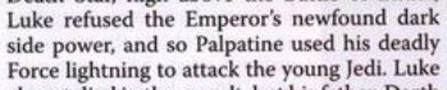
Our notes: `notes/materials/032-complete-star-wars-encyclopedia-vol-3/00-v3-scan-001-040.md:102`

> Luke almost died in the assault, but his father, Darth Vader, returned to the light side of the Force and hurled the Emperor into the Death Star's reactor core, killing him.
— Source: scan pages 1–40; Luke Skywalker; Darth Vader (Anakin Skywalker).
Note (our notes, around the quote): Luke Skywalker; Darth Vader (Anakin Skywalker): "Luke almost died in the assault, but his father, Darth Vader, returned to the light side of the Force and hurled the Emperor into the Death Star's reactor core, killing him." Source: The Complete Star Wars Encyclopedia, Vol. III, p.9
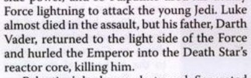
Our notes: `notes/materials/032-complete-star-wars-encyclopedia-vol-3/00-v3-scan-001-040.md:104`

> Using his dark powers to invoke a Force storm of great magnitude, Palpatine swept Jedi Master Luke Skywalker to Byss.
— Source: scan pages 1–40; Palpatine (Darth Sidious); Luke Skywalker.
Note (our notes, around the quote): Palpatine (Darth Sidious); Luke Skywalker: "Using his dark powers to invoke a Force storm of great magnitude, Palpatine swept Jedi Master Luke Skywalker to Byss." Source: The Complete Star Wars Encyclopedia, Vol. III, p.9
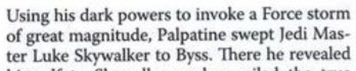
Our notes: `notes/materials/032-complete-star-wars-encyclopedia-vol-3/00-v3-scan-001-040.md:112`

> Papeega, Ban This one-eyed, bird-like being conducted the interrogation of the Rebel pilot who revealed Luke Skywalker as the individual who destroyed the Death Star.
— Source: scan pages 1–40; Luke Skywalker. POV: Luke Skywalker.
Note (our notes, around the quote): Luke Skywalker: "Papeega, Ban This one-eyed, bird-like being conducted the interrogation of the Rebel pilot who revealed Luke Skywalker as the individual who destroyed the Death Star." Source: The Complete Star Wars Encyclopedia, Vol. III, p.11
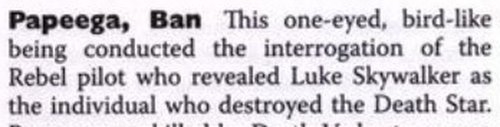
Our notes: `notes/materials/032-complete-star-wars-encyclopedia-vol-3/00-v3-scan-001-040.md:128`

> The Temple of Pomojema was the site of Luke Skywalker's first duel with Darth Vader.
— Source: scan pages 41–80; Luke Skywalker; Darth Vader (Anakin Skywalker).
Note (our notes, around the quote): Luke Skywalker; Darth Vader (Anakin Skywalker): "The Temple of Pomojema was the site of Luke Skywalker's first duel with Darth Vader." Source: The Complete Star Wars Encyclopedia, Vol. III, p.37
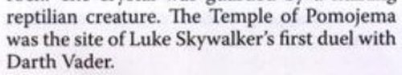
Our notes: `notes/materials/032-complete-star-wars-encyclopedia-vol-3/01-v3-scan-041-080.md:24`; `notes/materials/032-complete-star-wars-encyclopedia-vol-3/05-v3-scan-201-240.md:317`

> Luke Skywalker and Darth Vader dueled through various sections of a processing vane, culminating in Skywalker's defeat at the edge of an observation platform.
— Source: scan pages 41–80; Luke Skywalker; Darth Vader (Anakin Skywalker).
Note (our notes, around the quote): Luke Skywalker; Darth Vader (Anakin Skywalker): "Luke Skywalker and Darth Vader dueled through various sections of a processing vane, culminating in Skywalker's defeat at the edge of an observation platform." Source: The Complete Star Wars Encyclopedia, Vol. III, p.45
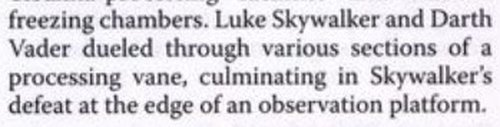
Our notes: `notes/materials/032-complete-star-wars-encyclopedia-vol-3/01-v3-scan-041-080.md:86`

> The Bith tended to injuries Jacen sustained after dueling with Luke and Ben Skywalker.
— Source: scan pages 41–80; Jacen Solo (Darth Caedus); Luke Skywalker; Ben Skywalker.
Note (our notes, around the quote): Jacen Solo (Darth Caedus); Luke Skywalker; Ben Skywalker: "The Bith tended to injuries Jacen sustained after dueling with Luke and Ben Skywalker." Source: The Complete Star Wars Encyclopedia, Vol. III, p.56
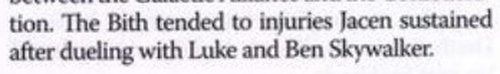
Our notes: `notes/materials/032-complete-star-wars-encyclopedia-vol-3/01-v3-scan-041-080.md:171`

> The Qoribu crisis was believed to have been resolved when Welk was killed by Jedi Master Luke Skywalker, an event that supposedly marked the end of the Dark Nest.
— Source: scan pages 41–80; Luke Skywalker. POV: Luke Skywalker.
Note (our notes, around the quote): Luke Skywalker: "The Qoribu crisis was believed to have been resolved when Welk was killed by Jedi Master Luke Skywalker, an event that supposedly marked the end of the Dark Nest." Source: The Complete Star Wars Encyclopedia, Vol. III, p.57
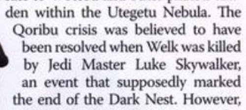
Our notes: `notes/materials/032-complete-star-wars-encyclopedia-vol-3/01-v3-scan-041-080.md:182`

> Governor Quarg, his son and successor, continued the space-wrecking operation from the planet until he was killed by Luke Skywalker in the war against the Dragon Lords.
— Source: scan pages 41–80; Luke Skywalker. POV: Luke Skywalker.
Note (our notes, around the quote): Luke Skywalker: "Governor Quarg, his son and successor, continued the space-wrecking operation from the planet until he was killed by Luke Skywalker in the war against the Dragon Lords." Source: The Complete Star Wars Encyclopedia, Vol. III, p.60
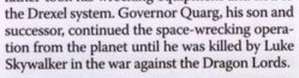
Our notes: `notes/materials/032-complete-star-wars-encyclopedia-vol-3/01-v3-scan-041-080.md:201`

> When the clone of Emperor Palpatine surfaced and brought Luke under his dark side tutelage, several of R2's files were wiped out.
— Source: scan pages 41–80; Palpatine (Darth Sidious); Luke Skywalker.
Note (our notes, around the quote): Palpatine (Darth Sidious); Luke Skywalker: "When the clone of Emperor Palpatine surfaced and brought Luke under his dark side tutelage, several of R2's files were wiped out." Source: The Complete Star Wars Encyclopedia, Vol. III, p.69
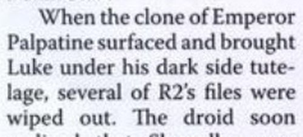
Our notes: `notes/materials/032-complete-star-wars-encyclopedia-vol-3/01-v3-scan-041-080.md:262`

> Luke refused to wipe out R2's memory, and decided to search the old Imperial archives for the Intellex IV design manual.
— Source: scan pages 41–80; Luke Skywalker. POV: Luke Skywalker.
Note (our notes, around the quote): Luke Skywalker: "Luke refused to wipe out R2's memory, and decided to search the old Imperial archives for the Intellex IV design manual." Source: The Complete Star Wars Encyclopedia, Vol. III, p.69
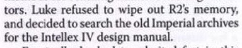
Our notes: `notes/materials/032-complete-star-wars-encyclopedia-vol-3/01-v3-scan-041-080.md:264`

> The towering monster was killed by Luke Skywalker when the Jedi was forced into the pit by Jabba's treachery.
— Source: scan pages 81–120; Luke Skywalker. POV: Luke Skywalker.
Note (our notes, around the quote): Luke Skywalker: "The towering monster was killed by Luke Skywalker when the Jedi was forced into the pit by Jabba's treachery." Source: The Complete Star Wars Encyclopedia, Vol. III, p.78
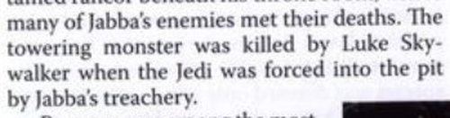
Our notes: `notes/materials/032-complete-star-wars-encyclopedia-vol-3/02-v3-scan-081-120.md:45`

> Luke and Mara Jade Skywalker confronted Alema there, and engaged in a lightsaber duel.
— Source: scan pages 81–120; Luke Skywalker; Mara Jade Skywalker; Alema Rar.
Note (our notes, around the quote): Luke Skywalker; Mara Jade Skywalker; Alema Rar: "Luke and Mara Jade Skywalker confronted Alema there, and engaged in a lightsaber duel." Source: The Complete Star Wars Encyclopedia, Vol. III, p.80
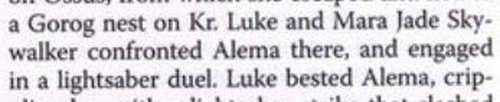
Our notes: `notes/materials/032-complete-star-wars-encyclopedia-vol-3/02-v3-scan-081-120.md:59`

> Luke bested Alema, crippling her with a lightsaber strike that slashed her from shoulder to sternum.
— Source: scan pages 81–120; Luke Skywalker; Alema Rar.
Note (our notes, around the quote): Luke Skywalker; Alema Rar: "Luke bested Alema, crippling her with a lightsaber strike that slashed her from shoulder to sternum." Source: The Complete Star Wars Encyclopedia, Vol. III, p.80
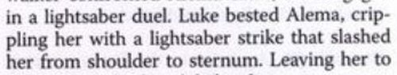
Our notes: `notes/materials/032-complete-star-wars-encyclopedia-vol-3/02-v3-scan-081-120.md:61`

> Together they killed the Jedi Tresina Lobi; Alema also fought by Lumiya's side at Rooqoo Depot, where they attempted to defeat Luke and Mara Jade Skywalker.
— Source: scan pages 81–120; Tresina Lobi; Alema Rar; Lumiya; Luke Skywalker; Mara Jade Skywalker.
Note (our notes, around the quote): Tresina Lobi; Alema Rar; Lumiya; Luke Skywalker; Mara Jade Skywalker: "Together they killed the Jedi Tresina Lobi; Alema also fought by Lumiya's side at Rooqoo Depot, where they attempted to defeat Luke and Mara Jade Skywalker." Source: The Complete Star Wars Encyclopedia, Vol. III, p.81
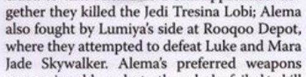
Our notes: `notes/materials/032-complete-star-wars-encyclopedia-vol-3/02-v3-scan-081-120.md:74`

> A childhood friend of Luke Skywalker, Biggs was killed while helping Luke in his run at the Death Star.
— Source: scan pages 81–120; Luke Skywalker. POV: Luke Skywalker.
Note (our notes, around the quote): Luke Skywalker: "A childhood friend of Luke Skywalker, Biggs was killed while helping Luke in his run at the Death Star." Source: The Complete Star Wars Encyclopedia, Vol. III, p.88
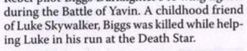
Our notes: `notes/materials/032-complete-star-wars-encyclopedia-vol-3/02-v3-scan-081-120.md:123`

> He prepared the ship as an escape vessel for Ashgad and the droch Dzym, but it was destroyed after Luke Skywalker used the Force to communicate with the intelligent crystals on Nam Chorios, which in turn ordered the crystals aboard the Reliant to destroy it.
— Source: scan pages 81–120; Luke Skywalker. POV: Luke Skywalker.
Note (our notes, around the quote): Luke Skywalker: "He prepared the ship as an escape vessel for Ashgad and the droch Dzym, but it was destroyed after Luke Skywalker used the Force to communicate with the intelligent crystals on Nam Chorios, which in turn ordered the crystals aboard the Reliant to destroy it." Source: The Complete Star Wars Encyclopedia, Vol. III, p.91
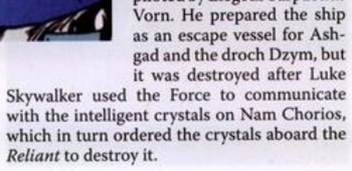
Our notes: `notes/materials/032-complete-star-wars-encyclopedia-vol-3/02-v3-scan-081-120.md:150`

> It was during just such a celebration that the sail barge was destroyed when Luke Skywalker, Princess Leia Organa, and others staged a daring rescue of Han Solo.
— Source: scan pages 121–160; Luke Skywalker; Leia Organa Solo; Han Solo.
Note (our notes, around the quote): Luke Skywalker; Leia Organa Solo; Han Solo: "It was during just such a celebration that the sail barge was destroyed when Luke Skywalker, Princess Leia Organa, and others staged a daring rescue of Han Solo." Source: The Complete Star Wars Encyclopedia, Vol. III, p.124
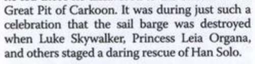
Our notes: `notes/materials/032-complete-star-wars-encyclopedia-vol-3/03-v3-scan-121-160.md:75`

> After Thrawn's defeat but before the rise of the clone Emperor, a New Republic commando team including Luke Skywalker and led by Lieutenant Page was sent to Sarahwiee to destroy the facility and erase its computer records.
— Source: scan pages 121–160; Grand Admiral Thrawn; Luke Skywalker.
Note (our notes, around the quote): Grand Admiral Thrawn; Luke Skywalker: "After Thrawn's defeat but before the rise of the clone Emperor, a New Republic commando team including Luke Skywalker and led by Lieutenant Page was sent to Sarahwiee to destroy the facility and erase its computer records." Source: The Complete Star Wars Encyclopedia, Vol. III, p.127
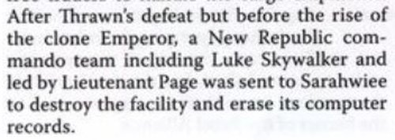
Our notes: `notes/materials/032-complete-star-wars-encyclopedia-vol-3/03-v3-scan-121-160.md:94`

> Palpatine ordered Sedriss to go to Ossus to get Luke Skywalker, but the Executor was destroyed by the power of an ancient Jedi, Ood Bnar.
— Source: scan pages 121–160; Palpatine (Darth Sidious); Luke Skywalker; Ood Bnar.
Note (our notes, around the quote): Palpatine (Darth Sidious); Luke Skywalker; Ood Bnar: "Palpatine ordered Sedriss to go to Ossus to get Luke Skywalker, but the Executor was destroyed by the power of an ancient Jedi, Ood Bnar." Source: The Complete Star Wars Encyclopedia, Vol. III, p.135
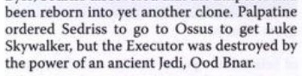
Our notes: `notes/materials/032-complete-star-wars-encyclopedia-vol-3/03-v3-scan-121-160.md:156`

> The droid R2-D2 was able to duplicate the signals, which enabled Luke Skywalker to ride a serpent and defeat the Serpent Masters, freeing Tanith Shire's people from slavery.
— Source: scan pages 121–160; Luke Skywalker. POV: Luke Skywalker.
Note (our notes, around the quote): Luke Skywalker: "The droid R2-D2 was able to duplicate the signals, which enabled Luke Skywalker to ride a serpent and defeat the Serpent Masters, freeing Tanith Shire's people from slavery." Source: The Complete Star Wars Encyclopedia, Vol. III, p.140
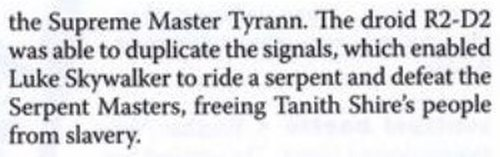
Our notes: `notes/materials/032-complete-star-wars-encyclopedia-vol-3/03-v3-scan-121-160.md:207`

> Luke Skywalker, Rik Duel, Dani, Chihdo, Plif, and Kiro went on a diplomatic mission to Shawken.
— Source: scan pages 121–160; Luke Skywalker. POV: Luke Skywalker.
Note (our notes, around the quote): Luke Skywalker: "Luke Skywalker, Rik Duel, Dani, Chihdo, Plif, and Kiro went on a diplomatic mission to Shawken." Source: The Complete Star Wars Encyclopedia, Vol. III, p.145
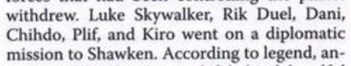
Our notes: `notes/materials/032-complete-star-wars-encyclopedia-vol-3/03-v3-scan-121-160.md:252`

> Luke Skywalker beheaded Shimrra in a duel, while Jacen Solo eliminated Onimi.
— Source: scan pages 121–160; Luke Skywalker; Jacen Solo (Darth Caedus); Onimi.
Note (our notes, around the quote): Luke Skywalker; Jacen Solo (Darth Caedus); Onimi: "Luke Skywalker beheaded Shimrra in a duel, while Jacen Solo eliminated Onimi." Source: The Complete Star Wars Encyclopedia, Vol. III, p.147
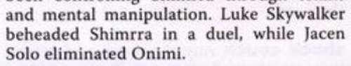
Our notes: `notes/materials/032-complete-star-wars-encyclopedia-vol-3/03-v3-scan-121-160.md:274`

> After crash landing, Luke defeated the Serpent Masters and freed Shire's people.
— Source: scan pages 121–160; Luke Skywalker. POV: Luke Skywalker.
Note (our notes, around the quote): Luke Skywalker: "After crash landing, Luke defeated the Serpent Masters and freed Shire's people." Source: The Complete Star Wars Encyclopedia, Vol. III, p.147
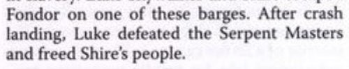
Our notes: `notes/materials/032-complete-star-wars-encyclopedia-vol-3/03-v3-scan-121-160.md:280`

> The Shriwirr was single-handedly captured by Luke Skywalker after the Ssi-ruuk evacuated the ship rather than face his Force abilities in battle.
— Source: scan pages 121–160; Luke Skywalker. POV: Luke Skywalker.
Note (our notes, around the quote): Luke Skywalker: "The Shriwirr was single-handedly captured by Luke Skywalker after the Ssi-ruuk evacuated the ship rather than face his Force abilities in battle." Source: The Complete Star Wars Encyclopedia, Vol. III, p.149
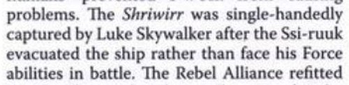
Our notes: `notes/materials/032-complete-star-wars-encyclopedia-vol-3/03-v3-scan-121-160.md:294`

> The young man helped Luke escape from the Ssi-ruuk, but was mortally wounded as he killed his cruel masters, including the invasion leader, Elder Sh'tk'ith, in revenge.
— Source: scan pages 121–160; Luke Skywalker. POV: Luke Skywalker.
Note (our notes, around the quote): Luke Skywalker: "The young man helped Luke escape from the Ssi-ruuk, but was mortally wounded as he killed his cruel masters, including the invasion leader, Elder Sh'tk'ith, in revenge." Source: The Complete Star Wars Encyclopedia, Vol. III, p.150
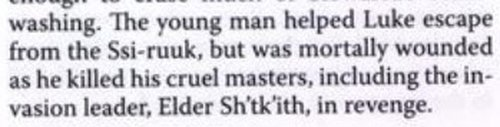
Our notes: `notes/materials/032-complete-star-wars-encyclopedia-vol-3/03-v3-scan-121-160.md:309`

> Luke Skywalker provided Palpatine's control signals to R2-D2, who shut down the World Devastators during the Battle of Mon Calamari, allowing New Republic forces to destroy the helpless planet smashers.
— Source: scan pages 121–160; Luke Skywalker; Palpatine (Darth Sidious).
Note (our notes, around the quote): Luke Skywalker; Palpatine (Darth Sidious): "Luke Skywalker provided Palpatine's control signals to R2-D2, who shut down the World Devastators during the Battle of Mon Calamari, allowing New Republic forces to destroy the helpless planet smashers." Source: The Complete Star Wars Encyclopedia, Vol. III, p.152
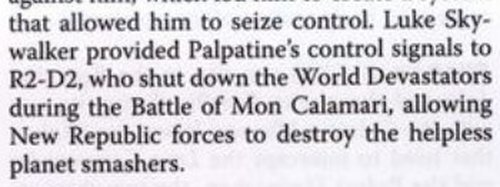
Our notes: `notes/materials/032-complete-star-wars-encyclopedia-vol-3/03-v3-scan-121-160.md:333`

> Luke Skywalker and his companions escaped in a skiff just before the Hutt's sail barge exploded near the Great Pit of Carkoon.
— Source: scan pages 161–200; Luke Skywalker. POV: Luke Skywalker.
Note (our notes, around the quote): Luke Skywalker: "Luke Skywalker and his companions escaped in a skiff just before the Hutt's sail barge exploded near the Great Pit of Carkoon." Source: The Complete Star Wars Encyclopedia, Vol. III, p.158
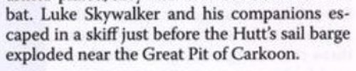
Our notes: `notes/materials/032-complete-star-wars-encyclopedia-vol-3/04-v3-scan-161-200.md:33`

> With the defeat of the Yuuzhan Vong, Luke and Mara resolved to spend more time with their son, but the rigors of leading the new Jedi Order conspired to keep them apart.
— Source: scan pages 161–200; Luke Skywalker; Mara Jade Skywalker.
Note (our notes, around the quote): Luke Skywalker; Mara Jade Skywalker: "With the defeat of the Yuuzhan Vong, Luke and Mara resolved to spend more time with their son, but the rigors of leading the new Jedi Order conspired to keep them apart." Source: The Complete Star Wars Encyclopedia, Vol. III, p.162
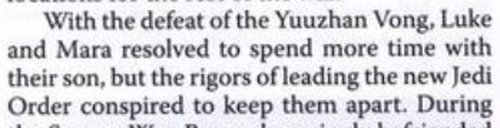
Our notes: `notes/materials/032-complete-star-wars-encyclopedia-vol-3/04-v3-scan-161-200.md:75`

> Luke, who had killed Lumiya to avenge Mara, realized that she couldn't have been the culprit when Ben explained the circumstances of the Kavan incident.
— Source: scan pages 161–200; Luke Skywalker; Lumiya; Mara Jade Skywalker.
Note (our notes, around the quote): Luke Skywalker; Lumiya; Mara Jade Skywalker: "Luke, who had killed Lumiya to avenge Mara, realized that she couldn't have been the culprit when Ben explained the circumstances of the Kavan incident." Source: The Complete Star Wars Encyclopedia, Vol. III, p.162
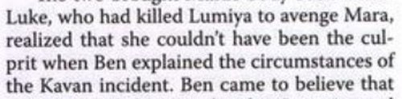
Our notes: `notes/materials/032-complete-star-wars-encyclopedia-vol-3/04-v3-scan-161-200.md:77`

> Jacen placed him in the Embrace of Pain aboard the Star Destroyer Anakin Solo, but Luke infiltrated the ship and freed him.
— Source: scan pages 161–200; Jacen Solo (Darth Caedus); Anakin Solo; Luke Skywalker.
Note (our notes, around the quote): Jacen Solo (Darth Caedus); Anakin Solo; Luke Skywalker: "Jacen placed him in the Embrace of Pain aboard the Star Destroyer Anakin Solo, but Luke infiltrated the ship and freed him." Source: The Complete Star Wars Encyclopedia, Vol. III, p.162
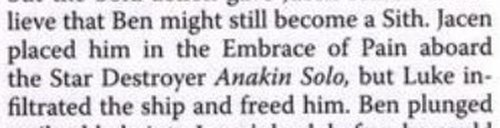
Our notes: `notes/materials/032-complete-star-wars-encyclopedia-vol-3/04-v3-scan-161-200.md:81`

> Ben plunged a vibroblade into Jacen's back before he could attack Luke, and the two left Jacen to die, although Jacen—now Darth Caedus—survived to continue his scourge.
— Source: scan pages 161–200; Jacen Solo (Darth Caedus); Luke Skywalker.
Note (our notes, around the quote): Jacen Solo (Darth Caedus); Luke Skywalker: "Ben plunged a vibroblade into Jacen's back before he could attack Luke, and the two left Jacen to die, although Jacen—now Darth Caedus—survived to continue his scourge." Source: The Complete Star Wars Encyclopedia, Vol. III, p.162
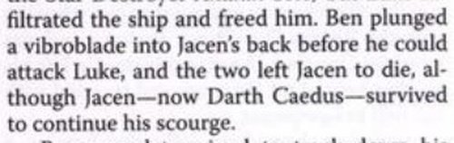
Our notes: `notes/materials/032-complete-star-wars-encyclopedia-vol-3/04-v3-scan-161-200.md:83`

> The Emperor attacked Luke, assaulting him with blue Force lightning, and prepared to kill him.
— Source: scan pages 161–200; Luke Skywalker. POV: Luke Skywalker.
Note (our notes, around the quote): Luke Skywalker: "The Emperor attacked Luke, assaulting him with blue Force lightning, and prepared to kill him." Source: The Complete Star Wars Encyclopedia, Vol. III, p.164
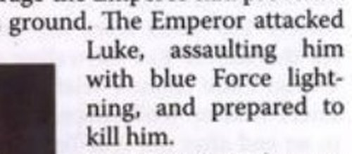
Our notes: `notes/materials/032-complete-star-wars-encyclopedia-vol-3/04-v3-scan-161-200.md:107`

> After the second Death Star was destroyed, Luke lit a pyre to burn Darth Vader's garb, He saw a vision of Anakin Skywalker, Ben Kenobi, and Yoda, standing together as luminous beings infused with the light of the Force.
— Source: scan pages 161–200; Luke Skywalker; Darth Vader (Anakin Skywalker); Obi-Wan Kenobi; Yoda.
Note (our notes, around the quote): Luke Skywalker; Darth Vader (Anakin Skywalker); Obi-Wan Kenobi; Yoda: "After the second Death Star was destroyed, Luke lit a pyre to burn Darth Vader's garb, He saw a vision of Anakin Skywalker, Ben Kenobi, and Yoda, standing together as luminous beings infused with the light of the Force." Source: The Complete Star Wars Encyclopedia, Vol. III, p.164
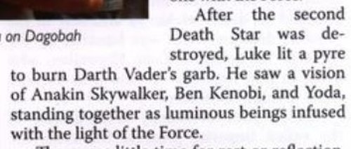
Our notes: `notes/materials/032-complete-star-wars-encyclopedia-vol-3/04-v3-scan-161-200.md:109`

> It killed one trainee, seduced another to the dark side, and nearly murdered Luke, who was eventually saved when his trainees combined their powers.
— Source: scan pages 161–200; Cade Skywalker; Luke Skywalker — entry/section: Skywalker, Cade.
Note (our notes, around the quote): Cade Skywalker; Luke Skywalker — entry/section: Skywalker, Cade: "It killed one trainee, seduced another to the dark side, and nearly murdered Luke, who was eventually saved when his trainees combined their powers." Source: The Complete Star Wars Encyclopedia, Vol. III, p.165
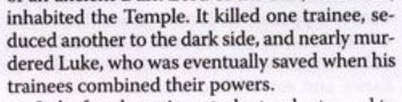
Our notes: `notes/materials/032-complete-star-wars-encyclopedia-vol-3/04-v3-scan-161-200.md:118`

> In battle with Shimrra, Luke used two lightsabers to sever the Supreme Overlord's huge head from his body.
— Source: scan pages 161–200; Luke Skywalker. POV: Luke Skywalker.
Note (our notes, around the quote): Luke Skywalker: "In battle with Shimrra, Luke used two lightsabers to sever the Supreme Overlord's huge head from his body." Source: The Complete Star Wars Encyclopedia, Vol. III, p.165
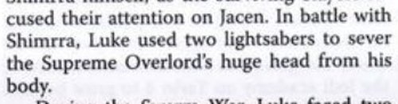
Our notes: `notes/materials/032-complete-star-wars-encyclopedia-vol-3/04-v3-scan-161-200.md:122`

> During the Swarm War, Luke faced two former Force-users, Raynar Thul and Lomi Plo, who had become absorbed into the hivemind of the Killiks that made up the Colony.
— Source: scan pages 161–200; Luke Skywalker; Plo Koon.
Note (our notes, around the quote): Luke Skywalker; Plo Koon: "During the Swarm War, Luke faced two former Force-users, Raynar Thul and Lomi Plo, who had become absorbed into the hivemind of the Killiks that made up the Colony." Source: The Complete Star Wars Encyclopedia, Vol. III, p.165
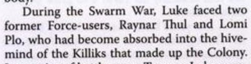
Our notes: `notes/materials/032-complete-star-wars-encyclopedia-vol-3/04-v3-scan-161-200.md:124`

> On Terephon, Lumiya claimed to have killed Mara, and Luke beheaded her after a struggle.
— Source: scan pages 161–200; Lumiya; Mara Jade Skywalker; Luke Skywalker.
Note (our notes, around the quote): Lumiya; Mara Jade Skywalker; Luke Skywalker: "On Terephon, Lumiya claimed to have killed Mara, and Luke beheaded her after a struggle." Source: The Complete Star Wars Encyclopedia, Vol. III, p.165
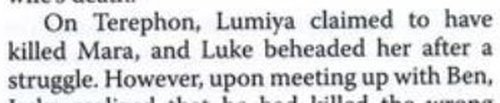
Our notes: `notes/materials/032-complete-star-wars-encyclopedia-vol-3/04-v3-scan-161-200.md:128`

> However, upon meeting up with Ben, Luke realized that he had killed the wrong person.
— Source: scan pages 161–200; Luke Skywalker. POV: Luke Skywalker.
Note (our notes, around the quote): Luke Skywalker: "However, upon meeting up with Ben, Luke realized that he had killed the wrong person." Source: The Complete Star Wars Encyclopedia, Vol. III, p.165
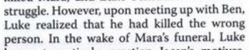
Our notes: `notes/materials/032-complete-star-wars-encyclopedia-vol-3/04-v3-scan-161-200.md:130`

> With new resolve, Luke set plans into motion to finally confront and defeat Caedus.
— Source: scan pages 161–200; Luke Skywalker; Jacen Solo (Darth Caedus).
Note (our notes, around the quote): Luke Skywalker; Jacen Solo (Darth Caedus): "With new resolve, Luke set plans into motion to finally confront and defeat Caedus." Source: The Complete Star Wars Encyclopedia, Vol. III, p.165
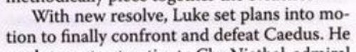
Our notes: `notes/materials/032-complete-star-wars-encyclopedia-vol-3/04-v3-scan-161-200.md:136`

> Jaina defeated her brother, ending his attacks against the Jedi, while Luke and Han stopped the opportunistic Moffs of the Imperial Remnant from their attempts at conquest that accompanied Caedus's rise.
— Source: scan pages 161–200; Jaina Solo; Luke Skywalker; Jacen Solo (Darth Caedus).
Note (our notes, around the quote): Jaina Solo; Luke Skywalker; Jacen Solo (Darth Caedus): "Jaina defeated her brother, ending his attacks against the Jedi, while Luke and Han stopped the opportunistic Moffs of the Imperial Remnant from their attempts at conquest that accompanied Caedus's rise." Source: The Complete Star Wars Encyclopedia, Vol. III, p.165
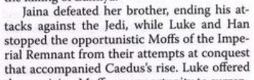
Our notes: `notes/materials/032-complete-star-wars-encyclopedia-vol-3/04-v3-scan-161-200.md:138`

> Skywalker, Luuke A clone of Luke Skywalker, it was created from cells—sample B-2332-54—taken from the hand that Luke had lost in his lightsaber duel with Darth Vader at Cloud City.
— Source: scan pages 161–200; Luke Skywalker; Darth Vader (Anakin Skywalker).
Note (our notes, around the quote): Luke Skywalker; Darth Vader (Anakin Skywalker): "Skywalker, Luuke A clone of Luke Skywalker, it was created from cells—sample B-2332-54—taken from the hand that Luke had lost in his lightsaber duel with Darth Vader at Cloud City." Source: The Complete Star Wars Encyclopedia, Vol. III, p.165
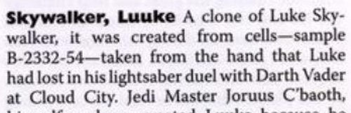
Our notes: `notes/materials/032-complete-star-wars-encyclopedia-vol-3/04-v3-scan-161-200.md:140`

> Using the lightsaber that Luke had lost along with his hand, the clone nearly destroyed Skywalker.
— Source: scan pages 161–200; Luke Skywalker. POV: Luke Skywalker.
Note (our notes, around the quote): Luke Skywalker: "Using the lightsaber that Luke had lost along with his hand, the clone nearly destroyed Skywalker." Source: The Complete Star Wars Encyclopedia, Vol. III, p.165
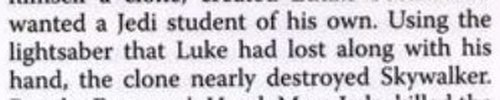
Our notes: `notes/materials/032-complete-star-wars-encyclopedia-vol-3/04-v3-scan-161-200.md:142`

- Note (summary from our notes, not a quotation): Luke Skywalker: "She beat him to Jabba's palace and went undercover as "Arica," but she failed in her mission, and Luke went on to help destroy the Emperor along with his second Death Star battle station." Source: The Complete Star Wars Encyclopedia, Vol. III, p.166
  — Source: scan pages 161–200. POV: Luke Skywalker.
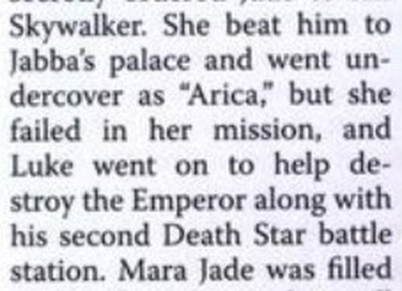
Our notes: `notes/materials/032-complete-star-wars-encyclopedia-vol-3/04-v3-scan-161-200.md:149`

> When the mad Jedi clone Joruus C'baoth called both Luke and Mara to him, then unleashed Skywalker's clone, Luuke, Mara killed the Skywalker clone—and finally C'baoth, too, with help from Luke and Leia Organa Solo.
— Source: scan pages 161–200; Joruus C'baoth; Luke Skywalker; Mara Jade Skywalker; Leia Organa Solo.
Note (our notes, around the quote): Joruus C'baoth; Luke Skywalker; Mara Jade Skywalker; Leia Organa Solo: "When the mad Jedi clone Joruus C'baoth called both Luke and Mara to him, then unleashed Skywalker's clone, Luuke, Mara killed the Skywalker clone—and finally C'baoth, too, with help from Luke and Leia Organa Solo." Source: The Complete Star Wars Encyclopedia, Vol. III, p.166
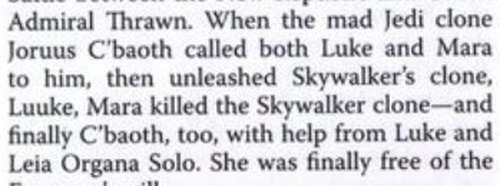
Our notes: `notes/materials/032-complete-star-wars-encyclopedia-vol-3/04-v3-scan-161-200.md:151`

> Later, at Han Solo's request, Jade and Karrde located and brought to the planet Almania several Force-bending ysalamiri, which Solo used to help Luke and Leia defeat the Dark Jedi Kueller.
— Source: scan pages 161–200; Han Solo; Luke Skywalker; Leia Organa Solo; Kueller.
Note (our notes, around the quote): Han Solo; Luke Skywalker; Leia Organa Solo; Kueller: "Later, at Han Solo's request, Jade and Karrde located and brought to the planet Almania several Force-bending ysalamiri, which Solo used to help Luke and Leia defeat the Dark Jedi Kueller." Source: The Complete Star Wars Encyclopedia, Vol. III, p.166
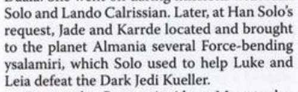
Our notes: `notes/materials/032-complete-star-wars-encyclopedia-vol-3/04-v3-scan-161-200.md:153`

> Luke, however, at first believed Lumiya was the murderer and killed her.
— Source: scan pages 161–200; Luke Skywalker; Lumiya.
Note (our notes, around the quote): Luke Skywalker; Lumiya: "Luke, however, at first believed Lumiya was the murderer and killed her." Source: The Complete Star Wars Encyclopedia, Vol. III, p.166
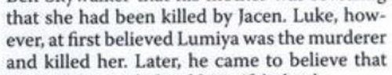
Our notes: `notes/materials/032-complete-star-wars-encyclopedia-vol-3/04-v3-scan-161-200.md:159`

> With new resolve, Luke developed plans to finally confront and defeat Caedus.
— Source: scan pages 161–200; Luke Skywalker; Jacen Solo (Darth Caedus).
Note (our notes, around the quote): Luke Skywalker; Jacen Solo (Darth Caedus): "With new resolve, Luke developed plans to finally confront and defeat Caedus." Source: The Complete Star Wars Encyclopedia, Vol. III, p.166
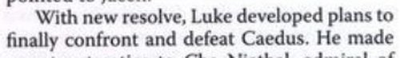
Our notes: `notes/materials/032-complete-star-wars-encyclopedia-vol-3/04-v3-scan-161-200.md:163`

> Jaina defeated her brother while Luke and Han stopped the opportunistic Moffs of the Imperial Remnant.
— Source: scan pages 161–200; Jaina Solo; Luke Skywalker.
Note (our notes, around the quote): Jaina Solo; Luke Skywalker: "Jaina defeated her brother while Luke and Han stopped the opportunistic Moffs of the Imperial Remnant." Source: The Complete Star Wars Encyclopedia, Vol. III, p.166
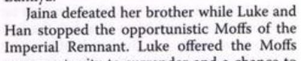
Our notes: `notes/materials/032-complete-star-wars-encyclopedia-vol-3/04-v3-scan-161-200.md:165`

> Pote Snitkin piloted one of Jabba's skiffs and was among those killed during Luke Skywalker's rescue of Han Solo and Princess Leia from the Hutt.
— Source: scan pages 161–200; Luke Skywalker; Han Solo; Leia Organa Solo.
Note (our notes, around the quote): Luke Skywalker; Han Solo; Leia Organa Solo: "Pote Snitkin piloted one of Jabba's skiffs and was among those killed during Luke Skywalker's rescue of Han Solo and Princess Leia from the Hutt." Source: The Complete Star Wars Encyclopedia, Vol. III, p.170
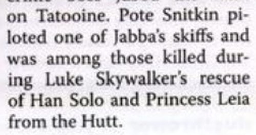
Our notes: `notes/materials/032-complete-star-wars-encyclopedia-vol-3/04-v3-scan-161-200.md:203`

> Later, Jacen joined forces with the other Jedi students in destroying Exar Kun's spirit forever and freeing Luke's spirit.
— Source: scan pages 161–200.
Note (our notes, around the quote): Jacen Solo (Darth Caedus); Exar Kun; Luke Skywalker — entry/section: Solo, Jacen: "Later, Jacen joined forces with the other Jedi students in destroying Exar Kun's spirit forever and freeing Luke's spirit." Source: The Complete Star Wars Encyclopedia, Vol. III, p.175

Also cited as: Exar Kun (AncientPower) vs Darth Plagueis (Vaelias) — https://www.suspectinsightforums.com/t4421-ss-exar-kun-ladykulvax-vs-darth-plagueis-vaelias.
Also noted as: Q145 — Source: Jacen Solo, The Complete Star Wars Encyclopedia | <<QUOTE Kirana Ti, The Complete Star Wars Encyclopedia wrote:>>
Our notes: `notes/materials/032-complete-star-wars-encyclopedia-vol-3/04-v3-scan-161-200.md:238`; `suspect-insight/debates/101-exar-kun-vs-darth-plagueis.md:674`; `suspect-insight/debates/123-exar-kun-vs-darth-sidious.md:1277`; `suspect-insight/debates/087-exar-kun-vs-darth-sidious.md:202`

> Jacen fled to Ziost, where Lumiya agreed to make Luke believe that she had killed Mara.
— Source: scan pages 161–200.
Note (our notes, around the quote): Jacen Solo (Darth Caedus); Lumiya; Luke Skywalker; Mara Jade Skywalker — entry/section: Solo, Jacen: "Jacen fled to Ziost, where Lumiya agreed to make Luke believe that she had killed Mara." Source: The Complete Star Wars Encyclopedia, Vol. III, p.175

Our notes: `notes/materials/032-complete-star-wars-encyclopedia-vol-3/04-v3-scan-161-200.md:244`

> When Luke was unable to defeat Jacen, Jaina became convinced that her role as the Sword of the Jedi was to defeat her brother and restore peace to the galaxy.
— Source: scan pages 161–200.
Note (our notes, around the quote): Jaina Solo; Luke Skywalker; Jacen Solo (Darth Caedus) — entry/section: Solo, Jaina: "When Luke was unable to defeat Jacen, Jaina became convinced that her role as the Sword of the Jedi was to defeat her brother and restore peace to the galaxy." Source: The Complete Star Wars Encyclopedia, Vol. III, p.176

Our notes: `notes/materials/032-complete-star-wars-encyclopedia-vol-3/04-v3-scan-161-200.md:257`

> Luke, Han, and Chewbacca—along with the droids R2-D2 and C-3PO—became a second family to her, helping to ease some of the shock and pain left by the annihilation of Alderaan.
— Source: scan pages 161–200; Luke Skywalker; Chewbacca.
Note (our notes, around the quote): Luke Skywalker; Chewbacca: "Luke, Han, and Chewbacca—along with the droids R2-D2 and C-3PO—became a second family to her, helping to ease some of the shock and pain left by the annihilation of Alderaan." Source: The Complete Star Wars Encyclopedia, Vol. III, p.177

Our notes: `notes/materials/032-complete-star-wars-encyclopedia-vol-3/04-v3-scan-161-200.md:276`

> Leia and the others fled, and helped rescue Luke, who had narrowly survived a lightsaber duel with Darth Vader.
— Source: scan pages 161–200; Leia Organa Solo; Luke Skywalker; Darth Vader (Anakin Skywalker).
Note (our notes, around the quote): Leia Organa Solo; Luke Skywalker; Darth Vader (Anakin Skywalker): "Leia and the others fled, and helped rescue Luke, who had narrowly survived a lightsaber duel with Darth Vader." Source: The Complete Star Wars Encyclopedia, Vol. III, p.177

Our notes: `notes/materials/032-complete-star-wars-encyclopedia-vol-3/04-v3-scan-161-200.md:278`

> Luke Skywalker found Streen to be Force-sensitive and invited him to join the other Jedi students at the Jedi academy, The spirit of Sith Lord Exar Kun influenced Streen into starting a tornado that threatened to destroy the near-lifeless body of Luke, but Streen was stopped in time.
— Source: scan pages 161–200; Streen; Luke Skywalker; Exar Kun — entry/section: Streen.
Note (our notes, around the quote): Streen; Luke Skywalker; Exar Kun — entry/section: Streen: "Luke Skywalker found Streen to be Force-sensitive and invited him to join the other Jedi students at the Jedi academy, The spirit of Sith Lord Exar Kun influenced Streen into starting a tornado that threatened to destroy the near-lifeless body of Luke, but Streen was stopped in time." Source: The Complete Star Wars Encyclopedia, Vol. III, p.194

Our notes: `notes/materials/032-complete-star-wars-encyclopedia-vol-3/04-v3-scan-161-200.md:425`

> Too- Onebee treated Luke Skywalker twice during the Battle of Hoth, once operating to replace Luke's severed hand with a biomechanical replacement.
— Source: scan pages 201–240; Luke Skywalker. POV: Luke Skywalker.
Note (our notes, around the quote): Luke Skywalker: "Too- Onebee treated Luke Skywalker twice during the Battle of Hoth, once operating to replace Luke's severed hand with a biomechanical replacement." Source: The Complete Star Wars Encyclopedia, Vol. III, p.205

Our notes: `notes/materials/032-complete-star-wars-encyclopedia-vol-3/05-v3-scan-201-240.md:100`

> Just before he left the planet, Luke ripped the stabilizer off his skyhopper while trying to maneuver through the infamous Stone Needle in Beggar's Canyon.
— Source: scan pages 201–240; Luke Skywalker. POV: Luke Skywalker.
Note (our notes, around the quote): Luke Skywalker: "Just before he left the planet, Luke ripped the stabilizer off his skyhopper while trying to maneuver through the infamous Stone Needle in Beggar's Canyon." Source: The Complete Star Wars Encyclopedia, Vol. III, p.207

Our notes: `notes/materials/032-complete-star-wars-encyclopedia-vol-3/05-v3-scan-201-240.md:120`

> Luke Skywalker destroyed the station, but Orman worked with his brother Silas to cut off a major supply route using the Omega Frost device.
— Source: scan pages 201–240; Luke Skywalker. POV: Luke Skywalker.
Note (our notes, around the quote): Luke Skywalker: "Luke Skywalker destroyed the station, but Orman worked with his brother Silas to cut off a major supply route using the Omega Frost device." Source: The Complete Star Wars Encyclopedia, Vol. III, p.211

Our notes: `notes/materials/032-complete-star-wars-encyclopedia-vol-3/05-v3-scan-201-240.md:154`

> Tainer, Doran Born to Kell Tainer and Tyria Sarkin several years after the defeat of Warlord Zsinj, Doran studied at Luke Skywalker's Jedi praxeum after the Yuuzhan Vong War and trained to become a Jedi.
— Source: scan pages 201–240; Luke Skywalker. POV: Luke Skywalker.
Note (our notes, around the quote): Luke Skywalker: "Tainer, Doran Born to Kell Tainer and Tyria Sarkin several years after the defeat of Warlord Zsinj, Doran studied at Luke Skywalker's Jedi praxeum after the Yuuzhan Vong War and trained to become a Jedi." Source: The Complete Star Wars Encyclopedia, Vol. III, p.212

Our notes: `notes/materials/032-complete-star-wars-encyclopedia-vol-3/05-v3-scan-201-240.md:167`

> Luke Skywalker delayed the mission to destroy the Gorog ship's hyperdrive long enough to grab the Ewok with the Force and draw Tarfang back to safety.
— Source: scan pages 201–240; Luke Skywalker. POV: Luke Skywalker.
Note (our notes, around the quote): Luke Skywalker: "Luke Skywalker delayed the mission to destroy the Gorog ship's hyperdrive long enough to grab the Ewok with the Force and draw Tarfang back to safety." Source: The Complete Star Wars Encyclopedia, Vol. III, p.219

Our notes: `notes/materials/032-complete-star-wars-encyclopedia-vol-3/05-v3-scan-201-240.md:224`

> Their duel was cut short when Luke Skywalker arrived with word of the Jedi Order's defection from the Galactic Alliance.
— Source: scan pages 201–240; Luke Skywalker. POV: Luke Skywalker.
Note (our notes, around the quote): Luke Skywalker: "Their duel was cut short when Luke Skywalker arrived with word of the Jedi Order's defection from the Galactic Alliance." Source: The Complete Star Wars Encyclopedia, Vol. III, p.219

Our notes: `notes/materials/032-complete-star-wars-encyclopedia-vol-3/05-v3-scan-201-240.md:228`

> Luke Skywalker discovered how to use the ship for its intended purpose—a tool for rebuilding a destroyed world.
— Source: scan pages 201–240; Luke Skywalker. POV: Luke Skywalker.
Note (our notes, around the quote): Luke Skywalker: "Luke Skywalker discovered how to use the ship for its intended purpose—a tool for rebuilding a destroyed world." Source: The Complete Star Wars Encyclopedia, Vol. III, p.229

Our notes: `notes/materials/032-complete-star-wars-encyclopedia-vol-3/05-v3-scan-201-240.md:308`

> This clone was never activated: Luke Skywalker and Mara Jade discovered it and destroyed it during their escape from the complex.
— Source: scan pages 241–280; Luke Skywalker; Mara Jade Skywalker.
Note (our notes, around the quote): Luke Skywalker; Mara Jade Skywalker: "This clone was never activated: Luke Skywalker and Mara Jade discovered it and destroyed it during their escape from the complex." Source: The Complete Star Wars Encyclopedia, Vol. III, p.240

Our notes: `notes/materials/032-complete-star-wars-encyclopedia-vol-3/06-v3-scan-241-280.md:61`

> Millions died on both sides until Thul was confronted by Luke Skywalker aboard the captured Star Destroyer Admiral Ackbar.
— Source: scan pages 241–280; Luke Skywalker; Admiral Ackbar.
Note (our notes, around the quote): Luke Skywalker; Admiral Ackbar: "Millions died on both sides until Thul was confronted by Luke Skywalker aboard the captured Star Destroyer Admiral Ackbar." Source: The Complete Star Wars Encyclopedia, Vol. III, p.241

Our notes: `notes/materials/032-complete-star-wars-encyclopedia-vol-3/06-v3-scan-241-280.md:68`

> Later she became one of Skywalker's Jedi candidates and joined his other Jedi students on Yavin 4 in defeating the spirit of Dark Lord Exar Kun, protecting Luke's body and freeing his spirit.
— Source: scan pages 241–280; Exar Kun; Luke Skywalker.
Note (our notes, around the quote): Exar Kun; Luke Skywalker: "Later she became one of Skywalker's Jedi candidates and joined his other Jedi students on Yavin 4 in defeating the spirit of Dark Lord Exar Kun, protecting Luke's body and freeing his spirit." Source: The Complete Star Wars Encyclopedia, Vol. III, p.243

Our notes: `notes/materials/032-complete-star-wars-encyclopedia-vol-3/06-v3-scan-241-280.md:88`

> Four years after the Battle of Endor, Luke Skywalker traveled to Toola to inspect the ruined home of a slain Jedi Master who had once been the curator of Jedi records on Coruscant.
— Source: scan pages 241–280; Luke Skywalker. POV: Luke Skywalker.
Note (our notes, around the quote): Luke Skywalker: "Four years after the Battle of Endor, Luke Skywalker traveled to Toola to inspect the ruined home of a slain Jedi Master who had once been the curator of Jedi records on Coruscant." Source: The Complete Star Wars Encyclopedia, Vol. III, p.254

Our notes: `notes/materials/032-complete-star-wars-encyclopedia-vol-3/06-v3-scan-241-280.md:185`

> Then, seemingly from nowhere, a blast caught Vader's ship and sent it spinning into space as Luke Skywalker's proton torpedoes found their mark and destroyed the Death Star.
— Source: scan pages 281–320; Darth Vader (Anakin Skywalker); Luke Skywalker.
Note (our notes, around the quote): Darth Vader (Anakin Skywalker); Luke Skywalker: "Then, seemingly from nowhere, a blast caught Vader's ship and sent it spinning into space as Luke Skywalker's proton torpedoes found their mark and destroyed the Death Star." Source: The Complete Star Wars Encyclopedia, Vol. III, p.289

Our notes: `notes/materials/032-complete-star-wars-encyclopedia-vol-3/07-v3-scan-281-320.md:106`

> Luke then confronted the Emperor, who attacked him with blast after blast of blue Force lightning.
— Source: scan pages 281–320; Luke Skywalker. POV: Luke Skywalker.
Note (our notes, around the quote): Luke Skywalker: "Luke then confronted the Emperor, who attacked him with blast after blast of blue Force lightning." Source: The Complete Star Wars Encyclopedia, Vol. III, p.289

Our notes: `notes/materials/032-complete-star-wars-encyclopedia-vol-3/07-v3-scan-281-320.md:112`

> Darth Vader duels his son, Luke Skywalker.
— Source: scan pages 281–320; Darth Vader (Anakin Skywalker); Luke Skywalker.
Note (our notes, around the quote): Darth Vader (Anakin Skywalker); Luke Skywalker: "Darth Vader duels his son, Luke Skywalker." Source: The Complete Star Wars Encyclopedia, Vol. III, p.289

Our notes: `notes/materials/032-complete-star-wars-encyclopedia-vol-3/07-v3-scan-281-320.md:114`

> A swoop gang he hired was no match for Luke, Han Solo, and Wedge Antilles, and Venan himself was incapacitated by Chewbacca.
— Source: scan pages 281–320; Luke Skywalker; Han Solo; Chewbacca.
Note (our notes, around the quote): Luke Skywalker; Han Solo; Chewbacca: "A swoop gang he hired was no match for Luke, Han Solo, and Wedge Antilles, and Venan himself was incapacitated by Chewbacca." Source: The Complete Star Wars Encyclopedia, Vol. III, p.301

Our notes: `notes/materials/032-complete-star-wars-encyclopedia-vol-3/07-v3-scan-281-320.md:206`

> Upon learning of the survival of Kenobi and the appearance of Luke Skywalker, Halagad fought against the dark side and defeated it, but died shortly thereafter.
— Source: scan pages 281–320; Obi-Wan Kenobi; Luke Skywalker.
Note (our notes, around the quote): Obi-Wan Kenobi; Luke Skywalker: "Upon learning of the survival of Kenobi and the appearance of Luke Skywalker, Halagad fought against the dark side and defeated it, but died shortly thereafter." Source: The Complete Star Wars Encyclopedia, Vol. III, p.302

Our notes: `notes/materials/032-complete-star-wars-encyclopedia-vol-3/07-v3-scan-281-320.md:217`

> The Ysanna were frozen in carbonite to await the future construction of a clone laboratory in Bast Castle, but Luke Skywalker and his Jedi trainees managed to storm the castle and defeat the Emperor's minions.
— Source: scan pages 281–320; Luke Skywalker. POV: Luke Skywalker.
Note (our notes, around the quote): Luke Skywalker: "The Ysanna were frozen in carbonite to await the future construction of a clone laboratory in Bast Castle, but Luke Skywalker and his Jedi trainees managed to storm the castle and defeat the Emperor's minions." Source: The Complete Star Wars Encyclopedia, Vol. III, p.309

Our notes: `notes/materials/032-complete-star-wars-encyclopedia-vol-3/07-v3-scan-281-320.md:284`

> When Colonel Nord decided to use the ionic cannon aboard the Tarkin to take out Luke Skywalker and Leia Organa, the superweapon exploded.
— Source: scan pages 281–320; Grand Moff Tarkin; Luke Skywalker; Leia Organa Solo.
Note (our notes, around the quote): Grand Moff Tarkin; Luke Skywalker; Leia Organa Solo: "When Colonel Nord decided to use the ionic cannon aboard the Tarkin to take out Luke Skywalker and Leia Organa, the superweapon exploded." Source: The Complete Star Wars Encyclopedia, Vol. III, p.309

Our notes: `notes/materials/032-complete-star-wars-encyclopedia-vol-3/07-v3-scan-281-320.md:286`

> These animals were later found feeding on garbage virtually everywhere in the galaxy; Luke Skywalker was attacked and nearly killed by one in the Death Star's trash compactor.
— Source: scan pages 281–320; Luke Skywalker. POV: Luke Skywalker.
Note (our notes, around the quote): Luke Skywalker: "These animals were later found feeding on garbage virtually everywhere in the galaxy; Luke Skywalker was attacked and nearly killed by one in the Death Star's trash compactor." Source: The Complete Star Wars Encyclopedia, Vol. III, p.310

Our notes: `notes/materials/032-complete-star-wars-encyclopedia-vol-3/07-v3-scan-281-320.md:293`

> When confronted, Mara Jade quickly cut down two wolvkils while Luke Skywalker used the Force to cause others to fall asleep.
— Source: scan pages 321–360; Mara Jade Skywalker; Luke Skywalker.
Note (our notes, around the quote): Mara Jade Skywalker; Luke Skywalker: "When confronted, Mara Jade quickly cut down two wolvkils while Luke Skywalker used the Force to cause others to fall asleep." Source: The Complete Star Wars Encyclopedia, Vol. III, p.332

Our notes: `notes/materials/032-complete-star-wars-encyclopedia-vol-3/08-v3-scan-321-360.md:147`

> The New Republic was saved when Luke Skywalker provided the code to R2-D2, who shut down the World Devastators on Mon Calamari, allowing New Republic forces to destroy the helpless planet smashers.
— Source: scan pages 321–360; Luke Skywalker. POV: Luke Skywalker.
Note (our notes, around the quote): Luke Skywalker: "The New Republic was saved when Luke Skywalker provided the code to R2-D2, who shut down the World Devastators on Mon Calamari, allowing New Republic forces to destroy the helpless planet smashers." Source: The Complete Star Wars Encyclopedia, Vol. III, p.334

Our notes: `notes/materials/032-complete-star-wars-encyclopedia-vol-3/08-v3-scan-321-360.md:163`

> When he heard that Vader was seeking Luke Skywalker to convert him to the dark side of the Force—and that young Skywalker was Vader's son—he plotted to have Luke killed and Vader's plans thwarted.
— Source: scan pages 321–360; Darth Vader (Anakin Skywalker); Luke Skywalker.
Note (our notes, around the quote): Darth Vader (Anakin Skywalker); Luke Skywalker: "When he heard that Vader was seeking Luke Skywalker to convert him to the dark side of the Force—and that young Skywalker was Vader's son—he plotted to have Luke killed and Vader's plans thwarted." Source: The Complete Star Wars Encyclopedia, Vol. III, p.343

Our notes: `notes/materials/032-complete-star-wars-encyclopedia-vol-3/08-v3-scan-321-360.md:238`

> In the hands of Luke Skywalker, two of those torpedoes were enough to set off a chain-reaction explosion that destroyed the Death Star.
— Source: scan pages 321–360; Luke Skywalker. POV: Luke Skywalker.
Note (our notes, around the quote): Luke Skywalker: "In the hands of Luke Skywalker, two of those torpedoes were enough to set off a chain-reaction explosion that destroyed the Death Star." Source: The Complete Star Wars Encyclopedia, Vol. III, p.345

Our notes: `notes/materials/032-complete-star-wars-encyclopedia-vol-3/08-v3-scan-321-360.md:256`

> In the Battle of Yavin, Luke Skywalker destroyed the battle station as it attempted to shatter Yavin 4 with its superlaser.
— Source: scan pages 321–360; Luke Skywalker. POV: Luke Skywalker.
Note (our notes, around the quote): Luke Skywalker: "In the Battle of Yavin, Luke Skywalker destroyed the battle station as it attempted to shatter Yavin 4 with its superlaser." Source: The Complete Star Wars Encyclopedia, Vol. III, p.351

Our notes: `notes/materials/032-complete-star-wars-encyclopedia-vol-3/08-v3-scan-321-360.md:294`

> Telekinetic challenges, challenges of the will and body, more challenges than Luke had ever faced before helped to mold the reckless youth into a Jedi.
— Source: scan pages 361–385; Luke Skywalker. POV: Luke Skywalker.
Note (our notes, around the quote): Luke Skywalker: "Telekinetic challenges, challenges of the will and body, more challenges than Luke had ever faced before helped to mold the reckless youth into a Jedi." Source: The Complete Star Wars Encyclopedia, Vol. III, p.357

Our notes: `notes/materials/032-complete-star-wars-encyclopedia-vol-3/09-v3-scan-361-385.md:40`

## Power of the Jedi Sourcebook (d20, 2002)

> Obi-Wan began Luke's training in the ways of the Force, revealing to him that Luke's father had been a powerful Jedi killed by Darth Vader.
— Source: Chapter One: History of the Jedi; Obi-Wan Kenobi; Luke Skywalker; Darth Vader (Anakin Skywalker).
Note (our notes, around the quote): Obi-Wan Kenobi; Luke Skywalker; Darth Vader (Anakin Skywalker): "Obi-Wan began Luke's training in the ways of the Force, revealing to him that Luke's father had been a powerful Jedi killed by Darth Vader." Source: Power of the Jedi Sourcebook, p.9

Our notes: `notes/materials/033-power-of-the-jedi-sourcebook/01-ch1-history.md:50`

> Obi-Wan was killed before Luke's training could cover more than the most basic lessons.
— Source: Chapter One: History of the Jedi; Obi-Wan Kenobi; Luke Skywalker.
Note (our notes, around the quote): Obi-Wan Kenobi; Luke Skywalker: "Obi-Wan was killed before Luke's training could cover more than the most basic lessons." Source: Power of the Jedi Sourcebook, p.9

Our notes: `notes/materials/033-power-of-the-jedi-sourcebook/01-ch1-history.md:52`

> During the battle that followed, Vader soundly defeated Luke, severing his right hand at the wrist.
— Source: Chapter One: History of the Jedi; Darth Vader (Anakin Skywalker); Luke Skywalker.
Note (our notes, around the quote): Darth Vader (Anakin Skywalker); Luke Skywalker: "During the battle that followed, Vader soundly defeated Luke, severing his right hand at the wrist." Source: Power of the Jedi Sourcebook, p.9

Our notes: `notes/materials/033-power-of-the-jedi-sourcebook/01-ch1-history.md:54`

> He invited Luke to join him in defeating the Emperor and ruling the galaxy as father and son.
— Source: Chapter One: History of the Jedi; Luke Skywalker. POV: Luke Skywalker.
Note (our notes, around the quote): Luke Skywalker: "He invited Luke to join him in defeating the Emperor and ruling the galaxy as father and son." Source: Power of the Jedi Sourcebook, p.9

Our notes: `notes/materials/033-power-of-the-jedi-sourcebook/01-ch1-history.md:56`

> Enraged, Luke drew upon his anger to overcome his father and sever Vader's hand.
— Source: Chapter One: History of the Jedi; Luke Skywalker; Darth Vader (Anakin Skywalker).
Note (our notes, around the quote): Luke Skywalker; Darth Vader (Anakin Skywalker): "Enraged, Luke drew upon his anger to overcome his father and sever Vader's hand." Source: Power of the Jedi Sourcebook, p.9

Our notes: `notes/materials/033-power-of-the-jedi-sourcebook/01-ch1-history.md:58`

> The Emperor applauded Luke and encouraged him to destroy his father.
— Source: Chapter One: History of the Jedi; Luke Skywalker. POV: Luke Skywalker.
Note (our notes, around the quote): Luke Skywalker: "The Emperor applauded Luke and encouraged him to destroy his father." Source: Power of the Jedi Sourcebook, p.9

Our notes: `notes/materials/033-power-of-the-jedi-sourcebook/01-ch1-history.md:60`

> Witnessing Vader's severed hand, and seeing that his anger had led him to inflict that injury—just as Vader had previously injured him—Luke stepped back from the brink of destruction.
— Source: Chapter One: History of the Jedi; Darth Vader (Anakin Skywalker); Luke Skywalker.
Note (our notes, around the quote): Darth Vader (Anakin Skywalker); Luke Skywalker: "Witnessing Vader's severed hand, and seeing that his anger had led him to inflict that injury—just as Vader had previously injured him—Luke stepped back from the brink of destruction." Source: Power of the Jedi Sourcebook, p.9

Our notes: `notes/materials/033-power-of-the-jedi-sourcebook/01-ch1-history.md:62`

> Furious, the Emperor struck Luke down with bolts of Force lightning, against which Luke was defenseless, Vader, mortally injured and barely able to move, found within himself a new source of vitality.
— Source: Chapter One: History of the Jedi; Luke Skywalker; Darth Vader (Anakin Skywalker).
Note (our notes, around the quote): Luke Skywalker; Darth Vader (Anakin Skywalker): "Furious, the Emperor struck Luke down with bolts of Force lightning, against which Luke was defenseless, Vader, mortally injured and barely able to move, found within himself a new source of vitality." Source: Power of the Jedi Sourcebook, p.9

Our notes: `notes/materials/033-power-of-the-jedi-sourcebook/01-ch1-history.md:64`

> Thanks to the efforts of Luke Skywalker and Han Solo, the Battle of Yavin proved a defeat for the Empire.
— Source: Chapter Seven: Where the Force is strong; Index; Luke Skywalker; Han Solo.
Note (our notes, around the quote): Luke Skywalker; Han Solo: "Thanks to the efforts of Luke Skywalker and Han Solo, the Battle of Yavin proved a defeat for the Empire." Source: Power of the Jedi Sourcebook, p.138

Our notes: `notes/materials/033-power-of-the-jedi-sourcebook/07-ch7-locations-index.md:60`

## The New Essential Guide to Characters (2002)

> The first Death Star is destroyed thanks to the efforts of Luke Skywalker, Han Solo, and Princess Leia Organa.
— Source: scan pages 1–30; Luke Skywalker; Han Solo; Leia Organa Solo.
Note (our notes, around the quote): Luke Skywalker; Han Solo; Leia Organa Solo: "The first Death Star is destroyed thanks to the efforts of Luke Skywalker, Han Solo, and Princess Leia Organa." Source: The New Essential Guide to Characters, p.13

Our notes: `notes/materials/034-new-essential-guide-to-characters/00-negc-scan-001-030.md:41`

> On Herdessa she nearly killed Leia Organa, while on Kinooine she dueled with Luke Skywalker and revealed to him her past life as Shira Brie.
— Source: scan pages 1–30.
Note (our notes, around the quote): Mara Jade Skywalker; Lumiya; Leia Organa Solo; Luke Skywalker — entry/section: Le Mara Jade, Shira Brie was: "On Herdessa she nearly killed Leia Organa, while on Kinooine she dueled with Luke Skywalker and revealed to him her past life as Shira Brie." Source: The New Essential Guide to Characters, p.33

Our notes: `notes/materials/034-new-essential-guide-to-characters/00-negc-scan-001-030.md:197`

> Luke had to eliminate the Emperor's superweapon before it killed again, but by destroying the Fye, he would destroy Callista.
— Source: scan pages 31–60; Luke Skywalker. POV: Luke Skywalker.
Note (our notes, around the quote): Luke Skywalker: "Luke had to eliminate the Emperor's superweapon before it killed again, but by destroying the Fye, he would destroy Callista." Source: The New Essential Guide to Characters, p.38

Our notes: `notes/materials/034-new-essential-guide-to-characters/01-negc-scan-031-060.md:12`

- Note (summary from our notes, not a quotation): Page contents: 457 words, 20 paragraphs | headings/entries: Biggs fought alongside Luke Sky-
  — Source: scan pages 31–60.
Our notes: `notes/materials/034-new-essential-guide-to-characters/01-negc-scan-031-060.md:99`

> He teamed with Jaina, Kyp Durron, and the legendary Wedge Antilles to destroy a supposed Yuuzhan Vong superweapon created from the remains of the shattered planet Sernpidal.
— Source: scan pages 31–60.
Note (our notes, around the quote): Luke Skywalker; Jaina Solo; Kyp Durron — entry/section: Biggs fought alongside Luke Sky-: "He teamed with Jaina, Kyp Durron, and the legendary Wedge Antilles to destroy a supposed Yuuzhan Vong superweapon created from the remains of the shattered planet Sernpidal." Source: The New Essential Guide to Characters, p.52

Our notes: `notes/materials/034-new-essential-guide-to-characters/01-negc-scan-031-060.md:106`

> He survived, but his participation in the illegal race marked the end of his professional career.
— Source: scan pages 31–60; Luke Skywalker — entry/section: Biggs fought alongside Luke Sky-.
Note (our notes, around the quote): Luke Skywalker — entry/section: Biggs fought alongside Luke Sky-: "He survived, but his participation in the illegal race marked the end of his professional career." Source: The New Essential Guide to Characters, p.53

Our notes: `notes/materials/034-new-essential-guide-to-characters/01-negc-scan-031-060.md:113`

> When Luke Skywalker's Jedi academy set up shop in the same Massassi temples, Exar Kun took possession of Luke's most powerful student, Kyp Durron, driving Skywalker into a state of near death.
— Source: scan pages 91–120; Luke Skywalker; Exar Kun; Kyp Durron.
Note (our notes, around the quote): Luke Skywalker; Exar Kun; Kyp Durron: "When Luke Skywalker's Jedi academy set up shop in the same Massassi temples, Exar Kun took possession of Luke's most powerful student, Kyp Durron, driving Skywalker into a state of near death." Source: The New Essential Guide to Characters, p.108

Our notes: `notes/materials/034-new-essential-guide-to-characters/03-negc-scan-091-120.md:96`

> Palpatine dreamed of replacing Vader with someone even more powerful— Anakin Skywalker's son, Luke.
— Source: scan pages 91–120.
Note (our notes, around the quote): Palpatine (Darth Sidious); Darth Vader (Anakin Skywalker); Luke Skywalker — entry/section: Emperor Palpatine named Sate: "Palpatine dreamed of replacing Vader with someone even more powerful— Anakin Skywalker's son, Luke." Source: The New Essential Guide to Characters, p.127

Our notes: `notes/materials/034-new-essential-guide-to-characters/03-negc-scan-091-120.md:221`

> Luke Skywalker went to Byss to stop the Emperor, and instead joined his cause, hoping he could defeat the dark side from within.
— Source: scan pages 91–120; Luke Skywalker. POV: Luke Skywalker.
Note (our notes, around the quote): Luke Skywalker: "Luke Skywalker went to Byss to stop the Emperor, and instead joined his cause, hoping he could defeat the dark side from within." Source: The New Essential Guide to Characters, p.127

Our notes: `notes/materials/034-new-essential-guide-to-characters/03-negc-scan-091-120.md:223`

- Note (summary from our notes, not a quotation): Page contents: 680 words, 24 paragraphs | headings/entries: At Fondor, the Super Star Destroyer; Luke fell into an open air; Luke's severed hand. He presented; SEURETpSSPTT TNE FFs FLT FT PTET TTT]
  — Source: scan pages 121–150.
Our notes: `notes/materials/034-new-essential-guide-to-characters/04-negc-scan-121-150.md:181`

> Luke tried to reach the core of goodness that had once been Anakin Skywalker, but when Vader learned he had a daughter and threatened to drive her to the dark side, an enraged Luke overwhelmed his father and cut off Vader's right hand.
— Source: scan pages 121–150.
Note (our notes, around the quote): Luke Skywalker; Darth Vader (Anakin Skywalker) — entry/section: Luke's severed hand. He presented: "Luke tried to reach the core of goodness that had once been Anakin Skywalker, but when Vader learned he had a daughter and threatened to drive her to the dark side, an enraged Luke overwhelmed his father and cut off Vader's right hand." Source: The New Essential Guide to Characters, p.157

Our notes: `notes/materials/034-new-essential-guide-to-characters/04-negc-scan-121-150.md:189`

- Note (summary from our notes, not a quotation): Page contents: 510 words, 29 paragraphs | headings/entries: UKE SKYWALKER-; T ragedy has shaped much of Luke; The adventure he longed for even-; PRONUNCIATION L6Ok Ski'-walk-ar; SPECIES Human; SEH Male; Harin CoLor Blond; Eve CoLton Blue; HEIGHT 1.72 meters; HomeEWORLD; Tatooine; Whey baja otal
  — Source: scan pages 151–180.
Our notes: `notes/materials/034-new-essential-guide-to-characters/05-negc-scan-151-180.md:10`

> Even now, the Yuuzhan Vong threaten to destroy the Jedi Order Luke has worked so hard to restore.
— Source: scan pages 151–180.
Note (our notes, around the quote): Luke Skywalker — entry/section: T ragedy has shaped much of Luke: "Even now, the Yuuzhan Vong threaten to destroy the Jedi Order Luke has worked so hard to restore." Source: The New Essential Guide to Characters, p.158

Our notes: `notes/materials/034-new-essential-guide-to-characters/05-negc-scan-151-180.md:12`

> While the Alliance fleet hopped across the galaxy, Luke volunteered for missions to worlds such as Mimban, where he and Leia Organa faced Vader with unusual help from the spirit of Obi-Wan Kenobi, who actually possessed Luke's body during a duel.
— Source: scan pages 151–180.
Note (our notes, around the quote): Luke Skywalker; Leia Organa Solo; Darth Vader (Anakin Skywalker); Obi-Wan Kenobi: "While the Alliance fleet hopped across the galaxy, Luke volunteered for missions to worlds such as Mimban, where he and Leia Organa faced Vader with unusual help from the spirit of Obi-Wan Kenobi, who actually possessed Luke's body during a duel." Source: The New Essential Guide to Characters, p.159

Our notes: `notes/materials/034-new-essential-guide-to-characters/05-negc-scan-151-180.md:19`

> Luke had suffered a stinging defeat from the Dark Lord, and in the process learned that Darth Vader was his father.
— Source: scan pages 151–180; Luke Skywalker; Darth Vader (Anakin Skywalker).
Note (our notes, around the quote): Luke Skywalker; Darth Vader (Anakin Skywalker): "Luke had suffered a stinging defeat from the Dark Lord, and in the process learned that Darth Vader was his father." Source: The New Essential Guide to Characters, p.159

Our notes: `notes/materials/034-new-essential-guide-to-characters/05-negc-scan-151-180.md:21`

> In some ways Luke had never felt more alone than after the defeat of the Empire and the redemption of his father, but there was no time for contemplation.
— Source: scan pages 151–180; Luke Skywalker. POV: Luke Skywalker.
Note (our notes, around the quote): Luke Skywalker: "In some ways Luke had never felt more alone than after the defeat of the Empire and the redemption of his father, but there was no time for contemplation." Source: The New Essential Guide to Characters, p.159

Our notes: `notes/materials/034-new-essential-guide-to-characters/05-negc-scan-151-180.md:25`

> As the most powerful light-side Jedi in the galaxy, Luke Skywalker seemed preordained to oppose the Emperor's clone, but he remained haunted by thoughts of his father, who had served Palpatine only to destroy his Master when Palpatine had least expected it.
— Source: scan pages 151–180; Luke Skywalker; Palpatine (Darth Sidious).
Note (our notes, around the quote): Luke Skywalker; Palpatine (Darth Sidious): "As the most powerful light-side Jedi in the galaxy, Luke Skywalker seemed preordained to oppose the Emperor's clone, but he remained haunted by thoughts of his father, who had served Palpatine only to destroy his Master when Palpatine had least expected it." Source: The New Essential Guide to Characters, p.160

Our notes: `notes/materials/034-new-essential-guide-to-characters/05-negc-scan-151-180.md:32`

> What Luke didn't realize was that trapped within the stone walls of many of the buildings on Yavin 4 thrived the spirit of Dark Lord Exar Kun, who soon killed one of Luke's students.
— Source: scan pages 151–180; Luke Skywalker; Exar Kun.
Note (our notes, around the quote): Luke Skywalker; Exar Kun: "What Luke didn't realize was that trapped within the stone walls of many of the buildings on Yavin 4 thrived the spirit of Dark Lord Exar Kun, who soon killed one of Luke's students." Source: The New Essential Guide to Characters, p.160

Our notes: `notes/materials/034-new-essential-guide-to-characters/05-negc-scan-151-180.md:34`

> Inside Wayland's Mount Tantiss complex, Mara killed two clones— the mad Jedi Master Joruus C'baoth and a clone duplicate of Luke Skywalker, thus fulfilling—on a technicality—the Emperor's final command.
— Source: scan pages 151–180; Mara Jade Skywalker; Joruus C'baoth; Luke Skywalker.
Note (our notes, around the quote): Mara Jade Skywalker; Joruus C'baoth; Luke Skywalker: "Inside Wayland's Mount Tantiss complex, Mara killed two clones— the mad Jedi Master Joruus C'baoth and a clone duplicate of Luke Skywalker, thus fulfilling—on a technicality—the Emperor's final command." Source: The New Essential Guide to Characters, p.162

Our notes: `notes/materials/034-new-essential-guide-to-characters/05-negc-scan-151-180.md:52`

> Luke linked his spirit with his nephew's, and the two-year-old boy took up a lightsaber and killed several attacking Sith battle hydras.
— Source: scan pages 151–180; Luke Skywalker. POV: Luke Skywalker.
Note (our notes, around the quote): Luke Skywalker: "Luke linked his spirit with his nephew's, and the two-year-old boy took up a lightsaber and killed several attacking Sith battle hydras." Source: The New Essential Guide to Characters, p.170

Our notes: `notes/materials/034-new-essential-guide-to-characters/05-negc-scan-151-180.md:102`

> Leia bided her time until Luke Skywalker made his move at the Sarlacc pit, then took her revenge on the Hutt by strangling him with the very chain that bound her.
— Source: scan pages 151–180; Leia Organa Solo; Luke Skywalker.
Note (our notes, around the quote): Leia Organa Solo; Luke Skywalker: "Leia bided her time until Luke Skywalker made his move at the Sarlacc pit, then took her revenge on the Hutt by strangling him with the very chain that bound her." Source: The New Essential Guide to Characters, p.175

Our notes: `notes/materials/034-new-essential-guide-to-characters/05-negc-scan-151-180.md:141`

> After Palpatine's defeat and apparent death at the New Republic's Pinnacle Base, Solusar encountered Luke Skywalker on the abandoned space city Nespis VIII.
— Source: scan pages 151–180; Palpatine (Darth Sidious); Kam Solusar; Luke Skywalker.
Note (our notes, around the quote): Palpatine (Darth Sidious); Kam Solusar; Luke Skywalker: "After Palpatine's defeat and apparent death at the New Republic's Pinnacle Base, Solusar encountered Luke Skywalker on the abandoned space city Nespis VIII." Source: The New Essential Guide to Characters, p.177

Our notes: `notes/materials/034-new-essential-guide-to-characters/05-negc-scan-151-180.md:157`

> Yoda and Kenobi talked of Luke Skywalker and the youth's great potential to defeat the evil of Vader.
— Source: scan pages 181–210; Yoda; Obi-Wan Kenobi; Luke Skywalker; Darth Vader (Anakin Skywalker).
Note (our notes, around the quote): Yoda; Obi-Wan Kenobi; Luke Skywalker; Darth Vader (Anakin Skywalker): "Yoda and Kenobi talked of Luke Skywalker and the youth's great potential to defeat the evil of Vader." Source: The New Essential Guide to Characters, p.203

Our notes: `notes/materials/034-new-essential-guide-to-characters/06-negc-scan-181-210.md:113`

## Dark Side Sourcebook (d20, 2001)

> As a part of the natural order, the Force follows the same rules. The light side embodies peace, knowledge, and serenity. The dark side encompasses fear, anger, and aggression. Both sides exist simultaneously, but not always in balance. Sometimes the light side has predomi-nance; at other times, the dark side dominates. 25,000 Years before the Battle of Yavin Approximately 25,000 years before the first Death Star was destroyed through the efforts of a young Jedi-intraining named Luke Skywalker, sentients perfected the hyperdrive engine. With this techno-logical wonder, the galaxy became a much smaller place. Travel that once took centuries could now be accomplished in a matter of weeks, days, or even hours. The hyperspace lanes allowed multiple star systems to form the Galactic Republic, a democratic union uniting a vast number of diverse species. The The history of the Republic and the Empire that followed it marks the evolution of the galaxy's understanding of the Force.
— Source: Chapter One: The Dark Side (timeline); Luke Skywalker. POV: Luke Skywalker.
(Excerpt widened 2026-11-17 to the relevant passage, word for word from research primary dark side sourcebook dss (text copy `research_primary_dark_side_sourcebook_dss_pdf_9cd3453f4a`).)
(Excerpt widened 2026-11-17 to the relevant passage, word for word from research primary dark side sourcebook dss (text copy `research_primary_dark_side_sourcebook_dss_pdf_9cd3453f4a`).)
Note (our notes, around the quote): Luke Skywalker: "Approximately 25,000 years before the first Death Star was destroyed through the efforts of a young Jedi-intraining named Luke Skywalker, sentients perfected the hyperdrive engine." Source: Dark Side Sourcebook, p.6

Our notes: `notes/materials/035-dark-side-sourcebook/01-ch1-the-dark-side.md:12`

> The Imperial military expanded and grew powerful. All the while, various 4 Years after the Battle of Yavin After four long, hard-fought years, the Alliance made a final stand against the Empire at Endor. While the Alliance forces battled their way out of a trap set by Emperor Palpatine, a fully trained Luke Skywalker confronted Darth Vader and his master, Emperor Palpatine, aboard the second Death Star. Palpatine tempted young Skywalker with the powers of the dark side, hoping to turn him as he had turned his father. But when Skywalker refused to be tempted, the Emperor's own anger provided the seeds of his downfall. The Emperor ordered Darth Vader to kill his son, and the two fought fiercely. Luke was able to defeat his father, but he refused to strike the killing blow. He tossed away his lightsaber even though the Emperor wasn't ready to admit defeat. Calling upon all his dark powers, the Emperor unleashed a fury of Force lightning at the young Jedi. He would have killed young Skywalker if not for the intervention of a wounded and dying Vader. Vader grabbed the Emperor and hurled him into the depths of the second Death Star, causing Vader to suffer further damage from a backlash of Force lightning.
— Source: Chapter One: The Dark Side (timeline); Luke Skywalker. POV: Luke Skywalker.
(Excerpt widened 2026-11-17 to the relevant passage, word for word from research primary dark side sourcebook dss (text copy `research_primary_dark_side_sourcebook_dss_pdf_9cd3453f4a`).)
(Excerpt widened 2026-11-17 to the relevant passage, word for word from research primary dark side sourcebook dss (text copy `research_primary_dark_side_sourcebook_dss_pdf_9cd3453f4a`).)
Note (our notes, around the quote): Luke Skywalker: "Luke was able to defeat his father, but he refused to strike the killing blow." Source: Dark Side Sourcebook, p.10

Our notes: `notes/materials/035-dark-side-sourcebook/01-ch1-the-dark-side.md:46`

> Luke was able to defeat his father, but he refused to strike the killing blow. He tossed away his lightsaber even though the Emperor wasn't ready to admit defeat. Calling upon all his dark powers, the Emperor unleashed a fury of Force lightning at the young Jedi. He would have killed young Skywalker if not for the intervention of a wounded and dying Vader. Vader grabbed the Emperor and hurled him into the depths of the second Death Star, causing Vader to suffer further damage from a backlash of Force lightning. Darth Vader died not as a Dark Lord, but as a Jedi Knight. He saved his son, destroyed the Emperor, and found redemption due to the efforts of Luke Skywalker. Without the Emperor to lead them, the Imperial forces were eventually routed by the Alliance. The Empire was dead. The New Republic was born. And the galaxy emerged from the shroud of the dark side.Balance was once again restored, just as the ancient Jedi prophecies had foretold.
— Source: Chapter One: The Dark Side (timeline); Luke Skywalker. POV: Luke Skywalker.
(Excerpt widened 2026-11-17 to the relevant passage, word for word from research primary dark side sourcebook dss (text copy `research_primary_dark_side_sourcebook_dss_pdf_9cd3453f4a`).)
(Excerpt widened 2026-11-17 to the relevant passage, word for word from research primary dark side sourcebook dss (text copy `research_primary_dark_side_sourcebook_dss_pdf_9cd3453f4a`).)
Note (our notes, around the quote): Luke Skywalker: "He saved his son, destroyed the Emperor, and found redemption due to the efforts of Luke Skywalker." Source: Dark Side Sourcebook, p.10

Our notes: `notes/materials/035-dark-side-sourcebook/01-ch1-the-dark-side.md:52`

> Zsinj reluctantly agreed, but their mutual plans were thwarted when Organa's brother, the new Jedi Knight Luke Skywalker, arrived on Dathomir with Prince Jsolder and helped the Force witches of the Singing Mountain Clan defeat the numerically superior Nightsisters.
— Source: Chapter Five: Dark Side Traditions (Sith Empire, Set Harth, prophets, Brakiss…); Luke Skywalker. POV: Luke Skywalker.
Note (our notes, around the quote): Luke Skywalker: "Zsinj reluctantly agreed, but their mutual plans were thwarted when Organa's brother, the new Jedi Knight Luke Skywalker, arrived on Dathomir with Prince Jsolder and helped the Force witches of the Singing Mountain Clan defeat the numerically superior Nightsisters." Source: Dark Side Sourcebook, p.83

Our notes: `notes/materials/035-dark-side-sourcebook/05-ch5-traditions.md:142`

> Even with their combined might, Vader and the inquisitors were still public figures-hammers used to crush resistance. The Emperor also needed scalpels to cut into the heart of his enemies, and so created a cadre of Force-trained assassins-known as the Emperor's Hands-who answered only to him. Their effectiveness depended on their remaining anonymous even to each other. Few of the Hands knew that they were not the Emperor's only covert assassins. The Emperor foresaw the return of the Jedi Knights in the form of Luke Skywalker, the son of his apprentice, Darth Vader. He did not foresee, however, that young Skywalker would find the tiny spark of good still left within Anakin Skywalker and draw it out long enough for Vader to forsake the Emperor. Aboard the second Death Star, in orbit over the forest moon of Endor, the Emperor met his doom, hurled by his erstwhile student into the radioactive depths of the Death Star's power core.
— Source: Chapter Five: Dark Side Traditions (Sith Empire, Set Harth, prophets, Brakiss…); Luke Skywalker; Darth Vader (Anakin Skywalker).
(Excerpt widened 2026-11-17 to the relevant passage, word for word from research primary dark side sourcebook dss (text copy `research_primary_dark_side_sourcebook_dss_pdf_9cd3453f4a`).)
(Excerpt widened 2026-11-17 to the relevant passage, word for word from research primary dark side sourcebook dss (text copy `research_primary_dark_side_sourcebook_dss_pdf_9cd3453f4a`).)
Note (our notes, around the quote): Luke Skywalker; Darth Vader (Anakin Skywalker): "The Emperor foresaw the return of the Jedi Knights in the form of Luke Skywalker, the son of his apprentice, Darth Vader." Source: Dark Side Sourcebook, p.91

Our notes: `notes/materials/035-dark-side-sourcebook/05-ch5-traditions.md:216`

> This "Death Star" was a hyperdrivecapable battle station as large as a small moon, equipped with a powerful superlaser that could destroy an entire planet with a single blast. The evil Tarkin demonstrated the battle station's power to Rebel leader Princess Leia Organa by destroying her homeworld of Alderaan. The mission to rescue Princess Leia and bring the plans of the Death Star to the Rebellion also brought an old foe back to Darth Vader: Obi-Wan Kenobi, his old master. Vader and Kenobi battled one last time, and in the end, Kenobi sacrificed himself so that his new apprentice Luke Skywalker-Vader's own son, though he did not realize it at the time-could escape with the princess. Luke later returned as part of the force that defended the Rebellion's base on Yavin 4 from the Death Star, and fired the fateful shot that destroyed the Death Star. Due to the timeh intervention of Han Solo, the smuggler captain who helped Luke rescue Leia from the Empire's clutches, Vader was unable to stop Skywalker and was forced to retreat aboard his personal starfighter. Vader sensed the strength of the Force in the young pilot who destroyed the Death Star, but didn’t know his name. He sent a brief report back to the Emperor and then did everything in his power to track down this new hero of the Rebellion.
— Source: Chapter Five: Dark Side Traditions (Sith Empire, Set Harth, prophets, Brakiss…); Luke Skywalker. POV: Luke Skywalker.
(Excerpt widened 2026-11-17 to the relevant passage, word for word from research primary dark side sourcebook dss (text copy `research_primary_dark_side_sourcebook_dss_pdf_9cd3453f4a`).)
(Excerpt widened 2026-11-17 to the relevant passage, word for word from research primary dark side sourcebook dss (text copy `research_primary_dark_side_sourcebook_dss_pdf_9cd3453f4a`).)
Note (our notes, around the quote): Luke Skywalker: "Luke later returned as part of the force that defended the Rebellion's base on Yavin 4 from the Death Star, and fired the fateful shot that destroyed the Death Star." Source: Dark Side Sourcebook, p.92

Our notes: `notes/materials/035-dark-side-sourcebook/05-ch5-traditions.md:229`

> Furthermore, the Emperor placed Sedriss in command of Operation Shadow Hand. This military operation aimed to retake the Empire in a series of lightning-fast assaults, using thelatest weapons of war and stopping only when its targets begged, as Sedriss had, to be allowed to serve the Emperor. Just as the Emperor predicted, he was forced to leave his new body for another, and when that one was destroyed aboard his flagship, Eclipse, Sedriss set Operation Shadow Hand into motion. Seizing powerful new weapons and taking control of oveapons factories, Sedriss returned to Byss to discover that some of the Emperor's dark side adepts had turned traitor and were attempting to destroy the Emperor's remaining clones. Unknown to them, they missed one, and the Emperor had already been reborn again. Sedriss slew the saboteurs, then accepted new orders from the Emperor: Capture Luke Skywalker and bring him to Byss. Sedriss followed Skywalker and another Jedi Knight, Kam Solusar, to the devastated world of Ossus, once a Jedi stronghold. There, Skywalker hoped to retrieve ancient Jedi artifacts, but before he could uncover much, Sedriss confronted him. Sedriss found himself overwhelmed by Skywalker's control of the Force.
— Source: Chapter Five: Dark Side Traditions (Sith Empire, Set Harth, prophets, Brakiss…); Luke Skywalker. POV: Luke Skywalker.
(Excerpt widened 2026-11-17 to the relevant passage, word for word from research primary dark side sourcebook dss (text copy `research_primary_dark_side_sourcebook_dss_pdf_9cd3453f4a`).)
(Excerpt widened 2026-11-17 to the relevant passage, word for word from research primary dark side sourcebook dss (text copy `research_primary_dark_side_sourcebook_dss_pdf_9cd3453f4a`).)
Note (our notes, around the quote): Luke Skywalker: "Sedriss slew the saboteurs, then accepted new orders from the Emperor: Capture Luke Skywalker and bring him to Byss." Source: Dark Side Sourcebook, p.103

Our notes: `notes/materials/035-dark-side-sourcebook/05-ch5-traditions.md:302`

> Dolph and the Imperial spy Brakiss, turned their backs on armed with nova-inducing resonance torpedoes Luke's training and set off to find their fortunes elsewhere. ang covered with impenetrable armor, the Sun Still others never came to Luke's school at all but studied the Crusher was invincible, and only when Han Solo Force on their own, giving the dark side easy targets. and Lando Calrissian sought him out to appeal to his better nature did he finally relent.
— Source: Chapter Five: Dark Side Traditions (Sith Empire, Set Harth, prophets, Brakiss…); Brakiss; Luke Skywalker; Han Solo; Lando Calrissian.
Note (our notes, around the quote): Brakiss; Luke Skywalker; Han Solo; Lando Calrissian: "Dolph and the Imperial spy Brakiss, turned their backs on armed with nova-inducing resonance torpedoes Luke's training and set off to find their fortunes elsewhere. ang covered with impenetrable armor, the Sun Still others never came to Luke's school at all but studied the Crusher was invincible, and only when Han Solo Force on their own, giving the dark side easy targets. and Lando Calrissian sought him out to appeal to his better nature did he finally relent." Source: Dark Side Sourcebook, p.104

Our notes: `notes/materials/035-dark-side-sourcebook/05-ch5-traditions.md:309`

> Meanwhile, Exar Kun ensured that Luke Skywalker would be unable to oppose him. In acquiring the Sun Crusher, Kyp returned to Yavin 4, where he faced Skywalker in a duel that left the Jedi Master comatose, his spirit forced out of his body. So while Kyp Durron embarked on a reign of terror with the Sun Crusher, Exar Kun continued to launch attacks against Skywalker, sending dark side creatures to attack the Jedi's helpless body or possessing his students and using their powers to attack Skywalker somewhat more directly. Exar Kun might have ultimately succeeded, had Skywalker's students not eventually realized that their true enemy was a malevolent, nonphysical spirit. Combining their power-along with that of Kun's longdead former Jedi Master, Vodo-Siosk Baas- Skywalker's Jedi students destroyed Exar Kun's spirit and enabled Luke Skywalker's spirit to return to his body. Exar Faun: Male Human (Dark Side Spirit), Jedi Guardian 9/Sith Lord 8: Init +3; Defense 27 (+14 class, +3 Dex); Spd IOm; VP/WP 140/17 ; Atk +21/+ 16/+]]/+6 melee or +20/+ 15/+ 10/+5 ranged; SQ Nonphysical, manifestation, possession, Force travel, exceptional minions, resource access; SV Fort +15, Ref +15, Will +10; SZ M; FP 3; DSP 22; Rep 12; Str 17, Dex 16, Con -, lnt 14, Wis 11, Cha 17. Challenge Code: G. Equipment: None.
— Source: Chapter Five: Dark Side Traditions (Sith Empire, Set Harth, prophets, Brakiss…).
(Excerpt widened 2026-11-17 to the relevant passage, word for word from research primary dark side sourcebook dss (text copy `research_primary_dark_side_sourcebook_dss_pdf_9cd3453f4a`).)
(Excerpt widened 2026-11-17 to the relevant passage, word for word from research primary dark side sourcebook dss (text copy `research_primary_dark_side_sourcebook_dss_pdf_9cd3453f4a`).)
Note (our notes, around the quote): Exar Kun; Luke Skywalker — entry/section: Exar Kun. Dark Side Spirit: "Combining their power-along with that of Kun's longdead former Jedi Master, Vodo-Siosk Baas- Skywalker's Jedi students destroyed Exar Kun's spirit and enabled Luke Skywalker's spirit to return to his body." Source: Dark Side Sourcebook, p.105

Our notes: `notes/materials/035-dark-side-sourcebook/05-ch5-traditions.md:324`

> Before long he realized his goal, taking the planet and exterminating the Je'har. Then he turned his attention to the New Republic. The New Republic held a special place of hatred in Kueller's heart. Because the New Republic Senate long ignored the atrocities committed by the Je'har, Kueller felt that they too should pay for the suffering he endured. At his droid factory on Telti, he persuaded Brakiss, another failed student from the nmJedi academy, to install potent bombs in droids bound for the New Republic, and used one of these to attack the Senate Hall during an address by Leia Organa Solo, the New Republic Chief of State. Doing so attracted the attention of Luke Skywalker, who followed the trail of clues back to Almania, where he was forced to bail out of his sabotaged X-wing fighter, leaving him injured and easy prey for a lightsaber duel with Kueller. Kueller vowed to kill Skywalker if Leia Organa Solo did not step down from her position. The Chief of State resigned, leaving former Chief of State Mon Mothma in charge, to go to her brother's rescue. On Almania, Leia rescued Luke while Kueller's fleet of Victoryclass Star Destroyers and TIE fighters did battle with the New Republic forces Mon Mothma sent to help. Skywalker and Organa Solo were left to face KUelier.
— Source: Chapter Five: Dark Side Traditions (Sith Empire, Set Harth, prophets, Brakiss…); Kueller; Luke Skywalker — entry/section: Kueller.
(Excerpt widened 2026-11-17 to the relevant passage, word for word from research primary dark side sourcebook dss (text copy `research_primary_dark_side_sourcebook_dss_pdf_9cd3453f4a`).)
(Excerpt widened 2026-11-17 to the relevant passage, word for word from research primary dark side sourcebook dss (text copy `research_primary_dark_side_sourcebook_dss_pdf_9cd3453f4a`).)
Note (our notes, around the quote): Kueller; Luke Skywalker — entry/section: Kueller: "Doing so attracted the attention of Luke Skywalker, who followed the trail of clues back to Almania, where he was forced to bail out of his sabotaged X-wing fighter, leaving him injured and easy prey for a lightsaber duel with Kueller." Source: Dark Side Sourcebook, p.107

Our notes: `notes/materials/035-dark-side-sourcebook/05-ch5-traditions.md:338`

> At his droid factory on Telti, he persuaded Brakiss, another failed student from the nmJedi academy, to install potent bombs in droids bound for the New Republic, and used one of these to attack the Senate Hall during an address by Leia Organa Solo, the New Republic Chief of State. Doing so attracted the attention of Luke Skywalker, who followed the trail of clues back to Almania, where he was forced to bail out of his sabotaged X-wing fighter, leaving him injured and easy prey for a lightsaber duel with Kueller. Kueller vowed to kill Skywalker if Leia Organa Solo did not step down from her position. The Chief of State resigned, leaving former Chief of State Mon Mothma in charge, to go to her brother's rescue. On Almania, Leia rescued Luke while Kueller's fleet of Victoryclass Star Destroyers and TIE fighters did battle with the New Republic forces Mon Mothma sent to help. Skywalker and Organa Solo were left to face KUelier. He should not have been a match for either of them, but powered by his rage and with Skywalker still wounded, Kueller got the better of them. Skywalker almost surrendered to death, but then a local creature called a thernbee stumbled onto the scene.
— Source: Chapter Five: Dark Side Traditions (Sith Empire, Set Harth, prophets, Brakiss…); Kueller; Leia Organa Solo; Luke Skywalker — entry/section: Kueller.
(Excerpt widened 2026-11-17 to the relevant passage, word for word from research primary dark side sourcebook dss (text copy `research_primary_dark_side_sourcebook_dss_pdf_9cd3453f4a`).)
(Excerpt widened 2026-11-17 to the relevant passage, word for word from research primary dark side sourcebook dss (text copy `research_primary_dark_side_sourcebook_dss_pdf_9cd3453f4a`).)
Note (our notes, around the quote): Kueller; Leia Organa Solo; Luke Skywalker — entry/section: Kueller: "On Almania, Leia rescued Luke while Kueller's fleet of Victoryclass Star Destroyers and TIE fighters did battle with the New Republic forces Mon Mothma sent to help." Source: Dark Side Sourcebook, p.107

Our notes: `notes/materials/035-dark-side-sourcebook/05-ch5-traditions.md:340`

> Brakiss learned his lesson from the experience: the Shadow Academy should concentrate its efforts on turning students who already had nothing to lose. Jacen and Jaina Solo had powerful reasons to resist the dark side-and their parents had the might of the New Republic to bring to their aidbut less privileged individuals could prove easier to sway. He was proved correct when Tamith Kai abducted a young Coruscant street urchin named Zekk who, while a friend of the Solo children, had none of their advantages. Zekk was turned far more easily, and even led assaults that put him into direct conflict with his former friends, though he refused to harm them. After one such mission during which the Jedi students thwarted Brakiss's plans, the Emperor grew impatient and declared that Brakiss must wipe out Luke Skywalker's new Jedi academy and end the interference of the Jedi once and for all. The Emperor himself came to the Shadow Academy to oversee the operation, remaining hidden in his isolation chambers throughout, protected by his crimsonclad Royal Guard. The assault was a disaster, with Tamith Kai's hovering battle platform being destroyed and Luke Skywalker himself defeating Brakiss in combat. Barely managing to escape, Brakiss fled back to the orbiting Shadow Academy, demanding to see the Emperor.
— Source: Chapter Five: Dark Side Traditions (Sith Empire, Set Harth, prophets, Brakiss…); Brakiss; Luke Skywalker.
(Excerpt widened 2026-11-17 to the relevant passage, word for word from research primary dark side sourcebook dss (text copy `research_primary_dark_side_sourcebook_dss_pdf_9cd3453f4a`).)
(Excerpt widened 2026-11-17 to the relevant passage, word for word from research primary dark side sourcebook dss (text copy `research_primary_dark_side_sourcebook_dss_pdf_9cd3453f4a`).)
Note (our notes, around the quote): Brakiss; Luke Skywalker: "After one such mission during which the Jedi students thwarted Brakiss's plans, the Emperor grew impatient and declared that Brakiss must wipe out Luke Skywalker's new Jedi academy and end the interference of the Jedi once and for all." Source: Dark Side Sourcebook, p.108

Our notes: `notes/materials/035-dark-side-sourcebook/05-ch5-traditions.md:353`

> He was proved correct when Tamith Kai abducted a young Coruscant street urchin named Zekk who, while a friend of the Solo children, had none of their advantages. Zekk was turned far more easily, and even led assaults that put him into direct conflict with his former friends, though he refused to harm them. After one such mission during which the Jedi students thwarted Brakiss's plans, the Emperor grew impatient and declared that Brakiss must wipe out Luke Skywalker's new Jedi academy and end the interference of the Jedi once and for all. The Emperor himself came to the Shadow Academy to oversee the operation, remaining hidden in his isolation chambers throughout, protected by his crimsonclad Royal Guard. The assault was a disaster, with Tamith Kai's hovering battle platform being destroyed and Luke Skywalker himself defeating Brakiss in combat. Barely managing to escape, Brakiss fled back to the orbiting Shadow Academy, demanding to see the Emperor. After cutting his way through the Royal Guard, Brakiss was stunned to discover that the "Emperor" was nothing more than a holographic projection. Brakiss had been duped, and he died with the Shadow Academy when the remaining Royal Guard set off the explosives that were planted aboard the station.
— Source: Chapter Five: Dark Side Traditions (Sith Empire, Set Harth, prophets, Brakiss…); Luke Skywalker; Brakiss.
(Excerpt widened 2026-11-17 to the relevant passage, word for word from research primary dark side sourcebook dss (text copy `research_primary_dark_side_sourcebook_dss_pdf_9cd3453f4a`).)
(Excerpt widened 2026-11-17 to the relevant passage, word for word from research primary dark side sourcebook dss (text copy `research_primary_dark_side_sourcebook_dss_pdf_9cd3453f4a`).)
Note (our notes, around the quote): Luke Skywalker; Brakiss: "The assault was a disaster, with Tamith Kai's hovering battle platform being destroyed and Luke Skywalker himself defeating Brakiss in combat." Source: Dark Side Sourcebook, p.108

Our notes: `notes/materials/035-dark-side-sourcebook/05-ch5-traditions.md:355`

> Equipment: Lightsaber*, resplendent silver robes, training station (Shadow Academy). *Brakiss has constructed his own lightsaber. Skills: Bluff +9, Computer Use +5, Craft (lightsaber) +11, Diplomacy +7, Gather Information +7, Intimidate +11, Knowledge (Jedi lore) +5, Move Silently +5, Read/Write Basic, Search +5, Sense Motive +7, Speak Basic, Speak Paeeian. Force Skills: Affect Mind +9, Empathy +9, Force Defense +7, Friendship +18, Heal Self +7, Move Object +7. Feats: Force-Sensitive, Sharp-Eyed, Skill Emphasis (Friendship), Weapon Group Proficiency (blaster pistols), Weapon Group Proficiency (simple weapons). Force Feats: Alter, Control, Deflect Blasters, Force Lightning, Sense. Tamith Kai After the death of their leader Gethzerion, the Nightsisters of Dathomir were all but gone. Most of their dark clan was killed when Luke Skywalker destroyed Gethzerion's transport. The few survivors surrendered to the Force witches, to seek redemption. But not all of them found that redemption, and after a few years they were driven into exile again. Some of these formed a new clan of Nightsisters, drawing on Gethzerion's Book of Shadows to guide their endeavor. To ensure their success this time, they threw away several hundred years of tradition and embraced more modern thinking, not only allying themselves with representatives of the former Empire, but actually affording men equal status in their organization and training them in the ways of the Nightsisters.
— Source: Chapter Five: Dark Side Traditions (Sith Empire, Set Harth, prophets, Brakiss…); Luke Skywalker; Gethzerion.
(Excerpt widened 2026-11-17 to the relevant passage, word for word from research primary dark side sourcebook dss (text copy `research_primary_dark_side_sourcebook_dss_pdf_9cd3453f4a`).)
(Excerpt widened 2026-11-17 to the relevant passage, word for word from research primary dark side sourcebook dss (text copy `research_primary_dark_side_sourcebook_dss_pdf_9cd3453f4a`).)
Note (our notes, around the quote): Luke Skywalker; Gethzerion: "Most of their dark clan was killed when Luke Skywalker destroyed Gethzerion's transport." Source: Dark Side Sourcebook, p.108

Our notes: `notes/materials/035-dark-side-sourcebook/05-ch5-traditions.md:357`

> Since Emperor Palpatine's death, Luke Skywalker and the students of his Jedi academy have repeatedly encountered the manipulative spirit of the Sith Lord Exar Kun. Kun himself, of course, was once a Jedi who fell under the sway of the spirit of Freedon Nadd. Both Kun and the corrupted Jedi Ulic Qel-Droma were made Sith Lords by the thousand-year-old spirit of Marka Ragnos, who ruled as Dark Lord of the Sith before Sadow or Kressh. The Emperor also continued in spirit form for a while, although he found his way back in a new body more than once. Even if a hero destroys a Sith Lord's body, his nemesis may seek revenge as a dark side spirit. Many ghostly manifestations exist within the dark side, from Luke Skywalker's illusionary dueling opponent in the Dagobah cave to powerful avatars capable of utterly annihilating a Jedi Knight in a flash. The specific type of dark side spirit described here is essentially a noncorporeal version of the original being, an avatar of will expressed through dark side energy. Normally, powerful spirits of this type are deceased Sith Lords, although at least one-Exar Kun-voluntarily entered a state of living death. (Kun used his alchemical apparatus to transform himself into a dark side spirit when he saw a Jedi battle fleet preparing to attack the temples of Yavin 4.)
— Source: Chapter Six: Creatures and Archetypes; Luke Skywalker. POV: Luke Skywalker.
(Excerpt widened 2026-11-17 to the relevant passage, word for word from research primary dark side sourcebook dss (text copy `research_primary_dark_side_sourcebook_dss_pdf_9cd3453f4a`).)
(Excerpt widened 2026-11-17 to the relevant passage, word for word from research primary dark side sourcebook dss (text copy `research_primary_dark_side_sourcebook_dss_pdf_9cd3453f4a`).)
Note (our notes, around the quote): Luke Skywalker: "Many ghostly manifestations exist within the dark side, from Luke Skywalker's illusionary dueling opponent in the Dagobah cave to powerful avatars capable of utterly annihilating a Jedi Knight in a flash." Source: Dark Side Sourcebook, p.122

Our notes: `notes/materials/035-dark-side-sourcebook/06-ch6-creatures-archetypes.md:97`

> Nightsister On the primitive world of Dathomir, Gethzerion began her life as a daughter of the Singing Mountain Clan. After learning the secrets of what she called "Shadow Magic," she formed a sect of dark side Force adepts known as the Nightsisters. The light side Force-users of that world, the witches of Dathomir, wanted nothing to do with Gethzerion for the most part. However, a few of them were curious enough to join her and study her teachings. Gethzerion and her Nightsisters formed their own clan, opposing the lawful efforts of their light side rivals. Throughout this conflict, Emperor Palpatine ensured that Dathomir remained a primitive, rancor infested world where he could trap all known Force witches, light and dark. Luke Skywalker later rediscovered the clan, but when Gethzerion and her followers attempted to escape into the greater galaxy, Luke was forced to destroy their starship. While Palpatine kept the Nightsisters on Dathomir, they grew strong. If not for the loss of so many of their number, they may have become a true threat in the greater galaxy. Still, the Nightsisters are survivors. After a shift in their belief system, many eventually found their way off Dathomir.
— Source: Chapter Six: Creatures and Archetypes; Luke Skywalker; Gethzerion.
(Excerpt widened 2026-11-17 to the relevant passage, word for word from research primary dark side sourcebook dss (text copy `research_primary_dark_side_sourcebook_dss_pdf_9cd3453f4a`).)
(Excerpt widened 2026-11-17 to the relevant passage, word for word from research primary dark side sourcebook dss (text copy `research_primary_dark_side_sourcebook_dss_pdf_9cd3453f4a`).)
Note (our notes, around the quote): Luke Skywalker; Gethzerion: "Luke Skywalker later rediscovered the clan, but when Gethzerion and her followers attempted to escape into the greater galaxy, Luke was forced to destroy their starship." Source: Dark Side Sourcebook, p.134

Our notes: `notes/materials/035-dark-side-sourcebook/06-ch6-creatures-archetypes.md:159`

## Sourcebooks/Sourcebook Web Enhancements/Making a Full Recovery.pdf [Star Wars Roleplaying Game (d20, 2000)]

> Her starfighter squadron, the Wild Knights, battled the Yuuzhan Vong in a number of engagements. Tesar and the two Haras helped a wounded Eelysa escape Corellia with Han Solo and Leia Organa Solo, then joined Anakin Solo's Jedi team in infiltrating a Vong worldship at Myrkr. Of the three Barabel Jedi, only Tesar survived the mission. A Master's Mistake Luke Skywalker knew of the Barabel's reverence for the Jedi, having experienced it firsthand in a tapcafe on New Cov. But he disagreed with Eelysa that the species might have Jedi talents, worried about their reputation for aggression, violence and mean­spiritedness. Eelysa argued that if a Wookiee (Lowbacca) could embrace the Jedi Code, some Barabel might as well. Later, Skywalker would admit that his position was in error: despite their unconventional training, the quartet of Barabel Jedi he came to know did the Order proud. Barabel are impressive warriors, with needle­sharp teeth and claws and black keratin scales that can absorb considerable amounts of damage. (They can also shed their tails if need be, which has been the undoing of many a startled foe.) The Barabel evolved from nocturnal predators and are avid hunters, loving nothing so much as a stealthy pursuit in darkness. On Barab, they hunt in small packs of hatchmates.
— Source: Sourcebooks/Sourcebook Web Enhancements/Making a Full Recovery.pdf [Star; Luke Skywalker — entry/section: Luke admits error about Barabel Jedi.
(Excerpt widened 2026-11-17 to the relevant passage, word for word from y sw d20 folder files Star Wars Roleplaying Game Core Sourcebooks Sourcebook Web Enhancements Making a Full Recovery (text copy `y_sw_d20_folder_files_Star_Wars_Roleplaying_Game_Core_Sourcebooks_Sourcebook_Web_Enhancements_Making_a_Full_Recovery_pdf_7290b15ad7`).)
(Excerpt widened 2026-11-17 to the relevant passage, word for word from y sw d20 folder files Star Wars Roleplaying Game Core Sourcebooks Sourcebook Web Enhancements Making a Full Recovery (text copy `y_sw_d20_folder_files_Star_Wars_Roleplaying_Game_Core_Sourcebooks_Sourcebook_Web_Enhancements_Making_a_Full_Recovery_pdf_7290b15ad7`).)
Note (our notes, around the quote): Luke Skywalker — entry/section: Luke admits error about Barabel Jedi: "Later, Skywalker would admit that his position was in error: despite their unconventional training, the quartet of Barabel Jedi he came to know did the Order proud." Source: *Making a Full Recovery* (SWRPG d20), scan p.5

Our notes: `notes/materials/037-sw-d20-folder/037-making-a-full-recovery.md:49`

## Sourcebooks/Sourcebook Web Enhancements/Mission to Myrkr.pdf [Star Wars Roleplaying Game (d20, 2000)]

> I ran into them several years ago, and they're formida- ble creatures. They're even more dangerous on Myrkr; a Jedi is cut off from the Force while in the presence of so many ysalamiri.
— Source: Sourcebooks/Sourcebook Web Enhancements/Mission to Myrkr.pdf [Star Wars R; Luke Skywalker — entry/section: Luke on vornskrs and ysalamiri.
Note (our notes, around the quote): Luke Skywalker — entry/section: Luke on vornskrs and ysalamiri: "I ran into them several years ago, and they're formida- ble creatures. They're even more dangerous on Myrkr; a Jedi is cut off from the Force while in the presence of so many ysalamiri." Source: *Mission to Myrkr* (SWRPG d20), scan p.2

Our notes: `notes/materials/037-sw-d20-folder/038-mission-to-myrkr.md:17`

## Sourcebooks/Rebellion Era Sourcebook.pdf [Star Wars Roleplaying Game (d20, 2000)] (scan pages 1–60)

- Note (summary from our notes, not a quotation): Page contents: 487 words, 60 paragraphs | headings/entries: Introduction Chapter 1: A New Hope; Fall of the Republic; The Outer Rim; The Doctrine of Fear; Common Droids; Darth Vader: Dark Lord of the Sith; The End of the Senate; Death Star Personnel; The Milrtary-industrial Complex The Imperial Star Destroyer; Imperial intelligence Blackhole; The Corporate Sector Working for the CSA; Scouring the Galaxy Hoth; Echo Base; Probe Droid; AT-ATs; Cold Assault Trooper Rebel Forces; Vader's Fleet; Yoda's Tutelage Bespin; Cloud City; Heroes of Yavin: Update; Chapter 9: The Empire Strikes Back 88; Contents; Jabba the Hutt; Jabba's Court; The Rebel Fleet; Alliance Leaders; Strike Team; Rebel Commandos; A Second Death Star; The Emperor; Ewoks; Ewok Inventions; Ewoks at War; Ewok Heroes; The Battle of Endor; Luke Skywalker Update Leia Organa Update; Han Solo Update Chewbacca Update Bakura; Ssi-Ruu
  — Source: Sourcebooks/Rebellion Era Sourcebook.pdf [Star Wars Roleplaying Game (d20.
Our notes: `notes/materials/037-sw-d20-folder/043-rebellion-era-sourcebook-scan-001-060.md:25`

- Note (summary from our notes, not a quotation): Page contents: Tionne's journal (multi-column, no clean crop): 'It does seem curious, however, that the Emperor or Darth Vader could have easily located Luke Skywalker had either chosen to go searching for him.' (hand-read)
  — Source: Sourcebooks/Rebellion Era Sourcebook.pdf [Star Wars Roleplaying Game (d20.
Our notes: `notes/materials/037-sw-d20-folder/043-rebellion-era-sourcebook-scan-001-060.md:144`

- Note (summary from our notes, not a quotation): Page contents: 955 words, 36 paragraphs | headings/entries: P reap; MAN VW; IND ma; Luke Skywalker, Iradition's Heir; Force Feats: Alter, Control, Sense. ¢; Ben Ken young v told Luk; Path of the Jedi; Gruu Dunrik
  — Source: Sourcebooks/Rebellion Era Sourcebook.pdf [Star Wars Roleplaying Game (d20.
Our notes: `notes/materials/037-sw-d20-folder/043-rebellion-era-sourcebook-scan-001-060.md:231`

> When the droids R2-D2 and C-3P0 fell into possession of Owen Lars, destiny began to catch up with Luke, He discovered that the droids were on a mission for a beautiful young woman who sought the help of Obi-Wan Kenobi.
— Source: Sourcebooks/Rebellion Era Sourcebook.pdf [Star Wars Roleplaying Game (d20; Luke Skywalker; Obi-Wan Kenobi.
Note (our notes, around the quote): Luke Skywalker; Obi-Wan Kenobi: "When the droids R2-D2 and C-3P0 fell into possession of Owen Lars, destiny began to catch up with Luke, He discovered that the droids were on a mission for a beautiful young woman who sought the help of Obi-Wan Kenobi." Source: *Rebellion Era Sourcebook* (SWRPG d20), scan p.39

Our notes: `notes/materials/037-sw-d20-folder/043-rebellion-era-sourcebook-scan-001-060.md:233`

- Note (summary from our notes, not a quotation): Page contents: Obi-Wan described Luke as 'the first of the new' Jedi Knights; Gruu Dunrik (failed Temple initiate) Jedi Guardian 1/Fringer 4 (hand-read)
  — Source: Sourcebooks/Rebellion Era Sourcebook.pdf [Star Wars Roleplaying Game (d20.
Our notes: `notes/materials/037-sw-d20-folder/043-rebellion-era-sourcebook-scan-001-060.md:243`

> Obi-Wan Kenobi described Luke Skywalker as “the first of the new” Jedi Knights,
> [fragment — full passage not on file]
— Source: Sourcebooks/Rebellion Era Sourcebook.pdf [Star Wars Roleplaying Game (d20.
Note (our notes, around the quote): Obi-Wan Kenobi; Luke Skywalker — entry/section: Jedi heroes and Luke Skywalker sidebar (Rebellion Era Sourcebook): "Obi-Wan Kenobi described Luke Skywalker as “the first of the new” Jedi Knights," Source: *Rebellion Era Sourcebook* (SWRPG d20), scan p.40

Our notes: `notes/materials/037-sw-d20-folder/043-rebellion-era-sourcebook-scan-001-060.md:245`

- Note (summary from our notes, not a quotation): Page contents: Death Star sidebar: 'more firepower than a hundred Star Destroyers', can shatter planets and capital ships with one shot; vent shaft Defense 25, needs a critical hit; 'Luke Skywalker spent a Force Point to make the shot, scoring the critical hit that destroyed the battle station.' (hand-read)
  — Source: Sourcebooks/Rebellion Era Sourcebook.pdf [Star Wars Roleplaying Game (d20.
Our notes: `notes/materials/037-sw-d20-folder/043-rebellion-era-sourcebook-scan-001-060.md:276`

> Luke Skywalker spent a Force Point to make the shot, scoring the critical hit that destroyed the battle station.
— Source: Sourcebooks/Rebellion Era Sourcebook.pdf [Star Wars Roleplaying Game (d20; Luke Skywalker — entry/section: The Death Star (Rebellion Era Sourcebook).
Note (our notes, around the quote): Luke Skywalker — entry/section: The Death Star (Rebellion Era Sourcebook): "Luke Skywalker spent a Force Point to make the shot, scoring the critical hit that destroyed the battle station." Source: *Rebellion Era Sourcebook* (SWRPG d20), scan p.45

Our notes: `notes/materials/037-sw-d20-folder/043-rebellion-era-sourcebook-scan-001-060.md:278`

- Note (summary from our notes, not a quotation): Page contents: Yavin: Luke 'fired the shot that was heard around the galaxy'; Luke and Wedge used Yavin celebrity to form elite semi-independent X-wing units; Rogue Squadron 'the most famous' (hand-read)
  — Source: Sourcebooks/Rebellion Era Sourcebook.pdf [Star Wars Roleplaying Game (d20.
Our notes: `notes/materials/037-sw-d20-folder/043-rebellion-era-sourcebook-scan-001-060.md:330`

> He destroyed the Death Star. He took it out with one shot, and he didn't even use his targeting computer!
— Source: Sourcebooks/Rebellion Era Sourcebook.pdf [Star Wars Roleplaying Game (d20; Luke Skywalker — entry/section: Luke's legend after Yavin.
Note (our notes, around the quote): Luke Skywalker — entry/section: Luke's legend after Yavin: "He destroyed the Death Star. He took it out with one shot, and he didn't even use his targeting computer!" Source: *Rebellion Era Sourcebook* (SWRPG d20), scan p.57

Our notes: `notes/materials/037-sw-d20-folder/043-rebellion-era-sourcebook-scan-001-060.md:342`

> Though it took him a while to make a decision, in the end Solo intervened in time to force Darth Vader's TIE fighter to break off its attack on Luke's X-wing, granting young Skywalker the breathing room needed to fire the proton torpedo that destroyed the Death Star battle station.
— Source: Sourcebooks/Rebellion Era Sourcebook.pdf [Star Wars Roleplaying Game (d20; Darth Vader (Anakin Skywalker); Luke Skywalker.
Note (our notes, around the quote): Darth Vader (Anakin Skywalker); Luke Skywalker: "Though it took him a while to make a decision, in the end Solo intervened in time to force Darth Vader's TIE fighter to break off its attack on Luke's X-wing, granting young Skywalker the breathing room needed to fire the proton torpedo that destroyed the Death Star battle station." Source: *Rebellion Era Sourcebook* (SWRPG d20), scan p.57

Our notes: `notes/materials/037-sw-d20-folder/043-rebellion-era-sourcebook-scan-001-060.md:344`

## Sourcebooks/Rebellion Era Sourcebook.pdf [Star Wars Roleplaying Game (d20, 2000)] (scan pages 61–120)

- Note (summary from our notes, not a quotation): Page contents: Rogue Group (Luke Skywalker and Wedge Antilles) felled a couple of walkers with tow cables; SpecForce Soldier 3, Rogue Group pilot Fringer 4 (hand-read)
  — Source: Sourcebooks/Rebellion Era Sourcebook.pdf [Star Wars Roleplaying Game (d20.
Our notes: `notes/materials/037-sw-d20-folder/043-rebellion-era-sourcebook-scan-061-120.md:228`

- Note (summary from our notes, not a quotation): Page contents: Vader 'doesn't accept anything less than success, and he often asks that his commanders pay for a significant failure with their lives. Both Griff and Ozzel met their end through Vader's Force powers'; Emperor gave Vader the Super Star Destroyer Executor; Vader wonders if Luke Skywalker, 'strong in the Force', is his son; Fondor shipyards (hand-read)
  — Source: Sourcebooks/Rebellion Era Sourcebook.pdf [Star Wars Roleplaying Game (d20.
Our notes: `notes/materials/037-sw-d20-folder/043-rebellion-era-sourcebook-scan-061-120.md:233`

> His own troops had failed over and over to capture his prey, so it was time to call in professionals—the same reasoning that allowed bounty hunters to thrive in the first place.
— Source: Sourcebooks/Rebellion Era Sourcebook.pdf [Star Wars Roleplaying Game (d20.
Note (our notes, around the quote): Darth Vader (Anakin Skywalker); Luke Skywalker — entry/section: Vader called in professionals: "His own troops had failed over and over to capture his prey, so it was time to call in professionals—the same reasoning that allowed bounty hunters to thrive in the first place." Source: *Rebellion Era Sourcebook* (SWRPG d20), scan p.100

Our notes: `notes/materials/037-sw-d20-folder/043-rebellion-era-sourcebook-scan-061-120.md:262`

> The Emperor's purge of the Jedi Order left only a handful of Jedi alive. Of the Jedi Masters who once instructed the young Padawans in the Order, only Yoda remains. Obi-Wan Kenobi is the only one who knows where Yoda hides, and he shares that information with Luke Skywalker through a Force-induced vision.
— Source: Sourcebooks/Rebellion Era Sourcebook.pdf [Star Wars Roleplaying Game (d20.
Note (our notes, around the quote): Yoda; Obi-Wan Kenobi; Luke Skywalker — entry/section: Only Yoda remains: "The Emperor's purge of the Jedi Order left only a handful of Jedi alive. Of the Jedi Masters who once instructed the young Padawans in the Order, only Yoda remains. Obi-Wan Kenobi is the only one who knows where Yoda hides, and he shares that information with Luke Skywalker through a Force-induced vision." Source: *Rebellion Era Sourcebook* (SWRPG d20), scan p.108

Our notes: `notes/materials/037-sw-d20-folder/043-rebellion-era-sourcebook-scan-061-120.md:320`

- Note (summary from our notes, not a quotation): Page contents: Heroes of Yavin update: Yoda taught Luke 'in only a few weeks what the Jedi of the past learned over the course of many years'; Luke 'fought surprisingly well' against Vader on Cloud City; Falcon 'one of the fastest and most powerful ships of its size in the Rebel arsenal' (hand-read)
  — Source: Sourcebooks/Rebellion Era Sourcebook.pdf [Star Wars Roleplaying Game (d20.
Our notes: `notes/materials/037-sw-d20-folder/043-rebellion-era-sourcebook-scan-061-120.md:349`

> Luke would spend some time , ' +3, Far ' Boba Fett. one of the bounty hunters employed by Darth : in a bacta tank to heal his wounds, but he had survived. s nae : Force + vader t help find the Falcon, tracked So to Cloud City i The Empire, meanwhile, had discovered the location of the Feat : and alerted Vader and his troops { base.
— Source: Sourcebooks/Rebellion Era Sourcebook.pdf [Star Wars Roleplaying Game (d20; Luke Skywalker; Boba Fett; Darth Vader (Anakin Skywalker).
Note (our notes, around the quote): Luke Skywalker; Boba Fett; Darth Vader (Anakin Skywalker): "Luke would spend some time , ' +3, Far ' Boba Fett. one of the bounty hunters employed by Darth : in a bacta tank to heal his wounds, but he had survived. s nae : Force + vader t help find the Falcon, tracked So to Cloud City i The Empire, meanwhile, had discovered the location of the Feat : and alerted Vader and his troops { base." Source: *Rebellion Era Sourcebook* (SWRPG d20), scan p.113

Our notes: `notes/materials/037-sw-d20-folder/043-rebellion-era-sourcebook-scan-061-120.md:351`

> Luke learned of his dark heritage, and the Alliance was reeling from its most devastating defeat of the war.
— Source: Sourcebooks/Rebellion Era Sourcebook.pdf [Star Wars Roleplaying Game (d20; Luke Skywalker. POV: Luke Skywalker.
Note (our notes, around the quote): Luke Skywalker: "Luke learned of his dark heritage, and the Alliance was reeling from its most devastating defeat of the war." Source: *Rebellion Era Sourcebook* (SWRPG d20), scan p.114

Our notes: `notes/materials/037-sw-d20-folder/043-rebellion-era-sourcebook-scan-061-120.md:358`

- Note (summary from our notes, not a quotation): Page contents: Chief Technician Viera Cheran accepts ten thousand credits from a mysterious operative to sabotage Luke Skywalker's X-wing; her efforts fail (hand-read)
  — Source: Sourcebooks/Rebellion Era Sourcebook.pdf [Star Wars Roleplaying Game (d20.
Our notes: `notes/materials/037-sw-d20-folder/043-rebellion-era-sourcebook-scan-061-120.md:379`

> Being chosen for duty with the Rogues meant that you were among the best starfighter pilots in the galaxy. It also meant that you would be called upon to handle some of the most dangerous missions Alliance High Command could conceive.
— Source: Sourcebooks/Rebellion Era Sourcebook.pdf [Star Wars Roleplaying Game (d20.
Note (our notes, around the quote): Luke Skywalker; Wedge Antilles — entry/section: Among the best starfighter pilots in the galaxy: "Being chosen for duty with the Rogues meant that you were among the best starfighter pilots in the galaxy. It also meant that you would be called upon to handle some of the most dangerous missions Alliance High Command could conceive." Source: *Rebellion Era Sourcebook* (SWRPG d20), scan p.116

Our notes: `notes/materials/037-sw-d20-folder/043-rebellion-era-sourcebook-scan-061-120.md:381`

> The squadron has been assigned to Alliance High Command since the Battle of Yavin, but it is often sent to handle a variety of challenging missions, Since the terrible defeat at foth, Roque Squadron has been based on Home One, the Mon Calamari star cruiser that serves as headquarters for High Command and the Rebel fleet, Luke Skywalker envisioned the squadron as a rapid-response unit, able to be sent wherever it was needed on a moment's notice.
— Source: Sourcebooks/Rebellion Era Sourcebook.pdf [Star Wars Roleplaying Game (d20; Luke Skywalker. POV: Luke Skywalker.
Note (our notes, around the quote): Luke Skywalker: "The squadron has been assigned to Alliance High Command since the Battle of Yavin, but it is often sent to handle a variety of challenging missions, Since the terrible defeat at foth, Roque Squadron has been based on Home One, the Mon Calamari star cruiser that serves as headquarters for High Command and the Rebel fleet, Luke Skywalker envisioned the squadron as a rapid-response unit, able to be sent wherever it was needed on a moment's notice." Source: *Rebellion Era Sourcebook* (SWRPG d20), scan p.116

Our notes: `notes/materials/037-sw-d20-folder/043-rebellion-era-sourcebook-scan-061-120.md:383`

## Sourcebooks/Rebellion Era Sourcebook.pdf [Star Wars Roleplaying Game (d20, 2000)] (scan pages 121–161)

- Note (summary from our notes, not a quotation): Page contents: Rescue of Han Solo: Luke 'attempted to use the Force against Jabba, but the crime lord simply laughed him off. The Hutt was not some weak-minded fool like Fortuna'; Luke dropped the portcullis on the rancor, 'It died instantly'; Sarlacc consumed Boba Fett—'or so they thought' (hand-read)
  — Source: Sourcebooks/Rebellion Era Sourcebook.pdf [Star Wars Roleplaying Game (d20.
Our notes: `notes/materials/037-sw-d20-folder/043-rebellion-era-sourcebook-scan-121-161.md:93`

> Lando, meanwhile, : Sé j \fter d Ti it } reat post by Prince Xiz and the i f # inally took action as well, A confusing battle ensued, When types walker and his compan . ver, the Sarlace had consumed Boba Fett and many quard a oY ent on to rescue Han Solo from the clutches of the A : ; of Jabba's quards, Leia had strangled Jabba with the chair his h ile ¢ qstcr iba the Hutt ¢ complex plat put Land t that bound her to the Hutt, and Luke had destroyed the ' mask Calrissian into Jabba's palace, where he disquised himself as : ; : : massive sail barge, The companions were free, Jabba wi : f ne of ba ) ce quards.
— Source: Sourcebooks/Rebellion Era Sourcebook.pdf [Star Wars Roleplaying Game (d20.
Note (our notes, around the quote): Lando Calrissian; Boba Fett; Han Solo; Leia Organa Solo; Luke Skywalker: "Lando, meanwhile, : Sé j \fter d Ti it } reat post by Prince Xiz and the i f # inally took action as well, A confusing battle ensued, When types walker and his compan . ver, the Sarlace had consumed Boba Fett and many quard a oY ent on to rescue Han Solo from the clutches of the A : ; of Jabba's quards, Leia had strangled Jabba with the chair his h ile ¢ qstcr iba the Hutt ¢ complex plat put Land t that bound her to the Hutt, and Luke had destroyed the ' mask Calrissian into Jabba's palace, where he disquised himself as : ; : : massive sail barge, The companions were free, Jabba wi : f ne of ba ) ce quards." Source: *Rebellion Era Sourcebook* (SWRPG d20), scan p.131

Our notes: `notes/materials/037-sw-d20-folder/043-rebellion-era-sourcebook-scan-121-161.md:95`

- Note (summary from our notes, not a quotation): Page contents: The Emperor: 'For more than three years, his powerful military machine and his best agents had been unable to put an end to "this insignificant rebellion"'; 'With the dark side of the Force at his side and thanks to his infinite patience, the Emperor had remade the galaxy in his own image'; Luke 'a being strong in the Force and dangerous to the Emperor's plans'; 'The Emperor had foreseen it' (hand-read)
  — Source: Sourcebooks/Rebellion Era Sourcebook.pdf [Star Wars Roleplaying Game (d20.
Our notes: `notes/materials/037-sw-d20-folder/043-rebellion-era-sourcebook-scan-121-161.md:173`

> The Emperor purposely allowed the intelligence reports concerning the construction of a new Death Star to fall into the Bothans' hands. To make the trap even sweeter, he provided his personal schedule, outlining when he planned to visit the construction site. Then he made sure that the Bothans had to fight their way to freedom so that it looked like they had earned the secrets they had escaped with.
— Source: Sourcebooks/Rebellion Era Sourcebook.pdf [Star Wars Roleplaying Game (d20.
Note (our notes, around the quote): Palpatine (Darth Sidious); Luke Skywalker; Darth Vader (Anakin Skywalker) — entry/section: The Trap is Set: "The Emperor purposely allowed the intelligence reports concerning the construction of a new Death Star to fall into the Bothans' hands. To make the trap even sweeter, he provided his personal schedule, outlining when he planned to visit the construction site. Then he made sure that the Bothans had to fight their way to freedom so that it looked like they had earned the secrets they had escaped with." Source: *Rebellion Era Sourcebook* (SWRPG d20), scan p.142

Our notes: `notes/materials/037-sw-d20-folder/043-rebellion-era-sourcebook-scan-121-161.md:175`

> On the one hand, once the Rebel fleet arrived to make its massive and ultimately futile play against the new Death Star, the Emperor would surprise the fleet by revealing that the new superlaser was fully operational, On the other, his presence and the presence of his servant, Darth Vader, would draw Luke Skywalker to him.
— Source: Sourcebooks/Rebellion Era Sourcebook.pdf [Star Wars Roleplaying Game (d20; Darth Vader (Anakin Skywalker); Luke Skywalker.
Note (our notes, around the quote): Darth Vader (Anakin Skywalker); Luke Skywalker: "On the one hand, once the Rebel fleet arrived to make its massive and ultimately futile play against the new Death Star, the Emperor would surprise the fleet by revealing that the new superlaser was fully operational, On the other, his presence and the presence of his servant, Darth Vader, would draw Luke Skywalker to him." Source: *Rebellion Era Sourcebook* (SWRPG d20), scan p.142

Our notes: `notes/materials/037-sw-d20-folder/043-rebellion-era-sourcebook-scan-121-161.md:177`

> Inwardly, Luke struggled with his emotions, ultimately giving way to his rage in order to drive Vader to the floor and disarm him—actually cleaving Vader's mechanical hand off.
— Source: Sourcebooks/Rebellion Era Sourcebook.pdf [Star Wars Roleplaying Game (d20.
Note (our notes, around the quote): Luke Skywalker; Darth Vader (Anakin Skywalker); Palpatine (Darth Sidious) — entry/section: Luke disarms Vader at Endor: "Inwardly, Luke struggled with his emotions, ultimately giving way to his rage in order to drive Vader to the floor and disarm him—actually cleaving Vader's mechanical hand off." Source: *Rebellion Era Sourcebook* (SWRPG d20), scan p.150

Our notes: `notes/materials/037-sw-d20-folder/043-rebellion-era-sourcebook-scan-121-161.md:219`

> He made his decision, and snatching up the frail old Emperor, hurled him into the reactor core shaft. But the effort had finished him.
— Source: Sourcebooks/Rebellion Era Sourcebook.pdf [Star Wars Roleplaying Game (d20.
Note (our notes, around the quote): Darth Vader (Anakin Skywalker); Palpatine (Darth Sidious); Luke Skywalker — entry/section: Vader hurls the Emperor: "He made his decision, and snatching up the frail old Emperor, hurled him into the reactor core shaft. But the effort had finished him." Source: *Rebellion Era Sourcebook* (SWRPG d20), scan p.150

Our notes: `notes/materials/037-sw-d20-folder/043-rebellion-era-sourcebook-scan-121-161.md:221`

> What began as a trap set to destroy the Rebel Alliance and turn Luke Skywalker to the dark side of the Force evolved into the most decisive engagement of the Galactic Civil War.
— Source: Sourcebooks/Rebellion Era Sourcebook.pdf [Star Wars Roleplaying Game (d20; Luke Skywalker. POV: Luke Skywalker.
Note (our notes, around the quote): Luke Skywalker: "What began as a trap set to destroy the Rebel Alliance and turn Luke Skywalker to the dark side of the Force evolved into the most decisive engagement of the Galactic Civil War." Source: *Rebellion Era Sourcebook* (SWRPG d20), scan p.150

Our notes: `notes/materials/037-sw-d20-folder/043-rebellion-era-sourcebook-scan-121-161.md:223`

- Note (summary from our notes, not a quotation): Page contents: 691 words, 31 paragraphs | headings/entries: Luke Skywalker; Force Skills: Affect Mine; Force Feats: Alter, Contr; You; Fe: Sensi {Kno (blast
  — Source: Sourcebooks/Rebellion Era Sourcebook.pdf [Star Wars Roleplaying Game (d20.
Our notes: `notes/materials/037-sw-d20-folder/043-rebellion-era-sourcebook-scan-121-161.md:228`

> As the Emperor worked to corrupt Luke, the young Skywalker managed to reach the spark of Anakin that was trapped within Vader's armored shell. Anakin reemerged and sacrificed his life to save his son.
— Source: Sourcebooks/Rebellion Era Sourcebook.pdf [Star Wars Roleplaying Game (d20.
Note (our notes, around the quote): Luke Skywalker; Darth Vader (Anakin Skywalker) — entry/section: Luke reaches the spark of Anakin: "As the Emperor worked to corrupt Luke, the young Skywalker managed to reach the spark of Anakin that was trapped within Vader's armored shell. Anakin reemerged and sacrificed his life to save his son." Source: *Rebellion Era Sourcebook* (SWRPG d20), scan p.151

Our notes: `notes/materials/037-sw-d20-folder/043-rebellion-era-sourcebook-scan-121-161.md:230`

- Note (summary from our notes, not a quotation): Page contents: Bakura: Luke 'still recovering from the injuries inflicted on him by the Emperor'; Luke commands the task force; learns 'there are other people in the galaxy who can use the Force' and vows to restore the Jedi Order (hand-read)
  — Source: Sourcebooks/Rebellion Era Sourcebook.pdf [Star Wars Roleplaying Game (d20.
Our notes: `notes/materials/037-sw-d20-folder/043-rebellion-era-sourcebook-scan-121-161.md:269`

## Sourcebooks/Secrets of Tatooine.pdf [Star Wars Roleplaying Game (d20, 2000)] (scan pages 1–60)

> (Ultimately, Ephant Mon earned Jabba's scorn because of his respect for the Jedi powers of Luke Skywalker — but that respect also enabled him to outlive Jabba.)
— Source: Sourcebooks/Secrets of Tatooine.pdf [Star Wars Roleplaying Game (d20, 200.
Note (our notes, around the quote): Ephant Mon; Jabba the Hutt; Luke Skywalker — entry/section: Jabba the Hutt: "(Ultimately, Ephant Mon earned Jabba's scorn because of his respect for the Jedi powers of Luke Skywalker — but that respect also enabled him to outlive Jabba.)" Source: *Secrets of Tatooine* (SWRPG d20), scan p.35

Our notes: `notes/materials/037-sw-d20-folder/045-secrets-of-tatooine-scan-001-060.md:198`

> Han Solo's friends-including the newly trained Jedi Knight, Luke Skywalker—attempted a rescue, but earned Jabba's wrath when they not only freed Han from the carbonite, but killed his pet rancor. Infuriated, Jabba attempted to execute Skywalker, Solo, and Solo's copilot, the Wookiee Chewbacca, by feeding them to the Sarlacc. But Solo's companions turned the tables on Jabba. The sluglike crime lord died aboard his sail barge over the Great Pit of Carkoon, strangled to death by Leia Organa.
— Source: Sourcebooks/Secrets of Tatooine.pdf [Star Wars Roleplaying Game (d20, 200.
Note (our notes, around the quote): Jabba the Hutt; Leia Organa Solo; Luke Skywalker; Han Solo; Chewbacca; Jabba's Rancor — entry/section: Jabba the Hutt: "Han Solo's friends-including the newly trained Jedi Knight, Luke Skywalker—attempted a rescue, but earned Jabba's wrath when they not only freed Han from the carbonite, but killed his pet rancor. Infuriated, Jabba attempted to execute Skywalker, Solo, and Solo's copilot, the Wookiee Chewbacca, by feeding them to the Sarlacc. But Solo's companions turned the tables on Jabba. The sluglike crime lord died aboard his sail barge over the Great Pit of Carkoon, strangled to death by Leia Organa." Source: *Secrets of Tatooine* (SWRPG d20), scan p.55

Our notes: `notes/materials/037-sw-d20-folder/045-secrets-of-tatooine-scan-001-060.md:348`

> Keeping Solo brought about Jabba's death, Han Solo's friends-including the newly trained Jedi Knight, Luke Skywalker—attempted a rescue, but earned Jabba's wrath when they not only freed Han from the carbonite, but killed his pet rancor. infuriated, Jabba attempted to execute Skywalker, Solo, -and Solo's copilot, the Wookiee Chewbacca, by feeding them to the Sarlacc.
— Source: Sourcebooks/Secrets of Tatooine.pdf [Star Wars Roleplaying Game (d20, 200; Han Solo; Luke Skywalker; Chewbacca.
Note (our notes, around the quote): Han Solo; Luke Skywalker; Chewbacca: "Keeping Solo brought about Jabba's death, Han Solo's friends-including the newly trained Jedi Knight, Luke Skywalker—attempted a rescue, but earned Jabba's wrath when they not only freed Han from the carbonite, but killed his pet rancor. infuriated, Jabba attempted to execute Skywalker, Solo, -and Solo's copilot, the Wookiee Chewbacca, by feeding them to the Sarlacc." Source: *Secrets of Tatooine* (SWRPG d20), scan p.55

Our notes: `notes/materials/037-sw-d20-folder/045-secrets-of-tatooine-scan-001-060.md:354`

## Sourcebooks/Star Wars Roleplaying Game Core Rulebook.pdf [Star Wars Roleplaying Game (d20, 2000)] (scan pages 61–120)

- Note (summary from our notes, not a quotation): Page contents: 640 words, 34 paragraphs | headings/entries: IM) ||; Force-Based Skills; Affect Mind (Cha); PIG) UM) CHAPTER Y= SRILLS oh) OE; Luke SKYWALKER; Empathy (Wis); Requires the Force-Sensitive feat
  — Source: Sourcebooks/Star Wars Roleplaying Game Core Rulebook.pdf [Star Wars Rolep.
Our notes: `notes/materials/037-sw-d20-folder/046-star-wars-roleplaying-game-core-rulebook-scan-061-120.md:130`

## Sourcebooks/Star Wars Roleplaying Game Core Rulebook.pdf [Star Wars Roleplaying Game (d20, 2000)] (scan pages 181–240)

> But it wasn't until stormtroopers killed Owen and Beru Lars that Luke decided that there was no longer any reason to stay on Tatooine.
— Source: Sourcebooks/Star Wars Roleplaying Game Core Rulebook.pdf [Star Wars Rolep; Luke Skywalker. POV: Luke Skywalker.
Note (our notes, around the quote): Luke Skywalker: "But it wasn't until stormtroopers killed Owen and Beru Lars that Luke decided that there was no longer any reason to stay on Tatooine." Source: *Star Wars Roleplaying Game Core Rulebook* (SWRPG d20), scan p.238

Our notes: `notes/materials/037-sw-d20-folder/046-star-wars-roleplaying-game-core-rulebook-scan-181-240.md:403`

> Although Ben had enough time to teach young Luke some nidimentary lessons about the Force on the journey to Alderaan, the planet was gone when they arrived, destroyed by the Death Star.
— Source: Sourcebooks/Star Wars Roleplaying Game Core Rulebook.pdf [Star Wars Rolep; Luke Skywalker. POV: Luke Skywalker.
Note (our notes, around the quote): Luke Skywalker: "Although Ben had enough time to teach young Luke some nidimentary lessons about the Force on the journey to Alderaan, the planet was gone when they arrived, destroyed by the Death Star." Source: *Star Wars Roleplaying Game Core Rulebook* (SWRPG d20), scan p.238

Our notes: `notes/materials/037-sw-d20-folder/046-star-wars-roleplaying-game-core-rulebook-scan-181-240.md:407`

## Sourcebooks/Star Wars Roleplaying Game Core Rulebook.pdf [Star Wars Roleplaying Game (d20, 2000)] (scan pages 241–300)

> With the only Jedi he knew gone, and his own knowledge of the Force not yet complete, much of Luke's life since th Battle of Endor became an unending quest to learn everything he could about the secrets of the Force.
— Source: Sourcebooks/Star Wars Roleplaying Game Core Rulebook.pdf [Star Wars Rolep.
Note (our notes, around the quote): Luke Skywalker — entry/section: Key Characters: Luke Skywalker, Jedi Master (NJO): "With the only Jedi he knew gone, and his own knowledge of the Force not yet complete, much of Luke's life since th Battle of Endor became an unending quest to learn everything he could about the secrets of the Force." Source: *Star Wars Roleplaying Game Core Rulebook* (SWRPG d20), scan p.241

Our notes: `notes/materials/037-sw-d20-folder/046-star-wars-roleplaying-game-core-rulebook-scan-241-300.md:16`

> Although the Jedi academy had its difficulties—not the leas! of which was an ancient Sith evil named Exar Kun—the school survived, and Luke was well on the way to reestablishing the Jedi Order in the galaxy.
— Source: Sourcebooks/Star Wars Roleplaying Game Core Rulebook.pdf [Star Wars Rolep; Exar Kun; Luke Skywalker.
Note (our notes, around the quote): Exar Kun; Luke Skywalker: "Although the Jedi academy had its difficulties—not the leas! of which was an ancient Sith evil named Exar Kun—the school survived, and Luke was well on the way to reestablishing the Jedi Order in the galaxy." Source: *Star Wars Roleplaying Game Core Rulebook* (SWRPG d20), scan p.241

Our notes: `notes/materials/037-sw-d20-folder/046-star-wars-roleplaying-game-core-rulebook-scan-241-300.md:18`

> Through a series of wild adventures—including kidnapping Leia Organa to prevent her from marrying a handsome rival, evading continued pursuit by the bounty hunter Boba Fett, and helping to defeat the rebom Emperor—Han has remained much the same wry adventurer he was when he first met Luke Skywalker on Tatooine.
— Source: Sourcebooks/Star Wars Roleplaying Game Core Rulebook.pdf [Star Wars Rolep; Leia Organa Solo; Boba Fett; Luke Skywalker.
Note (our notes, around the quote): Leia Organa Solo; Boba Fett; Luke Skywalker: "Through a series of wild adventures—including kidnapping Leia Organa to prevent her from marrying a handsome rival, evading continued pursuit by the bounty hunter Boba Fett, and helping to defeat the rebom Emperor—Han has remained much the same wry adventurer he was when he first met Luke Skywalker on Tatooine." Source: *Star Wars Roleplaying Game Core Rulebook* (SWRPG d20), scan p.243

Our notes: `notes/materials/037-sw-d20-folder/046-star-wars-roleplaying-game-core-rulebook-scan-241-300.md:44`

> At age 15 he is on the verge of becoming a man, but is still not quite the Jedi Knight he wants to be, despite the fact this his teacher is his uncle Luke Skywalker, the most advanced Jedi in the galaxy.
— Source: Sourcebooks/Star Wars Roleplaying Game Core Rulebook.pdf [Star Wars Rolep.
Note (our notes, around the quote): Anakin Solo; Luke Skywalker — entry/section: Key Characters: Anakin Solo, Jedi Apprentice: "At age 15 he is on the verge of becoming a man, but is still not quite the Jedi Knight he wants to be, despite the fact this his teacher is his uncle Luke Skywalker, the most advanced Jedi in the galaxy." Source: *Star Wars Roleplaying Game Core Rulebook* (SWRPG d20), scan p.244

Our notes: `notes/materials/037-sw-d20-folder/046-star-wars-roleplaying-game-core-rulebook-scan-241-300.md:62`

> Only when the mad Jedi clone Joruus C'Baoth attempted to turn them both to the dark side, and Mara slew a clone of Luke Skywalker, did she finally feel as though she had fulfilled her duty to the Emperor.
— Source: Sourcebooks/Star Wars Roleplaying Game Core Rulebook.pdf [Star Wars Rolep.
Note (our notes, around the quote): Mara Jade Skywalker; Luke Skywalker — entry/section: Key Characters: Mara Jade Skywalker: "Only when the mad Jedi clone Joruus C'Baoth attempted to turn them both to the dark side, and Mara slew a clone of Luke Skywalker, did she finally feel as though she had fulfilled her duty to the Emperor." Source: *Star Wars Roleplaying Game Core Rulebook* (SWRPG d20), scan p.246

Our notes: `notes/materials/037-sw-d20-folder/046-star-wars-roleplaying-game-core-rulebook-scan-241-300.md:83`

## Sourcebooks/Starships Of The Galaxy.pdf [Star Wars Roleplaying Game (d20, 2000)] (scan pages 61–114)

> Jade Sabre was Mara Jade Skywalker's personal shuttle, built for her by her husband, Jedi Master Luke Skywalker. It replaced her original shuttle, Jade's Fire, which was destroyed.
— Source: Sourcebooks/Starships Of The Galaxy.pdf [Star Wars Roleplaying Game (d20,; Mara Jade Skywalker; Luke Skywalker — entry/section: Jade Sabre.
Note (our notes, around the quote): Mara Jade Skywalker; Luke Skywalker — entry/section: Jade Sabre: "Jade Sabre was Mara Jade Skywalker's personal shuttle, built for her by her husband, Jedi Master Luke Skywalker. It replaced her original shuttle, Jade's Fire, which was destroyed." Source: *Starships Of The Galaxy* (SWRPG d20), scan p.84

Our notes: `notes/materials/037-sw-d20-folder/047-starships-of-the-galaxy-scan-061-114.md:151`

## Sourcebooks/The New Jedi Order Sourcebook.pdf [Star Wars Roleplaying Game (d20, 2000)] (scan pages 1–60)

> Luke Skywalker is the master of the Jedi academy on Yavin 4; Mara Jade Skywalker is not only his wife, but his most powerful supporter and ally,
> [fragment — full passage not on file]
— Source: Sourcebooks/The New Jedi Order Sourcebook.pdf [Star Wars Roleplaying Game.
Note (our notes, around the quote): Mara Jade Skywalker; Luke Skywalker — entry/section: Introduction (The New Jedi Order Sourcebook): "Luke Skywalker is the master of the Jedi academy on Yavin 4; Mara Jade Skywalker is not only his wife, but his most powerful supporter and ally," Source: *The New Jedi Order Sourcebook* (SWRPG d20), scan p.6

Our notes: `notes/materials/037-sw-d20-folder/049-the-new-jedi-order-sourcebook-scan-001-060.md:37`

> Luke Skywalker is the master of the Jedi academy on Yavin 4; Mara Jade Skywalker is not only his wife, but his most powerful supporter and ally, Han Solo and Leia Organa Solo fight the Yuuzhan Vong in their own way, on their own battlefields, while learning to cope with the changes the invasion brings to their family.
— Source: Sourcebooks/The New Jedi Order Sourcebook.pdf [Star Wars Roleplaying Game; Luke Skywalker; Mara Jade Skywalker; Han Solo; Leia Organa Solo.
Note (our notes, around the quote): Luke Skywalker; Mara Jade Skywalker; Han Solo; Leia Organa Solo: "Luke Skywalker is the master of the Jedi academy on Yavin 4; Mara Jade Skywalker is not only his wife, but his most powerful supporter and ally, Han Solo and Leia Organa Solo fight the Yuuzhan Vong in their own way, on their own battlefields, while learning to cope with the changes the invasion brings to their family." Source: *The New Jedi Order Sourcebook* (SWRPG d20), scan p.6

Our notes: `notes/materials/037-sw-d20-folder/049-the-new-jedi-order-sourcebook-scan-001-060.md:39`

> Force-Users in The New Jedi Order Era Although the Emperor did everything in his power to eradicate the Jedi, enough of the noble guardians of the Old Republic survived the Emperor's Purge to train the first member of a new generation of Jedi: Luke Skywalker.
— Source: Sourcebooks/The New Jedi Order Sourcebook.pdf [Star Wars Roleplaying Game; Luke Skywalker. POV: Luke Skywalker.
Note (our notes, around the quote): Luke Skywalker: "Force-Users in The New Jedi Order Era Although the Emperor did everything in his power to eradicate the Jedi, enough of the noble guardians of the Old Republic survived the Emperor's Purge to train the first member of a new generation of Jedi: Luke Skywalker." Source: *The New Jedi Order Sourcebook* (SWRPG d20), scan p.7

Our notes: `notes/materials/037-sw-d20-folder/049-the-new-jedi-order-sourcebook-scan-001-060.md:46`

> As Mara Jade explained to him, Luke had always overcompensated, using the Force like a heavy club, rather than a light tap.
— Source: Sourcebooks/The New Jedi Order Sourcebook.pdf [Star Wars Roleplaying Game.
Note (our notes, around the quote): Luke Skywalker; Mara Jade Skywalker — entry/section: Luke Skywalker's Traditionalists (The New Jedi Order Sourcebook, Ch1): "As Mara Jade explained to him, Luke had always overcompensated, using the Force like a heavy club, rather than a light tap." Source: *The New Jedi Order Sourcebook* (SWRPG d20), scan p.17

Our notes: `notes/materials/037-sw-d20-folder/049-the-new-jedi-order-sourcebook-scan-001-060.md:100`

> Once Luke had gotten past that realization, he settled into a greater understanding of the Force than he had ever had.
— Source: Sourcebooks/The New Jedi Order Sourcebook.pdf [Star Wars Roleplaying Game.
Note (our notes, around the quote): Luke Skywalker — entry/section: Luke Skywalker's Traditionalists (The New Jedi Order Sourcebook, Ch1): "Once Luke had gotten past that realization, he settled into a greater understanding of the Force than he had ever had." Source: *The New Jedi Order Sourcebook* (SWRPG d20), scan p.17

Our notes: `notes/materials/037-sw-d20-folder/049-the-new-jedi-order-sourcebook-scan-001-060.md:102`

> As it was, they taught Luke what he needed to know to defeat Vader and stop the Emperor.
— Source: Sourcebooks/The New Jedi Order Sourcebook.pdf [Star Wars Roleplaying Game; Luke Skywalker; Darth Vader (Anakin Skywalker).
Note (our notes, around the quote): Luke Skywalker; Darth Vader (Anakin Skywalker): "As it was, they taught Luke what he needed to know to defeat Vader and stop the Emperor." Source: *The New Jedi Order Sourcebook* (SWRPG d20), scan p.17

Our notes: `notes/materials/037-sw-d20-folder/049-the-new-jedi-order-sourcebook-scan-001-060.md:104`

> the first to fall so deeply to the dark side
> [fragment — full passage not on file]
>
> creating a new Darth Vader
> [fragment — full passage not on file]
— Source: Sourcebooks/The New Jedi Order Sourcebook.pdf [Star Wars Roleplaying Game; Page contents: Kyp Durron's Radicals: Kyp.
Note (our notes, around the quote): Page contents: Kyp Durron's Radicals: Kyp "the first to fall so deeply to the dark side"; Luke came close to "creating a new Darth Vader"; Radical followers Ganner Rhysode, Wurth Skidder, Saba Sebatyne, Daeshara'cor. (hand-read)
Our notes: `notes/materials/037-sw-d20-folder/049-the-new-jedi-order-sourcebook-scan-001-060.md:109`

> He became one of the first formal students at Luke Skywalker’s Jedi academy, While training, he realized that he was virtually incapable of moving objects with the Force—telekinesis was beyond his abilities except with the most taxing effort.
— Source: Sourcebooks/The New Jedi Order Sourcebook.pdf [Star Wars Roleplaying Game.
Note (our notes, around the quote): Corran Horn — entry/section: Corran Horn, Jedi Knight (The New Jedi Order Sourcebook, Ch2): "He became one of the first formal students at Luke Skywalker’s Jedi academy, While training, he realized that he was virtually incapable of moving objects with the Force—telekinesis was beyond his abilities except with the most taxing effort." Source: *The New Jedi Order Sourcebook* (SWRPG d20), scan p.52

Our notes: `notes/materials/037-sw-d20-folder/049-the-new-jedi-order-sourcebook-scan-001-060.md:299`

## Sourcebooks/The New Jedi Order Sourcebook.pdf [Star Wars Roleplaying Game (d20, 2000)] (scan pages 61–120)

> The duel takes place a week later, with Luke Skywalker as Corran Horn's witness, and Deign Lian as Shedao Shai's.
— Source: Sourcebooks/The New Jedi Order Sourcebook.pdf [Star Wars Roleplaying Game; Luke Skywalker; Corran Horn.
Note (our notes, around the quote): Luke Skywalker; Corran Horn: "The duel takes place a week later, with Luke Skywalker as Corran Horn's witness, and Deign Lian as Shedao Shai's." Source: *The New Jedi Order Sourcebook* (SWRPG d20), scan p.69

Our notes: `notes/materials/037-sw-d20-folder/049-the-new-jedi-order-sourcebook-scan-061-120.md:76`

- Note (summary from our notes, not a quotation): Page contents: 879 words, 22 paragraphs | headings/entries: Shelter; Luke Skywalker's "Great River"; Yuuzhan Vong Vua'spar Interdictor; Interested Parties
  — Source: Sourcebooks/The New Jedi Order Sourcebook.pdf [Star Wars Roleplaying Game.
Our notes: `notes/materials/037-sw-d20-folder/049-the-new-jedi-order-sourcebook-scan-061-120.md:374`

## Sourcebooks/The New Jedi Order Sourcebook.pdf [Star Wars Roleplaying Game (d20, 2000)] (scan pages 121–162)

> The most powerful Jedi Master in the galaxy can only stand by and watch his wife die.
— Source: Sourcebooks/The New Jedi Order Sourcebook.pdf [Star Wars Roleplaying Game.
Note (our notes, around the quote): Luke Skywalker; Mara Jade Skywalker — entry/section: Mara's illness (The New Jedi Order Sourcebook, Ch6): "The most powerful Jedi Master in the galaxy can only stand by and watch his wife die." Source: *The New Jedi Order Sourcebook* (SWRPG d20), scan p.128

Our notes: `notes/materials/037-sw-d20-folder/049-the-new-jedi-order-sourcebook-scan-121-162.md:55`

> could add +2 to each skill check, attack roll, and saving throw
> [fragment — full passage not on file]
— Source: Sourcebooks/The New Jedi Order Sourcebook.pdf [Star Wars Roleplaying Game.
Note (our notes, around the quote): Page contents: Battle meld: in a meld with Jacen, Jaina and Lowbacca, Anakin "could add +2 to each skill check, attack roll, and saving throw". p.155 Luke and Mara fight off a horde of Vong ships over Coruscant. p.160 Jaina's rage opens her to the dark side. (hand-read)
Our notes: `notes/materials/037-sw-d20-folder/049-the-new-jedi-order-sourcebook-scan-121-162.md:184`

> Tesar Sebatyne, Barabel Jedi The oldest and strongest of the three Barabels that Saba Sebatyne brought to Luke Skywalker at Eclipse, Tesar Sebatyne is Saba's son and a Jedi in training.
— Source: Sourcebooks/The New Jedi Order Sourcebook.pdf [Star Wars Roleplaying Game; Saba Sebatyne; Luke Skywalker.
Note (our notes, around the quote): Saba Sebatyne; Luke Skywalker: "Tesar Sebatyne, Barabel Jedi The oldest and strongest of the three Barabels that Saba Sebatyne brought to Luke Skywalker at Eclipse, Tesar Sebatyne is Saba's son and a Jedi in training." Source: *The New Jedi Order Sourcebook* (SWRPG d20), scan p.148

Our notes: `notes/materials/037-sw-d20-folder/049-the-new-jedi-order-sourcebook-scan-121-162.md:193`

> With all the Jedi working toward a common purpose— saving the lives of thousands of innocent beings—Luke can sense that the Force has focused in them and through them in a way he has never before experienced.
— Source: Sourcebooks/The New Jedi Order Sourcebook.pdf [Star Wars Roleplaying Game.
Note (our notes, around the quote): Luke Skywalker — entry/section: The Battle of Borleias (The New Jedi Order Sourcebook, Ch7): "With all the Jedi working toward a common purpose— saving the lives of thousands of innocent beings—Luke can sense that the Force has focused in them and through them in a way he has never before experienced." Source: *The New Jedi Order Sourcebook* (SWRPG d20), scan p.152

Our notes: `notes/materials/037-sw-d20-folder/049-the-new-jedi-order-sourcebook-scan-121-162.md:221`

## Star Wars Gamer/Star Wars Gamer 01.pdf [Star Wars Roleplaying Game (d20, 2000)] (scan pages 1–60)

- Note (summary from our notes, not a quotation): Page contents: S'kytri: Luke Skywalker implied as "the One", son of one of the three Clone Wars Jedi who saved Skye, known by the weapon he wore; Majestrix Kharys deposed (hand-read)
  — Source: Star Wars Gamer/Star Wars Gamer 01.pdf [Star Wars Roleplaying Game (d20,.
Our notes: `notes/materials/037-sw-d20-folder/050-star-wars-gamer-01-scan-001-060.md:299`

## Star Wars Gamer/Star Wars Gamer 01.pdf [Star Wars Roleplaying Game (d20, 2000)] (scan pages 61–100)

> Though the Anzat was doubtful he could take the old Jedi's soup—and the Jedi's young apprentice, local boy Luke Skywalker, was not fully sea soned yet—the Corellian smuggler's soup was almost irre sistible.
— Source: Star Wars Gamer/Star Wars Gamer 01.pdf [Star Wars Roleplaying Game (d20,.
Note (our notes, around the quote): Dannik Jerriko; Obi-Wan Kenobi; Han Solo — entry/section: Anzati: Dannik Jerriko: "Though the Anzat was doubtful he could take the old Jedi's soup—and the Jedi's young apprentice, local boy Luke Skywalker, was not fully sea soned yet—the Corellian smuggler's soup was almost irre sistible." Source: *Star Wars Gamer 01* (SWRPG d20), scan p.82

Our notes: `notes/materials/037-sw-d20-folder/050-star-wars-gamer-01-scan-061-100.md:121`

> In a confusing flurry of events, the young Skywalker returned—almost as seasoned as his old master, Kenobi, had been—killed Jabba's rancor, and was taken out to the Great Pit of Carkoon, where he somehow man aged to kill Jabba.
— Source: Star Wars Gamer/Star Wars Gamer 01.pdf [Star Wars Roleplaying Game (d20,; Dannik Jerriko; Luke Skywalker — entry/section: Anzati: Dannik Jerriko.
Note (our notes, around the quote): Dannik Jerriko; Luke Skywalker — entry/section: Anzati: Dannik Jerriko: "In a confusing flurry of events, the young Skywalker returned—almost as seasoned as his old master, Kenobi, had been—killed Jabba's rancor, and was taken out to the Great Pit of Carkoon, where he somehow man aged to kill Jabba." Source: *Star Wars Gamer 01* (SWRPG d20), scan p.82

Our notes: `notes/materials/037-sw-d20-folder/050-star-wars-gamer-01-scan-061-100.md:123`

## Star Wars Gamer/Star Wars Gamer 02.pdf [Star Wars Roleplaying Game (d20, 2000)] (scan pages 1–60)

> “If the past is any guide, neither the Jedi, nor the new Senate the Rebellion is supposedly intending to establish are likely to appreciate our methods of doing business.” “We’re talking about one Jedi here,” Fen objected quietly. “Not thousands.” Karrde narrowed his eyes in annoyance. “Skywalker destroyed Darth Vader and the Emperor in a matter of days.” Her head was reeling. Sure, like everyone else she knew the Empire was probably on its way down, but the Jedi rising in its place?
— Source: Star Wars Gamer/Star Wars Gamer 02.pdf [Star Wars Roleplaying Game (d20,.
(Excerpt widened 2026-11-17 to the relevant passage, word for word from 04ABY: A Credit for Your Thoughts (Tish Eggleton Pahl) (text copy `MEGA_All_Short_Stories_04ABY_A_Credit_for_Your_Thoughts_Tish_Eggleton_Pahl_Chris_Cassidy_epub`).)
Note (our notes, around the quote): Talon Karrde; Luke Skywalker — entry/section: Fen Nabon fiction: Karrde on Skywalker: "Karrde narrowed his eyes in annoyance. “Skywalker destroyed Darth Vader and the Emperor in a matter of days.”" Source: *Star Wars Gamer 02* (SWRPG d20), scan p.13

Our notes: `notes/materials/037-sw-d20-folder/051-star-wars-gamer-02-scan-001-060.md:72`

> “My usual client doesn’t have the vision to see that new precautions are in order considering recent events,” Dogder eventually said, returning her file to her pocket. Odd that a small time operator like Dogder and an ambitious smuggler like Karrde were both worried about the same thing. Maybe she was still just trying to convince herself, but Fen repeated what she had told Karrde, “Skywalker is just one Jedi.” “One Jedi who took out the Emperor, Darth Vader, Boba Fett, and a criminal organization that was centuries old. Imagine what more of them might do.” Dogder sighed and stared out at the Socorran stars. “Jedi protect the galaxy from people like us.
— Source: Star Wars Gamer/Star Wars Gamer 02.pdf [Star Wars Roleplaying Game (d20,.
(Excerpt widened 2026-11-17 to the relevant passage, word for word from 04ABY: A Credit for Your Thoughts (Tish Eggleton Pahl) (text copy `MEGA_All_Short_Stories_04ABY_A_Credit_for_Your_Thoughts_Tish_Eggleton_Pahl_Chris_Cassidy_epub`).)
Note (our notes, around the quote): Luke Skywalker — entry/section: Fen Nabon fiction: Ghitsa Dogder on Skywalker: "“One Jedi who took out the Emperor, Darth Vader, Boba Fett, and a criminal organization that was centuries old. Imagine what more of them might do.”" Source: *Star Wars Gamer 02* (SWRPG d20), scan p.19

Our notes: `notes/materials/037-sw-d20-folder/051-star-wars-gamer-02-scan-001-060.md:104`

## Star Wars Gamer/Star Wars Gamer 05.pdf [Star Wars Roleplaying Game (d20, 2000)] (scan pages 1–60)

- Note (summary from our notes, not a quotation): Page contents: Dark Side issue editorial: features Lumiya (Shira Brie survived Luke), Blackhole, Maarek Stele, Jeng Droga; August 2001 'Official Dark Side Month' with the Dark Side Sourcebook (hand-read)
  — Source: Star Wars Gamer/Star Wars Gamer 05.pdf [Star Wars Roleplaying Game (d20,.
Our notes: `notes/materials/037-sw-d20-folder/054-star-wars-gamer-05-scan-001-060.md:25`

- Note (summary from our notes, not a quotation): Page contents: The Crystal (Elaine Cunningham): Jaina's Jedi graduation on Yavin 4; Jacen and Anakin apprenticed to Luke; ailing Mara takes Jaina as apprentice; Han gives her a modified Z-95 which she names Crystal; Bahalian Shipyards a Tenloss Syndicate front; stats for The Crystal (Z-95) (hand-read)
  — Source: Star Wars Gamer/Star Wars Gamer 05.pdf [Star Wars Roleplaying Game (d20,.
Our notes: `notes/materials/037-sw-d20-folder/054-star-wars-gamer-05-scan-001-060.md:65`

> Those were different times. Master Luke became a Jedi during the Rebellion, and his path was shaped by necessity. We've always known the Jedi are more than warriors, but we don't know what that 'more' might be. Maybe it's our task to relearn what was lost.
— Source: Star Wars Gamer/Star Wars Gamer 05.pdf [Star Wars Roleplaying Game (d20,.
Note (our notes, around the quote): Jacen Solo (Darth Caedus) — entry/section: Jacen on what the Jedi are: "Those were different times. Master Luke became a Jedi during the Rebellion, and his path was shaped by necessity. We've always known the Jedi are more than warriors, but we don't know what that 'more' might be. Maybe it's our task to relearn what was lost." Source: *Star Wars Gamer 05* (SWRPG d20), scan p.13

Our notes: `notes/materials/037-sw-d20-folder/054-star-wars-gamer-05-scan-001-060.md:72`

- Note (summary from our notes, not a quotation): Page contents: Lumiya: Shira Brie born on Imperial Center, trained for Imperial Intelligence at Vader's direction, Echani and Noghri stava; shot down by Luke, rebuilt with cybernetics by Vader who offered her to Palpatine as a Hand; on Ziost built a lightwhip from Vader's Kaiburr crystal shard and Mandalorian iron; allied with Flint vs the Nagai; trained Carnor Jax; seed: Nom Anor approached Jax about a Sith alliance (hand-read)
  — Source: Star Wars Gamer/Star Wars Gamer 05.pdf [Star Wars Roleplaying Game (d20,.
Our notes: `notes/materials/037-sw-d20-folder/054-star-wars-gamer-05-scan-001-060.md:237`

## Star Wars Gamer/Star Wars Gamer 05.pdf [Star Wars Roleplaying Game (d20, 2000)] (scan pages 61–118)

- Note (summary from our notes, not a quotation): Page contents: Chiss: Luke and Mara learned the species name at Nirauan; Chiss clawcraft phalanx led by a Human arrived at Garqi; four ruling families Csapla, Nuruodo, Inrokini, Sabosen; capital Csaplar; no money, 28 colonial Phalanxes under Syndics; Syndic Mitth'raw'nuruodo's Household Phalanx allied with Imperials; hyperspace anchor-point beacon network, no navicomputers; Thrawn's beacon in the Imperial Records Library tracked Bastion; Spiker the Tatooine swoop jockey suspected to be a Chiss (hand-read)
  — Source: Star Wars Gamer/Star Wars Gamer 05.pdf [Star Wars Roleplaying Game (d20,.
Our notes: `notes/materials/037-sw-d20-folder/054-star-wars-gamer-05-scan-061-118.md:225`

## Star Wars Gamer/Star Wars Gamer 06.pdf [Star Wars Roleplaying Game (d20, 2000)] (scan pages 1–60)

- Note (summary from our notes, not a quotation): Page contents: Battle of Hoth missions narrated by General Blake: 1 'It's a good bet the Empire knows we're here' (Han's tauntaun vs probe droids), 2 'Our first catch of the day', 3 'Prepare for ground assault' (Luke's snowspeeder, Golan batteries, main power generators vs Veers' AT-AT); reference cards and unit SPEED/ARMOR/FIREPOWER tables p43-44 (hand-read)
  — Source: Star Wars Gamer/Star Wars Gamer 06.pdf [Star Wars Roleplaying Game (d20,.
Our notes: `notes/materials/037-sw-d20-folder/055-star-wars-gamer-06-scan-001-060.md:270`

## Star Wars Gamer/Star Wars Gamer 06.pdf [Star Wars Roleplaying Game (d20, 2000)] (scan pages 61–95)

- Note (summary from our notes, not a quotation): Page contents: E3 previews: Star Wars Obi-Wan (Xbox; Jedi Temple training room, cortosis-staff cartel thug, duel with Mace Windu, slow-motion mode, Theed battle droids, Darth Maul boss); Rogue Leader: Rogue Squadron II (GameCube, Factor 5, Luke and Wedge, Fall 2001) (hand-read)
  — Source: Star Wars Gamer/Star Wars Gamer 06.pdf [Star Wars Roleplaying Game (d20,.
Our notes: `notes/materials/037-sw-d20-folder/055-star-wars-gamer-06-scan-061-095.md:162`

## Star Wars Gamer/Star Wars Gamer 07.pdf [Star Wars Roleplaying Game (d20, 2000)] (scan pages 1–60)

- Note (summary from our notes, not a quotation): Page contents: Tirrith of desert world Beheboth: non-corporeal glowing green vapor hive beings, empathic bond, pacifist, defend with knockout gas; failed first-contact specialist Gideon Longspar captured part of a hive to gas moisture farms and steal water until freed by Rebel Commander Luke Skywalker; the hive then made rain; New Republic troops now guard Beheboth (hand-read)
  — Source: Star Wars Gamer/Star Wars Gamer 07.pdf [Star Wars Roleplaying Game (d20,.
Our notes: `notes/materials/037-sw-d20-folder/056-star-wars-gamer-07-scan-001-060.md:376`

## Star Wars Gamer/Star Wars Gamer 07.pdf [Star Wars Roleplaying Game (d20, 2000)] (scan pages 61–108)

- Note (summary from our notes, not a quotation): Page contents: Rebel Commandos (Doug Taylor): Star Wars CCG Rebel Strike Team / Garrison Destroyed deck with The Shield Is Down!, Strike Planning, Endor: Back Door, Crix Madine; Luke, Qui-Gon, Wedge (hand-read)
  — Source: Star Wars Gamer/Star Wars Gamer 07.pdf [Star Wars Roleplaying Game (d20,.
Our notes: `notes/materials/037-sw-d20-folder/056-star-wars-gamer-07-scan-061-108.md:208`

- Note (summary from our notes, not a quotation): Page contents: Rogue Leader: Rogue Squadron II preview (Haden Blackman): Factor 5 GameCube launch title; Wedge Antilles as Rogue Leader after Luke is shot down on Hoth; producer Brett Tosti on story-driven missions from Yavin to Endor, dynamic AI and wingman commands (hand-read)
  — Source: Star Wars Gamer/Star Wars Gamer 07.pdf [Star Wars Roleplaying Game (d20,.
Our notes: `notes/materials/037-sw-d20-folder/056-star-wars-gamer-07-scan-061-108.md:220`

> (Luke and Wedge survived the Battle of Yavin and, according to continuity sources, formed the basis of Rogue Squadron, the group of Rebel pilots that appears in The Empire Strikes Back and continues its adven tures in novels and a Dark Horse comic book series.)
— Source: Star Wars Gamer/Star Wars Gamer 07.pdf [Star Wars Roleplaying Game (d20,; Luke Skywalker. POV: Luke Skywalker.
Note (our notes, around the quote): Luke Skywalker: "(Luke and Wedge survived the Battle of Yavin and, according to continuity sources, formed the basis of Rogue Squadron, the group of Rebel pilots that appears in The Empire Strikes Back and continues its adven tures in novels and a Dark Horse comic book series.)" Source: *Star Wars Gamer 07* (SWRPG d20), scan p.94

Our notes: `notes/materials/037-sw-d20-folder/056-star-wars-gamer-07-scan-061-108.md:224`

- Note (summary from our notes, not a quotation): Page contents: Rogue Leader missions: the Maw, 'Rendezvous with the Razor', Bespin switch from A-wing to cloud car, Hoth switch from Luke to Wedge, medals unlock bonus missions; 60 frames per second (hand-read)
  — Source: Star Wars Gamer/Star Wars Gamer 07.pdf [Star Wars Roleplaying Game (d20,.
Our notes: `notes/materials/037-sw-d20-folder/056-star-wars-gamer-07-scan-061-108.md:234`

## Star Wars Gamer/Star Wars Gamer 08.pdf [Star Wars Roleplaying Game (d20, 2000)] (scan pages 1–60)

- Note (summary from our notes, not a quotation): Page contents: Star Wars Gamer #8 (Vol 2 No 2, The New Jedi Order) cover lines: Greg Keyes serial 'Battle on Bonadan', Yuuzhan Vong Player's Guide, Luke Skywalker Jedi Master, Galactic Battlegrounds, Elaine Cunningham's 'Solo: Rogue Apprentice' (hand-read)
  — Source: Star Wars Gamer/Star Wars Gamer 08.pdf [Star Wars Roleplaying Game (d20,.
Our notes: `notes/materials/037-sw-d20-folder/057-star-wars-gamer-08-scan-001-060.md:10`

- Note (summary from our notes, not a quotation): Page contents: Cover by Mikael Noguchi from Stackpole's NJO Onslaught: Master Luke Skywalker uses two lightsabers to rescue a fellow Jedi from the Yuuzhan Vong (hand-read)
  — Source: Star Wars Gamer/Star Wars Gamer 08.pdf [Star Wars Roleplaying Game (d20,.
Our notes: `notes/materials/037-sw-d20-folder/057-star-wars-gamer-08-scan-001-060.md:15`

- Note (summary from our notes, not a quotation): Page contents: Battle on Bonadan: Uldir was betrayed by a Peace Brigade ex-partner; the Vong warmaster promised to stop if all Jedi were handed over; the Jedi Klin-Fa Gi deflects bolts with a yellow lightsaber from the speeder's prow; a Yuuzhan Vong executor is on Bonadan; the Search and Rescue Corps is a cover for Luke's network moving Jedi to safety; Uldir's ship No Luck Required (hand-read)
  — Source: Star Wars Gamer/Star Wars Gamer 08.pdf [Star Wars Roleplaying Game (d20,.
Our notes: `notes/materials/037-sw-d20-folder/057-star-wars-gamer-08-scan-001-060.md:93`

## Star Wars Gamer/Star Wars Gamer 08.pdf [Star Wars Roleplaying Game (d20, 2000)] (scan pages 61–112)

- Note (summary from our notes, not a quotation): Page contents: Galaxy's Most Wanted: Luke Skywalker, Jedi Master (Bill Slavicsek with Michael Mikaelian, art by Ashley Wood): after Endor, Luke realized that completing his own understanding of the Force was a selfish task; the Yavin 4 academy survived Exar Kun; self-appointed Jedi police acting as judge, jury and executioner were seen as a threat; he reached out to Kyp Durron's rogue Jedi (hand-read)
  — Source: Star Wars Gamer/Star Wars Gamer 08.pdf [Star Wars Roleplaying Game (d20,.
Our notes: `notes/materials/037-sw-d20-folder/057-star-wars-gamer-08-scan-061-112.md:192`

- Note (summary from our notes, not a quotation): Page contents: Luke Skywalker, Jedi Master: with Luke's help Mara overcame the disease inflicted by the Yuuzhan Vong and bore their first son, named Ben after Obi-Wan Kenobi (hand-read)
  — Source: Star Wars Gamer/Star Wars Gamer 08.pdf [Star Wars Roleplaying Game (d20,.
Our notes: `notes/materials/037-sw-d20-folder/057-star-wars-gamer-08-scan-061-112.md:197`

> Dertect: Luke can deflect blaster bolts and other ranged weapon attacks with his lightsaber, He must be carrying an activated laghtsaber to use this special ability.
— Source: Star Wars Gamer/Star Wars Gamer 08.pdf [Star Wars Roleplaying Game (d20,; Luke Skywalker. POV: Luke Skywalker.
Note (our notes, around the quote): Luke Skywalker: "Dertect: Luke can deflect blaster bolts and other ranged weapon attacks with his lightsaber, He must be carrying an activated laghtsaber to use this special ability." Source: *Star Wars Gamer 08* (SWRPG d20), scan p.85

Our notes: `notes/materials/037-sw-d20-folder/057-star-wars-gamer-08-scan-061-112.md:199`

- Note (summary from our notes, not a quotation): Page contents: Dice, Camera, Action!: 'The story is what happens when the players interact with your adventure'; Luke never told George Lucas that attacking the Death Star seemed too risky; character goals for Leia, Han, Luke and Qui-Gon; treat the party as a composite lead; assume heroes are good guys and risk-takers; next time, Hitchcock's McGuffin (hand-read)
  — Source: Star Wars Gamer/Star Wars Gamer 08.pdf [Star Wars Roleplaying Game (d20,.
Our notes: `notes/materials/037-sw-d20-folder/057-star-wars-gamer-08-scan-061-112.md:215`

- Note (summary from our notes, not a quotation): Page contents: The Shaft: 'Family Naboo-nion' deck (Cory J. Herndon), with a spoiler warning about the twins' mother; Luke and Leia fight alongside Gungans, Panaka, the handmaidens and Jar Jar; Ric Olie with the Queen's Starship and Captain Madakor with the Radiant VII (hand-read)
  — Source: Star Wars Gamer/Star Wars Gamer 08.pdf [Star Wars Roleplaying Game (d20,.
Our notes: `notes/materials/037-sw-d20-folder/057-star-wars-gamer-08-scan-061-112.md:273`

- Note (summary from our notes, not a quotation): Page contents: Family Naboo-nion: farmboy Luke in Artoo-Detoo In Red 5 swaps for one-handed Jedi Luke; Saché adds +2 to Padmé's defense and Sabé makes her immune to attrition (hand-read)
  — Source: Star Wars Gamer/Star Wars Gamer 08.pdf [Star Wars Roleplaying Game (d20,.
Our notes: `notes/materials/037-sw-d20-folder/057-star-wars-gamer-08-scan-061-112.md:278`

- Note (summary from our notes, not a quotation): Page contents: Letters answers: 'Nobody's slapped a metal bikini on you' (don't worry about every NJO detail; run short adventures); run Hive of the Infidel with the good guys as the hunted; swoop rule of thumb: each 10% improvement adds 10% of the base cost (Flair-S from 105 to 125 speed goes from 6,500 to 7,800 credits); Vader, Luke, Dengar and Lobot are cyborgs, with no cybernetics rules yet (hand-read)
  — Source: Star Wars Gamer/Star Wars Gamer 08.pdf [Star Wars Roleplaying Game (d20,.
Our notes: `notes/materials/037-sw-d20-folder/057-star-wars-gamer-08-scan-061-112.md:355`

## Star Wars Gamer/Star Wars Gamer 09.pdf [Star Wars Roleplaying Game (d20, 2000)] (scan pages 1–60)

- Note (summary from our notes, not a quotation): Page contents: Emissary of the Void II: Luke reports Klin-Fa Gi was killed, or presumed so, on Gyndine two months ago and knows of no Wayland mission; she opens the ship to space, sabotages the hyperdrive and flees in hyperdrive-capable A-wing one, leaving them stranded two years from the nearest planet at sublight (hand-read)
  — Source: Star Wars Gamer/Star Wars Gamer 09.pdf [Star Wars Roleplaying Game (d20,.
Our notes: `notes/materials/037-sw-d20-folder/058-star-wars-gamer-09-scan-001-060.md:110`

- Note (summary from our notes, not a quotation): Page contents: Squadron campaigns: Plourr Ilo, Rogue Squadron's 'warrior princess'; class roles (scoundrel supply officers, scout recon, soldier aces, Jedi pilots in the tradition of Luke, Corran Horn, Kyp Durron and Jaina Solo); GMs may grant 1–4 free Pilot points; Colonel Alask Vrei, a former Twi'lek baron ruined in a clan power struggle, who calls his crew his 'subjects' and commands 'harsh but fair' (hand-read)
  — Source: Star Wars Gamer/Star Wars Gamer 09.pdf [Star Wars Roleplaying Game (d20,.
Our notes: `notes/materials/037-sw-d20-folder/058-star-wars-gamer-09-scan-001-060.md:241`

> Force adepts and Jedi guardians can uti lize thelr uncanny abilities with The Force to make them formidable fighter pilots unmatched by most normal beings. in the tradition of Jedi pilots like Luke Skywalker Corran Horn, Kyp Durron, and Jaina Solo, adepts and guardians can take on piloting skills, but only as an addendum to their Force abilities.
— Source: Star Wars Gamer/Star Wars Gamer 09.pdf [Star Wars Roleplaying Game (d20,; Luke Skywalker; Corran Horn; Kyp Durron; Jaina Solo.
Note (our notes, around the quote): Luke Skywalker; Corran Horn; Kyp Durron; Jaina Solo: "Force adepts and Jedi guardians can uti lize thelr uncanny abilities with The Force to make them formidable fighter pilots unmatched by most normal beings. in the tradition of Jedi pilots like Luke Skywalker Corran Horn, Kyp Durron, and Jaina Solo, adepts and guardians can take on piloting skills, but only as an addendum to their Force abilities." Source: *Star Wars Gamer 09* (SWRPG d20), scan p.37

Our notes: `notes/materials/037-sw-d20-folder/058-star-wars-gamer-09-scan-001-060.md:243`

- Note (summary from our notes, not a quotation): Page contents: Tyria was groomed at the Academy as the next 'Luke Skywalker' but failed, then was written up for gross insubordination when she refused Colonel Repness's black market scheme; Piggy is a Gamorrean 'humanized' by Imperial experiment with genius-level mathematics, nicknamed like Jek Tono Porkins, and was framed into transferring; Dia Passik, a Twi'lek former slave, replaced Falynn Sandskimmer (hand-read)
  — Source: Star Wars Gamer/Star Wars Gamer 09.pdf [Star Wars Roleplaying Game (d20,.
Our notes: `notes/materials/037-sw-d20-folder/058-star-wars-gamer-09-scan-001-060.md:330`

## Star Wars Gamer/Star Wars Gamer 09.pdf [Star Wars Roleplaying Game (d20, 2000)] (scan pages 61–104)

- Note (summary from our notes, not a quotation): Page contents: Dice, Camera, Action! part 2: The McGuffin (Robin D. Laws): Hitchcock's term for what characters pursue; the Death Star plans in A New Hope; bait-and-switch McGuffins (Psycho, The Phantom Menace's blockade giving way to Anakin); people as McGuffins (Luke in Empire, Han in carbonite); 'A physical McGuffin helps the players know when the story is over.' (hand-read)
  — Source: Star Wars Gamer/Star Wars Gamer 09.pdf [Star Wars Roleplaying Game (d20,.
Our notes: `notes/materials/037-sw-d20-folder/058-star-wars-gamer-09-scan-061-104.md:162`

> If taking his role and facing an insidious Dark jedi through fast-paced lightsaber duels isn't enough to get your blood running hot, consider that this game also lets you battle side-by-side with Luke Skywalker himself.
— Source: Star Wars Gamer/Star Wars Gamer 09.pdf [Star Wars Roleplaying Game (d20,; Luke Skywalker. POV: Luke Skywalker.
Note (our notes, around the quote): Luke Skywalker: "If taking his role and facing an insidious Dark jedi through fast-paced lightsaber duels isn't enough to get your blood running hot, consider that this game also lets you battle side-by-side with Luke Skywalker himself." Source: *Star Wars Gamer 09* (SWRPG d20), scan p.94

Our notes: `notes/materials/037-sw-d20-folder/058-star-wars-gamer-09-scan-061-104.md:256`

- Note (summary from our notes, not a quotation): Page contents: Rogue Leader: Rogue Squadron II review (Cory J. Herndon, GameCube): X-, Y-, A- and B-wings and snowspeeders; play as Luke or Wedge; space missions; covering the Hoth retreat; Prisons of the Maw; raiding a crashed Star Destroyer; stealing a shuttle from an Imperial academy for General Solo; Endor climax (hand-read)
  — Source: Star Wars Gamer/Star Wars Gamer 09.pdf [Star Wars Roleplaying Game (d20,.
Our notes: `notes/materials/037-sw-d20-folder/058-star-wars-gamer-09-scan-061-104.md:271`

## Star Wars Gamer/Star Wars Gamer 10.pdf [Star Wars Roleplaying Game (d20, 2000)] (scan pages 1–60)

- Note (summary from our notes, not a quotation): Page contents: Letters: Luke's 'Galaxy's Most Wanted' stats (Fringer 2/Jedi Guardian 13/Jedi Master 3) preview the revised rulebook's Jedi Master prestige class; three tech specialist characters hidden in #9 (hand-read)
  — Source: Star Wars Gamer/Star Wars Gamer 10.pdf [Star Wars Roleplaying Game (d20,.
Our notes: `notes/materials/037-sw-d20-folder/059-star-wars-gamer-10-scan-001-060.md:30`

> “One of a hundred scrambling to take advantage of the hole Jabba left when he got his fat throat squeezed.” Mara felt her throat tighten. Jabba the Hutt. Killed on Tatooine by - who else? - Luke Skywalker. No matter what she did, she couldn’t ever seem to get away from him. “What does Karrde have to do with this?” “Absolutely nothing,” Markko said.
— Source: Star Wars Gamer/Star Wars Gamer 10.pdf [Star Wars Roleplaying Game (d20,; Luke Skywalker. POV: Luke Skywalker.
(Excerpt widened 2026-11-17 to the relevant passage, word for word from 04ABY: Handoff (Timothy Zahn) (text copy `MEGA_All_Short_Stories_04ABY_Handoff_Timothy_Zahn_epub`).)
Note (our notes, around the quote): Luke Skywalker: "Killed on Tatooine by—who else?—Luke Skywalker, No matter what she did, she couldn't ever seem to get away from him." Source: *Star Wars Gamer 10* (SWRPG d20), scan p.28

Our notes: `notes/materials/037-sw-d20-folder/059-star-wars-gamer-10-scan-001-060.md:177`

- Note (summary from our notes, not a quotation): Page contents: Board-game strategy: Epic Duels decks for Luke and Leia, Mace Windu (Battlemind scales with hand size), Anakin and Padme (Anakin's Wrath instantly defeats an evil supporting character), and Boba Fett and Greedo; The Game of Life: A Jedi's Path, where three Dark Paths make you a Sith (hand-read)
  — Source: Star Wars Gamer/Star Wars Gamer 10.pdf [Star Wars Roleplaying Game (d20,.
Our notes: `notes/materials/037-sw-d20-folder/059-star-wars-gamer-10-scan-001-060.md:325`

## Adventures/Nightsaber.pdf [Star Wars Roleplaying Game Revised Core (d20, 2002)]

- Note (summary from our notes, not a quotation): Page contents: Credits ((c)2003); for four 15th-level heroes about 12 years after Yavin. The Story Thus Far: New Republic Special Forces Lieutenant Dal Konur, trained a few weeks at Luke Skywalker's Jedi Academy, plotted to assassinate the Moff Council; caught at the Bilbringi shipyards in 'Rebel Jedi'. Synopsis: an Imperial task force forces a diversion to Dathomir, where an Imperial envoy investigating the defunct Star Chamber and the Infinity Wave has taken over the New Republic embassy (hand-read)
  — Source: Adventures/Nightsaber.pdf [Star Wars Roleplaying Game Revised Core (d20,.
Our notes: `notes/materials/037-sw-d20-folder/068-nightsaber.md:15`

- Note (summary from our notes, not a quotation): Page contents: A fake Force-plague quarantine; Konur seeks Imperial asylum; Kir Kanos, the last surviving Imperial Royal Guard, poses as a shuttle pilot; the Dreaming River clan is being rounded up; the Singing Mountain leaders are imprisoned; the resistance wants to contact Teneniel Djo in the Hapes Consortium. Adjusting for level/era; hooks from Luke Skywalker or Leia Organa Solo (15,000 credits each); sidebar Where's Konur?. Scene 1, Back to Yavin 4: an Imperial fleet near Agamar (hand-read)
  — Source: Adventures/Nightsaber.pdf [Star Wars Roleplaying Game Revised Core (d20,.
Our notes: `notes/materials/037-sw-d20-folder/068-nightsaber.md:20`

- Note (summary from our notes, not a quotation): Page contents: Comm center (Computer Use DC 35/25, message to the Hapan Royal Communications Authority); Kanos can take the comm center single-handedly; Dal Konur, now armed with a lightsaber by General Vit, attacks lightsaber-wielders first and calls on the dark side every round if needed; Supporting Cast: Dal Konur stat block; Kir Kanos dons his Royal Guard armor, plows through foes, then reveals his identity and threatens Luke Skywalker (hand-read)
  — Source: Adventures/Nightsaber.pdf [Star Wars Roleplaying Game Revised Core (d20,.
Our notes: `notes/materials/037-sw-d20-folder/068-nightsaber.md:47`

> Kanos makes it clear to the heroes that he’s only looking out for his own interests, and as soon as they fulfill their part of the bargain, he’s gone. But, in the meantime, he readily plows through whatever foes he needs to fight. After the fighting is over, Kir Kanos reveals his true name and a little bit of his story: that he’s the last of the Royal Guards, and loyal to the memory of the Emperor, if not the Empire. He has no interest in joining the New Republic, becoming a Jedi, or even “teaming up” with the heroes for any length of time. His current mission is to make Sigit Ranth pay for his part in the Emperor’s demise, and beyond fulfilling that goal, he’d just as soon kill the heroes as help them. “If the time comes that I bring Luke Skywalker to justice and you get in my way, I won’t feel any compunctions about cutting you down.” WHAT ABOUT KIR KANOS? Force Skills: Affect Mind +5, Force Stealth +3. Feats: Advanced Martial Arts, Armor Proficiency (light, medium, heavy), Dodge, Force-Sensitive, Heroic Surge, Improved Initiative, Improved Martial Arts, Martial Arts, Mobility, Point Blank Shot, Precise Shot, Shot on the Run, Spring Attack, Weapon Focus (blaster pistol),Weapon Group Proficiency (blaster pistols, blaster rifles, heavy weapons, simple weapons, vibro weapons). Force Feats: Alter, Control.
— Source: Adventures/Nightsaber.pdf [Star Wars Roleplaying Game Revised Core (d20,; Kir Kanos; Luke Skywalker — entry/section: Kanos warns the heroes.
(Excerpt widened 2026-11-17 to the relevant passage, word for word from research primary sw d20 folder files Star Wars Roleplaying Game Revised Core Adventures Nightsaber (text copy `research_primary_sw_d20_folder_files_Star_Wars_Roleplaying_Game_Revised_Core_Adventures_Nightsaber_pdf_2d577894a5`).)
(Excerpt widened 2026-11-17 to the relevant passage, word for word from research primary sw d20 folder files Star Wars Roleplaying Game Revised Core Adventures Nightsaber (text copy `research_primary_sw_d20_folder_files_Star_Wars_Roleplaying_Game_Revised_Core_Adventures_Nightsaber_pdf_2d577894a5`).)
Note (our notes, around the quote): Kir Kanos; Luke Skywalker — entry/section: Kanos warns the heroes: ""If the time comes that I bring Luke Skywalker to justice and you get in my way, I won't feel any compunctions about cutting you down."" Source: *Nightsaber* (SWRPG d20 Revised Core), scan p.8

Our notes: `notes/materials/037-sw-d20-folder/068-nightsaber.md:53`

## Adventures/Rebel Jedi.pdf [Star Wars Roleplaying Game Revised Core (d20, 2002)]

- Note (summary from our notes, not a quotation): Page contents: Yavin 4: Kyp Durron lays out refreshments; Luke's briefing (Dal's gift for clouding minds, plan to strike the Moff Council, possible dark side spirit from Sith temples); Luke cannot follow because Dal would sense him; Peckhum mind-tricked to Ord Mantell (hand-read)
  — Source: Adventures/Rebel Jedi.pdf [Star Wars Roleplaying Game Revised Core (d20,.
Our notes: `notes/materials/037-sw-d20-folder/072-rebel-jedi.md:22`

> Dal would detect my presence in the Force as soon as I got close, and with his abilities, he could disappear before I ever saw him. But he doesn’t know you, so you might have a better chance of catching him by surprise.” If the heroes have more questions, the GM can use the following information to supply answers: Where was he last seen? Dal was last seen here at the school, but Peckhum, the freighter pilot who brings supplies to the Academy, found himself in an Ord Mantell cantina, with no recollection of having landed there. Luke believes that Dal stowed away aboard Peckhum’s ship, then used a Jedi mind trick to get the old pilot to take him “One of my students may have become seduced by the dark side. Dal Konur was a lieutenant in the Rebel Alliance’s special forces until about two months ago, when we discovered that he had Force potential. He came here for training, and he had a natural gift for clouding weak minds—which is why, I suspect, he was so good at infiltration in SpecForce. “But Dal came here with an agenda. He’s still very much a soldier, and he wants to see the end of the war with the Empire. Unfortunately, Dal doesn’t want to wait for our two governments to arrange a lasting peace.
— Source: Adventures/Rebel Jedi.pdf [Star Wars Roleplaying Game Revised Core (d20,.
(Excerpt widened 2026-11-17 to the relevant passage, word for word from research primary sw d20 folder files Star Wars Roleplaying Game Revised Core Adventures Rebel Jedi (text copy `research_primary_sw_d20_folder_files_Star_Wars_Roleplaying_Game_Revised_Core_Adventures_Rebel_Jedi_pdf_ea4ca0868e`).)
(Excerpt widened 2026-11-17 to the relevant passage, word for word from research primary sw d20 folder files Star Wars Roleplaying Game Revised Core Adventures Rebel Jedi (text copy `research_primary_sw_d20_folder_files_Star_Wars_Roleplaying_Game_Revised_Core_Adventures_Rebel_Jedi_pdf_ea4ca0868e`).)
Note (our notes, around the quote): Luke Skywalker; Dal Konur — entry/section: Luke: Dal's gift for clouding weak minds: "“One of my students may have become seduced by the dark side. Dal Konur was a lieutenant in the Rebel Alliance’s special forces until about two months ago, when we discovered that he had Force potential. He came here for training, and he had a natural gift for clouding weak minds—which is why, I suspect, he was so good at infiltration in SpecForce." Source: *Rebel Jedi* (SWRPG d20 Revised Core), scan p.3

Our notes: `notes/materials/037-sw-d20-folder/072-rebel-jedi.md:24`

> Dal was last seen here at the school, but Peckhum, the freighter pilot who brings supplies to the Academy, found himself in an Ord Mantell cantina, with no recollection of having landed there. Luke believes that Dal stowed away aboard Peckhum’s ship, then used a Jedi mind trick to get the old pilot to take him “One of my students may have become seduced by the dark side. Dal Konur was a lieutenant in the Rebel Alliance’s special forces until about two months ago, when we discovered that he had Force potential. He came here for training, and he had a natural gift for clouding weak minds—which is why, I suspect, he was so good at infiltration in SpecForce. “But Dal came here with an agenda. He’s still very much a soldier, and he wants to see the end of the war with the Empire. Unfortunately, Dal doesn’t want to wait for our two governments to arrange a lasting peace. He told me that a surgical strike by Jedi Knights at the ruling council of Moffs would leave the Empire without leaders, allowing the New Republic to move in and neutralize the entire Imperial fleet. “Unfortunately, I couldn’t support any plan involving the assassination of sentient beings, so I advised Dal to reconsider. Apparently, he did—just not in the way I’d hoped.
— Source: Adventures/Rebel Jedi.pdf [Star Wars Roleplaying Game Revised Core (d20,.
(Excerpt widened 2026-11-17 to the relevant passage, word for word from research primary sw d20 folder files Star Wars Roleplaying Game Revised Core Adventures Rebel Jedi (text copy `research_primary_sw_d20_folder_files_Star_Wars_Roleplaying_Game_Revised_Core_Adventures_Rebel_Jedi_pdf_ea4ca0868e`).)
(Excerpt widened 2026-11-17 to the relevant passage, word for word from research primary sw d20 folder files Star Wars Roleplaying Game Revised Core Adventures Rebel Jedi (text copy `research_primary_sw_d20_folder_files_Star_Wars_Roleplaying_Game_Revised_Core_Adventures_Rebel_Jedi_pdf_ea4ca0868e`).)
Note (our notes, around the quote): Luke Skywalker; Dal Konur — entry/section: Luke: Dal's plan to strike the Moffs: "“But Dal came here with an agenda. He’s still very much a soldier, and he wants to see the end of the war with the Empire. Unfortunately, Dal doesn’t want to wait for our two governments to arrange a lasting peace. He told me that a surgical strike by Jedi Knights at the ruling council of Moffs would leave the Empire without leaders, allowing the New Republic to move in and neutralize the entire Imperial fleet." Source: *Rebel Jedi* (SWRPG d20 Revised Core), scan p.3

Our notes: `notes/materials/037-sw-d20-folder/072-rebel-jedi.md:26`

> “But Dal came here with an agenda. He’s still very much a soldier, and he wants to see the end of the war with the Empire. Unfortunately, Dal doesn’t want to wait for our two governments to arrange a lasting peace. He told me that a surgical strike by Jedi Knights at the ruling council of Moffs would leave the Empire without leaders, allowing the New Republic to move in and neutralize the entire Imperial fleet. “Unfortunately, I couldn’t support any plan involving the assassination of sentient beings, so I advised Dal to reconsider. Apparently, he did—just not in the way I’d hoped. I found notes in Dal’s room that suggested he might have been exploring the ruins of some of Yavin 4’s old Sith temples. If so, he may have come into contact with—or perhaps been seduced by—a dark side spirit. We’ve had a bit of trouble with one here before. If so, if he’s on his way to use the dark side to defeat the Empire, he may unwittingly unleash an even greater evil. “I need you to stop him. But gently, please. He’s a student, and a friend, and he doesn’t deserve to be killed or maimed just for trying to end a war the only way he knows how.
— Source: Adventures/Rebel Jedi.pdf [Star Wars Roleplaying Game Revised Core (d20,.
(Excerpt widened 2026-11-17 to the relevant passage, word for word from research primary sw d20 folder files Star Wars Roleplaying Game Revised Core Adventures Rebel Jedi (text copy `research_primary_sw_d20_folder_files_Star_Wars_Roleplaying_Game_Revised_Core_Adventures_Rebel_Jedi_pdf_ea4ca0868e`).)
(Excerpt widened 2026-11-17 to the relevant passage, word for word from research primary sw d20 folder files Star Wars Roleplaying Game Revised Core Adventures Rebel Jedi (text copy `research_primary_sw_d20_folder_files_Star_Wars_Roleplaying_Game_Revised_Core_Adventures_Rebel_Jedi_pdf_ea4ca0868e`).)
Note (our notes, around the quote): Luke Skywalker; Dal Konur — entry/section: Luke: Dal and a dark side spirit: "“Unfortunately, I couldn’t support any plan involving the assassination of sentient beings, so I advised Dal to reconsider. Apparently, he did—just not in the way I'd hoped. I found notes in Dal’s room that suggested he might have been exploring the ruins of some of Yavin 4’s old Sith temples. If so, he may have come into contact with—or perhaps been seduced by—a dark side spirit. We've had a bit of trouble with one here before. If so, if he’s on his way to use the dark side to defeat the Empire, he may unwittingly unleash an even greater evil." Source: *Rebel Jedi* (SWRPG d20 Revised Core), scan p.3

Our notes: `notes/materials/037-sw-d20-folder/072-rebel-jedi.md:28`

> “I need you to stop him. But gently, please. He’s a student, and a friend, and he doesn’t deserve to be killed or maimed just for trying to end a war the only way he knows how. Will you go after Dal Konur and bring him back before he does something we'll all regret?”
— Source: Adventures/Rebel Jedi.pdf [Star Wars Roleplaying Game Revised Core (d20,; Luke Skywalker; Dal Konur — entry/section: Luke: stop him gently.
Note (our notes, around the quote): Luke Skywalker; Dal Konur — entry/section: Luke: stop him gently: "“I need you to stop him. But gently, please. He’s a student, and a friend, and he doesn’t deserve to be killed or maimed just for trying to end a war the only way he knows how. Will you go after Dal Konur and bring him back before he does something we'll all regret?”" Source: *Rebel Jedi* (SWRPG d20 Revised Core), scan p.3

Our notes: `notes/materials/037-sw-d20-folder/072-rebel-jedi.md:30`

> But as soon as the heroes emerge from their ship, they see Luke Skywalker waiting for them. Luke leads the group into the Great Temple, where a young, dark-haired Human male (Kyp Durron, one of Luke’s most promising students) is just finishing laying out refreshments—simple fare, little better than military rations with some fresh fruit thrown in. After everyone’s had a chance to refresh themselves, Luke explains why he needs their help. More Information If the heroes accept, Luke says that he can’t offer much in the way of help. “I can give you a few supplies—and some stun grenades, in case you get close enough to use them— but I can’t go with you. Dal would detect my presence in the Force as soon as I got close, and with his abilities, he could disappear before I ever saw him. But he doesn’t know you, so you might have a better chance of catching him by surprise.” If the heroes have more questions, the GM can use the following information to supply answers: Where was he last seen? Dal was last seen here at the school, but Peckhum, the freighter pilot who brings supplies to the Academy, found himself in an Ord Mantell cantina, with no recollection of having landed there.
— Source: Adventures/Rebel Jedi.pdf [Star Wars Roleplaying Game Revised Core (d20,.
(Excerpt widened 2026-11-17 to the relevant passage, word for word from research primary sw d20 folder files Star Wars Roleplaying Game Revised Core Adventures Rebel Jedi (text copy `research_primary_sw_d20_folder_files_Star_Wars_Roleplaying_Game_Revised_Core_Adventures_Rebel_Jedi_pdf_ea4ca0868e`).)
(Excerpt widened 2026-11-17 to the relevant passage, word for word from research primary sw d20 folder files Star Wars Roleplaying Game Revised Core Adventures Rebel Jedi (text copy `research_primary_sw_d20_folder_files_Star_Wars_Roleplaying_Game_Revised_Core_Adventures_Rebel_Jedi_pdf_ea4ca0868e`).)
Note (our notes, around the quote): Luke Skywalker; Dal Konur — entry/section: Luke: Dal would sense my presence: "If the heroes accept, Luke says that he can’t offer much in the way of help. “I can give you a few supplies—and some stun grenades, in case you get close enough to use them— but I can’t go with you. Dal would detect my presence in the Force as soon as I got close, and with his abilities, he could disappear before I ever saw him. But he doesn’t know you, so you might have a better chance of catching him by surprise.”" Source: *Rebel Jedi* (SWRPG d20 Revised Core), scan p.3

Our notes: `notes/materials/037-sw-d20-folder/072-rebel-jedi.md:32`

- Note (summary from our notes, not a quotation): Page contents: Q&A with Luke (Dal mostly practiced basics, gift for mind trick); Luke offers a Force-sensitive hero a low-power lightsaber spar and a teaching post, mentioning Keiran Halcyon and Kam Solusar; Ord Mantell savrip hunters under Dal's mind trick (hand-read)
  — Source: Adventures/Rebel Jedi.pdf [Star Wars Roleplaying Game Revised Core (d20,.
Our notes: `notes/materials/037-sw-d20-folder/072-rebel-jedi.md:37`

> He REBEL JEDI 004 If any of the heroes are Force-Sensitive, Skywalker remarks on this fact. “I hadn’t heard that you had Jedi training,” he says. “Perhaps, when things are a little less chaotic, we can share what we’ve both learned. I may be the teacher here, but I’m also a student.” If the hero is agreeable, Luke even suggests that they spar—with lightsabers set on low power, of course—to give each other a good challenge. “Some of my students here—Keiran Halcyon and Kam Solusar in particular—are gifted lightsaber duelists, but neither has all that much experience as yet.” Should a hero accept Luke’s offer, the sparring takes place on the landing pad, and if the hero wins, Luke takes it in good grace. He comments on the hero’s fighting style, no matter who wins, and asks about the hero’s experiences with the Force. If the hero seems amenable, Luke asks if he or she would be interested in teaching, at least part time, at the Academy. “I can’t always be here, and it’s unfair to always rely on Kam and Tionne to fill in. It wouldn’t be a full-time commitment—unless that’s what you want—but I’d appreciate any help you could give.”
— Source: Adventures/Rebel Jedi.pdf [Star Wars Roleplaying Game Revised Core (d20,; Kam Solusar; Luke Skywalker — entry/section: Rebel Jedi.
(Excerpt widened 2026-11-17 to the relevant passage, word for word from research primary sw d20 folder files Star Wars Roleplaying Game Revised Core Adventures Rebel Jedi (text copy `research_primary_sw_d20_folder_files_Star_Wars_Roleplaying_Game_Revised_Core_Adventures_Rebel_Jedi_pdf_ea4ca0868e`).)
(Excerpt widened 2026-11-17 to the relevant passage, word for word from research primary sw d20 folder files Star Wars Roleplaying Game Revised Core Adventures Rebel Jedi (text copy `research_primary_sw_d20_folder_files_Star_Wars_Roleplaying_Game_Revised_Core_Adventures_Rebel_Jedi_pdf_ea4ca0868e`).)
Note (our notes, around the quote): Kam Solusar; Luke Skywalker — entry/section: Rebel Jedi: "“Some of my students here—Keiran Halcyon and Kam Solusar in particular—are gifted lightsaber duelists, but neither has all that much experience as yet.” Should a hero accept Luke’s offer, the sparring takes place on the landing pad, and if the hero wins, Luke takes it in good grace." Source: *Rebel Jedi* (SWRPG d20 Revised Core), scan p.4

Our notes: `notes/materials/037-sw-d20-folder/072-rebel-jedi.md:39`

> With that, the locals produce an assortment of melee weapons and a few battered, latemodel blaster pistols. If the heroes don’t initiate combat, the locals do (or try to). Carry out the combat, treating the locals as mid-level thugs, and their leader as a mid-level outlaw (see Chapter 14: Allies and Opponents, in the revised core rulebook). He REBEL JEDI 004 If any of the heroes are Force-Sensitive, Skywalker remarks on this fact. “I hadn’t heard that you had Jedi training,” he says. “Perhaps, when things are a little less chaotic, we can share what we’ve both learned. I may be the teacher here, but I’m also a student.” If the hero is agreeable, Luke even suggests that they spar—with lightsabers set on low power, of course—to give each other a good challenge. “Some of my students here—Keiran Halcyon and Kam Solusar in particular—are gifted lightsaber duelists, but neither has all that much experience as yet.” Should a hero accept Luke’s offer, the sparring takes place on the landing pad, and if the hero wins, Luke takes it in good grace. He comments on the hero’s fighting style, no matter who wins, and asks about the hero’s experiences with the Force.
— Source: Adventures/Rebel Jedi.pdf [Star Wars Roleplaying Game Revised Core (d20,; Luke Skywalker — entry/section: Luke offers to spar.
(Excerpt widened 2026-11-17 to the relevant passage, word for word from research primary sw d20 folder files Star Wars Roleplaying Game Revised Core Adventures Rebel Jedi (text copy `research_primary_sw_d20_folder_files_Star_Wars_Roleplaying_Game_Revised_Core_Adventures_Rebel_Jedi_pdf_ea4ca0868e`).)
(Excerpt widened 2026-11-17 to the relevant passage, word for word from research primary sw d20 folder files Star Wars Roleplaying Game Revised Core Adventures Rebel Jedi (text copy `research_primary_sw_d20_folder_files_Star_Wars_Roleplaying_Game_Revised_Core_Adventures_Rebel_Jedi_pdf_ea4ca0868e`).)
Note (our notes, around the quote): Luke Skywalker — entry/section: Luke offers to spar: "If any of the heroes are Force-Sensitive, Skywalker remarks on this fact. “I hadn't heard that you had Jedi training,” he says. “Perhaps, when things are a little less chaotic, we can share what we've both learned. I may be the teacher here, but I'm also a student.” If the hero is agreeable, Luke even suggests that they spar—with lightsabers set on low power, of course—to give each other a good challenge. “Some of my students here—Keiran Halcyon and Kam Solusar in particular—are gifted lightsaber duelists, but neither has all that much experience as yet.”" Source: *Rebel Jedi* (SWRPG d20 Revised Core), scan p.4

Our notes: `notes/materials/037-sw-d20-folder/072-rebel-jedi.md:43`

> You do what you have to do, if it will stop more unnecessary bloodshed. But I guess the truth is lost on you. “So be it.” Dal’s hand jerks downward, and with a distinctive snap-hiss, he’s suddenly holding a lightsaber, with a blade so dark blue that it appears almost black. “Let’s get this over with.” “We’re on the same side,” says the hardened-looking figure that emerges from the hangar bay’s parts shop. “Come with me to Bastion. Help me end this war! We can slip into Imperial space, capture the entire Moff Council, and secure an Imperial surrender in one week. One week! Nobody else has to die! No one has to go over to the dark side! Luke can’t see that, but surely you can! Join me! We can end this destructive conflict and bring order to the whole galaxy!” REBEL JEDI 007 Dal Konur’s Tactics Dal’s overall goal is to get to his ship and fly away. Anytime he has a choice between moving toward the ship and moving toward an opponent, he moves toward the ship. If he is ever in a position where he can get aboard the ship and close the main hatch before an opponent can follow him in, he does so.
— Source: Adventures/Rebel Jedi.pdf [Star Wars Roleplaying Game Revised Core (d20,; Dal Konur; Luke Skywalker — entry/section: Dal: Join me!.
(Excerpt widened 2026-11-17 to the relevant passage, word for word from research primary sw d20 folder files Star Wars Roleplaying Game Revised Core Adventures Rebel Jedi (text copy `research_primary_sw_d20_folder_files_Star_Wars_Roleplaying_Game_Revised_Core_Adventures_Rebel_Jedi_pdf_ea4ca0868e`).)
(Excerpt widened 2026-11-17 to the relevant passage, word for word from research primary sw d20 folder files Star Wars Roleplaying Game Revised Core Adventures Rebel Jedi (text copy `research_primary_sw_d20_folder_files_Star_Wars_Roleplaying_Game_Revised_Core_Adventures_Rebel_Jedi_pdf_ea4ca0868e`).)
Note (our notes, around the quote): Dal Konur; Luke Skywalker — entry/section: Dal: Join me!: "“We're on the same side,” says the hardened-looking figure that emerges from the hangar bay’s parts shop. “Come with me to Bastion. Help me end this war! We can slip into Imperial space, capture the entire Moff Council, and secure an Imperial surrender in one week. One week! Nobody else has to die! No one has to go over to the dark side! Luke can’t see that, but surely you can! Join me! We can end this destructive conflict and bring order to the whole galaxy!”" Source: *Rebel Jedi* (SWRPG d20 Revised Core), scan p.7

Our notes: `notes/materials/037-sw-d20-folder/072-rebel-jedi.md:64`

> Force Feats: Alter, Control. Fighting Dal Konur Dal Konur’s forte is infiltration, but he’s also an accomplished soldier—and he’s certainly no fool. Though his combat skills are formidable, he knows that he can’t hope to best a trained Jedi Knight in a lightsaber duel. His plan, instead, is to just keep his opponents away from his ship while the E-Web blasters on Grid 3 slowly eliminate them, one by one. If he hasn’t activated the grid lifts yet, he does so as his first action. “I should have known. You’ve got Luke’s ‘black-andwhite’ view of life. You think that the Force should never be used aggressively. Well, that might be true in peacetime, but not in wartime. You do what you have to do, if it will stop more unnecessary bloodshed. But I guess the truth is lost on you. “So be it.” Dal’s hand jerks downward, and with a distinctive snap-hiss, he’s suddenly holding a lightsaber, with a blade so dark blue that it appears almost black. “Let’s get this over with.” “We’re on the same side,” says the hardened-looking figure that emerges from the hangar bay’s parts shop.
— Source: Adventures/Rebel Jedi.pdf [Star Wars Roleplaying Game Revised Core (d20,.
(Excerpt widened 2026-11-17 to the relevant passage, word for word from research primary sw d20 folder files Star Wars Roleplaying Game Revised Core Adventures Rebel Jedi (text copy `research_primary_sw_d20_folder_files_Star_Wars_Roleplaying_Game_Revised_Core_Adventures_Rebel_Jedi_pdf_ea4ca0868e`).)
(Excerpt widened 2026-11-17 to the relevant passage, word for word from research primary sw d20 folder files Star Wars Roleplaying Game Revised Core Adventures Rebel Jedi (text copy `research_primary_sw_d20_folder_files_Star_Wars_Roleplaying_Game_Revised_Core_Adventures_Rebel_Jedi_pdf_ea4ca0868e`).)
Note (our notes, around the quote): Dal Konur; Luke Skywalker — entry/section: Dal: Luke's black-and-white view: "“I should have known. You've got Luke’s “‘black-andwhite’ view of life. You think that the Force should never be used aggressively. Well, that might be true in peacetime, but not in wartime. You do what you have to do, if it will stop more unnecessary bloodshed. But I guess the truth is lost on you." Source: *Rebel Jedi* (SWRPG d20 Revised Core), scan p.7

Our notes: `notes/materials/037-sw-d20-folder/072-rebel-jedi.md:66`

## Adventures/Rough And Tundra.pdf [Star Wars Roleplaying Game Revised Core (d20, 2002)]

- Note (summary from our notes, not a quotation): Page contents: Locations: Hoth (Hardfrost and Iceglaze bases, destroyed by Han and Luke), Hoth asteroid field Airtight Base with space slugs; dragon-slug stats; Darlyn Boda (hand-read)
  — Source: Adventures/Rough And Tundra.pdf [Star Wars Roleplaying Game Revised Core.
Our notes: `notes/materials/037-sw-d20-folder/075-rough-and-tundra.md:65`

> Hoth Prior to the arrival of the Alliance, Salmakk’s headquarters lay deep within a subzero cave on this forgotten ice planet. Codenamed Hardfrost, it consisted of a voluminous central cavern rimmed with icicles where Salmakk’s crew parked their pirate craft and stashed their stolen booty. Smaller tunnels branched off from the hangar but led to nothing more interesting than storage units—Salmakk’s crew always slept aboard their parked ships. The base boasted no fixed defenses, but thanks to a sophisticated sensor package, Salmakk could have E-web cannons on the ground and starfighters in the air at the first sign of trouble. A second auxiliary base, codenamed Iceglaze, existed to harvest lumni-spice fungus from a nearby dragon-slug warren. One could approach this tiny outpost only through the maze of dragon-slug tunnels, and it was said that Salmakk and his pirates knew the only safe route. Han Solo and Luke Skywalker’s destruction of Hardfrost Base forced Salmakk from Hoth, and the Rebel Alliance constructed Echo Base partially from the remnants of Salmakk’s former HQ. During an adventure set prior to the Battle of Hoth, Salmakk and Clabburn may be staging from Hardfrost Base, though finding their location will prove difficult. (The Rebels haven’t yet moved in and made the snowfields a famous battle site.)
— Source: Adventures/Rough And Tundra.pdf [Star Wars Roleplaying Game Revised Core.
(Excerpt widened 2026-11-17 to the relevant passage, word for word from research primary sw d20 folder files Star Wars Roleplaying Game Revised Core Adventures Rough And Tundra (text copy `research_primary_sw_d20_folder_files_Star_Wars_Roleplaying_Game_Revised_Core_Adventures_Rough_And_Tundra_pdf_0c241f9999`).)
(Excerpt widened 2026-11-17 to the relevant passage, word for word from research primary sw d20 folder files Star Wars Roleplaying Game Revised Core Adventures Rough And Tundra (text copy `research_primary_sw_d20_folder_files_Star_Wars_Roleplaying_Game_Revised_Core_Adventures_Rough_And_Tundra_pdf_0c241f9999`).)
Note (our notes, around the quote): Han Solo; Luke Skywalker — entry/section: Han and Luke destroy Hardfrost Base: "A second auxiliary base, codenamed Iceglaze, existed to harvest lumni-spice fungus from a nearby dragon-slug warren. One could approach this tiny outpost only through the maze of dragon-slug tunnels, and it was said that Salmakk and his pirates knew the only safe route. Han Solo and Luke Skywalker’s destruction of Hardfrost Base forced Salmakk from Hoth, and the Rebel Alliance constructed Echo Base partially from the remnants of Salmakk’s former HQ." Source: *Rough And Tundra* (SWRPG d20 Revised Core), scan p.9

Our notes: `notes/materials/037-sw-d20-folder/075-rough-and-tundra.md:67`

## Characters/Miniatures/Champions of the Force Preview 7.pdf [Star Wars Roleplaying Game Revised Core (d20, 2002)]

> Jacen and Jaina Solo are the highly talented twins of Han and Leia Organa Solo. The twins' inherited abilities and Force talents enabled them to survive many adventures in their early years. When they were deemed old enough, they attended Luke Skywalker's Jedi Academy.
— Source: Characters/Miniatures/Champions of the Force Preview 7.pdf [Star Wars Rol.
Note (our notes, around the quote): Jacen Solo (Darth Caedus); Jaina Solo; Han Solo; Leia Organa Solo; Luke Skywalker — entry/section: The Solo twins: "Jacen and Jaina Solo are the highly talented twins of Han and Leia Organa Solo. The twins' inherited abilities and Force talents enabled them to survive many adventures in their early years. When they were deemed old enough, they attended Luke Skywalker's Jedi Academy." Source: *Champions of the Force Preview 7* (SWRPG d20 Revised Core), scan p.1

Our notes: `notes/materials/037-sw-d20-folder/106-champions-of-the-force-preview-7.md:12`

## Characters/Miniatures/Icons of New Hope.pdf [Star Wars Roleplaying Game Revised Core (d20, 2002)]

- Note (summary from our notes, not a quotation): Page contents: C-3PO feats; Luke Skywalker, Rebel (Fringer 4, CC C, from image); Obi-Wan Kenobi (Jedi Guardian 7/Jedi Master 3/Jedi Investigator 1, CC E); Princess Leia narrative (Death Star rescue) (hand-read)
  — Source: Characters/Miniatures/Icons of New Hope.pdf [Star Wars Roleplaying Game R.
Our notes: `notes/materials/037-sw-d20-folder/110-icons-of-new-hope.md:24`

> Challenge Code C. Equipment: Translator unit (DC 5), recording unit (audio), vocabulator. Skills: Bluff +9, Computer Use +13, Diplomacy +17, Knowledge (Alderaan) +16, Knowledge (Alien species) +13, Knowledge (Bureaucracy) +15, Knowledge (World lore) +11, Listen +7, Speak Basic, Speak Binary, Spot +7. Feats: Ambidexterity, Low Profile, Skill Emphasis (Diplomacy), Skill Emphasis (Knowledge [Alderaan]), Trustworthy, Weapon Group Proficiency (simple weapons). Luke Skywalker, Rebel The Lars homestead was also the residence of a young Luke Skywalker. Threepio peaked Luke's curiosity with tales of Rebellion as Artoo displayed a recorded message from the beautiful Princess Leia. While Luke ate with dinner with his aunt and uncle, R2­D2 slipped out in search of Obi­Wan Kenobi. Luke left early the next morning before his uncle discovered that R2­D2 was missing. After finding the recalcitrant droid, Luke was attacked by Tusken Raiders. He was rescued by an old hermit who would change his life forever.
— Source: Characters/Miniatures/Icons of New Hope.pdf [Star Wars Roleplaying Game R.
(Excerpt widened 2026-11-17 to the relevant passage, word for word from research primary sw d20 folder files Star Wars Roleplaying Game Revised Core Characters Miniatures Icons of New Hope (text copy `research_primary_sw_d20_folder_files_Star_Wars_Roleplaying_Game_Revised_Core_Characters_Miniatures_Icons_of_New_Hope_pdf_8b98da6091`).)
(Excerpt widened 2026-11-17 to the relevant passage, word for word from research primary sw d20 folder files Star Wars Roleplaying Game Revised Core Characters Miniatures Icons of New Hope (text copy `research_primary_sw_d20_folder_files_Star_Wars_Roleplaying_Game_Revised_Core_Characters_Miniatures_Icons_of_New_Hope_pdf_8b98da6091`).)
Note (our notes, around the quote): Luke Skywalker; R2-D2; C-3PO; Leia Organa Solo — entry/section: Luke at the Lars homestead: "The Lars homestead was also the residence of a young Luke Skywalker. Threepio peaked Luke's curiosity with tales of Rebellion as Artoo displayed a recorded message from the beautiful Princess Leia. While Luke ate with dinner with his aunt and uncle, R2-D2 slipped out in search of Obi-Wan Kenobi." Source: *Icons of New Hope* (SWRPG d20 Revised Core), scan p.2

Our notes: `notes/materials/037-sw-d20-folder/110-icons-of-new-hope.md:26`

> Feats: Ambidexterity, Low Profile, Skill Emphasis (Diplomacy), Skill Emphasis (Knowledge [Alderaan]), Trustworthy, Weapon Group Proficiency (simple weapons). Luke Skywalker, Rebel The Lars homestead was also the residence of a young Luke Skywalker. Threepio peaked Luke's curiosity with tales of Rebellion as Artoo displayed a recorded message from the beautiful Princess Leia. While Luke ate with dinner with his aunt and uncle, R2­D2 slipped out in search of Obi­Wan Kenobi. Luke left early the next morning before his uncle discovered that R2­D2 was missing. After finding the recalcitrant droid, Luke was attacked by Tusken Raiders. He was rescued by an old hermit who would change his life forever. Luke Skywalker, Rebel: Male Human Fringer 4; Init +3 (+3 Dex); Defense 17 (+4 class, +3 Dex); Spd 10 m; VP/WP 26/13; Atk +5 melee (1d3+2, unarmed) or +7 ranged (3d8 or DC 18 stun, blaster rifle); SQ Force Point use as though three levels higher, Skywalkers get Force­Sensitive feat free and ignore the "Force Level 1st" prerequisite when selecting the Force feats Control, Sense, and Alter; bonus class skill (Repair, Astrogate), barter, jury­ rig +2; SV Fort +5, Ref +5, Will +2; SZ M; FP 4; DSP 0; Rep +0; Str 15, Dex 16, Con 13, Int 14, Wis 13, Cha 12. Challenge Code C.
— Source: Characters/Miniatures/Icons of New Hope.pdf [Star Wars Roleplaying Game R.
(Excerpt widened 2026-11-17 to the relevant passage, word for word from research primary sw d20 folder files Star Wars Roleplaying Game Revised Core Characters Miniatures Icons of New Hope (text copy `research_primary_sw_d20_folder_files_Star_Wars_Roleplaying_Game_Revised_Core_Characters_Miniatures_Icons_of_New_Hope_pdf_8b98da6091`).)
(Excerpt widened 2026-11-17 to the relevant passage, word for word from research primary sw d20 folder files Star Wars Roleplaying Game Revised Core Characters Miniatures Icons of New Hope (text copy `research_primary_sw_d20_folder_files_Star_Wars_Roleplaying_Game_Revised_Core_Characters_Miniatures_Icons_of_New_Hope_pdf_8b98da6091`).)
Note (our notes, around the quote): Luke Skywalker; Obi-Wan Kenobi — entry/section: Luke rescued by an old hermit: "Luke left early the next morning before his uncle discovered that R2-D2 was missing. After finding the recalcitrant droid, Luke was attacked by Tusken Raiders. He was rescued by an old hermit who would change his life forever." Source: *Icons of New Hope* (SWRPG d20 Revised Core), scan p.2

Our notes: `notes/materials/037-sw-d20-folder/110-icons-of-new-hope.md:28`

> Skills: Astrogate +3, Climb +9, Jump +9, Knowledge (Tatooine) +7, Pilot +13, Profession (moisture farmer) +3, Read/Write Basic, Repair +9, Search +8, Speak Basic, Speak Huttese, Speak Jawa Trade Language, Spot +8, Survival +6. Force Skills: Enhance Ability +4. Feats: Force­Sensitive, Skill Emphasis (Pilot), Weapon Focus (blaster rifle), Weapon Group Proficiencies (blaster pistols, blaster rifles, primitive weapons, simple weapons). Obi­Wan Kenobi While Obi­Wan Kenobi told the young Luke stories from the Old Republic and the Jedi Order, the Empire tracked down the droids to the Lars homestead and killed Owen and Beru. The carnage proved to Luke the evil of the Empire, and he joined Obi­Wan Kenobi in rebellion. Luke, Ben, and the two droids left for Alderaan after finding the pilot Han Solo and copilot Chewbacca in Mos Eisley. Obi­Wan Kenobi: Male Human Jedi Guardian 7/Jedi Master 3/Jedi Investigator 1; Init +0; Defense 19 (+9 class); Spd 10 m; VP/WP 83/14; Atk +14/+9 melee (4d8+2/19­20, lightsaber) or +10/+5 ranged; SQ Defect (defense +2), deflect (attack ­4), deflect (extend defense and attack), force secret (Affect Mind, Force Defense), profile, target bonus +1, contact; SV Fort +10, Ref +8, Will +10; SZ M; FP 5; DSP 0; Rep +4; Str 14, Dex 11, Con 14, Int 14, Wis 15, Cha 14. Challenge Code E.
— Source: Characters/Miniatures/Icons of New Hope.pdf [Star Wars Roleplaying Game R.
(Excerpt widened 2026-11-17 to the relevant passage, word for word from research primary sw d20 folder files Star Wars Roleplaying Game Revised Core Characters Miniatures Icons of New Hope (text copy `research_primary_sw_d20_folder_files_Star_Wars_Roleplaying_Game_Revised_Core_Characters_Miniatures_Icons_of_New_Hope_pdf_8b98da6091`).)
(Excerpt widened 2026-11-17 to the relevant passage, word for word from research primary sw d20 folder files Star Wars Roleplaying Game Revised Core Characters Miniatures Icons of New Hope (text copy `research_primary_sw_d20_folder_files_Star_Wars_Roleplaying_Game_Revised_Core_Characters_Miniatures_Icons_of_New_Hope_pdf_8b98da6091`).)
Note (our notes, around the quote): Obi-Wan Kenobi; Luke Skywalker; Han Solo; Chewbacca — entry/section: Luke joins Obi-Wan: "While Obi-Wan Kenobi told the young Luke stories from the Old Republic and the Jedi Order, the Empire tracked down the droids to the Lars homestead and killed Owen and Beru. The carnage proved to Luke the evil of the Empire, and he joined Obi-Wan Kenobi in rebellion. Luke, Ben, and the two droids left for Alderaan after finding the pilot Han Solo and copilot Chewbacca in Mos Eisley." Source: *Icons of New Hope* (SWRPG d20 Revised Core), scan p.2

Our notes: `notes/materials/037-sw-d20-folder/110-icons-of-new-hope.md:30`

> Force Skills: Affect Mind +7, Battlemind +4, Enhance Ability +4, Enhance Senses +5, Force Stealth +4, Force Strike +4, Heal Another +8, Heal Self +8, Move Object +5, See Force +7. Feats: Acrobatic, Dodge, Exotic Weapon (lightsaber), Force­Sensitive, Low Profile, Quick Draw, Starship Operation (starfighter), Weapon Group Proficiencies (blaster pistol, simple weapons). Force Feats: Alter, Burst of Speed, Control, Knight Defense, Lightsaber Defense, Sense. Princess Leia, Senator When they arrived in the Alderaan system, the crew of the Millennium Falcon discovered that the planet had been blown away. Although the ship was captured by the Empire's new battle station ­­ known as the Death Star ­­ the heroes evaded the search parties and Ben set off to disable the tractor beam. The droids discovered that Princess Leia was being held prisoner, which convinced Luke to mount a rescue. After releasing her from her cell, it was Princess Leia's quick thinking that led Luke, Han, and Chewbacca into a unique escape path through the garbage smashers.
— Source: Characters/Miniatures/Icons of New Hope.pdf [Star Wars Roleplaying Game R.
(Excerpt widened 2026-11-17 to the relevant passage, word for word from research primary sw d20 folder files Star Wars Roleplaying Game Revised Core Characters Miniatures Icons of New Hope (text copy `research_primary_sw_d20_folder_files_Star_Wars_Roleplaying_Game_Revised_Core_Characters_Miniatures_Icons_of_New_Hope_pdf_8b98da6091`).)
(Excerpt widened 2026-11-17 to the relevant passage, word for word from research primary sw d20 folder files Star Wars Roleplaying Game Revised Core Characters Miniatures Icons of New Hope (text copy `research_primary_sw_d20_folder_files_Star_Wars_Roleplaying_Game_Revised_Core_Characters_Miniatures_Icons_of_New_Hope_pdf_8b98da6091`).)
Note (our notes, around the quote): Leia Organa Solo; Luke Skywalker; Obi-Wan Kenobi — entry/section: Arrival at Alderaan: "When they arrived in the Alderaan system, the crew of the Millennium Falcon discovered that the planet had been blown away. Although the ship was captured by the Empire's new battle station -- known as the Death Star -- the heroes evaded the search parties and Ben set off to disable the tractor beam." Source: *Icons of New Hope* (SWRPG d20 Revised Core), scan p.2

Our notes: `notes/materials/037-sw-d20-folder/110-icons-of-new-hope.md:32`

> Feats: Acrobatic, Dodge, Exotic Weapon (lightsaber), Force­Sensitive, Low Profile, Quick Draw, Starship Operation (starfighter), Weapon Group Proficiencies (blaster pistol, simple weapons). Force Feats: Alter, Burst of Speed, Control, Knight Defense, Lightsaber Defense, Sense. Princess Leia, Senator When they arrived in the Alderaan system, the crew of the Millennium Falcon discovered that the planet had been blown away. Although the ship was captured by the Empire's new battle station ­­ known as the Death Star ­­ the heroes evaded the search parties and Ben set off to disable the tractor beam. The droids discovered that Princess Leia was being held prisoner, which convinced Luke to mount a rescue. After releasing her from her cell, it was Princess Leia's quick thinking that led Luke, Han, and Chewbacca into a unique escape path through the garbage smashers. Princess Leia, Senator: Female Human Noble 4/Soldier 2; Init +1 (+1 Dex); Defense 15 (+4 class, +1 Dex); Spd 10 m; VP/WP 33/13; Atk +6 melee (1d3+1, unarmed) or +7 ranged (3d4 or DC 12 stun, sporting blaster); SQ Force Point use as though three levels higher, Skywalkers get Force­Sensitive feat free and ignore the "Force Level 1st" prerequisite when selecting the Force feats Control, Sense, and Alter; bonus class skill (Bluff), favor +2, inspire confidence, resource access, coordinate +1; SV Fort +5, Ref +3, Will +8; SZ M; FP 5; DSP 0; Rep +3; Str 12, Dex 13, Con 13, Int 14, Wis 14, Cha 14. Challenge Code D.
— Source: Characters/Miniatures/Icons of New Hope.pdf [Star Wars Roleplaying Game R.
(Excerpt widened 2026-11-17 to the relevant passage, word for word from research primary sw d20 folder files Star Wars Roleplaying Game Revised Core Characters Miniatures Icons of New Hope (text copy `research_primary_sw_d20_folder_files_Star_Wars_Roleplaying_Game_Revised_Core_Characters_Miniatures_Icons_of_New_Hope_pdf_8b98da6091`).)
(Excerpt widened 2026-11-17 to the relevant passage, word for word from research primary sw d20 folder files Star Wars Roleplaying Game Revised Core Characters Miniatures Icons of New Hope (text copy `research_primary_sw_d20_folder_files_Star_Wars_Roleplaying_Game_Revised_Core_Characters_Miniatures_Icons_of_New_Hope_pdf_8b98da6091`).)
Note (our notes, around the quote): Leia Organa Solo; Luke Skywalker; Han Solo; Chewbacca — entry/section: Leia's rescue: "The droids discovered that Princess Leia was being held prisoner, which convinced Luke to mount a rescue. After releasing her from her cell, it was Princess Leia's quick thinking that led Luke, Han, and Chewbacca into a unique escape path through the garbage smashers." Source: *Icons of New Hope* (SWRPG d20 Revised Core), scan p.2

Our notes: `notes/materials/037-sw-d20-folder/110-icons-of-new-hope.md:34`

> Equipment: Sporting blaster, consular ship (Tantive IV). Skills: Appraise +4, Astrogate +7, Bluff +7, Computer Use +7, Diplomacy +12, Gather Information +4, Intimidate +6, Knowledge (Alderaan) +8, Knowledge (alien species) +6, Knowledge (politics) +8, Knowledge (bureaucracy) +9, Listen +3, Read/Write Basic, Read/Write Bothan, Read/Write Mon Calamarian, Repair +7, Sense Motive +6, Sense Motive +6, Speak Basic, Speak Bothan, Speak Mon Calamarian, Treat Injury +7. Feats: Armor Proficiency (light), Force­Sensitive, Iron Will, Point Blank Shot, Skill Emphasis (Diplomacy), Skill Emphasis (Knowledge [bureaucracy]), Weapon Focus (blaster pistol), Weapon Group Proficiencies (blaster pistols, blaster rifles, heavy weapons, simple weapons, vibro weapons). Darth Vader, Dark Jedi While returning to the Falcon after shutting off the tractor beam, Ben encountered his old pupil, Darth Vader. After a short duel, Ben sacrificed himself in a diversion to allow Luke and his friends to escape the Death Star. Realizing that the Rebels' plan was to escape the Death Star, Darth Vader had the foresight to hide a homing beacon on board the Millennium Falcon. This gamble led the Empire straight to the Rebel base on Yavin 4, but the stolen Death Star plans allowed the Rebel Alliance to mount a desperate attack.
— Source: Characters/Miniatures/Icons of New Hope.pdf [Star Wars Roleplaying Game R.
(Excerpt widened 2026-11-17 to the relevant passage, word for word from research primary sw d20 folder files Star Wars Roleplaying Game Revised Core Characters Miniatures Icons of New Hope (text copy `research_primary_sw_d20_folder_files_Star_Wars_Roleplaying_Game_Revised_Core_Characters_Miniatures_Icons_of_New_Hope_pdf_8b98da6091`).)
(Excerpt widened 2026-11-17 to the relevant passage, word for word from research primary sw d20 folder files Star Wars Roleplaying Game Revised Core Characters Miniatures Icons of New Hope (text copy `research_primary_sw_d20_folder_files_Star_Wars_Roleplaying_Game_Revised_Core_Characters_Miniatures_Icons_of_New_Hope_pdf_8b98da6091`).)
Note (our notes, around the quote): Darth Vader (Anakin Skywalker); Obi-Wan Kenobi — entry/section: Ben and Vader duel: "While returning to the Falcon after shutting off the tractor beam, Ben encountered his old pupil, Darth Vader. After a short duel, Ben sacrificed himself in a diversion to allow Luke and his friends to escape the Death Star." Source: *Icons of New Hope* (SWRPG d20 Revised Core), scan p.3

Our notes: `notes/materials/037-sw-d20-folder/110-icons-of-new-hope.md:46`

> Force Skills: Affect Mind +6, Battlemind +10, Enhance Ability +10, Farseeing +5, Fear +9, Force Defense +9, Force Grip +13, Force Strike +6, Move Object +9, See Force +7, Telepathy +9. Feats: Exotic Weapon Proficiency (lightsaber), Force­Sensitive, Gearhead, Power Attack, Skill Emphasis (Pilot), Starship Operation (starfighter), Weapon Group Proficiency (blaster pistols, primitive weapons, simple weapons, vibro weapons). Force Feats: Alter, Burst of Speed, Control, Force Whirlwind, Lightsaber Defense, Mettle, Rage, Sense. Grand Moff Tarkin The former Governor Wilhuff Tarkin was on board the Death Star during the Battle of Yavin. It was his dream that the entire galaxy would be ruled by fear, and he believed that the destruction of the Rebel Alliance by his battle station would bring the dream to reality. Grand Moff Tarkin decided not to evacuate during what he thought would be a moment of triumph, and he was killed when Luke Skywalker destroyed the Death Star. Grand Moff Tarkin: Male Human Soldier 2/Noble 2; Init +0; Defense 14 (+4 class); Spd 10 m; VP/WP 27/13; Atk +4 melee (1d3+1, unarmed) or +3 ranged (3d6 or DC 15 stun, blaster pistol); SQ Bonus class skill (Intimidate), favor +1, inspire confidence; SV Fort +4, Ref +2, Will +4; SZ M; FP 2; DSP 5; Rep +2; Str 13, Dex 11, Con 13, Int 15, Wis 12, Cha 19. Challenge Code C.
— Source: Characters/Miniatures/Icons of New Hope.pdf [Star Wars Roleplaying Game R.
(Excerpt widened 2026-11-17 to the relevant passage, word for word from research primary sw d20 folder files Star Wars Roleplaying Game Revised Core Characters Miniatures Icons of New Hope (text copy `research_primary_sw_d20_folder_files_Star_Wars_Roleplaying_Game_Revised_Core_Characters_Miniatures_Icons_of_New_Hope_pdf_8b98da6091`).)
(Excerpt widened 2026-11-17 to the relevant passage, word for word from research primary sw d20 folder files Star Wars Roleplaying Game Revised Core Characters Miniatures Icons of New Hope (text copy `research_primary_sw_d20_folder_files_Star_Wars_Roleplaying_Game_Revised_Core_Characters_Miniatures_Icons_of_New_Hope_pdf_8b98da6091`).)
Note (our notes, around the quote): Grand Moff Tarkin; Luke Skywalker — entry/section: Tarkin's dream and death: "The former Governor Wilhuff Tarkin was on board the Death Star during the Battle of Yavin. It was his dream that the entire galaxy would be ruled by fear, and he believed that the destruction of the Rebel Alliance by his battle station would bring the dream to reality. Grand Moff Tarkin decided not to evacuate during what he thought would be a moment of triumph, and he was killed when Luke Skywalker destroyed the Death Star." Source: *Icons of New Hope* (SWRPG d20 Revised Core), scan p.3

Our notes: `notes/materials/037-sw-d20-folder/110-icons-of-new-hope.md:50`

## Characters/The Dark Forces Saga/The Dark Forces Saga, Part 1.pdf [Star Wars Roleplaying Game Revised Core (d20, 2002)]

> During this time, Luke Skywalker offered to further Kyle's Force training, but Kyle's fears of the darkness within him kept him from accepting. One person who understood Kyle's reluctance was Mara Jade, the former Emperor's Hand. She and Kyle took up the rare bond of reciprocal apprenticeship, a facet of the Jedi Concordance of Fealty little practiced since the Cleansing of the Nine Houses. When Kyle fell to the dark side on Drommund Kaas, Mara was able to turn him back, if only temporarily.
— Source: Characters/The Dark Forces Saga/The Dark Forces Saga, Part 1.pdf [Star Wa.
Note (our notes, around the quote): Kyle Katarn; Mara Jade Skywalker; Luke Skywalker — entry/section: Kyle and Mara Jade: "During this time, Luke Skywalker offered to further Kyle's Force training, but Kyle's fears of the darkness within him kept him from accepting. One person who understood Kyle's reluctance was Mara Jade, the former Emperor's Hand. She and Kyle took up the rare bond of reciprocal apprenticeship, a facet of the Jedi Concordance of Fealty little practiced since the Cleansing of the Nine Houses. When Kyle fell to the dark side on Drommund Kaas, Mara was able to turn him back, if only temporarily." Source: *The Dark Forces Saga, Part 1* (SWRPG d20 Revised Core), scan p.1

Our notes: `notes/materials/037-sw-d20-folder/128-the-dark-forces-saga-part-1.md:18`

> Nearly eight years after Kyle defeated Jerec on Ruusan, the valley was threatened once again, this time by a former student of Master Skywalker called Desann, forcing Kyle to work alongside Luke to protect the galaxy. After defeating the Dark Jedi, Kyle returned to the Jedi academy with renewed confidence.
— Source: Characters/The Dark Forces Saga/The Dark Forces Saga, Part 1.pdf [Star Wa; Kyle Katarn; Luke Skywalker; Desann — entry/section: Kyle and Desann.
Note (our notes, around the quote): Kyle Katarn; Luke Skywalker; Desann — entry/section: Kyle and Desann: "Nearly eight years after Kyle defeated Jerec on Ruusan, the valley was threatened once again, this time by a former student of Master Skywalker called Desann, forcing Kyle to work alongside Luke to protect the galaxy. After defeating the Dark Jedi, Kyle returned to the Jedi academy with renewed confidence." Source: *The Dark Forces Saga, Part 1* (SWRPG d20 Revised Core), scan p.2

Our notes: `notes/materials/037-sw-d20-folder/128-the-dark-forces-saga-part-1.md:27`

## Characters/The Dark Forces Saga/The Dark Forces Saga, Part 4.pdf [Star Wars Roleplaying Game Revised Core (d20, 2002)]

- Note (summary from our notes, not a quotation): Page contents: Trispzest Mastery prerequisites/benefit/normal/special; Jar'Kai history (Yovshin Swordsmen, Royale Macheteros, Legions of Lettow, Awdrysta Pina, Dark Underlord, Boc, Jeng Droga, Sora Bulg vs Mace Windu, Luke vs Lumiya); link to Niman (Jar'Kai) Mastery web enhancement (hand-read)
  — Source: Characters/The Dark Forces Saga/The Dark Forces Saga, Part 4.pdf [Star Wa.
Our notes: `notes/materials/037-sw-d20-folder/131-the-dark-forces-saga-part-4.md:53`

- Note (summary from our notes, not a quotation): Boc Aseca; Jeng Droga; Kyle Katarn; Luke Skywalker; Lumiya; Mace Windu — entry/section: Jar'Kai stylists: "Though Jedi and Sith since those early times have taken to substituting laser swords in place of steel ones, the ancient Jedi Awdrysta Pina favored dual Jedi Katana, while the Dark Underlord insisted on using twin Sith Swords despite being outmoded by the time of the New Sith Wars. The Jedi Kyle Katarn has faced and exterminated two Jar’Kai stylists: the Dark Jedi Boc and the Emperor's Hand Jeng Droga.
  — Source: Characters/The Dark Forces Saga/The Dark Forces Saga, Part 4.pdf [Star Wa.
Our notes: `notes/materials/037-sw-d20-folder/131-the-dark-forces-saga-part-4.md:59`

- Note (summary from our notes, not a quotation): A popular variant of Jar‘Kai involves the combination of one lightsaber and one short saber. This method was employed by the Weequay Jedi Master Sora Bulg in combat against Mace Windu, as well as by Luke Skywalker when faced with the Sith lightwhip of the Dark Lady Lumiya." Source: *The Dark Forces Saga, Part 4* (SWRPG d20 Revised Core), scan p.3
  — Source: Characters/The Dark Forces Saga/The Dark Forces Saga, Part 4.pdf [Star Wa.

Our notes: `notes/materials/037-sw-d20-folder/131-the-dark-forces-saga-part-4.md:60`

## Characters/The Dark Forces Saga/The Dark Forces Saga, Part 5.pdf [Star Wars Roleplaying Game Revised Core (d20, 2002)]

- Note (summary from our notes, not a quotation): Kyle Katarn; Gorc and Pic; Luke Skywalker; Yoda — entry/section: Adventure seed: Jedi Search II: "When he battled the Dark Jedi Pic, Kyle Katarn couldn't have known that the impish darksider wielded one of the revered Master Yoda's lightsabers. Thus, upon killing the monkey-lizard, Kyle simply left the priceless weapon behind. Only years later, in conversation with Luke Skywalker, did Kyle realize the truth.
  — Source: Characters/The Dark Forces Saga/The Dark Forces Saga, Part 5.pdf [Star Wa.
Our notes: `notes/materials/037-sw-d20-folder/132-the-dark-forces-saga-part-5.md:34`

- Note (summary from our notes, not a quotation): Mara Jade Skywalker; Palpatine (Darth Sidious); Luke Skywalker; Grand Admiral Thrawn; Jan Ors; Kyle Katarn; Blackhole (Emperor's Hand) — entry/section: Adventure seed: Kyle Katarn, Meet Mara Jade: "Over the years convalescing on the planet Byss after his "death" at the Battle of Endor, the resurrected Emperor has been slowly rebuilding his telepathic bond with his Force-servant Mara Jade, incessantly commanding that she destroy Luke Skywalker. However, when Mara killed Luke's evil clone during the campaign against Grand Admiral Thrawn, the telepathic connection she and the Emperor shared was suddenly severed.
  — Source: Characters/The Dark Forces Saga/The Dark Forces Saga, Part 5.pdf [Star Wa.
Our notes: `notes/materials/037-sw-d20-folder/132-the-dark-forces-saga-part-5.md:37`

- Note (summary from our notes, not a quotation): To punish her, Palpatine has sent his minions to intercept Mara during her trip to the Senex sector as a representative of the Smugglers' Alliance. Though Luke is busy along with the rest of the New Republic dealing with an Imperial Mutiny taking place in the Core Worlds, he calls in a favor to Jan Ors at New Republic Intelligence. Ors has dispatched a ragtag group of heroes led by the equally maverick Jedi Kyle Katarn.
  — Source: Characters/The Dark Forces Saga/The Dark Forces Saga, Part 5.pdf [Star Wa.
(The heroes will have to help free Mara from the clutches of one of the Emperor's powerful dark side adepts, the former Prophet of the Dark Side Blackhole, and report to Kyle and Luke about clues they've discovered concerning a Sith temple." Source: *The Dark Forces Saga, Part 5* (SWRPG d20 Revised Core), scan p.2)

Our notes: `notes/materials/037-sw-d20-folder/132-the-dark-forces-saga-part-5.md:38`

- Note (summary from our notes, not a quotation): Page contents: Dromund Kaas planet stats (Dromund system planets); history (deleted from Jedi archives, Kyle's fall, Darth Sidious, Grand Admiral Declann, Luke's decision); The Dark Force Temple; Using the Dark Force Temple in Your Campaign (Darth Millennial, Lord Kaan, Darth Bane) (hand-read)
  — Source: Characters/The Dark Forces Saga/The Dark Forces Saga, Part 5.pdf [Star Wa.
Our notes: `notes/materials/037-sw-d20-folder/132-the-dark-forces-saga-part-5.md:48`

> Kyle Katarn traveled there after learning of the witchworld in ancient inscriptions, battling a host of Sith abominations in the planet's seemingly endless bogs before succumbing to the spell of the dark side of the Force. After his rescue by Mara Jade, Kyle, Luke Skywalker, and other Jedi heroes were able to piece together parts of the fabled system's history. Dromund Kaas had been founded by a Sith apostate who rejected the Rule of Two, and was ruled over by a succession of prophets until its discovery by Darth Sidious. Sidious turned the Prophets of the Dark Side to his service. Emperor Palpatine kept Dromund Kaas' location a secret, but he used the planet as a testing ground for his dark side adepts, including the Force-sensitive Grand Admiral Declann.
— Source: Characters/The Dark Forces Saga/The Dark Forces Saga, Part 5.pdf [Star Wa.
Note (our notes, around the quote): Kyle Katarn; Mara Jade Skywalker; Luke Skywalker; Palpatine (Darth Sidious) — entry/section: Kyle on Dromund Kaas: "Kyle Katarn traveled there after learning of the witchworld in ancient inscriptions, battling a host of Sith abominations in the planet's seemingly endless bogs before succumbing to the spell of the dark side of the Force. After his rescue by Mara Jade, Kyle, Luke Skywalker, and other Jedi heroes were able to piece together parts of the fabled system's history. Dromund Kaas had been founded by a Sith apostate who rejected the Rule of Two, and was ruled over by a succession of prophets until its discovery by Darth Sidious. Sidious turned the Prophets of the Dark Side to his service. Emperor Palpatine kept Dromund Kaas' location a secret, but he used the planet as a testing ground for his dark side adepts, including the Force-sensitive Grand Admiral Declann." Source: *The Dark Forces Saga, Part 5* (SWRPG d20 Revised Core), scan p.3

Our notes: `notes/materials/037-sw-d20-folder/132-the-dark-forces-saga-part-5.md:50`

## Characters/The Dark Forces Saga/The Dark Forces Saga, Part 6.pdf [Star Wars Roleplaying Game Revised Core (d20, 2002)]

> Many have sought the Valley of the Jedi, but few have found it. One was Lord Hoth's former apprentice Johun Othone, who set up vain shrines in the valley in honor of his beloved master. Another was the Sith Lord Darth Zannah, who returned to the valley years after abandoning her brother there during the Battle of Ruusan and engaged her sibling in a final deadly confrontation. The valley has had few visitors since, but two of the most recent were power-hungry individuals of the worst kind: the treacherous Dark Jedi Jerec, and an outcast from Luke's New Jedi Order, the reptilian Desann.
— Source: Characters/The Dark Forces Saga/The Dark Forces Saga, Part 6.pdf [Star Wa.
Note (our notes, around the quote): Lord Hoth; Darth Zannah; Jerec; Desann — entry/section: Seekers of the Valley: "Many have sought the Valley of the Jedi, but few have found it. One was Lord Hoth's former apprentice Johun Othone, who set up vain shrines in the valley in honor of his beloved master. Another was the Sith Lord Darth Zannah, who returned to the valley years after abandoning her brother there during the Battle of Ruusan and engaged her sibling in a final deadly confrontation. The valley has had few visitors since, but two of the most recent were power-hungry individuals of the worst kind: the treacherous Dark Jedi Jerec, and an outcast from Luke's New Jedi Order, the reptilian Desann." Source: *The Dark Forces Saga, Part 6* (SWRPG d20 Revised Core), scan p.1

Our notes: `notes/materials/037-sw-d20-folder/133-the-dark-forces-saga-part-6.md:12`

> At last among similarly gifted beings, Desann finally felt accepted. But old habits die hard. The shell of his personality, developed like a protective carapace after so many years of being treated like refuse, quickly set back in, and as Desann's Force powers grew, his true colors began to show. Desann patronized weaker students on a regular basis until one Jedi trainee, Havet Storm, stood up to Desann. After Havet's bold confrontation, Desann never bullied another student at the Academy again. In fact, after murdering Havet, Desann left the Academy altogether.
— Source: Characters/The Dark Forces Saga/The Dark Forces Saga, Part 6.pdf [Star Wa.
Note (our notes, around the quote): Desann; Havet Storm; Luke Skywalker — entry/section: Desann at the Academy: "At last among similarly gifted beings, Desann finally felt accepted. But old habits die hard. The shell of his personality, developed like a protective carapace after so many years of being treated like refuse, quickly set back in, and as Desann's Force powers grew, his true colors began to show. Desann patronized weaker students on a regular basis until one Jedi trainee, Havet Storm, stood up to Desann. After Havet's bold confrontation, Desann never bullied another student at the Academy again. In fact, after murdering Havet, Desann left the Academy altogether." Source: *The Dark Forces Saga, Part 6* (SWRPG d20 Revised Core), scan p.2

Our notes: `notes/materials/037-sw-d20-folder/133-the-dark-forces-saga-part-6.md:35`

> Desann and Kyle had multiple hazardous confrontations, during which each combatant attempted to persuade the other to join his cause. In the end, Kyle chased the Dark Jedi to the temples of Luke's Jedi academy on Yavin 4, where he and Desann engaged in furious lightsaber battle for a final time. Only Kyle emerged alive from the conflict.
— Source: Characters/The Dark Forces Saga/The Dark Forces Saga, Part 6.pdf [Star Wa; Desann; Kyle Katarn — entry/section: Desann's end.
Note (our notes, around the quote): Desann; Kyle Katarn — entry/section: Desann's end: "Desann and Kyle had multiple hazardous confrontations, during which each combatant attempted to persuade the other to join his cause. In the end, Kyle chased the Dark Jedi to the temples of Luke's Jedi academy on Yavin 4, where he and Desann engaged in furious lightsaber battle for a final time. Only Kyle emerged alive from the conflict." Source: *The Dark Forces Saga, Part 6* (SWRPG d20 Revised Core), scan p.2

Our notes: `notes/materials/037-sw-d20-folder/133-the-dark-forces-saga-part-6.md:43`

## Characters/Cydon Prax.pdf [Star Wars Roleplaying Game Revised Core (d20, 2002)]

> Little is known about the reptilian Chistori. They resemble bipedal lizards, with prominent snouts, mouthfuls of teeth, and beady eyes, and they have a fiercely independent warrior society. The Chistori are a secretive people, and even the Jedi Archives have no record of their homeworld. Like many reptilian species, they are coldblooded, and like the Trandoshans, they gain a natural armor bonus to Defense. Other than Cydon Prax, the only widely known Chistori is the Dark Jedi Desann, a failed student of the Yavin 4 academy who would make life extremely difficult for Luke Skywalker and Kyle Katarn decades after the Clone Wars. Many lesser-known Chistori have found work as bounty hunters.
— Source: Characters/Cydon Prax.pdf [Star Wars Roleplaying Game Revised Core (d20,.
Note (our notes, around the quote): Cydon Prax; Desann; Luke Skywalker; Kyle Katarn — entry/section: The Chistori: "Little is known about the reptilian Chistori. They resemble bipedal lizards, with prominent snouts, mouthfuls of teeth, and beady eyes, and they have a fiercely independent warrior society. The Chistori are a secretive people, and even the Jedi Archives have no record of their homeworld. Like many reptilian species, they are coldblooded, and like the Trandoshans, they gain a natural armor bonus to Defense. Other than Cydon Prax, the only widely known Chistori is the Dark Jedi Desann, a failed student of the Yavin 4 academy who would make life extremely difficult for Luke Skywalker and Kyle Katarn decades after the Clone Wars. Many lesser-known Chistori have found work as bounty hunters." Source: *Cydon Prax* (SWRPG d20 Revised Core), scan p.1

Our notes: `notes/materials/037-sw-d20-folder/136-cydon-prax.md:16`

## Creatures/Mood Swings.pdf [Star Wars Roleplaying Game Revised Core (d20, 2002)]

> Not many dark side users have discovered this potent weapon yet, but as more do, thernbees become far more attractive guardians for them to collect. Smuggling rings dedicated to exporting them off-world will continue to grow. If the creatures are sentient as Master Skywalker suspects, this poaching could suddenly become slavery.
— Source: Creatures/Mood Swings.pdf [Star Wars Roleplaying Game Revised Core (d20,.
Note (our notes, around the quote): Luke Skywalker — entry/section: Thernbees and the dark side (Master Skywalker suspects they are sentient): "Not many dark side users have discovered this potent weapon yet, but as more do, thernbees become far more attractive guardians for them to collect. Smuggling rings dedicated to exporting them off-world will continue to grow. If the creatures are sentient as Master Skywalker suspects, this poaching could suddenly become slavery." Source: *Mood Swings* (SWRPG d20 Revised Core), scan p.1

Our notes: `notes/materials/037-sw-d20-folder/162-mood-swings.md:12`

## Jedi Counselling/Jedi Counseling 1 - Drain Energy.pdf [Star Wars Roleplaying Game Revised Core (d20, 2002)]

> wave of dark ripples,
> [fragment — full passage not on file]
— Source: Jedi Counselling/Jedi Counseling 1 - Drain Energy.pdf [Star Wars Roleplay.
Note (our notes, around the quote): Kyp Durron; Luke Skywalker — entry/section: Why Drain Energy is a dark side skill (Kyp Durron drains Luke's lightsaber): "A: Drain Energy is a dark side skill because it was based on a scene from Kevin J. Anderson's Dark Apprentice. On page 338 of that book, Kyp Durron drains the energy from Luke Skywalker's lightsaber, using an effect that speaks of a "wave of dark ripples," a "shadow" appearing at the core of the blade, and "a black taint." To us, that said "dark side." Now, that might not have been Kevin Anderson's intention, but since no other character in the Star Wars novels have used that power, Anderson's text is the only information we have on this ability." Source: *Jedi Counseling 1 - Drain Energy* (SWRPG d20 Revised Core), scan p.2

Our notes: `notes/materials/037-sw-d20-folder/172-jedi-counseling-1-drain-energy.md:17`

> A: Fear already has a way of avoiding the effects: taking a Dark Side Point. The skill is meant to simulate the effect that the Emperor's goading had on Luke at the end of Return of the Jedi: preying upon Luke's fear and hatred in hopes of turning him to the dark side.
— Source: Jedi Counselling/Jedi Counseling 1 - Drain Energy.pdf [Star Wars Roleplay.
Note (our notes, around the quote): Palpatine (Darth Sidious); Luke Skywalker — entry/section: Fear modeled on the Emperor goading Luke: "A: Fear already has a way of avoiding the effects: taking a Dark Side Point. The skill is meant to simulate the effect that the Emperor's goading had on Luke at the end of Return of the Jedi: preying upon Luke's fear and hatred in hopes of turning him to the dark side." Source: *Jedi Counseling 1 - Drain Energy* (SWRPG d20 Revised Core), scan p.2

Our notes: `notes/materials/037-sw-d20-folder/172-jedi-counseling-1-drain-energy.md:19`

## Jedi Counselling/Jedi Counseling 11 - Illusion Confusion.pdf [Star Wars Roleplaying Game Revised Core (d20, 2002)]

> massive life form readings.
> [fragment — full passage not on file]
— Source: Jedi Counselling/Jedi Counseling 11 - Illusion Confusion.pdf [Star Wars R.
Note (our notes, around the quote): R2-D2; C-3PO; Luke Skywalker — entry/section: Starship sensors and life forms: "A: We know that starship sensors can sense life signs from Star Wars: A New Hope. As Artoo and Threepio flee the Tantive IV aboard the escape pod, the Imperials prepare to fire on it. But then an officer tells them to hold their fire, because no life forms were detected aboard the pod. And when Luke heads toward Dagobah in Star Wars: The Empire Strikes Back, he points out to Artoo that there are "massive life form readings."" Source: *Jedi Counseling 11 - Illusion Confusion* (SWRPG d20 Revised Core), scan p.2

Our notes: `notes/materials/037-sw-d20-folder/174-jedi-counseling-11-illusion-confusion.md:26`

## Jedi Counselling/Jedi Counseling 17 - Killing Coruscant.pdf [Star Wars Roleplaying Game Revised Core (d20, 2002)]

- Note (summary from our notes, not a quotation): Page contents: Coruscant collision, Miraluka sense, Dissipate Energy take 10, Luke and Shira Brie, Small characters with double lightsabers (hand-read)
  — Source: Jedi Counselling/Jedi Counseling 17 - Killing Coruscant.pdf [Star Wars Ro.
Our notes: `notes/materials/037-sw-d20-folder/180-jedi-counseling-17-killing-coruscant.md:21`

> During a heated battle, Luke's targeting computer was knocked out of commission, and he instead relied on the Force to pick his targets. Inexplicably, the Force told him to fire on a friendly vessel, and he shot Shira Brie out of the sky." That brings us to my question: What type of Force skill and/or feat did he use? A: None, I'd say. This, to me, is a case where the GM said, "You get a strong feeling from the Force . . ." which doesn't require anything except that the GM wants the player to make a certain decision. Remember, in any roleplaying game (and especially in one that has something so mysterious as the Force), the GM can give the players information and let them choose how to interpret it and how to act on it, without the players choosing to make a check or roll. Q: One of my players has a Noghri Jedi hero. He desperately wants to use a double­bladed lightsaber and claims he can do so, since the weapon is Medium­sized. But when I watched Episode I again, I noticed that Maul's lightsaber almost looks too big for him (and he's a Medium­sized character) Would a Small character be able to use a double­bladed lightsaber?
— Source: Jedi Counselling/Jedi Counseling 17 - Killing Coruscant.pdf [Star Wars Ro.
(Excerpt widened 2026-11-17 to the relevant passage, word for word from ry sw d20 folder files Star Wars Roleplaying Game Revised Core Jedi Counselling Jedi Counseling 17 Killing Coruscant (text copy `ry_sw_d20_folder_files_Star_Wars_Roleplaying_Game_Revised_Core_Jedi_Counselling_Jedi_Counseling_17_Killing_Coruscant_pdf_ab24bceae7`).)
(Excerpt widened 2026-11-17 to the relevant passage, word for word from ry sw d20 folder files Star Wars Roleplaying Game Revised Core Jedi Counselling Jedi Counseling 17 Killing Coruscant (text copy `ry_sw_d20_folder_files_Star_Wars_Roleplaying_Game_Revised_Core_Jedi_Counselling_Jedi_Counseling_17_Killing_Coruscant_pdf_ab24bceae7`).)
Note (our notes, around the quote): Luke Skywalker; Lumiya — entry/section: Luke fires on Shira Brie: a feeling from the Force: "A: None, I'd say. This, to me, is a case where the GM said, "You get a strong feeling from the Force . . ." which doesn't require anything except that the GM wants the player to make a certain decision. Remember, in any roleplaying game (and especially in one that has something so mysterious as the Force), the GM can give the players information and let them choose how to interpret it and how to act on it, without the players choosing to make a check or roll." Source: *Jedi Counseling 17 - Killing Coruscant* (SWRPG d20 Revised Core), scan p.2

Our notes: `notes/materials/037-sw-d20-folder/180-jedi-counseling-17-killing-coruscant.md:28`

## Jedi Counselling/Jedi Counseling 22 - Sever Force.pdf [Star Wars Roleplaying Game Revised Core (d20, 2002)]

> A: You should always feel free to make a house rule if you believe that your campaign needs it. We chose the 10-meter limit for Move Object specifically because the characters who use it in the movies never use it at a range of greater than 10 meters, and when the books and movies conflict, we generally go with the movie version. (The scene of Yoda lifting Luke's X-wing in The Empire Strikes Back is a bit unclear as to the distances involved, but it could be argued that a significant part of it was within 10 meters.)
— Source: Jedi Counselling/Jedi Counseling 22 - Sever Force.pdf [Star Wars Roleplay.
Note (our notes, around the quote): Yoda; Luke Skywalker — entry/section: Why Move Object has a 10-meter limit: "A: You should always feel free to make a house rule if you believe that your campaign needs it. We chose the 10-meter limit for Move Object specifically because the characters who use it in the movies never use it at a range of greater than 10 meters, and when the books and movies conflict, we generally go with the movie version. (The scene of Yoda lifting Luke's X-wing in The Empire Strikes Back is a bit unclear as to the distances involved, but it could be argued that a significant part of it was within 10 meters.)" Source: *Jedi Counseling 22 - Sever Force* (SWRPG d20 Revised Core), scan p.2

Our notes: `notes/materials/037-sw-d20-folder/186-jedi-counseling-22-sever-force.md:21`

## Jedi Counselling/Jedi Counseling 37 - Up the Walls.pdf [Star Wars Roleplaying Game Revised Core (d20, 2002)]

- Note (summary from our notes, not a quotation): Page contents: Rebuilding lightsabers, cybernetics penalties (Luke, Vader), Drain Energy, ion deflection, Illusion duplicates (hand-read)
  — Source: Jedi Counselling/Jedi Counseling 37 - Up the Walls.pdf [Star Wars Rolepla.
Our notes: `notes/materials/037-sw-d20-folder/202-jedi-counseling-37-up-the-walls.md:15`

> more machine now than man,
> [fragment — full passage not on file]
— Source: Jedi Counselling/Jedi Counseling 37 - Up the Walls.pdf [Star Wars Rolepla.
Note (our notes, around the quote): Luke Skywalker; Darth Vader (Anakin Skywalker) — entry/section: Cybernetics penalty: Luke and Vader (question): "Q: In the Hero's Guide, it lists a rather hefty penalty to Force skills for using cybernetics. For every cybernetic component a character has, there is a -2 penalty to all Force Skills. So, Luke Skywalker has a -2 to these due to his hand. How large a penalty would you imagine Darth Vader has? Since it is generally accepted that he is "more machine now than man," | imagine that he would probably have to concentrate just to use the Force to lift a pencil. | understand that the rules are optional, but their application doesn't make any sense when you take this into account." Source: *Jedi Counseling 37 - Up the Walls* (SWRPG d20 Revised Core), scan p.2

Our notes: `notes/materials/037-sw-d20-folder/202-jedi-counseling-37-up-the-walls.md:17`

> Each cybernetic component . . . results in a -2 penalty on Force dice results.
— Source: Jedi Counselling/Jedi Counseling 37 - Up the Walls.pdf [Star Wars Rolepla.
Note (our notes, around the quote): Luke Skywalker — entry/section: Cybernetics penalty applies only to Force dice: "A: Actually, that's not what the rules say. Take another look. The rule on page 128 of the Hero's Guide states that "Each cybernetic component . . . results in a -2 penalty on Force dice results." Force dice refers to spending a Force Point, not making a check using a Force skill. That's something completely different. So Luke Skywalker only takes a -2 penalty when he uses a Force Point." Source: *Jedi Counseling 37 - Up the Walls* (SWRPG d20 Revised Core), scan p.2

Our notes: `notes/materials/037-sw-d20-folder/202-jedi-counseling-37-up-the-walls.md:19`

## Jedi Counselling/Jedi Counseling 45 - Affect Mind.pdf [Star Wars Roleplaying Game Revised Core (d20, 2002)]

- Note (summary from our notes, not a quotation): Page contents: Move Object AoOs, Shi'ido disguise/Luke, Echani Expertise, downtime advice (hand-read)
  — Source: Jedi Counselling/Jedi Counseling 45 - Affect Mind.pdf [Star Wars Roleplay.
Our notes: `notes/materials/037-sw-d20-folder/211-jedi-counseling-45-affect-mind.md:17`

> A: With a sufficiently high Disguise check, yes. But with the shapeshifting ability alone, no. So, a Shi'ido could shift into the form of a blond-brown-haired Human of the appropriate size, build, and age, but people would mistake the Shi'ido for Luke only if they had a description of Luke Skywalker but had never seen his face or observed his mannerisms.
— Source: Jedi Counselling/Jedi Counseling 45 - Affect Mind.pdf [Star Wars Roleplay; Luke Skywalker — entry/section: A Shi'ido imitating Luke Skywalker.
Note (our notes, around the quote): Luke Skywalker — entry/section: A Shi'ido imitating Luke Skywalker: "A: With a sufficiently high Disguise check, yes. But with the shapeshifting ability alone, no. So, a Shi'ido could shift into the form of a blond-brown-haired Human of the appropriate size, build, and age, but people would mistake the Shi'ido for Luke only if they had a description of Luke Skywalker but had never seen his face or observed his mannerisms." Source: *Jedi Counseling 45 - Affect Mind* (SWRPG d20 Revised Core), scan p.2

Our notes: `notes/materials/037-sw-d20-folder/211-jedi-counseling-45-affect-mind.md:19`

## Jedi Counselling/Jedi Counseling 52 - Zap!.pdf [Star Wars Roleplaying Game Revised Core (d20, 2002)]

- Note (summary from our notes, not a quotation): Palpatine (Darth Sidious); Luke Skywalker — entry/section: The Emperor zaps himself with Force Lightning: "Q: Let's say that Emperor Palpatine is adjacent to Luke Skywalker, and no other characters are adjacent to Luke. If the Emperor uses Force Lightning, would he take damage for being adjacent to the target?
  — Source: Jedi Counselling/Jedi Counseling 52 - Zap!.pdf [Star Wars Roleplaying Gam.
Our notes: `notes/materials/037-sw-d20-folder/219-jedi-counseling-52-zap.md:12`

- Note (summary from our notes, not a quotation): A: Yes. The Emperor would indeed take damage from his own Force Lightning in this case. The only way he could avoid taking the damage is if there were at least two other characters adjacent to Luke." Source: *Jedi Counseling 52 - Zap!* (SWRPG d20 Revised Core), scan p.1
  — Source: Jedi Counselling/Jedi Counseling 52 - Zap!.pdf [Star Wars Roleplaying Gam.

Our notes: `notes/materials/037-sw-d20-folder/219-jedi-counseling-52-zap.md:13`

## Jedi Counselling/Jedi Counseling 55 - Ship Squadrons.pdf [Star Wars Roleplaying Game Revised Core (d20, 2002)]

- Note (summary from our notes, not a quotation): Page contents: R2 closet tactic, Emperor AoO, Probe Droid Recon, Luke Impulsive Shot, Bodyguard (hand-read)
  — Source: Jedi Counselling/Jedi Counseling 55 - Ship Squadrons.pdf [Star Wars Rolep.
Our notes: `notes/materials/037-sw-d20-folder/222-jedi-counseling-55-ship-squadrons.md:25`

- Note (summary from our notes, not a quotation): Luke Skywalker; Darth Vader (Anakin Skywalker); Han Solo; Leia Organa Solo — entry/section: Luke's Impulsive Shot once per turn: "A: No, "once per turn" is correct. For example, if Darth Vader defeats Han Solo, Luke gets an immediate attack. If, on the next activation, a Stormtrooper defeats Leia, Luke gets another immediate attack. However, if Vader were to use Lightsaber Sweep and defeat Han Solo and Leia on the same turn, Luke would only get one immediate attack." Source: *Jedi Counseling 55 - Ship Squadrons* (SWRPG d20 Revised Core), scan p.3
  — Source: Jedi Counselling/Jedi Counseling 55 - Ship Squadrons.pdf [Star Wars Rolep.

Our notes: `notes/materials/037-sw-d20-folder/222-jedi-counseling-55-ship-squadrons.md:32`

## Jedi Counselling/Jedi Counseling 59.pdf [Star Wars Roleplaying Game Revised Core (d20, 2002)]

> A: Unfortunately, no, this isn't how it works. Draw Fire says that the attacking character must be able to select C- 3P0 as a target. In this case, the Emperor can't do so because C-3P0 is out of range. Thus, he can't use Draw Fire in the scenario you describe.
— Source: Jedi Counselling/Jedi Counseling 59.pdf [Star Wars Roleplaying Game Revis.
Note (our notes, around the quote): C-3PO; Palpatine (Darth Sidious); Luke Skywalker — entry/section: C-3PO out of the Emperor's range can't Draw Fire: "A: Unfortunately, no, this isn't how it works. Draw Fire says that the attacking character must be able to select C- 3P0 as a target. In this case, the Emperor can't do so because C-3P0 is out of range. Thus, he can't use Draw Fire in the scenario you describe." Source: *Jedi Counseling 59* (SWRPG d20 Revised Core), scan p.3

Our notes: `notes/materials/037-sw-d20-folder/226-jedi-counseling-59.md:38`

## Jedi Counselling/Jedi Counseling 60.pdf [Star Wars Roleplaying Game Revised Core (d20, 2002)]

- Note (summary from our notes, not a quotation): Page contents: Grenade Defense errata, lightsabers vs vehicle DR (Qui-Gon, Luke); Maul Rolling Cleave, Sith Lightning (hand-read)
  — Source: Jedi Counselling/Jedi Counseling 60.pdf [Star Wars Roleplaying Game Revis.
Our notes: `notes/materials/037-sw-d20-folder/228-jedi-counseling-60.md:19`

- Note (summary from our notes, not a quotation): Qui-Gon Jinn; Luke Skywalker — entry/section: Lightsabers vs vehicle DR: Qui-Gon's blast door and Luke's AT-AT: "Q: I've seen that lightsabers do not ignore the damage reduction of vehicle, starship, or natural armor. I don't really understand this ruling, though, given that Qui-Gon Jinn easily slid his lightsaber into a blast door and began to cook it. Also, Luke easily cut through both an AT-AT's armor on Hoth and a speeder bike on Endor. Why don't lightsabers ignore vehicle and starship armor?
  — Source: Jedi Counselling/Jedi Counseling 60.pdf [Star Wars Roleplaying Game Revis.
Our notes: `notes/materials/037-sw-d20-folder/228-jedi-counseling-60.md:21`

> This component (whether a blast door or a hatch) is considered to be an object for all purposes, separate from the vehicle or starship. Destroying a door, such as the blast door on the Trade Federation battleship or the access hatch on the AT­AT, does not meaningfully damage the vehicle or starship as a whole ­­ thus, such things are considered to be separate objects. As an object, the lightsaber ignores its damage reduction. As for the speeder bike on Endor, Luke didn't need to ignore its damage reduction. He does 3d8+3 points of damage (an average of 16.5 points) on a hit when using his lightsaber two­handed, even without using Enhance Ability to increase his Strength. Against DR 5 and 22 hull points (it was an Aratech 74­Z speeder bike; see the Arms & Equipment Guide page 73), Luke could have taken it out with a single lucky blow. On top of that, the speeder bike was damaged at that point due to sideswipes (each dealing 6d12 x 1/4 damage at that speed and size, an average of 9.75 points of damage each before subtracting damage reduction). If it took damage from two or three sideswipes, Luke could have destroyed it with a single hit with average (or even below average) damage. Star Wars Miniatures Questions Q: When Darth Maul uses his Rolling Cleave ability, does he have to move one square and attack? Can he choose to do one and not the other?
— Source: Jedi Counselling/Jedi Counseling 60.pdf [Star Wars Roleplaying Game Revis.
(Excerpt widened 2026-11-17 to the relevant passage, word for word from research primary sw d20 folder files Star Wars Roleplaying Game Revised Core Jedi Counselling Jedi Counseling 60 (text copy `research_primary_sw_d20_folder_files_Star_Wars_Roleplaying_Game_Revised_Core_Jedi_Counselling_Jedi_Counseling_60_pdf_2f1c885053`).)
(Excerpt widened 2026-11-17 to the relevant passage, word for word from research primary sw d20 folder files Star Wars Roleplaying Game Revised Core Jedi Counselling Jedi Counseling 60 (text copy `research_primary_sw_d20_folder_files_Star_Wars_Roleplaying_Game_Revised_Core_Jedi_Counselling_Jedi_Counseling_60_pdf_2f1c885053`).)
Note (our notes, around the quote): Luke Skywalker — entry/section: Luke vs the speeder bike on Endor: "As for the speeder bike on Endor, Luke didn't need to ignore its damage reduction. He does 3d8+3 points of damage (an average of 16.5 points) on a hit when using his lightsaber two-handed, even without using Enhance Ability to increase his Strength. Against DR 5 and 22 hull points (it was an Aratech 74-Z speeder bike; see the Arms & Equipment Guide page 73), Luke could have taken it out with a single lucky blow. On top of that, the speeder bike was damaged at that point due to sideswipes (each dealing 6d12 x 1/4 damage at that speed and size, an average of 9.75 points of damage each before subtracting damage reduction). If it took damage from two or three sideswipes, Luke could have destroyed it with a single hit with average (or even below average) damage." Source: *Jedi Counseling 60* (SWRPG d20 Revised Core), scan p.2

Our notes: `notes/materials/037-sw-d20-folder/228-jedi-counseling-60.md:24`

## Jedi Counselling/Jedi Counseling 68.pdf [Star Wars Roleplaying Game Revised Core (d20, 2002)]

- Note (summary from our notes, not a quotation): Mon Mothma; Darth Vader (Anakin Skywalker); Luke Skywalker — entry/section: Mon Mothma's commander effect vs Impulsive Sweep/Shot: "Q: Second question: Mon Mothma's commander effect enables followers within 6 squares to make an immediate attack at +10 damage when they are defeated. However, I was under the impression that when you are defeated, you can't do anything at all, and that's the reason why Impulsive Sweep and Impulsive Shot don't get triggered when Anakin or Luke are defeated. Which one is right?
  — Source: Jedi Counselling/Jedi Counseling 68.pdf [Star Wars Roleplaying Game Revis.
Our notes: `notes/materials/037-sw-d20-folder/236-jedi-counseling-68.md:27`

## Jedi Counselling/Jedi Counseling 70.pdf [Star Wars Roleplaying Game Revised Core (d20, 2002)]

- Note (summary from our notes, not a quotation): Page contents: Maximize cost; Anakin vs Dooku, Luke vs Vader; Wat Tambor Droid Mark (hand-read)
  — Source: Jedi Counselling/Jedi Counseling 70.pdf [Star Wars Roleplaying Game Revis.
Our notes: `notes/materials/037-sw-d20-folder/239-jedi-counseling-70.md:23`

- Note (summary from our notes, not a quotation): Darth Vader (Anakin Skywalker); Count Dooku; Luke Skywalker; Obi-Wan Kenobi; Palpatine (Darth Sidious) — entry/section: How Anakin beat Dooku and Luke beat Vader: "Q: How could Anakin defeat Dooku so easily at the beginning of Revenge of the Sith? I think Anakin was probably 12th to 14th level or so -- Obi-Wan was only 15th in A New Hope, and he beat Anakin in their duel on Mustafar -- but Dooku was already 18th level in Attack of the Clones. Shouldn't Dooku have won unless Anakin just got a lucky critical hit? Are the listed character levels off the mark?
  — Source: Jedi Counselling/Jedi Counseling 70.pdf [Star Wars Roleplaying Game Revis.
Our notes: `notes/materials/037-sw-d20-folder/239-jedi-counseling-70.md:27`

- Note (summary from our notes, not a quotation): A: This isn't the only time this has happened -- after all, Luke (8th or 9th level) beat Vader (18th or 19th level) in Return of the Jedi. Obviously, luck can have a lot to do with it: A critical hit can turn the tide of battle very quickly. However, there were two other things at work in both cases described here.
  — Source: Jedi Counselling/Jedi Counseling 70.pdf [Star Wars Roleplaying Game Revis.
(Use Force Mind or Improved Force Mind to give Anakin/Luke a bonus to a key attribute.)
(Use Control Mind (from the Dark Side Sourcebook) to grant Anakin/Luke a bonus to attacks and skill checks.)
(Use Sith Master (a class ability of Sith Lord, also from the Dark Side Sourcebook) to temporarily give Anakin/Luke extra ranks in critical Force skills (such as Battlemind).)
((Note that, in the case of Force Mind and Control Mind, the fact that Anakin/Luke was fighting someone Palpatine wants killed was probably enough to consider them an "ally" if Palpatine so wishes.)
(First, Dooku/Vader wasn't trying to kill Anakin/Luke -- the bad guy was trying to turn him. Thus, they were probably holding back, perhaps fighting defensively or even using total defense simply to frustrate Anakin/Luke enough that he might call on the dark side out of anger.)
(With so much working in Anakin/Luke's favor, it's quite plausible that the objectively weaker combatant could win each battle." Source: *Jedi Counseling 70* (SWRPG d20 Revised Core), scan p.2)
(The other thing at work in both fights was Palpatine. He not only wanted to turn Anakin/Luke but also wanted to get Dooku/Vader out of the way.)

Our notes: `notes/materials/037-sw-d20-folder/239-jedi-counseling-70.md:28`

## Jedi Counselling/Jedi Counseling 71.pdf [Star Wars Roleplaying Game Revised Core (d20, 2002)]

- Note (summary from our notes, not a quotation): Palpatine (Darth Sidious); Mace Windu; Luke Skywalker — entry/section: What happened to Palpatine's face: "Q: In his fight with Mace Windu, what exactly happens to Palpatine's face? Some say he was scarred by the Force lightning, but others say he was dropping some sort of illusion and revealing his true face. Which is it?
  — Source: Jedi Counselling/Jedi Counseling 71.pdf [Star Wars Roleplaying Game Revis.
Our notes: `notes/materials/037-sw-d20-folder/240-jedi-counseling-71.md:12`

- Note (summary from our notes, not a quotation): A: Ah, the mysteries of the Force. There are problems with both of these ideas: The idea that he was being physically damaged by the Force lightning doesn't match Return of the Jedi. Luke was being hit by Force lightning for quite some time, and he wasn't scarred like that. On the other hand, if Palpatine was using an Illusion-assisted Disguise check (see Jedi Counseling 19), he couldn't possibly keep it up continually. Moreover, Illusion is a mind-influencing Force power. It doesn't work on droids or recordings (in other words, someone might notice that he doesn't look the same in recorded speeches), nor would it work when projecting a holographic image halfway across the galaxy. Finally, one would have wonder why he maintained the illusion in his earlier holographic appearances as Darth Sidious. It would seem more prudent to "turn it off" to preserve the Palpatine identity. You are quite justified in being puzzled by this turn of events!" Source: *Jedi Counseling 71* (SWRPG d20 Revised Core), scan p.1
  — Source: Jedi Counselling/Jedi Counseling 71.pdf [Star Wars Roleplaying Game Revis.

Our notes: `notes/materials/037-sw-d20-folder/240-jedi-counseling-71.md:13`

## Jedi Counselling/Jedi Counseling 72.pdf [Star Wars Roleplaying Game Revised Core (d20, 2002)]

- Note (summary from our notes, not a quotation): Page contents: Evade vs Force Lightning, Durge + Sly Moore, Vader/Luke/C-3PO Draw Fire vs AoO; author bio (hand-read)
  — Source: Jedi Counselling/Jedi Counseling 72.pdf [Star Wars Roleplaying Game Revis.
Our notes: `notes/materials/037-sw-d20-folder/241-jedi-counseling-72.md:40`

- Note (summary from our notes, not a quotation): Darth Vader (Anakin Skywalker); Luke Skywalker; C-3PO — entry/section: C-3PO's Draw Fire vs Vader's attack of opportunity: "Q: Let's say Darth Vader, Sith Lord is adjacent to both Luke Skywalker, Jedi Knight and C-3PO. On Luke's turn, he moves away from Vader, provoking an attack of opportunity. Can C-3PO use Draw Fire against it or not?
  — Source: Jedi Counselling/Jedi Counseling 72.pdf [Star Wars Roleplaying Game Revis.
Our notes: `notes/materials/037-sw-d20-folder/241-jedi-counseling-72.md:45`

What it shows (our notes): A: According to the Draw Fire definition, it only works if "that enemy can choose this character as a target." If there is no choice or no targeting involved, Draw Fire does not apply.
> (He can't move when Dominated, and Regeneration takes effect at the end of his turn if he doesn't move.) And, just to be perfectly clear, this was exactly what the designers had in mind when they wrote the rules for Dominate. Durge might get the benefits of Regeneration twice in a round, Darth Maul might get to make two Triple Attacks in a round, and so on. Q: Let's say Darth Vader, Sith Lord is adjacent to both Luke Skywalker, Jedi Knight and C­3P0. On Luke's turn, he moves away from Vader, provoking an attack of opportunity. Can C­3P0 use Draw Fire against it or not? A: According to the Draw Fire definition, it only works if "that enemy can choose this character as a target." If there is no choice or no targeting involved, Draw Fire does not apply. For example, a normal attack obviously qualified ­­ the rules for choosing a target for an attack are described in detail in the rulebook. In contrast, Lightsaber Sweep has no choosing of targets at all. It just automatically affects all adjacent enemies, so Draw Fire would not work against it.
— Source: Jedi Counselling/Jedi Counseling 72.pdf [Star Wars Roleplaying Game Revis.
(Excerpt widened 2026-11-17 to the relevant passage, word for word from research primary sw d20 folder files Star Wars Roleplaying Game Revised Core Jedi Counselling Jedi Counseling 72 (text copy `research_primary_sw_d20_folder_files_Star_Wars_Roleplaying_Game_Revised_Core_Jedi_Counselling_Jedi_Counseling_72_pdf_7b0839b1e8`).)
(Excerpt widened 2026-11-17 to the relevant passage, word for word from research primary sw d20 folder files Star Wars Roleplaying Game Revised Core Jedi Counselling Jedi Counseling 72 (text copy `research_primary_sw_d20_folder_files_Star_Wars_Roleplaying_Game_Revised_Core_Jedi_Counselling_Jedi_Counseling_72_pdf_7b0839b1e8`).)
(Full sentence/passage taken from the source text on file: `research_primary_sw_d20_folder_files_Star_Wars_Roleplaying_Game_Revised_Core_Jedi_Counselling_Jedi_Counseling_72_pdf`.)
(An attack of opportunity is a lot like Lightsaber Sweep: There is no choice of targets involved. Instead, it automatically affects the "adjacent enemy who moves." In your example, if Luke provokes an attack of opportunity, Vader could not choose to attack C-3PO. Since Vader can't choose to attack C-3PO, C-3PO can't make him do it with Draw Fire, either. Thus, Draw Fire does not work against attacks of opportunity." Source: *Jedi Counseling 72* (SWRPG d20 Revised Core), scan p.3)

Our notes: `notes/materials/037-sw-d20-folder/241-jedi-counseling-72.md:46`

## Jedi Counselling/Jedi Counseling 73.pdf [Star Wars Roleplaying Game Revised Core (d20, 2002)]

- Note (summary from our notes, not a quotation): Page contents: Weapon master damage, why dark side skills are dark (Palpatine quote), Force Strike/Grip DSP errata (Yoda, Luke) (hand-read)
  — Source: Jedi Counselling/Jedi Counseling 73.pdf [Star Wars Roleplaying Game Revis.
Our notes: `notes/materials/037-sw-d20-folder/242-jedi-counseling-73.md:15`

- Note (summary from our notes, not a quotation): Page contents: Luke/Gamorreans/Bib Fortuna; San Hill reserves and rerolls, Yoda vs Palpatine Betrayal, Sly Moore Dominate; Palpatine Order 66; Durge indoor flight Q (hand-read)
  — Source: Jedi Counselling/Jedi Counseling 73.pdf [Star Wars Roleplaying Game Revis.
Our notes: `notes/materials/037-sw-d20-folder/242-jedi-counseling-73.md:27`

## Jedi Counselling/Jedi Counseling 75.pdf [Star Wars Roleplaying Game Revised Core (d20, 2002)]

- Note (summary from our notes, not a quotation): Palpatine (Darth Sidious); Luke Skywalker — entry/section: Knowledge (Jedi lore) DC modifiers by era: "Add +10 to the DC during the reign of the Empire. Palpatine actively suppressed information related to the Jedi order.
  — Source: Jedi Counselling/Jedi Counseling 75.pdf [Star Wars Roleplaying Game Revis.
Our notes: `notes/materials/037-sw-d20-folder/244-jedi-counseling-75.md:12`

- Note (summary from our notes, not a quotation): Add +5 to the DC during the New Republic era. Although the Empire could no longer actively suppress this information, Luke Skywalker and the earliest members of the New Jedi Order had only just begun to reconstruct the lost knowledge." Source: *Jedi Counseling 75* (SWRPG d20 Revised Core), scan p.1
  — Source: Jedi Counselling/Jedi Counseling 75.pdf [Star Wars Roleplaying Game Revis.

Our notes: `notes/materials/037-sw-d20-folder/244-jedi-counseling-75.md:13`

> A: Again, there's no official, sanctioned way to avoid this ­­ it's perfectly acceptable in the published rules. Unlike the case of two players wanting to use the same Unique character, this can't be solved by bidding. It simply has to be a mutual ruling made by all players. For example, you could say, "We're playing in the Clone Wars era. No Unique characters from Rebel Storm are admissible, and no Imperial characters other than those in Revenge of the Sith are allowed." You could even decide to get really picky, only allowing characters from particular parts of an era. For example, you might say that a skirmish represents a part of the Battle of Endor, so you can use Luke Skywalker, Jedi Knight, but not Luke Skywalker, Rebel. Furthermore, you might require Princess Leia, Rebel Hero instead of Princess Leia, Senator or Princess Leia, Captive. This is much more arbitrary than the earlier bidding suggestion, so use it with caution (and only with mutual agreement), or you might remove all competitive characters from one squad without realizing it! Truthfully, the best way to handle these sorts of "historical" scenarios is to use the various Ultimate Missions books. They outline specific figures for use by each squad, and each scenario represents a specific event in Star Wars continuity. Q: Speaking of Boba Fett, why doesn't he have Disintegration?
— Source: Jedi Counselling/Jedi Counseling 75.pdf [Star Wars Roleplaying Game Revis.
(Excerpt widened 2026-11-17 to the relevant passage, word for word from research primary sw d20 folder files Star Wars Roleplaying Game Revised Core Jedi Counselling Jedi Counseling 75 (text copy `research_primary_sw_d20_folder_files_Star_Wars_Roleplaying_Game_Revised_Core_Jedi_Counselling_Jedi_Counseling_75_pdf_b7dab592ce`).)
(Excerpt widened 2026-11-17 to the relevant passage, word for word from research primary sw d20 folder files Star Wars Roleplaying Game Revised Core Jedi Counselling Jedi Counseling 75 (text copy `research_primary_sw_d20_folder_files_Star_Wars_Roleplaying_Game_Revised_Core_Jedi_Counselling_Jedi_Counseling_75_pdf_b7dab592ce`).)
Note (our notes, around the quote): Luke Skywalker; Leia Organa Solo — entry/section: Era-restricted skirmish: the Battle of Endor: "You could even decide to get really picky, only allowing characters from particular parts of an era. For example, you might say that a skirmish represents a part of the Battle of Endor, so you can use Luke Skywalker, Jedi Knight, but not Luke Skywalker, Rebel. Furthermore, you might require Princess Leia, Rebel Hero instead of Princess Leia, Senator or Princess Leia, Captive." Source: *Jedi Counseling 75* (SWRPG d20 Revised Core), scan p.3

Our notes: `notes/materials/037-sw-d20-folder/244-jedi-counseling-75.md:31`

## Jedi Counselling/Jedi Counseling 79.pdf [Star Wars Roleplaying Game Revised Core (d20, 2002)]

> The glossary definition of Triple Attack ­­ which would always take precedence over the stat card summary unless specifically noted otherwise in the errata ­­ clearly states that you can only use Triple Attack if you don't move that turn. The stat card description of Triple Attack was abbreviated on those cards simply to allow enough room for all of those miniatures' abilities. Q: Luke Skywalker, Jedi Master has the Force power Lightsaber Throw, allowing him to attack targets up to six squares away. Does Lightsaber Throw ignores Damage Reduction (such as on an AT­ST)? It is clearly a lightsaber, after all. A: No, Lightsaber Throw does not ignore Damage Reduction. Damage Reduction says, "adjacent characters with lightsabers ignore this special ability." Assuming Luke is using Lightsaber Throw against a nonadjacent target, he wouldn't qualify to ignore it. That said, if Luke were to use Lightsaber Throw while adjacent to the target with Damage Reduction, he would indeed ignore the Damage Reduction. However, this would be a pretty dumb move on the part of Luke's player because the only benefit of Lightsaber Throw is the ability to hit a target at range. If Luke were adjacent, he'd be much better off saving a Force Point by making a normal attack (or using Triple Attack).
— Source: Jedi Counselling/Jedi Counseling 79.pdf [Star Wars Roleplaying Game Revis.
(Excerpt widened 2026-11-17 to the relevant passage, word for word from research primary sw d20 folder files Star Wars Roleplaying Game Revised Core Jedi Counselling Jedi Counseling 79 (text copy `research_primary_sw_d20_folder_files_Star_Wars_Roleplaying_Game_Revised_Core_Jedi_Counselling_Jedi_Counseling_79_pdf_e66a484f5a`).)
(Excerpt widened 2026-11-17 to the relevant passage, word for word from research primary sw d20 folder files Star Wars Roleplaying Game Revised Core Jedi Counselling Jedi Counseling 79 (text copy `research_primary_sw_d20_folder_files_Star_Wars_Roleplaying_Game_Revised_Core_Jedi_Counselling_Jedi_Counseling_79_pdf_e66a484f5a`).)
(Full sentence/passage taken from the source text on file: `research_primary_sw_d20_folder_files_Star_Wars_Roleplaying_Game_Revised_Core_Jedi_Counselling_Jedi_Counseling_79_pdf`.)
Note (our notes, around the quote): Luke Skywalker — entry/section: Luke's Lightsaber Throw vs Damage Reduction: "A: No, Lightsaber Throw does not ignore Damage Reduction. Damage Reduction says, "adjacent characters with lightsabers ignore this special ability." Assuming Luke is using Lightsaber Throw against a nonadjacent target, he wouldn't qualify to ignore it. That said, if Luke were to use Lightsaber Throw while adjacent to the target with Damage Reduction, he would indeed ignore the Damage Reduction. However, this would be a pretty dumb move on the part of Luke's player because the only benefit of Lightsaber Throw is the ability to hit a target at range. If Luke were adjacent, he'd be much better off saving a Force Point by making a normal attack (or using Triple Attack)." Source: *Jedi Counseling 79* (SWRPG d20 Revised Core), scan p.3

Our notes: `notes/materials/037-sw-d20-folder/248-jedi-counseling-79.md:34`

## Jedi Counselling/Jedi Counseling 8 - One-Handed!.pdf [Star Wars Roleplaying Game Revised Core (d20, 2002)]

- Note (summary from our notes, not a quotation): Luke Skywalker; Leia Organa Solo — entry/section: Firing a blaster rifle one-handed: "Q: Can you fire a blaster rifle one-handed? It would seem that a penalty should apply, but we've seen Luke and Leia shoot the things one-handed and seem to get along all right. So, are rifle weapons one- or two-handed? And if they're two-handed, are there circumstances under which a hero can use them one-handed, like we see in the movies?
  — Source: Jedi Counselling/Jedi Counseling 8 - One-Handed!.pdf [Star Wars Roleplayi.
Our notes: `notes/materials/037-sw-d20-folder/249-jedi-counseling-8-one-handed.md:16`

- Note (summary from our notes, not a quotation): A: Rifles are technically two-handed weapons. It's hard to say, from watching the movies, if Luke or Leia ever actually hit anything while firing those carbines one-handed, though there are plenty of clear examples where they did so while holding the weapon with two hands. I'd probably apply a -4 penalty for a character using a rifle with only one hand." Source: *Jedi Counseling 8 - One-Handed!* (SWRPG d20 Revised Core), scan p.1
  — Source: Jedi Counselling/Jedi Counseling 8 - One-Handed!.pdf [Star Wars Roleplayi.

Our notes: `notes/materials/037-sw-d20-folder/249-jedi-counseling-8-one-handed.md:17`

## Jedi Counselling/Jedi Counseling 84.pdf [Star Wars Roleplaying Game Revised Core (d20, 2002)]

- Note (summary from our notes, not a quotation): Darth Vader (Anakin Skywalker); Luke Skywalker — entry/section: Vader's Dark Armor vs Vonduun Crab armor: "A: Yes to Dark Armor, and no to Vonduun Crab armor. Dark Armor won't apply against attacks by adjacent enemies with lightsabers or enemies using the Lightsaber Throw Force power, but Vonduun Crab armor will function as written.
  — Source: Jedi Counselling/Jedi Counseling 84.pdf [Star Wars Roleplaying Game Revis.
Our notes: `notes/materials/037-sw-d20-folder/254-jedi-counseling-84.md:15`

- Note (summary from our notes, not a quotation): For an "in-universe" explanation, consider that Luke's glancing blow on Vader's shoulder in The Empire Strikes Back did cause real damage. In other words, Luke's lightsaber penetrated even though it was a very light blow. In contrast, the Yuuzhan Vong technology was established as being resistant to lightsabers from the very beginning of the New Jedi Order series." Source: *Jedi Counseling 84* (SWRPG d20 Revised Core), scan p.1
  — Source: Jedi Counselling/Jedi Counseling 84.pdf [Star Wars Roleplaying Game Revis.

Our notes: `notes/materials/037-sw-d20-folder/254-jedi-counseling-84.md:16`

## Jedi Counselling/Jedi Counseling 88.pdf [Star Wars Roleplaying Game Revised Core (d20, 2002)]

- Note (summary from our notes, not a quotation): Page contents: Stray attacks cont.; orbital bombardment; spotters; ARC Troopers Order 66; Luke Force Point Q (hand-read)
  — Source: Jedi Counselling/Jedi Counseling 88.pdf [Star Wars Roleplaying Game Revis.
Our notes: `notes/materials/037-sw-d20-folder/258-jedi-counseling-88.md:19`

> If these clones think for themselves, why should they follow Order 66? A: The reversal of the ruling came as a result of feedback from Lucasfilm, actually. The idea is that ARC Troopers should count as clone troopers because ­­ while it's certainly possible that some would not have followed Order 66 ­­ most (on average) would have done so simply because of their training. In other words, you don't have to be genetically altered to follow an immoral or unethical order. After all, real­world human history has plenty of tragic examples of normal people following such orders. Q: Let's say you have Luke Skywalker, Jedi Master on your squad. If Luke is defeated, do the characters that gained a Force Point from Luke's commander effect at the start of the game lose a Force Point? A: No, but if any new allies join the game (perhaps with a Reinforcements ability), they do not gain the +1 Force benefit. Q: What happens if Luke Skywalker, Jedi Knight uses Lightsaber Sweep when standing 7 squares from Grand Admiral Thrawn? Would he be able to attack enemies that are adjacent but within 6 squares of Thrawn (in other words, within range of Ysalamiri)? A: Yes.
— Source: Jedi Counselling/Jedi Counseling 88.pdf [Star Wars Roleplaying Game Revis; Luke Skywalker. POV: Luke Skywalker.
(Excerpt widened 2026-11-17 to the relevant passage, word for word from research primary sw d20 folder files Star Wars Roleplaying Game Revised Core Jedi Counselling Jedi Counseling 88 (text copy `research_primary_sw_d20_folder_files_Star_Wars_Roleplaying_Game_Revised_Core_Jedi_Counselling_Jedi_Counseling_88_pdf_5cb6850e70`).)
(Excerpt widened 2026-11-17 to the relevant passage, word for word from research primary sw d20 folder files Star Wars Roleplaying Game Revised Core Jedi Counselling Jedi Counseling 88 (text copy `research_primary_sw_d20_folder_files_Star_Wars_Roleplaying_Game_Revised_Core_Jedi_Counselling_Jedi_Counseling_88_pdf_5cb6850e70`).)
Note (our notes, around the quote): Luke Skywalker: "If Luke is defeated, do the characters that gained a Force Point from Luke's commander effect at the start of the game lose a Force Point?" Source: *Jedi Counseling 88* (SWRPG d20 Revised Core), scan p.2

Our notes: `notes/materials/037-sw-d20-folder/258-jedi-counseling-88.md:27`

- Note (summary from our notes, not a quotation): Page contents: Luke answer; Lightsaber Sweep vs Ysalamiri; walls; Xizor/B'omarr; Nom Anor; Yoda x2; author bio (hand-read)
  — Source: Jedi Counselling/Jedi Counseling 88.pdf [Star Wars Roleplaying Game Revis.
Our notes: `notes/materials/037-sw-d20-folder/258-jedi-counseling-88.md:32`

> Q: Let's say you have Luke Skywalker, Jedi Master on your squad. If Luke is defeated, do the characters that gained a Force Point from Luke's commander effect at the start of the game lose a Force Point? A: No, but if any new allies join the game (perhaps with a Reinforcements ability), they do not gain the +1 Force benefit. Q: What happens if Luke Skywalker, Jedi Knight uses Lightsaber Sweep when standing 7 squares from Grand Admiral Thrawn? Would he be able to attack enemies that are adjacent but within 6 squares of Thrawn (in other words, within range of Ysalamiri)? A: Yes. The Ysalamiri ability prohibits characters within 6 squares from spending Force Points, and it prevents any character within 6 squares from being affected by a Force power. In the scenario you describe above, Luke does neither: He is not within 6 squares of Thrawn when he uses his Force Point to use Lightsaber Sweep, and Lightsaber Sweep itself does not actually affect enemies ­­ it just boosts Luke by allowing him to make more attacks than normal. (Jedi Counseling 82 provides a detailed account of what does and does not count as “affecting” a character with a Force power.) Q: Do Ysalamiri work through walls? The rules don't mention needing line of sight. A: They don't work through walls, but you can count around them.
— Source: Jedi Counselling/Jedi Counseling 88.pdf [Star Wars Roleplaying Game Revis.
(Excerpt widened 2026-11-17 to the relevant passage, word for word from research primary sw d20 folder files Star Wars Roleplaying Game Revised Core Jedi Counselling Jedi Counseling 88 (text copy `research_primary_sw_d20_folder_files_Star_Wars_Roleplaying_Game_Revised_Core_Jedi_Counselling_Jedi_Counseling_88_pdf_5cb6850e70`).)
(Excerpt widened 2026-11-17 to the relevant passage, word for word from research primary sw d20 folder files Star Wars Roleplaying Game Revised Core Jedi Counselling Jedi Counseling 88 (text copy `research_primary_sw_d20_folder_files_Star_Wars_Roleplaying_Game_Revised_Core_Jedi_Counselling_Jedi_Counseling_88_pdf_5cb6850e70`).)
Note (our notes, around the quote): Luke Skywalker; Grand Admiral Thrawn — entry/section: Lightsaber Sweep vs Thrawn's Ysalamiri: "A: Yes. The Ysalamiri ability prohibits characters within 6 squares from spending Force Points, and it prevents any character within 6 squares from being affected by a Force power. In the scenario you describe above, Luke does neither: He is not within 6 squares of Thrawn when he uses his Force Point to use Lightsaber Sweep, and Lightsaber Sweep itself does not actually affect enemies -- it just boosts Luke by allowing him to make more attacks than normal." Source: *Jedi Counseling 88* (SWRPG d20 Revised Core), scan p.3

Our notes: `notes/materials/037-sw-d20-folder/258-jedi-counseling-88.md:34`

## Jedi Counselling/Jedi Counseling 9 - Spinning Ships.pdf [Star Wars Roleplaying Game Revised Core (d20, 2002)]

- Note (summary from our notes, not a quotation): Page contents: Luke/Greedo AoO; healing items; Move Object weight; Cooperation; lightsaber vs Vong; batteries; spin recovery (hand-read)
  — Source: Jedi Counselling/Jedi Counseling 9 - Spinning Ships.pdf [Star Wars Rolepl.
Our notes: `notes/materials/037-sw-d20-folder/260-jedi-counseling-9-spinning-ships.md:10`

- Note (summary from our notes, not a quotation): Luke Skywalker; Greedo — entry/section: Luke can't ignite his lightsaber for an AoO on Greedo: "Q: Luke is standing in a hall and has his lightsaber in hand but not ignited. Greedo goes running by and passes through an area Luke threatens. Since igniting a lightsaber is a free action, does Luke get a chance to ignite it and take his attack of opportunity?
  — Source: Jedi Counselling/Jedi Counseling 9 - Spinning Ships.pdf [Star Wars Rolepl.
Our notes: `notes/materials/037-sw-d20-folder/260-jedi-counseling-9-spinning-ships.md:12`

## Jedi Counselling/Jedi Counseling 92.pdf [Star Wars Roleplaying Game Revised Core (d20, 2002)]

- Note (summary from our notes, not a quotation): Page contents: Creature iterative attacks errata; gundark example; Luke on Tauntaun 70 damage (hand-read)
  — Source: Jedi Counselling/Jedi Counseling 92.pdf [Star Wars Roleplaying Game Revis.
Our notes: `notes/materials/037-sw-d20-folder/263-jedi-counseling-92.md:17`

> (10) If the Aqualish Spy is within 6 squares of the target and combines fire, his Spotter 10 ability comes into play, adding another 10 damage (total damage so far: 70). (11) In the steps above, Luke never gains a bonus from the same special ability twice ­­ Advantageous Attack, Spotter, and Lightsaber are all different abilities. Nor does he gain a bonus to the same statistic from multiple commander effects ­­ the Chagrian Mercenary Commander adds 20 damage on a critical hit, but no other commander effect adds a bonus to damage. Therefore, all of these bonuses stack. If all of these conditions are met, then yes, Luke would deal 70 points of damage with a single hit. However, that may be easier said than done: An experienced opponent probably will realize what you're setting up when you position Han, the Chagrian, and the Aqualish to be in range for Luke's intended target. This particular combination is most likely to work if you have the last activations on one round and the first activations of the next, allowing you to suddenly move all the pieces into position without your opponent ever having a chance to react. Q: Related question: Can Luke activate Use the Force on an attack of opportunity? If so, would it be possible to use all the bonuses above?
— Source: Jedi Counselling/Jedi Counseling 92.pdf [Star Wars Roleplaying Game Revis.
(Excerpt widened 2026-11-17 to the relevant passage, word for word from research primary sw d20 folder files Star Wars Roleplaying Game Revised Core Jedi Counselling Jedi Counseling 92 (text copy `research_primary_sw_d20_folder_files_Star_Wars_Roleplaying_Game_Revised_Core_Jedi_Counselling_Jedi_Counseling_92_pdf_781788762d`).)
(Excerpt widened 2026-11-17 to the relevant passage, word for word from research primary sw d20 folder files Star Wars Roleplaying Game Revised Core Jedi Counselling Jedi Counseling 92 (text copy `research_primary_sw_d20_folder_files_Star_Wars_Roleplaying_Game_Revised_Core_Jedi_Counselling_Jedi_Counseling_92_pdf_781788762d`).)
Note (our notes, around the quote): Luke Skywalker; Han Solo — entry/section: Luke on Tauntaun deals 70 damage: "If all of these conditions are met, then yes, Luke would deal 70 points of damage with a single hit. However, that may be easier said than done: An experienced opponent probably will realize what you're setting up when you position Han, the Chagrian, and the Aqualish to be in range for Luke's intended target. This particular combination is most likely to work if you have the last activations on one round and the first activations of the next, allowing you to suddenly move all the pieces into position without your opponent ever having a chance to react." Source: *Jedi Counseling 92* (SWRPG d20 Revised Core), scan p.2

Our notes: `notes/materials/037-sw-d20-folder/263-jedi-counseling-92.md:22`

> However, that may be easier said than done: An experienced opponent probably will realize what you're setting up when you position Han, the Chagrian, and the Aqualish to be in range for Luke's intended target. This particular combination is most likely to work if you have the last activations on one round and the first activations of the next, allowing you to suddenly move all the pieces into position without your opponent ever having a chance to react. Q: Related question: Can Luke activate Use the Force on an attack of opportunity? If so, would it be possible to use all the bonuses above? A: Yes, he can activate Use the Force on an attack of opportunity. However, many of the bonuses above wouldn't apply. First, the Aqualish Spy can't combine fire on an attack of opportunity, so Spotter 10 never comes into play. Second, the target will almost certainly have activated to provoke an attack of opportunity, so the Advantageous Attack from Han's commander effect probably won't come into play, either. Therefore, Luke could deal up to 50 damage on an attack of opportunity in the scenario described above. Q: Let's say I have a Rancor, a Nightsister Sith Witch, and an Imperial Officer. The Rancor ends its move within 6 squares of the Nightsister, so it loses Savage and is now subject to commander effects.
— Source: Jedi Counselling/Jedi Counseling 92.pdf [Star Wars Roleplaying Game Revis.
(Excerpt widened 2026-11-17 to the relevant passage, word for word from research primary sw d20 folder files Star Wars Roleplaying Game Revised Core Jedi Counselling Jedi Counseling 92 (text copy `research_primary_sw_d20_folder_files_Star_Wars_Roleplaying_Game_Revised_Core_Jedi_Counselling_Jedi_Counseling_92_pdf_781788762d`).)
(Excerpt widened 2026-11-17 to the relevant passage, word for word from research primary sw d20 folder files Star Wars Roleplaying Game Revised Core Jedi Counselling Jedi Counseling 92 (text copy `research_primary_sw_d20_folder_files_Star_Wars_Roleplaying_Game_Revised_Core_Jedi_Counselling_Jedi_Counseling_92_pdf_781788762d`).)
Note (our notes, around the quote): Luke Skywalker — entry/section: Use the Force on an attack of opportunity: "A: Yes, he can activate Use the Force on an attack of opportunity. However, many of the bonuses above wouldn't apply. First, the Aqualish Spy can't combine fire on an attack of opportunity, so Spotter 10 never comes into play. Second, the target will almost certainly have activated to provoke an attack of opportunity, so the Advantageous Attack from Han's commander effect probably won't come into play, either. Therefore, Luke could deal up to 50 damage on an attack of opportunity in the scenario described above." Source: *Jedi Counseling 92* (SWRPG d20 Revised Core), scan p.3

Our notes: `notes/materials/037-sw-d20-folder/263-jedi-counseling-92.md:29`

## Jedi Counselling/Jedi Counseling 93.pdf [Star Wars Roleplaying Game Revised Core (d20, 2002)]

> Q: Some published diagrams of lightsabers show something called a "length adjuster." Does this let you change the size of the lightsaber? A: The length adjuster lets you fine­tune the lightsaber to whatever length is most comfortable. However, you can't use it to change the weapon's size in game terms. At most, the adjuster lets you change the size by plus or minus 25%. However, it's possible to modify a lightsaber's length adjuster to make the blade significantly smaller. This won't make it very useful as a weapon, but it will allow the lightsaber to work as an improvised tool. (Luke does this in Splinter of the Mind's Eye.) Treat this as a customization or personalization. The resulting improvised tool would allow you to make a Disable Device check at no penalty, as well as reduce the Repair penalty for not having a proper tool from ­5 to ­2. Star Wars Miniatures Questions Q: I'm a little confused about when a special ability applies only to attacks and when it can be used with special abilities. For example, I've read that you can use Mobile Attack even when you're using a replaces attacks ability, but you can't use Accurate Shot with a replaces attacks ability such as Grenades. How can I tell which ones apply?
— Source: Jedi Counselling/Jedi Counseling 93.pdf [Star Wars Roleplaying Game Revis.
(Excerpt widened 2026-11-17 to the relevant passage, word for word from research primary sw d20 folder files Star Wars Roleplaying Game Revised Core Jedi Counselling Jedi Counseling 93 (text copy `research_primary_sw_d20_folder_files_Star_Wars_Roleplaying_Game_Revised_Core_Jedi_Counselling_Jedi_Counseling_93_pdf_946a2ebf8a`).)
(Excerpt widened 2026-11-17 to the relevant passage, word for word from research primary sw d20 folder files Star Wars Roleplaying Game Revised Core Jedi Counselling Jedi Counseling 93 (text copy `research_primary_sw_d20_folder_files_Star_Wars_Roleplaying_Game_Revised_Core_Jedi_Counselling_Jedi_Counseling_93_pdf_946a2ebf8a`).)
Note (our notes, around the quote): Luke Skywalker — entry/section: Lightsaber as an improvised tool (Splinter of the Mind's Eye): "However, it's possible to modify a lightsaber's length adjuster to make the blade significantly smaller. This won't make it very useful as a weapon, but it will allow the lightsaber to work as an improvised tool. (Luke does this in Splinter of the Mind's Eye.) Treat this as a customization or personalization. The resulting improvised tool would allow you to make a Disable Device check at no penalty, as well as reduce the Repair penalty for not having a proper tool from -5 to -2." Source: *Jedi Counseling 93* (SWRPG d20 Revised Core), scan p.2

Our notes: `notes/materials/037-sw-d20-folder/264-jedi-counseling-93.md:22`

## Jedi Counselling/Jedi Counseling 99.pdf [Star Wars Roleplaying Game Revised Core (d20, 2002)]

- Note (summary from our notes, not a quotation): Page contents: Prestige class and license; bounty formula; Luke bounty; Mandalorian faction Q start (hand-read)
  — Source: Jedi Counselling/Jedi Counseling 99.pdf [Star Wars Roleplaying Game Revis.
Our notes: `notes/materials/037-sw-d20-folder/270-jedi-counseling-99.md:22`

## Living Force Campaign/Adventures/Among the Stars/Year 5/509 - Heart of Evil - Destruction.pdf [Star Wars Roleplaying Game Revised Core (d20, 2002)]

- Note (summary from our notes, not a quotation): No single roster character (rules/setting/general) — entry/section: Judge note: ""Run, Luke, run!" wouldn't quite work here. "Fly, you fools!" is right out, sorry." Source: *509 - Heart of Evil - Destruction* (SWRPG d20 Revised Core), p.14
  — Source: Living Force Campaign/Adventures/Among the Stars/Year 5/509 - Heart of Ev.

Our notes: `notes/materials/037-sw-d20-folder/349-509-heart-of-evil-destruction.md:161`

## Living Force Campaign/Articles/Year 2/08:08:02 - Transmissions - August 2002.pdf [Star Wars Roleplaying Game Revised Core (d20, 2002)]

- Note (summary from our notes, not a quotation): Page contents: Those Questions; fun motivation; Luke Skywalker; Beyond the Table (hand-read)
  — Source: Living Force Campaign/Articles/Year 2/08:08:02 - Transmissions - August 2.
Our notes: `notes/materials/037-sw-d20-folder/410-08-08-02-transmissions-august-2002.md:10`

## Living Force Campaign/Articles/Year 4/03:18:04 - Only a Master of Evil.pdf [Star Wars Roleplaying Game Revised Core (d20, 2002)]

- Note (summary from our notes, not a quotation): Page contents: Pawn redemption (Luke and Vader); changing the villain roster with a Sith artifact; LF ad (hand-read)
  — Source: Living Force Campaign/Articles/Year 4/03:18:04 - Only a Master of Evil.pd.
Our notes: `notes/materials/037-sw-d20-folder/456-03-18-04-only-a-master-of.md:33`

> Keeping the Evil Pawn Hidden Like the evil dupe, the evil pawn is probably a super­villain rather than a master villain, though even a master villain can still be a pawn to another, even more cunning overlord. The GM should keep hidden the details of what the master holds over the evil pawn, because that's the key to getting the pawn to change sides. Of course, since the pawn rarely stops attacking the heroes long enough for them to get in a little psychoanalysis, his secret's probably safe. Still, as with Darth Vader in the original Star Wars trilogy, the information can come out in little bits, so that the story has moved along a great deal before the heroes have a chance to act on all the facts at their disposal. Furthermore, the heroes still might have to get the evil pawn on the ropes before he listens to them­as Luke Skywalker did with Vader in the Emperor's throne room. Villainy Is Everywhere Even if your campaign is already in full swing, there's nothing stopping you from changing the villain roster a bit. Take that combat­oriented recurring villain you had planned for the rest of the campaign and turn him into a super­villain, a challenge the heroes can't surmount until much later in the campaign.
— Source: Living Force Campaign/Articles/Year 4/03:18:04 - Only a Master of Evil.pd.
(Excerpt widened 2026-11-17 to the relevant passage, word for word from r files Star Wars Roleplaying Game Revised Core Living Force Campaign Articles Year 4 03 18 04 Only a Master of Evil (text copy `r_files_Star_Wars_Roleplaying_Game_Revised_Core_Living_Force_Campaign_Articles_Year_4_03_18_04_Only_a_Master_of_Evil_pdf_56116fb0d2`).)
(Excerpt widened 2026-11-17 to the relevant passage, word for word from r files Star Wars Roleplaying Game Revised Core Living Force Campaign Articles Year 4 03 18 04 Only a Master of Evil (text copy `r_files_Star_Wars_Roleplaying_Game_Revised_Core_Living_Force_Campaign_Articles_Year_4_03_18_04_Only_a_Master_of_Evil_pdf_56116fb0d2`).)
Note (our notes, around the quote): Darth Vader (Anakin Skywalker); Luke Skywalker — entry/section: GM article (JD Wiker): "Furthermore, the heroes still might have to get the evil pawn on the ropes before he listens to them-as Luke Skywalker did with Vader in the Emperor's throne room." Source: *03:18:04 - Only a Master of Evil* (SWRPG d20 Revised Core), scan p.4

Our notes: `notes/materials/037-sw-d20-folder/456-03-18-04-only-a-master-of.md:35`

## Locations/Planet Hoppers/Adumar - Pilots Wanted/Part 4 - Two Standing By, One Hundred Percent.pdf [Star Wars Roleplaying Game Revised Core (d20, 2002)]

> Even Luke fell for that
> [fragment — full passage not on file]
— Source: Locations/Planet Hoppers/Adumar - Pilots Wanted/Part 4 - Two Standing By,.
Note (our notes, around the quote): Page contents: Cheriss's background (vertigo cured, NR academy); Tycho trained her on A-wings; she led the Holdout team that found Red Flight's X-wings; Wedge arrives ("Even Luke fell for that") (hand-read)
Our notes: `notes/materials/037-sw-d20-folder/558-part-4-two-standing-by-one-hundred.md:10`

## Locations/Planet Hoppers/Arbra - Sanctuary In the Storm/Part 3 - The Darker.pdf [Star Wars Roleplaying Game Revised Core (d20, 2002)]

- Note (summary from our notes, not a quotation): Page contents: Luke's log: a dark side focal point under the base; crystals possibly powered by the Force balancing the Darker; Part Four teaser (modified TIE infiltration); Pinett mini-adventure plug (hand-read)
  — Source: Locations/Planet Hoppers/Arbra - Sanctuary In the Storm/Part 3 - The Dark.
Our notes: `notes/materials/037-sw-d20-folder/567-part-3-the-darker.md:17`

> I find it even harder to believe that I have been sitting on top of what was obviously a huge focal point of dark side energy for so long without noticing it.
— Source: Locations/Planet Hoppers/Arbra - Sanctuary In the Storm/Part 3 - The Dark.
Note (our notes, around the quote): No single roster character (rules/setting/general) — entry/section: Luke Skywalker's personal log: "I find it even harder to believe that I have been sitting on top of what was obviously a huge focal point of dark side energy for so long without noticing it." Source: *Part 3 - The Darker* (SWRPG d20 Revised Core), scan p.2

Our notes: `notes/materials/037-sw-d20-folder/567-part-3-the-darker.md:19`

## Locations/Planet Hoppers/Beheboth - Blood and Water/Part 1 - Return to Prosperity.pdf [Star Wars Roleplaying Game Revised Core (d20, 2002)]

- Note (summary from our notes, not a quotation): Page contents: Beheboth history (Bothan colony, Human settlers, mild mutations, warlord Gideon Longspar); Senator Darial Anglethorn, peacekeeper of Prosperity (formerly Garrotine); Tirrith gaseous energy beings who brought rain; Luke arrives months after the Solo wedding; planet stats; Marvel Simonson-era sidebar (Shira Brie) (hand-read)
  — Source: Locations/Planet Hoppers/Beheboth - Blood and Water/Part 1 - Return to Pr.
Our notes: `notes/materials/037-sw-d20-folder/573-part-1-return-to-prosperity.md:10`

> When Luke Skywalker was stranded on the planet in the wake of the skirmish at Golrath, he helped Anglethorn release the Tirrith from Longspar's enslavement.
— Source: Locations/Planet Hoppers/Beheboth - Blood and Water/Part 1 - Return to Pr; Luke Skywalker. POV: Luke Skywalker.
Note (our notes, around the quote): Luke Skywalker: "When Luke Skywalker was stranded on the planet in the wake of the skirmish at Golrath, he helped Anglethorn release the Tirrith from Longspar's enslavement." Source: *Part 1 - Return to Prosperity* (SWRPG d20 Revised Core), scan p.1

Our notes: `notes/materials/037-sw-d20-folder/573-part-1-return-to-prosperity.md:12`

- Note (summary from our notes, not a quotation): Page contents: Sidebar ends (Dark Horse A Long Time Ago... vol 4); Luke's journal Day 1: pirates damage his X-wing; he feels 100+ Tirrith die; microtherm bomb site in Prosperity; heals Darial with Chu'unthor techniques; suspects she is Force-sensitive; Part Two teaser (hand-read)
  — Source: Locations/Planet Hoppers/Beheboth - Blood and Water/Part 1 - Return to Pr.
Our notes: `notes/materials/037-sw-d20-folder/573-part-1-return-to-prosperity.md:17`

> I've had some bad landings, but this beat all of them except my first trip to Dagobah
> [fragment — full passage not on file]
— Source: Locations/Planet Hoppers/Beheboth - Blood and Water/Part 1 - Return to Pr.
Note (our notes, around the quote): No single roster character (rules/setting/general) — entry/section: Luke Skywalker's personal journal: "I've had some bad landings, but this beat all of them except my first trip to Dagobah" Source: *Part 1 - Return to Prosperity* (SWRPG d20 Revised Core), scan p.2

Our notes: `notes/materials/037-sw-d20-folder/573-part-1-return-to-prosperity.md:19`

## Locations/Planet Hoppers/Beheboth - Blood and Water/Part 2 - Who Slew Berl Matoone?.pdf [Star Wars Roleplaying Game Revised Core (d20, 2002)]

- Note (summary from our notes, not a quotation): Page contents: Berl Matoone found dead on Darial's vaporator fields with his blood turned uniformly toxic; Dr. Hower Jerimott's report; Darial suspects the Tirrith (silent for years, drought); heads to the NR base in Longspar's old fortress after messaging Luke (hand-read)
  — Source: Locations/Planet Hoppers/Beheboth - Blood and Water/Part 2 - Who Slew Ber.
Our notes: `notes/materials/037-sw-d20-folder/574-part-2-who-slew-berl-matoone.md:10`

> Luke had to wait almost 48 hours for his friend to regain consciousness after she suffered injuries in a bombing that seemed to have no witnesses -- and also may have killed a giant hive of Tirrith.
— Source: Locations/Planet Hoppers/Beheboth - Blood and Water/Part 2 - Who Slew Ber; Luke Skywalker. POV: Luke Skywalker.
Note (our notes, around the quote): Luke Skywalker: "Luke had to wait almost 48 hours for his friend to regain consciousness after she suffered injuries in a bombing that seemed to have no witnesses -- and also may have killed a giant hive of Tirrith." Source: *Part 2 - Who Slew Berl Matoone?* (SWRPG d20 Revised Core), scan p.1

Our notes: `notes/materials/037-sw-d20-folder/574-part-2-who-slew-berl-matoone.md:12`

> -- But why do you want me to protect it? You've already got more armed guards than a bankers' convention on Aargau!
> [fragment — full passage not on file]
>
> Maybe. But I sense something special about you, Luke. Will you help?
— Source: Locations/Planet Hoppers/Beheboth - Blood and Water/Part 2 - Who Slew Ber.
Note (our notes, around the quote): Page contents: Darial GM notes (unknowing Force-sensitive, Empathy); stats Fringer 6/Noble 4/Scout 2, CL F; Peacekeeper quality; Marvel panel from the image: "-- But why do you want me to protect it? You've already got more armed guards than a bankers' convention on Aargau!" / "Maybe. But I sense something special about you, Luke. Will you help?"; Part Three teaser (Mils Giel, ex-Imperial) (hand-read)
Our notes: `notes/materials/037-sw-d20-folder/574-part-2-who-slew-berl-matoone.md:17`

## Locations/Planet Hoppers/Beheboth - Blood and Water/Part 3 - The Tirrith Trap.pdf [Star Wars Roleplaying Game Revised Core (d20, 2002)]

- Note (summary from our notes, not a quotation): Page contents: Golrath photoreceptive bedrock; Giel tries to trap Leia, fails; shoots Luke's X-wing; crash-lands on Beheboth with Sgt. Malka; Malka's log, Day 1,825: Quarren scientist dead, Tirrith bred into killers, Rebel outpost wiped out, plan to destroy Prosperity; restraint-globe description; GM notes (Ralltiir cousins) (hand-read)
  — Source: Locations/Planet Hoppers/Beheboth - Blood and Water/Part 3 - The Tirrith.
Our notes: `notes/materials/037-sw-d20-folder/575-part-3-the-tirrith-trap.md:10`

## Locations/Planet Hoppers/Beheboth - Blood and Water/Part 4 - Hit and Mist.pdf [Star Wars Roleplaying Game Revised Core (d20, 2002)]

> He's a stranger -- and that's all we know!
>
> For pity's sake! Brigands have ...thing else from commerce ...lives
> [fragment — full passage not on file]
— Source: Locations/Planet Hoppers/Beheboth - Blood and Water/Part 4 - Hit and Mist.
Note (our notes, around the quote): Page contents: Outpost B-2 staff poisoned; Luke's journal Day 3, transcript for General Cracken; Darial traced Giel and Malka to a fake farm with a dead Quarren; panel balloons from the image: "He's a stranger -- and that's all we know!" plus a second balloon cropped at the panel edge ("For pity's sake! Brigands have ...thing else from commerce ...lives") (hand-read)
Our notes: `notes/materials/037-sw-d20-folder/576-part-4-hit-and-mist.md:10`

> Luke Skywalker: From the look of things, you just would have been killed, too.
— Source: Locations/Planet Hoppers/Beheboth - Blood and Water/Part 4 - Hit and Mist; Luke Skywalker — entry/section: Luke Skywalker's Personal Journal.
Note (our notes, around the quote): Luke Skywalker — entry/section: Luke Skywalker's Personal Journal: "Luke Skywalker: From the look of things, you just would have been killed, too." Source: *Part 4 - Hit and Mist* (SWRPG d20 Revised Core), scan p.1

Our notes: `notes/materials/037-sw-d20-folder/576-part-4-hit-and-mist.md:12`

- Note (summary from our notes, not a quotation): Page contents: Darial's account: cut off the hauler, Giel shoves Malka into her fire, Giel triggers a tank's kill system and escapes in the Quarren's ship; impoundment transmitter lets them track it; Luke encourages her Force potential (hand-read)
  — Source: Locations/Planet Hoppers/Beheboth - Blood and Water/Part 4 - Hit and Mist.
Our notes: `notes/materials/037-sw-d20-folder/576-part-4-hit-and-mist.md:17`

> Don't underestimate yourself. Trust me. By the way, any hunches about where I could find spare parts for a T-65?
— Source: Locations/Planet Hoppers/Beheboth - Blood and Water/Part 4 - Hit and Mist.
Note (our notes, around the quote): No single roster character (rules/setting/general) — entry/section: Luke Skywalker to Darial Anglethorn: "Don't underestimate yourself. Trust me. By the way, any hunches about where I could find spare parts for a T-65?" Source: *Part 4 - Hit and Mist* (SWRPG d20 Revised Core), scan p.2

Our notes: `notes/materials/037-sw-d20-folder/576-part-4-hit-and-mist.md:19`

## Locations/Planet Hoppers/Bespin - Action Tidings/Part 4 - The Empire's Ugly Nose.pdf [Star Wars Roleplaying Game Revised Core (d20, 2002)]

- Note (summary from our notes, not a quotation): Page contents: Zavlabar's ad; GM notes: Capt. Hugo Treece (Corellian, ex-Punisher) enslaved the Ugnaughts and embezzled; stats Noble 4/Soldier 1/Officer 7, CL E; Part Five teaser (Lando, Luke, Shira Brie); "The Fall of Cloud City" adventure plug (hand-read)
  — Source: Locations/Planet Hoppers/Bespin - Action Tidings/Part 4 - The Empire's Ug.
Our notes: `notes/materials/037-sw-d20-folder/580-part-4-the-empires-ugly-nose.md:28`

## Locations/Planet Hoppers/Bespin - Action Tidings/Part 5 - An Exclusive!.pdf [Star Wars Roleplaying Game Revised Core (d20, 2002)]

- Note (summary from our notes, not a quotation): Page contents: Lobot catches Lando with a jet pack; Floatboat 2 rescue; Fivvle's film-can slingshot downs an Imperial skimmer; King Ozz briefs Lando; live footage: Luke, Shira Brie, and R2 vs Treece's troops (hand-read)
  — Source: Locations/Planet Hoppers/Bespin - Action Tidings/Part 5 - An Exclusive!.p.
Our notes: `notes/materials/037-sw-d20-folder/581-part-5-an-exclusive.md:15`

- Note (summary from our notes, not a quotation): Page contents: Treece shoots Lobot's implant; Luke triggers the primer charges with the Force; Imperials flee; city saved; Fivvle's closing tribute to the tribes (hand-read)
  — Source: Locations/Planet Hoppers/Bespin - Action Tidings/Part 5 - An Exclusive!.p.
Our notes: `notes/materials/037-sw-d20-folder/581-part-5-an-exclusive.md:20`

> Skywalker: Huh? Of course! Why didn't I think of that? R2­unit's reply indecipherable. Estimated probability R2­unit's warranty has been invalidated by failure to perform recommended memory wipes: 93%. Skywalker: Hey, Hotshot! You blew it! The Lobot wasn't the only one who can move things without touching them! Take a look! Camera angle spins wildly and settles on the scene below. Estimated probability camera lifted by a flying Ugnaught: 0.1%. AF: M­mother o' saints! Th­the camera ­­ it moved by itself!
— Source: Locations/Planet Hoppers/Bespin - Action Tidings/Part 5 - An Exclusive!.p.
(Excerpt widened 2026-11-17 to the relevant passage, word for word from der files Star Wars Roleplaying Game Revised Core Locations Planet Hoppers Bespin Action Tidings Part 5 An Exclusive (text copy `der_files_Star_Wars_Roleplaying_Game_Revised_Core_Locations_Planet_Hoppers_Bespin_Action_Tidings_Part_5_An_Exclusive_pdf_0f065a9d87`).)
(Excerpt widened 2026-11-17 to the relevant passage, word for word from der files Star Wars Roleplaying Game Revised Core Locations Planet Hoppers Bespin Action Tidings Part 5 An Exclusive (text copy `der_files_Star_Wars_Roleplaying_Game_Revised_Core_Locations_Planet_Hoppers_Bespin_Action_Tidings_Part_5_An_Exclusive_pdf_0f065a9d87`).)
Note (our notes, around the quote): No single roster character (rules/setting/general) — entry/section: Luke Skywalker to Treece (Marvel dialogue): "Hey, Hotshot! You blew it! The Lobot wasn't the only one who can move things without touching them! Take a look!" Source: *Part 5 - An Exclusive!* (SWRPG d20 Revised Core), scan p.3

Our notes: `notes/materials/037-sw-d20-folder/581-part-5-an-exclusive.md:22`

## Locations/Planet Hoppers/Byss and the Deep Core/Part 1 - Byss.pdf [Star Wars Roleplaying Game Revised Core (d20, 2002)]

> The Emperor also used his personal throne room during his plot to seduce Luke Skywalker to the dark side, and kept the tanks holding his own clone bodies close at hand in order to make it that much easier to resurrect himself.
— Source: Locations/Planet Hoppers/Byss and the Deep Core/Part 1 - Byss.pdf [Star W; Luke Skywalker. POV: Luke Skywalker.
Note (our notes, around the quote): Luke Skywalker: "The Emperor also used his personal throne room during his plot to seduce Luke Skywalker to the dark side, and kept the tanks holding his own clone bodies close at hand in order to make it that much easier to resurrect himself." Source: *Part 1 - Byss* (SWRPG d20 Revised Core), scan p.2

Our notes: `notes/materials/037-sw-d20-folder/582-part-1-byss.md:22`

## Locations/Planet Hoppers/Carida - Heavy Duty/Part 2 - Boot Camp.pdf [Star Wars Roleplaying Game Revised Core (d20, 2002)]

- Note (summary from our notes, not a quotation): Page contents: Brie's file comes from Luke's investigation after he was falsely accused of murdering "Vader's operative"; Davani letter "What a Planet": boot camp with stormtrooper cadets; Shira explains the weight test and the lowered Academy gravity (hand-read)
  — Source: Locations/Planet Hoppers/Carida - Heavy Duty/Part 2 - Boot Camp.pdf [Star.
Our notes: `notes/materials/037-sw-d20-folder/587-part-2-boot-camp.md:10`

## Locations/Planet Hoppers/Hoth - Under the Ice/Part 3 - Merchants of Death.pdf [Star Wars Roleplaying Game Revised Core (d20, 2002)]

- Note (summary from our notes, not a quotation): Page contents: Wedge and Janson stranded after Hoth, rescued by Luke in a pirate freighter; Grimraker's expedition log salvaging the battlefield (enough parts for two AT-ATs, an AT-ST); plans to flatten the base; GM notes (hand-read)
  — Source: Locations/Planet Hoppers/Hoth - Under the Ice/Part 3 - Merchants of Death.
Our notes: `notes/materials/037-sw-d20-folder/600-part-3-merchants-of-death.md:10`

> The pair survived for several months before a rescue team led by Luke Skywalker found them in a stolen pirate freighter, running low in oxygen and supplies.
— Source: Locations/Planet Hoppers/Hoth - Under the Ice/Part 3 - Merchants of Death; Luke Skywalker. POV: Luke Skywalker.
Note (our notes, around the quote): Luke Skywalker: "The pair survived for several months before a rescue team led by Luke Skywalker found them in a stolen pirate freighter, running low in oxygen and supplies." Source: *Part 3 - Merchants of Death* (SWRPG d20 Revised Core), scan p.1

Our notes: `notes/materials/037-sw-d20-folder/600-part-3-merchants-of-death.md:16`

## Locations/Planet Hoppers/Hoth - Under the Ice/Part 4 - A Brief Thaw.pdf [Star Wars Roleplaying Game Revised Core (d20, 2002)]

> They were looking for the planet that you trained on. They were looking for Dagobah, and somewhere in the computer core, I think they found it.
— Source: Locations/Planet Hoppers/Hoth - Under the Ice/Part 4 - A Brief Thaw.pdf [.
Note (our notes, around the quote): No single roster character (rules/setting/general) — entry/section: Kyle Katarn to Luke Skywalker: "They were looking for the planet that you trained on. They were looking for Dagobah, and somewhere in the computer core, I think they found it." Source: *Part 4 - A Brief Thaw* (SWRPG d20 Revised Core), scan p.1

Our notes: `notes/materials/037-sw-d20-folder/601-part-4-a-brief-thaw.md:12`

## Locations/Planet Hoppers/Velmor - Royalty and Rebellion/Part 3 - An Elegant Weapon.pdf [Star Wars Roleplaying Game Revised Core (d20, 2002)]

- Note (summary from our notes, not a quotation): Page contents: Energy sword origins (a metal-saving alternative to blasters); ceremonial duel tradition for outsiders; Luke's lightsaber destroyed Zelor's energy sword; memoir of Court Swordmaster Lady Debor Fyalko (velmorite crystals, 1.3 m blade, maintenance, King Bonod and the mud); stats: from the image, Cost 1,000 + 1d6x100, Damage 3d4, Crit 18-20; 19 kg; Exotic; Plasma blade and Well-balanced special qualities (hand-read)
  — Source: Locations/Planet Hoppers/Velmor - Royalty and Rebellion/Part 3 - An Elega.
Our notes: `notes/materials/037-sw-d20-folder/626-part-3-an-elegant-weapon.md:10`

> It bears mentioning that in the only recorded modern instance of a lightsaber-versus-energy-sword duel, the Jedi Luke Skywalker's lightsaber easily overcame (and in fact destroyed) the energy sword wielded by Lord Regent Zelor.
— Source: Locations/Planet Hoppers/Velmor - Royalty and Rebellion/Part 3 - An Elega; Luke Skywalker — entry/section: Part 3 - An Elegant Weapon.
Note (our notes, around the quote): Luke Skywalker — entry/section: Part 3 - An Elegant Weapon: "It bears mentioning that in the only recorded modern instance of a lightsaber-versus-energy-sword duel, the Jedi Luke Skywalker's lightsaber easily overcame (and in fact destroyed) the energy sword wielded by Lord Regent Zelor." Source: *Part 3 - An Elegant Weapon* (SWRPG d20 Revised Core), scan p.1

Our notes: `notes/materials/037-sw-d20-folder/626-part-3-an-elegant-weapon.md:12`

## Locations/Planet Hoppers/Velmor - Royalty and Rebellion/Part 4 - Hail to the King.pdf [Star Wars Roleplaying Game Revised Core (d20, 2002)]

- Note (summary from our notes, not a quotation): Page contents: Betos later exiled, now with the Velmoc-Dac; journal: "Korl Marcus" (Luke in disguise) returned Denid, Loren (Leia) and the Velmoc Jedidiah; Royal Hunt; Anod shoots Denid and Loren; "Marcus" reveals a lightsaber; Traal kills Anod (hand-read)
  — Source: Locations/Planet Hoppers/Velmor - Royalty and Rebellion/Part 4 - Hail to.
Our notes: `notes/materials/037-sw-d20-folder/627-part-4-hail-to-the-king.md:10`

- Note (summary from our notes, not a quotation): Page contents: Luke destroys Zelor's energy sword; Jedidiah dies tackling Traal; Luke strikes down Zelor and knocks Traal out; Anod's blaster had been on stun; coronation; repeated sidebar (garbled OCR is art); April teaser: Coruscant (hand-read)
  — Source: Locations/Planet Hoppers/Velmor - Royalty and Rebellion/Part 4 - Hail to.
Our notes: `notes/materials/037-sw-d20-folder/627-part-4-hail-to-the-king.md:17`

## Locations/Planet Hoppers/Zeltros - Pleasure Planet/Part 3 - Just a Cafarel.pdf [Star Wars Roleplaying Game Revised Core (d20, 2002)]

- Note (summary from our notes, not a quotation): Page contents: Episode aired once (the New Republic Head of State threatened to sue); cantina scene: Derc tells barkeep Jojo (a Devaronian) about a woman met on Kabray (Leia, with Luke and a pink rodent; her Corellian bodyguard); Jojo pitches Essence of Zeltros (hand-read)
  — Source: Locations/Planet Hoppers/Zeltros - Pleasure Planet/Part 3 - Just a Cafare.
Our notes: `notes/materials/037-sw-d20-folder/635-part-3-just-a-cafarel.md:10`

## Locations/Planet Hoppers/Zeltros - Pleasure Planet/Part 4 - I, Hiromi.pdf [Star Wars Roleplaying Game Revised Core (d20, 2002)]

- Note (summary from our notes, not a quotation): Page contents: Shortest successful invasion; report 834b (First Officer Hirog): throne room taken, Luke "captured" with his Hoojib, time for sandwiches; report 882d (Ensign Phoebe): the Nagai seize the party; report 837b: peace with Luke, the Tof warship fought, Tofs defeated (hand-read)
  — Source: Locations/Planet Hoppers/Zeltros - Pleasure Planet/Part 4 - I, Hiromi.pdf.
Our notes: `notes/materials/037-sw-d20-folder/636-part-4-i-hiromi.md:10`

> |am also pleased to report the capture of our most feared enemy, the Jedi Knight Luke Skywalker.
> [fragment — full passage not on file]
— Source: Locations/Planet Hoppers/Zeltros - Pleasure Planet/Part 4 - I, Hiromi.pdf; Luke Skywalker — entry/section: Part 4 - I, Hiromi.
Note (our notes, around the quote): Luke Skywalker — entry/section: Part 4 - I, Hiromi: "|am also pleased to report the capture of our most feared enemy, the Jedi Knight Luke Skywalker." Source: *Part 4 - I, Hiromi* (SWRPG d20 Revised Core), scan p.1

Our notes: `notes/materials/037-sw-d20-folder/636-part-4-i-hiromi.md:12`

## Locations/Planet Hoppers/Zeltros - Pleasure Planet/Part 5 - The Zeltron Who Cried.pdf [Star Wars Roleplaying Game Revised Core (d20, 2002)]

- Note (summary from our notes, not a quotation): Page contents: Dani: smuggler with Rik Duel and Chihdo; attraction to Luke; stole an Imperial scout craft of treasure; loved Kiro of Iskalon; tortured by the Nagai Den Siva and turned to vengeance; allied against the Tofs; GM notes: broken-hearted warrior on Zeltros, Luke's secret that Kiro lives; stats (Scoundrel 8/Scout 4, CL D, DSP 5); equipment, skills, feats (hand-read)
  — Source: Locations/Planet Hoppers/Zeltros - Pleasure Planet/Part 5 - The Zeltron W.
Our notes: `notes/materials/037-sw-d20-folder/637-part-5-the-zeltron-who-cried.md:10`

## Sourcebooks/Sourcebook Web Enhancements/Galactic Gazetteer - Hoth and the Greater Javin.pdf [Star Wars Roleplaying Game Revised Core (d20, 2002)]

- Note (summary from our notes, not a quotation): Page contents: Hoth climate, equatorial rift lumni-spice (pirate Raskar), southern ice spires and ice worms; sidebar "Why Hoth?" (Luke and C-3PO crash; Frija Turlock and the Turlock droids, possibly by Massad Thrumble); Alliance chooses Hoth; Echo Base (Rieekan; Maj. Monnon; pirate Salmakk's old facilities) (hand-read)
  — Source: Sourcebooks/Sourcebook Web Enhancements/Galactic Gazetteer - Hoth and the.
Our notes: `notes/materials/037-sw-d20-folder/644-galactic-gazetteer-hoth-and-the-greater-javin.md:32`

## Sourcebooks/Sourcebook Web Enhancements/Hero's Guide Web Enhancement - Lightsaber Forms and the Fallanassi.pdf [Star Wars Roleplaying Game Revised Core (d20, 2002)]

- Note (summary from our notes, not a quotation): Page contents: Shien Mastery benefit (extra AoO; 2 m steps between cleaves); Niman Mastery (off-hand lightsaber counts as light; +1 Defense with Off-Hand Parry); Fallanassi: White Current, secrecy, contacted Luke Skywalker; philosophy, tradition, training (hand-read)
  — Source: Sourcebooks/Sourcebook Web Enhancements/Hero's Guide Web Enhancement - Li.
Our notes: `notes/materials/037-sw-d20-folder/648-heros-guide-web-enhancement-lightsaber-forms-and.md:24`

## Sourcebooks/Sourcebook Web Enhancements/Power of the Jedi Sourcebook - The Planet of Twilight.pdf [Star Wars Roleplaying Game Revised Core (d20, 2002)]

- Note (summary from our notes, not a quotation): Page contents: Tsils (intelligent crystals) keep the droch in check; Ashgad and Loronar (needle fighters, synthdroids); Rationalist Party; abducts Leia; Daala; Luke and Callista; the tsils destroy Ashgad's ship; description (Hweg Shul, about 8,000 people; gun-station grid about 250 km apart; ships Tiny or smaller can get through); Force storms (+20 to Force rolls, damage doubled) (hand-read)
  — Source: Sourcebooks/Sourcebook Web Enhancements/Power of the Jedi Sourcebook - Th.
Our notes: `notes/materials/037-sw-d20-folder/649-power-of-the-jedi-sourcebook-the-planet.md:19`

## Sourcebooks/Galactic Campaign Guide.pdf [Star Wars Roleplaying Game Revised Core (d20, 2002)] (scan pages 1–60)

- Note (summary from our notes, not a quotation): Page contents: Twenty Questions: Which Star Wars era (Rise of the Empire, Rebellion, New Jedi Order); same-level heroes (Han and Chewbacca vs Luke and Leia; Qui-Gon vs Amidala, Anakin, Obi-Wan) (hand-read)
  — Source: Sourcebooks/Galactic Campaign Guide.pdf [Star Wars Roleplaying Game Revis.
Our notes: `notes/materials/037-sw-d20-folder/666-galactic-campaign-guide-scan-001-060.md:65`

> After all, Han and Chewbacca certainly had more experience under their belts than Luke and Leia, and Qui-Gon was far more experienced than Amidala, Anakin, or even Obi-Wan.
— Source: Sourcebooks/Galactic Campaign Guide.pdf [Star Wars Roleplaying Game Revis.
Note (our notes, around the quote): Han Solo; Chewbacca; Luke Skywalker; Leia Organa Solo; Qui-Gon Jinn; Padmé Amidala; Darth Vader (Anakin Skywalker); Obi-Wan Kenobi — entry/section: Han and Chewbacca more experienced: "After all, Han and Chewbacca certainly had more experience under their belts than Luke and Leia, and Qui-Gon was far more experienced than Amidala, Anakin, or even Obi-Wan." Source: *Galactic Campaign Guide* (SWRPG d20 Revised Core), scan p.12

Our notes: `notes/materials/037-sw-d20-folder/666-galactic-campaign-guide-scan-001-060.md:67`

- Note (summary from our notes, not a quotation): Luke Skywalker: "Additionally, because the era is so thoroughly documented in books and movies, it is a fertile field for "what if?" campaigns in which some aspect of the central story changes (for example, the first Death Star isn't destroyed, or Han dies on Bespin, or the Emperor succeeds in turning Luke to the dark side) in such a way that the players' characters become the major heroes of the story." Source: *Galactic Campaign Guide* (SWRPG d20 Revised Core), scan p.12
  — Source: Sourcebooks/Galactic Campaign Guide.pdf [Star Wars Roleplaying Game Revis. POV: Luke Skywalker.

Our notes: `notes/materials/037-sw-d20-folder/666-galactic-campaign-guide-scan-001-060.md:69`

- Note (summary from our notes, not a quotation): Page contents: Twenty Questions: famous guest stars (Luke, Qui-Gon; let Yoda help only as last resort); altering movie history; SMART goals begin (hand-read)
  — Source: Sourcebooks/Galactic Campaign Guide.pdf [Star Wars Roleplaying Game Revis.
Our notes: `notes/materials/037-sw-d20-folder/666-galactic-campaign-guide-scan-001-060.md:79`

> Like the great themes of ancient myths, Star Wars tells many stories in one long saga: the advent of Anakin Skywalker, the end of the Jedi Knights, the coming of Luke Skywalker (a hero born of a mythic figure and a queen, destined to kill his own father), the battle to destroy the Death Star, Luke's training under the tutelage of the wise old master, his first and nearly fatal duel with his father, the rescue of his friend and companion, his final duel with his father, and the promise that Luke will take what he has learned and reestablish the Order of the Jedi Knights.
— Source: Sourcebooks/Galactic Campaign Guide.pdf [Star Wars Roleplaying Game Revis; Darth Vader (Anakin Skywalker); Luke Skywalker.
Note (our notes, around the quote): Darth Vader (Anakin Skywalker); Luke Skywalker: "Like the great themes of ancient myths, Star Wars tells many stories in one long saga: the advent of Anakin Skywalker, the end of the Jedi Knights, the coming of Luke Skywalker (a hero born of a mythic figure and a queen, destined to kill his own father), the battle to destroy the Death Star, Luke's training under the tutelage of the wise old master, his first and nearly fatal duel with his father, the rescue of his friend and companion, his final duel with his father, and the promise that Luke will take what he has learned and reestablish the Order of the Jedi Knights." Source: *Galactic Campaign Guide* (SWRPG d20 Revised Core), scan p.27

Our notes: `notes/materials/037-sw-d20-folder/666-galactic-campaign-guide-scan-001-060.md:150`

- Note (summary from our notes, not a quotation): Page contents: Saga, Depth and Emotion: saga (Luke's story and his companions); engendering saga (hand-read)
  — Source: Sourcebooks/Galactic Campaign Guide.pdf [Star Wars Roleplaying Game Revis.
Our notes: `notes/materials/037-sw-d20-folder/666-galactic-campaign-guide-scan-001-060.md:155`

> Return of the Jedi told the story of the last Jedi’s final triumph over the Sith—how Luke overcame not only his own anger, but Darth Vader's as well, and how the redeemed Anakin Skywalker destroyed the last of the Sith.
— Source: Sourcebooks/Galactic Campaign Guide.pdf [Star Wars Roleplaying Game Revis.
Note (our notes, around the quote): Darth Vader (Anakin Skywalker); Luke Skywalker — entry/section: Galactic Campaign Guide (Revised Core): "Return of the Jedi told the story of the last Jedi’s final triumph over the Sith—how Luke overcame not only his own anger, but Darth Vader's as well, and how the redeemed Anakin Skywalker destroyed the last of the Sith." Source: *Galactic Campaign Guide* (SWRPG d20 Revised Core), scan p.28

Our notes: `notes/materials/037-sw-d20-folder/666-galactic-campaign-guide-scan-001-060.md:157`

> The Phantom Menace introduced Obi-Wan Kenobi, whose failure to properly train Anakin led to his Padawan's transformation into Darth Vader, and who survived long enough to set Anakin's son Luke on the path of adventure.
— Source: Sourcebooks/Galactic Campaign Guide.pdf [Star Wars Roleplaying Game Revis; Obi-Wan Kenobi; Darth Vader (Anakin Skywalker); Luke Skywalker.
Note (our notes, around the quote): Obi-Wan Kenobi; Darth Vader (Anakin Skywalker); Luke Skywalker: "The Phantom Menace introduced Obi-Wan Kenobi, whose failure to properly train Anakin led to his Padawan's transformation into Darth Vader, and who survived long enough to set Anakin's son Luke on the path of adventure." Source: *Galactic Campaign Guide* (SWRPG d20 Revised Core), scan p.28

Our notes: `notes/materials/037-sw-d20-folder/666-galactic-campaign-guide-scan-001-060.md:159`

- Note (summary from our notes, not a quotation): Page contents: Emotion (Luke as first pilot, Leia confessing love to Han); imbuing emotion; mood (hand-read)
  — Source: Sourcebooks/Galactic Campaign Guide.pdf [Star Wars Roleplaying Game Revis.
Our notes: `notes/materials/037-sw-d20-folder/666-galactic-campaign-guide-scan-001-060.md:173`

> The protagonists have all faced defeat in one form or another: Han Solo has been captured and transported to Jabba the Hutt and an unknown fate; Luke Skywalker has been seriously injured physically and psychologically in his confrontation with Darth Vader; and so on.
— Source: Sourcebooks/Galactic Campaign Guide.pdf [Star Wars Roleplaying Game Revis; Han Solo; Luke Skywalker; Darth Vader (Anakin Skywalker).
Note (our notes, around the quote): Han Solo; Luke Skywalker; Darth Vader (Anakin Skywalker): "The protagonists have all faced defeat in one form or another: Han Solo has been captured and transported to Jabba the Hutt and an unknown fate; Luke Skywalker has been seriously injured physically and psychologically in his confrontation with Darth Vader; and so on." Source: *Galactic Campaign Guide* (SWRPG d20 Revised Core), scan p.33

Our notes: `notes/materials/037-sw-d20-folder/666-galactic-campaign-guide-scan-001-060.md:196`

- Note (summary from our notes, not a quotation): Page contents: Rewards: Han helps rescue Leia for credits then values friendship; Obi-Wan as Padawan; roleplaying XP sidebar examples (Luke catching the lightsaber at the Sarlacc, Han charging stormtroopers, Obi-Wan giving Luke the lightsaber, Luke leaving Dagobah) (hand-read)
  — Source: Sourcebooks/Galactic Campaign Guide.pdf [Star Wars Roleplaying Game Revis.
Our notes: `notes/materials/037-sw-d20-folder/666-galactic-campaign-guide-scan-001-060.md:270`

> Han Solo helps rescue Princess Leia from the Death Star because Luke Skywalker claims he'll be rewarded with credits the smuggler intends to use in paying off his debt to Jabba the Hutt. He later changes his mind, knowing that the reward of friendship with the Rebel Alliance, and Luke and Leia in particular, has far greater value. In The Phantom Menace, Obi-Wan Kenobi serves Qui-Gon Jinn as his Padawan, with the aspirations of gaining experience to become a full Jedi Knight.
— Source: Sourcebooks/Galactic Campaign Guide.pdf [Star Wars Roleplaying Game Revis.
Note (our notes, around the quote): Han Solo; Leia Organa Solo; Luke Skywalker; Obi-Wan Kenobi; Qui-Gon Jinn — entry/section: Han's reward changes: "Han Solo helps rescue Princess Leia from the Death Star because Luke Skywalker claims he'll be rewarded with credits the smuggler intends to use in paying off his debt to Jabba the Hutt. He later changes his mind, knowing that the reward of friendship with the Rebel Alliance, and Luke and Leia in particular, has far greater value. In The Phantom Menace, Obi-Wan Kenobi serves Qui-Gon Jinn as his Padawan, with the aspirations of gaining experience to become a full Jedi Knight." Source: *Galactic Campaign Guide* (SWRPG d20 Revised Core), scan p.47

Our notes: `notes/materials/037-sw-d20-folder/666-galactic-campaign-guide-scan-001-060.md:272`

> Example: Luke Skywalker not simply catching the lightsaber R2-D2 throws to him during his confrontation over the Sarlacc in Return of the Jedi, but dropping off the skiff’s gangplank, leaping, flipping, landing, and then catching the lightsaber.
— Source: Sourcebooks/Galactic Campaign Guide.pdf [Star Wars Roleplaying Game Revis.
Note (our notes, around the quote): Luke Skywalker; R2-D2 — entry/section: Luke catches his lightsaber over the Sarlacc: "Example: Luke Skywalker not simply catching the lightsaber R2-D2 throws to him during his confrontation over the Sarlacc in Return of the Jedi, but dropping off the skiff’s gangplank, leaping, flipping, landing, and then catching the lightsaber." Source: *Galactic Campaign Guide* (SWRPG d20 Revised Core), scan p.47

Our notes: `notes/materials/037-sw-d20-folder/666-galactic-campaign-guide-scan-001-060.md:274`

> Example: In Star Wars: A New Hope, Obi-Wan Kenobi telling Luke Skywalker about his father and the heritage of the Jedi Knights, and finally giving Luke his father’s lightsaber.
— Source: Sourcebooks/Galactic Campaign Guide.pdf [Star Wars Roleplaying Game Revis.
Note (our notes, around the quote): Obi-Wan Kenobi; Luke Skywalker — entry/section: Obi-Wan gives Luke the lightsaber: "Example: In Star Wars: A New Hope, Obi-Wan Kenobi telling Luke Skywalker about his father and the heritage of the Jedi Knights, and finally giving Luke his father’s lightsaber." Source: *Galactic Campaign Guide* (SWRPG d20 Revised Core), scan p.47

Our notes: `notes/materials/037-sw-d20-folder/666-galactic-campaign-guide-scan-001-060.md:278`

> Example: Luke Skywalker leaving his Jedi training on Dagobah to fly to Cloud City and rescue his friends in The Empire Strikes Back.
— Source: Sourcebooks/Galactic Campaign Guide.pdf [Star Wars Roleplaying Game Revis; Luke Skywalker — entry/section: Luke leaves Dagobah.
Note (our notes, around the quote): Luke Skywalker — entry/section: Luke leaves Dagobah: "Example: Luke Skywalker leaving his Jedi training on Dagobah to fly to Cloud City and rescue his friends in The Empire Strikes Back." Source: *Galactic Campaign Guide* (SWRPG d20 Revised Core), scan p.47

Our notes: `notes/materials/037-sw-d20-folder/666-galactic-campaign-guide-scan-001-060.md:280`

## Sourcebooks/Galactic Campaign Guide.pdf [Star Wars Roleplaying Game Revised Core (d20, 2002)] (scan pages 61–120)

- Note (summary from our notes, not a quotation): Page contents: Habitation cont. (Sprawl etc.); Prop Rules intro (R2-D2's fire extinguisher on Cloud City; Luke blasts Death Star door controls) (hand-read)
  — Source: Sourcebooks/Galactic Campaign Guide.pdf [Star Wars Roleplaying Game Revis.
Our notes: `notes/materials/037-sw-d20-folder/666-galactic-campaign-guide-scan-061-120.md:185`

> While fleeing Cloud City, R2- D2 deploys his fire-extinguishing apparatus to discharge a flame-retardant mist to cover the heroes’ escape. Luke Skywalker blasts the door controls on the Death Star in Star Wars: A New Hope to seal the portal and inadvertently freeze the bridge in the retracted position.
— Source: Sourcebooks/Galactic Campaign Guide.pdf [Star Wars Roleplaying Game Revis.
Note (our notes, around the quote): R2-D2; Luke Skywalker — entry/section: R2-D2's fire extinguisher; Luke seals the Death Star door: "While fleeing Cloud City, R2- D2 deploys his fire-extinguishing apparatus to discharge a flame-retardant mist to cover the heroes’ escape. Luke Skywalker blasts the door controls on the Death Star in Star Wars: A New Hope to seal the portal and inadvertently freeze the bridge in the retracted position." Source: *Galactic Campaign Guide* (SWRPG d20 Revised Core), scan p.96

Our notes: `notes/materials/037-sw-d20-folder/666-galactic-campaign-guide-scan-061-120.md:187`

- Note (summary from our notes, not a quotation): Page contents: Airlocks cont. (Falcon dorsal hatch Lando uses to rescue Luke under Cloud City); Alarm Panels; Blast Doors; Comm Panels; Control Panels (hand-read)
  — Source: Sourcebooks/Galactic Campaign Guide.pdf [Star Wars Roleplaying Game Revis.
Our notes: `notes/materials/037-sw-d20-folder/666-galactic-campaign-guide-scan-061-120.md:197`

- Note (summary from our notes, not a quotation): Page contents: Pitfalls (Luke's fall into Cloud City vent; Jabba's rancor trap door); Remote Weapon Emplacements; Table 3-4 Pit Trap Damage; Gas Traps (hand-read)
  — Source: Sourcebooks/Galactic Campaign Guide.pdf [Star Wars Roleplaying Game Revis.
Our notes: `notes/materials/037-sw-d20-folder/666-galactic-campaign-guide-scan-061-120.md:217`

> The ventilation tube into which Luke Skywalker fell after his confrontation with Darth Vader on Cloud City was a form of pitfall. Although he suffered no damage due to the chutelike interior, he fell through a “trap door,” more accurately called a debris vent to keep the system clear. A deadlier pitfall was the trap door Jabba installed in his throne room, which didn’t deal any direct damage but led to a chute that deposited victims in the den of his pet rancor.
— Source: Sourcebooks/Galactic Campaign Guide.pdf [Star Wars Roleplaying Game Revis.
Note (our notes, around the quote): Luke Skywalker; Darth Vader (Anakin Skywalker); Jabba the Hutt — entry/section: Cloud City vent and Jabba's trap door: "The ventilation tube into which Luke Skywalker fell after his confrontation with Darth Vader on Cloud City was a form of pitfall. Although he suffered no damage due to the chutelike interior, he fell through a “trap door,” more accurately called a debris vent to keep the system clear. A deadlier pitfall was the trap door Jabba installed in his throne room, which didn’t deal any direct damage but led to a chute that deposited victims in the den of his pet rancor." Source: *Galactic Campaign Guide* (SWRPG d20 Revised Core), scan p.102

Our notes: `notes/materials/037-sw-d20-folder/666-galactic-campaign-guide-scan-061-120.md:219`

## Sourcebooks/Galactic Campaign Guide.pdf [Star Wars Roleplaying Game Revised Core (d20, 2002)] (scan pages 121–162)

- Note (summary from our notes, not a quotation): Page contents: Epic intro; Designing an Epic; Creating the Hook (Anakin, Luke, Leia, Han hooks) (hand-read)
  — Source: Sourcebooks/Galactic Campaign Guide.pdf [Star Wars Roleplaying Game Revis.
Our notes: `notes/materials/037-sw-d20-folder/666-galactic-campaign-guide-scan-121-162.md:107`

- Note (summary from our notes, not a quotation): Page contents: Campaign hooks; Preparing the Heroes (Anakin, Luke, Leia, Han motivations); What the Heroes Know; Disseminating Information (hand-read)
  — Source: Sourcebooks/Galactic Campaign Guide.pdf [Star Wars Roleplaying Game Revis.
Our notes: `notes/materials/037-sw-d20-folder/666-galactic-campaign-guide-scan-121-162.md:114`

- Note (summary from our notes, not a quotation): Page contents: Option: Heroic Qualities (Anakin's Force strength; Anakin Solo machine affinity; Corran Horn mind tricks; Luke's secret extra Force die); Assigning Heroic Qualities (hand-read)
  — Source: Sourcebooks/Galactic Campaign Guide.pdf [Star Wars Roleplaying Game Revis.
Our notes: `notes/materials/037-sw-d20-folder/666-galactic-campaign-guide-scan-121-162.md:119`

> For example, while you might tell Luke Skywalker’s player that Luke gets the Force-Sensitive feat for free, and that he can purchase a Force feat before taking a level in a Force-using class, you withhold the information that Luke is getting an additional Force die when he spends a Force Point.
— Source: Sourcebooks/Galactic Campaign Guide.pdf [Star Wars Roleplaying Game Revis; Luke Skywalker — entry/section: Luke's secret Force die.
Note (our notes, around the quote): Luke Skywalker — entry/section: Luke's secret Force die: "For example, while you might tell Luke Skywalker’s player that Luke gets the Force-Sensitive feat for free, and that he can purchase a Force feat before taking a level in a Force-using class, you withhold the information that Luke is getting an additional Force die when he spends a Force Point." Source: *Galactic Campaign Guide* (SWRPG d20 Revised Core), scan p.142

Our notes: `notes/materials/037-sw-d20-folder/666-galactic-campaign-guide-scan-121-162.md:121`

- Note (summary from our notes, not a quotation): Page contents: Anakin's secret bonuses, drawbacks, design notes; Luke Skywalker (The Bloodline) (hand-read)
  — Source: Sourcebooks/Galactic Campaign Guide.pdf [Star Wars Roleplaying Game Revis.
Our notes: `notes/materials/037-sw-d20-folder/666-galactic-campaign-guide-scan-121-162.md:135`

> Luke, the son of Anakin Skywalker, is very strong in the Force as well. His destiny has been hidden from him to keep him safe, and until events cause him to question his tenets, he doesn’t even believe in the Force.
— Source: Sourcebooks/Galactic Campaign Guide.pdf [Star Wars Roleplaying Game Revis.
Note (our notes, around the quote): Luke Skywalker; Darth Vader (Anakin Skywalker) — entry/section: Luke Skywalker (The Bloodline): "Luke, the son of Anakin Skywalker, is very strong in the Force as well. His destiny has been hidden from him to keep him safe, and until events cause him to question his tenets, he doesn’t even believe in the Force." Source: *Galactic Campaign Guide* (SWRPG d20 Revised Core), scan p.144

Our notes: `notes/materials/037-sw-d20-folder/666-galactic-campaign-guide-scan-121-162.md:139`

> Drawbacks: Though Anakin Skywalker brings balance to the Force, the real hero is his son Luke, who will force his father to examine his feelings and, out of love for Luke, fulfill his destiny. Thus, the drawback to Luke’s Heroic Qualities is that he is brought into conflict with Darth Vader repeatedly; Vader becomes Luke’s personal nemesis. After Anakin’s death, Luke will carry the weight of rebuilding the Jedi Order and using it to help restore justice to the galaxy.
— Source: Sourcebooks/Galactic Campaign Guide.pdf [Star Wars Roleplaying Game Revis.
Note (our notes, around the quote): Luke Skywalker; Darth Vader (Anakin Skywalker) — entry/section: Luke's Bloodline drawbacks: "Drawbacks: Though Anakin Skywalker brings balance to the Force, the real hero is his son Luke, who will force his father to examine his feelings and, out of love for Luke, fulfill his destiny. Thus, the drawback to Luke’s Heroic Qualities is that he is brought into conflict with Darth Vader repeatedly; Vader becomes Luke’s personal nemesis. After Anakin’s death, Luke will carry the weight of rebuilding the Jedi Order and using it to help restore justice to the galaxy." Source: *Galactic Campaign Guide* (SWRPG d20 Revised Core), scan p.144

Our notes: `notes/materials/037-sw-d20-folder/666-galactic-campaign-guide-scan-121-162.md:141`

- Note (summary from our notes, not a quotation): Page contents: The Artifact cont.; Elements of an Epic Campaign (JD Wiker article); The Hero's Journey; recommended reading; Luke Skywalker's Journey (hand-read)
  — Source: Sourcebooks/Galactic Campaign Guide.pdf [Star Wars Roleplaying Game Revis.
Our notes: `notes/materials/037-sw-d20-folder/666-galactic-campaign-guide-scan-121-162.md:180`

> He clings to his life as a moisture farmer, however, and only when his Ordinary World is destroyed (with the death of his aunt and uncle) does he elect to accompany Ben Kenobi (his Mentor) to the world of adventure.
— Source: Sourcebooks/Galactic Campaign Guide.pdf [Star Wars Roleplaying Game Revis; Luke Skywalker; Obi-Wan Kenobi — entry/section: Luke Skywalker's Journey.
Note (our notes, around the quote): Luke Skywalker; Obi-Wan Kenobi — entry/section: Luke Skywalker's Journey: "He clings to his life as a moisture farmer, however, and only when his Ordinary World is destroyed (with the death of his aunt and uncle) does he elect to accompany Ben Kenobi (his Mentor) to the world of adventure." Source: *Galactic Campaign Guide* (SWRPG d20 Revised Core), scan p.147

Our notes: `notes/materials/037-sw-d20-folder/666-galactic-campaign-guide-scan-121-162.md:182`

> He meets allies—Han Solo, Chewbacca, and Princess Leia—and faces the nearly insurmountable challenge of destroying the Death Star.
— Source: Sourcebooks/Galactic Campaign Guide.pdf [Star Wars Roleplaying Game Revis.
Note (our notes, around the quote): Luke Skywalker; Han Solo; Chewbacca; Leia Organa Solo — entry/section: Luke Skywalker's Journey: "He meets allies—Han Solo, Chewbacca, and Princess Leia—and faces the nearly insurmountable challenge of destroying the Death Star." Source: *Galactic Campaign Guide* (SWRPG d20 Revised Core), scan p.147

Our notes: `notes/materials/037-sw-d20-folder/666-galactic-campaign-guide-scan-121-162.md:184`

- Note (summary from our notes, not a quotation): Page contents: Luke's journey cont. (Cloud City failure, rescue of Han, Emperor); Roleplaying the Heroic Journey; Laying the Groundwork (hand-read)
  — Source: Sourcebooks/Galactic Campaign Guide.pdf [Star Wars Roleplaying Game Revis.
Our notes: `notes/materials/037-sw-d20-folder/666-galactic-campaign-guide-scan-121-162.md:189`

> Luke's heroic journey becomes a bit derailed then, as he spends much of his time trying to undo the consequences of his failure to defeat Vader.
— Source: Sourcebooks/Galactic Campaign Guide.pdf [Star Wars Roleplaying Game Revis.
Note (our notes, around the quote): Luke Skywalker; Darth Vader (Anakin Skywalker) — entry/section: Luke Skywalker's Journey: "Luke's heroic journey becomes a bit derailed then, as he spends much of his time trying to undo the consequences of his failure to defeat Vader." Source: *Galactic Campaign Guide* (SWRPG d20 Revised Core), scan p.148

Our notes: `notes/materials/037-sw-d20-folder/666-galactic-campaign-guide-scan-121-162.md:191`

> (Imagine if, on discovering that his Uncle Owen and Aunt Beru had been killed by stormtroopers, Luke had rejoiced at his freedom from them, rather than grieved over their loss!)
— Source: Sourcebooks/Galactic Campaign Guide.pdf [Star Wars Roleplaying Game Revis; Luke Skywalker. POV: Luke Skywalker.
Note (our notes, around the quote): Luke Skywalker: "(Imagine if, on discovering that his Uncle Owen and Aunt Beru had been killed by stormtroopers, Luke had rejoiced at his freedom from them, rather than grieved over their loss!)" Source: *Galactic Campaign Guide* (SWRPG d20 Revised Core), scan p.150

Our notes: `notes/materials/037-sw-d20-folder/666-galactic-campaign-guide-scan-121-162.md:203`

- Note (summary from our notes, not a quotation): Page contents: Inmost Cave cont. (Luke's lightsaber and the Emperor on Endor); Supreme Ordeal (hand-read)
  — Source: Sourcebooks/Galactic Campaign Guide.pdf [Star Wars Roleplaying Game Revis.
Our notes: `notes/materials/037-sw-d20-folder/666-galactic-campaign-guide-scan-121-162.md:213`

> For example, in Return of the Jedi, Luke Skywalker’s lightsaber is taken away when he’s captured by the Imperials on Endor, but the overconfident Emperor not only leaves it within Luke’s easy reach, he also taunts him into taking it up.
— Source: Sourcebooks/Galactic Campaign Guide.pdf [Star Wars Roleplaying Game Revis.
Note (our notes, around the quote): Luke Skywalker; Palpatine (Darth Sidious) — entry/section: Luke's lightsaber within reach on the Death Star: "For example, in Return of the Jedi, Luke Skywalker’s lightsaber is taken away when he’s captured by the Imperials on Endor, but the overconfident Emperor not only leaves it within Luke’s easy reach, he also taunts him into taking it up." Source: *Galactic Campaign Guide* (SWRPG d20 Revised Core), scan p.152

Our notes: `notes/materials/037-sw-d20-folder/666-galactic-campaign-guide-scan-121-162.md:215`

## Sourcebooks/Geonosis and the Outer Rim Worlds.pdf [Star Wars Roleplaying Game Revised Core (d20, 2002)] (scan pages 1–60)

- Note (summary from our notes, not a quotation): Page contents: Bespin: history (Lando won Cloud City; Vader's trap for Luke; Captain Treece; Zorba the Hutt; Lobot; Thrawn, Desann, Black Sun designs on the city); people. (hand-read)
  — Source: Sourcebooks/Geonosis and the Outer Rim Worlds.pdf [Star Wars Roleplaying.
Our notes: `notes/materials/037-sw-d20-folder/667-geonosis-and-the-outer-rim-worlds-scan-001-060.md:138`

> Lando Calrissian won ownership of Cloud City shortly after the Battle of Yavin and increased Tibanna-mining profits by over 35 percent, while simultaneously deflecting the attention of the Mining Guild and the Empire. His triumphs crumbled when Darth Vader set a trap for Luke Skywalker on Bespin and left behind a Cloud City garrison under the command of Captain Treece. Though Calrissian kicked Treece off Bespin, the Empire quickly returned and wasn’t permanently dislodged until after the Battle of Endor.
— Source: Sourcebooks/Geonosis and the Outer Rim Worlds.pdf [Star Wars Roleplaying.
Note (our notes, around the quote): Lando Calrissian; Darth Vader (Anakin Skywalker); Luke Skywalker — entry/section: Lando wins Cloud City; Vader's trap: "Lando Calrissian won ownership of Cloud City shortly after the Battle of Yavin and increased Tibanna-mining profits by over 35 percent, while simultaneously deflecting the attention of the Mining Guild and the Empire. His triumphs crumbled when Darth Vader set a trap for Luke Skywalker on Bespin and left behind a Cloud City garrison under the command of Captain Treece. Though Calrissian kicked Treece off Bespin, the Empire quickly returned and wasn’t permanently dislodged until after the Battle of Endor." Source: *Geonosis and the Outer Rim Worlds* (SWRPG d20 Revised Core), scan p.22

Our notes: `notes/materials/037-sw-d20-folder/667-geonosis-and-the-outer-rim-worlds-scan-001-060.md:140`

- Note (summary from our notes, not a quotation): Page contents: Dathomir: history continued (Palpatine destroys prison ships; Gethzerion; Warlord Zsinj and Rancor Base; Han Solo; Teneniel Djo marries Prince Isolder; witches to Luke's academy; Great Canyon Nightsisters; Yuuzhan Vong); people (matriarchy and magic). (hand-read)
  — Source: Sourcebooks/Geonosis and the Outer Rim Worlds.pdf [Star Wars Roleplaying.
Our notes: `notes/materials/037-sw-d20-folder/667-geonosis-and-the-outer-rim-worlds-scan-001-060.md:208`

> Native witch Teneniel Djo married the off-worlder Prince Isolder to become the Queen Mother of the Hapes Consortium, while several other witches left the planet to study at Luke Skywalker’s Jedi academy.
— Source: Sourcebooks/Geonosis and the Outer Rim Worlds.pdf [Star Wars Roleplaying.
Note (our notes, around the quote): Teneniel Djo; Luke Skywalker — entry/section: Teneniel Djo becomes Queen Mother: "Native witch Teneniel Djo married the off-worlder Prince Isolder to become the Queen Mother of the Hapes Consortium, while several other witches left the planet to study at Luke Skywalker’s Jedi academy." Source: *Geonosis and the Outer Rim Worlds* (SWRPG d20 Revised Core), scan p.32

Our notes: `notes/materials/037-sw-d20-folder/667-geonosis-and-the-outer-rim-worlds-scan-001-060.md:214`

- Note (summary from our notes, not a quotation): Page contents: Dathomir: hooks Puppet Master, Relic (Luke's academy), Clash of the Clans; stat block War Chief Robetheri (Female Human Force Adept 6/Dark Force Witch 7). (hand-read)
  — Source: Sourcebooks/Geonosis and the Outer Rim Worlds.pdf [Star Wars Roleplaying.
Our notes: `notes/materials/037-sw-d20-folder/667-geonosis-and-the-outer-rim-worlds-scan-001-060.md:224`

## Sourcebooks/Geonosis and the Outer Rim Worlds.pdf [Star Wars Roleplaying Game Revised Core (d20, 2002)] (scan pages 61–120)

- Note (summary from our notes, not a quotation): Page contents: Ossus: moons Mim and Nerit; history (Jedi stronghold; Great Sith War - Crado and Aleema with Ulic Qel-Droma and Exar Kun ignite the Cron Cluster; Ysanna descendants met by Luke Skywalker and Kam Solusar; Ood Bnar guards the lightsaber vaults and later aids them against Executor Sedriss; NJO era); people; Knossa Spaceport begins. (hand-read)
  — Source: Sourcebooks/Geonosis and the Outer Rim Worlds.pdf [Star Wars Roleplaying.
Our notes: `notes/materials/037-sw-d20-folder/667-geonosis-and-the-outer-rim-worlds-scan-061-120.md:375`

> (Their descendants, over the centuries, constitute the Ysanna society that Luke Skywalker and Kam Solusar encounter some years after the Battle of Endor.)
— Source: Sourcebooks/Geonosis and the Outer Rim Worlds.pdf [Star Wars Roleplaying; Luke Skywalker; Kam Solusar — entry/section: The Ysanna.
Note (our notes, around the quote): Luke Skywalker; Kam Solusar — entry/section: The Ysanna: "(Their descendants, over the centuries, constitute the Ysanna society that Luke Skywalker and Kam Solusar encounter some years after the Battle of Endor.)" Source: *Geonosis and the Outer Rim Worlds* (SWRPG d20 Revised Core), scan p.110

Our notes: `notes/materials/037-sw-d20-folder/667-geonosis-and-the-outer-rim-worlds-scan-061-120.md:379`

> The aged Neti Jedi Master Ood Bnar also stayed behind to protect Ossus’ lightsaber vaults from the plundering Sith and Krath looters. Exar Kun and his followers succeeded in stealing some relics and dark side lore, but even they had to flee the pending destruction. Master Bnar, however, survived the intense radiation rained on the world’s surface and, nearly four thousand years later, was still able to assist Skywalker and Solusar in their struggle against Executor Sedriss.
— Source: Sourcebooks/Geonosis and the Outer Rim Worlds.pdf [Star Wars Roleplaying.
Note (our notes, around the quote): Ood Bnar; Exar Kun; Luke Skywalker; Kam Solusar — entry/section: Ood Bnar stays behind: "The aged Neti Jedi Master Ood Bnar also stayed behind to protect Ossus’ lightsaber vaults from the plundering Sith and Krath looters. Exar Kun and his followers succeeded in stealing some relics and dark side lore, but even they had to flee the pending destruction. Master Bnar, however, survived the intense radiation rained on the world’s surface and, nearly four thousand years later, was still able to assist Skywalker and Solusar in their struggle against Executor Sedriss." Source: *Geonosis and the Outer Rim Worlds* (SWRPG d20 Revised Core), scan p.110

Our notes: `notes/materials/037-sw-d20-folder/667-geonosis-and-the-outer-rim-worlds-scan-061-120.md:381`

- Note (summary from our notes, not a quotation): Page contents: Ossus: Knossa Spaceport (Ossus Day; Alliance cruiser Ossus Day); Knossa Security Knight stats; Great Jedi Library (Odan-Urr and Empress Teta; Exar Kun slays Odan-Urr; Exis Station on Teedio; Luke Skywalker and Tionne retrieve records). Ossus: sidebar Archaeological Campaigning begins (Luke Skywalker and Kam Solusar defeat Sedriss; Obroan Institute, Hanna Institute, NRAC, University of Agamar). (hand-read)
  — Source: Sourcebooks/Geonosis and the Outer Rim Worlds.pdf [Star Wars Roleplaying.
Our notes: `notes/materials/037-sw-d20-folder/667-geonosis-and-the-outer-rim-worlds-scan-061-120.md:386`

> It’s not until six years after the Battle of Endor that Luke Skywalker and Tionne retrieve a small number of records before the station is completely consumed by Teedio.
— Source: Sourcebooks/Geonosis and the Outer Rim Worlds.pdf [Star Wars Roleplaying.
Note (our notes, around the quote): Luke Skywalker; Tionne — entry/section: Luke and Tionne at Exis Station: "It’s not until six years after the Battle of Endor that Luke Skywalker and Tionne retrieve a small number of records before the station is completely consumed by Teedio." Source: *Geonosis and the Outer Rim Worlds* (SWRPG d20 Revised Core), scan p.111

Our notes: `notes/materials/037-sw-d20-folder/667-geonosis-and-the-outer-rim-worlds-scan-061-120.md:396`

> After Luke Skywalker and Kam Solusar defeat Sedriss and establish relations with the Ysanna, the ruins of Ossus are a key archaeological site for the New Republic and for the new order of Jedi,
> [fragment — full passage not on file]
— Source: Sourcebooks/Geonosis and the Outer Rim Worlds.pdf [Star Wars Roleplaying; Luke Skywalker; Kam Solusar — entry/section: Ossus after Sedriss.
Note (our notes, around the quote): Luke Skywalker; Kam Solusar — entry/section: Ossus after Sedriss: "After Luke Skywalker and Kam Solusar defeat Sedriss and establish relations with the Ysanna, the ruins of Ossus are a key archaeological site for the New Republic and for the new order of Jedi," Source: *Geonosis and the Outer Rim Worlds* (SWRPG d20 Revised Core), scan p.111

Our notes: `notes/materials/037-sw-d20-folder/667-geonosis-and-the-outer-rim-worlds-scan-061-120.md:398`

- Note (summary from our notes, not a quotation): Page contents: Ossus: Archaeological Campaigning concluded (Imperial era - wrath of Darth Vader; Luke Skywalker opens Ossus to the New Republic; Yuuzhan Vong scour Obroa-skai); illustrations Ysanna astride beast and Ysanna nomad. (hand-read)
  — Source: Sourcebooks/Geonosis and the Outer Rim Worlds.pdf [Star Wars Roleplaying.
Our notes: `notes/materials/037-sw-d20-folder/667-geonosis-and-the-outer-rim-worlds-scan-061-120.md:403`

> Once Luke Skywalker opens Ossus to the New Republic, the world is ripe for study as never before.
— Source: Sourcebooks/Geonosis and the Outer Rim Worlds.pdf [Star Wars Roleplaying; Luke Skywalker — entry/section: Luke opens Ossus.
Note (our notes, around the quote): Luke Skywalker — entry/section: Luke opens Ossus: "Once Luke Skywalker opens Ossus to the New Republic, the world is ripe for study as never before." Source: *Geonosis and the Outer Rim Worlds* (SWRPG d20 Revised Core), scan p.112

Our notes: `notes/materials/037-sw-d20-folder/667-geonosis-and-the-outer-rim-worlds-scan-061-120.md:407`

- Note (summary from our notes, not a quotation): Page contents: Ossus: hooks Deep Research - Part I (Mairan Jedi Master Gar Anstak; relics relocated to Kamino; Obi-Wan Kenobi's encounter) and And None Shall Pass (Yuuzhan Vong); Ysanna Nomads (Jem and Rayf under Luke Skywalker's tutelage); Ysanna Nomad stats. (hand-read)
  — Source: Sourcebooks/Geonosis and the Outer Rim Worlds.pdf [Star Wars Roleplaying.
Our notes: `notes/materials/037-sw-d20-folder/667-geonosis-and-the-outer-rim-worlds-scan-061-120.md:412`

> Two Ysanna, sister and brother Jem and Rayf, are among those taken under Luke Skywalker’s tutelage to learn the ways of the Force.
— Source: Sourcebooks/Geonosis and the Outer Rim Worlds.pdf [Star Wars Roleplaying; Luke Skywalker — entry/section: Jem and Rayf.
Note (our notes, around the quote): Luke Skywalker — entry/section: Jem and Rayf: "Two Ysanna, sister and brother Jem and Rayf, are among those taken under Luke Skywalker’s tutelage to learn the ways of the Force." Source: *Geonosis and the Outer Rim Worlds* (SWRPG d20 Revised Core), scan p.113

Our notes: `notes/materials/037-sw-d20-folder/667-geonosis-and-the-outer-rim-worlds-scan-061-120.md:414`

## Sourcebooks/Geonosis and the Outer Rim Worlds.pdf [Star Wars Roleplaying Game Revised Core (d20, 2002)] (scan pages 121–162)

- Note (summary from our notes, not a quotation): Page contents: Yavin 4: flora and fauna (Massassi trees, woolamanders, piranha beetles, runyips); history (Naga Sadow and the Massassi; Freedon Nadd; Exar Kun and the Sith War; Gordian Reach; Corusca rush; Bright Jewel sector under Governor-General Nox Vellam; Rebel base in the Great Temple; Luke Skywalker destroys the Death Star). (hand-read)
  — Source: Sourcebooks/Geonosis and the Outer Rim Worlds.pdf [Star Wars Roleplaying.
Our notes: `notes/materials/037-sw-d20-folder/667-geonosis-and-the-outer-rim-worlds-scan-121-162.md:246`

> The Death Star tracked Princess Leia Organa to Yavin 4, but Luke Skywalker {aided by the Force) destroyed the battle station with a well-placed shot from his snubfighter.
— Source: Sourcebooks/Geonosis and the Outer Rim Worlds.pdf [Star Wars Roleplaying; Leia Organa Solo; Luke Skywalker.
Note (our notes, around the quote): Leia Organa Solo; Luke Skywalker: "The Death Star tracked Princess Leia Organa to Yavin 4, but Luke Skywalker {aided by the Force) destroyed the battle station with a well-placed shot from his snubfighter." Source: *Geonosis and the Outer Rim Worlds* (SWRPG d20 Revised Core), scan p.153

Our notes: `notes/materials/037-sw-d20-folder/667-geonosis-and-the-outer-rim-worlds-scan-121-162.md:254`

- Note (summary from our notes, not a quotation): Page contents: Yavin 4: blockade (Darth Vader awaits the Executor; Vellam and House of Tagge infighting); Luke Skywalker's Jedi academy and Exar Kun; Shadow Academy; Yuuzhan Vong (Anakin Solo redeems Vua Rapuung); people (Dr'uun Unnh; Ikrit, Kam Solusar, Tionne); Yavin 8 (Melodies) and Yavin 13 (Slith, Gerbs). Yavin 4: The Great Temple of the Massassi begins (Rebel base layout; Jedi academy). (hand-read)
  — Source: Sourcebooks/Geonosis and the Outer Rim Worlds.pdf [Star Wars Roleplaying.
Our notes: `notes/materials/037-sw-d20-folder/667-geonosis-and-the-outer-rim-worlds-scan-121-162.md:259`

> Yavin was left to Corusca fishers and curiosity seekers for more than a decade, until Luke Skywalker returned to establish his Jedi academy on Yavin 4. The new Jedi Master didn’t know the spirit of a Sith Lord slumbered nearby; when Skywalker’s students awakened Exar Kun, the Dark Lord nearly destroyed the academy before he was himself destroyed.
— Source: Sourcebooks/Geonosis and the Outer Rim Worlds.pdf [Star Wars Roleplaying.
Note (our notes, around the quote): Luke Skywalker; Exar Kun — entry/section: Jedi academy and Exar Kun: "Yavin was left to Corusca fishers and curiosity seekers for more than a decade, until Luke Skywalker returned to establish his Jedi academy on Yavin 4. The new Jedi Master didn’t know the spirit of a Sith Lord slumbered nearby; when Skywalker’s students awakened Exar Kun, the Dark Lord nearly destroyed the academy before he was himself destroyed." Source: *Geonosis and the Outer Rim Worlds* (SWRPG d20 Revised Core), scan p.154

Our notes: `notes/materials/037-sw-d20-folder/667-geonosis-and-the-outer-rim-worlds-scan-121-162.md:263`

> When the temple became the Jedi academy, it included far more space than Luke Skywalker needed. Because of this, the Jedi Master never found
> [fragment — full passage not on file]
— Source: Sourcebooks/Geonosis and the Outer Rim Worlds.pdf [Star Wars Roleplaying; Luke Skywalker — entry/section: Jedi academy in the Great Temple.
Note (our notes, around the quote): Luke Skywalker — entry/section: Jedi academy in the Great Temple: "When the temple became the Jedi academy, it included far more space than Luke Skywalker needed. Because of this, the Jedi Master never found" Source: *Geonosis and the Outer Rim Worlds* (SWRPG d20 Revised Core), scan p.154

Our notes: `notes/materials/037-sw-d20-folder/667-geonosis-and-the-outer-rim-worlds-scan-121-162.md:269`

- Note (summary from our notes, not a quotation): Page contents: Yavin 4: Great Temple's Sith glyphs; Achtnak Turbine Station (Silas, Orman and Ulric Tagge; destroyed by Luke Skywalker); The Dark Temple (Jan Dodonna seals the Blueleaf Cluster temple; Exar Kun's retreat); GemDiver Station (Lando Calrissian); hooks False Fishing, Treasure Hunt, A Lost Lambda begins. (hand-read)
  — Source: Sourcebooks/Geonosis and the Outer Rim Worlds.pdf [Star Wars Roleplaying.
Our notes: `notes/materials/037-sw-d20-folder/667-geonosis-and-the-outer-rim-worlds-scan-121-162.md:276`

- Note (summary from our notes, not a quotation): Page contents: Yavin 4: sidebar Corusca Fishing (Lando Calrissian; trawlers, skiffs, purse seine; floaters); A Lost Lambda (Death Star shuttle; Grand Moff Tarkin); Sifting Through the Wreckage (Luke Skywalker's torpedo; Ugors; superlaser stations); Dark Riddles; Q-7N begins. (hand-read)
  — Source: Sourcebooks/Geonosis and the Outer Rim Worlds.pdf [Star Wars Roleplaying.
Our notes: `notes/materials/037-sw-d20-folder/667-geonosis-and-the-outer-rim-worlds-scan-121-162.md:294`

> Luke Skywalker’s proton torpedo shattered the Death Star into a vast field of wreckage that Yavin’s immense gravity immediately began to pull into a faint orbital ring.
— Source: Sourcebooks/Geonosis and the Outer Rim Worlds.pdf [Star Wars Roleplaying; Luke Skywalker — entry/section: Death Star wreckage.
Note (our notes, around the quote): Luke Skywalker — entry/section: Death Star wreckage: "Luke Skywalker’s proton torpedo shattered the Death Star into a vast field of wreckage that Yavin’s immense gravity immediately began to pull into a faint orbital ring." Source: *Geonosis and the Outer Rim Worlds* (SWRPG d20 Revised Core), scan p.157

Our notes: `notes/materials/037-sw-d20-folder/667-geonosis-and-the-outer-rim-worlds-scan-121-162.md:300`

## Sourcebooks/Hero's Guide.pdf [Star Wars Roleplaying Game Revised Core (d20, 2002)] (scan pages 1–60)

- Note (summary from our notes, not a quotation): Page contents: Depth: Vader, Luke and Leia's motivations; heroic motivations list. (hand-read)
  — Source: Sourcebooks/Hero's Guide.pdf [Star Wars Roleplaying Game Revised Core (d2.
Our notes: `notes/materials/037-sw-d20-folder/668-heros-guide-scan-001-060.md:55`

> The Star Wars movies are full of emotional moments. Obi-Wan Kenobi can only stand and watch helplessly as his friend and Master Qui-Gon Jinn is murdered by a Sith. Anakin Skywalker is forced to leave his mother in slavery on Tatooine. Later, he is powerless to prevent her death at the hands of the Tusken Raiders. Luke Skywalker loses the only parents he ever knew, his Uncle Owen and Aunt Beru, then loses his mentor, Ben Kenobi. Han Solo turns his back on the Rebel Alliance as the Death Star closes in to destroy them— then heroically returns at the last moment. Luke learns that Darth Vader is Anakin Skywalker, his father, and later must battle him to the death or surrender to the Emperor.
— Source: Sourcebooks/Hero's Guide.pdf [Star Wars Roleplaying Game Revised Core (d2.
Note (our notes, around the quote): Obi-Wan Kenobi; Qui-Gon Jinn; Darth Vader (Anakin Skywalker); Luke Skywalker; Han Solo — entry/section: Emotional moments in the films: "The Star Wars movies are full of emotional moments. Obi-Wan Kenobi can only stand and watch helplessly as his friend and Master Qui-Gon Jinn is murdered by a Sith. Anakin Skywalker is forced to leave his mother in slavery on Tatooine. Later, he is powerless to prevent her death at the hands of the Tusken Raiders. Luke Skywalker loses the only parents he ever knew, his Uncle Owen and Aunt Beru, then loses his mentor, Ben Kenobi. Han Solo turns his back on the Rebel Alliance as the Death Star closes in to destroy them— then heroically returns at the last moment. Luke learns that Darth Vader is Anakin Skywalker, his father, and later must battle him to the death or surrender to the Emperor." Source: *Hero's Guide* (SWRPG d20 Revised Core), scan p.11

Our notes: `notes/materials/037-sw-d20-folder/668-heros-guide-scan-001-060.md:62`

- Note (summary from our notes, not a quotation): Page contents: Spirit Adept roleplaying notes across eras (Purges, Luke Skywalker's Jedi Academy, Yuuzhan Vong); variants Spellcaster, Second Sight, Spirit Counsel; Urban Adept description. (hand-read)
  — Source: Sourcebooks/Hero's Guide.pdf [Star Wars Roleplaying Game Revised Core (d2.
Our notes: `notes/materials/037-sw-d20-folder/668-heros-guide-scan-001-060.md:157`

## Sourcebooks/Hero's Guide.pdf [Star Wars Roleplaying Game Revised Core (d20, 2002)] (scan pages 61–120)

- Note (summary from our notes, not a quotation): Page contents: Antarian Rangers history: decline, Clone Wars revival, hunted by Vader and Inquisitors, Toprawa enclave, revival under Luke Skywalker's Jedi Order. (hand-read)
  — Source: Sourcebooks/Hero's Guide.pdf [Star Wars Roleplaying Game Revised Core (d2.
Our notes: `notes/materials/037-sw-d20-folder/668-heros-guide-scan-061-120.md:87`

> Lord Vader began a one-man hunt for the chief figures in the Death Star's destruction: Princess Leia Organa, former senator of Alderaan, who had couriered the station's stolen plans; Han Solo and Chewbacca, her smuggler accomplices, who had liberated Leia after she had been arrested for the crime; and Luke Skywalker, a misguided (perhaps even delusional) young starfighter pilot who had personally fired the shot that had destroyed the battle station.
— Source: Sourcebooks/Hero's Guide.pdf [Star Wars Roleplaying Game Revised Core (d2.
Note (our notes, around the quote): Darth Vader (Anakin Skywalker); Leia Organa Solo; Han Solo; Chewbacca; Luke Skywalker — entry/section: Vader's one-man hunt (Imperial view): "Lord Vader began a one-man hunt for the chief figures in the Death Star's destruction: Princess Leia Organa, former senator of Alderaan, who had couriered the station's stolen plans; Han Solo and Chewbacca, her smuggler accomplices, who had liberated Leia after she had been arrested for the crime; and Luke Skywalker, a misguided (perhaps even delusional) young starfighter pilot who had personally fired the shot that had destroyed the battle station." Source: *Hero's Guide* (SWRPG d20 Revised Core), scan p.95

Our notes: `notes/materials/037-sw-d20-folder/668-heros-guide-scan-061-120.md:194`

> Among the most powerful of these, for many years at least, was Jabba, leader of the Desilijic clan. Though he was a criminal mastermind, many considered him little more than a decadent thug. Jabba ruled his clan from his palace on the edge of Tatooine's Dune Sea—an awful place from which few were lucky enough to ever return. Sooner or later, all smuggling, all loan-sharking, all assassination, slavery, piracy, protection, and spice passed across Jabba's plate, and he always helped himself to a hefty slice. The rest of the Hutt leaders would gladly have eliminated him, but Jabba is nothing if not well defended; his palace is a veritable fortress, virtually unassailable. It wasn't until he crossed paths with Jedi Luke Skywalker that his reign—and life—came to an end.
— Source: Sourcebooks/Hero's Guide.pdf [Star Wars Roleplaying Game Revised Core (d2.
Note (our notes, around the quote): Jabba the Hutt; Luke Skywalker — entry/section: Jabba, leader of the Desilijic clan: "Among the most powerful of these, for many years at least, was Jabba, leader of the Desilijic clan. Though he was a criminal mastermind, many considered him little more than a decadent thug. Jabba ruled his clan from his palace on the edge of Tatooine's Dune Sea—an awful place from which few were lucky enough to ever return. Sooner or later, all smuggling, all loan-sharking, all assassination, slavery, piracy, protection, and spice passed across Jabba's plate, and he always helped himself to a hefty slice. The rest of the Hutt leaders would gladly have eliminated him, but Jabba is nothing if not well defended; his palace is a veritable fortress, virtually unassailable. It wasn't until he crossed paths with Jedi Luke Skywalker that his reign—and life—came to an end." Source: *Hero's Guide* (SWRPG d20 Revised Core), scan p.97

Our notes: `notes/materials/037-sw-d20-folder/668-heros-guide-scan-061-120.md:206`

> Sienar Fleet Systems loses much of its importance as well, and Black Sun all but disappears after the death of its greatest leader, Prince Xizor, shortly before the Battle of Endor. ... This era also sees the return of the Jedi Order, in the form of Luke Skywalker's training academy on Yavin 4—but the group is too small to be considered a true faction.
> [fragment — full passage not on file]
— Source: Sourcebooks/Hero's Guide.pdf [Star Wars Roleplaying Game Revised Core (d2.
Note (our notes, around the quote): Prince Xizor; Luke Skywalker — entry/section: Black Sun after Xizor; Luke's academy: "Sienar Fleet Systems loses much of its importance as well, and Black Sun all but disappears after the death of its greatest leader, Prince Xizor, shortly before the Battle of Endor. ... This era also sees the return of the Jedi Order, in the form of Luke Skywalker's training academy on Yavin 4—but the group is too small to be considered a true faction." Source: *Hero's Guide* (SWRPG d20 Revised Core), scan p.115

Our notes: `notes/materials/037-sw-d20-folder/668-heros-guide-scan-061-120.md:308`

## Sourcebooks/Hero's Guide.pdf [Star Wars Roleplaying Game Revised Core (d20, 2002)] (scan pages 121–180)

- Note (summary from our notes, not a quotation): Page contents: Mainframe mastercraft; private computer; handheld computer; Cybernetics intro (Luke, Vader, Lobot); Cybernetic Technology. (hand-read)
  — Source: Sourcebooks/Hero's Guide.pdf [Star Wars Roleplaying Game Revised Core (d2.
Our notes: `notes/materials/037-sw-d20-folder/668-heros-guide-scan-121-180.md:32`

> Luke Skywalker gains a cybernetic replacement for his right hand, lost in battle against Darth Vader—who in turn, had much of his own body replaced with cybernetics years before. On Cloud City, Lando Calrissian's administrative assistant, Lobot, had a sophisticated computer system attached to his head, with a direct neural interface.
— Source: Sourcebooks/Hero's Guide.pdf [Star Wars Roleplaying Game Revised Core (d2.
Note (our notes, around the quote): Luke Skywalker; Darth Vader (Anakin Skywalker); Lobot; Lando Calrissian — entry/section: Cybernetics of Luke, Vader and Lobot: "Luke Skywalker gains a cybernetic replacement for his right hand, lost in battle against Darth Vader—who in turn, had much of his own body replaced with cybernetics years before. On Cloud City, Lando Calrissian's administrative assistant, Lobot, had a sophisticated computer system attached to his head, with a direct neural interface." Source: *Hero's Guide* (SWRPG d20 Revised Core), scan p.125

Our notes: `notes/materials/037-sw-d20-folder/668-heros-guide-scan-121-180.md:34`

- Note (summary from our notes, not a quotation): Page contents: Table 8-1 Baran Do Sage; Uncanny Dodge, Guidance of the Force, Knowledge and Defense; Matukai history (Karvoss II, Inquisitors, Luke Skywalker's academy). (hand-read)
  — Source: Sourcebooks/Hero's Guide.pdf [Star Wars Roleplaying Game Revised Core (d2.
Our notes: `notes/materials/037-sw-d20-folder/668-heros-guide-scan-121-180.md:124`

## Sourcebooks/Hero's Guide.pdf [Star Wars Roleplaying Game Revised Core (d20, 2002)] (scan pages 181–185)

- Note (summary from our notes, not a quotation): Page contents: Shien Mastery benefit; Niman Mastery feat; Fallanassi (White Current; Luke Skywalker's encounter and report); philosophy; Force tradition; training. (hand-read)
  — Source: Sourcebooks/Hero's Guide.pdf [Star Wars Roleplaying Game Revised Core (d2.
Our notes: `notes/materials/037-sw-d20-folder/668-heros-guide-scan-181-185.md:20`

## Sourcebooks/Revised Core Rulebook.pdf [Star Wars Roleplaying Game Revised Core (d20, 2002)] (scan pages 121–180)

> ten thousand Jedi served the Republic
> [fragment — full passage not on file]
— Source: Sourcebooks/Revised Core Rulebook.pdf [Star Wars Roleplaying Game Revised; Page contents: Rise of the Empire era.
Note (our notes, around the quote): Page contents: Rise of the Empire era: "ten thousand Jedi served the Republic"; infants identified within six months; older children refused. Crafting one's own lightsaber (sidebar) requires Control, Sense and Alter and must occur before 7th level; Luke built his near Ben Kenobi's home with only R2-D2. (hand-read)
Our notes: `notes/materials/037-sw-d20-folder/671-revised-core-rulebook-scan-121-180.md:290`

> In The New Jedi Order era, Luke Skywalker has trained about one hundred Jedi and identified perhaps a dozen others to start training. Prominent Force-users such as Mara Jade Skywalker and Corran Horn help Skywalker train and coordinate the efforts of these Jedi, while promising students such as the Solo children and Ganner Rhysode show great promise for the future,
> [fragment — full passage not on file]
— Source: Sourcebooks/Revised Core Rulebook.pdf [Star Wars Roleplaying Game Revised.
Note (our notes, around the quote): Luke Skywalker; Mara Jade Skywalker; Corran Horn; Ganner Rhysode; Jaina Solo; Jacen Solo (Darth Caedus); Anakin Solo — entry/section: The Jedi — New Jedi Order era (Revised Core Rulebook, Ch9): "In The New Jedi Order era, Luke Skywalker has trained about one hundred Jedi and identified perhaps a dozen others to start training. Prominent Force-users such as Mara Jade Skywalker and Corran Horn help Skywalker train and coordinate the efforts of these Jedi, while promising students such as the Solo children and Ganner Rhysode show great promise for the future," Source: *Revised Core Rulebook* (SWRPG d20 Revised Core), scan p.178

Our notes: `notes/materials/037-sw-d20-folder/671-revised-core-rulebook-scan-121-180.md:301`

## Sourcebooks/Revised Core Rulebook.pdf [Star Wars Roleplaying Game Revised Core (d20, 2002)] (scan pages 241–300)

> In the darkest days of the Empire, nearly all the Jedi Masters were hunted down and wiped out. However, on thie backwater planet of Dagobah, a 900-year-old Jedi Master named Yoda managed to survive to train the first of a new generation of Jedi, Luke Skywalker.
— Source: Sourcebooks/Revised Core Rulebook.pdf [Star Wars Roleplaying Game Revised.
Note (our notes, around the quote): Yoda; Luke Skywalker — entry/section: Jedi Master prestige class (Revised Core Rulebook, Ch12): "In the darkest days of the Empire, nearly all the Jedi Masters were hunted down and wiped out. However, on thie backwater planet of Dagobah, a 900-year-old Jedi Master named Yoda managed to survive to train the first of a new generation of Jedi, Luke Skywalker." Source: *Revised Core Rulebook* (SWRPG d20 Revised Core), scan p.278

Our notes: `notes/materials/037-sw-d20-folder/671-revised-core-rulebook-scan-241-300.md:197`

> The Jedi learn, to their horror, that this intractable new enemy cannot be sensed through the Force. The Jedi, former guardians of peace, become the hunted prey of the Yuuzhan Vong.
— Source: Sourcebooks/Revised Core Rulebook.pdf [Star Wars Roleplaying Game Revised.
Note (our notes, around the quote): Tsavong Lah; Luke Skywalker — entry/section: The New Jedi Order era (Revised Core Rulebook, Ch13): "The Jedi learn, to their horror, that this intractable new enemy cannot be sensed through the Force. The Jedi, former guardians of peace, become the hunted prey of the Yuuzhan Vong." Source: *Revised Core Rulebook* (SWRPG d20 Revised Core), scan p.297

Our notes: `notes/materials/037-sw-d20-folder/671-revised-core-rulebook-scan-241-300.md:298`

> Although Ben has enough time to teach young Luke some rudimentary lessons about the Force on the journey to Alderaan, the planet is destroyed by the Death Star.
— Source: Sourcebooks/Revised Core Rulebook.pdf [Star Wars Roleplaying Game Revised; Luke Skywalker. POV: Luke Skywalker.
Note (our notes, around the quote): Luke Skywalker: "Although Ben has enough time to teach young Luke some rudimentary lessons about the Force on the journey to Alderaan, the planet is destroyed by the Death Star." Source: *Revised Core Rulebook* (SWRPG d20 Revised Core), scan p.299

Our notes: `notes/materials/037-sw-d20-folder/671-revised-core-rulebook-scan-241-300.md:324`

## Sourcebooks/Revised Core Rulebook.pdf [Star Wars Roleplaying Game Revised Core (d20, 2002)] (scan pages 301–360)

> Yoda manages to teach Luke in a few weeks what the Jedi of the past learned over the course of many years.
— Source: Sourcebooks/Revised Core Rulebook.pdf [Star Wars Roleplaying Game Revised.
Note (our notes, around the quote): Luke Skywalker; Yoda — entry/section: Luke Skywalker (Revised Core Rulebook, Ch13): "Yoda manages to teach Luke in a few weeks what the Jedi of the past learned over the course of many years." Source: *Revised Core Rulebook* (SWRPG d20 Revised Core), scan p.303

Our notes: `notes/materials/037-sw-d20-folder/671-revised-core-rulebook-scan-301-360.md:48`

> In the years following the Battle of Yavin, Luke continues to practice what Obi-Wan Kenobi taught him and even learns a few things on his own through trial, error, and an almost intuitive understanding of the Force.
— Source: Sourcebooks/Revised Core Rulebook.pdf [Star Wars Roleplaying Game Revised; Luke Skywalker — entry/section: Luke Skywalker (Revised Core Rulebook, Ch13).
Note (our notes, around the quote): Luke Skywalker — entry/section: Luke Skywalker (Revised Core Rulebook, Ch13): "In the years following the Battle of Yavin, Luke continues to practice what Obi-Wan Kenobi taught him and even learns a few things on his own through trial, error, and an almost intuitive understanding of the Force." Source: *Revised Core Rulebook* (SWRPG d20 Revised Core), scan p.303

Our notes: `notes/materials/037-sw-d20-folder/671-revised-core-rulebook-scan-301-360.md:50`

> Luke experiences doubt, disappointment, and a gnawing fear triggered by the loss of his hand, the truth about his father, and the recent defeats suffered by the Alliance.
— Source: Sourcebooks/Revised Core Rulebook.pdf [Star Wars Roleplaying Game Revised; Luke Skywalker. POV: Luke Skywalker.
Note (our notes, around the quote): Luke Skywalker: "Luke experiences doubt, disappointment, and a gnawing fear triggered by the loss of his hand, the truth about his father, and the recent defeats suffered by the Alliance." Source: *Revised Core Rulebook* (SWRPG d20 Revised Core), scan p.303

Our notes: `notes/materials/037-sw-d20-folder/671-revised-core-rulebook-scan-301-360.md:52`

> Although the Jedi academy faces many challenges—chief among them an ancient Sith named Exar Kun—it survives, and Luke is well on the way to reestablishing the Jedi Order.
— Source: Sourcebooks/Revised Core Rulebook.pdf [Star Wars Roleplaying Game Revised.
Note (our notes, around the quote): Luke Skywalker; Exar Kun — entry/section: Luke Skywalker (Revised Core Rulebook, Ch13): "Although the Jedi academy faces many challenges—chief among them an ancient Sith named Exar Kun—it survives, and Luke is well on the way to reestablishing the Jedi Order." Source: *Revised Core Rulebook* (SWRPG d20 Revised Core), scan p.304

Our notes: `notes/materials/037-sw-d20-folder/671-revised-core-rulebook-scan-301-360.md:59`

> Something sparks the hero inside him, and Han's timely reappearance at the Battle of Yavin damages Darth Vader's TIE fighter and enables Luke Skywalker to fire the shot that destroys the Death Star.
— Source: Sourcebooks/Revised Core Rulebook.pdf [Star Wars Roleplaying Game Revised; Darth Vader (Anakin Skywalker); Luke Skywalker.
Note (our notes, around the quote): Darth Vader (Anakin Skywalker); Luke Skywalker: "Something sparks the hero inside him, and Han's timely reappearance at the Battle of Yavin damages Darth Vader's TIE fighter and enables Luke Skywalker to fire the shot that destroys the Death Star." Source: *Revised Core Rulebook* (SWRPG d20 Revised Core), scan p.307

Our notes: `notes/materials/037-sw-d20-folder/671-revised-core-rulebook-scan-301-360.md:92`

> Only after the mad Jedi clone Joruus C'baoth attempts to turn them both to the dark side, and Mara slays a clone of Luke Skywalker, does she feel as though she has fulfilled her last duty to the Emperor.
— Source: Sourcebooks/Revised Core Rulebook.pdf [Star Wars Roleplaying Game Revised.
Note (our notes, around the quote): Mara Jade Skywalker; Joruus C'baoth; Luke Skywalker — entry/section: Mara Jade (Revised Core Rulebook, Ch13): "Only after the mad Jedi clone Joruus C'baoth attempts to turn them both to the dark side, and Mara slays a clone of Luke Skywalker, does she feel as though she has fulfilled her last duty to the Emperor." Source: *Revised Core Rulebook* (SWRPG d20 Revised Core), scan p.311

Our notes: `notes/materials/037-sw-d20-folder/671-revised-core-rulebook-scan-301-360.md:130`

> Although Mara might have joined Skywalker’s new Jedi academy on Yavin 4 and instantly become his best student, she opts instead to explore the galaxy on her own for a while.
— Source: Sourcebooks/Revised Core Rulebook.pdf [Star Wars Roleplaying Game Revised.
Note (our notes, around the quote): Mara Jade Skywalker; Luke Skywalker — entry/section: Mara Jade (Revised Core Rulebook, Ch13): "Although Mara might have joined Skywalker’s new Jedi academy on Yavin 4 and instantly become his best student, she opts instead to explore the galaxy on her own for a while." Source: *Revised Core Rulebook* (SWRPG d20 Revised Core), scan p.311

Our notes: `notes/materials/037-sw-d20-folder/671-revised-core-rulebook-scan-301-360.md:132`

> She is given the assignment when Darth Vader fails to destroy Luke at Bespin.
— Source: Sourcebooks/Revised Core Rulebook.pdf [Star Wars Roleplaying Game Revised.
Note (our notes, around the quote): Mara Jade Skywalker; Darth Vader (Anakin Skywalker); Luke Skywalker — entry/section: Mara Jade Skywalker: "She is given the assignment when Darth Vader fails to destroy Luke at Bespin." Source: *Revised Core Rulebook* (SWRPG d20 Revised Core), scan p.311

Our notes: `notes/materials/037-sw-d20-folder/671-revised-core-rulebook-scan-301-360.md:136`

> Although the Emperor foresees the return of the Jedi Knights in the form of Luke Skywalker, he can't foresee (or won't accept) the impact that young Skywalker will have on his father, Darth Vader, or the betrayal that would lead to the Emperor’s ultimate doom.
— Source: Sourcebooks/Revised Core Rulebook.pdf [Star Wars Roleplaying Game Revised.
Note (our notes, around the quote): Palpatine (Darth Sidious); Luke Skywalker; Darth Vader (Anakin Skywalker) — entry/section: The Emperor (Revised Core Rulebook, Ch13): "Although the Emperor foresees the return of the Jedi Knights in the form of Luke Skywalker, he can't foresee (or won't accept) the impact that young Skywalker will have on his father, Darth Vader, or the betrayal that would lead to the Emperor’s ultimate doom." Source: *Revised Core Rulebook* (SWRPG d20 Revised Core), scan p.315

Our notes: `notes/materials/037-sw-d20-folder/671-revised-core-rulebook-scan-301-360.md:193`

> When hungry enough, and in large enough numbers, a pack of massiffs could hunt down and kill a krayt dragon—and one or two of them might even survive to enjoy the meal.
— Source: Sourcebooks/Revised Core Rulebook.pdf [Star Wars Roleplaying Game Revised; Luke Skywalker — entry/section: Massiff (Revised Core Rulebook, Ch14).
Note (our notes, around the quote): Luke Skywalker — entry/section: Massiff (Revised Core Rulebook, Ch14): "When hungry enough, and in large enough numbers, a pack of massiffs could hunt down and kill a krayt dragon—and one or two of them might even survive to enjoy the meal." Source: *Revised Core Rulebook* (SWRPG d20 Revised Core), scan p.339

Our notes: `notes/materials/037-sw-d20-folder/671-revised-core-rulebook-scan-301-360.md:356`

> During the Rebellion Era, the Jedi themselves are so scarce that dark Jedi are almost nonexistent, though it is possible that a few linger still. These few have escaped the Empire's purge of the Jedi Order, and some even serve the Emperor.
— Source: Sourcebooks/Revised Core Rulebook.pdf [Star Wars Roleplaying Game Revised.
Note (our notes, around the quote): Luke Skywalker — entry/section: Dark Jedi archetype (Revised Core Rulebook, Ch14): "During the Rebellion Era, the Jedi themselves are so scarce that dark Jedi are almost nonexistent, though it is possible that a few linger still. These few have escaped the Empire's purge of the Jedi Order, and some even serve the Emperor." Source: *Revised Core Rulebook* (SWRPG d20 Revised Core), scan p.345

Our notes: `notes/materials/037-sw-d20-folder/671-revised-core-rulebook-scan-301-360.md:388`

> During the Rebellion era, the Emperor left other dark Force-users alone while he focused on more important goals: quelling the Rebellion and turning young Skywalker.
— Source: Sourcebooks/Revised Core Rulebook.pdf [Star Wars Roleplaying Game Revised.
Note (our notes, around the quote): Palpatine (Darth Sidious); Luke Skywalker — entry/section: Dark side adept archetype (Revised Core Rulebook, Ch14): "During the Rebellion era, the Emperor left other dark Force-users alone while he focused on more important goals: quelling the Rebellion and turning young Skywalker." Source: *Revised Core Rulebook* (SWRPG d20 Revised Core), scan p.347

Our notes: `notes/materials/037-sw-d20-folder/671-revised-core-rulebook-scan-301-360.md:400`

## Sourcebooks/Ultimate Adversaries.pdf [Star Wars Roleplaying Game Revised Core (d20, 2002)] (scan pages 1–60)

> You will never find a more wretched hive of scum and villainy. —Obi-Wan Kenobi This is how Ben Kenobi described Mos Eisley Spaceport to Luke Skywalker at the beginning of their epic journey. This book contains many of the dangerous foes that Luke and Ben may have encountered during their time there, as well as a host of other challenges for heroes across the galaxy. You will not find many familiar faces within this book—such luminary villains as Boba Fett and Darth Vader have already been covered in the Star Wars Roleplaying Game and other sourcebooks.
— Source: Sourcebooks/Ultimate Adversaries.pdf [Star Wars Roleplaying Game Revised.
Note (our notes, around the quote): Obi-Wan Kenobi; Luke Skywalker; Boba Fett; Darth Vader (Anakin Skywalker) — entry/section: Introduction: "You will never find a more wretched hive of scum and villainy. —Obi-Wan Kenobi This is how Ben Kenobi described Mos Eisley Spaceport to Luke Skywalker at the beginning of their epic journey. This book contains many of the dangerous foes that Luke and Ben may have encountered during their time there, as well as a host of other challenges for heroes across the galaxy. You will not find many familiar faces within this book—such luminary villains as Boba Fett and Darth Vader have already been covered in the Star Wars Roleplaying Game and other sourcebooks." Source: *Ultimate Adversaries* (SWRPG d20 Revised Core), scan p.6

Our notes: `notes/materials/037-sw-d20-folder/672-ultimate-adversaries-scan-001-060.md:37`

> Darth Vader, Boba Fett, and Jabba the Hutt all opposed Luke Skywalker in his quest to reestablish the Jedi Order. Darth Sidious, Darth Maul, and Count Dooku worked to eliminate the Jedi and establish dominion over all the worlds of the Old Republic.
— Source: Sourcebooks/Ultimate Adversaries.pdf [Star Wars Roleplaying Game Revised.
Note (our notes, around the quote): Darth Vader (Anakin Skywalker); Boba Fett; Jabba the Hutt; Luke Skywalker; Palpatine (Darth Sidious); Darth Maul; Count Dooku — entry/section: Chapter One: Villains: "Darth Vader, Boba Fett, and Jabba the Hutt all opposed Luke Skywalker in his quest to reestablish the Jedi Order. Darth Sidious, Darth Maul, and Count Dooku worked to eliminate the Jedi and establish dominion over all the worlds of the Old Republic." Source: *Ultimate Adversaries* (SWRPG d20 Revised Core), scan p.8

Our notes: `notes/materials/037-sw-d20-folder/672-ultimate-adversaries-scan-001-060.md:49`

- Note (summary from our notes, not a quotation): Page contents: Beel Acton era notes (Darth Maul, the Emperor, Luke's Jedi) and stats; Bossk history. (hand-read)
  — Source: Sourcebooks/Ultimate Adversaries.pdf [Star Wars Roleplaying Game Revised.
Our notes: `notes/materials/037-sw-d20-folder/672-ultimate-adversaries-scan-001-060.md:69`

> During the Rise of the Empire era, Beel can sense that the Sith have become active and yearns to become the new Sith apprentice. With word of Darth Maul’s demise, Beel may try anything to come to the attention of the as yet unnamed Sith master. During the Rebellion Era, he works primarily to enhance the anti-Jedi propaganda of the Empire, although he never works directly for the Emperor, nor does he know that the Emperor is indeed the lord of the Sith. His activities are similar during the New Jedi Order, where he attempts to keep the old prejudices of the Empire alive and well in the face of Luke Skywalker’s new Jedi initiatives.
— Source: Sourcebooks/Ultimate Adversaries.pdf [Star Wars Roleplaying Game Revised.
Note (our notes, around the quote): Darth Maul; Palpatine (Darth Sidious); Luke Skywalker — entry/section: Beel Acton: Era Notes: "During the Rise of the Empire era, Beel can sense that the Sith have become active and yearns to become the new Sith apprentice. With word of Darth Maul’s demise, Beel may try anything to come to the attention of the as yet unnamed Sith master. During the Rebellion Era, he works primarily to enhance the anti-Jedi propaganda of the Empire, although he never works directly for the Emperor, nor does he know that the Emperor is indeed the lord of the Sith. His activities are similar during the New Jedi Order, where he attempts to keep the old prejudices of the Empire alive and well in the face of Luke Skywalker’s new Jedi initiatives." Source: *Ultimate Adversaries* (SWRPG d20 Revised Core), scan p.12

Our notes: `notes/materials/037-sw-d20-folder/672-ultimate-adversaries-scan-001-060.md:71`

> Although his career as a bounty hunter began long before the Empire, the rise of the Empire provided Bossk with the opportunity he had been waiting for. The Empire needed bounty hunters to bring in “criminals” such as Rebel holdouts and those who did not believe in the sovereignty of the Emperor. Their methods were also appealing to the Trandoshan, who preferred violent methods to peaceful ones and was known to be a cruel keeper to those he brought in alive. Bossk quickly became one of the Empire's most reliable bounty hunters, and he was personally selected by Darth Vader to hunt down Luke Skywalker and his allies after the Battle of Hoth.
— Source: Sourcebooks/Ultimate Adversaries.pdf [Star Wars Roleplaying Game Revised; Bossk; Darth Vader (Anakin Skywalker); Luke Skywalker — entry/section: Bossk.
Note (our notes, around the quote): Bossk; Darth Vader (Anakin Skywalker); Luke Skywalker — entry/section: Bossk: "Although his career as a bounty hunter began long before the Empire, the rise of the Empire provided Bossk with the opportunity he had been waiting for. The Empire needed bounty hunters to bring in “criminals” such as Rebel holdouts and those who did not believe in the sovereignty of the Emperor. Their methods were also appealing to the Trandoshan, who preferred violent methods to peaceful ones and was known to be a cruel keeper to those he brought in alive. Bossk quickly became one of the Empire's most reliable bounty hunters, and he was personally selected by Darth Vader to hunt down Luke Skywalker and his allies after the Battle of Hoth." Source: *Ultimate Adversaries* (SWRPG d20 Revised Core), scan p.12

Our notes: `notes/materials/037-sw-d20-folder/672-ultimate-adversaries-scan-001-060.md:73`

> In the Rise of the Empire era, Ter-Idi can study with the Jedi as normal, leaving well before Palpatine’s rise to power. In the Rebellion era, he should have left the Jedi just before the Clone Wars began, giving him time to disappear and thus escape the fate of his former companions among the Jedi. Under the New Jedi Order era, he can be older, having left the order prior to the collapse of the Jedi, or he could be only a few years out of Skywalker’s academy.
— Source: Sourcebooks/Ultimate Adversaries.pdf [Star Wars Roleplaying Game Revised.
Note (our notes, around the quote): Palpatine (Darth Sidious); Luke Skywalker — entry/section: Ter-Idi: Era Notes: "In the Rise of the Empire era, Ter-Idi can study with the Jedi as normal, leaving well before Palpatine’s rise to power. In the Rebellion era, he should have left the Jedi just before the Clone Wars began, giving him time to disappear and thus escape the fate of his former companions among the Jedi. Under the New Jedi Order era, he can be older, having left the order prior to the collapse of the Jedi, or he could be only a few years out of Skywalker’s academy." Source: *Ultimate Adversaries* (SWRPG d20 Revised Core), scan p.39

Our notes: `notes/materials/037-sw-d20-folder/672-ultimate-adversaries-scan-001-060.md:237`

- Note (summary from our notes, not a quotation): Page contents: Tsserk gear; Victor Jun (mad Force-user) begins; Victor Jun goals, tactics, affiliations, era notes (Leia Organa, Luke Skywalker as targets), stats. (hand-read)
  — Source: Sourcebooks/Ultimate Adversaries.pdf [Star Wars Roleplaying Game Revised.
Our notes: `notes/materials/037-sw-d20-folder/672-ultimate-adversaries-scan-001-060.md:242`

> In the Rise of the Empire era, Victor could set his sights on members of the Jedi Council or the Republic Senate. During the Rebellion era, any of the founders of the Rebellion would make good targets, as would Leia Organa. In the New Jedi Order era, Luke Skywalker or Leia Organa Solo would make excellent targets for Victor's madness, as would any hero in any era with a Reputation bonus of +5 or higher.
— Source: Sourcebooks/Ultimate Adversaries.pdf [Star Wars Roleplaying Game Revised.
Note (our notes, around the quote): Leia Organa Solo; Luke Skywalker — entry/section: Victor Jun: Era Notes: "In the Rise of the Empire era, Victor could set his sights on members of the Jedi Council or the Republic Senate. During the Rebellion era, any of the founders of the Rebellion would make good targets, as would Leia Organa. In the New Jedi Order era, Luke Skywalker or Leia Organa Solo would make excellent targets for Victor's madness, as would any hero in any era with a Reputation bonus of +5 or higher." Source: *Ultimate Adversaries* (SWRPG d20 Revised Core), scan p.40

Our notes: `notes/materials/037-sw-d20-folder/672-ultimate-adversaries-scan-001-060.md:244`

## Sourcebooks/Ultimate Adversaries.pdf [Star Wars Roleplaying Game Revised Core (d20, 2002)] (scan pages 121–162)

- Note (summary from our notes, not a quotation): Page contents: Ycaqt (Velmor riding animal; Luke Skywalker quip); Ycaqt traits/stats; Ysalamiri (Myrkr) begins. (hand-read)
  — Source: Sourcebooks/Ultimate Adversaries.pdf [Star Wars Roleplaying Game Revised.
Our notes: `notes/materials/037-sw-d20-folder/672-ultimate-adversaries-scan-121-162.md:69`

> In ages past, Velmorian knights rode ycaqt into battle or on hunts, and they continue to have great ceremonial purpose in the world’s native culture. For example, they are used in the pre-coronation festivities, during which nobles hunt wild animals atop ycaqt. After participating in one such event, Luke Skywalker is reported to have found the creatures “only slightly less stubborn than a tauntaun.”
— Source: Sourcebooks/Ultimate Adversaries.pdf [Star Wars Roleplaying Game Revised; Luke Skywalker — entry/section: Ycaqt.
Note (our notes, around the quote): Luke Skywalker — entry/section: Ycaqt: "In ages past, Velmorian knights rode ycaqt into battle or on hunts, and they continue to have great ceremonial purpose in the world’s native culture. For example, they are used in the pre-coronation festivities, during which nobles hunt wild animals atop ycaqt. After participating in one such event, Luke Skywalker is reported to have found the creatures “only slightly less stubborn than a tauntaun.”" Source: *Ultimate Adversaries* (SWRPG d20 Revised Core), scan p.132

Our notes: `notes/materials/037-sw-d20-folder/672-ultimate-adversaries-scan-121-162.md:71`

## Sourcebooks/Ultimate Alien Anthology.pdf [Star Wars Roleplaying Game Revised Core (d20, 2002)] (scan pages 61–120)

> The highly organized way of life on Khomm changed when a Khommite named Dorsk 81 discovered he was capable of sensing the Force. When he left his world to study at Master Skywalker’s academy, other Khommites considered him a borderline lunatic. They fully expected him to eventually return to his old duties, but Dorsk 81 had other plans. The Khommite homeworld was later attacked by a fleet of powerful Imperial ships and suffered massive destruction. After such a powerful blow to their carefully ordered society, many Khommites reconsidered the benefits of pure conformity without innovation. Since then, a few have left Khomm to follow the example of Dorsk 81.
— Source: Sourcebooks/Ultimate Alien Anthology.pdf [Star Wars Roleplaying Game Revi; Dorsk 81; Luke Skywalker — entry/section: Khommite.
Note (our notes, around the quote): Dorsk 81; Luke Skywalker — entry/section: Khommite: "The highly organized way of life on Khomm changed when a Khommite named Dorsk 81 discovered he was capable of sensing the Force. When he left his world to study at Master Skywalker’s academy, other Khommites considered him a borderline lunatic. They fully expected him to eventually return to his old duties, but Dorsk 81 had other plans. The Khommite homeworld was later attacked by a fleet of powerful Imperial ships and suffered massive destruction. After such a powerful blow to their carefully ordered society, many Khommites reconsidered the benefits of pure conformity without innovation. Since then, a few have left Khomm to follow the example of Dorsk 81." Source: *Ultimate Alien Anthology* (SWRPG d20 Revised Core), scan p.87

Our notes: `notes/materials/037-sw-d20-folder/673-ultimate-alien-anthology-scan-061-120.md:148`

## Tips and Tactics/House Rules.pdf [Star Wars Roleplaying Game Revised Core (d20, 2002)]

- Note (summary from our notes, not a quotation): Page contents: Why house rules; the Arm Severing Rule motivated by film severings (Ponda Baba, wampa, Luke, Anakin, Vader); first draft goals (the fight ends when a hand comes off). (hand-read)
  — Source: Tips and Tactics/House Rules.pdf [Star Wars Roleplaying Game Revised Core.
Our notes: `notes/materials/037-sw-d20-folder/684-house-rules.md:10`

> In my case, the thing that seemed lacking from the Star Wars rules was the ability to cut off someone's hand or arm with a lightsaber. Obi-Wan severs Ponda Baba's hand in the cantina on Tatooine. Luke cuts off a wampa's arm on Hoth, and then loses his own arm to a blow from Darth Vader on Bespin. Anakin Skywalker loses his arm on Geonosis, and Vader loses a hand to Luke in the Emperor's throne room on the second Death Star. These dramatic moments in the histories of these characters are exactly the type of thing I'd like to have happen in my own games.
— Source: Tips and Tactics/House Rules.pdf [Star Wars Roleplaying Game Revised Core.
Note (our notes, around the quote): Obi-Wan Kenobi; Ponda Baba; Luke Skywalker; Darth Vader (Anakin Skywalker) — entry/section: Lightsaber severings in the films: "In my case, the thing that seemed lacking from the Star Wars rules was the ability to cut off someone's hand or arm with a lightsaber. Obi-Wan severs Ponda Baba's hand in the cantina on Tatooine. Luke cuts off a wampa's arm on Hoth, and then loses his own arm to a blow from Darth Vader on Bespin. Anakin Skywalker loses his arm on Geonosis, and Vader loses a hand to Luke in the Emperor's throne room on the second Death Star. These dramatic moments in the histories of these characters are exactly the type of thing I'd like to have happen in my own games." Source: *House Rules* (SWRPG d20 Revised Core), scan p.1

Our notes: `notes/materials/037-sw-d20-folder/684-house-rules.md:12`

## Vehicles/Miniatures/Starship Battles Preview 2.pdf [Star Wars Roleplaying Game Revised Core (d20, 2002)]

- Note (summary from our notes, not a quotation): Page contents: N-1 RPG stats; Luke Skywalker's X-wing history (four X-wings lost) and miniatures tactics. (hand-read)
  — Source: Vehicles/Miniatures/Starship Battles Preview 2.pdf [Star Wars Roleplaying.
Our notes: `notes/materials/037-sw-d20-folder/693-starship-battles-preview-2.md:17`

> Nevertheless, Luke's reputation as a skilled pilot might have been overstated somewhat, at least in the early years.
— Source: Vehicles/Miniatures/Starship Battles Preview 2.pdf [Star Wars Roleplaying; Luke Skywalker — entry/section: Starship Battles Preview 2.
Note (our notes, around the quote): Luke Skywalker — entry/section: Starship Battles Preview 2: "Nevertheless, Luke's reputation as a skilled pilot might have been overstated somewhat, at least in the early years." Source: *Starship Battles Preview 2* (SWRPG d20 Revised Core), scan p.2

Our notes: `notes/materials/037-sw-d20-folder/693-starship-battles-preview-2.md:19`

> Nevertheless, Luke's reputation as a skilled pilot might have been overstated somewhat, at least in the early years. By the time the second Death Star was destroyed, Luke had lost no fewer than four X-wings: The first was lost the day after the Battle of Yavin when Luke encountered a stray TIE fighter that had survived the battle. Not long thereafter, Luke crashed an X-wing on Mimban after encountering a severe electrical storm. Another survived a crash landing on Dagobah only to be abandoned on Bespin after the Empire took over Cloud City. Almost immediately after Luke's recovery from his duel with Darth Vader, he lost yet another X-wing when he encountered a Rebel corvette that had been taken over by Special Probe Droid 13-K.
— Source: Vehicles/Miniatures/Starship Battles Preview 2.pdf [Star Wars Roleplaying.
Note (our notes, around the quote): Luke Skywalker; Biggs Darklighter; Darth Vader (Anakin Skywalker); R2-D2 — entry/section: Luke Skywalker's X-wing: "Nevertheless, Luke's reputation as a skilled pilot might have been overstated somewhat, at least in the early years. By the time the second Death Star was destroyed, Luke had lost no fewer than four X-wings: The first was lost the day after the Battle of Yavin when Luke encountered a stray TIE fighter that had survived the battle. Not long thereafter, Luke crashed an X-wing on Mimban after encountering a severe electrical storm. Another survived a crash landing on Dagobah only to be abandoned on Bespin after the Empire took over Cloud City. Almost immediately after Luke's recovery from his duel with Darth Vader, he lost yet another X-wing when he encountered a Rebel corvette that had been taken over by Special Probe Droid 13-K." Source: *Starship Battles Preview 2* (SWRPG d20 Revised Core), scan p.2

Our notes: `notes/materials/037-sw-d20-folder/693-starship-battles-preview-2.md:23`

> In the Star Wars Miniatures Starship Battles game, Luke Skywalker's X-wing is a potent addition to any group of starfighters. In addition to having Defense and Attack statistics a cut above any other X-wing, it is one of only two starfighters in the game that can survive taking damage. (This ship and Vader's TIE advanced are the only starfighters with a 1/1 Hull Rating.) Thus, it is powerful even when acting alone, easily a match for any other fighter.
— Source: Vehicles/Miniatures/Starship Battles Preview 2.pdf [Star Wars Roleplaying; Luke Skywalker — entry/section: Luke Skywalker's X-wing.
Note (our notes, around the quote): Luke Skywalker — entry/section: Luke Skywalker's X-wing: "In the Star Wars Miniatures Starship Battles game, Luke Skywalker's X-wing is a potent addition to any group of starfighters. In addition to having Defense and Attack statistics a cut above any other X-wing, it is one of only two starfighters in the game that can survive taking damage. (This ship and Vader's TIE advanced are the only starfighters with a 1/1 Hull Rating.) Thus, it is powerful even when acting alone, easily a match for any other fighter." Source: *Starship Battles Preview 2* (SWRPG d20 Revised Core), scan p.2

Our notes: `notes/materials/037-sw-d20-folder/693-starship-battles-preview-2.md:25`

- Note (summary from our notes, not a quotation): Page contents: Luke's X-wing miniatures and RPG stats (+13 Pilot); author bios. (hand-read)
  — Source: Vehicles/Miniatures/Starship Battles Preview 2.pdf [Star Wars Roleplaying.
Our notes: `notes/materials/037-sw-d20-folder/693-starship-battles-preview-2.md:30`

## Adventures/Dawn of Defiance/10 - Jaws of the Sarlacc.pdf [Star Wars Roleplaying Game Saga Edition (2007)]

- Note (summary from our notes, not a quotation): Page contents: Part 3: Into the Sarlacc: an interdiction vessel traps the smuggler fleet; if the tractor beams held, a chunk of the superstructure was ripped free; otherwise Lady Aldrete rams her command ship into the SSD, opening a hole (Captain Verana then proposes the plan). Blue Squadron: 11 starfighters incl. Verana and Okeefe; GM may endanger either captain (dramatic rescues like Han saving Luke in A New Hope). Flying Through the Superstructure: Into the Ship (p24), The Fastest Path (p27), The Main Reactor (p29). (hand-read)
  — Source: Adventures/Dawn of Defiance/10 - Jaws of the Sarlacc.pdf [Star Wars Rolep.
Our notes: `notes/materials/037-sw-d20-folder/712-10-jaws-of-the-sarlacc.md:59`

## Sourcebooks/Galaxy at War.pdf [Star Wars Roleplaying Game Saga Edition (2007)] (scan pages 1–60)

- Note (summary from our notes, not a quotation): Page contents: Advanced Cybernetics (ion vulnerability, –1 Use the Force per part); prostheses and upgrades. Obvious or Subtle Cybernetics sidebar: Luke Skywalker's arm looks identical, Booster Terrik's and Inquisitor Tremayne's are recognizably artificial. Cybernetic rejection rules. (hand-read)
  — Source: Sourcebooks/Galaxy at War.pdf [Star Wars Roleplaying Game Saga Edition (2.
Our notes: `notes/materials/037-sw-d20-folder/715-galaxy-at-war-scan-001-060.md:266`

## Sourcebooks/Galaxy at War.pdf [Star Wars Roleplaying Game Saga Edition (2007)] (scan pages 61–120)

- Note (summary from our notes, not a quotation): Page contents: Mandalorian Protectors continued: Tobbi Dala sacrificed himself to destroy the City of Bone; Shysa aids Princess Leia Organa against the Nagai and Tofs, ousts Grand Admiral Takel, and in 5 ABY aids General Luke Skywalker against Lord Shadowspawn; Shysa dies on Shogun in 21 ABY and Boba Fett succeeds him as Mandalore. Methods: jet packs drop into the heart of an enemy camp; Spar's knowledge of clone trooper operations; post-war insurgents with no BL droids. Missions; rank structure (verd'ika private, alor'uus corporal, ruus'alor sergeant, ver'alor lieutenant, alor'ad captain, al'verde commander; all officers alor); membership requires the Six Actions (resol'nare) and the Supercommando Codex; all take orders from Mandalore (Spar during the Clone Wars, Fenn Shysa until 21 ABY). (hand-read)
  — Source: Sourcebooks/Galaxy at War.pdf [Star Wars Roleplaying Game Saga Edition (2.
Our notes: `notes/materials/037-sw-d20-folder/715-galaxy-at-war-scan-061-120.md:397`

## Sourcebooks/Galaxy at War.pdf [Star Wars Roleplaying Game Saga Edition (2007)] (scan pages 121–180)

> In the same manner that Luke, Leia, Han, and Chewbacca ventured only through certain sections of the Death Star, you can reduce a larger and more dangerous station to a simpler path
> [fragment — full passage not on file]
— Source: Sourcebooks/Galaxy at War.pdf [Star Wars Roleplaying Game Saga Edition (2.
Note (our notes, around the quote): Page contents: Hazards vs defenses; Table 5-2 average damage per die; scaling the rating ("In the same manner that Luke, Leia, Han, and Chewbacca ventured only through certain sections of the Death Star, you can reduce a larger and more dangerous station to a simpler path"); example CL 7; Battlestation Interior Locations; airlock. (hand-read)
Our notes: `notes/materials/037-sw-d20-folder/715-galaxy-at-war-scan-121-180.md:173`

## Sourcebooks/Galaxy of Intrigue.pdf [Star Wars Roleplaying Game Saga Edition (2007)] (scan pages 1–60)

- Note (summary from our notes, not a quotation): Page contents: Chapter II intro: film scenes as skill challenges (asteroid chase, Luke's negotiation with Jabba, the Podrace, Obi-Wan's Jango Fett investigation). (hand-read)
  — Source: Sourcebooks/Galaxy of Intrigue.pdf [Star Wars Roleplaying Game Saga Editi.
Our notes: `notes/materials/037-sw-d20-folder/716-galaxy-of-intrigue-scan-001-060.md:190`

- Note (summary from our notes, not a quotation): Page contents: Basic mechanics; Endor speeder bike chase running example (Han Solo, Chewbacca, Luke Skywalker, Princess Leia); Determining Participants; sidebar No Substitute for Roleplaying; Setting the Scene; Starting the Challenge. (hand-read)
  — Source: Sourcebooks/Galaxy of Intrigue.pdf [Star Wars Roleplaying Game Saga Editi.
Our notes: `notes/materials/037-sw-d20-folder/716-galaxy-of-intrigue-scan-001-060.md:200`

> That's okay-in fact, combat CHEWBACCA READIES A SHOT. *(hand-read)*
— Source: Sourcebooks/Galaxy of Intrigue.pdf [Star Wars Roleplaying Game Saga Editi.
(Full sentence/passage taken from the source text on file: `research_primary_sw_d20_folder_files_Star_Wars_Roleplaying_Game_Saga_Edition_Sourcebooks_Galaxy_of_Intrigue_pdf`.)
Note (our notes, around the quote): Page contents: Sidebar Noncontributing Skill Checks (Luke's Intelligence check on the speeder bike); Using Ability Checks; Using Talents, Feats, or Equipment (Vor'en's Harm's Way example); Using Combat Actions. Caption: "CHEWBACCA READIES A SHOT." (hand-read)
Our notes: `notes/materials/037-sw-d20-folder/716-galaxy-of-intrigue-scan-001-060.md:214`

> R2-D2 ACCRUES A FAILURE IN A SKILL CHALLENGE AT THE BUNKER. *(hand-read)*
— Source: Sourcebooks/Galaxy of Intrigue.pdf [Star Wars Roleplaying Game Saga Editi.
Note (our notes, around the quote): Page contents: Chewbacca's bowcaster shot and Luke's lightsaber crash as challenge successes; Using Force Powers; Concluding the Challenge; Example of Play setup (characters Sia-Lan, Rorworr, Vor'en, Deel Surool; player names omitted per exclusions); Skill Challenge: Escape from Kessel (Colicoid-run spice mines). Caption: "R2-D2 ACCRUES A FAILURE IN A SKILL CHALLENGE AT THE BUNKER." (hand-read)
Our notes: `notes/materials/037-sw-d20-folder/716-galaxy-of-intrigue-scan-001-060.md:219`

- Note (summary from our notes, not a quotation): Page contents: Impose Consequences (Luke's Jump check at Endor); Add Skill Challenges to Combat (Han Solo and R2-D2 at the bunker); Break Up the Challenge; Improvise (Hutt trap door example). (hand-read)
  — Source: Sourcebooks/Galaxy of Intrigue.pdf [Star Wars Roleplaying Game Saga Editi.
Our notes: `notes/materials/037-sw-d20-folder/716-galaxy-of-intrigue-scan-001-060.md:297`

## Sourcebooks/Galaxy of Intrigue.pdf [Star Wars Roleplaying Game Saga Edition (2007)] (scan pages 61–120)

> THE EXISTENCE OF THE BLUE SHADOW VIRUS WAS A WELL-KEPT SECRET. *(hand-read)*
— Source: Sourcebooks/Galaxy of Intrigue.pdf [Star Wars Roleplaying Game Saga Editi.
Note (our notes, around the quote): Page contents: Start with a Secret (secret objective vs. secret charge; Vader as Luke's father); guidelines; Hutt weapons factory example; Provide Ample Skill Opportunities. Caption: "THE EXISTENCE OF THE BLUE SHADOW VIRUS WAS A WELL-KEPT SECRET." (hand-read)
Our notes: `notes/materials/037-sw-d20-folder/716-galaxy-of-intrigue-scan-061-120.md:197`

## Sourcebooks/Knights of the Old Rebuplic Campaign Guide.pdf [Star Wars Roleplaying Game Saga Edition (2007)] (scan pages 181–226)

> WITH STAR WARS MINIATURES AND ROLEPLAYING GAMES, ANYTHING'S POSSIBLE!
>
> TREMBLE, CADE SKYWALKER, BEFORE THE TERRIBLE POWER OF I, DARTH KRAYT, WHO ALONG WITH DARTH TALON AND DARTH NIHL, WILL BRING YOU TO YOUR KNEES!
>
> HA! IT IS YOU WHO SHOULD TREMBLE BEFORE ME, FOR I AM A TOUGH AS NAILS BOUNTY HUNTER!
>
> I'M A BOUNTY HUNTER TOO! AND YOU, CADE SKYWALKER, ARE MY BOUNTY!
>
> AND I GUESS I'LL TAKE THE PINK GIRL TOO.
>
> STAY AWAY FROM MY GREAT-GRANDSON!
>
> EH, HOW'D YOU GET HERE!
> [fragment — full passage not on file]
>
> I SHOULD ASK YOU THE SAME THING!
>
> SILENCE! LET'S BRING IT BACK TO ME! FOR I, DARTH KRAYT, WILL--URKK!
>
> YAHOO! YOU'RE ALL CLEAR, KID!
> [fragment — full passage not on file]
>
> SOMEONE TELL ME HOW THIS IS HAPPENING! *(hand-read)*
— Source: Sourcebooks/Knights of the Old Rebuplic Campaign Guide.pdf [Star Wars Rol; Page contents: Star Wars Miniatures advertisement comic (. POV: Cade; Deliah Blue; Boba Fett; Luke; Krayt; Han Solo; about Luke Skywalker.
Note (our notes, around the quote): Page contents: Star Wars Miniatures advertisement comic ("WITH STAR WARS MINIATURES AND ROLEPLAYING GAMES, ANYTHING'S POSSIBLE!"). Dialogue verbatim: Krayt: "TREMBLE, CADE SKYWALKER, BEFORE THE TERRIBLE POWER OF I, DARTH KRAYT, WHO ALONG WITH DARTH TALON AND DARTH NIHL, WILL BRING YOU TO YOUR KNEES!" Cade: "HA! IT IS YOU WHO SHOULD TREMBLE BEFORE ME, FOR I AM A TOUGH AS NAILS BOUNTY HUNTER!" Deliah Blue: "HE'S TOUGH!" Boba Fett: "I'M A BOUNTY HUNTER TOO! AND YOU, CADE SKYWALKER, ARE MY BOUNTY!" "AND I GUESS I'LL TAKE THE PINK GIRL TOO." Luke: "STAY AWAY FROM MY GREAT-GRANDSON!" "EH, HOW'D YOU GET HERE!" "I SHOULD ASK YOU THE SAME THING!" Krayt: "SILENCE! LET'S BRING IT BACK TO ME! FOR I, DARTH KRAYT, WILL--URKK!" Han Solo: "YAHOO! YOU'RE ALL CLEAR, KID!" Cade: "SOMEONE TELL ME HOW THIS IS HAPPENING!" (hand-read)
Our notes: `notes/materials/037-sw-d20-folder/718-knights-of-the-old-rebuplic-campaign-guide-scan-181-226.md:417`

## Sourcebooks/Legacy Era Campaign Guide.pdf [Star Wars Roleplaying Game Saga Edition (2007)] (scan pages 61–120)

> After Anakin Solo dies on the planet Myrkr, his lightsaber finds its way into the hands of Ganner Rhysode and even Anakin's uncle, Luke Skywalker, who wields it in a duel against Supreme Overlord Shimrra.
— Source: Sourcebooks/Legacy Era Campaign Guide.pdf [Star Wars Roleplaying Game Sag.
Note (our notes, around the quote): Anakin Solo; Darth Vader (Anakin Skywalker); Luke Skywalker — entry/section: Anakin Solo's Lightsaber: "After Anakin Solo dies on the planet Myrkr, his lightsaber finds its way into the hands of Ganner Rhysode and even Anakin's uncle, Luke Skywalker, who wields it in a duel against Supreme Overlord Shimrra." Source: *Legacy Era Campaign Guide* (SWRPG Saga Edition), scan p.98

Our notes: `notes/materials/037-sw-d20-folder/719-legacy-era-campaign-guide-scan-061-120.md:305`

- Note (summary from our notes, not a quotation): Page contents: Sample heirloom items: Boba Fett's Mandalorian Armor; Chewbacca's Bowcaster; Emperor Palpatine's Lightsaber; Han Solo's Heavy Blaster Pistol (BlasTech DL-44); Luke Skywalker's Lightsaber. (hand-read)
  — Source: Sourcebooks/Legacy Era Campaign Guide.pdf [Star Wars Roleplaying Game Sag.
Our notes: `notes/materials/037-sw-d20-folder/719-legacy-era-campaign-guide-scan-061-120.md:315`

> Luke Skywalker's Lightsaber: Medium lightsaber (2d8 damage) and legendary icon (grants favorable circumstances on Charisma-based skill checks, except for Use the Force checks).
— Source: Sourcebooks/Legacy Era Campaign Guide.pdf [Star Wars Roleplaying Game Sag; Luke Skywalker — entry/section: Luke Skywalker's Lightsaber.
Note (our notes, around the quote): Luke Skywalker — entry/section: Luke Skywalker's Lightsaber: "Luke Skywalker's Lightsaber: Medium lightsaber (2d8 damage) and legendary icon (grants favorable circumstances on Charisma-based skill checks, except for Use the Force checks)." Source: *Legacy Era Campaign Guide* (SWRPG Saga Edition), scan p.99

Our notes: `notes/materials/037-sw-d20-folder/719-legacy-era-campaign-guide-scan-061-120.md:325`

## Sourcebooks/Legacy Era Campaign Guide.pdf [Star Wars Roleplaying Game Saga Edition (2007)] (scan pages 121–180)

> As Palpatine's Empire rises, Hett returns to his home planet where he clashes with Obi-Wan Kenobi who, unbeknownst to Hett, has been watching over the infant Luke Skywalker, After his duel with Kenobi, Hett is forced to flee Tatooine in disgrace.
— Source: Sourcebooks/Legacy Era Campaign Guide.pdf [Star Wars Roleplaying Game Sag; Palpatine (Darth Sidious); Obi-Wan Kenobi; Luke Skywalker.
Note (our notes, around the quote): Palpatine (Darth Sidious); Obi-Wan Kenobi; Luke Skywalker: "As Palpatine's Empire rises, Hett returns to his home planet where he clashes with Obi-Wan Kenobi who, unbeknownst to Hett, has been watching over the infant Luke Skywalker, After his duel with Kenobi, Hett is forced to flee Tatooine in disgrace." Source: *Legacy Era Campaign Guide* (SWRPG Saga Edition), scan p.169

Our notes: `notes/materials/037-sw-d20-folder/719-legacy-era-campaign-guide-scan-121-180.md:377`

## Sourcebooks/Official Errata October 2008.pdf [Star Wars Roleplaying Game Saga Edition (2007)]

- Note (summary from our notes, not a quotation): Page contents: Core errata cont.: falls over 60 meters treated as 60. Anakin Skywalker (Darth Vader) stat block (Perception +18; Ref 40 (37 flat-footed), Fort 37, Will 34; lightsaber +23 (2d8+17) and Rapid Strike/Double Attack lines; Base Atk +18; Grp +21; skills incl. Use the Force +17 substitutes for Pilot). Padme: "Wanted Alive" replaced with "Inspire Confidence". Luke Skywalker (Ref 28 (25 flat-footed); lightsaber +14 (2d8+11); blaster +12 (3d6+5); SQ vehicle dodge +1; adds Elusive Dogfighter). Han Solo heavy blaster pistol +12 instead of +14. Chewbacca skills replaced. (hand-read)
  — Source: Sourcebooks/Official Errata October 2008.pdf [Star Wars Roleplaying Game.
Our notes: `notes/materials/037-sw-d20-folder/720-official-errata-october-2008.md:85`

## Sourcebooks/Official FAQ and Errata Compilation.pdf [Star Wars Roleplaying Game Saga Edition (2007)] (scan pages 1–60)

> My reading of the Redirect Shot talent seems to say that you CAN do it IF the ship in question is firing blaster cannons. Things such as laser cannons and turbo lasers are simply not mentioned in the talent's text. Is this interpretation correct? The intent is for you to be able to redirect blasters, lasers, and even turbolasers so long as the weapon does not suffer the -20 penalty vs. targets less than Colossal size. This includes almost all weapons on vehicles up to Colossal size as well as point-defense weapons on larger vehicles. For example, in Dark Empire, Luke redirects a shot from an AT-AT's laser cannons. Now, to the issue of splash: This is a bit of nuance that gets lost in the rules, but in the case of energy weapons (such as blaster/laser cannons), the splash is a completely secondary effect that occurs as a result of surface effects on the target or the ground nearby. In other words, the weapon pumps so much energy into such a small space that a small chunk of the target or ground is vaporized, exploding outward as it expands and producing shrapnel in the process. If the original attack is "nullified" by using deflect, the splash doesn't occur at all around the original target; if the shot is redirected, the new target is subject to splash.
— Source: Sourcebooks/Official FAQ and Errata Compilation.pdf [Star Wars Roleplayin.
(Excerpt widened 2026-11-17 to the relevant passage, word for word from  primary sw d20 folder files Star Wars Roleplaying Game Saga Edition Sourcebooks Official FAQ and Errata Compilation (text copy `_primary_sw_d20_folder_files_Star_Wars_Roleplaying_Game_Saga_Edition_Sourcebooks_Official_FAQ_and_Errata_Compilation_pdf_53330b085c`).)
(Excerpt widened 2026-11-17 to the relevant passage, word for word from  primary sw d20 folder files Star Wars Roleplaying Game Saga Edition Sourcebooks Official FAQ and Errata Compilation (text copy `_primary_sw_d20_folder_files_Star_Wars_Roleplaying_Game_Saga_Edition_Sourcebooks_Official_FAQ_and_Errata_Compilation_pdf_53330b085c`).)
(Full sentence/passage taken from the source text on file: `_primary_sw_d20_folder_files_Star_Wars_Roleplaying_Game_Saga_Edition_Sourcebooks_Official_FAQ_and_Errata_Compilation_pdf`.)
Note (our notes, around the quote): Page contents: Q35 Lightsaber Form talents require a lightsaber (Sith Sword an exception for Block/Deflect-based talents); Sokan unarmed is a house rule. Q36 Destiny-Point auto-hits can't be Blocked/Deflected (Force Fortification can turn critical into normal damage). Q37 Noble ranged-attack talents don't trigger on area attacks. Q38 Bullseye. Q39 Redirect Shot works on blasters, lasers and turbolasers not suffering the -20 penalty ("in Dark Empire, Luke redirects a shot from an AT-AT's laser cannons"); splash is secondary; Deflect doesn't work against grenades, missiles or flamethrowers. (hand-read)
Our notes: `notes/materials/037-sw-d20-folder/721-official-faq-and-errata-compilation-scan-001-060.md:45`

- Note (summary from our notes, not a quotation): Page contents: Q181 Attack Formation Zeta Nine: lose 20 SR when the maneuver ends. Q182 Angle Deflector Shields worked example (SR 20 vs. boss and mook). Q183 Serenity can't give an automatic natural 20 with a vehicle weapon ("your attack roll" means a personal weapon); includes the Luke Skywalker Death Star explanation. (hand-read)
  — Source: Sourcebooks/Official FAQ and Errata Compilation.pdf [Star Wars Roleplayin.
Our notes: `notes/materials/037-sw-d20-folder/721-official-faq-and-errata-compilation-scan-001-060.md:190`

- Note (summary from our notes, not a quotation): Page contents: E19 Main Character Stat Changes (Errata) for chapter 15 characters (Reflex Defenses of Darth Vader, Luke Skywalker, Boba Fett, General Grievous; Vader BAB; Han Solo; Grievous; R2-D2). E20 Mechanics untrained (official optional rule: no take 10/20; failure moves object -1 step or destroys if disabled). E21 Noble BAB +10/+11/+12 at 14th-16th. E22 ARC Trooper Reflex 23 (flat-footed 21) and Delay Damage. E23 readying is a standard action. E24 Ride armor check penalty only for fast mount/dismount. (hand-read)
  — Source: Sourcebooks/Official FAQ and Errata Compilation.pdf [Star Wars Roleplayin.
Our notes: `notes/materials/037-sw-d20-folder/721-official-faq-and-errata-compilation-scan-001-060.md:251`

## Sourcebooks/Official FAQ and Errata Compilation.pdf [Star Wars Roleplaying Game Saga Edition (2007)] (scan pages 61–75)

- Note (summary from our notes, not a quotation): Page contents: Vader skills (Initiative +17, Jump +17, Mechanics +16, Perception +18, Use the Force +17 (reroll [dark side] powers, substitute for Pilot)). Padme: "Wanted Alive" replaced with "Inspire Confidence". Luke Skywalker (Ref 28 (25); lightsaber +14 (2d8+11), +9/+9 Double Attack; blaster +12 (3d6+5); SQ Vehicle dodge +1; adds Elusive Dogfighter). Han Solo heavy blaster pistol +12. Chewbacca skills replaced (Climb +10 ... Use Computer +11), Extra Rage replaced with Shake It Off. R2-D2 probe +9, ranged +8. C-3PO Int 13, Wis 13, Cha 15, Deception +10, Persuasion +15. Yoda Languages Basic, Cerean, Shyriiwook (understand only). (hand-read)
  — Source: Sourcebooks/Official FAQ and Errata Compilation.pdf [Star Wars Roleplayin.
Our notes: `notes/materials/037-sw-d20-folder/721-official-faq-and-errata-compilation-scan-061-075.md:35`

## Sourcebooks/Rebellion Era Campaign Guide.pdf [Star Wars Roleplaying Game Saga Edition (2007)] (scan pages 1–60)

> but two of the Empire's superweapons *(Tarkin Doctrine)*
> [fragment — full passage not on file]
>
> Darth Vader and Emperor Palpatine have an iron grip on the galaxy
> [fragment — full passage not on file]
— Source: Sourcebooks/Rebellion Era Campaign Guide.pdf [Star Wars Roleplaying Game.
Note (our notes, around the quote): Page contents: Introduction: classic-era roleplaying; Luke Skywalker joining the Rebel Alliance; differs from Dark Times; Death Stars "but two of the Empire's superweapons" (Tarkin Doctrine); "Darth Vader and Emperor Palpatine have an iron grip on the galaxy"; heroes assumed to belong to the Rebel Alliance; like Han Solo, heroes might start as citizens, smugglers or Imperial soldiers. (hand-read)
Our notes: `notes/materials/037-sw-d20-folder/722-rebellion-era-campaign-guide-scan-001-060.md:35`

- Note (summary from our notes, not a quotation): Page contents: RHTC-560 Hunter Trainer stat block (CL 6); HT Drone stat block (CL 1). Pull quote by Luke Skywalker. (hand-read)
  — Source: Sourcebooks/Rebellion Era Campaign Guide.pdf [Star Wars Roleplaying Game.
Our notes: `notes/materials/037-sw-d20-folder/722-rebellion-era-campaign-guide-scan-001-060.md:323`

## Sourcebooks/Rebellion Era Campaign Guide.pdf [Star Wars Roleplaying Game Saga Edition (2007)] (scan pages 61–120)

- Note (summary from our notes, not a quotation): Page contents: The Force Is With Us adventure hook (Jedi Aven Rolk revived from stasis calls Jedi survivors to Zissh; Darth Vader leads the Empire's Force-using agents there; Biggsy; Rolk persists as a Force spirit). Adventures in Rebellion (homage plots such as Hoth trench warfare, the dianoga, the Sarlacc pit and Endor; approaching existing story lines from new directions). Subplot (Leia falling in love with Han; Luke's training on Dagobah). (hand-read)
  — Source: Sourcebooks/Rebellion Era Campaign Guide.pdf [Star Wars Roleplaying Game.
Our notes: `notes/materials/037-sw-d20-folder/722-rebellion-era-campaign-guide-scan-061-120.md:117`

> Perhaps Luke Skywalker fails to destroy the original Death Star, or Darth Vader kills Han Solo instead of encasing him in carbonite.
— Source: Sourcebooks/Rebellion Era Campaign Guide.pdf [Star Wars Roleplaying Game; Luke Skywalker; Darth Vader (Anakin Skywalker); Han Solo.
Note (our notes, around the quote): Luke Skywalker; Darth Vader (Anakin Skywalker); Han Solo: "Perhaps Luke Skywalker fails to destroy the original Death Star, or Darth Vader kills Han Solo instead of encasing him in carbonite." Source: *Rebellion Era Campaign Guide* (SWRPG Saga Edition), scan p.81

Our notes: `notes/materials/037-sw-d20-folder/722-rebellion-era-campaign-guide-scan-061-120.md:131`

- Note (summary from our notes, not a quotation): Page contents: Starkiller (saves Bail Organa on Felucia, hinders the Wookiee slave operation on Kashyyyk at Leia's behest; Darth Vader's trap on Corellia; Starkiller frees the conspirators at the Death Star construction site at the cost of his life; his family crest becomes the Alliance symbol; Corellian Treaty). Leia replaces Bail in the Senate; Declaration of Rebellion; Secession Worlds. The Battle of Yavin (Luke makes the shot). (hand-read)
  — Source: Sourcebooks/Rebellion Era Campaign Guide.pdf [Star Wars Roleplaying Game.
Our notes: `notes/materials/037-sw-d20-folder/722-rebellion-era-campaign-guide-scan-061-120.md:162`

- Note (summary from our notes, not a quotation): Page contents: Imperial Pursuit (Vader leads the hunt; ISB and COMPNOR; Hoth; Luke trains with Yoda and duels Vader on Cloud City; death of Prince Xizor; Leia kills Jabba). The Battle of Endor and the Dawn of the New Republic (Vader turned back and throws the Emperor to his death; Alliance of Free Planets; Mon Mothma as Chief Councilor; Imperial warlords). (hand-read)
  — Source: Sourcebooks/Rebellion Era Campaign Guide.pdf [Star Wars Roleplaying Game.
Our notes: `notes/materials/037-sw-d20-folder/722-rebellion-era-campaign-guide-scan-061-120.md:181`

> Luke Skywalker manages to turn his father, Darth Vader, back from the dark side, but Vader is killed by injuries sustained when he throws the Emperor to his death.
— Source: Sourcebooks/Rebellion Era Campaign Guide.pdf [Star Wars Roleplaying Game; Luke Skywalker; Darth Vader (Anakin Skywalker).
Note (our notes, around the quote): Luke Skywalker; Darth Vader (Anakin Skywalker): "Luke Skywalker manages to turn his father, Darth Vader, back from the dark side, but Vader is killed by injuries sustained when he throws the Emperor to his death." Source: *Rebellion Era Campaign Guide* (SWRPG Saga Edition), scan p.86

Our notes: `notes/materials/037-sw-d20-folder/722-rebellion-era-campaign-guide-scan-061-120.md:185`

- Note (summary from our notes, not a quotation): Page contents: Biggs Darklighter (Luke's friend; joins the Rebellion through Academy contacts; killed by Darth Vader in the trench protecting Luke; cousin Gavin joins Rogue Squadron) and Biggs Darklighter (Episode IV) stat block (CL 4). Wes Janson (Tierfon Yellow Aces with Jek Porkins; illness keeps him out of Yavin; Rogue 6; Wedge's gunner at Hoth, first to flatten a walker with harpoon and tow cable; co-founds Wraith Squadron) and Wes Janson (Episode VI) stat block (CL 8). Art "Biggs Darklighter." (hand-read)
  — Source: Sourcebooks/Rebellion Era Campaign Guide.pdf [Star Wars Roleplaying Game.
Our notes: `notes/materials/037-sw-d20-folder/722-rebellion-era-campaign-guide-scan-061-120.md:305`

## Sourcebooks/Rebellion Era Campaign Guide.pdf [Star Wars Roleplaying Game Saga Edition (2007)] (scan pages 121–161)

- Note (summary from our notes, not a quotation): Page contents: Grand Moff Trachta continued (programs a stormtrooper legion loyal only to him; coconspirators Grand Moff Bartam, Moff Kadir, General Skosef, Lieutenant Dezsetes of the Mathayus, assassin Gauer; Gauer murders Trachta; plot fails) and Grand Moff Trachta stat block (CL 7). Art "Grand Moff Trachta." Janek Sunber ("Tank"; Luke's childhood friend; Captain Gage; General Ziering's field promotion on Maridun). (hand-read)
  — Source: Sourcebooks/Rebellion Era Campaign Guide.pdf [Star Wars Roleplaying Game.
Our notes: `notes/materials/037-sw-d20-folder/722-rebellion-era-campaign-guide-scan-121-161.md:49`

- Note (summary from our notes, not a quotation): Page contents: Janek Sunber continued (captures a Rebel fortress on Jabiim; meets Luke dressed as an Imperial officer; reports to Darth Vader; infiltrates the Alliance flagship; escape pod recovered) and Janek Sunber stat block (CL 6). Equipment and Armor (CIS factories absorbed): Phrik Alloy template (Gromas 16; lightsabers do not ignore DR), Stygian-Triprismatic Polymer template, Seatrooper Armor (Mon Calamari and Tibrin; ten atmospheres), Zero-Gravity Stormtrooper Armor ("walking tanks"; light spacetrooper armor after the Mark II). (hand-read)
  — Source: Sourcebooks/Rebellion Era Campaign Guide.pdf [Star Wars Roleplaying Game.
Our notes: `notes/materials/037-sw-d20-folder/722-rebellion-era-campaign-guide-scan-121-161.md:60`

## Sourcebooks/Saga Edition Core Rulebook.pdf [Star Wars Roleplaying Game Saga Edition (2007)] (scan pages 61–120)

> Padmeé's destiny is to give birth to the twins, Luke and Leia, so that they can fulfill their own destinies, Luke Skywalker learns that his destiny is to redeem his father, Darth Vader, so that balance to the Force is restored, Leia's destiny is to save the Rebellion from annihilation at the hands of the Empire and help forge the New Republic.
— Source: Sourcebooks/Saga Edition Core Rulebook.pdf [Star Wars Roleplaying Game Sa; Luke Skywalker; Leia Organa Solo; Darth Vader (Anakin Skywalker).
Note (our notes, around the quote): Luke Skywalker; Leia Organa Solo; Darth Vader (Anakin Skywalker): "Padmeé's destiny is to give birth to the twins, Luke and Leia, so that they can fulfill their own destinies, Luke Skywalker learns that his destiny is to redeem his father, Darth Vader, so that balance to the Force is restored, Leia's destiny is to save the Rebellion from annihilation at the hands of the Empire and help forge the New Republic." Source: *Saga Edition Core Rulebook* (SWRPG Saga Edition), scan p.120

Our notes: `notes/materials/037-sw-d20-folder/723-saga-edition-core-rulebook-scan-061-120.md:319`

## Sourcebooks/Saga Edition Core Rulebook.pdf [Star Wars Roleplaying Game Saga Edition (2007)] (scan pages 121–180)

- Note (summary from our notes, not a quotation): Page contents: 530 words, 21 paragraphs | headings/entries: ATTACKS OF OPPORTUNITY; Royal Guard B; Luke Skywalker; Royal Guard A
  — Source: Sourcebooks/Saga Edition Core Rulebook.pdf [Star Wars Roleplaying Game Sa.
Our notes: `notes/materials/037-sw-d20-folder/723-saga-edition-core-rulebook-scan-121-180.md:220`

## Sourcebooks/Saga Edition Core Rulebook.pdf [Star Wars Roleplaying Game Saga Edition (2007)] (scan pages 241–295)

> As Darth Vader, he uses the power of the dark side of the Force to betray and murder his fellow Jedi and enslave the galaxy, Over two decades later, his son Luke—now a Jedi himseif—leads Anakin back to the light. He finds redemption in his sacrifice, bringing balance to the Force by ending the tyranny of the Emperor and the Sith.
— Source: Sourcebooks/Saga Edition Core Rulebook.pdf [Star Wars Roleplaying Game Sa.
Note (our notes, around the quote): Darth Vader (Anakin Skywalker); Luke Skywalker; Palpatine (Darth Sidious) — entry/section: Darth Vader (Saga Edition Core Rulebook, Ch16): "As Darth Vader, he uses the power of the dark side of the Force to betray and murder his fellow Jedi and enslave the galaxy, Over two decades later, his son Luke—now a Jedi himseif—leads Anakin back to the light. He finds redemption in his sacrifice, bringing balance to the Force by ending the tyranny of the Emperor and the Sith." Source: *Saga Edition Core Rulebook* (SWRPG Saga Edition), scan p.269

Our notes: `notes/materials/037-sw-d20-folder/723-saga-edition-core-rulebook-scan-241-295.md:158`

> Though the Jedi are the most powerful Force-users in the galaxy, they are by no means the only ones,
> [fragment — full passage not on file]
— Source: Sourcebooks/Saga Edition Core Rulebook.pdf [Star Wars Roleplaying Game Sa.
Note (our notes, around the quote): Luke Skywalker — entry/section: Dark side marauder (Saga Edition Core Rulebook, Ch16): "Though the Jedi are the most powerful Force-users in the galaxy, they are by no means the only ones," Source: *Saga Edition Core Rulebook* (SWRPG Saga Edition), scan p.292

Our notes: `notes/materials/037-sw-d20-folder/723-saga-edition-core-rulebook-scan-241-295.md:342`

## Sourcebooks/Scavenger's Guide to Droids.pdf [Star Wars Roleplaying Game Saga Edition (2007)] (scan pages 1–60)

> Droids can be more than just equipment. They can be individuals. *(hand-read)*
— Source: Sourcebooks/Scavenger's Guide to Droids.pdf [Star Wars Roleplaying Game S.
Note (our notes, around the quote): Page contents: Introduction: opening vignette of an astromech waking in a sandcrawler and finding a golden protocol droid friend; references R2-D2 and C-3PO aboard the sandcrawler on Tatooine; asks how the saga would differ without droids (Clone Wars battle droids, R2-D2 in Luke Skywalker's starfighter on the Death Star run); purpose of the book: tools for droid heroes, enemies and noncombatants — "Droids can be more than just equipment. They can be individuals." (hand-read)
Our notes: `notes/materials/037-sw-d20-folder/724-scavengers-guide-to-droids-scan-001-060.md:35`

## Sourcebooks/Scum and Villany.pdf [Star Wars Roleplaying Game Saga Edition (2007)] (scan pages 1–60)

> Technological mishaps are always trouble *(image-read; art of the Millennium Falcon)*
> [fragment — full passage not on file]
— Source: Sourcebooks/Scum and Villany.pdf [Star Wars Roleplaying Game Saga Edition.
Note (our notes, around the quote): Page contents: Starship-linked destiny cont.; Normal Starships and Vehicles (target sense maneuver; Luke at the Battle of Yavin). Hunks of Junk (unreliable ships; Table 2-9). Fringe Modifications intro; Emplacement Points. Caption "Technological mishaps are always trouble" (image-read; art of the Millennium Falcon). (hand-read)
Our notes: `notes/materials/037-sw-d20-folder/725-scum-and-villany-scan-001-060.md:304`

## Sourcebooks/Scum and Villany.pdf [Star Wars Roleplaying Game Saga Edition (2007)] (scan pages 61–120)

> Life on the fringe creates unlikely heroes *(art with R2-D2 and a battle droid)*
> [fragment — full passage not on file]
— Source: Sourcebooks/Scum and Villany.pdf [Star Wars Roleplaying Game Saga Edition.
Note (our notes, around the quote): Page contents: Sidebar "Heroes and Anti-Heroes" (image-read; faint text not OCR'd): broken moral compass; ethical and moral limit; "relative evil"; Qui-Gon Jinn, Luke Skywalker, Han Solo as the iconic scoundrel. Caption: "Life on the fringe creates unlikely heroes" (art with R2-D2 and a battle droid). (hand-read)
Our notes: `notes/materials/037-sw-d20-folder/725-scum-and-villany-scan-061-120.md:64`

## Sourcebooks/Scum and Villany.pdf [Star Wars Roleplaying Game Saga Edition (2007)] (scan pages 121–180)

- Note (summary from our notes, not a quotation): Page contents: Chapter VI: Mini-Adventures opener. Full-page art (image-viewed): film still of Luke Skywalker aiming a blaster among Jabba's palace denizens (a Gamorrean guard, Ree-Yees-like and other aliens). No body text. (hand-read)
  — Source: Sourcebooks/Scum and Villany.pdf [Star Wars Roleplaying Game Saga Edition.
Our notes: `notes/materials/037-sw-d20-folder/725-scum-and-villany-scan-121-180.md:219`

## Sourcebooks/Star Wars Gamemaster Screen.pdf [Star Wars Roleplaying Game Saga Edition (2007)]

- Note (summary from our notes, not a quotation): Page contents: Player-side art panel (no text; image-viewed): Darth Vader, Luke Skywalker with lightsaber, Obi-Wan Kenobi with lightsaber, an X-wing, a red planet, a robed Kel Dor (Plo Koon-like) Jedi. (hand-read)
  — Source: Sourcebooks/Star Wars Gamemaster Screen.pdf [Star Wars Roleplaying Game S.
Our notes: `notes/materials/037-sw-d20-folder/726-star-wars-gamemaster-screen.md:30`

## Sourcebooks/Starships of the Galaxy.pdf [Star Wars Roleplaying Game Saga Edition (2007)] (scan pages 1–60)

> The end of Return of the Jedi is a perfect example of this: Luke fights Vader on the Death Star while Lando fights a few TIE fighters inside the station's superstructure, Admiral Ackbar engages in fleet combat, and Han, Leia, and Chewbacca battle stormtroopers around the Imperial deflector shield station.
— Source: Sourcebooks/Starships of the Galaxy.pdf [Star Wars Roleplaying Game Saga.
Note (our notes, around the quote): Luke Skywalker; Darth Vader (Anakin Skywalker); Lando Calrissian; Admiral Ackbar; Leia Organa Solo; Chewbacca: "The end of Return of the Jedi is a perfect example of this: Luke fights Vader on the Death Star while Lando fights a few TIE fighters inside the station's superstructure, Admiral Ackbar engages in fleet combat, and Han, Leia, and Chewbacca battle stormtroopers around the Imperial deflector shield station." Source: *Starships of the Galaxy* (SWRPG Saga Edition), scan p.32

Our notes: `notes/materials/037-sw-d20-folder/727-starships-of-the-galaxy-scan-001-060.md:185`

## Sourcebooks/Starships of the Galaxy.pdf [Star Wars Roleplaying Game Saga Edition (2007)] (scan pages 61–120)

- Note (summary from our notes, not a quotation): Page contents: Ghtroc 720 Freighter (Ghtroc Industries) stat block; history (competitor to the YT-1300; Outer Rim foothold; bankruptcy; Luke Skywalker's modified 720 at Poderis ferried his X-wing); Capabilities (shield generator, larger cargo; fixed-forward cannon; split engines). (hand-read)
  — Source: Sourcebooks/Starships of the Galaxy.pdf [Star Wars Roleplaying Game Saga.
Our notes: `notes/materials/037-sw-d20-folder/727-starships-of-the-galaxy-scan-061-120.md:201`

## Sourcebooks/The Force Unleashed Campaign Guide.pdf [Star Wars Roleplaying Game Saga Edition (2007)] (scan pages 1–60)

- Note (summary from our notes, not a quotation): Page contents: Introduction cont.: ties with The Force Unleashed video game (follows Darth Vader's first apprentice); What Is in This Book (chapter summaries 1-11); What Is a Force Unleashed Campaign? (Luke on Tatooine, Yoda on Dagobah, no Rebel Alliance yet). (hand-read)
  — Source: Sourcebooks/The Force Unleashed Campaign Guide.pdf [Star Wars Roleplaying.
Our notes: `notes/materials/037-sw-d20-folder/729-the-force-unleashed-campaign-guide-scan-001-060.md:40`

- Note (summary from our notes, not a quotation): Page contents: Force Unleashed campaign vs. Rebellion Era (Empire monolithic; Kashyyyk enslaved; Shmi Skywalker's remark about Tatooine; Han and Luke at Mos Eisley). (hand-read)
  — Source: Sourcebooks/The Force Unleashed Campaign Guide.pdf [Star Wars Roleplaying.
Our notes: `notes/materials/037-sw-d20-folder/729-the-force-unleashed-campaign-guide-scan-001-060.md:49`

- Note (summary from our notes, not a quotation): Page contents: Chapter II intro (Dark Times heroes; focus on the forces of good). Heroic Origins (Luke Skywalker example; what pushes a hero to fight the Empire). (hand-read)
  — Source: Sourcebooks/The Force Unleashed Campaign Guide.pdf [Star Wars Roleplaying.
Our notes: `notes/materials/037-sw-d20-folder/729-the-force-unleashed-campaign-guide-scan-001-060.md:144`

## Sourcebooks/The Unknown Regions.pdf [Star Wars Roleplaying Game Saga Edition (2007)] (scan pages 61–120)

> A Vaya-class scout ship deploys a hyperspace navigation beacon.
— Source: Sourcebooks/The Unknown Regions.pdf [Star Wars Roleplaying Game Saga Edit; Page contents: Caption.
Note (our notes, around the quote): Page contents: Caption "A Vaya-class scout ship deploys a hyperspace navigation beacon."; GM advice: spotlight each hero, necessary rolls, pacing and ticking clock, personal victories (Endor: Ewoks vs. Luke refusing to strike down Vader), science vs. fantasy, familiar worlds (Hoth, Mustafar, Coruscant), Jedi/Sith technology and Sith alchemy, non-Human species. (hand-read)
Our notes: `notes/materials/037-sw-d20-folder/730-the-unknown-regions-scan-061-120.md:99`

## Sourcebooks/Threats of the Galaxy.pdf [Star Wars Roleplaying Game Saga Edition (2007)] (scan pages 1–60)

- Note (summary from our notes, not a quotation): Page contents: Introduction text: the richness of the galaxy; Threats of the Galaxy as companion volume to the Saga Edition offering creatures, droids, and people from nearly every era; Using This Book (Chapter One characters, Chapter Two creatures, Chapter Three droids); For the Gamemaster; For the Player (new species, gear, vehicles, talents, feats, droid options). Art of Luke Skywalker. (hand-read)
  — Source: Sourcebooks/Threats of the Galaxy.pdf [Star Wars Roleplaying Game Saga Ed.
Our notes: `notes/materials/037-sw-d20-folder/731-threats-of-the-galaxy-scan-001-060.md:35`

> I'm not looking for a friend, I'm looking for a Jedi Master.
— Source: Sourcebooks/Threats of the Galaxy.pdf [Star Wars Roleplaying Game Saga Ed; Luke Skywalker — entry/section: Pull quote.
Note (our notes, around the quote): Luke Skywalker — entry/section: Pull quote: ""I'm not looking for a friend, I'm looking for a Jedi Master." —Luke Skywalker" Source: *Threats of the Galaxy* (SWRPG Saga Edition), scan p.50

Our notes: `notes/materials/037-sw-d20-folder/731-threats-of-the-galaxy-scan-001-060.md:390`

## Sourcebooks/Threats of the Galaxy.pdf [Star Wars Roleplaying Game Saga Edition (2007)] (scan pages 61–120)

> You’re good, Corran, but you’re no Luke Skywalker. Corran Horn’s cheeks still burned at the memory of Commander Antilles’s evaluation of his last simulator exercise. The line had been a simple comment, not meant to be cruel nor delivered that way, but it cut deep into Corran. I’ve never tried to suggest I’m that good of a pilot.
— Source: Sourcebooks/Threats of the Galaxy.pdf [Star Wars Roleplaying Game Saga Ed; Wedge Antilles; Corran Horn; Luke Skywalker — entry/section: Pull quote.
(Excerpt widened 2026-11-17 to the relevant passage, word for word from Luke Skywalker and the Shadows of Mindor (Matthew Stover), Chapter 1 (text copy `MEGA_Legend_Standalones_Star_Wars_Luke_Skywalker_and_the_Shadows_of_Mindor_Matthew_Stover_epub`).)
Note (our notes, around the quote): Wedge Antilles; Corran Horn; Luke Skywalker — entry/section: Pull quote: ""You're good, Corran, but you're no Luke Skywalker." —Wedge Antilles" Source: *Threats of the Galaxy* (SWRPG Saga Edition), scan p.65

Our notes: `notes/materials/037-sw-d20-folder/731-threats-of-the-galaxy-scan-061-120.md:34`

> While Luke Skywalker faced the charges leveled against him for shooting down a fellow officer, Brie somehow survived the destruction of her starfighter long enough for Darth Vader to find her.
— Source: Sourcebooks/Threats of the Galaxy.pdf [Star Wars Roleplaying Game Saga Ed; Luke Skywalker; Darth Vader (Anakin Skywalker).
Note (our notes, around the quote): Luke Skywalker; Darth Vader (Anakin Skywalker): "While Luke Skywalker faced the charges leveled against him for shooting down a fellow officer, Brie somehow survived the destruction of her starfighter long enough for Darth Vader to find her." Source: *Threats of the Galaxy* (SWRPG Saga Edition), scan p.84

Our notes: `notes/materials/037-sw-d20-folder/731-threats-of-the-galaxy-scan-061-120.md:166`

- Note (summary from our notes, not a quotation): Page contents: Elite Soldier Encounters cont. (droids as expendable decoys); SpecForce Elite Soldier (first implemented by Crix Madine as the Alliance Special Forces Unit, continued as New Republic Special Forces; stealthy commandos); SpecForce Elite Soldier Encounters (leader of squads with soldiers and commandos; may be teamed with melee combatants such as Luke Skywalker's Jedi from the Praxeum); SpecForce Elite Soldier CL 13 stat block; New Soldier Talent sidebar: Hard Target (Commando talent tree; catch a second wind as a reaction instead of a swift action; prerequisite Tough as Nails). (hand-read)
  — Source: Sourcebooks/Threats of the Galaxy.pdf [Star Wars Roleplaying Game Saga Ed.
Our notes: `notes/materials/037-sw-d20-folder/731-threats-of-the-galaxy-scan-061-120.md:269`

> There's something alive down there.
> [fragment — full passage not on file]
— Source: Sourcebooks/Threats of the Galaxy.pdf [Star Wars Roleplaying Game Saga Ed; Luke Skywalker — entry/section: Pull quote.
Note (our notes, around the quote): Luke Skywalker — entry/section: Pull quote: ""There's something alive down there." —Luke Skywalker" Source: *Threats of the Galaxy* (SWRPG Saga Edition), scan p.113

Our notes: `notes/materials/037-sw-d20-folder/731-threats-of-the-galaxy-scan-061-120.md:369`

## Web Articles.pdf [Star Wars Roleplaying Game Saga Edition (2007)] (scan pages 1–60)

- Note (summary from our notes, not a quotation): Page contents: Contents part 2 (Message to Spacers 1-10 p120: KDY Space Platform, Cardan-class Space Station, YZ-775 Transport, Loronar E-9 Explorer, Baas-class Space Station, Starfeld Industries Z-10 Seeker, Cygnus Spaceworks Alpha-class XG-1 Star Wing, Crusader-class Corvette, Herakion-class Transport, Suwantek Systems TL-1800 Transport; Mythmaking in Star Wars p142: The Code, Archetypes Parts II-III, Monomyth Structures Parts I-II; Planet Hoppers 1-4 p152: Cathar, Coruscant(?), Rwind(?), Kaikielius(?) [OCR garbled]; Point Blank RPG p161; Saga Edition Conversion Guide p164; Saga Edition Preview p178: Classes and Character Creation, Learn a Few Maneuvers, Use the Force Luke, Prepare for Ground Assault, Advanced Combat Training, Droids Droids Droids, Skirmish at the Sarlacc Pit, Starship and Vehicle Combat; Star Wars: The Musical Experience p206). (hand-read)
  — Source: Web Articles.pdf [Star Wars Roleplaying Game Saga Edition (2007)] (scan p.
Our notes: `notes/materials/037-sw-d20-folder/732-web-articles-scan-001-060.md:25`

- Note (summary from our notes, not a quotation): Page contents: Contents part 4 (The Force Unleashed Previews 2-7 p324-336: Maris Brood and Kazdan Paratus; Darth Revan and Rebel Vanguard; Juno Eclipse and Star Destroyer Officer; Wookiee Warrior and Wedge Antilles, Red Two; Luke's Snowspeeder and Luke Skywalker, Hoth Pilot Unleashed; Amanin Scout and 2-1B; Errata p339: Clone Wars, Saga Edition, KOTOR, Scum & Villainy, Starships of the Galaxy p352, The Force Unleashed p353). (hand-read)
  — Source: Web Articles.pdf [Star Wars Roleplaying Game Saga Edition (2007)] (scan p.
Our notes: `notes/materials/037-sw-d20-folder/732-web-articles-scan-001-060.md:35`

## Web Articles.pdf [Star Wars Roleplaying Game Saga Edition (2007)] (scan pages 121–180)

> They also motivate the Hero to action and help him overcome his fears. One example of this is the relationship between Ben Kenobi and Luke Skywalker. Young Luke meets Ben just as his destiny begins to unfold. If it were not for Ben, Luke may have given into his fears and stayed on Tatooine – even after the death of his Aunt and Uncle. Ben takes on the role of Mentor in many ways. He tells Luke about his father Anakin, gives the boy his first lightsaber, and begins to tutor him in the ways of the Jedi. Without Ben's influence, Luke would never have become a Jedi, may never have left Tatooine, and would have most likely been killed by Stormtroopers looking for C-3PO and R2-D2. Luke owed a great deal of who he was and who he became to his Mentor. Sometimes, as an aspect of their instruction, Mentors must act as the Hero's conscience as he wavers in his own judgment or wrestles with his own emotions. The relationship between Obi-Wan Kenobi and Anakin Skywalker is an excellent example of this. Anakin's impulsive nature and deep personal anger consistently move him to make poor decisions, or at least not decisions befitting a Jedi, during his years as an apprentice.
— Source: Web Articles.pdf [Star Wars Roleplaying Game Saga Edition (2007)] (scan p; Luke Skywalker. POV: Luke Skywalker.
(Excerpt widened 2026-11-17 to the relevant passage, word for word from research primary sw d20 folder files Star Wars Roleplaying Game Saga Edition Web Articles (text copy `research_primary_sw_d20_folder_files_Star_Wars_Roleplaying_Game_Saga_Edition_Web_Articles_pdf_6187a774ab`).)
(Excerpt widened 2026-11-17 to the relevant passage, word for word from research primary sw d20 folder files Star Wars Roleplaying Game Saga Edition Web Articles (text copy `research_primary_sw_d20_folder_files_Star_Wars_Roleplaying_Game_Saga_Edition_Web_Articles_pdf_6187a774ab`).)
Note (our notes, around the quote): Luke Skywalker: "Without Ben's influence, Luke would never have become a Jedi, may never have left Tatooine, and would have most likely been killed by Stormtroopers looking for C-3PO and R2-D2." Source: *Web Articles* (SWRPG Saga Edition), scan p.144

Our notes: `notes/materials/037-sw-d20-folder/732-web-articles-scan-121-180.md:156`

> What guides him in his conquest is the Code of the Sith, which preaches passion, strength, and power. Obi-Wan Kenobi, a Mentor to others, draws his strength from the Jedi Code, which practices control, inner peace, and harmony. Whenever these types of characters need guidance, they can look to their own internal mentor to help them find their way. Mentors don't have to be put together Heroes in their own right. It is perfectly okay for them to be damaged or broken in some kind of way. Jolee Bindo acts, in his own way, as a Mentor to the amnesiac Revan, though he is a rebellious Jedi, occasionally blathering, and somewhere between light and dark in his adherence to the Force. Both of Luke Skywalker's Mentors, Ben Kenobi and Yoda, have been utterly defeated and outcast. Yet, in these cases and others, the Mentor's contribution to the Hero was still profound. Following that line of thinking, Mentors can also be dark in nature. In Star Wars, many of these kinds of mentors are villains in their own right. Chancellor Palpatine, before his disfigurement, was such a Mentor to Anakin Skywalker.
— Source: Web Articles.pdf [Star Wars Roleplaying Game Saga Edition (2007)] (scan p; Luke Skywalker; Obi-Wan Kenobi; Yoda.
(Excerpt widened 2026-11-17 to the relevant passage, word for word from research primary sw d20 folder files Star Wars Roleplaying Game Saga Edition Web Articles (text copy `research_primary_sw_d20_folder_files_Star_Wars_Roleplaying_Game_Saga_Edition_Web_Articles_pdf_6187a774ab`).)
(Excerpt widened 2026-11-17 to the relevant passage, word for word from research primary sw d20 folder files Star Wars Roleplaying Game Saga Edition Web Articles (text copy `research_primary_sw_d20_folder_files_Star_Wars_Roleplaying_Game_Saga_Edition_Web_Articles_pdf_6187a774ab`).)
Note (our notes, around the quote): Luke Skywalker; Obi-Wan Kenobi; Yoda: "Both of Luke Skywalker's Mentors, Ben Kenobi and Yoda, have been utterly defeated and outcast." Source: *Web Articles* (SWRPG Saga Edition), scan p.144

Our notes: `notes/materials/037-sw-d20-folder/732-web-articles-scan-121-180.md:158`

> Revan travels to the Sith homeworld of Korriban and experiences the pull of the Dark Side through the Sith Academy and in the tombs of the Dark Lords. It is a world of his own creation, calling for him to return. 10. Atonement with the Father Finally, the Hero meets the point to which the entire journey has been building. This is where the Hero must confront the ultimate power of his journey in the special world. This ultimate power doesn't always need to be a person – it can also be a thing or some kind of event. On the Death Star, Luke must confront the overwhelming forces of the Empire as they try to escape. He witnesses the confrontation between Ben Kenobi and Darth Vader, as the former apprentice exacts a decades-old vendetta. As Obi-Wan and Qui-Gon finally overcome the trials of Tattooine in order to get back into the real story afoot, Darth Maul appears without warning and attacks. He is the most dangerous foe they have ever fought, and also represents a much bigger threat to the galaxy. Revan finally finishes facing the shades and tombs of the Dark Lords of Korriban to find the final Star Map.
— Source: Web Articles.pdf [Star Wars Roleplaying Game Saga Edition (2007)] (scan p; Luke Skywalker. POV: Luke Skywalker.
(Excerpt widened 2026-11-17 to the relevant passage, word for word from research primary sw d20 folder files Star Wars Roleplaying Game Saga Edition Web Articles (text copy `research_primary_sw_d20_folder_files_Star_Wars_Roleplaying_Game_Saga_Edition_Web_Articles_pdf_6187a774ab`).)
(Excerpt widened 2026-11-17 to the relevant passage, word for word from research primary sw d20 folder files Star Wars Roleplaying Game Saga Edition Web Articles (text copy `research_primary_sw_d20_folder_files_Star_Wars_Roleplaying_Game_Saga_Edition_Web_Articles_pdf_6187a774ab`).)
Note (our notes, around the quote): Luke Skywalker: "On the Death Star, Luke must confront the overwhelming forces of the Empire as they try to escape." Source: *Web Articles* (SWRPG Saga Edition), scan p.149

Our notes: `notes/materials/037-sw-d20-folder/732-web-articles-scan-121-180.md:239`

> Obi-Wan masters his fear while facing Darth Maul. Revan masters himself, balancing the Light Side he is with the Dark Side he was. 18. Freedom to Live The Hero's new understanding and mastery lead him to freedom. He now has the freedom to live as he is no longer afraid of failure or death. Instead of being the Hero of what once was, he becomes the Hero of now and what is to come. Luke uses the Force to fire the photon torpedo that destroys the Death Star. By doing so, he also begins to resurrect the Jedi tradition. Obi-Wan conquers his fear and baits Darth Maul into thinking he is defeated – he then kills his assailant. In doing so, he cripples the Sith for the moment and becomes the first guardian against their return. Revan rejects his old ways to destroy Darth Malak and the Star Forge.
— Source: Web Articles.pdf [Star Wars Roleplaying Game Saga Edition (2007)] (scan p; Luke Skywalker. POV: Luke Skywalker.
(Excerpt widened 2026-11-17 to the relevant passage, word for word from research primary sw d20 folder files Star Wars Roleplaying Game Saga Edition Web Articles (text copy `research_primary_sw_d20_folder_files_Star_Wars_Roleplaying_Game_Saga_Edition_Web_Articles_pdf_6187a774ab`).)
(Excerpt widened 2026-11-17 to the relevant passage, word for word from research primary sw d20 folder files Star Wars Roleplaying Game Saga Edition Web Articles (text copy `research_primary_sw_d20_folder_files_Star_Wars_Roleplaying_Game_Saga_Edition_Web_Articles_pdf_6187a774ab`).)
Note (our notes, around the quote): Luke Skywalker: "Luke uses the Force to fire the photon torpedo that destroys the Death Star." Source: *Web Articles* (SWRPG Saga Edition), scan p.151

Our notes: `notes/materials/037-sw-d20-folder/732-web-articles-scan-121-180.md:282`

What it shows (our notes): Page contents: Saga Edition Preview by Rodney Thompson: contents page (no text layer; read from image): 1: Classes and Character Creation; 2: "I Know a Few Maneuvers..."; 3: Use the Force, Luke!; 4: Prepare for Ground Assault; 5: Advanced Combat Training; 6: Droids, Droids, Droids; 7: Skirmish at the Sarlacc Pit; 8: Starship and Vehicle Combat. (hand-read)
> 172 Armor................................................................................................................................................................................................................................... 174 Other Equipment............................................................................................................................................................................................................... 174 Vehicles and Starships .................................................................................................................................................................................................... 174 Creatures............................................................................................................................................................................................................................. 176 Saga Edition Preview ............................................................................................................................................................................................................. 178 Classes and Character Creation.................................................................................................................................................................................... 179 "I Know a Few Maneuvers..."......................................................................................................................................................................................... 182 Use the Force, Luke!......................................................................................................................................................................................................... 185 Prepare for Ground Assault ........................................................................................................................................................................................... 188 Advanced Combat Training............................................................................................................................................................................................ 190 Droids, Droids, Droids ......................................................................................................................................................................................................
— Source: Web Articles.pdf [Star Wars Roleplaying Game Saga Edition (2007)] (scan p.
(Excerpt widened 2026-11-17 to the relevant passage, word for word from research primary sw d20 folder files Star Wars Roleplaying Game Saga Edition Web Articles (text copy `research_primary_sw_d20_folder_files_Star_Wars_Roleplaying_Game_Saga_Edition_Web_Articles_pdf_6187a774ab`).)
(Excerpt widened 2026-11-17 to the relevant passage, word for word from research primary sw d20 folder files Star Wars Roleplaying Game Saga Edition Web Articles (text copy `research_primary_sw_d20_folder_files_Star_Wars_Roleplaying_Game_Saga_Edition_Web_Articles_pdf_6187a774ab`).)
(Full sentence/passage taken from the source text on file: `research_primary_sw_d20_folder_files_Star_Wars_Roleplaying_Game_Saga_Edition_Web_Articles_pdf`.)
Our notes: `notes/materials/037-sw-d20-folder/732-web-articles-scan-121-180.md:439`

## Web Articles.pdf [Star Wars Roleplaying Game Saga Edition (2007)] (scan pages 181–240)

- Note (summary from our notes, not a quotation): Page contents: Use the Force, Luke! by Rodney Thompson: Force revamp (single skill plus limited-use powers); New Skill: Use the Force (Force Sensitivity required); quoted rulebook entry USE THE FORCE (CHA): Activate Force Power, Force Trance, Move Light Object, Search Your Feelings, Sense Force, Sense Surroundings, Telepathy. (hand-read)
  — Source: Web Articles.pdf [Star Wars Roleplaying Game Saga Edition (2007)] (scan p.
Our notes: `notes/materials/037-sw-d20-folder/732-web-articles-scan-181-240.md:36`

- Note (summary from our notes, not a quotation): Page contents: Use the Force, Luke! cont.: Telepathy distance DCs (15 same planet to 30 different region); Special (Force Sensitivity; take 10, not 20); "Unlimited Power!" section (text layer: "Unlimited Powers)!"): Force Training feat, suite of powers, spent powers regained by resting one minute, talents, Force Points, natural 20; Jedi tactical choices between powers and lightsaber; sample Force power rebuke (reaction; redirect, turn back on 5+, double-rebuke Force Point). (hand-read)
  — Source: Web Articles.pdf [Star Wars Roleplaying Game Saga Edition (2007)] (scan p.
Our notes: `notes/materials/037-sw-d20-folder/732-web-articles-scan-181-240.md:45`

- Note (summary from our notes, not a quotation): Page contents: Use the Force, Luke! cont.: rebuke models Episode II and III duels; Force Talents (Alter, Control, Dark Side, Sense trees; selectable by any Force-sensitive character); Alternate Force Traditions (urban scoundrel Force-user example; Jensaarai and Witches of Dathomir talent trees in the core book); sample Jensaarai Defender CL 9 (human Jedi 5/soldier 3, lightsaber, Mighty Swing, battle strike, Force slam, surge, Armored Defense, Attune Armor, ceremonial armor). (hand-read)
  — Source: Web Articles.pdf [Star Wars Roleplaying Game Saga Edition (2007)] (scan p.
Our notes: `notes/materials/037-sw-d20-folder/732-web-articles-scan-181-240.md:50`

- Note (summary from our notes, not a quotation): Page contents: Skirmish cont.: surprise round (R2-D2 fires Luke's lightsaber, Luke kills a Klatoonian thug, Lando grabs the Nikto pilot); Round 1 (Luke's Double Attack kills Human and Weequay thugs, Boba Fett to the sail barge, Nikto misses Lando); Round 2 (Luke frees Chewbacca, Chewbacca frees Han, sail barge gunner's natural 20 vs. Lando, Destiny Point, splash half damage, Nikto drags Lando over the side, Boba Fett jetpacks to the skiff, Lando recover and failed Climb, Han finds a vibro-axe). (hand-read)
  — Source: Web Articles.pdf [Star Wars Roleplaying Game Saga Edition (2007)] (scan p.
Our notes: `notes/materials/037-sw-d20-folder/732-web-articles-scan-181-240.md:131`

> Since the DC to make the 2square jump was an 18, Luke makes it -- but only barely. Rather than risk losing a chance to attack some of the thugs, Luke readies an action to use his lightsaber to attack any thug that comes within his threatened area. Chewbacca begins moving across the skiff toward Lando while still protecting Han and warning him about Boba Fett. Boba Fett drops prone to gain a +5 bonus to Reflex Defense against the attacks coming from the Sail Barge's blaster cannon, and uses two swift actions to begin the recover action. Lando continues to call for help, hoping that Han or Chewie will use the aid another action to help him climb. Han picks up a vibro-axe. "Boba Fett? Boba Fett? Where?" More thugs fire at Luke, but his lightsaber blade whirls to fend off attacks, so none comes close enough to harm him. One thug attempts to get close enough to grab Luke. This triggers Luke's readied action, and he rolls a 19 on his attack roll (for a total of 33) and a 22 for damage, killing the thug and sending him into the Great Pit of Carkoon.
— Source: Web Articles.pdf [Star Wars Roleplaying Game Saga Edition (2007)] (scan p.
(Excerpt widened 2026-11-17 to the relevant passage, word for word from research primary sw d20 folder files Star Wars Roleplaying Game Saga Edition Web Articles (text copy `research_primary_sw_d20_folder_files_Star_Wars_Roleplaying_Game_Saga_Edition_Web_Articles_pdf_6187a774ab`).)
(Excerpt widened 2026-11-17 to the relevant passage, word for word from research primary sw d20 folder files Star Wars Roleplaying Game Saga Edition Web Articles (text copy `research_primary_sw_d20_folder_files_Star_Wars_Roleplaying_Game_Saga_Edition_Web_Articles_pdf_6187a774ab`).)
(Full sentence/passage taken from the source text on file: `research_primary_sw_d20_folder_files_Star_Wars_Roleplaying_Game_Saga_Edition_Web_Articles_pdf`.)
Note (our notes, around the quote): Page contents: Skirmish cont.: Round 3 (Luke's natural 20 destroys Boba Fett's blaster carbine; Chewie shields Han; Fett's whipcord grabs Luke; Lando recovers; Luke redirects the blaster cannon shot with a Force point into Fett for 87 damage; second skiff arrives); Round 4 (Luke's Jump to the second skiff and readied attack; Chewbacca moves; Fett prone and recovering; Han picks up a vibro-axe, "Boba Fett? Boba Fett? Where?"; thug grab attempt killed). (hand-read)
Our notes: `notes/materials/037-sw-d20-folder/732-web-articles-scan-181-240.md:154`

> Boba Fett uses his jetpack to fly from the sail barge to the skiff. Lando uses two swift actions to begin the recover action, then attempts a Climb check to pull himself up onto the skiff. Lando rolls a 9, for a total of 14, just shy of the DC 15 needed to pull himself back up. Han makes a Perception check to search for some kind of weapon he can use. He rolls a 12, for a total of 24, locating a vibro-axe that has been discarded on the deck of the skiff. 27 R2-D2 27 Luke Skywalker 25 Chewbacca 24 Boba Fett 20 Lando Calrissian 19 Han Solo (–2, persistent) 16 Thugs 27 Luke Skywalker 25 Chewbacca 25 Sail Barge Gunner 24 Boba Fett 20 Lando Calrissian 19 Han Solo (–2, persistent) 197 Round 3 Initiative Table Luke swings his lightsaber in an attempt to destroy Boba Fett's blaster carbine. He rolls a natural 20, automatically striking the weapon and dealing double damage. The 44 points of damage he deals is more than enough to destroy the weapon even without the lightsaber's ability to ignore DR, slicing it neatly in half. A blaster shot from the Sail Barge strikes Chewie, dealing 12 points of damage to the Wookiee. Chewbacca attempts to protect his friend by knocking him prone.
— Source: Web Articles.pdf [Star Wars Roleplaying Game Saga Edition (2007)] (scan p; Luke Skywalker; Boba Fett.
(Excerpt widened 2026-11-17 to the relevant passage, word for word from research primary sw d20 folder files Star Wars Roleplaying Game Saga Edition Web Articles (text copy `research_primary_sw_d20_folder_files_Star_Wars_Roleplaying_Game_Saga_Edition_Web_Articles_pdf_6187a774ab`).)
(Excerpt widened 2026-11-17 to the relevant passage, word for word from research primary sw d20 folder files Star Wars Roleplaying Game Saga Edition Web Articles (text copy `research_primary_sw_d20_folder_files_Star_Wars_Roleplaying_Game_Saga_Edition_Web_Articles_pdf_6187a774ab`).)
Note (our notes, around the quote): Luke Skywalker; Boba Fett: "Luke swings his lightsaber in an attempt to destroy Boba Fett's blaster carbine." Source: *Web Articles* (SWRPG Saga Edition), scan p.197

Our notes: `notes/materials/037-sw-d20-folder/732-web-articles-scan-181-240.md:156`

- Note (summary from our notes, not a quotation): Page contents: Skirmish cont.: Round 5 (Chewbacca fights defensively; Fett's wrist blaster misses; Lando's Fortune's Favor; Han spends a Destiny Point for an automatic critical with the vibro-axe killing Boba Fett, jetpack misfire into the Sarlacc, EU note that Fett survived as "somewhat indigestible"; Luke's kick); Round 6 (Chewbacca and Han aid Lando's Climb, Lando's natural 1 saved by Fortune's Favor; Luke kills a Weequay thug). (hand-read)
  — Source: Web Articles.pdf [Star Wars Roleplaying Game Saga Edition (2007)] (scan p.
Our notes: `notes/materials/037-sw-d20-folder/732-web-articles-scan-181-240.md:177`

> Unfortunately, he rolls only a 4, for a total of 22, not enough to exceed Luke's Reflex Defense. Lando decides to use his Fortune's Favor talent. He spends a Force Point and applies a +5 bonus on his skill checks for the duration of the encounter, hoping that it will prevent him from falling into the Sarlacc pit even if he rolls badly on a Climb check. Han decides to spend a Destiny Point to make an attack roll against Boba Fett, given their history and the dire nature of the situation. This automatically grants Han a critical hit against Boba Fett with the vibro-axe, dealing 36 points of damage after adding his heroic damage bonus and doubling the damage from the critical hit. Thanks to Luke deflecting the blaster cannon shot at the bounty hunter earlier, the damage is sufficient to reduce him to 0 hit points. It also exceeds Boba Fett's damage threshold, meaning that he is killed. The bounty hunter's jetpack misfires and he streaks across the battlefield, crashes into the side of the sail barge, and plummets into the waiting mouth of the Sarlacc. (However, Expanded Universe sources would claim that Fett spent a Force Point to keep from dying, and that the Sarlacc found him "somewhat indigestible.") The thugs remaining on the skiff fire at Luke, and all miss.
— Source: Web Articles.pdf [Star Wars Roleplaying Game Saga Edition (2007)] (scan p; Luke Skywalker. POV: Luke Skywalker.
(Excerpt widened 2026-11-17 to the relevant passage, word for word from research primary sw d20 folder files Star Wars Roleplaying Game Saga Edition Web Articles (text copy `research_primary_sw_d20_folder_files_Star_Wars_Roleplaying_Game_Saga_Edition_Web_Articles_pdf_6187a774ab`).)
(Excerpt widened 2026-11-17 to the relevant passage, word for word from research primary sw d20 folder files Star Wars Roleplaying Game Saga Edition Web Articles (text copy `research_primary_sw_d20_folder_files_Star_Wars_Roleplaying_Game_Saga_Edition_Web_Articles_pdf_6187a774ab`).)
Note (our notes, around the quote): Luke Skywalker: "Thanks to Luke deflecting the blaster cannon shot at the bounty hunter earlier, the damage is sufficient to reduce him to 0 hit points." Source: *Web Articles* (SWRPG Saga Edition), scan p.198

Our notes: `notes/materials/037-sw-d20-folder/732-web-articles-scan-181-240.md:179`

- Note (summary from our notes, not a quotation): Page contents: Skirmish cont.: Round 7 (Chewbacca and Han aid Lando's Climb; Luke's Double Attack kills two thugs; blaster cannon pushes the skiff to -5 on the condition track, spilling Han, Chewie and Lando, who catch themselves with DC 15 Climb); Round 8 (Han climbs back; Lando fails; Luke uses surge to leap 10 squares to the sail barge, kicks a Weequay into the sands of Tatooine; cannon misses). (hand-read)
  — Source: Web Articles.pdf [Star Wars Roleplaying Game Saga Edition (2007)] (scan p.
Our notes: `notes/materials/037-sw-d20-folder/732-web-articles-scan-181-240.md:195`

> Sensing that food is close, the Sarlacc attempts to grab Lando with one of its tentacles. Since Lando is hanging from the side of the skiff, he loses his Dexterity bonus to Reflex Defense, and the Sarlacc's roll of 18 is more than enough to grab the gambler by the leg. Round 10 Initiative Table Han delays until Chewbacca can hand him a blaster pistol from the deck of the skiff. Chewbacca holds onto Han's feet as he hands the blaster pistol over. Han takes the gun from Chewbacca as a move action and uses two swift actions to aim at the tentacle, keeping Lando from providing it with cover. Lando delays, waiting for Han to shoot the Sarlacc's tentacle. "No, wait, I thought you were blind!" Luke delays to prepare for more enemies to arrive. Some thugs come up from the inside of the sail barge and move near Luke, firing their blasters and missing. Luke stops delaying and uses the Double Attack feat on a Weequay and a Human that have moved into his threatened area. Luke rolls a 9 and an 18, resulting in attack totals of 18 and 27 respectively, both of which strike the thugs.
— Source: Web Articles.pdf [Star Wars Roleplaying Game Saga Edition (2007)] (scan p.
(Excerpt widened 2026-11-17 to the relevant passage, word for word from research primary sw d20 folder files Star Wars Roleplaying Game Saga Edition Web Articles (text copy `research_primary_sw_d20_folder_files_Star_Wars_Roleplaying_Game_Saga_Edition_Web_Articles_pdf_6187a774ab`).)
(Excerpt widened 2026-11-17 to the relevant passage, word for word from research primary sw d20 folder files Star Wars Roleplaying Game Saga Edition Web Articles (text copy `research_primary_sw_d20_folder_files_Star_Wars_Roleplaying_Game_Saga_Edition_Web_Articles_pdf_6187a774ab`).)
Note (our notes, around the quote): Page contents: Skirmish cont.: Round 9 (Han extends a vibro-axe while Chewbacca holds his feet; Lando's Climb DC 20; Luke kills the gunner, deflects and redirects shots, kills a Gamorrean with an attack of opportunity; Sarlacc tentacle grabs Lando); Round 10 (Chewbacca hands Han a blaster pistol, Han aims at the tentacle; Lando: "No, wait, I thought you were blind!"; Luke's Double Attack drops a Weequay and a Human). (hand-read)
Our notes: `notes/materials/037-sw-d20-folder/732-web-articles-scan-181-240.md:214`

> Chewbacca takes his action to hold Han's feet as he hangs off the side of the skiff. Now that Lando is further down into the Sarlacc pit, the DC of his Climb check has increased to 20. Lando attempts to Climb once more, rolling a 7. This results in a Climb check total of 19, not enough to make any progress, but not causing Lando to slip further down, either. Luke moves the rest of the way up the side of the sail barge and attacks the gunner manning the blaster cannon. Luke rolls a 15 for a total of 29, dealing 20 points of damage to the thug and killing him with a slash from his lightsaber. Two thugs attempt to shoot Luke, who chooses to deflect them both. Their attack rolls are a 17 and a 3, for totals of 18 and 4. Luke rolls a 7 and a 14 on his Use the Force checks to deflect, resulting in a 23 and a 25 respectively (the latter accounting for the –5 penalty for the second deflection). Additionally, Luke chooses to redirect one of their shots, rolling a 7 on his ranged attack roll for a total of 19. This strikes a thug and deals 16 points of damage, killing the thug.
— Source: Web Articles.pdf [Star Wars Roleplaying Game Saga Edition (2007)] (scan p; Luke Skywalker. POV: Luke Skywalker.
(Excerpt widened 2026-11-17 to the relevant passage, word for word from research primary sw d20 folder files Star Wars Roleplaying Game Saga Edition Web Articles (text copy `research_primary_sw_d20_folder_files_Star_Wars_Roleplaying_Game_Saga_Edition_Web_Articles_pdf_6187a774ab`).)
(Excerpt widened 2026-11-17 to the relevant passage, word for word from research primary sw d20 folder files Star Wars Roleplaying Game Saga Edition Web Articles (text copy `research_primary_sw_d20_folder_files_Star_Wars_Roleplaying_Game_Saga_Edition_Web_Articles_pdf_6187a774ab`).)
Note (our notes, around the quote): Luke Skywalker: "Two thugs attempt to shoot Luke, who chooses to deflect them both." Source: *Web Articles* (SWRPG Saga Edition), scan p.200

Our notes: `notes/materials/037-sw-d20-folder/732-web-articles-scan-181-240.md:216`

> Lando attempts to Climb once more, rolling a 7. This results in a Climb check total of 19, not enough to make any progress, but not causing Lando to slip further down, either. Luke moves the rest of the way up the side of the sail barge and attacks the gunner manning the blaster cannon. Luke rolls a 15 for a total of 29, dealing 20 points of damage to the thug and killing him with a slash from his lightsaber. Two thugs attempt to shoot Luke, who chooses to deflect them both. Their attack rolls are a 17 and a 3, for totals of 18 and 4. Luke rolls a 7 and a 14 on his Use the Force checks to deflect, resulting in a 23 and a 25 respectively (the latter accounting for the –5 penalty for the second deflection). Additionally, Luke chooses to redirect one of their shots, rolling a 7 on his ranged attack roll for a total of 19. This strikes a thug and deals 16 points of damage, killing the thug. The second thug flees in fear. A Gamorrean thug attempts to move around behind Luke while the Jedi is distracted, provoking an attack of opportunity as he moves out of one of Luke's threatened squares.
— Source: Web Articles.pdf [Star Wars Roleplaying Game Saga Edition (2007)] (scan p; Luke Skywalker. POV: Luke Skywalker.
(Excerpt widened 2026-11-17 to the relevant passage, word for word from research primary sw d20 folder files Star Wars Roleplaying Game Saga Edition Web Articles (text copy `research_primary_sw_d20_folder_files_Star_Wars_Roleplaying_Game_Saga_Edition_Web_Articles_pdf_6187a774ab`).)
(Excerpt widened 2026-11-17 to the relevant passage, word for word from research primary sw d20 folder files Star Wars Roleplaying Game Saga Edition Web Articles (text copy `research_primary_sw_d20_folder_files_Star_Wars_Roleplaying_Game_Saga_Edition_Web_Articles_pdf_6187a774ab`).)
Note (our notes, around the quote): Luke Skywalker: "Luke rolls a 7 and a 14 on his Use the Force checks to deflect, resulting in a 23 and a 25 respectively (the latter accounting for the -5 penalty for the second deflection)." Source: *Web Articles* (SWRPG Saga Edition), scan p.200

Our notes: `notes/materials/037-sw-d20-folder/732-web-articles-scan-181-240.md:218`

- Note (summary from our notes, not a quotation): Page contents: Skirmish cont.: Round 11 (Han shoots the Sarlacc tentacle free of Lando while Chewbacca holds his feet; Lando climbs; Luke sunders a thug's vibro-axe); Round 12 (Princess Leia arrives, "Get the gun!", moves to the deck cannon; Chewbacca starts jury-rigging the skiff; Han aids Lando onto the deck; thugs withdraw; a natural 20 hits Luke's artificial hand; Luke cuts the shooter down). (hand-read)
  — Source: Web Articles.pdf [Star Wars Roleplaying Game Saga Edition (2007)] (scan p.
Our notes: `notes/materials/037-sw-d20-folder/732-web-articles-scan-181-240.md:244`

- Note (summary from our notes, not a quotation): Page contents: Skirmish cont.: Round 13 (R2-D2 and C-3PO fall into the sand; Leia turns the cannon; Chewbacca's Jury-Rigger reroll repairs the skiff +2 steps; Han takes cover; Lando to the pilot's position; Luke grabs a rope); Round 14 (Leia grabs Luke; Chewbacca on the magnetic grapplers; Luke fires the cannon into the sail barge and swings across with Leia; Lando's Pilot check, pick up the droids, Jabba's sail barge explodes); Next Time: starship and vehicle combat. (hand-read)
  — Source: Web Articles.pdf [Star Wars Roleplaying Game Saga Edition (2007)] (scan p.
Our notes: `notes/materials/037-sw-d20-folder/732-web-articles-scan-181-240.md:261`

> Otherwise, a few changes need to be made. *(restored from OCR)*
— Source: Web Articles.pdf [Star Wars Roleplaying Game Saga Edition (2007)] (scan p.
(Full sentence/passage taken from the source text on file: `research_primary_sw_d20_folder_files_Star_Wars_Roleplaying_Game_Saga_Edition_Web_Articles_pdf`.)
Note (our notes, around the quote): Page contents: Starfighter Shuffle cont.: representing heroic pilots in Starship Battles (pick close ships such as Luke Skywalker's X-wing; boost attack values only; class-based movement); SE-to-SB ability emulation list (Force Pilot -> Force Sense; Vehicular Combat -> Evasions; Systems Operator -> Sensor Array; bounty hunter -> Bounty Hunter; noble/officer -> Advanced Communication Array or Sith Command +2); non-pilot players fly typical X-wings. Multiple Attacks (Tips & Tactics 2): drawbacks of old iterative attacks; Saga single attack norm, Rapid Shot/Rapid Strike; Double Attack, Triple Attack, Dual Weapon Mastery I-III (four attacks at -10 with a double-bladed lightsaber); only high-attack-bonus Jedi/soldiers, around 6th level. Text layer drops "made." after "a few changes need to be" (restored from OCR). (hand-read)
Our notes: `notes/materials/037-sw-d20-folder/732-web-articles-scan-181-240.md:382`

- Note (summary from our notes, not a quotation): Page contents: Multiple Attacks cont.: Dual Weapon Mastery vs. Double Attack (no free hand), Triple Attack, Multiattack Proficiency talents (elite trooper, Jedi Knight); never risk multiple attacks if exposed; Activating Multiple Attacks in the Miniatures Game (cover chokepoints; keep activations: cheap units, Rodian Black Sun Vigo, Jabba the Hutt's Fringe add-on, San Hill's commander effect and Separatist Reserves 20, R2-D2 Astromech Droid, Lobot). Synergy (Tips & Tactics 3): Squad Synergy in the Minis Game (Rebel Captain/Rebel Troopers; Luke Skywalker, Hero of Yavin, 35 points: Deadly Attack, Flurry Attack, Double Attack, Twin Attack, Lightsaber Deflect, Force 3). (hand-read)
  — Source: Web Articles.pdf [Star Wars Roleplaying Game Saga Edition (2007)] (scan p.
Our notes: `notes/materials/037-sw-d20-folder/732-web-articles-scan-181-240.md:392`

- Note (summary from our notes, not a quotation): Page contents: Synergy cont.: Obi-Wan Kenobi, Jedi Spirit gives Luke Force Renewal 1 and Mettle; Princess Leia's commander effect gives Luke six attacks per round; protect core characters with Bodyguard (Twi'lek Bodyguard, Mistryl Shadow Guard); keep a notebook of tactics. Group Synergy in the Roleplaying Game: soldier (heavy armor; Commando talents Battle Analysis, Cover Fire, Draw Fire, Harm's Way), noble (Inspiration and Coordinate trees; skill aid; healing; intimidation), scoundrels and scouts (skills outside combat: Stealth, Survival, Acrobatics, Climb, Jump, Mechanics), pilot, medpacs, mixed weapons and equipment. (hand-read)
  — Source: Web Articles.pdf [Star Wars Roleplaying Game Saga Edition (2007)] (scan p.
Our notes: `notes/materials/037-sw-d20-folder/732-web-articles-scan-181-240.md:403`

> Most important, it has the following abilities:  Deadly Attack and Flurry Attack (meaning that it scores a critical hit on a 19 or 20, and when it does so, it may make an immediate attack)  Double Attack (allowing two attacks if the character doesn't move)  Twin Attack (allowing a second attack against the same target every time the character attacks)  Lightsaber Deflect (causing half of all nonmelee attacks against the character to miss with the expenditure of a Force point)  Force: 3 These combine to make a character who deals good damage, can move in and out of cover quickly, and is able to avoid damage from ranged attacks. That's a good start, but we can improve on it. 218 The fact that the character has Force points leads to some interesting options. You can team Obi-Wan Kenobi, Jedi Spirit with Luke to give him Force Renewal 1 and Mettle. Now Luke is much less likely to run out of Lightsaber Deflect options, and if not threatened, he can spend Force points freely to make an attack more effective. Not bad for a mere 8 more points. Since Luke is more likely to score a critical hit than most characters, and since he gains an extra attack when he does, it's worth trying to give him more opportunities to make that happen.
— Source: Web Articles.pdf [Star Wars Roleplaying Game Saga Edition (2007)] (scan p; Luke Skywalker. POV: Luke Skywalker.
(Excerpt widened 2026-11-17 to the relevant passage, word for word from research primary sw d20 folder files Star Wars Roleplaying Game Saga Edition Web Articles (text copy `research_primary_sw_d20_folder_files_Star_Wars_Roleplaying_Game_Saga_Edition_Web_Articles_pdf_6187a774ab`).)
(Excerpt widened 2026-11-17 to the relevant passage, word for word from research primary sw d20 folder files Star Wars Roleplaying Game Saga Edition Web Articles (text copy `research_primary_sw_d20_folder_files_Star_Wars_Roleplaying_Game_Saga_Edition_Web_Articles_pdf_6187a774ab`).)
Note (our notes, around the quote): Luke Skywalker: "Now Luke is much less likely to run out of Lightsaber Deflect options, and if not threatened, he can spend Force points freely to make an attack more effective." Source: *Web Articles* (SWRPG Saga Edition), scan p.218

Our notes: `notes/materials/037-sw-d20-folder/732-web-articles-scan-181-240.md:405`

## Web Articles.pdf [Star Wars Roleplaying Game Saga Edition (2007)] (scan pages 301–360)

- Note (summary from our notes, not a quotation): Page contents: Han Solo, Galactic Hero (LotF Preview 4 cont.): background (40 ABY, Corellia secession, Luke and Jacen, Galactic Alliance Guard) and miniatures tactics (Disruptive, Never Tell Me The Odds vs Thrawn; compared with Boba Fett, Bounty Hunter; Greater Mobile Attack bullet tactics; Talon Karrde initiative control) - T records (bullets rendered "•"; "does"/"rarely" marked [sic]); stat card (New Republic; cost 50; HP 90; Def 19; Atk +10; Dmg 20; Unique, Accurate Shot, Cunning Attack, Disruptive, Double Attack, Evade, Greater Mobile Attack, Never Tell Me The Odds); Saga stats Han Solo (early Legacy Era) CL 19 Medium Human scoundrel 5/soldier 3/ace pilot 5/gunslinger 5/officer 1 (Destiny 3; Force 7; Dark Side 2; Init +20; Basic, Huttese, Rodese, Shyriiwook; Ref 34, Fort 31, Will 35; hp 98; heavy blaster pistol +17 (3d8+13) with Rapid Shot/Double Attack options; quad laser cannons; concussion missiles; Combined Fire, Deceptive Shot, Draw Fire, Fool's Luck, Full Throttle, Keep It Together; maneuvers angle deflector shields, overwhelming assault, skim the surface; trusty sidearm +2, vehicle dodge +2; possessions heavy blaster pistol with targeting scope, tool kit, modified YT-1300 (Millennium Falcon)); footnote "Described in Starships of the Galaxy". (hand-read)
  — Source: Web Articles.pdf [Star Wars Roleplaying Game Saga Edition (2007)] (scan p.
Our notes: `notes/materials/037-sw-d20-folder/732-web-articles-scan-301-360.md:150`

- Note (summary from our notes, not a quotation): Page contents: Kyle Katarn, Jedi Battlemaster (LotF Preview 5 cont.): background (Death Star plans, Arc Hammer dark troopers, Valley of the Jedi, Jerec, Luke's praxeum, battlemaster on the High Council) and miniatures tactics (compared with Luke Skywalker, Jedi Master, Universe set; Force Grip, Force Lightning, Grenades 40) - T records; stat card (New Republic; cost 54; HP 140; Def 20; Atk +14; Dmg 20; Unique, Disruptive, Grenades 40, Lightsaber Duelist, Melee Attack, Triple Attack; Force 4, Force Grip 1, Force Lightning 1, Lightsaber Assault, Lightsaber Riposte); Saga stats Kyle Katarn CL 19 Medium Human soldier 5/scoundrel 1/Jedi 3/Jedi Knight 7/Jedi Master 3 (Destiny 4; Force 8; Dark Side 4; Init +17; Basic, Binary; Ref 35, Fort 33, Will 34; hp 146; lightsaber +23 (2d8+17, Devastating Attack) with Double/Triple Attack; blaster rifle +21 (3d8+9); thermal detonator +21 (8d6+9); Ataru, Djem So, Shii-Cho, Tough as Nails; fearless; possessions self-built lightsaber, blaster rifle (rarely carried), thermal detonator, utility belt, Jedi robes, encrypted comlink). (hand-read)
  — Source: Web Articles.pdf [Star Wars Roleplaying Game Saga Edition (2007)] (scan p.
Our notes: `notes/materials/037-sw-d20-folder/732-web-articles-scan-301-360.md:179`

> Later, he discovered his Force sensitivity and learned the ways of the Jedi, protecting the Lost Valley of the Jedi from falling into Imperial hands by defeating the Dark Jedi Jerec and his minions. Over the decades, Kyle Katarn joined Luke Skywalker's Jedi praxeum, eventually becoming a legendary Jedi battlemaster and member of the High Council of the New Jedi Order. In the Star Wars Miniatures Game, Kyle Katarn, Jedi Battlemaster is definitely one of the best "beatsticks" for the New Republic faction. His Defense and Attack are second only to Luke Skywalker, Jedi Master (from the Universe set), and he has more Hit Points than any other New Republic character.
— Source: Web Articles.pdf [Star Wars Roleplaying Game Saga Edition (2007)] (scan p; Luke Skywalker; Kyle Katarn — entry/section: Saga Edition Web Articles.
(Excerpt widened 2026-11-17 to the relevant passage, word for word from research primary sw d20 folder files Star Wars Roleplaying Game Saga Edition Web Articles (text copy `research_primary_sw_d20_folder_files_Star_Wars_Roleplaying_Game_Saga_Edition_Web_Articles_pdf_6187a774ab`).)
(Excerpt widened 2026-11-17 to the relevant passage, word for word from research primary sw d20 folder files Star Wars Roleplaying Game Saga Edition Web Articles (text copy `research_primary_sw_d20_folder_files_Star_Wars_Roleplaying_Game_Saga_Edition_Web_Articles_pdf_6187a774ab`).)
Note (our notes, around the quote): Luke Skywalker; Kyle Katarn — entry/section: Saga Edition Web Articles: "Over the decades, Kyle Katarn joined Luke Skywalker's Jedi praxeum, eventually becoming a legendary Jedi battlemaster and member of the High Council of the New Jedi Order." Source: *Web Articles* (SWRPG Saga Edition), scan p.317

Our notes: `notes/materials/037-sw-d20-folder/732-web-articles-scan-301-360.md:181`

- Note (summary from our notes, not a quotation): Page contents: The Force Unleashed Preview 6: Luke's Snowspeeder and Luke Skywalker, Hoth Pilot Unleashed by Gary M. Sarli and Sterling Hershey (title T; "6" verified on image, text layer "&"): Luke's Snowspeeder background and miniatures tactics (vs Rebel Snowspeeder from Bounty Hunters set) - T records; stat card (Rebel; cost 45; HP 90; Def 20; Atk +12; Dmg 20; Unique (counts as Luke Skywalker); Flight; Damage Reduction 10; Harpoon Gun; Mobile Attack; Speed 16; Mounted Weapon; Twin Attack; Force 4); Saga stats Modified Incom-147 Airspeeder CL 9 Huge air vehicle (Init +20; Ref 24, Fort 16; +2 armor; Elusive Dogfighter, Vehicular Combat; hp 60; DR 10; Threshold 26; fly 16 squares (1,100 km/h); double laser cannon +11 (5d10, pilot), blaster cannon +4 (3d10, gunner), harpoon gun +4 (grapple +27); crew 2 (unique pilot [Luke Skywalker], skilled gunner); cargo 50 kg; consumables 1 day; Military; 50,000 used); Harpoon Gun rule (attack roll, opposed grapple, Pilot check DC = grapple result or automatic collision taking twice collision damage). (hand-read)
  — Source: Web Articles.pdf [Star Wars Roleplaying Game Saga Edition (2007)] (scan p.
Our notes: `notes/materials/037-sw-d20-folder/732-web-articles-scan-301-360.md:338`

- Note (summary from our notes, not a quotation): Page contents: Luke Skywalker, Hoth Pilot Unleashed (TFU Preview 6 cont.): Battle of Hoth background and miniatures tactics (Force Push 4, Demolition Charge, cost 28) - T records; stat card (Rebel; cost 28; HP 80; Def 19; Atk +11; Dmg 20; Unique; Pilot; Demolition Charge (save 6); Force 2; Force Renewal 1; Force Push 4; Lightsaber Deflect); Saga stats Luke Skywalker (Episode V) CL 9 Medium Human scout 1/Jedi 6/ace pilot 2 (Destiny 2; Force 5, Strong in the Force; Dark Side 1; Init +12; Basic, Huttese, Shyriiwook; Ref 26, Fort 23, Will 21; Block, Deflect, Evasion; hp 84; lightsaber +11 (2d8+10) or +6/+6 Double Attack; blaster pistol +10 (3d6+4); move object, surge; vehicle dodge +1; Elusive Dogfighter, Force Pilot; Shake It Off, Weapon Finesse; Use the Force +16 ["+16" on next line, restored from OCR]; possessions blaster pistol, lightsaber, flight suit, antivehicle proton mine, ascension gun, utility belt with medpac [no period in source before note]); note on Unleashed version (T record; "Guide." restored from image). (hand-read)
  — Source: Web Articles.pdf [Star Wars Roleplaying Game Saga Edition (2007)] (scan p.
Our notes: `notes/materials/037-sw-d20-folder/732-web-articles-scan-301-360.md:349`

> The gunner must make an attack roll against the walker; if successful, the pilot must make an opposed grapple check. If the grapple check succeeds, the target walker cannot move without first making a Pilot check (DC = harpoon gun's grapple check result). If this Pilot check fails, the walker suffers an automatic collision, taking twice its collision damage. Double laser cannon (pilot) Atk +11 (+6 autofire); Dmg 5d10 Blaster cannon (gunner) Atk +4 (–1 autofire); Dmg 3d10 Harpoon gun (gunner) Atk +4; Dmg -- (grapple +27) 334 Luke Skywalker, Hoth Pilot Unleashed The Battle of Hoth was rough on Luke Skywalker and his snowspeeder. Though he led a successful attack against the invading Imperial walkers, Luke had to escape from his wrecked speeder before the walker that shot him down crushed it. As it turned out, the AT-AT was no match for Luke attacking on his own two feet. Grabbing an antivehicle proton mine and an ascension gun, he quickly hoisted himself up to the belly of the beast, sliced it open with his lightsaber, and tossed in the mine. The resulting explosion blew the head off the walker, bringing it down immediately. In the Star Wars Miniatures Game, Luke Skywalker, Hoth Pilot Unleashed brings the feel of The Force Unleashed to a classic character.
— Source: Web Articles.pdf [Star Wars Roleplaying Game Saga Edition (2007)] (scan p; Luke Skywalker — entry/section: Saga Edition Web Articles.
(Excerpt widened 2026-11-17 to the relevant passage, word for word from research primary sw d20 folder files Star Wars Roleplaying Game Saga Edition Web Articles (text copy `research_primary_sw_d20_folder_files_Star_Wars_Roleplaying_Game_Saga_Edition_Web_Articles_pdf_6187a774ab`).)
(Excerpt widened 2026-11-17 to the relevant passage, word for word from research primary sw d20 folder files Star Wars Roleplaying Game Saga Edition Web Articles (text copy `research_primary_sw_d20_folder_files_Star_Wars_Roleplaying_Game_Saga_Edition_Web_Articles_pdf_6187a774ab`).)
Note (our notes, around the quote): Luke Skywalker — entry/section: Saga Edition Web Articles: "As it turned out, the AT-AT was no match for Luke attacking on his own two feet." Source: *Web Articles* (SWRPG Saga Edition), scan p.334

Our notes: `notes/materials/037-sw-d20-folder/732-web-articles-scan-301-360.md:351`

- Note (summary from our notes, not a quotation): [double period as printed]; lightsaber +23 (2d8+17), +21 (3d8+17) Rapid Strike, +18/+18 Double Attack, +16/+16 (3d8+17) "with Double Attack and Rapid Strik" [sic, verified on image]; ranged +21; Base Atk +18; Grp +21; skills Initiative +17, Jump +17, Mechanics +16, Perception +18, Use the Force +17 (reroll with [dark side] powers, substitute for Pilot)); p263 Padme stat block ("Wanted Alive" -> "Inspire Confidence"); p264 Luke Skywalker stat block (Reflex 28 (25 flat-footed); lightsaber +14 (2d8+11), +9/+9 Double Attack; blaster +12 (3d6+5); add SQ line - continues p346). Stat errata for named characters (Darth Vader, Padme Amidala, Luke Skywalker) kept as S per stats policy. (hand-read)
  — Source: Web Articles.pdf [Star Wars Roleplaying Game Saga Edition (2007)] (scan p.
Our notes: `notes/materials/037-sw-d20-folder/732-web-articles-scan-301-360.md:420`

> 270 – Boba Fett Stat Block Reflex Defense should be 36 (33 flat-footed). p. 271 – General Grievous Stat Block Reflex Defense should be 35 (31 flat-footed). Attack bonuses on final Melee line should be +9, not +11. p. 278 – Nonheroic Class Skills Add the Ride skill to the list of Class Skills for the nonheroic character, below Table 3-3. p. 281 – Clone Trooper Perception skill bonus should be +9 and should have the Coordinated Attack feat. p. 282 – ARC Trooper On the Defenses line, the text after Ref should be “23 (21 flat-footed).” Replace the line that starts with “hp” with the following: “hp 57; DR 1Threshold 24; delay damage” Add the following line below the Abilities line: Special Qualities delay damage. p. 283 – Bounty Hunter Replace the bounty hunter’s skills with the following: Perception +14, Survival +12. Add the “H” superscript after Perception. p. 284 – Dark Side Marauder Remove “Tough as Nails” from the Special Actions line. p. 285 – Yuuzhan Vong Species Traits Change the Weapon Familiarity line to say the following: Weapon Familiarity: Yuuzhan Vong treat the amphistaff as a simple weapon instead of an exotic weapon.
— Source: Web Articles.pdf [Star Wars Roleplaying Game Saga Edition (2007)] (scan p.
(Excerpt widened 2026-11-17 to the relevant passage, word for word from  primary sw d20 folder files Star Wars Roleplaying Game Saga Edition Sourcebooks Official FAQ and Errata Compilation (text copy `_primary_sw_d20_folder_files_Star_Wars_Roleplaying_Game_Saga_Edition_Sourcebooks_Official_FAQ_and_Errata_Compilation_pdf_53330b085c`).)
(Excerpt widened 2026-11-17 to the relevant passage, word for word from  primary sw d20 folder files Star Wars Roleplaying Game Saga Edition Sourcebooks Official FAQ and Errata Compilation (text copy `_primary_sw_d20_folder_files_Star_Wars_Roleplaying_Game_Saga_Edition_Sourcebooks_Official_FAQ_and_Errata_Compilation_pdf_53330b085c`).)
(Full sentence/passage taken from the source text on file: `research_primary_sw_d20_folder_files_Star_Wars_Roleplaying_Game_Saga_Edition_Web_Articles_pdf`.)
Note (our notes, around the quote): Page contents: Saga Edition errata cont.: Luke SQ Vehicle dodge +1, add Elusive Dogfighter; p265 Han Solo (heavy blaster pistol +12 not +14); p266 Chewbacca (skills Climb +10, Endurance +15, Initiative +11, Mechanics +11, Perception +10, Persuasion +5, Pilot +11, Use Computer +11; remove Extra Rage, add Shake It Off); p267 R2-D2 (electroshock probe +9 not +10; ranged +8 not +14); p268 C-3PO ("C-3P0" as printed; Int 13, Wis 13, Cha 15; Deception +10, Persuasion +15 ["+15." on next line, restored from OCR]); p268 Yoda (Languages Basic, Cerean, Shyriiwook (understand only); lightsaber +19/+19/+19 (2d8+16) Triple Attack); p270 Boba Fett (Reflex 36 (33 flat-footed)); p271 General Grievous (Reflex 35 (31 flat-footed); final melee +9 not +11); p278 Nonheroic class skills add Ride; p281 Clone Trooper (Perception +9, Coordinated Attack); p282 ARC Trooper (Ref 23 (21 flat-footed); "hp 57; DR 1Threshold 24; delay damage" [sic, verified on image]; SQ delay damage); p283 Bounty Hunter (Perception +14 H, Survival +12); p284 Dark Side Marauder (remove Tough as Nails). Star Wars Saga Edition - Official Clarifications intro; p27 Gungan Weapon Familiarity (atlatl, cesta); p32 Wookiee Weapon Familiarity (bowcasters as rifles); p36 Class Level vs. Character Level sidebar; p40 Force Persuasion and Force Intuition; p41 New Sidebar (Dark Side Score) - continues p347. Stat errata for named characters kept as S per stats policy. (hand-read)
Our notes: `notes/materials/037-sw-d20-folder/732-web-articles-scan-301-360.md:425`

## The Lucasfilm Fan Club Magazine #1 (1987)

- Note (summary from our notes, not a quotation): Page contents: "Star Wars: Ten Year Tribute" (viewed): the saga as an updated myth for the 20th century, Obi-Wan's definition of the Force, Lucas on kids needing fairy tales, and a summary of Luke's journey from farm boy to Jedi Knight. Film stills. (hand-read)
  — Source: The Lucasfilm Fan Club Magazine #1 (1987). POV: Page contents, about Luke Skywalker.
Our notes: `notes/materials/038-star-wars-insider/001-lfc001.md:65`

## The Lucasfilm Fan Club Magazine #3 (1988)

> the new Obi-Wan Kenobi
> [fragment — full passage not on file]
— Source: The Lucasfilm Fan Club Magazine #3 (1988).
Note (our notes, around the quote): Page contents: Hamill concluded: science fiction and fantasy, playing a villain in Slipstream, possibly returning as an older Luke ("the new Obi-Wan Kenobi"), The Texas Wheelers, and fame. Family details omitted. Real-world. (hand-read)
Our notes: `notes/materials/038-star-wars-insider/003-lfc003.md:60`

## The Lucasfilm Fan Club Magazine #5 (1988)

- Note (summary from our notes, not a quotation): Page contents: Davis concluded: his short video "Video Nasty" and its awards, Willow-Madmartigan likened to Han and Luke, the Raziel-Bavmorda duel paralleling the Return of the Jedi climax, New Zealand, riding, skiing and magic lessons. Real-world. (hand-read)
  — Source: The Lucasfilm Fan Club Magazine #5 (1988).
Our notes: `notes/materials/038-star-wars-insider/005-lfc005.md:100`

## The Lucasfilm Fan Club Magazine #6 (1989)

- Note (summary from our notes, not a quotation): Page contents: Lucas interview concluded: future films with all-new actors and a different time period; Willow's origin; little people almost cast as Luke, Leia, Beru and Owen; a possible Disney Indy ride; space exploration; Joseph Campbell's "follow your bliss". Real-world. (hand-read)
  — Source: The Lucasfilm Fan Club Magazine #6 (1989).
Our notes: `notes/materials/038-star-wars-insider/006-lfc006.md:100`

## The Lucasfilm Fan Club Magazine #9 (1989)

- Note (summary from our notes, not a quotation): Page contents: "Collections: The Ultimate Collection" by Adam Schultz on the Lucasfilm Archives and archivist Don Bies (a former R2-D2 operator): mattes, costumes (Luke Jedi outfits, Vaders, Chewbacca suits, C-3POs, R2 units), 300+ models, 350+ props, the ROTJ Vader helmet, Boba Fett and carbonite Han. Real-world. (hand-read)
  — Source: The Lucasfilm Fan Club Magazine #9 (1989). POV: Page contents, about Luke Skywalker.
Our notes: `notes/materials/038-star-wars-insider/009-lfc009.md:20`

- Note (summary from our notes, not a quotation): Page contents: Collections concluded: foam latex is deteriorating (only Jabba's eyes and two arms remain); Bies restored Luke's landspeeder; insurance values (radio-controlled R2-D2 and the Executor model, $100,000 each); exhibitions; Skywalker Ranch displays (Speeder Bike with Biker Scout, the Tippett/Berg stop-motion chess figures, Luke's lightsaber); a full-size Obi-Wan mannequin of unknown purpose; an X-wing model and McQuarrie art stolen before 1977. Real-world. (hand-read)
  — Source: The Lucasfilm Fan Club Magazine #9 (1989).
Our notes: `notes/materials/038-star-wars-insider/009-lfc009.md:90`

## The Lucasfilm Fan Club Magazine #11 (1990)

> Highlights of The Empire Strikes Back 10th Anniversary Cast Party
> [fragment — full passage not on file]
>
> I have a bad feeling about this party!
>
> Use the forks...? Use the Force...?
> [fragment — full passage not on file]
>
> OK now — who wants a big piece?!
— Source: The Lucasfilm Fan Club Magazine #11 (1990); Page contents: Humor comic.
Note (our notes, around the quote): Page contents: Humor comic, "Highlights of The Empire Strikes Back 10th Anniversary Cast Party" by Lisa Cowan and A. Tomasic (viewed; OCR empty): Han ("I have a bad feeling about this party!"), Yoda ("Use the forks...? Use the Force...?"), Luke cutting the cake with a lightsaber ("OK now — who wants a big piece?!"), R2-D2 popping out of the cake. Non-canon gag strip, no feat. (hand-read)
Our notes: `notes/materials/038-star-wars-insider/011-lfc011.md:20`

> the most complex scene in the film
> [fragment — full passage not on file]
— Source: The Lucasfilm Fan Club Magazine #11 (1990).
Note (our notes, around the quote): Page contents: Kershner: the carbon-freeze set (round, 30 ft up, steam on the little people) as "the most complex scene in the film"; Norway walker-trench layout from storyboards; Tauntaun smoke via bellows; a bribed helicopter pilot's photo scoop; the ESB Emperor's resemblance to Obi-Wan "absolutely not" intentional; favorite sequences (Luke meets Yoda, carbon freeze); gave Luke feeling in the new hand for a future love story. Real-world. (hand-read)
Our notes: `notes/materials/038-star-wars-insider/011-lfc011.md:90`

## The Lucasfilm Fan Club Magazine #14 (1991)

> special-purpose characters like Obi-Wan Kenobi and C-3PO have special powers the player may find very helpful. The ancient Jedi offers his special mind powers that can influence the Stormtroopers and resurrect dead characters
> [fragment — full passage not on file]
>
> bigger and slower... much more durable
> [fragment — full passage not on file]
— Source: The Lucasfilm Fan Club Magazine #14 (1991); Page contents: Roller/Redmer, game mechanics (crop-verified).
Note (our notes, around the quote): Page contents: Roller/Redmer, game mechanics (crop-verified): "special-purpose characters like Obi-Wan Kenobi and C-3PO have special powers the player may find very helpful. The ancient Jedi offers his special mind powers that can influence the Stormtroopers and resurrect dead characters"; Luke "very nimble" (jumps high, runs far, uses the lightsaber), Han "bigger and slower... much more durable" with better forward fire; non-linear design, 50-100 hours, password system; Cynthia Wuthmann on Star Wars as "evergreen". Video-game mechanics, not story feats: S only. (hand-read)
Our notes: `notes/materials/038-star-wars-insider/014-lfc014.md:30`

> not George Lucas' story of the continuing saga
> [fragment — full passage not on file]
>
> little creatures that make bubbles in the Force
> [fragment — full passage not on file]
>
> in the first book they made life rather miserable for Luke. Second and third book they're going to be used for something else, and, of course, Grand Admirable Thron has some ultimate use in mind for it *(sic, crop-verified)*
> [fragment — full passage not on file]
>
> A short range weapon like a light saber wouldn't be of any use until you add in the ability to sense where the next shot is coming.
— Source: The Lucasfilm Fan Club Magazine #14 (1991). POV: Page contents, about Luke Skywalker.
Note (our notes, around the quote): Page contents: "Heir to the Empire: The Making of a Novel" by John S. Davis (crop-verified): a licensed three-book Bantam cycle set five years after the Death Star's destruction, "not George Lucas' story of the continuing saga". Zahn quotes on the Sith and the Clone Wars being reserved for Lucas; the ysalamiri (printed "Salamiri"), "little creatures that make bubbles in the Force"; "in the first book they made life rather miserable for Luke. Second and third book they're going to be used for something else, and, of course, Grand Admirable Thron has some ultimate use in mind for it" (sic, crop-verified); the novel runs 115,000 words; on lightsabers, "A short range weapon like a light saber wouldn't be of any use until you add in the ability to sense where the next shot is coming." Author commentary, real-world: S only. (hand-read)
Our notes: `notes/materials/038-star-wars-insider/014-lfc014.md:120`

## The Lucasfilm Fan Club Magazine #15 (1992)

> Timothy Zahn's Star Wars books are fictionalized accounts of Luke Skywalker's adventures and will not be the stories George Lucas will use in the sequels to Star Wars.
— Source: The Lucasfilm Fan Club Magazine #15 (1992).
Note (our notes, around the quote): Page contents: The Fan Forum letters page (letter writers not named). Editor's reply (crop-verified, cover sheet): "Timothy Zahn's Star Wars books are fictionalized accounts of Luke Skywalker's adventures and will not be the stories George Lucas will use in the sequels to Star Wars." Real-world continuity statement, not an in-universe feat. Masthead (crop-verified): President, Publisher & Editor Dan Madsen; Vice-President John S. Davis; Typography Terry Zagates; Proofreader Susan Mulvihill; Staff Writers Lisa Cowan and Adam Schultz; Photographer Mark Streed; Artist Rick Wawiemia; new zip code 80042 notice. (hand-read)
Our notes: `notes/materials/038-star-wars-insider/015-lfc015.md:15`

## The Lucasfilm Fan Club Magazine #16 (1992)

> Like whether, for instance, Luke Skywalker can tip over an AT-AT with the Force. We said he could and some people said he couldn't.
— Source: The Lucasfilm Fan Club Magazine #16 (1992).
Note (our notes, around the quote): Page contents: Dark Empire feature, continued: Wilson's timeline (juvenile novels in the five years after Jedi; adult novels and comics six years after). Veitch on a script debate (crop-verified, behind-the-scenes and not an established feat): "Like whether, for instance, Luke Skywalker can tip over an AT-AT with the Force. We said he could and some people said he couldn't." Text pages on the Force and Jedi powers were researched from the films and footnoted; WEG reviewed the scripts. Kennedy on drawing the machinery and Luke's older look (his family and home details omitted). (hand-read)
Our notes: `notes/materials/038-star-wars-insider/016-lfc016.md:104`

## The Lucasfilm Fan Club Magazine #17 (1992)

- Note (summary from our notes, not a quotation): Page contents: LucasArts games feature (no byline): Super Star Wars for Super Nintendo due November '92, 14 levels, playable Luke, Han or Chewbacca, Skywalker Sound effects; quote from project leader Kalani Streicher; the game's plot retells A New Hope. Game copy, S only. (hand-read)
  — Source: The Lucasfilm Fan Club Magazine #17 (1992).
Our notes: `notes/materials/038-star-wars-insider/017-lfc017.md:154`

## The Lucasfilm Fan Club Magazine #18 (1993)

> In This Issue: Behind the Scenes at Lucasfilm! The Art of Drew Struzan! Young Indy Returns!
— Source: The Lucasfilm Fan Club Magazine #18 (1993).
Note (our notes, around the quote): Page contents: Cover (viewed): The Lucasfilm Fan Club Issue #18, $2.50-US, $3.00-CAN.; Drew Struzan painting of George Lucas with Vader, Luke, Indy, C-3PO, R2-D2 and X-wings; "In This Issue: Behind the Scenes at Lucasfilm! The Art of Drew Struzan! Young Indy Returns!" Dated 1993 from the masthead (©1993) and content (Young Indy returns to ABC March 13th; QVC March 11th, p30). (hand-read)
Our notes: `notes/materials/038-star-wars-insider/018-lfc018.md:10`

## The Lucasfilm Fan Club Magazine #19 (1993)

- Note (summary from our notes, not a quotation): Page contents: Lisa Cowan, "Listening to Star Wars: The Original Radio Drama": the 1981 NPR 13-episode, 6.5-hour adaptation; expanded scenes (Luke with Windy and Fixer in Beggar's Canyon, Biggs, Leia receiving the plans on Alderaan); proposed by Richard Toscan of KUSC-FM, Lucas donated the story rights; Mark Hamill and Anthony Daniels reprised their roles; Perry King (Han), Ann Sachs (Leia), Bernard Behrens (Ben), Brock Peters (Vader); scripts by Brian Daley. Real-world. (hand-read)
  — Source: The Lucasfilm Fan Club Magazine #19 (1993).
Our notes: `notes/materials/038-star-wars-insider/019-lfc019.md:20`

## The Lucasfilm Fan Club Magazine #22 (1994)

- Note (summary from our notes, not a quotation): Page contents: Lucasfilm's Latest: Jeb Stuart writing Indiana Jones IV; Radioland Murders; two Young Indiana Jones telefilms for The Family Channel (Hollywood Follies, Nov 1994; Treasure of the Peacock's Eye, early 1995); Lucas's prequel text from the Star Wars Screen Entertainment saver (saga begins 40 years before Luke meets Obi-Wan; Lucas plans to start the screenplay for episode one by end of 1994, prequels by 2000). (hand-read)
  — Source: The Lucasfilm Fan Club Magazine #22 (1994).
Our notes: `notes/materials/038-star-wars-insider/022-lfc022.md:41`

## Star Wars Insider #23 (1994)

- Note (summary from our notes, not a quotation): Page contents: Timeline Q&A with continuity editors Sue Rostoni and Allan Kausch (Jon Bradley Snyder): reference materials; canon = screenplays, films, radio dramas and novelizations; Luke/Leia romance references predate the sibling reveal; off-limits period for writers is from 4,000 years before A New Hope to just before the film, except Dark Horse's Droids (five to 10 years before ANH). The Force Is Back trivia contest with Topps (winners omitted). (hand-read)
  — Source: Star Wars Insider #23 (1994).
Our notes: `notes/materials/038-star-wars-insider/023-ins023.md:119`

## Star Wars Insider #24 (1995)

- Note (summary from our notes, not a quotation): Page contents: Rolling Thunder Graphics ad: The Fantasy Art of Dave Dorman, limited prints of The Smuggler's Moon and Dark Empire II (ad copy; Luke auto-cand dropped). (hand-read)
  — Source: Star Wars Insider #24 (1995).
Our notes: `notes/materials/038-star-wars-insider/024-ins024.md:15`

## Star Wars Insider #25 (1995)

- Note (summary from our notes, not a quotation): Page contents: The Real Characters at LucasArts by Sue Seserman: recap of LucasArts game characters (Purple Tentacle, Sam & Max, Ben of Full Throttle, Indy, Luke, Vader); profiles of Dark Forces project leader Daron Stinnett and composer/music software designer Peter McConnell (iMUSE). (hand-read)
  — Source: Star Wars Insider #25 (1995).
Our notes: `notes/materials/038-star-wars-insider/025-ins025.md:89`

## Star Wars Insider #26 (1995)

- Note (summary from our notes, not a quotation): Page contents: Scouting continued (4-LOM figure, AST-5, costumes, "From the Adventures of Luke Skywalker" and Journal of the Whills explained as a literary device); classifieds (advertisers omitted). (hand-read)
  — Source: Star Wars Insider #26 (1995).
Our notes: `notes/materials/038-star-wars-insider/026-ins026.md:430`

## Star Wars Insider #29 (1996)

- Note (summary from our notes, not a quotation): Page contents: Anthony Daniels "New Wonder Column" No. 4 (pp8-11): wampa-cave scenes, the radio drama with Joshua Fardon as Luke; reader replies (names omitted). Real-world, S only. (hand-read)
  — Source: Star Wars Insider #29 (1996).
Our notes: `notes/materials/038-star-wars-insider/029-ins029.md:45`

- Note (summary from our notes, not a quotation): Page contents: Star Wars 101 continued: academics on myth and Arthurian parallels (Luke/Vader auto-cand is real-world commentary). Real-world commentary, S only. (hand-read)
  — Source: Star Wars Insider #29 (1996).
Our notes: `notes/materials/038-star-wars-insider/029-ins029.md:95`

## Star Wars Insider #32 (1997)

- Note (summary from our notes, not a quotation): Page contents: In the Star Wars Universe by Scott Chernoff (pp15-16, printed 13-14): Shelagh Fraser (Beru Lars) on stage and screen career and Star Wars; family/private details omitted. Auto-cand (Beru/Owen grounding Luke) is real-world description, S only. (hand-read)
  — Source: Star Wars Insider #32 (1997).
Our notes: `notes/materials/038-star-wars-insider/032-ins032.md:80`

- Note (summary from our notes, not a quotation): Page contents: 394 words, 28 paragraphs | headings/entries: Ze; A Slavel; P42 Slave :$15,00; A George Lucas: Creative Impulse; P44 George Lucas: $15,00; EXCLUSIVE ITEMS & POSTERS; Vv Yoda; LP45 = Yoda: $15.00; A Millennium Falcon by Tsuneo Sanda; Luke Skywalker Bespin Jacket, Han Solo Vest; P38) Boba Fett:$95.00; UK2X% Luke Skywalker Bespin Jacket: X-Large UK1X; Han Salo Vest: X-large $59.95 each
  — Source: Star Wars Insider #32 (1997).
Our notes: `notes/materials/038-star-wars-insider/032-ins032.md:202`

- Note (summary from our notes, not a quotation): Page contents: 385 words, 21 paragraphs | headings/entries: Cel,; Bartitow lice; POSTERS & ART; The Empire Strikes Back Limited Edition Lithographs; LTC31_ Luke Skywalker; LTC32 Mifennium Falcon $25.00 each; Freedon Nadd Uprising; Signed Art Print; LPs1 $45.00; P39) = $45.00
  — Source: Star Wars Insider #32 (1997).
Our notes: `notes/materials/038-star-wars-insider/032-ins032.md:227`

- Note (summary from our notes, not a quotation): Page contents: 151 words, 24 paragraphs | headings/entries: R2-D2&C-3P0; Center for the Arts (white); Classic Star Wars Shirts; Luke & C-3P0; LTS346B8 White Tee (Youth); LTS376 Black Tee (Youth) $16.00 each; WEARABLES; Han & Chewie; Darth Vader Boxers; I7V9 wsaqyo0 OL; COHSPLS-EOE-| Ol sepa yun SZEE-BLS-OO6-1
  — Source: Star Wars Insider #32 (1997).
Our notes: `notes/materials/038-star-wars-insider/032-ins032.md:237`

- Note (summary from our notes, not a quotation): Page contents: 192 words, 33 paragraphs | headings/entries: STAND-UPS; Luke; Princess Leia ® —; Stormtrooper 4 ' Bobs Fett 7; Boba Fett Vinyl Model Figure Kit; L164K Bobs Fett 1/6 scale $46.00; Star Wars; Life-Size Stand-ups; Lsus Princess Leta; LSU6 f2-D2 Lsu7 Darth Vader Lsus Yoda; Lsu9 Chewbacca; LSUID ~—- Boba Fett; LSU12 ss Darth Vader with Lightsaber; Lsu13 Jawa; LSUI4 ~—s Imperial Royal Guard; LSU1G6 = Admiral Ackbar; LSU17 ~—s Princess Leia Slave Outfit; Ackbar Princess Lota Slave Outfit
  — Source: Star Wars Insider #32 (1997).
Our notes: `notes/materials/038-star-wars-insider/032-ins032.md:252`

- Note (summary from our notes, not a quotation): Page contents: 311 words, 15 paragraphs | headings/entries: Princess Leia Pre-Painted Vinyl Kit; Obi-Wan Pre-Painted Vinyl Kit; Encounter with Yoda Action; Yoda and Luke figures. UMKS = $14.95; The PS-L0E- sao KUNeOY GQEZEE-BSL48-O00e8-1
  — Source: Star Wars Insider #32 (1997).
Our notes: `notes/materials/038-star-wars-insider/032-ins032.md:257`

- Note (summary from our notes, not a quotation): Page contents: 476 words, 18 paragraphs | headings/entries: Luke Skywalker's my favorite one!; To me Darth Vader's lots more fun!; Yoda is the one | choose!; Underoos are blended in your galaxy; They ve underwear that's fun to weart
  — Source: Star Wars Insider #32 (1997).
Our notes: `notes/materials/038-star-wars-insider/032-ins032.md:421`

## Star Wars Insider #33 (1997)

- Note (summary from our notes, not a quotation): Page contents: Anthony Daniels Wonder Column (pp18-21, printed 16-19): first day in the C-3PO suit, envy of Luke's soft costume (auto-cand p19 is this real-world description, S only), Jawa costume eye bulbs, a crying Jawa performer (name omitted), R2 on plywood; reader replies omitted; "BIGGS - THE LEG END" joke apology. Real-world. (hand-read)
  — Source: Star Wars Insider #33 (1997).
Our notes: `notes/materials/038-star-wars-insider/033-ins033.md:95`

- Note (summary from our notes, not a quotation): Page contents: Scott Chernoff "Star Wars World Premiere" and press conference (pp22-26, printed 20-24): Lucas, Mark Hamill, Carrie Fisher, Kershner, Burtt, Dennis Muren, John Williams attend; Boba Fett and Greeata costumes; "Jedi Rocks" replaces "Lapti Nek"; Dave Carson at the press conference; Lucas on maybe never doing Episodes 7-9; Lucas relates most to Luke and maybe Vader. T lines for prequel-arc and Greedo statements. (hand-read)
  — Source: Star Wars Insider #33 (1997).
Our notes: `notes/materials/038-star-wars-insider/033-ins033.md:115`

> 4000 years before Luke Skywalker
> [fragment — full passage not on file]
— Source: Star Wars Insider #33 (1997).
Note (our notes, around the quote): Page contents: Jawa Trader issue 33 catalog (pp29-57): Cantina Band member figures, Han in carbonite, posters incl. Dave Dorman Freedon Nadd print ("4000 years before Luke Skywalker", catalog copy), pewter, apparel, standups, CCG, WideVision and metal cards, models, WEG RPG, Dark Horse comics, books/audio, Kenner figures, Indiana Jones, back issues, order form. Catalog copy not T; auto-cands p36 (pewter price list) and p38 (film-frame list) dropped. S only. (hand-read)
Our notes: `notes/materials/038-star-wars-insider/033-ins033.md:160`

- Note (summary from our notes, not a quotation): Page contents: 429 words, 22 paragraphs | headings/entries: EXLUSIVE ITEMS & POSTERS 5; Slave!; LP42 = Sleve k $15.00; Yoda; P45) = Yoda: $15.00; Star Wars insider 20th Anniversary T-shirt; Millennium Falcon LTS39XX Adult XX-Large $11.95; Core pS Useporrummy, BFGZEE-SLEG-O08-t; George Lucas:; The Creative Impulse; Luke Skywalker Bespin Jacket, Han Solo Vest
  — Source: Star Wars Insider #33 (1997).
Our notes: `notes/materials/038-star-wars-insider/033-ins033.md:180`

- Note (summary from our notes, not a quotation): Page contents: 104 words, 20 paragraphs | headings/entries: BOoOgagA FETT; Action Figure Sets; R2-D2 & C-3PO0; LKN23 Han & Chewie; LKN24 Luke Dagobah & Yoda; LKN22 R2-D2&C-3PO $13.95 each set; Star Wars Vinyl Dolls; Add each of these highly; LAPP19 Boba Fett; LAPP20 Tusken Aaider; LAPP21 Leia in Endor Gear $17.00 cach; I1v090 Husqguo0 OL; UHHS+ES-C0E-1OlsApIOXYUOINA QZEE-BLB-OOB-L
  — Source: Star Wars Insider #33 (1997).
Our notes: `notes/materials/038-star-wars-insider/033-ins033.md:280`

## Star Wars Insider #34 (1997)

> Episode One Casting Announced! Turn to Page 15 for a Peek at Prequel Yoda!
— Source: Star Wars Insider #34 (1997).
Note (our notes, around the quote): Page contents: Cover (image-read): Mark Hamill as Luke with blaster; "Exclusive Interview! Mark Hamill"; "Episode One Casting Announced! Turn to Page 15 for a Peek at Prequel Yoda!"; "Dack Found Alive and Well", "A Closer Look at Coruscant". S only. (hand-read)
Our notes: `notes/materials/038-star-wars-insider/034-ins034.md:10`

- Note (summary from our notes, not a quotation): Page contents: Hugh Fleming Luke Skywalker painting (image-read, signed "Hugh Fleming '97"). Art only, S. (hand-read)
  — Source: Star Wars Insider #34 (1997).
Our notes: `notes/materials/038-star-wars-insider/034-ins034.md:143`

- Note (summary from our notes, not a quotation): Page contents: 309 words, 22 paragraphs | headings/entries: ITEMS; PE 'ON Ys0vaLl VMVEP SHL) >; Luke Skywalker Lightsaber Universal Remote; LLRI $41.95; TIE Fighter Pilot Helmet; L26P; No foreign orders on this product LLCs
  — Source: Star Wars Insider #34 (1997).
Our notes: `notes/materials/038-star-wars-insider/034-ins034.md:178`

- Note (summary from our notes, not a quotation): Page contents: 447 words, 18 paragraphs | headings/entries: DELUXE COLLECTIGLES; X-wing Prop Replica Limited Edition of 1,977; LLC13 $1,500.00; Lici4 $349.95; LMUG9 $1850; TIE Fighter Prop Replica; Limited Edition of 1,977; Luci $1,500.00; Luke Darth Vader $69.95 each
  — Source: Star Wars Insider #34 (1997).
Our notes: `notes/materials/038-star-wars-insider/034-ins034.md:188`

- Note (summary from our notes, not a quotation): Page contents: 107 words, 17 paragraphs | headings/entries: WEARABLES 1-800-878-3326; STAR WARS ILLUSION LOoGa; Star; PE 'ON 43a0VvaL VMVP AHL) N; Star Wars Caps; Luke/X-Wing Light Flashing Light Belt Bag; Two-Sioeo; SPeErOER Two-Sivec HOoTH; Bikes BATTLE; Star Wars Two-Sided T-Shirts; Star Wars Beach Towels; Let Darth Vader LBT2 Stormtrooper; LBT3 C-3P0 & R2-D2 $19.95 each
  — Source: Star Wars Insider #34 (1997).
Our notes: `notes/materials/038-star-wars-insider/034-ins034.md:218`

- Note (summary from our notes, not a quotation): Page contents: Full-page illustration (image-read; Luke, Yoda and Vader collage). Art only, S. (hand-read)
  — Source: Star Wars Insider #34 (1997).
Our notes: `notes/materials/038-star-wars-insider/034-ins034.md:323`

## Star Wars Insider #35 (1997)

- Note (summary from our notes, not a quotation): Page contents: 334 words, 28 paragraphs | headings/entries: CARD SETS; FAX 24 HOURS: 1-303-574-9442; A 24k Gold Star Wars Cards; Limited Edition of 1,000; Lice Han and Jabba; LLCS Luke; LLCIO—OséLeis; LLeh Darth Vader; LLCI2 Obi-Wan Kenobi $69.95 each; Shadows of the Empire Metal; LTc42 $30.00; Jedi Knights Metal; Lrc43 $14.00; Star Wars First Anthology; UTC6K = $32.00; Star Wars Finest Card Set; CIF = $69.95; The Empire Strikes Back
  — Source: Star Wars Insider #35 (1997).
Our notes: `notes/materials/038-star-wars-insider/035-ins035.md:249`

- Note (summary from our notes, not a quotation): Page contents: 367 words, 32 paragraphs | headings/entries: OPERATORS ARE STANDING BY; TOLL FREE! 1-800-878-3326; U1S76 15.00; THX Polo Shirt >; LTs78 = $30.00; THX Cap; To $29.95; Star Wars Ringer T-Shirts; Princess Loia T-Shirt Chewile T-Shirt Artoo T-Shirt; LL $17.95 each; STAR WARS ILLUSION Loco; STAR WARS 20 YEARS LOGO; Star Wars Caps; Luke Skywalker Bespin Jacket LK2M Medium; LsK2L Large; LK2x X-Large
  — Source: Star Wars Insider #35 (1997).
Our notes: `notes/materials/038-star-wars-insider/035-ins035.md:254`

- Note (summary from our notes, not a quotation): Page contents: David West Reynolds "The Lost Tatooine Scenes: Anchorhead" (pp58-65, printed 48-55): cut Toshi Station/Anchorhead footage with Luke, Biggs, Fixer, Camie, Deak and Windy; Toshi Station and its power generator; Biggs on the Rebellion (T), Fixer on the Empire (T), Camie's "Wormie" line (T), Biggs on Uncle Owen (T); Toshi Station as it appears today. P59, P61, P62 image pages (image-read captions incl. Fixer's five-engined landspeeder and Deak's Jerba). (hand-read)
  — Source: Star Wars Insider #35 (1997).
Our notes: `notes/materials/038-star-wars-insider/035-ins035.md:314`

## Star Wars Insider #36 (1998)

- Note (summary from our notes, not a quotation): Page contents: Full-page Luke Skywalker with lightsaber art (image-read; printed 56). No text beyond folio. (hand-read)
  — Source: Star Wars Insider #36 (1998).
Our notes: `notes/materials/038-star-wars-insider/036-ins036.md:337`

- Note (summary from our notes, not a quotation): Page contents: Full-page art (image-read; no OCR text): Arden Lyn with robotic arm above Luke and a Tusken fighter, Masters of Teras Kasi production art. No text. (hand-read)
  — Source: Star Wars Insider #36 (1998).
Our notes: `notes/materials/038-star-wars-insider/036-ins036.md:357`

## Star Wars Insider #37 (1998)

- Note (summary from our notes, not a quotation): Page contents: de Aragon continued: was first slated to fill in as C-3PO for coverage days; nearly passed out from lack of air under the mask and Lucas got her help; never on set with Harrison Ford. Columnist note: Luke, Leia and Han do not reply. T line on Greedo. (hand-read)
  — Source: Star Wars Insider #37 (1998).
Our notes: `notes/materials/038-star-wars-insider/037-ins037.md:120`

- Note (summary from our notes, not a quotation): Page contents: McDiarmid feature title spread (image-read, little OCR text): Hugh Fleming illustration of the Emperor, Vader and Luke; "Something Wicked This..." title. Art only. (hand-read)
  — Source: Star Wars Insider #37 (1998).
Our notes: `notes/materials/038-star-wars-insider/037-ins037.md:139`

## Star Wars Insider #38 (1998)

- Note (summary from our notes, not a quotation): Page contents: Poll ranks 5-2: Leia, Vader, Luke, Boba Fett. Fan quotes S only. (hand-read)
  — Source: Star Wars Insider #38 (1998).
Our notes: `notes/materials/038-star-wars-insider/038-ins038.md:407`

## Star Wars Insider #39 (1998)

- Note (summary from our notes, not a quotation): Page contents: Brooks interview concluded: Luke and Anakin and the Jedi heritage; Running with the Demon series; prequel storytelling. Real-world. (hand-read)
  — Source: Star Wars Insider #39 (1998).
Our notes: `notes/materials/038-star-wars-insider/039-ins039.md:278`

## Star Wars Insider #40 (1998)

> the first victim of Darth Vader's patented Force-choke
> [fragment — full passage not on file]
— Source: Star Wars Insider #40 (1998). POV: Admiral Motti, about Luke Skywalker.
Note (our notes, around the quote): Page contents: Scott Chernoff, "Richard Le Parmentier" (Admiral Motti), pp18-20 (crop-verified): Motti "the first victim of Darth Vader's patented Force-choke"; Le Parmentier on helping establish the Force; article notes the saga's Force effects such as Yoda lifting Luke's X-wing out of the Dagobah swamp. See T lines. (hand-read)
Our notes: `notes/materials/038-star-wars-insider/040-ins040.md:95`

## Star Wars Insider #41 (1998)

- Note (summary from our notes, not a quotation): Page contents: Lost Cut, printed p.73: Han and "Jenny" kiss after the Cantina fight; Luke relents on C-3PO's restraining bolt; Han and Luke congratulate each other after the TIE battle. Deleted scenes; S only. (hand-read)
  — Source: Star Wars Insider #41 (1998).
Our notes: `notes/materials/038-star-wars-insider/041-ins041.md:354`

## Star Wars Insider #44 (1999)

- Note (summary from our notes, not a quotation): Page contents: Sansweet collecting Q&A cont. (p.77): Theater Edition Luke, card numbers, fat-head C-3PO. No lore. (hand-read)
  — Source: Star Wars Insider #44 (1999).
Our notes: `notes/materials/038-star-wars-insider/044-ins044.md:401`

## Star Wars Insider #46 (1999)

- Note (summary from our notes, not a quotation): Page contents: Jackson end (working with Yoda puppet); Jake Lloyd Q&A: Anakin/Vader "a good guy," kills the Emperor, spared Luke. Actor opinion. (hand-read)
  — Source: Star Wars Insider #46 (1999).
Our notes: `notes/materials/038-star-wars-insider/046-ins046.md:139`

> He grows up to be a good guy, Darth Vader is a good guy. He kills the Emperor! I think that's enough of a redemption. But also, he had so many chances to kill so many people, but he didn't. He could have killed Luke five or six times. But he didn't.
— Source: Star Wars Insider #46 (1999).
Note (our notes, around the quote): Darth Vader (Anakin Skywalker); anakin-skywalker; Luke Skywalker; palpatine — entry/section: Jake Lloyd interview: "He grows up to be a good guy, Darth Vader is a good guy. He kills the Emperor! I think that's enough of a redemption. But also, he had so many chances to kill so many people, but he didn't. He could have killed Luke five or six times. But he didn't." Source: *Star Wars Insider #46* (1999), scan p.26

Our notes: `notes/materials/038-star-wars-insider/046-ins046.md:141`

- Note (summary from our notes, not a quotation): Page contents: Bookshelf (Jason Fry): R.A. Salvatore's NJO Vector Prime. Yuuzhan Vong; Luke as most-respected Force user; Solo kids' skills. Book-promo lore. (hand-read)
  — Source: Star Wars Insider #46 (1999).
Our notes: `notes/materials/038-star-wars-insider/046-ins046.md:403`

> Now, they are Jedi apprentices to be reckoned with, skilled with their Sghtsabers—but also a near-match for their father Han Solo when placed behind the can tral stick, In the furious space battles that fuel Vector Prime, the young Jedi Knights prave they're very ready to take their place alongside their parents and their uncle Luke.
— Source: Star Wars Insider #46 (1999).
Note (our notes, around the quote): Jaina Solo; Jacen Solo (Darth Caedus); Han Solo — entry/section: Star Wars Insider 046 (1999): "Now, they are Jedi apprentices to be reckoned with, skilled with their Sghtsabers—but also a near-match for their father Han Solo when placed behind the can tral stick, In the furious space battles that fuel Vector Prime, the young Jedi Knights prave they're very ready to take their place alongside their parents and their uncle Luke." Source: *Star Wars Insider #46* (1999), scan p.78

Our notes: `notes/materials/038-star-wars-insider/046-ins046.md:405`

> Now, Luke stands as the most-respected Force user in a galaxy where Jedi Knights are no longer so rare.
— Source: Star Wars Insider #46 (1999); Luke Skywalker — entry/section: Bookshelf: Vector Prime (Jason Fry).
Note (our notes, around the quote): Luke Skywalker — entry/section: Bookshelf: Vector Prime (Jason Fry): "Now, Luke stands as the most-respected Force user in a galaxy where Jedi Knights are no longer so rare." Source: *Star Wars Insider #46* (1999), scan p.78

Our notes: `notes/materials/038-star-wars-insider/046-ins046.md:407`

## Star Wars Insider #47 (1999)

- Note (summary from our notes, not a quotation): Page contents: Contents cont.; humorous 2-1B guest editorial (claims credit for saving Luke, mocks FX-7, Bossk, 4-LOM). Joke piece, no canon feats. (hand-read)
  — Source: Star Wars Insider #47 (1999).
Our notes: `notes/materials/038-star-wars-insider/047-ins047.md:40`

> Luke is practically omnipotent, everybody's been kidnapped 500 times, and there's no danger for them—you don't ever really worry about them.
— Source: Star Wars Insider #47 (1999).
Note (our notes, around the quote): Luke Skywalker; Chewbacca; Han Solo — entry/section: "Why Chewie?" sidebar (Shelly Shapiro, Del Rey NJO editor): "Luke is practically omnipotent, everybody's been kidnapped 500 times, and there's no danger for them—you don't ever really worry about them." Source: *Star Wars Insider #47* (1999), scan p.28

Our notes: `notes/materials/038-star-wars-insider/047-ins047.md:153`

> I think « lot more people would be upset with us if we killed Luke or Hon or Leis.
— Source: Star Wars Insider #47 (1999); Luke Skywalker. POV: Luke Skywalker.
Note (our notes, around the quote): Luke Skywalker: "I think « lot more people would be upset with us if we killed Luke or Hon or Leis." Source: *Star Wars Insider #47* (1999), scan p.28

Our notes: `notes/materials/038-star-wars-insider/047-ins047.md:155`

> He is an enigma. Dark and light. Assassin and abandoned. Reserved but powerful. Graceful as a cat, yet tough as nails. A journey from the Emperor's hand to taking the hand of Luke Skywalker as a wife and Jedi Knight.
— Source: Star Wars Insider #47 (1999).
Note (our notes, around the quote): Mara Jade Skywalker — entry/section: Mara Jade: Flesh & Blood (Scott Chernoff), printed p. 52: "He is an enigma. Dark and light. Assassin and abandoned. Reserved but powerful. Graceful as a cat, yet tough as nails. A journey from the Emperor's hand to taking the hand of Luke Skywalker as a wife and Jedi Knight." Source: *Star Wars Insider #47* (1999), scan p.54

Our notes: `notes/materials/038-star-wars-insider/047-ins047.md:287`

> Taken from her parents as a young girl by the Emperor, who trained her to become his personal, Force-fueled assassin (called the Emperor's Hand), Mara made fulfilling Palpatine's last request—the killing of Luke Skywalker—her mission in life after the Emperor died. But instead, Mara found herself saving Luke's life, and vice versa, time and again
> [fragment — full passage not on file]
— Source: Star Wars Insider #47 (1999).
Note (our notes, around the quote): Mara Jade Skywalker; Palpatine (Darth Sidious); Luke Skywalker — entry/section: Mara Jade: Flesh & Blood (Scott Chernoff), printed p. 52: "Taken from her parents as a young girl by the Emperor, who trained her to become his personal, Force-fueled assassin (called the Emperor's Hand), Mara made fulfilling Palpatine's last request—the killing of Luke Skywalker—her mission in life after the Emperor died. But instead, Mara found herself saving Luke's life, and vice versa, time and again" Source: *Star Wars Insider #47* (1999), scan p.54

Our notes: `notes/materials/038-star-wars-insider/047-ins047.md:289`

- Note (summary from our notes, not a quotation): Page contents: Data file: Jedi Knight, magenta lightsaber and Luke's blue lightsaber from Empire; Zahn on name meaning (Mara = bitterness, jade = discarded woman). (hand-read)
  — Source: Star Wars Insider #47 (1999).
Our notes: `notes/materials/038-star-wars-insider/047-ins047.md:304`

> Dancing Mara: Mara took on the identity of Arica, a dancer in Jabba's palace, beating Luke there in a failed attempt to assassinate him.
— Source: Star Wars Insider #47 (1999).
Note (our notes, around the quote): Mara Jade Skywalker; Luke Skywalker — entry/section: Mara Jade feature caption, printed p. 55: "Dancing Mara: Mara took on the identity of Arica, a dancer in Jabba's palace, beating Luke there in a failed attempt to assassinate him." Source: *Star Wars Insider #47* (1999), scan p.57

Our notes: `notes/materials/038-star-wars-insider/047-ins047.md:306`

- Note (summary from our notes, not a quotation): Page contents: Zahn: Mara's anger at Luke was "the Emperor's anger"; caption: Luke gave Mara his Bespin-lost lightsaber; Baksa/Burns comments. Character commentary. (hand-read)
  — Source: Star Wars Insider #47 (1999).
Our notes: `notes/materials/038-star-wars-insider/047-ins047.md:311`

> a powerful bond between Luke and Mara, a sharing of vision and feeling
> [fragment — full passage not on file]
— Source: Star Wars Insider #47 (1999).
Note (our notes, around the quote): Page contents: Union preview (Peet Janes): Luke and Mara's wedding; Vision of the Future implied "a powerful bond between Luke and Mara, a sharing of vision and feeling"; Vector Prime five years later. Publishing lore only. (hand-read)
Our notes: `notes/materials/038-star-wars-insider/047-ins047.md:390`

## Star Wars Insider #48 (2000)

> Fans used to the mostly restrained Luke Skywalker of many post-Return of the Jedi books will feel their pulses pick up during a battle between the Jedi Master—wielding a lightsaber in each hand—and a camp of Yuuzhan Vong who have captured his nephew, the budding Jedi Jacen Solo.
— Source: Star Wars Insider #48 (2000).
Note (our notes, around the quote): Luke Skywalker; yuuzhan-vong; jacen-solo — entry/section: Star Wars Bookshelf (Jason Fry), printed p. 74: "Fans used to the mostly restrained Luke Skywalker of many post-Return of the Jedi books will feel their pulses pick up during a battle between the Jedi Master—wielding a lightsaber in each hand—and a camp of Yuuzhan Vong who have captured his nephew, the budding Jedi Jacen Solo." Source: *Star Wars Insider #48* (2000), scan p.78

Our notes: `notes/materials/038-star-wars-insider/048-ins048.md:413`

## Star Wars Insider #49 (2000)

- Note (summary from our notes, not a quotation): Page contents: Editorial intro to ESB anniversary (Scott Chernoff): Luke tested, Vader "in top form", Han wields a lightsaber. (hand-read)
  — Source: Star Wars Insider #49 (2000).
Our notes: `notes/materials/038-star-wars-insider/049-ins049.md:90`

> There is no try.’  Yoda: ‘Excitement? Adventure? A Jedi craves not these things.’  Yoda: ‘If you choose the quick and easy path, as Vader did, you will become a servant of evil.’  Vader: ‘The force is with you, young Skywalker, but you are not a Jedi yet.’  MUSICAL NOTES: When cutting Empire Lucas initially noted where he wanted the Williams score to go; later it became obvious that it would be easier to note where there shouldn’t be music rather than where there should. New themes Williams introduced to the Star Wars universe in this film include the hectic ‘Asteroid field’ and - most famously - ‘The Imperial March’, often referred to as ‘Darth Vader’s Theme’. A bombastic, martial refrain full of suspended notes and malevolence, it is - after the opening theme the series’ most familiar piece of music. Also new is ‘Han Solo and the Princess’ - a lush romantic melody most noticeably used during the quieter scenes on the Millennium Falcon during the flight from Hoth - and a warm, woodwind-heavy theme for Yoda which segues easily into ‘The Force Theme’ from Star Wars.
— Source: Star Wars Insider #49 (2000).
(Excerpt widened 2026-11-17 to the relevant passage, word for word from George Lucas (Smith, Jim, 1978-) (text copy `novels_tmp_lucas_bts_jim_smith_epub_210ab9ca09`).)
(Excerpt widened 2026-11-17 to the relevant passage, word for word from George Lucas (Smith, Jim, 1978-) (text copy `novels_tmp_lucas_bts_jim_smith_epub_210ab9ca09`).)
(Full sentence/passage taken from the source text on file: `novels_tmp_lucas_bts_jim_smith_epub`.)
Note (our notes, around the quote): Darth Vader (Anakin Skywalker); Luke Skywalker — entry/section: Editorial (Scott Chernoff), printed p. 17: "the moment when Vader volunteers, "The Force is with you, young Skywalker, but you are not a Jedi yet"—and then proves it." Source: *Star Wars Insider #49* (2000), scan p.17

Our notes: `notes/materials/038-star-wars-insider/049-ins049.md:92`

> Because things didn't work, you had to make them work and improvise every time. [Director François] Truffaut said it better than I could — something like, ‘You start a film and you want to make the greatest one ever made. Halfway through, you just want to finish the damned thing.’ That's the way I felt. Halfway through, my crew was falling apart. Many of the people left; they were ill. So, no, I never stopped and said, ‘Boy, oh boy, have we made a terrific film.’ ” 468 The production may have been more complicated than Lucas originally anticipated; Kershner explains the madness of Empire Strikes Back: “George also came over once when I was shooting the X-wing being pulled out of the water and moving across the swamp, based on the magic power of our little man. It had taken some time to set up, a few hours actually, and now we did the shot, and the haze was right— because we had the set closed off so that you actually had clouds hanging—and then the ship came out of the water. It looked beautiful, and there was moss and seaweed, and the water is dripping off, and suddenly the two wings just collapsed. I felt so badly for George, because I knew it was his money. I said, ‘What happened?’
— Source: Star Wars Insider #49 (2000); Yoda; Luke Skywalker — entry/section: Kershner interview, printed p. 29.
(Excerpt widened 2026-11-17 to the relevant passage, word for word from novels tmp lucas bts kaminski secret history (text copy `novels_tmp_lucas_bts_kaminski_secret_history_pdf_45a5e53edc`).)
(Excerpt widened 2026-11-17 to the relevant passage, word for word from novels tmp lucas bts kaminski secret history (text copy `novels_tmp_lucas_bts_kaminski_secret_history_pdf_45a5e53edc`).)
Note (our notes, around the quote): Yoda; Luke Skywalker — entry/section: Kershner interview, printed p. 29: "George also came over once when I was shooting the X-wing being pulled out of the water and moving across the swamp, based on the magic power of our little man." Source: *Star Wars Insider #49* (2000), scan p.29

Our notes: `notes/materials/038-star-wars-insider/049-ins049.md:156`

- Note (summary from our notes, not a quotation): Page contents: Kershner cont.: Vader/Luke reveal shot (crew and Prowse not told); kids under 7 say Vader is lying; Special Edition; regret not directing Jedi. (hand-read)
  — Source: Star Wars Insider #49 (2000).
Our notes: `notes/materials/038-star-wars-insider/049-ins049.md:161`

- Note (summary from our notes, not a quotation): Page contents: Kasdan cont. (printed p. 36): writing process; Vader as Luke's father = dark side/light side theme. (hand-read)
  — Source: Star Wars Insider #49 (2000).
Our notes: `notes/materials/038-star-wars-insider/049-ins049.md:201`

- Note (summary from our notes, not a quotation): Darth Vader (Anakin Skywalker); Luke Skywalker — entry/section: James Earl Jones interview, printed p. 56: "I thought I was lying! I thought Darth Vader was lying. I thought, "What a ploy." But it did deepen who Darth Vader was." Source: *Star Wars Insider #49* (2000), scan p.60
  — Source: Star Wars Insider #49 (2000).

Our notes: `notes/materials/038-star-wars-insider/049-ins049.md:317`

- Note (summary from our notes, not a quotation): Page contents: Insider's Guide: Han torture cut, Luke/Lando atop Falcon, printed p. 67. (hand-read)
  — Source: Star Wars Insider #49 (2000).
Our notes: `notes/materials/038-star-wars-insider/049-ins049.md:384`

- Note (summary from our notes, not a quotation): Page contents: Insider's Guide: Special Edition changes (wampa, Luke's scream, Vader to Executor), printed p. 70. (hand-read)
  — Source: Star Wars Insider #49 (2000).
Our notes: `notes/materials/038-star-wars-insider/049-ins049.md:399`

## Star Wars Insider #50 (2000)

- Note (summary from our notes, not a quotation): Page contents: Rebel Rumblings letters: Artoo's Arroyo road trip, Empire cut near-kiss scene (Luke 'stronger than a Gundark'), Boba Fett voice (Jason Wingreen), Episode I Easter eggs, Vader shadow in Watto's shop (pp. 78-80). (hand-read)
  — Source: Star Wars Insider #50 (2000).
Our notes: `notes/materials/038-star-wars-insider/050-ins050.md:421`

> made me think about things,
> [fragment — full passage not on file]
— Source: Star Wars Insider #50 (2000).
Note (our notes, around the quote): Luke Skywalker; Wampa — entry/section: Rebel Rumblings editor reply on cut Empire scene, printed p. 79: "In the scene, Luke explains that his near-death experience with the wampa "made me think about things," and puts his hand on Leia's cheek." Source: *Star Wars Insider #50* (2000), scan p.79

Our notes: `notes/materials/038-star-wars-insider/050-ins050.md:428`

> Soon after, the scene picks up with Han's familiar entrance, telling Luke he looks stronger than a Gundark
> [fragment — full passage not on file]
— Source: Star Wars Insider #50 (2000).
Note (our notes, around the quote): Luke Skywalker; gundark — entry/section: Rebel Rumblings editor reply on cut Empire scene, printed p. 79: "Soon after, the scene picks up with Han's familiar entrance, telling Luke he looks stronger than a Gundark" Source: *Star Wars Insider #50* (2000), scan p.79

Our notes: `notes/materials/038-star-wars-insider/050-ins050.md:430`

- Note (summary from our notes, not a quotation): Page contents: Dear 2-1B humor column: 2-1B claims he saved the galaxy by restoring Luke's lightsaber hand. (hand-read)
  — Source: Star Wars Insider #50 (2000).
Our notes: `notes/materials/038-star-wars-insider/050-ins050.md:440`

## Star Wars Insider #52 (2000)

- Note (summary from our notes, not a quotation): Page contents: Lucas: saga as symphony; Anakin and Luke follow the same path; Anakin cursed by the same flaws all humans are cursed with; Anakin a normal, good kid who turns bad; Hales collaboration; script rewrites. (hand-read)
  — Source: Star Wars Insider #52 (2000).
Our notes: `notes/materials/038-star-wars-insider/052-ins052.md:154`

> So you're going to find that there's a lot of similarity between what Anakin goes through and what Luke goes through. They follow the same path. And it's a similar situation with some of the other characters, such as Boba Fett.
— Source: Star Wars Insider #52 (2000).
Note (our notes, around the quote): anakin-skywalker; Luke Skywalker; Boba Fett — entry/section: George Lucas set interview, printed p. 29: "So you're going to find that there's a lot of similarity between what Anakin goes through and what Luke goes through. They follow the same path. And it's a similar situation with some of the other characters, such as Boba Fett." Source: *Star Wars Insider #52* (2000), scan p.29

Our notes: `notes/materials/038-star-wars-insider/052-ins052.md:156`

> Even though he was killed when Luke rescued Han and Chewie in Rerurn of the Jedi, this scoundrel can live to fight another day in your collection.
— Source: Star Wars Insider #52 (2000); Luke Skywalker; Chewbacca.
Note (our notes, around the quote): Luke Skywalker; Chewbacca: "Even though he was killed when Luke rescued Han and Chewie in Rerurn of the Jedi, this scoundrel can live to fight another day in your collection." Source: *Star Wars Insider #52* (2000), scan p.36

Our notes: `notes/materials/038-star-wars-insider/052-ins052.md:201`

- Note (summary from our notes, not a quotation): Page contents: Jawa Trader: chrome archive cards, Maul LEGO keychain, Celebration passes, Luke 24K card, watches. (hand-read)
  — Source: Star Wars Insider #52 (2000).
Our notes: `notes/materials/038-star-wars-insider/052-ins052.md:221`

- Note (summary from our notes, not a quotation): Page contents: Comics Link (Rich Handley, pp. 58-60): best comic for each classic character; Luke: Dark Empire, Riders in the Void, Death-Mosque; Leia: Alderaan Factor, Weapons Master, Imperial Servant. (Dark Empire Luke quote already logged in scan pass.) (hand-read)
  — Source: Star Wars Insider #52 (2000).
Our notes: `notes/materials/038-star-wars-insider/052-ins052.md:313`

> Luke ignores his mentors’ teachings and attempts to defeat the dark side from within. Shockingly, he fails, ruling the galaxy at the Emperor's side before overcoming the darkness binding his spirit.
— Source: Star Wars Insider #52 (2000); Luke Skywalker — entry/section: Dark Empire.
Note (our notes, around the quote): Luke Skywalker — entry/section: Dark Empire: "Luke ignores his mentors’ teachings and attempts to defeat the dark side from within. Shockingly, he fails, ruling the galaxy at the Emperor's side before overcoming the darkness binding his spirit." Source: *Star Wars Insider #52* (2000), scan p.58

Our notes: `notes/materials/038-star-wars-insider/052-ins052.md:315`

- Note (summary from our notes, not a quotation): Page contents: Comics Link: Han (Shadeshine, Bounty Hunter of Ord Mantell, Jawas of Doom); Vader (Dark Lord's Conscience, Extinction, Dark Encounter); Chewbacca miniseries; pull-quote on Luke in Dark Empire. (hand-read)
  — Source: Star Wars Insider #52 (2000).
Our notes: `notes/materials/038-star-wars-insider/052-ins052.md:322`

> The final chapter of Marvel's Valance trilogy finds Vader on Centares, battling a cyborg bounty hunter for the identity of Luke Skywalker.
— Source: Star Wars Insider #52 (2000).
Note (our notes, around the quote): Darth Vader (Anakin Skywalker) — entry/section: Comics Link (Rich Handley, "Dark Encounter"), printed p. 59: "The final chapter of Marvel's Valance trilogy finds Vader on Centares, battling a cyborg bounty hunter for the identity of Luke Skywalker." Source: *Star Wars Insider #52* (2000), scan p.59

Our notes: `notes/materials/038-star-wars-insider/052-ins052.md:328`

> DON'T WORRY, LITTLE JEDI...I WILL NOT HARM YOU. INDEED, I WILL TEACH YOU THINGS YOU HAVE NEVER IMAGINED. I WILL SHOW YOU THE REAL POWER A JEDI CAN WIELD!
> [fragment — full passage not on file]
— Source: Star Wars Insider #52 (2000).
Note (our notes, around the quote): palpatine; Luke Skywalker — entry/section: Comics Link panel (Dark Empire, Emperor to Luke), printed p. 60: "DON'T WORRY, LITTLE JEDI...I WILL NOT HARM YOU. INDEED, I WILL TEACH YOU THINGS YOU HAVE NEVER IMAGINED. I WILL SHOW YOU THE REAL POWER A JEDI CAN WIELD!" Source: *Star Wars Insider #52* (2000), scan p.60

Our notes: `notes/materials/038-star-wars-insider/052-ins052.md:335`

> the peerless Boba Fett
> [fragment — full passage not on file]
— Source: Star Wars Insider #52 (2000).
Note (our notes, around the quote): Page contents: Tyers cont.: Luke as married man, Jacen's struggles with the nature of the Force; Firebird trilogy; Aurra Sing: Dawn of the Bounty Hunters masterpiece edition ("the peerless Boba Fett"). (hand-read)
Our notes: `notes/materials/038-star-wars-insider/052-ins052.md:352`

## Star Wars Insider #53 (2001)

> The only emotion that manifests itself truly is the one seen just before he meets his end, if that's what he meets, in Jedi—and then that's pure anger, when he realizes that he hasn't succeeded in manipulating young Skywalker. So he has to kill him, and he tries to do that with unadulterated fury.
— Source: Star Wars Insider #53 (2001).
Note (our notes, around the quote): palpatine; Luke Skywalker — entry/section: Ian McDiarmid interview, printed p. 27: "The only emotion that manifests itself truly is the one seen just before he meets his end, if that's what he meets, in Jedi—and then that's pure anger, when he realizes that he hasn't succeeded in manipulating young Skywalker. So he has to kill him, and he tries to do that with unadulterated fury." Source: *Star Wars Insider #53* (2001), scan p.27

Our notes: `notes/materials/038-star-wars-insider/053-ins053.md:150`

> And his great strength is that he's not fearful, which of course is also young Skywalker's great strength, and ultimately Vader's too.
— Source: Star Wars Insider #53 (2001).
Note (our notes, around the quote): palpatine; Luke Skywalker; Darth Vader (Anakin Skywalker) — entry/section: Ian McDiarmid interview, printed p. 27: "And his great strength is that he's not fearful, which of course is also young Skywalker's great strength, and ultimately Vader's too." Source: *Star Wars Insider #53* (2001), scan p.27

Our notes: `notes/materials/038-star-wars-insider/053-ins053.md:152`

> What if Greedo had killed Han in the cantina?
>
> What if Luke had completed his Jedi training?
>
> What would have happened if Uncle Owen hadn't bought R2-D2?
— Source: Star Wars Insider #53 (2001); Greedo; Luke Skywalker.
Note (our notes, around the quote): Greedo; Luke Skywalker: ""What if Greedo had killed Han in the cantina?" or "What if Luke had completed his Jedi training?" of "What would have happened if Uncle Owen hadn't bought R2-D2?"" Source: *Star Wars Insider #53* (2001), scan p.59

Our notes: `notes/materials/038-star-wars-insider/053-ins053.md:338`

> Its horrific, yet wonderful ending featured Luke and Leia serving side by side as the Dark Lords of the Galaxy.
— Source: Star Wars Insider #53 (2001).
Note (our notes, around the quote): Luke Skywalker; Leia Organa Solo — entry/section: Comics Link (Dave Land, Infinities), printed p. 60: "Its horrific, yet wonderful ending featured Luke and Leia serving side by side as the Dark Lords of the Galaxy." Source: *Star Wars Insider #53* (2001), scan p.60

Our notes: `notes/materials/038-star-wars-insider/053-ins053.md:345`

> Luke screams down the trench toward the battle station's exhaust port and fires his torpedoes... but they explode prematurely! The Death Star is rocked, but not destroyed.
> [fragment — full passage not on file]
— Source: Star Wars Insider #53 (2001).
Note (our notes, around the quote): Luke Skywalker; Darth Vader (Anakin Skywalker) — entry/section: Comics Link (Dave Land, Infinities), printed p. 60: "Luke screams down the trench toward the battle station's exhaust port and fires his torpedoes... but they explode prematurely! The Death Star is rocked, but not destroyed." Source: *Star Wars Insider #53* (2001), scan p.60

Our notes: `notes/materials/038-star-wars-insider/053-ins053.md:347`

- Note (summary from our notes, not a quotation): Page contents: 538 words, 28 paragraphs | headings/entries: JEDI ORDER, STEPPING BACK FROM THE GRAND; WEEP OF GALACTIC; Luke Skywalker rea; Eventually, it's Anakin 6 twho's had a; Wolter P. Montpowery; STAR WARS [MSIDER 43
  — Source: Star Wars Insider #53 (2001).
Our notes: `notes/materials/038-star-wars-insider/053-ins053.md:362`

> Eventually, it's Anakin Solo (who's had a premonition that things are going wrong) who defies orders and heads for Yavin 4 in his X-wing—only to find the evil collaborators of the Peace Brigade already there looking for Jedi.
— Source: Star Wars Insider #53 (2001).
Note (our notes, around the quote): Anakin Solo; Luke Skywalker — entry/section: Bookshelf (Jason Fry, Conquest), printed p. 63: "Eventually, it's Anakin Solo (who's had a premonition that things are going wrong) who defies orders and heads for Yavin 4 in his X-wing—only to find the evil collaborators of the Peace Brigade already there looking for Jedi." Source: *Star Wars Insider #53* (2001), scan p.63

Our notes: `notes/materials/038-star-wars-insider/053-ins053.md:364`

## Star Wars Insider #54 (2001)

> the matriarch of the Skywalker clan—mother to Anakin, grandmother to Luke and Leia
> [fragment — full passage not on file]
>
> like a candy I have in my pocket
> [fragment — full passage not on file]
— Source: Star Wars Insider #54 (2001).
Note (our notes, around the quote): Page contents: Pernilla August cont.: acting the same in any language; not interested in conventions; laser body scan for a possible action figure; fan mail; cast as "the matriarch of the Skywalker clan—mother to Anakin, grandmother to Luke and Leia"; desert sunrise memories; closing "like a candy I have in my pocket" quote; what happened to Shmi to be seen in May 2002. Real-world interview; no power statements. (hand-read)
Our notes: `notes/materials/038-star-wars-insider/054-ins054.md:157`

- Note (summary from our notes, not a quotation): Page contents: Jawa Trader specials cont.: classic figures (Lando Calrissian, Han Solo (Cantina/Bespin), Luke Skywalker, Endor Rebel Soldier, Princess Leia (prisoner), Greedo, Death Star Trooper, Luke as Stormtrooper, Luke & T-16 Skyhopper, Jawa & Gonk Droid, Kyle Katarn); Cantina Band Member figure "officially retired". Product listing only. (hand-read)
  — Source: Star Wars Insider #54 (2001).
Our notes: `notes/materials/038-star-wars-insider/054-ins054.md:257`

> This pilot of Jabba the Hutt's skiff is available only through the Star Wars Fan Club. Even though he was killed when Luke rescued Han and Chewie in Return of the Jedi...
> [fragment — full passage not on file]
— Source: Star Wars Insider #54 (2001); Page contents: Jawa Trader exclusive: Pote Snitkin action figure (.
Note (our notes, around the quote): Page contents: Jawa Trader exclusive: Pote Snitkin action figure ("This pilot of Jabba the Hutt's skiff is available only through the Star Wars Fan Club. Even though he was killed when Luke rescued Han and Chewie in Return of the Jedi..."), $8.99. Product copy only. (hand-read)
Our notes: `notes/materials/038-star-wars-insider/054-ins054.md:262`

- Note (summary from our notes, not a quotation): Page contents: Jawa Trader: LEGO sets (A-wing, Snowspeeder, Gungan Sub, Naboo Starfighter, Speeder Bikes, Mos Espa Podrace, Luke's Landspeeder, Sith Infiltrator, Darth Maul keychain). Product listing only. (hand-read)
  — Source: Star Wars Insider #54 (2001).
Our notes: `notes/materials/038-star-wars-insider/054-ins054.md:272`

- Note (summary from our notes, not a quotation): Page contents: "Rebel Rumblings" letters (writer names omitted): praise for #52, theme of bottomless pits (Obi-Wan and Luke survive falls); editor jokes about Vader eyeing the carbon-freeze chamber for a lightsaber duel and internet rumors; reader concerns about Wizards of the Coast taking over (Jawa Trader, editorial errors). Entertainment Earth ad. Letter content and editor humor; no T-eligible character statements. (hand-read)
  — Source: Star Wars Insider #54 (2001). POV: Page contents, about Luke Skywalker.
Our notes: `notes/materials/038-star-wars-insider/054-ins054.md:396`

- Note (summary from our notes, not a quotation): Page contents: "Dear 2-1B" humorous advice column answered in character by the medical droid 2-1B (reader names omitted): baby-name letter; 2-1B mocks naming a child Darth, suggests Mon Mothma, lists Star Wars names, belittles Luke and R2-D2. Illustration by Stan Shaw. T below for 2-1B's in-character statements. (hand-read)
  — Source: Star Wars Insider #54 (2001). POV: Page contents, about Luke Skywalker.
Our notes: `notes/materials/038-star-wars-insider/054-ins054.md:406`

> There was an airplane on my leg
> [fragment — full passage not on file]
— Source: Star Wars Insider #54 (2001).
Note (our notes, around the quote): Page contents: Indiana Jones feature cont.: Ford pinned by the Flying Wing ("There was an airplane on my leg"); "Solo Shot" truck explosion caption; Ford's "physical acting" stunts and bullwhip practice; filming locations box (Elstree soundstages; La Rochelle U-boat; Tozeur, Tunisia canyon is the same canyon where Luke Skywalker meets Obi-Wan Kenobi in A New Hope; Kairouan as Cairo; Kauai, Kalalea/King Kong Mountain, Huleia River). Real-world; S only. (hand-read)
Our notes: `notes/materials/038-star-wars-insider/054-ins054.md:496`

## Star Wars Insider #55 (2001)

> with special guest star: FX-7?
> [fragment — full passage not on file]
>
> That farm boy Luke don't know nuthin'
> [fragment — full passage not on file]
>
> revels in the dark side... shoves his head in deference to Darth Maul, and he collects stuffed Ewoks. How evil is that?
> [fragment — full passage not on file]
— Source: Star Wars Insider #55 (2001).
Note (our notes, around the quote): Page contents: Contents, departments (read from page image: Rebel Rumblings 6, Prequel Update 8 by Dan Madsen, Star News 18, Comics Link 74, Bookshelf 76 on Jim Luceno, Gamescape 78, HoloNet 82, Set Piece 84 Echo Base, Scouting the Galaxy 86, Dear 2-1B 96 "with special guest star: FX-7?") and editorial "Yummy Is the Dark Side" by Chris Perkins (Insider and Gamer cross-promotion; Dark Side Sourcebook; Gamer #5 galaxy map; joke "That farm boy Luke don't know nuthin'"). Top-right photo caption (read from image): editor "revels in the dark side... shoves his head in deference to Darth Maul, and he collects stuffed Ewoks. How evil is that?" Editorial humor; S only. (hand-read)
Our notes: `notes/materials/038-star-wars-insider/055-ins055.md:20`

- Note (summary from our notes, not a quotation): Page contents: Daley feature cont. (magazine p. 46): the novels were first expected to be a Luke Skywalker trilogy, then refocused on Han Solo; Daley's personality softened Han's mercenary edges; Lucasfilm moved the books to the Corporate Sector Authority (Espos); six weeks to write the first book. (hand-read)
  — Source: Star Wars Insider #55 (2001).
Our notes: `notes/materials/038-star-wars-insider/055-ins055.md:253`

- Note (summary from our notes, not a quotation): Page contents: Daley feature cont. (magazine p. 48): Star Wars radio drama poster; Jedi radio drama recorded while Daley had pancreatic cancer; "Daley Affirmation" sidebar transcribes the cast's in-character tribute tape (Leia, Han, Jabba, Salacious Crumb, R2, Luke). (hand-read)
  — Source: Star Wars Insider #55 (2001).
Our notes: `notes/materials/038-star-wars-insider/055-ins055.md:265`

> He would've tried to give it more of a mythological tone. I'm a fan of Tim Zahn's work, and I think the difference would've been that it wouldn't have been military science fiction, but more of the mythical fantasy that Lucas demonstrated in the films. More quests, more about the Jedi Knights. Have Luke put together a sort of Knights of the Round Table, which Bantam eventually did anyway.
— Source: Star Wars Insider #55 (2001).
Note (our notes, around the quote): Luke Skywalker — entry/section: James Luceno on how Brian Daley would have approached new Star Wars novels (verified on crop): ""He would've tried to give it more of a mythological tone. I'm a fan of Tim Zahn's work, and I think the difference would've been that it wouldn't have been military science fiction, but more of the mythical fantasy that Lucas demonstrated in the films. More quests, more about the Jedi Knights. Have Luke put together a sort of Knights of the Round Table, which Bantam eventually did anyway." —James Luceno, Star Wars Insider 55, p. 50" Source: *Star Wars Insider #55* (2001), scan p.39

Our notes: `notes/materials/038-star-wars-insider/055-ins055.md:292`

- Note (summary from our notes, not a quotation): Page contents: Star Wars on The Muppet Show feature opener spread, left page (magazine p. 52): title art with Luke Skywalker (Mark Hamill), C-3PO and Miss Piggy. (hand-read)
  — Source: Star Wars Insider #55 (2001).
Our notes: `notes/materials/038-star-wars-insider/055-ins055.md:297`

> Go along with this or I'll eat you in half
> [fragment — full passage not on file]
— Source: Star Wars Insider #55 (2001).
Note (our notes, around the quote): Page contents: Muppet Show feature (magazine p. 54): the 1980 episode with Luke, C-3PO, R2-D2 and Chewbacca on the planet Koozebane; Labyrinth as the only Lucas-Henson collaboration; group photo caption and pull quote of Miss Piggy's line to Luke Skywalker ("Go along with this or I'll eat you in half"); Muppet performer Dave Goelz on the Muppets and Star Wars heroes. (hand-read)
Our notes: `notes/materials/038-star-wars-insider/055-ins055.md:307`

> They were loyal, and both groups had a very positive message to give. That's different than much of the culture today, but one thing we were able to do in the '70s was be positive and truthful at the same time.
— Source: Star Wars Insider #55 (2001).
Note (our notes, around the quote): Luke Skywalker; Leia Organa Solo; Han Solo; Chewbacca — entry/section: Muppet performer Dave Goelz comparing the core Muppets with the core Star Wars heroes (verified on crop): ""They were loyal, and both groups had a very positive message to give. That's different than much of the culture today, but one thing we were able to do in the '70s was be positive and truthful at the same time." —Dave Goelz, Star Wars Insider 55, p. 54" Source: *Star Wars Insider #55* (2001), scan p.42

Our notes: `notes/materials/038-star-wars-insider/055-ins055.md:309`

- Note (summary from our notes, not a quotation): Page contents: Muppet Show feature cont. (magazine p. 55): "In a Vaudeville House Far, Far Away" (Angus McGonagle; Luke, C-3PO and R2-D2 blast into the dressing room); "Gotcha Copy Right Here" box on the Time-Life video; "Every Little Thing Counts" box (Summertime lyrics, non-Star Wars scenes, Chewbacca's "Wookiee Waltz", Hamill and Skywalker as separate characters, Koozebane); caption: Chewbacca and R2-D2 in a dance routine. (hand-read)
  — Source: Star Wars Insider #55 (2001).
Our notes: `notes/materials/038-star-wars-insider/055-ins055.md:314`

> Mark Hamill was concerned at the time about being typecast. He was rightfully concerned about being identified forever as Luke Skywalker, so for that reason, they wrote a dual storyline. Our whole stance was, we wanted guest stars to be able to do what they wanted to do.
— Source: Star Wars Insider #55 (2001).
Note (our notes, around the quote): Luke Skywalker — entry/section: Dave Goelz on why The Muppet Show wrote Mark Hamill and Luke Skywalker as separate characters (verified on crop): ""Mark Hamill was concerned at the time about being typecast. He was rightfully concerned about being identified forever as Luke Skywalker, so for that reason, they wrote a dual storyline. Our whole stance was, we wanted guest stars to be able to do what they wanted to do." —Dave Goelz, Star Wars Insider 55, p. 55" Source: *Star Wars Insider #55* (2001), scan p.43

Our notes: `notes/materials/038-star-wars-insider/055-ins055.md:316`

- Note (summary from our notes, not a quotation): Page contents: Muppet Show feature cont. (magazine p. 57): Muppet Connection box cont. (Labyrinth, The Dark Crystal, Will Lee and James Earl Jones, Frank Oz, Gonzo/Nader); plot cont. (Mark Hamill as Luke's cousin, Animal); Daniels interview cont. (Muppet Show taping, Miss Piggy and Frank Oz, Oz searching for Yoda's voice, tap-dancing in the gold suit). (hand-read)
  — Source: Star Wars Insider #55 (2001).
Our notes: `notes/materials/038-star-wars-insider/055-ins055.md:328`

> Shooting Gonzo into the Canon
> [fragment — full passage not on file]
— Source: Star Wars Insider #55 (2001).
Note (our notes, around the quote): Page contents: Muppet Show feature cont. (magazine p. 58): plot cont. (Swine Trek crew, Derth Nader, crash on Koozebane, Chewbacca's entrance); "Shooting Gonzo into the Canon" box placing the episode before Empire (timing, Luke's Bespin fatigues, Piggy as Leia); Daniels interview cont. (Sesame Street, working with Muppets, puppeteering C-3PO). (hand-read)
Our notes: `notes/materials/038-star-wars-insider/055-ins055.md:335`

- Note (summary from our notes, not a quotation): Page contents: Muppet Show feature conclusion (magazine p. 59): canon box cont. (Luke's psychology, Han absent, Derth Nader speculation); closing medley and Luke meeting "cousin" Mark Hamill; Daniels on puppeteering C-3PO for Episode II and the Swine Trek vs. Millennium Falcon; ordering info; author bio. (hand-read)
  — Source: Star Wars Insider #55 (2001).
Our notes: `notes/materials/038-star-wars-insider/055-ins055.md:342`

- Note (summary from our notes, not a quotation): Page contents: Jedi Knight Shift: Decipher's new Jedi Knights trading card game (magazine p. 60), interview opener with designer Tom Lischke; "The Game in a Databurst" box (two- or four-player game; decks built around Theme characters such as Luke, Han, Vader or Tarkin; control of four planets; Final Conflict). (hand-read)
  — Source: Star Wars Insider #55 (2001).
Our notes: `notes/materials/038-star-wars-insider/055-ins055.md:351`

- Note (summary from our notes, not a quotation): Page contents: Jedi Knights TCG interview cont. (magazine p. 61): "The Cardface Deciphered!" diagram on a Boba Fett card; "Character" and "Theme" boxes (first four Theme cards Han, Luke, Vader and Tarkin); Gamorrean guard and Han Solo theme card images (card text too small to read). (hand-read)
  — Source: Star Wars Insider #55 (2001).
Our notes: `notes/materials/038-star-wars-insider/055-ins055.md:356`

- Note (summary from our notes, not a quotation): Page contents: Scouting the Galaxy cont. (magazine p. 87): answer on bootleg Revenge posters; letter on a second Revenge poster; letter and answer on the Star Wars Encyclopedia cover showing Luke with a red-bladed and Vader with a blue-bladed lightsaber (Struzan's original poster coloring); top-right pull quote from that letter; letter asking for Hoth/Dagobah playset plans (letter-writer names omitted). (hand-read)
  — Source: Star Wars Insider #55 (2001).
Our notes: `notes/materials/038-star-wars-insider/055-ins055.md:446`

> It shows Luke Skywalker and Darth Vader in a lightsaber duel.
— Source: Star Wars Insider #55 (2001); Luke Skywalker; Darth Vader (Anakin Skywalker).
Note (our notes, around the quote): Luke Skywalker; Darth Vader (Anakin Skywalker): "It shows Luke Skywalker and Darth Vader in a lightsaber duel." Source: *Star Wars Insider #55* (2001), scan p.65

Our notes: `notes/materials/038-star-wars-insider/055-ins055.md:448`

> I am the key to the future. I know you thought I was going to say some hero figure like Captain Kirk, but the future cannot be saved by James T. Kirk. I, Darth Vader, am the hope of the future. Why? My children, Luke and Leia, had the courage to do what I did not do. They resisted temptation; they did not fall to the easy, evil way of the dark side. They had the courage to fight for the Light! They stood and fought for justice, freedom, and right. They even helped me change my ways. There is the hope for the future. Yes, you see the answer lies within my children. I am here today to tell you, in that respect, you are all my children.
— Source: Star Wars Insider #55 (2001).
Note (our notes, around the quote): Darth Vader (Anakin Skywalker); Luke Skywalker; Leia Organa Solo — entry/section: James Earl Jones, in character as Darth Vader, on Luke and Leia as the hope of the future, as reported in a reader letter (verified on crops): ""I am the key to the future. I know you thought I was going to say some hero figure like Captain Kirk, but the future cannot be saved by James T. Kirk. I, Darth Vader, am the hope of the future. Why? My children, Luke and Leia, had the courage to do what I did not do. They resisted temptation; they did not fall to the easy, evil way of the dark side. They had the courage to fight for the Light! They stood and fought for justice, freedom, and right. They even helped me change my ways. There is the hope for the future. Yes, you see the answer lies within my children. I am here today to tell you, in that respect, you are all my children." —James Earl Jones (in character as Darth Vader), Star Wars Insider 55, p. 91" Source: *Star Wars Insider #55* (2001), scan p.68

Our notes: `notes/materials/038-star-wars-insider/055-ins055.md:467`

> Did I Say THAT?!?
> [fragment — full passage not on file]
— Source: Star Wars Insider #55 (2001).
Note (our notes, around the quote): Page contents: Rebel Rumblings cont. (magazine p. 93): editor reply on subscriptions and balance of interviews/articles; letter praising the Palpatine/Ian McDiarmid article; letter on writing Star Wars stories and whether Luke and Leia learn about their mother, with editor reply; letter criticizing Leia's portrayal as wife and mother in the Zahn-era novels; "Did I Say THAT?!?" caption on actress Michonne Bourriague (Aurra Sing) (letter-writer names omitted). (hand-read)
Our notes: `notes/materials/038-star-wars-insider/055-ins055.md:477`

- Note (summary from our notes, not a quotation): Page contents: "Dear 2-1B" cont. (magazine p. 97): FX-7's gentle reply recommending Episode I; second reader letter asking 2-1B for Rebellion stories; 2-1B's insulting reply calling himself the glue of the saga; FX-7's reply about assisting 2-1B in treating Luke and praising the Special Edition "Jedi Rocks"; "Need Advice?" address box (letter-writer names omitted). T below. (hand-read)
  — Source: Star Wars Insider #55 (2001). POV: Page contents, about Luke Skywalker.
Our notes: `notes/materials/038-star-wars-insider/055-ins055.md:501`

## Star Wars Insider #56 (2001)

- Note (summary from our notes, not a quotation): Page contents: "The Palace of Jabba the Hutt" cont. (magazine p. 73): prop callouts - Lando's vibro-ax weapon built from a hairdryer, toy gun and garden-watering device on plumbing pipe; Luke's blaster as dressed-up German air pistols; Chewbacca's bandolier of metal electronics-project boxes; Jabba's food bowl of rubber creatures with a live frog; Leia's bounty-hunter disguise kit-bashed by ILM from model kits including Vader's TIE fighter and a Ferrari Formula 1 car; Rodian vests reused from Leia's Hoth costume and dyed orange. (hand-read)
  — Source: Star Wars Insider #56 (2001). POV: Page contents, about Luke Skywalker.
Our notes: `notes/materials/038-star-wars-insider/056-ins056.md:327`

> Help Celebrate a Scouting Anniversary!
> [fragment — full passage not on file]
— Source: Star Wars Insider #56 (2001); Page contents. POV: Page contents, about Luke Skywalker.
Note (our notes, around the quote): Page contents: "Help Celebrate a Scouting Anniversary!" by Steve Sansweet (Scouting the Galaxy, magazine p. 74): Hasbro's Special Edition 300th figure Boba Fett with firing rocket; milestone figures No. 1 (1978 Luke Skywalker), No. 100 (1985 Han Solo in Carbonite), No. 200 (1998 Mara Jade); 12-inch Luke Skywalker Action Collection 100th figure; history of the Lucasfilm Fan Club Magazine (issue #21, Winter 1994, Boba Fett cover) and its renaming to Star Wars Insider; caption on the Boba Fett figure. (hand-read)
Our notes: `notes/materials/038-star-wars-insider/056-ins056.md:332`

- Note (summary from our notes, not a quotation): Page contents: Kevin Smith interview cont. (flip section p. 8; scan lacks flip pp. 6-7): training for the blunt-saber fight, Mark Hamill retraining, being kept apart from Hamill, Jason Mewes' line about fighting Luke Skywalker and ogling Princess Leia, Hamill as a raconteur and "a prince," Carrie Fisher as the "anti-Mark" who avoids talking about Star Wars; photo of Ben Affleck, Jason Mewes, Kevin Smith. (hand-read)
  — Source: Star Wars Insider #56 (2001).
Our notes: `notes/materials/038-star-wars-insider/056-ins056.md:403`

> Oh, my God, I'm actually gonna do this, I'm gonna stick fight—what will later become a lightsaber fight—with Luke Skywalker himself.
— Source: Star Wars Insider #56 (2001); Luke Skywalker — entry/section: Kevin Smith on dueling Mark Hamill.
Note (our notes, around the quote): Luke Skywalker — entry/section: Kevin Smith on dueling Mark Hamill: ""Oh, my God, I'm actually gonna do this, I'm gonna stick fight—what will later become a lightsaber fight—with Luke Skywalker himself." —Kevin Smith, Star Wars Insider 56, p. 8 (Kevin Smith flip section)" Source: *Star Wars Insider #56* (2001), scan p.69

Our notes: `notes/materials/038-star-wars-insider/056-ins056.md:405`

## Star Wars Insider #57 (2001)

- Note (summary from our notes, not a quotation): Page contents: Full-page New Jedi Order painting (magazine p. 52): Mara Jade Skywalker and Luke Skywalker with lightsaber holding their infant son Ben, Rebel insignia behind. No text. (hand-read)
  — Source: Star Wars Insider #57 (2001).
Our notes: `notes/materials/038-star-wars-insider/057-ins057.md:287`

- Note (summary from our notes, not a quotation): Page contents: "Who's Who in the New Jedi Order" by Daniel Wallace, illustrated by Russell Walks and Dan Veesenmeyer (magazine p. 53): spoiler warning through Star by Star; the NJO novel series (Yuuzhan Vong invasion, Chewbacca's death in Vector Prime, about twenty novels through 2003); Luke Skywalker rekindling the Jedi after the Old Jedi Order of ten thousand fell to two Sith; sidebar list "The New Jedi Order Saga" (Vector Prime through Dark Journey, February 2002). (hand-read)
  — Source: Star Wars Insider #57 (2001). POV: Page contents, about Luke Skywalker.
Our notes: `notes/materials/038-star-wars-insider/057-ins057.md:292`

> After many dark years of Imperial rule, Darth Vader killed the Emperor, was redeemed, and became one with the Force. Luke Skywalker then set out to restore the vanished institution to a galaxy hungering for justice.
— Source: Star Wars Insider #57 (2001); Darth Vader (Anakin Skywalker); Luke Skywalker.
Note (our notes, around the quote): Darth Vader (Anakin Skywalker); Luke Skywalker: "After many dark years of Imperial rule, Darth Vader killed the Emperor, was redeemed, and became one with the Force. Luke Skywalker then set out to restore the vanished institution to a galaxy hungering for justice." Source: *Star Wars Insider #57* (2001), scan p.43

Our notes: `notes/materials/038-star-wars-insider/057-ins057.md:296`

> when I am gone, the last of the Jedi will you be
> [fragment — full passage not on file]
— Source: Star Wars Insider #57 (2001).
Note (our notes, around the quote): Page contents: Who's Who (magazine p. 54): "The Academy" (Luke's Yavin 4 academy, large classes, about one hundred Knights and Masters); pull quote of Yoda "when I am gone, the last of the Jedi will you be"; "The Invasion" (Yuuzhan Vong exist outside the Force, Peace Brigade, voxyn); "Jedi Masters" entries Luke Skywalker and Mara Jade Skywalker with line portraits. (hand-read)
Also noted as: Luke Skywalker; Yoda: "Seven years after the Emperor's defeat at Endor, Luke founded a Jedi training academy on the jungle moon Yavin 4. Yoda had once told him, "when I am gone, the last of the Jedi will you be," and Luke wasn't about to accept that as his epitaph." Source: *Star Wars Insider #57* (2001), scan p.44
Our notes: `notes/materials/038-star-wars-insider/057-ins057.md:301`; `notes/materials/038-star-wars-insider/057-ins057.md:305`

> He has brought freedom to the oppressed, toppled despotic tyrants, and single-handedly resurrected the formal belief systems surrounding the Force. As head of the New Jedi Order, Luke Skywalker carries more weight on his shoulders than anyone in the galaxy.
— Source: Star Wars Insider #57 (2001); Luke Skywalker — entry/section: Luke Skywalker.
Note (our notes, around the quote): Luke Skywalker — entry/section: Luke Skywalker: "He has brought freedom to the oppressed, toppled despotic tyrants, and single-handedly resurrected the formal belief systems surrounding the Force. As head of the New Jedi Order, Luke Skywalker carries more weight on his shoulders than anyone in the galaxy." Source: *Star Wars Insider #57* (2001), scan p.44

Our notes: `notes/materials/038-star-wars-insider/057-ins057.md:303`

> Mara's disease was not supposed to be a way to get rid of Mara or to dis her—it was supposed to provide an interesting challenge for her and Luke,
> [fragment — full passage not on file]
>
> We have never, ever, played favorites with those two couples, Luke and Mara and Han and Leia . . . And it certainly never occurred to us that we were 'torturing' Leia in the extreme.
— Source: Star Wars Insider #57 (2001).
Note (our notes, around the quote): Mara Jade Skywalker; Luke Skywalker; Han Solo; Leia Organa Solo — entry/section: Mara's disease: ""Mara's disease was not supposed to be a way to get rid of Mara or to dis her—it was supposed to provide an interesting challenge for her and Luke," Shapiro says. "We have never, ever, played favorites with those two couples, Luke and Mara and Han and Leia . . . And it certainly never occurred to us that we were 'torturing' Leia in the extreme." —Shelly Shapiro, Star Wars Insider 57, p. 75" Source: *Star Wars Insider #57* (2001), scan p.55

Our notes: `notes/materials/038-star-wars-insider/057-ins057.md:431`

> To me, something like this is a mistake, not a true variation, and thus worth less than the regular mint, carded figure.
— Source: Star Wars Insider #57 (2001).
Note (our notes, around the quote): Page contents: Scouting cont. (magazine p. 85): the Death Star model's history - found at a Lake of the Ozarks flea market, bought by three collectors, now in Gus Lopez's foyer in a custom Plexiglas case; "One Cape Short" (Luke Imperial Guard disguise figure missing its cape - a mistake, not a variation); "Canvas the Field" reader question. Pull quote: "To me, something like this is a mistake, not a true variation, and thus worth less than the regular mint, carded figure." Letter-writer names omitted. (hand-read)
Our notes: `notes/materials/038-star-wars-insider/057-ins057.md:500`

- Note (summary from our notes, not a quotation): Page contents: Scouting cont. (magazine p. 86): the "poster" is a cutting of ICI Star Wars vinyl wallpaper worth $25-$30; "Leia Leanings" follow-up; "Maybe If You Drop a '0'" - mint boxed 12-inch Leia $225-$250, Luke $375-$400, not $3,000 each; "No Lost Treasure Here" - Sigma Bib Fortuna figurine stamped Boba Fett has no added worth; submission address. Letter-writer names omitted. (hand-read)
  — Source: Star Wars Insider #57 (2001).
Our notes: `notes/materials/038-star-wars-insider/057-ins057.md:505`

- Note (summary from our notes, not a quotation): Page contents: Dear 2-1B cont. (magazine p. 95): mock celebrity anecdotes; nail-biting advice to a reader; jab at Luke "Nimble-Fingers-Provided-by-2-1B" Skywalker. Letter-writer names omitted. (hand-read)
  — Source: Star Wars Insider #57 (2001).
Our notes: `notes/materials/038-star-wars-insider/057-ins057.md:546`

What it shows (our notes): Page contents: Full-page illustration by Stan Shaw (magazine p. 96): Boba Fett reading "The Galactic Inquirer" tabloid ("Hutt Love! Exclusive", "Where Are They Now!?" with Luke, Leia and Han, "Bizarre Gungan Love Cult!"). (hand-read)
> After this event, Scott Ross was scheming to overthrow Doug Norby and Norby was looking for an excuse to fire Scott. I had inherited a huge office that held my editing gear, my desk, and some really comfortable chairs that Marcia Lucas had commissioned. People used to drop by my office once in a while just to hide out from the pressure-cooker demands of their jobs. Mine was a quiet refuge, with old black-and-white panoramic photos of World War I soldiers and movie books galore. I had a whole set of “Where Are They Now?” books about forgotten people that were once famous, especially old Hollywood stars. There was also a very large movie library of not only our films, but also every interesting film on tape I could get my hands on.
>
> Bizarre Gungan Love Cult!
> [fragment — full passage not on file]
— Source: Star Wars Insider #57 (2001).
(Excerpt widened 2026-11-17 to the relevant passage, word for word from Inside the Star Wars Empire (Bill Kimberlin) (text copy `novels_tmp_lucas_bts_kimberlin_inside_the_star_wars_empire_epub_0d4920d9fb`).)
(Full sentence/passage taken from the source text on file: `novels_tmp_lucas_bts_kimberlin_inside_the_star_wars_empire_epub`.)
Our notes: `notes/materials/038-star-wars-insider/057-ins057.md:551`

## Star Wars Insider #58 (2002)

> They are really two separate branches,
> [fragment — full passage not on file]
>
> They are separated by so many years. The next time the story is picked up, in Episode IV, it's almost 20 years later, because Luke Skywalker is around 20 years old.
— Source: Star Wars Insider #58 (2002).
Note (our notes, around the quote): Luke Skywalker — entry/section: Rick McCallum on the gap between the trilogies: ""They are really two separate branches," McCallum stresses. "They are separated by so many years. The next time the story is picked up, in Episode IV, it's almost 20 years later, because Luke Skywalker is around 20 years old." —Rick McCallum, Star Wars Insider 58, p. 11" Source: *Star Wars Insider #58* (2002), scan p.8

Our notes: `notes/materials/038-star-wars-insider/058-ins058.md:55`

- Note (summary from our notes, not a quotation): Page contents: AotC Update cont. (magazine p. 12): script "very, very flexible" - more scenes written for characters who work well together; "Homecoming" - the Australian crew filmed in Tunisia at the exact location of Luke's home, located with David West Reynolds. (hand-read)
  — Source: Star Wars Insider #58 (2002).
Our notes: `notes/materials/038-star-wars-insider/058-ins058.md:64`

- Note (summary from our notes, not a quotation): Page contents: "Lars Attacks" interview with Joel Edgerton by Scott Chernoff (magazine p. 28): intro on young Owen Lars - in A New Hope he feared Luke would follow his father; Attack of the Clones reveals Owen's connection to Anakin Skywalker. (hand-read)
  — Source: Star Wars Insider #58 (2002). POV: Page contents, about Luke Skywalker.
Our notes: `notes/materials/038-star-wars-insider/058-ins058.md:149`

> From the Australian countryside to the sands of Tatooine - meet the lifelong Star Wars fan who grew up to become Luke Skywalker's future uncle, Owen Lars, in Attack of the Clones. *(hand-read)*
— Source: Star Wars Insider #58 (2002). POV: Page contents, about Luke Skywalker.
Note (our notes, around the quote): Page contents: "Lars Attacks" title spread (magazine p. 29): pixelated portrait of Phil Brown; deck "From the Australian countryside to the sands of Tatooine - meet the lifelong Star Wars fan who grew up to become Luke Skywalker's future uncle, Owen Lars, in Attack of the Clones." (hand-read)
Our notes: `notes/materials/038-star-wars-insider/058-ins058.md:158`

> Most people talk about Uncle Owen as this awful character because he's trying to stop Luke from fulfilling his dreams, that he was a bit of a dream-squasher. But I never thought of him like that. I always saw him as a father figure that was trying to act in Luke's best interests.
— Source: Star Wars Insider #58 (2002).
Note (our notes, around the quote): Owen Lars; Luke Skywalker — entry/section: Joel Edgerton on Owen as a father figure: ""Most people talk about Uncle Owen as this awful character because he's trying to stop Luke from fulfilling his dreams, that he was a bit of a dream-squasher. But I never thought of him like that. I always saw him as a father figure that was trying to act in Luke's best interests." —Joel Edgerton, Star Wars Insider 58, p. 30" Source: *Star Wars Insider #58* (2002), scan p.24

Our notes: `notes/materials/038-star-wars-insider/058-ins058.md:165`

> That's a good thing about going back to him as a young man: This is perhaps prior to any of that heavy experience. I'm sure he was a bit of a Luke himself—working away in this country town and wondering whether or not to go explore.
— Source: Star Wars Insider #58 (2002).
Note (our notes, around the quote): Owen Lars; Luke Skywalker — entry/section: Joel Edgerton on Owen before the hard years: ""That's a good thing about going back to him as a young man: This is perhaps prior to any of that heavy experience. I'm sure he was a bit of a Luke himself—working away in this country town and wondering whether or not to go explore." —Joel Edgerton, Star Wars Insider 58, p. 31" Source: *Star Wars Insider #58* (2002), scan p.25

Our notes: `notes/materials/038-star-wars-insider/058-ins058.md:174`

> I need you here
> [fragment — full passage not on file]
— Source: Star Wars Insider #58 (2002). POV: Page contents, about Luke Skywalker.
Note (our notes, around the quote): Page contents: "Lars Attacks" cont. (magazine p. 33): the audition used Owen's lines from A New Hope ("I need you here"); Edgerton asked to swap and read Luke's lines instead to get into a young man's headspace; he won the part on his 26th birthday. Large photos of Beru and Owen. (hand-read)
Our notes: `notes/materials/038-star-wars-insider/058-ins058.md:192`

> And there I was playing Luke Skywalker's uncle.
— Source: Star Wars Insider #58 (2002). POV: Page contents, about Luke Skywalker.
Note (our notes, around the quote): Page contents: "Lars Attacks" ends (magazine p. 35): the homestead crater and vaporators as "the highlight"; "And there I was playing Luke Skywalker's uncle." Test Your Knowledge box (four questions; upside-down answers: a restraining bolt, See-Threepio, Bocce, Jawas). (hand-read)
Our notes: `notes/materials/038-star-wars-insider/058-ins058.md:202`

> Star Wars Insider chats with the spirited teen actress who plays Beru years before she ever poured Luke Skywalker his first drop of blue milk.
— Source: Star Wars Insider #58 (2002); Page contents: Title spread (magazine p. 37).
Label in our notes: Portrait photo. (hand-read
Our notes: `notes/materials/038-star-wars-insider/058-ins058.md:212`

> I think you'll find the young Beru is a bit more shy than in Episode IV, because I felt like maybe she hadn't quite come out of her shell yet,
> [fragment — full passage not on file]
>
> I feel like Beru hasn't quite found herself. She's still very young. She's got the genuine kindness and love that the older Beru does, but she hasn't really settled down yet. I would say that when Luke comes to live with them, she becomes a mother and really becomes content in the desert. I think the introduction of Luke into her life probably made her a lot more mature, because she had to grow up and look after this child.
— Source: Star Wars Insider #58 (2002); Luke Skywalker — entry/section: Bonnie Piesse on the young Beru.
Note (our notes, around the quote): Luke Skywalker — entry/section: Bonnie Piesse on the young Beru: ""I think you'll find the young Beru is a bit more shy than in Episode IV, because I felt like maybe she hadn't quite come out of her shell yet," Piesse said. "I feel like Beru hasn't quite found herself. She's still very young. She's got the genuine kindness and love that the older Beru does, but she hasn't really settled down yet. I would say that when Luke comes to live with them, she becomes a mother and really becomes content in the desert. I think the introduction of Luke into her life probably made her a lot more mature, because she had to grow up and look after this child." —Bonnie Piesse, Star Wars Insider 58, p. 38" Source: *Star Wars Insider #58* (2002), scan p.32

Our notes: `notes/materials/038-star-wars-insider/058-ins058.md:219`

- Note (summary from our notes, not a quotation): Page contents: Set Piece concludes (magazine p. 83): full-page trash compactor still (Leia, Luke and Han in stormtrooper armor, Chewbacca) with prop callout captions. (hand-read)
  — Source: Star Wars Insider #58 (2002).
Our notes: `notes/materials/038-star-wars-insider/058-ins058.md:429`

- Note (summary from our notes, not a quotation): Page contents: Star Wars Q&A: "Answers to Your Star Wars Questions" with Pablo Hidalgo, Internet Content Provider for starwars.com (magazine p. 96): no official in-universe calendar (BBY used by fans; Zahn's "pre-Empire" dating; the Empire's founding in Episode III would be the logical zero); why only two Sith; why droids have personalities (Luke never memory-wiped R2-D2, giving a near-symbiotic link to his X-wing); Boba Fett's death; Han and Luke on the Falcon ladder (gunnery wells' artificial gravity canted 90 degrees); Hutt gender begins. (hand-read)
  — Source: Star Wars Insider #58 (2002).
Our notes: `notes/materials/038-star-wars-insider/058-ins058.md:478`

- Note (summary from our notes, not a quotation): Page contents: Star Wars Q&A ends (magazine p. 97): Hutts called "he" until pregnant with a brood, then "she"; Jabba's tastes in humanoid females looked on with disdain by many Hutts; turning on a lightsaber needs no Force (Han used Luke's), safety deactivation and lock-on switches, The Crystal Star's dark side sect with internal switches; English lettering on the Death Star (one of several alphabets for Basic besides Aurebesh and Naboo futhark; real reason: legibility); droid names. Illustration of Jabba with his dancers. Box: "Questions?" send to [email omitted] (include Q&A in subject) or Q&A, Star Wars Insider, [postal address omitted]. (hand-read)
  — Source: Star Wars Insider #58 (2002).
Our notes: `notes/materials/038-star-wars-insider/058-ins058.md:487`

## Star Wars Insider #59 (2002)

> I see you have constructed a new lightsaber. Your skills are now complete
> [fragment — full passage not on file]
— Source: Star Wars Insider #59 (2002).
Note (our notes, around the quote): Page contents: Master Replicas ad: Luke Skywalker lightsaber (Return of the Jedi) prop replica, "I see you have constructed a new lightsaber. Your skills are now complete"; release date April 2, 2002. (hand-read)
Our notes: `notes/materials/038-star-wars-insider/059-ins059.md:20`

> Watch those hands, she might be your sister. *(hand-read)*
— Source: Star Wars Insider #59 (2002).
Note (our notes, around the quote): Page contents: Hasbro ad: Luke Skywalker & Princess Leia Organa "Swing to Freedom" Star Wars Saga Collection figure set, "Watch those hands, she might be your sister." (hand-read)
Our notes: `notes/materials/038-star-wars-insider/059-ins059.md:42`

- Note (summary from our notes, not a quotation): Page contents: Auction for America items cont. (magazine p. 22): Darth Maul stunt lightsaber used by Ray Park ($45,111.56); ILM-made Jedi lightsaber; customized ILM model kits (Millennium Falcon $8,688.50, STAP with battle droid, Luke's X-wing, Anakin's Podracer, Trade Federation AAT, Slave I, snowspeeder, Boba Fett, R2-D2 and C-3PO, Princess Leia, AT-AT) with opening and winning bids. (hand-read)
  — Source: Star Wars Insider #59 (2002).
Our notes: `notes/materials/038-star-wars-insider/059-ins059.md:136`

> The story that Han Solo was part of, which is The Adventures of Luke Skywalker, in my guise of best friend is over. The story completes itself in this third film. I had a great time on Jedi. I'm glad I did it. I'm glad I did all three of them. But as well, I'm glad I don't have to do any more. After Jedi, the saga goes back in time, so Solo's not in the next three. Just three for Solo.
— Source: Star Wars Insider #59 (2002).
Note (our notes, around the quote): Han Solo; Luke Skywalker — entry/section: Harrison Ford on Han's story ending with Jedi (to Starburst, as reported): ""The story that Han Solo was part of, which is The Adventures of Luke Skywalker, in my guise of best friend is over. The story completes itself in this third film. I had a great time on Jedi. I'm glad I did it. I'm glad I did all three of them. But as well, I'm glad I don't have to do any more. After Jedi, the saga goes back in time, so Solo's not in the next three. Just three for Solo." —Harrison Ford, Star Wars Insider 59, p. 30" Source: *Star Wars Insider #59* (2002), scan p.30

Our notes: `notes/materials/038-star-wars-insider/059-ins059.md:196`

> I grew up in the Star Wars saga
> [fragment — full passage not on file]
— Source: Star Wars Insider #59 (2002).
Note (our notes, around the quote): Page contents: Leia feature cont. (magazine p. 38): Leia propels the story (spotting the probe droid on Hoth, rescuing Luke at Cloud City, freeing Han, killing Jabba, allies on Endor); no damsel in distress; quotes from a 1998 Insider favorite-character poll; her memories of her mother; Fisher cast at 19, told Bantha Tracks in 1982 "I grew up in the Star Wars saga". (hand-read)
Our notes: `notes/materials/038-star-wars-insider/059-ins059.md:246`

- Note (summary from our notes, not a quotation): Page contents: Leia feature cont. (magazine p. 39): the gold bikini; Fisher on the hairstyles and crossing out "staggeringly beautiful"; her comedies (Blues Brothers, When Harry Met Sally, Hannah and Her Sisters, Austin Powers, Heartbreakers, Jay and Silent Bob, Scream 3), Oxygen talk show, Postcards from the Edge and script doctoring; photo of Luke, Leia and George Lucas on set. (hand-read)
  — Source: Star Wars Insider #59 (2002).
Our notes: `notes/materials/038-star-wars-insider/059-ins059.md:257`

- Note (summary from our notes, not a quotation): Page contents: Leia feature cont. (magazine p. 41): Fisher on character development across the trilogy; fame after 1977 (SNL, Blues Brothers, Holiday Special); Kershner's rehearsals on Empire; Under the Rainbow and Faerie Tale Theatre; Jedi - Leia disguised as Boushh, choking Jabba with a chain, learning Luke is her brother; sidebar "Postcards From the Edge" filmography. (hand-read)
  — Source: Star Wars Insider #59 (2002).
Our notes: `notes/materials/038-star-wars-insider/059-ins059.md:273`

> Leia's character undergoes quite a change in Jedi,
> [fragment — full passage not on file]
>
> They found a way for her to be very nice while remaining strong and committed. Leia is quite feminine, and her character is as clearly defined as the boys are—and she even dresses like a woman.
— Source: Star Wars Insider #59 (2002).
Note (our notes, around the quote): Leia Organa Solo; Luke Skywalker; Jabba the Hutt — entry/section: Carrie Fisher on Leia in Return of the Jedi: "Fisher then returned to the Star Wars saga one last time, filming the movie that was initially going to be called Revenge of the Jedi, in 1982 and in which Leia dons a disguise as bounty hunter Boushh and later chokes Jabba the Hutt with a chain. The final episode turned out to be Fisher's biggest acting challenge yet, as the character sheds her caustic façade and displays a softer side when she discovers that Luke is her brother. "Leia's character undergoes quite a change in Jedi," she said. "They found a way for her to be very nice while remaining strong and committed. Leia is quite feminine, and her character is as clearly defined as the boys are—and she even dresses like a woman." —Carrie Fisher, Star Wars Insider 59, p. 41" Source: *Star Wars Insider #59* (2002), scan p.41

Our notes: `notes/materials/038-star-wars-insider/059-ins059.md:275`

- Note (summary from our notes, not a quotation): Page contents: "25 Years of the Force - Luke Skywalker" full-page Luke illustration (magazine p. 44), title spread with p. 45. (hand-read)
  — Source: Star Wars Insider #59 (2002). POV: Page contents, about Luke Skywalker.
Our notes: `notes/materials/038-star-wars-insider/059-ins059.md:298`

> Luke Skywalker... need to see his identification. From Jedi to Joker
> [fragment — full passage not on file]
— Source: Star Wars Insider #59 (2002); Page contents. POV: Page contents, about Luke Skywalker.
Note (our notes, around the quote): Page contents: "Luke Skywalker... need to see his identification. From Jedi to Joker" by Cory J. Herndon (magazine p. 45): myths about Mark Hamill; Exhibit A: The Wampa Attack - the car accident happened in early 1977, not before Empire; Hamill lost the Eight Is Enough role. (hand-read)
Our notes: `notes/materials/038-star-wars-insider/059-ins059.md:303`

> I broke my nose, but it didn't affect the filming schedule. It happened in early '77, and we didn't start working on Empire until '79 or so . . . I even asked George about it myself. He said 'No,' that Luke was always captured by the Wampa.
— Source: Star Wars Insider #59 (2002).
Note (our notes, around the quote): Luke Skywalker — entry/section: Mark Hamill on the wampa scene and his accident (1999 interview, as reported): "Second, that scene was filmed two years after Hamill's accident and successful plastic surgery. In a 1999 interview, Hamill related, "I broke my nose, but it didn't affect the filming schedule. It happened in early '77, and we didn't start working on Empire until '79 or so . . . I even asked George about it myself. He said 'No,' that Luke was always captured by the Wampa." —Mark Hamill, Star Wars Insider 59, p. 45" Source: *Star Wars Insider #59* (2002), scan p.45

Our notes: `notes/materials/038-star-wars-insider/059-ins059.md:305`

> The yelling 'Carrie' rumor is wrong, was always wrong despite the fact that it was printed in a book of film bloopers. . . . The actual phrase said was 'There she . . .' as in 'There she is' as I was looking for the Princess in the crowd, and that's what I dubbed. Because the rumor was printed, people believe it, but I don't want to deny it too much, because that makes people believe it more.
— Source: Star Wars Insider #59 (2002).
Note (our notes, around the quote): Luke Skywalker; Leia Organa Solo — entry/section: Mark Hamill on the "Carrie" blooper rumor (1996 AOL chat, as reported): "Hamill said in a 1996 AOL chat, "The yelling 'Carrie' rumor is wrong, was always wrong despite the fact that it was printed in a book of film bloopers. . . . The actual phrase said was 'There she . . .' as in 'There she is' as I was looking for the Princess in the crowd, and that's what I dubbed. Because the rumor was printed, people believe it, but I don't want to deny it too much, because that makes people believe it more." —Mark Hamill, Star Wars Insider 59, p. 46" Source: *Star Wars Insider #59* (2002), scan p.46

Our notes: `notes/materials/038-star-wars-insider/059-ins059.md:316`

- Note (summary from our notes, not a quotation): Page contents: Hamill feature cont. (magazine p. 48): early TV career (Bill Cosby Show, General Hospital, The Partridge Family, The Texas Wheelers, Sarah T.), Wizards, the Luke audition, marriage to Marilou York; 1981 quote on not getting auditions; The Big Red One and Corvette Summer; children; voice-over career and villains (Joker, Hobgoblin, Maximus, Gargoyle, Dr. Jak), Batman Beyond: Return of the Joker. (hand-read)
  — Source: Star Wars Insider #59 (2002).
Our notes: `notes/materials/038-star-wars-insider/059-ins059.md:334`

- Note (summary from our notes, not a quotation): Page contents: Who's Who in Rogue Squadron cont. (magazine p. 54): "Rogue Squadron" history (from Red Squadron after Yavin, Luke's idea after Hoth, Wedge's command, renamed Red Group at Endor, rebuilt two years after Endor); "Wraith Squadron" (Wedge's commando squadron, Ackbar's three-month bet, war against Warlord Zsinj); "The Incom T-65" X-wing sidebar with schematics; Wedge Antilles entry with portrait. (hand-read)
  — Source: Star Wars Insider #59 (2002).
Our notes: `notes/materials/038-star-wars-insider/059-ins059.md:374`

- Note (summary from our notes, not a quotation): Page contents: Who's Who cont. (magazine p. 55), with line portraits: "Red Squadron" - Biggs Darklighter, Garven Dreis, Cesi "Doc" Eirriss (Twi'lek, Red Four, killed fleeing Commenor), Commander Narra (Renegade Flight, killed at Derra IV; his droid K-3PO), Jek Porkins, Luke Skywalker; "Rogue Squadron: The Battle of Hoth" - Wes Janson, Derek "Hobbie" Klivian, Dack Ralter (Luke's snowspeeder gunner, escaped Kalist VI with Breg), Zev Senesca (rescued Han and Luke, died at Echo Base; parents killed at Kestic Station). (hand-read)
  — Source: Star Wars Insider #59 (2002).
Our notes: `notes/materials/038-star-wars-insider/059-ins059.md:387`

> He was forced to come of age when the Empire killed his family in search of a pair of droids from the Blockade Runner Tantive IV.
— Source: Star Wars Insider #59 (2002); Luke Skywalker — entry/section: Luke Skywalker.
Note (our notes, around the quote): Luke Skywalker — entry/section: Luke Skywalker: "He was forced to come of age when the Empire killed his family in search of a pair of droids from the Blockade Runner Tantive IV." Source: *Star Wars Insider #59* (2002), scan p.55

Our notes: `notes/materials/038-star-wars-insider/059-ins059.md:389`

> I was so spoiled I didn't realize how lucky I was. I just assumed I would get the job.
— Source: Star Wars Insider #59 (2002).
Note (our notes, around the quote): Page contents: Wilson feature cont. (magazine p. 66): headline pull quote "I was so spoiled I didn't realize how lucky I was. I just assumed I would get the job." -Lucy Autrey Wilson; Lucasfilm Licensing in L.A. under Charlie Lippincott and the founding of ILM in Van Nuys; casual Marin culture (Friday lunches, volleyball injuries); seeing the rough cut and opening-day lines; "Home on the Range" - Jane Bay hired as Lucas's assistant; photo captions (George Lucas with daughter Amanda and Amber Wilson; Mark Hamill toast at a picnic). Sidebar "Those Dark Times": a humorous alternate history in which the typist omitted the C-3PO oil bath scene from the A New Hope script, so Luke never finds Leia's message and the Empire wins; Wilson recalls, "He noticed," and retyped the entire script. (hand-read)
Our notes: `notes/materials/038-star-wars-insider/059-ins059.md:506`

> Bantha Tracks: Looking back at the original Fan Club
> [fragment — full passage not on file]
— Source: Star Wars Insider #59 (2002); Page contents. POV: Page contents, about Luke Skywalker.
Note (our notes, around the quote): Page contents: "Bantha Tracks: Looking back at the original Fan Club" by Chris Fawcett (magazine p. 70): the 1978 fan club and its four-page blue-and-white newsletter; "The Beginning" - issues 1-8 between Star Wars and Empire (Lucas biography and interview, Oscar cover story, interviews with Hamill, Gary Kurtz, Irvin Kershner, Harrison Ford, Anthony Daniels); naming contest (third-place entry "Inside Star Wars"; winner's name omitted); Hamill's issue 3 story of phoning a hospitalized child as Luke. (hand-read)
Our notes: `notes/materials/038-star-wars-insider/059-ins059.md:526`

> Hi! It's Luke Skywalker. Are you in the hospital? I heard you're sick. The Rebel Alliance needs you, we have to beat the Empire.
>
> Luke? Where are you?
> [fragment — full passage not on file]
>
> I'm here in your galaxy for just a little bit. We just stopped off to regroup our forces.
>
> I knew it was you!
> [fragment — full passage not on file]
>
> I have to go. Han is not going to stay around too long and Chewie is real crabby today.
— Source: Star Wars Insider #59 (2002).
Note (our notes, around the quote): Luke Skywalker; Han Solo; Chewbacca — entry/section: Mark Hamill (Bantha Tracks issue 3) on calling a sick child as Luke: "Normally I don't say I'm Luke Skywalker. I try to keep my identity separate from that of the film character, but in this case I made an exception. I called and said "Hi! It's Luke Skywalker. Are you in the hospital? I heard you're sick. The Rebel Alliance needs you, we have to beat the Empire." He said, "Luke? Where are you?" And I said, "I'm here in your galaxy for just a little bit. We just stopped off to regroup our forces." He got so thrilled and excited, he said, "I knew it was you!" He just went crazy. Then I said, "I have to go. Han is not going to stay around too long and Chewie is real crabby today." —Mark Hamill, Star Wars Insider 59, p. 70" Source: *Star Wars Insider #59* (2002), scan p.70

Our notes: `notes/materials/038-star-wars-insider/059-ins059.md:528`

> with the character that survives Star Wars III
> [fragment — full passage not on file]
>
> Hi! It's Luke Skywalker...
> [fragment — full passage not on file]
— Source: Star Wars Insider #59 (2002).
Note (our notes, around the quote): Page contents: Bantha Tracks cont. (magazine p. 71): end of the Hamill anecdote; The Empire Strikes Back title announced August 4th, 1978; Harrison Ford's issue 5 interview on his first break (Christopher Walken and Tom Selleck mentioned as considered for Han and Indy); Lucas's interview on twelve, then nine, films and a third trilogy dealing "with the character that survives Star Wars III"; Lucas on naming R2-D2 and the Wookiee; pull quote "Hi! It's Luke Skywalker..." -Mark Hamill, Issue 3; the [phone number omitted] Empire call-in campaign; Lucasfilm Fan Club patch. (hand-read)
Our notes: `notes/materials/038-star-wars-insider/059-ins059.md:533`

> Is Darth Vader really Luke's father? *("Why would Obi-Wan lie?")*
>
> Why would Obi-Wan lie?
> [fragment — full passage not on file]
— Source: Star Wars Insider #59 (2002).
Note (our notes, around the quote): Page contents: Bantha Tracks cont. (magazine p. 72): the Darth Vader call-in message; "Post-Empire" - issues 9-12 (Washington premiere, international release, Raiders interviews with Howard Kazanjian and Steven Spielberg); the first print reference to Star Wars collectors (collector's name omitted); fan answers to "Is Darth Vader really Luke's father?" ("Why would Obi-Wan lie?"); Spielberg Q&A on sneaking onto the Universal lot and Lucas telling him the Raiders story in Hawaii in May 1977; "Pre-Jedi" - the Skywalker Ranch time capsule; Lucas on watching the Space Shuttle's maiden flight; Fisher on being called "the girl" (continues on p. 73). (hand-read)
Our notes: `notes/materials/038-star-wars-insider/059-ins059.md:542`

> He didn't so much bite you, as sort of nicked you.
>
> Let's not get into semantics right now!
>
> Yeow! He bit me!
> [fragment — full passage not on file]
— Source: Star Wars Insider #59 (2002).
Note (our notes, around the quote): Luke Skywalker — entry/section: Mark Hamill (Bantha Tracks) on the Dagobah snakes: "I didn't mind the snakes that much; I just didn't like to handle them. I was pulling snakes from the X-wing's engines. The handler told me to hold them about 18 inches from the head so the snake would writhe around and everyone would see it's not rubber. Every time I touched him, he flinched, so I flinched. I still think that's some of the best acting I've ever done. I look so calm and yet inside I was going, "Yecch." The snake bit me on the eighth take and drew blood. He wasn't poisonous, of course, but the idea of actually being struck is really scary. The snake handler said, "He didn't so much bite you, as sort of nicked you." "Hey," I said. "Let's not get into semantics right now!" He got his little snaky lips all over my hand and now I'm bleeding. It was terrible! The whole film is constructed to make me look like a hero and I'm running around yelling, "Yeow! He bit me!" in front of everyone. —Mark Hamill, Star Wars Insider 59, p. 73" Source: *Star Wars Insider #59* (2002), scan p.73

Our notes: `notes/materials/038-star-wars-insider/059-ins059.md:553`

> Q: Carrie, what was your reaction when you discovered that you had a twin brother? CF: I was stunned, my parents were stunned. No, I was very surprised. We had different colored eyes, but it meant I got to date Harrison. Q: Would you be willing to work on another Star Wars film? CF: As an old, old woman, I think I would like to play one of the monsters. Q: What was your most exciting scene in all three movies? CF: I liked the scene in Star Wars when we did the swing across the chasm. We were so frightened. We thought surely we would hit the opposite wall and melt down its face. —Carrie Fisher, Star Wars Insider 59, p. 74
> [fragment — full passage not on file]
— Source: Star Wars Insider #59 (2002).
Note (our notes, around the quote): Leia Organa Solo; Luke Skywalker — entry/section: Carrie Fisher (Bantha Tracks issue 26) on learning Leia had a twin: "Q: Carrie, what was your reaction when you discovered that you had a twin brother? CF: I was stunned, my parents were stunned. No, I was very surprised. We had different colored eyes, but it meant I got to date Harrison. Q: Would you be willing to work on another Star Wars film? CF: As an old, old woman, I think I would like to play one of the monsters. Q: What was your most exciting scene in all three movies? CF: I liked the scene in Star Wars when we did the swing across the chasm. We were so frightened. We thought surely we would hit the opposite wall and melt down its face. —Carrie Fisher, Star Wars Insider 59, p. 74" Source: *Star Wars Insider #59* (2002), scan p.74

Our notes: `notes/materials/038-star-wars-insider/059-ins059.md:560`

- Note (summary from our notes, not a quotation): Page contents: Jawa Trader catalog (Fan Club store at swfan.wizards.com): Attack of the Clones / Power of the Jedi / Saga action figures with keywords and member prices (Darth Vader, Chewbacca, Obi-Wan, Qui-Gon, Leia, Padmé, R2-D2, Super Battle Droid, AT-AT driver and others), action figure stands, and the Luke Skywalker in Bacta Tank figure with a short product story (Luke rescued by Han after the wampa attack, recovering in the bacta tank in Echo Base in time for the Battle of Hoth). (hand-read)
  — Source: Star Wars Insider #59 (2002).
Our notes: `notes/materials/038-star-wars-insider/059-ins059.md:570`

> Anakin is such a great character, to root against him as the greatest villain ever—Darth Vader—then go back to discover he was once the hero of the story, who though tragedy lost sight of his goodness. Then later on, when Anakin sees the incorruptible goodness in his son, he is drawn back from the dark side. Powerful stuff!
— Source: Star Wars Insider #59 (2002).
Note (our notes, around the quote): Darth Vader (Anakin Skywalker); Luke Skywalker — entry/section: Henry Gilroy on Anakin: ""Anakin is such a great character, to root against him as the greatest villain ever—Darth Vader—then go back to discover he was once the hero of the story, who though tragedy lost sight of his goodness. Then later on, when Anakin sees the incorruptible goodness in his son, he is drawn back from the dark side. Powerful stuff!" —Henry Gilroy, Star Wars Insider 59, p. 85" Source: *Star Wars Insider #59* (2002), scan p.85

Our notes: `notes/materials/038-star-wars-insider/059-ins059.md:621`

> Use the Fours, Luke...
> [fragment — full passage not on file]
— Source: Star Wars Insider #59 (2002).
Note (our notes, around the quote): Page contents: Crossword "Their Other Sci-Fi Work" by Mike Selinker (clues on Star Wars actors' other genre films, e.g. Alien Intruder, Sphere, The Time Guardian, Blade Runner, Waterworld; answers on p. 96) and cartoon "Jedi and Their Caddies" ("Use the Fours, Luke..."). (hand-read)
Our notes: `notes/materials/038-star-wars-insider/059-ins059.md:667`

## Star Wars Insider #60 (2002)

> So it seems the Jedi who are left are either working on the dark side or are Obi-Wan Kenobi and Yoda. I suppose something happens, and they split. I believe I go to look over Luke, because I take him somewhere when he's a baby, and Princess Leia gets taken somewhere else when she's a baby. I'm living near where Luke lives in Episode IV, so I must be watching over him, and living in a small white room in a hut. Obviously, there's a huge trust between me and Anakin in these films, which probably leads to the ultimate betrayal in the end.
— Source: Star Wars Insider #60 (2002).
Note (our notes, around the quote): Obi-Wan Kenobi; Yoda; Luke Skywalker; Leia Organa Solo; Darth Vader (Anakin Skywalker) — entry/section: Ewan McGregor on Obi-Wan's future: ""So it seems the Jedi who are left are either working on the dark side or are Obi-Wan Kenobi and Yoda. I suppose something happens, and they split. I believe I go to look over Luke, because I take him somewhere when he's a baby, and Princess Leia gets taken somewhere else when she's a baby. I'm living near where Luke lives in Episode IV, so I must be watching over him, and living in a small white room in a hut. Obviously, there's a huge trust between me and Anakin in these films, which probably leads to the ultimate betrayal in the end." —Ewan McGregor, Star Wars Insider 60, p. 30" Source: *Star Wars Insider #60* (2002), scan p.30

Our notes: `notes/materials/038-star-wars-insider/060-ins060.md:215`

> It's very basic—I think it's pretty much what everyone knows about Episode III,
> [fragment — full passage not on file]
>
> The children are born, and Anakin goes to the dark side. But that's pretty much all I know.
— Source: Star Wars Insider #60 (2002).
Note (our notes, around the quote): Padmé Amidala; Darth Vader (Anakin Skywalker); Luke Skywalker; Leia Organa Solo — entry/section: Natalie Portman on Episode III: ""It's very basic—I think it's pretty much what everyone knows about Episode III," she said. "The children are born, and Anakin goes to the dark side. But that's pretty much all I know." —Natalie Portman, Star Wars Insider 60, p. 44" Source: *Star Wars Insider #60* (2002), scan p.44

Our notes: `notes/materials/038-star-wars-insider/060-ins060.md:313`

> kind of a bummer
> [fragment — full passage not on file]
— Source: Star Wars Insider #60 (2002).
Note (our notes, around the quote): Page contents: Lucas interview continued (magazine p. 58): Anakin's fall as a tragedy; thinking of the saga as six movies; Episode I setting up Anakin as a sweet kid; the prequels as "kind of a bummer"; the Coruscant nightclub as a reprise of the Mos Eisley Cantina; Anakin and Luke confronting the same things; the Lars homestead. Photo: Anakin, Padmé, Ki-Adi-Mundi and Jedi in the Geonosis arena. (hand-read)
Our notes: `notes/materials/038-star-wars-insider/060-ins060.md:425`

> It's more of a sports bar or betting club than a bar,
> [fragment — full passage not on file]
>
> but it's obviously a bar and it's one of these reprises. You've got to remember that I'm doing them backward—when you see all six episodes in order, the cantina scene will be the reprise of that scene. You will see the father and the son going through the same things. Anakin and Luke confront exactly the same things. They make different choices, and that adds to the tension at the end of Episode III.
> [fragment — full passage not on file]
— Source: Star Wars Insider #60 (2002).
Note (our notes, around the quote): Darth Vader (Anakin Skywalker); Luke Skywalker; Obi-Wan Kenobi — entry/section: George Lucas on the nightclub and the cantina: ""It's more of a sports bar or betting club than a bar," Lucas said of the new nightclub, "but it's obviously a bar and it's one of these reprises. You've got to remember that I'm doing them backward—when you see all six episodes in order, the cantina scene will be the reprise of that scene. You will see the father and the son going through the same things. Anakin and Luke confront exactly the same things. They make different choices, and that adds to the tension at the end of Episode III." —George Lucas, Star Wars Insider 60, p. 58" Source: *Star Wars Insider #60* (2002), scan p.58

Our notes: `notes/materials/038-star-wars-insider/060-ins060.md:429`

> The tubby rancor-keeper is best remembered for his crying jag following the death of his pet. Tales from Jabba's Palace explored the bond between trainer and monster, revealing that Malakili had plotted with Jabba's Whipid rival Lady Valarian to free the rancor from its cruel captivity, only to see those hopes dashed when Luke Skywalker brought a gate down on the creature's head. More recently, the Star Wars ongoing comic gave a glimpse of Malakili's early days in the Circus Horrificus, and LucasArts' Star Wars Demolition allowed gamers to control Malakili and his rancor as contestants in a smash-and-crash vehicular brawl.
— Source: Star Wars Insider #60 (2002); Luke Skywalker; Lady Valarian; Jabba's Rancor — entry/section: Malakili.
Note (our notes, around the quote): Luke Skywalker; Lady Valarian; Jabba's Rancor — entry/section: Malakili: "The tubby rancor-keeper is best remembered for his crying jag following the death of his pet. Tales from Jabba's Palace explored the bond between trainer and monster, revealing that Malakili had plotted with Jabba's Whipid rival Lady Valarian to free the rancor from its cruel captivity, only to see those hopes dashed when Luke Skywalker brought a gate down on the creature's head. More recently, the Star Wars ongoing comic gave a glimpse of Malakili's early days in the Circus Horrificus, and LucasArts' Star Wars Demolition allowed gamers to control Malakili and his rancor as contestants in a smash-and-crash vehicular brawl." Source: *Star Wars Insider #60* (2002), scan p.84

Our notes: `notes/materials/038-star-wars-insider/060-ins060.md:638`

- Note (summary from our notes, not a quotation): Page contents: Scouting cont.: Artoo reacts to Darth Vader; Master Replicas announced as new licensee. Reader Q&As (letter writers' names omitted): 1977 Burger King glasses (Luke and Leia, Han and Chewie, the droids, Darth Vader; $5–$10 each) and 25th Anniversary poster (Trends International); "Dark Lord of the Stiffs" — Ponda Baba Freeze Frame card with Vader with Removable Helmet figure (sold for $761, 61 bids). Pull quote. Photos: Burger King glasses, Freeze-Frame Vader vs. actual Ponda Baba cards. (hand-read)
  — Source: Star Wars Insider #60 (2002).
Our notes: `notes/materials/038-star-wars-insider/060-ins060.md:921`

> The glasses—which feature designs of Luke and Leia, Han and Chewie, the droids and Darth Vader—have a wonderful retro look.
— Source: Star Wars Insider #60 (2002).
Note (our notes, around the quote): Luke Skywalker; Leia Organa Solo; Han Solo; Chewbacca; Darth Vader (Anakin Skywalker) — entry/section: Sansweet on 1977 Burger King glasses: ""The glasses—which feature designs of Luke and Leia, Han and Chewie, the droids and Darth Vader—have a wonderful retro look." —Steve Sansweet, Star Wars Insider 60, p. 117" Source: *Star Wars Insider #60* (2002), scan p.117

Our notes: `notes/materials/038-star-wars-insider/060-ins060.md:925`

> Jar Jar Binks Is 31 Today!
>
> Rebel pilot Darklighter (9)
> [fragment — full passage not on file]
>
> Chewbacca's home planet (28)
> [fragment — full passage not on file]
>
> Luke's preferred starfighter (16)
> [fragment — full passage not on file]
>
> Me-san Jar-Jar Binks...
> [fragment — full passage not on file]
— Source: Star Wars Insider #60 (2002); Page contents: Crossword.
Note (our notes, around the quote): Page contents: Crossword: "Jar Jar Binks Is 31 Today!" by Mike Selinker (Across/Down clues, e.g. "Rebel pilot Darklighter (9)", "Chewbacca's home planet (28)", "Luke's preferred starfighter (16)"; answers on p. 124). Cartoon "Shogungan" (Jar Jar with a sword: "Me-san Jar-Jar Binks..."). (hand-read)
Our notes: `notes/materials/038-star-wars-insider/060-ins060.md:946`

- Note (summary from our notes, not a quotation): Page contents: Star Wars Q&A "Answers to Your Star Wars Questions" with Pablo Hidalgo, Internet Content Provider for starwars.com: the Jabba's palace "perimeter droid" is a B'omarr Monk brain in a modified BT-16 droid shell; full Aurebesh/English key (first printed 1995 in a miniatures roleplaying supplement) shown; why B-wings are called B-wings ("blade"; Ackbar and Verpine; ILM "A"/"B" fighters, "Bill-wing" after Bill George; LucasArts T-wing); the ladder to Luke's X-wing (begins). (hand-read)
  — Source: Star Wars Insider #60 (2002).
Our notes: `notes/materials/038-star-wars-insider/060-ins060.md:996`

- Note (summary from our notes, not a quotation): Page contents: Q&A cont.: X-wing cargo hold explains the Dagobah ladder (Luke left it behind); Theed Generator retaining gates in the TPM duel (six gates inspired by Naboo mythology); why prequel dialogue is formal (Victorian-era analogy, Young Indiana Jones Chronicles); why Leia is a Princess (Royal House of Alderaan; Bail Organa Viceroy and First Chairman). Images captioned "Forsooth," "Verily," "M'lord." "Questions?" box ([email omitted]; Q&A, Star Wars Insider, [postal address omitted]). (hand-read)
  — Source: Star Wars Insider #60 (2002).
Our notes: `notes/materials/038-star-wars-insider/060-ins060.md:1006`

## Star Wars Insider #61 (2002)

- Note (summary from our notes, not a quotation): Page contents: "Crossing the Dune Sea" cont.: memories of the race (Victoria Falls); hiring a local driver in Tunisia; "Collecting the Prize": future plans, collecting Luke Skywalker farmboy-outfit items, avoiding Attack of the Clones spoilers; sidebar pointing to a Tunisian locations website. Contestant names omitted. (hand-read)
  — Source: Star Wars Insider #61 (2002). POV: Page contents, about Luke Skywalker.
Our notes: `notes/materials/038-star-wars-insider/061-ins061.md:340`

- Note (summary from our notes, not a quotation): Page contents: "Power of the Jedi" review of the Star Wars Roleplaying Game Power of the Jedi Sourcebook (Wizards of the Coast): Jedi of the prequel era and the Expanded Universe; history chapter from the first hyperdrive to The New Jedi Order (Ulic and Cay Qel-Droma, Lord Hoth's war against the Brotherhood of Darkness, Ruusan, Luke's Jedi academy); new Force powers incl. Nomi Sunrider's ability and the art of Morichro; holocrons and Force spirits. (hand-read)
  — Source: Star Wars Insider #61 (2002). POV: Page contents, about Luke Skywalker.
Our notes: `notes/materials/038-star-wars-insider/061-ins061.md:483`

- Note (summary from our notes, not a quotation): Page contents: Marvel feature cont.: Michelinie's #68 Boba Fett origin as a Mandalorian Protector, continuity limits (no Han Solo, no Luke–Vader confrontation), the second Death Star story; Duffy on shared-universe writing; Shira Brie/Lumiya created by Michelinie and Duffy. Sidebar "Marvel Madness": ten wacky and memorable issues (#8, #17, #24, #28, #38, #52, #68, #80, #96, #107). (hand-read)
  — Source: Star Wars Insider #61 (2002).
Our notes: `notes/materials/038-star-wars-insider/061-ins061.md:529`

> I wanted a really strong foil for Luke, a character people would love to see him go up against. It looked like the seeds of what could turn someone to the dark side were all there in Shira, based on what we knew then of Anakin Skywalker and on what David had already established for Shira. Once the progression had occurred to me, developing it along those lines to create my villain was a pretty irresistible idea.
— Source: Star Wars Insider #61 (2002); Lumiya; Luke Skywalker — entry/section: Jo Duffy on creating Lumiya.
Note (our notes, around the quote): Lumiya; Luke Skywalker — entry/section: Jo Duffy on creating Lumiya: ""I wanted a really strong foil for Luke, a character people would love to see him go up against. It looked like the seeds of what could turn someone to the dark side were all there in Shira, based on what we knew then of Anakin Skywalker and on what David had already established for Shira. Once the progression had occurred to me, developing it along those lines to create my villain was a pretty irresistible idea." —Jo Duffy, Star Wars Insider 61, p. 83" Source: *Star Wars Insider #61* (2002), scan p.83

Our notes: `notes/materials/038-star-wars-insider/061-ins061.md:531`

- Note (summary from our notes, not a quotation): Page contents: Scouting the Galaxy cont.: Revenge of the Jedi collectibles (Admiral Ackbar offer), the 1997 Theater Edition Luke Skywalker Jedi Knight figure (about 150,000 made; $50–$75), a misspelled Star Wars reference on a video store bag (pictured), no plans for a new Tomart's price guide. Letter-writer names omitted. (hand-read)
  — Source: Star Wars Insider #61 (2002).
Our notes: `notes/materials/038-star-wars-insider/061-ins061.md:583`

## Star Wars Insider #62 (2002)

- Note (summary from our notes, not a quotation): Page contents: Fight Saber cont.: "The Marks of Contact" (sun djem: damage or destroy weapon; shiim: wound; shiak: stab; cho mai: cut off weapon hand); captions on Dooku's cho mai on Anakin, Vader's cho mai on Luke, Obi-Wan's cho sun, and Obi-Wan's wounds from Dooku. (hand-read)
  — Source: Star Wars Insider #62 (2002).
Our notes: `notes/materials/038-star-wars-insider/062-ins062.md:254`

- Note (summary from our notes, not a quotation): Page contents: Fight Saber cont.: "Lightsaber Combat Through the Star Wars Saga": A New Hope (Kenobi's Form III against Vader's Form V), The Empire Strikes Back (Vader's improved technique); captions on Obi-Wan's slow blade materialization and Luke's sai cha in the Dagobah cave. (hand-read)
  — Source: Star Wars Insider #62 (2002).
Our notes: `notes/materials/038-star-wars-insider/062-ins062.md:278`

- Note (summary from our notes, not a quotation): Page contents: Fight Saber cont.: Empire Strikes Back cont., Return of the Jedi (Luke's self-taught skill and self-mastery); box "Yoda's Legacy" (top right); captions on Vader bludgeoning Luke and Luke mirroring Vader's Form V. (hand-read)
  — Source: Star Wars Insider #62 (2002).
Our notes: `notes/materials/038-star-wars-insider/062-ins062.md:294`

> Set Piece: The Millennium Falcon: Non-Stop to Alderaan, In-Flight Entertainment Included
> [fragment — full passage not on file]
— Source: Star Wars Insider #62 (2002); Page contents. POV: Page contents, about Luke Skywalker.
Note (our notes, around the quote): Page contents: "Set Piece: The Millennium Falcon: Non-Stop to Alderaan, In-Flight Entertainment Included" by Chris Reiff & Christopher Trevas: the Falcon interior at Elstree, Luke's remote training and the lightsaber blade effect (Barry Nolan, VanDerVeer Photo Effects); captions on Han's bunk, R2-D2/Kenny Baker, tool kits, Chewie's keyboard. (hand-read)
Our notes: `notes/materials/038-star-wars-insider/062-ins062.md:621`

## Star Wars Insider #63 (2002)

- Note (summary from our notes, not a quotation): Page contents: Cover, Star Wars Insider #63 (November 2002): Attack of the Clones creature feature, Dexter Jettster Behind the Magic, Elstree Studios, LEGO Star Destroyer, A New Hope card encyclopedia, Star Wars Galaxies / Bounty Hunter / Knights of the Old Republic previews, Greg Keyes New Jedi Order fiction; exclusive Luke Skywalker card. (hand-read)
  — Source: Star Wars Insider #63 (2002).
Our notes: `notes/materials/038-star-wars-insider/063-ins063.md:10`

> Most people who know the Star Wars saga know that this is Anakin's destiny. In many ways, he is the Chosen One. Without him, the galaxy would never be saved.
>
> I personally see it as Anakin, but you have to work that all the way through. Remember that Darth Vader gives up his life for his son. That's redemption.
— Source: Star Wars Insider #63 (2002).
Note (our notes, around the quote): Darth Vader (Anakin Skywalker); Luke Skywalker — entry/section: Prequel Update: Anakin's destiny and redemption: ""Most people who know the Star Wars saga know that this is Anakin's destiny. In many ways, he is the Chosen One. Without him, the galaxy would never be saved." ... "I personally see it as Anakin, but you have to work that all the way through. Remember that Darth Vader gives up his life for his son. That's redemption." —Rick McCallum, Star Wars Insider 63, p. 13" Source: *Star Wars Insider #63* (2002), p.13

Our notes: `notes/materials/038-star-wars-insider/063-ins063.md:86`

- Note (summary from our notes, not a quotation): Page contents: "A New Hope Card Encyclopedia" (TCG A New Hope set) card gallery: Jedi, Luke, Obi-Wan, Leia, droids. (hand-read)
  — Source: Star Wars Insider #63 (2002). POV: Page contents, about Luke Skywalker.
Our notes: `notes/materials/038-star-wars-insider/063-ins063.md:445`

- Note (summary from our notes, not a quotation): Page contents: Elstree series: building the Dagobah swamp on the EMI-Elstree stage (August 1979), giant trees, raised floor for Frank Oz; Miss Piggy visits Mark Hamill; captions on R2-D2 and the dragonsnake, field rations, Luke's ESB lightsaber prop. (hand-read)
  — Source: Star Wars Insider #63 (2002).
Our notes: `notes/materials/038-star-wars-insider/063-ins063.md:495`

- Note (summary from our notes, not a quotation): Page contents: Dagobah cont.: raising the X-wing, the dragonsnake shot in Lucas's pool, a king snake up Hamill's pant leg, real swamp animals, Kershner's gas mask, Yoda's robe, Luke's Mauser-based blaster. (hand-read)
  — Source: Star Wars Insider #63 (2002).
Our notes: `notes/materials/038-star-wars-insider/063-ins063.md:504`

- Note (summary from our notes, not a quotation): Page contents: Q&A cont.: Anakin and Padmé's ages, Yoda on Luke's age, Keyan Farlander the Y-wing survivor, identical Rodians (Thuku, Beedo), Naboo is not Dagobah. (hand-read)
  — Source: Star Wars Insider #63 (2002).
Our notes: `notes/materials/038-star-wars-insider/063-ins063.md:586`

## Star Wars Insider #64 (2002)

- Note (summary from our notes, not a quotation): Page contents: Star News cont.: Powerhouse interactive exhibits (Vader mask voice synthesizer, levitating Luke's X-wing); Bay Area Business Council inducts George Lucas, Carrie Fisher speech. (hand-read)
  — Source: Star Wars Insider #64 (2002).
Our notes: `notes/materials/038-star-wars-insider/064-ins064.md:84`

- Note (summary from our notes, not a quotation): Page contents: Emissary: arrival at Thyferra; Luke ordered arrested; the Vratix Xeshen Kra. (hand-read)
  — Source: Star Wars Insider #64 (2002).
Our notes: `notes/materials/038-star-wars-insider/064-ins064.md:331`

- Note (summary from our notes, not a quotation): Page contents: Emissary conclusion: Leaft kills Tsaa Qalu; Luke congratulates Uldir; the crew goes on leave. (hand-read)
  — Source: Star Wars Insider #64 (2002).
Our notes: `notes/materials/038-star-wars-insider/064-ins064.md:361`

> "Good. That was good work, Uldir. I'm proud of you and your team. You really went above and beyond the call of duty. And the Force was with you." "Master, about the Force. I know my training was sort of a bust--" "The Force is with you, Uldir," Skywalker said. "You just have a peculiar relationship with it. I missed that, back when you were at the academy, though I think Master Ikrit understood. Recent ... debates within the Jedi, and the things you've told me lately have forced me to reevaluate." "I don't understand." "You don't command the Force, no. You don't use it as a tool. You aren't built that way, somehow. But you are a part of the living Force in a way which few Jedi ever manage to be." "I don't think there's anything so special about me," Uldir said. "You thought so when I first met you," Skywalker said. "You thought the universe of yourself, and mostly about yourself. But you changed."
— Source: Star Wars Insider #64 (2002).
(Excerpt widened 2026-11-17 to the relevant passage, word for word from novels tmp emissary of the void eov 06 emissary (text copy `novels_tmp_emissary_of_the_void_eov_06_emissary_pdf_8e6972240a`).)
(A fragment line was removed 2026-11-17: its words appear word for word inside the full excerpt in this entry.)
(Excerpt widened 2026-11-17 to the relevant passage, word for word from novels tmp emissary of the void eov 06 emissary (text copy `novels_tmp_emissary_of_the_void_eov_06_emissary_pdf_8e6972240a`).)
(Full sentence/passage taken from the source text on file: `novels_tmp_emissary_of_the_void_eov_06_emissary_pdf`.)
Note (our notes, around the quote): Luke Skywalker; Uldir Lochett — entry/section: Luke on Uldir's peculiar relationship with the Force: ""The Force is with you, Uldir," Skywalker said. "You just have a peculiar relationship with it. I missed that, back when you were at the academy, though I think Master Ikrit understood. ... You don't command the Force, no. You don't use it as a tool. You aren't built that way, somehow. But you are a part of the living Force in a way which few Jedi ever manage to be." —Luke Skywalker, Star Wars Insider 64, p. 65" Source: *Star Wars Insider #64* (2002), scan p.65

Our notes: `notes/materials/038-star-wars-insider/064-ins064.md:363`

- Note (summary from our notes, not a quotation): Page contents: Ewok Village captions: Logray, the C-3PO costume, Luke's lightsaber prop, Han's blaster prop. (hand-read)
  — Source: Star Wars Insider #64 (2002).
Our notes: `notes/materials/038-star-wars-insider/064-ins064.md:482`

- Note (summary from our notes, not a quotation): Page contents: Scouting: store displays; yellow lightsaber on early Luke figures; reader names omitted. (hand-read)
  — Source: Star Wars Insider #64 (2002).
Our notes: `notes/materials/038-star-wars-insider/064-ins064.md:492`

- Note (summary from our notes, not a quotation): Page contents: Q&A (Pablo Hidalgo): C-3PO's on/off switch, cyberostasis, Gardulla the Hutt, why Luke calls R5-D4 an R2 unit. (hand-read)
  — Source: Star Wars Insider #64 (2002).
Our notes: `notes/materials/038-star-wars-insider/064-ins064.md:527`

## Star Wars Insider #65 (2003)

> Wedge, who learned his piloting skills jockeying space freighters on his family's refueling station in the Gus Treta system, is one of the galaxy's finest starfighter pilots and commands Rogue Squadron when Luke isn't around. The young pilot's skills are formidable, and his knowledge of tactics has turned many a dangerous mission into an unqualified success for Rogue Squadron and the Alliance.
— Source: Star Wars Insider #65 (2003); Wedge Antilles; Luke Skywalker — entry/section: Galaxies dossier: Wedge Antilles.
Note (our notes, around the quote): Wedge Antilles; Luke Skywalker — entry/section: Galaxies dossier: Wedge Antilles: "Wedge, who learned his piloting skills jockeying space freighters on his family's refueling station in the Gus Treta system, is one of the galaxy's finest starfighter pilots and commands Rogue Squadron when Luke isn't around. The young pilot's skills are formidable, and his knowledge of tactics has turned many a dangerous mission into an unqualified success for Rogue Squadron and the Alliance." Source: *Star Wars Insider #65* (2003), scan p.36

Our notes: `notes/materials/038-star-wars-insider/065-ins065.md:198`

## Star Wars Insider #67 (2003)

- Note (summary from our notes, not a quotation): Page contents: Insider's Guide: reasons Jedi gets a bad rap; Luke's arrogance. (hand-read)
  — Source: Star Wars Insider #67 (2003).
Our notes: `notes/materials/038-star-wars-insider/067-ins067.md:167`

- Note (summary from our notes, not a quotation): Page contents: Sail barge set continued: prop trivia (Luke's lightsaber prop). (hand-read)
  — Source: Star Wars Insider #67 (2003).
Our notes: `notes/materials/038-star-wars-insider/067-ins067.md:505`

- Note (summary from our notes, not a quotation): Page contents: Q&A continued (Luke's lost lightsaber and Mara Jade; Luke and the Imperial Academy; droid pain; restraining bolts; Adi Gallia and Stass Allie). (hand-read)
  — Source: Star Wars Insider #67 (2003).
Our notes: `notes/materials/038-star-wars-insider/067-ins067.md:575`

> Mara Jade killed the clone, which cured her of a long-held obsession with killing Skywalker. Luke let her keep the lightsaber that once belonged to his father.
— Source: Star Wars Insider #67 (2003).
Note (our notes, around the quote): Mara Jade Skywalker; Luke Skywalker — entry/section: Star Wars Insider 067 (2003): Mara Jade and Luuke: "Mara Jade killed the clone, which cured her of a long-held obsession with killing Skywalker. Luke let her keep the lightsaber that once belonged to his father." Source: *Star Wars Insider #67* (2003), scan p.100

Our notes: `notes/materials/038-star-wars-insider/067-ins067.md:577`

## Star Wars Insider #69 (2003)

- Note (summary from our notes, not a quotation): Page contents: Q&A continued: R3-T7, Obi-Wan's message relay, galaxy map, Luke and Mara's marriage. (hand-read)
  — Source: Star Wars Insider #69 (2003).
Our notes: `notes/materials/038-star-wars-insider/069-ins069.md:450`

## Star Wars Insider #71 (2003)

- Note (summary from our notes, not a quotation): Page contents: Behind the Magic photo captions: Qui-Gon's ration capsules made from pen caps, Anakin's costume echoing Luke's farm clothes, Threepio's inner workings and spinning brain. (hand-read)
  — Source: Star Wars Insider #71 (2003).
Our notes: `notes/materials/038-star-wars-insider/071-ins071.md:333`

## Star Wars Insider #72 (2003)

> I thought, 'Well, this'll be really fast to do: why don't we shoot SteadiCam at one frame a second, and try that?' And that's what we did, and that's what ultimately ended up working.
— Source: Star Wars Insider #72 (2003).
Note (our notes, around the quote): Luke Skywalker; Leia Organa Solo — entry/section: Shooting the Endor speeder bike background plates: ""I thought, 'Well, this'll be really fast to do: why don't we shoot SteadiCam at one frame a second, and try that?' And that's what we did, and that's what ultimately ended up working." —Richard Edlund, Star Wars Insider 72, p. 31" Source: *Star Wars Insider #72* (2003), scan p.31

Our notes: `notes/materials/038-star-wars-insider/072-ins072.md:184`

- Note (summary from our notes, not a quotation): Page contents: Speeder bike feature continued: Muren and Brown's string-guided background shoot; Go-Motion, its stop-motion lineage (Willis O'Brien, Ray Harryhausen) and first use on the tauntauns; 1/6-scale Luke, Leia and pilot puppets moved by hand on rods against bluescreen. (hand-read)
  — Source: Star Wars Insider #72 (2003).
Our notes: `notes/materials/038-star-wars-insider/072-ins072.md:189`

> He explained that it didn't have to be bigger, because basically it couldn't be; it was the mental battle that would make the Return of the Jedi duel greater. A three-stage fight begins when Luke first draws his weapon in anger.
— Source: Star Wars Insider #72 (2003); Luke Skywalker — entry/section: Set Piece: the duel's mental battle.
Note (our notes, around the quote): Luke Skywalker — entry/section: Set Piece: the duel's mental battle: "He explained that it didn't have to be bigger, because basically it couldn't be; it was the mental battle that would make the Return of the Jedi duel greater. A three-stage fight begins when Luke first draws his weapon in anger." Source: *Star Wars Insider #72* (2003), scan p.64

Our notes: `notes/materials/038-star-wars-insider/072-ins072.md:387`

- Note (summary from our notes, not a quotation): Page contents: Set Piece captions: Luke's lightsaber on the throne was a reused Obi-Wan stunt prop; Mark Hamill's "Vaderish" attire; Peter Diamond choreographed the duel; the Imperial Royal Guard's crimson costumes from Nilo Rodis-Jamero sketches. (hand-read)
  — Source: Star Wars Insider #72 (2003).
Our notes: `notes/materials/038-star-wars-insider/072-ins072.md:396`

- Note (summary from our notes, not a quotation): Page contents: James Luceno on writing The Unifying Force, the New Jedi Order finale: his Robotech background, the plot (Han and Leia's rescue mission, Zonama Sekot, a ruined Coruscant, Alpha Red), the Yuuzhan Vong as tragic wanderers modeled on the Maya and Aztec, and Luke's debate with the priest Harrar. (hand-read)
  — Source: Star Wars Insider #72 (2003).
Our notes: `notes/materials/038-star-wars-insider/072-ins072.md:405`

> I wanted to give [the Yuuzhan Vong] more depth; I thought the only way to do it would be contrasting their truth with the Jedi truth,
> [fragment — full passage not on file]
>
> The idea is it's not as black and white as the usual villainy. . . . The Unifying Force has a lot of gray in it.
— Source: Star Wars Insider #72 (2003); Luke Skywalker — entry/section: Luceno on the Yuuzhan Vong.
Note (our notes, around the quote): Luke Skywalker — entry/section: Luceno on the Yuuzhan Vong: ""I wanted to give [the Yuuzhan Vong] more depth; I thought the only way to do it would be contrasting their truth with the Jedi truth," Luceno says. "The idea is it's not as black and white as the usual villainy. . . . The Unifying Force has a lot of gray in it." —James Luceno, Star Wars Insider 72, p. 66" Source: *Star Wars Insider #72* (2003), scan p.66

Our notes: `notes/materials/038-star-wars-insider/072-ins072.md:407`

> It took what George Lucas was doing in the prequels to see that the old Jedi order had in some ways doomed itself by separating itself and enslaving itself to the whims of the Old Republic,
> [fragment — full passage not on file]
>
> I do think that the story is really in large measure about the Force and redefining the Force. . . . The series is very much about the Jedi struggling to find their way through this. I like that we were able to play with the Jedi philosophy a bit.
— Source: Star Wars Insider #72 (2003); Luke Skywalker — entry/section: Luceno on the Jedi.
Note (our notes, around the quote): Luke Skywalker — entry/section: Luceno on the Jedi: ""It took what George Lucas was doing in the prequels to see that the old Jedi order had in some ways doomed itself by separating itself and enslaving itself to the whims of the Old Republic," Luceno says. "I do think that the story is really in large measure about the Force and redefining the Force. . . . The series is very much about the Jedi struggling to find their way through this. I like that we were able to play with the Jedi philosophy a bit." —James Luceno, Star Wars Insider 72, p. 67" Source: *Star Wars Insider #72* (2003), scan p.67

Our notes: `notes/materials/038-star-wars-insider/072-ins072.md:414`

> You have to keep in mind that the Empire might not exist without Anakin, and the Alliance might not be successful without Luke. They're the pillars that hold up the tent. What happens with Janek Sunber in 'To the Last Man' won't greatly affect the Empire or the Alliance, but the events definitely affect Sunber.
— Source: Star Wars Insider #72 (2003).
Note (our notes, around the quote): Janek Sunber; Darth Vader (Anakin Skywalker); Luke Skywalker — entry/section: Stradley on Sunber: ""You have to keep in mind that the Empire might not exist without Anakin, and the Alliance might not be successful without Luke. They're the pillars that hold up the tent. What happens with Janek Sunber in 'To the Last Man' won't greatly affect the Empire or the Alliance, but the events definitely affect Sunber." —Randy Stradley, Star Wars Insider 72, p. 69" Source: *Star Wars Insider #72* (2003), scan p.69

Our notes: `notes/materials/038-star-wars-insider/072-ins072.md:430`

- Note (summary from our notes, not a quotation): Page contents: Toy Box (Hasbro): the Jedi Master Points Auction; a preview of 2004 basic and deluxe figures (Hoth Trooper, R-3PO, Luke Hoth Attack, Wampa with cave, General Rieekan, C-3PO with escape pod); the late-2003 Outlander Club wave (Ayy Vida, Elan Sleazebaggano, Obi-Wan); animated Clone Wars figures for spring 2004. (hand-read)
  — Source: Star Wars Insider #72 (2003).
Our notes: `notes/materials/038-star-wars-insider/072-ins072.md:455`

- Note (summary from our notes, not a quotation): Page contents: Toy Box (printed p. 80): Master Replicas' Darth Vader and Luke Skywalker Force FX lightsabers, Jango Fett's WESTAR-34 blasters, Palpatine's cane, and three Thermal Detonator editions. (hand-read)
  — Source: Star Wars Insider #72 (2003).
Our notes: `notes/materials/038-star-wars-insider/072-ins072.md:465`

- Note (summary from our notes, not a quotation): Page contents: Star Wars Q&A (Pablo Hidalgo): why Vader's lightsaber casts a shadow in Jedi; why Sidious hasn't shown a lightsaber; why Luke entered Jabba's palace unarmed; how Anakin's Episode II saber differs from Luke's; Mace Windu's three hilt designs and purple blade. (hand-read)
  — Source: Star Wars Insider #72 (2003).
Our notes: `notes/materials/038-star-wars-insider/072-ins072.md:505`

- Note (summary from our notes, not a quotation): Page contents: Q&A continued: why Luke holds his own against Vader in Jedi; how Yoda knew the Sith Rule of Two (Darth Bane); the PK worker droids behind Sidious's hologram; why emerging from hyperspace too close to Hoth was a problem (Ozzel, not Veers). (hand-read)
  — Source: Star Wars Insider #72 (2003).
Our notes: `notes/materials/038-star-wars-insider/072-ins072.md:520`

> What explains Luke’s remarkable ability to challenge the most feared Sith Lord in the galaxy?
— Source: Star Wars Insider #72 (2003); Luke Skywalker — entry/section: Star Wars Insider 072 (2003).
Note (our notes, around the quote): Luke Skywalker — entry/section: Star Wars Insider 072 (2003): "What explains Luke’s remarkable ability to challenge the most feared Sith Lord in the galaxy?" Source: *Star Wars Insider #72* (2003), scan p.85

Our notes: `notes/materials/038-star-wars-insider/072-ins072.md:522`

> Luke, though not as skilful or acrobatic as the young Jedi of the prequels, & still a formidable opponent, and he is very strong in the Force,
> [fragment — full passage not on file]
— Source: Star Wars Insider #72 (2003).
Note (our notes, around the quote): Luke Skywalker; Darth Vader (Anakin Skywalker) — entry/section: Star Wars Insider 072 (2003): "Luke, though not as skilful or acrobatic as the young Jedi of the prequels, & still a formidable opponent, and he is very strong in the Force," Source: *Star Wars Insider #72* (2003), scan p.85

Our notes: `notes/materials/038-star-wars-insider/072-ins072.md:524`

## Star Wars Insider #73 (2004)

> Return of Mark Hamill: Comes Back to Broadway, the Big Screen, and Prime Time,
> [fragment — full passage not on file]
— Source: Star Wars Insider #73 (2004); Page contents: Feature opener.
Note (our notes, around the quote): Page contents: Feature opener "Return of Mark Hamill: Comes Back to Broadway, the Big Screen, and Prime Time," by Dave Gross & Jenny Scott, with Hamill's portrait and three Luke Skywalker film stills. (hand-read)
Our notes: `notes/materials/038-star-wars-insider/073-ins073.md:135`

- Note (summary from our notes, not a quotation): Page contents: Mark Hamill interview: his stage, video-game (Wing Commander, Jedi Academy's Luke) and voice-acting career (the Joker); the differences between media; starring as dance instructor Michael Minetti in Six Dance Lessons in Six Weeks at Broadway's Belasco Theatre. (hand-read)
  — Source: Star Wars Insider #73 (2004).
Our notes: `notes/materials/038-star-wars-insider/073-ins073.md:140`

- Note (summary from our notes, not a quotation): Page contents: Hamill interview continued: voice-acting physicality, The Wrong Coast on AMC, collaborative directing; "The Circle Is Now Complete": loving Luke, imagining an older Luke modeled on Obi-Wan for a once-planned Episode IX cameo, and Mara Jade. (hand-read)
  — Source: Star Wars Insider #73 (2004).
Our notes: `notes/materials/038-star-wars-insider/073-ins073.md:165`

> There's something in all of them. I loved Luke. I loved the fact that he was so callow and came full circle to become someone who was a full grownup person. He's fated, of course, I think, to be lonely.
— Source: Star Wars Insider #73 (2004); Luke Skywalker — entry/section: Hamill on loving Luke.
Note (our notes, around the quote): Luke Skywalker — entry/section: Hamill on loving Luke: ""There's something in all of them. I loved Luke. I loved the fact that he was so callow and came full circle to become someone who was a full grownup person. He's fated, of course, I think, to be lonely." —Mark Hamill, Star Wars Insider 73, p. 28" Source: *Star Wars Insider #73* (2004), scan p.28

Our notes: `notes/materials/038-star-wars-insider/073-ins073.md:167`

> I knew they were going to be about other characters with a possibility of my doing a cameo in the ninth one. I would imagine that [Luke] would model his life after Obi-Wan. I mean, the shock of finding out his best girl is his sister would be enough alone to send him to the monastery. You could see him whittling lightsaber holders out in the desert of Tatooine somewhere.
— Source: Star Wars Insider #73 (2004).
Note (our notes, around the quote): Luke Skywalker; Obi-Wan Kenobi; Mara Jade Skywalker — entry/section: Hamill on an older Luke: ""I knew they were going to be about other characters with a possibility of my doing a cameo in the ninth one. I would imagine that [Luke] would model his life after Obi-Wan. I mean, the shock of finding out his best girl is his sister would be enough alone to send him to the monastery. You could see him whittling lightsaber holders out in the desert of Tatooine somewhere." —Mark Hamill, Star Wars Insider 73, p. 28" Source: *Star Wars Insider #73* (2004), scan p.28

Our notes: `notes/materials/038-star-wars-insider/073-ins073.md:169`

- Note (summary from our notes, not a quotation): Page contents: Nelvana history continued: Lucas keeps Luke, Leia, Vader and Han off-limits for Droids, so Nelvana creates Thall Joben, Jord Dusat, Jann Tosh, Kez-Iban, Mungo Baobab and new villains; multiple writers including Ben Burtt. (hand-read)
  — Source: Star Wars Insider #73 (2004).
Our notes: `notes/materials/038-star-wars-insider/073-ins073.md:198`

> create the world with your voice
> [fragment — full passage not on file]
— Source: Star Wars Insider #73 (2004); Page contents: Radio dramas continued: Arye Gross on radio acting (.
Note (our notes, around the quote): Page contents: Radio dramas continued: Arye Gross on radio acting ("create the world with your voice"); Joshua Fardon on taking over Luke from Mark Hamill, his awe of Anthony Daniels, his treble-boosted voice, and voicing Luke again for Disney's book-and-record adaptations. (hand-read)
Our notes: `notes/materials/038-star-wars-insider/073-ins073.md:287`

- Note (summary from our notes, not a quotation): Page contents: Collectors' column: the columnist on answering awkward letters and gentle humor; reader questions (names omitted) on a limited-edition Frito Lay plush Ewok's value and an unscarred 12-inch battle-damaged Luke and Tauntaun figure (a missed deco step lowers value). (hand-read)
  — Source: Star Wars Insider #73 (2004).
Our notes: `notes/materials/038-star-wars-insider/073-ins073.md:442`

- Note (summary from our notes, not a quotation): Page contents: Toy Box photos, Basic Wave 3 Jabba's Palace: J'Quille ("Tooth Face"), holographic Luke, Lando as the skiff guard Tamtel Skreej, and Tanus Spijek, an Elom and former Rebel spy. (hand-read)
  — Source: Star Wars Insider #73 (2004).
Our notes: `notes/materials/038-star-wars-insider/073-ins073.md:472`

- Note (summary from our notes, not a quotation): Page contents: Q&A with Pablo Hidalgo: Coruscant's entertainment district isn't its lowest level; why Luke threw away his lightsaber; why Vader died from the lightning; Palpatine's withered appearance; why Death Star II was bigger; Endor's primary. (hand-read)
  — Source: Star Wars Insider #73 (2004).
Our notes: `notes/materials/038-star-wars-insider/073-ins073.md:520`

## Star Wars Insider #74 (2004)

- Note (summary from our notes, not a quotation): Page contents: NJO: Force Heretic II: Refugee (Bakura, the Ssi-Ruuk) and III: Reunion (Zonama Sekot rediscovered) synopses; great showdowns: Chewie vs. Dobido, Luke wading into a Vong camp in Onslaught, Corran Horn vs. Shedao Shai, the Falcon vs. Tsavong Lah's Sunulok, Fey'lya's fusillade, Anakin's sacrifice, Jacen in arms, Ganner's last stand, the endgame at Ebaq 9. (hand-read)
  — Source: Star Wars Insider #74 (2004).
Our notes: `notes/materials/038-star-wars-insider/074-ins074.md:200`

- Note (summary from our notes, not a quotation): Page contents: NJO: The Final Prophecy and The Unifying Force synopses; abandoned concepts and inside jokes: killing Luke (vetoed by Lucas), the Vong as biotech users rather than dark-siders, the name from the Vong restaurant and Yunnan tea, the hardcover/paperback plan, the Dark Tide trilogy compressed to two, Droma as Han's sidekick, Vergere meant to survive, Ben Skywalker's early arrival, Anakin and Jacen swapping roles, and the GFFA acronym. (hand-read)
  — Source: Star Wars Insider #74 (2004).
Our notes: `notes/materials/038-star-wars-insider/074-ins074.md:211`

- Note (summary from our notes, not a quotation): Page contents: Storybooks: Random House line editor Lisa Findlay on continuity issues; publicity director Judith Haut on nostalgia; primer begins with The Maverick Moon (Luke at the New Academy for Space Pilots uses Zukonium rays to blow a maverick moon off course) and The Mystery of the Rebellious Robot. (hand-read)
  — Source: Star Wars Insider #74 (2004).
Our notes: `notes/materials/038-star-wars-insider/074-ins074.md:231`

- Note (summary from our notes, not a quotation): Page contents: Echo Base: Sergeant Hollis of Naboo (Kenobi Medallion), forward scout Lieutenant Alder (led the search party for Luke; DarkStryder Campaign) and Corporal Blin (killed when a snowspeeder pilot destroyed the walker Wedge tripped). (hand-read)
  — Source: Star Wars Insider #74 (2004).
Our notes: `notes/materials/038-star-wars-insider/074-ins074.md:344`

- Note (summary from our notes, not a quotation): Page contents: Echo Base: R-3PO (red protocol droid reprogrammed as a spy-hunter), 2-1B (chief surgeon, gave Luke his artificial hand) and the FX-7 "Fixit" medical assistant droid. (hand-read)
  — Source: Star Wars Insider #74 (2004).
Our notes: `notes/materials/038-star-wars-insider/074-ins074.md:356`

- Note (summary from our notes, not a quotation): Page contents: Timothy Zahn returns with Survivor's Quest (Del Rey): Luke and Mara Jade Skywalker travel into Chiss Space to find the remains of Outbound Flight; half of a two-part story. (hand-read)
  — Source: Star Wars Insider #74 (2004).
Our notes: `notes/materials/038-star-wars-insider/074-ins074.md:442`

- Note (summary from our notes, not a quotation): Page contents: Zahn on his puzzle-box plotting rules, the coming Outbound Flight prequel novel, Luke and Mara as newlyweds, and how Bantam proposed the post-Jedi trilogy in 1988 and Lucasfilm picked him. (hand-read)
  — Source: Star Wars Insider #74 (2004).
Our notes: `notes/materials/038-star-wars-insider/074-ins074.md:451`

> The reader should catch on no more than a page ahead of the characters, but you try to be fair enough that they can do that. I like to write a book so you can read it twice and watch the clues being set up.
— Source: Star Wars Insider #74 (2004); Luke Skywalker; Mara Jade Skywalker — entry/section: Zahn on clues.
Note (our notes, around the quote): Luke Skywalker; Mara Jade Skywalker — entry/section: Zahn on clues: ""The reader should catch on no more than a page ahead of the characters, but you try to be fair enough that they can do that. I like to write a book so you can read it twice and watch the clues being set up." —Timothy Zahn, Star Wars Insider 74, p. 66" Source: *Star Wars Insider #74* (2004), scan p.66

Our notes: `notes/materials/038-star-wars-insider/074-ins074.md:453`

- Note (summary from our notes, not a quotation): Page contents: Zahn feature concludes: ysalamiri, naming Coruscant, discarded ideas (C'baoth as an Obi-Wan clone, Noghri as the Sith), Mara Jade's popularity, the Hand of Thrawn duology request to pair Luke and Mara, and his 1977 Star Destroyer memory; Zahn bibliography sidebar. (hand-read)
  — Source: Star Wars Insider #74 (2004).
Our notes: `notes/materials/038-star-wars-insider/074-ins074.md:458`

- Note (summary from our notes, not a quotation): Page contents: Toy Box: Hasbro Unleashed figures (15 offered by end of 2003, character-specific packaging, rereleases of Leia, Luke, Obi-Wan and Sidious in 2004) and new Clone Wars Animated-style figures; Unleashed checklist. (hand-read)
  — Source: Star Wars Insider #74 (2004).
Our notes: `notes/materials/038-star-wars-insider/074-ins074.md:514`

- Note (summary from our notes, not a quotation): Page contents: The Action Figure Archive (Vic Wertz and Dan Curto): FlashBack Photo figures linking the original trilogy to The Phantom Menace, the first with the Hasbro logo — Luke with blaster rifle and electrobinoculars, Princess Leia in ceremonial dress with medal, Yoda with cane and boiling pot, R2-D2 with launching lightsaber. (hand-read)
  — Source: Star Wars Insider #74 (2004).
Our notes: `notes/materials/038-star-wars-insider/074-ins074.md:538`

- Note (summary from our notes, not a quotation): Page contents: Action Figure Archive: the nine 1998 European Long Photo Card figures in multilingual packaging (Ackbar, Endor Rebel soldier, Ewoks, Emperor's Royal Guard, Bespin Han, Bespin Luke, Snowtrooper, Grand Moff Tarkin, Weequay skiff guard). (hand-read)
  — Source: Star Wars Insider #74 (2004).
Our notes: `notes/materials/038-star-wars-insider/074-ins074.md:548`

- Note (summary from our notes, not a quotation): Page contents: Letters continued: LEGO Star Wars article request, missing Anthony Daniels' column, middle names Luke and Owen, the "Lost 20" of the Jedi, a reader who finished Knights of the Old Republic about 12 times (letter-writer names omitted). (hand-read)
  — Source: Star Wars Insider #74 (2004).
Our notes: `notes/materials/038-star-wars-insider/074-ins074.md:563`

- Note (summary from our notes, not a quotation): Page contents: Q&A (Answers to Your Star Wars Questions): Anakin, not Luke, is the Chosen One; Artoo lies about belonging to Kenobi; the AT-AT's power plant ruptures (NPR radio drama); the remembered Luke-Wedge Hoth line is from Marvel's Star Wars 40; Chewbacca's cowardly side and the dianoga. (hand-read)
  — Source: Star Wars Insider #74 (2004).
Our notes: `notes/materials/038-star-wars-insider/074-ins074.md:580`

- Note (summary from our notes, not a quotation): Page contents: Back cover: Hasbro Star Wars Unleashed ad — Clone Trooper standing over a fallen battle droid, with Luke Skywalker and Chewbacca. (hand-read)
  — Source: Star Wars Insider #74 (2004).
Our notes: `notes/materials/038-star-wars-insider/074-ins074.md:603`

## Star Wars Insider #75 (2004)

- Note (summary from our notes, not a quotation): Page contents: Rebel Rumblings continued (reader and child names omitted): a young fan's photos with Amy Allen and Michonne Bourriague at a comic convention; request for a "Creature Feature" column; a non-reader won over by the short fiction; a baby named Luke Lucas. (hand-read)
  — Source: Star Wars Insider #75 (2004).
Our notes: `notes/materials/038-star-wars-insider/075-ins075.md:59`

- Note (summary from our notes, not a quotation): Page contents: "The Emperor's Hand" Mara Jade profile: Zahn's 1991 Heir to the Empire creation (Talon Karrde's lieutenant; "Mara" means "bitter" in Hebrew, "Jade" for her green eyes); model Shannon Baksa-McRandle; Mara at Jabba's palace with orders to kill Luke; her parallels with Luke, Han, Leia, Lando and Vader. (hand-read)
  — Source: Star Wars Insider #75 (2004). POV: Page contents, about Luke Skywalker.
Our notes: `notes/materials/038-star-wars-insider/075-ins075.md:478`

> The rest of the Thrawn Trilogy tells how Mara comes to terms with her past, but along the way there's action galore: Mara and Luke team up for a thrilling jailbreak aboard the Star Destroyer Chimaera in Dark Force Rising, and she faces down Joruus C'baoth and kills the clone Luuke Skywalker at the climax of The Last Command, simultaneously saving Luke and freeing herself from the Emperor's hold.
— Source: Star Wars Insider #75 (2004).
Note (our notes, around the quote): Mara Jade Skywalker; Luke Skywalker; Joruus C'baoth; Grand Admiral Thrawn; Palpatine (Darth Sidious) — entry/section: Mara kills Luuke: "The rest of the Thrawn Trilogy tells how Mara comes to terms with her past, but along the way there's action galore: Mara and Luke team up for a thrilling jailbreak aboard the Star Destroyer Chimaera in Dark Force Rising, and she faces down Joruus C'baoth and kills the clone Luuke Skywalker at the climax of The Last Command, simultaneously saving Luke and freeing herself from the Emperor's hold." Source: *Star Wars Insider #75* (2004), scan p.77

Our notes: `notes/materials/038-star-wars-insider/075-ins075.md:489`

> The latest opportunity to see Mara and Luke wielding lightsabers? It's Zahn's Survivor's Quest, set before the New Jedi Order. It's an opportunity Zahn clearly relishes and that Mara fans will love: She and Luke make a formidable team, drawing on the bonds they share in the Force and as husband and wife.
— Source: Star Wars Insider #75 (2004); Mara Jade Skywalker; Luke Skywalker — entry/section: Survivor's Quest team.
Note (our notes, around the quote): Mara Jade Skywalker; Luke Skywalker — entry/section: Survivor's Quest team: "The latest opportunity to see Mara and Luke wielding lightsabers? It's Zahn's Survivor's Quest, set before the New Jedi Order. It's an opportunity Zahn clearly relishes and that Mara fans will love: She and Luke make a formidable team, drawing on the bonds they share in the Force and as husband and wife." Source: *Star Wars Insider #75* (2004), scan p.77

Our notes: `notes/materials/038-star-wars-insider/075-ins075.md:491`

- Note (summary from our notes, not a quotation): Page contents: Hasbro's Original Trilogy Collection (OTC) for the September 2004 trilogy DVD release: black-and-silver retro cards; Dagobah wave (handstanding Luke, Yoda, spirit of Obi-Wan, screaming R2-D2) and Bespin wave (Leia, cloud-car pilot, Lobot); vintage-card figures; 12-inch Luke, Boba Fett and stormtrooper; the Millennium Falcon returns. (hand-read)
  — Source: Star Wars Insider #75 (2004).
Our notes: `notes/materials/038-star-wars-insider/075-ins075.md:528`

> Much like your father's *(to goad Luke)*
> [fragment — full passage not on file]
— Source: Star Wars Insider #75 (2004).
Note (our notes, around the quote): Page contents: Q&A continued: Kenobi's saber "transitions"; why the Emperor says "Much like your father's" (to goad Luke); the carbonite block's frame and sensors; the Rancor Keeper Malakili and his Nikto friend Giran. (hand-read)
Our notes: `notes/materials/038-star-wars-insider/075-ins075.md:597`

## Star Wars Insider #76 (2004)

- Note (summary from our notes, not a quotation): Page contents: Rebel Rumblings letters column: the outgoing letters editor's farewell after two years; masthead (Paizo, Lisa Stevens publisher); letters on Scouting the Galaxy and on sons named Owen and Luke Walker and a dog named Anakin (letter-writer names omitted). (hand-read)
  — Source: Star Wars Insider #76 (2004).
Our notes: `notes/materials/038-star-wars-insider/076-ins076.md:47`

- Note (summary from our notes, not a quotation): Page contents: Scouting the Galaxy conclusion: the "real" sabacc has 76 chip-shaped cards; a Bespin Luke on the wrong card is "a mistake," not a variation; a loose, damaged ROTJ Luke is worth $10 at most; submission address. (hand-read)
  — Source: Star Wars Insider #76 (2004).
Our notes: `notes/materials/038-star-wars-insider/076-ins076.md:490`

- Note (summary from our notes, not a quotation): Page contents: Toy Box continued: four Unleashed figures repackaged with new character-specific artwork (Luke from ROTJ and Darth Sidious shown, Obi-Wan and Leia to come). (hand-read)
  — Source: Star Wars Insider #76 (2004).
Our notes: `notes/materials/038-star-wars-insider/076-ins076.md:505`

- Note (summary from our notes, not a quotation): Page contents: Q&A continued: Jabba's Gamorrean guards; no Endor holocaust (The Glove of Darth Vader's wormhole); why Jar Jar was banished; Luke's changed line in the ESB Special Edition; Luke and Asajj Ventress are not Sith Lords. (hand-read)
  — Source: Star Wars Insider #76 (2004).
Our notes: `notes/materials/038-star-wars-insider/076-ins076.md:556`

## Star Wars Insider #77 (2004)

> Obi-Wan killed your father!
> [fragment — full passage not on file]
— Source: Star Wars Insider #77 (2004).
Note (our notes, around the quote): Darth Vader (Anakin Skywalker); Luke Skywalker — entry/section: The decoy line: "Mark Hamill: "Obi-Wan killed your father!" It was misinformation to throw off the secret leaking out, which it did. —Mark Hamill, Star Wars Insider 77, p. 41" Source: *Star Wars Insider #77* (2004), scan p.41

Our notes: `notes/materials/038-star-wars-insider/077-ins077.md:248`

> Luke was just as anxious to join the Empire as he was to join the Rebellion.
— Source: Star Wars Insider #77 (2004); Luke Skywalker — entry/section: Luke's lost entrance.
Note (our notes, around the quote): Luke Skywalker — entry/section: Luke's lost entrance: ""Luke was just as anxious to join the Empire as he was to join the Rebellion." —Mark Hamill, Star Wars Insider 77, p. 41" Source: *Star Wars Insider #77* (2004), scan p.41

Our notes: `notes/materials/038-star-wars-insider/077-ins077.md:250`

- Note (summary from our notes, not a quotation): Page contents: Best of Hyperspace: Hamill chat continued (two-handed lightsaber style, the props he kept, talking to Yoda, his stunts and the Empire swordfight; usernames omitted); "Photoreceptor" rare photos: Vader confronts Luke in the carbon-freezing chamber, a Vader publicity still, Luke and Leia, Gary Kurtz in Vader's meditation chamber, Carrie Fisher clowning in false braids, Han and Lando, Ackmena (Bea Arthur) in the Holiday Special. (hand-read)
  — Source: Star Wars Insider #77 (2004).
Our notes: `notes/materials/038-star-wars-insider/077-ins077.md:257`

> I remember the swordfight in Empire being the most grueling thing. It took weeks to shoot, and no matter how much choreography you do, you end up being scraped and bumped and cut.
— Source: Star Wars Insider #77 (2004).
Note (our notes, around the quote): Luke Skywalker; Darth Vader (Anakin Skywalker) — entry/section: The Empire swordfight: ""I remember the swordfight in Empire being the most grueling thing. It took weeks to shoot, and no matter how much choreography you do, you end up being scraped and bumped and cut." —Mark Hamill, Star Wars Insider 77, p. 42" Source: *Star Wars Insider #77* (2004), scan p.42

Our notes: `notes/materials/038-star-wars-insider/077-ins077.md:261`

- Note (summary from our notes, not a quotation): Page contents: Photoreceptor photos: Vader in smoke, Luke and Leia, the meditation chamber, Carrie Fisher in braids, Han and Lando, Ackmena and an Ithorian. (hand-read)
  — Source: Star Wars Insider #77 (2004).
Our notes: `notes/materials/038-star-wars-insider/077-ins077.md:271`

- Note (summary from our notes, not a quotation): Page contents: No. 8 opener: Luke on Tatooine. (hand-read)
  — Source: Star Wars Insider #77 (2004).
Our notes: `notes/materials/038-star-wars-insider/077-ins077.md:326`

- Note (summary from our notes, not a quotation): Page contents: No. 8, "Luke Returns Home... For the Last Time" (A New Hope): Luke finds the homestead burned and Owen and Beru killed. (hand-read)
  — Source: Star Wars Insider #77 (2004).
Our notes: `notes/materials/038-star-wars-insider/077-ins077.md:331`

What it shows (our notes): Page contents: No. 7 continued: Luke at Vader's side (pull quote "You were right about me... Tell your sister... you were right"). (hand-read)
> Vader pulled Luke very close, spoke into his ear. “Luke, you were right … and you were right about me … Tell your sister … you were right.”
— Source: Star Wars Insider #77 (2004).
(Excerpt widened 2026-11-17 to the relevant passage, word for word from Return of the Jedi (James Kahn) (text copy `MEGA_Legend_The_Episode_Novelizations_Star_Wars_Episode_VI_Return_of_the_Jedi_James_Kahn_epub`).)
(Fragment completed 2026-11-17: full sentence/passage matched word for word in the source text on file: `MEGA_Legend_The_Episode_Novelizations_Star_Wars_Episode_VI_Return_of_the_Jedi_James_Kahn_epub`.)
Our notes: `notes/materials/038-star-wars-insider/077-ins077.md:351`

What it shows (our notes): Page contents: No. 6 opener: Luke and Vader in the Dagobah cave (pull quote "What's in there?" "Only what you take with you"). (hand-read)
> "There's something not right here," Luke tells Yoda. "1 feel cold, death." Yoda agrees. "That place ... is strong with the dark side of the Force," he explains to his student. "A domain of evil it is. In you must go." When Luke asks what's inside the cave, Yoda answers, "Only what you take with you." The dangers of the dark side cave on Dagobah aren't physical in nature. Instead, the cave plays on the fears and desires of those who come within the range of its influence, seeking to tempt or frighten them with strange visions and dire predictions, The interior of the underground cave is wet and slimy. It is dark and quiet. Here, amid the dangling roots and deep shadows, the dark side generates illusions to play upon the doubts and fears of those who enter the cave.
— Source: Star Wars Insider #77 (2004).
(Excerpt widened 2026-11-17 to the relevant passage, word for word from research primary dark side sourcebook dss (text copy `research_primary_dark_side_sourcebook_dss_pdf_9cd3453f4a`).)
(Excerpt widened 2026-11-17 to the relevant passage, word for word from research primary dark side sourcebook dss (text copy `research_primary_dark_side_sourcebook_dss_pdf_9cd3453f4a`).)
(Full sentence/passage taken from the source text on file: `research_primary_sw_d20_folder_files_Star_Wars_Roleplaying_Game_Core_Sourcebooks_The_Dark_Side_Sourcebook_pdf`.)
Our notes: `notes/materials/038-star-wars-insider/077-ins077.md:356`

- Note (summary from our notes, not a quotation): Page contents: No. 6, "Luke Faces Vader on Dagobah" (The Empire Strikes Back): the cave vision as the trilogy's best foreshadowing. (hand-read)
  — Source: Star Wars Insider #77 (2004).
Our notes: `notes/materials/038-star-wars-insider/077-ins077.md:361`

> Luke has been bested; not yet a Jedi, his brash nature leads to the lightsaber duel that ends The Empire Strikes Back, but thé confrontation is premature as Luke's skills are still immature.
— Source: Star Wars Insider #77 (2004); Luke Skywalker — entry/section: Star Wars Insider 077 (2004).
Note (our notes, around the quote): Luke Skywalker — entry/section: Star Wars Insider 077 (2004): "Luke has been bested; not yet a Jedi, his brash nature leads to the lightsaber duel that ends The Empire Strikes Back, but thé confrontation is premature as Luke's skills are still immature." Source: *Star Wars Insider #77* (2004), scan p.66

Our notes: `notes/materials/038-star-wars-insider/077-ins077.md:424`

> Search your feelings... you know it to be true.
> [fragment — full passage not on file]
— Source: Star Wars Insider #77 (2004).
Note (our notes, around the quote): Page contents: No. 1 continued: Luke on the gantry (pull quote "Search your feelings... you know it to be true."). (hand-read)
Our notes: `notes/materials/038-star-wars-insider/077-ins077.md:433`

- Note (summary from our notes, not a quotation): Page contents: Battlefront continued: more than 30 vehicles, the Galactic Conquest mode, and Jedi hero bonuses (Vader, Luke, Mace Windu); release in September alongside the trilogy DVD. Also Star Wars Galaxies' Jump to Lightspeed space expansion unveiled at the SWG Fan Fest in Anaheim (Hugh Sterbakov). (hand-read)
  — Source: Star Wars Insider #77 (2004).
Our notes: `notes/materials/038-star-wars-insider/077-ins077.md:563`

- Note (summary from our notes, not a quotation): Page contents: Laugh It Up, Fuzzball humor, "Top 5 (Rejected) Moments from the Classic Trilogy" cartoon: Luke drops Leia at the chasm, Leia's slave costume malfunctions, an Ewok-tossing contest, a one-legged AT-AT, Han and Chewie with swapped script pages (cartoonist name omitted). (hand-read)
  — Source: Star Wars Insider #77 (2004).
Our notes: `notes/materials/038-star-wars-insider/077-ins077.md:610`

- Note (summary from our notes, not a quotation): Page contents: StarWarsShop catalog: patches, Hasbro 12-inch figures, pins, a Jedi robe, a Luke lightsaber replica, an Obi-Wan maquette, a Jango/Boba mug set, the Thermos R2-D2 lunch kit. (hand-read)
  — Source: Star Wars Insider #77 (2004).
Our notes: `notes/materials/038-star-wars-insider/077-ins077.md:640`

## Star Wars Insider #78 (2004)

- Note (summary from our notes, not a quotation): Page contents: Cover (November/December 2004): Luke, Leia and Darth Vader "Restored for a New Generation"; Comic-Con International 2004 report; Episode III webcam; the return of the Wookiee; Bantha Tracks Star Wars Halloween. (hand-read)
  — Source: Star Wars Insider #78 (2004).
Our notes: `notes/materials/038-star-wars-insider/078-ins078.md:10`

- Note (summary from our notes, not a quotation): Page contents: Comic-Con report continued: more actors signing (Jeremy Bulloch at the Grandio booth, Billy Dee Williams); Gentle Giant's Luke stormtrooper-disguise minibust and Bust-Ups; Hasbro exclusives and the OTC vintage figure lineup (Vader's left hand made to grip Captain Antilles's throat). (hand-read)
  — Source: Star Wars Insider #78 (2004).
Our notes: `notes/materials/038-star-wars-insider/078-ins078.md:143`

> I really wanted to have this clean line of the robots taking you to Luke, Luke taking you to Ben, Ben taking you to Han, Han taking you to Princess Leia,
> [fragment — full passage not on file]
— Source: Star Wars Insider #78 (2004).
Note (our notes, around the quote): Luke Skywalker; Obi-Wan Kenobi; Han Solo; Leia Organa Solo — entry/section: The clean line: ""I really wanted to have this clean line of the robots taking you to Luke, Luke taking you to Ben, Ben taking you to Han, Han taking you to Princess Leia," he said. —George Lucas, Star Wars Insider 78, p. 39" Source: *Star Wars Insider #78* (2004), scan p.39

Our notes: `notes/materials/038-star-wars-insider/078-ins078.md:226`

> steps away from a ski lodge
> [fragment — full passage not on file]
— Source: Star Wars Insider #78 (2004).
Note (our notes, around the quote): Page contents: Factoids continued: four films connected to Star Wars (Carrie's joint casting call, the western Lucas screened, The Shining's Hoth snow, a bit-player nexus); Ben Burtt on sound for Alderaan; Luke's oil bath; Chewie on a platform in the trash compactor; yellow X-wing visors; the Norway "steps away from a ski lodge" shoot. (hand-read)
Our notes: `notes/materials/038-star-wars-insider/078-ins078.md:255`

- Note (summary from our notes, not a quotation): Page contents: Menus continued: Ling avoids fan speculation while he works; menus started in January 2004 before the restoration was done; a 20-second loop of Luke swinging in the wampa cave from the original dailies; an animated AT-AT loop on Hoth. (hand-read)
  — Source: Star Wars Insider #78 (2004).
Our notes: `notes/materials/038-star-wars-insider/078-ins078.md:300`

> I'd be very rich
> [fragment — full passage not on file]
— Source: Star Wars Insider #78 (2004). POV: Page contents, about Luke Skywalker.
Note (our notes, around the quote): Page contents: "Ralph McQuarrie, Part 2" by Ron Magid: after Star Wars opened, McQuarrie's art became famous via Judy-Lynn del Rey's Ballantine portfolio; Lucasfilm and Fox kept the rights ("I'd be very rich"); Lucas called about a sequel in 1977; Empire as the pivot for Luke. (hand-read)
Our notes: `notes/materials/038-star-wars-insider/078-ins078.md:340`

> George said, 'We've got to have a place for a cliffhanger,' so I thought of a little catwalk hanging out over a great big tube where Luke would look down and see it went on almost to infinity. I certainly wouldn't go out on it!
— Source: Star Wars Insider #78 (2004).
Note (our notes, around the quote): Luke Skywalker; Darth Vader (Anakin Skywalker) — entry/section: A place for a cliffhanger: ""George said, 'We've got to have a place for a cliffhanger,' so I thought of a little catwalk hanging out over a great big tube where Luke would look down and see it went on almost to infinity. I certainly wouldn't go out on it!" —Ralph McQuarrie, Star Wars Insider 78, p. 58" Source: *Star Wars Insider #78* (2004), scan p.58

Our notes: `notes/materials/038-star-wars-insider/078-ins078.md:378`

- Note (summary from our notes, not a quotation): Page contents: Hasbro continued: Galactic Heroes wave (Luke and Gamorrean Guard, Lando and Skiff Guard, etc.); Revenge of the Sith packaging preview with the orange logo; the Darth Vader Voice Changer. (hand-read)
  — Source: Star Wars Insider #78 (2004).
Our notes: `notes/materials/038-star-wars-insider/078-ins078.md:505`

- Note (summary from our notes, not a quotation): Page contents: Hyperspace "From the Archives" photo page (edited by Paul Ens; content by Pablo Hidalgo): C-3PO and Oola; Robert Watts on the tauntaun prop; Episode I Senate delegations; the blasted wampa at Echo Base; Massassi Base maquette; the Luke/Biggs reunion; Jabba's Special Edition dancers. (hand-read)
  — Source: Star Wars Insider #78 (2004).
Our notes: `notes/materials/038-star-wars-insider/078-ins078.md:561`

- Note (summary from our notes, not a quotation): Page contents: Bantha Tracks continued: a college Yoda costume prize; handmade vs. Ben Cooper store-bought vintage costumes; a 1981 homemade Luke costume. (hand-read)
  — Source: Star Wars Insider #78 (2004).
Our notes: `notes/materials/038-star-wars-insider/078-ins078.md:576`

> Star Wars is a pop culture marvel. *(hand-read)*
— Source: Star Wars Insider #78 (2004).
Note (our notes, around the quote): Page contents: Bantha Tracks continued: long-time costumers then and now (Darth Vader since 1977, stormtroopers, a C-3PO family photo, a bandaged 1977 Luke); "Star Wars is a pop culture marvel." (hand-read)
Our notes: `notes/materials/038-star-wars-insider/078-ins078.md:581`

## Star Wars Insider #79 (2005)

> Luke, I am your father
> [fragment — full passage not on file]
>
> Which villain most resembles your boss?
— Source: Star Wars Insider #79 (2005).
Note (our notes, around the quote): Page contents: Skywalking News "Star News From Around the Galaxy": AFI Life Achievement Award for George Lucas (June 2005 gala); C-3PO joins R2-D2 in Carnegie Mellon's Robot Hall of Fame (inducted Oct. 11, 2004, with Anthony Daniels present); "Luke, I am your father" ranked eighth on Sky One's Ultimate Sci-Fi Top 10; Darth Vader wins careerone.com's "Which villain most resembles your boss?" poll with 39.66 percent. (hand-read)
Our notes: `notes/materials/038-star-wars-insider/079-ins079.md:141`

> George identifies with Luke, so what better image to have on the cover, really, than Luke with his back to us, looking at Tatooine's twin suns setting.
— Source: Star Wars Insider #79 (2005); Luke Skywalker — entry/section: The cover image.
Note (our notes, around the quote): Luke Skywalker — entry/section: The cover image: ""George identifies with Luke, so what better image to have on the cover, really, than Luke with his back to us, looking at Tatooine's twin suns setting." —Iain Morris, Star Wars Insider 79, p. 28" Source: *Star Wars Insider #79* (2005), scan p.28

Our notes: `notes/materials/038-star-wars-insider/079-ins079.md:183`

- Note (summary from our notes, not a quotation): Page contents: Ad: Ubisoft handheld Star Wars Trilogy game (play as Luke Skywalker; dogfight and capture-the-flag multiplayer). (hand-read)
  — Source: Star Wars Insider #79 (2005).
Our notes: `notes/materials/038-star-wars-insider/079-ins079.md:188`

> Actually, no—my favorite character growing up was Han Solo. I mean, Luke had command of the Force, but Han lived the life—he teetered on the edge, in that gray area.
— Source: Star Wars Insider #79 (2005); Han Solo — entry/section: Dench on Han.
Note (our notes, around the quote): Han Solo — entry/section: Dench on Han: ""Actually, no—my favorite character growing up was Han Solo. I mean, Luke had command of the Force, but Han lived the life—he teetered on the edge, in that gray area." —Axel Dench, Star Wars Insider 79, p. 40" Source: *Star Wars Insider #79* (2005), scan p.40

Our notes: `notes/materials/038-star-wars-insider/079-ins079.md:261`

- Note (summary from our notes, not a quotation): Page contents: Ask the Master continued: the Empire crawl naming Luke (Rieekan technically in charge); the IT-O interrogation droid and the NPR radio dramatization of Leia's interrogation (Brock Peters, Ann Sachs); Sith synthetic lightsaber crystals; Obi-Wan aware of Leia; Lorne Peterson's Massassi lookout cameo. (hand-read)
  — Source: Star Wars Insider #79 (2005).
Our notes: `notes/materials/038-star-wars-insider/079-ins079.md:397`

- Note (summary from our notes, not a quotation): Page contents: Scouting the Galaxy: 1994 A.H. Prismatic Millennium Falcon hologram and other hologram licensees (2-D Arts, Fantasma); Master Replicas' Luke ROTJ lightsaber (2500 made, $299 original, $500–$836 on eBay; a 750-piece version sold out in under half a day). (hand-read)
  — Source: Star Wars Insider #79 (2005).
Our notes: `notes/materials/038-star-wars-insider/079-ins079.md:472`

- Note (summary from our notes, not a quotation): Page contents: Photoreceptor photos (Luke and Leia; Vader vs. Luke on Bespin; Owen and Jawas; Leia on the sail barge). (hand-read)
  — Source: Star Wars Insider #79 (2005).
Our notes: `notes/materials/038-star-wars-insider/079-ins079.md:577`

- Note (summary from our notes, not a quotation): Page contents: Laugh It Up, Fuzzball humor art: "Mos Eisley Cantina Presents Karaoke Night" with Chewbacca singing as Han, Luke, Ben and cantina aliens cover their ears. (hand-read)
  — Source: Star Wars Insider #79 (2005).
Our notes: `notes/materials/038-star-wars-insider/079-ins079.md:618`

- Note (summary from our notes, not a quotation): Page contents: StarWarsShop.com catalog: Empire Fossil watch (500 made), framed 1983 Empire re-release one-sheet, Acme Archives "General Kenobi" Clone Wars sericel, KOTOR II, Dufex print, Master Replicas Luke X-wing helmet, Revenge of the Sith hat. (hand-read)
  — Source: Star Wars Insider #79 (2005).
Our notes: `notes/materials/038-star-wars-insider/079-ins079.md:644`

## Star Wars Insider #80 (2005)

> Echo Station 5-7, we're on our way.
— Source: Star Wars Insider #80 (2005).
Note (our notes, around the quote): Page contents: Ad: Master Replicas — Princess Leia blaster LE ($399, 2500 pieces), Rebel snowspeeder ($599, 1500 pieces), Rebel fleet blaster LE ($449); "Echo Station 5-7, we're on our way." —Luke Skywalker. (hand-read)
Our notes: `notes/materials/038-star-wars-insider/080-ins080.md:132`

- Note (summary from our notes, not a quotation): Page contents: Photoreceptor (edited by Paul Ens; content by Pablo Hidalgo and Bonnie Burton): Luke vs. the spectral Vader in the Dagobah cave; Carrie Fisher with a Gamorrean extra; Yoda with the power lamp (Kathryn Mullen assisting Frank Oz); C-3PO behind Yak Face and Ree-Yees; a mining droid on Mos Espa's outskirts. (hand-read)
  — Source: Star Wars Insider #80 (2005).
Our notes: `notes/materials/038-star-wars-insider/080-ins080.md:453`

- Note (summary from our notes, not a quotation): Page contents: StarWarsShop.com: Luke pewter figure, Empire Vol. 3 TPB, LEGO Y-wing, stormtrooper blaster replica ($499), PEZ set, Trivia 2005 calendar, 1983 Fan Club poster, Battlefront, RotS mug. (hand-read)
  — Source: Star Wars Insider #80 (2005).
Our notes: `notes/materials/038-star-wars-insider/080-ins080.md:518`

## Star Wars Insider #81 (2005)

> a companion piece, rather than a retelling
> [fragment — full passage not on file]
— Source: Star Wars Insider #81 (2005).
Note (our notes, around the quote): Page contents: Jedi Library (Jason Fry): Matthew Stover on his Revenge of the Sith novelization — "a companion piece, rather than a retelling"; restructuring when Lucas moved a Jedi's death; talking with Lucas; Obi-Wan his favorite; would love to write Luke/Han/Leia's final adventure; Nick Rostu from Shatterpoint. (hand-read)
Our notes: `notes/materials/038-star-wars-insider/081-ins081.md:183`

> joints are almost frozen
> [fragment — full passage not on file]
— Source: Star Wars Insider #81 (2005).
Note (our notes, around the quote): Page contents: Ask the Master (Pablo Hidalgo; questioners omitted): C-3PO's "joints are almost frozen" on Tatooine (Anthony Daniels on the cold shoot day); Vader carrying two lightsabers in ROTJ is the remnant of a cut script sequence where he takes Luke's saber. (hand-read)
Our notes: `notes/materials/038-star-wars-insider/081-ins081.md:291`

- Note (summary from our notes, not a quotation): Page contents: Ask the Master: "General Motti" credit error (Motti is an admiral; other ANH credit misspellings); Vader's chest-plate controls explained; how Vader knew Luke's name; two YT-1300s at Theed in AOTC are digital models from the Special Edition Falcon; Grievous won't be dramatically unmasked; aquatic vehicles in Galactic Battlegrounds. (hand-read)
  — Source: Star Wars Insider #81 (2005).
Our notes: `notes/materials/038-star-wars-insider/081-ins081.md:307`

## Star Wars Insider #82 (2005)

> I started with Anakin Starkiller and his two kids, then I got to a draft that's kind of what we know now, but it was 200 pages. Then that became three films. I never thought I'd go back and do the original stories, regardless of what the press says or what's out there. But then the necessary film technology came along and I came to grips with being known forever as George 'Star Wars' Lucas.
— Source: Star Wars Insider #82 (2005).
Note (our notes, around the quote): Darth Vader (Anakin Skywalker); Luke Skywalker — entry/section: Anakin Starkiller and the serial: ""There was originally to be one film. I wanted it to be Episode IV of a serial (maybe out of 12 or something) that you would never see the first or last episodes of. That's what happened in the 1930s; you had trailers, a short cartoon, and then a cliffhanger. That serial style is what Star Wars is based on. "I started with Anakin Starkiller and his two kids, then I got to a draft that's kind of what we know now, but it was 200 pages. Then that became three films. I never thought I'd go back and do the original stories, regardless of what the press says or what's out there. But then the necessary film technology came along and I came to grips with being known forever as George 'Star Wars' Lucas." —George Lucas, Star Wars Insider 82, p. 13" Source: *Star Wars Insider #82* (2005), scan p.13

Our notes: `notes/materials/038-star-wars-insider/082-ins082.md:82`

> I am very grateful to you all,
> [fragment — full passage not on file]
>
> I've been very surprised. Star Wars is something to enjoy and take away what you can from it that maybe helps you in your lives...the point of the movies is to get on with your lives, to take that challenge, to leave your uncle's moisture farm, to go out into the world and change it to save the universe.
> [fragment — full passage not on file]
— Source: Star Wars Insider #82 (2005); Luke Skywalker — entry/section: Leave your uncle's moisture farm.
Note (our notes, around the quote): Luke Skywalker — entry/section: Leave your uncle's moisture farm: ""I am very grateful to you all," he said. "I've been very surprised. Star Wars is something to enjoy and take away what you can from it that maybe helps you in your lives...the point of the movies is to get on with your lives, to take that challenge, to leave your uncle's moisture farm, to go out into the world and change it to save the universe." —George Lucas, Star Wars Insider 82, p. 13" Source: *Star Wars Insider #82* (2005), scan p.13

Our notes: `notes/materials/038-star-wars-insider/082-ins082.md:84`

- Note (summary from our notes, not a quotation): Page contents: Ask the Master (Pablo Hidalgo), "A Grab Bag of Lightsabers": Grievous' trophy lightsaber is Obi-Wan's (Ty Teiger prop; Luke's Episode VI saber resembles it); did the Sith continue (Vader and Sidious seeking secret apprentices; Emperor's Hands; Vader's apprentices Tyne Vost, Hethrir, Shira Brie/Lumiya; Sith relics and followers). Questioners omitted. (hand-read)
  — Source: Star Wars Insider #82 (2005).
Our notes: `notes/materials/038-star-wars-insider/082-ins082.md:255`

- Note (summary from our notes, not a quotation): Page contents: Ask the Master continued: stormtrooper faces in A New Hope (Empire used other clone hosts and conscripts; Dark Force Rising cloned faces); ARC troopers vs clone commandos (Jango-trained ARCs, squads of four; EU only); Tank (Luke's friend; nickname from brawny build); photo of Imperial Shock Trooper, Commander Bly, AT-RT driver. (hand-read)
  — Source: Star Wars Insider #82 (2005).
Our notes: `notes/materials/038-star-wars-insider/082-ins082.md:271`

> We started the studio work here the first day for Episode IV,
> [fragment — full passage not on file]
>
> I think it was the kitchen. You know, where Aunt Beru is in there cooking and Owen comes in looking for Luke.
— Source: Star Wars Insider #82 (2005).
Note (our notes, around the quote): Owen Lars; Beru Lars; Luke Skywalker — entry/section: Elstree Stage 8: the Lars kitchen: ""We started the studio work here the first day for Episode IV," Lucas says, looking around at the dark interior of Stage 8. "I think it was the kitchen. You know, where Aunt Beru is in there cooking and Owen comes in looking for Luke." —George Lucas, Star Wars Insider 82, p. 76" Source: *Star Wars Insider #82* (2005), scan p.76

Our notes: `notes/materials/038-star-wars-insider/082-ins082.md:494`

- Note (summary from our notes, not a quotation): Darth Vader (Anakin Skywalker); Luke Skywalker — entry/section: Imperial March echo in the Mustafar duel: "At one point in this cue, the music sounds almost exactly as it did in The Empire Strikes Back, when Darth Vader begins pummeling Luke with equipment he tossed telekinetically. In both that Episode V moment and this Episode III moment, we hear a grandiose presentation of the "Imperial March" with sharp brass accents." Source: *Star Wars Insider #82* (2005), scan p.80
  — Source: Star Wars Insider #82 (2005).

Our notes: `notes/materials/038-star-wars-insider/082-ins082.md:520`

- Note (summary from our notes, not a quotation): Page contents: Photoreceptor (edited by Bonnie Burton; content by Pablo Hidalgo): ESB/ROTJ photos — Luke relying less on his blaster; stunt double Bob Anderson wore lifts as Vader; Gamorrean Guard and rancor (unfinished blaster effect); Palpatine's goading; Richard Marquand and Sebastian Shaw unmasking makeup; blind man with a polearm vs. a bounty hunter; Leia on Endor. (hand-read)
  — Source: Star Wars Insider #82 (2005).
Our notes: `notes/materials/038-star-wars-insider/082-ins082.md:532`

## Star Wars Insider #83 (2005)

- Note (summary from our notes, not a quotation): Page contents: Drawn by the Force (Daniel Wallace), "A Galaxy Full of Rogues": Dark Horse's X-Wing Rogue Squadron: Rogue Leader miniseries by Haden Blackman with art by Tomás Giorello (Wedge's homecoming to Corellia, Tralus, Luke as a founding Rogue); "Pitching Wedge" sidebar of earlier X-Wing collections. (hand-read)
  — Source: Star Wars Insider #83 (2005).
Our notes: `notes/materials/038-star-wars-insider/083-ins083.md:95`

- Note (summary from our notes, not a quotation): Page contents: Memorable Moments continued: Jacen's rebirth; Borsk Fey'lya's noble end (Star by Star); Luke duels Vader for the first time before ESB (Splinter of the Mind's Eye, Alan Dean Foster); Anakin Solo becomes one with the Force (honorable mention). (hand-read)
  — Source: Star Wars Insider #83 (2005).
Our notes: `notes/materials/038-star-wars-insider/083-ins083.md:273`

- Note (summary from our notes, not a quotation): Page contents: Memorable Moments continued: the death of Ton Phanan (X-Wing: Solo Command, Aaron Allston); Darth Vader vs. Darth Maul (Ron Marz and Rick Leonardi); Luke vs. Lumiya (A Long Time Ago Vol. 7, Jo Duffy and Cynthia Martin); Ton Phanan and Face Loran illustration. (hand-read)
  — Source: Star Wars Insider #83 (2005).
Our notes: `notes/materials/038-star-wars-insider/083-ins083.md:283`

- Note (summary from our notes, not a quotation): Page contents: Full-page Joe Corroney illustration: Luke Skywalker as Jedi Master with a training remote at the Yavin 4 temple. (hand-read)
  — Source: Star Wars Insider #83 (2005).
Our notes: `notes/materials/038-star-wars-insider/083-ins083.md:297`

- Note (summary from our notes, not a quotation): Page contents: Memorable Moments continued: Luke creates a Jedi Academy; Aayla Secura appears on the big screen (from Jan Duursema/John Ostrander's Republic, Jon Foster cover #33, played by Amy Allen); Crix Madine's death (Darksaber); Exar Kun gives in to the dark side; the redemption of Ulic Qel-Droma; the pregnancy of Mara Jade Skywalker (Balance Point). (hand-read)
  — Source: Star Wars Insider #83 (2005).
Our notes: `notes/materials/038-star-wars-insider/083-ins083.md:302`

- Note (summary from our notes, not a quotation): Page contents: Five goofiest moments: Jaxxon the green rabbit (Marvel #8); Trioculus and Grand Moff Hissa (The Glove of Darth Vader); the Holiday Special's Wookiee home; Ewoks on Ice (Ice Capades 1986); Han and Luke in pink shirts (Planet of Kadril). (hand-read)
  — Source: Star Wars Insider #83 (2005).
Our notes: `notes/materials/038-star-wars-insider/083-ins083.md:321`

- Note (summary from our notes, not a quotation): Page contents: Best of Hyperspace: Photoreceptor (edited by Bonnie Burton, content by Pablo Hidalgo) — Home One model at the Lucasfilm Archives, Vader's commands on the Tantive IV, Leia on the sail barge, Vader/Obi-Wan rematch (David Prowse, Alec Guinness), Hoth trench lines, Death Star floors, Luke vs. Vader plate with Bob Anderson. (hand-read)
  — Source: Star Wars Insider #83 (2005).
Our notes: `notes/materials/038-star-wars-insider/083-ins083.md:508`

- Note (summary from our notes, not a quotation): Page contents: Photoreceptor photos continued (Hoth troopers, Death Star corridor, Luke vs. Vader unprocessed plate). (hand-read)
  — Source: Star Wars Insider #83 (2005).
Our notes: `notes/materials/038-star-wars-insider/083-ins083.md:513`

## Star Wars Insider #84 (2005)

- Note (summary from our notes, not a quotation): Page contents: Comlink cont. (letter-writer names omitted): Indiana Jones coverage; a clone trooper guide arrives this issue, Mandalorian features coming; video-game EU moments (Revan's identity, Bastila) missing from the 20 Most Memorable list; Ton Phanan's death correction (X-Wing: Iron Fist) and Luke and Mara's wedding in Star Wars: Union; Episode III DVD on November 1; top-right box with the Comlink mailing and email address (hand-read)
  — Source: Star Wars Insider #84 (2005).
Our notes: `notes/materials/038-star-wars-insider/084-ins084.md:50`

> It's really going to be a terrific celebration of the entire saga. *(hand-read)*
— Source: Star Wars Insider #84 (2005).
Note (our notes, around the quote): Page contents: Skywalking cont.: Gentle Giant (Boba Fett, Darth Maul, Luke on tauntaun, Lando bust), Code 3 (Vader TIE, Revenge of the Jedi mini poster); Game On!: Battlefront II, Empire at War; "Get Your Revenge on DVD": November 1 DVD features, Jim Ward quotes, Battlefront II's 501st story; pull quote "It's really going to be a terrific celebration of the entire saga." (hand-read)
Our notes: `notes/materials/038-star-wars-insider/084-ins084.md:71`

- Note (summary from our notes, not a quotation): Page contents: McQuarrie poster concepts (Where the Red Fern Grows credit block; Vader looming; Luke as a girl in "The Star Wars") (hand-read)
  — Source: Star Wars Insider #84 (2005).
Our notes: `notes/materials/038-star-wars-insider/084-ins084.md:396`

## Star Wars Insider #86 (2006)

- Note (summary from our notes, not a quotation): Page contents: A New Order concluded: Luke and Leia, Emperor's lightning, Vader and Palpatine, two father-son relationships (hand-read)
  — Source: Star Wars Insider #86 (2006).
Our notes: `notes/materials/038-star-wars-insider/086-ins086.md:190`

- Note (summary from our notes, not a quotation): Page contents: Jabba's Collection (Frank Parisi): Sideshow 12-inch Luke Skywalker Jedi Knight and Anakin; Star Wars Transformers (hand-read)
  — Source: Star Wars Insider #86 (2006).
Our notes: `notes/materials/038-star-wars-insider/086-ins086.md:362`

## Star Wars Insider #87 (2006)

- Note (summary from our notes, not a quotation): Page contents: Ad: Kenner-style vintage Luke X-wing pilot figure / Ultimate Galactic Hunt (hand-read)
  — Source: Star Wars Insider #87 (2006).
Our notes: `notes/materials/038-star-wars-insider/087-ins087.md:40`

## Star Wars Insider #88 (2006)

- Note (summary from our notes, not a quotation): Page contents: Jabba's Collection: LEGO Star Destroyer and Jabba's Barge; premium format Luke on Dagobah with Yoda (hand-read)
  — Source: Star Wars Insider #88 (2006).
Our notes: `notes/materials/038-star-wars-insider/088-ins088.md:409`

- Note (summary from our notes, not a quotation): Page contents: Photoreceptor: Death Star matte; Luke and Vader; Bob Anderson; Dagobah dummy head; Vader torso (hand-read)
  — Source: Star Wars Insider #88 (2006).
Our notes: `notes/materials/038-star-wars-insider/088-ins088.md:429`

## Star Wars Insider #89 (2006)

- Note (summary from our notes, not a quotation): Page contents: Ask the Master Q&A (Pablo Hidalgo; letter-writer names omitted) "Maybe Luke Was a Bad Pilot, After All": Luke's X-wings in Marvel and Splinter of the Mind's Eye, Death Probe, AA-589 (hand-read)
  — Source: Star Wars Insider #89 (2006).
Our notes: `notes/materials/038-star-wars-insider/089-ins089.md:303`

## Star Wars Insider #90 (2006)

- Note (summary from our notes, not a quotation): Page contents: Tempest cont.: Luke and Mara worry about Ben and Jacen; Luke vs. Lumiya rematch; Tenel Ka and Allana in the Hapan Court; Denning on Jacen as tragic hero and fanatic; politics; returning foes; Upcoming Books Oct 2006–Feb 2007 (Allegiance cover by Timothy Zahn) (hand-read)
  — Source: Star Wars Insider #90 (2006).
Our notes: `notes/materials/038-star-wars-insider/090-ins090.md:136`

- Note (summary from our notes, not a quotation): Page contents: Collectibles cont.: Gentle Giant Obi-Wan Kenobi in Clone Trooper Armor statue ($185); Attakus statues (Bib Fortuna, Luke Skywalker Jedi Knight, Gamorrean Guard, TIE Fighter Pilot) (hand-read)
  — Source: Star Wars Insider #90 (2006).
Our notes: `notes/materials/038-star-wars-insider/090-ins090.md:167`

- Note (summary from our notes, not a quotation): Page contents: Technical Readout, Set Piece: "Luke's Landspeeder" (Chris Trevas): two full-size props in Tunisia (automobile with mirror skirt; counterweighted arm rig), China Lake reshoots, Mos Eisley sale scene filmed April 22, 1976 at Elstree; blank-firing Sterling stormtrooper props sidebar; ILM 38-inch scale model (hand-read)
  — Source: Star Wars Insider #90 (2006).
Our notes: `notes/materials/038-star-wars-insider/090-ins090.md:257`

- Note (summary from our notes, not a quotation): Page contents: Luke's Landspeeder cont.: sandtrooper blaster rifles were deactivated German MG-15 machine guns; sandtrooper pauldrons were motocross chest protectors; landspeeder model figures (12-inch Obi-Wan was a Six Million Dollar Man figure); early enclosed cockpit canopy; Ralph McQuarrie production painting (hand-read)
  — Source: Star Wars Insider #90 (2006).
Our notes: `notes/materials/038-star-wars-insider/090-ins090.md:266`

- Note (summary from our notes, not a quotation): Page contents: Ask the Master cont.: unofficial "interview" site is fabricated, stick to official sources; can humans understand R2 units (cartoon of Luke and Artoo) (hand-read)
  — Source: Star Wars Insider #90 (2006).
Our notes: `notes/materials/038-star-wars-insider/090-ins090.md:336`

- Note (summary from our notes, not a quotation): Page contents: Ask the Master cont.: Roman letters for starfighter names; Rogue Two Zev Senesca (Christopher Malcolm) found Han and Luke, Wedge Antilles (Denis Lawson) is Rogue Three; Jek Porkins caption; send-questions box (hand-read)
  — Source: Star Wars Insider #90 (2006).
Our notes: `notes/materials/038-star-wars-insider/090-ins090.md:345`

> Studied objectively, Luke Skywalker was not very cool. But for kids who saw Empire, Luke was the Man. He was the guy we wanted to be. Retrospectively, we'd like to claim Han Solo was the single most desirable character—and he was, in theory.
— Source: Star Wars Insider #90 (2006).
Note (our notes, around the quote): Luke Skywalker; Han Solo — entry/section: Klosterman on Luke and Han: ""Studied objectively, Luke Skywalker was not very cool. But for kids who saw Empire, Luke was the Man. He was the guy we wanted to be. Retrospectively, we'd like to claim Han Solo was the single most desirable character—and he was, in theory." —Chuck Klosterman, quoted in Star Wars Insider 90, p. 68" Source: *Star Wars Insider #90* (2006), scan p.68

Our notes: `notes/materials/038-star-wars-insider/090-ins090.md:410`

## Star Wars Insider #91 (2007)

- Note (summary from our notes, not a quotation): Page contents: Jedi Library: Questions of Allegiance by Jason Fry: Timothy Zahn's Allegiance (Del Rey, February, $25.95) set between A New Hope and The Empire Strikes Back; Han, Luke, Chewie, Leia; Captain Ozzel; deserting stormtroopers (Hand of Judgment); Mara Jade as the Emperor's Hand (hand-read)
  — Source: Star Wars Insider #91 (2007).
Our notes: `notes/materials/038-star-wars-insider/091-ins091.md:131`

- Note (summary from our notes, not a quotation): Page contents: Jedi Library cont.: Zahn on plotting; Mara's Force strength from Palpatine; loyalty later transferred to Talon Karrde, the New Republic and Luke; 30th Anniversary Fact card (novelization ghostwritten by Alan Dean Foster, Chewbacca's medal); Upcoming Star Wars Books list; You Can Draw Star Wars ad (hand-read)
  — Source: Star Wars Insider #91 (2007).
Our notes: `notes/materials/038-star-wars-insider/091-ins091.md:136`

> Her strong sense of loyalty will later be transferred to Talon Karrde, then to the New Republic, and finally to Luke.
— Source: Star Wars Insider #91 (2007).
Note (our notes, around the quote): Mara Jade Skywalker; Talon Karrde; Luke Skywalker — entry/section: Mara's loyalty: ""Her strong sense of loyalty will later be transferred to Talon Karrde, then to the New Republic, and finally to Luke." —Timothy Zahn, Star Wars Insider 91, p. 21" Source: *Star Wars Insider #91* (2007), scan p.21

Our notes: `notes/materials/038-star-wars-insider/091-ins091.md:140`

- Note (summary from our notes, not a quotation): Page contents: Jabba's Collection: Gentle Giant animated maquettes (C-3PO, Luke Skywalker, stormtrooper; 8 inches, $80); Medicom Yoda VCD via Sideshow ($59.99); 30th Anniversary Fact: The Early Bird Certificate Package; web links (hand-read)
  — Source: Star Wars Insider #91 (2007).
Our notes: `notes/materials/038-star-wars-insider/091-ins091.md:169`

- Note (summary from our notes, not a quotation): Page contents: Jabba's Collection: Sideshow life-sized Yoda bust ($549.99); Medicom 12-inch Real Action Hero clone trooper (1,000 pieces, $149.99); Gentle Giant mini-busts (Obi-Wan Kenobi, Luke Skywalker Jedi Knight, Jango Fett, Zuckuss; $50) (hand-read)
  — Source: Star Wars Insider #91 (2007).
Our notes: `notes/materials/038-star-wars-insider/091-ins091.md:178`

- Note (summary from our notes, not a quotation): Page contents: Star Wars International: Tokyo Treasures by Gus Lopez: Sankyo Star Wars pachinko; Takara claw-machine plush (R2-D2, Chewie, Luke, Vader, C-3PO) in the mid 1990s (hand-read)
  — Source: Star Wars Insider #91 (2007).
Our notes: `notes/materials/038-star-wars-insider/091-ins091.md:297`

- Note (summary from our notes, not a quotation): Page contents: Comic Marvels cont.: 150-plus stories over 107 issues; Our Heroes: Luke (Jedi Apprentice), Leia (Rebel Princess), Han (Reluctant Rebel), Chewbacca (Wookiee Warrior; Crimson Jack, the Wheel) (hand-read)
  — Source: Star Wars Insider #91 (2007).
Our notes: `notes/materials/038-star-wars-insider/091-ins091.md:348`

> I got a warning—I was flattered.
— Source: Star Wars Insider #91 (2007).
Note (our notes, around the quote): Han Solo; Luke Skywalker — entry/section: Duffy on the near-rescue of Han: ""I got a warning—I was flattered." —Jo Duffy, Star Wars Insider 91, p. 63" Source: *Star Wars Insider #91* (2007), scan p.63

Our notes: `notes/materials/038-star-wars-insider/091-ins091.md:416`

## Star Wars Insider #92 (2007)

- Note (summary from our notes, not a quotation): Page contents: Comlink letters "The Choice Is Yours" (letter-writers omitted): choosing light or dark side of the fan club; why Vader didn't recognize C-3PO / Luke's light side; Obi-Wan's limbs on Mustafar; unaltered ROTJ viewing; secret soundtracks in the Episode I Racer PC version; editors' replies (hand-read)
  — Source: Star Wars Insider #92 (2007).
Our notes: `notes/materials/038-star-wars-insider/092-ins092.md:43`

- Note (summary from our notes, not a quotation): Page contents: Jabba's Collection cont.: Sideshow Bubo creature pack (womp rat, rock wart, Bubo; $39.99); Hasbro Comic Packs wave two (Luke in stormtrooper armor and R2-D2, Obi-Wan & Alpha ARC Trooper, Quinlan Vos & Vilmarh Grahrk); Sideshow dejarik holochess set ($39.99) (hand-read)
  — Source: Star Wars Insider #92 (2007).
Our notes: `notes/materials/038-star-wars-insider/092-ins092.md:143`

- Note (summary from our notes, not a quotation): Page contents: Toys That Never Were cont.: 6. Gargan (POTF, nixed by Lucasfilm); 7. Luke Skywalker in Robes (alternate Jedi Luke, French catalog; alternate hoodless Emperor head); 8. Unproduced Power of the Force (twenty-one mock-ups, FX-7 card) (hand-read)
  — Source: Star Wars Insider #92 (2007).
Our notes: `notes/materials/038-star-wars-insider/092-ins092.md:219`

- Note (summary from our notes, not a quotation): Page contents: Unknown Origins: The Star Wars: From the Adventures of Luke Starkiller, Third Draft (August 1975): Luke as son of Annikin Starkiller; Luke floating prisoner of the Tusken Raiders (reused for Obi-Wan on Geonosis); Luke's dreams of Leia; Chewbacca carries Leia (hand-read)
  — Source: Star Wars Insider #92 (2007).
Our notes: `notes/materials/038-star-wars-insider/092-ins092.md:313`

- Note (summary from our notes, not a quotation): Page contents: Pirates of the Boards: third-draft script excerpt (Han, Luke, Chewbacca, Leia) with boards 37-39 (hand-read)
  — Source: Star Wars Insider #92 (2007).
Our notes: `notes/materials/038-star-wars-insider/092-ins092.md:332`

- Note (summary from our notes, not a quotation): Page contents: Micro Collection cont.: Luke in X-wing uniform sculpture by Bill Lemon; green Dynacast 4-up hard copies of Luke, R2-D2 and Yoda; later blue 1990s copies not considered true prototypes; photos of Luke hard copy and Bacta Chamber with box (hand-read)
  — Source: Star Wars Insider #92 (2007).
Our notes: `notes/materials/038-star-wars-insider/092-ins092.md:468`

## Star Wars Insider #93 (2007)

- Note (summary from our notes, not a quotation): Page contents: Contents (part 1): Darth Vader, Leia and Luke 30th-anniversary art; Star Wars Insider 30 logo (hand-read)
  — Source: Star Wars Insider #93 (2007).
Our notes: `notes/materials/038-star-wars-insider/093-ins093.md:10`

- Note (summary from our notes, not a quotation): Page contents: Com-Scan "Sith in Lights?" (design droid K-BARR spots "DITA" sign behind Vader); Blaster news: Matthew Stover's Luke Skywalker and the Shadows of Mindor (Feb 2008, Lord Shadowspawn); DK Readers by Simon Beecroft; JAKKS Pacific Original Trilogy TV Games (hand-read)
  — Source: Star Wars Insider #93 (2007).
Our notes: `notes/materials/038-star-wars-insider/093-ins093.md:63`

- Note (summary from our notes, not a quotation): Page contents: Best of StarWars.com (words: Pete Vilmur & Bonnie Burton) "Koto's Three Dimensional Duel": Kotobukiya 3D vinyl models of Ralph McQuarrie's 1975 Vader vs. Luke ("Deak Starkiller") painting; breath masks; Tomomi Iwasaki on translating 2D to 3D; 16.5-inch base (hand-read)
  — Source: Star Wars Insider #93 (2007).
Our notes: `notes/materials/038-star-wars-insider/093-ins093.md:87`

- Note (summary from our notes, not a quotation): Page contents: Sean Lennon's Favorite Star Wars Memories cont.: Empire Strikes Back his favorite, Joseph Campbell, John Williams' music, his film Friendly Fire, seeing Revenge of the Sith on opening night, Yoda and Luke on Dagobah (hand-read)
  — Source: Star Wars Insider #93 (2007).
Our notes: `notes/materials/038-star-wars-insider/093-ins093.md:108`

> Han Solo in a way is an anti-hero type, but a hero as well. His journey is overcoming his selfishness and becoming a more caring person. Leia, in a way, is the only one with nothing to learn.
— Source: Star Wars Insider #93 (2007).
Note (our notes, around the quote): Han Solo; Leia Organa Solo; Luke Skywalker — entry/section: Lennon on the heroes: ""Han Solo in a way is an anti-hero type, but a hero as well. His journey is overcoming his selfishness and becoming a more caring person. Leia, in a way, is the only one with nothing to learn." —Sean Lennon, Star Wars Insider 93, p. 16" Source: *Star Wars Insider #93* (2007), scan p.16

Our notes: `notes/materials/038-star-wars-insider/093-ins093.md:110`

> Reverse - Han - ship explodes
> [fragment — full passage not on file]
— Source: Star Wars Insider #93 (2007).
Note (our notes, around the quote): Page contents: Pirates of the Boards cont.: boards 54-63; #2 an Imperial fighter explodes, Han gives Luke a victory wave; board 57 "Reverse - Han - ship explodes"; #3 the princess gives instructions over the comlink; "To be continued..." (hand-read)
Our notes: `notes/materials/038-star-wars-insider/093-ins093.md:185`

- Note (summary from our notes, not a quotation): Page contents: Pirates of the Boards cont.: boards 74-80; #5 Luke and Han fire at the fighters ("end of Alderaan" sequence); #6 Ext. space around fourth moon of Yavin, life-pods descending (hand-read)
  — Source: Star Wars Insider #93 (2007).
Our notes: `notes/materials/038-star-wars-insider/093-ins093.md:199`

- Note (summary from our notes, not a quotation): Page contents: Facts 15-24: Vader's "red eyes"; Commander Daine Jir talks back; C-3PO's silver leg; Tantive IV vaporized in the novelization; floppy-hat Luke and Tosche Station cut scenes with Biggs; the Devastator; Jundland means "no-man's land"; Tunisia's first winter rainstorm in 50 years; the Krayt dragon skeleton (hand-read)
  — Source: Star Wars Insider #93 (2007).
Our notes: `notes/materials/038-star-wars-insider/093-ins093.md:238`

- Note (summary from our notes, not a quotation): Page contents: Facts 25-35: C-3PO tells the Jawas where R2-D2 is (radio drama); Dathcha and "Ootini!"; Luke's signal flare; 13-hour droid auction shoot; R5-D4's motivator; R5-D4 auction blooper; C-3PO's ignorance of the Princess; KPR droids; front-projected landspeeder test; Mardji the bantha; "Banthas, all right" (hand-read)
  — Source: Star Wars Insider #93 (2007).
Our notes: `notes/materials/038-star-wars-insider/093-ins093.md:253`

> Right now I don't feel too good
> [fragment — full passage not on file]
— Source: Star Wars Insider #93 (2007).
Note (our notes, around the quote): Page contents: Facts 39-49: restraining bolt not reattached; Owen and Beru's deaths (floating fortress); Luke's dog; "Right now I don't feel too good"; Yuma shoot at 132 degrees F; Sentinel-class shuttle added 1997; Romodi; Vader levitates a cup (comic); Bavo-6 truth serum; Tusken marksmanship; Jawa funeral pyre (hand-read)
Our notes: `notes/materials/038-star-wars-insider/093-ins093.md:278`

> Packed with all the latest stuff from the Star Wars universe
> [fragment — full passage not on file]
— Source: Star Wars Insider #93 (2007); Page contents: Jawa's Corner section opener (.
Note (our notes, around the quote): Page contents: Jawa's Corner section opener ("Packed with all the latest stuff from the Star Wars universe"): Books 50, Comics 52, Toys 54, Star Wars Q&A 56, Scouting the Galaxy 58, International Collecting 62, Set Piece 64, Bantha Tracks 67, Indy Vault 72, Comlink 74; poster-style art of Luke, Leia, droids (hand-read)
Our notes: `notes/materials/038-star-wars-insider/093-ins093.md:332`

> Toy Invasion! Hasbro leads the 30th anniversary Star Wars celebrations *(words: Frank Parisi)*
> [fragment — full passage not on file]
— Source: Star Wars Insider #93 (2007); Page contents: Jawa's Corner Toys.
Note (our notes, around the quote): Page contents: Jawa's Corner Toys "Toy Invasion! Hasbro leads the 30th anniversary Star Wars celebrations" (words: Frank Parisi): 2007 3 3/4" Figures Wave Four (Elis Helrot, M'iiyoom Onith, Jedi Luke, CZ-4, Umpass-stay with gong, animated Boba Fett, McQuarrie concept Vader); Dengar Mini Bust (Gentle Giant, 8.75-inch, July, ~$50); V-Wing Starfighter and Sith Infiltrator (hand-read)
Our notes: `notes/materials/038-star-wars-insider/093-ins093.md:391`

- Note (summary from our notes, not a quotation): Page contents: Toys cont.: LEGO Darth Vader's TIE Advanced Fighter (Collector Series); Vintage Collection (Endor Leia, Imperial snow trooper, Bespin Luke, IG-88, Hoth Han, Bossk; Ultimate Galactic Hunt promotion, Vintage Coin Collection); LEGO Imperial Landing Craft; Clone Wars Yoda on Kybuck Maquette (Gentle Giant, 9.5-inch, $90, July) (hand-read)
  — Source: Star Wars Insider #93 (2007).
Our notes: `notes/materials/038-star-wars-insider/093-ins093.md:402`

> Luke's a Back Seat Driver: plus, how many escape pods does Yoda have and where's Anakin's scar in Return of the Jedi...? *(words: Pablo Hidalgo)*
> [fragment — full passage not on file]
— Source: Star Wars Insider #93 (2007); Page contents: Jawa's Corner Q&A.
Note (our notes, around the quote): Page contents: Jawa's Corner Q&A "Luke's a Back Seat Driver: plus, how many escape pods does Yoda have and where's Anakin's scar in Return of the Jedi...?" (words: Pablo Hidalgo); top box with how to contact Insider (US/UK addresses, email); reader questions (names omitted): C-3PO driving the landspeeder; TV series; Episode I digital Yoda; Anakin's scar (hand-read)
Our notes: `notes/materials/038-star-wars-insider/093-ins093.md:412`

- Note (summary from our notes, not a quotation): Page contents: Comlink UK memories cont.: reader letters headed "Silence is Golden", "Space Warfare", "Toy Story" (letter-writer names and relatives omitted); stills of Han Solo, Luke and Leia, C-3PO (hand-read)
  — Source: Star Wars Insider #93 (2007).
Our notes: `notes/materials/038-star-wars-insider/093-ins093.md:592`

> A Long Time Ago....: Star Wars: The Past, the Present, the Future!
> [fragment — full passage not on file]
>
> Celebration IV Update: the latest news
> [fragment — full passage not on file]
>
> The Indy Vault: explore the archives
> [fragment — full passage not on file]
>
> CGI Star Wars: sneak peek inside!
>
> The adventure continues with Star Wars: The Force Unleashed! *(hand-read)*
— Source: Star Wars Insider #93 (2007).
Note (our notes, around the quote): Page contents: Cover (UK edition, printed issue number reads "Issue #69 May/June 2007", £4.50; low resolution): "A Long Time Ago....: Star Wars: The Past, the Present, the Future!" with Leia, Vader and Luke; top boxes "Celebration IV Update: the latest news", "The Indy Vault: explore the archives", "CGI Star Wars: sneak peek inside!"; plus lines: lost Star Wars storyboards, how Star Wars became part of the language, weird collectibles, your Star Wars memories, "The adventure continues with Star Wars: The Force Unleashed!" (hand-read)
Our notes: `notes/materials/038-star-wars-insider/093-ins093.md:636`

## Star Wars Insider #94 (2007)

> Celebrating 30 years of adventure!
> [fragment — full passage not on file]
— Source: Star Wars Insider #94 (2007).
Note (our notes, around the quote): Page contents: Advertisement: Dark Horse "Discover Heroes / Discover Star Wars / Discover Dark Horse": Luke in Jedi robes; Rebellion Vol. 1 My Brother, My Enemy; Star Wars Omnibus: X-Wing Rogue Squadron; Star Wars Panel to Panel; "Celebrating 30 years of adventure!"; discover.darkhorse.com (hand-read)
Our notes: `notes/materials/038-star-wars-insider/094-ins094.md:75`

> This Time, He Is the Bounty!
>
> These Are the Droids You're Looking For!
— Source: Star Wars Insider #94 (2007); Page contents: Com-Scan "Celebration Exclusives".
Note (our notes, around the quote): Page contents: Com-Scan "Celebration Exclusives": "This Time, He Is the Bounty!" (Gentle Giant Droids-style Boba Fett maquette, 1,000 pieces, ~700 at CIV); "These Are the Droids You're Looking For!" (McQuarrie concept R2-D2 & C-3PO figure two-pack with CIV and CE coins; badge-punch purchase limits); "Another Ralph Rarity" (McQuarrie Signature Series Luke Skywalker); "Coining It In" (24 coins commemorating the first 12 Kenner figures) (hand-read)
Our notes: `notes/materials/038-star-wars-insider/094-ins094.md:93`

- Note (summary from our notes, not a quotation): Page contents: Advertisement: Gentle Giant Ltd World Tour 2007 Star Wars: Star Wars Animated Yoda & R2-D2 maquette; Commander Gree mini bust (Celebration IV, May); Bust-Ups Luke Skywalker & Han Solo; Commanders Neyo (Blister Event Tokyo, June), Bly (Forbidden Planet UK, July), Cody light-up (San Diego Comic-Con, July), Bacara (Baltimore Comic-Con, September); also at CIV: Spirit of Yoda light-up mini bust and Darth Malak mini bust (hand-read)
  — Source: Star Wars Insider #94 (2007).
Our notes: `notes/materials/038-star-wars-insider/094-ins094.md:121`

- Note (summary from our notes, not a quotation): Page contents: Full-page montage art of the original trilogy cast (Luke, Leia, Han, Obi-Wan, Vader, Tarkin, Chewbacca, droids, stormtrooper, Greedo, X-wings) (hand-read)
  — Source: Star Wars Insider #94 (2007).
Our notes: `notes/materials/038-star-wars-insider/094-ins094.md:194`

> Moonraker tried to ride the Star Wars wave, but the combination of genres was not successful
> [fragment — full passage not on file]
— Source: Star Wars Insider #94 (2007).
Note (our notes, around the quote): Page contents: Star Wars Effect Part 1 cont.: Star Trek: Phase II becomes a film; Moonraker; Battlestar Galactica, Buck Rogers in the 25th Century (Twiki), Doctor Who's K-9; Space: Above and Beyond; display head "Moonraker tried to ride the Star Wars wave, but the combination of genres was not successful"; photos Dennis Muren at work on a Y-wing, ILM modelmaker on a Star Destroyer, Buck Rogers poster, C-3PO, Luke on Tatooine (hand-read)
Our notes: `notes/materials/038-star-wars-insider/094-ins094.md:230`

> What a Pile of Junk!
> [fragment — full passage not on file]
>
> It was okay; they’d always told him so. He was fighting to save his men, and if he did terrible things out of compassion, out of love, then he wasn’t turning to the dark side. That was the Jedi way.
— Source: Star Wars Insider #94 (2007); Page contents: Star Wars Effect Part 1 concl..
(Excerpt widened 2026-11-17 to the relevant passage, word for word from Rogue Planet (Greg Bear) (text copy `MEGA_Legend_Standalones_Star_Wars_Rogue_Planet_Greg_Bear_epub`).)
(Full sentence/passage taken from the source text on file: `cw_novels_tmp_clone_wars_traviss_epub`.)
Note (our notes, around the quote): Page contents: Star Wars Effect Part 1 concl.: "What a Pile of Junk!": lived-in universe (Guinness rolling in the Tunisian desert to age his robe), Alien and Blade Runner; imitators (Laserblast, Starcrash/Stella Star); Lucas helping Kurosawa's Kagemusha, Mishima, Latino, Powaqqatsi, Tucker; "turning to the dark side" and Reagan's SDI; photos C-3PO and Chewbacca at the hologram game, Luke and Ben, landspeeder, R2-D2, Buck Rogers' Twiki, Doctor Who's K-9; teaser to Part 2 on p.48 (hand-read)
Our notes: `notes/materials/038-star-wars-insider/094-ins094.md:242`

- Note (summary from our notes, not a quotation): Page contents: Full-page Luke Skywalker (Mark Hamill) with lightsaber; box "On Making Star Wars" (Hamill, archival interview): Carrie Fisher's Buck Rogers helium pistol for Lucas, Luke as Dorothy, imitating Lucas's inflection; stills Luke and Ben, Death Star corridor (hand-read)
  — Source: Star Wars Insider #94 (2007).
Our notes: `notes/materials/038-star-wars-insider/094-ins094.md:252`

- Note (summary from our notes, not a quotation): Page contents: "Mark Hamill: Luke Skywalker" (In Their Own Words): boxes "On the 1997 Star Wars Special Edition" and "On His Reluctance to Talk About Star Wars" (The Black Pearl comic); location photos with R2-D2, C-3PO and crew, Leia and Luke, Mos Eisley cantina, Obi-Wan and Luke (hand-read)
  — Source: Star Wars Insider #94 (2007). POV: Page contents, about Luke Skywalker.
Our notes: `notes/materials/038-star-wars-insider/094-ins094.md:257`

> When I saw Star Wars again at the [Special Edition] premiere in Los Angeles, that was the first time I'd seen it in 20 years. I think I held my breath for the whole two hours.
— Source: Star Wars Insider #94 (2007); Luke Skywalker — entry/section: Special Edition.
Note (our notes, around the quote): Luke Skywalker — entry/section: Special Edition: ""When I saw Star Wars again at the [Special Edition] premiere in Los Angeles, that was the first time I'd seen it in 20 years. I think I held my breath for the whole two hours." —Mark Hamill, Star Wars Insider 94, p. 27" Source: *Star Wars Insider #94* (2007), scan p.27

Our notes: `notes/materials/038-star-wars-insider/094-ins094.md:259`

> I kind of wanted to keep the magic, the secrets of Star Wars a secret; talking about it would have drained the magic from it. I didn't want to be the magician's assistant who gave away all the secrets.
— Source: Star Wars Insider #94 (2007); Luke Skywalker — entry/section: Keep the magic.
Note (our notes, around the quote): Luke Skywalker — entry/section: Keep the magic: ""I kind of wanted to keep the magic, the secrets of Star Wars a secret; talking about it would have drained the magic from it. I didn't want to be the magician's assistant who gave away all the secrets." —Mark Hamill, Star Wars Insider 94, p. 27" Source: *Star Wars Insider #94* (2007), scan p.27

Our notes: `notes/materials/038-star-wars-insider/094-ins094.md:261`

> George Lucas on Koo Stark's Cut Scene...
> [fragment — full passage not on file]
— Source: Star Wars Insider #94 (2007). POV: Page contents, about Luke Skywalker.
Note (our notes, around the quote): Page contents: "Koo Stark: Camie": cut Tosche Station role; boxes "On Her Star Wars Experience", "On Being Considered for the Role of Princess Leia", "On George Lucas", "On the Passion of a Droid" (R2-D2 wandering onto the Jesus of Nazareth set), "George Lucas on Koo Stark's Cut Scene..."; also Hamill box "On Evaluating His Work in Star Wars"; stills Camie on Tatooine, Biggs and Luke, Anchorhead (hand-read)
Our notes: `notes/materials/038-star-wars-insider/094-ins094.md:268`

- Note (summary from our notes, not a quotation): Page contents: "Garrick Hagon: Biggs Darklighter" (In Their Own Words): Biggs backstory interest and the Special Edition reappearance; boxes "On Tosche Station" and "On Learning Lines with Mark Hamill"; carry-over sidebar "On Whether Star Wars Would Work Today" (speaker not labeled on page; Hamill section layout); stills Luke/Han/Leia/Biggs, Luke and Leia, Luke and Biggs in flight suits, Biggs in cockpit, Anchorhead reunion (hand-read)
  — Source: Star Wars Insider #94 (2007). POV: Page contents, about Luke Skywalker.
Our notes: `notes/materials/038-star-wars-insider/094-ins094.md:279`

- Note (summary from our notes, not a quotation): Page contents: Full-page art C-3PO and R2-D2 with inset of C-3PO and Luke in the landspeeder; no body text (hand-read)
  — Source: Star Wars Insider #94 (2007).
Our notes: `notes/materials/038-star-wars-insider/094-ins094.md:292`

> We were just given a script and told about our relationship with Luke. That's all we knew.
— Source: Star Wars Insider #94 (2007); Luke Skywalker — entry/section: Preparing.
Note (our notes, around the quote): Luke Skywalker — entry/section: Preparing: ""We were just given a script and told about our relationship with Luke. That's all we knew." —Shelagh Fraser, Star Wars Insider 94, p. 33" Source: *Star Wars Insider #94* (2007), scan p.33

Our notes: `notes/materials/038-star-wars-insider/094-ins094.md:321`

> On Appearing 15 Times in the First Movie...
> [fragment — full passage not on file]
— Source: Star Wars Insider #94 (2007). POV: Page contents, about Luke Skywalker.
Note (our notes, around the quote): Page contents: "Peter Diamond: Stuntman" (born 1929, died 2004; Raiders, Superman, Highlander): boxes "On How He Got Involved in Star Wars" (via Robert Duvall; Gary Kurtz, Ralph McQuarrie), "On Working with the Lightsabers", "On Appearing 15 Times in the First Movie...", "On Attacking Luke as a Sand Person" (Jack Purvis; Garouf Lafoe CCG name); photos stormtrooper, Tusken attack on Luke, Jawa sandcrawler crowd (hand-read)
Our notes: `notes/materials/038-star-wars-insider/094-ins094.md:399`

> When I first met him he was a young 22 year old, full of enthusiasm, but very accident-prone.
— Source: Star Wars Insider #94 (2007); Luke Skywalker — entry/section: Accident-prone.
Note (our notes, around the quote): Luke Skywalker — entry/section: Accident-prone: ""When I first met him he was a young 22 year old, full of enthusiasm, but very accident-prone." —Peter Diamond, Star Wars Insider 94, p. 43" Source: *Star Wars Insider #94* (2007), scan p.43

Our notes: `notes/materials/038-star-wars-insider/094-ins094.md:426`

> The Empire Strikes Fact: A Cornucopia of Essential Star Wars Trivia
> [fragment — full passage not on file]
— Source: Star Wars Insider #94 (2007); Page contents. POV: Page contents, about Luke Skywalker.
Note (our notes, around the quote): Page contents: "The Empire Strikes Fact: A Cornucopia of Essential Star Wars Trivia" by Jonathan Wilkins; opener art of Han, Leia, Luke, Chewbacca, C-3PO, R2-D2 and Obi-Wan (hand-read)
Our notes: `notes/materials/038-star-wars-insider/094-ins094.md:556`

- Note (summary from our notes, not a quotation): Page contents: "Jawa's Corner" section opener (packed with all the latest stuff from the Star Wars universe): contents Books 66, Comics 68, Toys 70, Star Wars Q&A 72, Scouting the Galaxy 74, International Collecting 78, Set Piece 80, Padawan's Corner 82, Bantha Tracks 85, Indy Vault 90, Comlink 92; photo of George Lucas and Mark Hamill; Luke and Leia figures (hand-read)
  — Source: Star Wars Insider #94 (2007). POV: Page contents, about Luke Skywalker.
Our notes: `notes/materials/038-star-wars-insider/094-ins094.md:616`

- Note (summary from our notes, not a quotation): Page contents: Books cont.: Behind the Scenes (Joe Johnston's Star Wars Sketchbook, Blueprints, Ralph McQuarrie Portfolio, The Art of Star Wars 1979, The Star Wars Album); The (Early) Expanded Universe (Splinter of the Mind's Eye 1978, Brian Daley's Han Solo books, The Maverick Moon, The Mystery of the Rebellious Robot, The Wookiee Storybook 1979); covers of the 1979 activity books (Chewbacca's, Artoo Detoo's, Luke Skywalker's, Darth Vader's); pull quote about the Wookiee Storybook (hand-read)
  — Source: Star Wars Insider #94 (2007).
Our notes: `notes/materials/038-star-wars-insider/094-ins094.md:633`

> This Is No Cave....
> [fragment — full passage not on file]
— Source: Star Wars Insider #94 (2007); Page contents: Toys by Frank Parisi.
Note (our notes, around the quote): Page contents: Toys by Frank Parisi: "This Is No Cave....": Sideshow 30th Anniversary Exclusive Space Slug Enviorama (2,000 pieces, $69.99 Celebration IV/$79.99); Luke Skywalker, Rebel Hero 12-inch figure (Yavin 4 ceremony); Princess Leia 12-inch figure ($54.99, with wrist binders in the Sideshow Exclusive) (hand-read)
Our notes: `notes/materials/038-star-wars-insider/094-ins094.md:679`

> Luke's Duel Against the Dark Side on Dagobah....
> [fragment — full passage not on file]
— Source: Star Wars Insider #94 (2007); Page contents: Star Wars Q&A by Pablo Hidalgo.
Note (our notes, around the quote): Page contents: Star Wars Q&A by Pablo Hidalgo: "Luke's Duel Against the Dark Side on Dagobah...." (plus Jango's jetpack jinx, Count Dooku's bust, Nute Gunray's grudge and Durge's sunburn): Dagobah cave vision, the Lost Twenty, Durge's fate, Anakin's datapad in his Episode III vision; reader questions (names omitted); contact box for questions (hand-read)
Our notes: `notes/materials/038-star-wars-insider/094-ins094.md:702`

## Star Wars Insider #95 (2007)

- Note (summary from our notes, not a quotation): Page contents: Advertisement: Brian's Toys (Star Wars and G.I. Joe toys 1977 to present): figure club at $7.99 each, Comic 2-packs, Vintage Style, 30th Anniversary figure waves, vehicles, Saga II exclusives, battle packs, Celebration IV exclusives (McQuarrie C-3PO & R2-D2 or McQuarrie Luke), Episode III exclusives, Gentle Giant statues and mini-busts, Master Replicas FX lightsabers and scale replicas, Sideshow 12-inch figures (hand-read)
  — Source: Star Wars Insider #95 (2007).
Our notes: `notes/materials/038-star-wars-insider/095-ins095.md:15`

> I probably watch Return of the Jedi the most. My favorites, in order, are Return of the Jedi, Empire second, Phantom Menace third, Star Wars, Sith and then Clones. I love Jedi the most because that's when I had all the toys. Those are the Christmases I remember the most. I think it's quite an underrated film. Everything happens in that one. That whole 20 minutes with Luke and the Emperor is scary! And Vader takes his mask off and he looks horrible! And you realize that he's just a man. I was surprised he was English.
— Source: Star Wars Insider #95 (2007).
Note (our notes, around the quote): Darth Vader (Anakin Skywalker); Palpatine (Darth Sidious) — entry/section: Underrated Jedi: ""I probably watch Return of the Jedi the most. My favorites, in order, are Return of the Jedi, Empire second, Phantom Menace third, Star Wars, Sith and then Clones. I love Jedi the most because that's when I had all the toys. Those are the Christmases I remember the most. I think it's quite an underrated film. Everything happens in that one. That whole 20 minutes with Luke and the Emperor is scary! And Vader takes his mask off and he looks horrible! And you realize that he's just a man. I was surprised he was English." —Andrew White, Star Wars Insider 95, p. 16" Source: *Star Wars Insider #95* (2007), scan p.16

Our notes: `notes/materials/038-star-wars-insider/095-ins095.md:163`

- Note (summary from our notes, not a quotation): Page contents: Feature "Inside Celebration IV" (words: Jonathan Wilkins): Los Angeles Convention Center May 24-28, Jedi, troopers, characters from films, EU and fans; Lucasfilm and Gen Con, more than 35,000 fans; Star Wars Celebration IV logo; Leia/Luke art, Lando, Greedo, LEGO, R2-D2 photos (hand-read)
  — Source: Star Wars Insider #95 (2007).
Our notes: `notes/materials/038-star-wars-insider/095-ins095.md:181`

- Note (summary from our notes, not a quotation): Page contents: "May the Facts Be With You" cont.: #86 For Luck (chasm swing); #87 Forgotten Friend (Tocneppil); #88 Four Barrels of Hot Laser; #89 Not This Ship, Sister (tracking device); photos (Luke and Leia swing, stormtroopers, Falcon gunwell) (hand-read)
  — Source: Star Wars Insider #95 (2007). POV: Page contents, about Luke Skywalker.
Our notes: `notes/materials/038-star-wars-insider/095-ins095.md:354`

- Note (summary from our notes, not a quotation): Page contents: "Pirates of the Boards: At Last, the Complete Story of Mysterious Rebel Pilot "John D" Is Revealed!" (Star Wars 30 logo; Exclusive Series Part 4 of 6), words by J.W. Rinzler: Joe Johnston storyboards notated by Richard Edlund; third-draft pilot "Chewie" split into Wedge and John D (named after John Dykstra, played by Jack Klaff); shot on Elstree Stage 8 June 28-29, 1976; Blue Squadron became Red; storyboard panels #1-#2 with fourth-draft script excerpts (Yavin lookout, Blue Leader/Luke sunshade exchange) (hand-read)
  — Source: Star Wars Insider #95 (2007). POV: Page contents, about Luke Skywalker.
Our notes: `notes/materials/038-star-wars-insider/095-ins095.md:393`

- Note (summary from our notes, not a quotation): Page contents: "Pirates of the Boards" cont.: storyboard panels #3-#5 (X- and Y-wings dive on the Death Star, Luke hits a power terminal, long shot of X-wings dodging explosions) with fourth-draft script excerpts (Blue Leader/Luke "lead time" exchange) (hand-read)
  — Source: Star Wars Insider #95 (2007). POV: Page contents, about Luke Skywalker.
Our notes: `notes/materials/038-star-wars-insider/095-ins095.md:404`

- Note (summary from our notes, not a quotation): Page contents: "Pirates of the Boards" cont.: storyboard panels #6-#11 (power terminal explodes; Wedge among gun towers, pilot still called "Chewie" on the storyboard; Luke's twisting dive; POV from Luke's guns; Biggs through radar domes; four TIE ships dive on the Rebel fighters) (hand-read)
  — Source: Star Wars Insider #95 (2007). POV: Page contents, about Luke Skywalker.
Our notes: `notes/materials/038-star-wars-insider/095-ins095.md:413`

> Hang on, Biggs, I'm coming in.
>
> Like film, 12/17
> [fragment — full passage not on file]
— Source: Star Wars Insider #95 (2007). POV: Page contents, about Luke Skywalker.
Note (our notes, around the quote): Page contents: "Pirates of the Boards" cont.: storyboard panels #12-#13 (Luke flying upside down, "Hang on, Biggs, I'm coming in."; Edlund's "Like film, 12/17" note on the 16 mm short; storyboard 134 omitted; Wedge rolls past a TIE, still called "Chewie") (hand-read)
Our notes: `notes/materials/038-star-wars-insider/095-ins095.md:423`

> A Tour of the Inferno — Troy Denning unleashes hell on the galaxy
> [fragment — full passage not on file]
>
> I took myself back to my own teenage years...
> [fragment — full passage not on file]
— Source: Star Wars Insider #95 (2007); Page contents: Books.
Note (our notes, around the quote): Page contents: Books: "A Tour of the Inferno — Troy Denning unleashes hell on the galaxy", words by Jason Fry: Legacy of the Force: Inferno (Del Rey $25.95/Century £17.99); Jacen Solo as Darth Caedus, Tenel Ka and the Hapan fleet, Kashyyyk; "Dark Times" section on Ben Skywalker; favorite characters (Han and Leia, Saba Sebatyne); pull quote "I took myself back to my own teenage years..."; Inferno cover, Luke photo (hand-read)
Our notes: `notes/materials/038-star-wars-insider/095-ins095.md:556`

> I profess a soft spot for Han and Leia... *(hand-read)*
> [fragment — full passage not on file]
— Source: Star Wars Insider #95 (2007).
Note (our notes, around the quote): Page contents: Books cont.: Saba Sebatyne; Han and Leia's final break with Jacen; "Last Word" section on Luke; SD-XX droid; humor ("Horror Writing 101"); nine-book structure (Aaron Allston Betrayal, Karen Traviss Sacrifice, Denning Invincible); photos (Han, Chewbacca, Leia; Troy Denning; Luke on Tatooine); pull quote "I profess a soft spot for Han and Leia..." (hand-read)
Our notes: `notes/materials/038-star-wars-insider/095-ins095.md:567`

> Most of us never escape our past, and Luke is no exception,
> [fragment — full passage not on file]
>
> The whiny innocence has been burned out of him by all of the tragedy and evil that he's suffered during his rise to Jedi Grand Master, but at his core, he's still the optimistic farmboy we met in A New Hope. He still believes that the galaxy is basically good - with a few notable exceptions.
— Source: Star Wars Insider #95 (2007); Luke Skywalker — entry/section: Whiny innocence.
Note (our notes, around the quote): Luke Skywalker — entry/section: Whiny innocence: ""Most of us never escape our past, and Luke is no exception," ... "The whiny innocence has been burned out of him by all of the tragedy and evil that he's suffered during his rise to Jedi Grand Master, but at his core, he's still the optimistic farmboy we met in A New Hope. He still believes that the galaxy is basically good - with a few notable exceptions." —Troy Denning, Star Wars Insider 95, p. 53" Source: *Star Wars Insider #95* (2007), scan p.53

Our notes: `notes/materials/038-star-wars-insider/095-ins095.md:569`

> Everyone wants to tell an Obi-Wan story, or a Vader story, and the restrictions right now are that we can only proceed so far into the time period after Revenge of the Sith. Luke and Leia are only about two months old. Obi-Wan is tied to Tatooine, just as Yoda is stuck on Dagobah.
— Source: Star Wars Insider #95 (2007).
Note (our notes, around the quote): Obi-Wan Kenobi; Yoda; Darth Vader (Anakin Skywalker) — entry/section: Avoid the obvious: ""Everyone wants to tell an Obi-Wan story, or a Vader story, and the restrictions right now are that we can only proceed so far into the time period after Revenge of the Sith. Luke and Leia are only about two months old. Obi-Wan is tied to Tatooine, just as Yoda is stuck on Dagobah." —Mick Harrison, Star Wars Insider 95, p. 54" Source: *Star Wars Insider #95* (2007), scan p.54

Our notes: `notes/materials/038-star-wars-insider/095-ins095.md:582`

> The theme of family is a natural for Star Wars,
> [fragment — full passage not on file]
>
> In A New Hope, both Luke and Leia's families are taken from them and they end up creating a new family with Han, Chewie, and the droids.
— Source: Star Wars Insider #95 (2007); Han Solo; Chewbacca — entry/section: Theme of family.
Note (our notes, around the quote): Han Solo; Chewbacca — entry/section: Theme of family: ""The theme of family is a natural for Star Wars," ... "In A New Hope, both Luke and Leia's families are taken from them and they end up creating a new family with Han, Chewie, and the droids." —Mick Harrison, Star Wars Insider 95, p. 55" Source: *Star Wars Insider #95* (2007), scan p.55

Our notes: `notes/materials/038-star-wars-insider/095-ins095.md:595`

- Note (summary from our notes, not a quotation): Page contents: Q&A cont.: Tonnika sisters (Brea and Senni; Shada D'ukal and Karoly D'ulin per Timothy Zahn's Tales from the Mos Eisley Cantina story; actresses Christine Hewett and Angela Staines); Red Squadron check-in order; Vader's suit origins; Null ARC troopers (Karen Traviss, Republic Commando: True Colors); alternate-take photo of Ben with lightsaber; C-3PO helmet wires; photos (Tonnika sisters, Luke and Ben) (hand-read)
  — Source: Star Wars Insider #95 (2007).
Our notes: `notes/materials/038-star-wars-insider/095-ins095.md:633`

## Star Wars Insider #96 (2007)

> I guess no matter how well I take care of myself, I'm a goner!
— Source: Star Wars Insider #96 (2007).
Note (our notes, around the quote): Luke Skywalker — entry/section: I'm a goner: "When Hamill mentioned hearing that he dies in the Expanded Universe, fans helped him out by shouting out that he's dead 140 years in the future. Hamill's deadpan reply, "I guess no matter how well I take care of myself, I'm a goner!" brought the house down. —Mark Hamill, Star Wars Insider 96, p. 8" Source: *Star Wars Insider #96* (2007), scan p.8

Our notes: `notes/materials/038-star-wars-insider/096-ins096.md:59`

> I've had many people tell me the Steam Walker reminds them of the AT-AT. Perhaps I should have named it Luke SteamWalker? I'm not a big fan of C-3PO, sorry! AT-ST would be a better fit for a steam biped.
— Source: Star Wars Insider #96 (2007); C-3PO; Luke Skywalker — entry/section: Luke SteamWalker.
Note (our notes, around the quote): C-3PO; Luke Skywalker — entry/section: Luke SteamWalker: ""I've had many people tell me the Steam Walker reminds them of the AT-AT. Perhaps I should have named it Luke SteamWalker? I'm not a big fan of C-3PO, sorry! AT-ST would be a better fit for a steam biped." —I-Wei Huang, Star Wars Insider 96, p. 13" Source: *Star Wars Insider #96* (2007), scan p.13

Our notes: `notes/materials/038-star-wars-insider/096-ins096.md:108`

- Note (summary from our notes, not a quotation): Page contents: Landspeeder cont.: in Cedar Grove (Florida) police impound lot, to be resold by the police chief to fund equipment; "Coke One"; RT-T2 Photo Caption Contest winners (R2-D2 in gold chains; entrant handles omitted); Luke landspeeder photo (hand-read)
  — Source: Star Wars Insider #96 (2007).
Our notes: `notes/materials/038-star-wars-insider/096-ins096.md:127`

> Personally, I like to think that Luke had some sleepless nights after lobbing those proton torpedoes. It makes him more human to me.
— Source: Star Wars Insider #96 (2007); Luke Skywalker — entry/section: Sleepless nights.
Note (our notes, around the quote): Luke Skywalker — entry/section: Sleepless nights: ""Personally, I like to think that Luke had some sleepless nights after lobbing those proton torpedoes. It makes him more human to me." —Michael Reaves, Star Wars Insider 96, p. 46" Source: *Star Wars Insider #96* (2007), scan p.46

Our notes: `notes/materials/038-star-wars-insider/096-ins096.md:401`

> The Celebration Continues.... Luke & Leia!
> [fragment — full passage not on file]
— Source: Star Wars Insider #96 (2007); Page contents: Next Issue.
Note (our notes, around the quote): Page contents: Next Issue: "The Celebration Continues.... Luke & Leia!" — Mark Hamill interview, Carrie Fisher, Future Force (Haden Blackman, Sam Witwer), Monster Makeup (Dave and Lou Elsey), Where's Vader?; US newsstands October 23, UK newsagents October 25 (hand-read)
Our notes: `notes/materials/038-star-wars-insider/096-ins096.md:648`

## Star Wars Insider #97 (2007)

> Luke & Leia: Mark Hamill & Carrie Fisher reminisce about a long time ago in a galaxy far, far away....
> [fragment — full passage not on file]
— Source: Star Wars Insider #97 (2007); Page contents: Cover: Star Wars Insider #97, December 2007.
Note (our notes, around the quote): Page contents: Cover: Star Wars Insider #97, December 2007 — "Luke & Leia: Mark Hamill & Carrie Fisher reminisce about a long time ago in a galaxy far, far away...."; banners: Vader's Art Attack, The Trench Run first version revealed, Indiana Jones and the Kingdom of the Crystal Skull latest news; The Force Unleashed: meet Sam Witwer, Vader's secret apprentice; Mexican rarities (hand-read)
Our notes: `notes/materials/038-star-wars-insider/097-ins097.md:10`

- Note (summary from our notes, not a quotation): Page contents: Contents: Com-Scan, News Extra: The Art of Howard Chaykin, Best of StarWars.com (Tantive IV corridor at Celebration Europe), Luke & Leia, The Force Unleashed, Pirates of the Boards V, Art Vader!, Jawa's Corner, Set Piece: Kamino Platform, Padawan's Corner (Max Rebo), Bantha Tracks, Indy Vault, Comlink (hand-read)
  — Source: Star Wars Insider #97 (2007).
Our notes: `notes/materials/038-star-wars-insider/097-ins097.md:15`

> Lift-Off for Luke's Lightsaber!
> [fragment — full passage not on file]
— Source: Star Wars Insider #97 (2007); Page contents: Com-Scan.
Note (our notes, around the quote): Page contents: Com-Scan: "Lift-Off for Luke's Lightsaber!" (Return of the Jedi prop on Space Shuttle Discovery, STS-120; photo by Stacey Leong, Lucasfilm); "Red Tails Gains Writer" (John Ridley; Rick McCallum) (hand-read)
Our notes: `notes/materials/038-star-wars-insider/097-ins097.md:41`

> He sure seemed friendly enough *(Luke Skywalker, Boba Fett, CZ-4; Holiday Special reference)*
> [fragment — full passage not on file]
— Source: Star Wars Insider #97 (2007). POV: Luke Skywalker.
Note (our notes, around the quote): Page contents: Ad: Hasbro 30th Anniversary Basic Figure Collection with coins — "He sure seemed friendly enough" (Luke Skywalker, Boba Fett, CZ-4; Holiday Special reference) (hand-read)
Our notes: `notes/materials/038-star-wars-insider/097-ins097.md:61`

- Note (summary from our notes, not a quotation): Page contents: Chaykin article cont.: rediscovered sketches of Luke, Leia, Han, Vader; auction purchase (~$112); Lucasfilm Image Archives "Chaykin" folder (hand-read)
  — Source: Star Wars Insider #97 (2007).
Our notes: `notes/materials/038-star-wars-insider/097-ins097.md:79`

- Note (summary from our notes, not a quotation): Page contents: Feature opener image: Luke Skywalker and Princess Leia (Mark Hamill and Carrie Fisher) (hand-read)
  — Source: Star Wars Insider #97 (2007).
Our notes: `notes/materials/038-star-wars-insider/097-ins097.md:120`

- Note (summary from our notes, not a quotation): Page contents: Feature opener: "Luke & Leia" — words by Brian J. Robb, Jonathan Wilkins, & Brigid Cherry; Hamill interview plus Carrie Fisher Celebration IV highlights (hand-read)
  — Source: Star Wars Insider #97 (2007).
Our notes: `notes/materials/038-star-wars-insider/097-ins097.md:125`

- Note (summary from our notes, not a quotation): Page contents: Luke & Leia feature: Mark Hamill interview begins; "The Wit & Wisdom of Carrie Fisher" opener (Celebration IV highlights) (hand-read)
  — Source: Star Wars Insider #97 (2007).
Our notes: `notes/materials/038-star-wars-insider/097-ins097.md:130`

- Note (summary from our notes, not a quotation): Page contents: Photo page: Luke and Leia (Yavin ceremony costumes), Luke at gunnery controls, Leia in metal bikini (Jabba's palace) (hand-read)
  — Source: Star Wars Insider #97 (2007).
Our notes: `notes/materials/038-star-wars-insider/097-ins097.md:156`

- Note (summary from our notes, not a quotation): Page contents: Hamill interview concl. (revisiting Luke; Woody Allen joke); Fisher box "A Teenager from Outer Space" (SNL, November 18, 1978) with song lyrics (hand-read)
  — Source: Star Wars Insider #97 (2007).
Our notes: `notes/materials/038-star-wars-insider/097-ins097.md:170`

- Note (summary from our notes, not a quotation): Page contents: Bantha Tracks cont.: fan artwork (Leia/Luke/Han montage, Vader & Sidious, Anakin, Chewbacca, X-wing replica, stormtrooper heart, Boba Fett) and a fan costuming-group pull quote — fan names omitted (hand-read)
  — Source: Star Wars Insider #97 (2007).
Our notes: `notes/materials/038-star-wars-insider/097-ins097.md:588`

## Star Wars Insider #98 (2008)

> The Galaxy's Greatest Heroes! Luke, Leia, Han, and Chewbacca Celebrate 30 Years!
>
> Plus: Meet the man who sold Star Wars! *(hand-read)*
— Source: Star Wars Insider #98 (2008); Page contents: Cover: Star Wars Insider #98 January/February 2008.
Note (our notes, around the quote): Page contents: Cover: Star Wars Insider #98 January/February 2008, "The Galaxy's Greatest Heroes! Luke, Leia, Han, and Chewbacca Celebrate 30 Years!"; top boxes: Fabric Fantastic (John Mollo on Star Wars' style), Hear the Force (Ben Burtt talks space sounds), Roger Christian (building creatures and cockpits); "Plus: Meet the man who sold Star Wars!" (hand-read)
Our notes: `notes/materials/038-star-wars-insider/098-ins098.md:10`

> Luke's Lightsaber Takes Flight! Jedi prop goes where no Star Wars prop has gone before.... *(STS-120, Space Center Houston)*
> [fragment — full passage not on file]
— Source: Star Wars Insider #98 (2008); Page contents: Com-Scan.
Note (our notes, around the quote): Page contents: Com-Scan: "Luke's Lightsaber Takes Flight! Jedi prop goes where no Star Wars prop has gone before...." (STS-120, Space Center Houston) (hand-read)
Our notes: `notes/materials/038-star-wars-insider/098-ins098.md:45`

> The Jedi lightsaber will have traveled more than six million miles in space after this mission. We'll have the honor of displaying this [historic] movie artifact once it returns.
— Source: Star Wars Insider #98 (2008); Luke Skywalker — entry/section: Six million miles.
Note (our notes, around the quote): Luke Skywalker — entry/section: Six million miles: ""The Jedi lightsaber will have traveled more than six million miles in space after this mission. We'll have the honor of displaying this [historic] movie artifact once it returns." —Roger Bornstein, Marketing Director for Space Center Houston, Star Wars Insider 98, p. 6" Source: *Star Wars Insider #98* (2008), scan p.6

Our notes: `notes/materials/038-star-wars-insider/098-ins098.md:47`

> —Luke Skywalker (workbook dialog bubble), Star Wars Insider 98, p. 9
> [fragment — full passage not on file]
— Source: Star Wars Insider #98 (2008).
Note (our notes, around the quote): Luke Skywalker; Han Solo; Chewbacca; Leia Organa Solo — entry/section: Flee not flea: ""Han, Chewie, Princess Leia, and I had to flee from Death Star — not "flea". To flee means to escape. A flea is an annoying little bug. Flee and flea are homophones." —Luke Skywalker (workbook dialog bubble), Star Wars Insider 98, p. 9" Source: *Star Wars Insider #98* (2008), scan p.9

Our notes: `notes/materials/038-star-wars-insider/098-ins098.md:78`

> On Aunt Beru's Famous Blue Milk....
> [fragment — full passage not on file]
— Source: Star Wars Insider #98 (2008); Page contents: Galaxy Builder interview cont.; boxes.
Note (our notes, around the quote): Page contents: Galaxy Builder interview cont.; boxes "On Aunt Beru's Famous Blue Milk...." and "On Luke's Binoculars" (hand-read)
Our notes: `notes/materials/038-star-wars-insider/098-ins098.md:121`

> What kind of sound should a landspeeder make? The movies never reveal what the propulsion system of a landspeeder is, but there is definite thrust from an engine. It isn't jet-propelled—they didn't make a roar like a rocket. The sounds were based more on hissing-sounding engines, like an airplane, not a continuous blast of flame and fire.
— Source: Star Wars Insider #98 (2008); Luke Skywalker — entry/section: Landspeeder sound.
Note (our notes, around the quote): Luke Skywalker — entry/section: Landspeeder sound: ""What kind of sound should a landspeeder make? The movies never reveal what the propulsion system of a landspeeder is, but there is definite thrust from an engine. It isn't jet-propelled—they didn't make a roar like a rocket. The sounds were based more on hissing-sounding engines, like an airplane, not a continuous blast of flame and fire." —Ben Burtt, Star Wars Insider 98, p. 19" Source: *Star Wars Insider #98* (2008), scan p.19

Our notes: `notes/materials/038-star-wars-insider/098-ins098.md:147`

> It was announced prior to the ceremony, so all I had to do was show up! I was in good company, with Mark Hamill, R2-D2, and C-3PO as my presenters. I did Artoo's voice, so I was really presenting it to myself!
— Source: Star Wars Insider #98 (2008).
Note (our notes, around the quote): R2-D2; C-3PO; Luke Skywalker — entry/section: Presenting to myself: ""It was announced prior to the ceremony, so all I had to do was show up! I was in good company, with Mark Hamill, R2-D2, and C-3PO as my presenters. I did Artoo's voice, so I was really presenting it to myself!" —Ben Burtt, Star Wars Insider 98, p. 21" Source: *Star Wars Insider #98* (2008), scan p.21

Our notes: `notes/materials/038-star-wars-insider/098-ins098.md:179`

- Note (summary from our notes, not a quotation): Page contents: "The Boards" (exclusive series part 6 of 6): storyboards 219-227 (X-wings in formation, Luke CU, Blue Leader aiming); script box #2 (hand-read)
  — Source: Star Wars Insider #98 (2008). POV: Page contents, about Luke Skywalker.
Our notes: `notes/materials/038-star-wars-insider/098-ins098.md:267`

> Dressing for the occasion *(homemade costumes, auction)*
> [fragment — full passage not on file]
— Source: Star Wars Insider #98 (2008).
Note (our notes, around the quote): Page contents: Mollo interview cont.: Han and Luke sketches, Han photo inset; sidebar "Dressing for the occasion" (homemade costumes, auction) (hand-read)
Our notes: `notes/materials/038-star-wars-insider/098-ins098.md:332`

> Yes, I think Luke is wearing a yellow ski jacket—a stock Alpine jacket or something like that. Quite a lot of it was thrown together, but I'm sure I talked to George about that. It suggests that he's grown up a bit from the farm boy he was to a more Han Solo look.
— Source: Star Wars Insider #98 (2008); Luke Skywalker; Han Solo — entry/section: Yellow ski jacket.
Note (our notes, around the quote): Luke Skywalker; Han Solo — entry/section: Yellow ski jacket: ""Yes, I think Luke is wearing a yellow ski jacket—a stock Alpine jacket or something like that. Quite a lot of it was thrown together, but I'm sure I talked to George about that. It suggests that he's grown up a bit from the farm boy he was to a more Han Solo look." —John Mollo, Star Wars Insider 98, p. 35" Source: *Star Wars Insider #98* (2008), scan p.35

Our notes: `notes/materials/038-star-wars-insider/098-ins098.md:334`

- Note (summary from our notes, not a quotation): Page contents: "Star Players" cont.: Colin Higgins (originally cast as Wedge, fired); Garrick Hagon (Biggs); photos of Greedo, Luke and Biggs, Rebel pilots in briefing room, Hagon with camera, Rebel pilot in cockpit (hand-read)
  — Source: Star Wars Insider #98 (2008). POV: Page contents, about Luke Skywalker.
Our notes: `notes/materials/038-star-wars-insider/098-ins098.md:368`

> the visual stylings of a lot of anime I've seen over the years. Gigantic, evocative wreckage on alien landscapes sometimes pops up in anime, with very striking results. Also, since Fury is all about the war, and the Legacy of the Force is to a certain extent about the parallels between the Luke/Vader/Palpatine conflicts and the Luke/Jacen conflict, having a visual reminder of that earlier conflict seemed like a natural element to include.
> [fragment — full passage not on file]
— Source: Star Wars Insider #98 (2008).
Note (our notes, around the quote): Luke Skywalker; Darth Vader (Anakin Skywalker); Palpatine (Darth Sidious); Jacen Solo (Darth Caedus) — entry/section: Anime wreckage: ""the visual stylings of a lot of anime I've seen over the years. Gigantic, evocative wreckage on alien landscapes sometimes pops up in anime, with very striking results. Also, since Fury is all about the war, and the Legacy of the Force is to a certain extent about the parallels between the Luke/Vader/Palpatine conflicts and the Luke/Jacen conflict, having a visual reminder of that earlier conflict seemed like a natural element to include." —Aaron Allston, Star Wars Insider 98, p. 43" Source: *Star Wars Insider #98* (2008), scan p.43

Our notes: `notes/materials/038-star-wars-insider/098-ins098.md:394`

- Note (summary from our notes, not a quotation): Page contents: Comics cont.: full-page Vector art (Vader, Luke, Zayne Carrick, Cade with lightsabers); box "'Vector' Primer" (KOTOR Vol. 3 Days of Fear, Nights of Anger; Dark Times Vol. 1 The Path to Nowhere; Rebellion Vol. 1 My Brother, My Enemy; Legacy Vol. 1 Broken) (hand-read)
  — Source: Star Wars Insider #98 (2008).
Our notes: `notes/materials/038-star-wars-insider/098-ins098.md:434`

> Bringing Battlefront to Life! — From console to collectible, Hasbro unleashes the armies of Battlefront II
> [fragment — full passage not on file]
— Source: Star Wars Insider #98 (2008); Page contents: Toys.
Note (our notes, around the quote): Page contents: Toys: "Bringing Battlefront to Life! — From console to collectible, Hasbro unleashes the armies of Battlefront II", words Jeremy Beckett; Hasbro Battlefront II Clone Set and Droid Set; Sideshow Luke Skywalker, Rebel Commander—Bespin 12" figure ($54.99) (hand-read)
Our notes: `notes/materials/038-star-wars-insider/098-ins098.md:445`

> Like Something Out of a Dream — Has Luke visited Dagobah before? Who survived the sail barge explosion? And who knew Vader's real identity?
— Source: Star Wars Insider #98 (2008); Page contents: Star Wars Q&A.
Note (our notes, around the quote): Page contents: Star Wars Q&A: "Like Something Out of a Dream — Has Luke visited Dagobah before? Who survived the sail barge explosion? And who knew Vader's real identity?", words Leland Y. Chee; contact box (Titan US/UK addresses, email); reader questions (asker names omitted) (hand-read)
Our notes: `notes/materials/038-star-wars-insider/098-ins098.md:464`

> We also found two hundred French Foreign Legion costumes, khaki jobs with collars, so we added hats, scarves, and things. For the Rebel generals, George came in with a still from Once Upon a Time in the West, where they were all striding through the dust in Rangoon coats. Gary came in with a khaki jacket with leather patches and a bit of metal hanging on it. One of the art directors wanted an American cavalry shirt…
>
> “I think we asked George, ‘Is Luke wearing his flying suit in his last scene, or does he go back to his own clothes?’ ” Mollo continues. “And George said, ‘No, I think he ought to look a bit more like Han.’
>
> “I think we asked George, ‘Is Luke wearing his flying suit in his last scene, or does he go back to his own clothes?’ ” Mollo continues. “And George said, ‘No, I think he ought to look a bit more like Han.’ It was a very last-minute thing, but we concocted an outfit like Han’s in different colors.”
>
> Carrie Fisher wore the same white dress, but her hair was changed to what was referred to as the “hot plate special”—an arrangement dreamed up by Lucas and Pat McDermott.
>
> It was a very last-minute thing, but we concocted an outfit like Han’s in different colors.”
>
> Carrie Fisher wore the same white dress, but her hair was changed to what was referred to as the “hot plate special”—an arrangement dreamed up by Lucas and Pat McDermott.
>
> Although suffering from a cold, Anthony Daniels took the stage in spruced-up attire.
>
> “All through the film I was covered in grime,” he says, “but for this shot, I am absolutely gleaming, which of course gave all the camera people problems.”
>
> Because the robots couldn’t climb the stairs with the three heroes, they were placed with the Princess at the top—which was still a perilous place.
— Source: Star Wars Insider #98 (2008); Luke Skywalker; Han Solo — entry/section: Outfit like Han's.
(Excerpt widened 2026-11-17 to the relevant passage, word for word from The Making of Star Wars (Enhanced Edition) (J. W. Rinzler) (text copy `novels_tmp_lucas_bts_rinzler_making_of_star_wars_2007_epub_545cca41bb`).)
(Excerpt widened 2026-11-17 to the relevant passage, word for word from The Making of Star Wars (Enhanced Edition) (J. W. Rinzler) (text copy `novels_tmp_lucas_bts_rinzler_making_of_star_wars_2007_epub_545cca41bb`).)
Note (our notes, around the quote): Luke Skywalker; Han Solo — entry/section: Outfit like Han's: ""It was a very last-minute thing, but we concocted an outfit like Han's in different colors." —John Mollo, Star Wars Insider 98, p. 56" Source: *Star Wars Insider #98* (2008), scan p.56

Our notes: `notes/materials/038-star-wars-insider/098-ins098.md:549`

- Note (summary from our notes, not a quotation): Page contents: Set Piece cont.: annotated throne-room still with caption boxes "Art" (medals; Luke's blaster), "Princess Leia", "Jewelry", "Chewbacca", "Han Solo", "The Extras", "The Droids" (hand-read)
  — Source: Star Wars Insider #98 (2008).
Our notes: `notes/materials/038-star-wars-insider/098-ins098.md:562`

## Star Wars Insider #99 (2008)

> At the end of the day, if you really love the Star Wars saga, instead of six movies that last 12 or 13 hours, you will have hundreds of hours. We have this very rich period between Episode III and IV to do this—while Luke is growing up—a period of 20 years of the Empire pushing its influence around the galaxy.
— Source: Star Wars Insider #99 (2008); Luke Skywalker — entry/section: Hundreds of hours.
Note (our notes, around the quote): Luke Skywalker — entry/section: Hundreds of hours: ""At the end of the day, if you really love the Star Wars saga, instead of six movies that last 12 or 13 hours, you will have hundreds of hours. We have this very rich period between Episode III and IV to do this—while Luke is growing up—a period of 20 years of the Empire pushing its influence around the galaxy." —Rick McCallum, Star Wars Insider 99, p. 7" Source: *Star Wars Insider #99* (2008), scan p.7

Our notes: `notes/materials/038-star-wars-insider/099-ins099.md:58`

> I like the challenge of taking a character that some people don't like or for whom fans have low expectations and building them into someone the readers dig. It's not giving anything away to say that Luke and Leia make it out the other side alive—but others we've come to know aren't so lucky.
— Source: Star Wars Insider #99 (2008); Luke Skywalker; Leia Organa Solo — entry/section: Not everyone survives.
Note (our notes, around the quote): Luke Skywalker; Leia Organa Solo — entry/section: Not everyone survives: ""I like the challenge of taking a character that some people don't like or for whom fans have low expectations and building them into someone the readers dig. It's not giving anything away to say that Luke and Leia make it out the other side alive—but others we've come to know aren't so lucky." —Jeremy Barlow, Star Wars Insider 99, p. 56" Source: *Star Wars Insider #99* (2008), scan p.56

Our notes: `notes/materials/038-star-wars-insider/099-ins099.md:499`

> [We're continuing to] develop these familiar movie characters that we've all come to know inside and out.
— Source: Star Wars Insider #99 (2008).
Note (our notes, around the quote): Page contents: Comics cont.: Rebellion art (Star Destroyers, Leia and Luke panel); section "Fresh Eye" (artist Colin Wilson); pull quote "[We're continuing to] develop these familiar movie characters that we've all come to know inside and out." —Jeremy Barlow (hand-read)
Our notes: `notes/materials/038-star-wars-insider/099-ins099.md:509`

> Setting up a long running series in the era is tricky. There's only so much you can do with the big three before you completely strain all credibility. But it's not impossible. We sowed some seeds toward the end of our Empire series run that blossomed into 'My Brother, My Enemy' and left open a lot of possibilities for future stories. Our upcoming Vector crossover will leave some significant ripples, particularly concerning Luke and Leia's interactions with Darth Vader.
— Source: Star Wars Insider #99 (2008).
Note (our notes, around the quote): Luke Skywalker; Leia Organa Solo; Darth Vader (Anakin Skywalker) — entry/section: Vector ripples: ""Setting up a long running series in the era is tricky. There's only so much you can do with the big three before you completely strain all credibility. But it's not impossible. We sowed some seeds toward the end of our Empire series run that blossomed into 'My Brother, My Enemy' and left open a lot of possibilities for future stories. Our upcoming Vector crossover will leave some significant ripples, particularly concerning Luke and Leia's interactions with Darth Vader." —Jeremy Barlow, Star Wars Insider 99, p. 57" Source: *Star Wars Insider #99* (2008), scan p.57

Our notes: `notes/materials/038-star-wars-insider/099-ins099.md:511`

> Missed an Issue of Star Wars Insider?
— Source: Star Wars Insider #99 (2008); Page contents: Back-issue ad.
Note (our notes, around the quote): Page contents: Back-issue ad: "Missed an Issue of Star Wars Insider?" covers #94 Legacy, #95 The Clone Wars!, #96 Rise of the Empire, #97 Luke & Leia, #98 The Galaxy's Greatest Heroes!; issues $8.50, special issues $10.50; [phone number omitted], www.titanmagazines.com (hand-read)
Our notes: `notes/materials/038-star-wars-insider/099-ins099.md:695`

## Star Wars Insider #100 (2008)

- Note (summary from our notes, not a quotation): Page contents: Contents, "Issue #100 Celebrations". Introduction: 07 George Lucas Letter; 09 Editor's Welcome (Issue 100 Sweepstakes). Starwars.com: 12 Best of Starwars.com (Top 10 most unlikely Unleashed action figure characters). The Big Feature: 16 The 100 Greatest Things About Star Wars... Ever! (Top 100 most popular starwars.com Databank entries by 2007 page views). Departments, "Jawa's Corner: The Force Unleashed Special": 68 Books (Sean Williams novelizing The Force Unleashed); 70 Comics (TFU graphic novel); 72 Games (Sam Witwer and LucasArts' Project Lead Haden Blackman); 74 Toys (Hasbro, LEGO TFU range); 76 Star Wars Q&A (Luke's replacement hand, which Ewok is which, Boss Nass); 78 Scouting the Galaxy (1977 Star Wars Toyota Celica Plus, Galactic Heroes combo conundrum, book recommendations; Steve Sansweet); 82 International Collecting (Germany); 84 Padawan's Corner (draw Yoda); 86 Set Piece (Watto's shop); 88 Indy Vault (Spielberg storyboards); 91 Comlink Letters & Bantha Tracks (Bounty Hunters celebrity photos). Photo: Princess Leia figure on stage before a crowd. (hand-read)
  — Source: Star Wars Insider #100 (2008).
Our notes: `notes/materials/038-star-wars-insider/100-ins100.md:35`

> 100 Best Things About Star Wars... Ever!
> [fragment — full passage not on file]
— Source: Star Wars Insider #100 (2008).
Note (our notes, around the quote): Page contents: Painted art (signed Hugh Fleming): Star Wars rock concert — Darth Vader on guitar, Luke Skywalker on guitar, Chewbacca on drums, Han Solo, C-3PO at keyboards, R2-D2; "100" with the two Issue #100 covers (newsstand "100 Best Things About Star Wars... Ever!" and the silver/gold subscriber variant) (hand-read)
Our notes: `notes/materials/038-star-wars-insider/100-ins100.md:44`

- Note (summary from our notes, not a quotation): Page contents: Mimoco ad: mimobot Designer USB Flash Drives — "Mimobot Series 2 Joins Forces with Mimobot Series 1"; Luke X-wing pilot, stormtrooper, Darth Vader, Boba Fett, Luke, Leia, Han, Chewbacca, R2-D2 drives; www.mimobot.com; starwars.com/fan; official Star Wars fan club logo (hand-read)
  — Source: Star Wars Insider #100 (2008).
Our notes: `notes/materials/038-star-wars-insider/100-ins100.md:63`

> About Star Wars... Ever!
> [fragment — full passage not on file]
>
> As voted by you! One of the most popular sections of starwars.com is the Star Wars Galaxy Databank. Based on your page views throughout 2007, here are your 100 favorite Star Wars characters, vehicles, and locations!
— Source: Star Wars Insider #100 (2008); Page contents: Opening spread (right).
Note (our notes, around the quote): Page contents: Opening spread (right): "About Star Wars... Ever!" — "As voted by you! One of the most popular sections of starwars.com is the Star Wars Galaxy Databank. Based on your page views throughout 2007, here are your 100 favorite Star Wars characters, vehicles, and locations!" Databank entries and commentary by Pablo Hidalgo; condensed from starwars.com by Paul Simpson. Montage: Obi-Wan, R2-D2, C-3PO, Chewbacca, Ben Kenobi, Luke, Leia, young Anakin, Boba Fett, Slave I, Naboo fighter (hand-read)
Our notes: `notes/materials/038-star-wars-insider/100-ins100.md:138`

> Your search is over! Get your officially licensed autographs & photographs online today!
>
> Indiana Jones and the Kingdom of the Crystal Skull images available May 2008
> [fragment — full passage not on file]
— Source: Star Wars Insider #100 (2008); Page contents: OfficialPix.com ad.
Note (our notes, around the quote): Page contents: OfficialPix.com ad: "Your search is over! Get your officially licensed autographs & photographs online today!" — signed photos (Luke in X-wing flight suit, Leia in slave costume, Indiana Jones images); "Indiana Jones and the Kingdom of the Crystal Skull images available May 2008"; Visit OfficialPix.com (hand-read)
Our notes: `notes/materials/038-star-wars-insider/100-ins100.md:326`; `notes/materials/038-star-wars-insider/101-ins101.md:586`

> THOUSANDS of Items to choose from
>
> Personalized Service
>
> Competitive Pricing
>
> Reduced Shipping Costs
>
> WE SHIP WORLDWIDE...
> [fragment — full passage not on file]
>
> The New Force in the Galaxy...
> [fragment — full passage not on file]
— Source: Star Wars Insider #100 (2008).
Note (our notes, around the quote): Page contents: Red 5 Collectibles USA ad (Las Vegas, NV): Gentle Giant maquettes; "THOUSANDS of Items to choose from / Personalized Service / Competitive Pricing / Reduced Shipping Costs / WE SHIP WORLDWIDE..."; "The New Force in the Galaxy..."; www.red5collectiblesusa.com; figures shown include Royal Guard, stormtrooper, C-3PO, Yoda, Chewbacca, Luke in pilot gear, Emperor, Vader, X-wing (hand-read)
Our notes: `notes/materials/038-star-wars-insider/100-ins100.md:375`

- Note (summary from our notes, not a quotation): Page contents: Top 100: 10 Yoda (CGI Yoda image); 9 Luke Skywalker (ESB Cloud City photo) (hand-read)
  — Source: Star Wars Insider #100 (2008).
Our notes: `notes/materials/038-star-wars-insider/100-ins100.md:618`

- Note (summary from our notes, not a quotation): Page contents: Top 100: 3 Darth Vader (left column; first words of lines blurred in scan); 2 Lightsaber (ROTJ throne-room Luke photo) (hand-read)
  — Source: Star Wars Insider #100 (2008).
Our notes: `notes/materials/038-star-wars-insider/100-ins100.md:673`

> Give Luke a Hand!
> [fragment — full passage not on file]
>
> Which Ewok is which? Whatever happened to Boss Nass? When is a war not a war?
>
> Boss Nass with Jar Jar, as seen in Episode III
> [fragment — full passage not on file]
— Source: Star Wars Insider #100 (2008); Page contents: Q&A.
Note (our notes, around the quote): Page contents: Q&A: "Give Luke a Hand!" words Leland Y. Chee; "Which Ewok is which? Whatever happened to Boss Nass? When is a war not a war?"; photo of the forearm prosthetic prop; photo "Boss Nass with Jar Jar, as seen in Episode III"; contact box (Titan Magazines, [postal address omitted]; [postal address omitted]; [email omitted]); askers' names omitted (hand-read)
Our notes: `notes/materials/038-star-wars-insider/100-ins100.md:825`

> Germany was one of the first countries in Europe to offer a unique range of Star Wars memorabilia
> [fragment — full passage not on file]
>
> Der Stormtrooper des Imperiums *(hand-read)*
> [fragment — full passage not on file]
— Source: Star Wars Insider #100 (2008).
Note (our notes, around the quote): Page contents: International Collecting: "Star Bears!" words Gus Lopez (German flag); "Germany was one of the first countries in Europe to offer a unique range of Star Wars memorabilia"; Parker mini-puzzles (Tusken Raider, Luke's landspeeder; 12 images); Kenner in Germany: "YPS Hoth Stormtrooper" bundled with YPS comic #510 (G.I. Joe-style rifle); "Die Kraft Der Macht" Power of the Force three-packs under Parker (Germany) logo; YPS comic covers "Der Stormtrooper des Imperiums" (hand-read)
Our notes: `notes/materials/038-star-wars-insider/100-ins100.md:880`

- Note (summary from our notes, not a quotation): Page contents: StarWarsShop.com #2 ad "Luke Skywalker Maquette at StarWarsShop": LEGO Star Wars Luke Skywalker Maquette by Gentle Giant; In-Stock Exclusively at StarWarsShop.com; $64.99 (hand-read)
  — Source: Star Wars Insider #100 (2008).
Our notes: `notes/materials/038-star-wars-insider/100-ins100.md:1024`

> With the Star Wars Miniatures Game, anything's possible!
— Source: Star Wars Insider #100 (2008).
Note (our notes, around the quote): Page contents: Wizards of the Coast Star Wars Miniatures comic ad: Darth Krayt, Darth Talon and Darth Nihl confront Cade Skywalker and Deliah Blue; Boba Fett, Luke Skywalker and Han Solo (kicks Krayt) appear; tagline "With the Star Wars Miniatures Game, anything's possible!"; Legacy of the Force set; wizards.com/starwars (hand-read)
Our notes: `notes/materials/038-star-wars-insider/100-ins100.md:1042`

