# Luke Skywalker — part 3 of 9

[All parts](README.md) · [Previous](02-legends-the-complete-star-wars-encyclopedia-vol-ii.md) · [Next](04-legends-the-dark-nest-trilogy-troy-denning-del-rey.md)

# LEGENDS (Legends / EU — main focus)

## Star Wars Insider #101 (2008)

> As well as our regular newsstand edition, Star Wars Insider is also available with this exclusive variant cover (same content). Only available from selected comic stores or www.titanmagazines.com
> [fragment — full passage not on file]
— Source: Star Wars Insider #101 (2008); Page contents: Contents (cont.): "The Special Edition!" variant cover box (.
Note (our notes, around the quote): Page contents: Contents (cont.): "The Special Edition!" variant cover box ("As well as our regular newsstand edition, Star Wars Insider is also available with this exclusive variant cover (same content). Only available from selected comic stores or www.titanmagazines.com"; Subscribe now: 6 issues for only $24.95 plus a free miniature replica lightsaber, while stocks last); Departments—06 Editor's Welcome; 08 Launch Pad (new look; Clone Wars, Celebration in Tokyo, a very expensive desk); Inside Blaster!, the new Insider review section: 56 Space Gear (Toy Fair), 59 Books (Troy Denning, Legacy of the Force), 60 Ask Lobot (new), 61 Comics (Legacy), 64 Scouting the Galaxy (Samurai Vader, giant sandcrawler), 66 Toys (Emperor, Clone Wars LEGO), 68 International Collecting (Russia, Mongolia, China), 70 Bounty Hunters, 72 Bantha Tracks (exhibitions), 76 Classic Moment (Luke's training on Dagobah); 24 Science of Star Wars (new); 34 Versus (Chewbacca vs the Rancor; new); 44 A Long Time Ago.... 1980 (new) (hand-read)
Our notes: `notes/materials/038-star-wars-insider/101-ins101.md:46`

> Was Luke's dream of Dagobah a premonition of things yet to come...?
> [fragment — full passage not on file]
>
> things before they happen,
> [fragment — full passage not on file]
>
> And all who helped during the Editor's illness!
— Source: Star Wars Insider #101 (2008); Page contents: Launch Pad / Comlink: "Dreaming of Dagobah" (.
Note (our notes, around the quote): Page contents: Launch Pad / Comlink: "Dreaming of Dagobah" ("Was Luke's dream of Dagobah a premonition of things yet to come...?")—reader letter (writer and town omitted) theorizing that Luke, like Anakin, sees "things before they happen," citing Qui-Gon Jinn's Episode I line; editorial reply; "Schoolyard Theories!" box; Luke (Hoth gear) and R2-D2 photo; masthead (May/June 2008; Editor Brian J. Robb, Deputy Editor Jonathan Wilkins, Senior Editor Simon Hugo, Art Editor Karl Barr, Assistant Editor Sarah Herman; Lucasfilm: Director of Publishing Carol Roeder, Editor Frank Parisi, Director of Content Management and Fan Relations Steve Sansweet, Art Director Troy Alders, Bantha Tracks Mary Franklin; Contributors Paul Simpson, Daniel Wallace, Calum Waddell, David Maddox, Craig Anderson, Alex Jones, Jon Freel, Jason Fry, Jeremy Beckett, Leland Y. Chee, Steve Sansweet, Gus Lopez; Special Thanks incl. "And all who helped during the Editor's illness!"; Titan Magazines staff list incl. Publisher Nick Landau; Star Wars Insider US#101 UK#77; USPS 003-027 ISSN 1041-5122; [email omitted]; fine print partly blurred in scan) (hand-read)
Our notes: `notes/materials/038-star-wars-insider/101-ins101.md:163`

> I've done six films with Harrison Ford, who evolved into a huge star! That's a strange thing because when we made Star Wars the two most famous actors in it were Alec Guinness and Peter Cushing! Mark Hamill, Harrison Ford, and Carrie Fisher hadn't really made any movies of note. Harrison had done a small part in American Graffiti, but he was well under everybody's radar.
— Source: Star Wars Insider #101 (2008).
Note (our notes, around the quote): Han Solo; Luke Skywalker; Leia Organa Solo — entry/section: Watts on the young cast: ""I've done six films with Harrison Ford, who evolved into a huge star! That's a strange thing because when we made Star Wars the two most famous actors in it were Alec Guinness and Peter Cushing! Mark Hamill, Harrison Ford, and Carrie Fisher hadn't really made any movies of note. Harrison had done a small part in American Graffiti, but he was well under everybody's radar." —Robert Watts, Star Wars Insider 101, p. 19" Source: *Star Wars Insider #101* (2008), scan p.19
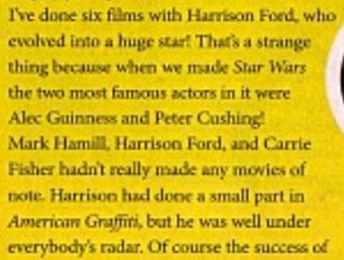
Our notes: `notes/materials/038-star-wars-insider/101-ins101.md:224`

> No matter what you're into, we've got just the thing for your collection!
— Source: Star Wars Insider #101 (2008).
Note (our notes, around the quote): Page contents: TFAW.com (Things From Another World, "Since 1979") ad: "No matter what you're into, we've got just the thing for your collection!"; Kotobukiya vinyl statues (Obi-Wan Kenobi, C-3PO, R2-D2, Darth Vader); Star Wars "Vector" covers; Star Wars Omnibus Collection: X-Wing Rogue Squadron Vol. 1-3; Star Wars 1:6 Scale Helmet Replicas (Luke X-wing helmet); "Save 20-50%"; www.TFAW.com/offer/swinsider; Star Wars, Hasbro, DC, Marvel, Dark Horse logos (hand-read)
Our notes: `notes/materials/038-star-wars-insider/101-ins101.md:270`

> mimobot Designer USB Flash Drives — Mimobot Series 2 joins forces with Mimobot Series 1
> [fragment — full passage not on file]
— Source: Star Wars Insider #101 (2008); Page contents: Mimoco ad.
Note (our notes, around the quote): Page contents: Mimoco ad: "mimobot Designer USB Flash Drives — Mimobot Series 2 joins forces with Mimobot Series 1" (Luke X-wing pilot, stormtrooper, Darth Vader, Boba Fett, Luke, Leia, Han Solo, Chewbacca, R2-D2 figures); www.mimobot.com; Official Star Wars Fan Club logo, starwars.com/fan[club] (bracketed text cut off at scan edge) (hand-read)
Our notes: `notes/materials/038-star-wars-insider/101-ins101.md:306`

- Note (summary from our notes, not a quotation): Page contents: Top Ten #5 Mace Windu vs. Palpatine (ROTS, DVD Chapter 27); #4 Luke Skywalker vs. Darth Vader (ESB, DVD Chapters 42, 44, 46); photos: Windu/Sidious Force lightning, Bespin duel silhouette (hand-read)
  — Source: Star Wars Insider #101 (2008).
Our notes: `notes/materials/038-star-wars-insider/101-ins101.md:341`

- Note (summary from our notes, not a quotation): Page contents: Top Ten #3 Yoda vs. Count Dooku (AOTC, DVD Chapter 46); #2 Luke Skywalker vs. Darth Vader & the Emperor (ROTJ, DVD Chapter 37 onwards); photos: Geonosis hangar duel, Emperor's Force lightning, Vader silhouette (hand-read)
  — Source: Star Wars Insider #101 (2008).
Our notes: `notes/materials/038-star-wars-insider/101-ins101.md:351`

> Did Any of This Really Happen? *(G/C/S/N-canon)*
— Source: Star Wars Insider #101 (2008).
Note (our notes, around the quote): Page contents: Essential EU: Reference Works (Must Read: The New Essential Chronology; Don't Overlook: Behind the Magic CD-ROM); sidebar "Did Any of This Really Happen?" (G/C/S/N-canon); covers: Star Wars ultimate visual guide-style book, Behind the Magic, The Essential [Guide] (text by Daniel Wallace); photo: Luke with macrobinoculars (hand-read)
Our notes: `notes/materials/038-star-wars-insider/101-ins101.md:448`

> Your source for everything Star Wars
> [fragment — full passage not on file]
>
> redscollectiblesusa.com — There's a New Force in the Galaxy...
> [fragment — full passage not on file]
— Source: Star Wars Insider #101 (2008); Page contents: Red5 Collectibles USA ad.
Note (our notes, around the quote): Page contents: Red5 Collectibles USA ad: "Your source for everything Star Wars"; "Believe it..."; "Collector's #1 Site"; figures (clone trooper, stormtroopers, Grievous, Leia, Luke X-wing pilot, Aayla Secura, Royal Guard, R2-D2, Yoda, C-3PO); "redscollectiblesusa.com — There's a New Force in the Galaxy..."; Visa/MasterCard/Amex logos (hand-read)
Our notes: `notes/materials/038-star-wars-insider/101-ins101.md:483`

> Packed full with the latest stuff from the Star Wars universe
> [fragment — full passage not on file]
>
> Luke's Training: Luke Skywalker meets his master on Dagobah!
>
> A round-up of the latest gear to hit toy shelves
> [fragment — full passage not on file]
>
> Legacy of the Force reaches a dramatic end in Invincible
> [fragment — full passage not on file]
>
> Family matters of a different kind feature in the Legacy arc 'Home'
> [fragment — full passage not on file]
>
> There's nothing like a good blaster at your side, kid
> [fragment — full passage not on file]
— Source: Star Wars Insider #101 (2008); Page contents: Blaster section cover.
Note (our notes, around the quote): Page contents: Blaster section cover: "Packed full with the latest stuff from the Star Wars universe"; Luke portrait; Page 70 Bounty Hunters; Steve Sansweet's Scouting the Galaxy p64; Bantha Tracks p72; Page 76 Classic Moment "Luke's Training: Luke Skywalker meets his master on Dagobah!"; 66 Toys "A round-up of the latest gear to hit toy shelves"; 59 Books "Legacy of the Force reaches a dramatic end in Invincible"; 61 Comic Books "Family matters of a different kind feature in the Legacy arc 'Home'"; Plus: Space Gear 56 » Ask Lobot 60 » Far East Collecting 68 » and much more; "There's nothing like a good blaster at your side, kid"; Palpatine and Cade Skywalker art (hand-read)
Our notes: `notes/materials/038-star-wars-insider/101-ins101.md:601`

> Luke and Vader's story is one of a wayward father redeemed,
> [fragment — full passage not on file]
>
> Cade and Krayt have a different sort of affiliation.
— Source: Star Wars Insider #101 (2008).
Note (our notes, around the quote): Luke Skywalker; Darth Vader (Anakin Skywalker); Cade Skywalker; Darth Krayt — entry/section: Duursema: different affiliation: ""Luke and Vader's story is one of a wayward father redeemed," explains Duursema. "Cade and Krayt have a different sort of affiliation." —Jan Duursema, Star Wars Insider 101, p. 62" Source: *Star Wars Insider #101* (2008), scan p.62
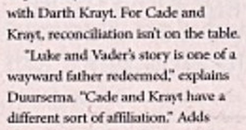
Our notes: `notes/materials/038-star-wars-insider/101-ins101.md:688`

> Luke could turn Vader only because of the ties between them. We've seen just how merciless and dangerous Krayt can get when mad. Cade understands that, so long as Krayt lives, the Sith Order will be intact and Cade will never know peace. Cade is not concerned about redeeming Krayt or about saving the galaxy, when you come right down to it. He wants people to leave him alone. He wants to live his life on his own terms, not anyone else's. Krayt needs to die. Now, whether or not he can do that is an entirely different question. Cade's gotten himself in over his head before. We'll see if it happens again.
— Source: Star Wars Insider #101 (2008).
Note (our notes, around the quote): Luke Skywalker; Darth Vader (Anakin Skywalker); Cade Skywalker; Darth Krayt — entry/section: Ostrander: Krayt needs to die: "Adds Ostrander, "Luke could turn Vader only because of the ties between them. We've seen just how merciless and dangerous Krayt can get when mad. Cade understands that, so long as Krayt lives, the Sith Order will be intact and Cade will never know peace. Cade is not concerned about redeeming Krayt or about saving the galaxy, when you come right down to it. He wants people to leave him alone. He wants to live his life on his own terms, not anyone else's. Krayt needs to die. Now, whether or not he can do that is an entirely different question. Cade's gotten himself in over his head before. We'll see if it happens again." —John Ostrander, Star Wars Insider 101, p. 62" Source: *Star Wars Insider #101* (2008), scan p.62
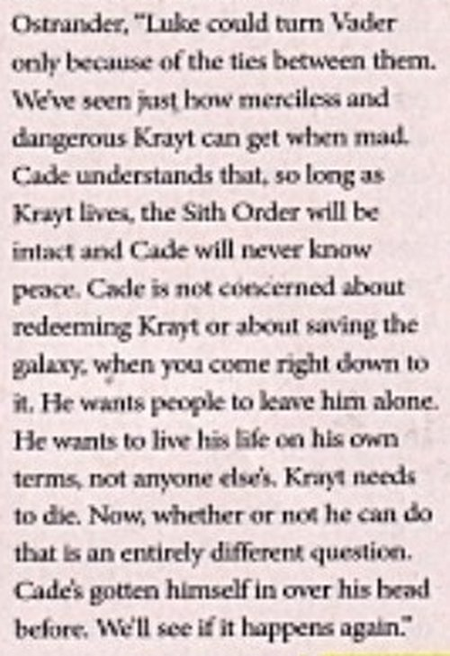
Our notes: `notes/materials/038-star-wars-insider/101-ins101.md:690`

- Note (summary from our notes, not a quotation): Page contents: Classic Moment: Episode V The Empire Strikes Back (DVD Chapter 28), "Luke's Training — The Empire Strikes Back 1980 [Script]"; large still of Yoda and Luke on Dagobah; "What They Said" panel with photos of Frank Oz and Irvin Kershner; "Why It's a Classic" box; footer "76 INSIDER" (hand-read)
  — Source: Star Wars Insider #101 (2008).
Our notes: `notes/materials/038-star-wars-insider/101-ins101.md:837`

> Grab Your Back Issues Now! *(Order Online; Yoda art)*
> [fragment — full passage not on file]
>
> The Galaxy's Greatest Heroes! *(#98 US/#74 UK)*
> [fragment — full passage not on file]
>
> 100 Best Things About Star Wars... Ever! *(#100 US/#76 UK)*
> [fragment — full passage not on file]
>
> Missed an issue of Star Wars Insider? Order Now!
— Source: Star Wars Insider #101 (2008); Page contents: Full-page back-issues ad.
Note (our notes, around the quote): Page contents: Full-page back-issues ad: "Grab Your Back Issues Now!" (Order Online; Yoda art) with covers and issue badges: "The Clone Wars!" (#95 US/#71 UK), "Rise of the Empire" (#96 US/#72 UK), "Luke & Leia" (#97 US/#73 UK), "The Galaxy's Greatest Heroes!" (#98 US/#74 UK), "Bounty Hunters" (#99 US/#75 UK) and "100 Best Things About Star Wars... Ever!" (#100 US/#76 UK); "Missed an issue of Star Wars Insider? Order Now!"; USA/CAN: regular issues cost $8.50, special issues 10.50 (currency symbol unclear in scan); UK/EIRE/ROW: issues cost £6.20, EIRE £7.25, ROW £8.20; web addresses for the full back-issue list (toll-free numbers not transcribed); © 2008 Lucasfilm Ltd. (hand-read)
Our notes: `notes/materials/038-star-wars-insider/101-ins101.md:848`

## Star Wars Insider #102 (2008)

> Hasbro Signature series presents An Elegant Weapon From a More Civilized Time
> [fragment — full passage not on file]
— Source: Star Wars Insider #102 (2008); Page contents: Full-page Hasbro Signature Series ad.
Note (our notes, around the quote): Page contents: Full-page Hasbro Signature Series ad: "Hasbro Signature series presents An Elegant Weapon From a More Civilized Time"; crossed Darth Vader and Luke Skywalker Force FX lightsabers; Star Wars logo; starwars.hasbro.com; © 2008 Lucasfilm/Hasbro legal line (hand-read)
Our notes: `notes/materials/038-star-wars-insider/102-ins102.md:54`

- Note (summary from our notes, not a quotation): Page contents: Launch Pad: "Chicken Roast" (Robot Chicken Star Wars DVD; puppet figures incl. George Lucas puppet; Emperor/Luke still) by Jeremy Beckett; and the "Hoth and Cold" gossip strip (Frozen in Carbonite / Banished to Hoth / Bound for Kessel; Darth Maul and Jar Jar Binks images; Complete Star Wars Encyclopedia box set image) (hand-read)
  — Source: Star Wars Insider #102 (2008).
Our notes: `notes/materials/038-star-wars-insider/102-ins102.md:99`

- Note (summary from our notes, not a quotation): Page contents: Ad: OfficialPix.com (Darth Vader photo; signed photo strip: Luke X-wing pilot, Leia slave outfit, Jango Fett, Padmé) (hand-read)
  — Source: Star Wars Insider #102 (2008).
Our notes: `notes/materials/038-star-wars-insider/102-ins102.md:140`

- Note (summary from our notes, not a quotation): Page contents: Freeborn feature (cont.): photo of Freeborn sculpting Yoda head (Yoda maquette in background); Ewok (Wicket-style) photo; Luke's hand pull quote; "Building an Empire" subhead; "Working with the Cast" yellow box (hand-read)
  — Source: Star Wars Insider #102 (2008).
Our notes: `notes/materials/038-star-wars-insider/102-ins102.md:235`

> We made Luke's hand from hardened resin, the two inner parts painted red to give a realistic flesh color. You always have to be prepared to make odd little things like that on films!
— Source: Star Wars Insider #102 (2008); Luke Skywalker — entry/section: Freeborn on Luke's hand.
Note (our notes, around the quote): Luke Skywalker — entry/section: Freeborn on Luke's hand: ""We made Luke's hand from hardened resin, the two inner parts painted red to give a realistic flesh color. You always have to be prepared to make odd little things like that on films!" —Stuart Freeborn, Star Wars Insider 102, p. 24" Source: *Star Wars Insider #102* (2008), scan p.24
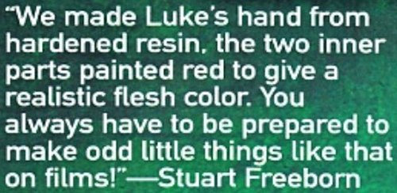
Our notes: `notes/materials/038-star-wars-insider/102-ins102.md:241`

> My friends all wanted to be Luke Skywalker or Darth Vader. Not me. I wanted to be Stuart Freeborn or Rick Baker!
— Source: Star Wars Insider #102 (2008).
Note (our notes, around the quote): Luke Skywalker; Darth Vader (Anakin Skywalker) — entry/section: Spina on wanting to be Freeborn: ""My friends all wanted to be Luke Skywalker or Darth Vader. Not me. I wanted to be Stuart Freeborn or Rick Baker!" —Tom Spina, Star Wars Insider 102, p. 37" Source: *Star Wars Insider #102* (2008), scan p.37

Our notes: `notes/materials/038-star-wars-insider/102-ins102.md:392`

- Note (summary from our notes, not a quotation): Page contents: Top Ten entries #10 Tauntauns and #9 Aiwhas; Top Ten logo (top-left box); photos of Luke on tauntaun, aiwha, and creature photos at bottom right (continued on next spread); folio (hand-read)
  — Source: Star Wars Insider #102 (2008).
Our notes: `notes/materials/038-star-wars-insider/102-ins102.md:441`

- Note (summary from our notes, not a quotation): Page contents: Top Ten entries #5 Dianogas and #4 Wampas; Top Ten logo (top-left box); photo of Luke and Han in stormtrooper armour in the trash compactor; dianoga eye photo; wampa photo (lower left); large creature (continued from right edge); folio 44 INSIDER (hand-read)
  — Source: Star Wars Insider #102 (2008).
Our notes: `notes/materials/038-star-wars-insider/102-ins102.md:462`

- Note (summary from our notes, not a quotation): Page contents: Full-page Entertainment Earth ad: Mighty Muggs (Star Wars figures incl. Luke, Grievous, Yoda, a hooded Sith; Indiana Jones; Marvel); mystery Hasbro Star Wars exclusive silhouette; order phone number (not transcribed) (hand-read)
  — Source: Star Wars Insider #102 (2008).
Our notes: `notes/materials/038-star-wars-insider/102-ins102.md:546`

- Note (summary from our notes, not a quotation): Page contents: Full-page Mimoco ad: Star Wars Mimobot designer USB flash drives — Luke Skywalker X-wing pilot (large), stormtrooper, Darth Vader, Boba Fett, Luke Skywalker, Princess Leia, Han Solo, Chewbacca, R2-D2; Official Star Wars Fan Club logo (hand-read)
  — Source: Star Wars Insider #102 (2008).
Our notes: `notes/materials/038-star-wars-insider/102-ins102.md:617`

- Note (summary from our notes, not a quotation): Page contents: Comics (Words: Daniel Wallace): "Star Wars: Rebellion 'Vector' Hits the Classic Trilogy", "Time Warp!" (continues p64); top-right box "76 Classic Moment: The Emperor Taunts Luke" (Emperor photo); Rebellion art of Luke and Celeste Morne; clone trooper photo; box "Dark Horse Launches Two New Titles" with The Clone Wars logo and "Sneak Peek!" tag (hand-read)
  — Source: Star Wars Insider #102 (2008).
Our notes: `notes/materials/038-star-wars-insider/102-ins102.md:675`

> I believe this Luke was fairly new, as I actually flushed my first Luke (who was my very first Star Wars action figure) down the toilet by accident the same day I got it.
— Source: Star Wars Insider #102 (2008); none — entry/section: Spitale on his first Luke figure.
Note (our notes, around the quote): none — entry/section: Spitale on his first Luke figure: ""I believe this Luke was fairly new, as I actually flushed my first Luke (who was my very first Star Wars action figure) down the toilet by accident the same day I got it." —Chris Spitale, Star Wars Insider 102, p. 74" Source: *Star Wars Insider #102* (2008), scan p.74
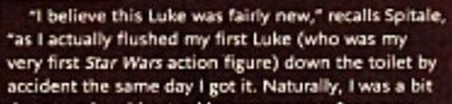
Our notes: `notes/materials/038-star-wars-insider/102-ins102.md:790`

> REURN [sic] OF THE JEDI
> [fragment — full passage not on file]
— Source: Star Wars Insider #102 (2008); Page contents: Classic Moment: "The Emperor Taunts Luke" (Episode VI.
Note (our notes, around the quote): Page contents: Classic Moment: "The Emperor Taunts Luke" (Episode VI "REURN [sic] OF THE JEDI" [DVD CHAPTER 28]; Return of the Jedi 1983 [SCRIPT]); What They Said box (Ian McDiarmid, Mark Hamill); Why It's a Classic box; photo of the Emperor on the Death Star throne room; spine "CLASSIC MOMENT"; footer "NEXT: TAUN WE SHOWS OBI-WAN THE CLONE ARMY"; folio "76 INSIDER" (hand-read)
Our notes: `notes/materials/038-star-wars-insider/102-ins102.md:805`

> Save 10% at StarWarsShop.com. Simply Use the PROMO Code [promo code] by July 1, 2008.
>
> ORDER ONLINE AT STARWARSSHOP.COM – MORE PRODUCT. MORE EXCLUSIVES. *(hand-read)*
— Source: Star Wars Insider #102 (2008).
Note (our notes, around the quote): Page contents: StarWarsShop.com catalog p.3 "Bargain Bay – Home of the Steal on StarWarsShop" (header "Save 10% at StarWarsShop.com. Simply Use the PROMO Code [promo code] by July 1, 2008."): A Exclusive 6-Inch Shadow Stormtrooper Wacky Wobbler Sale Price: $11.99 (You save 23%); B Exclusive The Empire Strikes Back Super-Deformed Boba Fett Sale Price: $25.00 (You save 50%); C Kotobukiya Bespin Luke Skywalker Sale Price: $59.99 (You save 40%); D Exclusive Gray Star Wars Celebration Europe Logo Tee Sale Price: $11.99 (You save 40%); E Limited Edition Black Chrome Anakin Skywalker Mini Lightsaber Sale Price: $25.00 (You save 29%); F Worldwide Exclusive Lucas Family Action Figure Collector Set Sale Price: $10.00 (You save 71%); G Exclusive 12" x 18" Padmé Amidala 3-D Animation Lenticular Poster Sale Price: $15.00 (You save 50%); H Limited Edition Star Wars: Revenge of the Sith 24 Medallionz Box Set Sale Price: $25.99 (You save 48%); footer "ORDER ONLINE AT STARWARSSHOP.COM – MORE PRODUCT. MORE EXCLUSIVES." (hand-read)
Our notes: `notes/materials/038-star-wars-insider/102-ins102.md:848`

- Note (summary from our notes, not a quotation): Page contents: Ad: Star Wars Miniatures Legacy of the Force set (Wizards of the Coast; wizards.com/starwars; booster pack images; © 2008 Lucasfilm Ltd. & TM fine print) as a comic strip: Darth Krayt, Darth Talon, Darth Nihl vs Cade Skywalker, Deliah Blue, Boba Fett, Luke Skywalker's spirit, Han Solo (hand-read)
  — Source: Star Wars Insider #102 (2008).
Our notes: `notes/materials/038-star-wars-insider/102-ins102.md:862`

## Star Wars Insider #103 (2008)

- Note (summary from our notes, not a quotation): Page contents: Top Ten: Jaw-Droppers opener spread right (folio "INSIDER 31"): collage of Mace Windu, Luke Skywalker, Commander Cody (Clone Wars), Neimoidian and other figures, TIE fighters; "-OPPERS" title; standfirst (hand-read)
  — Source: Star Wars Insider #103 (2008).
Our notes: `notes/materials/038-star-wars-insider/103-ins103.md:226`

- Note (summary from our notes, not a quotation): Page contents: Top Ten: Jaw-Droppers 4–3 (folio "34 INSIDER"): Expanded Universe "Too Obvious to Mention" sidebar with stills (Vader/Luke Bespin gantry, Anakin unmasked, Luke and Leia on Endor); AT-ATs on Hoth still; Carrie Fisher as Leia in gold bikini photo (hand-read)
  — Source: Star Wars Insider #103 (2008).
Our notes: `notes/materials/038-star-wars-insider/103-ins103.md:257`

- Note (summary from our notes, not a quotation): Page contents: Star Warrior continued (folio "INSIDER 51"; Effects Maestros badge top-right): Mark Hamill as Luke in X-wing flight suit; Millennium Falcon model on motion-control mount ("Taking off:" caption); "Expanded Universe >>> A Team Effort" sidebar (hand-read)
  — Source: Star Wars Insider #103 (2008).
Our notes: `notes/materials/038-star-wars-insider/103-ins103.md:395`

- Note (summary from our notes, not a quotation): Page contents: Star Warrior continued (folio "INSIDER 53"): Mark Hamill as Luke in X-wing cockpit ("Luke's luck:" caption); X-wing and Star Destroyer models on bluescreen mounts; "Expanded Universe >>> Inventing the Dykstraflex" sidebar (hand-read)
  — Source: Star Wars Insider #103 (2008).
Our notes: `notes/materials/038-star-wars-insider/103-ins103.md:418`

## Star Wars Insider #104 (2008)

- Note (summary from our notes, not a quotation): Page contents: Contents, Departments (folio 05): top box "The Special Edition!" (variant cover with Starkiller); 08 Editor's Welcome; 10 Launch Pad (Celebration Japan, San Diego Comic-Con); 26 Versus (Ackbar takes on Thrawn); 36 The Science of Star Wars (personal jetpacks); 44 A Long Time Ago.... (1978, the Holiday Special); Blaster review section: 73 Books (Michael Reaves, Coruscant Nights), 74 Ask Lobot, 75 Comics (Knights of the Old Republic "Vindication"), 79 International Collecting, 82 Toys (Wizards of the Coast, Top Trumps The Clone Wars; Ahsoka Tano card pictured), 87 Bounty Hunters, 89 Bantha Tracks, 93 Classic Moment (first mention of the Clone Wars as Obi-Wan passes the lightsaber to Luke). Scan is 72 pages of the 100-page issue (some magazine pages not in scan) (hand-read)
  — Source: Star Wars Insider #104 (2008).
Our notes: `notes/materials/038-star-wars-insider/104-ins104.md:24`

> Why the long face? Dooku—reimagined for animation. Right: Anakin and Obi-Wan, in their new 'painterly' form.
— Source: Star Wars Insider #104 (2008).
Note (our notes, around the quote): Page contents: Dave Filoni interview (folio 18): how the series ties in with the movie; how he discovered Star Wars (playing Han and Luke shooting TIE fighters from the parents' car); drawing from first grade; caption ("Why the long face? Dooku—reimagined for animation. Right: Anakin and Obi-Wan, in their new 'painterly' form."); pull quote (hand-read)
Our notes: `notes/materials/038-star-wars-insider/104-ins104.md:82`

> PIRATE STARSHIP COCKPIT, SCS: 60 PT. & 62 [SOLO: “WATCH YOUR MOUTH,
>
> KID, OR YOU’ll FIND YOURSELF FLOATING HOME”]; A67 [COMING OUT OF HYPERSPACE]; 73 [FALCON SPOTS TIE FIGHTER]; A74 [LUKE: “HE’s HEADING FOR THAT SMALL MOON”]; C74 [OBI-WAN: *(Han Solo)*
>
> Evacuate in our moment of triumph? I think you overestimate their chances *(Grand Moff Tarkin)*
> [fragment — full passage not on file]
>
> What a piece of junk! *(Luke Skywalker)*
> [fragment — full passage not on file]
— Source: Star Wars Insider #104 (2008); Page contents: Top Ten Quotes cont. (folio 41): 6. POV: Han Solo, about Luke Skywalker.
(Full sentence/passage taken from the source text on file: `novels_tmp_lucas_bts_rinzler_making_of_star_wars_2007_epub`.)
Note (our notes, around the quote): Page contents: Top Ten Quotes cont. (folio 41): 6 "Watch your mouth kid, or you'll find yourself floating home" (Han Solo); 5 "Evacuate in our moment of triumph? I think you overestimate their chances" (Grand Moff Tarkin); 4 "What a piece of junk!" (Luke Skywalker) (hand-read)
Our notes: `notes/materials/038-star-wars-insider/104-ins104.md:209`

> The Big Event: Nov 17, 1978—Star Wars Holiday Special Premieres! *(folio 44, words Dan Wallace)*
>
> That's one of those things that happened, and I just have to live with it.
>
> Luke and Vader Duel! Splinter of the Mind's Eye, March 1978 *(hand-read)*
> [fragment — full passage not on file]
— Source: Star Wars Insider #104 (2008); Page contents. POV: Page contents, about Luke Skywalker.
Note (our notes, around the quote): Page contents: "The Big Event: Nov 17, 1978—Star Wars Holiday Special Premieres!" (folio 44, words Dan Wallace): the Holiday Special (Kashyyyk first seen; Lucas: "That's one of those things that happened, and I just have to live with it."); sidebar "Luke and Vader Duel! Splinter of the Mind's Eye, March 1978" (hand-read)
Our notes: `notes/materials/038-star-wars-insider/104-ins104.md:224`

> “I died a long time ago.
— Source: Star Wars Insider #104 (2008).
(Full sentence/passage taken from the source text on file: `cw_novels_tmp_clone_wars_traviss_epub`.)
Note (our notes, around the quote): Page contents: The Big Event cont. (folio 45): "Attack of the Clone" (Battlestar Galactica lawsuit); "A Long Time Ago..." real-world 1978 events; "Boba Fett's Debut" (Nelvana cartoon in the Holiday Special; Fett first appears astride a dinosaur-like beast, seemingly helping a stranded Luke but secretly working for Vader; 2006 Hasbro figure); "Month by Month 1978" timeline (Marvel's "The Hunter" introduces Valance; Leigh Brackett's first Empire draft) (hand-read)
Our notes: `notes/materials/038-star-wars-insider/104-ins104.md:233`

- Note (summary from our notes, not a quotation): Page contents: Ask Lobot cont. (501st Legion and R2-KT as fan-generated material made official; "Darth Who?" contest for Jacen Solo's Sith name); "Savior of the Universe" (Luke Skywalker: Last Hope for the Galaxy Dark Horse compilation, story list) (hand-read)
  — Source: Star Wars Insider #104 (2008).
Our notes: `notes/materials/038-star-wars-insider/104-ins104.md:379`

> BEN: Yes, I was once a Jedi Knight, the same as your father. LUKE: I wish I'd known him. BEN: He was the best star-pilot in the galaxy, and a cunning warrior. I understand you've become quite a good pilot yourself. And he was a good friend. —A New Hope script excerpt, Star Wars Insider 104, p. 70
> [fragment — full passage not on file]
— Source: Star Wars Insider #104 (2008).
Note (our notes, around the quote): Darth Vader (Anakin Skywalker); Obi-Wan Kenobi — entry/section: A New Hope script: Ben on Luke's father: "BEN: Yes, I was once a Jedi Knight, the same as your father. LUKE: I wish I'd known him. BEN: He was the best star-pilot in the galaxy, and a cunning warrior. I understand you've become quite a good pilot yourself. And he was a good friend. —A New Hope script excerpt, Star Wars Insider 104, p. 70" Source: *Star Wars Insider #104* (2008), scan p.70
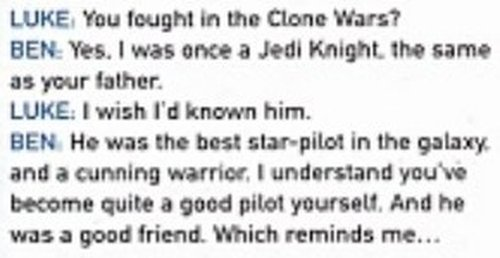
Our notes: `notes/materials/038-star-wars-insider/104-ins104.md:440`

> As it stands now we've got three scenes with the light sword. The first scene shows what it is: Luke just turns it on. The next one is a very quick scene in the cantina—it'll just be a flash. In both those cases, it's just one sword. The last is the final battle between Ben and the warlord. That's going to be the tricky one where they actually fight, but at least now it is down to a very controlled set-up.
— Source: Star Wars Insider #104 (2008).
Note (our notes, around the quote): Obi-Wan Kenobi; Darth Vader (Anakin Skywalker) — entry/section: Lucas on the light sword scenes: ""As it stands now we've got three scenes with the light sword. The first scene shows what it is: Luke just turns it on. The next one is a very quick scene in the cantina—it'll just be a flash. In both those cases, it's just one sword. The last is the final battle between Ben and the warlord. That's going to be the tricky one where they actually fight, but at least now it is down to a very controlled set-up." —George Lucas (The Making of Star Wars), Star Wars Insider 104, p. 70" Source: *Star Wars Insider #104* (2008), scan p.70
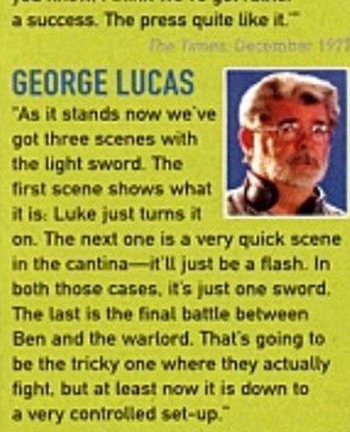
Our notes: `notes/materials/038-star-wars-insider/104-ins104.md:444`

> Todd, roleplaying as a Jedi
> [fragment — full passage not on file]
— Source: Star Wars Insider #104 (2008).
Note (our notes, around the quote): Page contents: Back cover: Wizards of the Coast Star Wars Miniatures & Roleplaying Games parody comic ad (Zayne Carrick vs Mandalore and Demagol, "Todd, roleplaying as a Jedi", Luke and Vader, Jar Jar); non-canonical ad, not logged as feats (hand-read)
Our notes: `notes/materials/038-star-wars-insider/104-ins104.md:458`

## Star Wars Insider #105 (2008)

- Note (summary from our notes, not a quotation): Page contents: Visual commentary production notes: EV-9D9 voiced by Richard Marquand (Yeardley Smith in radio drama); Sy Snootles Special Edition makeover; Greeata and Rystáll in the Palpatones and at the Galaxies Opera House in ROTS; Jabba puppet 18 ft, six operators; rancor 18-inch foam-latex puppet; Gamorrean Jubnuk; floating microphone is a modified remote like Luke's training remote. (hand-read)
  — Source: Star Wars Insider #105 (2008).
Our notes: `notes/materials/038-star-wars-insider/105-ins105.md:93`

- Note (summary from our notes, not a quotation): Page contents: 1996 month by month: Tales from Jabba's Palace; X-Wing Rogue Squadron comic "The Phantom Affair"; Before the Storm (Luke searches for his mother, finds an imposter); Shadows of the Empire novel, sourcebook, toys and N64 game (Dash vs IG-88 and Boba Fett); Golden Age of the Sith #0 (5,000 years before the films); The Krytos Trap (plague on newly captured Coruscant); Dark Forces PlayStation. (hand-read)
  — Source: Star Wars Insider #105 (2008).
Our notes: `notes/materials/038-star-wars-insider/105-ins105.md:206`

- Note (summary from our notes, not a quotation): Page contents: Vector crossover feature: Celeste Morne, a Jedi infected by the Muur Talisman, a conduit for the Sith Karness Muur, letting her control rakghouls; long suspended animation; she met Luke Skywalker. Summary only; see Q records for verbatim quotes. (hand-read)
  — Source: Star Wars Insider #105 (2008).
Our notes: `notes/materials/038-star-wars-insider/105-ins105.md:313`

- Note (summary from our notes, not a quotation): Page contents: Vector continued: Duursema on syncing with Cade's plan; Roan Fel and the Galactic Alliance Remnant. Ask Lobot: A-wings carry no astromech for speed; B-wings use advanced computers. Comics: Rebellion vol. 3 Small Victories, Deena Shan's suicide mission against Bannistar Station with Luke and Leia. No verbatim feat text logged. (hand-read)
  — Source: Star Wars Insider #105 (2008).
Our notes: `notes/materials/038-star-wars-insider/105-ins105.md:322`

## Star Wars Insider #106 (2009)

- Note (summary from our notes, not a quotation): Page contents: Cover: Insider's guide to Han's early years; Versus Luke Skywalker vs the Secret Apprentice; Holiday Special; Falcon toy designer; David Collins on voicing PROXY; departments list. (hand-read)
  — Source: Star Wars Insider #106 (2009).
Our notes: `notes/materials/038-star-wars-insider/106-ins106.md:10`

- Note (summary from our notes, not a quotation): Page contents: Contents continued: special edition cover note; departments (Books/Encyclopedia, Comics, Collecting Han Solo, Toys Gentle Giant, Bounty Hunters, Bantha Tracks, Classic Moment, Launch Pad, A Long Time Ago 1991, Versus Luke vs the Secret Apprentice). (hand-read)
  — Source: Star Wars Insider #106 (2009).
Our notes: `notes/materials/038-star-wars-insider/106-ins106.md:20`

> I had fun doing it, but as a safety measure I didn't actually watch it.
— Source: Star Wars Insider #106 (2009); Page contents: Holiday Special: returning cast (Anthony Daniels quote.
Note (our notes, around the quote): Page contents: Holiday Special: returning cast (Anthony Daniels quote "I had fun doing it, but as a safety measure I didn't actually watch it."), Carrie Fisher's song, Bea Arthur as Ackmena; Luke/Malla wall-screen caption; out-of-universe. (hand-read)
Our notes: `notes/materials/038-star-wars-insider/106-ins106.md:174`

## Star Wars Insider #107 (2009)

- Note (summary from our notes, not a quotation): Page contents: Making the A List: waves, refreshes and carry-forwards; A/B/C grading (only 12 A characters; Luke in Jedi or pilot gear, Boba and Jango, clone troopers and stormtroopers; R2-D2 but not C-3PO, Han or Leia). Captions: Yuuzhan Vong warrior, Anakin pieces, Kyle Katarn. Out-of-universe. (hand-read)
  — Source: Star Wars Insider #107 (2009).
Our notes: `notes/materials/038-star-wars-insider/107-ins107.md:70`

> a cyborg first encountered in the classic Marvel Comics series
> [fragment — full passage not on file]
— Source: Star Wars Insider #107 (2009).
Note (our notes, around the quote): Page contents: Making a Wave: draft-day trading, Willrow Hood, ROTJ wave (black-garb Luke A+, Slave Leia, Paploo and NoApakk, Klaatu, Nikto, Malakili, Major Panno, Ten Numb, biker scout); input drawings for T'ra Saa; Lumiya ("a cyborg first encountered in the classic Marvel Comics series") alternate head. Out-of-universe. (hand-read)
Our notes: `notes/materials/038-star-wars-insider/107-ins107.md:75`

> the Dark Lady's opponent in a two-pack
> [fragment — full passage not on file]
— Source: Star Wars Insider #107 (2009).
Note (our notes, around the quote): Page contents: Input drawing diagram; Dave Vennemeyer sculpts wax prototypes at production scale (Lumiya, Luke "the Dark Lady's opponent in a two-pack", Darth Krayt); Build-a-Droid 1 box. Out-of-universe. (hand-read)
Our notes: `notes/materials/038-star-wars-insider/107-ins107.md:80`

- Note (summary from our notes, not a quotation): Page contents: Articulation design (Luke wrist joints, Ewok ankles, Darth Krayt ponytail, Slave Leia) and the Lumiya head revisions. Out-of-universe. (hand-read)
  — Source: Star Wars Insider #107 (2009).
Our notes: `notes/materials/038-star-wars-insider/107-ins107.md:85`

> He's alone in the galaxy—the last Jedi (as far as he knows) and trying to understand what that means.
— Source: Star Wars Insider #107 (2009); Luke Skywalker — entry/section: Wheeler on Luke in Rebel Force.
Note (our notes, around the quote): Luke Skywalker — entry/section: Wheeler on Luke in Rebel Force: ""He's alone in the galaxy—the last Jedi (as far as he knows) and trying to understand what that means." —Alex Wheeler, Star Wars Insider 107, p. 47" Source: *Star Wars Insider #107* (2009), scan p.47
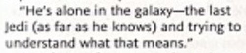
Our notes: `notes/materials/038-star-wars-insider/107-ins107.md:261`

- Note (summary from our notes, not a quotation): Page contents: Toys (Gus Lopez): Funko bobble-heads of Jango Fett, 4-LOM, Darth Maul and Luke, plus the Luke X-wing "Bobble Ship." Out-of-universe. (hand-read)
  — Source: Star Wars Insider #107 (2009).
Our notes: `notes/materials/038-star-wars-insider/107-ins107.md:312`

## Star Wars Insider #108 (2009)

> rogue soldiers too dangerous and unstable to leave unfettered
> [fragment — full passage not on file]
— Source: Star Wars Insider #108 (2009).
Note (our notes, around the quote): Page contents: Star Wars Books timeline 2009: FotJ: Outcast (Allston): two years after Darth Caedus' death, Chief of State Daala considers the Jedi "rogue soldiers too dangerous and unstable to leave unfettered"; Luke and Ben retrace Jacen's journey to find which Force-using groups influenced him. The Clone Wars: No Prisoners (Traviss): Ahsoka, Rex and the 501st on a shakedown cruise aboard Captain Gilad Pellaeon's assault ship become caught in a hostage situation. Also Omen, Abyss, Imperial Commando: 501st, Deathtroopers, the third Darth Bane novel (Bane and Zannah). Crop-verified. (hand-read)
Our notes: `notes/materials/038-star-wars-insider/108-ins108.md:50`

- Note (summary from our notes, not a quotation): Page contents: Lanter/Eckstein interview: Lanter auditioned for "Deak Starkaller" and was told to play a Han/Luke mix; Eckstein auditioned for Padmé, was too young, then found Ahsoka with her own voice. (hand-read)
  — Source: Star Wars Insider #108 (2009).
Our notes: `notes/materials/038-star-wars-insider/108-ins108.md:75`

- Note (summary from our notes, not a quotation): Page contents: Prowse interview cont.: 20 minutes to suit up; amber lenses and black makeup; costume about 40 pounds; Vader's brisk stride (everyone subservient except Grand Moff Tarkin, "Vader's boss"); Russ Meyer's cable about the over-dubbed voice; the bald-cap for the ESB unmasking; did not know Vader was Luke's father until the premiere. Out-of-universe. (hand-read)
  — Source: Star Wars Insider #108 (2009).
Our notes: `notes/materials/038-star-wars-insider/108-ins108.md:127`

- Note (summary from our notes, not a quotation): Page contents: A Long Time Ago... 1997 by Daniel Wallace: month-by-month (Special Editions, Galaxy of Fear, Soldier for the Empire, X-Wing vs. TIE Fighter, Delusions of Grandeur reintroduces IG-88, Hutt Gambit, Fall of the Sith Empire, Masters of Teras Kasi, Essential Guide to Weapons and Technology); Special Edition changes sidebar (Greedo shot first, Luke's scream, Jedi Rocks). Out-of-universe. (hand-read)
  — Source: Star Wars Insider #108 (2009).
Our notes: `notes/materials/038-star-wars-insider/108-ins108.md:214`

> Han and Luke are so well-realized by the novels that it isn't hard to write them at this age,
> [fragment — full passage not on file]
— Source: Star Wars Insider #108 (2009).
Note (our notes, around the quote): Luke Skywalker; Han Solo — entry/section: Invasion: Luke and Han at this age: ""Han and Luke are so well-realized by the novels that it isn't hard to write them at this age," —Tom Taylor, Star Wars Insider 108, p. 49" Source: *Star Wars Insider #108* (2009), scan p.49
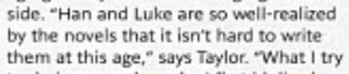
Our notes: `notes/materials/038-star-wars-insider/108-ins108.md:282`

- Note (summary from our notes, not a quotation): Page contents: Comics cont.: Taylor on Luke as his childhood hero, main character Finn Galfridian; Wilson drawing aged heroes. "Online Invasion!" box: two free online episodes on starwars.com, May-June 2009. (hand-read)
  — Source: Star Wars Insider #108 (2009).
Our notes: `notes/materials/038-star-wars-insider/108-ins108.md:291`

## Star Wars Insider #109 (2009)

- Note (summary from our notes, not a quotation): Page contents: Books (Jason Fry): Aaron Allston on Fate of the Jedi: Outcast — post-Legacy of the Force setting (Caedus died at Jaina's hands, Daala leads the GA), Valin Horn's madness, Luke's exile with Ben, Odyssey echoes, Kel Dor order on Dorin, Han on Kessel with Rogue and Wraith Squadrons. (hand-read)
  — Source: Star Wars Insider #109 (2009).
Our notes: `notes/materials/038-star-wars-insider/109-ins109.md:312`

## Star Wars Insider #110 (2009)

- Note (summary from our notes, not a quotation): Page contents: Books: "A Good Omen" (words: Jason Fry) — Christie Golden on Fate of the Jedi: Omen; Luke and Ben follow Jacen's trail to the Aing-Tii; Vestara and the Sith of Kesh; Future Reads list (Abyss, LEGO Visual Dictionary, Imperial Commando: 501st, 1,000 Collectibles, The Complete Vader, Deathtroopers). (hand-read)
  — Source: Star Wars Insider #110 (2009).
Our notes: `notes/materials/038-star-wars-insider/110-ins110.md:336`

> The banter between him and Luke came very easily, and I think by this point in their lives they're very close and comfortable with each other. But like most teens, Ben wants to be himself, not just stand in the shadow of his parents. And there are certain things in this book over which he and Luke clash, and clash strongly.
— Source: Star Wars Insider #110 (2009).
Note (our notes, around the quote): Luke Skywalker — entry/section: Golden on Ben and Luke in Omen: ""The banter between him and Luke came very easily, and I think by this point in their lives they're very close and comfortable with each other. But like most teens, Ben wants to be himself, not just stand in the shadow of his parents. And there are certain things in this book over which he and Luke clash, and clash strongly." —Christie Golden, Star Wars Insider 110, p. 55" Source: *Star Wars Insider #110* (2009), scan p.55
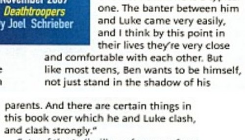
Our notes: `notes/materials/038-star-wars-insider/110-ins110.md:338`

- Note (summary from our notes, not a quotation): Page contents: Incoming (words: Chris Spitale): Hasbro EU comic two-packs — Luke vs. Lumiya (with lightwhip), Darth Krayt & Sigel Dare (Legacy #22), Kyle Katarn & Yuuzhan Vong warrior (Tales #21). Out-of-universe merchandise. (hand-read)
  — Source: Star Wars Insider #110 (2009).
Our notes: `notes/materials/038-star-wars-insider/110-ins110.md:377`

## Star Wars Insider #111 (2009)

> a series of almosts
> [fragment — full passage not on file]
— Source: Star Wars Insider #111 (2009).
Note (our notes, around the quote): Page contents: Robot Chicken interview cont.: Harrison Ford welcome; Emperor/Vader/Luke dynamic; Breckin Meyer's Boba Fett; C-3PO hardest to write; Tom Kane's Yoda singing; Abe Benrubi's Vader "a series of almosts"; Billy Dee Williams. Parody, out-of-universe. (hand-read)
Our notes: `notes/materials/038-star-wars-insider/111-ins111.md:143`

- Note (summary from our notes, not a quotation): Page contents: Corey Burton cont.: Dooku, Cad Bane, Ziro voices; only new Clone Wars voice besides Anthony Daniels heard in an original film (Hobbie in ESB); Disney Read-Along Luke; Daws Butler class. Out-of-universe. (hand-read)
  — Source: Star Wars Insider #111 (2009).
Our notes: `notes/materials/038-star-wars-insider/111-ins111.md:200`

- Note (summary from our notes, not a quotation): Page contents: Hawthorne Village Lars homestead diorama photo with Obi-Wan, Luke, C-3PO and R2-D2 figurines. Out-of-universe. (hand-read)
  — Source: Star Wars Insider #111 (2009).
Our notes: `notes/materials/038-star-wars-insider/111-ins111.md:264`

- Note (summary from our notes, not a quotation): Page contents: Incoming: Sideshow Luke and Han stormtrooper-disguise 12-inch set (Comic-Con); "The Circle Is Now Complete" Obi-Wan/Vader diorama; Mimobot USB drives (Maul, Captain Rex, Vader/Anakin). Out-of-universe merchandise. (hand-read)
  — Source: Star Wars Insider #111 (2009).
Our notes: `notes/materials/038-star-wars-insider/111-ins111.md:318`

- Note (summary from our notes, not a quotation): Page contents: Incoming: Gentle Giant Boba Fett with Han in carbonite statue, wampa statue, Hoth Luke/Han mini-busts, Garindan "Long Snoot" mini-bust. Out-of-universe merchandise. (hand-read)
  — Source: Star Wars Insider #111 (2009).
Our notes: `notes/materials/038-star-wars-insider/111-ins111.md:328`

## Star Wars Insider #112 (2009)

- Note (summary from our notes, not a quotation): Page contents: "Wizard of the Desert" title page: Ryder Windham examines the life of Obi-Wan Kenobi, from training at the Jedi Temple to his years as Luke Skywalker's secret guardian on Tatooine. (hand-read)
  — Source: Star Wars Insider #112 (2009). POV: Page contents, about Luke Skywalker.
Our notes: `notes/materials/038-star-wars-insider/112-ins112.md:70`

- Note (summary from our notes, not a quotation): Page contents: Rebirth: Dark Horse's Classic Star Wars reprints (Mike Richardson, Bob Cooper, Anina Bennett); reformatting the strips to comic-book pages. Other strip panels (Luke and Artoo hiding by X-wing wreckage; Solo and Chewbacca). Out-of-universe. (hand-read)
  — Source: Star Wars Insider #112 (2009).
Our notes: `notes/materials/038-star-wars-insider/112-ins112.md:238`

What it shows (our notes): Page contents: Strip Teasers cont.: "The Bounty Hunter of Ord Mantell," "Traitor's Gambit" (Aquaris, demonsquid), "Iceworld" (Luke discovers Hoth; droids disguised as humans), "Revenge of the Jedi" (Yavin evacuation; Ackbar's first chronological appearance), "Race for Survival." Genesis: Cooper's plan to reprint the Manning strips. Out-of-universe. (hand-read)
> Han tries to explain he didn’t kill Gallandro, but the bitter Anja doesn’t believe him. She has grown up an orphan on the war-ravaged world of Anobis, and Han tries to improve her lot by voyaging to the beleaguered planet to help settle the conflict. Little does Han know that Anja is working for Czethros, a Black Sun agent who wants Han dead. Czethros keeps Anja strung out on andris, an addictive spice that can boost one’s senses and reflexes to Jedi-like levels.
>
> ANJA GALLANDRO is the daughter of the gunslinger featured in Brian Daley’s Han Solo’s Revenge (1979) and Han Solo and the Lost Legacy (1980). The bounty hunter Czethros was originally intended to be Skorr, the titular antagonist from the 1981 comic strip The Bounty Hunter of Ord Mantell by Archie Goodwin and Al Williamson.
>
> ANJA GALLANDRO is the daughter of the gunslinger featured in Brian Daley’s Han Solo’s Revenge (1979) and Han Solo and the Lost Legacy (1980). The bounty hunter Czethros was originally intended to be Skorr, the titular antagonist from the 1981 comic strip The Bounty Hunter of Ord Mantell by Archie Goodwin and Al Williamson. At the eleventh hour, however, editors realized Skorr dies at the end of the newspaper strip in 1984, so Skorr was hastily rewritten as new character Czethros.
>
> AUTHORS · Kevin J.
— Source: Star Wars Insider #112 (2009); Page contents: Strip Teasers cont..
(Excerpt widened 2026-11-17 to the relevant passage, word for word from The Essential Reader’s Companion: Star Wars (Pablo Hidalgo) (text copy `primary_essential_guides_eg_readers_companion_2012_Star_Wars_The_Essential_Readers_Companion_Pablo_Hidalgo_8O9y2bib_epub_e20384df21`).)
(Excerpt widened 2026-11-17 to the relevant passage, word for word from The Essential Reader’s Companion: Star Wars (Pablo Hidalgo) (text copy `primary_essential_guides_eg_readers_companion_2012_Star_Wars_The_Essential_Readers_Companion_Pablo_Hidalgo_8O9y2bib_epub_e20384df21`).)
(Full sentence/passage taken from the source text on file: `primary_essential_guides_eg_readers_companion_2012_Star_Wars_The_Essential_Readers_Companion_Pablo_Hidalgo_8O9y2bib_epub`.)
Our notes: `notes/materials/038-star-wars-insider/112-ins112.md:252`

- Note (summary from our notes, not a quotation): Page contents: Colorist production art for Dark Horse reprints; Classic Star Wars: The Early Adventures (Rick Hoberg; nine issues); The Constancia Affair special. Strip panels (Luke vs. a tentacled creature; Tanith Shire). Out-of-universe. (hand-read)
  — Source: Star Wars Insider #112 (2009).
Our notes: `notes/materials/038-star-wars-insider/112-ins112.md:262`

> there's a real, tangible sense of evil and cruelty that comes along with small men in power.
> [fragment — full passage not on file]
— Source: Star Wars Insider #112 (2009).
Note (our notes, around the quote): Page contents: Books, "Nightmare Fuel!" (words: Dan Wallace): Joe Schreiber's Death Troopers (Del Rey, October 13) — Imperial prison barge Purge finds a derelict Star Destroyer; a contagion kills 99 percent of passengers and turns them into something worse; Longo brothers, a medic, and sadistic guard captain Jareth Sartoris. Schreiber on Sartoris: "there's a real, tangible sense of evil and cruelty that comes along with small men in power." Forthcoming books: A New Hope: The Life of Luke Skywalker (Windham), The Clone Wars: Visual Guide Ultimate Battles (Fry), Star Wars: The Complete Vader (Vilmur/Windham). Out-of-universe. (hand-read)
Our notes: `notes/materials/038-star-wars-insider/112-ins112.md:348`

- Note (summary from our notes, not a quotation): Page contents: Incoming (words: Chris Spitale): Hasbro Build-A-Droid waves — Commander Cody, varactyl wrangler, Plo Koon, Agen Kolar, McQuarrie concept IG-88, build YVH 1 Yuuzhan Vong Hunter; ESB wave (X-wing pilot Luke, AT-AT Commander, Zuckuss, Bespin guard, Willrow Hood), build HK-50. Out-of-universe merchandise. (hand-read)
  — Source: Star Wars Insider #112 (2009).
Our notes: `notes/materials/038-star-wars-insider/112-ins112.md:385`

## Star Wars Insider #113 (2009)

- Note (summary from our notes, not a quotation): Page contents: "5 Evil Deeds!" (Original Trilogy) list: 1 Vader cuts off Luke's hand; 2 Destruction of Alderaan by Tarkin; 3 Torture of Han Solo on Cloud City (editorial speculation that torture caused ripples in the Force to lure Luke). Editorial ranking, out-of-universe. (hand-read)
  — Source: Star Wars Insider #113 (2009). POV: Page contents, about Luke Skywalker.
Our notes: `notes/materials/038-star-wars-insider/113-ins113.md:175`

- Note (summary from our notes, not a quotation): Page contents: TFU USE article: alternative timeline levels (Starkiller as Emperor's apprentice after Vader defeated; Jabba's palace; Tatooine encounter with a Jedi Master in hiding; dark side Battle of Hoth vs Luke); team led by Haden Blackman, produced by Julio Torres. Out-of-universe. (hand-read)
  — Source: Star Wars Insider #113 (2009).
Our notes: `notes/materials/038-star-wars-insider/113-ins113.md:347`

- Note (summary from our notes, not a quotation): Page contents: Ad: Hasbro Comic Packs coming soon—Sigel Dare/Darth Krayt (Star Wars Legacy), Lumiya/Luke Skywalker and Yuuzhan Vong/Kyle Katarn (Star Wars Tales). Out-of-universe. Note: the Ask Lobot continuation flagged on p85 ("continues next page") is not in this scan; no further Ask Lobot text is available to read. (hand-read)
  — Source: Star Wars Insider #113 (2009).
Our notes: `notes/materials/038-star-wars-insider/113-ins113.md:629`

## Star Wars Insider #114 (2010)

- Note (summary from our notes, not a quotation): Page contents: Full-page Dave Dorman Dark Empire art: Luke Skywalker in black before an Imperial World Devastator. Out-of-universe art. (hand-read)
  — Source: Star Wars Insider #114 (2010).
Our notes: `notes/materials/038-star-wars-insider/114-ins114.md:110`

> And Tom wrote a story that took place right after the third movie that had Luke fall into the spell of the dark side. In the end, Dark Empire was the most successful series we'd ever done.
— Source: Star Wars Insider #114 (2010); Luke Skywalker — entry/section: Richardson on Dark Empire's premise.
Note (our notes, around the quote): Luke Skywalker — entry/section: Richardson on Dark Empire's premise: ""And Tom wrote a story that took place right after the third movie that had Luke fall into the spell of the dark side. In the end, Dark Empire was the most successful series we'd ever done." —Mike Richardson, Star Wars Insider 114, p. 23" Source: *Star Wars Insider #114* (2010), scan p.23
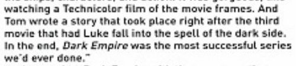
Our notes: `notes/materials/038-star-wars-insider/114-ins114.md:122`

> prefers to use his mind and abilities with the Force to overcome conflicts rather than enter direct combat
> [fragment — full passage not on file]
>
> who opts to use the raw, destructive power of the dark side of the Force to eliminate any resistance
> [fragment — full passage not on file]
— Source: Star Wars Insider #114 (2010). POV: Page contents, about Luke Skywalker.
Note (our notes, around the quote): Page contents: "Class Wars!" (Tony A. Rowe): The Old Republic MMO preview, set more than 3,500 years before Luke and Vader, after the Great Galactic War; cold war between Republic and rebuilt Sith Empire. New classes: Jedi Consular (archetype Yoda, who "prefers to use his mind and abilities with the Force to overcome conflicts rather than enter direct combat") and Sith Inquisitor (compared to Palpatine, "who opts to use the raw, destructive power of the dark side of the Force to eliminate any resistance"). (hand-read)
Our notes: `notes/materials/038-star-wars-insider/114-ins114.md:137`

- Note (summary from our notes, not a quotation): Page contents: "Ask Cad Bane" (in-character framing, Ask Lobot replaced; credited as assisted by Leland Y. Chee, p. 37): top ten irreconcilable continuity errors ("shifts in vision"). #10 Klaatu, Barada, Nikto: Kenner figure naming confusion (Klaatu vs Woof, Barada vs Kithaba, Nikto a species); four Red Nikto in ROTJ (Vizam fires the sail barge cannon, Nysad shoots at Luke, Vedain fights Lando for control of the skiff, an unnamed one in turquoise). (hand-read)
  — Source: Star Wars Insider #114 (2010). POV: Page contents, about Luke Skywalker.
Our notes: `notes/materials/038-star-wars-insider/114-ins114.md:185`

> split your squad into pairs,
> [fragment — full passage not on file]
— Source: Star Wars Insider #114 (2010).
Note (our notes, around the quote): Page contents: Johnston storyboards 12-26 with shot descriptions: speeders fly through walker legs, Luke "split your squad into pairs," three walkers firing all cannons, Luke notes the armor is too strong for blasters. Film-production material. (hand-read)
Our notes: `notes/materials/038-star-wars-insider/114-ins114.md:235`

> use your harpoons and tow cables. Go for the legs. It's our only hope to stop them.
> [fragment — full passage not on file]
— Source: Star Wars Insider #114 (2010); Page contents: Storyboards continued: walker cockpit pilots; Luke orders.
Label in our notes: Film-production material. (hand-read
Our notes: `notes/materials/038-star-wars-insider/114-ins114.md:240`

> a tanned-skin vet of many battles
> [fragment — full passage not on file]
— Source: Star Wars Insider #114 (2010); Page contents: Storyboards 28-41: Hobbie (.
Note (our notes, around the quote): Page contents: Storyboards 28-41: Hobbie ("a tanned-skin vet of many battles"), Luke and Dack, laser bolts and flak, Rebel troops firing, Veers in the walker cockpit asking the range to the power generators. Film-production material. (hand-read)
Our notes: `notes/materials/038-star-wars-insider/114-ins114.md:245`

- Note (summary from our notes, not a quotation): Page contents: Storyboards: Dack lost after the speeder is hit, Luke's POV under the walker, a speeder explodes between two walkers; note that by the fifth draft Rogue Junior became Wedge. Film-production material. (hand-read)
  — Source: Star Wars Insider #114 (2010).
Our notes: `notes/materials/038-star-wars-insider/114-ins114.md:250`

- Note (summary from our notes, not a quotation): Page contents: Museum Replicas (Atlanta Cutlery subsidiary since 1985); first wave: Luke (Jedi Knight), Anakin and Obi-Wan (Episode III), Imperial Officer (green and black), Padmé's "Packing Gown." (hand-read)
  — Source: Star Wars Insider #114 (2010).
Our notes: `notes/materials/038-star-wars-insider/114-ins114.md:270`

- Note (summary from our notes, not a quotation): Page contents: Ask Lobot as related to Leland Y. Chee (reader question on regrowing Anakin's and Luke's limbs; reader name omitted). Forthcoming books: Millennium Falcon (James Luceno, reprint; plot to overthrow the Emperor); Crosscurrent (Paul Kemp; time-displaced ancient Sith ship reaches Luke's era during Darth Caedus' rule, Jedi Knight Jaden Korr must stop them); The Clone Wars: Gambit: Stealth (Karen Miller; Obi-Wan and Anakin on Lanteeb); Luke Skywalker and the Shadows of Mindor (Matthew Stover reprint; Lord Shadowspawn's Black Stormtroopers trap); Fate of the Jedi: Backlash (Aaron Allston). (hand-read)
  — Source: Star Wars Insider #114 (2010).
Our notes: `notes/materials/038-star-wars-insider/114-ins114.md:307`

- Note (summary from our notes, not a quotation): Page contents: Books: Backlash (Jedi going insane, carbonite freezing; Luke and Ben to Dathomir with Vestara); Outcast reprint; Fate of the Jedi: Allies (Christie Golden; Jedi-Sith coalition into the Maw; Ben and Vestara Khai). Penguin junior lines: The Clone Wars: Secret Missions (Breakout Squad, Ryder Windham, Cad Bane stranded with a Padawan and clones) and Decide Your Destiny. (hand-read)
  — Source: Star Wars Insider #114 (2010).
Our notes: `notes/materials/038-star-wars-insider/114-ins114.md:316`

## Star Wars Insider #115 (2010)

- Note (summary from our notes, not a quotation): Page contents: Contents (departments): Launch Pad, Interrogation Droid (Ashley Eckstein), Books (Crosscurrent extract by Paul S. Kemp), Comics (Invasion; Luke's Dagobah training), Incoming, Bounty Hunters, Bantha Tracks, Classic Moment (Han's rescue mission trash talk). Subscriber variant cover note. (hand-read)
  — Source: Star Wars Insider #115 (2010).
Our notes: `notes/materials/038-star-wars-insider/115-ins115.md:34`

> Dark Horse's job is not to reinvent Star Wars.
— Source: Star Wars Insider #115 (2010).
Note (our notes, around the quote): Page contents: Dark Horse history: Stradley's Empire directive to show Luke, Leia and Han through other characters' eyes; post-ROTS Dark Times; "Dark Horse's job is not to reinvent Star Wars." Reading guide: Jedi Council: Acts of War (Jedi Order's greatest fighters vs an army of Yinchorri warriors), Underworld, Jedi vs. Sith (first to flesh out Darth Bane), Infinities, Empire ("Betrayal" Moff plot to kill Palpatine). (hand-read)
Our notes: `notes/materials/038-star-wars-insider/115-ins115.md:220`

- Note (summary from our notes, not a quotation): Page contents: Retro: Boba Fett collectibles (Gus Lopez): Joe Johnston white-armored concept lithographs (wrist flamethrower later used by Jango); Ben Cooper costume; Holiday Special animated segment (Fett befriends Luke while secretly working for the Empire); Gentle Giant animated maquette; Kenner rocket-firing prototype. (hand-read)
  — Source: Star Wars Insider #115 (2010).
Our notes: `notes/materials/038-star-wars-insider/115-ins115.md:230`

- Note (summary from our notes, not a quotation): Page contents: Battle of Hoth Continues (J. W. Rinzler), Empire 30th anniversary storyboards part two: recap of Luke's desperate attempt to hold off the AT-ATs. (hand-read)
  — Source: Star Wars Insider #115 (2010).
Our notes: `notes/materials/038-star-wars-insider/115-ins115.md:240`

> Steady, Rogue Two, I'll cover for you.
— Source: Star Wars Insider #115 (2010).
Note (our notes, around the quote): Page contents: Hoth storyboards 67-71 (Rebel troops, speeders over a fallen walker, Luke and Rogue Two in formation; "Steady, Rogue Two, I'll cover for you."). Film pre-production material. (hand-read)
Our notes: `notes/materials/038-star-wars-insider/115-ins115.md:245`

- Note (summary from our notes, not a quotation): Page contents: Hoth storyboards 72-81: Rogue Two wounded in the face (by the fifth draft Rogue Two became Dak) and killed; Luke's speeder crashes in front of a walker. Film pre-production material. (hand-read)
  — Source: Star Wars Insider #115 (2010).
Our notes: `notes/materials/038-star-wars-insider/115-ins115.md:250`

- Note (summary from our notes, not a quotation): Page contents: Hoth storyboards 74-83: Rogue Two's cockpit explodes; Luke climbs out of the speeder as the walker's shadow falls over him. Film pre-production material. (hand-read)
  — Source: Star Wars Insider #115 (2010).
Our notes: `notes/materials/038-star-wars-insider/115-ins115.md:255`

- Note (summary from our notes, not a quotation): Page contents: Hoth storyboards 84-92: Luke retrieves a climbing gun and a landmine before the walker crushes his speeder; magnetic cable to the walker's underbelly. Film pre-production material. (hand-read)
  — Source: Star Wars Insider #115 (2010).
Our notes: `notes/materials/038-star-wars-insider/115-ins115.md:260`

- Note (summary from our notes, not a quotation): Page contents: Hoth storyboards 86-94: Luke fires the cable gun and climbs toward the walker's underbelly. Film pre-production material. (hand-read)
  — Source: Star Wars Insider #115 (2010).
Our notes: `notes/materials/038-star-wars-insider/115-ins115.md:265`

- Note (summary from our notes, not a quotation): Page contents: Hoth storyboards 95-106: Luke cuts the hatch with his "laser-sword" (storyboard wording); the walker explodes from within; Veers' walker targets the generators. Film pre-production material, not a Legends feat entry. (hand-read)
  — Source: Star Wars Insider #115 (2010).
Our notes: `notes/materials/038-star-wars-insider/115-ins115.md:270`

> Good, we have them now. Prepare to target the main generator. *(hand-read)*
— Source: Star Wars Insider #115 (2010).
Note (our notes, around the quote): Page contents: Hoth storyboards 97-107: Luke plants the landmine and slides down the cable; Veers: "Good, we have them now. Prepare to target the main generator." (hand-read)
Our notes: `notes/materials/038-star-wars-insider/115-ins115.md:275`

> There's nothing like a good blaster at your side, kid. *(hand-read)*
— Source: Star Wars Insider #115 (2010).
Note (our notes, around the quote): Page contents: Expanded Universe section contents: Books (Crosscurrent), Ask Lobot, Comics (Luke Skywalker's Jedi training revealed), Incoming (Topps Galaxy cards), Bantha Tracks, Classic Moment. Epigraph "There's nothing like a good blaster at your side, kid." (hand-read)
Our notes: `notes/materials/038-star-wars-insider/115-ins115.md:315`

> stranger and far more capable than she should be
> [fragment — full passage not on file]
— Source: Star Wars Insider #115 (2010).
Note (our notes, around the quote): Page contents: Comics: Star Wars: Invasion (Dark Horse; Daniel Wallace article): writer Tom Taylor and artist Colin Wilson; Finn Galfridian, a Force-sensitive member of the Artorias royal family, trains at Luke Skywalker's Jedi academy; sister Kaye "stranger and far more capable than she should be"; Wilson based Vong ship interiors on the Great Barrier Reef. (hand-read)
Our notes: `notes/materials/038-star-wars-insider/115-ins115.md:353`

- Note (summary from our notes, not a quotation): Page contents: Comics: Star Wars Adventures: Luke Skywalker and the Treasure of the Dragonsnakes (Tom Taylor, art by Daxiong; out January 20) fills gaps in Luke's Dagobah training; next volume The Will of Darth Vader. (hand-read)
  — Source: Star Wars Insider #115 (2010).
Our notes: `notes/materials/038-star-wars-insider/115-ins115.md:365`

- Note (summary from our notes, not a quotation): Page contents: Incoming: Sideshow Jedi Knight Luke Skywalker 1/4-scale Premium Format figure (ROTJ) and 41st Elite Corps Coruscant Clone Trooper 12-inch figure, both Q2 2010. (hand-read)
  — Source: Star Wars Insider #115 (2010).
Our notes: `notes/materials/038-star-wars-insider/115-ins115.md:385`

- Note (summary from our notes, not a quotation): Page contents: Ask Lobot: Obi-Wan adopted "Ben" as a hermit on a planet Anakin hates; Owen and Beru named Luke Skywalker in reverence to Shmi. (hand-read)
  — Source: Star Wars Insider #115 (2010).
Our notes: `notes/materials/038-star-wars-insider/115-ins115.md:399`

- Note (summary from our notes, not a quotation): Page contents: Incoming: eFX stunt lightsabers ($99: Luke ROTJ, Obi-Wan, Anakin, Dooku ROTS); Nintendo DS Lite armor case with buildable LEGO platforms. (hand-read)
  — Source: Star Wars Insider #115 (2010).
Our notes: `notes/materials/038-star-wars-insider/115-ins115.md:408`

## Star Wars Insider #116 (2010)

- Note (summary from our notes, not a quotation): Page contents: Contents: Matthew Wood p14; The Art of War (Mandalorian homeworld concept art, Filoni) p22; Brian Muir p32; Clone Talk (Dee Bradley Baker) p38; Dark Horse retrospective part 3 p44; ESB Vader vs. Luke storyboards p52; Catherine Taber (Padme) p62. (hand-read)
  — Source: Star Wars Insider #116 (2010).
Our notes: `notes/materials/038-star-wars-insider/116-ins116.md:25`

- Note (summary from our notes, not a quotation): Page contents: Dark Horse: Sunber as a Tatooine farm boy who chose differently from Luke; Clone Wars comics did not find a large core audience (Stradley). Reading guide "The Dark Horse Years" (crop-verified): Purge (2005, Vader hunts Jedi survivors after Order 66); KOTOR (2006-2010, nearly 4000 years before the movies, Mandalorian Wars, 50 issues); Rebellion (2006-2008); Legacy (more than 130 years after the movies, Cade Skywalker); Dark Times (2006 onward). (hand-read)
  — Source: Star Wars Insider #116 (2010).
Our notes: `notes/materials/038-star-wars-insider/116-ins116.md:246`

- Note (summary from our notes, not a quotation): Page contents: ESB storyboards by Ivor Beddoes (intro): Beddoes (died 1981; Black Narcissus, The Red Shoes, Diamonds Are Forever, Superman) worked with Irvin Kershner on blocking and in-camera tricks; storyboarded Hoth, Dagobah and the Luke-Vader duel; "Cloud City Action Sketches" completed March 12, 1979; differences from the final film in Luke's escape from the carbon-freezing chamber and plunge into the reactor shaft. (hand-read)
  — Source: Star Wars Insider #116 (2010).
Our notes: `notes/materials/038-star-wars-insider/116-ins116.md:271`

> Lord Vader, I feel your presence
> [fragment — full passage not on file]
— Source: Star Wars Insider #116 (2010); Page contents: Beddoes storyboards: Luke enters the carbon-freezing chamber (.
Note (our notes, around the quote): Page contents: Beddoes storyboards: Luke enters the carbon-freezing chamber ("Lord Vader, I feel your presence"); notes on Norman Reynolds repainting a passageway set. (hand-read)
Our notes: `notes/materials/038-star-wars-insider/116-ins116.md:276`

- Note (summary from our notes, not a quotation): Page contents: Beddoes storyboards: Luke and Vader fight; Vader slashes through a support. (hand-read)
  — Source: Star Wars Insider #116 (2010).
Our notes: `notes/materials/038-star-wars-insider/116-ins116.md:281`

- Note (summary from our notes, not a quotation): Page contents: Beddoes storyboards: Luke attacks aggressively (stunt coordinator Peter Diamond); Luke's sword goes sailing away; Luke drives Vader back up the stairs. (hand-read)
  — Source: Star Wars Insider #116 (2010).
Our notes: `notes/materials/038-star-wars-insider/116-ins116.md:286`

- Note (summary from our notes, not a quotation): Page contents: Beddoes storyboards: in-camera trick for Vader appearing to fly back; the hilt flies into Luke's hand (reverse action); matte shot of the duel. (hand-read)
  — Source: Star Wars Insider #116 (2010).
Our notes: `notes/materials/038-star-wars-insider/116-ins116.md:291`

- Note (summary from our notes, not a quotation): Page contents: Beddoes storyboards: Luke drops behind steam, climbs down and finds an angled shaft; Vader waits motionless. (hand-read)
  — Source: Star Wars Insider #116 (2010).
Our notes: `notes/materials/038-star-wars-insider/116-ins116.md:296`

- Note (summary from our notes, not a quotation): Page contents: Beddoes storyboards: Vader telekinetically hurls machinery and a flood of objects at Luke, who slices some but is hit, bruised and bleeding; a large piece smashes the window and suction drags Luke out; Luke hangs from a gantry over the reactor "a mile below"; toffee-glass stunt notes. To be continued. (hand-read)
  — Source: Star Wars Insider #116 (2010).
Our notes: `notes/materials/038-star-wars-insider/116-ins116.md:301`

- Note (summary from our notes, not a quotation): Page contents: Books: Fate of the Jedi: Backlash (March 9), set two years after Darth Caedus's death; Jedi suffering a mysterious plague of madness; Abeloth (Allston keeps mum); Luke and Ben battle the Nightsisters on Dathomir. (hand-read)
  — Source: Star Wars Insider #116 (2010).
Our notes: `notes/materials/038-star-wars-insider/116-ins116.md:361`

- Note (summary from our notes, not a quotation): Page contents: Books: Star Wars: A Scanimation Book (Rufus Butler Seder), 12 moments including Luke vs. Vader, Yoda, Jango Fett, Death Star II explosion. Ask Lobot (anonymous): why Chewbacca got no medal in ANH, Lucas's 1977 in-character interview as C-3PO (Wookiee ceremony, later Life Day), novelization, Marvel UK, Tag and Bink, 1997 MTV award. (hand-read)
  — Source: Star Wars Insider #116 (2010).
Our notes: `notes/materials/038-star-wars-insider/116-ins116.md:370`

- Note (summary from our notes, not a quotation): Page contents: Incoming: F-Toys vehicle collection; Disney Jedi Mickey's R2-MK. Ask Lobot (reader name omitted): why Obi-Wan sends Luke to Yoda rather than Qui-Gon (Qui-Gon taught Obi-Wan to commune from the netherworld; Yoda instructed all younglings). (hand-read)
  — Source: Star Wars Insider #116 (2010).
Our notes: `notes/materials/038-star-wars-insider/116-ins116.md:429`

## Star Wars Insider #117 (2010)

- Note (summary from our notes, not a quotation): Page contents: Contents: Books (Allies) p40?, Comics, Incoming p66, Bounty Hunters p72, Bantha Tracks p74, Classic Moment (Luke encounters Jabba) p78; edition covers. (hand-read)
  — Source: Star Wars Insider #117 (2010).
Our notes: `notes/materials/038-star-wars-insider/117-ins117.md:30`

- Note (summary from our notes, not a quotation): Page contents: Beddoes storyboards: Luke gets under Vader's guard (heat blister on Vader's armor); Vader's sword cleaves through equipment that falls down the reactor shaft. (hand-read)
  — Source: Star Wars Insider #117 (2010).
Our notes: `notes/materials/038-star-wars-insider/117-ins117.md:220`

- Note (summary from our notes, not a quotation): Page contents: Beddoes storyboards: storyboard for Vader's reveal of fatherhood missing for security reasons; Luke plunges into the reactor shaft (black-velvet wire rig). (hand-read)
  — Source: Star Wars Insider #117 (2010).
Our notes: `notes/materials/038-star-wars-insider/117-ins117.md:225`

- Note (summary from our notes, not a quotation): Page contents: Beddoes storyboards: Luke hurtles down toward the reactor a mile below, then is blown upward and sucked into an intake ventilation tunnel; Vader watches and exits. (hand-read)
  — Source: Star Wars Insider #117 (2010).
Our notes: `notes/materials/038-star-wars-insider/117-ins117.md:230`

- Note (summary from our notes, not a quotation): Page contents: Beddoes storyboards: with a useless arm Luke catches a bar projection beneath Cloud City; position utterly hopeless; Millennium Falcon speeds in. (hand-read)
  — Source: Star Wars Insider #117 (2010).
Our notes: `notes/materials/038-star-wars-insider/117-ins117.md:235`

- Note (summary from our notes, not a quotation): Page contents: Beddoes storyboards: Luke slides down the tunnel hugging his injured arm and drops through the grill. (hand-read)
  — Source: Star Wars Insider #117 (2010).
Our notes: `notes/materials/038-star-wars-insider/117-ins117.md:240`

- Note (summary from our notes, not a quotation): Page contents: Beddoes storyboards: Luke hangs in harness; Leia and Chewie as Luke vanishes. (hand-read)
  — Source: Star Wars Insider #117 (2010).
Our notes: `notes/materials/038-star-wars-insider/117-ins117.md:245`

- Note (summary from our notes, not a quotation): Page contents: Beddoes storyboards: matte painting of Cloud City's underside; the Falcon rescues Luke. (hand-read)
  — Source: Star Wars Insider #117 (2010).
Our notes: `notes/materials/038-star-wars-insider/117-ins117.md:250`

> Ben has a family history of saving people from the dark side. And Vestara would score a lot of brownie points back home if she could turn the son of Luke Skywalker to the dark side. Plus they're two young, attractive people constantly facing danger together. Never discount the power of hormones!
— Source: Star Wars Insider #117 (2010).
Note (our notes, around the quote): Ben Skywalker; Vestara Khai — entry/section: Golden on Ben and Vestara: ""Ben has a family history of saving people from the dark side. And Vestara would score a lot of brownie points back home if she could turn the son of Luke Skywalker to the dark side. Plus they're two young, attractive people constantly facing danger together. Never discount the power of hormones!" —Christie Golden, Star Wars Insider 117, p. 60" Source: *Star Wars Insider #117* (2010), scan p.60
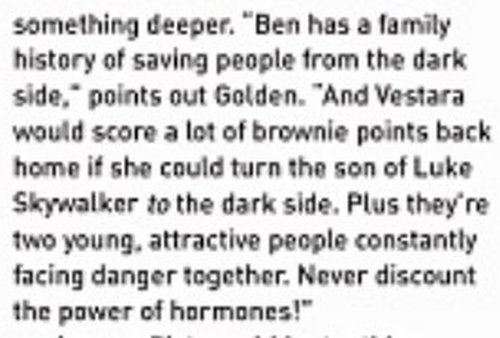
Our notes: `notes/materials/038-star-wars-insider/117-ins117.md:329`

- Note (summary from our notes, not a quotation): Page contents: Books: Adventures in Hyperspace (Ryder Windham), Fire Ring Race and Shinbone Showdown, Han and Chewie run the Five Fire Rings of Fornax for Jabba; Rebel Force: Uprising (Alex Wheeler), Luke vs. Imperial mastermind Rezi Soresh. (hand-read)
  — Source: Star Wars Insider #117 (2010).
Our notes: `notes/materials/038-star-wars-insider/117-ins117.md:336`

- Note (summary from our notes, not a quotation): Page contents: Schoeneberg: nixed Spudda the Hutt and "Chewtater", Chipbacca; Mickey as Jedi Luke and other figures; Holographic Stitch Emperor; Star Tours Boarding Party set; Muppets; Star Wars Weekends from May 21. (hand-read)
  — Source: Star Wars Insider #117 (2010).
Our notes: `notes/materials/038-star-wars-insider/117-ins117.md:386`

> killed many Jedi Knights *(draft, not canon)*
> [fragment — full passage not on file]
— Source: Star Wars Insider #117 (2010).
Note (our notes, around the quote): Page contents: Classic Moment, ROTJ Jabba's throne room (original script; film dialogue, S only). Insider Trivia: in the second-draft ROTJ script Jabba tells Luke he has "killed many Jedi Knights" (draft, not canon). What They Said: Carrie Fisher on the bathing suit (DVD commentary, 2006). (hand-read)
Our notes: `notes/materials/038-star-wars-insider/117-ins117.md:421`

> Your mind powers will not work on me, boy
> [fragment — full passage not on file]
— Source: Star Wars Insider #117 (2010).
Note (our notes, around the quote): Page contents: Classic Moment: Luke's Jedi mind trick on Bib Fortuna fails on Jabba ("Your mind powers will not work on me, boy"); Luke pulls a guard's pistol with the Force (film script, S only). Why It's a Classic. Next time: Mace Windu vs. Sidious. (hand-read)
Our notes: `notes/materials/038-star-wars-insider/117-ins117.md:426`

## Star Wars Insider #118 (2010)

> he's a badass with a lightsaber
> [fragment — full passage not on file]
— Source: Star Wars Insider #118 (2010).
Note (our notes, around the quote): Page contents: Blackman: TFU as much Vader's story; Starkiller as a foil for Vader. Witwer: "he's a badass with a lightsaber"; the little piece of Luke Skywalker inside him. (hand-read)
Our notes: `notes/materials/038-star-wars-insider/118-ins118.md:87`

- Note (summary from our notes, not a quotation): Page contents: Cloud City sets: corridor relit blue for Luke's sneak; Peter Suschitzky on rapid light changes to make the same corridor look new. (hand-read)
  — Source: Star Wars Insider #118 (2010).
Our notes: `notes/materials/038-star-wars-insider/118-ins118.md:223`

## Star Wars Insider #119 (2010)

- Note (summary from our notes, not a quotation): Page contents: Kershner: second act of a three-act play, topping the opening with characterization; Dagobah set with water 3.5-4 feet deep and frogmen sinking Luke's ship; Stuart Freeborn and Yoda. (hand-read)
  — Source: Star Wars Insider #119 (2010).
Our notes: `notes/materials/038-star-wars-insider/119-ins119.md:95`

> a mid-level mobster with a bad back
> [fragment — full passage not on file]
— Source: Star Wars Insider #119 (2010).
Note (our notes, around the quote): Page contents: Ventimiglia: favorite scene Yoda training Luke on Dagobah (dialogue quoted); would ask Lucas to live at Skywalker Ranch; would do a Greedo TV show ("a mid-level mobster with a bad back"). (hand-read)
Our notes: `notes/materials/038-star-wars-insider/119-ins119.md:120`

- Note (summary from our notes, not a quotation): Page contents: ESB facts: lowest body count, no major character deaths; Yoda's planet and species to stay unknown; novel Luke returns fire on Cloud City; 170-day shoot; sea otter tauntaun groan; only OT meeting of Vader and C-3PO; full-size Falcon; Guinness worked one day (Sept 5, 1979). (hand-read)
  — Source: Star Wars Insider #119 (2010).
Our notes: `notes/materials/038-star-wars-insider/119-ins119.md:246`

- Note (summary from our notes, not a quotation): Page contents: Archive cont.: ESB stills (Hoth, Luke and Leia, droids, Luke in the medcenter). (hand-read)
  — Source: Star Wars Insider #119 (2010).
Our notes: `notes/materials/038-star-wars-insider/119-ins119.md:276`

- Note (summary from our notes, not a quotation): Page contents: Hasbro vintage-style relaunch (Jason Fry): Empire-focused first wave of 11 figures (Bespin Luke, Hoth Leia, Dengar; Fett, 4-LOM and Vader repackaged); Derryl DePriest; Echo Base open-parka Han. (hand-read)
  — Source: Star Wars Insider #119 (2010).
Our notes: `notes/materials/038-star-wars-insider/119-ins119.md:311`

- Note (summary from our notes, not a quotation): Page contents: Incoming: LEGO Comic-Con cube figures; Mimoco MIMOBOT series six (Hoth Luke, wampa, snowtrooper, Yoda; Lobot exclusive). (hand-read)
  — Source: Star Wars Insider #119 (2010).
Our notes: `notes/materials/038-star-wars-insider/119-ins119.md:442`

- Note (summary from our notes, not a quotation): Page contents: "Hallmark of the Empire": Christine Taylor and Juli McGuire on Hallmark's Star Wars history and the ESB 30th Keepsake Ornaments (Snowspeeder, His Master's Bidding, Dagobah Luke); sculptors. (hand-read)
  — Source: Star Wars Insider #119 (2010). POV: Page contents, about Luke Skywalker.
Our notes: `notes/materials/038-star-wars-insider/119-ins119.md:452`

## Star Wars Insider #120 (2010)

- Note (summary from our notes, not a quotation): Page contents: Maquettes: Dagobah swamp; Luke's leap into the void on Cloud City. (hand-read)
  — Source: Star Wars Insider #120 (2010).
Our notes: `notes/materials/038-star-wars-insider/120-ins120.md:274`

## Star Wars Insider #121 (2010)

- Note (summary from our notes, not a quotation): Page contents: Game On (Chris Prince): greatest video game moments; Star Wars Arcade (1983), digitized Obi-Wan "Luke, trust me". (hand-read)
  — Source: Star Wars Insider #121 (2010).
Our notes: `notes/materials/038-star-wars-insider/121-ins121.md:268`

## Star Wars Insider #122 (2011)

- Note (summary from our notes, not a quotation): Page contents: Editor's Welcome (Jonathan Wilkins): free Howard Chaykin ESB-homage poster, 1976 Lucas/Chaykin comic transcript, Savage Opress debut, Nightsisters; Corey Burton teaser; Luke quote from Marvel Star Wars #1. (hand-read)
  — Source: Star Wars Insider #122 (2011).
Our notes: `notes/materials/038-star-wars-insider/122-ins122.md:20`

- Note (summary from our notes, not a quotation): Page contents: My Star Wars: Rick McCallum on first seeing Star Wars and his favorite scene (Luke at the twin suns). (hand-read)
  — Source: Star Wars Insider #122 (2011).
Our notes: `notes/materials/038-star-wars-insider/122-ins122.md:142`

- Note (summary from our notes, not a quotation): Page contents: Mark Hamill at Celebration V title image (Luke montage). (hand-read)
  — Source: Star Wars Insider #122 (2011).
Our notes: `notes/materials/038-star-wars-insider/122-ins122.md:192`

- Note (summary from our notes, not a quotation): Page contents: Photo: Hamill as Luke with Endor strike team. (hand-read)
  — Source: Star Wars Insider #122 (2011).
Our notes: `notes/materials/038-star-wars-insider/122-ins122.md:222`

> Little Rascals in outer space
> [fragment — full passage not on file]
— Source: Star Wars Insider #122 (2011).
Note (our notes, around the quote): Page contents: Hamill: sprained thumb on the AT-AT jump shot delayed duel filming; reading the Luke Starkiller script ("Little Rascals in outer space"). (hand-read)
Our notes: `notes/materials/038-star-wars-insider/122-ins122.md:227`

> Hopefully, in the future, I can begin to make Luke into much more of a swordsman. But ultimately there just wasn't room in the picture for it.
— Source: Star Wars Insider #122 (2011); Luke Skywalker — entry/section: Movie Frame to Comic.
Note (our notes, around the quote): Luke Skywalker — entry/section: Movie Frame to Comic: ""Hopefully, in the future, I can begin to make Luke into much more of a swordsman. But ultimately there just wasn't room in the picture for it." —George Lucas, Star Wars Insider 122, p. 50" Source: *Star Wars Insider #122* (2011), scan p.50
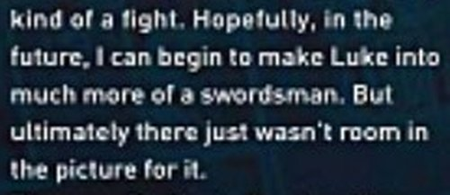
Our notes: `notes/materials/038-star-wars-insider/122-ins122.md:284`

- Note (summary from our notes, not a quotation): Page contents: Books: Joe Schreiber's Red Harvest (zombie-infested Sith academy, "zombies with lightsabers"); Troy Denning's Fate of the Jedi: Vortex (Luke and Ben with Vestara Khai, the Fallanassi on Pydyr). (hand-read)
  — Source: Star Wars Insider #122 (2011).
Our notes: `notes/materials/038-star-wars-insider/122-ins122.md:442`

- Note (summary from our notes, not a quotation): Page contents: Incoming: Sideshow Boil and Waxer with Numa 12-inch set; Museum Replicas Luke ceremonial jacket and medal. (hand-read)
  — Source: Star Wars Insider #122 (2011).
Our notes: `notes/materials/038-star-wars-insider/122-ins122.md:473`

## Star Wars Insider #123 (2011)

- Note (summary from our notes, not a quotation): Page contents: Secrets of the Force: In the Beginning (Ashla and Bogan, Jedi Bendu, the 12 children of Skywalker, Lucas on Yoda and the lasersword); Force Jump (Luke leaving the carbon-freeze chamber; Kyle Katarn in the Jedi Knight games); Do You Have What It Takes? (midi-chlorians, age, the cyborg limit). (hand-read)
  — Source: Star Wars Insider #123 (2011).
Our notes: `notes/materials/038-star-wars-insider/123-ins123.md:99`

> quicker, easier, and more seductive
> [fragment — full passage not on file]
>
> tend to be more menacing. *(hand-read)*
> [fragment — full passage not on file]
— Source: Star Wars Insider #123 (2011).
Note (our notes, around the quote): Page contents: Force Lightning (Emperor vs Luke; Dooku vs Yoda); The Sith: dark side "quicker, easier, and more seductive", the Rule of Two, Force lightning and telekinetic strangulation "tend to be more menacing." (hand-read)
Our notes: `notes/materials/038-star-wars-insider/123-ins123.md:115`

- Note (summary from our notes, not a quotation): Page contents: Retro (Gus Lopez): Luke collectibles (over 2,400 items; Kenner Early Bird, Icons lightsaber replica, Omni snowspeeder soap). (hand-read)
  — Source: Star Wars Insider #123 (2011).
Our notes: `notes/materials/038-star-wars-insider/123-ins123.md:192`

- Note (summary from our notes, not a quotation): Page contents: Retro cont.: Celebration medallions, Dairy Time yogurt, unproduced Kenner Luke toys, Luke cookie jar prototype. (hand-read)
  — Source: Star Wars Insider #123 (2011).
Our notes: `notes/materials/038-star-wars-insider/123-ins123.md:197`

## Star Wars Insider #124 (2011)

- Note (summary from our notes, not a quotation): Page contents: Classic Moment: Luke and Leia's swing across the chasm (A New Hope, DVD ch. 37); Fisher quote about the swing stunt; trivia: the abyss was only about 12 feet deep, the rest a matte painting. Film dialogue. (hand-read)
  — Source: Star Wars Insider #124 (2011).
Our notes: `notes/materials/038-star-wars-insider/124-ins124.md:322`

> What has Kir Kanos been doing since the end of Crimson Empire? Why, amassing the funds necessary to take revenge on Luke Skywalker!
— Source: Star Wars Insider #124 (2011); Kir Kanos; Luke Skywalker — entry/section: Crimson Empire III prelude.
Note (our notes, around the quote): Kir Kanos; Luke Skywalker — entry/section: Crimson Empire III prelude: ""What has Kir Kanos been doing since the end of Crimson Empire? Why, amassing the funds necessary to take revenge on Luke Skywalker!" —Randy Stradley, Star Wars Insider 124, p. 62" Source: *Star Wars Insider #124* (2011), scan p.62
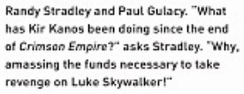
Our notes: `notes/materials/038-star-wars-insider/124-ins124.md:354`

## Star Wars Insider #125 (2011)

- Note (summary from our notes, not a quotation): Page contents: Incoming (Chris Spitale): Hasbro vintage-packaged wave (Fi-Ek Sirch, AT-RT Driver, X-wing Luke, Weequay skiff master, General Lando). (hand-read)
  — Source: Star Wars Insider #125 (2011).
Our notes: `notes/materials/038-star-wars-insider/125-ins125.md:454`

- Note (summary from our notes, not a quotation): Page contents: Incoming: EFX Luke ROTJ stunt lightsaber replica (hero vs. stunt props explained); Funko Pop! bobble-heads. (hand-read)
  — Source: Star Wars Insider #125 (2011).
Our notes: `notes/materials/038-star-wars-insider/125-ins125.md:459`

## Star Wars Insider #126 (2011)

> Luke and Mara actually do work together in this book
> [fragment — full passage not on file]
— Source: Star Wars Insider #126 (2011).
Note (our notes, around the quote): Page contents: Books: Choices of One (between ANH and ESB): Mara Jade on a mission of Imperial justice with the Hand of Judgment stormtroopers; "Luke and Mara actually do work together in this book". Ask Lobot (Leland Y. Chee): Bespin and Hoth are in separate systems; Bespin is a short distance from the Anoat system along the Ison Corridor; the Falcon used a much slower backup hyperdrive, travel time unspecified. (hand-read)
Our notes: `notes/materials/038-star-wars-insider/126-ins126.md:326`

## Star Wars Insider #127 (2011)

- Note (summary from our notes, not a quotation): Page contents: Han feature: Han defined against Luke; a survivor who stays out of politics; arrogance (chasing stormtroopers on the Death Star); "Solo in Love": EU romances (Bria Tharen, Xaverri, Salla Zend, Jenny in a deleted scene) and Leia. (hand-read)
  — Source: Star Wars Insider #127 (2011).
Our notes: `notes/materials/038-star-wars-insider/127-ins127.md:92`

- Note (summary from our notes, not a quotation): Page contents: Mon Mothma's Five Facts (1 Fake): little people as Luke and the Lars family; A New Hope film stock prone to fading. (hand-read)
  — Source: Star Wars Insider #127 (2011).
Our notes: `notes/materials/038-star-wars-insider/127-ins127.md:163`

- Note (summary from our notes, not a quotation): Page contents: Radio drama feature: 30th anniversary; Richard Toscan and John Houseman revive radio drama at USC/KUSC; cast (Anthony Daniels, Bernard Behrens as Ben Kenobi, Perry King as Han, Mark Hamill as Luke). (hand-read)
  — Source: Star Wars Insider #127 (2011).
Our notes: `notes/materials/038-star-wars-insider/127-ins127.md:208`

- Note (summary from our notes, not a quotation): Page contents: Kenner prototypes: large-size Empire figures (Lando head sculpt, Hoth Han, Bespin Luke and Leia); talking Yoda doll; Yoda hand puppet; handheld LED game. (hand-read)
  — Source: Star Wars Insider #127 (2011).
Our notes: `notes/materials/038-star-wars-insider/127-ins127.md:343`

- Note (summary from our notes, not a quotation): Page contents: Kenner prototypes: early Jedi Luke and Emperor versions; Parker Brothers' Death Star Battle game; kit-bashed figures; unreleased Power of the Force figures and coin album. (hand-read)
  — Source: Star Wars Insider #127 (2011).
Our notes: `notes/materials/038-star-wars-insider/127-ins127.md:348`

## Star Wars Insider #128 (2011)

- Note (summary from our notes, not a quotation): Page contents: Blu-ray: deleted scenes (Tosche Station, Biggs on Tatooine, wampas attacking Echo Base, Luke building his lightsaber in ROTJ); menus; 501st documentary. (hand-read)
  — Source: Star Wars Insider #128 (2011).
Our notes: `notes/materials/038-star-wars-insider/128-ins128.md:95`

- Note (summary from our notes, not a quotation): Page contents: Blu-ray: Anakin/Luke cover art, Lucas approval, Skywalker Sound and ILM restorations; In a Fix with Fixer: Anthony Forrest (Fixer, and the sandtrooper who falls for Obi-Wan's mind trick) on Fixer's fate. (hand-read)
  — Source: Star Wars Insider #128 (2011).
Our notes: `notes/materials/038-star-wars-insider/128-ins128.md:105`

- Note (summary from our notes, not a quotation): Page contents: Radio Drama: Daley's unused opening; John Whitman's rewrite puts Luke in Ben's home tuning adegan crystals, gives many of Fett's lines to Jabba's dancer "Arica" (Mara Jade), and alludes to Threepio flying the Falcon over Coruscant (Shadows of the Empire); the 1996 cast (Joshua Fardon as Luke, Arye Gross as Lando, Ed Begley Jr. as Boba Fett, Ed Asner as Jabba, Anthony Daniels). (hand-read)
  — Source: Star Wars Insider #128 (2011).
Our notes: `notes/materials/038-star-wars-insider/128-ins128.md:177`

> The Jedi have returned.
> [fragment — full passage not on file]
— Source: Star Wars Insider #128 (2011).
Note (our notes, around the quote): Page contents: Radio Drama: Threepio's final scene with Luke; Daley's last words for the radio Jedi ("The Jedi have returned."); Daley died February 11, 1996. (hand-read)
Our notes: `notes/materials/038-star-wars-insider/128-ins128.md:186`

- Note (summary from our notes, not a quotation): Page contents: Newman: parallels between Anakin's and Luke's journeys; the absence of a Han Solo figure as a "conscious masterstroke"; Qui-Gon's insight into the Force. (hand-read)
  — Source: Star Wars Insider #128 (2011).
Our notes: `notes/materials/038-star-wars-insider/128-ins128.md:298`

## Star Wars Insider #129 (2011)

- Note (summary from our notes, not a quotation): Page contents: Classic Moment: script continues (Han's defiance; Luke springs off the plank with a flip and catches his lightsaber from Artoo); Ben Burtt on the ruler-twang sound effect; EU note that Bib Fortuna and the Max Rebo Band escaped the Khetanna; next time "Hello, There." (hand-read)
  — Source: Star Wars Insider #129 (2011).
Our notes: `notes/materials/038-star-wars-insider/129-ins129.md:312`

## Star Wars Insider #130 (2012)

- Note (summary from our notes, not a quotation): Page contents: Five Facts: the infant who played baby Luke and Leia in ROTS was a crew member's child (name omitted); Carrie Fisher appeared in a rock music video (musician's name omitted); answer on p. 98. (hand-read)
  — Source: Star Wars Insider #130 (2012).
Our notes: `notes/materials/038-star-wars-insider/130-ins130.md:184`

- Note (summary from our notes, not a quotation): Page contents: Feature opener art: portrait of Leia and Luke with Vader looming behind them (no text). (hand-read)
  — Source: Star Wars Insider #130 (2012).
Our notes: `notes/materials/038-star-wars-insider/130-ins130.md:219`

- Note (summary from our notes, not a quotation): Page contents: Feature (Jason Fry), "A Certain Point of View: Family Tradition": was Anakin's fall provoked by the Jedi's aversion to emotion? The Jedi's traditions lead to their ruin, and Luke saves the galaxy by rejecting them; Anakin's Council test in TPM ("Cold, sir"; Yoda on fear leading to anger, hate and suffering). (hand-read)
  — Source: Star Wars Insider #130 (2012).
Our notes: `notes/materials/038-star-wars-insider/130-ins130.md:224`

- Note (summary from our notes, not a quotation): Page contents: Feature (Fry) conclusion: in ROTJ Luke reaches the man behind the mask, refuses to kill Anakin, and Vader sacrifices himself to hurl the Emperor down the reactor shaft, bringing balance; author bio (personal details omitted). (hand-read)
  — Source: Star Wars Insider #130 (2012).
Our notes: `notes/materials/038-star-wars-insider/130-ins130.md:248`

- Note (summary from our notes, not a quotation): Page contents: LEGO Miniland interview: advice for builders; building Endor scenes as a kid; Luke cutting a speeder bike in half; Minilands also in Billund and Germany; Kashyyyk beach battle photo. (hand-read)
  — Source: Star Wars Insider #130 (2012).
Our notes: `notes/materials/038-star-wars-insider/130-ins130.md:287`

- Note (summary from our notes, not a quotation): Page contents: Comics: Star Wars Omnibus: At War With the Empire Volume 2 (December 14), collecting "General" Skywalker, In the Shadows of Their Fathers (Jabiim), The Ahakista Gambit (Wyl Tarson vs. Vader), Small Victories (Deena Shan), and Vector parts 7–8 (Luke vs. the Sith spirit Karness Muur). (hand-read)
  — Source: Star Wars Insider #130 (2012).
Our notes: `notes/materials/038-star-wars-insider/130-ins130.md:462`

- Note (summary from our notes, not a quotation): Page contents: Incoming: Hasbro Ultimate FX Lightsabers (Vader, Anakin, Luke ROTJ; $34.99); LEGO Anakin & Sebulba's Podracers ($89.99). (hand-read)
  — Source: Star Wars Insider #130 (2012).
Our notes: `notes/materials/038-star-wars-insider/130-ins130.md:482`

## Star Wars Insider #131 (2012)

- Note (summary from our notes, not a quotation): Page contents: Pope interview: Lucas personally approved the strip; Moebius and Mézières; art captions (a Tusken on a bantha in the Jundland Wastes; Luke arriving at Jabba's palace); upcoming Battling Boy, THB, Psychenaut. (hand-read)
  — Source: Star Wars Insider #131 (2012).
Our notes: `notes/materials/038-star-wars-insider/131-ins131.md:180`

- Note (summary from our notes, not a quotation): Page contents: "Characters" essay by Jason Fry: ANH's archetypes (Luke, Han, Leia) and their conflicting points of view. (hand-read)
  — Source: Star Wars Insider #131 (2012). POV: Page contents, about Luke Skywalker.
Our notes: `notes/materials/038-star-wars-insider/131-ins131.md:200`

- Note (summary from our notes, not a quotation): Page contents: Fry essay: Vader slapping down Boba Fett's gun; David Prowse's stride; in ROTJ Luke beats the Emperor by refusing Obi-Wan and Yoda's advice and reaching Anakin; the prequels follow Anakin, mirroring Luke's story and doubling characters (Amidala and her handmaidens; Palpatine/Sidious). (hand-read)
  — Source: Star Wars Insider #131 (2012).
Our notes: `notes/materials/038-star-wars-insider/131-ins131.md:223`

- Note (summary from our notes, not a quotation): Page contents: Roderick-Jones blueprint (Falcon cockpit or interior drafting) and a photo of Luke with the T-16 skyhopper model (rotated page). (hand-read)
  — Source: Star Wars Insider #131 (2012).
Our notes: `notes/materials/038-star-wars-insider/131-ins131.md:393`

## Star Wars Insider #132 (2012)

What it shows (our notes): Page contents: Witwer interview: Starkiller formula ("two parts Han Solo, one part Luke, one part Indiana Jones, one part Darth Maul"); Maul borrows from Palpatine; Sith Code mutterings ("Through victory my chains are broken"); Witwer's World bio. (hand-read)
> two parts Han Solo, one part Luke, one part Indiana Jones, one part Darth Maul
> [fragment — full passage not on file]
>
> Through power, I gain victory.
>
> Through victory my chains are broken.
>
> Kopecz was gone, rejoining Kaan’s army and the war being waged against the Jedi and the Republic. Bane had remained behind at the Sith Academy on Korriban to learn the ways of the Sith. His first lesson began the next morning, at the feet of Lord Qordis himself.
— Source: Star Wars Insider #132 (2012); Page contents: Witwer interview: Starkiller formula (.
(Excerpt widened 2026-11-17 to the relevant passage, word for word from Path of Destruction (Drew Karpyshyn), Chapter 9 (text copy `MEGA_Legend_The_Darth_Bane_Trilogy_Star_Wars_Darth_Bane_01_Path_of_Destruction_Drew_Karpyshyn_epub`).)
(Full sentence/passage taken from the source text on file: `research_primary_sw_d20_folder_files_Star_Wars_Roleplaying_Game_Saga_Edition_Web_Articles_pdf`.)
Our notes: `notes/materials/038-star-wars-insider/132-ins132.md:112`

- Note (summary from our notes, not a quotation): Page contents: Fate of the Jedi feature: interview with Aaron Allston, Christie Golden and Troy Denning. Origins (a father/son odyssey to learn why Jacen fell, Homer's Odyssey model); the Maw entity idea; Daala banishes Luke; Golden's Ben/Vestara romance ("Jedi versus Sith"). (hand-read)
  — Source: Star Wars Insider #132 (2012).
Our notes: `notes/materials/038-star-wars-insider/132-ins132.md:177`

- Note (summary from our notes, not a quotation): Page contents: Fate of the Jedi: myth structure (Outcast's working title "The Hidden One"; Backlash's Dathomir as the Amazons); the goal to avoid another galactic war; Luke/Ben and Leia/Allana generationality; Maw and Centerpoint mysteries. (hand-read)
  — Source: Star Wars Insider #132 (2012).
Our notes: `notes/materials/038-star-wars-insider/132-ins132.md:187`

- Note (summary from our notes, not a quotation): Page contents: Fate of the Jedi: the collaboration process; Golden was surprised by Allston's conspiracy subplot; Denning on worthy foes for Luke. (hand-read)
  — Source: Star Wars Insider #132 (2012).
Our notes: `notes/materials/038-star-wars-insider/132-ins132.md:192`

> Luke isn't a demi-god. He's not even as powerful as most superheroes. He's a mortal human who happens to be very strong in the Force and very well-trained in the combat arts. That makes him extremely deadly to his enemies, but it doesn't make him invincible. He can be killed by a lucky shot, just like anyone else. That possibility is always there, even when he's facing down a lowly Sith apprentice.
— Source: Star Wars Insider #132 (2012).
Note (our notes, around the quote): Luke Skywalker — entry/section: Denning: Luke isn't a demi-god; can be killed by a lucky shot: ""Luke isn't a demi-god. He's not even as powerful as most superheroes. He's a mortal human who happens to be very strong in the Force and very well-trained in the combat arts. That makes him extremely deadly to his enemies, but it doesn't make him invincible. He can be killed by a lucky shot, just like anyone else. That possibility is always there, even when he's facing down a lowly Sith apprentice." —Troy Denning, Star Wars Insider 132, p. 37" Source: *Star Wars Insider #132* (2012), scan p.37
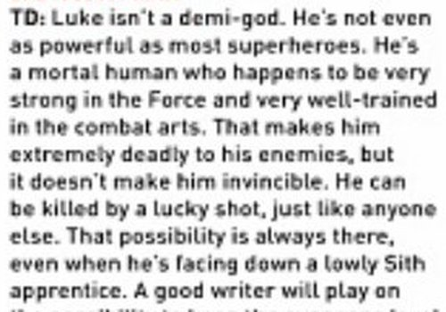
Our notes: `notes/materials/038-star-wars-insider/132-ins132.md:194`

- Note (summary from our notes, not a quotation): Page contents: Fate of the Jedi: Abeloth's origins (Callista used against Luke; Celestials; a "Cthuloid" flavor; fitted to the Mortis mythology with Filoni's help). Unused cover concepts. (hand-read)
  — Source: Star Wars Insider #132 (2012).
Our notes: `notes/materials/038-star-wars-insider/132-ins132.md:199`

> Luke still has human limitations. He was injured, and recovering, throughout Conviction, for instance. Sometimes, figuring out precisely who needs punching is a big part of his objective. And the fact that many of his opponents are familiar with the Force and can anticipate some of his methods is a Limitation
> [fragment — full passage not on file]
— Source: Star Wars Insider #132 (2012); Luke Skywalker — entry/section: Allston: Luke still has human limitations.
Note (our notes, around the quote): Luke Skywalker — entry/section: Allston: Luke still has human limitations: ""Luke still has human limitations. He was injured, and recovering, throughout Conviction, for instance. Sometimes, figuring out precisely who needs punching is a big part of his objective. And the fact that many of his opponents are familiar with the Force and can anticipate some of his methods is a Limitation" —Aaron Allston, Star Wars Insider 132, p. 38" Source: *Star Wars Insider #132* (2012), scan p.38
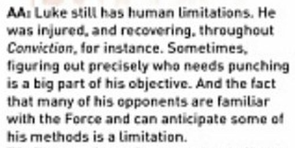
Our notes: `notes/materials/038-star-wars-insider/132-ins132.md:201`

- Note (summary from our notes, not a quotation): Page contents: Fate of the Jedi: Ben's development (Luke grooming a successor; Ben not the next Grand Master); Golden: Ben is "biologically 16" (crop-verified; OCR read 14). (hand-read)
  — Source: Star Wars Insider #132 (2012).
Our notes: `notes/materials/038-star-wars-insider/132-ins132.md:206`

- Note (summary from our notes, not a quotation): Page contents: Windham: Goodwin's comic strip set between ANH and ESB (Vader's flagship, Hoth, the hunt for Luke); "The Bounty Hunter of Ord Mantell" (Skorr and Gribbet; Solo turns the tables). (hand-read)
  — Source: Star Wars Insider #132 (2012).
Our notes: `notes/materials/038-star-wars-insider/132-ins132.md:273`

> the seed for the entire Fate of the Jedi series,
> [fragment — full passage not on file]
>
> isn't Luke's swan song.
> [fragment — full passage not on file]
— Source: Star Wars Insider #132 (2012).
Note (our notes, around the quote): Page contents: Books (Daniel Wallace): FotJ: Apocalypse (March 13). Denning says Jacen's fall was "the seed for the entire Fate of the Jedi series," that Apocalypse reveals the Balance of the Force, and that it "isn't Luke's swan song." Also: Haynes Millennium Falcon Owner's Workshop. (hand-read)
Our notes: `notes/materials/038-star-wars-insider/132-ins132.md:317`

## Star Wars Insider #133 (2012)

- Note (summary from our notes, not a quotation): Page contents: Rogues Gallery (Leland Chee), Massassi Temple ceremony: Deacon Eso, Caf Treblanc, Tyr Taskeen, C-3PO, Bob Hudsol, Duron Veertag, Anj Zavor, R2-D2, Luke. (hand-read)
  — Source: Star Wars Insider #133 (2012).
Our notes: `notes/materials/038-star-wars-insider/133-ins133.md:213`

- Note (summary from our notes, not a quotation): Page contents: Vader and Son: Brown's favorite strip (Vader telling Luke to pick up his toys). (hand-read)
  — Source: Star Wars Insider #133 (2012).
Our notes: `notes/materials/038-star-wars-insider/133-ins133.md:248`

## Star Wars Insider #134 (2012)

- Note (summary from our notes, not a quotation): Page contents: McQuarrie tribute art: Luke vs. the rancor, Endor, and the sail barge. (hand-read)
  — Source: Star Wars Insider #134 (2012).
Our notes: `notes/materials/038-star-wars-insider/134-ins134.md:206`

> Luke Skywalker at age 62 would be as hale as a fit 40-year old
> [fragment — full passage not on file]
— Source: Star Wars Insider #134 (2012).
Note (our notes, around the quote): Page contents: Books: X-Wing: Mercy Kill (Daniel Wallace and Aaron Allston), set after FotJ, about 40 years after ROTJ; Wraith Squadron, Piggy, Face Loran, Jesmin Tainer, Scut; the Lecersen Conspiracy. Allston: "Luke Skywalker at age 62 would be as hale as a fit 40-year old". (hand-read)
Our notes: `notes/materials/038-star-wars-insider/134-ins134.md:416`

## Star Wars Insider #135 (2012)

> it is nice to have Yoda by your side
> [fragment — full passage not on file]
— Source: Star Wars Insider #135 (2012).
Note (our notes, around the quote): Page contents: Launch Pad: Kathleen Kennedy to become Lucasfilm co-chair as Lucas prepares to retire ("it is nice to have Yoda by your side"); Tsuyoshi Nagano young Luke art; Shadow Conspiracy moved to January 2013. Mon Mothma's Facts: the fake is #5 (Ugnaught children are called Ugletts, not Uglings), verified with a rotated crop; others include Sharad Hett becoming a Tusken warlord. (hand-read)
Our notes: `notes/materials/038-star-wars-insider/135-ins135.md:55`

- Note (summary from our notes, not a quotation): Page contents: History of the X-Wing series: Stackpole's comics and novels (Ysanne Isard, Corran Horn); Allston's Wraith Squadron; Face led an infiltration of captured Coruscant with Luke during the Vong war; Mercy Kill out August 7, 2012. (hand-read)
  — Source: Star Wars Insider #135 (2012).
Our notes: `notes/materials/038-star-wars-insider/135-ins135.md:174`

> give him some sort of breath mask
> [fragment — full passage not on file]
— Source: Star Wars Insider #135 (2012).
Note (our notes, around the quote): Page contents: McQuarrie: four or five paintings to take to Fox; R2 on a giant ball bearing; Vader's mask came from his concern that Vader would die crossing space between ships in the second draft ("give him some sort of breath mask"); he designed the stormtroopers and Luke's look. (hand-read)
Our notes: `notes/materials/038-star-wars-insider/135-ins135.md:254`

- Note (summary from our notes, not a quotation): Page contents: Bantha Tracks (Mary Franklin): the "Almost-Annual Wedding Edition"; a LEGO Luke and Leia wedding cake (couple names omitted). (hand-read)
  — Source: Star Wars Insider #135 (2012).
Our notes: `notes/materials/038-star-wars-insider/135-ins135.md:391`

## Star Wars Insider #136 (2012)

> The princess? She's here?
> [fragment — full passage not on file]
— Source: Star Wars Insider #136 (2012).
Note (our notes, around the quote): Page contents: Editorial (Jonathan Wilkins): Leia and Padmé as heroines; the never-before-published Carrie Fisher interview. Opening quote: "The princess? She's here?" —Luke Skywalker, A New Hope. (hand-read)
Our notes: `notes/materials/038-star-wars-insider/136-ins136.md:20`

> I raised Luke Skywalker! *(hand-read)*
> [fragment — full passage not on file]
— Source: Star Wars Insider #136 (2012).
Note (our notes, around the quote): Page contents: Ewan McGregor on R2-D2's appeal (family anecdote omitted); Bonnie Piesse (Beru, 2012): playing a younger Shelagh Fraser; greenscreen sunset; "I raised Luke Skywalker!" (hand-read)
Our notes: `notes/materials/038-star-wars-insider/136-ins136.md:152`

> When Dooku makes such short work of Anakin. I still get surprised when people lose limbs
> [fragment — full passage not on file]
>
> a dad who can beat up your dad. Unless you're Luke Skywalker
> [fragment — full passage not on file]
— Source: Star Wars Insider #136 (2012); Page contents: James Arnold Taylor (.
Note (our notes, around the quote): Page contents: James Arnold Taylor ("When Dooku makes such short work of Anakin. I still get surprised when people lose limbs"; would play Dexter Jettster) and Sam Witwer (favorite sequence "Yoda vs. Dooku"; Jango "a dad who can beat up your dad. Unless you're Luke Skywalker"). Crop-verified. (hand-read)
Our notes: `notes/materials/038-star-wars-insider/136-ins136.md:371`

- Note (summary from our notes, not a quotation): Page contents: Star Wars Art: Illustration artist list; next volume Star Wars Art: Concepts (fall 2013); Terese Nielsen's "Luke and Gaitie Armige" Star Wars Miniatures art (2007). (hand-read)
  — Source: Star Wars Insider #136 (2012).
Our notes: `notes/materials/038-star-wars-insider/136-ins136.md:508`

> a younger, less-experienced Wedge who survived Yavin with Luke
> [fragment — full passage not on file]
— Source: Star Wars Insider #136 (2012).
Note (our notes, around the quote): Page contents: Comics: Dark Horse's new Star Wars series (Brian Wood, Carlos D'Anda, Alex Ross covers), set after ANH; Wood must write "a younger, less-experienced Wedge who survived Yavin with Luke", not the X-wing novels' Wedge. (hand-read)
Our notes: `notes/materials/038-star-wars-insider/136-ins136.md:518`

## Star Wars Insider #137 (2012)

> from a whiny kid... to a powerful Jedi Knight in the space of three movies
> [fragment — full passage not on file]
— Source: Star Wars Insider #137 (2012); Page contents: Editorial (Jonathan Wilkins): Luke's arc.
Note (our notes, around the quote): Page contents: Editorial (Jonathan Wilkins): Luke's arc "from a whiny kid... to a powerful Jedi Knight in the space of three movies"; a never-before-printed Hamill interview from the Lucasfilm Archives, done before the film came out; first Insider Awards. (hand-read)
Our notes: `notes/materials/038-star-wars-insider/137-ins137.md:20`

- Note (summary from our notes, not a quotation): Page contents: Full-page photo of Hamill as Luke with a blaster (viewed). (hand-read)
  — Source: Star Wars Insider #137 (2012).
Our notes: `notes/materials/038-star-wars-insider/137-ins137.md:70`

> Luke grows up in Star Wars
> [fragment — full passage not on file]
— Source: Star Wars Insider #137 (2012); Page contents: Hamill/Lippincott: casting (Fred Roos), Star Wars' structure (.
Note (our notes, around the quote): Page contents: Hamill/Lippincott: casting (Fred Roos), Star Wars' structure ("Luke grows up in Star Wars"), the droids as Laurel and Hardy, Han as his favorite character; Gary Kurtz as "Mr. Machine"; the THX 1138 prisoner-transfer in-joke. (hand-read)
Our notes: `notes/materials/038-star-wars-insider/137-ins137.md:75`

- Note (summary from our notes, not a quotation): Page contents: "The Hero's Journey" sidebar (crop-verified): also Luke getting Han and Chewie to go along with the rescue, the Death Star run, and showing off his lightsaber skills at the "Saarlac pit" (sic). (hand-read)
  — Source: Star Wars Insider #137 (2012). POV: Page contents, about Luke Skywalker.
Our notes: `notes/materials/038-star-wars-insider/137-ins137.md:95`

- Note (summary from our notes, not a quotation): Page contents: Hamill on Japanese monster films, testing for the voice of Astro Boy, and life on the base; "The Many Outfits of Luke Skywalker" sidebar (farmboy chic). (hand-read)
  — Source: Star Wars Insider #137 (2012).
Our notes: `notes/materials/038-star-wars-insider/137-ins137.md:110`

- Note (summary from our notes, not a quotation): Page contents: Muren (viewed): his favorite scene is the helicopter shot of Luke on the tauntaun opening Empire; he is supervising the AOTC/ROTS 3D conversions. (hand-read)
  — Source: Star Wars Insider #137 (2012).
Our notes: `notes/materials/038-star-wars-insider/137-ins137.md:125`

> No, I am your father!
> [fragment — full passage not on file]
— Source: Star Wars Insider #137 (2012).
Note (our notes, around the quote): Page contents: Awards (viewed): Favorite hero went to Obi-Wan Kenobi, ahead of Han, Luke, Yoda, and Anakin; Favorite moment was "No, I am your father!", ahead of Order 66, Obi-Wan and Qui-Gon vs. Maul, the Death Star attack, and the Emperor's death. (hand-read)
Our notes: `notes/materials/038-star-wars-insider/137-ins137.md:160`

> Luke Skywalker defends himself as Dathomirian warrior Teneniel Djo strikes! Art by Darren Tan. *(hand-read)*
— Source: Star Wars Insider #137 (2012); Page contents: Art (viewed, caption crop-verified).
Label in our notes: hand-read
Our notes: `notes/materials/038-star-wars-insider/137-ins137.md:259`

## Star Wars Insider #138 (2013)

- Note (summary from our notes, not a quotation): Page contents: Incoming: Cartamundi Angry Birds Star Wars playing cards in tins ($4.99); Angry Birds Jenga Death Star ($29.97); Early Birds Package (R2-D2, Luke, Leia, Chewbacca; $9.97). (hand-read)
  — Source: Star Wars Insider #138 (2013).
Our notes: `notes/materials/038-star-wars-insider/138-ins138.md:358`

## Star Wars Insider #139 (2013)

- Note (summary from our notes, not a quotation): Page contents: The cast: David Collins (Han), Eckstein (Ryder Thorne), Witwer (Ro Kurota), Lanter (Luke), Dee Bradley Baker (Xizor, Sweeper), Clare Grant (Leia), Matthew Wood (Bib Fortuna, Rebel lieutenant), Daniel Logan (Boba Fett), Tom Kane (narrator); about 2,000 fans, no retakes; the final mix is on StarWars.com. (hand-read)
  — Source: Star Wars Insider #139 (2013).
Our notes: `notes/materials/038-star-wars-insider/139-ins139.md:165`

> Luke was still Luke Starkiller
> [fragment — full passage not on file]
— Source: Star Wars Insider #139 (2013).
Note (our notes, around the quote): Page contents: Summer and Lucas read the original Alex Raymond art at King Features; an NEA-funded comic-strip documentary (now lost) filmed at McQuarrie's studio and Lucas's house; Campbell's Hero with a Thousand Faces; "Luke was still Luke Starkiller"; McQuarrie and Lucas are both quiet; photo of Jay Cocks and Martin Scorsese outside Supersnipe, circa 1979. (hand-read)
Our notes: `notes/materials/038-star-wars-insider/139-ins139.md:195`

> Inspiration is a delicate thing really. Nothing was ever copied.
>
> The Star Wars: The Adventures of Luke Starkiller from the Journal of the Whills
> [fragment — full passage not on file]
— Source: Star Wars Insider #139 (2013).
Note (our notes, around the quote): Page contents: Summer: Colin Cantwell's long, skinny early Falcon (later the blockade runner) and its hot-rod concept; EC Comics ships in the Prequels; the Disneyland Mars and Beyond ships influenced the round Falcon and Cloud City ("Inspiration is a delicate thing really. Nothing was ever copied."); the first script, "The Star Wars: The Adventures of Luke Starkiller from the Journal of the Whills"; Howard Chaykin's Starship art and Close Encounters; to be continued. Lucas photo with Flashing Swords!; Conan development (cinematographer friend's name omitted). (hand-read)
Our notes: `notes/materials/038-star-wars-insider/139-ins139.md:200`

- Note (summary from our notes, not a quotation): Page contents: Daley's second-novel struggle with Lester del Rey; Judy-Lynn del Rey offered him a Star Wars book; he proposed a Luke and Leia Jedi-history story, but Lucasfilm barred the Jedi, the Force, the Empire and Vader before ESB (photo captions naming private individuals omitted). (hand-read)
  — Source: Star Wars Insider #139 (2013).
Our notes: `notes/materials/038-star-wars-insider/139-ins139.md:215`

- Note (summary from our notes, not a quotation): Page contents: "Fast Friends": The Doomfarers of Coramonde sold to Del Rey on July 6, 1976; friendship with Luceno; NPR radio adaptations (see Insider #127–128); Daley on Luke as a science-fiction fan ("Wormie" as a nod to T. H. White's "Wart"); Lucas wrote him that he enjoyed the radio drama. Photo of Tom Voegeli, John Madden and Daley. (hand-read)
  — Source: Star Wars Insider #139 (2013). POV: Page contents, about Luke Skywalker.
Our notes: `notes/materials/038-star-wars-insider/139-ins139.md:227`

- Note (summary from our notes, not a quotation): Page contents: Classic Moment (words Neil Edwards): Oola's death in Jabba's throne room (ROTJ 1983 script excerpt); the EU (Tales from Jabba's Palace: Oola and Sienn'rha meet Luke in Mos Eisley); a Femi Taylor quote on reshooting for the 1997 Special Edition (cites Insider #108). (hand-read)
  — Source: Star Wars Insider #139 (2013).
Our notes: `notes/materials/038-star-wars-insider/139-ins139.md:291`

- Note (summary from our notes, not a quotation): Page contents: Comics: Star Wars Omnibus: Infinities (730 pp., February 13): Infinities ANH (Leia trained as a Sith), ESB (Han trains as a Jedi after Luke dies on Hoth) and ROTJ (Vader ends up fighting for the light side). (hand-read)
  — Source: Star Wars Insider #139 (2013).
Our notes: `notes/materials/038-star-wars-insider/139-ins139.md:344`

## Star Wars Insider #140 (2013)

- Note (summary from our notes, not a quotation): Page contents: "Expanded Universe" interview with Michael Price (LEGO Star Wars specials writer; Jonathan Wilkins): why Star Wars is ripe for parody; a joke about hiding Luke on Tatooine. (hand-read)
  — Source: Star Wars Insider #140 (2013). POV: Page contents, about Luke Skywalker.
Our notes: `notes/materials/038-star-wars-insider/140-ins140.md:129`

- Note (summary from our notes, not a quotation): Page contents: Images (viewed): a throne room set still (Luke); a continuity Polaroid of an "Imp Dig" (Imperial dignitary), early 1982; an ILM A-wing maquette. (hand-read)
  — Source: Star Wars Insider #140 (2013).
Our notes: `notes/materials/038-star-wars-insider/140-ins140.md:179`

> It's Threepio! We're loose! *(hand-read)*
> [fragment — full passage not on file]
— Source: Star Wars Insider #140 (2013). POV: Page contents, about Luke Skywalker.
Note (our notes, around the quote): Page contents: "Authors of the Expanded Universe: Russ Manning" (Michael Kogge); title panel (viewed): Luke and Leia, "It's Threepio! We're loose!" (hand-read)
Our notes: `notes/materials/038-star-wars-insider/140-ins140.md:279`

> Master and Mistress Tan Skywalker,
> [fragment — full passage not on file]
>
> The Frozen World of Ota,
> [fragment — full passage not on file]
— Source: Star Wars Insider #140 (2013). POV: Page contents, about Luke Skywalker.
Note (our notes, around the quote): Page contents: "From the Jungle to the Stars": Lucasfilm barred him from the Empire storyline and from killing lead characters; the strip began March 11, 1979, in 215 papers with the Sunday "The Constancia Affair" (C-3PO narrating to Mnemos; Luke's parents given as "Master and Mistress Tan Skywalker," later revised); the daily "Gambler's World" (Vorzyd V; the villain Blackhole); hand-off to Hoberg, Stevens and Alcala ("The Frozen World of Ota," Boba Fett's first comics appearance); Goodwin and Williamson ran the strip until March 11, 1984; Manning died in 1981 (medical details left out). (hand-read)
Our notes: `notes/materials/038-star-wars-insider/140-ins140.md:304`

- Note (summary from our notes, not a quotation): Page contents: "A Lasting Legacy": Dark Horse reprints (Classic Star Wars: The Early Adventures); Blackhole used by later authors, including Matthew Stover's Luke Skywalker and the Shadows of Mindor; strip panels (viewed: Chewbacca roaring at a bald Imperial; Lady Tarkin vowing revenge, caption only, not quoted). (hand-read)
  — Source: Star Wars Insider #140 (2013). POV: Page contents, about Luke Skywalker.
Our notes: `notes/materials/038-star-wars-insider/140-ins140.md:309`

## Star Wars Insider #141 (2013)

- Note (summary from our notes, not a quotation): Page contents: Summer, continued: Vader interrogating Leia with the floating droid; sidebar "Keeping Empire's Secrets" (a phony script written to protect the Vader/Luke revelation). (hand-read)
  — Source: Star Wars Insider #141 (2013).
Our notes: `notes/materials/038-star-wars-insider/141-ins141.md:130`

- Note (summary from our notes, not a quotation): Page contents: Archive (viewed): a "Revenge of the Jedi" logo (Oct 2, 1980); Nilo Rodis-Jamero rebel HQ concept for a grass planet; Lucas's handwritten early Act I story outline (Vader meets Moff Jerjerrod, Luke and Yoda talk, and so on). Development material, not used as feats. (hand-read)
  — Source: Star Wars Insider #141 (2013).
Our notes: `notes/materials/038-star-wars-insider/141-ins141.md:170`

- Note (summary from our notes, not a quotation): Page contents: Disney on Endor: limited-edition 3-pack with Mickey as Endor Luke and Chip 'n' Dale as Ewoks (1,983 pieces). (hand-read)
  — Source: Star Wars Insider #141 (2013).
Our notes: `notes/materials/038-star-wars-insider/141-ins141.md:364`

- Note (summary from our notes, not a quotation): Page contents: Vinylmation Droids Juniors; Jabba/Salacious and Carbonite Han limited sets; plush (Endor Luke, Kneesaa, Chip 'n' Dale Ewoks). (hand-read)
  — Source: Star Wars Insider #141 (2013).
Our notes: `notes/materials/038-star-wars-insider/141-ins141.md:374`

## Star Wars Insider #142 (2013)

- Note (summary from our notes, not a quotation): Page contents: Collage of Marvel Star Wars covers (viewed): #1 "Enter Luke Skywalker!", Jaxxon and others; no prose. (hand-read)
  — Source: Star Wars Insider #142 (2013).
Our notes: `notes/materials/038-star-wars-insider/142-ins142.md:245`

- Note (summary from our notes, not a quotation): Page contents: Red Five: 1980 Bespin Luke 12" prototype, 1983 speeder-bike pedal car display, modern Hasbro clones. (hand-read)
  — Source: Star Wars Insider #142 (2013).
Our notes: `notes/materials/038-star-wars-insider/142-ins142.md:457`

## Star Wars Insider #143 (2013)

- Note (summary from our notes, not a quotation): Page contents: Full-page photo (viewed): Luke in his black hooded cloak on the Jabba's palace set; no text. (hand-read)
  — Source: Star Wars Insider #143 (2013).
Our notes: `notes/materials/038-star-wars-insider/143-ins143.md:100`

> very depth of space
> [fragment — full passage not on file]
— Source: Star Wars Insider #143 (2013); Page contents: Kahn profile, continued: the.
Note (our notes, around the quote): Page contents: Kahn profile, continued: the "very depth of space" opening line and the $60 poker check (crop-verified; OCR read $40/$460); NYT bestseller; scenes cut from the film (Luke building his lightsaber, the sandstorm, the Royal Guard choke); Han's "27 piracies"; Lando's Battle of Tanaab and Pesmenben IV scam; the excised Leia/Alderaan chapter; Ben says Owen is his brother (later retconned). Family detail behind the planet name left out. (hand-read)
Our notes: `notes/materials/038-star-wars-insider/143-ins143.md:272`

> revolutionaries are often great at knocking down...
> [fragment — full passage not on file]
— Source: Star Wars Insider #143 (2013).
Note (our notes, around the quote): Page contents: Kahn profile, continued: John Scalzi's praise; Kahn on Luke rebuilding the Republic after ROTJ ("revolutionaries are often great at knocking down..."); hopes to return. (hand-read)
Our notes: `notes/materials/038-star-wars-insider/143-ins143.md:288`

## Star Wars Insider #144 (2013)

- Note (summary from our notes, not a quotation): Page contents: The Star Wars interview (J. W. Rinzler, Randy Stradley): Lucas's approval; Aldeeraan as the Imperial seat; Luke as an aging Jedi general; the Jedi-Bendu; the "Force of Others"; the roll-up text; the Darth Vader sidebar (an Imperial general under Governor Hoedaack). Non-canon. (hand-read)
  — Source: Star Wars Insider #144 (2013).
Our notes: `notes/materials/038-star-wars-insider/144-ins144.md:182`

- Note (summary from our notes, not a quotation): Page contents: The Star Wars interview: the one added action scene (end of #3); sidebars on the Emperor (Cos Dashit; Governor Crispin Hoedaack), Luke Skywalker (Jedi general) and Princess Leia (daughter of King Kayos of Aquilae). Non-canon. (hand-read)
  — Source: Star Wars Insider #144 (2013).
Our notes: `notes/materials/038-star-wars-insider/144-ins144.md:202`

- Note (summary from our notes, not a quotation): Page contents: Books: Empire and Rebellion: Razor's Edge (Martha Wells; Leia meets Alderaanian refugees turned pirates; upcoming Han novel by James S. A. Corey and Luke novel by Kevin Hearne); National Geographic Angry Birds Star Wars: The Science Behind the Saga (Amy Griggs). Non-canon (Angry Birds). (hand-read)
  — Source: Star Wars Insider #144 (2013).
Our notes: `notes/materials/038-star-wars-insider/144-ins144.md:426`

> a little studious, tea-drinking chap
> [fragment — full passage not on file]
— Source: Star Wars Insider #144 (2013).
Note (our notes, around the quote): Page contents: Red Five: 3 Yoda trains Luke (McQuarrie imagined Yoda as "a little studious, tea-drinking chap"); 4 Luke and Vader on Endor; 5 Coruscant skyline. Expanded Universe sketches by Bateman start next issue. (hand-read)
Our notes: `notes/materials/038-star-wars-insider/144-ins144.md:530`

- Note (summary from our notes, not a quotation): Page contents: Back cover ad: Hasbro The Black Series 6-inch Luke Skywalker #01. (hand-read)
  — Source: Star Wars Insider #144 (2013).
Our notes: `notes/materials/038-star-wars-insider/144-ins144.md:545`

## Star Wars Insider #145 (2013)

> Luke reacts to the trap Admiral Ackbar so helpfully pointed out by rejecting fear and anger; Anakin reacts to his personal tragedies with unholy killing sprees.
— Source: Star Wars Insider #145 (2013); Darth Vader (Anakin Skywalker) — entry/section: Hearne on Anakin's choices.
Note (our notes, around the quote): Darth Vader (Anakin Skywalker) — entry/section: Hearne on Anakin's choices: ""Luke reacts to the trap Admiral Ackbar so helpfully pointed out by rejecting fear and anger; Anakin reacts to his personal tragedies with unholy killing sprees." —Kevin Hearne, Star Wars Insider 145, p. 15" Source: *Star Wars Insider #145* (2013), scan p.15
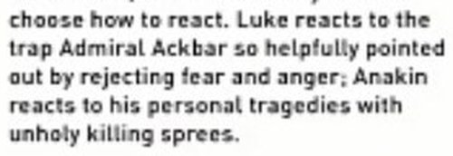
Our notes: `notes/materials/038-star-wars-insider/145-ins145.md:86`

> What did Luke get for him?
— Source: Star Wars Insider #145 (2013). POV: Page contents, about Luke Skywalker.
Note (our notes, around the quote): Page contents: "Hero or Villain?" Q3, can he be redeemed? Zahn (redeemed per the Force; a trial if he had lived), Allston (personally no, but Lucas says yes; "What did Luke get for him?"), Miller (Luke's act redeems; atonement begins with overthrowing the Emperor). (hand-read)
Our notes: `notes/materials/038-star-wars-insider/145-ins145.md:91`

> accomplished a great deal
> [fragment — full passage not on file]
— Source: Star Wars Insider #145 (2013). POV: Page contents, about Luke Skywalker.
Note (our notes, around the quote): Page contents: "Hero or Villain?" Q3 continued: Golden (yes; saving Luke as reparation), Bohnhoff (destroying Palpatine and saving Luke "accomplished a great deal"), Wheatley (change was enough for Lucas), Windham (would a judge and jury let him walk?). (hand-read)
Our notes: `notes/materials/038-star-wars-insider/145-ins145.md:100`

> much more of a warrior
> [fragment — full passage not on file]
— Source: Star Wars Insider #145 (2013). POV: Page contents, about Luke Skywalker.
Note (our notes, around the quote): Page contents: "Splinter" conversation (J. W. Rinzler), part 1: October 13, 1976 transcript of Lucas, Alan Dean Foster and Charles Lippincott; Lucas then saw Vader as a relatively weak villain; Western/Sinbad tone; Luke "much more of a warrior" crashing on a planet. Real-world production history; health detail omitted. (hand-read)
Our notes: `notes/materials/038-star-wars-insider/145-ins145.md:119`

- Note (summary from our notes, not a quotation): Page contents: "Splinter" conversation: full-page art of Luke, Leia and the droids (no text). (hand-read)
  — Source: Star Wars Insider #145 (2013). POV: Page contents, about Luke Skywalker.
Our notes: `notes/materials/038-star-wars-insider/145-ins145.md:124`

> much more of a warrior
> [fragment — full passage not on file]
— Source: Star Wars Insider #145 (2013). POV: Page contents, about Luke Skywalker.
Note (our notes, around the quote): Page contents: "Splinter" conversation: Lucas wants a new mechanical little robot as a foil for Artoo; Foster suggests a Force-magnifying object, Lucas recalls the kyber crystal from earlier drafts; a four-to-five-year time jump with Luke "much more of a warrior"; James Bond-style bar scene. Real-world development (pre-release brainstorm), not canon. (hand-read)
Our notes: `notes/materials/038-star-wars-insider/145-ins145.md:129`

- Note (summary from our notes, not a quotation): Page contents: "Splinter" conversation: full-page photo of Mark Hamill as Luke with blaster (no text). (hand-read)
  — Source: Star Wars Insider #145 (2013). POV: Page contents, about Luke Skywalker.
Our notes: `notes/materials/038-star-wars-insider/145-ins145.md:134`

- Note (summary from our notes, not a quotation): Page contents: RPGs part 2: Zahn choreographed the Luke vs. C'baoth fight to a WEG-designed throne room; Allston used warfare supplements; Pablo Hidalgo as an avid gamemaster (Tatooine Manhunt, Otherspace); Imperial Center, from an unused McQuarrie Had Abbadon painting, named "Coruscant" by Zahn. Production history. (hand-read)
  — Source: Star Wars Insider #145 (2013).
Our notes: `notes/materials/038-star-wars-insider/145-ins145.md:159`

- Note (summary from our notes, not a quotation): Page contents: Books: enhanced eBooks of Rinzler's Making Of books (gag reel; an alternate wampa attack; Veers's originally planned death; a female X-wing pilot's death footage; an early version of Luke building his lightsaber). (hand-read)
  — Source: Star Wars Insider #145 (2013).
Our notes: `notes/materials/038-star-wars-insider/145-ins145.md:367`

## Star Wars Insider #146 (2014)

- Note (summary from our notes, not a quotation): Page contents: "The Conversation" part 2 (J. W. Rinzler): the October 20, 1976 Lucas/Foster/Lippincott story conference for Splinter of the Mind's Eye. Real-world development material (Luke fights a tribal chief; the Wookiees can't talk); S only. (hand-read)
  — Source: Star Wars Insider #146 (2014). POV: Page contents, about Luke Skywalker.
Our notes: `notes/materials/038-star-wars-insider/146-ins146.md:125`

- Note (summary from our notes, not a quotation): Page contents: Full-page Splinter painting (Luke and Leia floating, by Fregedo), labeled "Exclusive" (no text). (hand-read)
  — Source: Star Wars Insider #146 (2014).
Our notes: `notes/materials/038-star-wars-insider/146-ins146.md:130`

- Note (summary from our notes, not a quotation): Page contents: Dark Horse Splinter adaptation comic panels and captions (Vader/Luke duel cover art). (hand-read)
  — Source: Star Wars Insider #146 (2014).
Our notes: `notes/materials/038-star-wars-insider/146-ins146.md:140`

- Note (summary from our notes, not a quotation): Page contents: Conversation concluded: Luke kills Vader in the draft, the crystal heals Leia, and the "Frank Frazetta moment". Development material; S only. (hand-read)
  — Source: Star Wars Insider #146 (2014).
Our notes: `notes/materials/038-star-wars-insider/146-ins146.md:150`

- Note (summary from our notes, not a quotation): Page contents: Also: Claremont's first credit, the plot of Star Wars #17 "Crucible" (Nov 1978, Luke reminisces about Tatooine); Claremont on comics' advantage in depicting aliens. (hand-read)
  — Source: Star Wars Insider #146 (2014).
Our notes: `notes/materials/038-star-wars-insider/146-ins146.md:263`

> Claremont again gives us a pivotal story in Luke Skywalker's continuing evolution as the Hero of Heroes. He gives us Kharys, who is not just a compelling villain, but the first pupil of Darth Vader and a female one at that.
— Source: Star Wars Insider #146 (2014).
Note (our notes, around the quote): Kharys; Darth Vader (Anakin Skywalker); Luke Skywalker — entry/section: Kharys, Vader's first pupil: ""Claremont again gives us a pivotal story in Luke Skywalker's continuing evolution as the Hero of Heroes. He gives us Kharys, who is not just a compelling villain, but the first pupil of Darth Vader and a female one at that." —Abel G. Peña, Star Wars Insider 146, p. 46" Source: *Star Wars Insider #146* (2014), scan p.46
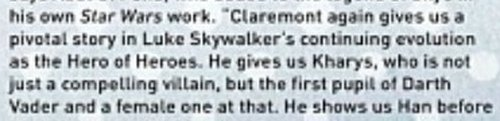
Our notes: `notes/materials/038-star-wars-insider/146-ins146.md:265`

## Star Wars Insider #148 (2014)

- Note (summary from our notes, not a quotation): Page contents: Contents: features (photo story, A Scarlet Woman? fiction, Ken Ralston, Marvel comics history, McQuarrie Vader castle, Tavoularis storyboards, Phil Tippett, Jedi quiz). Cover line quotes GC-1000, Luke Skywalker and the Shadows of Mindor. (hand-read)
  — Source: Star Wars Insider #148 (2014).
Our notes: `notes/materials/038-star-wars-insider/148-ins148.md:25`

- Note (summary from our notes, not a quotation): Page contents: Alex Tavoularis storyboards feature by J. W. Rinzler: first storyboards for "The Star Wars" (second-draft scenes, spring and summer 1975); newly found boards of the rescue of Deak Starkiller (Luke drawn as a girl). Production only. (hand-read)
  — Source: Star Wars Insider #148 (2014).
Our notes: `notes/materials/038-star-wars-insider/148-ins148.md:350`

> hanging out next to Han is one of the most dangerous places to be.
> [fragment — full passage not on file]
— Source: Star Wars Insider #148 (2014).
Note (our notes, around the quote): Page contents: Comics (Dan Wallace): Rebel Heist by Matt Kindt (four issues, each from a "regular Joe" POV beside Han, Leia, Chewie, Luke); Kindt: "hanging out next to Han is one of the most dangerous places to be." Cover Adam Hughes, interiors Marco Castiello. (hand-read)
Our notes: `notes/materials/038-star-wars-insider/148-ins148.md:456`

- Note (summary from our notes, not a quotation): Page contents: Comics: Star Wars Vol. 2: From the Ruins of Alderaan (Brian Wood, Ryan Kelly, Carlos D'Anda; issues 7-12, April 16): Leia sends Wedge and Luke to get captured on purpose. (hand-read)
  — Source: Star Wars Insider #148 (2014).
Our notes: `notes/materials/038-star-wars-insider/148-ins148.md:471`

- Note (summary from our notes, not a quotation): Page contents: Incoming merch (James Burns): Gentle Giant 2014 Premier Guild membership; Luke Endor mini bust. (hand-read)
  — Source: Star Wars Insider #148 (2014).
Our notes: `notes/materials/038-star-wars-insider/148-ins148.md:476`

- Note (summary from our notes, not a quotation): Page contents: Star Wars Moments (interview by Mark Newbold; subject a prop builder): Obi-Wan gives Luke Anakin's lightsaber (flash-handle prop, spinning-dowel effect); the "Star Wars Canyon" Tunisia shot. (hand-read)
  — Source: Star Wars Insider #148 (2014).
Our notes: `notes/materials/038-star-wars-insider/148-ins148.md:556`

- Note (summary from our notes, not a quotation): Page contents: Star Wars Moments cont.: Luke vs Vader in the carbon-freezing chamber; Falcon rescues Luke (five-foot model retrofitted); Vader protects his son (David Prowse performed the lift). Film commentary only (S). (hand-read)
  — Source: Star Wars Insider #148 (2014).
Our notes: `notes/materials/038-star-wars-insider/148-ins148.md:561`

## Star Wars Insider #149 (2014)

- Note (summary from our notes, not a quotation): Page contents: Full-page art (viewed): Dave Seeley's cover for Luke Skywalker and the Shadows of Mindor (2008); caption for Traitor. (hand-read)
  — Source: Star Wars Insider #149 (2014).
Our notes: `notes/materials/038-star-wars-insider/149-ins149.md:210`

- Note (summary from our notes, not a quotation): Page contents: McQuarrie Revisited text by Paul Bateman: McQuarrie's ESB-era interior studies for Vader's castle (OCR "Gast Castle" crop-verified as "Bast Castle"); Bateman populated the scene with McQuarrie's rarely seen bounty hunter concepts (sketches shown), imagining Vader plotting to catch Luke Skywalker; Bateman bio (social handle omitted). (hand-read)
  — Source: Star Wars Insider #149 (2014).
Our notes: `notes/materials/038-star-wars-insider/149-ins149.md:239`

- Note (summary from our notes, not a quotation): Page contents: Hasbro Black Series 6" (ROTS Anakin-as-Vader with swappable heads, clone trooper, sandtrooper, Chewbacca, ROTJ Vader, ROTJ Luke) and 6" Deluxe (speeder bike with biker scout, Jabba). (hand-read)
  — Source: Star Wars Insider #149 (2014).
Our notes: `notes/materials/038-star-wars-insider/149-ins149.md:400`

## Star Wars Insider #150 (2014)

- Note (summary from our notes, not a quotation): Page contents: Launchpad: Episode VII cast revealed (Oscar Isaac, John Boyega, Adam Driver, Andy Serkis, Domhnall Gleeson, Anthony Daniels as C-3PO, Mark Hamill as Luke Skywalker, Lawrence Kasdan co-writer); J.J. Abrams quote on starting shooting. (hand-read)
  — Source: Star Wars Insider #150 (2014).
Our notes: `notes/materials/038-star-wars-insider/150-ins150.md:35`

- Note (summary from our notes, not a quotation): Page contents: Launchpad: four new Disney Publishing original-trilogy retellings (Tony DiTerlizzi's The Adventures of Luke Skywalker, Jedi Knight with McQuarrie art; R.J. Palacio ANH, Adam Gidwitz ESB, Tom Angleberger ROTJ illustrated by Iain McCaig); canon novel covers incl. Tarkin by James Luceno (Nov. 4, 2014). (hand-read)
  — Source: Star Wars Insider #150 (2014).
Our notes: `notes/materials/038-star-wars-insider/150-ins150.md:50`

- Note (summary from our notes, not a quotation): Page contents: LEGO facts 1-4: 1999 first licensed LEGO theme (license extended to 2022); 350+ sets and almost 600 minifigures by end of 2014; minifigure is four bricks high, yellow chosen to represent all ethnicities, 12 produced per second; 41 clone troopers, 28 Luke Skywalker minifigures, 25 astromechs, 21 battle droids, 20 Hans, 19 Anakins. (hand-read)
  — Source: Star Wars Insider #150 (2014).
Our notes: `notes/materials/038-star-wars-insider/150-ins150.md:355`

- Note (summary from our notes, not a quotation): Page contents: Ad: Kotobukiya ARTFX Bishoujo statues Jaina Solo ($64.99; ad copy: daughter of Han and Leia, joined Rogue Squadron at 18, fully trained Jedi Knight) and Mara Jade ($69.99, with her purple and Luke's original blue lightsaber). (hand-read)
  — Source: Star Wars Insider #150 (2014).
Our notes: `notes/materials/038-star-wars-insider/150-ins150.md:548`

## Star Wars Insider #151 (2014)

> Star Wars-y Stuff!
> [fragment — full passage not on file]
— Source: Star Wars Insider #151 (2014).
Note (our notes, around the quote): Page contents: Brown on creating Insider's exclusive cover: reworking the Hildebrandt brothers' ANH poster with Vader, little Luke and Leia, weapons removed; "Star Wars-y Stuff!" coverline kept. (hand-read)
Our notes: `notes/materials/038-star-wars-insider/151-ins151.md:160`

> The Jedi are extinct
> [fragment — full passage not on file]
— Source: Star Wars Insider #151 (2014).
Note (our notes, around the quote): Page contents: Authors of the Expanded Universe (Michael Kogge): Tales of the Jedi part 2 of 3: Tarkin's "The Jedi are extinct" line; first issue October 1993, 34 more issues, set 4,000 years before Luke; Veitch's anthology concept and three-page test script; artists Chris Gossett, Janine Johnston, David Roach, Tony Akins. (hand-read)
Our notes: `notes/materials/038-star-wars-insider/151-ins151.md:165`

- Note (summary from our notes, not a quotation): Page contents: Bantha Tracks: fan wedding with Han/Leia, Luke/Mara and Anakin/Padmé cake toppers and lightsabers (fan names omitted). (hand-read)
  — Source: Star Wars Insider #151 (2014).
Our notes: `notes/materials/038-star-wars-insider/151-ins151.md:416`

- Note (summary from our notes, not a quotation): Page contents: Ad: Kotobukiya ARTFX+ Han Solo & Chewbacca ($119.99) and Luke & Leia New Hope 2-packs. (hand-read)
  — Source: Star Wars Insider #151 (2014).
Our notes: `notes/materials/038-star-wars-insider/151-ins151.md:441`

## Star Wars Insider #152 (2014)

- Note (summary from our notes, not a quotation): Page contents: Weisman interview: Palpatine seen as the good Emperor; Kanan/Ezra versus Han/Luke parallels; Episodes IV/V tone. (hand-read)
  — Source: Star Wars Insider #152 (2014).
Our notes: `notes/materials/038-star-wars-insider/152-ins152.md:100`

- Note (summary from our notes, not a quotation): Page contents: My Star Wars art (viewed): five numbered vintage Star Wars posters/images (Han and Chewie, Princess Leia, Luke Skywalker, Artoo-Detoo, Darth Vader). (hand-read)
  — Source: Star Wars Insider #152 (2014).
Our notes: `notes/materials/038-star-wars-insider/152-ins152.md:110`

- Note (summary from our notes, not a quotation): Page contents: Povenmire and Marsh: the bullpen "rebel base"; following A New Hope's timeline (Luke and Leia's chasm swing in the background); Povenmire first in line for the first matinee in Mobile, Alabama; Simon Pegg as See-Threepio; Vincent Martella. (hand-read)
  — Source: Star Wars Insider #152 (2014).
Our notes: `notes/materials/038-star-wars-insider/152-ins152.md:360`

- Note (summary from our notes, not a quotation): Page contents: Stills (viewed): Phineas duels a Darth Maul-like Ferb under the Dark Side; Phineas and Ferb run into a parody Luke on Tatooine. (hand-read)
  — Source: Star Wars Insider #152 (2014).
Our notes: `notes/materials/038-star-wars-insider/152-ins152.md:365`

## Star Wars Insider #153 (2014)

- Note (summary from our notes, not a quotation): Page contents: My Star Wars: Steve Blum (Zeb), interview by Jonathan Wilkins: saw Star Wars on opening night in Westwood in May 1977; Han, Jabba and Chewbacca favorites; Luke destroying the Death Star; Artoo; Vader. (hand-read)
  — Source: Star Wars Insider #153 (2014).
Our notes: `notes/materials/038-star-wars-insider/153-ins153.md:95`

- Note (summary from our notes, not a quotation): Page contents: My Star Wars art (viewed): numbered stills (Star Destroyer, Jabba, Han and Chewie, Leia, R2-D2, Luke and Vader). (hand-read)
  — Source: Star Wars Insider #153 (2014).
Our notes: `notes/materials/038-star-wars-insider/153-ins153.md:100`

> No, Luke... I am your father
> [fragment — full passage not on file]
— Source: Star Wars Insider #153 (2014).
Note (our notes, around the quote): Page contents: Feature: "Lost in Translation" — Massimo Foschi, Darth Vader's Italian voice (Calum Waddell): dubbing Vader from 1977 through Revenge of the Sith; requests for "No, Luke... I am your father"; his other dubbing roles. (hand-read)
Our notes: `notes/materials/038-star-wars-insider/153-ins153.md:135`

- Note (summary from our notes, not a quotation): Page contents: Publishing: Star Wars: Imperial Handbook (becker&mayer!) — an in-universe Imperial military manual with Tarkin, Tagge, Yularen and Motti perspectives and rebel margin notes (Dodonna, Leia, Han, Luke, Madine, Rieekan, Wedge, Mon Mothma). (hand-read)
  — Source: Star Wars Insider #153 (2014).
Our notes: `notes/materials/038-star-wars-insider/153-ins153.md:349`

> doesn't lift up buildings or strike down Tarkin
> [fragment — full passage not on file]
— Source: Star Wars Insider #153 (2014).
Note (our notes, around the quote): Page contents: Red Five: J. W. Rinzler's five favorite Star Wars endings (interview by Mark Newbold) — Ben Kenobi's "ending" (he "doesn't lift up buildings or strike down Tarkin" but becomes a symbol of eternal life for Luke); Lucas announcing the Disney sale to Lucasfilm staff. (hand-read)
Our notes: `notes/materials/038-star-wars-insider/153-ins153.md:429`

## Star Wars Insider Best Buy Exclusive Collector's Issue (2004)

> A long time ago in a galaxy far, far away.... *(hand-read)*
— Source: Star Wars Insider Best Buy Exclusive Collector's Issue.
Note (our notes, around the quote): Page contents: Full-page art (viewed): Luke on a tauntaun on Hoth with "A long time ago in a galaxy far, far away...." (hand-read)
Our notes: `notes/materials/038-star-wars-insider/154-insbestbuy2004.md:15`

- Note (summary from our notes, not a quotation): Page contents: Main Characters: Luke Skywalker profile (viewed; small-caps text transcribed in sentence case). (hand-read)
  — Source: Star Wars Insider Best Buy Exclusive Collector's Issue.
Our notes: `notes/materials/038-star-wars-insider/154-insbestbuy2004.md:55`

- Note (summary from our notes, not a quotation): Page contents: Full-page art (viewed): Luke portrait with "LUKE" lettering. (hand-read)
  — Source: Star Wars Insider Best Buy Exclusive Collector's Issue.
Our notes: `notes/materials/038-star-wars-insider/154-insbestbuy2004.md:64`

- Note (summary from our notes, not a quotation): Page contents: Battlefront (cont.): over 30 vehicles, Galactic Conquest mode, AI Jedi heroes (Vader, Luke, Mace Windu, Dooku) that leave the battlefield when their health drops; gameplay text only. (hand-read)
  — Source: Star Wars Insider Best Buy Exclusive Collector's Issue.
Our notes: `notes/materials/038-star-wars-insider/154-insbestbuy2004.md:369`

- Note (summary from our notes, not a quotation): Page contents: Full-page art (viewed): Luke and Leia on the Death Star overlooking space. (hand-read)
  — Source: Star Wars Insider Best Buy Exclusive Collector's Issue.
Our notes: `notes/materials/038-star-wars-insider/154-insbestbuy2004.md:374`

## Star Wars Insider Digital Sampler Edition (2010)

- Note (summary from our notes, not a quotation): Page contents: "Ben's Journal" and "Secret Guardian" (viewed): Kenobi's Tatooine journal (lightsaber instructions, later found by Luke); exile watching Luke near Owen and Beru Lars. (hand-read)
  — Source: Star Wars Insider Digital Sampler Edition (2010). POV: Page contents, about Luke Skywalker.
Our notes: `notes/materials/038-star-wars-insider/155-inssampler2010.md:95`

- Note (summary from our notes, not a quotation): Page contents: Feature conclusion (viewed): Kenobi's reputation as a wizard; Jawa friends; krayt dragon rescue of young Luke; rescue from Tusken Raider; departure with Luke. (hand-read)
  — Source: Star Wars Insider Digital Sampler Edition (2010).
Our notes: `notes/materials/038-star-wars-insider/155-inssampler2010.md:104`

## Star Wars Insider Digital Sampler Edition (2011)

> Luke Skywalker discusses Alec Guinness, comic books, on-set injuries, and lots more!
— Source: Star Wars Insider Digital Sampler Edition (2011).
Note (our notes, around the quote): Page contents: Opening spread, right page (viewed): "Mark Hamill at Celebration V" by Tony A. Rowe - "Luke Skywalker discusses Alec Guinness, comic books, on-set injuries, and lots more!" Real-world, S only. (hand-read)
Our notes: `notes/materials/038-star-wars-insider/156-inssampler2011.md:40`

- Note (summary from our notes, not a quotation): Page contents: 531 words, 24 paragraphs | headings/entries: QUESTIONS OF MORTALITY; TAKE THAT!; HOW CLUMSY OF ME!; OLD MEMORIES; A CORELLIAN'S CYRANO; Hf you needed a; One of the many treats; Luke Skywatker and the Shadows of Mindor
  — Source: Star Wars Insider Digital Sampler Edition (2011).
Our notes: `notes/materials/038-star-wars-insider/156-inssampler2011.md:107`

## Star Wars Insider Special Edition (2010)

- Note (summary from our notes, not a quotation): Page contents: Advertisement (viewed): Kotobukiya lightsaber chopsticks (Luke, Vader, Yoda). (hand-read)
  — Source: Star Wars Insider Special Edition (2010).
Our notes: `notes/materials/038-star-wars-insider/157-insspecial2010.md:15`

- Note (summary from our notes, not a quotation): Page contents: Photo page (viewed): Mark Hamill and Carrie Fisher publicity still, Luke with blaster and Leia; no text. (hand-read)
  — Source: Star Wars Insider Special Edition (2010).
Our notes: `notes/materials/038-star-wars-insider/157-insspecial2010.md:45`

- Note (summary from our notes, not a quotation): Page contents: Photo page (viewed): Luke and Leia stills, Leia slave outfit, "Princess" banner; no in-universe text. (hand-read)
  — Source: Star Wars Insider Special Edition (2010).
Our notes: `notes/materials/038-star-wars-insider/157-insspecial2010.md:75`

- Note (summary from our notes, not a quotation): Page contents: Mark Hamill interview: Luke versus voicing the Joker (real-world, S only). (hand-read)
  — Source: Star Wars Insider Special Edition (2010).
Our notes: `notes/materials/038-star-wars-insider/157-insspecial2010.md:80`

- Note (summary from our notes, not a quotation): Page contents: Mark Hamill interview concluded: revisiting Luke, voice work (real-world; family details omitted). (hand-read)
  — Source: Star Wars Insider Special Edition (2010).
Our notes: `notes/materials/038-star-wars-insider/157-insspecial2010.md:85`

- Note (summary from our notes, not a quotation): Page contents: 50 EU facts 41-44 (viewed): Luke recharges his lightsaber, Jedi Apprentice, Tales non-canon, Darth Maul tattoos. (hand-read)
  — Source: Star Wars Insider Special Edition (2010).
Our notes: `notes/materials/038-star-wars-insider/157-insspecial2010.md:871`

## Star Wars Insider Special Edition (2012)

- Note (summary from our notes, not a quotation): Page contents: Rarely Seen photos (viewed): Luke and Ben in hut; Lucas with camera on Tantive IV set; no in-universe text. (hand-read)
  — Source: Star Wars Insider Special Edition (2012).
Our notes: `notes/materials/038-star-wars-insider/158-insspecial2012.md:337`

## Star Wars Insider Special Edition (2013)

- Note (summary from our notes, not a quotation): Page contents: Dark Horse Part 1 art page (viewed): Dark Empire cover art of Luke Skywalker in black before a World Devastator; sidebar text illegible. (hand-read)
  — Source: Star Wars Insider Special Edition (2013).
Our notes: `notes/materials/038-star-wars-insider/159-insspecial2013.md:83`

- Note (summary from our notes, not a quotation): Page contents: Obi-Wan profile: Ben's Journal sidebar; exile on Tatooine watching Luke. (hand-read)
  — Source: Star Wars Insider Special Edition (2013).
Our notes: `notes/materials/038-star-wars-insider/159-insspecial2013.md:293`

- Note (summary from our notes, not a quotation): Page contents: Obi-Wan profile concluded (viewed): Jawas, krayt dragon rescue of young Luke, Tusken rescue. (hand-read)
  — Source: Star Wars Insider Special Edition (2013).
Our notes: `notes/materials/038-star-wars-insider/159-insspecial2013.md:298`

- Note (summary from our notes, not a quotation): Page contents: Secrets of the Force: luminous beings, Force spirits, Yoda "not that strong", Luke appears to Cade. (hand-read)
  — Source: Star Wars Insider Special Edition (2013).
Our notes: `notes/materials/038-star-wars-insider/159-insspecial2013.md:361`

- Note (summary from our notes, not a quotation): Page contents: Norman Reynolds title spread, right (viewed): Luke in Falcon gun well still; no body text. (hand-read)
  — Source: Star Wars Insider Special Edition (2013).
Our notes: `notes/materials/038-star-wars-insider/159-insspecial2013.md:624`

- Note (summary from our notes, not a quotation): Page contents: Corey Burton interview: Disney Read-Along Luke voice, Hobbie line in Empire (real-world, S only). (hand-read)
  — Source: Star Wars Insider Special Edition (2013).
Our notes: `notes/materials/038-star-wars-insider/159-insspecial2013.md:714`

## Star Wars Insider Special Edition (2014)

- Note (summary from our notes, not a quotation): Page contents: Comic genesis title spread continued (viewed): Chaykin art of Chewbacca, Han, Luke and Leia. (hand-read)
  — Source: Star Wars Insider Special Edition (2014).
Our notes: `notes/materials/038-star-wars-insider/160-insspecial2014.md:130`

- Note (summary from our notes, not a quotation): Page contents: Mark Hamill portrait page (viewed): Hamill as Luke with blaster; no body text. (hand-read)
  — Source: Star Wars Insider Special Edition (2014).
Our notes: `notes/materials/038-star-wars-insider/160-insspecial2014.md:455`

- Note (summary from our notes, not a quotation): Page contents: "The Hero's Journey: Luke Skywalker's Path to Greatness" sidebar (viewed and crop-read): five Luke moments. (hand-read)
  — Source: Star Wars Insider Special Edition (2014). POV: Page contents, about Luke Skywalker.
Our notes: `notes/materials/038-star-wars-insider/160-insspecial2014.md:480`

- Note (summary from our notes, not a quotation): Page contents: Mark Hamill interview continued: Japanese monster films, life in Japan; Luke outfit ratings sidebar (real-world, S only). (hand-read)
  — Source: Star Wars Insider Special Edition (2014).
Our notes: `notes/materials/038-star-wars-insider/160-insspecial2014.md:496`

- Note (summary from our notes, not a quotation): Page contents: Mark Hamill interview concluded; Luke outfit ratings sidebar (Hoth gear, Bespin fatigues, Jedi threads) (S only). (hand-read)
  — Source: Star Wars Insider Special Edition (2014).
Our notes: `notes/materials/038-star-wars-insider/160-insspecial2014.md:501`

- Note (summary from our notes, not a quotation): Page contents: Troy Denning interview by Chris Cerasi on Luke, Leia and Han (real-world, S only). (hand-read)
  — Source: Star Wars Insider Special Edition (2014).
Our notes: `notes/materials/038-star-wars-insider/160-insspecial2014.md:750`

## Star Wars: Legacy (Dark Horse, 2006–2010) single issues #20–#50, hand-read

> WELCOME TO THE FUTURE . . .
> [fragment — full passage not on file]
>
> After the deaths of Palpatine and Vader, Luke Skywalker's New Jedi Order became the agent of peace in the galaxy. The remnant of the Empire made peace with a new Republic. But peace was shattered by the invasion of the extra-galactic Yuuzhan Vong. The Republic fell, but was replaced by a Galactic Alliance, which allied itself with the Imperial Remnant and others to defeat the alien invaders.
— Source: Star Wars: Legacy #0 — "Welcome to the Future..." (Jun 2006; 25¢ preview/primer issue).
Our notes: `notes/materials/039-legacy-2006/legacy-00.md:8`

> Rebuilt from the ruins of an ancient structure on Ossus by Luke Skywalker, the academy trains new Jedi.
>
> In a bold experiment, the Jedi allowed the Yuuzhan Vong to use a desolate portion of Ossus as a test to see if their Shapers' terraforming methods could bring this barren world back to life. The Ossus Project was championed by Kol Skywalker, a leading member of the Jedi Council.
— Source: Star Wars: Legacy #0 — "Welcome to the Future..." (Jun 2006; 25¢ preview/primer issue); > "THE JEDI ACADEMY ON OSSUS" /.
Our notes: `notes/materials/039-legacy-2006/legacy-00.md:17`

> Descendant of Anakin and Luke Skywalker. Trained as a Jedi, he has since turned his back on his legacy.
>
> Once apprenticed to the pirate Rav, Cade found a home in the underworld of the galaxy working as a bounty hunter and smuggler.
>
> Cade has dropped the name 'Skywalker.' Not even his closest associates know Cade was a Jedi.
— Source: Star Wars: Legacy #0 — "Welcome to the Future..." (Jun 2006; 25¢ preview/primer issue); > "CADE SKYWALKER" /.
Our notes: `notes/materials/039-legacy-2006/legacy-00.md:24`

> "TOO MUCH IN MY HEAD -- ON MY HEAD." · "LEARNED SOME SITH METHODS TOO." · "YOU SHOWED ME A NEW TRICK IN THE SITH TEMPLE, DAD! BREAKING STUFF WITH THE FORCE! THAT LEAD TO THE LIGHT SIDE?!" · "IF YOU DIDN'T WANT ME USING THAT TECHNIQUE AS A WEAPON, THEN YOU NEVER SHOULDA SHOWN IT TO ME."
>
> — Cade Skywalker, Star Wars: Legacy #24, p. 12
> [fragment — full passage not on file]
>
> "I CAN ESCAPE IT -- AND YOU -- FOR ONE NIGHT." · "CAN'T SEE 'EM, CAN'T FEEL 'EM...CAN'T FEEL A KRIFFING THING..." · "HEEEE HEEHEE! SHOWED THEM DEAD JEDI! PUSHED 'EM AWAY! PUSHED 'EM RIGHT OUT!"
> [fragment — full passage not on file]
>
> — Cade Skywalker, Star Wars: Legacy #24, p. 13
> [fragment — full passage not on file]
— Source: Star Wars: Legacy #24 — "Loyalties, Part Two" (Dark Horse, May 2008). POV: Cade Skywalker, about Luke Skywalker.
Context: 1. Relapses on death sticks. The Force ghosts of Luke and Kol argue with him. p11–13
Our notes: `notes/materials/039-legacy-2006/legacy-24.md:52`

> — Luke Skywalker, Star Wars: Legacy #24, pp. 11–12
> [fragment — full passage not on file]
>
> "THERE ARE EVENTS COMING SOON, CADE. TERRIBLE EVENTS THAT WILL ENVELOP YOU AND THOSE AROUND YOU. YOU MUST BE READY."
>
> — Luke Skywalker, Star Wars: Legacy #24, p. 13
> [fragment — full passage not on file]
>
> "YOU KNOW THAT SITH WAYS CAN ONLY LEAD TO THE DARK SIDE." · "I SHOWED YOU THAT TECHNIQUE AS A TOOL -- AND ONLY SO YOU COULD DEFEND YOURSELF." · "YOUR ANGER BLOCKED ME FOR THOSE SEVEN YEARS, CADE. JUST AS YOUR ANGER AT THE GALAXY BLOCKS OUT THE GOOD YOU CAN ACCOMPLISH WITH YOUR SKILLS." · "DON'T LET WHAT'S IN THAT VIAL DESTROY THE FORCE WITHIN YOU."
>
> — Kol Skywalker, Star Wars: Legacy #24, p. 12
> [fragment — full passage not on file]
— Source: Star Wars: Legacy #24 — "Loyalties, Part Two" (Dark Horse, May 2008). POV: Luke Skywalker.
Context: > "YOU AREN'T REALLY PLANNING TO USE THAT AGAIN, ARE YOU?" (p11) · "THERE ARE OTHER WAYS TO CLEAR YOUR MIND -- JEDI METHODS. MEDITATION SUCH AS YOU USED ON OSSUS." (p12)
Our notes: `notes/materials/039-legacy-2006/legacy-24.md:72`

> A CLASH WITH DESTINY!
> [fragment — full passage not on file]
— Source: Star Wars: Legacy #39 — "Tatooine, Part Three of Four" (Aug 2009); Cover: Jan Duursema & Brad Anderson (.
Note (our notes, around the quote): Cover: Jan Duursema & Brad Anderson ("A CLASH WITH DESTINY!", Luke Skywalker vs. Cade, crossed green blades). Story Ostrander & Duursema, script Ostrander, pencils Duursema, inks Dan Parsons, colors Brad Anderson, letters Michael Heisler.
Our notes: `notes/materials/039-legacy-2006/legacy-39.md:3`

- Note (summary from our notes, not a quotation): Setting: Tatooine Dune Sea; the abandoned Lars moisture farm; assassins' ship nearby; Jariah/Corde sheltering "elsewhere"; vision-Tatooine (Lars farm in Luke's youth), vision of Ossus orbit.
  — Source: Star Wars: Legacy #39 — "Tatooine, Part Three of Four" (Aug 2009).
Our notes: `notes/materials/039-legacy-2006/legacy-39.md:5`

- Note (summary from our notes, not a quotation): New roster entries: Beru Lars, Ranulf Yage (mentioned; Gunner's father). Already present: Luke Skywalker, Owen Lars, Ahnah Vos.
  — Source: Star Wars: Legacy #39 — "Tatooine, Part Three of Four" (Aug 2009).
Our notes: `notes/materials/039-legacy-2006/legacy-39.md:6`

> KOFF! YOU STINKING SON OF A MURGLAK! YOU HAD AN EXTRA KAFF REBREATHER THE WHOLE TIME! YOU WERE GOING TO LET ME DIE! *(Gunner)*
>
> YEAH, BUT YOU JUST... WOULDN'T! *(Cade)*
> [fragment — full passage not on file]
>
> YOU SAID WE HAD TO KAFF TRUST EACH OTHER TO SURVIVE THIS! YOU CALL THIS TRUST?! KOFF GIVE ME THE REBREATHER! *(Gunner)*
— Source: Star Wars: Legacy #39 — "Tatooine, Part Three of Four" (Aug 2009). POV: Gunner, about Luke Skywalker.
Note (our notes, around the quote): > "KOFF! YOU STINKING SON OF A MURGLAK! YOU HAD AN EXTRA KAFF REBREATHER THE WHOLE TIME! YOU WERE GOING TO LET ME DIE!" (Gunner) / "YEAH, BUT YOU JUST... WOULDN'T!" (Cade) / "YOU SAID WE HAD TO KAFF TRUST EACH OTHER TO SURVIVE THIS! YOU CALL THIS TRUST?! KOFF GIVE ME THE REBREATHER!" (Gunner) / "CADE..." (Luke, off-panel)
Our notes: `notes/materials/039-legacy-2006/legacy-39.md:19`

> "THERE'S SHELTER. THAT WAY." (Luke's spirit)
>
> "WHAT'RE YOU STARING AT?! TELL ME BEFORE I SCATTER WHAT BRAINS YOU GOT INTO THE WINDS!"
>
> "WHAT?! HOW DO YOU KAFF KNOW?!" (Gunner)
>
> "CALL IT INSTINCT." (Cade)
> [fragment — full passage not on file]
— Source: Star Wars: Legacy #39 — "Tatooine, Part Three of Four" (Aug 2009).
Context: — Star Wars: Legacy #39, p. 3
Our notes: `notes/materials/039-legacy-2006/legacy-39.md:20`

> "IF YOU'VE GOT DESERT SICKNESS, I'M NOT GOING TO FOLLOW YOU AROUND IN CIRCLES UNTIL WE DIE!" (Gunner)
>
> "STAY. COME. I DON'T CARE. I'M GOING THIS WAY." (Cade)
>
> "STREKKIN' SON OF A MURGLAK...!" (Gunner)
> [fragment — full passage not on file]
— Source: Star Wars: Legacy #39 — "Tatooine, Part Three of Four" (Aug 2009). POV: Gunner, about Luke Skywalker.
Context: — Star Wars: Legacy #39, p. 4
Our notes: `notes/materials/039-legacy-2006/legacy-39.md:23`

- Note (summary from our notes, not a quotation): — Star Wars: Legacy #39, p. 4
  — Source: Star Wars: Legacy #39 — "Tatooine, Part Three of Four" (Aug 2009).
Our notes: `notes/materials/039-legacy-2006/legacy-39.md:26`

- Note (summary from our notes, not a quotation): (Feat/power: Luke Skywalker's Force spirit appears to Cade only, guiding him to shelter (p3–4).)
  — Source: Star Wars: Legacy #39 — "Tatooine, Part Three of Four" (Aug 2009).
Our notes: `notes/materials/039-legacy-2006/legacy-39.md:28`

> COME ON, CADE. AUNT BERU'S CALLING. IT'S SUPPERTIME. *(Luke)*
>
> WHERE AM I? I'M IN FOR ANOTHER LECTURE, RIGHT? *(Cade)*
>
> THIS IS THE LARS FARM, WHERE I GREW UP. AND I PREFER TO THINK OF THESE AS CONVERSATIONS. *(Luke)*
— Source: Star Wars: Legacy #39 — "Tatooine, Part Three of Four" (Aug 2009); > "HMN? WHOOZZAT?" (Cade) /. POV: Cade, about Luke Skywalker.
Note (our notes, around the quote): > "HMN? WHOOZZAT?" (Cade) / "COME ON, CADE. AUNT BERU'S CALLING. IT'S SUPPERTIME." (Luke) / "LUKE! CADE!" (Beru, off-panel) / "WHERE AM I? I'M IN FOR ANOTHER LECTURE, RIGHT?" (Cade) / "THIS IS THE LARS FARM, WHERE I GREW UP. AND I PREFER TO THINK OF THESE AS CONVERSATIONS." (Luke)
Our notes: `notes/materials/039-legacy-2006/legacy-39.md:89`

> "THOSE CONDENSORS OVER ON THE SOUTH RIDGE ARE GOING TO NEED LOOKING AT TOMORROW, BOYS. THEY DON'T TEND THEMSELVES." (Owen Lars, vision)
>
> "PLEASE TELL ME I'M DREAMING." (Cade)
>
> "I HOPE NOT -- THIS LOOKS AWFULLY GOOD." (Luke)
> [fragment — full passage not on file]
— Source: Star Wars: Legacy #39 — "Tatooine, Part Three of Four" (Aug 2009). POV: Owen Lars, about Luke Skywalker.
Context: (Lore: the "old moisture farm" shelter is the Lars homestead (p11). Luke appears as his young farmboy self.)
Our notes: `notes/materials/039-legacy-2006/legacy-39.md:92`

> "WHY ARE YOU BACK? I'VE BEEN DOING ALL RIGHT. BEEN OFF DEATH STICKS -- MOSTLY. TOOK DOWN TWO SITH LORDS RECENTLY. GOT TO ADMIT -- THAT'S PRETTY IMPRESSIVE." (Cade)
>
> "I KNOW YOU'RE IMPRESSED. SO TELL ME -- HOW DID YOU END UP LOCKED IN BINDERS BY SOMEONE WHO HAS NO FORCE ABILITY?" (Luke)
>
> "SCHUTTA TRICKED ME." (Cade)
>
> "OH. LIKE YOU TRICKED KRAYT AND MUUR?" (Luke)
> [fragment — full passage not on file]
— Source: Star Wars: Legacy #39 — "Tatooine, Part Three of Four" (Aug 2009). POV: Cade, about Luke Skywalker.
Context: — Star Wars: Legacy #39, p. 12
Our notes: `notes/materials/039-legacy-2006/legacy-39.md:95`

- Note (summary from our notes, not a quotation): (Power statement: Cade claims "TOOK DOWN TWO SITH LORDS" — Krayt and Muur per Luke's reply (p12).)
  — Source: Star Wars: Legacy #39 — "Tatooine, Part Three of Four" (Aug 2009).
Our notes: `notes/materials/039-legacy-2006/legacy-39.md:100`

> DREAMS CHANGE SUDDENLY. NOT ALL END WELL. *(Luke)*
>
> LUKE? WHAT'S GOING... ON...? *(Cade)*
> [fragment — full passage not on file]
— Source: Star Wars: Legacy #39 — "Tatooine, Part Three of Four" (Aug 2009); > "HEY! WHERE TH--?" (Cade) /. POV: Cade, about Luke Skywalker.
Label in our notes: Luke) / (Cade
Our notes: `notes/materials/039-legacy-2006/legacy-39.md:103`

> "UNCLE OWEN AND AUNT BERU. THEY WERE KILLED BY IMPERIALS WHO TRACKED ARTOO AND THREEPIO TO OUR FARM."
>
> "FUNNY, ALL I EVER WANTED TO DO WAS GET AWAY FROM THEM -- AWAY FROM HERE -- TO GO OUT INTO THE STARS. UNCLE OWEN AND I FOUGHT ABOUT THAT ALL THE TIME."
>
> "WHILE I WAS UNDER THEIR ROOF I NEVER UNDERSTOOD HOW MUCH THEY SHELTERED ME, PROTECTED ME AND... LOVED ME."
>
> "I BURIED THE ONLY PARENTS I EVER KNEW. I COULDN'T GIVE INTO MY GRIEF -- OR INTO VENGEANCE. INSTEAD, I FOLLOWED BEN KENOBI -- JOINED THE REBELLION..."
>
> "I GRIEVED FOR THEM LATER..." (Luke)
> [fragment — full passage not on file]
— Source: Star Wars: Legacy #39 — "Tatooine, Part Three of Four" (Aug 2009). POV: Luke.
Context: — Star Wars: Legacy #39, p. 13
Our notes: `notes/materials/039-legacy-2006/legacy-39.md:104`

> "HAD I BEEN HERE WITH OWEN AND BERU, I WOULD HAVE DIED WITH THEM. BUT THE FORCE HAD OTHER PLANS FOR ME, AND MY DESTINY LAY DOWN A DIFFERENT PATH." (Luke)
>
> "KNEW THAT WAS COMING! YOU, MY FATHER, AND THE 'SKYWALKER DESTINY'!"
>
> "EVERYONE THINKS I'M SUPPOSED TO BECOME THIS GREAT JEDI HERO AND SAVE THE GALAXY!" (Cade)
>
> "I DON'T KNOW WHAT YOUR DESTINY IS, CADE. YOUR PATH SEPARATED FROM YOUR FATHER'S THE DAY HE DIED ON OSSUS." (Luke)
> [fragment — full passage not on file]
— Source: Star Wars: Legacy #39 — "Tatooine, Part Three of Four" (Aug 2009). POV: Luke.
Context: — Star Wars: Legacy #39, p. 13
Our notes: `notes/materials/039-legacy-2006/legacy-39.md:107`

> "YOU LACK CONTROL OF YOUR EMOTIONS. YOUR PRIDE, ANGER, AND PAIN HAVE MADE YOU LASH OUT AGAINST EVERYONE. YOU LIVE IN A CONSTANT STATE OF REVENGE. YOU PUSH EVERYONE AWAY."
>
> "LOOK WHAT YOU DID TO YOUR UNCLE AND AUNT -- TO YOUR COUSIN, AHNAH. YOU LOST IT. YOUR RAGE TOOK OVER. THAT IS NOT THE JEDI WAY." (Luke)
>
> "CHUBA! ANYONE WHO SIDES AGAINST ME DESERVES WHAT THEY GET! FAMILY INCLUDED!" (Cade)
>
> "THAT'S A VERY SITH WAY OF LOOKING AT IT."
>
> "YOU ARE NOT THE ONLY BEING IN THE GALAXY WHO HAS LOST SOMEONE THEY LOVED. THIS IS ABOUT THE CHOICES YOU'RE MAKING. IT IS TIME TO MOVE ON WITH YOUR LIFE!" (Luke)
>
> "SHUT UP!" (Cade)
> [fragment — full passage not on file]
— Source: Star Wars: Legacy #39 — "Tatooine, Part Three of Four" (Aug 2009). POV: Luke.
Context: — Star Wars: Legacy #39, p. 14
Our notes: `notes/materials/039-legacy-2006/legacy-39.md:110`; `suspect-insight/debates/061-cade-skywalker-vs-darth-maul.md:91`

- Note (summary from our notes, not a quotation): — Star Wars: Legacy #39, p. 14
  — Source: Star Wars: Legacy #39 — "Tatooine, Part Three of Four" (Aug 2009).
Our notes: `notes/materials/039-legacy-2006/legacy-39.md:113`

> NO ONE IS GOING TO TELL ME WHAT TO FEEL OR HOW TO LIVE MY LIFE! *(Cade)*
>
> YOU'RE STRIKING OUT WITH YOUR ANGER, YOUR HATE, YOUR PAIN -- YOUR AGGRESSIVE FEELINGS -- LIKE A SITH. *(Luke)*
>
> I HATE THE SITH! *(Cade)*
> [fragment — full passage not on file]
>
> EVEN HATING THE SITH JUST FUELS THE DARK SIDE WITHIN YOU, CADE. *(Luke)*
>
> LIGHT SIDE, DARK SIDE -- THEY'RE JUST TOOLS! *(Cade)*
>
> THAT'S THE LIE -- THE JUSTIFICATION -- THAT OTHERS BEFORE YOU HAVE CHOSEN TO BELIEVE. YOU'RE FOOLING YOURSELF IF YOU THINK THE WILL OF THE FORCE CAN BE TWISTED LIKE THAT. *(Luke)*
— Source: Star Wars: Legacy #39 — "Tatooine, Part Three of Four" (Aug 2009). POV: Cade, about Luke Skywalker.
Note (our notes, around the quote): > "NO ONE IS GOING TO TELL ME WHAT TO FEEL OR HOW TO LIVE MY LIFE!" (Cade) / "YOU'RE STRIKING OUT WITH YOUR ANGER, YOUR HATE, YOUR PAIN -- YOUR AGGRESSIVE FEELINGS -- LIKE A SITH." (Luke) / "I HATE THE SITH!" (Cade) / "EVEN HATING THE SITH JUST FUELS THE DARK SIDE WITHIN YOU, CADE." (Luke) / "LIGHT SIDE, DARK SIDE -- THEY'RE JUST TOOLS!" (Cade) / "THAT'S THE LIE -- THE JUSTIFICATION -- THAT OTHERS BEFORE YOU HAVE CHOSEN TO BELIEVE. YOU'RE FOOLING YOURSELF IF YOU THINK THE WILL OF THE FORCE CAN BE TWISTED LIKE THAT." (Luke)
Our notes: `notes/materials/039-legacy-2006/legacy-39.md:116`

> "THERE ARE CONSEQUENCES TO WHAT YOU DO. YOU HAVE TO CHOOSE WHO AND WHAT YOU'RE GOING TO BE. IF YOU CONTINUE TO DRIFT, YOU WILL GO TO THE DARK SIDE."
>
> "THE DARK SIDE FEEDS ON ANGER AND, IN TURN, FEEDS YOUR ANGER."
>
> "YOU ALREADY KNOW THIS, CADE -- THE DARK SIDE HAS BECOME FAR TOO EASY FOR YOU TO CALL ON. THE FINAL CONSEQUENCE OF WHAT YOU'RE DOING IS THAT YOU WILL FALL." (Luke)
>
> "WAY I'M FEELING, PATEESA, THAT'S A REAL BAD IDEA." (Cade)
>
> "CADE. I WILL NOT FIGHT YOU." (Luke)
> [fragment — full passage not on file]
— Source: Star Wars: Legacy #39 — "Tatooine, Part Three of Four" (Aug 2009). POV: Luke.
Context: — Star Wars: Legacy #39, p. 15
Our notes: `notes/materials/039-legacy-2006/legacy-39.md:117`

- Note (summary from our notes, not a quotation): — Star Wars: Legacy #39, p. 16
  — Source: Star Wars: Legacy #39 — "Tatooine, Part Three of Four" (Aug 2009).
Our notes: `notes/materials/039-legacy-2006/legacy-39.md:120`

> "THEN STRIKE ME DOWN WITH ALL YOUR ANGER AND YOUR HATE. COMPLETE YOUR JOURNEY TO THE DARK SIDE."
>
> "AND THEN GO JOIN THE SITH. YOU'RE ALMOST ONE NOW." (Luke)
>
> "STANG! DOESN'T ANYONE GET IT?! I'M NOT A SITH OR A JEDI! I'M NOT LIKE MY FATHER, OR YOUR FATHER, OR YOU. I JUST WANT TO BE LEFT ALONE!" (Cade)
>
> "YOU'VE PROCLAIMED WHO YOU ARE. BUT THE GALAXY IS NOT GOING TO LEAVE YOU ALONE. EVER." (Luke)
> [fragment — full passage not on file]
— Source: Star Wars: Legacy #39 — "Tatooine, Part Three of Four" (Aug 2009). POV: Luke.
Context: (Feats, vision duel: Luke (blue blade, young black-clad Jedi form) parries Cade's green saber; Luke Force-pushes Cade (p16 top); blades lock; Luke then deactivates/refuses to fight. Cade's eyes yellow-red (p16–17) — dark side tell.)
Our notes: `notes/materials/039-legacy-2006/legacy-39.md:122`

> "YOU'RE STUCK WHERE YOU WERE SEVEN YEARS AGO, CADE -- ALONE; ADRIFT AMONG THE STARS, HIGH ABOVE THE OPEN GRAVE OF OSSUS. WAITING FOR DEATH."
>
> "CONTINUE AS YOU ARE AND THIS IS YOUR FUTURE. EVEN WHEN YOU THINK YOU HAVE LOST EVERYTHING, THERE IS ALWAYS MORE TO LOSE. IS THIS WHAT YOU WANT?" (Luke, captions)
>
> "NO." (Cade)
>
> "GOOD. THEN DECIDE WHAT YOU DO." (Luke)
> [fragment — full passage not on file]
— Source: Star Wars: Legacy #39 — "Tatooine, Part Three of Four" (Aug 2009). POV: Luke.
Context: — Star Wars: Legacy #39, p. 17
Our notes: `notes/materials/039-legacy-2006/legacy-39.md:125`

- Note (summary from our notes, not a quotation): — Star Wars: Legacy #39, p. 18
  — Source: Star Wars: Legacy #39 — "Tatooine, Part Three of Four" (Aug 2009).
Our notes: `notes/materials/039-legacy-2006/legacy-39.md:128`

- Note (summary from our notes, not a quotation): (Vision: Cade as a tattooed Sith (Krayt-style markings, red saber, lightning) standing over the dead — apparently his friends/crew incl. a blue-haired woman (Deliah?) and red-haired figures; flag identities (p18).)
  — Source: Star Wars: Legacy #39 — "Tatooine, Part Three of Four" (Aug 2009).
Our notes: `notes/materials/039-legacy-2006/legacy-39.md:130`

- Note (summary from our notes, not a quotation): (Cade releases Corde, echoing Luke's vision warning (#39 p18). Corde gives Nakia the antidote; Cade and Jariah fly off, leaving Corde on Kaer Station (p22).)
  — Source: Star Wars: Legacy #40 — "Tatooine, Part Four of Four" (Sep 2009).
Our notes: `notes/materials/039-legacy-2006/legacy-40.md:206`

> THE MYNOCK, A FEW HOURS LATER...
> [fragment — full passage not on file]
>
> I DON'T KNOW! I CAN'T FIGURE OUT HOW TO GET AHEAD OF ISEN... *(Cade)*
> [fragment — full passage not on file]
— Source: Star Wars: Legacy #48 — "Extremes, Part One" (May 2010).
Note (our notes, around the quote): > "THE MYNOCK, A FEW HOURS LATER..." / "GOT A DIRECTION FOR US TO GO YET, OR SHOULD WE JUST CONTINUE FLYING "SOMEWHERE"?" (Jariah) / "I DON'T KNOW! I CAN'T FIGURE OUT HOW TO GET AHEAD OF ISEN..." (Cade)
Our notes: `notes/materials/039-legacy-2006/legacy-48.md:150`

> "THAT'S BECAUSE YOU HAVE NO PLAN, CADE. YOU DON'T THINK THINGS THROUGH."
>
> "IF YOU COMPLETED YOUR TRAINING, YOU COULD FOCUS YOUR THOUGHTS AND PERHAPS ANTICIPATE--" (Luke, Force ghost)
>
> "OR MAYBE YOU COULD TELL ME WHERE ISEN'S GOING TO BE?!"
>
> "NO, WAIT -- THAT WOULD BE TOO EASY! JEDI LIKE TO DO THINGS THE HARD WAY!"
>
> "OR MAYBE ANOTHER COUPLA PLANETS COULD DIE WHILE I FINISH JEDI SCHOOL! IS THAT WHAT YOU WANT?" (Cade)
>
> "YOU HAVE A GREAT TRIAL COMING. YOU NEED TO BE READY..." (Luke)
>
> "UH... CADE?" (Jariah)
> [fragment — full passage not on file]
— Source: Star Wars: Legacy #48 — "Extremes, Part One" (May 2010). POV: Luke.
Context: — Star Wars: Legacy #48, p. 21
Our notes: `notes/materials/039-legacy-2006/legacy-48.md:151`

> "YOU CAN'T SEE HIM, CAN YOU?" (Cade)
>
> "NO." (Jariah)
>
> "I AM NOT CRAZY, JARIAH..." (Cade)
>
> "NO, NO, OF COURSE YOU'RE NOT. OH HEY! IT'S A COMM FROM QUEEN JOOL. LEMME PUT IT ONSCREEN FOR YA." (Jariah)
> [fragment — full passage not on file]
— Source: Star Wars: Legacy #48 — "Extremes, Part One" (May 2010). POV: Cade, about Luke Skywalker.
Context: — Star Wars: Legacy #48, p. 21
Our notes: `notes/materials/039-legacy-2006/legacy-48.md:154`

> "CADE, TERRIBLE THINGS HAVE TRANSPIRED. I NEED YOU TO MEET WITH ME AND VEDO ANJILIAC ATIRUE ON NAL HUTTA. NOW. WE'LL EXPLAIN THERE -- NOT OVER THE COMM." (Queen Jool)
>
> "ON OUR WAY, JOOLS." (Cade)
>
> "THOUGHT YOU TOLD ME YOU'D LAID OFF THEM DEATHSTICKS?" (Jariah)
>
> "NOT ON DEATHSTICKS."
>
> "NOT CRAZY EITHER!" (Cade)
> [fragment — full passage not on file]
— Source: Star Wars: Legacy #48 — "Extremes, Part One" (May 2010). POV: Queen Jool, about Luke Skywalker.
Context: — Star Wars: Legacy #48, p. 22
Our notes: `notes/materials/039-legacy-2006/legacy-48.md:157`

- Note (summary from our notes, not a quotation): — Star Wars: Legacy #48, p. 22
  — Source: Star Wars: Legacy #48 — "Extremes, Part One" (May 2010).
Our notes: `notes/materials/039-legacy-2006/legacy-48.md:160`

> A GREAT TRIAL COMING.
> [fragment — full passage not on file]
— Source: Star Wars: Legacy #48 — "Extremes, Part One" (May 2010); Prophecy-ish: Luke's ghost warns of.
Label in our notes: Only Cade perceives Luke
Our notes: `notes/materials/039-legacy-2006/legacy-48.md:162`

## Legacy of the Force, own full read (Betrayal, Revelation, Invincible)

- Note (summary from our notes, not a quotation): Jacen Solo and Ben Skywalker raid an Adumari factory (c01–c02), then Luke sends them to sabotage Centerpoint Station before Corellia can use it (c04–c05). Thrackan Sal-Solo traps them with anti-Jedi sonic weapons and a Force-sensing shock field (c10, c15). Jacen recovers, beats Thrackan, catches blaster bolts bare-handed, and decides to execute him; Thrackan escapes (c15). Ben's Anakin-shaped droid scrambles Centerpoint (c15).
  — Source: Legacy of the Force 1: Betrayal (Aaron Allston, 2006) — own full read.
Our notes: `notes/materials/040-lotf-own-read/lotf-1-betrayal.md:6`

- Note (summary from our notes, not a quotation): At the Toryaz Station summit, terminally ill Corellian assassins with anti-Jedi gear hit the Jedi and delegates. A hidden female Force-user (Lumiya) has mind-controlled the station security chief (c19–c20). Luke's best feats of the book come here.
  — Source: Legacy of the Force 1: Betrayal (Aaron Allston, 2006) — own full read.
Our notes: `notes/materials/040-lotf-own-read/lotf-1-betrayal.md:8`

- Note (summary from our notes, not a quotation): Force phantoms attack Ben, Nelani, Jacen, and even Luke and Mara on Coruscant (c30–c32). Brisha reveals she is Lumiya and pitches the Sith path; she claims Vergere was a Sith candidate (c32). Nelani attacks Lumiya. Jacen foresees that he kills Luke in every future where Nelani lives, so he kills Nelani (c33). He wipes Ben's memories of Brisha and hides Lumiya (c34). Luke feels the man who doesn't exist now exists (c34).
  — Source: Legacy of the Force 1: Betrayal (Aaron Allston, 2006) — own full read.
Our notes: `notes/materials/040-lotf-own-read/lotf-1-betrayal.md:11`

> With a boom that shook the floor and walls and deafened Mara momentarily, the chamber door blew off its tracks and hurtled toward Luke. Still in midgesture, Luke grimaced and the door instantly reversed direction, slamming back through the portal it had covered and crashing to the floor of the central living chamber beyond.
— Source: Legacy of the Force 1: Betrayal (Aaron Allston, 2006) — own full read.
(Excerpt widened 2026-11-17 to the relevant passage, word for word from Betrayal (Aaron Allston), Chapter Nineteen (text copy `MEGA_Legend_The_Legacy_of_the_Force_Series_Star_Wars_Legacy_of_the_Force_01_Betrayal_Aaron_Allston_epub`).)
(Full sentence/passage taken from the source text on file: `lotf_tmp_b1_epub`.)
Note (our notes, around the quote): | F13 | c19 ¶63 | Luke | TK-reverses a blast-propelled door back onto the bomber | "Luke grimaced and the door instantly reversed direction, slamming back through the portal it had covered" |
Context: | # | Ref | Character | Feat | Quote / note |
Our notes: `notes/materials/040-lotf-own-read/lotf-1-betrayal.md:28`; `notes/materials/021-legacy-of-the-force/lotf-1-betrayal-notes.md:48`

> Ignoring the riflewoman next to him, Luke gestured right and left, and expulsions of Force power swept the armored figures in both directions off their feet, hammered them into doorjambs, caused them to drop their weapons. Simultaneously he twisted, bringing the center of his body out of line of the riflewoman’s barrel.
— Source: Legacy of the Force 1: Betrayal (Aaron Allston, 2006) — own full read.
(Excerpt widened 2026-11-17 to the relevant passage, word for word from Betrayal (Aaron Allston), Chapter Nineteen (text copy `MEGA_Legend_The_Legacy_of_the_Force_Series_Star_Wars_Legacy_of_the_Force_01_Betrayal_Aaron_Allston_epub`).)
(Full sentence/passage taken from the source text on file: `lotf_tmp_b1_epub`.)
Note (our notes, around the quote): | F14 | c19 ¶67 | Luke | Force-pushes two groups in opposite directions at once | "Luke gestured right and left, and expulsions of Force power swept the armored figures in both directions off their feet" |
Context: | # | Ref | Character | Feat | Quote / note |
Our notes: `notes/materials/040-lotf-own-read/lotf-1-betrayal.md:29`; `notes/materials/021-legacy-of-the-force/lotf-1-betrayal-notes.md:49`

- Note (summary from our notes, not a quotation): | F15 | c19 ¶73–81 | Luke | Rips the ceiling down, tears off the anti-Jedi net, spins and defeats 4 attackers | net capture first [c19 ¶68–70] |
  — Source: Legacy of the Force 1: Betrayal (Aaron Allston, 2006) — own full read.
Context: | # | Ref | Character | Feat | Quote / note |
Our notes: `notes/materials/040-lotf-own-read/lotf-1-betrayal.md:30`

> She nodded. “Coordinating the actions of several Force phantoms at once? Very tiring. Try it sometime.”
>
> “So you admit that you’re behind this assault on me.”
— Source: Legacy of the Force 1: Betrayal (Aaron Allston, 2006) — own full read.
(Excerpt widened 2026-11-17 to the relevant passage, word for word from Betrayal (Aaron Allston) (text copy `MEGA_Legend_The_Legacy_of_the_Force_Series_Star_Wars_Legacy_of_the_Force_01_Betrayal_Aaron_Allston_epub`).)
(Excerpt widened 2026-11-17 to the relevant passage, word for word from Betrayal (Aaron Allston) (text copy `MEGA_Legend_The_Legacy_of_the_Force_Series_Star_Wars_Legacy_of_the_Force_01_Betrayal_Aaron_Allston_epub`).)
Note (our notes, around the quote): | F23 | c30–c32 | Lumiya | Force phantoms on the asteroid AND on Coruscant (vs Luke and Mara), coordinated at once | "Coordinating the actions of several Force phantoms at once? Very tiring." [c32 ¶15] |
Context: | # | Ref | Character | Feat | Quote / note |
Our notes: `notes/materials/040-lotf-own-read/lotf-1-betrayal.md:38`

> Scores of time lines congregated on Jacen Solo and Luke Skywalker, bringing them together. The two of them faced each other, their surroundings changing every second as the scene slipped from time line to time line, yet their poses and the lightsabers lit in their hands remained the same, as did the anger and tragic loss twisting both their faces.
— Source: Legacy of the Force 1: Betrayal (Aaron Allston, 2006) — own full read.
(Excerpt widened 2026-11-17 to the relevant passage, word for word from Betrayal (Aaron Allston), Chapter Thirty-Three (text copy `MEGA_Legend_The_Legacy_of_the_Force_Series_Star_Wars_Legacy_of_the_Force_01_Betrayal_Aaron_Allston_epub`).)
Note (our notes, around the quote): | F28 | c33 ¶51–66 | Jacen | Foresees branching timelines: he kills Luke unless Nelani dies | "Scores of time lines congregated on Jacen Solo and Luke Skywalker, bringing them together." |
Context: | # | Ref | Character | Feat | Quote / note |
Our notes: `notes/materials/040-lotf-own-read/lotf-1-betrayal.md:43`; `notes/materials/021-legacy-of-the-force/lotf-1-betrayal-notes.md:68`

> “A few reasons. First, unlike most Jedi, you’ve been there. Second, because of who raised you, you can put on an authentic Corellian accent when you want to—that, and the fact that you’ve inherited a bit of the Corellian look from your father, will make it easier for you to move unobtrusively through the installation. Third, your specialized training in alternative philosophies of the Force makes you more versatile than many other Jedi—than some Jedi Masters, in fact—making it harder to stop you.”
— Source: Legacy of the Force 1: Betrayal (Aaron Allston, 2006) — own full read; | S1 | c04 ¶73 | Luke on Jacen |.
(Excerpt widened 2026-11-17 to the relevant passage, word for word from Betrayal (Aaron Allston), Chapter Four (text copy `MEGA_Legend_The_Legacy_of_the_Force_Series_Star_Wars_Legacy_of_the_Force_01_Betrayal_Aaron_Allston_epub`).)
(Full sentence/passage taken from the source text on file: `lotf_tmp_b1_epub`.)
Label in our notes: | High (Luke, sober assessment) |
Context: | # | Ref | Speaker | Statement | Reliability |
Our notes: `notes/materials/040-lotf-own-read/lotf-1-betrayal.md:50`

> Jacen offered a humorless smile. “No, just educated in different directions. Besides, it’s been my experience that anyone who claims to be stronger than Luke Skywalker receives a lot of grief from his admirers.”
— Source: Legacy of the Force 1: Betrayal (Aaron Allston, 2006) — own full read.
(Excerpt widened 2026-11-17 to the relevant passage, word for word from Betrayal (Aaron Allston), Chapter Ten (text copy `MEGA_Legend_The_Legacy_of_the_Force_Series_Star_Wars_Legacy_of_the_Force_01_Betrayal_Aaron_Allston_epub`).)
Note (our notes, around the quote): | S2 | c10 ¶35 | Jacen, asked if he is stronger than Luke | "No, just educated in different directions." | High: Jacen puts Luke above himself |
Context: | # | Ref | Speaker | Statement | Reliability |
Our notes: `notes/materials/040-lotf-own-read/lotf-1-betrayal.md:51`

> It troubled Han, too. Luke could see things Han couldn’t. If there were things that Luke couldn’t see, it was likely that no living being in the galaxy could see them.
— Source: Legacy of the Force 1: Betrayal (Aaron Allston, 2006) — own full read; | S4 | c18 ¶72 | Han POV on Luke |.
(Excerpt widened 2026-11-17 to the relevant passage, word for word from Betrayal (Aaron Allston), Chapter Eighteen (text copy `MEGA_Legend_The_Legacy_of_the_Force_Series_Star_Wars_Legacy_of_the_Force_01_Betrayal_Aaron_Allston_epub`).)
Label in our notes: | Hype from an outsider |
Context: | # | Ref | Speaker | Statement | Reliability |
Our notes: `notes/materials/040-lotf-own-read/lotf-1-betrayal.md:53`

> Jacen seized a rock outcropping and held it, keeping him from dropping once more toward the man with the face of Luke Skywalker. “You’re just about as good as my true Master,” Jacen said. And it was true—the phantom he fought had the speed and moves of a Jedi Master. He’d be a fair match for Luke.
— Source: Legacy of the Force 1: Betrayal (Aaron Allston, 2006) — own full read; | S8 | c32 ¶2 | Jacen POV, phantom Luke |.
(Excerpt widened 2026-11-17 to the relevant passage, word for word from Betrayal (Aaron Allston), Chapter Thirty-Two (text copy `MEGA_Legend_The_Legacy_of_the_Force_Series_Star_Wars_Legacy_of_the_Force_01_Betrayal_Aaron_Allston_epub`).)
(Full sentence/passage taken from the source text on file: `lotf_tmp_b1_epub`.)
Label in our notes: | Medium-high |
Context: | # | Ref | Speaker | Statement | Reliability |
Our notes: `notes/materials/040-lotf-own-read/lotf-1-betrayal.md:57`; `notes/materials/021-legacy-of-the-force/lotf-1-betrayal-notes.md:86`

> She shrugged. “A combination of the real Luke Skywalker and the dark side energy of this place. A combination that would have beaten you, since you weren’t utilizing the same energy, the resources available to you.” She still held on to one of the rails—sagged against it, actually. She was perspiring.
— Source: Legacy of the Force 1: Betrayal (Aaron Allston, 2006) — own full read; | S9 | c32 ¶13 | Lumiya |.
(Excerpt widened 2026-11-17 to the relevant passage, word for word from Betrayal (Aaron Allston), Chapter Thirty-Two (text copy `MEGA_Legend_The_Legacy_of_the_Force_Series_Star_Wars_Legacy_of_the_Force_01_Betrayal_Aaron_Allston_epub`).)
(Full sentence/passage taken from the source text on file: `lotf_tmp_b1_epub`.)
Label in our notes: | Medium (she ran it) |
Context: | # | Ref | Speaker | Statement | Reliability |
Our notes: `notes/materials/040-lotf-own-read/lotf-1-betrayal.md:58`; `notes/materials/021-legacy-of-the-force/lotf-1-betrayal-notes.md:88`

> Not aggression, fatalism. Disease—
> [fragment — full passage not on file]
— Source: Legacy of the Force 1: Betrayal (Aaron Allston, 2006) — own full read.
Note (our notes, around the quote): D7 Toryaz raid: Luke, Mara, Jacen vs ~20 anti-Jedi commandos [c19 ¶60–81]: CONDITION: the attackers are dying men with no aggression for Jedi to sense ("Not aggression, fatalism. Disease—" [c19 ¶62]); Jacen senses nothing [c19 ¶53–54]. Luke: door reversal, two-way push, then caught in a contracting net; Mara kills the netter; Luke drops the ceiling, tears the net and wins the spin. Rout by the Jedi. Leia gets two kills with a Force leap [c20 ¶6–10].
Our notes: `notes/materials/040-lotf-own-read/lotf-1-betrayal.md:72`

- Note (summary from our notes, not a quotation): D8 Luke vs phantom Jacen, Coruscant [c31 ¶3–8, ¶118–125]: the first blow is met "with little effort"; the phantom bounds wall to wall; Luke counters everything, singes its robe, and suffers a near-hit burn on his forearm [c31 ¶120]. No finish shown. Luke even or ahead.
  — Source: Legacy of the Force 1: Betrayal (Aaron Allston, 2006) — own full read.
Our notes: `notes/materials/040-lotf-own-read/lotf-1-betrayal.md:73`

- Note (summary from our notes, not a quotation): Jacen Solo: the book's main feat-holder. Elite Knight-plus: bare-hand bolt catch (F12, called rare by S3); fine-control TK multitasking (F9, F11); vehicle-scale TK (F19); strong precog (F28, the c05 ¶65 sims). Characterization: ends-justify-means ([c01 ¶89]; the c15 ¶142 execution decision; F21; Nelani). His fall is his own choice (S12). Scaling: below Luke by his own word (S2) and by losing to a dark-side-boosted Luke phantom (D12).
  — Source: Legacy of the Force 1: Betrayal (Aaron Allston, 2006) — own full read.
Our notes: `notes/materials/040-lotf-own-read/lotf-1-betrayal.md:82`

- Note (summary from our notes, not a quotation): Luke Skywalker: best combat showing at Toryaz (F13–F15) while handicapped by enemies he cannot sense. Holds even or better against a phantom Jacen (D8). Wide Force vision range (Leia, across systems [c30 ¶74]). Han's and Luke's own lines frame him as the top Jedi.
  — Source: Legacy of the Force 1: Betrayal (Aaron Allston, 2006) — own full read.
Our notes: `notes/materials/040-lotf-own-read/lotf-1-betrayal.md:83`

- Note (summary from our notes, not a quotation): Luke > Jacen (40 ABY): S2 + D12 (a Luke-plus-dark-side phantom beats Jacen) + D8 (Luke even or ahead vs a Jacen phantom). Caveat: phantoms are Lumiya constructs, and the dialogue in D8 and D12 is mirrored word for word [c31 ¶121–125 = c32 ¶2–8], so they are staged fights.
  — Source: Legacy of the Force 1: Betrayal (Aaron Allston, 2006) — own full read.
Our notes: `notes/materials/040-lotf-own-read/lotf-1-betrayal.md:94`

- Note (summary from our notes, not a quotation): Betrayal is a low-ceiling book. The biggest feats are precise rather than large: bolt catching, simultaneous TK plus blade work, power-pack overloads, Mara's three-way stealth. The largest raw TK is the Y-wing flip and Jaina's cargo-drone drop. Jacen gets the most feats, but every direct comparison still puts Luke above him. The phantom fights are useful but conditional: they are staged by Lumiya and powered by the Vectivus asteroid. Nelani's death shows the gap between Jacen and an ordinary Knight, not a peak. Use Betrayal for baselines (40 ABY Jacen ≈ elite Knight with Master-level versatility per S1; Luke above him) rather than for top-end feats.
  — Source: Legacy of the Force 1: Betrayal (Aaron Allston, 2006) — own full read.
Our notes: `notes/materials/040-lotf-own-read/lotf-1-betrayal.md:100`

> Leia Organa Solo; Jedi Knight; copilot, Millennium Falcon (human female)
>
> Ben Skywalker (human male) *(no rank given)*
— Source: Legacy of the Force 1: Betrayal (Aaron Allston, 2006) — own full read.
(Full sentence/passage taken from the source text on file: `lotf_tmp_b1_epub`.)
Note (our notes, around the quote): Dramatis personae: present (front matter). Power-relevant labels: "Luke Skywalker; Jedi Grand Master", "Mara Jade Skywalker; Jedi Master", "Jacen Solo; Jedi Knight", "Jaina Solo; Jedi Knight", "Leia Organa Solo; Jedi Knight; copilot, Millennium Falcon"; "Ben Skywalker (human male)" (no rank given); "Tahiri Veila; Jedi Knight".
Our notes: `notes/materials/040-lotf-own-read/lotf-1-betrayal.md:109`

- Note (summary from our notes, not a quotation): prl–c03: Jaina decides to train with Boba Fett so she can stop Jacen. Ben doubts that Alema killed Mara and goes to Coruscant to work the case with GAG captain Lon Shevu. Niathal, shaken by Tebut's killing, starts feeding Luke information. Caedus sends Tahiri to court Pellaeon. Fett recovers his ex-wife Sintas Vel, blind and amnesiac, from carbonite.
  — Source: Legacy of the Force 8: Revelation (Karen Traviss, 2008) — own full read.
Our notes: `notes/materials/040-lotf-own-read/lotf-8-revelation.md:6`

- Note (summary from our notes, not a quotation): c09–c12: Beviin trains Jaina. Fondor's minelayers are destroyed because of the leak Luke passed on [c10 ¶49]. Luke's phantom fleet humiliates Caedus [c11 ¶188–217]. Luke then cripples Caedus's StealthX, but lets him go rather than endanger civilians [c12 ¶23–84].
  — Source: Legacy of the Force 8: Revelation (Karen Traviss, 2008) — own full read.
Our notes: `notes/materials/040-lotf-own-read/lotf-8-revelation.md:8`

- Note (summary from our notes, not a quotation): c19–c20, epl: Ben plays the evidence for the family. Fett and Gotab (revealed as Bardan Jusik) bring Jaina to the decision that she must kill Jacen. Gotab restores Sintas's sight and memory. Mirta marries Orade. Mara's ghost comes to Luke [epl ¶14].
  — Source: Legacy of the Force 8: Revelation (Karen Traviss, 2008) — own full read.
Our notes: `notes/materials/040-lotf-own-read/lotf-8-revelation.md:11`

> complete 360-degree ring
> [fragment — full passage not on file]
>
> It was so silent on the bridge that Niathal could hear the collective unk of humans swallowing after holding their breath for a while. The whole episode had been played out live to the fleet. Everyone had heard how JCOS-2—Joint Chief of State Number Two, as Jacen was known in memos—had been chasing ghosts. If they hadn’t heard it live, the utterly reliable fleet scuttlebutt service would provide highlights for them for years to come. Niathal checked her chrono and the time codes on the signals. The bizarre incident had run for a little under eight standard minutes.
— Source: Legacy of the Force 8: Revelation (Karen Traviss, 2008) — own full read.
(Excerpt widened 2026-11-17 to the relevant passage, word for word from Revelation (Karen Traviss), Chapter Eleven (text copy `MEGA_Legend_The_Legacy_of_the_Force_Series_Star_Wars_Legacy_of_the_Force_08_Revelation_Karen_Traviss_epub`).)
(Full sentence/passage taken from the source text on file: `lotf_tmp_b8_epub`.)
Note (our notes, around the quote): | F10 | c11 ¶188–217 | Luke (identified c13 ¶7) | Phantom fleet in a "complete 360-degree ring" that only Caedus perceives, lasting "a little under eight standard minutes"; a test torpedo hits nothing | Targeted Fallanassi-type illusion |
Context: | # | Ref | Character | Feat | Quote / note |
Our notes: `notes/materials/040-lotf-own-read/lotf-8-revelation.md:25`

> Caedus tried to block Luke in the Force and suddenly got an idea of just how much power Luke could muster. His seat shot forward, sheared off the runners, tipped to one side, and he hit the console at an angle before he could buffer the collision with the Force. Something cracked in his chest. Pain flared, stopping his breathing. Then he was aware of brilliant white light coming right at him. In the moments before he managed to veer off to starboard, almost blinded, he got a glimpse of a StealthX’s uneven outline with two grappling arms extended, and the sense of a Jedi other than Luke.
— Source: Legacy of the Force 8: Revelation (Karen Traviss, 2008) — own full read.
(Excerpt widened 2026-11-17 to the relevant passage, word for word from Revelation (Karen Traviss), Chapter Twelve (text copy `MEGA_Legend_The_Legacy_of_the_Force_Series_Star_Wars_Legacy_of_the_Force_08_Revelation_Karen_Traviss_epub`).)
(Full sentence/passage taken from the source text on file: `lotf_tmp_b8_epub`.)
Note (our notes, around the quote): | F12 | c12 ¶53–65 | Luke | Shears off both wing cannons, then TK-rummages in the drives; Caedus's block fails | "suddenly got an idea of just how much power Luke could muster" [c12 ¶65] |
Context: | # | Ref | Character | Feat | Quote / note |
Also cited as: Legacy of the Force 8: Revelation (novel, read in full): feats, scaling and story notes; | S5 | L5335 | Narration (Caedus POV) |.
Also noted as: | S5 | L5335 | Narration (Caedus POV) | «suddenly got an idea of just how much power Luke could muster» | High (concession from the loser's POV). |
Our notes: `notes/materials/040-lotf-own-read/lotf-8-revelation.md:27`; `notes/materials/021-legacy-of-the-force/lotf-8-revelation-notes.md:75`

> “We did our best to protect unarmed civilians working in the orbital yards.”
>
> “That’s … borderline when it comes to Jedi ethics, is it not?”
— Source: Legacy of the Force 8: Revelation (Karen Traviss, 2008) — own full read.
(Excerpt widened 2026-11-17 to the relevant passage, word for word from Revelation (Karen Traviss) (text copy `MEGA_Legend_The_Legacy_of_the_Force_Series_Star_Wars_Legacy_of_the_Force_08_Revelation_Karen_Traviss_epub`).)
(Excerpt widened 2026-11-17 to the relevant passage, word for word from Revelation (Karen Traviss) (text copy `MEGA_Legend_The_Legacy_of_the_Force_Series_Star_Wars_Legacy_of_the_Force_08_Revelation_Karen_Traviss_epub`).)
Note (our notes, around the quote): | F14 | c13 ¶92–93; c16 ¶62 | Jedi (collective) | Hide the Fondorian fleet and yard workers from Caedus's senses | Luke: "We did our best to protect unarmed civilians working in the orbital yards." [c16 ¶62] |
Context: | # | Ref | Character | Feat | Quote / note |
Our notes: `notes/materials/040-lotf-own-read/lotf-8-revelation.md:29`

- Note (summary from our notes, not a quotation): | F27 | epl ¶14–16 | Mara (ghost) | Appears to Luke | Lore |
  — Source: Legacy of the Force 8: Revelation (Karen Traviss, 2008) — own full read.
Context: | # | Ref | Character | Feat | Quote / note |
Our notes: `notes/materials/040-lotf-own-read/lotf-8-revelation.md:42`

> Luke was the greatest Jedi Master, and he’d just exposed the absolute limits of his powers, a suicidal gamble in any war. No—no, the Force had laid out the evidence for Caedus, and all he had to do was look at it from the right perspective. Caedus truly knew his enemy now. And he knew that Luke’s best shot wasn’t good enough.
— Source: Legacy of the Force 8: Revelation (Karen Traviss, 2008) — own full read; | S6 | c13 ¶12 | Caedus (POV) | Luke.
(Excerpt widened 2026-11-17 to the relevant passage, word for word from Revelation (Karen Traviss), Chapter Thirteen (text copy `MEGA_Legend_The_Legacy_of_the_Force_Series_Star_Wars_Legacy_of_the_Force_08_Revelation_Karen_Traviss_epub`).)
(Full sentence/passage taken from the source text on file: `lotf_tmp_b8_epub`.)
Note (our notes, around the quote): | S6 | c13 ¶12 | Caedus (POV) | Luke "exposed the absolute limits of his powers"; "Luke’s best shot wasn’t good enough" | Low: rationalization (Luke was holding back) |
Context: | # | Ref | Speaker | Statement | Reliability |
Our notes: `notes/materials/040-lotf-own-read/lotf-8-revelation.md:52`

- Note (summary from our notes, not a quotation): D3 Luke (+ a grappler Jedi) vs Caedus, StealthX duel [c12 ¶23–84]: (1) Caedus can neither see nor feel his attacker, and Luke wingtip-rams him twice [c12 ¶28–39]. (2) Luke shears off both wing cannons [c12 ¶53–54] and tells him he could have killed him "several times over" (S5). (3) Luke's TK works in the drives; Caedus's block fails, his seat shears off its runners and a rib cracks [c12 ¶65]. (4) A second StealthX with grappling arms closes for a capture [c12 ¶65–66]. (5) Caedus aims at a civilian replenishment tunnel, Luke's horror costs him seconds, and Caedus escapes [c12 ¶67–77]. He Force-brakes into a crash landing and heals himself [c12 ¶79–84]. Luke wins outright; Caedus escapes only because of Luke's restraint. CONDITION: fighters, not sabers; Luke was trying to capture, not kill; Caedus didn't see it coming.
  — Source: Legacy of the Force 8: Revelation (Karen Traviss, 2008) — own full read.
Our notes: `notes/materials/040-lotf-own-read/lotf-8-revelation.md:78`

- Note (summary from our notes, not a quotation): Darth Caedus (Jacen Solo): the widest power set of the series to this point. Fleet battle meditation with a feedback loop (F15), mass mind-influence that drops a planetary shield (F16), long-range Force-listening (F4), blind micro-jumps (F9), self-healing (F13) and face projection (F22). He is also repeatedly beaten: by Luke (D3), by collective Jedi concealment (F14), by non-Force preparation (F8, D5–D7) and by his own exhaustion (S9, D6). Characterization: dissociating and self-justifying (c18 ¶140–145, "Darth Caedus" [c18 ¶203]). His blind spot is believing that Luke can't or won't kill him (S6).
  — Source: Legacy of the Force 8: Revelation (Karen Traviss, 2008) — own full read.
Our notes: `notes/materials/040-lotf-own-read/lotf-8-revelation.md:86`

- Note (summary from our notes, not a quotation): Luke Skywalker: the clear winner of the book's only Master-level clash (D3, S5). His toolset is concealment, illusion and raw TK. His restraint, not any lack of power, is what lets Caedus survive and bomb Oridin. He also carries guilt over the minelayers [c10 ¶49].
  — Source: Legacy of the Force 8: Revelation (Karen Traviss, 2008) — own full read.
Our notes: `notes/materials/040-lotf-own-read/lotf-8-revelation.md:87`

- Note (summary from our notes, not a quotation): Luke > Caedus (41 ABY): D3 + S5 + Caedus's own POV concession [c12 ¶65]. Caveats: a fighter duel, Luke had a wingman, and Luke was holding back.
  — Source: Legacy of the Force 8: Revelation (Karen Traviss, 2008) — own full read.
Our notes: `notes/materials/040-lotf-own-read/lotf-8-revelation.md:98`

- Note (summary from our notes, not a quotation): *Revelation* is a framing book, not a dueling book. Its one big comparison, Luke vs Caedus in StealthXs (D3), is a clean Luke win: he out-hides, out-illusions and out-muscles Caedus in TK. Caedus's biggest feat, the planetary shield drop, is enormous in reach but conditional (battle-link boost, mundane minds) and leaves him drained. That drain is why Jaina can break his choke and Carid can kneecap him later the same day. The recorded confession is the most useful thing in the book for Mara scaling. Traviss consistently tilts the outcome toward preparation and will over raw power, so use this book for Luke > Caedus, Mara-nearly-won, and Caedus's weaknesses, not for peak power claims.
  — Source: Legacy of the Force 8: Revelation (Karen Traviss, 2008) — own full read.
Our notes: `notes/materials/040-lotf-own-read/lotf-8-revelation.md:105`

> Jacen Solo; joint Chief of State, Galactic Alliance, and Sith Lord (male human)
>
> Ben Skywalker; Jedi apprentice
> [fragment — full passage not on file]
>
> Leia Organa Solo; Jedi Knight and copilot, Millennium Falcon (female human)
>
> Tahiri Veila; Galactic Alliance lieutenant, Jedi Knight (female human)
>
> Boba Fett; Mandalorian bounty hunter, Mand’alor (male human)
— Source: Legacy of the Force 8: Revelation (Karen Traviss, 2008) — own full read; Dramatis personae: present. Power-relevant labels.
(Full sentence/passage taken from the source text on file: `lotf_tmp_b8_epub`.)
Note (our notes, around the quote): Dramatis personae: present. Power-relevant labels: "Jacen Solo; joint Chief of State, Galactic Alliance, and Sith Lord"; "Ben Skywalker; Jedi apprentice"; "Jaina Solo; Jedi Knight"; "Luke Skywalker; Jedi Grand Master"; "Leia Organa Solo; Jedi Knight and copilot, Millennium Falcon"; "Tahiri Veila; Galactic Alliance lieutenant, Jedi Knight"; "Boba Fett; Mandalorian bounty hunter, Mand'alor".
Our notes: `notes/materials/040-lotf-own-read/lotf-8-revelation.md:115`

- Note (summary from our notes, not a quotation): prl–c02: Twin-bond flashback [prl ¶5]. On Nickel One (Roche), Jaina finishes Fett's training and fights alongside him against Remnant troops and a nanokiller cloud. At Shedu Maad the Jedi council sanctions killing Caedus. Luke refuses to do it himself because every future in which he goes after Caedus "ends in darkness" [c02 ¶105], so Jaina takes the job.
  — Source: Legacy of the Force 9: Invincible (Troy Denning, 2008) — own full read.
Our notes: `notes/materials/040-lotf-own-read/lotf-9-invincible.md:6`

- Note (summary from our notes, not a quotation): c03–c05: Caedus bullies the Moffs into an alliance (c03). Tahiri ambushes Ben on Coruscant and captures him [c03 ¶109–122]. Jaina and Leia fail to free him and get gassed (c04). Luke reveals he foresaw the capture, and that he is jamming Caedus's foresight and hiding Jaina from it [c05 ¶32; c05 ¶54].
  — Source: Legacy of the Force 9: Invincible (Troy Denning, 2008) — own full read.
Our notes: `notes/materials/040-lotf-own-read/lotf-9-invincible.md:7`

- Note (summary from our notes, not a quotation): c06–c09 (Nickel One): Jaina drops in by dropsuit. Mirta's Mandalorian team hits the Moffs' planning forum, and Caedus kills Roegr and Vatok, using shatterpoint on beskar [c08 ¶137–139]. Jaina, sniping, wounds his shoulder [c08 ¶143]. In the projection booth Caedus fights someone he sees as Luke. It is actually Jaina, flooded with the Force while Luke's body sits empty in the blastboat [c09 ¶57–59]. She cuts off his arm with Vatok's beskad [c09 ¶102–103], and his lightning breaks her ribs [c09 ¶106–107].
  — Source: Legacy of the Force 9: Invincible (Troy Denning, 2008) — own full read.
Our notes: `notes/materials/040-lotf-own-read/lotf-9-invincible.md:8`

- Note (summary from our notes, not a quotation): c10–c13: Tahiri's lightning kills Shevu; Ben escapes [c10 ¶132–157]. Caedus's blood stains on Jaina won't wash off [c11 ¶4; c11 ¶16–19]. Ben shoves SD-XX into space; the *Anakin Solo* captures Isolder [c12 ¶138–149]. Caedus interrogates the paralysed Mirta, finds the Jedi base by a Nightsister blood trail [c13 ¶53–56] and decides to kill Luke [c13 ¶128].
  — Source: Legacy of the Force 9: Invincible (Troy Denning, 2008) — own full read.
Our notes: `notes/materials/040-lotf-own-read/lotf-9-invincible.md:9`

- Note (summary from our notes, not a quotation): c14–c16: Jaina learns shatterpoint from Luke and crumbles raw beskar [c14 ¶30–35]. Tenel Ka arrives; the blood trail is identified [c14 ¶92]. The ambush in the Throat follows: Zekk goes missing [c15 ¶116], Luke's StealthX wing bombs the *Anakin Solo* [c15 ¶121–125], and Jaina crash-boards [c15 ¶130]. Caedus misreads a vision of Allana on a white throne as victory [c16 ¶9–19], tells Tahiri that flow-walking cannot change the past [c16 ¶44–55], and vetoes the Moffs' nanokiller plan.
  — Source: Legacy of the Force 9: Invincible (Troy Denning, 2008) — own full read.
Our notes: `notes/materials/040-lotf-own-read/lotf-9-invincible.md:10`

- Note (summary from our notes, not a quotation): c19–c20, epl: Ben stops Tahiri's baradium warhead and she surrenders [c19 ¶107–152]. The Jedi take the *Anakin Solo*, and Luke puts Jag Fel over the Moffs [c20 ¶81–97]. Daala becomes Chief of State [epl ¶35]. Allana is alive as "Amelia" [epl ¶63–70].
  — Source: Legacy of the Force 9: Invincible (Troy Denning, 2008) — own full read.
Our notes: `notes/materials/040-lotf-own-read/lotf-9-invincible.md:12`

> “It’s … more like jamming,” Luke said. “When I meditate on the future, I’m focusing so hard on Caedus that when he looks into the future, I keep showing up.”
— Source: Legacy of the Force 9: Invincible (Troy Denning, 2008) — own full read; | F7 | c05 ¶32 | Luke | Foresight jamming.
(Excerpt widened 2026-11-17 to the relevant passage, word for word from Invincible (Troy Denning) (text copy `MEGA_Legend_The_Legacy_of_the_Force_Series_Star_Wars_Legacy_of_the_Force_09_Invincible_Troy_Denning_epub`).)
Note (our notes, around the quote): | F7 | c05 ¶32 | Luke | Foresight jamming: "When I meditate on the future, I’m focusing so hard on Caedus that when he looks into the future, I keep showing up." | Precog-level control; also hides Jaina [c05 ¶54] |
Context: | # | Ref | Character | Feat | Quote / note |
Our notes: `notes/materials/040-lotf-own-read/lotf-9-invincible.md:23`

- Note (summary from our notes, not a quotation): | F15 | c09 ¶57–59 | Luke | Body in the blastboat "sort of gone" during the duel | Flow-walk or projection (see D3) |
  — Source: Legacy of the Force 9: Invincible (Troy Denning, 2008) — own full read.
Context: | # | Ref | Character | Feat | Quote / note |
Our notes: `notes/materials/040-lotf-own-read/lotf-9-invincible.md:31`

> Leading the pack was the charcoal wedge of a Mandalorian Bes’uliik—large and somewhat ungainly, but still fast and powerful. It was taking more fire than the StealthXs, since it was leaving a long stream of bright blue efflux in its wake and its sensor-negation technologies weren’t as efficient. But it hardly mattered, because it was being flown by the best starfighter pilot Jaina had ever seen—Luke Skywalker, of course—and it was weaving through the firestorm coming its way like a holovid stunt pilot running a special-effects course.
— Source: Legacy of the Force 9: Invincible (Troy Denning, 2008) — own full read.
(Excerpt widened 2026-11-17 to the relevant passage, word for word from Invincible (Troy Denning) (text copy `MEGA_Legend_The_Legacy_of_the_Force_Series_Star_Wars_Legacy_of_the_Force_09_Invincible_Troy_Denning_epub`).)
(Full sentence/passage taken from the source text on file: `lotf_tmp_b9_epub`.)
Note (our notes, around the quote): | F29 | c15 ¶103 | Luke | Flies a Bes'uliik through the *Anakin Solo*'s fire "like a holovid stunt pilot" | Piloting |
Context: | # | Ref | Character | Feat | Quote / note |
Our notes: `notes/materials/040-lotf-own-read/lotf-9-invincible.md:45`

> Luke and the other Masters led the way toward the back of the hangar. The driving tip of the Jedi wedge, they were Force-hurling and Force-blasting any GAG trooper foolish enough to send a bolt their way. A squad of sharpshooters began to lay fire from the smoking ruins of the control booth; Saba Sebatyne raked a taloned hand through the air, and they came flying down to the deck headfirst. A late-arriving E-Web opened fire from inside a ventilation grate; Kyp Durron made a tapping motion with his finger, and the barrel sagged, causing the weapon to misfire and explode. A platoon of black-armored GAG commandos rushed through a hatchway, streaming fire from T-21 repeating blasters; Luke glanced at a nearby shuttle and sent it tumbling into their line.
— Source: Legacy of the Force 9: Invincible (Troy Denning, 2008) — own full read.
(Excerpt widened 2026-11-17 to the relevant passage, word for word from Invincible (Troy Denning) (text copy `MEGA_Legend_The_Legacy_of_the_Force_Series_Star_Wars_Legacy_of_the_Force_09_Invincible_Troy_Denning_epub`).)
(Full sentence/passage taken from the source text on file: `lotf_tmp_b9_epub`.)
Note (our notes, around the quote): | F38 | c20 ¶7 | Saba, Kyp, Luke | Saba rakes snipers down from a booth; Kyp makes "a tapping motion with his finger, and the barrel sagged"; "Luke glanced at a nearby shuttle and sent it tumbling into their line" | Masters' casual TK |
Context: | # | Ref | Character | Feat | Quote / note |
Our notes: `notes/materials/040-lotf-own-read/lotf-9-invincible.md:54`

> A series of tremendous bangs sounded from deep within the blast door. Han looked over to see Luke holding a hand out and the door slowly creeping open. Protruding up from the sill was the stub of one of the thirty-centimeter locking pins that had been holding the heavy door in place.
>
> “Yeah,” Han agreed. “Now you know who to call if you need a mountain moved.”
>
> As soon as the door had slid open far enough to permit entrance, Saba dived through, with Kyp, Kyle, Corran, and the other Masters close behind. There followed a short flurry of blaster screeches and surprised cries, and by the time Han and Jag’s turn came, all had fallen silent inside.
— Source: Legacy of the Force 9: Invincible (Troy Denning, 2008) — own full read.
(Excerpt widened 2026-11-17 to the relevant passage, word for word from Invincible (Troy Denning) (text copy `MEGA_Legend_The_Legacy_of_the_Force_Series_Star_Wars_Legacy_of_the_Force_09_Invincible_Troy_Denning_epub`).)
(Excerpt widened 2026-11-17 to the relevant passage, word for word from Invincible (Troy Denning) (text copy `MEGA_Legend_The_Legacy_of_the_Force_Series_Star_Wars_Legacy_of_the_Force_09_Invincible_Troy_Denning_epub`).)
(Full sentence/passage taken from the source text on file: `lotf_tmp_b9_epub`.)
Note (our notes, around the quote): | F39 | c20 ¶70 | Luke | Force-opens a sealed blast door, shearing "the thirty-centimeter locking pins" | Han: "Now you know who to call if you need a mountain moved." [c20 ¶72] |
Context: | # | Ref | Character | Feat | Quote / note |
Our notes: `notes/materials/040-lotf-own-read/lotf-9-invincible.md:55`

> “It’s worse,” Luke said. “I win.”
>
> As usual, it was Jaina’s mother who understood first. “Oh,” she said simply. Her hand went to her mouth, then she reached for his arm. “Luke, I’m sorry. What I said earlier, about going to the dark side, I didn’t mean …”
— Source: Legacy of the Force 9: Invincible (Troy Denning, 2008) — own full read; | S1 | c05 ¶50 | Luke |.
(Excerpt widened 2026-11-17 to the relevant passage, word for word from Invincible (Troy Denning) (text copy `MEGA_Legend_The_Legacy_of_the_Force_Series_Star_Wars_Legacy_of_the_Force_09_Invincible_Troy_Denning_epub`).)
(Excerpt widened 2026-11-17 to the relevant passage, word for word from Invincible (Troy Denning) (text copy `MEGA_Legend_The_Legacy_of_the_Force_Series_Star_Wars_Legacy_of_the_Force_09_Invincible_Troy_Denning_epub`).)
Note (our notes, around the quote): | S1 | c05 ¶50 | Luke | "It’s worse,” Luke said. “I win." | High: foresight; the cost is his fall |
Context: | # | Ref | Speaker | Statement | Reliability |
Our notes: `notes/materials/040-lotf-own-read/lotf-9-invincible.md:60`

> “I know.” Luke smiled and patted her hand, but there was too much darkness in his eyes to tell whether the smile was genuine. “But it’s true. If I had any doubts about it before, my visions have only confirmed what Saba suggested on Shedu Maad—I have been tainted by killing Lumiya in vengeance. I can’t go after Caedus without becoming the same as Caedus.”
— Source: Legacy of the Force 9: Invincible (Troy Denning, 2008) — own full read; | S2 | c05 ¶52 | Luke |.
(Excerpt widened 2026-11-17 to the relevant passage, word for word from Invincible (Troy Denning) (text copy `MEGA_Legend_The_Legacy_of_the_Force_Series_Star_Wars_Legacy_of_the_Force_09_Invincible_Troy_Denning_epub`).)
Note (our notes, around the quote): | S2 | c05 ¶52 | Luke | "I can’t go after Caedus without becoming the same as Caedus." | High (moral, not a power ceiling) |
Context: | # | Ref | Speaker | Statement | Reliability |
Our notes: `notes/materials/040-lotf-own-read/lotf-9-invincible.md:61`

> They started to drop, trading a trio of lightning-fast blows that left Caedus’s hands stinging and his heart racing. The last time he had fought Luke, he had started with a painful kidney wound but two good arms—and barely managed to survive. Now, with a relatively bearable shoulder wound and a single good arm, he had to do more than survive, he had to prevail—because now there would be no mercy at the last minute. This time, his uncle would not care whether he survived as long as Caedus died, because now Luke knew the truth about who had killed his wife.
— Source: Legacy of the Force 9: Invincible (Troy Denning, 2008) — own full read; | S5 | c09 ¶82 | Caedus (POV) | Last fight with Luke (*Inferno*).
(Excerpt widened 2026-11-17 to the relevant passage, word for word from Invincible (Troy Denning) (text copy `MEGA_Legend_The_Legacy_of_the_Force_Series_Star_Wars_Legacy_of_the_Force_09_Invincible_Troy_Denning_epub`).)
(Full sentence/passage taken from the source text on file: `lotf_tmp_b9_epub`.)
Label in our notes: | High |
Context: | # | Ref | Speaker | Statement | Reliability |
Our notes: `notes/materials/040-lotf-own-read/lotf-9-invincible.md:64`

> Recalling the surge of Force power she had experienced when she fought Caedus the first time, Jaina wondered if she should reach out to her uncle Luke when the fight began. Perhaps he would be able to bolster her strength as he had on Nickel One. But then she recalled Mirta’s comment about her brother underestimating her, and she realized that calling on Luke would be a mistake. From what Mirta had said—and what she had observed herself on Nickel One—Caedus was obsessed with their uncle. He would be ready for Luke’s strength, prepared to see through Luke’s illusions as he had not been the first time.
— Source: Legacy of the Force 9: Invincible (Troy Denning, 2008) — own full read; | S11 | c18 ¶34 | Jaina (POV) | Luke might.
(Excerpt widened 2026-11-17 to the relevant passage, word for word from Invincible (Troy Denning) (text copy `MEGA_Legend_The_Legacy_of_the_Force_Series_Star_Wars_Legacy_of_the_Force_09_Invincible_Troy_Denning_epub`).)
(Full sentence/passage taken from the source text on file: `lotf_tmp_b9_epub`.)
Note (our notes, around the quote): | S11 | c18 ¶34 | Jaina (POV) | Luke might "bolster her strength as he had on Nickel One", but Caedus would be "prepared to see through Luke’s illusions as he had not been the first time." | High: confirms the boost and that D7 was solo |
Context: | # | Ref | Speaker | Statement | Reliability |
Our notes: `notes/materials/040-lotf-own-read/lotf-9-invincible.md:70`

> “That’s not really news, Mirta,” Jaina said. “Maybe not even true. He’s magnitudes stronger than me in the Force. All I’ve got on him is five weeks of Mandalorian commando training.”
>
> “And that’s enough to get the job done.” Mirta’s tone was reprimanding, like a parent scolding a child for wanting a third bowl of frezgel. “But I mean, his weakness is more delusional. He’s convinced you couldn’t have taken his arm—at least not alone. He thinks Luke was with us.”
>
> Mirta shook her head. “He wasn’t. I was conscious most of the time—and I didn’t see him.” She waved the blaster muzzle at the door. “Now get out of here. You’ve only got an hour before my next meds are due—and no offense, but I don’t want you as a roommate.”
— Source: Legacy of the Force 9: Invincible (Troy Denning, 2008) — own full read; | S12 | c17 ¶98; c17 ¶100 | Mirta |.
(Excerpt widened 2026-11-17 to the relevant passage, word for word from Invincible (Troy Denning) (text copy `MEGA_Legend_The_Legacy_of_the_Force_Series_Star_Wars_Legacy_of_the_Force_09_Invincible_Troy_Denning_epub`).)
Note (our notes, around the quote): | S12 | c17 ¶98; c17 ¶100 | Mirta | "He thinks Luke was with us." / "He wasn’t. I was conscious most of the time—and I didn’t see him." | Medium (she could not see a projection) |
Context: | # | Ref | Speaker | Statement | Reliability |
Our notes: `notes/materials/040-lotf-own-read/lotf-9-invincible.md:71`

> “Shatterpoint is a Force technique, Jag, not a physical one,” Luke said, speaking from the edge of the courtyard. “And Jaina does need to practice. It shouldn’t aggravate her injuries.” He turned to Cilghal. “Right?”
>
> Jaina should not have been surprised that her uncle had mastered the technique himself—but she was. So she had foolishly blurted out something about it being a lost art, and that hardly anyone could master it. Luke had simply smiled and replied that an art was not lost just because it could be wielded only by a handful, and that if her twin brother was one of the few capable of learning it, so was she.
— Source: Legacy of the Force 9: Invincible (Troy Denning, 2008) — own full read; | S17 | c14 ¶24; c14 ¶28 | Luke / narration |.
(Excerpt widened 2026-11-17 to the relevant passage, word for word from Invincible (Troy Denning) (text copy `MEGA_Legend_The_Legacy_of_the_Force_Series_Star_Wars_Legacy_of_the_Force_09_Invincible_Troy_Denning_epub`).)
(Full sentence/passage taken from the source text on file: `lotf_tmp_b9_epub`.)
Label in our notes: Luke | High |
Context: | # | Ref | Speaker | Statement | Reliability |
Our notes: `notes/materials/040-lotf-own-read/lotf-9-invincible.md:76`

> “My uncle.” Caedus began to walk again. “I’ve been growing more and more convinced that killing Luke Skywalker is the key to winning this war—and I’m sure of it now.”
— Source: Legacy of the Force 9: Invincible (Troy Denning, 2008) — own full read; | S20 | c13 ¶128 | Caedus |.
(Excerpt widened 2026-11-17 to the relevant passage, word for word from Invincible (Troy Denning) (text copy `MEGA_Legend_The_Legacy_of_the_Force_Series_Star_Wars_Legacy_of_the_Force_09_Invincible_Troy_Denning_epub`).)
(Full sentence/passage taken from the source text on file: `lotf_tmp_b9_epub`.)
Label in our notes: | Shows his fixation |
Context: | # | Ref | Speaker | Statement | Reliability |
Our notes: `notes/materials/040-lotf-own-read/lotf-9-invincible.md:79`

- Note (summary from our notes, not a quotation): D3 Caedus (one arm usable, pellet-wounded) vs "Luke" = Jaina boosted by Luke, projection booth [c09 ¶72–120]:
  — Source: Legacy of the Force 9: Invincible (Troy Denning, 2008) — own full read.
Our notes: `notes/materials/040-lotf-own-read/lotf-9-invincible.md:89`

What it shows (our notes): A boot lands "an instant before he saw it coming with his Aing-Tii fighting-sight" [c09 ¶74]. His Force-enhanced counter-kick does not stagger the attacker. A violet blade is barely blocked [c09 ¶75].
> Caedus felt a boot slam into his ribs—an instant before he saw it coming with his Aing-Tii fighting-sight—and the breath left his lungs. He countered with a head-high backslash and brought his own foot up, landing a Force-enhanced snap-kick between the legs of the brown-robed blur attacking him. The blow drew a pained grunt but failed to even stagger his foe.
— Source: Legacy of the Force 9: Invincible (Troy Denning, 2008) — own full read; A boot lands.
(Excerpt widened 2026-11-17 to the relevant passage, word for word from Invincible (Troy Denning) (text copy `MEGA_Legend_The_Legacy_of_the_Force_Series_Star_Wars_Legacy_of_the_Force_09_Invincible_Troy_Denning_epub`).)
(Full sentence/passage taken from the source text on file: `lotf_tmp_b9_epub`.)
Context: D3 Caedus (one arm usable, pellet-wounded) vs "Luke" = Jaina boosted by Luke, projection booth [c09 ¶72–120]:
Our notes: `notes/materials/040-lotf-own-read/lotf-9-invincible.md:90`

What it shows (our notes): He sees Luke and Force-flips away: "pure relentless ferocity" [c09 ¶81]. A Force blast drives him "not over, but through the seats" [c09 ¶85]. His dart thrower misses [c09 ¶84–89].
What it shows (our notes): D3 Caedus (one arm usable, pellet-wounded) vs "Luke" = Jaina boosted by Luke, projection booth [c09 ¶72–120]:
> Caedus deactivated his lightsaber and flicked his hand downward, arming the dart thrower he had begun wearing beneath his sleeve after their last fight.
>
> But Luke did something even more unexpected, removing one hand from his lightsaber and pushing the palm forward. An instant later, the unseen hammer of a Force blast caught Caedus in the sternum and drove him not over, but through the seats behind him.
— Source: Legacy of the Force 9: Invincible (Troy Denning, 2008) — own full read.
(Excerpt widened 2026-11-17 to the relevant passage, word for word from Invincible (Troy Denning) (text copy `MEGA_Legend_The_Legacy_of_the_Force_Series_Star_Wars_Legacy_of_the_Force_09_Invincible_Troy_Denning_epub`).)
(Excerpt widened 2026-11-17 to the relevant passage, word for word from Invincible (Troy Denning) (text copy `MEGA_Legend_The_Legacy_of_the_Force_Series_Star_Wars_Legacy_of_the_Force_09_Invincible_Troy_Denning_epub`).)
(Full sentence/passage taken from the source text on file: `lotf_tmp_b9_epub`.)
Our notes: `notes/materials/040-lotf-own-read/lotf-9-invincible.md:91`

- Note (summary from our notes, not a quotation): He hurls Vatok's corpse onto the attacker [c09 ¶90] and throws a grenade [c09 ¶95]. Jaina Force-returns it [c09 ¶98–99].
  — Source: Legacy of the Force 9: Invincible (Troy Denning, 2008) — own full read.
Context: D3 Caedus (one arm usable, pellet-wounded) vs "Luke" = Jaina boosted by Luke, projection booth [c09 ¶72–120]:
Our notes: `notes/materials/040-lotf-own-read/lotf-9-invincible.md:92`

- Note (summary from our notes, not a quotation): Caedus takes the beskad on his wounded shoulder rather than his throat, and the arm is severed [c09 ¶102–103]. The beskad bites his thigh. His point-blank lightning throws her into a wall and breaks her ribs [c09 ¶105–107].
  — Source: Legacy of the Force 9: Invincible (Troy Denning, 2008) — own full read.
Context: D3 Caedus (one arm usable, pellet-wounded) vs "Luke" = Jaina boosted by Luke, projection booth [c09 ¶72–120]:
Our notes: `notes/materials/040-lotf-own-read/lotf-9-invincible.md:93`

What it shows (our notes): "You?” he gasped. “Jaina?" [c09 ¶109]. Her surge ends in an "abrupt draining" [c09 ¶119]. He still sees Luke: "Not her! Skywalker is the dangerous one." [c09 ¶120].
What it shows (our notes): D3 Caedus (one arm usable, pellet-wounded) vs "Luke" = Jaina boosted by Luke, projection booth [c09 ¶72–120]:
> “You?” he gasped. “Jaina?”
>
> Jaina managed to raise her throbbing head. It hurt—a lot—and her vision was starting to blur.
>
> Caedus’s voice sounded out in the forum, still deep and booming and strong. “Not her! Skywalker is the dangerous one.”
— Source: Legacy of the Force 9: Invincible (Troy Denning, 2008) — own full read.
(Excerpt widened 2026-11-17 to the relevant passage, word for word from Invincible (Troy Denning) (text copy `MEGA_Legend_The_Legacy_of_the_Force_Series_Star_Wars_Legacy_of_the_Force_09_Invincible_Troy_Denning_epub`).)
(Excerpt widened 2026-11-17 to the relevant passage, word for word from Invincible (Troy Denning) (text copy `MEGA_Legend_The_Legacy_of_the_Force_Series_Star_Wars_Legacy_of_the_Force_09_Invincible_Troy_Denning_epub`).)
Our notes: `notes/materials/040-lotf-own-read/lotf-9-invincible.md:94`

- Note (summary from our notes, not a quotation): D6 The Throat, fleet action [c15]: Jaina and Zekk take out the *Anakin Solo*'s shields. Luke's Bes'uliik breaches the bridge blast shielding [c15 ¶123]. The Megador shreds the StealthX wing [c15 ¶124–125]. Caedus survives by sealing a hatch [c16 ¶8].
  — Source: Legacy of the Force 9: Invincible (Troy Denning, 2008) — own full read.
Our notes: `notes/materials/040-lotf-own-read/lotf-9-invincible.md:98`

> “Okay,” Tahiri said. “But letting me believe we could bring Anakin back was a terrible way to use me. I still haven’t forgiven you.”
>
> “And I doubt you ever will,” Caedus said. “That was kind of the point.”
— Source: Legacy of the Force 9: Invincible (Troy Denning, 2008) — own full read.
(Excerpt widened 2026-11-17 to the relevant passage, word for word from Invincible (Troy Denning) (text copy `MEGA_Legend_The_Legacy_of_the_Force_Series_Star_Wars_Legacy_of_the_Force_09_Invincible_Troy_Denning_epub`).)
Note (our notes, around the quote): Darth Caedus (Jacen Solo): widest toolset in the series. Shatterpoint (F12), Aing-Tii fighting-sight (D3), the Nightsister blood trail (F23), fleet battle meditation (F30), ship-wide sensing (F31), Force-backed suggestion (F24), lightning and a lethal Force-grip (F18, F33). He remains frightening while crippled (D2, D7, S15). His limits: Jaina's concealment beats his senses (S22, F28), he cannot read Lecersen's thoughts clearly [c16 ¶88], and his foresight is jammed by Luke (F7). He misreads his own vision (S13). Characterization: his love for Allana survives to the end (c17 ¶109–112, S14). He breaks Tahiri deliberately: "That was kind of the point." [c16 ¶134].
Our notes: `notes/materials/040-lotf-own-read/lotf-9-invincible.md:114`

- Note (summary from our notes, not a quotation): Luke Skywalker: the strongest figure in the book, by his own foresight (S1, S3) and by Caedus's fear (S4, S5, [c16 ¶8]). His feats are strategic and mystic: jamming foresight (F7), the Nickel One boost or projection (F15, S10, S11), and casual TK (F38, F39). He refuses to be the killer on moral grounds (S2).
  — Source: Legacy of the Force 9: Invincible (Troy Denning, 2008) — own full read.
Our notes: `notes/materials/040-lotf-own-read/lotf-9-invincible.md:115`

- Note (summary from our notes, not a quotation): Jaina Solo: «magnitudes» below Caedus in raw Force strength by her own account (S6–S8). She wins through training (Mandalorian commitment, shatterpoint F26), concealment, Luke's help at Nickel One (D3), and a light-side surge plus a cripple-and-kill sequence in D7. She is the Sword of the Jedi [c20 ¶50–52].
  — Source: Legacy of the Force 9: Invincible (Troy Denning, 2008) — own full read.
Our notes: `notes/materials/040-lotf-own-read/lotf-9-invincible.md:116`

- Note (summary from our notes, not a quotation): Lumiya and Alema are dead; Lumiya is named only in Saba's taint remark [c02 ¶109–111]. Mara appears only as Luke's motive.
  — Source: Legacy of the Force 9: Invincible (Troy Denning, 2008) — own full read.
Our notes: `notes/materials/040-lotf-own-read/lotf-9-invincible.md:122`

- Note (summary from our notes, not a quotation): Luke > Caedus: S1, S3, S4, S5, plus Revelation D3. High.
  — Source: Legacy of the Force 9: Invincible (Troy Denning, 2008) — own full read.
Our notes: `notes/materials/040-lotf-own-read/lotf-9-invincible.md:126`

- Note (summary from our notes, not a quotation): Jaina + Luke > wounded Caedus (D3), Jaina solo > crippled and distracted Caedus (D7). Neither is Jaina > healthy Caedus (S6, S7).
  — Source: Legacy of the Force 9: Invincible (Troy Denning, 2008) — own full read.
Our notes: `notes/materials/040-lotf-own-read/lotf-9-invincible.md:127`

- Note (summary from our notes, not a quotation): Jaina ≈ Caedus in shatterpoint access (F12 vs F26); Luke has mastered it (S17).
  — Source: Legacy of the Force 9: Invincible (Troy Denning, 2008) — own full read.
Our notes: `notes/materials/040-lotf-own-read/lotf-9-invincible.md:129`

> Jaina wins the fight she prepared for
> [fragment — full passage not on file]
— Source: Legacy of the Force 9: Invincible (Troy Denning, 2008) — own full read.
Note (our notes, around the quote): *Invincible* is built so Jaina can win without out-powering anyone. Every statement in the book, including her own, puts Caedus far above her in raw Force strength. The arm comes off while Luke is pouring the Force into her (S10, S11). The kill comes after a first-second gut stab, against a one-armed Caedus whose attention is on saving Allana and who stops defending at the end. Inside those conditions the duel is still hard-fought: he out-anticipates her in the dark and nearly incinerates her with TK. Use the book for Luke > Caedus, for Caedus's full toolset (shatterpoint, blood trail, fighting-sight), and for «Jaina wins the fight she prepared for». Do not use it for Jaina > peak Caedus.
Our notes: `notes/materials/040-lotf-own-read/lotf-9-invincible.md:133`

## Star Wars: Dark Empire (1991–92), Dark Empire II (1994–95), Empire's End (1995), single issues, hand-read

> AND ACROSS THE VAST DEEPS OF SPACE, TWO MASTERS OF POWER TOUCH MINDS...ONE THE VERY ESSENCE OF A JEDI... THE OTHER DARK BEYOND DARKNESS.
> [fragment — full passage not on file]
— Source: Dark Empire (#1–6, 1991–92): daily-image candidates.
Note (our notes, around the quote): | 1 | 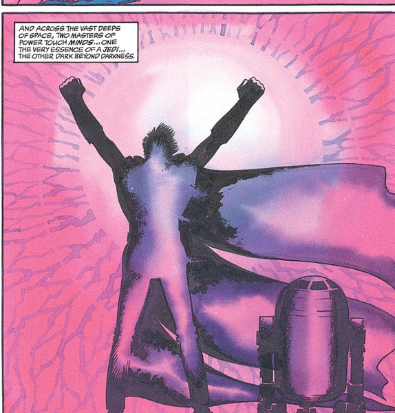 | DE #1 p26 | Luke, arms raised, in the storm's glow beside R2 | "AND ACROSS THE VAST DEEPS OF SPACE, TWO MASTERS OF POWER TOUCH MINDS...ONE THE VERY ESSENCE OF A JEDI... THE OTHER DARK BEYOND DARKNESS." |
Context: | # | Crop | Issue / page | What it shows | Verbatim text in crop |
Our notes: `notes/materials/041-dark-empire/daily-image-candidates.md:9`

- Note (summary from our notes, not a quotation): | 2 | 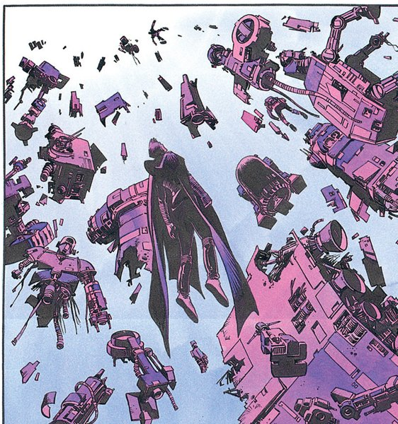 | DE #1 p27 | The Emperor's storm lifts Luke along with walker and ship wreckage | (no lettering) |
  — Source: Dark Empire (#1–6, 1991–92): daily-image candidates.
Context: | # | Crop | Issue / page | What it shows | Verbatim text in crop |
Our notes: `notes/materials/041-dark-empire/daily-image-candidates.md:10`

> L-LUKE! HELP ME!
> [fragment — full passage not on file]
— Source: Dark Empire (#1–6, 1991–92): daily-image candidates.
Note (our notes, around the quote): | 5 | 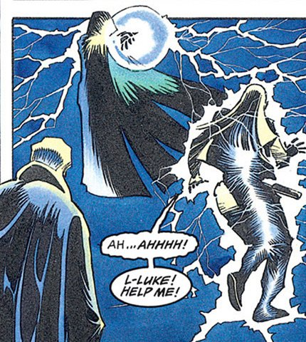 | DE #4 p26 | The Emperor (old clone) lightnings Leia while dark Luke looks on | "AH...AHHHH!" / "L-LUKE! HELP ME!" |
Context: | # | Crop | Issue / page | What it shows | Verbatim text in crop |
Our notes: `notes/materials/041-dark-empire/daily-image-candidates.md:13`

> YOU FORGET-- I AM A JEDI MASTER NOW... AND I KNOW SOMETHING ABOUT THE DARK SIDE.
> [fragment — full passage not on file]
— Source: Dark Empire (#1–6, 1991–92): daily-image candidates.
Note (our notes, around the quote): | 6 | 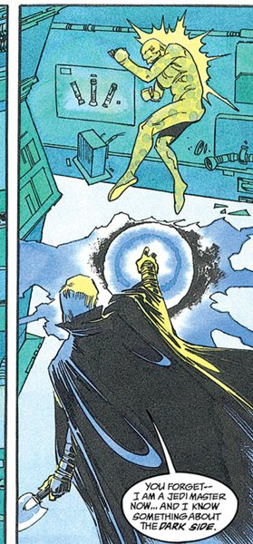 | DE #5 p25 | Luke Force-blasts the new clone across the lab | "YOU FORGET-- I AM A JEDI MASTER NOW... AND I KNOW SOMETHING ABOUT THE DARK SIDE." |
Context: | # | Crop | Issue / page | What it shows | Verbatim text in crop |
Our notes: `notes/materials/041-dark-empire/daily-image-candidates.md:14`

> POOR JEDI-- YOUR KIND WILL SOON BE EXTINCT.
>
> GATHERING STRENGTH MOMENT BY MOMENT, THE YOUNG EMPEROR LASHES OUT WITH THE JEDI WEAPON--PUSHING HIS ELDER ADVERSARY TO THE LIMIT!
— Source: Dark Empire (#1–6, 1991–92): daily-image candidates.
Note (our notes, around the quote): | 8 | 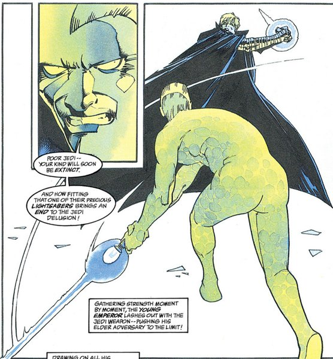 | DE #5 p26 | The young clone attacks Luke with a saber | "POOR JEDI-- YOUR KIND WILL SOON BE EXTINCT." / "GATHERING STRENGTH MOMENT BY MOMENT, THE YOUNG EMPEROR LASHES OUT WITH THE JEDI WEAPON--PUSHING HIS ELDER ADVERSARY TO THE LIMIT!" |
Context: | # | Crop | Issue / page | What it shows | Verbatim text in crop |
Our notes: `notes/materials/041-dark-empire/daily-image-candidates.md:16`

> NOW TAKE THE CONSEQUENCES OF YOUR FAILURE--LIKE YOUR FATHER BEFORE YOU!
>
> NO, SKYWALKER... IT IS NOT YOUR TIME TO DIE.
> [fragment — full passage not on file]
— Source: Dark Empire (#1–6, 1991–92): daily-image candidates.
Note (our notes, around the quote): | 9 | 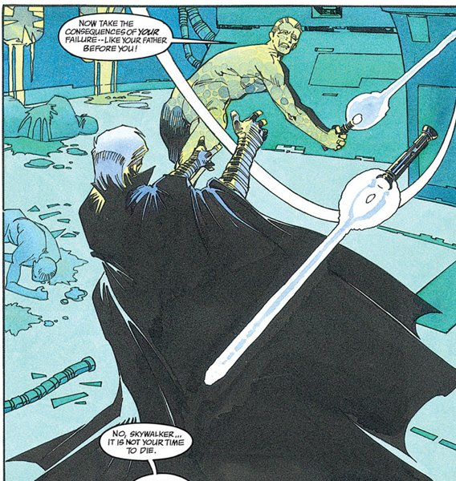 | DE #5 p27 | The clone disarms Luke | "NOW TAKE THE CONSEQUENCES OF YOUR FAILURE--LIKE YOUR FATHER BEFORE YOU!" / "NO, SKYWALKER... IT IS NOT YOUR TIME TO DIE." |
Context: | # | Crop | Issue / page | What it shows | Verbatim text in crop |
Our notes: `notes/materials/041-dark-empire/daily-image-candidates.md:17`

> THE GREAT DARTH VADER WAS A SICK MAN IN AN IRON MASK!
>
> ...BUT THE FEEBLE HEART WITHIN WAS FOREVER POSSESSED BY THE IMPOTENT SIDE OF THE FORCE!
> [fragment — full passage not on file]
— Source: Dark Empire (#1–6, 1991–92): daily-image candidates.
Note (our notes, around the quote): | 10 | 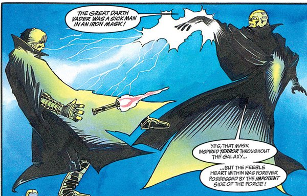 | DE #6 p22 | The Emperor's lightning on Luke aboard the flagship | "THE GREAT DARTH VADER WAS A SICK MAN IN AN IRON MASK!" / "...BUT THE FEEBLE HEART WITHIN WAS FOREVER POSSESSED BY THE IMPOTENT SIDE OF THE FORCE!" |
Context: | # | Crop | Issue / page | What it shows | Verbatim text in crop |
Our notes: `notes/materials/041-dark-empire/daily-image-candidates.md:18`

- Note (summary from our notes, not a quotation): | 11 | 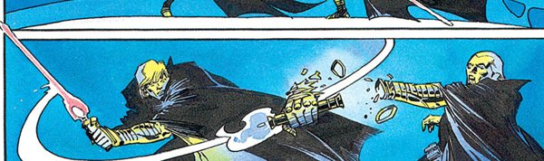 | DE #6 p23 | Luke's saber shatters the Emperor's hilt | (no lettering) |
  — Source: Dark Empire (#1–6, 1991–92): daily-image candidates.
Context: | # | Crop | Issue / page | What it shows | Verbatim text in crop |
Our notes: `notes/materials/041-dark-empire/daily-image-candidates.md:19`

- Note (summary from our notes, not a quotation): DE #1: Luke Force-pushes the crippled AT-AT over, and Leia's Force-guided cannon shot takes the head off an AT-AT (see `de1-01.md`).
  — Source: Dark Empire (#1–6, 1991–92): daily-image candidates.
Our notes: `notes/materials/041-dark-empire/daily-image-candidates.md:26`

- Note (summary from our notes, not a quotation): DE #3: Luke's projection reaches Da Soocha V and the Emperor overshadows it (see `de1-03.md`).
  — Source: Dark Empire (#1–6, 1991–92): daily-image candidates.
Our notes: `notes/materials/041-dark-empire/daily-image-candidates.md:27`

> One such raid, over the raging Imperial City battleground, ended in disaster: the Alliance Star Destroyer Liberator, commanded by Luke Skywalker and Lando Calrissian, crashed on the planet's surface. Only Luke's skillful use of the ship's deflector shields and anti-grav braking system prevented all aboard from being killed.
— Source: Star Wars: Dark Empire #1 — "Book 1: The Destiny of a Jedi" (Dec 1991).
Our notes: `notes/materials/041-dark-empire/de1-01.md:8`

- Note (summary from our notes, not a quotation): Feat (crawl): Luke used the Liberator's shields and anti-grav braking to bring a crashing Star Destroyer down with no deaths. Piloting/tech skill, not a Force feat as written.
  — Source: Star Wars: Dark Empire #1 — "Book 1: The Destiny of a Jedi" (Dec 1991).
Our notes: `notes/materials/041-dark-empire/de1-01.md:14`

> WITH UNEXPECTED SUDDENNESS A GREAT AND TERRIBLE SOUND RENDS THE AIR--
> [fragment — full passage not on file]
>
> --AND THE BATTLE DOGS ARE HURLED SHRIEKING IN ALL DIRECTIONS! *(captions; SFX "RRROOOARRR")*
> [fragment — full passage not on file]
>
> IT WASN'T ME, HAN--LOOK! *(Leia)*
> [fragment — full passage not on file]
— Source: Star Wars: Dark Empire #1 — "Book 1: The Destiny of a Jedi" (Dec 1991).
Note (our notes, around the quote): > "WITH UNEXPECTED SUDDENNESS A GREAT AND TERRIBLE SOUND RENDS THE AIR--" / "--AND THE BATTLE DOGS ARE HURLED SHRIEKING IN ALL DIRECTIONS!" (captions; SFX "RRROOOARRR") / "GOSH, LEIA--I APOLOGIZE! I DIDN'T KNOW YOU COULD--" (Han) / "IT WASN'T ME, HAN--LOOK!" (Leia)
Our notes: `notes/materials/041-dark-empire/de1-01.md:52`

> "A SHADOWY FIGURE, MENACINGLY FAMILIAR, EMERGES FROM THE RUINS OF THE IMPERIAL PALACE..."
>
> "THE FIGURE GESTURES... A SIMPLE GESTURE... THE GESTURE OF A JEDI--"
>
> "--A GESTURE THAT MOVES, EVER SO SLIGHTLY, THE INTERNAL MECHANISMS OF THE WEAPONS DROIDS." (captions)
> [fragment — full passage not on file]
— Source: Star Wars: Dark Empire #1 — "Book 1: The Destiny of a Jedi" (Dec 1991).
Context: — Star Wars: Dark Empire #1, p. 17
Our notes: `notes/materials/041-dark-empire/de1-01.md:53`

> "LUKE SKYWALKER, JEDI MASTER... A POWERFUL AND SKILLFUL USER OF THE FORCE..."
>
> "...MORE SKILLED THAN EVER IN THE WAYS OF THE JEDI LIGHTSABER." (captions; SFX "WRUMMMM")
> [fragment — full passage not on file]
— Source: Star Wars: Dark Empire #1 — "Book 1: The Destiny of a Jedi" (Dec 1991).
Context: — Star Wars: Dark Empire #1, p. 17
Our notes: `notes/materials/041-dark-empire/de1-01.md:56`

> "GASHED BY ITS OWN FIRE, THE HUGE WAR MACHINE LOOMS OVER ITS HUMAN OPPONENT, AS IF WAITING FOR LUKE'S NEXT MOVE--"
>
> "REMEMBERING THE WORDS OF HIS MASTER, LUKE PRESSES THE FORCE AGAINST THE CRIPPLED WALKER..."
>
> Through the Force, he could even sense the moment when an entirely mechanical opponent would strike. He could sense the presence of another Jedi, even across great distances, and take the measure of a Jedi's strength in the Force, or whether the dark side had infected him. He could feel disturbances of every kind in the Force. With the eyes of a Jedi he could see events taking place in another room or across the galaxy. He could glimpse the future, in its many chains of probability... and gauge which path events were most likely to follow. His enhanced senses and abilities, always a result of attunement with the living energy around him, gave him the ability to move objects without physical contact...even large and heavy objects. He had come to understand the words of Master Yoda: "Size matters not. The only difference is in your mind." Like his father, he could deflect a blaster bolt with his hand...or rip a piece of machinery from its anchor bolts. Like Obi-Wan Kenobi, he could create great sounds that stirred fear and sent enemies scrambling for cover. He knew the moment to strike with the lightsaber...and the moment to step back. He could navigate a ship by instinct alone. He could do astounding feats of acrobatics and make incredible leaps.
> [fragment — full passage not on file]
— Source: Star Wars: Dark Empire #1 — "Book 1: The Destiny of a Jedi" (Dec 1991).
(Fragment completed 2026-11-17 with the full excerpt, word for word from Dark Empire 01 A Time of Darkness pdf x.txt (text copy `MEGA_Dark_Empire_01_A_Time_of_Darkness_pdf_x`).)
(Fragment completed 2026-11-17 with the full excerpt, word for word from Dark Empire 01 A Time of Darkness pdf x.txt (text copy `MEGA_Dark_Empire_01_A_Time_of_Darkness_pdf_x`).)
(Fragment completed 2026-11-17 with the full excerpt, word for word from Dark Empire 01 A Time of Darkness pdf x.txt (text copy `MEGA_Dark_Empire_01_A_Time_of_Darkness_pdf_x`).)
Note text that was attached to the quote line: (captions)
Context: — Star Wars: Dark Empire #1, p. 18
Our notes: `notes/materials/041-dark-empire/de1-01.md:59`

> "THE WALKER FALLS." (caption)
> [fragment — full passage not on file]
— Source: Star Wars: Dark Empire #1 — "Book 1: The Destiny of a Jedi" (Dec 1991).
Context: — Star Wars: Dark Empire #1, p. 19
Our notes: `notes/materials/041-dark-empire/de1-01.md:62`

- Note (summary from our notes, not a quotation): — Star Wars: Dark Empire #1, p. 20
  — Source: Star Wars: Dark Empire #1 — "Book 1: The Destiny of a Jedi" (Dec 1991).
Our notes: `notes/materials/041-dark-empire/de1-01.md:65`

> gashed by its own fire
> [fragment — full passage not on file]
— Source: Star Wars: Dark Empire #1 — "Book 1: The Destiny of a Jedi" (Dec 1991).
Note (our notes, around the quote): Feats, in order: (1) with an unseen Force blast he scatters a pack of neks; (2) with one gesture he moves the internal mechanisms of several war droids and they blow up; (3) he deflects an AT-AT's cannon bolts back into it with his lightsaber; (4) he Force-pushes the crippled AT-AT over. Condition: the walker was "crippled" and "gashed by its own fire" before the push.
Our notes: `notes/materials/041-dark-empire/de1-01.md:67`

> HAN... YOU DON'T UNDERSTAND. THERE'S A GREAT DISTURBANCE IN THE FORCE... SOMEONE... OR SOMETHING... IS USING THE DARK SIDE OF THE FORCE WITH UNBELIEVABLE POWER! *(Luke)*
> [fragment — full passage not on file]
— Source: Star Wars: Dark Empire #1 — "Book 1: The Destiny of a Jedi" (Dec 1991). POV: Luke.
Note (our notes, around the quote): > "HAN... YOU DON'T UNDERSTAND. THERE'S A GREAT DISTURBANCE IN THE FORCE... SOMEONE... OR SOMETHING... IS USING THE DARK SIDE OF THE FORCE WITH UNBELIEVABLE POWER!" (Luke) / "I'VE FELT IT... I'VE SEEN IT--" (Leia)
Our notes: `notes/materials/041-dark-empire/de1-01.md:70`

> "HAN, THIS ISN'T JUST ANOTHER GUN BATTLE... A VAST EVIL IS APPROACHING... IT KNOWS I'M HERE."
>
> "WHAT WILL HAPPEN IS UNAVOIDABLE... IT IS MY DESTINY."
>
> "IT IS BEGINNING NOW... OUT THERE SOMEWHERE." (Luke)
> [fragment — full passage not on file]
— Source: Star Wars: Dark Empire #1 — "Book 1: The Destiny of a Jedi" (Dec 1991). POV: Luke.
Context: — Star Wars: Dark Empire #1, p. 21
Our notes: `notes/materials/041-dark-empire/de1-01.md:71`

> "--A HYPERSPACE WORMHOLE HAS OPENED IN THE NIGHT... AND A MIGHTY ENERGY STORM EMERGES!" (caption)
> [fragment — full passage not on file]
— Source: Star Wars: Dark Empire #1 — "Book 1: The Destiny of a Jedi" (Dec 1991).
Context: — Star Wars: Dark Empire #1, p. 21
Our notes: `notes/materials/041-dark-empire/de1-01.md:74`

> "WITH RUMBLING CHAOTIC FURY, THE STORM SWEEPS DOWN ACROSS THE PLANET'S SURFACE!" (caption)
>
> "IT DOESN'T WANT YOU... IT WANTS ME!"
>
> "LEAVE! ALL OF YOU! OR YOU'LL BE DESTROYED!" (Luke)
> [fragment — full passage not on file]
— Source: Star Wars: Dark Empire #1 — "Book 1: The Destiny of a Jedi" (Dec 1991). POV: Luke.
Context: — Star Wars: Dark Empire #1, p. 22
Our notes: `notes/materials/041-dark-empire/de1-01.md:77`

> "WE ARE BROTHER AND SISTER... BUT MY DESTINY IS NOT YOURS!"
>
> "YOU... YOUR CHILDREN... ARE THE FUTURE OF THE JEDI... PROTECT THEM!" (Luke)
> [fragment — full passage not on file]
— Source: Star Wars: Dark Empire #1 — "Book 1: The Destiny of a Jedi" (Dec 1991). POV: Luke.
Context: — Star Wars: Dark Empire #1, p. 23
Our notes: `notes/materials/041-dark-empire/de1-01.md:80`

> "LUKE ALONE KNOWS THE LEVEL OF POWER AND KNOWLEDGE HE HAS ACHIEVED IN THE YEARS SINCE OBI-WAN KENOBI, MASTER YODA, AND HIS FATHER ANAKIN SKYWALKER PASSED ON..."
>
> "...KNOWLEDGE THAT HAS GIVEN FRESH MEANING TO THE WORDS OF THE GREAT JEDI KNIGHTS WHO WENT BEFORE..."
>
> "\"DO NOT UNDERESTIMATE THE POWER OF THE DARK SIDE.\"" (captions)
> [fragment — full passage not on file]
— Source: Star Wars: Dark Empire #1 — "Book 1: The Destiny of a Jedi" (Dec 1991).
Context: — Star Wars: Dark Empire #1, p. 24
Our notes: `notes/materials/041-dark-empire/de1-01.md:83`

> "LUKE ALONE KNOWS THAT HIS VERY PRESENCE ON THIS WORLD HAS TRIGGERED A RESPONSE OF SUCH HATRED THAT IT RENDS THE FABRIC OF SPACE ITSELF!" (caption)
> [fragment — full passage not on file]
— Source: Star Wars: Dark Empire #1 — "Book 1: The Destiny of a Jedi" (Dec 1991).
Context: — Star Wars: Dark Empire #1, p. 24
Our notes: `notes/materials/041-dark-empire/de1-01.md:86`

> "AND ACROSS THE VAST DEEPS OF SPACE, TWO MASTERS OF POWER TOUCH MINDS... ONE THE VERY ESSENCE OF A JEDI... THE OTHER DARK BEYOND DARKNESS." (caption)
> [fragment — full passage not on file]
— Source: Star Wars: Dark Empire #1 — "Book 1: The Destiny of a Jedi" (Dec 1991).
Context: — Star Wars: Dark Empire #1, p. 25
Our notes: `notes/materials/041-dark-empire/de1-01.md:89`

> "I'M NOT SO SURE, HAN... SOMETHING ABOUT THE WAY HE LOOKED AT ME... I WAS AFRAID OF HIM." (Leia)
> [fragment — full passage not on file]
— Source: Star Wars: Dark Empire #1 — "Book 1: The Destiny of a Jedi" (Dec 1991). POV: Leia, about Luke Skywalker.
Context: — Star Wars: Dark Empire #1, p. 26
Our notes: `notes/materials/041-dark-empire/de1-01.md:92`

- Note (summary from our notes, not a quotation): — Star Wars: Dark Empire #1, p. 27
  — Source: Star Wars: Dark Empire #1 — "Book 1: The Destiny of a Jedi" (Dec 1991).
Our notes: `notes/materials/041-dark-empire/de1-01.md:95`

> the other, dark beyond darkness *(named in #2 and #3)*
> [fragment — full passage not on file]
>
> rends the fabric of space itself.
> [fragment — full passage not on file]
— Source: Star Wars: Dark Empire #1 — "Book 1: The Destiny of a Jedi" (Dec 1991).
Note (our notes, around the quote): Storm feat: the energy storm comes out of a hyperspace wormhole, sweeps across Imperial City's surface, and lifts Luke, R2 and large pieces of wreckage (walker and vehicle parts are drawn) into the air (p26–27). In this issue the source is only "the other, dark beyond darkness" (named in #2 and #3). The caption calls it a response that "rends the fabric of space itself."
Our notes: `notes/materials/041-dark-empire/de1-01.md:97`

> two masters of power
> [fragment — full passage not on file]
— Source: Star Wars: Dark Empire #1 — "Book 1: The Destiny of a Jedi" (Dec 1991); Statement. POV: Statement.
Note (our notes, around the quote): Statement: "two masters of power" puts the narration's framing of Luke and the unseen Emperor on the same tier.
Our notes: `notes/materials/041-dark-empire/de1-01.md:98`

> --BUT HE'S GETTING FARTHER AND FARTHER AWAY... *(Leia)*
> [fragment — full passage not on file]
>
> --BESIDES, YOU KNOW ME... I'M NOT ABOUT TO CHALLENGE THE JUDGMENT OF A JEDI! *(Han)*
> [fragment — full passage not on file]
— Source: Star Wars: Dark Empire #2 — "Book 2: Devastator of Worlds" (Feb 1992); > "HE'S STILL ALIVE... I CAN FEEL IT--" /. POV: Leia, about Luke Skywalker.
Label in our notes: Leia) / (Han
Our notes: `notes/materials/041-dark-empire/de1-02.md:40`

- Note (summary from our notes, not a quotation): — Star Wars: Dark Empire #2, p. 13
  — Source: Star Wars: Dark Empire #2 — "Book 2: Devastator of Worlds" (Feb 1992).
Our notes: `notes/materials/041-dark-empire/de1-02.md:41`

> THE ENERGY STORM FUNNELED US INTO SOME KIND OF HYPERSPACE VEHICLE, ARTOO...
> [fragment — full passage not on file]
>
> BUT TO THE EYES OF THE FORCE, THESE MANDALORIAN WALLS DON'T EVEN EXIST!
>
> WE'RE IN AN IMPERIAL DUNGEON SHIP... THE KIND THEY USED TO TRANSPORT JEDI KNIGHTS DURING THE CLONE WARS... *(Luke)*
> [fragment — full passage not on file]
— Source: Star Wars: Dark Empire #2 — "Book 2: Devastator of Worlds" (Feb 1992). POV: Luke.
Label in our notes: > / / (Luke
Our notes: `notes/materials/041-dark-empire/de1-02.md:44`

> "THE PLANET BYSS, DEEP IN THE GALACTIC CORE... A WORLD ENTIRELY ENVELOPED IN THE POWER OF THE DARK SIDE..." (caption)
>
> "IF THERE'S A DARK CENTER OF THE UNIVERSE, THIS IS IT, ARTOO..." (Luke)
> [fragment — full passage not on file]
— Source: Star Wars: Dark Empire #2 — "Book 2: Devastator of Worlds" (Feb 1992). POV: Luke.
Context: — Star Wars: Dark Empire #2, p. 14
Our notes: `notes/materials/041-dark-empire/de1-02.md:45`

> "AN ENERGIZED CAGE IS WAITING--A TRAP TO HOLD A JEDI!" (caption)
> [fragment — full passage not on file]
— Source: Star Wars: Dark Empire #2 — "Book 2: Devastator of Worlds" (Feb 1992).
Context: — Star Wars: Dark Empire #2, p. 15
Our notes: `notes/materials/041-dark-empire/de1-02.md:48`

> "AS LUKE IS CARRIED THROUGH THE STREETS OF THE STRANGE AND BEAUTIFUL CITY, HE FEELS THE DARK SIDE OF THE FORCE GROWING IN INTENSITY..."
>
> "LUKE'S JOURNEY ENDS BEFORE THE DOORS OF A GREAT CITADEL. SUDDENLY HE SENSES A MIND REACHING OUT TO HIM... A MIND FULL OF MOCKING LAUGHTER..." (captions)
> [fragment — full passage not on file]
— Source: Star Wars: Dark Empire #2 — "Book 2: Devastator of Worlds" (Feb 1992).
Context: — Star Wars: Dark Empire #2, p. 16
Our notes: `notes/materials/041-dark-empire/de1-02.md:51`

- Note (summary from our notes, not a quotation): — Star Wars: Dark Empire #2, p. 17
  — Source: Star Wars: Dark Empire #2 — "Book 2: Devastator of Worlds" (Feb 1992).
Our notes: `notes/materials/041-dark-empire/de1-02.md:54`

- Note (summary from our notes, not a quotation): Feat: Force perception sees through the dungeon ship's Mandalorian-built walls. The storm carried Luke to a dungeon ship, which took him to Byss. So the storm doubles as a transport or capture tool and works across hyperspace.
  — Source: Star Wars: Dark Empire #2 — "Book 2: Devastator of Worlds" (Feb 1992).
Our notes: `notes/materials/041-dark-empire/de1-02.md:56`

> FIGHTING BACK THE WAVE OF OPPRESSION THAT WANTS TO OVERSHADOW HIS MIND, LUKE CALLS UP AN INTENSITY OF HIS OWN-- *(caption)*
> [fragment — full passage not on file]
>
> DON'T THREATEN ME--I'M HERE BECAUSE I CHOSE TO BE HERE! *(Luke)*
— Source: Star Wars: Dark Empire #2 — "Book 2: Devastator of Worlds" (Feb 1992). POV: Luke.
Label in our notes: > (caption) / (Luke
Our notes: `notes/materials/041-dark-empire/de1-02.md:59`

> "AMUSING."
>
> "KEEP HIM COVERED, BUT DON'T HURT HIM." (robed official)
>
> "LET IT BE HIS \"FREE CHOICE,\" IF THAT'S WHAT HE WANTS TO BELIEVE..."
>
> "...BUT HE'S WALKING TO HIS DOOM!" (robed courtier)
> [fragment — full passage not on file]
— Source: Star Wars: Dark Empire #2 — "Book 2: Devastator of Worlds" (Feb 1992).
Context: — Star Wars: Dark Empire #2, p. 18
Our notes: `notes/materials/041-dark-empire/de1-02.md:60`

- Note (summary from our notes, not a quotation): — Star Wars: Dark Empire #2, p. 19
  — Source: Star Wars: Dark Empire #2 — "Book 2: Devastator of Worlds" (Feb 1992).
Our notes: `notes/materials/041-dark-empire/de1-02.md:63`

- Note (summary from our notes, not a quotation): Feat: a Force shove throws two armed guards across the floor without a touch. Condition: Byss's ambient dark side presses on his mind ("wave of oppression").
  — Source: Star Wars: Dark Empire #2 — "Book 2: Devastator of Worlds" (Feb 1992).
Our notes: `notes/materials/041-dark-empire/de1-02.md:65`

> WITH A JEDI'S FLAWLESS INTUITION, HE MARCHES DIRECTLY TO THE THRONE ROOM-- *(caption)*
> [fragment — full passage not on file]
>
> YOU HAVE COME TO ME OF YOUR OWN FREE WILL! *(Emperor)*
— Source: Star Wars: Dark Empire #2 — "Book 2: Devastator of Worlds" (Feb 1992).
Label in our notes: > (caption) / "EXCELLENT! EXCELLENT!" / (Emperor
Our notes: `notes/materials/041-dark-empire/de1-02.md:68`

> "YOU!"
>
> "SOMEHOW, I KNEW... BUT I SAW YOU DIE!" (Luke)
>
> "YES, YOU KNEW, DIDN'T YOU... YOU'VE GROWN VERY STRONG IN THE FORCE SINCE LAST WE MET..."
>
> "BUT THEN, SO HAVE I!"
>
> "IT WAS NOT THE FIRST TIME I DIED... NOR WILL IT BE THE LAST!"
>
> "SUCH ARE THE MYSTERIES OF THE DARK SIDE OF THE FORCE!" (Emperor)
> [fragment — full passage not on file]
— Source: Star Wars: Dark Empire #2 — "Book 2: Devastator of Worlds" (Feb 1992). POV: Luke.
Context: — Star Wars: Dark Empire #2, p. 19
Our notes: `notes/materials/041-dark-empire/de1-02.md:69`

What it shows (our notes): — Star Wars: Dark Empire #2, p. 20
> "YOU SEE, MY FRIEND, FLESH DOES NOT EASILY SUPPORT THIS GREAT POWER!"
>
> "FOR MANY YEARS I HAVE BEEN UNDER A DIRE NECESSITY!"
>
> "MY BODY HAS DECAYED AGAIN AND AGAIN... AND EACH TIME I HAVE NEEDED TO TAKE ANOTHER..."
>
> "A HUMBLE CLONE OF THE MAN I ONCE WAS..." (Emperor)
>
> "CLONES!"
>
> The Gotal stared at him dispassionately. “Only a false god would thirst so for death and destruction.”
>
> “Then it’s true: you fear death.”
>
— Source: Star Wars: Dark Empire #2 — "Book 2: Devastator of Worlds" (Feb 1992).
(A fragment line was removed 2026-11-17: its words appear word for word inside the full excerpt in this entry.)
(Excerpt widened 2026-11-17 to the relevant passage, word for word from Ruin: Dark Tide II (Michael A. Stackpole) (text copy `novels_tmp_dark_tide_ruin_book_epub_ef0053b26b`).)
(Fragment completed 2026-11-17 with the full excerpt, word for word from Ruin: Dark Tide II (Michael A. Stackpole) (text copy `novels_tmp_dark_tide_ruin_book_epub_ef0053b26b`).)
(Fragment completed 2026-11-17 with the full excerpt, word for word from Ruin: Dark Tide II (Michael A. Stackpole) (text copy `novels_tmp_dark_tide_ruin_book_epub_ef0053b26b`).)
(Fragment completed 2026-11-17: full sentence/passage matched word for word in the source text on file: `novels_tmp_dark_tide_ruin_book_epub_ef0053b26b`.)
Note text that was attached to the quote line: (Luke)
Our notes: `notes/materials/041-dark-empire/de1-02.md:72`

> "THE DYING IS PAINFUL... THE TRANSITION IS NOT AN ENJOYABLE EXPERIENCE."
>
> "BUT THE SUFFERING IS A SMALL PRICE TO PAY... FOR ETERNAL LIFE!"
>
> "AFTER ALL... I LIVE PRIMARILY AS ENERGY... FORMLESSNESS..."
>
> "...AND POWER!" (Emperor)
> [fragment — full passage not on file]
— Source: Star Wars: Dark Empire #2 — "Book 2: Devastator of Worlds" (Feb 1992).
Context: — Star Wars: Dark Empire #2, p. 20
Our notes: `notes/materials/041-dark-empire/de1-02.md:75`

> "AND NOW, MY YOUNG APPRENTICE..."
>
> "YOUR FATHER IS DEAD."
>
> "HAVE YOU COME TO JOIN ME?"
>
> "WILL YOU TAKE THE PLACE THAT RIGHTFULLY BELONGS TO YOU... AT MY SIDE?"
>
> "LOOK! MY WORLD DEVASTATORS-- YOURS TO COMMAND!" (Emperor)
> [fragment — full passage not on file]
— Source: Star Wars: Dark Empire #2 — "Book 2: Devastator of Worlds" (Feb 1992).
Context: — Star Wars: Dark Empire #2, p. 21
Our notes: `notes/materials/041-dark-empire/de1-02.md:78`

> "THE REBELS HAD THEIR CHANCE... I GAVE THEM YEARS TO RECLAIM THE GALAXY! BUT WITHOUT THE JEDI KNIGHTS, THEY FAILED MISERABLY!"
>
> "AND NOW I HAVE OUTFLANKED THEM! WORKING IN SECRET I HAVE CONSTRUCTED WEAPONS SUCH AS WERE NEVER SEEN..." (Emperor)
> [fragment — full passage not on file]
— Source: Star Wars: Dark Empire #2 — "Book 2: Devastator of Worlds" (Feb 1992).
Context: — Star Wars: Dark Empire #2, p. 21
Our notes: `notes/materials/041-dark-empire/de1-02.md:81`

> "...BUT CAN HE USE THE FORCE TO DEFEND THE FREEDOM OF BILLIONS... BY SLAYING THE OLD MAN?" (caption)
>
> "IS IT SO DIFFICULT TO DECIDE, MY SON?"
>
> "SURELY YOU KNOW THAT IF YOU STRIKE ME DOWN IN ANGER, I WILL LIVE AGAIN!"
>
> "...PERHAPS I WILL EVEN LIVE AS YOU!" (Emperor)
> [fragment — full passage not on file]
— Source: Star Wars: Dark Empire #2 — "Book 2: Devastator of Worlds" (Feb 1992).
Context: — Star Wars: Dark Empire #2, p. 22
Our notes: `notes/materials/041-dark-empire/de1-02.md:84`

> "I SEE YOU HAVE GROWN WISE IN THE WAYS OF THE FORCE... YOU HAVE ACHIEVED CONTROL."
>
> "YOU ARE NO LONGER THE IMPULSIVE YOUTH, AT WAR WITH YOUR OWN ANGER..."
>
> "BUT YOU CAN STILL CONQUER ME... BY LEARNING THE SECRETS OF THE DARK SIDE. WE BOTH KNOW THERE IS NO OTHER WAY FOR YOU." (Emperor)
> [fragment — full passage not on file]
— Source: Star Wars: Dark Empire #2 — "Book 2: Devastator of Worlds" (Feb 1992).
Context: — Star Wars: Dark Empire #2, p. 23
Our notes: `notes/materials/041-dark-empire/de1-02.md:87`

> "THE EMPEROR'S WORDS BLAZE LIKE LIGHTNING ACROSS LUKE'S MIND... THE DARK SIDE HAS SPOKEN... AND FOR ONCE IT SPEAKS TRUTH."
>
> "A MOMENT OF GREATEST PERIL HAS ARRIVED... BUT IT IS THE MOMENT FOR WHICH LUKE WAS BORN..."
>
> "HE MUST CHALLENGE THE DARK SIDE FROM WITHIN... HE MUST PENETRATE THE POWER OF THE DARK SIDE, AND HE MUST LEARN ITS SECRETS..." (captions)
> [fragment — full passage not on file]
— Source: Star Wars: Dark Empire #2 — "Book 2: Devastator of Worlds" (Feb 1992).
Context: — Star Wars: Dark Empire #2, p. 23
Our notes: `notes/materials/041-dark-empire/de1-02.md:90`

What it shows (our notes): — Star Wars: Dark Empire #2, p. 23
> But if we have to slug it out with them, they won’t hold for long. The idea of those plasma blasts getting through to melt his ship’s hull sent a trickle of fear through Kre’fey’s guts. If there is no other way, however, to get the freighters out of here …
>
> "YES."
>
> "MY FATHER'S DESTINY IS MY OWN." (Luke)
>
> "VERY GOOD! IT IS DONE!"
>
> "MY FRIEND, LET US CELEBRATE OUR CONQUEST OF A GALAXY!" (Emperor)
> [fragment — full passage not on file]
— Source: Star Wars: Dark Empire #2 — "Book 2: Devastator of Worlds" (Feb 1992). POV: Luke.
(Fragment completed 2026-11-17 with the full excerpt, word for word from Onslaught: Dark Tide I (Michael A. Stackpole) (text copy `novels_tmp_dark_tide_onslaught_book_epub_f3b26123ab`).)
(Excerpt widened 2026-11-17 to the relevant passage, word for word from Onslaught: Dark Tide I (Michael A. Stackpole) (text copy `novels_tmp_dark_tide_onslaught_book_epub_f3b26123ab`).)
(Fragment completed 2026-11-17: full sentence/passage matched word for word in the source text on file: `novels_tmp_dark_tide_onslaught_book_epub_f3b26123ab`.)
Note text that was attached to the quote line: (caption)
Our notes: `notes/materials/041-dark-empire/de1-02.md:93`

- Note (summary from our notes, not a quotation): — Star Wars: Dark Empire #2, p. 24
  — Source: Star Wars: Dark Empire #2 — "Book 2: Devastator of Worlds" (Feb 1992).
Our notes: `notes/materials/041-dark-empire/de1-02.md:96`

> BUT THEN, SO HAVE I!
> [fragment — full passage not on file]
>
> flesh does not easily support this great power,
> [fragment — full passage not on file]
>
> live[s] primarily as energy
> [fragment — full passage not on file]
>
> the dark side has spoken... and for once it speaks truth
> [fragment — full passage not on file]
— Source: Star Wars: Dark Empire #2 — "Book 2: Devastator of Worlds" (Feb 1992).
Note (our notes, around the quote): Key statements: (a) the reborn Emperor says he too has "grown" since ROTJ ("BUT THEN, SO HAVE I!"); (b) "flesh does not easily support this great power," so his clone bodies keep decaying; (c) he "live[s] primarily as energy"; (d) striking him down in anger means he lives again, possibly "as you" (body-possession threat aimed at Luke); (e) the caption endorses his claim that Luke cannot simply kill him. Luke wins only by learning the dark side ("the dark side has spoken... and for once it speaks truth").
Our notes: `notes/materials/041-dark-empire/de1-02.md:98`

- Note (summary from our notes, not a quotation): (ANALYSIS) No fight happens. The comic tells us Luke cannot solve the Emperor by force because of the clone/rebirth loop. That is a durability/resurrection condition, not a statement about raw power.
  — Source: Star Wars: Dark Empire #2 — "Book 2: Devastator of Worlds" (Feb 1992).
Our notes: `notes/materials/041-dark-empire/de1-02.md:99`

- Note (summary from our notes, not a quotation): Feat: from Da Soocha V, Leia senses Luke's capitulation on Byss in the Deep Core ("I HEAR TERRIBLE LAUGHTER").
  — Source: Star Wars: Dark Empire #2 — "Book 2: Devastator of Worlds" (Feb 1992).
Our notes: `notes/materials/041-dark-empire/de1-02.md:111`

> As the villainous Emperor explains to Luke, it was to Byss that his living energy was transported when his diseased and corrupted body was destroyed by Darth Vader. On Byss he took a new clone body — as he had many times before.
— Source: Star Wars: Dark Empire #3 — "Book 3: The Battle for Calamari" (Apr 1992).
Our notes: `notes/materials/041-dark-empire/de1-03.md:8`

> "Even now, as Luke appears to fall under the Emperor's ever-expanding power, massive engines of destruction are inflicting death blows to the floating cities of the Calamari, long-standing allies of the Rebel Alliance..."
> [fragment — full passage not on file]
— Source: Star Wars: Dark Empire #3 — "Book 3: The Battle for Calamari" (Apr 1992).
Context: — Star Wars: Dark Empire #3, p. 3
Our notes: `notes/materials/041-dark-empire/de1-03.md:9`

- Note (summary from our notes, not a quotation): Tech feats: a World Devastator builds robotic TIEs on board, launches "hundreds" of them, then rises and draws the Star Destroyer *Emancipator* into its intake (red/pink beam in the art) while the Destroyer's forward weapons stop responding. The Alliance loses two Star Destroyers (*Liberator* in #1 and now *Emancipator*). Luke is now titled "Supreme Commander Skywalker."
  — Source: Star Wars: Dark Empire #3 — "Book 3: The Battle for Calamari" (Apr 1992).
Our notes: `notes/materials/041-dark-empire/de1-03.md:32`

> AT THAT VERY MOMENT, AT PINNACLE BASE, REBEL COMMAND POST ON THE FIFTH MOON OF DA SOOCHA, PRINCESS LEIA RECEIVES AN UNEXPECTED VISITATION: A VISION OF THE PAST! *(caption)*
>
> F-FATHER? IS IT... YOU? *(Leia)*
> [fragment — full passage not on file]
— Source: Star Wars: Dark Empire #3 — "Book 3: The Battle for Calamari" (Apr 1992). POV: Leia, about Luke Skywalker.
Label in our notes: > (caption) / (Leia
Our notes: `notes/materials/041-dark-empire/de1-03.md:35`

> "NO... YOUR FATHER IS FREE... WITH ALL THE JEDI WHO WENT BEFORE..."
>
> "...AND DARTH VADER LIVES NO MORE... MY--"
>
> "--SISTER." (Luke, appearing as Vader, then unmasked as himself)
> [fragment — full passage not on file]
— Source: Star Wars: Dark Empire #3 — "Book 3: The Battle for Calamari" (Apr 1992). POV: Luke.
Context: — Star Wars: Dark Empire #3, p. 12
Our notes: `notes/materials/041-dark-empire/de1-03.md:36`

> "LEIA... DO NOT TRY TO FIND ME..."
>
> "DO NOT INTERFERE."
>
> "DESTINY HAS FORCED ME TO FOLLOW THE PATH OUR FATHER TOOK... IT WAS THE ONLY WAY..."
>
> "...THE ONLY WAY TO SAVE EVERYTHING... FROM THE POWER OF THE DARK SIDE!" (Luke)
> [fragment — full passage not on file]
— Source: Star Wars: Dark Empire #3 — "Book 3: The Battle for Calamari" (Apr 1992). POV: Luke.
Context: — Star Wars: Dark Empire #3, p. 12
Our notes: `notes/materials/041-dark-empire/de1-03.md:39`

> "SUDDENLY ANOTHER PRESENCE SEEMS TO OVERSHADOW THE VISION OF SKYWALKER... AND LEIA HEARS THE SEPULCHRAL TONES OF THE DARK SIDE..." (caption)
>
> "YESS, LITTLE JEDI... YOUR BROTHER HAS RISKED ALL--"
>
> "--AND LOST!"
>
> "OH, MY WORD! SHE'S COLLAPSED!" *(C-3PO)*
> [fragment — full passage not on file]
— Source: Star Wars: Dark Empire #3 — "Book 3: The Battle for Calamari" (Apr 1992). POV: C-3PO, about Luke Skywalker.
Context: — Star Wars: Dark Empire #3, p. 13
Our notes: `notes/materials/041-dark-empire/de1-03.md:42`

- Note (summary from our notes, not a quotation): — Star Wars: Dark Empire #3, p. 13
  — Source: Star Wars: Dark Empire #3 — "Book 3: The Battle for Calamari" (Apr 1992).
Our notes: `notes/materials/041-dark-empire/de1-03.md:45`

- Note (summary from our notes, not a quotation): Feats: (1) Luke projects a full-size image of himself from Byss (Deep Core) to Da Soocha V. (2) The Emperor's presence overshadows that projection and knocks Leia unconscious across the same distance.
  — Source: Star Wars: Dark Empire #3 — "Book 3: The Battle for Calamari" (Apr 1992).
Our notes: `notes/materials/041-dark-empire/de1-03.md:47`

> probably the last fully realized Jedi.
> [fragment — full passage not on file]
— Source: Star Wars: Dark Empire #3 — "Book 3: The Battle for Calamari" (Apr 1992); Statement: Mon Mothma calls Luke.
Our notes: `notes/materials/041-dark-empire/de1-03.md:62`

> Believing he can resolve the Galactic conflict by learning the Emperor's darkest secrets, Luke Skywalker has at last taken his father's place as the Emperor's protégé and Supreme Commander of the Imperial forces.
— Source: Star Wars: Dark Empire #4 — "Book 4: Confrontation on the Smugglers' Moon" (Jun 1992).
Note (our notes, around the quote): > "Believing he can resolve the Galactic conflict by learning the Emperor's darkest secrets, Luke Skywalker has at last taken his father's place as the Emperor's protégé and Supreme Commander of the Imperial forces." / "The Emperor, for his part, hopes to push his "young apprentice" over the edge, deep into the seductive embrace of the Dark Side of the Force."
Our notes: `notes/materials/041-dark-empire/de1-04.md:8`

- Note (summary from our notes, not a quotation): Statement: Luke's motive is stated plainly. He went over to learn the Emperor's secrets, and the Emperor means to push him all the way into the dark side.
  — Source: Star Wars: Dark Empire #4 — "Book 4: Confrontation on the Smugglers' Moon" (Jun 1992).
Our notes: `notes/materials/041-dark-empire/de1-04.md:14`

- Note (summary from our notes, not a quotation): Feat: Vima's lightsaber acts as a focus. Holding it strengthens Leia's Force sense, and she gets a clear far-sight vision of Luke commanding the Imperial fleet while the *Intruder* is in hyperspace.
  — Source: Star Wars: Dark Empire #4 — "Book 4: Confrontation on the Smugglers' Moon" (Jun 1992).
Our notes: `notes/materials/041-dark-empire/de1-04.md:38`

What it shows (our notes): (ANALYSIS) The text never says who sent the bad signal. In context, with Luke as "Supreme Commander" of Imperial forces (p3) and Lando's "YOU'D ALMOST THINK HE WANTS TO LOSE," it points to Luke sabotaging the Devastators from Byss. This is an inference.
> And Darth Vader is dead." Reminding himself of that, Luke finds the strength to go on with his daring mission. While pretending to be the apt and willing student of the Emperor, Luke does everything he can to sabotage the Emperor's attack on Mon Calamari! As Supreme Commander of the Imperial Forces, Luke has access to the top-secret codes that govern the Emperor's new World Devastators from afar. The codes are beamed through a priority hyperspace communications channel to the onboard computers that control every aspect of the Devastators' operation and function. When Lando Calrissian and Wedge Antilles watch a great Devastator go down in the Mon Calamari Sea, Lando knows something strange is going on -- "Whoever's in charge of those monsters is an idiot! You'd almost think he wants to lose!" Indeed, the man in charge does want to lose. Because his name is Luke Skywalker, he is a Jedi Master, and he is working for the Rebel Alliance! The Emperor Has Taken Luke's Betrayal Into Account Does the Emperor know of his protégé's lack of obedience? Of course he does.
— Source: Star Wars: Dark Empire #4 — "Book 4: Confrontation on the Smugglers' Moon" (Jun 1992).
(Excerpt widened 2026-11-17 to the relevant passage, word for word from Dark Empire 04 For a Thousand Generations pdf x.txt (text copy `MEGA_Dark_Empire_04_For_a_Thousand_Generations_pdf_x`).)
(Fragment completed 2026-11-17 with the full excerpt, word for word from Dark Empire 04 For a Thousand Generations pdf x.txt (text copy `MEGA_Dark_Empire_04_For_a_Thousand_Generations_pdf_x`).)
Our notes: `notes/materials/041-dark-empire/de1-04.md:54`

> "THE SAME JEDI COURAGE THAT LED LUKE SKYWALKER TO SURRENDER TO HIS FATHER ON THE ENDOR MOON BRINGS LEIA INTO THE MOUTH OF THE BEAST THAT INTENDS TO SNUFF OUT THE LAST LIGHT OF THE JEDI..." (caption)
>
> "PERMIT THEM TO LAND--"
>
> "--PREPARE TO TAKE THE PRISONERS TO LORD SKYWALKER."
> [fragment — full passage not on file]
— Source: Star Wars: Dark Empire #4 — "Book 4: Confrontation on the Smugglers' Moon" (Jun 1992).
Context: Feats (Leia): (1) she senses Luke on arrival and pilots the *Falcon* straight to his tower by the Force, "UNERRINGLY." (2) She reaches into the patrol gunner's mind so he cannot see the *Falcon* in front of him, even though it shows on his commanding officer's screen. This is an in-flight mind trick on a pursuing gunner.
Our notes: `notes/materials/041-dark-empire/de1-04.md:75`

> LEIA. YOU SHOULD NOT HAVE COME HERE.
>
> IT WILL NOT GO WELL.
> [fragment — full passage not on file]
>
> MY MASTER WISHES TO SPEAK WITH YOU.
>
> MY SENTINELS WILL ESCORT YOU TO THE EMPEROR'S PRESENCE. *(Luke, as a glowing apparition)*
>
> THE EMPEROR? WHAT DO YOU MEAN? *(Leia)*
— Source: Star Wars: Dark Empire #4 — "Book 4: Confrontation on the Smugglers' Moon" (Jun 1992). POV: Luke.
Note (our notes, around the quote): > "LEIA. YOU SHOULD NOT HAVE COME HERE." / "IT WILL NOT GO WELL." / "MY MASTER WISHES TO SPEAK WITH YOU." / "MY SENTINELS WILL ESCORT YOU TO THE EMPEROR'S PRESENCE." (Luke, as a glowing apparition) / "THE EMPEROR? WHAT DO YOU MEAN?" (Leia) / "YES." / "HE LIVES." (Luke)
Our notes: `notes/materials/041-dark-empire/de1-04.md:83`

> "ESCORTED BY THE FORMIDABLE SENTINELS, LEIA, HAN, CHEWBACCA, AND THREEPIO ARE TAKEN TO THE SUBTERRANEAN LEVELS OF THE TOWER... TO THE EMPEROR'S CLONE LABORATORIES." (caption)
>
> "THERE ARE THINGS FAR BEYOND THE MIND AND POWERS OF A SPACE PIRATE... THINGS YOU'LL NEVER UNDERSTAND." (Luke)
> [fragment — full passage not on file]
— Source: Star Wars: Dark Empire #4 — "Book 4: Confrontation on the Smugglers' Moon" (Jun 1992). POV: Luke.
Context: — Star Wars: Dark Empire #4, p. 20
Our notes: `notes/materials/041-dark-empire/de1-04.md:84`

> "LUKE! YOUR HAND!" (Leia)
>
> "YES... THEY'RE MAKING ME ANOTHER-- A BETTER ONE."
>
> "GIVE ME THE LIGHTSABER, LEIA." (Luke)
>
> SFX: "SHRUMMMMMN" (Leia ignites the saber)
> [fragment — full passage not on file]
— Source: Star Wars: Dark Empire #4 — "Book 4: Confrontation on the Smugglers' Moon" (Jun 1992). POV: Leia, about Luke Skywalker.
Context: — Star Wars: Dark Empire #4, p. 21
Our notes: `notes/materials/041-dark-empire/de1-04.md:87`

- Note (summary from our notes, not a quotation): Feat (Luke): he projects a full-size, glowing image of himself inside the tower to meet Leia (p20). Luke's artificial hand has been removed and shows as a bare mechanical stump, and the Emperor is having "A BETTER ONE" made (p22). Artoo's main programming has been "ERASED" (p22).
  — Source: Star Wars: Dark Empire #4 — "Book 4: Confrontation on the Smugglers' Moon" (Jun 1992).
Our notes: `notes/materials/041-dark-empire/de1-04.md:92`

What it shows (our notes): — Star Wars: Dark Empire #4, p. 26
> "FILLED WITH UNCONTROLLABLE RAGE, HAN BREAKS FREE OF THE SENTINEL'S IRON GRIP--" (caption)
>
> "TRAITOR!"
>
> Jacen continued twirling his blade in a practice form. “Fewer people will be hurt if you just get out of my way.” It was a sort of ritual thing to say. Massed enemy forces almost never backed down, despite the reputation of the Jedi—a reputation that became more widespread, more supernatural, with each year the Jedi prospered under Luke Skywalker’s leadership.
>
> "I STRONGLY SUGGEST YOU REFRAIN FROM VIOLENCE, HAN... FOR LEIA'S SAKE." (Luke)
>
> "GLAACK!..."
>
> "YOU'VE BECOME... JUST LIKE HIM... HAVEN'T YOU... JUST LIKE VADER-- OR WORSE." (Han)
> [fragment — full passage not on file]
— Source: Star Wars: Dark Empire #4 — "Book 4: Confrontation on the Smugglers' Moon" (Jun 1992). POV: Luke.
(Excerpt widened 2026-11-17 to the relevant passage, word for word from Onslaught: Dark Tide I (Michael A. Stackpole), Chapter One (text copy `novels_tmp_dark_tide_onslaught_book_epub_f3b26123ab`).)
(Fragment completed 2026-11-17: full sentence/passage matched word for word in the source text on file: `novels_tmp_dark_tide_onslaught_book_epub_f3b26123ab`.)
Our notes: `notes/materials/041-dark-empire/de1-04.md:114`

> "YOU UNDERSTAND NOTHING OF WHAT IS TAKING PLACE-- OR WHAT I AM DOING TO SAVE THE GALAXY." (Luke)
>
> "YOU DON'T DESERVE... TO LIVE... FOR WHAT YOU'VE DONE... LUKE... I'LL KILL YOU... MYSELF... IF I... GLCK... GET THE CHANCE!" (Han)
>
> "THAT MAY BE TRUE, HAN. I MAY HAVE TO DIE."
>
> "BUT I ASSURE YOU, IT WON'T BE YOU WHO DOES THE DEED." (Luke)
> [fragment — full passage not on file]
— Source: Star Wars: Dark Empire #4 — "Book 4: Confrontation on the Smugglers' Moon" (Jun 1992). POV: Luke.
Context: — Star Wars: Dark Empire #4, p. 27
Our notes: `notes/materials/041-dark-empire/de1-04.md:117`

- Note (summary from our notes, not a quotation): Han breaks the Sentinel's grip and lunges at Luke. Luke stops him with a raised hand, and Han chokes ("GLAACK!", "GLCK"). This is a Force choke, but a restrained one (p27).
  — Source: Star Wars: Dark Empire #4 — "Book 4: Confrontation on the Smugglers' Moon" (Jun 1992).
Context: Fight (blow by blow):
Our notes: `notes/materials/041-dark-empire/de1-04.md:127`

> SO STRONG IN THE FORCE,
> [fragment — full passage not on file]
>
> HOLDS THE KEY TO THE FUTURE.
— Source: Star Wars: Dark Empire #4 — "Book 4: Confrontation on the Smugglers' Moon" (Jun 1992); Statements (Emperor): Luke is.
Note (our notes, around the quote): Statements (Emperor): Luke is "SO STRONG IN THE FORCE," and Leia is "SO VULNERABLE... SO INEXPERIENCED" but "HOLDS THE KEY TO THE FUTURE." The dark side's "AWESOME DEMANDS" literally consumed his body, which explains the clone cycle and caps what his flesh can take.
Our notes: `notes/materials/041-dark-empire/de1-04.md:129`

> Brought at last into the presence of Emperor Palpatine and his Supreme Commander Luke Skywalker, Leia makes a valiant attempt to save Luke, using her intensifying control of the Force.
— Source: Star Wars: Dark Empire #5 — "Book 5: Emperor Reborn" (Aug 1992).
Our notes: `notes/materials/041-dark-empire/de1-05.md:8`

> HE CAN HIDE NOTHING FROM ME. *(2)*
>
> MASTER OF ALL THE JEDI. *(4)*
> [fragment — full passage not on file]
>
> ENTER ANYONE... OVERSHADOW THE SOUL,
> [fragment — full passage not on file]
— Source: Star Wars: Dark Empire #5 — "Book 5: Emperor Reborn" (Aug 1992); Statements (Emperor): (1) he senses Luke's sabotage.
Note (our notes, around the quote): Statements (Emperor): (1) he senses Luke's sabotage, "HE CAN HIDE NOTHING FROM ME." (2) He claims everything goes as he "FORESAW." (3) He calls himself "MASTER OF ALL THE JEDI." (4) He can "ENTER ANYONE... OVERSHADOW THE SOUL," including an unborn child. This is essence transfer and possession, stated as a general ability. Here it is only claimed, not shown.
Our notes: `notes/materials/041-dark-empire/de1-05.md:45`

- Note (summary from our notes, not a quotation): Statement (Bodo Baas): three who tried to conquer the dark side by learning its secrets all "PERISHED." This frames Luke's plan as historically fatal.
  — Source: Star Wars: Dark Empire #5 — "Book 5: Emperor Reborn" (Aug 1992).
Our notes: `notes/materials/041-dark-empire/de1-05.md:46`

> YES, LORD SKYWALKER... THE MASTER CONTROL SIGNAL HAS BEEN TAMPERED WITH... BY SOMEONE IN THE COMMAND SECTION.
> [fragment — full passage not on file]
>
> AS A RESULT WE HAVE LOST THREE DEVASTATORS. *(Imperial officer)*
>
> THEN WHY DON'T YOU KEEP THIS INFORMATION TO YOURSELF, CAPTAIN... AND IF ANYONE ELSE KNOWS, SEND THEM TO ME AT ONCE. *(Luke)*
> [fragment — full passage not on file]
— Source: Star Wars: Dark Empire #5 — "Book 5: Emperor Reborn" (Aug 1992).
Label in our notes: > / (Imperial officer) / (Luke
Our notes: `notes/materials/041-dark-empire/de1-05.md:50`

> "AH. LEIA... YOU DID WELL. THE FORCE IS STRONG IN YOU." (Luke)
>
> "LUKE... PLEASE. THE DARK SIDE IS ALL AROUND US." (Leia)
> [fragment — full passage not on file]
— Source: Star Wars: Dark Empire #5 — "Book 5: Emperor Reborn" (Aug 1992). POV: Luke.
Context: — Star Wars: Dark Empire #5, p. 13
Our notes: `notes/materials/041-dark-empire/de1-05.md:51`

> "IT'S GOOD THAT YOU CAME TO BYSS... YOUR JEDI POWER, ADDED TO MY OWN, HAS HELPED ME BREAK THE GRIP OF THE DARK SIDE." (Luke)
>
> "I'M NOT SO SURE... I SEE SOMETHING ELSE HAPPENING. I SENSE GREAT DANGER FOR YOU... AND US."
>
> "THE EMPEROR IS TOYING WITH YOU, LUKE." (Leia)
>
> "YES, HE MAY THINK SO-- BUT LOOK-- HERE'S ARTOO! I'VE HIDDEN THE MASTER CONTROL CODE IN HIS CIRCUITS! AND THE EMPEROR'S PRIORITY BATTLE PLANS!" (Luke)
> [fragment — full passage not on file]
— Source: Star Wars: Dark Empire #5 — "Book 5: Emperor Reborn" (Aug 1992). POV: Luke.
Context: — Star Wars: Dark Empire #5, p. 14
Our notes: `notes/materials/041-dark-empire/de1-05.md:54`

- Note (summary from our notes, not a quotation): — Star Wars: Dark Empire #5, p. 15
  — Source: Star Wars: Dark Empire #5 — "Book 5: Emperor Reborn" (Aug 1992).
Our notes: `notes/materials/041-dark-empire/de1-05.md:57`

- Note (summary from our notes, not a quotation): This confirms the DE #4 inference: the sabotage came from inside the command section, three Devastators are lost (p13), and Luke hides the master control code in R2 (p15). Luke now has a new mechanical hand (sparks "FZZT," p13).
  — Source: Star Wars: Dark Empire #5 — "Book 5: Emperor Reborn" (Aug 1992).
Our notes: `notes/materials/041-dark-empire/de1-05.md:59`

> "OUTTA MY WAY, LEIA-- THE DARK SIDE HAS GOT HIM! HE'S LIABLE TO DO ANYTHING!" (Han)
>
> "NO, HAN... WE'RE ALL LEAVING... TOGETHER. LUKE HAS THE CODE WE NEED TO STOP THE DEVASTATORS!" (Leia)
>
> "IF WHAT I'M DOING SUCCEEDS, THE EMPIRE WILL BE FINISHED... FOREVER." (Luke)
> [fragment — full passage not on file]
— Source: Star Wars: Dark Empire #5 — "Book 5: Emperor Reborn" (Aug 1992).
Context: — Star Wars: Dark Empire #5, p. 17
Our notes: `notes/materials/041-dark-empire/de1-05.md:63`

> RISKING HIGH ATMOSPHERE BURN-UP, SOLO THROWS THE FALCON INTO LIGHT DRIVE JUST IN TIME TO AVOID COLLISION WITH THE PLANET'S SHIELD PERIMETER-- *(caption)*
> [fragment — full passage not on file]
— Source: Star Wars: Dark Empire #5 — "Book 5: Emperor Reborn" (Aug 1992).
Label in our notes: > (caption
Our notes: `notes/materials/041-dark-empire/de1-05.md:77`

> "YES. TAKE ARTOO AND PLUG HIM INTO YOUR HYPERSPACE COMM SYSTEM."
>
> "HE'LL HELP YOU BEAM INTERFERENCE CODES TO THE WORLD DEVASTATORS... EVEN WHILE YOU'RE IN HYPERSPACE."
>
> "BUT NOW THAT YOU ARE ALL SAFELY AWAY FROM BYSS, I HAVE OTHER WORK TO DO."
>
> "IF I FAIL IN THE TASK I MUST NOW ACCOMPLISH, THE ALLIANCE MUST BE PREPARED TO FIGHT ITS GREATEST BATTLE!"
>
> "VERY SIMPLE..."
>
> "I'M STILL ON BYSS." (Luke)
> [fragment — full passage not on file]
— Source: Star Wars: Dark Empire #5 — "Book 5: Emperor Reborn" (Aug 1992). POV: Luke.
Context: — Star Wars: Dark Empire #5, p. 22
Our notes: `notes/materials/041-dark-empire/de1-05.md:78`

> "HE'S GONE. HOW--?" (Salla)
>
> "HE USED A DARK-SIDE POWER TO TRICK US. HE KNEW I'D NEVER WILLINGLY LEAVE HIM ON BYSS."
>
> "HE DID IT TO SAVE OUR CHILD FROM THE EMPEROR, HAN." (Leia)
>
> "HE'S IGNORED THE WARNINGS OF HIS TEACHERS... HE KNOWS THE PATH HE'S TAKING LEADS TO DESTRUCTION." (Leia)
> [fragment — full passage not on file]
— Source: Star Wars: Dark Empire #5 — "Book 5: Emperor Reborn" (Aug 1992).
Context: — Star Wars: Dark Empire #5, p. 22
Our notes: `notes/materials/041-dark-empire/de1-05.md:81`

- Note (summary from our notes, not a quotation): — Star Wars: Dark Empire #5, p. 22
  — Source: Star Wars: Dark Empire #5 — "Book 5: Emperor Reborn" (Aug 1992).
Our notes: `notes/materials/041-dark-empire/de1-05.md:84`

> The boy’s life for Thaum’s escape. • Remember, Thaum has Force points. Use them. He gets +4d6 bonus dice (dark side) when spending a Force point. Also, he has “gone over” to the dark side. Thus, Thaum gets a +4 dark side bonus on skill checks when using a dark side power (i.e., Force Grip). • Thaum has the Heroic Surge feat. At his level, Thaum is able to use this feat three times a day to get an extra partial action for one round. • Burst of Speed provides a nice bonus for jumping or running. • Thaum will use all that he has at his disposal to get past the characters and escape. He does not necessarily wish to kill them, but will do so if given no other choice. • Possible methods to get past the characters: 1. use Move Object and levitate Caeleb over the chasm, threatening to drop him if the characters do not let him pass, 2. use Force Push and/or Move Object to knock characters out of his path.
— Source: Star Wars: Dark Empire #5 — "Book 5: Emperor Reborn" (Aug 1992).
(Excerpt widened 2026-11-17 to the relevant passage, word for word from ch primary sw d20 folder files Star Wars Roleplaying Game Core Adventures Child of Light Child of Light II Soulsaber (text copy `ch_primary_sw_d20_folder_files_Star_Wars_Roleplaying_Game_Core_Adventures_Child_of_Light_Child_of_Light_II_Soulsaber_pdf_b8b7b58cce`).)
(Excerpt widened 2026-11-17 to the relevant passage, word for word from ch primary sw d20 folder files Star Wars Roleplaying Game Core Adventures Child of Light Child of Light II Soulsaber (text copy `ch_primary_sw_d20_folder_files_Star_Wars_Roleplaying_Game_Core_Adventures_Child_of_Light_Child_of_Light_II_Soulsaber_pdf_b8b7b58cce`).)
(Full sentence/passage taken from the source text on file: `ch_primary_sw_d20_folder_files_Star_Wars_Roleplaying_Game_Core_Adventures_Child_of_Light_Child_of_Light_II_Soulsaber_pdf`.)
Note (our notes, around the quote): Major feat (Luke): the "Luke" who rides the *Falcon* into hyperspace and briefs the crew is not physically there: "I'M STILL ON BYSS" (p22). The page does not say when the swap happened. He could have been a projection for the whole reunion with Leia and the escape (p14–21) or only after boarding. Either way, the projection fooled Han, Salla, Chewie, C-3PO and Leia, herself Force-sensitive, from boarding until he chose to reveal it, all while the *Falcon* was in hyperspace. Leia calls it "A DARK-SIDE POWER."
Our notes: `notes/materials/041-dark-empire/de1-05.md:86`

- Note (summary from our notes, not a quotation): (ANALYSIS) The text never says the projection physically handled R2. The page shows R2 beside the projected Luke, and R2 arrives with the party.
  — Source: Star Wars: Dark Empire #5 — "Book 5: Emperor Reborn" (Aug 1992).
Our notes: `notes/materials/041-dark-empire/de1-05.md:87`

> I SENSE YOUR PRESENCE... HOW DID YOU GET IN HERE?
> [fragment — full passage not on file]
>
> THE CLONE LAB IS SEALED... MY MOMENT OF TRANSFERENCE IS CLOSE... NO ONE IS ALLOWED IN HERE NOW. *(Emperor)*
> [fragment — full passage not on file]
>
> I HAVE COME TO PREVENT THAT TRANSITION. *(Luke)*
>
> YES... SO YOU HAVE... USING THE POWERS I HAVE GIVEN YOU. *(Emperor)*
> [fragment — full passage not on file]
— Source: Star Wars: Dark Empire #5 — "Book 5: Emperor Reborn" (Aug 1992); > "SKYWALKER..." /.
Label in our notes: / (Emperor) / (Luke) / (Emperor
Our notes: `notes/materials/041-dark-empire/de1-05.md:90`

> "LET ME OFFER YOU A BARGAIN, MY FRIEND... I WILL KILL YOU NOW... OR YOU CAN PERMIT ME TO MOVE INTO YOUR BODY."
>
> "THEN YOU AND I WILL RULE THE UNIVERSE... AS ONE." (Emperor)
>
> "I'VE LEARNED MANY OF YOUR SECRETS, YOUR MAJESTY. YOUR POWER OVER ME IS BROKEN. WHEN I DESTROY YOUR CLONES, YOUR REIGN WILL BE AT AN END." (Luke)
>
> "VERY WELL..."
>
> "THEN I MUST DIE!" (Emperor)
> [fragment — full passage not on file]
— Source: Star Wars: Dark Empire #5 — "Book 5: Emperor Reborn" (Aug 1992).
Context: — Star Wars: Dark Empire #5, p. 23
Our notes: `notes/materials/041-dark-empire/de1-05.md:91`

> "REALIZING THE EMPEROR CAN ONLY TRANSFER HIS CONSCIOUSNESS TO A LIVING BODY, LUKE LUNGES FOR THE NEAREST CLONE VAT."
>
> "ONE AFTER ANOTHER THE RUPTURED TANKS SPILL THEIR MEMBRANE-SHROUDED CONTENTS--"
>
> "--ONE AFTER ANOTHER THE EMPEROR'S GENETIC OFFSPRING MEET MINDLESS, BABBLING DEATH..."
>
> "ALL EXCEPT ONE." (captions)
>
> "TOO LATE, SKYWALKER."
>
> "TOO LATE." (young clone Emperor)
> [fragment — full passage not on file]
— Source: Star Wars: Dark Empire #5 — "Book 5: Emperor Reborn" (Aug 1992).
Context: — Star Wars: Dark Empire #5, p. 23
Our notes: `notes/materials/041-dark-empire/de1-05.md:94`

> "DID YOU REALLY THINK YOU COULD CONQUER ME BY COMING HERE TO MY THRONE-WORLD?" (Emperor)
>
> "YOU FORGET-- I AM A JEDI MASTER NOW... AND I KNOW SOMETHING ABOUT THE DARK SIDE." (Luke)
>
> "DOES YOUR DARK-SIDE KNOWLEDGE TELL YOU HOW MANY OTHER SO-CALLED "JEDI MASTERS" FAILED TO VANQUISH ME?"
>
> "DOES YOUR KNOWLEDGE TELL YOU--"
>
> "--THAT I HAVE ALREADY BEATEN YOU?" (Emperor)
> [fragment — full passage not on file]
— Source: Star Wars: Dark Empire #5 — "Book 5: Emperor Reborn" (Aug 1992).
Context: — Star Wars: Dark Empire #5, p. 24
Our notes: `notes/materials/041-dark-empire/de1-05.md:97`

> "POOR JEDI-- YOUR KIND WILL SOON BE EXTINCT."
>
> "AND HOW FITTING THAT ONE OF THEIR PRECIOUS LIGHTSABERS BRINGS AN END TO THE JEDI DELUSION!" (Emperor)
>
> "GATHERING STRENGTH MOMENT BY MOMENT, THE YOUNG EMPEROR LASHES OUT WITH THE JEDI WEAPON-- PUSHING HIS ELDER ADVERSARY TO THE LIMIT!"
>
> "DRAWING ON ALL HIS RESOURCES, LUKE PARRIES THE EMPEROR'S LETHAL BLOWS..." (captions)
> [fragment — full passage not on file]
— Source: Star Wars: Dark Empire #5 — "Book 5: Emperor Reborn" (Aug 1992).
Context: — Star Wars: Dark Empire #5, p. 25
Our notes: `notes/materials/041-dark-empire/de1-05.md:100`

> "YOU HAVE FILLED THE GALAXY WITH YOUR DARKNESS... BUT I HAVE SEEN WHAT MY FATHER COULD NOT SEE..."
>
> "I HAVE SEEN THAT ULTIMATELY THE DARK SIDE WILL FAIL!" (Luke)
>
> "JEDI FOOL... IN SPITE OF THE STORIES YOU TELL YOURSELF, I AM THE STRONGER... DID I NOT WARN YOU?" (Emperor)
> [fragment — full passage not on file]
— Source: Star Wars: Dark Empire #5 — "Book 5: Emperor Reborn" (Aug 1992). POV: Luke.
Context: — Star Wars: Dark Empire #5, p. 26
Our notes: `notes/materials/041-dark-empire/de1-05.md:103`

> "NOW TAKE THE CONSEQUENCES OF YOUR FAILURE-- LIKE YOUR FATHER BEFORE YOU!"
>
> "NO, SKYWALKER... IT IS NOT YOUR TIME TO DIE."
>
> "IT IS YOUR TIME TO SUBMIT. THE DARK SIDE WILL BREAK YOU!"
>
> "NOW GET UP... WE ARE GOING TO FIND YOUR SISTER!"
>
> "I WANT MY HOLOCRON... AND I WANT YOUR SISTER'S CHILD! I AM GOING TO CRUSH THE REBELLION ONCE AND FOR ALL!" (Emperor)
> [fragment — full passage not on file]
— Source: Star Wars: Dark Empire #5 — "Book 5: Emperor Reborn" (Aug 1992).
Context: — Star Wars: Dark Empire #5, p. 26
Our notes: `notes/materials/041-dark-empire/de1-05.md:106`

- Note (summary from our notes, not a quotation): — Star Wars: Dark Empire #5, p. 27
  — Source: Star Wars: Dark Empire #5 — "Book 5: Emperor Reborn" (Aug 1992).
Our notes: `notes/materials/041-dark-empire/de1-05.md:109`

- Note (summary from our notes, not a quotation): Fight log (blow by blow):
  — Source: Star Wars: Dark Empire #5 — "Book 5: Emperor Reborn" (Aug 1992).
Our notes: `notes/materials/041-dark-empire/de1-05.md:111`; `notes/materials/041-dark-empire/de1-06.md:115`

- Note (summary from our notes, not a quotation): Luke gets into the sealed clone lab. The Emperor senses him and says Luke is using powers he gave him (p23).
  — Source: Star Wars: Dark Empire #5 — "Book 5: Emperor Reborn" (Aug 1992).
Context: Fight log (blow by blow):
Our notes: `notes/materials/041-dark-empire/de1-05.md:112`

- Note (summary from our notes, not a quotation): Luke refuses the body-sharing offer. The Emperor wills his old body to die, and it dissolves in a dark burst (p23). This is a voluntary death to trigger the transfer.
  — Source: Star Wars: Dark Empire #5 — "Book 5: Emperor Reborn" (Aug 1992).
Context: Fight log (blow by blow):
Our notes: `notes/materials/041-dark-empire/de1-05.md:113`

- Note (summary from our notes, not a quotation): Luke cuts open the clone vats one after another and kills every clone but one, which the Emperor has already entered (p24).
  — Source: Star Wars: Dark Empire #5 — "Book 5: Emperor Reborn" (Aug 1992).
Context: Fight log (blow by blow):
Our notes: `notes/materials/041-dark-empire/de1-05.md:114`

- Note (summary from our notes, not a quotation): Luke throws the newly decanted clone across the room with a Force blast from his hand (p25). This is the only blow Luke lands.
  — Source: Star Wars: Dark Empire #5 — "Book 5: Emperor Reborn" (Aug 1992).
Context: Fight log (blow by blow):
Our notes: `notes/materials/041-dark-empire/de1-05.md:115`

> GATHERING STRENGTH MOMENT BY MOMENT,
> [fragment — full passage not on file]
— Source: Star Wars: Dark Empire #5 — "Book 5: Emperor Reborn" (Aug 1992).
Note (our notes, around the quote): The clone takes a lightsaber from a wall rack. "GATHERING STRENGTH MOMENT BY MOMENT," he presses Luke "TO THE LIMIT," and Luke can only parry, "DRAWING ON ALL HIS RESOURCES" (p26).
Context: Fight log (blow by blow):
Our notes: `notes/materials/041-dark-empire/de1-05.md:116`

- Note (summary from our notes, not a quotation): The Emperor knocks Luke's saber away and Luke falls to his knees (p27). The Emperor spares him so he can "SUBMIT."
  — Source: Star Wars: Dark Empire #5 — "Book 5: Emperor Reborn" (Aug 1992).
Context: Fight log (blow by blow):
Our notes: `notes/materials/041-dark-empire/de1-05.md:117`

- Note (summary from our notes, not a quotation): A freshly transferred, naked, minutes-old clone Emperor outduels Luke with a saber, despite Luke's "I AM A JEDI MASTER NOW" (p25–27). The captions say the clone is still "GATHERING STRENGTH." (ANALYSIS) This is not the Emperor at full strength in a settled body.
  — Source: Star Wars: Dark Empire #5 — "Book 5: Emperor Reborn" (Aug 1992).
Context: Scaling notes:
Our notes: `notes/materials/041-dark-empire/de1-05.md:119`

- Note (summary from our notes, not a quotation): The Emperor says many "SO-CALLED 'JEDI MASTERS' FAILED TO VANQUISH" him (p25) and "I AM THE STRONGER" (p26). These are claims, but the fight backs them up.
  — Source: Star Wars: Dark Empire #5 — "Book 5: Emperor Reborn" (Aug 1992).
Context: Scaling notes:
Our notes: `notes/materials/041-dark-empire/de1-05.md:120`

- Note (summary from our notes, not a quotation): Luke's projection (revealed p22; DE #6 p3 crawl calls it a "doppelganger" made "USING THE SECRETS OF THE DARK SIDE") is his top feat of skill in this issue. The clone fight is his top loss.
  — Source: Star Wars: Dark Empire #5 — "Book 5: Emperor Reborn" (Aug 1992).
Context: Scaling notes:
Our notes: `notes/materials/041-dark-empire/de1-05.md:121`

> Using the secrets of the Dark Side, Luke has created a doppelganger to trick his friends into leaving him on Byss — where, at that very moment, Luke is confronting the dying despot, and smashing the Emperor's clone tanks with his lightsaber!
— Source: Star Wars: Dark Empire #6 — "Book 6: The Fate of a Galaxy" (Oct 1992).
Our notes: `notes/materials/041-dark-empire/de1-06.md:8`

> "But before Luke can finish his dreadful task, the Emperor succeeds in transferring his consciousness to one of his clones, a strong and agile fifteen-year-old!"
>
> "Filled with Dark Side power, the reborn Emperor engages Luke in a ferocious lightsaber duel — and wins."
— Source: Star Wars: Dark Empire #6 — "Book 6: The Fate of a Galaxy" (Oct 1992).
Context: — Star Wars: Dark Empire #6, p. 3
Our notes: `notes/materials/041-dark-empire/de1-06.md:9`

- Note (summary from our notes, not a quotation): Statement: the crawl confirms that #5's *Falcon* Luke was a Dark-side "doppelganger" and that the clone body is "fifteen-year-old" (p3).
  — Source: Star Wars: Dark Empire #6 — "Book 6: The Fate of a Galaxy" (Oct 1992).
Our notes: `notes/materials/041-dark-empire/de1-06.md:14`

- Note (summary from our notes, not a quotation): Tech feat (R2-D2): the master control codes kill the World Devastators' shields and ion cannons (p6). The Imperials restart only the onboard factories, which build attack ships (p7–8). R2 then writes a "NEW CODE" himself (p10) that turns the Devastators on each other, and the whole Calamari attack fleet is destroyed (p12–13). (ANALYSIS) This is Luke's sabotage (DE #4–5) paying off, and it is not a Force feat.
  — Source: Star Wars: Dark Empire #6 — "Book 6: The Fate of a Galaxy" (Oct 1992).
Our notes: `notes/materials/041-dark-empire/de1-06.md:44`

> "LUKE... WHY CAN I FEEL YOU SO NEAR?"
>
> "YOUR MIND... IMPRISONED."
>
> "YOU HAVE PLAYED THE EMPEROR'S GAME... AND LOST." (Leia, sensing Luke; the last two balloons may be her reading of him, or the Holocron, whose tail is unclear)
> [fragment — full passage not on file]
— Source: Star Wars: Dark Empire #6 — "Book 6: The Fate of a Galaxy" (Oct 1992). POV: Leia, about Luke Skywalker.
Context: — Star Wars: Dark Empire #6, p. 16
Our notes: `notes/materials/041-dark-empire/de1-06.md:60`

- Note (summary from our notes, not a quotation): Leia senses Luke from the Pinnacle moon as the flagship arrives (p16). Scale: the flagship is "TEN MILES FROM STEM TO STERN" (p17). It is not named in this issue.
  — Source: Star Wars: Dark Empire #6 — "Book 6: The Fate of a Galaxy" (Oct 1992).
Our notes: `notes/materials/041-dark-empire/de1-06.md:74`

> THE CHILD IN YOUR WOMB WILL BE GIVEN TO ME, IS THAT NOT SO?
>
> THE CHILD WILL BECOME AN EXTENSION OF MY WILL.
>
> AT THE APPROPRIATE AGE I WILL DISPLACE THE PERSONALITY THAT DWELLS WITHIN... TAKE ON ITS YOUNG JEDI BODY AS MY OWN! *(Emperor)*
> [fragment — full passage not on file]
— Source: Star Wars: Dark Empire #6 — "Book 6: The Fate of a Galaxy" (Oct 1992).
Label in our notes: > / / (Emperor
Our notes: `notes/materials/041-dark-empire/de1-06.md:77`

> "AS THE EMPEROR'S EVIL HAND TOUCHES LEIA--" (caption)
>
> "AHHH!"
>
> "CURSE YOU, JEDI!"
>
> "NO... A CURSE IS NOT NECESSARY..."
>
> "I HAVE SOMETHING BETTER FOR YOU..."
> [fragment — full passage not on file]
— Source: Star Wars: Dark Empire #6 — "Book 6: The Fate of a Galaxy" (Oct 1992).
Context: — Star Wars: Dark Empire #6, p. 19
Our notes: `notes/materials/041-dark-empire/de1-06.md:78`

- Note (summary from our notes, not a quotation): — Star Wars: Dark Empire #6, p. 19
  — Source: Star Wars: Dark Empire #6 — "Book 6: The Fate of a Galaxy" (Oct 1992).
Our notes: `notes/materials/041-dark-empire/de1-06.md:81`

> "SKYWALKER... I HAVE BROKEN YOU... NOW PROVE YOURSELF WORTHY OF SERVING ME!"
>
> "BRING YOUR SISTER OVER TO THE DARK SIDE... YOU HAVE THE POWER." (Emperor)
>
> "YES, MY MASTER." (Luke)
> [fragment — full passage not on file]
— Source: Star Wars: Dark Empire #6 — "Book 6: The Fate of a Galaxy" (Oct 1992).
Context: (ANALYSIS) A burst of energy is drawn where the Emperor's hand touches Leia. The balloon tails don't make clear who cries "AHHH!" or "CURSE YOU, JEDI!" The most natural reading is that the Emperor is stung and curses "JEDI" Leia, but this is not certain. I log it as an unclear clash, not a clean feat for either of them.
Our notes: `notes/materials/041-dark-empire/de1-06.md:83`

> "I DON'T KNOW WHAT HE'S DONE TO YOU, LUKE... BUT THIS TIME WE'RE REALLY LEAVING." (Leia)
>
> "LEIA... NO... ...DON'T UNDERESTIMATE THE DARK SIDE..."
>
> "LEIA... I DON'T WANT TO HURT YOU." (Luke)
>
> "THE LAST THING I'D DO IS HURT YOU, LUKE..." (Leia)
> [fragment — full passage not on file]
— Source: Star Wars: Dark Empire #6 — "Book 6: The Fate of a Galaxy" (Oct 1992). POV: Leia, about Luke Skywalker.
Context: — Star Wars: Dark Empire #6, p. 20
Our notes: `notes/materials/041-dark-empire/de1-06.md:86`

> "WHAT'S HAPPENED TO YOU IS NOT FINAL. CLEAR YOUR MIND... LOOK AT THE FUTURE."
>
> "THE CHILD... WILL BE A VERY GREAT JEDI... BECAUSE YOU WILL TRAIN HIM..." (Leia)
>
> "LEIA'S WORDS TEAR THROUGH THE SHADOWS LIKE A DAGGER OF SUNLIGHT..." (caption)
>
> "LEIA... HELP ME..."
>
> "I HAVE GONE TOO FAR... INTO THE DARK SIDE..." (Luke)
> [fragment — full passage not on file]
— Source: Star Wars: Dark Empire #6 — "Book 6: The Fate of a Galaxy" (Oct 1992). POV: Leia, about Luke Skywalker.
Context: — Star Wars: Dark Empire #6, p. 20
Our notes: `notes/materials/041-dark-empire/de1-06.md:89`

> "I FOUND KNOWLEDGE THERE... ALL THE DARK THINGS FATHER KNEW SO WELL..."
>
> "...THE ABILITY TO CONTROL OTHERS... TO DESTROY OTHERS, IF I SO CHOOSE--"
>
> "BUT I HAD TO DO IT, LEIA. I HAD TO KNOW MY FATHER... I HAD TO KNOW WHY HE CHOSE THE DARK SIDE." (Luke)
> [fragment — full passage not on file]
— Source: Star Wars: Dark Empire #6 — "Book 6: The Fate of a Galaxy" (Oct 1992). POV: Luke.
Context: — Star Wars: Dark Empire #6, p. 20
Our notes: `notes/materials/041-dark-empire/de1-06.md:92`

> "DO NOT LISTEN TO HER! LISTEN TO THE VOICE OF THE DARK SIDE! YOUR POWER IS IMMENSE!" (Emperor)
>
> "I ALSO FOUND GREAT ISOLATION AND SADNESS... I FOUND FEAR."
>
> "THESE ARE THE FEELINGS MY FATHER FELT... THE FEELINGS EVEN YOU FEEL, IN YOUR MOMENTS OF DARKEST TRIUMPH." (Luke)
> [fragment — full passage not on file]
— Source: Star Wars: Dark Empire #6 — "Book 6: The Fate of a Galaxy" (Oct 1992).
Context: — Star Wars: Dark Empire #6, p. 21
Our notes: `notes/materials/041-dark-empire/de1-06.md:95`

- Note (summary from our notes, not a quotation): — Star Wars: Dark Empire #6, p. 21
  — Source: Star Wars: Dark Empire #6 — "Book 6: The Fate of a Galaxy" (Oct 1992).
Our notes: `notes/materials/041-dark-empire/de1-06.md:98`

> YOUR POWER IS IMMENSE! *(p21)*
> [fragment — full passage not on file]
— Source: Star Wars: Dark Empire #6 — "Book 6: The Fate of a Galaxy" (Oct 1992); Statement (Emperor about Luke).
Note (our notes, around the quote): Statement (Emperor about Luke): "YOUR POWER IS IMMENSE!" (p21). Luke and Leia cross blades without striking (p20). Leia turns Luke back with words, not the Force.
Our notes: `notes/materials/041-dark-empire/de1-06.md:100`

> THE GREAT DARTH VADER WAS A SICK MAN IN AN IRON MASK!
>
> ...BUT THE FEEBLE HEART WITHIN WAS FOREVER POSSESSED BY THE IMPOTENT SIDE OF THE FORCE!
> [fragment — full passage not on file]
>
> YOU CAN BE FAR STRONGER THAN HE WAS! *(Emperor)*
— Source: Star Wars: Dark Empire #6 — "Book 6: The Fate of a Galaxy" (Oct 1992).
Label in our notes: > / / (Emperor
Our notes: `notes/materials/041-dark-empire/de1-06.md:103`

> "GET UP! I CAN GIVE YOU THE POWER TO BREAK HER!"
>
> "YOU WILL KILL YOUR SISTER IF I ASK IT!" (Emperor)
>
> "NO... I MADE A BIG MISTAKE... I THOUGHT I HAD TO SAVE THE GALAXY ALL BY MYSELF. BUT THE WAY OF THE JEDI IS NOT A SOLITARY PATH..." (Luke)
> [fragment — full passage not on file]
— Source: Star Wars: Dark Empire #6 — "Book 6: The Fate of a Galaxy" (Oct 1992).
Context: — Star Wars: Dark Empire #6, p. 22
Our notes: `notes/materials/041-dark-empire/de1-06.md:104`

> "MY ALLY IS THE FORCE. THROUGH THE STRENGTH OF THE FORCE, YOUR SHROUD OF EVIL HAS BEEN LIFTED FROM MY MIND." (Luke)
> [fragment — full passage not on file]
— Source: Star Wars: Dark Empire #6 — "Book 6: The Fate of a Galaxy" (Oct 1992). POV: Luke.
Context: — Star Wars: Dark Empire #6, p. 22
Our notes: `notes/materials/041-dark-empire/de1-06.md:107`

What it shows (our notes): — Star Wars: Dark Empire #6, p. 22
> None of those struggling to seize power ever realized they were being observed from the audience chambers on Byss. All things wore weighed and considered by the Emperor. Spies moved everywhere with confidence, probing loyalty, checking for those most likely to prove worthy. Then, when the time was right, they were brought before him. Depending upon the person’s reaction, the Emperor either rewarded their loyalty with a place in his new Empire or extinguished their lives. The incompetent and the recalcitrant were executed and their battalions decimated in the ancient, barbaric tradition, as a sign of his new, merciless posture. If, by dying, they would make the survivors better servants, then so be it. There would always be throngs to replace them. 35 The Final Design As the time approached when he would venture forth against his enemies, Palpatine marshaled his legions together. In orbit about his world of Byss, all things fell into place. Palpatine chose Calamari as the first of the major Republic homeworlds to die.
>
> "--THROUGH THE POWER OF THE FORCE YOU WILL DIE!" (Emperor)
> [fragment — full passage not on file]
— Source: Star Wars: Dark Empire #6 — "Book 6: The Fate of a Galaxy" (Oct 1992).
(Excerpt widened 2026-11-17 to the relevant passage, word for word from WEG40071 Star Wars Dark Empire Sourcebook pdf x.txt (text copy `MEGA_WEG40071_Star_Wars_Dark_Empire_Sourcebook_pdf_x`).)
(Excerpt widened 2026-11-17 to the relevant passage, word for word from WEG40071 Star Wars Dark Empire Sourcebook pdf x.txt (text copy `MEGA_WEG40071_Star_Wars_Dark_Empire_Sourcebook_pdf_x`).)
(Fragment completed 2026-11-17: full sentence/passage matched word for word in the source text on file: `MEGA_WEG40071_Star_Wars_Dark_Empire_Sourcebook_pdf_x`.)
Our notes: `notes/materials/041-dark-empire/de1-06.md:110`

- Note (summary from our notes, not a quotation): — Star Wars: Dark Empire #6, p. 23
  — Source: Star Wars: Dark Empire #6 — "Book 6: The Fate of a Galaxy" (Oct 1992).
Our notes: `notes/materials/041-dark-empire/de1-06.md:113`

- Note (summary from our notes, not a quotation): The Emperor's lightning from his hand knocks Luke down and his saber falls to the floor (p22, drawn; lightning shown hitting Luke).
  — Source: Star Wars: Dark Empire #6 — "Book 6: The Fate of a Galaxy" (Oct 1992).
Context: Fight log (blow by blow):
Our notes: `notes/materials/041-dark-empire/de1-06.md:116`

- Note (summary from our notes, not a quotation): Luke rises, throws off the Emperor's hold ("YOUR SHROUD OF EVIL HAS BEEN LIFTED") and relights his red saber (p22).
  — Source: Star Wars: Dark Empire #6 — "Book 6: The Fate of a Galaxy" (Oct 1992).
Context: Fight log (blow by blow):
Our notes: `notes/materials/041-dark-empire/de1-06.md:117`

- Note (summary from our notes, not a quotation): The Emperor leaps in with his saber, lightning crackling around him (p23).
  — Source: Star Wars: Dark Empire #6 — "Book 6: The Fate of a Galaxy" (Oct 1992).
Context: Fight log (blow by blow):
Our notes: `notes/materials/041-dark-empire/de1-06.md:118`

- Note (summary from our notes, not a quotation): Four wordless panels of exchanges follow. A glowing robed figure, apparently Leia, stands watching in panel 3 (p23).
  — Source: Star Wars: Dark Empire #6 — "Book 6: The Fate of a Galaxy" (Oct 1992).
Context: Fight log (blow by blow):
Our notes: `notes/materials/041-dark-empire/de1-06.md:119`

> NOW, YOUR HIGHNESS, WE WILL ESCORT YOU TO THE ALLIANCE BASE... *(p24)*
> [fragment — full passage not on file]
— Source: Star Wars: Dark Empire #6 — "Book 6: The Fate of a Galaxy" (Oct 1992).
Note (our notes, around the quote): Luke's slash shatters the Emperor's saber hilt in his hand (p23, drawn: fragments fly). Luke then orders: "NOW, YOUR HIGHNESS, WE WILL ESCORT YOU TO THE ALLIANCE BASE..." (p24).
Context: Fight log (blow by blow):
Our notes: `notes/materials/041-dark-empire/de1-06.md:120`

- Note (summary from our notes, not a quotation): Scaling note: this reverses #5. This time Luke, freed of the dark side, beats the same clone body in a saber duel (p23). (ANALYSIS) The Emperor had a settled body this time, and Luke had Leia beside him. So the result can be put down to Luke's restored mind and Leia's support. Nothing on the page shows a raw power change.
  — Source: Star Wars: Dark Empire #6 — "Book 6: The Fate of a Galaxy" (Oct 1992).
Our notes: `notes/materials/041-dark-empire/de1-06.md:121`

> "I'VE READ HIS DARK BOOKS. ACCORDING TO HIS OWN WORD, HE HAS AWAKENED A CHAOS EVEN HE CANNOT CONTROL!"
>
> "JOIN YOUR JEDI POWER TO MINE, LEIA." (Luke)
>
> "I ALREADY HAVE, LUKE. HAVEN'T YOU SENSED IT?" (Leia)
> [fragment — full passage not on file]
— Source: Star Wars: Dark Empire #6 — "Book 6: The Fate of a Galaxy" (Oct 1992). POV: Luke.
Context: — Star Wars: Dark Empire #6, p. 25
Our notes: `notes/materials/041-dark-empire/de1-06.md:131`

> "C'MON, LEIA! HE'S CONQUERED HIMSELF!"
>
> "THERE'S NOT MUCH TIME! RUN FOR IT!" (Luke)
> [fragment — full passage not on file]
— Source: Star Wars: Dark Empire #6 — "Book 6: The Fate of a Galaxy" (Oct 1992). POV: Luke.
Context: — Star Wars: Dark Empire #6, p. 26
Our notes: `notes/materials/041-dark-empire/de1-06.md:143`

> "ONE JEDI CANNOT CONQUER THE DARK SIDE ALONE... I GUESS WE'VE PROVED THAT."
>
> "TOGETHER WE WERE A JEDI FIRE THAT OUTSHONE HIS EVIL."
>
> "TWO ARE MORE POWERFUL THAN ONE... THREE ARE MORE POWERFUL THAN TWO." (Luke)
>
> "I FELT ANOTHER JOIN US, LUKE... MY THIRD CHILD. HE'S GOING TO BE A VERY GREAT JEDI." (Leia)
> [fragment — full passage not on file]
— Source: Star Wars: Dark Empire #6 — "Book 6: The Fate of a Galaxy" (Oct 1992). POV: Luke.
Context: — Star Wars: Dark Empire #6, p. 27
Our notes: `notes/materials/041-dark-empire/de1-06.md:149`; `notes/materials/041-dark-empire/de1-summary.md:51`

What it shows (our notes): — Star Wars: Dark Empire #6, p. 27
> He is also filled with a sense of urgency. Although a great battle has been won, there is no time for celebration. When the enemy is down, but not finished, that is the moment to press the advantage. That is the moment to move rapidly to retake everything that has been lost. "This is the beginning, Leia... you, your children, the Holocron ... I feel it, great things are coming. The Jedi Knights will rise again." This first appeared as text pages at the end of Dark Empire #6, by Tom Veitch and Cam Kennedy, published by Dark Horse Comics in 1992.
— Source: Star Wars: Dark Empire #6 — "Book 6: The Fate of a Galaxy" (Oct 1992). POV: Luke.
(Excerpt widened 2026-11-17 to the relevant passage, word for word from Dark Empire 06 The Full Power of the Dark Side pdf x.txt (text copy `MEGA_Dark_Empire_06_The_Full_Power_of_the_Dark_Side_pdf_x`).)
(Fragment completed 2026-11-17 with the full excerpt, word for word from Dark Empire 06 The Full Power of the Dark Side pdf x.txt (text copy `MEGA_Dark_Empire_06_The_Full_Power_of_the_Dark_Side_pdf_x`).)
Note text that was attached to the quote line: (Luke)
Our notes: `notes/materials/041-dark-empire/de1-06.md:152`

- Note (summary from our notes, not a quotation): Major feat (Luke + Leia + unborn child): a joint Force push of "LIFE ENERGY" (p25–26) cuts the Emperor off from his power. His own storm turns on him and "DEVOUR[S]" the ten-mile flagship (p26–27). Leia feels her "THIRD CHILD" join in (p27). (ANALYSIS) The text says this works by separation and redirection. It catches him "OFF GUARD" while "ALL HIS HATRED" is in the storm (p26). That is a timing win, not a power-for-power win, and the text never says the twins could outmatch the storm head-on.
  — Source: Star Wars: Dark Empire #6 — "Book 6: The Fate of a Galaxy" (Oct 1992).
Our notes: `notes/materials/041-dark-empire/de1-06.md:158`

- Note (summary from our notes, not a quotation): Luke had warned that the Emperor's "DARK BOOKS" say he has "AWAKENED A CHAOS EVEN HE CANNOT CONTROL" (p25). That is in-text foreshadowing for the result.
  — Source: Star Wars: Dark Empire #6 — "Book 6: The Fate of a Galaxy" (Oct 1992).
Our notes: `notes/materials/041-dark-empire/de1-06.md:159`

- Note (summary from our notes, not a quotation): Outcome: the clone Emperor is left in the storm with the flagship, and Luke and Leia escape by shuttle (p26–27). The page does not show his body die.
  — Source: Star Wars: Dark Empire #6 — "Book 6: The Fate of a Galaxy" (Oct 1992).
Our notes: `notes/materials/041-dark-empire/de1-06.md:160`

- Note (summary from our notes, not a quotation): Some years after Luke's masters "PASSED ON" (DE #1; no exact date is printed), a Force storm on Imperial City carries Luke to Byss (DE #1–2). There he meets a reborn Emperor living in a string of clone bodies, and he kneels to learn the dark side from within (DE #2–4). Leia, guided by Vima-Da-Boda's lightsaber, goes after him. Han is hunted by Boba Fett on Nar Shaddaa (DE #3–4). Luke secretly sabotages the World Devastators and hides their master codes in R2 (DE #4–6). The Emperor moves into a fifteen-year-old clone and beats Luke in a duel (DE #5, DE #6 p3). Leia talks Luke back from the dark side, and Luke beats the clone with a saber. The twins, with Leia's unborn child, turn the Emperor's own Force storm back on him, and it destroys his ten-mile flagship (DE #6 p19–27).
  — Source: Star Wars: Dark Empire (#1–6, Dec 1991–Oct 1992): series summary and scaling notes.
Our notes: `notes/materials/041-dark-empire/de1-summary.md:7`

- Note (summary from our notes, not a quotation): | 1 | Luke | Brings a crashing Star Destroyer (*Liberator*) down with no deaths | DE #1 p3 (crawl) | Shields and anti-grav braking. Ship skill, not a Force feat |
  — Source: Star Wars: Dark Empire (#1–6, Dec 1991–Oct 1992): series summary and scaling notes.
Context: | # | Who | Feat | Where | Conditions / caveats |
Our notes: `notes/materials/041-dark-empire/de1-summary.md:12`

- Note (summary from our notes, not a quotation): | 2 | Luke | Unseen Force blast scatters neks. With one gesture he moves the mechanisms of several war droids and they explode. He sends AT-AT bolts back into it and Force-pushes the crippled walker over | DE #1 | The walker was already damaged when pushed |
  — Source: Star Wars: Dark Empire (#1–6, Dec 1991–Oct 1992): series summary and scaling notes.
Context: | # | Who | Feat | Where | Conditions / caveats |
Our notes: `notes/materials/041-dark-empire/de1-summary.md:13`

> rends the fabric of space itself.
> [fragment — full passage not on file]
— Source: Star Wars: Dark Empire (#1–6, Dec 1991–Oct 1992): series summary and scaling notes.
Note (our notes, around the quote): | 3 | Emperor | Energy storm out of a hyperspace wormhole sweeps Imperial City and lifts Luke, R2 and big wreckage | DE #1 p26–27 | Caption: it "rends the fabric of space itself." The storm also carries Luke off (DE #2) |
Context: | # | Who | Feat | Where | Conditions / caveats |
Our notes: `notes/materials/041-dark-empire/de1-summary.md:14`

- Note (summary from our notes, not a quotation): | 5 | Luke | Force perception through Mandalorian-built dungeon-ship walls | DE #2 | — |
  — Source: Star Wars: Dark Empire (#1–6, Dec 1991–Oct 1992): series summary and scaling notes.
Context: | # | Who | Feat | Where | Conditions / caveats |
Our notes: `notes/materials/041-dark-empire/de1-summary.md:16`

- Note (summary from our notes, not a quotation): | 6 | Luke | Force shove throws two armed guards across the floor | DE #2 | Byss's dark side is pressing on his mind |
  — Source: Star Wars: Dark Empire (#1–6, Dec 1991–Oct 1992): series summary and scaling notes.
Context: | # | Who | Feat | Where | Conditions / caveats |
Our notes: `notes/materials/041-dark-empire/de1-summary.md:17`

- Note (summary from our notes, not a quotation): | 7 | Leia | Senses Luke kneeling on Byss from Da Soocha V | DE #2 | Byss (Deep Core) to the rebel base, perception only |
  — Source: Star Wars: Dark Empire (#1–6, Dec 1991–Oct 1992): series summary and scaling notes.
Context: | # | Who | Feat | Where | Conditions / caveats |
Our notes: `notes/materials/041-dark-empire/de1-summary.md:18`

- Note (summary from our notes, not a quotation): | 8 | Luke | Full-size projection of himself from Byss to Da Soocha V | DE #3 | — |
  — Source: Star Wars: Dark Empire (#1–6, Dec 1991–Oct 1992): series summary and scaling notes.
Context: | # | Who | Feat | Where | Conditions / caveats |
Our notes: `notes/materials/041-dark-empire/de1-summary.md:19`

- Note (summary from our notes, not a quotation): | 10 | Leia | Far-sight vision of Luke commanding the fleet, through Vima's saber, while in hyperspace | DE #4 | The saber works as a focus |
  — Source: Star Wars: Dark Empire (#1–6, Dec 1991–Oct 1992): series summary and scaling notes.
Context: | # | Who | Feat | Where | Conditions / caveats |
Our notes: `notes/materials/041-dark-empire/de1-summary.md:21`

- Note (summary from our notes, not a quotation): | 11 | Leia | Pilots the *Falcon* "UNERRINGLY" to Luke's tower by the Force, and blinds a patrol gunner's mind to the *Falcon* | DE #4 p17–18 | The ship still showed on his CO's screen |
  — Source: Star Wars: Dark Empire (#1–6, Dec 1991–Oct 1992): series summary and scaling notes.
Context: | # | Who | Feat | Where | Conditions / caveats |
Our notes: `notes/materials/041-dark-empire/de1-summary.md:22`

- Note (summary from our notes, not a quotation): | 13 | Luke | Restrained Force choke on Han | DE #4 p27 | Stops him and does not kill |
  — Source: Star Wars: Dark Empire (#1–6, Dec 1991–Oct 1992): series summary and scaling notes.
Context: | # | Who | Feat | Where | Conditions / caveats |
Our notes: `notes/materials/041-dark-empire/de1-summary.md:24`

- Note (summary from our notes, not a quotation): | 14 | Luke | Sabotages the Devastators from Byss (*Silencer 7* destroys itself) and hides the master codes in R2 | DE #4–5 | (ANALYSIS) Inferred in #4 and confirmed in #5–6 |
  — Source: Star Wars: Dark Empire (#1–6, Dec 1991–Oct 1992): series summary and scaling notes.
Context: | # | Who | Feat | Where | Conditions / caveats |
Our notes: `notes/materials/041-dark-empire/de1-summary.md:25`

- Note (summary from our notes, not a quotation): | 15 | Luke | Dark-side "doppelganger" fools Han, Salla, Chewie, 3PO and Leia aboard the *Falcon* | DE #5 p22, DE #6 p3 | Distance grows to hyperspace range. The start point is unclear |
  — Source: Star Wars: Dark Empire (#1–6, Dec 1991–Oct 1992): series summary and scaling notes.
Context: | # | Who | Feat | Where | Conditions / caveats |
Our notes: `notes/materials/041-dark-empire/de1-summary.md:26`

- Note (summary from our notes, not a quotation): | 17 | Luke | Cuts open every clone vat but one, then Force-blasts the new clone across the room | DE #5 p24–25 | The only hit he lands in #5 |
  — Source: Star Wars: Dark Empire (#1–6, Dec 1991–Oct 1992): series summary and scaling notes.
Context: | # | Who | Feat | Where | Conditions / caveats |
Our notes: `notes/materials/041-dark-empire/de1-summary.md:28`

- Note (summary from our notes, not a quotation): | 18 | Emperor (new clone) | Outduels and disarms Luke with a saber | DE #5 p26–27 | Minutes-old body, "GATHERING STRENGTH MOMENT BY MOMENT" |
  — Source: Star Wars: Dark Empire (#1–6, Dec 1991–Oct 1992): series summary and scaling notes.
Context: | # | Who | Feat | Where | Conditions / caveats |
Our notes: `notes/materials/041-dark-empire/de1-summary.md:29`

- Note (summary from our notes, not a quotation): | 20 | Leia | Senses Luke as the flagship arrives, and brings him back from the dark side with words alone | DE #6 p16, 20–21 | No Force feat. Her words "TEAR THROUGH THE SHADOWS" (p20) |
  — Source: Star Wars: Dark Empire (#1–6, Dec 1991–Oct 1992): series summary and scaling notes.
Context: | # | Who | Feat | Where | Conditions / caveats |
Our notes: `notes/materials/041-dark-empire/de1-summary.md:31`

- Note (summary from our notes, not a quotation): | 21 | Luke | Shrugs off the Emperor's lightning knockdown and the "SHROUD OF EVIL," then shatters the Emperor's saber hilt in a duel | DE #6 p22–23 | Leia is present |
  — Source: Star Wars: Dark Empire (#1–6, Dec 1991–Oct 1992): series summary and scaling notes.
Context: | # | Who | Feat | Where | Conditions / caveats |
Our notes: `notes/materials/041-dark-empire/de1-summary.md:32`

- Note (summary from our notes, not a quotation): | 23 | Luke + Leia (+ unborn child) | A wave of "LIFE ENERGY" cuts the Emperor off from his power. The storm turns on him and devours the ten-mile flagship | DE #6 p25–27 | Caught him "OFF GUARD" with "ALL HIS HATRED" poured into the storm |
  — Source: Star Wars: Dark Empire (#1–6, Dec 1991–Oct 1992): series summary and scaling notes.
Context: | # | Who | Feat | Where | Conditions / caveats |
Our notes: `notes/materials/041-dark-empire/de1-summary.md:34`

> TWO MASTERS OF POWER TOUCH MINDS... *(Luke and the Emperor)*
> [fragment — full passage not on file]
— Source: Star Wars: Dark Empire (#1–6, Dec 1991–Oct 1992): series summary and scaling notes; | Narration |.
Note (our notes, around the quote): | Narration | "TWO MASTERS OF POWER TOUCH MINDS..." (Luke and the Emperor) | DE #1 p26 | Narrator, puts them on the same tier |
Context: | Speaker | Statement | Where | Weight |
Our notes: `notes/materials/041-dark-empire/de1-summary.md:39`

- Note (summary from our notes, not a quotation): | Mon Mothma | Luke is "PROBABLY THE LAST FULLY REALIZED JEDI" | DE #3 p15 | Character |
  — Source: Star Wars: Dark Empire (#1–6, Dec 1991–Oct 1992): series summary and scaling notes.
Context: | Speaker | Statement | Where | Weight |
Our notes: `notes/materials/041-dark-empire/de1-summary.md:44`

> “That she is not so strong in the Force as some surely requires an extra effort from her,” Master Leem said thoughtfully. “But perhaps it also places a greater responsibility on us.” She was a kindhearted Gran, and she hated the idea of sending Scout to the Agricultural Corps. “Perhaps we should exert ourselves even more in her training. Nobody can say Scout hasn’t brought her all to being a Padawan; can we say we have worked as hard to make her a Jedi Knight?”
— Source: Star Wars: Dark Empire (#1–6, Dec 1991–Oct 1992): series summary and scaling notes; | Emperor | Luke.
(Excerpt widened 2026-11-17 to the relevant passage, word for word from Yoda (Sean Stewart), Chapter 4 (text copy `MEGA_Legend_The_Clone_Wars_Series_Star_Wars_Clone_Wars_20_Yoda_Dark_Rendezvous_Sean_Stewart_epub`).)
(Fragment completed 2026-11-17: full sentence/passage matched word for word in the source text on file: `MEGA_Legend_The_Clone_Wars_Series_Star_Wars_Clone_Wars_20_Yoda_Dark_Rendezvous_Sean_Stewart_epub`.)
Note (our notes, around the quote): | Emperor | Luke "SO STRONG IN THE FORCE." The dark side's demands "LITERALLY CONSUMED" his body | DE #4 | Character, backed by the clone cycle |
Context: | Speaker | Statement | Where | Weight |
Our notes: `notes/materials/041-dark-empire/de1-summary.md:45`

> YOUR POWER IS IMMENSE!
> [fragment — full passage not on file]
>
> YOU CAN BE FAR STRONGER THAN HE [Vader] WAS!
— Source: Star Wars: Dark Empire (#1–6, Dec 1991–Oct 1992): series summary and scaling notes; | Emperor | To Luke.
Note (our notes, around the quote): | Emperor | To Luke: "YOUR POWER IS IMMENSE!" / "YOU CAN BE FAR STRONGER THAN HE [Vader] WAS!" | DE #6 p21–22 | Enemy flattery used for recruiting. Low weight |
Context: | Speaker | Statement | Where | Weight |
Our notes: `notes/materials/041-dark-empire/de1-summary.md:49`

- Note (summary from our notes, not a quotation): | Luke | The "DARK BOOKS" say the Emperor "HAS AWAKENED A CHAOS EVEN HE CANNOT CONTROL" | DE #6 p25 | Comes true on p26 |
  — Source: Star Wars: Dark Empire (#1–6, Dec 1991–Oct 1992): series summary and scaling notes.
Context: | Speaker | Statement | Where | Weight |
Our notes: `notes/materials/041-dark-empire/de1-summary.md:50`

- Note (summary from our notes, not a quotation): Luke vs. the Imperial ground forces on Coruscant (DE #1): one-sided. He beats neks, war droids and an AT-AT.
  — Source: Star Wars: Dark Empire (#1–6, Dec 1991–Oct 1992): series summary and scaling notes.
Our notes: `notes/materials/041-dark-empire/de1-summary.md:54`

- Note (summary from our notes, not a quotation): Luke vs. the Emperor (new clone) in the clone lab (DE #5 p23–27): Luke smashes the vats and lands one Force blast. The clone outduels and disarms him. A loss.
  — Source: Star Wars: Dark Empire (#1–6, Dec 1991–Oct 1992): series summary and scaling notes.
Our notes: `notes/materials/041-dark-empire/de1-summary.md:57`

- Note (summary from our notes, not a quotation): Luke vs. Leia, dark Luke (DE #6 p20): blades crossed but no strike. Settled by talk.
  — Source: Star Wars: Dark Empire (#1–6, Dec 1991–Oct 1992): series summary and scaling notes.
Our notes: `notes/materials/041-dark-empire/de1-summary.md:58`

- Note (summary from our notes, not a quotation): Luke vs. the Emperor (clone) on the flagship (DE #6 p22–23): lightning knocks Luke down. Luke recovers and breaks the Emperor's saber. A win for Luke.
  — Source: Star Wars: Dark Empire (#1–6, Dec 1991–Oct 1992): series summary and scaling notes.
Our notes: `notes/materials/041-dark-empire/de1-summary.md:59`

> rend[ing] the fabric of space.
> [fragment — full passage not on file]
— Source: Star Wars: Dark Empire (#1–6, Dec 1991–Oct 1992): series summary and scaling notes.
Note (our notes, around the quote): Palpatine (clone cycle): He lives "PRIMARILY AS ENERGY," and his clone bodies keep failing under his power (DE #2, #4). His biggest feats are huge storms: Coruscant in DE #1 and the fleet-killing storm in DE #6, both "rend[ing] the fabric of space." He can disarm and drop Leia with ease (DE #4) and beat a dark-leaning Luke with a saber in a minutes-old body (DE #5). His weak spots are all in the text. He can't control the chaos he raises (DE #6 p25–26). With "ALL HIS HATRED" in one effort he can be caught "OFF GUARD." And Luke beat him with a saber once Leia had drawn Luke out of the dark side (DE #6 p23).
Our notes: `notes/materials/041-dark-empire/de1-summary.md:63`

> probably the last fully realized Jedi *(DE #3)*
> [fragment — full passage not on file]
— Source: Star Wars: Dark Empire (#1–6, Dec 1991–Oct 1992): series summary and scaling notes.
Note (our notes, around the quote): Luke Skywalker: A wide toolkit: telekinesis on droid insides, bolt redirection, pushing a walker over, and above all projection (Byss to Da Soocha in #3, the *Falcon* doppelganger in #5). Mon Mothma calls him "probably the last fully realized Jedi" (DE #3). His record against the Emperor is 1–1 in saber duels (#5 loss, #6 win). In the series' own words his dark-side turn was a "BIG MISTAKE" of going it alone (DE #6 p22).
Our notes: `notes/materials/041-dark-empire/de1-summary.md:64`

- Note (summary from our notes, not a quotation): Leia Organa Solo: She develops fast across the series. Senses Luke from Da Soocha V to Byss (#2), cannon guided by the Force (#1), mind-blinding a gunner in flight (#4), and a focus through Vima's saber (#4). She is outclassed when she faces the Emperor alone (#4). She decides the climax by bringing Luke back and joining her power to his. Her unborn "THIRD CHILD" is felt adding to the Force effort (DE #6 p27).
  — Source: Star Wars: Dark Empire (#1–6, Dec 1991–Oct 1992): series summary and scaling notes.
Our notes: `notes/materials/041-dark-empire/de1-summary.md:65`

- Note (summary from our notes, not a quotation): He is beaten here by cooperation plus redirection, not by out-powering him. Luke cannot beat him alone (#5, and Luke's own "ONE JEDI CANNOT CONQUER THE DARK SIDE ALONE"). The twins and the unborn child cut him off while he was overcommitted, and his storm did the damage (DE #6 p26). Any "Luke + Leia > Palpatine" claim drawn from DE #6 needs those conditions attached.
  — Source: Star Wars: Dark Empire (#1–6, Dec 1991–Oct 1992): series summary and scaling notes.
Our notes: `notes/materials/041-dark-empire/de1-summary.md:75`

- Note (summary from our notes, not a quotation): One-on-one duels are tied 1–1 between Luke and the clone, each with heavy conditions. The DE #5 clone was fresh and "GATHERING STRENGTH," and Luke was compromised. In DE #6 Luke was restored and Leia was present.
  — Source: Star Wars: Dark Empire (#1–6, Dec 1991–Oct 1992): series summary and scaling notes.
Our notes: `notes/materials/041-dark-empire/de1-summary.md:76`

- Note (summary from our notes, not a quotation): Statement: Luke's turning of Kam happens off-page, before this issue. The crawl only says it took "GREAT DIFFICULTY" (p3).
  — Source: Star Wars: Dark Empire II #1 (Dec 1994).
Our notes: `notes/materials/041-dark-empire/de2-01.md:18`

> I'M WITH YOU, LUKE! THE JEDI KNIGHTS WILL RISE AGAIN! *(Kam)*
— Source: Star Wars: Dark Empire II #1 (Dec 1994). POV: Kam, about Luke Skywalker.
Label in our notes: > (Kam
Our notes: `notes/materials/041-dark-empire/de2-01.md:48`

> "YES. I WAS APPRENTICED TO THE GREAT JEDI MASTER, RANIK SOLUSAR--MY FATHER."
>
> "NOW I HAVE BEGUN MY SERVICE UNDER LUKE SKYWALKER." (Kam)
> [fragment — full passage not on file]
— Source: Star Wars: Dark Empire II #1 (Dec 1994). POV: Kam, about Luke Skywalker.
Context: — Star Wars: Dark Empire II #1, p. 13
Our notes: `notes/materials/041-dark-empire/de2-01.md:49`

> "LEIA FEELS THE STRENGTH OF THE FORCE IN KAM SOLUSAR'S HEART. WONDER OF WONDERS... SHE AND LUKE ARE NO LONGER ALONE!" (caption)
> [fragment — full passage not on file]
— Source: Star Wars: Dark Empire II #1 (Dec 1994).
Context: — Star Wars: Dark Empire II #1, p. 14
Our notes: `notes/materials/041-dark-empire/de2-01.md:52`

- Note (summary from our notes, not a quotation): — Star Wars: Dark Empire II #1, p. 14
  — Source: Star Wars: Dark Empire II #1 (Dec 1994).
Our notes: `notes/materials/041-dark-empire/de2-01.md:55`

- Note (summary from our notes, not a quotation): — Star Wars: Dark Empire II #1, p. 17
  — Source: Star Wars: Dark Empire II #1 (Dec 1994).
Our notes: `notes/materials/041-dark-empire/de2-01.md:60`

> "YOU NEED TO GO INTO HIDING, LEIA... UNTIL YOUR CHILD IS BORN. HE WILL BE A VERY GREAT JEDI." (Luke)
>
> "LEIA IS SIX MONTHS PREGNANT WITH HER THIRD CHILD..." (caption)
> [fragment — full passage not on file]
— Source: Star Wars: Dark Empire II #1 (Dec 1994). POV: Luke.
Context: Speaker note: the first balloon comes from off-panel. The reply sits over a close-up of Kam. (ANALYSIS) The most natural reading is that Kam says he was one of them, but neither speaker is certain from the art. Logged as ambiguous.
Our notes: `notes/materials/041-dark-empire/de2-01.md:62`

> "GREETINGS, JEDI! I AM BODO BAAS, GATEKEEPER OF THE HOLOCRON." (caption: "THE ANCIENT RECORDING DEVICE DETECTS THE PRESENCE OF A JEDI KNIGHT...")
> [fragment — full passage not on file]
— Source: Star Wars: Dark Empire II #1 (Dec 1994).
Context: — Star Wars: Dark Empire II #1, p. 18
Our notes: `notes/materials/041-dark-empire/de2-01.md:65`

> "...BUT ABOVE ALL, PATIENCE IS NEEDED... ONE STEP AT A TIME... FIRST TO OSSUS... TO THE SOURCES..."
>
> "...SOMEONE WHO WAS DEAD MAY YET LIVE... ALTHOUGH MEN CAN FORGET ITS NAME, THE FORCE CAN NEVER DIE..." (Bodo Baas)
> [fragment — full passage not on file]
— Source: Star Wars: Dark Empire II #1 (Dec 1994). POV: Bodo Baas, about Luke Skywalker.
Context: — Star Wars: Dark Empire II #1, p. 18
Our notes: `notes/materials/041-dark-empire/de2-01.md:68`

- Note (summary from our notes, not a quotation): — Star Wars: Dark Empire II #1, p. 19
  — Source: Star Wars: Dark Empire II #1 (Dec 1994).
Our notes: `notes/materials/041-dark-empire/de2-01.md:71`

> "YOUR SISTER IS A STRONG JEDI, LUKE." (Kam)
> [fragment — full passage not on file]
— Source: Star Wars: Dark Empire II #1 (Dec 1994). POV: Kam, about Luke Skywalker.
Context: Statement: the Holocron responds to Kam as a "JEDI KNIGHT" (p18), which is in-text confirmation of his status after his redemption.
Our notes: `notes/materials/041-dark-empire/de2-01.md:73`

- Note (summary from our notes, not a quotation): — Star Wars: Dark Empire II #1, p. 22
  — Source: Star Wars: Dark Empire II #1 (Dec 1994).
Our notes: `notes/materials/041-dark-empire/de2-01.md:76`

> I WANT YOU TO TELL ME EVERYTHING YOU CAN ABOUT THIS 'SEDRISS' CHARACTER. *(p22)*
— Source: Star Wars: Dark Empire II #1 (Dec 1994).
Note (our notes, around the quote): Plot setup: Han, Leia and Chewie take the *Falcon* to Nar Shaddaa with Salla Zend and Shug Ninx to find Vima-Da-Boda (p20–22). Luke and Kam plan Ossus. Luke asks Kam: "I WANT YOU TO TELL ME EVERYTHING YOU CAN ABOUT THIS 'SEDRISS' CHARACTER." (p22).
Our notes: `notes/materials/041-dark-empire/de2-01.md:78`

- Note (summary from our notes, not a quotation): Speaker note: Cam Kennedy colours Luke and Kam inconsistently from page to page, and both are drawn pale-haired. I attribute their lines by content: names used, captions, and replies. Lines I could not pin to one of them are marked.
  — Source: Star Wars: Dark Empire II #3 (Feb 1995).
Our notes: `notes/materials/041-dark-empire/de2-03.md:6`

> HE'LL BE DEFENSELESS THERE, WITHOUT HIS REBEL ARMIES. *(p8)*
>
> MY HOLOCRON MUST HAVE GUIDED HIM TO THE SPOT. *(p8)*
— Source: Star Wars: Dark Empire II #3 (Feb 1995); Statement: Sedriss on Luke.
Label in our notes: p8). The Emperor's guess: (p8
Our notes: `notes/materials/041-dark-empire/de2-03.md:28`

> "AS LUKE AND KAM WILL LEARN, THE TWO YOUTHS ARE MEMBERS OF THE YSANNA, A TRIBE OF WARRIOR-SHAMANS WHO CAME TO OSSUS FOUR THOUSAND YEARS AGO, AFTER THE SITH WAR."
>
> "THE YOUNG MAN, AGED 15, IS NAMED RAYF... AND HIS SISTER, WHO IS 23, IS CALLED JEM."
> [fragment — full passage not on file]
— Source: Star Wars: Dark Empire II #3 (Feb 1995).
Context: Feat (Luke, sensing): "THE FORCE IS VERY CONCENTRATED HERE, KAM." (p13). "YOU'RE WRONG! CAN YOU FEEL IT? THE FORCE IS STRONG IN THESE TWO." (p13, on Jem and Rayf).
Our notes: `notes/materials/041-dark-empire/de2-03.md:35`

> "FEEL THAT?" (Kam)
>
> "YEAH... TINY MOVEMENTS IN THE FORCE... VERY EASY TO BLOCK."
>
> "ALL THESE GUYS NEED SOME TRAINING." (Luke)
> [fragment — full passage not on file]
— Source: Star Wars: Dark Empire II #3 (Feb 1995). POV: Kam, about Luke Skywalker.
Context: — Star Wars: Dark Empire II #3, p. 16–17
Our notes: `notes/materials/041-dark-empire/de2-03.md:47`

> THE MOST POWERFUL MAGICIAN IN THE HISTORY OF HIS PEOPLE
> [fragment — full passage not on file]
>
> BUT SEDRISS AND GOIR'S COMMAND OF THE FORCE IS FAR GREATER THAN OKKO'S! *(p22)*
— Source: Star Wars: Dark Empire II #3 (Feb 1995); Scaling chain: Okko is.
Note (our notes, around the quote): Scaling chain: Okko is "THE MOST POWERFUL MAGICIAN IN THE HISTORY OF HIS PEOPLE", boosted by the whole war party (p16–17). Luke calls the result "VERY EASY TO BLOCK" (p17). Then: "BUT SEDRISS AND GOIR'S COMMAND OF THE FORCE IS FAR GREATER THAN OKKO'S!" (p22). Ranking: Luke and Kam, then Sedriss and Goir, both far above Okko and the Ysanna. Okko yields: "GREAT OKKO KNOWS HE'S MET HIS MATCH--" (p17).
Our notes: `notes/materials/041-dark-empire/de2-03.md:52`

> THAT'S AN OLD SITH TRICK. IT'S DEADLY... BUT THE HOLOCRON SHOWED ME HOW TO BLOCK IT!
> [fragment — full passage not on file]
>
> IS THROAT CRUSHING THE BEST YOU CAN DO, SEDRISS? *(p22)*
— Source: Star Wars: Dark Empire II #3 (Feb 1995); Luke. POV: Luke.
Label in our notes: / (p22
Our notes: `notes/materials/041-dark-empire/de2-03.md:63`

> WHILE SKYWALKER, A SKILLED JEDI MASTER, UTILIZES A POWERFUL MOVEMENT OF THE FORCE TO HURL SEDRISS TO HIS KNEES.
— Source: Star Wars: Dark Empire II #3 (Feb 1995); Luke vs. Sedriss. POV: Luke vs. Sedriss.
Note (our notes, around the quote): Luke vs. Sedriss: "WHILE SKYWALKER, A SKILLED JEDI MASTER, UTILIZES A POWERFUL MOVEMENT OF THE FORCE TO HURL SEDRISS TO HIS KNEES." Sedriss: "NYAAAA!" His saber flies loose in the art (p22).
Our notes: `notes/materials/041-dark-empire/de2-03.md:66`

> DISINTEGRATED... AND SEDRISS WITH HIM!
> [fragment — full passage not on file]
>
> HE DID IT TO SAVE US, LUKE. *(p26)*
— Source: Star Wars: Dark Empire II #3 (Feb 1995); Result: "OOD... GONE!" /. POV: Result.
Note (our notes, around the quote): Result: "OOD... GONE!" / "DISINTEGRATED... AND SEDRISS WITH HIM!" / "HE DID IT TO SAVE US, LUKE." (p26). Luke and Jem were "FLUNG TO THE GROUND" (p26).
Our notes: `notes/materials/041-dark-empire/de2-03.md:70`

- Note (summary from our notes, not a quotation): (ANALYSIS) After a 20-minute battle that left Luke "WEAKENED" (by Sedriss's claim), Luke still blocks a Sith choke, by his own statement, and takes Sedriss off his feet with one Force move. Kam kills Goir quickly. Sedriss, the Emperor's "MILITARY EXECUTOR", is clearly below Luke here. In #1 he killed two Adepts in about three panels (de2-01). The chain therefore runs: Luke above Sedriss, and Sedriss above the Adepts Nefta and Sa-Di. Ood's self-statement ("GREATER MASTER OF THE FORCE THAN HE") is backed by the outcome, but it was a mutual-destruction blast that drew on the planet's energy.
  — Source: Star Wars: Dark Empire II #3 (Feb 1995).
Our notes: `notes/materials/041-dark-empire/de2-03.md:71`

> IT HAS BEEN A LOOONG TIME SINCE I SENSED THE PRESENCE OF ANOTHER JEDI! *(p24)*
>
> MASTER OOD IS GONE, BUT I THINK HE LEFT A DESCENDANT! *(p26)*
— Source: Star Wars: Dark Empire II #3 (Feb 1995); Ood notes. POV: Ood notes, about Luke Skywalker.
Label in our notes: p24). Luke concludes: (p26
Our notes: `notes/materials/041-dark-empire/de2-03.md:77`

> "THE KID'S RIGHT! HUNDREDS OF LIGHTSABERS!" (Kam)
>
> "THIS IS A SIGN, KAM. WHERE THERE ARE LIGHTSABERS... THERE WILL ONE DAY BE JEDI!" (Luke)
> [fragment — full passage not on file]
— Source: Star Wars: Dark Empire II #3 (Feb 1995). POV: Kam, about Luke Skywalker.
Context: — Star Wars: Dark Empire II #3, p. 26
Our notes: `notes/materials/041-dark-empire/de2-03.md:84`

- Note (summary from our notes, not a quotation): Feat (Luke, Force-aided language comprehension): p26.
  — Source: Star Wars: Dark Empire II #3 (Feb 1995).
Our notes: `notes/materials/041-dark-empire/de2-03.md:89`

- Note (summary from our notes, not a quotation): Luke, Kam, Jem and Rayf each ignite an ancient saber from the sealed vault beneath Ood's roots. They still work after "CENTURIES" (p27).
  — Source: Star Wars: Dark Empire II #3 (Feb 1995).
Our notes: `notes/materials/041-dark-empire/de2-03.md:90`

> "--A SHOCK THAT IS FELT ACROSS THE GALAXY, AMONGST THE RUINS OF ANCIENT JEDI CITIES."
>
> "DID YOU FEEL THAT?" (Luke)
>
> "FEEL WHAT?" (Kam)
> [fragment — full passage not on file]
— Source: Star Wars: Dark Empire II #4 (Mar 1995). POV: Luke.
Context: — Star Wars: Dark Empire II #4, p. 9
Our notes: `notes/materials/041-dark-empire/de2-04.md:30`

- Note (summary from our notes, not a quotation): Feat (Palpatine, power transfer): he grants two followers "THE FULL RANK OF DARK JEDI" through a transfer of power. Its "MAGNITUDE" is felt "ACROSS THE GALAXY" (p9–10). On Ossus, Luke feels it and Kam does not ("FEEL WHAT?", p10). (ANALYSIS) The text shows Luke's sensing range is galactic for an event of this size, and that Luke senses more sharply than Kam.
  — Source: Star Wars: Dark Empire II #4 (Mar 1995).
Our notes: `notes/materials/041-dark-empire/de2-04.md:35`

> I TAUGHT HIM TOO WELL! *(p8)*
> [fragment — full passage not on file]
>
> WITHOUT MY DARKSIDE WARRIORS, SKYWALKER MAY WELL TRIUMPH! *(p8)*
— Source: Star Wars: Dark Empire II #4 (Mar 1995); Statement (Emperor): he credits Luke's wins to Palpatine's own teaching.
Note (our notes, around the quote): Statement (Emperor): he credits Luke's wins to Palpatine's own teaching: "I TAUGHT HIM TOO WELL!" (p8). This refers back to Luke's time at his side in Dark Empire I. He also admits weakness: "WITHOUT MY DARKSIDE WARRIORS, SKYWALKER MAY WELL TRIUMPH!" (p8).
Our notes: `notes/materials/041-dark-empire/de2-04.md:36`

> SEDRISS WASN'T LYING. EMPEROR PALPATINE IS ALIVE AGAIN. I KNOW IT.
>
> BUT WHY DIDN'T I SENSE ANYTHING BEFORE NOW? *(p10)*
— Source: Star Wars: Dark Empire II #4 (Mar 1995); Sensing: after the shock, one of them says.
Note (our notes, around the quote): Sensing: after the shock, one of them says "SEDRISS WASN'T LYING. EMPEROR PALPATINE IS ALIVE AGAIN. I KNOW IT." / "BUT WHY DIDN'T I SENSE ANYTHING BEFORE NOW?" (p10). The speaker is not clear from the art; by content it is probably Luke.
Our notes: `notes/materials/041-dark-empire/de2-04.md:37`

> "A LITTLE. IT'S SOMETHING ABOUT "JEDI BATTLE MEDITATION." I'LL BET THREEPIO COULD READ IT." (Jem)
>
> "OBI-WAN MENTIONED BATTLE MEDITATION." (Luke)
> [fragment — full passage not on file]
— Source: Star Wars: Dark Empire II #4 (Mar 1995). POV: Jem, about Luke Skywalker.
Context: — Star Wars: Dark Empire II #4, p. 10
Our notes: `notes/materials/041-dark-empire/de2-04.md:41`

> "GOOD! THE FORCE WILL PROTECT RAYF AND JEM... AND I WILL TRAIN THEM MYSELF." (Luke)
>
> "YOU WON'T REGRET IT, CHIEF. LUKE IS THE BEST THERE IS... A REAL JEDI MASTER." (Kam)
> [fragment — full passage not on file]
— Source: Star Wars: Dark Empire II #4 (Mar 1995). POV: Luke.
Context: — Star Wars: Dark Empire II #4, p. 12
Our notes: `notes/materials/041-dark-empire/de2-04.md:44`

> WE DO NOT NEED YOU TO TEACH US ANYTHING. YSANNA MAGIC IS STRONG. *(p13)*
>
> YOUR WHOLE TRIBE IS STRONG IN THE FORCE. *(p12)*
— Source: Star Wars: Dark Empire II #4 (Mar 1995); Statement (Okko).
Label in our notes: p13). Luke tells Jem: (p12
Our notes: `notes/materials/041-dark-empire/de2-04.md:49`

> Luke finds a book on ancient Jedi Battle Meditation, a subject spoken of by Obi-Wan Kenobi, about which Luke has learned little.
— Source: Star Wars: Dark Empire II #5 (Apr 1995).
Our notes: `notes/materials/041-dark-empire/de2-05.md:9`

> terrible loss of limb *(p3)*
> [fragment — full passage not on file]
— Source: Star Wars: Dark Empire II #5 (Apr 1995).
Note (our notes, around the quote): Statement: Luke "has learned little" about battle meditation so far (p3). Brand survived a battle with Vader at the cost of "terrible loss of limb" (p3).
Our notes: `notes/materials/041-dark-empire/de2-05.md:15`

- Note (summary from our notes, not a quotation): Statement: a caption ranks Brand as a "JEDI KNIGHT" and Luke as "JEDI MASTER" (p18). Leia says the Emperor "IS STRONGER THAN EVER" (p17). Brand counts Leia, Vima and himself as "THREE JEDI" (p17, Vima's line).
  — Source: Star Wars: Dark Empire II #5 (Apr 1995).
Our notes: `notes/materials/041-dark-empire/de2-05.md:63`

> BY SENSING THE FIELD OF FORCE AROUND THE REMOTE, YOU CAN ANTICIPATE ITS MOVES! *(Luke)*
— Source: Star Wars: Dark Empire II #5 (Apr 1995). POV: Luke.
Label in our notes: > (Luke
Our notes: `notes/materials/041-dark-empire/de2-05.md:73`

> "YOU SHOULD BE CAREFUL--I FELT A FLASH OF ANGER IN THE ROOM WHEN YOU HIT THE REMOTE." (Luke)
>
> "YES... MY ANGER. I AM LIKE YOU, IN THAT WAY." (Jem)
>
> "HOW DO YOU KNOW THAT? I NEVER TOLD YOU ABOUT MY PAST..." (Luke)
>
> "IT IS THE FORCE. IT REACHES OUT AND SHOWS ME THINGS ABOUT PEOPLE." (Jem)
> [fragment — full passage not on file]
— Source: Star Wars: Dark Empire II #5 (Apr 1995). POV: Luke.
Context: — Star Wars: Dark Empire II #5, p. 22
Our notes: `notes/materials/041-dark-empire/de2-05.md:77`

> "YES... YOU KNOW. I'M GETTING A STRANGE FEELING LIKE I KNOW YOU FROM BEFORE... ALMOST AS IF I'VE KNOWN YOU FOR THOUSANDS OF YEARS." (Luke)
> [fragment — full passage not on file]
— Source: Star Wars: Dark Empire II #5 (Apr 1995). POV: Luke.
Context: — Star Wars: Dark Empire II #5, p. 23
Our notes: `notes/materials/041-dark-empire/de2-05.md:80`

- Note (summary from our notes, not a quotation): Feat (Jem, sensing): she reads Luke's past through the Force: "IT REACHES OUT AND SHOWS ME THINGS ABOUT PEOPLE" (p23).
  — Source: Star Wars: Dark Empire II #5 (Apr 1995).
Our notes: `notes/materials/041-dark-empire/de2-05.md:86`

- Note (summary from our notes, not a quotation): Feat (Luke, sensing): he feels "A FLASH OF ANGER IN THE ROOM" (p23).
  — Source: Star Wars: Dark Empire II #5 (Apr 1995).
Our notes: `notes/materials/041-dark-empire/de2-05.md:87`

> "THE REACTION BUILDS QUICKLY TO CATASTROPHIC LEVELS, UNTIL EVERY MOLECULE OF THE MOON'S ROCKY CORE BURSTS LIKE A MINIATURE EXPLODING SUN!"
>
> "PINNACLE MOON IS NO MORE."
>
> "MON MOTHMA... THE ALLIANCE... ALL DEAD." (Luke)
>
> "THE ALLIANCE IS FINISHED!" (Kam)
> [fragment — full passage not on file]
— Source: Star Wars: Dark Empire II #5 (Apr 1995). POV: Luke.
Context: — Star Wars: Dark Empire II #5, p. 26
Our notes: `notes/materials/041-dark-empire/de2-05.md:95`

> IT'S LIKE THEY'RE ABANDONING THE MOON!
— Source: Star Wars: Dark Empire II #5 (Apr 1995).
Note (our notes, around the quote): Feat (tech): one Galaxy Gun projectile destroys a whole moon (p26–27). This confirms the planet-level claim in #4 p8. (ANALYSIS) Luke and Kam assume everyone at the base died, but the moon's population was seen fleeing at p25 ("IT'S LIKE THEY'RE ABANDONING THE MOON!"). The death toll is not settled on the page.
Our notes: `notes/materials/041-dark-empire/de2-05.md:100`

- Note (summary from our notes, not a quotation): Sensing gap (ANALYSIS): Luke picks up "WEIRD SIGNALS" from the projectile through ship instruments (p25). There is no Force warning shown. Luke cannot reach Pinnacle Base by comm ("THEY DON'T ANSWER!", p25).
  — Source: Star Wars: Dark Empire II #5 (Apr 1995).
Our notes: `notes/materials/041-dark-empire/de2-05.md:101`

- Note (summary from our notes, not a quotation): File: 2 cover variants (same art: Luke with green saber, Leia, Han, Lando, Chewbacca, Threepio, Artoo) + p2–27 (28 image files). Page numbers: p1 = covers, p2 = credits, p3 = crawl, p4–27 story.
  — Source: Star Wars: Dark Empire II #6 (May 1995).
Our notes: `notes/materials/041-dark-empire/de2-06.md:4`

- Note (summary from our notes, not a quotation): Speaker note: as in #3, Kennedy's colouring makes several figures hard to tell apart (Leia/Winter on p4–5, the group on p10, Luke/Kam on p21 and p26). Lines are attributed by content where the art is unclear, and marked.
  — Source: Star Wars: Dark Empire II #6 (May 1995).
Our notes: `notes/materials/041-dark-empire/de2-06.md:6`

> "Guessing the projectile's purpose, Luke tries to shoot it down—but the torpedo's shields hold and it strikes the Rebel moon with a planet-shattering blast."
— Source: Star Wars: Dark Empire II #6 (May 1995).
Context: — Star Wars: Dark Empire II #6, p. 3
Our notes: `notes/materials/041-dark-empire/de2-06.md:10`

> "WE'VE JUST COME FROM PINNACLE BASE. THE MOON HAS BEEN COMPLETELY DESTROYED."
>
> "ALL THE LEADERS OF THE ALLIANCE ARE DEAD." (Luke)
> [fragment — full passage not on file]
— Source: Star Wars: Dark Empire II #6 (May 1995). POV: Luke.
Context: — Star Wars: Dark Empire II #6, p. 5
Our notes: `notes/materials/041-dark-empire/de2-06.md:25`

- Note (summary from our notes, not a quotation): Feat (Leia, sensing): she feels the Pinnacle Moon blast from New Alderaan as "A GREAT DISTURBANCE IN THE FORCE" about an hour after it (p4). She identifies Luke as the pilot of an incoming ship whose "SENSOR AND COMM-SYSTEMS ARE MUTED" (p5).
  — Source: Star Wars: Dark Empire II #6 (May 1995).
Our notes: `notes/materials/041-dark-empire/de2-06.md:30`

> "I REMEMBER. YODA TOLD ME, "ALWAYS WITH YOU IT CAN'T BE DONE...""
>
> "WITH JEM AND RAYF, ALWAYS IT CAN BE DONE!" (Luke)
> [fragment — full passage not on file]
— Source: Star Wars: Dark Empire II #6 (May 1995). POV: Luke.
Context: — Star Wars: Dark Empire II #6, p. 10
Our notes: `notes/materials/041-dark-empire/de2-06.md:70`

> "IT CAN TEACH US ABOUT BATTLE MEDITATION... A SKILL THAT WAS USED BY THE JEDI IN ANCIENT TIMES." (Luke)
>
> "HAN...! BATTLE MEDITATION WAS A GREAT JEDI POWER!" (Leia)
> [fragment — full passage not on file]
— Source: Star Wars: Dark Empire II #6 (May 1995). POV: Luke.
Context: — Star Wars: Dark Empire II #6, p. 10
Our notes: `notes/materials/041-dark-empire/de2-06.md:73`

> THIS NEW HAND THE EMPEROR GAVE ME HASN'T WORKED RIGHT SINCE I LEFT BYSS... I'LL HAVE TO ADJUST IT IN THE MORNING. *(Luke)*
> [fragment — full passage not on file]
— Source: Star Wars: Dark Empire II #6 (May 1995). POV: Luke.
Label in our notes: > (Luke
Our notes: `notes/materials/041-dark-empire/de2-06.md:83`

> "HIS JEDI SENSES DULLED BY FATIGUE, LUKE DRIFTS INTO UNEASY SLEEP. FEELINGS OF DREAD GNAW AT THE EDGES OF HIS AWARENESS. HE CAN DIMLY SENSE DARK SHAPES MOVING IN THE FORCE." (caption)
> [fragment — full passage not on file]
— Source: Star Wars: Dark Empire II #6 (May 1995).
Context: — Star Wars: Dark Empire II #6, p. 13
Our notes: `notes/materials/041-dark-empire/de2-06.md:84`

> "BUT THE EMPEROR HAS LEARNED THE LOCATION OF NEW ALDERAAN--AND A CLANDESTINE ATTACK OF SCARAB DROIDS IS ABOUT TO TURN SLEEP INTO DEATH!" (caption)
> [fragment — full passage not on file]
— Source: Star Wars: Dark Empire II #6 (May 1995).
Context: — Star Wars: Dark Empire II #6, p. 13
Our notes: `notes/materials/041-dark-empire/de2-06.md:87`

> "THE DARK SIDE HAS ALREADY WON, YOUNG SKYWALKER."
>
> "WHY DELUDE YOURSELF... YOU KNOW YOU BELONG TO ME."
>
> "FATHER... SON... ARE NOT TWO..."
>
> Jak Sazz Type: Ab’Ugartte Smuggler DEXTERITY 3D+1 Brawling parry 6D+1. dodge 4D+1, melee combat: Grivooga 7D, melee parry 7D KNOWLEDGE 2D+1 Bureaucracy 5D. planetary systems 5D+1, streetwise 4D, survival 6D MECHANICAL 3D+2 Archaic starship piloting 7D, astrogation 5D, space transports 4D+2, starship shields 4D+1 PERCEPTION 3D Bargain 3D+1, con 4D. gambling 3D+2. sneak 1D*/4D STRENGTH 3D Brawling 6D stamina 5D+1 TECHNICAL 2D+2 Repulsorlift repair 5D+1. security 3D+1, space transports repair 5D+1 Character Points: 5 Move: 8 Equipment: Grivooga (STR+2D+2 damage) * Only if upwind due to terrible hygiene. Romort Raort Romort Raort is a being of simple pleasures: he just likes seeing people suffer. Whether it was as a bully on his homeworld of Irith, shaking down other kids for their lunch money, or today as a spice-jacker, Romort is a brute who really likes his job. That job currently involves tracking down spice smugglers and laying ambushes for them while they wait for clearance to raise ship. He first started out as a kneebreaker for the old Elaginn gang of ‘jackers, but since Elaginn had that terrible accident, flexi-pasting himself to a chair and jumping out a window, Romort has had to run things. But as he always said, Elaginn would’ve wanted it that way. Through determination and cruelty, Romort has built up the old gang to where they are one of the biggest spice-jacking rings in Hutt space. Eventually, Romort would like to branch out and muscle in on other regions of space, but he will have to bide his time before he has enough influence to challenge the Hutts at their own game. Patience is one of his only virtues: this may take years, but he enjoys his current work, so there’s no rush. Romort has it easy for a spice-jacker because he has contacts in the port authorities of dozens of worlds.
> [fragment — full passage not on file]
— Source: Star Wars: Dark Empire II #6 (May 1995).
(Fragment completed 2026-11-17 with the full excerpt, word for word from WEG40071 Star Wars Dark Empire Sourcebook pdf x.txt (text copy `MEGA_WEG40071_Star_Wars_Dark_Empire_Sourcebook_pdf_x`).)
(Fragment completed 2026-11-17 with the full excerpt, word for word from WEG40071 Star Wars Dark Empire Sourcebook pdf x.txt (text copy `MEGA_WEG40071_Star_Wars_Dark_Empire_Sourcebook_pdf_x`).)
(Fragment completed 2026-11-17 with the full excerpt, word for word from WEG40071 Star Wars Dark Empire Sourcebook pdf x.txt (text copy `MEGA_WEG40071_Star_Wars_Dark_Empire_Sourcebook_pdf_x`).)
(Fragment completed 2026-11-17: full sentence/passage matched word for word in the source text on file: `MEGA_WEG40071_Star_Wars_Dark_Empire_Sourcebook_pdf_x`.)
Note text that was attached to the quote line: (Palpatine, in Luke's dream)
Context: — Star Wars: Dark Empire II #6, p. 13
Our notes: `notes/materials/041-dark-empire/de2-06.md:90`

> "THIS IS ONLY A DREAM... CREATED BY YOUR DARK-SIDE MAGIC!"
>
> "YOU'RE ALIVE AGAIN, AREN'T YOU...? SEDRISS TOLD ME..." (Luke)
>
> "ON THE CONTRARY, MY FRIEND. IT IS I WHO HAVE WON... AS YOU ARE ABOUT TO LEARN!" (Palpatine)
> [fragment — full passage not on file]
— Source: Star Wars: Dark Empire II #6 (May 1995). POV: Luke.
Context: — Star Wars: Dark Empire II #6, p. 14
Our notes: `notes/materials/041-dark-empire/de2-06.md:93`

> "THE POISON WILL WORK QUICKLY. TAKE HIM, MORDI!" (Tedryn-Sha)
>
> "BY THE DARK SIDE, TEDRYN--MORE JEDI!"
>
> "BUT THEY ARE ONLY WOMEN!" (darksiders)
> [fragment — full passage not on file]
— Source: Star Wars: Dark Empire II #6 (May 1995). POV: Tedryn-Sha, about Luke Skywalker.
Context: — Star Wars: Dark Empire II #6, p. 14
Our notes: `notes/materials/041-dark-empire/de2-06.md:96`

> "VARDNA MOJAYA! YOU'VE HURT LUKE!" (Jem)
>
> "DARK JEDI KRDYS MORDI LEARNS TO HIS REGRET THAT JEDI WOMEN HAVE ALWAYS BEEN FEARLESS COMBATANTS!" (caption)
> [fragment — full passage not on file]
— Source: Star Wars: Dark Empire II #6 (May 1995). POV: Jem, about Luke Skywalker.
Context: — Star Wars: Dark Empire II #6, p. 15
Our notes: `notes/materials/041-dark-empire/de2-06.md:99`

> "I KNOW WHO YOU ARE--VADER'S DAUGHTER! I AM TEDRYN-SHA, PALPATINE'S SECOND IN COMMAND!"
>
> "IF YOU ARE WISE YOU WILL SURRENDER--THE EMPEROR WANTS YOU ALIVE!" (Tedryn-Sha)
>
> "SO HE CAN MAKE DARKSIDERS OF MY CHILDREN? NOT A CHANCE!" (Leia)
> [fragment — full passage not on file]
— Source: Star Wars: Dark Empire II #6 (May 1995). POV: Tedryn-Sha, about Luke Skywalker.
Context: — Star Wars: Dark Empire II #6, p. 15
Our notes: `notes/materials/041-dark-empire/de2-06.md:102`

> "ALL RIGHT--HAVE IT YOUR WAY--"
>
> "--BOTH OF YOU!" (Tedryn-Sha)
>
> "UUNNH! LEIA! I'M HIT!" (Jem)
> [fragment — full passage not on file]
— Source: Star Wars: Dark Empire II #6 (May 1995). POV: Tedryn-Sha, about Luke Skywalker.
Context: — Star Wars: Dark Empire II #6, p. 15
Our notes: `notes/materials/041-dark-empire/de2-06.md:105`

> "I'M SENDING YOUR UGLY SPIRIT BACK TO YOUR EMPEROR!"
>
> "TELL HIM THE DAUGHTER OF ANAKIN SKYWALKER HAS BEATEN HIS PROUDEST WARRIOR!" (Leia)
>
> "NYAAAH!" (Tedryn-Sha)
> [fragment — full passage not on file]
— Source: Star Wars: Dark Empire II #6 (May 1995). POV: Leia, about Luke Skywalker.
Context: — Star Wars: Dark Empire II #6, p. 16
Our notes: `notes/materials/041-dark-empire/de2-06.md:108`

> "I SENSE POISON IN YOUR VEINS! VIMA'S HEALING WILL STOP THE POISON!"
>
> "THIS IS OUR LAST JEDI MASTER... HE MUST LIVE!" (Vima)
> [fragment — full passage not on file]
— Source: Star Wars: Dark Empire II #6 (May 1995). POV: Vima, about Luke Skywalker.
Context: — Star Wars: Dark Empire II #6, p. 16
Our notes: `notes/materials/041-dark-empire/de2-06.md:111`

- Note (summary from our notes, not a quotation): — Star Wars: Dark Empire II #6, p. 16
  — Source: Star Wars: Dark Empire II #6 (May 1995).
Our notes: `notes/materials/041-dark-empire/de2-06.md:114`

- Note (summary from our notes, not a quotation): The two Dark Jedi get into the settlement unnoticed and send poison-bearing scarab droids onto the sleeping Luke (p13–14). Luke "CAN DIMLY SENSE DARK SHAPES" but does not wake (p13).
  — Source: Star Wars: Dark Empire II #6 (May 1995).
Our notes: `notes/materials/041-dark-empire/de2-06.md:117`

- Note (summary from our notes, not a quotation): A Palpatine nightmare hits Luke at the same moment (p14). Luke sees through it as "ONLY A DREAM" but the scarabs are already on his face. He screams and is down (p15).
  — Source: Star Wars: Dark Empire II #6 (May 1995).
Our notes: `notes/materials/041-dark-empire/de2-06.md:118`

- Note (summary from our notes, not a quotation): Vima pulls the scarabs off Luke and starts a Jedi healing on the poison (p16).
  — Source: Star Wars: Dark Empire II #6 (May 1995).
Our notes: `notes/materials/041-dark-empire/de2-06.md:122`

- Note (summary from our notes, not a quotation): Statement (Vima): Luke is "OUR LAST JEDI MASTER" (p16).
  — Source: Star Wars: Dark Empire II #6 (May 1995).
Our notes: `notes/materials/041-dark-empire/de2-06.md:124`

> "THEY MASKED THEIR THOUGHTS... I NEVER SENSED THEIR APPROACH!"
>
> "I LET MY GUARD DOWN... NOW THE EMPEROR HAS LASHED OUT--HE INTENDS TO FINISH US." (Luke)
> [fragment — full passage not on file]
— Source: Star Wars: Dark Empire II #6 (May 1995). POV: Luke.
Context: — Star Wars: Dark Empire II #6, p. 21
Our notes: `notes/materials/041-dark-empire/de2-06.md:167`; `notes/materials/041-dark-empire/de2-summary.md:56`

- Note (summary from our notes, not a quotation): Statement (Luke): the darksiders "MASKED THEIR THOUGHTS" so he "NEVER SENSED THEIR APPROACH" (p21). (ANALYSIS) Together with p13, a dark-side group hides from Luke's senses when he is tired. This is the text's own explanation of why the attack succeeded.
  — Source: Star Wars: Dark Empire II #6 (May 1995).
Our notes: `notes/materials/041-dark-empire/de2-06.md:187`

> "THIS IS THE VERY ROOM WHERE KAM AND I MET... THESE MURALS WERE CONSTRUCTED CENTURIES AGO..." (Luke, by content)
>
> "THEY DEPICT THE EXPLOITS OF THE JEDI IN THE SITH WAR."
> [fragment — full passage not on file]
— Source: Star Wars: Dark Empire II #6 (May 1995). POV: Luke.
Context: — Star Wars: Dark Empire II #6, p. 25
Our notes: `notes/materials/041-dark-empire/de2-06.md:195`

> "FORGIVE ME, LEIA. I HAD A DARK DREAM... THE EMPEROR'S SHADOWY HAND WAS STILL ON ME..."
>
> "BUT NOW I SEE CLEARLY... THE EMPEROR AND HIS EVIL CANNOT WITHSTAND THE LIGHT OF THE JEDI!" (Luke)
> [fragment — full passage not on file]
— Source: Star Wars: Dark Empire II #6 (May 1995). POV: Luke.
Context: — Star Wars: Dark Empire II #6, p. 27
Our notes: `notes/materials/041-dark-empire/de2-06.md:207`

- Note (summary from our notes, not a quotation): Statement: Pinnacle Moon's destruction (#5) did not kill the Alliance leaders. Mon Mothma and Ackbar evacuated in time (p25), which corrects Luke's "ALL THE LEADERS OF THE ALLIANCE ARE DEAD" (p6).
  — Source: Star Wars: Dark Empire II #6 (May 1995).
Our notes: `notes/materials/041-dark-empire/de2-06.md:212`

- Note (summary from our notes, not a quotation): Anakin Solo is born (p26–27). Luke feels "THE STRENGTH OF THE FORCE" in him (p27). The Emperor survives the series and the Galaxy Gun is still active at the end.
  — Source: Star Wars: Dark Empire II #6 (May 1995).
Our notes: `notes/materials/041-dark-empire/de2-06.md:214`

- Note (summary from our notes, not a quotation): What actually hurt the Jedi was stealth, poison and armor, not Force combat. The darksiders "MASKED THEIR THOUGHTS" (p21), scarab droids poisoned the sleeping Luke (p13–15), a blaster killed Jem (p16, p19), and the AT-ATs razed the settlement (p20–21). Luke contributes nothing in combat this issue.
  — Source: Star Wars: Dark Empire II #6 (May 1995).
Our notes: `notes/materials/041-dark-empire/de2-06.md:218`

- Note (summary from our notes, not a quotation): Emperor at range: a dream-sending that reaches Luke on New Alderaan (p14), while the Emperor is at Bast Castle on Vjun. No other remote Force attack is shown.
  — Source: Star Wars: Dark Empire II #6 (May 1995).
Our notes: `notes/materials/041-dark-empire/de2-06.md:219`

- Note (summary from our notes, not a quotation): Healing: Vima stops poison in Luke (p16) but cannot save Jem from a blaster wound (p19).
  — Source: Star Wars: Dark Empire II #6 (May 1995).
Our notes: `notes/materials/041-dark-empire/de2-06.md:221`

> THE MOST POWERFUL MAGICIAN IN THE HISTORY OF HIS PEOPLE
> [fragment — full passage not on file]
— Source: Star Wars: Dark Empire II (#1–6, Dec 1994–May 1995): series summary and scaling notes.
Note (our notes, around the quote): | 7 | Luke | Blocks Okko's war-party-boosted magic as "VERY EASY TO BLOCK" | DE II #3 p16–17 | Okko is "THE MOST POWERFUL MAGICIAN IN THE HISTORY OF HIS PEOPLE" |
Context: | # | Who | Feat | Where | Conditions / caveats |
Our notes: `notes/materials/041-dark-empire/de2-summary.md:18`

- Note (summary from our notes, not a quotation): | 8 | Luke + Kam (+ Ysanna) | Beat a Darktrooper squad ("THE BEST IN THE IMPERIAL LEGIONS") after "TWENTY MINUTES OF FIERCE STRUGGLE", "SHIELDING THEMSELVES WITH THE FORCE" | DE II #3 p20–21 | Ysanna archers help |
  — Source: Star Wars: Dark Empire II (#1–6, Dec 1994–May 1995): series summary and scaling notes.
Context: | # | Who | Feat | Where | Conditions / caveats |
Our notes: `notes/materials/041-dark-empire/de2-summary.md:19`

- Note (summary from our notes, not a quotation): | 9 | Luke | Blocks a Sith Force choke ("THE HOLOCRON SHOWED ME HOW") and hurls Sedriss to his knees with one Force move | DE II #3 p22 | After the 20-minute battle, "WEAKENED" by Sedriss's claim |
  — Source: Star Wars: Dark Empire II (#1–6, Dec 1994–May 1995): series summary and scaling notes.
Context: | # | Who | Feat | Where | Conditions / caveats |
Our notes: `notes/materials/041-dark-empire/de2-summary.md:20`

- Note (summary from our notes, not a quotation): | 11 | Ood Bnar | Draws "THE LIVING ENERGY OF THE PLANET" to answer Sedriss's dark-side atmospheric energy. The blast disintegrates both | DE II #3 p24–26 | Mutual destruction. Luke and Jem are "FLUNG TO THE GROUND" |
  — Source: Star Wars: Dark Empire II (#1–6, Dec 1994–May 1995): series summary and scaling notes.
Context: | # | Who | Feat | Where | Conditions / caveats |
Our notes: `notes/materials/041-dark-empire/de2-summary.md:22`

- Note (summary from our notes, not a quotation): | 12 | Emperor | Grants Nist and Tedryn-Sha "THE FULL RANK OF DARK JEDI". The transfer is felt "ACROSS THE GALAXY" | DE II #4 p9–10 | Luke senses it on Ossus and Kam does not |
  — Source: Star Wars: Dark Empire II (#1–6, Dec 1994–May 1995): series summary and scaling notes.
Context: | # | Who | Feat | Where | Conditions / caveats |
Our notes: `notes/materials/041-dark-empire/de2-summary.md:23`

- Note (summary from our notes, not a quotation): | 16 | Galaxy Gun | One projectile from Byss destroys Pinnacle Moon. Its shields hold against Luke's fire | DE II #5 p25–27; #6 p3 (crawl) | The Alliance leaders evacuated in time (DE II #6 p25) |
  — Source: Star Wars: Dark Empire II (#1–6, Dec 1994–May 1995): series summary and scaling notes.
Context: | # | Who | Feat | Where | Conditions / caveats |
Our notes: `notes/materials/041-dark-empire/de2-summary.md:27`

- Note (summary from our notes, not a quotation): | 17 | Leia | Feels the Pinnacle Moon blast as "A GREAT DISTURBANCE IN THE FORCE" from New Alderaan, and identifies Luke on a muted incoming ship | DE II #6 p4–5 | Perception only |
  — Source: Star Wars: Dark Empire II (#1–6, Dec 1994–May 1995): series summary and scaling notes.
Context: | # | Who | Feat | Where | Conditions / caveats |
Our notes: `notes/materials/041-dark-empire/de2-summary.md:28`

> FATHER... SON... ARE NOT TWO...
> [fragment — full passage not on file]
— Source: Star Wars: Dark Empire II (#1–6, Dec 1994–May 1995): series summary and scaling notes; | 19 | Emperor | Sends Luke a nightmare (.
Note (our notes, around the quote): | 19 | Emperor | Sends Luke a nightmare ("FATHER... SON... ARE NOT TWO...") on New Alderaan, while scarab droids poison him | DE II #6 p14–15 | The Emperor is on Vjun (p8–9) |
Context: | # | Who | Feat | Where | Conditions / caveats |
Our notes: `notes/materials/041-dark-empire/de2-summary.md:30`

- Note (summary from our notes, not a quotation): | 22 | Vima | Heals poison in Luke | DE II #6 p16 | Cannot save Jem from a blaster wound (p19) |
  — Source: Star Wars: Dark Empire II (#1–6, Dec 1994–May 1995): series summary and scaling notes.
Context: | # | Who | Feat | Where | Conditions / caveats |
Our notes: `notes/materials/041-dark-empire/de2-summary.md:33`

- Note (summary from our notes, not a quotation): | Caption | Luke is "A SKILLED JEDI MASTER" | DE II #3 p22 | Narrator |
  — Source: Star Wars: Dark Empire II (#1–6, Dec 1994–May 1995): series summary and scaling notes.
Context: | Speaker | Statement | Where | Weight |
Our notes: `notes/materials/041-dark-empire/de2-summary.md:45`

- Note (summary from our notes, not a quotation): | Caption | Brand is a "JEDI KNIGHT", Luke a "JEDI MASTER" | DE II #5 p18 | Narrator |
  — Source: Star Wars: Dark Empire II (#1–6, Dec 1994–May 1995): series summary and scaling notes.
Context: | Speaker | Statement | Where | Weight |
Our notes: `notes/materials/041-dark-empire/de2-summary.md:49`

- Note (summary from our notes, not a quotation): | Vima | Luke is "OUR LAST JEDI MASTER" | DE II #6 p16 | Character |
  — Source: Star Wars: Dark Empire II (#1–6, Dec 1994–May 1995): series summary and scaling notes.
Context: | Speaker | Statement | Where | Weight |
Our notes: `notes/materials/041-dark-empire/de2-summary.md:55`

- Note (summary from our notes, not a quotation): Luke vs. Okko (DE II #3 p16–17): Luke calls the magic "VERY EASY TO BLOCK" and Okko yields.
  — Source: Star Wars: Dark Empire II (#1–6, Dec 1994–May 1995): series summary and scaling notes.
Our notes: `notes/materials/041-dark-empire/de2-summary.md:64`

- Note (summary from our notes, not a quotation): Luke, Kam and the Ysanna vs. Sedriss, Vill Goir and Darktroopers (DE II #3 p18–26): the troopers are beaten after 20 minutes. Luke blocks the choke and floors Sedriss. Kam kills Goir in one panel. Sedriss takes Jem hostage. Ood Bnar's planet-energy blast disintegrates Ood and Sedriss. A Jedi win.
  — Source: Star Wars: Dark Empire II (#1–6, Dec 1994–May 1995): series summary and scaling notes.
Our notes: `notes/materials/041-dark-empire/de2-summary.md:65`

- Note (summary from our notes, not a quotation): Palpatine: Reborn again (#1 p27). His feats here are strategic and institutional, not personal combat. He empowers Dark Jedi with a transfer felt across the galaxy (#4 p9–10), builds the Galaxy Gun (#4–5), and sends a nightmare to Luke at interstellar range (#6 p14). He says outright that without his darksiders "SKYWALKER MAY WELL TRIUMPH" (#4 p8). He never fights in person in DE II.
  — Source: Star Wars: Dark Empire II (#1–6, Dec 1994–May 1995): series summary and scaling notes.
Our notes: `notes/materials/041-dark-empire/de2-summary.md:71`

- Note (summary from our notes, not a quotation): Luke Skywalker: Captioned "A SKILLED JEDI MASTER" (#3 p22). He blocks a Sith choke, floors Sedriss with one Force move after a 20-minute battle (#3 p22), blocks Okko's magic with ease (#3 p17), and senses the empowerment galaxy-wide (#4 p10). His weak points in the text: tired and asleep, he is ambushed by masked darksiders and poison droids (#6 p13–15, 21), and his Emperor-made hand "HASN'T WORKED RIGHT" (#6 p13).
  — Source: Star Wars: Dark Empire II (#1–6, Dec 1994–May 1995): series summary and scaling notes.
Our notes: `notes/materials/041-dark-empire/de2-summary.md:72`

- Note (summary from our notes, not a quotation): Kam Solusar: A "JEDI KNIGHT" per the Holocron (#1 p18). He has a one-panel kill on Vill Goir (#3 p22) and one-panel downs the Executor Xecr Nist (#6 p18). Nist survives to EE #1 p8 and is captured at EE #1 p27. He does not sense the galaxy-wide empowerment that Luke feels (#4 p10).
  — Source: Star Wars: Dark Empire II (#1–6, Dec 1994–May 1995): series summary and scaling notes.
Our notes: `notes/materials/041-dark-empire/de2-summary.md:73`

- Note (summary from our notes, not a quotation): Sedriss: The Emperor's Executor. Above the Adepts (#1 p26) and clearly below Luke (#3 p22). Destroyed with Ood Bnar (#3 p25–26).
  — Source: Star Wars: Dark Empire II (#1–6, Dec 1994–May 1995): series summary and scaling notes.
Our notes: `notes/materials/041-dark-empire/de2-summary.md:75`

- Note (summary from our notes, not a quotation): Heroes vs. Dark Jedi is lopsided. Every darksider duel that resolves on the page goes to the Jedi side, mostly in one panel: Goir, Sedriss (by Luke's move, then Ood), Mordi, Tedryn-Sha and Nist. The Emperor's own "WITHOUT MY DARKSIDE WARRIORS" (#4 p8) rates them as necessary but not decisive.
  — Source: Star Wars: Dark Empire II (#1–6, Dec 1994–May 1995): series summary and scaling notes.
Our notes: `notes/materials/041-dark-empire/de2-summary.md:86`

- Note (summary from our notes, not a quotation): Hierarchy shown in the text: Luke above Kam (sensing, #4 p10), and both above the Dark Jedi. Sedriss is above the Adepts. Okko and the Ysanna's "magic" are below the trained users (#3 p17, 22). Ood Bnar is above Sedriss by his own claim and by the outcome, at the cost of his life.
  — Source: Star Wars: Dark Empire II (#1–6, Dec 1994–May 1995): series summary and scaling notes.
Our notes: `notes/materials/041-dark-empire/de2-summary.md:88`

> "Secreted on the Nespis VIII space city, Mon Motha [sic] and her generals vow to fight on. Troopships and heavy armor are directed against Imperial supply ports and shipyards . . . and, without success, against the Galaxy Gun itself."
>
> "Most urgently, Luke and the Jedi hope to draw the Emperor into a face-to-face confrontation that will end his dark reign"
> [fragment — full passage not on file]
— Source: Star Wars: Empire's End #1 (Oct 1995).
Context: — Star Wars: Empire's End #1, p. 3
Our notes: `notes/materials/041-dark-empire/ee-01.md:10`

> "FOUR JEDI-- MYSELF, KAM SOLUSAR, BRAND, AND RAYF--WILL LEAVE FOR OSSUS AT ONCE." (Luke)
>
> "I'VE GOT FOUR JEDI IN MY PARTY, TOO--COUNTING LEIA AND MY KIDS." (Han)
> [fragment — full passage not on file]
— Source: Star Wars: Empire's End #1 (Oct 1995). POV: Luke.
Context: — Star Wars: Empire's End #1, p. 20
Our notes: `notes/materials/041-dark-empire/ee-01.md:120`

- Note (summary from our notes, not a quotation): Han, Leia, the children and Winter go "ONCE AGAIN INTO EXILE" (p21). Luke, Rayf, Kam and Brand fly to Ossus in the *Jedi Explorer II* and Kam's stolen I-7 Howlrunner (p21). They arrive after the hunters have left with Okko and two younger chiefs (p22).
  — Source: Star Wars: Empire's End #1 (Oct 1995).
Our notes: `notes/materials/041-dark-empire/ee-01.md:134`

> "THE EMPEROR HAS PROMISED ME AN ENTIRE STAR SYSTEM IF I BRING HIM YOUR DEAD BODY." (Nist)
>
> "AND WHAT HAS HE PROMISED YOU IF YOU LOSE?" (Luke)
>
> "I WILL NOT LOSE!" (Nist)
> [fragment — full passage not on file]
— Source: Star Wars: Empire's End #1 (Oct 1995). POV: Nist, about Luke Skywalker.
Context: — Star Wars: Empire's End #1, p. 25
Our notes: `notes/materials/041-dark-empire/ee-01.md:153`

> "I'M SORRY TO HEAR YOU'VE DISOBEYED YOUR EMPEROR, NIST--"
>
> "--MAYBE I CAN HELP YOU FULFILL YOUR DUTY--" (Luke)
> [fragment — full passage not on file]
— Source: Star Wars: Empire's End #1 (Oct 1995). POV: Luke.
Context: — Star Wars: Empire's End #1, p. 26
Our notes: `notes/materials/041-dark-empire/ee-01.md:159`

> "THAT'S OUR SECRET, SKYWALKER. ONLY THE EMPEROR CAN UNFREEZE YOUR FRIENDS."
>
> "YOU MAY IMPRISON ME, SKYWALKER... BUT THE EMPEROR IS ONE WHO CANNOT BE DEFEATED." (Nist)
>
> "ON THE CONTRARY, NIST. IN THE NAME OF ALL THE JEDI, I AM THE ONE WHO WILL DEFEAT HIM!" (Luke)
> [fragment — full passage not on file]
— Source: Star Wars: Empire's End #1 (Oct 1995). POV: Nist, about Luke Skywalker.
Context: — Star Wars: Empire's End #1, p. 27
Our notes: `notes/materials/041-dark-empire/ee-01.md:165`

- Note (summary from our notes, not a quotation): Feat (Kam, tactics): he flies the empty, robot-controlled Howlrunner into the blast gate as a guided missile while riding in Luke's ship (p24–25).
  — Source: Star Wars: Empire's End #1 (Oct 1995).
Our notes: `notes/materials/041-dark-empire/ee-01.md:170`

- Note (summary from our notes, not a quotation): Fight (four Jedi vs. Nist's darksiders and troopers, p25–27): Rayf's green blade sweeps across a darksider's saber hand ("SHHRAAANZZZ", p25; the result isn't captioned). Brand fires his arm weapon (p25). Nist duels Luke (p26). Kam is beaten to the floor with darksiders standing over him (p26).
  — Source: Star Wars: Empire's End #1 (Oct 1995).
Our notes: `notes/materials/041-dark-empire/ee-01.md:171`

- Note (summary from our notes, not a quotation): Feat (Luke, telekinesis): a crackling Force blast to its base topples the "TOWERING EFFIGY" of Vader, many times a man's height, toward the darksiders standing over Kam (p26–27). The fight ends with Nist captured (p27).
  — Source: Star Wars: Empire's End #1 (Oct 1995).
Our notes: `notes/materials/041-dark-empire/ee-01.md:172`

- Note (summary from our notes, not a quotation): | Luke, Kam, Brand, Rayf vs. Xecr Nist and the Bast Castle darksiders | p24–27 | Kam's Howlrunner breaches the gate. Kam is downed and saved when Luke topples the statue. Nist is captured |
  — Source: Star Wars: Empire's End #1 (Oct 1995).
Context: | Fight | Pages | Result |
Our notes: `notes/materials/041-dark-empire/ee-01.md:182`

- Note (summary from our notes, not a quotation): Nist's tier: confident but outclassed. He duels Luke (p26) and is captured alive after Luke's statue topple (p27). Together with his fall to Kam's feint in DE II #6 p18, he has not won a shown exchange against a Jedi.
  — Source: Star Wars: Empire's End #1 (Oct 1995).
Our notes: `notes/materials/041-dark-empire/ee-01.md:187`

- Note (summary from our notes, not a quotation): Luke: the one Force feat is the statue topple (p26–27). He also predicts the plan works ("IT'LL WORK", p24) and openly states he will defeat the Emperor (p27).
  — Source: Star Wars: Empire's End #1 (Oct 1995).
Our notes: `notes/materials/041-dark-empire/ee-01.md:188`

> "PALPATINE HAS TRACKED THEM TO ONDERON? THAT IS THE WORST NEWS YOU COULD BRING..."
>
> "...BUT IT'S ALSO OUR GREATEST OPPORTUNITY--TO CAPTURE THE EMPEROR!" (Luke)
>
> "RIGHT. WE'VE MANAGED TO STEAL A LETH ENERGY CAGE... AND AN OLD IMPERIAL DUNGEON SHIP... WE CAN HOLD HIM!" (unattributed; foreground figure)
> [fragment — full passage not on file]
— Source: Star Wars: Empire's End #2 (Nov 1995). POV: Luke.
Context: — Star Wars: Empire's End #2, p. 11
Our notes: `notes/materials/041-dark-empire/ee-02.md:75`

- Note (summary from our notes, not a quotation): Plan: capture, not kill. Luke wants Palpatine alive in a stolen "LETH ENERGY CAGE" (p12).
  — Source: Star Wars: Empire's End #2 (Nov 1995).
Our notes: `notes/materials/041-dark-empire/ee-02.md:82`

> THE EMPEROR'S HERE, BRAND... CAN YOU FEEL HIS PRESENCE? *(Luke)*
> [fragment — full passage not on file]
>
> YEAH... HE'S ON THAT IMPERIAL SHUTTLE. *(Brand)*
> [fragment — full passage not on file]
— Source: Star Wars: Empire's End #2 (Nov 1995). POV: Luke.
Label in our notes: > (Luke) / (Brand
Our notes: `notes/materials/041-dark-empire/ee-02.md:106`

- Note (summary from our notes, not a quotation): Analysis: this is a sensing failure. Luke and Brand read "THE DARK-SIDE POWER... INTENSE" (p15) in the shuttle, but the Emperor is elsewhere. The comic doesn't explain it (a decoy darksider, or residual presence). Taken with Vima's illusion, both sides fool each other's Force sense once in this issue.
  — Source: Star Wars: Empire's End #2 (Nov 1995).
Our notes: `notes/materials/041-dark-empire/ee-02.md:112`

> "THE EMPEROR IS WEAKENED! HE'S ALL YOURS!" (unattributed, from the floor by Brand)
>
> "THE BATTLE HAS DRAINED ME... YOU CAN KILL ME EASILY NOW... AND RULE THE EMPIRE..." (Emperor)
>
> "WITHOUT NEW CLONES, DEATH IS NO LONGER AN ESCAPE FOR YOU, PALPATINE."
>
> "IN THE NAME OF THE NEW REPUBLIC, I ACCEPT YOUR SURRENDER!" (Luke)
> [fragment — full passage not on file]
— Source: Star Wars: Empire's End #2 (Nov 1995).
Context: — Star Wars: Empire's End #2, p. 20
Our notes: `notes/materials/041-dark-empire/ee-02.md:150`

- Note (summary from our notes, not a quotation): Feat (Emperor, lightning): one bolt drops Brand, a cyborg Jedi in a prosthetic repulsor body, who survives (p19). A sustained bolt then kills Rayf Ysanna outright; the art shows his body breaking apart and his saber flying loose (p20). Luke confirms it on p23: "WE'VE LOST JEM AND RAYF".
  — Source: Star Wars: Empire's End #2 (Nov 1995).
Our notes: `notes/materials/041-dark-empire/ee-02.md:161`

- Note (summary from our notes, not a quotation): How the Emperor dies: not in a Jedi duel. After killing Rayf he is "DRAINED" (p20) and openly baits Luke to kill him. Luke offers surrender. The Emperor lunges for Anakin (p21), and Han shoots him with a blaster: "GOT HIM!" The Emperor says "THE CORELLIAN HAS KILLED ME" (p21).
  — Source: Star Wars: Empire's End #2 (Nov 1995).
Our notes: `notes/materials/041-dark-empire/ee-02.md:163`

- Note (summary from our notes, not a quotation): Scaling note: his last fight against Jedi is Brand downed, Rayf killed and T'iaz lost, and then he's beaten by blaster fire because the clone is spent. Luke never crosses blades with him in EE.
  — Source: Star Wars: Empire's End #2 (Nov 1995).
Our notes: `notes/materials/041-dark-empire/ee-02.md:164`

> "MORE THAN ANYTHING, THE EMPEROR FEARS OBLITERATION IN THE DARK SIDE."
>
> "HOLD TO THE LIGHT, BRAND... HOLD TO THE LIGHT! WE HAVE WON!" (Luke)
> [fragment — full passage not on file]
— Source: Star Wars: Empire's End #2 (Nov 1995). POV: Luke.
Context: — Star Wars: Empire's End #2, p. 22
Our notes: `notes/materials/041-dark-empire/ee-02.md:174`; `notes/materials/041-dark-empire/ee-summary.md:43`

> "THE EMPEROR IS GONE. BUT WE'VE LOST JEM AND RAYF... AND NOW BRAND." (Luke)
> [fragment — full passage not on file]
— Source: Star Wars: Empire's End #2 (Nov 1995). POV: Luke.
Context: — Star Wars: Empire's End #2, p. 23
Our notes: `notes/materials/041-dark-empire/ee-02.md:183`

> Palpatine will never return, and his spirit will wander forever in the shadowy madness of the evil he embraced.
— Source: Star Wars: Empire's End #2 (Nov 1995).
Note (our notes, around the quote): Statement (Luke, p23): the Emperor "FEARS OBLITERATION IN THE DARK SIDE". The prose epilogue (p28) gives the result: "Palpatine will never return, and his spirit will wander forever in the shadowy madness of the evil he embraced."
Our notes: `notes/materials/041-dark-empire/ee-02.md:189`

- Note (summary from our notes, not a quotation): Luke doesn't fight in EE #2. His contributions are the plan (p12–13), sensing (p13–14) and the surrender offer (p20). The Emperor's "DARK APPRENTICE" taunt (p20) goes untested.
  — Source: Star Wars: Empire's End #2 (Nov 1995).
Our notes: `notes/materials/041-dark-empire/ee-02.md:252`

- Note (summary from our notes, not a quotation): | 6 | Luke | Topples Vader's towering statue with the Force to save Kam; Nist captured | EE #1 p26–27 | His only Force feat in EE |
  — Source: Star Wars: Empire's End (#1–2, Oct–Nov 1995): series summary and scaling notes.
Context: | # | Who | Feat | Where | Conditions / caveats |
Our notes: `notes/materials/041-dark-empire/ee-summary.md:17`

- Note (summary from our notes, not a quotation): Bast Castle (EE #1 p24–27): four Jedi against Nist's darksiders. The Howlrunner breaches the gate and Kam is downed. Luke's statue topple turns the fight, and Nist is captured. The Ysanna are found in carbonite.
  — Source: Star Wars: Empire's End (#1–2, Oct–Nov 1995): series summary and scaling notes.
Our notes: `notes/materials/041-dark-empire/ee-summary.md:49`

- Note (summary from our notes, not a quotation): Luke: leader and planner. His one Force feat is the statue topple (EE #1 p26–27). He never fights the Emperor in EE, and his last act is to offer surrender (EE #2 p20).
  — Source: Star Wars: Empire's End (#1–2, Oct–Nov 1995): series summary and scaling notes.
Our notes: `notes/materials/041-dark-empire/ee-summary.md:60`

- Note (summary from our notes, not a quotation): Xecr Nist: survived DE II #6. He duels Luke and is captured (EE #1 p26–27). He never wins a shown exchange.
  — Source: Star Wars: Empire's End (#1–2, Oct–Nov 1995): series summary and scaling notes.
Our notes: `notes/materials/041-dark-empire/ee-summary.md:65`

- Note (summary from our notes, not a quotation): The kill is split three ways: Han's blaster for the body (EE #2 p21), Brand's sacrifice for the spirit (EE #2 p22–23), and R2's navcomputer hack for the Empire's superweapon and throneworld (EE #2 p24–27). Luke's Force is not decisive in EE.
  — Source: Star Wars: Empire's End (#1–2, Oct–Nov 1995): series summary and scaling notes.
Our notes: `notes/materials/041-dark-empire/ee-summary.md:70`

- Note (summary from our notes, not a quotation): Top Force feats in EE belong to the Emperor (Oracle Stone location, lightning kill) and Leia (battle meditation, knock-back). (ANALYSIS) On EE's evidence alone, Leia lands more hits on him than Luke does.
  — Source: Star Wars: Empire's End (#1–2, Oct–Nov 1995): series summary and scaling notes.
Our notes: `notes/materials/041-dark-empire/ee-summary.md:71`

> "A recent raid on the city-world by the forces of the New Republic has ended in disaster, stranding Luke Skywalker and Lando Calrissian on the war torn planet. But help is on the way…"
> [fragment — full passage not on file]
— Source: Dark Empire trade paperbacks: extra (non-story) material, hand-read.
Context: — Dark Empire I TPB (2003), recap page (p000-fg)
Our notes: `notes/materials/041-dark-empire/tpb-extras.md:28`

> Luke Skywalker's bold attempt to learn the secrets of the reborn Emperor Palpatine's power nearly ended in disaster for himself and the Alliance. But now, with the aid of information gleaned from a Jedi Holocron, Skywalker is prepared to search for Jedi who may still survive and who can aid him in his quest to destroy the Empire once and for all.
— Source: Dark Empire trade paperbacks: extra (non-story) material, hand-read.
Our notes: `notes/materials/041-dark-empire/tpb-extras.md:59`

> "Luke Skywalker and his small band of Jedi have but one hope: draw the Emperor into a face-to-face confrontation, end his dark reign, and restore peace to the galaxy . . ."
— Source: Dark Empire trade paperbacks: extra (non-story) material, hand-read.
Context: — DE II TPB 2nd ed., Empire's End recap (img 152)
Our notes: `notes/materials/041-dark-empire/tpb-extras.md:66`

- Note (summary from our notes, not a quotation): Statement (ANALYSIS): the editorial framing calls the DE I outcome a near-"disaster" for Luke and says Luke is "still shaken". This supports the single-issue reading that Luke did not beat the Emperor outright in DE I. The Galaxy Gun is the "terrible new weapon". No specs are given.
  — Source: Dark Empire trade paperbacks: extra (non-story) material, hand-read.
Our notes: `notes/materials/041-dark-empire/tpb-extras.md:74`

- Note (summary from our notes, not a quotation): | 001 | Front cover (Dorman: Luke, Leia, Han) |
  — Source: Dark Empire trade paperbacks: extra (non-story) material, hand-read.
Context: | Image | Content |
Our notes: `notes/materials/041-dark-empire/tpb-extras.md:88`

> "With the birth of Leia and Han's third child, Anakin Solo, Luke Skywalker feels a surge of hope for the future of the Jedi Knights."
— Source: Dark Empire trade paperbacks: extra (non-story) material, hand-read.
Context: TPB crawl (img 006). It is reworded from the single issue and adds explicit clone/Anakin intent:
Our notes: `notes/materials/041-dark-empire/tpb-extras.md:101`

> "It is up to Luke and his small band of Jedi to protect Leia's children, who are the future of the Jedi. In the name of all the Jedi, Luke pledges to hunt down the Emperor and put an end to his dark reign over the galaxy and restore peace for all time to come."
— Source: Dark Empire trade paperbacks: extra (non-story) material, hand-read.
Context: — Empire's End TPB, "Rage of the Emperor" (img 006)
Our notes: `notes/materials/041-dark-empire/tpb-extras.md:115`

> "The Emperor is back — and this time he's out for blood!"
>
> "Following his battle with Luke Skywalker in *Dark Empire II*, Emperor Palpatine was forced to occupy an inferior clone-body. That body is now aging rapidly, and Palpatine's final, irrevocable end is near unless he can infuse his line of clones with genetic material from a Jedi bloodline. His target: Han and Leia's youngest child, Anakin. His weapon: the unthwarted Galaxy Gun."
>
> "Armed with their charge to protect Leia's children, Luke and the Jedi vow to end Palpatine's dark reign for good and restore peace to the galaxy."
— Source: Dark Empire trade paperbacks: extra (non-story) material, hand-read.
Context: Back cover (img 057). It states the clone-body mechanic and the Jedi-bloodline need outright:
Our notes: `notes/materials/041-dark-empire/tpb-extras.md:122`

- Note (summary from our notes, not a quotation): Statement (ANALYSIS): this is the clearest publisher statement that (a) Palpatine moved into an "inferior" clone after the DE II fight with Luke, and (b) the clone line could only be saved with Jedi-bloodline genetics. It fits EE #1 p9's "GENETICALLY UNSTABLE".
  — Source: Dark Empire trade paperbacks: extra (non-story) material, hand-read.
Our notes: `notes/materials/041-dark-empire/tpb-extras.md:128`

- Note (summary from our notes, not a quotation): the DE I outcome as a near-"disaster" for Luke (DE II TPB recap).
  — Source: Dark Empire trade paperbacks: extra (non-story) material, hand-read.
Our notes: `notes/materials/041-dark-empire/tpb-extras.md:151`

## Dark Empire Sourcebook (West End Games, 1993), hand-read

What it shows (our notes): Read 2026-11-03 CST: PDF pp. 1–18 (cover, contents, Introduction, Prologue, "Why Do We Fight the Empire?", Ch. 1 overview, Hextrophon letter, Ackbar, Luke, Leia, Han, Chewbacca, Lando, R2-D2 stat block start) — all text read.
> Here, Luke learned that the worst fear of the Alliance had come true: the Emperor had returned! The Emperor has prepared for battle on many fronts. He created the horrific World Devastators, unleashing them against the Calamari homeworld itself. He has also dedicated himself to turning Luke Skywalker to the Dark Side - to making young Skywalker his loyal servant, as his father was before him. In the tumultuous events that followed, the Emperor’s grandest plans were brought to fruition as the Rebel Alliance fought a desperate struggle against a seemingly immortal foe; a struggle that brought Luke Skywalker and Princess Leia Organa Solo face-to-face with the Emperor in a final confrontation that will affect the fate of the galaxy for years! 5 This textfile was issued to the holomedia in the weeks following the Imperial siege of Caprioril, a New Republic Sector capital. Why Do We Fight the Empire? 1. Because it is not legal. As a government, it betrays the trust given it as successor to the Old Republic. It is unresponsive to the wishes of the beings it governs.
— Source: Dark Empire Sourcebook (WEG 40071, 1993) — chunk 1: front matter, Prologue, Chapter One part A (printed pp. 1–17).
(Excerpt widened 2026-11-17 to the relevant passage, word for word from WEG40071 Star Wars Dark Empire Sourcebook pdf x.txt (text copy `MEGA_WEG40071_Star_Wars_Dark_Empire_Sourcebook_pdf_x`).)
(Excerpt widened 2026-11-17 to the relevant passage, word for word from WEG40071 Star Wars Dark Empire Sourcebook pdf x.txt (text copy `MEGA_WEG40071_Star_Wars_Dark_Empire_Sourcebook_pdf_x`).)
Our notes: `notes/materials/043-dark-empire-sourcebook/01-front-and-new-republic-a.md:4`

> "Palpatine was so powerful in this new incarnation that Luke felt that the only way to defeat the Dark Side was to know its ways and to find its weaknesses." — p. 9
> [fragment — full passage not on file]
>
> "He quickly fell under the Emperor’s sway, consumed by anger and hate, and seemingly powerless to defeat the Emperor. Only the efforts of his sister Leia saved him from eternal darkness. If not for her, the Emperor might have triumphed." — p. 9–10
> [fragment — full passage not on file]
— Source: Dark Empire Sourcebook (WEG 40071, 1993) — chunk 1: front matter, Prologue, Chapter One part A (printed pp. 1–17).
Context: > "Palpatine held a power over Luke that C’baoth never could. Where Luke felt concern and even pity for C’baoth, Palpatine’s power seemed overwhelming. The Emperor was not a mad, deluded shadow of a once great man; he was a conscious, willing participant in corruption for its own sake." — p. 9
Our notes: `notes/materials/043-dark-empire-sourcebook/01-front-and-new-republic-a.md:19`; `suspect-insight/respect-threads/darth-sidious--palpatine-emperor-legends.md:452`

> "Force Skills: Control: 13D+1 Sense: 11D+1 Alter: 10D+2" — p. 10
> [fragment — full passage not on file]
>
> Powers listed: "Control: Absorb/dissipate energy, accelerate healing, control pain, detoxify poison*, emptiness, enhance attribute*, hibernation trance, reduce injury, remain conscious, resist stun, short-term memory enhancement* Sense: Combat sense*, danger sense*, life detection, life sense, magnify senses, receptive telepathy, sense Force Alter: Injure/kill, telekinesis Control and Sense: Farseeing*, lightsaber combat, projective telepathy Control and Alter: Control another’s pain*, inflict pain, Force harmony Control, Sense and Alter: Affect mind, doppleganger, telekinetic kill* Sense and Alter: Dim other’s senses" — p. 10
> [fragment — full passage not on file]
>
> "Force Points: 6 Dark Side Points: 6 Character Points: 33" — p. 10
> [fragment — full passage not on file]
— Source: Dark Empire Sourcebook (WEG 40071, 1993) — chunk 1: front matter, Prologue, Chapter One part A (printed pp. 1–17).
Context: Stats (D6), Luke Skywalker, "Type: Jedi Knight" (p. 10): DEX 3D+2 — blaster 6D+2, brawling parry 6D+2, dodge 8D+2, melee combat 5D+2, melee parry 10D+2, lightsaber 11D. KNO 3D (willpower 8D). MEC 4D (starfighter piloting: X-wing 10D+1). PER 3D (command 8D+1). STR 3D+2 (stamina 8D+2). TEC 3D (lightsaber repair 9D).
Our notes: `notes/materials/043-dark-empire-sourcebook/01-front-and-new-republic-a.md:25`

- Note (summary from our notes, not a quotation): (ANALYSIS) 6 Dark Side Points record Luke's DE fall. Control 13D+1 is the headline number for post-DE Luke.
  — Source: Dark Empire Sourcebook (WEG 40071, 1993) — chunk 1: front matter, Prologue, Chapter One part A (printed pp. 1–17).
Our notes: `notes/materials/043-dark-empire-sourcebook/01-front-and-new-republic-a.md:31`

> Luke was a wonderful teacher, but he’d kept to himself so much of late. ... She was as much Anakin’s child as he, but Luke felt a much stronger presence. It had frightened her on Byss to see him so helpless. She hadn’t saved him; they had saved each other.
> [fragment — full passage not on file]
— Source: Dark Empire Sourcebook (WEG 40071, 1993) — chunk 1: front matter, Prologue, Chapter One part A (printed pp. 1–17).
Label in our notes: > — p. 11
Our notes: `notes/materials/043-dark-empire-sourcebook/01-front-and-new-republic-a.md:34`

What it shows (our notes): Lore: Lando and Wedge used the Endor-captured Star Destroyers *Liberator* and *Emancipator* with pirated codes to fake Imperial-faction attacks (p. 15). "Luke somehow put the ship down with minimal casualties" when the *Liberator* fell on Coruscant (p. 15–16).
> It might be able to pick up some more info in the battle zone and maybe Lando and his crew could get something about the Deep Core codes they still hadn’t gotten. Best of all, they could help stir up a zaproach nest while doing it. Even Lando had no idea how bad things had gotten. When the Liberator emerged into realspace, it looked as if whole fleets had been destroyed. Next thing, three battlewagons start spitting out ident codes they’d never heard before. Lando supposed he’d been asking for it when he and Wedge decided a lone Star Destroyer would be less suspicious. Seconds later, the plasma starts flying hot and heavy; by they time they even saw the ion gun they were eating atmosphere. Luke somehow put the ship down with minimal casualties and they made the best of it. They sent out teams to contact survivors, get info — the usual. Lando had done a fine job of keeping the troops together and getting them in a relatively safe spot. They’d had to face down Imperial troops, but at least they were able to avoid the heart of the battle. Meanwhile, Luke was following up on a very unpleasant rumor he’d heard.
— Source: Dark Empire Sourcebook (WEG 40071, 1993) — chunk 1: front matter, Prologue, Chapter One part A (printed pp. 1–17).
(Excerpt widened 2026-11-17 to the relevant passage, word for word from WEG40071 Star Wars Dark Empire Sourcebook pdf x.txt (text copy `MEGA_WEG40071_Star_Wars_Dark_Empire_Sourcebook_pdf_x`).)
(Excerpt widened 2026-11-17 to the relevant passage, word for word from WEG40071 Star Wars Dark Empire Sourcebook pdf x.txt (text copy `MEGA_WEG40071_Star_Wars_Dark_Empire_Sourcebook_pdf_x`).)
(Fragment completed 2026-11-17: full sentence/passage matched word for word in the source text on file: `MEGA_WEG40071_Star_Wars_Dark_Empire_Sourcebook_pdf_x`.)
Our notes: `notes/materials/043-dark-empire-sourcebook/01-front-and-new-republic-a.md:51`

What it shows (our notes): C-3PO was given Luke's "files and datachips full of hieroglyphics to translate" after Byss; it "had to do with the Force" (p. 18–19).
> He couldn’t see much point in shooting each other all the time. The World Devastators were intelligent after all (more so than the men who piloted them, most likely). In all the fighting, no one suggested talking to them to see how they felt about the whole matter. Of course you had to talk very slowly to Imperial machines anyway, but it might have made a difference. After Master Luke returned from Byss, he had given 3PO some files and datachips full of hieroglyphics to translate. He said it should remain between the two of them, but Threepio could guess from what Artoo said that it had to do with the 19 Force. Master Luke seemed to be getting more and more obsessed with the Dark Side and while he didn’t understand it all, it certainly worried him.
>
> It had to do with the Force.
>
> Gog knew he had to act fast if he was to beat Vader. He laughed to himself. Vader wanted the Arrandas killed. Gog wanted them alive.
— Source: Dark Empire Sourcebook — chunk 2: Chapter One part B, Chapter Two part A (printed pp. 18–38); C-3PO was given Luke's.
(Fragment completed 2026-11-17 with the full excerpt, word for word from Star Wars - Galaxy Of Fear 05 - Ghost Of The Jedi (John Whitman) (text copy `MEGA_Galaxy_of_Fear_not_retail_Star_Wars_Galaxy_of_Fear_05_Ghost_of_the_Jedi_John_Whitman_epub`), which is not the work named in the citation above; check the citation.)
Note text that was attached to the quote line: *(p. 18–19)*
(Excerpt widened 2026-11-17 to the relevant passage, word for word from WEG40071 Star Wars Dark Empire Sourcebook pdf x.txt (text copy `MEGA_WEG40071_Star_Wars_Dark_Empire_Sourcebook_pdf_x`).)
(Excerpt widened 2026-11-17 to the relevant passage, word for word from WEG40071 Star Wars Dark Empire Sourcebook pdf x.txt (text copy `MEGA_WEG40071_Star_Wars_Dark_Empire_Sourcebook_pdf_x`).)
(Fragment completed 2026-11-17: full sentence/passage matched word for word in the source text on file: `MEGA_WEG40071_Star_Wars_Dark_Empire_Sourcebook_pdf_x`.)
Our notes: `notes/materials/043-dark-empire-sourcebook/02-new-republic-b-and-empire-reborn-a.md:8`

> "After all, he still had his Hands and his Noghri." — p. 36
> [fragment — full passage not on file]
>
> "Still, no contender could ever be allowed to become too powerful. It was no accident when Thrawn fell." — p. 36
> [fragment — full passage not on file]
>
> "Thrawn was brilliant enough to realize only an insane Dark Jedi would violate the Emperor’s ban ordering them all into silence years ago. While they waited in their castles for their Emperor’s command. Thrawn had sought out the one who would have forgotten all such orders years ago. It was most satisfying to watch the mad Jedi’s mind unravel." — p. 37
> [fragment — full passage not on file]
>
> "Little did the boy realize that his pathetic attempt at betrayal was already known by Palpatine. Known and provided for, as the opportunity to destroy Palpatine was the bait to lure Luke into plunging into the Dark Side’s embrace forever." — p. 37
> [fragment — full passage not on file]
>
> "As his plan proceeded, he became convinced that there was nothing between him and the eternal rule of Darkness. Even Ulic Qel-Droma would be envious of Palpatine. He had succeeded where all others had failed in taming the Dark Side. He would journey across the universe spreading the shadow of his rule, blotting out the stars themselves, and taking his Dark Rule to other helpless galaxies." — p. 37
> [fragment — full passage not on file]
>
> "Note: The following statistics are for the Emperor as he is depicted in Dark Empire. His Force skills have increased significantly in the six years since he was last seen in Return of the Jedi. The Emperor appears in three unique physical forms in this series, but he has the same skills." — p. 37
> [fragment — full passage not on file]
>
> "Part of the inherently corrupt nature of Palpatine’s life force causes his new clone bodies to decay at a greatly accelerated rate. As his bodies age, he finds himself having to expend greater numbers of Force Points and Character Points to avoid having his body consumed by his own corruption." — p. 38
> [fragment — full passage not on file]
— Source: Dark Empire Sourcebook — chunk 2: Chapter One part B, Chapter Two part A (printed pp. 18–38).
Context: > "Previously, the clones had been only meters away and the passing voluntary, in the comfort of his chambers. Nothing like the time of betrayal by his Dark servant. This time was so abrupt and unexpected... so unpleasant that it felt as if, perhaps, a part of his being had been left in space over Endor. He had spent over a year disembodied, formless, drifting through the maddening void of the Dark Side. He had never foreseen having to transport his spirit so far across space. He had nearly dispersed forever, but he had survived, and now need never fear death again." — p. 35–36
Our notes: `notes/materials/043-dark-empire-sourcebook/02-new-republic-b-and-empire-reborn-a.md:49`

- Note (summary from our notes, not a quotation): (ANALYSIS) Head-to-head with Luke on the same page set: Palpatine Control 15D+2 / Sense 17D / Alter 15D+1 / lightsaber 13D / FP 40 vs Luke 13D+1 / 11D+1 / 10D+2 / 11D / FP 6. Sense gap is almost 6D. The book gives the Emperor's skills as identical across all three clone forms.
  — Source: Dark Empire Sourcebook — chunk 2: Chapter One part B, Chapter Two part A (printed pp. 18–38).
Our notes: `notes/materials/043-dark-empire-sourcebook/02-new-republic-b-and-empire-reborn-a.md:72`

- Note (summary from our notes, not a quotation): (ANALYSIS) Even diminished, Vima's Force dice (12D/12D/11D) are close to Luke's (13D+1/11D+1/10D+2), and her Sense is higher.
  — Source: Dark Empire Sourcebook — chunk 4: Chapter Four "The Force" (printed pp. 61–76) + Chapter Five opening (pp. 77–81).
Our notes: `notes/materials/043-dark-empire-sourcebook/04-the-force.md:23`

> "“Jedi. Hear the Words of Bodo Baas! “Some among us have thought to conquer the Dark Side by learning its secrets... “Three, to my knowledge, three have tried this... perished, every one of them perished.”" — p. 66
> [fragment — full passage not on file]
>
> "There have only been three cases of those who, as fully trained Jedi, have embraced the Dark Side to learn its secrets and intended to use the Darkness upon itself. Of these, Leia learned of one, Ulic QelDroma" — p. 66
> [fragment — full passage not on file]
>
> "He had foreseen just how powerful Luke could be if he turned to the way of destruction. More powerful than Vader." — p. 66 (Palpatine's view of Luke at Endor)
> [fragment — full passage not on file]
>
> "Perhaps this gave Luke a sense of confidence he didn’t deserve, for convinced that he could learn the Dark Side’s secrets and destroy it from within, he finally accepted the mantle of Darth Vader as his own. And it was Leia, and her unborn child, who saved him from eternal Darkness." — p. 66
> [fragment — full passage not on file]
— Source: Dark Empire Sourcebook — chunk 4: Chapter Four "The Force" (printed pp. 61–76) + Chapter Five opening (pp. 77–81).
Context: > "Others, like Ulic Qel-Droma, simply spread death and destruction on a genocidal level. Many, like the clone Joruus C’baoth, have been driven insane by it and have dominated only the chaos in their minds. Only Palpatine has been able to spread his darkness completely and totally over an entire galaxy." — p. 66
Our notes: `notes/materials/043-dark-empire-sourcebook/04-the-force.md:26`

> "Example: While preparing to transfer his life to a new clone body, Palpatine expects an attack from Luke Skywalker. ... Palpatine’s roll is 44, so when Luke enters the chamber, Palpatine instantly makes from his rage and confronts Luke ..." — p. 72
> [fragment — full passage not on file]
>
> "When a raged person uses transfer life, their original body is instantly and totally consumed by the Dark Side, often bursting into unholy blue flames." — p. 72
> [fragment — full passage not on file]
— Source: Dark Empire Sourcebook — chunk 4: Chapter Four "The Force" (printed pp. 61–76) + Chapter Five opening (pp. 77–81).
Context: > "When the Jedi leaves this state, she gets a +10 modifier to all Force skill rolls for a period of time equal to the time spent in rage." — p. 72
Our notes: `notes/materials/043-dark-empire-sourcebook/04-the-force.md:66`

- Note (summary from our notes, not a quotation): (ANALYSIS) Luke (p. 10) and the Emperor (p. 38) both list doppleganger.
  — Source: Dark Empire Sourcebook — chunk 4: Chapter Four "The Force" (printed pp. 61–76) + Chapter Five opening (pp. 77–81).
Our notes: `notes/materials/043-dark-empire-sourcebook/04-the-force.md:78`

> "Example: Leia and Luke Skywalker try to disrupt Palpatine’s Force storm, which is destroying the Republic’s fleet. ... Leia spends a Force Point and links Luke and the child with the Light Side; her control roll is 47 and her sense roll is 36. ... If both of these rolls exceed Palpatine ‘s highest skill roll when he summoned the Force storm, then Palpatine ‘s control over the Force storm is severed." — p. 74–75
> [fragment — full passage not on file]
— Source: Dark Empire Sourcebook — chunk 4: Chapter Four "The Force" (printed pp. 61–76) + Chapter Five opening (pp. 77–81).
Context: > "It can act as a shield against the powers of the Dark Side, giving an extra 5D for each Force user involved to resist the effects of powers called upon by Dark Side servants." — p. 74
Our notes: `notes/materials/043-dark-empire-sourcebook/04-the-force.md:81`

> "In one of its first missions, the Liberator found itself caught in the heart of the Imperial Civil War and it was shot down over Coruscant. Only the skill and special abilities of Luke Skywalker prevented all hands from being killed in the crash landing." — p. 98 (Feat: Luke)
> [fragment — full passage not on file]
>
> "The Emancipator ... destroyed the Imperial command ship Allegiance ... The Republic fleet arrived, but not in time to save Emancipator from being consumed by the Silencer-7." — p. 98
> [fragment — full passage not on file]
— Source: Dark Empire Sourcebook — chunk 5: Chapter Five "Planets" (pp. 81–90) + Chapter Six "Starships" part A (pp. 91–99).
Context: Survey module "can completely analyze a planet within a standard 24 hour day" (p. 97).
Our notes: `notes/materials/043-dark-empire-sourcebook/05-planets-and-starships-a.md:46`; `notes/materials/043-dark-empire-sourcebook/summary.md:18`

> "The longer a Devastator functions, the more it improves and modifies itself, growing larger and more lethal. ... Theoretically, a single Devastator could eventually become large enough to strip a planet unaided in a few weeks or even days. Neither Umak Leth nor his technicians have any idea what the upper limit to a Devastator’s growth is." — p. 115
> [fragment — full passage not on file]
>
> "The sun-hot maw of the molecular furnace at the front, bottom or rear of a World Devastator can break down any structure, from bare mountainside to starship to gleaming city." — p. 116
> [fragment — full passage not on file]
— Source: Dark Empire Sourcebook — chunk 6: Chapter Six part B (pp. 100–111), Chapter Seven "The World Devastators" (pp. 112–119).
Context: > "The Master Control Signal is the most highly guarded secret in the entire Imperial arsenal because with it one can override all commands from the bridge. ... Luke Skywalker retrieved the codes for the Rebellion, and R2-D2 was able to command the World Devastators to shut down and turn their weapons upon each other." — p. 115
Our notes: `notes/materials/043-dark-empire-sourcebook/06-starships-b-and-world-devastators.md:35`

- Note (summary from our notes, not a quotation): (ANALYSIS) 15D Force-blocking is above Luke's Alter 10D+2 and Control 13D+1 (Luke was held in one on Byss in the comic), but below the Emperor's Sense 17D.
  — Source: Dark Empire Sourcebook — chunk 7: Chapter Eight "Vehicles" (pp. 120–127), Chapter Nine "Equipment" (pp. 128–133), back page.
Our notes: `notes/materials/043-dark-empire-sourcebook/07-vehicles-and-equipment.md:17`

What it shows (our notes): > "Under the right conditions, a full grown adult body can be produced in a few weeks, as demonstrated by Thrawn." — p. 129
> "It seems that Thrawn’s use of the ysalamiri overcame this obstacle." — p. 129 (clone madness)
> [fragment — full passage not on file]
>
> It seems that Thrawn’s use of the ysalamiri overcame this obstacle. While useful for spawning identical physical specimens on a huge scale, the downside is that the clones are without the personality of the original. They must be taught everything from scratch. Since environment is equally important to the development of the clone, individual clones, while starting out as genetically identical, may develop diverging and distinct identities. The key to Palpatine’s immortality is the growth of new bodies to replace his present one. As each successive body is destroyed and shriveled by the power of the Dark Side, Palpatine must force his life essence into new clone bodies. Palpatine’s experimentations with cloning date back many years – he revealed to Luke Skywalker that he had inhabited many clone bodies prior to his “death” over Endor. In time, his scientists perfected his base genetic patterns to create bodies with enhanced intelligence, stamina, strength and agility. This is where the Emperor’s Dark Side skill comes into play. Just as he can siphon off the vital life force of his subjects on Byss, he can will his 130 own personality, his very life, into a waiting receptacle body. Because the clones are one step removed from the natural life process itself, they are much more vulnerable to the effects of the Dark Side, aging at an extremely accelerated rate.
>
> "Because the clones are one step removed from the natural life process itself, they are much more vulnerable to the effects of the Dark Side, aging at an extremely accelerated rate." — p. 130
> [fragment — full passage not on file]
— Source: Dark Empire Sourcebook — chunk 7: Chapter Eight "Vehicles" (pp. 120–127), Chapter Nine "Equipment" (pp. 128–133), back page.
(Excerpt widened 2026-11-17 to the relevant passage, word for word from WEG40071 Star Wars Dark Empire Sourcebook pdf x.txt (text copy `MEGA_WEG40071_Star_Wars_Dark_Empire_Sourcebook_pdf_x`).)
(Excerpt widened 2026-11-17 to the relevant passage, word for word from WEG40071 Star Wars Dark Empire Sourcebook pdf x.txt (text copy `MEGA_WEG40071_Star_Wars_Dark_Empire_Sourcebook_pdf_x`).)
(Fragment completed 2026-11-17: full sentence/passage matched word for word in the source text on file: `MEGA_WEG40071_Star_Wars_Dark_Empire_Sourcebook_pdf_x`.)
Note text that was attached to the quote line: – he revealed to Luke Skywalker that he had inhabited many clone bodies prior to his “death” over Endor. In time, his scientists perfected his base genetic patterns to create bodies with enhanced intelligence, stamina, strength and agility." — p. 129
Our notes: `notes/materials/043-dark-empire-sourcebook/07-vehicles-and-equipment.md:20`

What it shows (our notes): Emperor's D6 stats are the highest in the book. "Type: Jedi Master"; lightsaber 13D; "Control: 15D+2 Sense: 17D Alter: 15D+1"; "Force Points: 40 Dark Side Points: 50 Character Points: 85" — pp. 32–34. For comparison, Luke (p. 11) has lightsaber 11D and Control 13D+1 / Sense 11D+1 / Alter 10D+2 with 6 FP.
> STRENGTH 3D Brawling 8D, climbing/jumping 7D+1, lifting 7D, stamina 9D swimming 5D TECHNICAL 2D Computer programming/repair 5D, droid programming 4D, lightsaber repair 10D, first aid 5D, security 8D Special Abilities: Force Skills Control: 15D+2 Sense: 17D Alter: 15D+1 (Palpatine has spent decades studying the most arcane and esoteric Jedi disciplines. It is believed that he has mastered nearly all the known powers, previously unknown powers, and devises new ones at his pleasure) Control: Absorb/dissipate energy accelerate healing, control pain, detoxify poison*, enhance attribute*, hibernation trance, rage, reduce injury, remain conscious, resist stun, short-term memory enhancement* Sense: Combat sense*, danger sense*, instinctive astrogation**, life detection, life sense, magnify senses, receptive telepathy, sense Force, sense path** Alter: Injure/kill, telekinesis Control and Sense: Farseeing*, lightsaber combat, projective telepathy Control and Alter: Accelerate another’s healing, control another’s pain*, feed on Dark Side**, Force lightning*, inflict pain*, return another to consciousness, transfer Force Control, Sense and Alter: Affect mind, control minds, create Force storms, doppleganger, drain life essence, enhanced coordination*, telekinetic kill*, transfer life Sense and Alter: Dim other’s senses * This power is described in the Dark Force Rising Sourcebook ** This power is described in Galaxy Guide 9: Fragments from the Rim This character is Force-sensitive. Force Points: 40 Dark Side Points: 50 Character Points: 85 Move: 11 Equipment: Lightsaber (5D damage) Commander Titus Klev Titus Klev was always one of the lucky ones. His father was a highly placed officer during the Clone Wars and had married into a wealthy merchant family on Alsakan. When Klev was born, he wanted for nothing.
— Source: Dark Empire Sourcebook (WEG 1993) — summary of power-scaling findings.
(Excerpt widened 2026-11-17 to the relevant passage, word for word from WEG40071 Star Wars Dark Empire Sourcebook pdf x.txt (text copy `MEGA_WEG40071_Star_Wars_Dark_Empire_Sourcebook_pdf_x`).)
(Excerpt widened 2026-11-17 to the relevant passage, word for word from WEG40071 Star Wars Dark Empire Sourcebook pdf x.txt (text copy `MEGA_WEG40071_Star_Wars_Dark_Empire_Sourcebook_pdf_x`).)
(Fragment completed 2026-11-17: full sentence/passage matched word for word in the source text on file: `MEGA_WEG40071_Star_Wars_Dark_Empire_Sourcebook_pdf_x`.)
Our notes: `notes/materials/043-dark-empire-sourcebook/summary.md:6`

## The Thrawn Trilogy (Timothy Zahn): Heir to the Empire, Dark Force Rising, The Last Command, plus the Heir 20th Anniversary extras

What it shows (our notes): Vornskrs stare at Mara the way the wild ones stared at Luke "just before they attacked him". (ANALYSIS: this marks her Force-sensitivity.)
> Except that those vornskr stares hadn’t been directed at her. They’d been reserved instead for Skywalker. Usually just before they attacked him.
— Source: Dark Force Rising — notes part 1: front matter, ch. 1–2.
(Excerpt widened 2026-11-17 to the relevant passage, word for word from Heir to the Empire (Timothy Zahn) (text copy `MEGA_Legend_The_Thrawn_Trilogy_Star_Wars_Thrawn_Trilogy_01_Heir_to_the_Empire_20th_Anniversary_Edition_Timothy_Zahn_epub`).)
(Fragment completed 2026-11-17: full sentence/passage matched word for word in the source text on file: `MEGA_Legend_The_Thrawn_Trilogy_Star_Wars_Thrawn_Trilogy_01_Heir_to_the_Empire_20th_Anniversary_Edition_Timothy_Zahn_epub`.)
Our notes: `notes/materials/044-thrawn-trilogy/dfr-01.md:15`

> “A major Imperial attack will do that to you,” Luke conceded with a sigh. He could understand why the Sluissi had set their priorities the way they had; but it wasn’t like he was just going off on a joyride, either. It was a good six-day flight from here to Coruscant as it was, and every hour that he was delayed was one more hour the political forces trying to oust Admiral Ackbar would have to consolidate their position. “Keep trying, okay? I’ve got to get out of here.”
— Source: Dark Force Rising — notes part 1: front matter, ch. 1–2; From Sluis Van to Coruscant is.
(Excerpt widened 2026-11-17 to the relevant passage, word for word from Dark Force Rising (Timothy Zahn), Chapter 2 (text copy `MEGA_Legend_The_Thrawn_Trilogy_Star_Wars_Thrawn_Trilogy_02_Dark_Force_Rising_Timothy_Zahn_epub`).)
(Fragment completed 2026-11-17: full sentence/passage matched word for word in the source text on file: `MEGA_Legend_The_Thrawn_Trilogy_Star_Wars_Thrawn_Trilogy_02_Dark_Force_Rising_Timothy_Zahn_epub`.)
Label in our notes: for Luke's X-wing
Our notes: `notes/materials/044-thrawn-trilogy/dfr-01.md:32`

What it shows (our notes): Luke uses Force short-term memory enhancement ("one of the Jedi skills he’d learned from Yoda") to replay and freeze a passer-by from a moment earlier.
> “Hang on.” Luke closed his eyes, reaching inward with the Force. Short-term memory enhancement was one of the Jedi skills he’d learned from Yoda. The pictures flowed swiftly backward in time: his walk to the medical wing, his conversation with Wedge, his hunt for a public comm desk—
— Source: Dark Force Rising — notes part 1: front matter, ch. 1–2; Luke uses Force short-term memory enhancement (.
(Excerpt widened 2026-11-17 to the relevant passage, word for word from Dark Force Rising (Timothy Zahn), Chapter 2 (text copy `MEGA_Legend_The_Thrawn_Trilogy_Star_Wars_Thrawn_Trilogy_02_Dark_Force_Rising_Timothy_Zahn_epub`).)
(Fragment completed 2026-11-17: full sentence/passage matched word for word in the source text on file: `MEGA_Legend_The_Thrawn_Trilogy_Star_Wars_Thrawn_Trilogy_02_Dark_Force_Rising_Timothy_Zahn_epub`.)
Our notes: `notes/materials/044-thrawn-trilogy/dfr-01.md:33`

> "And moved almost of its own accord to neatly block the blaster bolt ... Guided by the Force, his hands again shifted the lightsaber blade into the path of the attack." It produces "an odd sort of tunnel vision effect" — DFR ch. 2
> [fragment — full passage not on file]
— Source: Dark Force Rising — notes part 1: front matter, ch. 1–2.
Context: Luke senses "Six humans and two aliens, the nearest about two hundred meters straight ahead."
Our notes: `notes/materials/044-thrawn-trilogy/dfr-01.md:34`

- Note (summary from our notes, not a quotation): Two blasters fire continuously; Luke blocks everything while advancing.
  — Source: Dark Force Rising — notes part 1: front matter, ch. 1–2.
Our notes: `notes/materials/044-thrawn-trilogy/dfr-01.md:36`

> He took a step back from Luke. “Ferrier?” he called. “This is Lando Calrissian. Listen, if you want to keep your pal here in one piece, you’d better call him off. This is Luke Skywalker, Jedi Knight. The guy who took down Darth Vader.”
>
> Which wasn’t strictly true, of course. But it was close enough. Luke had, after all, defeated Vader in their last lightsaber duel, even if he hadn’t actually gone on to kill him.
— Source: Dark Force Rising — notes part 1: front matter, ch. 1–2; Lando: Luke is.
(Excerpt widened 2026-11-17 to the relevant passage, word for word from Dark Force Rising (Timothy Zahn), Chapter 2 (text copy `MEGA_Legend_The_Thrawn_Trilogy_Star_Wars_Thrawn_Trilogy_02_Dark_Force_Rising_Timothy_Zahn_epub`).)
(Fragment completed 2026-11-17: full sentence/passage matched word for word in the source text on file: `MEGA_Legend_The_Thrawn_Trilogy_Star_Wars_Thrawn_Trilogy_02_Dark_Force_Rising_Timothy_Zahn_epub`.)
Label in our notes: The narration
Our notes: `notes/materials/044-thrawn-trilogy/dfr-01.md:38`

What it shows (our notes): Lando: Ferrier's reply
> Ferrier’s eyes flicked to Luke. “The mystic Jedi powers have always been exaggerated,” he sneered. But his lips moved inaudibly; and, even as he approached them, five humans and a tall, thin, green-scaled insectoid alien emerged one by one from concealment.
>
> “I’m here to deal,” Lando assured him. “You know, Ferrier, it seems to me that you’re in sort of a jam here. We’ve nailed you red-handed in the process of trying to steal New Republic warships. We’ve also pretty well proved that Luke can take all of you without any trouble. All I have to do is whistle up Security and the whole bunch of you will be off to a penal colony for the next few years.”
>
> The Jedi might survive ... But you wouldn’t.
> [fragment — full passage not on file]
— Source: Dark Force Rising — notes part 1: front matter, ch. 1–2; Ferrier. POV: Ferrier, about Luke Skywalker.
(Excerpt widened 2026-11-17 to the relevant passage, word for word from Dark Force Rising (Timothy Zahn), Chapter 2 (text copy `MEGA_Legend_The_Thrawn_Trilogy_Star_Wars_Thrawn_Trilogy_02_Dark_Force_Rising_Timothy_Zahn_epub`).)
Our notes: `notes/materials/044-thrawn-trilogy/dfr-01.md:39`

> Luke leaned back in his chair, gazing at the display and chewing at the inside of his cheek. So not only had C’baoth once been an adviser to the man who would someday declare himself Emperor, but he’d also been part of the attack against those Dark Jedi from the Sluis sector that Leia had told him about. One of whom had survived long enough to face Master Yoda on Dagobah …
— Source: Dark Force Rising — notes part 2: ch. 3–5; Luke: one of the Bpfassh Dark Jedi survived.
(Excerpt widened 2026-11-17 to the relevant passage, word for word from Dark Force Rising (Timothy Zahn), Chapter 4 (text copy `MEGA_Legend_The_Thrawn_Trilogy_Star_Wars_Thrawn_Trilogy_02_Dark_Force_Rising_Timothy_Zahn_epub`).)
(Fragment completed 2026-11-17: full sentence/passage matched word for word in the source text on file: `MEGA_Legend_The_Thrawn_Trilogy_Star_Wars_Thrawn_Trilogy_02_Dark_Force_Rising_Timothy_Zahn_epub`.)
Our notes: `notes/materials/044-thrawn-trilogy/dfr-02.md:18`

What it shows (our notes): Winter has a "perfect and indelible memory". She describes C'baoth as about 40 in the Alderaan holo, "Fairly muscular ... rather odd for a Jedi". Luke: "control of the body was linked to control of the mind."
> perfect and indelible memory
> [fragment — full passage not on file]
>
> Fairly muscular ... rather odd for a Jedi
> [fragment — full passage not on file]
>
> “No problem,” Luke assured her. It was a common misconception, he’d discovered: with mastery over the Force, people just assumed there was no reason for a Jedi to cultivate physical strength. It had taken Luke himself several years to truly appreciate the subtle ways in which control of the body was linked to control of the mind. “What else?”
— Source: Dark Force Rising — notes part 2: ch. 3–5; Winter has a.
(Excerpt widened 2026-11-17 to the relevant passage, word for word from Dark Force Rising (Timothy Zahn), Chapter 4 (text copy `MEGA_Legend_The_Thrawn_Trilogy_Star_Wars_Thrawn_Trilogy_02_Dark_Force_Rising_Timothy_Zahn_epub`).)
(Fragment completed 2026-11-17: full sentence/passage matched word for word in the source text on file: `MEGA_Legend_The_Thrawn_Trilogy_Star_Wars_Thrawn_Trilogy_02_Dark_Force_Rising_Timothy_Zahn_epub`.)
Our notes: `notes/materials/044-thrawn-trilogy/dfr-02.md:19`

> Luke hesitated; but however the Imperials were getting information out of the New Republic’s inner sanctum, Winter was certainly far above suspicion. “The problem is that if this alleged Jedi out on Jomark really is Jorus C’baoth, he has to be over a hundred by now. I know there are some species that live longer than that, but he’s supposed to be human.”
>
> Luke thought about that. It was possible, he knew. Yoda had certainly had a long life—a good nine hundred years—and as a general rule, smaller species usually had shorter life spans than larger ones. But usually didn’t mean always; and after many hours of records searches, Luke still hadn’t figured out just what species Yoda had belonged to. Perhaps a better approach might be to try to find out how long the Emperor had lived.
— Source: Dark Force Rising — notes part 2: ch. 3–5; Luke: if Jomark's Jedi is C'baoth.
(Excerpt widened 2026-11-17 to the relevant passage, word for word from Dark Force Rising (Timothy Zahn), Chapter 4 (text copy `MEGA_Legend_The_Thrawn_Trilogy_Star_Wars_Thrawn_Trilogy_02_Dark_Force_Rising_Timothy_Zahn_epub`).)
(Fragment completed 2026-11-17: full sentence/passage matched word for word in the source text on file: `MEGA_Legend_The_Thrawn_Trilogy_Star_Wars_Thrawn_Trilogy_02_Dark_Force_Rising_Timothy_Zahn_epub`.)
Label in our notes: Yoda lived
Our notes: `notes/materials/044-thrawn-trilogy/dfr-02.md:20`

> Luke’s hand making some sort of gesture; and suddenly the Imperial spun around in the opposite direction ... ‘He thinks he heard a noise.’
> [fragment — full passage not on file]
— Source: Dark Force Rising — notes part 3: ch. 6–8; Luke's mind trick on a stormtrooper.
Our notes: `notes/materials/044-thrawn-trilogy/dfr-03.md:30`

- Note (summary from our notes, not a quotation): Luke makes "a single leap" to the top of the X-wing and cuts the restraining bolt with his lightsaber.
  — Source: Dark Force Rising — notes part 3: ch. 6–8.
Our notes: `notes/materials/044-thrawn-trilogy/dfr-03.md:31`

What it shows (our notes): The beckon-call decoy trick. Out of four TIEs over the city, "Luke got three of them on the fly, and Han took out the fourth."
> Four TIE fighters were skulking around just above the city, waiting for trouble. But they apparently weren’t waiting for it to come this quickly. Luke got three of them on the fly, and Han took out the fourth.
— Source: Dark Force Rising — notes part 3: ch. 6–8.
(Excerpt widened 2026-11-17 to the relevant passage, word for word from Dark Force Rising (Timothy Zahn), Chapter 8 (text copy `MEGA_Legend_The_Thrawn_Trilogy_Star_Wars_Thrawn_Trilogy_02_Dark_Force_Rising_Timothy_Zahn_epub`).)
Our notes: `notes/materials/044-thrawn-trilogy/dfr-03.md:32`

> There was a noticeable hesitation from the comm. “I don’t think so,” Luke said at last. “I—don’t think it’s good for me to do that sort of thing. You understand?”
— Source: Dark Force Rising — notes part 3: ch. 6–8; Luke declines to repeat the Nkllon pilot-scrambling.
(Excerpt widened 2026-11-17 to the relevant passage, word for word from Dark Force Rising (Timothy Zahn), Chapter 8 (text copy `MEGA_Legend_The_Thrawn_Trilogy_Star_Wars_Thrawn_Trilogy_02_Dark_Force_Rising_Timothy_Zahn_epub`).)
Our notes: `notes/materials/044-thrawn-trilogy/dfr-03.md:33`

> the X-wing managed somehow to thread its way unscathed through the melee ... the whole squadron hot on his tail.
> [fragment — full passage not on file]
— Source: Dark Force Rising — notes part 3: ch. 6–8; Luke flies his X-wing through two TIE waves.
Our notes: `notes/materials/044-thrawn-trilogy/dfr-03.md:34`

What it shows (our notes): Luke heads for Jomark
> “Very much.” She dropped her gaze from the Dreadnaught. “Don’t misunderstand—it’s not an order. But when I spoke to him, the Commander seemed extremely interested in meeting again with Captain Solo.”
— Source: Dark Force Rising — notes part 3: ch. 6–8; The Commander.
(Excerpt widened 2026-11-17 to the relevant passage, word for word from Dark Force Rising (Timothy Zahn), Chapter 8 (text copy `MEGA_Legend_The_Thrawn_Trilogy_Star_Wars_Thrawn_Trilogy_02_Dark_Force_Rising_Timothy_Zahn_epub`).)
(Fragment completed 2026-11-17: full sentence/passage matched word for word in the source text on file: `MEGA_Legend_The_Thrawn_Trilogy_Star_Wars_Thrawn_Trilogy_02_Dark_Force_Rising_Timothy_Zahn_epub`.)
Our notes: `notes/materials/044-thrawn-trilogy/dfr-03.md:36`

What it shows (our notes): Leia uses "the Jedi sensory enhancement techniques Luke had taught her". This backfires when the turbolasers strike.
> Leia pressed against the back wall of the booth and Chewbacca’s legs, forcing herself to breathe slowly and quietly and running through the Jedi sensory enhancement techniques Luke had taught her. From above her Chewbacca’s breathing rasped in her ears, the heat from his body flowing like an invisible waterfall onto her head and shoulders. She was suddenly and acutely aware of the weight and bulge of her belly and of the small movements of the twins within it; of the hardness of the bench she was sitting on; of the intermingling smells of Wookiee hair, the alien wood around her, and her own sweat. Behind her, through the wall of the dukha, she could hear the sound of purposeful footsteps and the occasional clink of laser rifles against stormtrooper armor, and said silent thanks that they’d scrubbed her earlier plan of trying to escape that way.
— Source: Dark Force Rising — notes part 5: ch. 12–14; Leia uses.
(Excerpt widened 2026-11-17 to the relevant passage, word for word from Dark Force Rising (Timothy Zahn), Chapter 13 (text copy `MEGA_Legend_The_Thrawn_Trilogy_Star_Wars_Thrawn_Trilogy_02_Dark_Force_Rising_Timothy_Zahn_epub`).)
(Fragment completed 2026-11-17: full sentence/passage matched word for word in the source text on file: `MEGA_Legend_The_Thrawn_Trilogy_Star_Wars_Thrawn_Trilogy_02_Dark_Force_Rising_Timothy_Zahn_epub`.)
Our notes: `notes/materials/044-thrawn-trilogy/dfr-05.md:18`

What it shows (our notes): Luke senses the other Jedi "since first dropping out of hyperspace" but can't make direct contact. Jomark has about 300,000 km² of dry land.
> Luke tapped his fingers gently on the edge of his control board, gazing out at the greenish-brown chunk of land now framed in his X-wing’s canopy. He could sense the other Jedi’s presence—had been able to sense it, in fact, since first dropping out of hyperspace—but so far he’d been unable to make a more direct contact. Master C’baoth? he called silently, trying one more time. This is Luke Skywalker. Can you hear me?
— Source: Dark Force Rising — notes part 5: ch. 12–14; Luke senses the other Jedi.
(Excerpt widened 2026-11-17 to the relevant passage, word for word from Dark Force Rising (Timothy Zahn), Chapter 14 (text copy `MEGA_Legend_The_Thrawn_Trilogy_Star_Wars_Thrawn_Trilogy_02_Dark_Force_Rising_Timothy_Zahn_epub`).)
(Fragment completed 2026-11-17: full sentence/passage matched word for word in the source text on file: `MEGA_Legend_The_Thrawn_Trilogy_Star_Wars_Thrawn_Trilogy_02_Dark_Force_Rising_Timothy_Zahn_epub`.)
Our notes: `notes/materials/044-thrawn-trilogy/dfr-05.md:25`

What it shows (our notes): C'baoth: "Then you should be in control ... In control of yourself; in control of the people and events around you. Always."
> “There are no buts, Jedi Skywalker,” C’baoth cut him off sharply. “To be a Jedi is to be a servant of the Force. I called you through the Force; and when the Force calls, you must obey.”
>
> “Yes, I know,” Luke said. “They were hunted down by the Emperor and Darth Vader.”
>
> “And one or two other Dark Jedi with them,” C’baoth said grimly, his gaze turned inward. “Dark Jedi like Vader. I fought the last of them on—” He broke off, shaking his head slowly. “So long ago.”
>
> “Justice.” C’baoth’s lip twisted. “Do not look to lesser beings for justice, Jedi Skywalker.” He slapped himself twice on the chest, two quick movements of his fingertips. “We are the true justice of this galaxy. We two, and the new legacy of Jedi that we will forge to follow us. Leave the petty battles to others, and prepare yourself for that future.”
— Source: Dark Force Rising — notes part 5: ch. 12–14. POV: C'baoth, about Luke Skywalker.
(Excerpt widened 2026-11-17 to the relevant passage, word for word from Dark Force Rising (Timothy Zahn) (text copy `MEGA_Legend_The_Thrawn_Trilogy_Star_Wars_Thrawn_Trilogy_02_Dark_Force_Rising_Timothy_Zahn_epub`).)
(Excerpt widened 2026-11-17 to the relevant passage, word for word from Dark Force Rising (Timothy Zahn) (text copy `MEGA_Legend_The_Thrawn_Trilogy_Star_Wars_Thrawn_Trilogy_02_Dark_Force_Rising_Timothy_Zahn_epub`).)
(Fragment completed 2026-11-17: full sentence/passage matched word for word in the source text on file: `MEGA_Legend_The_Thrawn_Trilogy_Star_Wars_Thrawn_Trilogy_02_Dark_Force_Rising_Timothy_Zahn_epub`.)
Note text that was attached to the quote line: — C'baoth, DFR ch. 14
Our notes: `notes/materials/044-thrawn-trilogy/dfr-05.md:26`

> “He will stay where he is,” C’baoth bit out. “Droids are an abomination—creations that reason, but yet are not genuinely part of the Force.”
— Source: Dark Force Rising — notes part 5: ch. 12–14.
(Excerpt widened 2026-11-17 to the relevant passage, word for word from Dark Force Rising (Timothy Zahn), Chapter 14 (text copy `MEGA_Legend_The_Thrawn_Trilogy_Star_Wars_Thrawn_Trilogy_02_Dark_Force_Rising_Timothy_Zahn_epub`).)
Our notes: `notes/materials/044-thrawn-trilogy/dfr-05.md:30`

> Luke hurried to catch up. It was, he knew, something of a long shot: even if the spot he was looking for was within Artoo’s sensor range, there was no guarantee that the droid would be able to distinguish healthy alien plants from unhealthy ones. But it was worth a try. Yoda, he had long suspected, had managed to stay hidden from the Emperor and Vader only because the dark side cave near his home had somehow shielded his own influence on the Force. For C’baoth to have remained unnoticed, it followed that Jomark must also have a similar focus of dark side power somewhere.
— Source: Dark Force Rising — notes part 5: ch. 12–14; Luke's theory: Yoda stayed hidden only because.
(Excerpt widened 2026-11-17 to the relevant passage, word for word from Dark Force Rising (Timothy Zahn), Chapter 14 (text copy `MEGA_Legend_The_Thrawn_Trilogy_Star_Wars_Thrawn_Trilogy_02_Dark_Force_Rising_Timothy_Zahn_epub`).)
(Fragment completed 2026-11-17: full sentence/passage matched word for word in the source text on file: `MEGA_Legend_The_Thrawn_Trilogy_Star_Wars_Thrawn_Trilogy_02_Dark_Force_Rising_Timothy_Zahn_epub`.)
Our notes: `notes/materials/044-thrawn-trilogy/dfr-05.md:31`

What it shows (our notes): He says of Outbound Flight
> The smile faded. “The Emperor didn’t destroy me, Jedi Skywalker, for the simple reason that during most of his reign I was beyond his reach. And after I returned …”
>
> All of them died. I alone survived to return. ... It changed me.
> [fragment — full passage not on file]
— Source: Dark Force Rising — notes part 5: ch. 12–14; C'baoth on the Emperor. POV: C'baoth, about Luke Skywalker.
(Fragment completed 2026-11-17 with the full excerpt, word for word from Dark Force Rising (Timothy Zahn) (text copy `MEGA_Legend_The_Thrawn_Trilogy_Star_Wars_Thrawn_Trilogy_02_Dark_Force_Rising_Timothy_Zahn_epub`).)
(Excerpt widened 2026-11-17 to the relevant passage, word for word from Dark Force Rising (Timothy Zahn) (text copy `MEGA_Legend_The_Thrawn_Trilogy_Star_Wars_Thrawn_Trilogy_02_Dark_Force_Rising_Timothy_Zahn_epub`).)
(Fragment completed 2026-11-17: full sentence/passage matched word for word in the source text on file: `MEGA_Legend_The_Thrawn_Trilogy_Star_Wars_Thrawn_Trilogy_02_Dark_Force_Rising_Timothy_Zahn_epub`.)
Our notes: `notes/materials/044-thrawn-trilogy/dfr-05.md:32`

- Note (summary from our notes, not a quotation): C'baoth reacts strongly to Mara's name: "his eyes glistening".
  — Source: Dark Force Rising — notes part 5: ch. 12–14. POV: C'baoth reacts strongly, about Luke Skywalker.
Our notes: `notes/materials/044-thrawn-trilogy/dfr-05.md:33`

> "even as Luke’s green-white blade snapped into existence, C’baoth raised his hand; and from his fingertips flashed a sizzling volley of all-too-well-remembered blue lightning bolts. Svan took the blast full in the head and chest ... a second blast ... The slugthrower flew from his hand, its metal surrounded for an instant by a blue-white coronal discharge." — DFR ch. 14
> [fragment — full passage not on file]
— Source: Dark Force Rising — notes part 5: ch. 12–14.
Context: C'baoth's Force lightning:
Our notes: `notes/materials/044-thrawn-trilogy/dfr-05.md:34`

> alleviate the other’s pain
> [fragment — full passage not on file]
— Source: Dark Force Rising — notes part 5: ch. 12–14.
Note (our notes, around the quote): The injuries are "angry red burns", not serious, and C'baoth was "faster" than Luke. Luke uses the Force to "alleviate the other’s pain".
Our notes: `notes/materials/044-thrawn-trilogy/dfr-05.md:36`

> “That is as it should be,” C’baoth said. “He required a lesson, and pain is the one teacher no one will ignore. Now come away.”
— Source: Dark Force Rising — notes part 5: ch. 12–14.
(Excerpt widened 2026-11-17 to the relevant passage, word for word from Dark Force Rising (Timothy Zahn), Chapter 14 (text copy `MEGA_Legend_The_Thrawn_Trilogy_Star_Wars_Thrawn_Trilogy_02_Dark_Force_Rising_Timothy_Zahn_epub`).)
(Fragment completed 2026-11-17: full sentence/passage matched word for word in the source text on file: `MEGA_Legend_The_Thrawn_Trilogy_Star_Wars_Thrawn_Trilogy_02_Dark_Force_Rising_Timothy_Zahn_epub`.)
Our notes: `notes/materials/044-thrawn-trilogy/dfr-05.md:37`

> wearier than he’d been ... since ... the Emperor
> [fragment — full passage not on file]
>
> a dull ache in his muscles
> [fragment — full passage not on file]
— Source: Dark Force Rising — notes part 5: ch. 12–14; Luke is unusually weary (.
Note (our notes, around the quote): Luke is unusually weary ("wearier than he’d been ... since ... the Emperor") with "a dull ache in his muscles". (ANALYSIS: this foreshadows C'baoth's influence.)
Our notes: `notes/materials/044-thrawn-trilogy/dfr-05.md:38`

What it shows (our notes): Luke's Force-ghost theory: a dying Jedi can "anchor himself to another Jedi". He wonders whether the five other Outbound Flight Masters anchored to C'baoth. Luke judges C'baoth insane rather than dark: "he doesn’t have the same sort of evil aura".
> Artoo twittered. “Yes, that’s who I sometimes talked to on Dagobah,” Luke confirmed. “And then right after the Battle of Endor, I was able to see not only Ben but Yoda and my father, too. Though the other two never spoke, and I never saw them again. My guess is that there’s some way for a dying Jedi to—oh, I don’t know; to somehow anchor himself to another Jedi who’s close by.”
>
> Artoo gave an electronic grunt, a list of possible reasons scrolling across the screen. A rather lengthy list—clearly, the droid had put a lot of time and thought into the question. “I appreciate your concern, Artoo,” Luke soothed him. “But I really don’t think he’s a Dark Jedi. He’s erratic and moody, but he doesn’t have the same sort of evil aura about him that I could sense in Vader and the Emperor.” He hesitated. This wasn’t going to be easy to say. “I think it’s more likely that Master C’baoth is insane.”
— Source: Dark Force Rising — notes part 5: ch. 12–14; Luke's Force-ghost theory: a dying Jedi can.
(Excerpt widened 2026-11-17 to the relevant passage, word for word from Dark Force Rising (Timothy Zahn), Chapter 14 (text copy `MEGA_Legend_The_Thrawn_Trilogy_Star_Wars_Thrawn_Trilogy_02_Dark_Force_Rising_Timothy_Zahn_epub`).)
(Fragment completed 2026-11-17: full sentence/passage matched word for word in the source text on file: `MEGA_Legend_The_Thrawn_Trilogy_Star_Wars_Thrawn_Trilogy_02_Dark_Force_Rising_Timothy_Zahn_epub`.)
Our notes: `notes/materials/044-thrawn-trilogy/dfr-05.md:39`

- Note (summary from our notes, not a quotation): Luke hears C'baoth's mental call: "Luke?"
  — Source: Dark Force Rising — notes part 5: ch. 12–14.
Our notes: `notes/materials/044-thrawn-trilogy/dfr-05.md:40`

> “Sorry?” C’baoth’s eyebrows rose sardonically. “Sorry? Jedi Skywalker, you had it all right there in your hands. You should have cut off their prattle far sooner than you did—your time is too valuable to waste with petty recriminations. You should have made the decision yourself on the amount of compensation, but instead gave it over to that absurd excuse of a village council. And as to the fence—” He shook his head in mild disgust. “There was absolutely no reason for you to postpone judgment on that. Everything you needed to know about the damage was right there in their minds. It should have been no trouble, even for you, to have pulled that from them.”
— Source: Dark Force Rising — notes part 7: ch. 18–21; C'baoth expects Luke to read minds. POV: C'baoth expects Luke.
(Excerpt widened 2026-11-17 to the relevant passage, word for word from Dark Force Rising (Timothy Zahn), Chapter 20 (text copy `MEGA_Legend_The_Thrawn_Trilogy_Star_Wars_Thrawn_Trilogy_02_Dark_Force_Rising_Timothy_Zahn_epub`).)
Our notes: `notes/materials/044-thrawn-trilogy/dfr-07.md:24`

What it shows (our notes): C'baoth's mind is "as always ... closed to him". Luke finds himself "two paces back from C'baoth without any recollection of having taken the steps" (Force compulsion).
> The other’s face softened a bit. “I know you didn’t,” he said. He took another deep breath, exhaled it quietly. “Bring your sister to me, Jedi Skywalker. I will protect her from the Empire; and will teach her such power as you can’t imagine.”
— Source: Dark Force Rising — notes part 7: ch. 18–21.
(Excerpt widened 2026-11-17 to the relevant passage, word for word from Dark Force Rising (Timothy Zahn), Chapter 20 (text copy `MEGA_Legend_The_Thrawn_Trilogy_Star_Wars_Thrawn_Trilogy_02_Dark_Force_Rising_Timothy_Zahn_epub`).)
(Fragment completed 2026-11-17: full sentence/passage matched word for word in the source text on file: `MEGA_Legend_The_Thrawn_Trilogy_Star_Wars_Thrawn_Trilogy_02_Dark_Force_Rising_Timothy_Zahn_epub`.)
Note text that was attached to the quote line: — C'baoth, DFR ch. 20
Our notes: `notes/materials/044-thrawn-trilogy/dfr-07.md:27`

What it shows (our notes): Mara's recurring dream: Vader and Luke turn on the Emperor, who "raised his hands, sending cascades of jagged blue-white lightning at his enemies. Both men staggered". "YOU WILL KILL LUKE SKYWALKER!" She has had "The same dream ... for five years now."
> She looked back at him, wanting desperately to turn away from the coming disaster but unable to move. A thousand thoughts and emotions flooded in through that gaze, a glittering kaleidoscope of pain and fear and rage that spun far too fast for her to really absorb. The Emperor raised his hands, sending cascades of jagged blue-white lightning at his enemies. Both men staggered under the counterattack, and Mara watched with the sudden agonized hope that this time it might end differently. But no. Vader and Skywalker straightened; and with another roar of rage, they lifted their lightsabers high—
>
> Mara Jade performed dozens of successful missions for the Emperor, earning his appreciation and his occasional indulgence for the missions she failed. One such was her mission to assassinate Luke Skywalker, the Jedi hero of the Rebellion who destroyed the first Death Star and escaped Darth Vader's clutches on Bespin. Mara intercepted Skywalker on Tatooine, in the desert palace of the depraved Hutt crime lord Jabba, but was prevented from fulfilling her mission. Skywalker escaped, and though the Emperor was disappointed, he ordered Mara to give up the chase for the time being. When the Emperor next contacted her, he was dyingslain by Darth Vader at the Battle of Endor. His final telepathic command thundered in Mara Jade's mind: "You will kill Luke Skywalker." But in the turmoil following news of the Emperor's death, it was all Mara could do to arrange passage away from Imperial Center without being captured and executed by the Emperor's Director of Intelligence, Ysanne lsard. Mara fled to the anonymity offered by the Outer Rim Territories. Though the Emperor's final command still pounded in her skull, she managed to live a relatively quiet life-with the occasional wild adventure brought about by her past position in the Empire. Eventually, she joined the smuggler baron Talon Karrde and served with him as a mechanic and, after a time, as an advisor.
>
> The same dream ... for five years now.
> [fragment — full passage not on file]
— Source: Dark Force Rising — notes part 7: ch. 18–21.
(Excerpt widened 2026-11-17 to the relevant passage, word for word from research primary dark side sourcebook dss (text copy `research_primary_dark_side_sourcebook_dss_pdf_9cd3453f4a`).)
(Fragment completed 2026-11-17 with the full excerpt, word for word from Dark Force Rising (Timothy Zahn) (text copy `MEGA_Legend_The_Thrawn_Trilogy_Star_Wars_Thrawn_Trilogy_02_Dark_Force_Rising_Timothy_Zahn_epub`).)
(Excerpt widened 2026-11-17 to the relevant passage, word for word from Dark Force Rising (Timothy Zahn) (text copy `MEGA_Legend_The_Thrawn_Trilogy_Star_Wars_Thrawn_Trilogy_02_Dark_Force_Rising_Timothy_Zahn_epub`).)
(Excerpt widened 2026-11-17 to the relevant passage, word for word from research primary dark side sourcebook dss (text copy `research_primary_dark_side_sourcebook_dss_pdf_9cd3453f4a`).)
(Full sentence/passage taken from the source text on file: `research_primary_dark_side_sourcebook_dss_pdf`.)
(Fragment completed 2026-11-17: full sentence/passage matched word for word in the source text on file: `MEGA_Legend_The_Thrawn_Trilogy_Star_Wars_Thrawn_Trilogy_02_Dark_Force_Rising_Timothy_Zahn_epub`.)
Our notes: `notes/materials/044-thrawn-trilogy/dfr-07.md:29`

> One second she felt as if she had just finished a four-day battle; half a step later ... the fatigue abruptly vanished.
> [fragment — full passage not on file]
— Source: Dark Force Rising — notes part 7: ch. 18–21.
Note (our notes, around the quote): C'baoth's long-range fatigue attack: the Skipray drops into the atmosphere while Mara is asleep. One step from the ysalamir, "One second she felt as if she had just finished a four-day battle; half a step later ... the fatigue abruptly vanished." (ANALYSIS: Luke's weeks of fatigue are now explained as C'baoth's influence.)
Our notes: `notes/materials/044-thrawn-trilogy/dfr-07.md:30`

What it shows (our notes): Luke: "I felt a disturbance in the Force ... As if a battle were taking place nearby." He touches the ysalamir bubble and his fatigue lifts.
> “No, Master C’baoth,” Skywalker said, his voice almost gentle. “Surely you must understand that the means are no less important than the ends. A Jedi uses the Force for knowledge and defense, never for attack.”
— Source: Dark Force Rising — notes part 7: ch. 18–21. POV: Luke.
(Excerpt widened 2026-11-17 to the relevant passage, word for word from Dark Force Rising (Timothy Zahn), Chapter 21 (text copy `MEGA_Legend_The_Thrawn_Trilogy_Star_Wars_Thrawn_Trilogy_02_Dark_Force_Rising_Timothy_Zahn_epub`).)
(Fragment completed 2026-11-17: full sentence/passage matched word for word in the source text on file: `MEGA_Legend_The_Thrawn_Trilogy_Star_Wars_Thrawn_Trilogy_02_Dark_Force_Rising_Timothy_Zahn_epub`.)
Note text that was attached to the quote line: — Luke, DFR ch. 21
Our notes: `notes/materials/044-thrawn-trilogy/dfr-07.md:38`

What it shows (our notes): Fight: a TK-thrown rock "struck her gun hand with paralyzing force". Luke "took a long step forward to put himself outside the ysalamir’s influence" and cut "two more incoming rocks".
> Still laughing, C’baoth raised his hand and sent a flash of blue lightning toward them.
>
> Skywalker caught the bolt on his lightsaber, and for an instant the green of the blade was surrounded by a blue-white coronal discharge. A second bolt shot past him to vanish at the edge of the empty zone around Mara; a third again wrapped itself around the lightsaber blade.
— Source: Dark Force Rising — notes part 7: ch. 18–21.
(Excerpt widened 2026-11-17 to the relevant passage, word for word from Dark Force Rising (Timothy Zahn) (text copy `MEGA_Legend_The_Thrawn_Trilogy_Star_Wars_Thrawn_Trilogy_02_Dark_Force_Rising_Timothy_Zahn_epub`).)
(Excerpt widened 2026-11-17 to the relevant passage, word for word from Dark Force Rising (Timothy Zahn) (text copy `MEGA_Legend_The_Thrawn_Trilogy_Star_Wars_Thrawn_Trilogy_02_Dark_Force_Rising_Timothy_Zahn_epub`).)
(Fragment completed 2026-11-17: full sentence/passage matched word for word in the source text on file: `MEGA_Legend_The_Thrawn_Trilogy_Star_Wars_Thrawn_Trilogy_02_Dark_Force_Rising_Timothy_Zahn_epub`.)
Note text that was attached to the quote line: — DFR ch. 21
Our notes: `notes/materials/044-thrawn-trilogy/dfr-07.md:40`

- Note (summary from our notes, not a quotation): (ANALYSIS: Force lightning is negated at the ysalamir bubble's edge, and Luke blocks it with his blade.)
  — Source: Dark Force Rising — notes part 7: ch. 18–21.
Our notes: `notes/materials/044-thrawn-trilogy/dfr-07.md:42`

What it shows (our notes): R2 fires the X-wing lasers. C'baoth is knocked out ("Not even singed", "the sonic shock"). Luke refuses to kill him: "He’s ill. Maybe he can be cured." Luke now judges: "there was no doubt in Luke’s mind that he was now moving along the path of the dark side."
> “He doesn’t have to be an enemy, Mara,” Skywalker said with that irritating earnestness of his. “He’s ill. Maybe he can be cured.”
>
> Luke shivered. I will teach her such power as you can’t imagine, C’baoth had said about Leia. The words had been different from those Vader had spoken to Luke on Endor, but the dark sense behind them had been identical. Whatever C’baoth had once been, there was no doubt in Luke’s mind that he was now moving along the path of the dark side.
— Source: Dark Force Rising — notes part 7: ch. 18–21.
(Excerpt widened 2026-11-17 to the relevant passage, word for word from Dark Force Rising (Timothy Zahn), Chapter 21 (text copy `MEGA_Legend_The_Thrawn_Trilogy_Star_Wars_Thrawn_Trilogy_02_Dark_Force_Rising_Timothy_Zahn_epub`).)
(Fragment completed 2026-11-17: full sentence/passage matched word for word in the source text on file: `MEGA_Legend_The_Thrawn_Trilogy_Star_Wars_Thrawn_Trilogy_02_Dark_Force_Rising_Timothy_Zahn_epub`.)
Our notes: `notes/materials/044-thrawn-trilogy/dfr-07.md:43`

What it shows (our notes): Luke cuts through the shuttle's floor and the ISD hangar deck with his lightsaber, beveling the plug, and works the winch switch by Force. He drops to the deck below: "his Jedi-enhanced muscles handled the impact without trouble."
> The deck below was farther than it had looked, but his Jedi-enhanced muscles handled the impact without trouble. Recovering his balance, he looked up just as the metal plug settled neatly back down into the hole. “Looks pretty good,” Mara murmured. “I don’t think anyone will notice.”
— Source: Dark Force Rising — notes part 8: ch. 22–24.
(Excerpt widened 2026-11-17 to the relevant passage, word for word from Dark Force Rising (Timothy Zahn), Chapter 22 (text copy `MEGA_Legend_The_Thrawn_Trilogy_Star_Wars_Thrawn_Trilogy_02_Dark_Force_Rising_Timothy_Zahn_epub`).)
(Fragment completed 2026-11-17: full sentence/passage matched word for word in the source text on file: `MEGA_Legend_The_Thrawn_Trilogy_Star_Wars_Thrawn_Trilogy_02_Dark_Force_Rising_Timothy_Zahn_epub`.)
Our notes: `notes/materials/044-thrawn-trilogy/dfr-08.md:4`

What it shows (our notes): Garbage compactor: Luke makes a Jedi-enhanced jump that reaches "only about halfway to the top", then chimney-climbs. He cuts the grating and frees Karrde, who is in the "softening-up phase. Lack of food and sleep".
> The footing was unstable, and the garbage compactor walls impressively tall, and even with Jedi enhancement behind the jump he made it only about halfway to the top. But even as he reached the top of his arc he drew his knees up and swung his feet out; and with a wrenching jolt to his legs and lower back, he wedged himself solidly between the walls. Taking a moment to catch his breath and get his bearings, he started up.
>
> “Fit and ready,” Karrde said, already up and moving toward the door. “Fortunately, they’re still in the softening-up phase. Lack of food and sleep—you’re familiar with the routine.”
— Source: Dark Force Rising — notes part 8: ch. 22–24; Garbage compactor: Luke makes a Jedi-enhanced jump that reaches.
(Excerpt widened 2026-11-17 to the relevant passage, word for word from Dark Force Rising (Timothy Zahn), Chapter 22 (text copy `MEGA_Legend_The_Thrawn_Trilogy_Star_Wars_Thrawn_Trilogy_02_Dark_Force_Rising_Timothy_Zahn_epub`).)
(Fragment completed 2026-11-17: full sentence/passage matched word for word in the source text on file: `MEGA_Legend_The_Thrawn_Trilogy_Star_Wars_Thrawn_Trilogy_02_Dark_Force_Rising_Timothy_Zahn_epub`.)
Our notes: `notes/materials/044-thrawn-trilogy/dfr-08.md:6`

> near-microscopic cuts across the bodies with partial cauterization ... one of the intruders is the Jedi Luke Skywalker.
> [fragment — full passage not on file]
>
> The Millennium Falcon ... Where is it? ... We have them, Captain.
> [fragment — full passage not on file]
— Source: Dark Force Rising — notes part 8: ch. 22–24; Thrawn reads lightsaber wounds. POV: Thrawn reads lightsaber wounds, about Luke Skywalker.
Note (our notes, around the quote): Thrawn reads lightsaber wounds: "near-microscopic cuts across the bodies with partial cauterization ... one of the intruders is the Jedi Luke Skywalker." He has the ysalamiri from Engineering and Systems Control moved to the hangar bays and herds the intruders through turbolift nexus control. Then: "The Millennium Falcon ... Where is it? ... We have them, Captain."
Our notes: `notes/materials/044-thrawn-trilogy/dfr-08.md:13`

> reaching out through the Force, he yanked the blaster out of the trooper’s hand ... The blaster, heading straight toward Luke, suddenly reversed direction. The trooper caught the butt end full in the stomach
> [fragment — full passage not on file]
— Source: Dark Force Rising — notes part 8: ch. 22–24; Telekinesis feats.
Our notes: `notes/materials/044-thrawn-trilogy/dfr-08.md:15`

> Mara, he sent silently ... Wait until I give the word
> [fragment — full passage not on file]
— Source: Dark Force Rising — notes part 8: ch. 22–24; Luke sends a telepathic message. POV: Luke sends a telepathic message.
Label in our notes: She reacts to it
Our notes: `notes/materials/044-thrawn-trilogy/dfr-08.md:16`

What it shows (our notes): vs. 8 stormtroopers: Luke's "first sweep took off the barrel of the lead stormtrooper’s blaster rifle; reaching out with the Force, he gave the man a hard shove, pushing him into his companions and sending the whole bunch of them tumbling". He deflects "a half dozen more shots". "The lightsaber slashed four times and it was over."
> There was a flash of blaster fire from Mara’s position, coming quickly enough on the tail of his command that Luke got the distinct impression Mara had planned to attack at that time whether she’d had his permission or not. Igniting his lightsaber, Luke leaped around the corner onto the ramp, catching the stormtroopers just as they were starting to turn toward the threat behind them. His first sweep took off the barrel of the lead stormtrooper’s blaster rifle; reaching out with the Force, he gave the man a hard shove, pushing him into his companions and sending the whole bunch of them tumbling helplessly down to the lift plate. Jumping off the ramp to the side, he deflected a shot from another stormtrooper and sliced the lightsaber blade across him; caught a half dozen more shots before Mara’s blaster fire took the next one out. A quick look showed that she’d already dealt with the other two.
>
> A surge in the Force spun him around, to find that the group he’d sent rolling to the bottom of the ramp had untangled themselves. With a shout he charged them, lightsaber swinging in large circles as he waited for Mara to take advantage of his distraction to fire on them. But she didn’t; and with the blaster bolts beginning to flash in at him there weren’t many alternatives left. The lightsaber slashed four times and it was over.
— Source: Dark Force Rising — notes part 8: ch. 22–24; vs. 8 stormtroopers: Luke's.
(Excerpt widened 2026-11-17 to the relevant passage, word for word from Dark Force Rising (Timothy Zahn), Chapter 23 (text copy `MEGA_Legend_The_Thrawn_Trilogy_Star_Wars_Thrawn_Trilogy_02_Dark_Force_Rising_Timothy_Zahn_epub`).)
(Fragment completed 2026-11-17: full sentence/passage matched word for word in the source text on file: `MEGA_Legend_The_Thrawn_Trilogy_Star_Wars_Thrawn_Trilogy_02_Dark_Force_Rising_Timothy_Zahn_epub`.)
Our notes: `notes/materials/044-thrawn-trilogy/dfr-08.md:17`

What it shows (our notes): Force catch: Mara jumps from 5+ m. "Reaching out with the Force, Luke caught her in an invisible grip, slowing her descent".
> An expression of annoyance flickered across Mara’s face; but the Falcon was receding fast and she obeyed without hesitation. Reaching out with the Force, Luke caught her in an invisible grip, slowing her descent and landing her on the Falcon’s ramp. She hit the ramp running, and was inside in three steps.
— Source: Dark Force Rising — notes part 8: ch. 22–24.
(Excerpt widened 2026-11-17 to the relevant passage, word for word from Dark Force Rising (Timothy Zahn), Chapter 23 (text copy `MEGA_Legend_The_Thrawn_Trilogy_Star_Wars_Thrawn_Trilogy_02_Dark_Force_Rising_Timothy_Zahn_epub`).)
(Fragment completed 2026-11-17: full sentence/passage matched word for word in the source text on file: `MEGA_Legend_The_Thrawn_Trilogy_Star_Wars_Thrawn_Trilogy_02_Dark_Force_Rising_Timothy_Zahn_epub`.)
Our notes: `notes/materials/044-thrawn-trilogy/dfr-08.md:18`

What it shows (our notes): Karrde flies the *Falcon* through the gap of a descending lift plate and skims above the ISD's main drive exhaust to shield the ship's underside from TIEs. Luke on the quad guns: "focused his mind and let the Force flow into him".
> “I’m ready,” Luke assured him. Fingers resting lightly on the firing controls, he focused his mind and let the Force flow into him.
— Source: Dark Force Rising — notes part 8: ch. 22–24.
(Excerpt widened 2026-11-17 to the relevant passage, word for word from Dark Force Rising (Timothy Zahn), Chapter 23 (text copy `MEGA_Legend_The_Thrawn_Trilogy_Star_Wars_Thrawn_Trilogy_02_Dark_Force_Rising_Timothy_Zahn_epub`).)
(Fragment completed 2026-11-17: full sentence/passage matched word for word in the source text on file: `MEGA_Legend_The_Thrawn_Trilogy_Star_Wars_Thrawn_Trilogy_02_Dark_Force_Rising_Timothy_Zahn_epub`.)
Our notes: `notes/materials/044-thrawn-trilogy/dfr-08.md:19`

What it shows (our notes): Luke wakes Wedge for Rogue Squadron: a dozen X-wings in an old transport. Fey'lya demands that Solo and Skywalker be arrested and takes "personal charge of this mission".
> “This is not the past,” Fey’lya interrupted her. “This is the present; and they have not been cleared.” His fur flattened. “Under the circumstances, I think I had best take personal charge of this mission.”
— Source: Dark Force Rising — notes part 9: ch. 25–27.
(Excerpt widened 2026-11-17 to the relevant passage, word for word from Dark Force Rising (Timothy Zahn), Chapter 26 (text copy `MEGA_Legend_The_Thrawn_Trilogy_Star_Wars_Thrawn_Trilogy_02_Dark_Force_Rising_Timothy_Zahn_epub`).)
(Fragment completed 2026-11-17: full sentence/passage matched word for word in the source text on file: `MEGA_Legend_The_Thrawn_Trilogy_Star_Wars_Thrawn_Trilogy_02_Dark_Force_Rising_Timothy_Zahn_epub`.)
Our notes: `notes/materials/044-thrawn-trilogy/dfr-09.md:20`

What it shows (our notes): Luke's Force intuition picks the one Dreadnaught that turns out to be the *Katana* itself ("It was just intuition through the Force").
> Luke shook his head. “I guess so. It was just intuition through the Force.”
>
> “Han, Luke,” Wedge’s voice cut in suddenly. “We’ve got incoming.”
>
> Luke felt his heart jump. “Where?”
>
> “Vector two-ten mark twenty-one. Configuration … it’s an Escort Frigate.”
— Source: Dark Force Rising — notes part 9: ch. 25–27.
(Excerpt widened 2026-11-17 to the relevant passage, word for word from Dark Force Rising (Timothy Zahn) (text copy `MEGA_Legend_The_Thrawn_Trilogy_Star_Wars_Thrawn_Trilogy_02_Dark_Force_Rising_Timothy_Zahn_epub`).)
(Excerpt widened 2026-11-17 to the relevant passage, word for word from Dark Force Rising (Timothy Zahn) (text copy `MEGA_Legend_The_Thrawn_Trilogy_Star_Wars_Thrawn_Trilogy_02_Dark_Force_Rising_Timothy_Zahn_epub`).)
(Fragment completed 2026-11-17: full sentence/passage matched word for word in the source text on file: `MEGA_Legend_The_Thrawn_Trilogy_Star_Wars_Thrawn_Trilogy_02_Dark_Force_Rising_Timothy_Zahn_epub`.)
Our notes: `notes/materials/044-thrawn-trilogy/dfr-09.md:24`

> “This had better be some defense,” Luke commented as they left the bridge and headed back down the portside corridor. “Especially when we’re talking maybe forty-to-one odds.”
>
> Han shook his head. “Never tell me the odds,” he admonished the other, glancing at his chrono. It could be any time now. “Besides, you never know when the odds are going to change.”
— Source: Dark Force Rising — notes part 9: ch. 25–27; Luke. POV: Luke.
(Excerpt widened 2026-11-17 to the relevant passage, word for word from Dark Force Rising (Timothy Zahn), Chapter 27 (text copy `MEGA_Legend_The_Thrawn_Trilogy_Star_Wars_Thrawn_Trilogy_02_Dark_Force_Rising_Timothy_Zahn_epub`).)
(Fragment completed 2026-11-17: full sentence/passage matched word for word in the source text on file: `MEGA_Legend_The_Thrawn_Trilogy_Star_Wars_Thrawn_Trilogy_02_Dark_Force_Rising_Timothy_Zahn_epub`.)
Label in our notes: Han
Our notes: `notes/materials/044-thrawn-trilogy/dfr-09.md:29`

> And there was something about that sense that set the back of his neck tingling. Something not quite right about them …
— Source: Dark Force Rising — notes part 10: ch. 28–29 + end matter; Luke senses the boarders' minds as.
(Fragment completed 2026-11-17: full sentence/passage matched word for word in the source text on file: `MEGA_Legend_The_Thrawn_Trilogy_Star_Wars_Thrawn_Trilogy_02_Dark_Force_Rising_Timothy_Zahn_epub`.)
Note text that was attached to the quote line: *(they turn out to be clones)*
Note (our notes, around the quote): Luke senses the boarders' minds as "Something not quite right about them" (they turn out to be clones). He pre-cuts booby-trapped ceiling and wall sections with his lightsaber.
Our notes: `notes/materials/044-thrawn-trilogy/dfr-10.md:5`

> Master Yoda had lifted his X-wing out of a Dagobah swamp once … but Master Yoda had been far stronger in the Force than Luke was ... The walker didn’t even quiver ... Either the machine was wedged too tightly ... or Luke simply didn’t have the strength to lift it.
> [fragment — full passage not on file]
— Source: Dark Force Rising — notes part 10: ch. 28–29 + end matter; Luke can't lift a wrecked mini scout walker.
Note (our notes, around the quote): Luke can't lift a wrecked mini scout walker: "Master Yoda had lifted his X-wing out of a Dagobah swamp once … but Master Yoda had been far stronger in the Force than Luke was ... The walker didn’t even quiver ... Either the machine was wedged too tightly ... or Luke simply didn’t have the strength to lift it." — DFR ch. 28 (ANALYSIS: a lift-capacity data point, possibly confounded by the wedging.)
Our notes: `notes/materials/044-thrawn-trilogy/dfr-10.md:6`

- Note (summary from our notes, not a quotation): Han uses the walker's blaster cannon on a squad. Luke deflects three shots, then kills the climbing point man.
  — Source: Dark Force Rising — notes part 10: ch. 28–29 + end matter.
Our notes: `notes/materials/044-thrawn-trilogy/dfr-10.md:7`

> It’s Mara ... She’s in trouble ... Hit and … and lost ... She must have run into one of the ion beams.
> [fragment — full passage not on file]
— Source: Dark Force Rising — notes part 10: ch. 28–29 + end matter; Luke senses Mara in trouble across the battlefield.
Our notes: `notes/materials/044-thrawn-trilogy/dfr-10.md:13`

What it shows (our notes): Luke's lightsaber throw breaches the hull: "the kid took a step back and threw his lightsaber to the side. It spiraled across the anteroom, spun into the wall— And with a crack like thunder, sliced the anteroom open to space." The blast doors seal and the boarders die in the decompression.
> Luke shouted over the screaming of the bolts … and even as Han wondered what he was supposed to be ready for, the kid took a step back and threw his lightsaber to the side. It spiraled across the anteroom, spun into the wall—
>
> And with a crack like thunder, sliced the anteroom open to space.
>
> Luke leaped backwards, barely making it into the bridge before the blast doors slammed shut against the explosive decompression. Alarms whistled for a moment until Chewbacca shut them off, and for another minute Han could hear the thudding of laser fire as the doomed Imperials fired uselessly at the blast doors.
— Source: Dark Force Rising — notes part 10: ch. 28–29 + end matter; Luke's lightsaber throw breaches the hull.
(Excerpt widened 2026-11-17 to the relevant passage, word for word from Dark Force Rising (Timothy Zahn) (text copy `MEGA_Legend_The_Thrawn_Trilogy_Star_Wars_Thrawn_Trilogy_02_Dark_Force_Rising_Timothy_Zahn_epub`).)
(Excerpt widened 2026-11-17 to the relevant passage, word for word from Dark Force Rising (Timothy Zahn) (text copy `MEGA_Legend_The_Thrawn_Trilogy_Star_Wars_Thrawn_Trilogy_02_Dark_Force_Rising_Timothy_Zahn_epub`).)
(Fragment completed 2026-11-17: full sentence/passage matched word for word in the source text on file: `MEGA_Legend_The_Thrawn_Trilogy_Star_Wars_Thrawn_Trilogy_02_Dark_Force_Rising_Timothy_Zahn_epub`.)
Our notes: `notes/materials/044-thrawn-trilogy/dfr-10.md:14`

What it shows (our notes): Clones: the dead boarders share "a single face". Luke: "the Empire’s found a set of Spaarti cloning cylinders. And has gotten them working." Han: crews in "Maybe only a few months." The book closes with "To Be Concluded …"
> “Leia’s got them doing a genetic check. But I don’t think so.”
>
> Luke nodded, staring down at the faces laid out before him. Or rather, at the single face that was shared by all of the bodies.
>
> Clones.
>
> “So that’s it,” he said quietly.
>
> Clones.
>
> “So that’s it,” he said quietly. “Somewhere, the Empire’s found a set of Spaarti cloning cylinders. And has gotten them working.”
>
> “Somewhere, the Empire’s found a set of Spaarti cloning cylinders. And has gotten them working.”
>
> “Which means it’s not going to take them years to find and train crews for their new Dreadnaughts,” Han said, his voice grim. “Maybe only a few months. Maybe not even that long.”
>
> Luke took a deep breath.
— Source: Dark Force Rising — notes part 10: ch. 28–29 + end matter; Clones: the dead boarders share "a single face". Luke.
(Excerpt widened 2026-11-17 to the relevant passage, word for word from Dark Force Rising (Timothy Zahn) (text copy `MEGA_Legend_The_Thrawn_Trilogy_Star_Wars_Thrawn_Trilogy_02_Dark_Force_Rising_Timothy_Zahn_epub`).)
(Excerpt widened 2026-11-17 to the relevant passage, word for word from Dark Force Rising (Timothy Zahn) (text copy `MEGA_Legend_The_Thrawn_Trilogy_Star_Wars_Thrawn_Trilogy_02_Dark_Force_Rising_Timothy_Zahn_epub`).)
(Fragment completed 2026-11-17: full sentence/passage matched word for word in the source text on file: `MEGA_Legend_The_Thrawn_Trilogy_Star_Wars_Thrawn_Trilogy_02_Dark_Force_Rising_Timothy_Zahn_epub`.)
Our notes: `notes/materials/044-thrawn-trilogy/dfr-10.md:25`

> He seemed to hear Ben’s voice, faint and indistinct, as if from a great distance. “Not the last of the old Jedi, Luke. The first of the new.”3
— Source: Heir to the Empire (Timothy Zahn, Bantam 1991) — notes part 1: front matter, Chapters 1–3.
(Fragment completed 2026-11-17: full sentence/passage matched word for word in the source text on file: `MEGA_Legend_The_Thrawn_Trilogy_Star_Wars_Thrawn_Trilogy_01_Heir_to_the_Empire_20th_Anniversary_Edition_Timothy_Zahn_epub`.)
Note text that was attached to the quote line: — Heir, ch. 2
Context: > "You don’t need me, Luke. You are a Jedi, strong in the Force. ... You are strong in the Force, Luke, and with perseverance and discipline you will grow stronger still." — Heir, ch. 2 (Ben's farewell)
Our notes: `notes/materials/044-thrawn-trilogy/heir-01.md:19`

> "Halfway across the palace’s upper section he could feel Leia’s drowsy presence. Her presence, and that of the twins she carried within her. ... the fact that he could sense them at all implied they must be tremendously strong in the Force." — Heir, ch. 2
> [fragment — full passage not on file]
— Source: Heir to the Empire (Timothy Zahn, Bantam 1991) — notes part 1: front matter, Chapters 1–3.
Context: Luke senses C-3PO coming through a door "twenty meters behind him" before he turns (ch. 2).
Our notes: `notes/materials/044-thrawn-trilogy/heir-01.md:21`

> The lamp didn’t even flicker. ... Still not enough fine control over the Force, obviously, for something as small as a light switch. *(ch. 2)*
> [fragment — full passage not on file]
— Source: Heir to the Empire (Timothy Zahn, Bantam 1991) — notes part 1: front matter, Chapters 1–3; Leia's fine control, a low feat.
Note (our notes, around the quote): Leia's fine control, a low feat: "The lamp didn’t even flicker. ... Still not enough fine control over the Force, obviously, for something as small as a light switch." (ch. 2). She senses Luke's mood across the Palace at night (ch. 2).
Our notes: `notes/materials/044-thrawn-trilogy/heir-01.md:23`

> Winter had probably not lost track, of course. Anyone who could remember whole conversations verbatim should certainly be able to reconstruct the number of times she’d been mistaken for a royal princess.
— Source: Heir to the Empire (Timothy Zahn, Bantam 1991) — notes part 1: front matter, Chapters 1–3; Winter has verbatim recall. POV: Winter has verbatim recall, about Luke Skywalker.
(Fragment completed 2026-11-17: full sentence/passage matched word for word in the source text on file: `MEGA_Legend_The_Thrawn_Trilogy_Star_Wars_Thrawn_Trilogy_01_Heir_to_the_Empire_20th_Anniversary_Edition_Timothy_Zahn_epub`.)
Note text that was attached to the quote line: *(ch. 2)*
Label in our notes: ch. 2
Our notes: `notes/materials/044-thrawn-trilogy/heir-01.md:25`

- Note (summary from our notes, not a quotation): Han and Dravis: Talon Karrde is named as the likely new top smuggler (ch. 2).
  — Source: Heir to the Empire (Timothy Zahn, Bantam 1991) — notes part 1: front matter, Chapters 1–3.
Our notes: `notes/materials/044-thrawn-trilogy/heir-01.md:26`

> five and a half
> [fragment — full passage not on file]
>
> And to learn exactly what it was Luke Skywalker had done to make her so desperately hate him.8
— Source: Heir to the Empire (Timothy Zahn, Bantam 1991) — notes part 1: front matter, Chapters 1–3; Mara Jade. POV: Mara Jade, about Luke Skywalker.
(Fragment completed 2026-11-17: full sentence/passage matched word for word in the source text on file: `MEGA_Legend_The_Thrawn_Trilogy_Star_Wars_Thrawn_Trilogy_01_Heir_to_the_Empire_20th_Anniversary_Edition_Timothy_Zahn_epub`.)
Note text that was attached to the quote line: *(ch. 3)*
Note (our notes, around the quote): Mara Jade: "five and a half" months with Karrde. She reacts sharply on the Emperor and Vader ("He died there"). Karrde: "what it was Luke Skywalker had done to make her so desperately hate him." (ch. 3)
Our notes: `notes/materials/044-thrawn-trilogy/heir-01.md:31`

> are rather hero-oriented
> [fragment — full passage not on file]
— Source: Heir to the Empire — notes part 2: Chapters 4–7; Fey'lya vs. Ackbar over the lost Elomin force. The Bimms.
Note (our notes, around the quote): Fey'lya vs. Ackbar over the lost Elomin force. The Bimms "are rather hero-oriented" and want Luke at Bimmisaari (ch. 5).
Our notes: `notes/materials/044-thrawn-trilogy/heir-02.md:20`

What it shows (our notes): Luke reads the Bimms: "I don’t sense any real duplicity in them." He misses the trap (ch. 6).
> Luke’s eyes swept the Bimms; measuring them, she knew, with all of his Jedi insight. “I don’t see what danger they could be,” he said slowly. “I don’t sense any real duplicity in them. Nothing beyond that of normal politics, anyway.”
— Source: Heir to the Empire — notes part 2: Chapters 4–7; Luke reads the Bimms. POV: Luke reads the Bimms.
(Excerpt widened 2026-11-17 to the relevant passage, word for word from Heir to the Empire (Timothy Zahn) (text copy `MEGA_Legend_The_Thrawn_Trilogy_Star_Wars_Thrawn_Trilogy_01_Heir_to_the_Empire_20th_Anniversary_Edition_Timothy_Zahn_epub`).)
Our notes: `notes/materials/044-thrawn-trilogy/heir-02.md:25`

What it shows (our notes): Leia senses Luke being cornered at range: "They’ve got him, too." (ch. 6)
> He was almost to the archway now. A couple more steps to go. If they’d just hold off shooting him that long …
>
> And then he was there, with the carved stone looming over him. “Now where?” he asked, forcing his muscles to relax. This was it.
>
> Again, the leader gestured with his stick … and midway through the motion, for a single instant, the weapon was pointed not at Luke but at two of his own companions.
>
> Again, the leader gestured with his stick … and midway through the motion, for a single instant, the weapon was pointed not at Luke but at two of his own companions.
>
> And reaching out through the Force, Luke triggered the thumb switch. There was a loud, sharp hiss as the stick bucked in its owner’s hands and what looked like a fine spray shot out the end.
>
> "It was a trick that only a Jedi could have pulled off, and it was a trick that, by all rights, ought to have worked. All seven of the aliens were in the room ... But by the time it landed ... all seven had somehow managed to back completely out of its way." — Heir, ch. 7 (Noghri reflexes vs. Luke's TK tapestry drop)
> [fragment — full passage not on file]
>
> He locked his lightsaber on and let his mind relax, reaching out with Jedi senses toward the seven figures, forming their image in his mind’s eye. The alien watching him brought his weapon around the edge of the tapestry—
>
> And, reaching back over his left shoulder, Luke hurled his lightsaber with all his strength.
>
> The blade scythed toward the edge of the tapestry, spinning through the air like some strange and fiery predator. The alien saw it, reflexively ducked back—
>
> And died as the lightsaber sliced through the tapestry and cut him in half.
>
> The others must have realized in that instant that they, too, were dead; but even then they didn’t give up. Howling a strangely chilling wail, they attacked: four throwing themselves around the sides of the barrier, the other two actually leaping straight up to try to shoot over it.
>
> It made no difference. Guided by the Force, the spinning lightsaber cut through their ranks in a twisting curve, striking each of them in turn.
>
> A heartbeat later, it was all over.
>
> Luke took a shuddering breath. He’d done it. Not the way he’d wanted to, but he’d done it. Now, he could only hope he’d done it in time. Calling the lightsaber back to his hand on a dead run, he sprinted past the crumpled alien bodies and stretched out again through the Force. Leia?
>
> He skidded to a halt, mind racing. Across the room a large open window faced the open-domed structure; but five floors was too far for even a Jedi to safely leap. He glanced back to the room he’d just left, searching for possibilities … and his eye fell on the end of one of the aliens’ weapons, just visible through the archway.
— Source: Heir to the Empire — notes part 2: Chapters 4–7.
(Excerpt widened 2026-11-17 to the relevant passage, word for word from Heir to the Empire (Timothy Zahn) (text copy `MEGA_Legend_The_Thrawn_Trilogy_Star_Wars_Thrawn_Trilogy_01_Heir_to_the_Empire_20th_Anniversary_Edition_Timothy_Zahn_epub`).)
(Fragment completed 2026-11-17 with the full excerpt, word for word from Heir to the Empire (Timothy Zahn) (text copy `MEGA_Legend_The_Thrawn_Trilogy_Star_Wars_Thrawn_Trilogy_01_Heir_to_the_Empire_20th_Anniversary_Edition_Timothy_Zahn_epub`).)
(Excerpt widened 2026-11-17 to the relevant passage, word for word from Heir to the Empire (Timothy Zahn) (text copy `MEGA_Legend_The_Thrawn_Trilogy_Star_Wars_Thrawn_Trilogy_01_Heir_to_the_Empire_20th_Anniversary_Edition_Timothy_Zahn_epub`).)
(Fragment completed 2026-11-17: full sentence/passage matched word for word in the source text on file: `MEGA_Legend_The_Thrawn_Trilogy_Star_Wars_Thrawn_Trilogy_01_Heir_to_the_Empire_20th_Anniversary_Edition_Timothy_Zahn_epub`.)
Note text that was attached to the quote line: — Heir, ch. 7 (TK on the enemy's trigger)
Note text that was attached to the quote line: — Heir, ch. 7 *(Feat: Luke kills 7 Noghri with one saber throw)*
Note text that was attached to the quote line: — Heir, ch. 7 (Statement, limit)
Our notes: `notes/materials/044-thrawn-trilogy/heir-02.md:26`

What it shows (our notes): Luke Force-pulls a stokhli stick, swings down a spraynet line, "leaped over a half dozen bystanding Bimms, cutting both attackers down before they even knew he was there." (ch. 7)
> The shock wave threw Luke’s landing off, sending him sprawling across the floor and into two of the Bimms. But even as he rolled back up to his feet, he realized that Chewbacca’s arrival couldn’t have been better timed. Barely ten meters away, the two alien attackers nearest him had turned their attention upward, their weapons poised to ensnare the Falcon when it returned. Snatching his lightsaber from his belt, Luke leaped over a half dozen bystanding Bimms, cutting both attackers down before they even knew he was there.
— Source: Heir to the Empire — notes part 2: Chapters 4–7.
(Excerpt widened 2026-11-17 to the relevant passage, word for word from Heir to the Empire (Timothy Zahn) (text copy `MEGA_Legend_The_Thrawn_Trilogy_Star_Wars_Thrawn_Trilogy_01_Heir_to_the_Empire_20th_Anniversary_Edition_Timothy_Zahn_epub`).)
(Fragment completed 2026-11-17: full sentence/passage matched word for word in the source text on file: `MEGA_Legend_The_Thrawn_Trilogy_Star_Wars_Thrawn_Trilogy_01_Heir_to_the_Empire_20th_Anniversary_Edition_Timothy_Zahn_epub`.)
Note text that was attached to the quote line: *(ch. 7)*
Our notes: `notes/materials/044-thrawn-trilogy/heir-02.md:31`

What it shows (our notes): Luke offers to build Leia a lightsaber. "nearly all the Jedi of the Old Republic carried lightsabers, even those who were primarily healers or teachers." (ch. 7)
> “I think you should,” Luke agreed. “Your talents may lie along a different direction, but you should still learn all the basics. As far as I can tell, nearly all the Jedi of the Old Republic carried lightsabers, even those who were primarily healers or teachers.”7
— Source: Heir to the Empire — notes part 2: Chapters 4–7.
(Excerpt widened 2026-11-17 to the relevant passage, word for word from Heir to the Empire (Timothy Zahn) (text copy `MEGA_Legend_The_Thrawn_Trilogy_Star_Wars_Thrawn_Trilogy_01_Heir_to_the_Empire_20th_Anniversary_Edition_Timothy_Zahn_epub`).)
(Fragment completed 2026-11-17: full sentence/passage matched word for word in the source text on file: `MEGA_Legend_The_Thrawn_Trilogy_Star_Wars_Thrawn_Trilogy_01_Heir_to_the_Empire_20th_Anniversary_Edition_Timothy_Zahn_epub`.)
Note text that was attached to the quote line: *(ch. 7)*
Our notes: `notes/materials/044-thrawn-trilogy/heir-02.md:33`

> "A dozen stinger blasts shot out in quick succession as the remote swooped like a crazed insect; effortlessly, Luke blocked each in turn ... The remote had a twenty-minute time limit built in, and he’d just come to the end of it." — Heir, ch. 9
> [fragment — full passage not on file]
— Source: Heir to the Empire — notes part 3: Chapters 8–10.
Context: Leia's saber training: her "self-defense training" on Alderaan may be "getting in my way"; the remote hits her (ch. 9).
Our notes: `notes/materials/044-thrawn-trilogy/heir-03.md:16`

> Luke knew it was happening from wherever he was at the time. And there were rumors that the Emperor and Vader could do that, too. *(ch. 10)*
— Source: Heir to the Empire — notes part 3: Chapters 8–10; Leia on Vader at Bespin. POV: Leia, about Luke Skywalker.
Label in our notes: ch. 10
Our notes: `notes/materials/044-thrawn-trilogy/heir-03.md:23`

What it shows (our notes): Luke wonders whether Yoda suppressed his sensors on his first approach. He lifts Artoo out of the X-wing with the Force (ch. 11).
> Up close, the tree straddling the cave looked as evil as he remembered it: twisted, dark, and vaguely brooding, as if it was itself alive with the dark side of the Force. Perhaps it was. Luke couldn’t tell for sure, not with the overwhelming emanations of the cave flooding his senses. It was, clearly, the source of the low-level pressure he’d felt ever since his arrival on Dagobah, and for a moment he wondered why the effect had never been this strong before.
>
> Perhaps because Yoda had always been here before, his presence shielding Luke from the true strength of the cave’s power.
>
> But now Yoda was gone … and Luke was facing the cave alone.
— Source: Heir to the Empire — notes part 4: Chapters 11–14 (to line ~1661 of ch. 14).
(Excerpt widened 2026-11-17 to the relevant passage, word for word from Heir to the Empire (Timothy Zahn) (text copy `MEGA_Legend_The_Thrawn_Trilogy_Star_Wars_Thrawn_Trilogy_01_Heir_to_the_Empire_20th_Anniversary_Edition_Timothy_Zahn_epub`).)
(Excerpt widened 2026-11-17 to the relevant passage, word for word from Heir to the Empire (Timothy Zahn) (text copy `MEGA_Legend_The_Thrawn_Trilogy_Star_Wars_Thrawn_Trilogy_01_Heir_to_the_Empire_20th_Anniversary_Edition_Timothy_Zahn_epub`).)
(Fragment completed 2026-11-17: full sentence/passage matched word for word in the source text on file: `MEGA_Legend_The_Thrawn_Trilogy_Star_Wars_Thrawn_Trilogy_01_Heir_to_the_Empire_20th_Anniversary_Edition_Timothy_Zahn_epub`.)
Note text that was attached to the quote line: — Heir, ch. 11
Our notes: `notes/materials/044-thrawn-trilogy/heir-04.md:4`

> Frantically, Luke reached out for it with the Force; but to no avail ... And came to rest in the hand of a slender woman ... She had the power of the Force *(ch. 11)*
> [fragment — full passage not on file]
— Source: Heir to the Empire — notes part 4: Chapters 11–14 (to line ~1661 of ch. 14).
Note (our notes, around the quote): Vision (Mara foreshadow): at the Carkoon skiff, his lightsaber is pulled away from him in mid-air: "Frantically, Luke reached out for it with the Force; but to no avail ... And came to rest in the hand of a slender woman ... She had the power of the Force" (ch. 11).
Our notes: `notes/materials/044-thrawn-trilogy/heir-04.md:6`

- Note (summary from our notes, not a quotation): Leia confirms that Luke is really in the X-wing; Luke's sleep is troubled (ch. 12).
  — Source: Heir to the Empire — notes part 4: Chapters 11–14 (to line ~1661 of ch. 14).
Our notes: `notes/materials/044-thrawn-trilogy/heir-04.md:13`

> "You will come to me, Luke ... You will find me . . . and the Jedi shall rise again." — Heir, ch. 13 (C'baoth's voice in Luke's mind from the Chimaera, far out in the Athega system)
> [fragment — full passage not on file]
— Source: Heir to the Empire — notes part 4: Chapters 11–14 (to line ~1661 of ch. 14).
Context: > "Half closing his eyes, flying entirely on reflex, Luke reached out with the Force. ... to touch that same mind with the intent of deliberately distorting its perception was something else entirely. ... Perhaps this sort of action—even done purely in self-defense—was dangerously close to the edge of the dark areas where Jedi were forbidden to go." — Heir, ch. 13
Our notes: `notes/materials/044-thrawn-trilogy/heir-04.md:16`

> had somehow lost over half an hour. Half an hour that his internal time sense had no recollection of whatsoever.
> [fragment — full passage not on file]
>
> “It’s all over,” Leia assured him. “We got two of the TIE fighters before the rest disengaged and retreated.”
— Source: Heir to the Empire — notes part 4: Chapters 11–14 (to line ~1661 of ch. 14); Luke.
(Fragment completed 2026-11-17: full sentence/passage matched word for word in the source text on file: `MEGA_Legend_The_Thrawn_Trilogy_Star_Wars_Thrawn_Trilogy_01_Heir_to_the_Empire_20th_Anniversary_Edition_Timothy_Zahn_epub`.)
Note text that was attached to the quote line: *(ch. 13)*
Note (our notes, around the quote): Luke "had somehow lost over half an hour. Half an hour that his internal time sense had no recollection of whatsoever." During the blackout the TIE squadron was routed; "We got two of the TIE fighters" (ch. 13).
Our notes: `notes/materials/044-thrawn-trilogy/heir-04.md:18`

What it shows (our notes): C'baoth guided the *Judicator* raid in and out blind: "They obtained fifty-one of the mole miner machines" (ch. 13). He senses Luke "in the very center of the battle" from the far system edge (ch. 13).
> Thrawn shrugged fractionally. “The Jedi had ways of influencing people, Captain, even over considerable distances. It’s possible that even out here he was close enough to Skywalker to plant a suggestion or compulsion. Whether those techniques will work on another Jedi—” He shrugged again. “We’ll see.”
— Source: Heir to the Empire — notes part 4: Chapters 11–14 (to line ~1661 of ch. 14).
(Excerpt widened 2026-11-17 to the relevant passage, word for word from Heir to the Empire (Timothy Zahn) (text copy `MEGA_Legend_The_Thrawn_Trilogy_Star_Wars_Thrawn_Trilogy_01_Heir_to_the_Empire_20th_Anniversary_Edition_Timothy_Zahn_epub`).)
(Fragment completed 2026-11-17: full sentence/passage matched word for word in the source text on file: `MEGA_Legend_The_Thrawn_Trilogy_Star_Wars_Thrawn_Trilogy_01_Heir_to_the_Empire_20th_Anniversary_Edition_Timothy_Zahn_epub`.)
Note text that was attached to the quote line: — Heir, ch. 13 (Thrawn)
Our notes: `notes/materials/044-thrawn-trilogy/heir-04.md:19`

What it shows (our notes): Thrawn: "Skywalker has proved himself to be highly dangerous, and by all accounts has already withstood at least one attempt to turn him." He plans an ambush "at least twenty light-years away" on the Nkllon–Jomark line (ch. 13).
> “I’m reconsidering the deal,” Thrawn told him coolly. “Skywalker has proved himself to be highly dangerous, and by all accounts has already withstood at least one attempt to turn him. C’baoth should have more success bending Skywalker’s sister and her twins to his will.”
>
> “I knew that much already, Captain,” Thrawn said. “What I need is a bit more challenging. We’re going to drop C’baoth off on Jomark, then backtrack to a point on Skywalker’s projected course. A point at least twenty light-years away, I think.”
— Source: Heir to the Empire — notes part 4: Chapters 11–14 (to line ~1661 of ch. 14); Thrawn. POV: Thrawn, about Luke Skywalker.
(Excerpt widened 2026-11-17 to the relevant passage, word for word from Heir to the Empire (Timothy Zahn) (text copy `MEGA_Legend_The_Thrawn_Trilogy_Star_Wars_Thrawn_Trilogy_01_Heir_to_the_Empire_20th_Anniversary_Edition_Timothy_Zahn_epub`).)
(Fragment completed 2026-11-17: full sentence/passage matched word for word in the source text on file: `MEGA_Legend_The_Thrawn_Trilogy_Star_Wars_Thrawn_Trilogy_01_Heir_to_the_Empire_20th_Anniversary_Edition_Timothy_Zahn_epub`.)
Our notes: `notes/materials/044-thrawn-trilogy/heir-04.md:21`

> The cave where I found it absolutely tingles with the dark side. I think it must have been the place where he died. *(ch. 14)*
— Source: Heir to the Empire — notes part 4: Chapters 11–14 (to line ~1661 of ch. 14); Luke. POV: Luke.
Label in our notes: ch. 14
Our notes: `notes/materials/044-thrawn-trilogy/heir-04.md:26`

> “Who stopped him,” Luke finished for her, a shiver running up his back. His own skirmishes with Darth Vader had been bad enough; a full-scale Force war between Jedi Masters would be terrifying. “And he probably didn’t stop him with a lot of time to spare.”
>
> "The cave shielded him ... Just like a pair of positive and negative electric charges close enough together—to a distant observer they look almost like no charge at all." — Heir, ch. 14 (Leia)
> [fragment — full passage not on file]
— Source: Heir to the Empire — notes part 5: Chapters 14 (end)–18.
(Fragment completed 2026-11-17: full sentence/passage matched word for word in the source text on file: `MEGA_Legend_The_Thrawn_Trilogy_Star_Wars_Thrawn_Trilogy_01_Heir_to_the_Empire_20th_Anniversary_Edition_Timothy_Zahn_epub`.)
Note text that was attached to the quote line: — Heir, ch. 14 (Yoda vs. the Bpfasshi Dark Jedi, as inferred by Luke)
Context: > "Did it ever occur to you to wonder why Master Yoda was able to stay hidden from the Emperor and Vader all those years? ... They knew I existed by my effect on the Force. Why not Yoda?" — Heir, ch. 14 (Luke)
Our notes: `notes/materials/044-thrawn-trilogy/heir-05.md:4`

What it shows (our notes): to Leia). Jomark: (ch. 14
> “You’ll have to keep this to yourself,” Luke said at last. “I mean really to yourself. I don’t even want you to tell Han or Lando, unless it becomes absolutely necessary. They don’t have the resistance to interrogation that you do.”
>
> Luke turned to the display, called up the data on Jomark. There wasn’t much there. “Not very populated,” he said, glancing over the stats and the limited selection of maps. “Less than three million people, all told. Or at least back when this was compiled,” he amended, searching for the publication date. “Doesn’t look like anyone’s taken official notice of the planet in fifteen years.” He looked back at Leia. “Just the sort of place a Jedi might choose to hide from the Empire.”
— Source: Heir to the Empire — notes part 5: Chapters 14 (end)–18; Luke thinks Han and Lando.
(Excerpt widened 2026-11-17 to the relevant passage, word for word from Heir to the Empire (Timothy Zahn) (text copy `MEGA_Legend_The_Thrawn_Trilogy_Star_Wars_Thrawn_Trilogy_01_Heir_to_the_Empire_20th_Anniversary_Edition_Timothy_Zahn_epub`).)
(Fragment completed 2026-11-17: full sentence/passage matched word for word in the source text on file: `MEGA_Legend_The_Thrawn_Trilogy_Star_Wars_Thrawn_Trilogy_01_Heir_to_the_Empire_20th_Anniversary_Edition_Timothy_Zahn_epub`.)
Note text that was attached to the quote line: *(to Leia)*
Note text that was attached to the quote line: *(ch. 14)*
Our notes: `notes/materials/044-thrawn-trilogy/heir-05.md:7`

> “All right, Artoo, I’m awake,” he reassured the droid as he worked his way back toward consciousness. Blinking the gummy feeling out of his eyes, he gave the instruments a quick scan. The readings confirmed what his time sense had already told him: the X-wing had come out of hyperspace nearly twenty light-years short of Jomark. The proximity indicator registered two ships practically on top of him ahead, with a third off to one side in the distance. Still blinking, he raised his head for a look.
— Source: Heir to the Empire — notes part 5: Chapters 14 (end)–18; The Interdictor pulls Luke out of hyperspace.
(Excerpt widened 2026-11-17 to the relevant passage, word for word from Heir to the Empire (Timothy Zahn) (text copy `MEGA_Legend_The_Thrawn_Trilogy_Star_Wars_Thrawn_Trilogy_01_Heir_to_the_Empire_20th_Anniversary_Edition_Timothy_Zahn_epub`).)
(Fragment completed 2026-11-17: full sentence/passage matched word for word in the source text on file: `MEGA_Legend_The_Thrawn_Trilogy_Star_Wars_Thrawn_Trilogy_01_Heir_to_the_Empire_20th_Anniversary_Edition_Timothy_Zahn_epub`.)
Note text that was attached to the quote line: *(ch. 16)*
Label in our notes: ch. 16
Our notes: `notes/materials/044-thrawn-trilogy/heir-05.md:17`

What it shows (our notes): Feat: Luke gives a cold-launched proton torpedo "a slight realignment tap" with the Force and destroys the decoy freighter as a screen (ch. 16).
> And with a scream of horribly stressed electronics, the X-wing came to a sudden dead stop.
>
> There wasn’t even enough time for Luke to wonder what aboard his ship could possibly have made a scream like that before he was again thrown, even harder this time, against his harness. His thumbs, ready on the firing buttons, jabbed down hard, sending a pair of proton torpedoes lancing forward; simultaneously, he pulled the X-wing upward. The Star Destroyer’s tractor beam, tracking him along his path, had momentarily gotten lost by his sudden maneuver. If the computers guiding that lock would now be considerate enough to latch on to the proton torpedoes instead of him—
>
> The droid trilled something, but Luke had no time to look down at the computer scope for the translation. Realizing their error, and recognizing there was insufficient time to reestablish a tractor lock, the Imperials had apparently decided to go for a straight kill. All the Star Destroyer’s batteries seemed to open up at once, and Luke suddenly found himself trying to dodge a virtual sandstorm of laser fire. Forcing himself to relax, he let the Force flow through him, allowing it to guide his hands on the controls the way it did his lightsaber. The ship jumped once as a shot got through; in his peripheral vision he saw the tip of his dorsal/starboard laser cannon flash and disappear into a cloud of superheated plasma. A near miss burned past overhead; another, closer, scorched a line across the transparisteel canopy.
— Source: Heir to the Empire — notes part 5: Chapters 14 (end)–18.
(Excerpt widened 2026-11-17 to the relevant passage, word for word from Heir to the Empire (Timothy Zahn) (text copy `MEGA_Legend_The_Thrawn_Trilogy_Star_Wars_Thrawn_Trilogy_01_Heir_to_the_Empire_20th_Anniversary_Edition_Timothy_Zahn_epub`).)
(Excerpt widened 2026-11-17 to the relevant passage, word for word from Heir to the Empire (Timothy Zahn) (text copy `MEGA_Legend_The_Thrawn_Trilogy_Star_Wars_Thrawn_Trilogy_01_Heir_to_the_Empire_20th_Anniversary_Edition_Timothy_Zahn_epub`).)
(Fragment completed 2026-11-17: full sentence/passage matched word for word in the source text on file: `MEGA_Legend_The_Thrawn_Trilogy_Star_Wars_Thrawn_Trilogy_01_Heir_to_the_Empire_20th_Anniversary_Edition_Timothy_Zahn_epub`.)
Note text that was attached to the quote line: — Heir, ch. 16 (reverse-triggered compensator; the tractor lock jumps to his torpedoes, which destroy "one of the Chimaera’s ten projectors")
Note text that was attached to the quote line: — Heir, ch. 16 (Luke dodging a full ISD barrage; he loses a laser-cannon tip and the canopy is scorched)
Our notes: `notes/materials/044-thrawn-trilogy/heir-05.md:18`

What it shows (our notes): Rukh's speed: (ch. 16
> “Anyone can make an error, Ensign. But that error doesn’t become a mistake until you refuse to correct it.” He raised a finger—
>
> Pellaeon never even saw Rukh move. *(ch. 16)*
— Source: Heir to the Empire — notes part 5: Chapters 14 (end)–18; Thrawn has Rukh execute tractor operator Pieterson.
(Excerpt widened 2026-11-17 to the relevant passage, word for word from Heir to the Empire (Timothy Zahn) (text copy `MEGA_Legend_The_Thrawn_Trilogy_Star_Wars_Thrawn_Trilogy_01_Heir_to_the_Empire_20th_Anniversary_Edition_Timothy_Zahn_epub`).)
Our notes: `notes/materials/044-thrawn-trilogy/heir-05.md:21`

What it shows (our notes): and offers smugglers (ch. 16
> “That maneuver he used has an interesting side effect I suspect he didn’t know about,” the Grand Admiral explained. “Backfiring an acceleration compensator like that does severe damage to the adjoining hyperdrive. A light-year away, no farther, and it will fail completely. All we have to do is make a search along that vector, or persuade others to do our searching for us, and he’ll be ours. You follow?”
>
> Thrawn shook his head. “Preparing for the Sluis Van attack is the fleet’s top priority at the moment. No, I think we’ll subcontract this one out. I want you to send messages to all the major smuggling chiefs whose groups operate in this area—Brasck, Karrde, Par’tah,3 any others we have on file. Use their private frequencies and encrypt codes—a little reminder of how much we know about each of them should help ensure their cooperation. Give them Skywalker’s hyperspace vector and offer a bounty of thirty thousand for his capture.”
— Source: Heir to the Empire — notes part 5: Chapters 14 (end)–18; Thrawn predicts the hyperdrive failure (.
(Excerpt widened 2026-11-17 to the relevant passage, word for word from Heir to the Empire (Timothy Zahn) (text copy `MEGA_Legend_The_Thrawn_Trilogy_Star_Wars_Thrawn_Trilogy_01_Heir_to_the_Empire_20th_Anniversary_Edition_Timothy_Zahn_epub`).)
(Fragment completed 2026-11-17: full sentence/passage matched word for word in the source text on file: `MEGA_Legend_The_Thrawn_Trilogy_Star_Wars_Thrawn_Trilogy_01_Heir_to_the_Empire_20th_Anniversary_Edition_Timothy_Zahn_epub`.)
Note text that was attached to the quote line: *(ch. 16)*
Our notes: `notes/materials/044-thrawn-trilogy/heir-05.md:22`

What it shows (our notes): Luke's Force call to Leia across hundreds of light-years: "Leia, he called silently, putting all the power of his new Jedi skill into the effort." Leia then wakes on the Lady Luck: "She could have sworn she’d heard his voice." (ch. 17)
> He looked around him—looked at the emptiness and the distant stars—and as he did so, the vague sense of falling that always accompanied zero-gee came flooding back in on him. A memory flashed: hanging from the underside of Cloud City, weak from fear and the shock of losing his right hand, wondering how long he would have the strength to hang on. Leia, he called silently, putting all the power of his new Jedi skill into the effort. Leia, hear me. Answer me.
>
> She could have sworn she’d heard his voice. *(ch. 17)*
— Source: Heir to the Empire — notes part 5: Chapters 14 (end)–18; Luke's Force call to Leia across hundreds of light-years.
(Excerpt widened 2026-11-17 to the relevant passage, word for word from Heir to the Empire (Timothy Zahn) (text copy `MEGA_Legend_The_Thrawn_Trilogy_Star_Wars_Thrawn_Trilogy_01_Heir_to_the_Empire_20th_Anniversary_Edition_Timothy_Zahn_epub`).)
Our notes: `notes/materials/044-thrawn-trilogy/heir-05.md:26`

What it shows (our notes): The Wild Karrde's aft holds feel "oddly dark" to Luke (ysalamiri, not yet named) (ch. 18).
> "With a lightsaber attached to your belt? ... You were either Luke Skywalker, Jedi, or else someone with a taste for antiques and an insufferably high opinion of his swordsmanship." — Heir, ch. 18 (Karrde)
> [fragment — full passage not on file]
>
> “As a matter of fact, we were,” Karrde agreed calmly. “Though I can’t actually take any of the credit for that. It was one of my associates, Mara Jade, who led us here.” His head inclined slightly to his right. “She’s on the bridge at the moment.”
>
> It took Luke another second to find his voice. Never before, not even from the Emperor, had he ever felt such a black and bitter hatred. “I’ve never met her before,” he managed.
>
> There were Jedi methods for fighting off unconsciousness. But they all took at least a split second of preparation—a split second that Luke did not have. Dimly, he felt himself falling; heard Artoo’s frantic trilling in the distance; and wondered with his last conscious thought how in the worlds Karrde had done this to him.
— Source: Heir to the Empire — notes part 5: Chapters 14 (end)–18.
(Excerpt widened 2026-11-17 to the relevant passage, word for word from Heir to the Empire (Timothy Zahn) (text copy `MEGA_Legend_The_Thrawn_Trilogy_Star_Wars_Thrawn_Trilogy_01_Heir_to_the_Empire_20th_Anniversary_Edition_Timothy_Zahn_epub`).)
(Fragment completed 2026-11-17: full sentence/passage matched word for word in the source text on file: `MEGA_Legend_The_Thrawn_Trilogy_Star_Wars_Thrawn_Trilogy_01_Heir_to_the_Empire_20th_Anniversary_Edition_Timothy_Zahn_epub`.)
Note text that was attached to the quote line: — Heir, ch. 18 (Mara sensed Luke from light-years away)
Note text that was attached to the quote line: — Heir, ch. 18
Note text that was attached to the quote line: — Heir, ch. 18 (stunned from behind)
Our notes: `notes/materials/044-thrawn-trilogy/heir-05.md:32`

What it shows (our notes): > "Forcing his mind into focus, he ran through the Jedi technique for detoxifying poisons and then waited for the haze to clear. / It took him some time to realize that nothing was, in fact, happening." — Heir, ch. 19 (ysalamiri block Luke's detox technique)
> The confusion must have shown in his face. “That’s right,” she said, favoring him with a smile. Not a friendly or even a polite smile, but one that seemed to be made up of equal parts bitterness and malicious amusement. “Welcome back to the world of mere mortals.” —and with a surge of adrenaline, Luke realized that the strange mental veiling wasn’t limited to just her. He couldn’t sense anything. Not people, not droids, not even the forest beyond his window.
>
> It was like suddenly going blind.
>
> “Don’t like it, do you?” the woman mocked. “It’s not easy to suddenly lose everything that once made you special, is it?”
— Source: Heir to the Empire — notes part 6: Chapters 19–21 (to line 2517).
(Excerpt widened 2026-11-17 to the relevant passage, word for word from Heir to the Empire (Timothy Zahn) (text copy `MEGA_Legend_The_Thrawn_Trilogy_Star_Wars_Thrawn_Trilogy_01_Heir_to_the_Empire_20th_Anniversary_Edition_Timothy_Zahn_epub`).)
(Excerpt widened 2026-11-17 to the relevant passage, word for word from Heir to the Empire (Timothy Zahn) (text copy `MEGA_Legend_The_Thrawn_Trilogy_Star_Wars_Thrawn_Trilogy_01_Heir_to_the_Empire_20th_Anniversary_Edition_Timothy_Zahn_epub`).)
(Fragment completed 2026-11-17: full sentence/passage matched word for word in the source text on file: `MEGA_Legend_The_Thrawn_Trilogy_Star_Wars_Thrawn_Trilogy_01_Heir_to_the_Empire_20th_Anniversary_Edition_Timothy_Zahn_epub`.)
Note text that was attached to the quote line: — Heir, ch. 19
Our notes: `notes/materials/044-thrawn-trilogy/heir-06.md:4`

What it shows (our notes): Mara: "Welcome back to the world of mere mortals." She carries Luke's lightsaber on her belt (ch. 19).
> The confusion must have shown in his face. “That’s right,” she said, favoring him with a smile. Not a friendly or even a polite smile, but one that seemed to be made up of equal parts bitterness and malicious amusement. “Welcome back to the world of mere mortals.” —and with a surge of adrenaline, Luke realized that the strange mental veiling wasn’t limited to just her. He couldn’t sense anything. Not people, not droids, not even the forest beyond his window.
— Source: Heir to the Empire — notes part 6: Chapters 19–21 (to line 2517); Mara. POV: Mara, about Luke Skywalker.
(Excerpt widened 2026-11-17 to the relevant passage, word for word from Heir to the Empire (Timothy Zahn) (text copy `MEGA_Legend_The_Thrawn_Trilogy_Star_Wars_Thrawn_Trilogy_01_Heir_to_the_Empire_20th_Anniversary_Edition_Timothy_Zahn_epub`).)
Our notes: `notes/materials/044-thrawn-trilogy/heir-06.md:6`

What it shows (our notes): Bounty: "Thirty thousand" (ch. 19). Karrde's vornskrs react to Luke (they hunt by sensing the Force; explained later) (ch. 19).
> “The reason you’re staying where we put you,” Karrde said. “They seem to have the unusual ability to push back the Force—to create bubbles, so to speak, where the Force simply doesn’t exist.”
>
> “Actually, I’m not sure anyone knows,” Karrde conceded. “Legend says that individual ysalamiri have bubbles from one to ten meters in radius, but that groups of them together have considerably larger ones. Some sort of reinforcement, I gather. Perhaps you’ll do us the courtesy of participating in a few experiments regarding them before you leave.”5
>
> “Not very many have,” Karrde agreed. “And in the past, most of those who did had a vested interest in keeping it that way. The Jedi of the Old Republic avoided the planet, for obvious reasons, which was why a fair number of smuggling groups back then had their bases here. After the Emperor destroyed the Jedi, most of the groups pulled up roots and left, preferring to be closer to their potential markets. Now that the Jedi are rising again”—he nodded gravely to Luke—“perhaps some of them will return. Though I daresay the general populace would probably not appreciate that.”
>
> “Partly local legend,” Karrde said. “Mainly, the fact that you’re standing here talking with me. How else could a man with a stun weapon and an extremely nervous mind have walked right up behind a Jedi without being noticed?”
— Source: Heir to the Empire — notes part 6: Chapters 19–21 (to line 2517). POV: Bounty, about Luke Skywalker.
(Excerpt widened 2026-11-17 to the relevant passage, word for word from Heir to the Empire (Timothy Zahn) (text copy `MEGA_Legend_The_Thrawn_Trilogy_Star_Wars_Thrawn_Trilogy_01_Heir_to_the_Empire_20th_Anniversary_Edition_Timothy_Zahn_epub`).)
(Fragment completed 2026-11-17: full sentence/passage matched word for word in the source text on file: `MEGA_Legend_The_Thrawn_Trilogy_Star_Wars_Thrawn_Trilogy_01_Heir_to_the_Empire_20th_Anniversary_Edition_Timothy_Zahn_epub`.)
Note text that was attached to the quote line: — Heir, ch. 19 (Karrde)
Note text that was attached to the quote line: — Heir, ch. 19
Our notes: `notes/materials/044-thrawn-trilogy/heir-06.md:7`

What it shows (our notes): Luke, with no Force, improvises an escape using a power supply from his artificial hand: "His artificial, dual-power-supply right hand" (ch. 21).
> He got a firm grip on the wire and pulled on it, trying to judge its tensile strength. His fingers slipped along the insulation; shifting his grip, he wrapped it firmly around his right hand—
>
> And stopped, a sudden prickly feeling on the back of his neck. His right hand. His artificial right hand. His artificial, dual-power-supply right hand … “Artoo, you know anything about cybernetic limb replacements?” he called, levering the wrist access port open with his metal triangle.
— Source: Heir to the Empire — notes part 6: Chapters 19–21 (to line 2517).
(Excerpt widened 2026-11-17 to the relevant passage, word for word from Heir to the Empire (Timothy Zahn) (text copy `MEGA_Legend_The_Thrawn_Trilogy_Star_Wars_Thrawn_Trilogy_01_Heir_to_the_Empire_20th_Anniversary_Edition_Timothy_Zahn_epub`).)
(Fragment completed 2026-11-17: full sentence/passage matched word for word in the source text on file: `MEGA_Legend_The_Thrawn_Trilogy_Star_Wars_Thrawn_Trilogy_01_Heir_to_the_Empire_20th_Anniversary_Edition_Timothy_Zahn_epub`.)
Note text that was attached to the quote line: *(ch. 21)*
Our notes: `notes/materials/044-thrawn-trilogy/heir-06.md:22`

What it shows (our notes): Mara, on killing Luke without the Force: "he would be an easy target, even for someone like her who hadn’t picked up a lightsaber more than a handful of times in her life." (ch. 22). Compare her skilled cutting in ch. 23.
> She looked down at the lightsaber clenched in her hand, watching the afternoon sunlight glint from the silvery metal as she hefted its weight. She could do it now, she knew. Could go in there to check on him and claim he had tried to jump her. Without the Force to call on, he would be an easy target, even for someone like her who hadn’t picked up a lightsaber more than a handful of times in her life.10 It would be easy, clean, and very fast.
— Source: Heir to the Empire — notes part 7: Chapters 22–23; Mara, on killing Luke without the Force.
(Excerpt widened 2026-11-17 to the relevant passage, word for word from Heir to the Empire (Timothy Zahn) (text copy `MEGA_Legend_The_Thrawn_Trilogy_Star_Wars_Thrawn_Trilogy_01_Heir_to_the_Empire_20th_Anniversary_Edition_Timothy_Zahn_epub`).)
(Fragment completed 2026-11-17: full sentence/passage matched word for word in the source text on file: `MEGA_Legend_The_Thrawn_Trilogy_Star_Wars_Thrawn_Trilogy_01_Heir_to_the_Empire_20th_Anniversary_Edition_Timothy_Zahn_epub`.)
Note text that was attached to the quote line: *(ch. 22)*
Our notes: `notes/materials/044-thrawn-trilogy/heir-07.md:9`

What it shows (our notes): Luke escapes in a Skipray blastboat ("twice the length of Luke’s X-wing", heavy armor). Mara pursues (ch. 22).
> The droid beeped a prompt affirmative, his little sensor dish settling on a pair of long, lean ships about twice the length of Luke’s X-wing. Fighters, obviously, but not like anything the Alliance had ever used. “One of those?” he asked doubtfully.
— Source: Heir to the Empire — notes part 7: Chapters 22–23; Luke escapes in a Skipray blastboat (.
(Excerpt widened 2026-11-17 to the relevant passage, word for word from Heir to the Empire (Timothy Zahn) (text copy `MEGA_Legend_The_Thrawn_Trilogy_Star_Wars_Thrawn_Trilogy_01_Heir_to_the_Empire_20th_Anniversary_Edition_Timothy_Zahn_epub`).)
(Fragment completed 2026-11-17: full sentence/passage matched word for word in the source text on file: `MEGA_Legend_The_Thrawn_Trilogy_Star_Wars_Thrawn_Trilogy_01_Heir_to_the_Empire_20th_Anniversary_Edition_Timothy_Zahn_epub`.)
Our notes: `notes/materials/044-thrawn-trilogy/heir-07.md:10`

- Note (summary from our notes, not a quotation): Han and Lando find Luke's micrel power supply ("Sibha Habadeet", bioelectronic, from an artificial hand). Karrde admits holding Luke (ch. 24).
  — Source: Heir to the Empire — notes part 8: Chapters 24–25.
Our notes: `notes/materials/044-thrawn-trilogy/heir-08.md:4`

- Note (summary from our notes, not a quotation): The vornskr ignores Mara and goes for Luke (hunts Force users). Mara kills it with one head shot in the dark (ch. 24).
  — Source: Heir to the Empire — notes part 8: Chapters 24–25.
Our notes: `notes/materials/044-thrawn-trilogy/heir-08.md:9`

What it shows (our notes): With no Force, Luke uses the krayt-dragon call "Ben Kenobi had used to scare the sand people". He takes his saber back from Mara's belt and cuts the vornskr in half. The vornskr tail-whips Luke and tears off Artoo's welder and grasping arm "almost casually" (ch. 26).
> “Oh, right,” she said sardonically. “The great, omniscient Jedi. See all, hear all, know all, understand all. No, we didn’t actually meet; but I was there, if you’d bothered to notice me. I was a dancer at Jabba the Hutt’s palace the day you came for Solo.”
>
> “Vader?” She all but spat the name. “Don’t make me laugh. Vader was a fool, and skating on the edge of treason along with it. My master sent me to Jabba’s to kill you, not recruit you.”
>
> "I was his hand, Skywalker ... That’s how I was known to his inner court: as the Emperor’s Hand. I served him all over the galaxy, doing jobs the Imperial Fleet and stormtroopers couldn’t handle. That was my one great talent, you see—I could hear his call from anywhere in the Empire, and report back to him the same way. I exposed traitors for him, brought down his enemies" — Heir, ch. 26
> [fragment — full passage not on file]
>
> "The Emperor did ... He knew. And what he knew, I knew." — Heir, ch. 26 (the Emperor knew of Vader's Cloud City offer)
> [fragment — full passage not on file]
>
> “No,” Luke said soberly. “Jabba was highly resistant to the mind-controlling aspects of the Force.”
>
> But if she had been on the Sail Barge …
— Source: Heir to the Empire — notes part 9: Chapters 26–29 (to line 3618).
(Excerpt widened 2026-11-17 to the relevant passage, word for word from Heir to the Empire (Timothy Zahn) (text copy `MEGA_Legend_The_Thrawn_Trilogy_Star_Wars_Thrawn_Trilogy_01_Heir_to_the_Empire_20th_Anniversary_Edition_Timothy_Zahn_epub`).)
(Excerpt widened 2026-11-17 to the relevant passage, word for word from Heir to the Empire (Timothy Zahn) (text copy `MEGA_Legend_The_Thrawn_Trilogy_Star_Wars_Thrawn_Trilogy_01_Heir_to_the_Empire_20th_Anniversary_Edition_Timothy_Zahn_epub`).)
(Fragment completed 2026-11-17: full sentence/passage matched word for word in the source text on file: `MEGA_Legend_The_Thrawn_Trilogy_Star_Wars_Thrawn_Trilogy_01_Heir_to_the_Empire_20th_Anniversary_Edition_Timothy_Zahn_epub`.)
Note text that was attached to the quote line: — Heir, ch. 26
Note text that was attached to the quote line: — Heir, ch. 26 (Luke)
Our notes: `notes/materials/044-thrawn-trilogy/heir-09.md:5`

> The first time, years ago, the cave had spun him an image of a possible future. This time ... it had shown him a possible past. ‘You would have succeeded,’ *(ch. 26)*
> [fragment — full passage not on file]
— Source: Heir to the Empire — notes part 9: Chapters 26–29 (to line 3618); Luke's reading of the Dagobah vision.
Label in our notes: ch. 26
Our notes: `notes/materials/044-thrawn-trilogy/heir-09.md:11`

- Note (summary from our notes, not a quotation): Luke's saber was hidden in Artoo's dome at Jabba's, confirmed here (ch. 28).
  — Source: Heir to the Empire — notes part 9: Chapters 26–29 (to line 3618).
Our notes: `notes/materials/044-thrawn-trilogy/heir-09.md:22`

What it shows (our notes): Feat: Luke kills four stormtroopers "in a single sweep, the blazing green lightsaber blade slicing through the glistening stormtrooper armor with hardly a tug". He cuts the 10 m stone arch's pillars and throws the locked-on saber to cut the far pillar; the arch crushes the stormtroopers and the Chariot (ch. 29).
> Beside him, the guards had subdued Han’s crazy attack and were getting back to their feet, leaving Han on his knees between them. Luke took them all in a single sweep, the blazing green lightsaber blade slicing through the glistening stormtrooper armor with hardly a tug to mark its passing. “Get behind me,” he snapped to Han and Mara, stepping back to the gap between the two northern pillars and focusing on the mass of Imperials standing and crouching between him and the southern pillars. They were suddenly aware that they had an unexpected threat on their flank, and a few were already starting to bring their blasters to bear on him.
— Source: Heir to the Empire — notes part 9: Chapters 26–29 (to line 3618); Feat: Luke kills four stormtroopers.
(Excerpt widened 2026-11-17 to the relevant passage, word for word from Heir to the Empire (Timothy Zahn) (text copy `MEGA_Legend_The_Thrawn_Trilogy_Star_Wars_Thrawn_Trilogy_01_Heir_to_the_Empire_20th_Anniversary_Edition_Timothy_Zahn_epub`).)
(Fragment completed 2026-11-17: full sentence/passage matched word for word in the source text on file: `MEGA_Legend_The_Thrawn_Trilogy_Star_Wars_Thrawn_Trilogy_01_Heir_to_the_Empire_20th_Anniversary_Edition_Timothy_Zahn_epub`.)
Our notes: `notes/materials/044-thrawn-trilogy/heir-09.md:28`

- Note (summary from our notes, not a quotation): Lando holds Aves at blaster point to wait for Luke's signal (ch. 29).
  — Source: Heir to the Empire — notes part 9: Chapters 26–29 (to line 3618).
Our notes: `notes/materials/044-thrawn-trilogy/heir-09.md:29`

> "And abruptly, right in the middle of Han’s last word, Luke felt a surge of awareness and strength fill him. ... The Force was again with him. ... Just over twelve kilometers. Karrde had been right—those ysalamiri did, indeed, reinforce one another." — Heir, ch. 30 (Key stat: the Myrkr ysalamiri Force-null extends to about 12 km altitude)
> [fragment — full passage not on file]
— Source: Heir to the Empire — notes part 10: Chapters 30–32, About the Author, Also By.
Context: > "One man ... And without the Force, too," — Heir, ch. 30 (Karrde on the Hyllyard arch collapse)
Our notes: `notes/materials/044-thrawn-trilogy/heir-10.md:4`

> wants to kill me
> [fragment — full passage not on file]
>
> a strangely compelling reluctance
> [fragment — full passage not on file]
— Source: Heir to the Empire — notes part 10: Chapters 30–32, About the Author, Also By; Luke: Mara.
Note (our notes, around the quote): Luke: Mara "wants to kill me". He feels "a strangely compelling reluctance" to tell Han her past (ch. 30).
Our notes: `notes/materials/044-thrawn-trilogy/heir-10.md:6`

What it shows (our notes): Wedge's sense: (ch. 31
> “They’ve got the system bottled up,” Luke said, his voice glacially calm. A far cry, Han thought, from the panicky kid he’d pulled off Tatooine out from under Star Destroyer fire all those years back. “I make it five Star Destroyers and something over twenty smaller ships.”
>
> Reluctantly, Wedge nodded. It did all seem reasonable enough, he supposed. And a damaged, empty ship would probably handle something like an intact full one. And the freighter was empty—the Larkhess’s sensors said so.
>
> But the tingles refused to go away.
— Source: Heir to the Empire — notes part 10: Chapters 30–32, About the Author, Also By; Luke counts the Imperial force by sight.
(Excerpt widened 2026-11-17 to the relevant passage, word for word from Heir to the Empire (Timothy Zahn) (text copy `MEGA_Legend_The_Thrawn_Trilogy_Star_Wars_Thrawn_Trilogy_01_Heir_to_the_Empire_20th_Anniversary_Edition_Timothy_Zahn_epub`).)
(Fragment completed 2026-11-17: full sentence/passage matched word for word in the source text on file: `MEGA_Legend_The_Thrawn_Trilogy_Star_Wars_Thrawn_Trilogy_01_Heir_to_the_Empire_20th_Anniversary_Edition_Timothy_Zahn_epub`.)
Note text that was attached to the quote line: *(ch. 31)*
Our notes: `notes/materials/044-thrawn-trilogy/heir-10.md:13`

> the Imperials can’t possibly have packed more than four or five stormtroopers in each one of them ... Yes, but I could take them *(ch. 31)*
> [fragment — full passage not on file]
— Source: Heir to the Empire — notes part 10: Chapters 30–32, About the Author, Also By; Luke. POV: Luke.
Label in our notes: ch. 31
Our notes: `notes/materials/044-thrawn-trilogy/heir-10.md:14`

> At last the heroes of the Rebellion are free to pursue their own lives. Han and Leia marry … but before the birth of their twins, Jacen and Jaina, the galaxy is once again torn asunder by war, as the Imperial forces—under the control of military mastermind Grand Admiral Thrawn—step up their campaign of raids against the New Republic. Even after Thrawn is defeated, the Imperial forces forge on, harrying the New Republic and Luke’s nascent Jedi academy—the start of Luke’s dream to rebuild the Jedi Order from the ground up. Plagues, insurrections, and rogue warlords add to the chaos and push the New Republic back a step for every two steps it takes forward in its quest for peace and prosperity for all. Meanwhile, Leia becomes Chief of State of the New Republic, and the Solos’ third child, a boy they name Anakin, after his grandfather, is born; Luke has met Mara Jade, a secret dark side apprentice to the Emperor whom he helps bring into the light, and the two subsequently fall in love and marry.
— Source: Heir to the Empire — notes part 11: Back matter (Del Rey Legends edition, lines 4023–5560); New Republic intro (canon-summary value). POV: New Republic intro, about Luke Skywalker.
(Excerpt widened 2026-11-17 to the relevant passage, word for word from Luke Skywalker and the Shadows of Mindor (Matthew Stover), Chapter One (text copy `MEGA_Legend_Standalones_Star_Wars_Luke_Skywalker_and_the_Shadows_of_Mindor_Matthew_Stover_epub`).)
(Full sentence/passage taken from the source text on file: `cw_novels_tmp_cestus_deception_epub`.)
Our notes: `notes/materials/044-thrawn-trilogy/heir-11.md:17`

- Note (summary from our notes, not a quotation): Han and Leia's three Jedi children; Luke revives the Jedi Order; Bane's Rule of Two. This is promotional material with no feats.
  — Source: Heir to the Empire, 20th Anniversary Edition (Del Rey 2011 epub): extras, part 1.
Our notes: `notes/materials/044-thrawn-trilogy/heir20-01.md:32`

> someone who could meet Luke's Jedi power head-on … out of the normal chain of command, lest Vader get wind
> [fragment — full passage not on file]
— Source: Heir 20th Anniversary: Author Annotations (Zahn "TZ" and editor Betsy Mitchell "BM"), all chapters 1–32; ch. 26 n2: the Emperor's Hand was.
Note (our notes, around the quote): ch. 26 n2: the Emperor's Hand was "someone who could meet Luke's Jedi power head-on … out of the normal chain of command, lest Vader get wind". She was sent to kill Luke at Jabba's palace.
Our notes: `notes/materials/044-thrawn-trilogy/heir20-03.md:43`

> 3 One of the parameters I wanted to set for the trilogy was that Luke would be entirely on his own as a Jedi, with no one he could call on for help or advice.
— Source: Heir 20th Anniversary: Author Annotations (Zahn "TZ" and editor Betsy Mitchell "BM"), all chapters 1–32; ch. 2 n3.
(Fragment completed 2026-11-17: full sentence/passage matched word for word in the source text on file: `MEGA_Legend_The_Thrawn_Trilogy_Star_Wars_Thrawn_Trilogy_01_Heir_to_the_Empire_20th_Anniversary_Edition_Timothy_Zahn_epub`.)
Note (our notes, around the quote): ch. 2 n3: "Luke would be entirely on his own as a Jedi". n5: Force guidance can come as subtle nudges. n1: Ben's dream contact is limited by Ben's "weakness or distance".
Our notes: `notes/materials/044-thrawn-trilogy/heir20-03.md:47`

> Yoda couldn't have affected his X-wing's systems at that distance … But Yoda could have affected Luke's perception
> [fragment — full passage not on file]
— Source: Heir 20th Anniversary: Author Annotations (Zahn "TZ" and editor Betsy Mitchell "BM"), all chapters 1–32; ch. 11 n1.
Note (our notes, around the quote): ch. 11 n1: "Yoda couldn't have affected his X-wing's systems at that distance … But Yoda could have affected Luke's perception". (This is a Force-range limit statement by the author.)
Our notes: `notes/materials/044-thrawn-trilogy/heir20-03.md:48`

> heavy with residual effects
> [fragment — full passage not on file]
— Source: Heir 20th Anniversary: Author Annotations (Zahn "TZ" and editor Betsy Mitchell "BM"), all chapters 1–32; ch. 2 n11: Endor's summit is.
Label in our notes: of the Emperor (DFR
Our notes: `notes/materials/044-thrawn-trilogy/heir20-03.md:49`

- Note (summary from our notes, not a quotation): In the original outline Han and Leia went to Myrkr, and the book ended at Luke's escape. Mitchell asked for Sluis Van (ch. 24 n1, ch. 29 n1, ch. 30 n1, ch. 31 n3).
  — Source: Heir 20th Anniversary: Author Annotations (Zahn "TZ" and editor Betsy Mitchell "BM"), all chapters 1–32.
Our notes: `notes/materials/044-thrawn-trilogy/heir20-03.md:64`

What it shows (our notes): Luke's clone-sensing: he scans crowds for "the strange aura he'd detected in the boarding party of clones". He picks Karrde's "coolly calculating mind" out of a "torrent of human and alien thoughts". He locates the clones at "Half a kilometer away" and estimates "twenty to thirty of them" inside a closed cargo carrier.
> A group of men dressed in the dulbands and robes of Svivreni traders came around a corner two blocks ahead, and as he had so many times in the past two days, Luke reached out toward them with the Force. One quick check was all it took: the traders did not have the strange aura he’d detected in the boarding party of clones that had attacked them aboard the Katana.
>
> But even as he withdrew his consciousness, something else caught Luke’s attention. Something he had almost missed amid the torrent of human and alien thoughts and sensations that swirled together around him like bits of colored glass in a sandstorm. A coolly calculating mind, one which Luke felt certain he’d encountered before but couldn’t quite identify through the haze of mental noise between them.
>
> Half a kilometer away
> [fragment — full passage not on file]
>
> “They’re definitely coming this way,” Luke told him. He reached out with the Force, trying to sort out the clone sense from the sandstorm of other thoughts and minds surrounding him. “I’d guess twenty to thirty of them.”
— Source: The Last Command: notes part 2, ch. 2–4 (and ch. 5 opening); Luke's clone-sensing: he scans crowds for.
(Excerpt widened 2026-11-17 to the relevant passage, word for word from The Last Command (Timothy Zahn), Chapter 2 (text copy `MEGA_Legend_The_Thrawn_Trilogy_Star_Wars_Thrawn_Trilogy_03_The_Last_Command_Timothy_Zahn_epub`).)
(Fragment completed 2026-11-17: full sentence/passage matched word for word in the source text on file: `MEGA_Legend_The_Thrawn_Trilogy_Star_Wars_Thrawn_Trilogy_03_The_Last_Command_Timothy_Zahn_epub`.)
Our notes: `notes/materials/044-thrawn-trilogy/tlc-02.md:5`

What it shows (our notes): Clone growth-time scaling:
> (ch. 2) "Clones can only be grown so quickly if you want them mentally stable enough to trust with your warships. One year minimum per clone, as I recall the old rule of thumb." … "The pre-Clone Wars documents I've seen suggest three to five years would be a more appropriate period." — Karrde, ch. 2
> [fragment — full passage not on file]
>
> “The full cycle was fifteen to twenty days.”
>
> Karrde stopped short. “What?” he demanded, turning to stare at Luke.
— Source: The Last Command: notes part 2, ch. 2–4 (and ch. 5 opening).
(Excerpt widened 2026-11-17 to the relevant passage, word for word from The Last Command (Timothy Zahn) (text copy `MEGA_Legend_The_Thrawn_Trilogy_Star_Wars_Thrawn_Trilogy_03_The_Last_Command_Timothy_Zahn_epub`).)
(Excerpt widened 2026-11-17 to the relevant passage, word for word from The Last Command (Timothy Zahn) (text copy `MEGA_Legend_The_Thrawn_Trilogy_Star_Wars_Thrawn_Trilogy_03_The_Last_Command_Timothy_Zahn_epub`).)
(Fragment completed 2026-11-17: full sentence/passage matched word for word in the source text on file: `MEGA_Legend_The_Thrawn_Trilogy_Star_Wars_Thrawn_Trilogy_03_The_Last_Command_Timothy_Zahn_epub`.)
Note text that was attached to the quote line: — Luke, ch. 2, on the Katana clones
Our notes: `notes/materials/044-thrawn-trilogy/tlc-02.md:6`

- Note (summary from our notes, not a quotation): The bounty on Karrde is "nearly fifty thousand". Fingal is an Intelligence watchdog on Governor Staffa. Thrawn's directive is to let Luke leave unhindered, since Calius is a decoy conduit.
  — Source: The Last Command: notes part 2, ch. 2–4 (and ch. 5 opening).
Our notes: `notes/materials/044-thrawn-trilogy/tlc-02.md:11`

What it shows (our notes): Ch. 3, Mara: she wakes after "most of a month" of neural reconstruction plus bacta, and recalls "YOU WILL KILL LUKE SKYWALKER." "Had watched through his mind as Luke Skywalker cut him down" (ANALYSIS: Mara on Coruscant experienced the Emperor's death across the galaxy through their link).
> most of a month
> [fragment — full passage not on file]
>
> YOU WILL KILL LUKE SKYWALKER.
> [fragment — full passage not on file]
>
> She took a step back to lean against the doorjamb, knees suddenly feeling weak as the Emperor’s words echoed through her mind. She’d been here, on this world and in this building, when he’d died over Endor. Had watched through his mind as Luke Skywalker cut him down and brought her life crashing in ruins around her head.
— Source: The Last Command: notes part 2, ch. 2–4 (and ch. 5 opening); Ch. 3, Mara: she wakes after.
(Excerpt widened 2026-11-17 to the relevant passage, word for word from The Last Command (Timothy Zahn), Chapter 3 (text copy `MEGA_Legend_The_Thrawn_Trilogy_Star_Wars_Thrawn_Trilogy_03_The_Last_Command_Timothy_Zahn_epub`).)
(Fragment completed 2026-11-17: full sentence/passage matched word for word in the source text on file: `MEGA_Legend_The_Thrawn_Trilogy_Star_Wars_Thrawn_Trilogy_03_The_Last_Command_Timothy_Zahn_epub`.)
Our notes: `notes/materials/044-thrawn-trilogy/tlc-02.md:12`

> And abruptly caught his breath. Directly ahead, still distant but clearly detectable, were small pockets of darkness where his Jedi senses could read absolutely nothing. As if the Force that carried the information to him had somehow ceased to exist … or was being blocked.
— Source: The Last Command: notes part 2, ch. 2–4 (and ch. 5 opening); Luke senses the ysalamiri as.
(Excerpt widened 2026-11-17 to the relevant passage, word for word from The Last Command (Timothy Zahn), Chapter 4 (text copy `MEGA_Legend_The_Thrawn_Trilogy_Star_Wars_Thrawn_Trilogy_03_The_Last_Command_Timothy_Zahn_epub`).)
(Fragment completed 2026-11-17: full sentence/passage matched word for word in the source text on file: `MEGA_Legend_The_Thrawn_Trilogy_Star_Wars_Thrawn_Trilogy_03_The_Last_Command_Timothy_Zahn_epub`.)
Our notes: `notes/materials/044-thrawn-trilogy/tlc-02.md:28`

> Focusing the Force with all the control he could manage, Luke turned the blaster back toward its former owner and fired. Fired safely over the crowd … there was no possible way for him to aim accurately enough to hit the Imperial.
> [fragment — full passage not on file]
— Source: The Last Command: notes part 2, ch. 2–4 (and ch. 5 opening); A TK blaster pluck and toss, then firing it remotely.
Context: Feats:
Our notes: `notes/materials/044-thrawn-trilogy/tlc-02.md:31`

> He got it an instant before Artoo’s startled warning shrill shattered the air. An Imperial Star Destroyer all right; but not cutting across his path as Luke had expected. Instead, it was coming up from behind, in an atmosphere-top forced orbit that had allowed it to build up speed without sacrificing the advantages of planetary cover.
>
> With his mind deeply into the Force, he sensed the locking of the tractor beam a half second before it actually occurred. His hand jabbed the switch; and even as the freighter jerked in the tractor beam’s powerful grip, the front end blew apart into a cloud of metallic shards. An instant later, kicked forward by a deck-mounted blast-booster, the X-wing shot through the glittering debris. For a long, heart-stopping moment it seemed as though the tractor beam was going to be able to maintain its hold despite the obscuring particle fog. Then, all at once, the grip slackened and was gone.
— Source: The Last Command: notes part 2, ch. 2–4 (and ch. 5 opening); Luke senses the ISD below the horizon before Artoo does.
(Excerpt widened 2026-11-17 to the relevant passage, word for word from The Last Command (Timothy Zahn), Chapter 4 (text copy `MEGA_Legend_The_Thrawn_Trilogy_Star_Wars_Thrawn_Trilogy_03_The_Last_Command_Timothy_Zahn_epub`).)
(Fragment completed 2026-11-17: full sentence/passage matched word for word in the source text on file: `MEGA_Legend_The_Thrawn_Trilogy_Star_Wars_Thrawn_Trilogy_03_The_Last_Command_Timothy_Zahn_epub`.)
Label in our notes: He
Our notes: `notes/materials/044-thrawn-trilogy/tlc-02.md:34`

- Note (summary from our notes, not a quotation): Luke diverts to Honoghr for fuel.
  — Source: The Last Command: notes part 2, ch. 2–4 (and ch. 5 opening).
Our notes: `notes/materials/044-thrawn-trilogy/tlc-02.md:37`

What it shows (our notes): Leia uses Luke's technique to block labor pain with the Force over 10+ hours. Twins bond in the Force: "The twins, growing together in the Force even as they'd grown together within her, had somehow become attuned to each other". One twin's calming spread to the other. Jaina is born first.
> Later, in retrospect, the whole thing would seem obvious, if not completely inevitable. But at that moment, the revelation was startling enough to send a shiver through the core of Leia’s soul. The twins, growing together in the Force even as they’d grown together within her, had somehow become attuned to each other—attuned in a way and to a depth that Leia knew she herself would never entirely share.
— Source: The Last Command: notes part 2, ch. 2–4 (and ch. 5 opening).
(Excerpt widened 2026-11-17 to the relevant passage, word for word from The Last Command (Timothy Zahn), Chapter 5 (text copy `MEGA_Legend_The_Thrawn_Trilogy_Star_Wars_Thrawn_Trilogy_03_The_Last_Command_Timothy_Zahn_epub`).)
(Fragment completed 2026-11-17: full sentence/passage matched word for word in the source text on file: `MEGA_Legend_The_Thrawn_Trilogy_Star_Wars_Thrawn_Trilogy_03_The_Last_Command_Timothy_Zahn_epub`.)
Our notes: `notes/materials/044-thrawn-trilogy/tlc-02.md:42`

> “Perhaps they did,” Karrde pointed out. “I don’t think any information on the cloning techniques of that era has survived. Everything I’ve ever seen has come from the much earlier prewar experiments.”
— Source: The Last Command: notes part 3, ch. 5 (end) to ch. 8; Aves doubts Luke's growth figures. Karrde.
(Excerpt widened 2026-11-17 to the relevant passage, word for word from The Last Command (Timothy Zahn), Chapter 6 (text copy `MEGA_Legend_The_Thrawn_Trilogy_Star_Wars_Thrawn_Trilogy_03_The_Last_Command_Timothy_Zahn_epub`).)
Our notes: `notes/materials/044-thrawn-trilogy/tlc-03.md:9`

What it shows (our notes): Luke tries to sense the Noghri pilot: "Even at this range he should have been able to sense a human pilot". He also wishes "he were skilled enough to get some reading—any reading—on this species." (ANALYSIS: Noghri are hard for Luke to read through the Force.)
> Luke keyed for transmission, reaching out with the Force toward the patrol ship that was now curving back into attack position. Even at this range he should have been able to sense a human pilot, which meant that it was indeed a Noghri out there. At least, he hoped so. “This is Luke Skywalker,” he said. “Son of the Lord Darth Vader, brother of Leia Organa Solo.”
>
> The two Noghri were already at the edge of the landing boulder, standing silently watching him. Luke grimaced to himself as he walked toward them, stretching out with the Force and wishing he were skilled enough to get some reading—any reading—on this species. “In the name of the New Republic, I bring you greetings,” he said when he was close enough to be heard over the roar of the river. “I’m Luke Skywalker. Son of the Lord Darth Vader, brother of Leia Organa Solo.” He held out his left hand, palm upward, as Leia had instructed him to do.
— Source: The Last Command: notes part 3, ch. 5 (end) to ch. 8; Luke tries to sense the Noghri pilot. POV: Luke tries.
(Excerpt widened 2026-11-17 to the relevant passage, word for word from The Last Command (Timothy Zahn), Chapter 7 (text copy `MEGA_Legend_The_Thrawn_Trilogy_Star_Wars_Thrawn_Trilogy_03_The_Last_Command_Timothy_Zahn_epub`).)
(Fragment completed 2026-11-17: full sentence/passage matched word for word in the source text on file: `MEGA_Legend_The_Thrawn_Trilogy_Star_Wars_Thrawn_Trilogy_03_The_Last_Command_Timothy_Zahn_epub`.)
Note text that was attached to the quote line: *(ANALYSIS: Noghri are hard for Luke to read through the Force.)*
Our notes: `notes/materials/044-thrawn-trilogy/tlc-03.md:18`

> Luke smiled in the darkness. “Even Jedi have limitations, Khabarakh. Distant danger is very hard to detect.”
>
> And yet, he reminded himself silently, the Force was obviously still with him. That Strike Cruiser up there could easily have turned up at a far more awkward time—say, while the Noghri tech team had been in transit to or from the valley, or even while Luke himself was heading out to space. An alert captain could have picked up on either, and brought the whole thing crashing down right there.
>
> Luke shook his head. “No,” he had to admit. “You’ve done a tremendous job with this place, and it’ll certainly help you feed your people. But the future of Honoghr itself … I’m not an expert, Khabarakh. But from what I’ve seen here, I don’t think Honoghr can be saved.”
>
> For a minute neither spoke. Luke listened to the sounds of the river, his heart aching with sympathy for the Noghri. But what had been done to Honoghr was far beyond his power to change. The Jedi, indeed, had their limitations.
— Source: The Last Command: notes part 3, ch. 5 (end) to ch. 8; Luke. POV: Luke.
(Excerpt widened 2026-11-17 to the relevant passage, word for word from The Last Command (Timothy Zahn) (text copy `MEGA_Legend_The_Thrawn_Trilogy_Star_Wars_Thrawn_Trilogy_03_The_Last_Command_Timothy_Zahn_epub`).)
(Excerpt widened 2026-11-17 to the relevant passage, word for word from The Last Command (Timothy Zahn) (text copy `MEGA_Legend_The_Thrawn_Trilogy_Star_Wars_Thrawn_Trilogy_03_The_Last_Command_Timothy_Zahn_epub`).)
Our notes: `notes/materials/044-thrawn-trilogy/tlc-03.md:22`

- Note (summary from our notes, not a quotation): Ovkhevam offers to have the commandos seize the Imperial Strike Cruiser. Luke refuses and waits two days.
  — Source: The Last Command: notes part 3, ch. 5 (end) to ch. 8.
Our notes: `notes/materials/044-thrawn-trilogy/tlc-03.md:23`

> I just felt a disturbance in the Force … More like surprise. Or shock … coming from Leia.
> [fragment — full passage not on file]
— Source: The Last Command: notes part 4, ch. 9–10 (and ch. 11 opening); Luke senses Leia's surprise across the Palace.
Our notes: `notes/materials/044-thrawn-trilogy/tlc-04.md:29`

> cocking her head slightly … as if listening
> [fragment — full passage not on file]
— Source: The Last Command: notes part 5, ch. 11 (cont.) to ch. 13; Leia senses Han and Luke approaching from a distance (.
Our notes: `notes/materials/044-thrawn-trilogy/tlc-05.md:10`

What it shows (our notes): Luke senses "turmoil in the Wookiee's emotions". He also does a Force sweep around the office: "No beings or droids anywhere nearby."
> Luke looked at Chewbacca in surprise. He hadn’t noticed any problem there; but now that he was paying attention, he could indeed sense the turmoil in the Wookiee’s emotions. “What is it, Chewie?”
>
> “I did a complete circle around the office area,” Luke told him. “No beings or droids anywhere nearby. How about here?”
— Source: The Last Command: notes part 5, ch. 11 (cont.) to ch. 13; Luke senses.
(Excerpt widened 2026-11-17 to the relevant passage, word for word from The Last Command (Timothy Zahn), Chapter 11 (text copy `MEGA_Legend_The_Thrawn_Trilogy_Star_Wars_Thrawn_Trilogy_03_The_Last_Command_Timothy_Zahn_epub`).)
(Fragment completed 2026-11-17: full sentence/passage matched word for word in the source text on file: `MEGA_Legend_The_Thrawn_Trilogy_Star_Wars_Thrawn_Trilogy_03_The_Last_Command_Timothy_Zahn_epub`.)
Our notes: `notes/materials/044-thrawn-trilogy/tlc-05.md:11`

> “Partly,” Leia conceded. “But it’s mostly just simple tactical logic. I don’t think Thrawn would have tried so hard to convince us that Mara was a party to that kidnapping attempt unless he wanted us to disbelieve anything she might have told us about Wayland.”
>
> Luke looked at each of them in turn, wishing he knew how to explain it. Somewhere deep within him he knew that this was the right thing to do; that this was where his path was leading him. As it had been with that final confrontation with Vader and the Emperor, somehow his destiny and Mara’s were joined together at this place in time. “It’s not a trap,” he said at last. “At least, not on Mara’s part.”
— Source: The Last Command: notes part 5, ch. 11 (cont.) to ch. 13; Leia's reasoning. POV: Leia's reasoning, about Luke Skywalker.
(Excerpt widened 2026-11-17 to the relevant passage, word for word from The Last Command (Timothy Zahn), Chapter 11 (text copy `MEGA_Legend_The_Thrawn_Trilogy_Star_Wars_Thrawn_Trilogy_03_The_Last_Command_Timothy_Zahn_epub`).)
(Fragment completed 2026-11-17: full sentence/passage matched word for word in the source text on file: `MEGA_Legend_The_Thrawn_Trilogy_Star_Wars_Thrawn_Trilogy_03_The_Last_Command_Timothy_Zahn_epub`.)
Label in our notes: Luke
Our notes: `notes/materials/044-thrawn-trilogy/tlc-05.md:12`

- Note (summary from our notes, not a quotation): Team: Luke, Han, Lando, Mara, Chewie (later), and the droids. Leia's idea is a Noghri guard, so Chewie can go.
  — Source: The Last Command: notes part 5, ch. 11 (cont.) to ch. 13.
Our notes: `notes/materials/044-thrawn-trilogy/tlc-05.md:13`

What it shows (our notes): Mara confirms it's Luke by
> The impromptu missile never reached him. The figure simply held up a hand, and the data pad skidded to a halt in midair. “It’s all right, Mara,” he murmured as he took another step into the room. “It’s just me—Luke Skywalker.”
>
> Mara frowned through the darkness, stretching out with her mind toward the intruder. It was Skywalker, all right. “What do you want?” she demanded.
— Source: The Last Command: notes part 5, ch. 11 (cont.) to ch. 13; Luke's TK catch.
(Excerpt widened 2026-11-17 to the relevant passage, word for word from The Last Command (Timothy Zahn), Chapter 13 (text copy `MEGA_Legend_The_Thrawn_Trilogy_Star_Wars_Thrawn_Trilogy_03_The_Last_Command_Timothy_Zahn_epub`).)
(Fragment completed 2026-11-17: full sentence/passage matched word for word in the source text on file: `MEGA_Legend_The_Thrawn_Trilogy_Star_Wars_Thrawn_Trilogy_03_The_Last_Command_Timothy_Zahn_epub`.)
Our notes: `notes/materials/044-thrawn-trilogy/tlc-05.md:33`

> They stood there silently: Mara and Luke, waiting as the dark hooded shadow moved toward them, a lightsaber glittering in its hand. Back behind the figure an old man stood, craziness in his eyes and blue lightning in his hands. The shadow stopped and raised its weapon. Luke stepped away from Mara, lifting his own lightsaber, his mind filled with horror and dread—
>
> Leia bit at her lip as she fastened the half-boots. “I don’t know,” she had to admit. If it hadn’t been a dream, but instead had been a Jedi vision … “No—it had to be a dream,” she decided. “Luke would be able to tell from space if C’baoth or another Dark Jedi was there. He wouldn’t risk trying to carry out the mission under those conditions.”
— Source: The Last Command: notes part 5, ch. 11 (cont.) to ch. 13; Leia's vision-dream.
(Excerpt widened 2026-11-17 to the relevant passage, word for word from The Last Command (Timothy Zahn), Chapter 14 (text copy `MEGA_Legend_The_Thrawn_Trilogy_Star_Wars_Thrawn_Trilogy_03_The_Last_Command_Timothy_Zahn_epub`).)
Label in our notes: Leia
Our notes: `notes/materials/044-thrawn-trilogy/tlc-05.md:41`

- Note (summary from our notes, not a quotation): Supporting evidence: vornskr reactions to Luke and to Mara, which came right before her Interdictor hunch.
  — Source: The Last Command: notes part 6, ch. 14–16 (opening).
Context: Vornskrs hunt via the Force (key lore):
Our notes: `notes/materials/044-thrawn-trilogy/tlc-06.md:19`

> Chewbacca snarled a warning. Still on his back, Han swung around, to see three more of the animals bounding across the ground toward him. He dropped one with a pair of quick shots, and was trying to swing his blaster around to target the second when a pair of black-booted feet hit the ground just in front of him. The animals leaped upward into a blurred line of brilliant green and crashed to the ground.
— Source: The Last Command: notes part 6, ch. 14–16 (opening); Luke cuts down two leaping garrals in a.
(Excerpt widened 2026-11-17 to the relevant passage, word for word from The Last Command (Timothy Zahn), Chapter 16 (text copy `MEGA_Legend_The_Thrawn_Trilogy_Star_Wars_Thrawn_Trilogy_03_The_Last_Command_Timothy_Zahn_epub`).)
(Fragment completed 2026-11-17: full sentence/passage matched word for word in the source text on file: `MEGA_Legend_The_Thrawn_Trilogy_Star_Wars_Thrawn_Trilogy_03_The_Last_Command_Timothy_Zahn_epub`.)
Our notes: `notes/materials/044-thrawn-trilogy/tlc-06.md:26`

> I don't sense anyone else nearby … But they could just be out of range.
> [fragment — full passage not on file]
— Source: The Last Command: notes part 7, ch. 16 (cont.) to ch. 18 (most); Luke's sensing range. POV: Luke's sensing range.
Our notes: `notes/materials/044-thrawn-trilogy/tlc-07.md:4`

- Note (summary from our notes, not a quotation): Luke's lightsaber cuts a brown-scaled animal off Threepio's arm. The party covers "nearly ten kilometers" on day one.
  — Source: The Last Command: notes part 7, ch. 16 (cont.) to ch. 18 (most).
Our notes: `notes/materials/044-thrawn-trilogy/tlc-07.md:5`

What it shows (our notes): Luke uses TK to lift and place cut thornbushes into a barricade ("Reaching out with the Force, he lifted the two bushes off the ground and lowered them into the creek bed").
> “I understand,” Luke said, cutting a second thornbush and closing down his lightsaber. Reaching out with the Force, he lifted the two bushes off the ground and lowered them into the creek bed. “Well, it won’t stop anything that’s really determined to get at us,” he decided, studying the makeshift barrier. “But it should at least slow them down.”
— Source: The Last Command: notes part 7, ch. 16 (cont.) to ch. 18 (most).
(Excerpt widened 2026-11-17 to the relevant passage, word for word from The Last Command (Timothy Zahn), Chapter 16 (text copy `MEGA_Legend_The_Thrawn_Trilogy_Star_Wars_Thrawn_Trilogy_03_The_Last_Command_Timothy_Zahn_epub`).)
(Fragment completed 2026-11-17: full sentence/passage matched word for word in the source text on file: `MEGA_Legend_The_Thrawn_Trilogy_Star_Wars_Thrawn_Trilogy_03_The_Last_Command_Timothy_Zahn_epub`.)
Our notes: `notes/materials/044-thrawn-trilogy/tlc-07.md:6`

- Note (summary from our notes, not a quotation): Mara stares at Luke's lightsaber with a "haunted expression" (ANALYSIS: foreshadowing, since it is Luke's original blade, found in Tantiss).
  — Source: The Last Command: notes part 7, ch. 16 (cont.) to ch. 18 (most).
Our notes: `notes/materials/044-thrawn-trilogy/tlc-07.md:10`

What it shows (our notes): Leia and Bel Iblis both sense that the source is in the Grand Corridor: "It's here, though, somewhere close by. I can feel it." Leia notes she lacks "Bel Iblis's fine-honed warrior's intuition" and "Luke's far deeper Jedi skill".
> “We’ll take whatever you can get,” Bel Iblis said. “It’s here, though, somewhere close by. I can feel it.”
>
> Leia held her breath, stretching out with her Jedi senses. She didn’t have Bel Iblis’s fine-honed warrior’s intuition, nor did she have Luke’s far deeper Jedi skill. But she could sense it, too. Something about the Grand Corridor … “I think you’re right,” she told Bel Iblis. “Winter, you’d better head down and get busy on this.”
— Source: The Last Command: notes part 7, ch. 16 (cont.) to ch. 18 (most).
(Excerpt widened 2026-11-17 to the relevant passage, word for word from The Last Command (Timothy Zahn), Chapter 17 (text copy `MEGA_Legend_The_Thrawn_Trilogy_Star_Wars_Thrawn_Trilogy_03_The_Last_Command_Timothy_Zahn_epub`).)
(Fragment completed 2026-11-17: full sentence/passage matched word for word in the source text on file: `MEGA_Legend_The_Thrawn_Trilogy_Star_Wars_Thrawn_Trilogy_03_The_Last_Command_Timothy_Zahn_epub`.)
Our notes: `notes/materials/044-thrawn-trilogy/tlc-07.md:20`

> "'Four of them,' Skywalker said quietly. 'No. Five.' … 'Try looking for deviations … The ways the minds are different from each other. That's the best way to resolve them.'" — ch. 19
> [fragment — full passage not on file]
— Source: The Last Command: notes part 8, ch. 18 (end) to ch. 21 (Covell).
Context: Luke teaches Mara to resolve minds:
Our notes: `notes/materials/044-thrawn-trilogy/tlc-08.md:8`

> “No.” Skywalker was positive. “I’d know if there were any other humans nearby.”
>
> “Bet that comes in handy,” Mara muttered.
>
> “It’s just a matter of training.”
>
> She threw him a sideways look. There’d been something odd in his voice. “What’s that supposed to mean?”
— Source: The Last Command: notes part 8, ch. 18 (end) to ch. 21 (Covell); Luke. POV: Luke.
(Excerpt widened 2026-11-17 to the relevant passage, word for word from The Last Command (Timothy Zahn) (text copy `MEGA_Legend_The_Thrawn_Trilogy_Star_Wars_Thrawn_Trilogy_03_The_Last_Command_Timothy_Zahn_epub`).)
(Excerpt widened 2026-11-17 to the relevant passage, word for word from The Last Command (Timothy Zahn) (text copy `MEGA_Legend_The_Thrawn_Trilogy_Star_Wars_Thrawn_Trilogy_03_The_Last_Command_Timothy_Zahn_epub`).)
(Fragment completed 2026-11-17: full sentence/passage matched word for word in the source text on file: `MEGA_Legend_The_Thrawn_Trilogy_Star_Wars_Thrawn_Trilogy_03_The_Last_Command_Timothy_Zahn_epub`.)
Label in our notes: Mara: Luke
Context: Luke teaches Mara to resolve minds:
Our notes: `notes/materials/044-thrawn-trilogy/tlc-08.md:10`

What it shows (our notes): Mara on the Emperor's training: "Enough … All the basics." Luke offers a "refresher course" after seeing "A few images and pictures that didn't make any sense."
> Enough … All the basics.
> [fragment — full passage not on file]
>
> “Not really,” he said. But there was that brief hesitation again. “A few images and pictures that didn’t make any sense. I just think it would be a good idea for you to be as strong in the Force as possible before we go in.”
— Source: The Last Command: notes part 8, ch. 18 (end) to ch. 21 (Covell); Mara on the Emperor's training. POV: Mara, about Luke Skywalker.
(Excerpt widened 2026-11-17 to the relevant passage, word for word from The Last Command (Timothy Zahn), Chapter 19 (text copy `MEGA_Legend_The_Thrawn_Trilogy_Star_Wars_Thrawn_Trilogy_03_The_Last_Command_Timothy_Zahn_epub`).)
Our notes: `notes/materials/044-thrawn-trilogy/tlc-08.md:11`

What it shows (our notes): Leia uses "short-term memory enhancement techniques Luke had taught her." Mobvekhar senses her waking from her breathing.
> “I’m not sure,” Leia said, frowning with concentration into the darkness and running through the short-term memory enhancement techniques Luke had taught her. Slowly, the half-remembered dream images started to sharpen.… “It was something Luke said. No. It was something Mara said. Something Luke did. They fit together somehow. I don’t know how … but I know it’s important.”
— Source: The Last Command: notes part 8, ch. 18 (end) to ch. 21 (Covell); Leia uses.
(Excerpt widened 2026-11-17 to the relevant passage, word for word from The Last Command (Timothy Zahn), Chapter 19 (text copy `MEGA_Legend_The_Thrawn_Trilogy_Star_Wars_Thrawn_Trilogy_03_The_Last_Command_Timothy_Zahn_epub`).)
(Fragment completed 2026-11-17: full sentence/passage matched word for word in the source text on file: `MEGA_Legend_The_Thrawn_Trilogy_Star_Wars_Thrawn_Trilogy_03_The_Last_Command_Timothy_Zahn_epub`.)
Our notes: `notes/materials/044-thrawn-trilogy/tlc-08.md:14`

> She’d expected Skywalker to be angry. To her mild surprise, and not so mild annoyance, he wasn’t in the least. “Good,” he said encouragingly. “Very good. It’s difficult to split your attention between two separate mental and physical activities that way. And you did it well.”
>
> “The Emperor’s philosophy was to use everything you had available,” Mara said.
>
> “Somehow, that doesn’t surprise me,” Skywalker said dryly. He held out the lightsaber. “Let’s try something else. Go ahead and take the lightsaber.”
>
> “I think we’ve got time for a few more exercises,” Skywalker decided, turning back to face her. “That technique of yours is very interesting—Obi-wan never taught me anything about using the tip of the lightsaber blade.”
— Source: The Last Command: notes part 8, ch. 18 (end) to ch. 21 (Covell).
(Excerpt widened 2026-11-17 to the relevant passage, word for word from The Last Command (Timothy Zahn) (text copy `MEGA_Legend_The_Thrawn_Trilogy_Star_Wars_Thrawn_Trilogy_03_The_Last_Command_Timothy_Zahn_epub`).)
(Excerpt widened 2026-11-17 to the relevant passage, word for word from The Last Command (Timothy Zahn) (text copy `MEGA_Legend_The_Thrawn_Trilogy_Star_Wars_Thrawn_Trilogy_03_The_Last_Command_Timothy_Zahn_epub`).)
(Fragment completed 2026-11-17: full sentence/passage matched word for word in the source text on file: `MEGA_Legend_The_Thrawn_Trilogy_Star_Wars_Thrawn_Trilogy_03_The_Last_Command_Timothy_Zahn_epub`.)
Note (our notes, around the quote): Mara's lightsaber training: Luke moves a seed pod with TK, and Mara immobilizes it with her own TK while stabbing it ("It's difficult to split your attention between two separate mental and physical activities"). Luke recalls the saber into his hand with TK. Mara: "The Emperor's philosophy was to use everything you had available." Obi-Wan "never taught me anything about using the tip of the lightsaber blade."
Our notes: `notes/materials/044-thrawn-trilogy/tlc-08.md:26`

What it shows (our notes): Luke senses groups of 5–6 and two species but "I don't have any basis for figuring out what kind." Mara senses that they have stopped.
> Luke strained, but it was no use. “Sorry,” he said. “There’s plenty of emotion there, but I don’t have any basis for figuring out what kind.”
— Source: The Last Command: notes part 8, ch. 18 (end) to ch. 21 (Covell); Luke senses groups of 5–6 and two species but.
(Excerpt widened 2026-11-17 to the relevant passage, word for word from The Last Command (Timothy Zahn), Chapter 21 (text copy `MEGA_Legend_The_Thrawn_Trilogy_Star_Wars_Thrawn_Trilogy_03_The_Last_Command_Timothy_Zahn_epub`).)
Our notes: `notes/materials/044-thrawn-trilogy/tlc-08.md:28`

What it shows (our notes): ANALYSIS: the Luuke clone
> He felt the distant sense as he did all others now: filtered and focused and structured through the Master’s perfect mind. “You see, I was right,” C’baoth said, reaching out to examine that sense. “They are here. Skywalker and Jade both.” He smiled at Covell. “They will be the first, General Covell—the first of our many. For they will come to me, and when I have shown to them the true power, they will understand and will join us.” His eyes drifted away again. “Jade will be first, I think,” he added thoughtfully. “Skywalker has resisted once, and will resist again; but the key to his soul is even now waiting for me in the mountain below. But Jade is another matter. I have seen her in my meditations—have seen her coming to me and kneeling at my feet. She will be mine, and Skywalker will follow. One way or another.”
— Source: The Last Command: notes part 8, ch. 18 (end) to ch. 21 (Covell); C'baoth senses Luke and Mara on Wayland from orbit/approach.
(Excerpt widened 2026-11-17 to the relevant passage, word for word from The Last Command (Timothy Zahn), Chapter 21 (text copy `MEGA_Legend_The_Thrawn_Trilogy_Star_Wars_Thrawn_Trilogy_03_The_Last_Command_Timothy_Zahn_epub`).)
(Fragment completed 2026-11-17: full sentence/passage matched word for word in the source text on file: `MEGA_Legend_The_Thrawn_Trilogy_Star_Wars_Thrawn_Trilogy_03_The_Last_Command_Timothy_Zahn_epub`.)
Note text that was attached to the quote line: *(ANALYSIS: the Luuke clone)*
Our notes: `notes/materials/044-thrawn-trilogy/tlc-08.md:35`

> I can hear you … He looked past C'baoth's face, to the interesting pattern of lines on the shuttle bulkhead.
> [fragment — full passage not on file]
>
> I no longer touch your mind, but I am still your Master … I will give you things to say, and you will repeat every word.
> [fragment — full passage not on file]
— Source: The Last Command: notes part 9, ch. 21 (end) to ch. 24 (opening); Covell after the ysalamir cut-off.
Label in our notes: C'baoth
Our notes: `notes/materials/044-thrawn-trilogy/tlc-09.md:4`

What it shows (our notes): Noghri plan: "When the time is right the Noghri will turn upon their enslavers … five groups will come here." The Noghri goal is "eliminating every last reminder of the Emperor's presence on Wayland." They passed the Wayland coordinates to Coruscant.
> When the time is right the Noghri will turn upon their enslavers … five groups will come here.
> [fragment — full passage not on file]
>
> “Our missions complement each other,” the Noghri assured her, his gravelly mewing somehow sounding grimmer. “You have set for yourselves the task of destroying the cloning facility. With the help of the son of Vader we do not doubt you will succeed. For ourselves, the Noghri have chosen the task of eliminating every last reminder of the Emperor’s presence on Wayland.”
— Source: The Last Command: notes part 9, ch. 21 (end) to ch. 24 (opening); Noghri plan. POV: Noghri plan, about Luke Skywalker.
(Excerpt widened 2026-11-17 to the relevant passage, word for word from The Last Command (Timothy Zahn), Chapter 21 (text copy `MEGA_Legend_The_Thrawn_Trilogy_Star_Wars_Thrawn_Trilogy_03_The_Last_Command_Timothy_Zahn_epub`).)
(Fragment completed 2026-11-17: full sentence/passage matched word for word in the source text on file: `MEGA_Legend_The_Thrawn_Trilogy_Star_Wars_Thrawn_Trilogy_03_The_Last_Command_Timothy_Zahn_epub`.)
Our notes: `notes/materials/044-thrawn-trilogy/tlc-09.md:5`

> Mara turned away from him, staring down at the sleeping form no more than a meter away from her feet, a horrible numbness flooding through her. Suddenly, finally, after all these years, the last elusive piece had fallen into place. The Emperor didn’t want her to kill Skywalker for his own sake. It was, instead, one final act of vengeance against his father.
— Source: The Last Command: notes part 9, ch. 21 (end) to ch. 24 (opening); Mara learns that Luke is Vader's son.
(Excerpt widened 2026-11-17 to the relevant passage, word for word from The Last Command (Timothy Zahn), Chapter 21 (text copy `MEGA_Legend_The_Thrawn_Trilogy_Star_Wars_Thrawn_Trilogy_03_The_Last_Command_Timothy_Zahn_epub`).)
Our notes: `notes/materials/044-thrawn-trilogy/tlc-09.md:6`

> "I have seen you in my meditations, the voice continued placidly. Have seen you coming to me and kneeling at my feet. … the words and laughter disappeared beneath a distant but steady pressure against her mind. Setting her teeth, she pushed back against it. … And then, with a suddenness that made her catch her breath, the pressure was gone." — ch. 21
> [fragment — full passage not on file]
— Source: The Last Command: notes part 9, ch. 21 (end) to ch. 24 (opening).
Context: C'baoth's long-range telepathic assault on Mara (from inside the mountain, before the ysalamiri cut him off):
Our notes: `notes/materials/044-thrawn-trilogy/tlc-09.md:7`

> “I didn’t hear any words. But I felt the pressure.”
>
> Mara looked up toward the leaf canopy overhead. “It’s C’baoth,” she said. “He’s here.”
>
> The silhouette shrugged. “How? We’re only a couple of days from the mountain. It’d take us a lot longer than that to get back to the Falcon.”
— Source: The Last Command: notes part 9, ch. 21 (end) to ch. 24 (opening); Luke. POV: Luke.
(Excerpt widened 2026-11-17 to the relevant passage, word for word from The Last Command (Timothy Zahn) (text copy `MEGA_Legend_The_Thrawn_Trilogy_Star_Wars_Thrawn_Trilogy_03_The_Last_Command_Timothy_Zahn_epub`).)
(Excerpt widened 2026-11-17 to the relevant passage, word for word from The Last Command (Timothy Zahn) (text copy `MEGA_Legend_The_Thrawn_Trilogy_Star_Wars_Thrawn_Trilogy_03_The_Last_Command_Timothy_Zahn_epub`).)
(Fragment completed 2026-11-17: full sentence/passage matched word for word in the source text on file: `MEGA_Legend_The_Thrawn_Trilogy_Star_Wars_Thrawn_Trilogy_03_The_Last_Command_Timothy_Zahn_epub`.)
Label in our notes: They are
Context: C'baoth's long-range telepathic assault on Mara (from inside the mountain, before the ysalamiri cut him off):
Our notes: `notes/materials/044-thrawn-trilogy/tlc-09.md:9`

What it shows (our notes): Evidence: Mara's "five or six thousand ysalamiri" from Myrkr weren't on warships, since Luke used the Force freely aboard the Chimaera.
> Bel Iblis’s face went rigid. Across the silent war room, someone swore softly. “It was Karrde’s rescue from the Chimaera that was the key,” Leia went on. “Mara told me that the Empire had taken five or six thousand ysalamiri out of the forests on Myrkr. But they weren’t loading them onto their warships, because when she and Luke went after Karrde Luke had no problem using the Force.”
— Source: The Last Command: notes part 9, ch. 21 (end) to ch. 24 (opening); Evidence: Mara's.
(Excerpt widened 2026-11-17 to the relevant passage, word for word from The Last Command (Timothy Zahn), Chapter 23 (text copy `MEGA_Legend_The_Thrawn_Trilogy_Star_Wars_Thrawn_Trilogy_03_The_Last_Command_Timothy_Zahn_epub`).)
(Fragment completed 2026-11-17: full sentence/passage matched word for word in the source text on file: `MEGA_Legend_The_Thrawn_Trilogy_Star_Wars_Thrawn_Trilogy_03_The_Last_Command_Timothy_Zahn_epub`.)
Context: Key lore: why fast clones go mad, and the ysalamiri fix:
Our notes: `notes/materials/044-thrawn-trilogy/tlc-09.md:28`

> It's the mountain … It's dark. All of it. … Like Myrkr was.
> [fragment — full passage not on file]
— Source: The Last Command: notes part 9, ch. 21 (end) to ch. 24 (opening); Luke senses the ysalamir dead zone from a distance.
Our notes: `notes/materials/044-thrawn-trilogy/tlc-09.md:35`

What it shows (our notes): Luke: "There are Jedi techniques for enhancing vision. Maybe they'll work on a macrobinocular image." With them he reads a data pad in Psadan hands at range.
> “Let me try,” Luke offered. “There are Jedi techniques for enhancing vision. Maybe they’ll work on a macrobinocular image.”
— Source: The Last Command: notes part 9, ch. 21 (end) to ch. 24 (opening); Luke. POV: Luke.
(Excerpt widened 2026-11-17 to the relevant passage, word for word from The Last Command (Timothy Zahn), Chapter 24 (text copy `MEGA_Legend_The_Thrawn_Trilogy_Star_Wars_Thrawn_Trilogy_03_The_Last_Command_Timothy_Zahn_epub`).)
Our notes: `notes/materials/044-thrawn-trilogy/tlc-09.md:36`

What it shows (our notes): Mara keeps "a set of five stones she'd gotten to hover in the air" (ANALYSIS: Luke's training has raised her multi-object TK).
> “They still don’t know we’re here,” Han told him, looking around for Mara. She was sitting on the ground near Threepio and Artoo, concentrating on a set of five stones she’d gotten to hover in the air in front of her. Luke had been teaching her this kind of stuff for days, and Han had finally given up trying to talk the kid out of it. It looked like the lessons were going to be a waste of time now, anyway. “You ready to take us to this back door of yours?”
— Source: The Last Command: notes part 9, ch. 21 (end) to ch. 24 (opening); Mara keeps.
(Excerpt widened 2026-11-17 to the relevant passage, word for word from The Last Command (Timothy Zahn), Chapter 24 (text copy `MEGA_Legend_The_Thrawn_Trilogy_Star_Wars_Thrawn_Trilogy_03_The_Last_Command_Timothy_Zahn_epub`).)
(Fragment completed 2026-11-17: full sentence/passage matched word for word in the source text on file: `MEGA_Legend_The_Thrawn_Trilogy_Star_Wars_Thrawn_Trilogy_03_The_Last_Command_Timothy_Zahn_epub`.)
Note text that was attached to the quote line: *(ANALYSIS: Luke's training has raised her multi-object TK)*
Our notes: `notes/materials/044-thrawn-trilogy/tlc-09.md:37`

What it shows (our notes): Inside the ysalamir bubble: "it was like being blind." Luke hears distant blaster fire but can't use "his Jedi enhancement techniques" to place it.
> Anywhere else, Luke would have reached out into the tunnel with the Force. Here, within the ysalamiri effect surrounding him, it was like being blind.
>
> his Jedi enhancement techniques
> [fragment — full passage not on file]
— Source: The Last Command: notes part 10, ch. 24 (cont.) to ch. 27 (opening); Inside the ysalamir bubble. POV: Inside the ysalamir bubble.
(Excerpt widened 2026-11-17 to the relevant passage, word for word from The Last Command (Timothy Zahn), Chapter 24 (text copy `MEGA_Legend_The_Thrawn_Trilogy_Star_Wars_Thrawn_Trilogy_03_The_Last_Command_Timothy_Zahn_epub`).)
(Fragment completed 2026-11-17: full sentence/passage matched word for word in the source text on file: `MEGA_Legend_The_Thrawn_Trilogy_Star_Wars_Thrawn_Trilogy_03_The_Last_Command_Timothy_Zahn_epub`.)
Our notes: `notes/materials/044-thrawn-trilogy/tlc-10.md:6`

What it shows (our notes): Mara: "Whatever it costs, don't let me go over to C'baoth's side … Even if you have to kill me." Luke, asked if C'baoth can force her: "There was so much he didn't know yet about the Force. 'No.'" Luke: "That voice you hear is just a memory he left behind inside you … Your destiny is in your hands".
> Whatever it costs, don't let me go over to C'baoth's side … Even if you have to kill me.
> [fragment — full passage not on file]
>
> Luke grimaced. There was so much he didn’t know yet about the Force. “No.”
>
> “Neither am I,” Mara said. “That’s what worries me. C’baoth told me back on Jomark that I’d be joining him. He said it again here, too, the night he arrived.”
>
> That voice you hear is just a memory he left behind inside you … Your destiny is in your hands
> [fragment — full passage not on file]
— Source: The Last Command: notes part 10, ch. 24 (cont.) to ch. 27 (opening); Mara.
(Excerpt widened 2026-11-17 to the relevant passage, word for word from The Last Command (Timothy Zahn) (text copy `MEGA_Legend_The_Thrawn_Trilogy_Star_Wars_Thrawn_Trilogy_03_The_Last_Command_Timothy_Zahn_epub`).)
(Excerpt widened 2026-11-17 to the relevant passage, word for word from The Last Command (Timothy Zahn) (text copy `MEGA_Legend_The_Thrawn_Trilogy_Star_Wars_Thrawn_Trilogy_03_The_Last_Command_Timothy_Zahn_epub`).)
Our notes: `notes/materials/044-thrawn-trilogy/tlc-10.md:7`

- Note (summary from our notes, not a quotation): Luke's saber cuts the air-intake grating ("Four careful slices"). Two Noghri escort the Myneyrshi.
  — Source: The Last Command: notes part 10, ch. 24 (cont.) to ch. 27 (opening).
Our notes: `notes/materials/044-thrawn-trilogy/tlc-10.md:9`

> Back at Bespin … she'd been able to sense Luke's call from almost this far away.
> [fragment — full passage not on file]
— Source: The Last Command: notes part 10, ch. 24 (cont.) to ch. 27 (opening); Leia can't sense Luke at range, though.
Our notes: `notes/materials/044-thrawn-trilogy/tlc-10.md:10`

> “Ready,” Luke confirmed. There was the snap-hiss of the kid’s lightsaber, and the brilliant green blade whipped past Han’s head to slice horizontally through the heavy metal of the blast door. Somewhere along the way it caught the internal release mechanism, and as Luke finished the cut the top part of the door shot up along its track into the ceiling.
>
> “You’ve got that,” Lando agreed. “I think the Emperor must have just picked up the cloning complex and dropped it in here whole.”
— Source: The Last Command: notes part 10, ch. 24 (cont.) to ch. 27 (opening); Luke's saber slices.
(Excerpt widened 2026-11-17 to the relevant passage, word for word from The Last Command (Timothy Zahn), Chapter 25 (text copy `MEGA_Legend_The_Thrawn_Trilogy_Star_Wars_Thrawn_Trilogy_03_The_Last_Command_Timothy_Zahn_epub`).)
(Fragment completed 2026-11-17: full sentence/passage matched word for word in the source text on file: `MEGA_Legend_The_Thrawn_Trilogy_Star_Wars_Thrawn_Trilogy_03_The_Last_Command_Timothy_Zahn_epub`.)
Label in our notes: Lando
Our notes: `notes/materials/044-thrawn-trilogy/tlc-10.md:15`

What it shows (our notes): C'baoth waits on the throne
> It didn’t do any real damage, of course—at that distance, and without the Force, Skywalker wasn’t that good a shot. But it did a fine job of distracting the stormtrooper, and that was all Mara needed. Even as the Imperial ducked away from the whirling blade, she caught him with two clean shots. He hit the deck and stayed there.
>
> She grabbed Skywalker’s arm, snapping her blaster up to point at the throne. The massive chair completed its turn—
>
> “So at last you have come to me,” Joruus C’baoth said gravely, gazing out at them from the depths of the throne. “I knew you would. Together we will teach the galaxy what it means to serve the Jedi.”
— Source: The Last Command: notes part 10, ch. 24 (cont.) to ch. 27 (opening); Luke's thrown saber misses without the Force (.
(Excerpt widened 2026-11-17 to the relevant passage, word for word from The Last Command (Timothy Zahn), Chapter 25 (text copy `MEGA_Legend_The_Thrawn_Trilogy_Star_Wars_Thrawn_Trilogy_03_The_Last_Command_Timothy_Zahn_epub`).)
(Fragment completed 2026-11-17: full sentence/passage matched word for word in the source text on file: `MEGA_Legend_The_Thrawn_Trilogy_Star_Wars_Thrawn_Trilogy_03_The_Last_Command_Timothy_Zahn_epub`.)
Our notes: `notes/materials/044-thrawn-trilogy/tlc-10.md:21`

- Note (summary from our notes, not a quotation): Luke tells him he's a clone (Jorus died on Outbound Flight per Katana records). C'baoth laughs it off.
  — Source: The Last Command: notes part 10, ch. 24 (cont.) to ch. 27 (opening).
Our notes: `notes/materials/044-thrawn-trilogy/tlc-10.md:25`

- Note (summary from our notes, not a quotation): (ANALYSIS: Luke reasons that because clone minds are near-identical, breaking one clone breaks the whole template batch.)
  — Source: The Last Command: notes part 10, ch. 24 (cont.) to ch. 27 (opening).
Context: C'baoth's power philosophy and mind-rebuilding:
Our notes: `notes/materials/044-thrawn-trilogy/tlc-10.md:28`

What it shows (our notes): C'baoth's lightning versus Luke: He TK-tears Mara's blaster away and hits her square in the chest with lightning. Luke blocks "most of it on his lightsaber blade" as "a third burst, and a fourth, and a fifth" follow. Mara survives, "still pretty much on her feet", burns "not too bad".
> The blast caught Mara square in the chest, throwing her backward to slam into the guardrail behind her. “Stop it!” Luke shouted, getting in front of her and igniting his lightsaber. C’baoth ignored him, firing a second burst. Luke caught most of it on his lightsaber blade, grimacing as the part he missed jolted through his muscles. C’baoth fired a third burst, and a fourth, and a fifth—
>
> “I’m not your servant,” Luke told him, stepping back and throwing a quick look at Mara. She was still pretty much on her feet, clutching the guardrail for support. Her eyes were open but not fully aware, her breath making little moaning sounds as she exhaled between clenched teeth. Laying his free hand on her shoulder, wincing at the stink of ozone, Luke began a quick probe of her injuries.
— Source: The Last Command: notes part 10, ch. 24 (cont.) to ch. 27 (opening).
(Excerpt widened 2026-11-17 to the relevant passage, word for word from The Last Command (Timothy Zahn), Chapter 26 (text copy `MEGA_Legend_The_Thrawn_Trilogy_Star_Wars_Thrawn_Trilogy_03_The_Last_Command_Timothy_Zahn_epub`).)
(Fragment completed 2026-11-17: full sentence/passage matched word for word in the source text on file: `MEGA_Legend_The_Thrawn_Trilogy_Star_Wars_Thrawn_Trilogy_03_The_Last_Command_Timothy_Zahn_epub`.)
Our notes: `notes/materials/044-thrawn-trilogy/tlc-10.md:30`

What it shows (our notes): Luuke: "created from the hand you left behind in the Cloud City on Bespin. Wielding the lightsaber you lost there." Luke feels a "buzzing pressure", possibly the "close presence of an exact duplicate that was itself drawing on the Force". This echoes the Dagobah cave vision.
> Luke felt himself moving back from the steps, his mind frozen with shock and the buzzing pressure growing against it. “Yes, Jedi Skywalker,” C’baoth said quietly from behind him. “He is you. Luuke Skywalker, created from the hand you left behind in the Cloud City on Bespin. Wielding the lightsaber you lost there.”
>
> The clone. His clone. Was that what was causing this strange pressure in his mind? The close presence of an exact duplicate that was itself drawing on the Force?
— Source: The Last Command: notes part 10, ch. 24 (cont.) to ch. 27 (opening); Luuke.
(Excerpt widened 2026-11-17 to the relevant passage, word for word from The Last Command (Timothy Zahn), Chapter 26 (text copy `MEGA_Legend_The_Thrawn_Trilogy_Star_Wars_Thrawn_Trilogy_03_The_Last_Command_Timothy_Zahn_epub`).)
(Fragment completed 2026-11-17: full sentence/passage matched word for word in the source text on file: `MEGA_Legend_The_Thrawn_Trilogy_Star_Wars_Thrawn_Trilogy_03_The_Last_Command_Timothy_Zahn_epub`.)
Our notes: `notes/materials/044-thrawn-trilogy/tlc-10.md:31`

- Note (summary from our notes, not a quotation): Luke Force-backflips over the guardrail onto a guard platform.
  — Source: The Last Command: notes part 10, ch. 24 (cont.) to ch. 27 (opening).
Context: Duel feats:
Our notes: `notes/materials/044-thrawn-trilogy/tlc-10.md:34`

> But the distance was too great, or else his mind too distracted by the buzzing to properly draw on the Force. The back of his knee hit the edge of the catwalk, and instead of landing on his feet he flipped over to slam into it on his back.
— Source: The Last Command: notes part 10, ch. 24 (cont.) to ch. 27 (opening); Luke's backflip to a catwalk 5 m away falls short.
(Excerpt widened 2026-11-17 to the relevant passage, word for word from The Last Command (Timothy Zahn), Chapter 26 (text copy `MEGA_Legend_The_Thrawn_Trilogy_Star_Wars_Thrawn_Trilogy_03_The_Last_Command_Timothy_Zahn_epub`).)
(Fragment completed 2026-11-17: full sentence/passage matched word for word in the source text on file: `MEGA_Legend_The_Thrawn_Trilogy_Star_Wars_Thrawn_Trilogy_03_The_Last_Command_Timothy_Zahn_epub`.)
Context: Duel feats:
Our notes: `notes/materials/044-thrawn-trilogy/tlc-10.md:36`

> This duel must be to the death … weapon against weapon, mind against mind, soul against soul.
> [fragment — full passage not on file]
— Source: The Last Command: notes part 10, ch. 24 (cont.) to ch. 27 (opening).
Note (our notes, around the quote): TK tug-of-war: C'baoth stops Luke's recalled saber dead in midair. When Luke tries to cut the other saber's handle, C'baoth hurls Mara's blaster into Luke's shoulder and TK-returns the saber to Luuke. "This duel must be to the death … weapon against weapon, mind against mind, soul against soul."
Our notes: `notes/materials/044-thrawn-trilogy/tlc-10.md:46`

What it shows (our notes): C'baoth: "I could crush you like a small insect beneath my heel." Luke deactivates his saber and offers: "Let them go, and I'll stay."
> “Do you also seek to destroy me, Jedi Skywalker?” C’baoth said, his voice quietly deadly. “For such thoughts are foolish. I could crush you like a small insect beneath my heel.”
>
> Let them go, and I'll stay.
— Source: The Last Command: notes part 10, ch. 24 (cont.) to ch. 27 (opening); C'baoth. POV: C'baoth, about Luke Skywalker.
(Excerpt widened 2026-11-17 to the relevant passage, word for word from The Last Command (Timothy Zahn), Chapter 27 (text copy `MEGA_Legend_The_Thrawn_Trilogy_Star_Wars_Thrawn_Trilogy_03_The_Last_Command_Timothy_Zahn_epub`).)
Our notes: `notes/materials/044-thrawn-trilogy/tlc-10.md:51`

What it shows (our notes): Luuke's leaping strike drives Luke "backward to the edge of the stairway". Luke backflips up from the lower floor.
> Skywalker spun around, lightsaber igniting again and swinging up into defense. The clone, his wind or his courage back, was already halfway through his leap, his lightsaber slicing downward. The two blades met with a crash and an impact that drove Skywalker backward to the edge of the stairway. He took one step more, fought for balance, then dropped off to the floor below.
— Source: The Last Command: notes part 11, ch. 27 (end) to ch. 29, plus front of back matter; Luuke's leaping strike drives Luke.
(Excerpt widened 2026-11-17 to the relevant passage, word for word from The Last Command (Timothy Zahn), Chapter 27 (text copy `MEGA_Legend_The_Thrawn_Trilogy_Star_Wars_Thrawn_Trilogy_03_The_Last_Command_Timothy_Zahn_epub`).)
(Fragment completed 2026-11-17: full sentence/passage matched word for word in the source text on file: `MEGA_Legend_The_Thrawn_Trilogy_Star_Wars_Thrawn_Trilogy_03_The_Last_Command_Timothy_Zahn_epub`.)
Our notes: `notes/materials/044-thrawn-trilogy/tlc-11.md:6`

> YOU WILL KILL LUKE SKYWALKER … she let herself give in … and cut him down.
> [fragment — full passage not on file]
>
> the voice in the back of her mind fell silent … And she was finally free.
> [fragment — full passage not on file]
— Source: The Last Command: notes part 11, ch. 27 (end) to ch. 29, plus front of back matter.
Note (our notes, around the quote): Luke lures Luuke into slashing a viewscreen, which blows into Luuke's face. Mara kills Luuke: "YOU WILL KILL LUKE SKYWALKER … she let herself give in … and cut him down." "the voice in the back of her mind fell silent … And she was finally free."
Our notes: `notes/materials/044-thrawn-trilogy/tlc-11.md:11`

> Mara’s lightsaber flashed, slicing viciously through the clone Luuke. The clone fell, its lightsaber clattering to the floor, and lay still.
>
> And suddenly, the buzzing pressure in Luke’s mind was gone.
— Source: The Last Command: notes part 11, ch. 27 (end) to ch. 29, plus front of back matter; Luke. POV: Luke.
(Excerpt widened 2026-11-17 to the relevant passage, word for word from The Last Command (Timothy Zahn), Chapter 28 (text copy `MEGA_Legend_The_Thrawn_Trilogy_Star_Wars_Thrawn_Trilogy_03_The_Last_Command_Timothy_Zahn_epub`).)
(Fragment completed 2026-11-17: full sentence/passage matched word for word in the source text on file: `MEGA_Legend_The_Thrawn_Trilogy_Star_Wars_Thrawn_Trilogy_03_The_Last_Command_Timothy_Zahn_epub`.)
Label in our notes: when Luuke dies
Our notes: `notes/materials/044-thrawn-trilogy/tlc-11.md:16`

What it shows (our notes): Luke is buried "to above his waist". C'baoth's lightning on Luke's blade knocks him to his knees. Lightning "throwing coronal fire all through the stone pile". Luke's saber is TK-plucked away.
> to above his waist
> [fragment — full passage not on file]
>
> Luke dropped his lightsaber back into defense position, senses again tingling with danger. But once again, the knowledge did him little good. C’baoth’s lightning burst flashed against the lightsaber blade, the impact knocking Luke off balance and dropping him painfully onto his knees in the pile of stones around him. Even as he struggled to get up, one of the falling rocks slammed hard into the side of his head. He staggered, toppling sideways onto one hand. Again the lightning flashed, throwing coronal fire all through the stone pile and sending wave after wave of agony through him. The lightsaber was plucked from his fingers; dimly he saw it fly over the railing toward the far end of the throne room.
— Source: The Last Command: notes part 11, ch. 27 (end) to ch. 29, plus front of back matter; Luke is buried.
(Excerpt widened 2026-11-17 to the relevant passage, word for word from The Last Command (Timothy Zahn), Chapter 28 (text copy `MEGA_Legend_The_Thrawn_Trilogy_Star_Wars_Thrawn_Trilogy_03_The_Last_Command_Timothy_Zahn_epub`).)
(Fragment completed 2026-11-17: full sentence/passage matched word for word in the source text on file: `MEGA_Legend_The_Thrawn_Trilogy_Star_Wars_Thrawn_Trilogy_03_The_Last_Command_Timothy_Zahn_epub`.)
Context: C'baoth's TK rockfall (key):
Our notes: `notes/materials/044-thrawn-trilogy/tlc-11.md:20`

- Note (summary from our notes, not a quotation): Luke TK-ignites his buried saber from range, flies it in, and cuts the vornskrs' leashes. C'baoth's lightning downs one vornskr.
  — Source: The Last Command: notes part 11, ch. 27 (end) to ch. 29, plus front of back matter.
Context: Final fight: Mara slices gashes in the floor to drain the stones. She blocks repeated lightning on her blade ("C'baoth fired again and again"). C'baoth hurls stones curving into her face.
Our notes: `notes/materials/044-thrawn-trilogy/tlc-11.md:26`

> "And as it had with the Emperor aboard the Death Star, the dark side energy within him burst out in a violent explosion of blue fire. Luke was ready. Throwing every last bit of strength into the effort, he caught Mara in a solid Force grip, pulling her back away from that burst of energy … felt the slight easing of stress as Leia's strength joined his effort." — ch. 28
> [fragment — full passage not on file]
>
> "The walls and ceiling were blackened and cratered; the metal of the floor where C'baoth had stood was buckled and half melted; the throne itself had been ripped away … through a jagged crack in the rear wall, he could see the bright twinkle of a single star." — ch. 28
> [fragment — full passage not on file]
— Source: The Last Command: notes part 11, ch. 27 (end) to ch. 29, plus front of back matter.
Context: Dark-side death explosion (key):
Our notes: `notes/materials/044-thrawn-trilogy/tlc-11.md:28`

> “Enough!” C’baoth thundered. “It doesn’t matter what you think the lesser peoples need from me. I am the one who will decide that. They will accept my rule, or they will die.” His eyes flashed. “You had that choice, Jedi Skywalker. And more—you could have ruled beside me. Instead, you chose death.”
>
> A dozen expressions flicked across C’baoth’s face, as if he were trying various emotions on for size. “Can you, now,” he said, settling on wry amusement. “And why should you do that for me?”
>
> “Because you need it,” Luke said. “And because we need you. You have a vast store of experience and power that you could use for the good of the New Republic.”
— Source: The Last Command: notes part 11, ch. 27 (end) to ch. 29, plus front of back matter; C'baoth's position. POV: C'baoth's position, about Luke Skywalker.
(Excerpt widened 2026-11-17 to the relevant passage, word for word from The Last Command (Timothy Zahn), Chapter 28 (text copy `MEGA_Legend_The_Thrawn_Trilogy_Star_Wars_Thrawn_Trilogy_03_The_Last_Command_Timothy_Zahn_epub`).)
(Fragment completed 2026-11-17: full sentence/passage matched word for word in the source text on file: `MEGA_Legend_The_Thrawn_Trilogy_Star_Wars_Thrawn_Trilogy_03_The_Last_Command_Timothy_Zahn_epub`.)
Label in our notes: Luke
Our notes: `notes/materials/044-thrawn-trilogy/tlc-11.md:31`

> He shrugged self-consciously. “Lots of reasons. Because you earned it. Because you’re on your way to becoming a Jedi and you’ll need it. Mostly, though, because I want you to have it.”
>
> Was there a message in that for her? Probably. Like she’d said, subtlety wasn’t one of Luke’s strong points. But if that was why he’d done it, he’d been wasting his time. Her last link with the past had been broken in the Mount Tantiss throne room.
— Source: The Last Command: notes part 11, ch. 27 (end) to ch. 29, plus front of back matter; Luke gives Mara his old (Anakin's) lightsaber.
(Excerpt widened 2026-11-17 to the relevant passage, word for word from The Last Command (Timothy Zahn), Chapter 29 (text copy `MEGA_Legend_The_Thrawn_Trilogy_Star_Wars_Thrawn_Trilogy_03_The_Last_Command_Timothy_Zahn_epub`).)
(Fragment completed 2026-11-17: full sentence/passage matched word for word in the source text on file: `MEGA_Legend_The_Thrawn_Trilogy_Star_Wars_Thrawn_Trilogy_03_The_Last_Command_Timothy_Zahn_epub`.)
Label in our notes: Mara
Our notes: `notes/materials/044-thrawn-trilogy/tlc-11.md:38`

## The Thrawn Trilogy Sourcebook (West End Games, 1996; WEG 40131)

> Lightsaber 11D … Force Skills: Control 13D+1, sense 11D+1, alter 10D+2
>
> Force Points: 33
>
> Character Points: 70
> [fragment — full passage not on file]
— Source: 045 Thrawn Trilogy Sourcebook: summary of strongest findings; Luke at Mount Tantiss (tts-04). POV: Luke at Mount Tantiss.
Note (our notes, around the quote): Luke at Mount Tantiss (tts-04): "Lightsaber 11D … Force Skills: Control 13D+1, sense 11D+1, alter 10D+2 / Force Points: 33 / Character Points: 70".
Our notes: `notes/materials/045-thrawn-trilogy-sourcebook/summary.md:7`; `notes/materials/045-thrawn-trilogy-sourcebook/tts-04.md:19`

- Note (summary from our notes, not a quotation): PDF p. 8: full-page art (Luke with a lightsaber and Mara). p. 12: tail text only.
  — Source: The Thrawn Trilogy Sourcebook (WEG 40131, 1996), notes part 1: PDF pp. 1–24 (book pp. 4–27).
Our notes: `notes/materials/045-thrawn-trilogy-sourcebook/tts-01.md:33`

> "I had no idea, he thought with awe. Such ... potential. The next generation of Jedi has truly arrived." — p. 22
> [fragment — full passage not on file]
— Source: The Thrawn Trilogy Sourcebook (WEG 40131, 1996), notes part 1: PDF pp. 1–24 (book pp. 4–27).
Context: Sidebar "Aptitude Test": Luke gauges the infant twins:
Our notes: `notes/materials/045-thrawn-trilogy-sourcebook/tts-01.md:46`

What it shows (our notes): Artoo: keeps a "counterpart" relationship with Luke's X-wing computer (not memory-wiped), which "increased the vessel's response time and efficiency". Astrogation 12D. Full equipment list: welder 3D, saw 4D, sensor +3D to 100 m, compressed-air launcher "used for Luke's lightsaber". 0.96 m tall.
> Most beings that own a droid treat it as a tool; Skywalker treats his droids with a respect that is usually reserved for organic individuals. Artoo has logged an incredible number of flight hours aboard Luke's X-wing, and has formed a "counterpart" relationship with the starfighter's flight computer. This is unusual since most astromech droids are regularly memory-wiped after long flights. Skywalker refuses to allow the New Republic technicians to alter Artoo's programming, claiming that the droid's "relationship" with his X-wing's flight computer has increased the vessel's response time and efficiency. Artoo is extremely loyal to Luke and his friends, and maintains a friendship with his companion C-3PO, despite the pair's constant bickering.
>
> used for Luke's lightsaber
> [fragment — full passage not on file]
— Source: Thrawn Trilogy Sourcebook, notes part 2: PDF pp. 25–32 (book pp. 28–35), Ch. 2 The New Republic (cont.).
(Excerpt widened 2026-11-17 to the relevant passage, word for word from WEG40131 Star Wars The Thrawn Trilogy Sourcebook pdf x.txt (text copy `MEGA_WEG40131_Star_Wars_The_Thrawn_Trilogy_Sourcebook_pdf_x`).)
(Excerpt widened 2026-11-17 to the relevant passage, word for word from WEG40131 Star Wars The Thrawn Trilogy Sourcebook pdf x.txt (text copy `MEGA_WEG40131_Star_Wars_The_Thrawn_Trilogy_Sourcebook_pdf_x`).)
(Fragment completed 2026-11-17: full sentence/passage matched word for word in the source text on file: `MEGA_WEG40131_Star_Wars_The_Thrawn_Trilogy_Sourcebook_pdf_x`.)
Our notes: `notes/materials/045-thrawn-trilogy-sourcebook/tts-02.md:13`

- Note (summary from our notes, not a quotation): Lieutenant Page: son of a corrupt Corulag Senator; served under Veers; deserted after hearing Leia speak to the "Council of Galactic Rights". Refused promotion like Han and Luke. "the perfect commando". Blaster 7D+2.
  — Source: Thrawn Trilogy Sourcebook, notes part 3: PDF pp. 32–41 (book pp. 35–44), Ch. 2 (cont.): NR military.
Our notes: `notes/materials/045-thrawn-trilogy-sourcebook/tts-03.md:13`

- Note (summary from our notes, not a quotation): Lt. Anselm: a fleet tech since before Yavin who prepped Luke's X-wing; capital ship repair 10D+2. Techs Tomrus, Shen, and Kline.
  — Source: Thrawn Trilogy Sourcebook, notes part 4: PDF pp. 42–53 (book pp. 45–56), Ch. 2 end; Ch. 3 The Force: Luke, C'baoth, powers (start).
Our notes: `notes/materials/045-thrawn-trilogy-sourcebook/tts-04.md:8`

> "the remnants of the Empire, which it has so far driven into a quarter of the systems it once held." — p. 51
> [fragment — full passage not on file]
— Source: Thrawn Trilogy Sourcebook, notes part 4: PDF pp. 42–53 (book pp. 45–56), Ch. 2 end; Ch. 3 The Force: Luke, C'baoth, powers (start).
Context: Sidebar "The Reminder": Luke's black glove over his "biomechanical right hand" (installed by Too-Onebee).
Our notes: `notes/materials/045-thrawn-trilogy-sourcebook/tts-04.md:12`

> He began Anakin Skywalker's training in the ways of the Force, but was unable to keep the man from being seduced by the dark side. Luke wonders if the same terrible fate will befall his students. Luke has so far only taken on one pupil. His sister Leia, who demonstrates all of the latent talent Luke possessed, has begun learning the ways of the Jedi from her brother. The process has been slow, however, particularly due to Leia's busy, hectic schedule as a member of the New Republic's Provisional Council. Still, she has comealongway. She can handle a lightsaber well enough not to hurt herself, and she can use the Force to sense feelings, moods, and emotions. When her twins are born, Luke will become their teacher as well, for they carry the Skywalker heritage within them — they are strong with the Force, too. Skywalker considered himself the last of the Jedi after Yoda and Darth Vader died. Obi-Wan Kenobi, who appeared to Luke one last time in a dream, assured his former pupil that he wasn't the last of the old Jedi, but the first of the new. "You are strong in the Force, Luke," the dream-image told him, "and with perseverance and discipline you will grow stronger still.
>
> not the last of the old Jedi, but the first of the new.
> [fragment — full passage not on file]
— Source: Thrawn Trilogy Sourcebook, notes part 4: PDF pp. 42–53 (book pp. 45–56), Ch. 2 end; Ch. 3 The Force: Luke, C'baoth, powers (start); Luke has one pupil, Leia (.
(Excerpt widened 2026-11-17 to the relevant passage, word for word from WEG40131 Star Wars The Thrawn Trilogy Sourcebook pdf x.txt (text copy `MEGA_WEG40131_Star_Wars_The_Thrawn_Trilogy_Sourcebook_pdf_x`).)
(Excerpt widened 2026-11-17 to the relevant passage, word for word from WEG40131 Star Wars The Thrawn Trilogy Sourcebook pdf x.txt (text copy `MEGA_WEG40131_Star_Wars_The_Thrawn_Trilogy_Sourcebook_pdf_x`).)
(Fragment completed 2026-11-17: full sentence/passage matched word for word in the source text on file: `MEGA_WEG40131_Star_Wars_The_Thrawn_Trilogy_Sourcebook_pdf_x`.)
Label in our notes: Ben's farewell
Our notes: `notes/materials/045-thrawn-trilogy-sourcebook/tts-04.md:14`

- Note (summary from our notes, not a quotation): Luke Skywalker stats (verbatim, PDF pp. 48–49):
  — Source: Thrawn Trilogy Sourcebook, notes part 4: PDF pp. 42–53 (book pp. 45–56), Ch. 2 end; Ch. 3 The Force: Luke, C'baoth, powers (start).
Our notes: `notes/materials/045-thrawn-trilogy-sourcebook/tts-04.md:15`

> Force Skills: Control 13D, sense 11D, alter 10D
> [fragment — full passage not on file]
— Source: Thrawn Trilogy Sourcebook, notes part 4: PDF pp. 42–53 (book pp. 45–56), Ch. 2 end; Ch. 3 The Force: Luke, C'baoth, powers (start); Sluis Van.
Note (our notes, around the quote): Sluis Van: "Force Skills: Control 13D, sense 11D, alter 10D". Lightsaber 10D+2, melee parry 10D+2, dodge 8D+2, X-wing piloting 10D+1. FP 25, CP 40; lightsaber 5D.
Context: Luke Skywalker stats (verbatim, PDF pp. 48–49):
Our notes: `notes/materials/045-thrawn-trilogy-sourcebook/tts-04.md:16`

- Note (summary from our notes, not a quotation): Katana fleet: willpower 8D; FP 30, CP 65.
  — Source: Thrawn Trilogy Sourcebook, notes part 4: PDF pp. 42–53 (book pp. 45–56), Ch. 2 end; Ch. 3 The Force: Luke, C'baoth, powers (start).
Context: Luke Skywalker stats (verbatim, PDF pp. 48–49):
Our notes: `notes/materials/045-thrawn-trilogy-sourcebook/tts-04.md:18`

> "there seemed to be no residual effects of the Emperor's stay in the palace. Luke couldn't even sense his lingering presence" — p. 52
> [fragment — full passage not on file]
— Source: Thrawn Trilogy Sourcebook, notes part 4: PDF pp. 42–53 (book pp. 45–56), Ch. 2 end; Ch. 3 The Force: Luke, C'baoth, powers (start).
Context: Sidebar "There's Something Not Right Here …": Luke inspects the Imperial Palace for the Council:
Our notes: `notes/materials/045-thrawn-trilogy-sourcebook/tts-04.md:20`

- Note (summary from our notes, not a quotation): (ANALYSIS: this contrasts with the Endor summit in DFR.)
  — Source: Thrawn Trilogy Sourcebook, notes part 4: PDF pp. 42–53 (book pp. 45–56), Ch. 2 end; Ch. 3 The Force: Luke, C'baoth, powers (start).
Context: Sidebar "There's Something Not Right Here …": Luke inspects the Imperial Palace for the Council:
Our notes: `notes/materials/045-thrawn-trilogy-sourcebook/tts-04.md:22`

> "Since the majority of the clones at Mount Tantiss were from approximately 20 basic genetic templates, C'baoth only needed to learn to control those 20 minds to control all the clones." — p. 54
> [fragment — full passage not on file]
>
> "Unconfirmed reports from within Imperial circles claim that it was C'baoth's control of a well-known Imperial officer that led to the battle between Imperial factions during the assault on Mount Tantiss." — p. 54
> [fragment — full passage not on file]
>
> "According to Luke Skywalker, the duplicate C'baoth was easily as formidable a foe as Darth Vader and completely twisted to the dark side of the Force." — p. 54
> [fragment — full passage not on file]
— Source: Thrawn Trilogy Sourcebook, notes part 4: PDF pp. 42–53 (book pp. 45–56), Ch. 2 end; Ch. 3 The Force: Luke, C'baoth, powers (start).
Context: Joruus C'baoth: "he believed that he killed the guardian". "He could enhance coordination between people, even if those people were light years apart."
Our notes: `notes/materials/045-thrawn-trilogy-sourcebook/tts-04.md:23`; `suspect-insight/debates/121-lord-hoth-vs-odan-urr.md:2445`; `suspect-insight/respect-threads/darth-vader--vader-darth-suit-legends.md:40`

- Note (summary from our notes, not a quotation): Fingal (new): aide to Governor Staffa of Berchest and a reactivated Intel agent watching for Luke and Karrde.
  — Source: Thrawn Trilogy Sourcebook, notes part 6: PDF pp. 66–76 (book pp. 69–79), Ch. 4 (cont.): Imperial forces, Intelligence, officers.
Our notes: `notes/materials/045-thrawn-trilogy-sourcebook/tts-06.md:25`

> "If she had been allowed to go on the sail barge with the rest of Jabba's court, Luke's vision would have been history instead of one possible past." — p. 86
> [fragment — full passage not on file]
>
> "Her one great talent was that she could hear the Emperor's call no matter where she was, and she could report back to him in the same way." — p. 87
> [fragment — full passage not on file]
— Source: Thrawn Trilogy Sourcebook, notes part 7: PDF pp. 76–87 (book pp. 79–90), Ch. 4 end; Ch. 5 The Fringe (start).
Context: Mara Jade (Na'al confidential journal):
Our notes: `notes/materials/045-thrawn-trilogy-sourcebook/tts-07.md:20`

> "Since hearing the stories of the dark Jedi of Bpfassh, he has learned that Dagobah has been credited as the last stop in the most powerful dark Jedi's reign of terror through the Sluis systems. … Luke has speculated that Yoda confronted the dark Jedi. He shudders trying to imagine an all-out confrontation between masters of both sides of the Force." — p. 115
> [fragment — full passage not on file]
>
> "The cave shielded him, Luke believes. Like a pair of positive and negative charges, Yoda's good Force was cancelled by the cave's evil. They were so close together that from a distance they looked like no charge at all." — p. 115
> [fragment — full passage not on file]
— Source: Thrawn Trilogy Sourcebook, notes part 10: PDF pp. 106–114 (book pp. 109–117), Ch. 6 Planets (Berchest–Filve).
Context: Dagobah (verbatim, Force-relevant):
Our notes: `notes/materials/045-thrawn-trilogy-sourcebook/tts-10.md:19`

- Note (summary from our notes, not a quotation): Poderis: near-perpendicular axial tilt, hurricane winds, 10-hour days, mesa archipelagos with starship-metal windbreaks. Thrawn used it as a lure for Luke.
  — Source: Thrawn Trilogy Sourcebook, notes part 11: PDF pp. 114–126 (book pp. 117–129), Ch. 6 Planets (Filve–Poderis).
Our notes: `notes/materials/045-thrawn-trilogy-sourcebook/tts-11.md:24`

> Luke Skywalker noticed that the Bimms' weapon detectors did not register his lightsaber as a weapon
> [fragment — full passage not on file]
— Source: Thrawn Trilogy Sourcebook, notes part 12: PDF pp. 126–137 (book pp. 129–140), Ch. 6 end (Poderis–Yaga Minor); Ch. 7 Aliens (start); Bimms.
Note (our notes, around the quote): Bimms: "Luke Skywalker noticed that the Bimms' weapon detectors did not register his lightsaber as a weapon"; five-part-harmony language; touch procession.
Our notes: `notes/materials/045-thrawn-trilogy-sourcebook/tts-12.md:34`

> "While Luke Skywalker was on the world, the vornskr demonstrated an unnatural hatred for the Jedi." — p. 160
> [fragment — full passage not on file]
— Source: Thrawn Trilogy Sourcebook, notes part 14: PDF pp. 146–163 (book pp. 149–160), Ch. 7 end; Ch. 8 Creatures.
Context: Vornskr:
Our notes: `notes/materials/045-thrawn-trilogy-sourcebook/tts-14.md:25`

What it shows (our notes): Hidden Valley ("the future"): cliffs "almost a kilometer in height each" jam sensors; built by Ovkhevam "in less than a month". Luke quote on the vegetation (p. 163).
> Skywalker was quick to admit that he was overwhelmed by the Valley. "Coming from a desert world like Tatooine, vegetation as rich as this is just not something I'm used to... Dagobah and Endor had much richer vegetation, but the fact that the Noghri could make such an impressive beginning in soshortatime... well, it is a very positive sign. I only hope that there is some way to repair the damage done to Honoghr. At this point, I think it will be years before the planet is even close to being healed." The Valley is sandwiched between two cliffs — almost a kilometer in height each — and because of the height of the cliffs (and their tendency to jam all but the most determined of sensor probes), the Valley is effectively invisible except from directly overhead. The Valley is situated near a large river that the Noghri have managed to harness to provide irrigation for the crops they are harvesting. Four different types The Thrawn Trilogy Sourcebook 163 Chapter Nine: The Noghri of grains (imported from other worlds) and a number of leafy, edible plants are being steadily cultivated to help supplement the food supplies of the struggling Noghri villages. Ovkhevam is the Noghri chiefly responsible for the existence of the Valley.
>
> He recognized the camouflage potential of the cliffs, and with the help of several of the clan dynasts, was able to construct the farming area in less than a month.
— Source: Thrawn Trilogy Sourcebook, notes part 15: PDF pp. 164–176 (book pp. 161–173), Ch. 9 The Noghri; Ch. 10 Mount Tantiss (start); Hidden Valley ("the future"): cliffs.
(Excerpt widened 2026-11-17 to the relevant passage, word for word from WEG40131 Star Wars The Thrawn Trilogy Sourcebook pdf x.txt (text copy `MEGA_WEG40131_Star_Wars_The_Thrawn_Trilogy_Sourcebook_pdf_x`).)
(Excerpt widened 2026-11-17 to the relevant passage, word for word from WEG40131 Star Wars The Thrawn Trilogy Sourcebook pdf x.txt (text copy `MEGA_WEG40131_Star_Wars_The_Thrawn_Trilogy_Sourcebook_pdf_x`).)
(Fragment completed 2026-11-17: full sentence/passage matched word for word in the source text on file: `MEGA_WEG40131_Star_Wars_The_Thrawn_Trilogy_Sourcebook_pdf_x`.)
Our notes: `notes/materials/045-thrawn-trilogy-sourcebook/tts-15.md:10`

- Note (summary from our notes, not a quotation): Extended loyalty to Luke, Leia, and the Solo children as Vader's descendants.
  — Source: Thrawn Trilogy Sourcebook, notes part 15: PDF pp. 164–176 (book pp. 161–173), Ch. 9 The Noghri; Ch. 10 Mount Tantiss (start).
Context: Noghri template: Attribute Dice 16D; DEX 2D+1/5D+2; STR 2D+2/5D+2.
Our notes: `notes/materials/045-thrawn-trilogy-sourcebook/tts-15.md:13`

> It was only the Force skills of Luke Skywalker that allowed the New Republic warriors to learn that the Noghri were present
> [fragment — full passage not on file]
— Source: Thrawn Trilogy Sourcebook, notes part 15: PDF pp. 164–176 (book pp. 161–173), Ch. 9 The Noghri; Ch. 10 Mount Tantiss (start); Ekhrikhor (clan Bakh'tor): cleared the path to Tantiss unseen, and.
Note (our notes, around the quote): Ekhrikhor (clan Bakh'tor): cleared the path to Tantiss unseen, and "It was only the Force skills of Luke Skywalker that allowed the New Republic warriors to learn that the Noghri were present". Search: tracking 9D; martial arts 9D+2; DSP 2.
Our notes: `notes/materials/045-thrawn-trilogy-sourcebook/tts-15.md:22`

> a single blazing point of light … for each of the galaxy's billions of stars
> [fragment — full passage not on file]
— Source: Thrawn Trilogy Sourcebook, notes part 16: PDF pp. 176–188 (book pp. 173–185), Ch. 10 Mount Tantiss; Throne room: a galaxy hologram with.
Note (our notes, around the quote): Throne room: a galaxy hologram with "a single blazing point of light … for each of the galaxy's billions of stars", tied to HoloNet. Luke: "dank and primitive".
Our notes: `notes/materials/045-thrawn-trilogy-sourcebook/tts-16.md:7`

> "The clone that Joruus C'baoth created to test me with was the fulfillment of my vision in the cave on Dagobah. … The numbing, buzzing pressure on my mind, the exhausting struggle to conquer an enemy that shared my thought processes, all under the oppressive gaze of a dark Jedi." — p. 178
> [fragment — full passage not on file]
— Source: Thrawn Trilogy Sourcebook, notes part 16: PDF pp. 176–188 (book pp. 173–185), Ch. 10 Mount Tantiss.
Context: Sidebar "Mirror Image" (Luke's journal):
Our notes: `notes/materials/045-thrawn-trilogy-sourcebook/tts-16.md:11`

> I lured the clone Luuke into striking the power conduit, which exploded in its face … Mara nearly cut my double in half
> [fragment — full passage not on file]
— Source: Thrawn Trilogy Sourcebook, notes part 16: PDF pp. 176–188 (book pp. 173–185), Ch. 10 Mount Tantiss.
Context: Sidebar "Mirror Image" (Luke's journal):
Our notes: `notes/materials/045-thrawn-trilogy-sourcebook/tts-16.md:13`

- Note (summary from our notes, not a quotation): (ANALYSIS: Palpatine reads Vader's private thought and telepathically drives him to his knees aboard a shuttle leaving Bespin, over interplanetary or interstellar range. The B-2332-54 clone template is Luke's hand.)
  — Source: Thrawn Trilogy Sourcebook, notes part 16: PDF pp. 176–188 (book pp. 173–185), Ch. 10 Mount Tantiss.
Context: Fiction "Clone B-2332-54" (p. 180), key Vader and Palpatine feats:
Our notes: `notes/materials/045-thrawn-trilogy-sourcebook/tts-16.md:20`

What it shows (our notes): Interdictor: gravity well "simulating the presence of a large stellar body"; projectors' range to 150 space units; used on Luke's X-wing.
> Interdictor Cruiser Designed by Sienar Fleet Systems, designers of the infamous TIE fighter, the Interdictor-class cruiser is a powerful single-use cruiser. Built on the shell of a standardheavycruiser, extensive designmodifications were necessary to accommodate the huge gravity well generators and their power source. In the process, many of the standard weapons of the cruiser were gutted to accommodate the incredibly expensive and fickle generator. The core of the ship is the gravitywell generator and its four companion gravity well projectors. When in operation, the gravity well generator emits waves of energy which disrupt mass lines in realspace, thus simulating the presence of a large stellar body. The presence of so much mass prevents ships from engaging hyperdrive engines. Any ship unfortunate enough to pass close to such a gravity shadow is forced to cut to realspace, occasionally suffering severe damage. The mission profile of the Interdictor cruiser, even in these days of less specialization, is to serve as an escape cutoff.
— Source: Thrawn Trilogy Sourcebook, notes part 19: PDF pp. 211–224 (book pp. 208–221), Ch. 12 end; Ch. 13 Starships (start); Interdictor: gravity well.
(Excerpt widened 2026-11-17 to the relevant passage, word for word from WEG40131 Star Wars The Thrawn Trilogy Sourcebook pdf x.txt (text copy `MEGA_WEG40131_Star_Wars_The_Thrawn_Trilogy_Sourcebook_pdf_x`).)
(Excerpt widened 2026-11-17 to the relevant passage, word for word from WEG40131 Star Wars The Thrawn Trilogy Sourcebook pdf x.txt (text copy `MEGA_WEG40131_Star_Wars_The_Thrawn_Trilogy_Sourcebook_pdf_x`).)
(Fragment completed 2026-11-17: full sentence/passage matched word for word in the source text on file: `MEGA_WEG40131_Star_Wars_The_Thrawn_Trilogy_Sourcebook_pdf_x`.)
Our notes: `notes/materials/045-thrawn-trilogy-sourcebook/tts-19.md:37`

- Note (summary from our notes, not a quotation): Sidebar "Luke's Freighter" (Gibbon Lightmoon, NR flight tech): a Ghtroc 720 "ferry" carrying Luke's X-wing on the Poderis mission. The trac-reflective "shroud" particle cloud adds +1D to sensor difficulty and +3D to tractor beams.
  — Source: Thrawn Trilogy Sourcebook, notes part 21: PDF pp. 237–252 (book pp. 234–248 and back), Ch. 13 end; Appendix: Tactics and Battles.
Our notes: `notes/materials/045-thrawn-trilogy-sourcebook/tts-21.md:14`

> Luke must've been using some kind of mind reading power on me. *(ANALYSIS: a joke, not a feat.)*
— Source: Thrawn Trilogy Sourcebook, notes part 21: PDF pp. 237–252 (book pp. 234–248 and back), Ch. 13 end; Appendix: Tactics and Battles.
Note (our notes, around the quote): "Luke must've been using some kind of mind reading power on me." (ANALYSIS: a joke, not a feat.)
Context: Sidebar "Luke's Freighter" (Gibbon Lightmoon, NR flight tech): a Ghtroc 720 "ferry" carrying Luke's X-wing on the Poderis mission. The trac-reflective "shroud" particle cloud adds +1D to sensor difficulty and +3D to tractor beams.
Our notes: `notes/materials/045-thrawn-trilogy-sourcebook/tts-21.md:15`

## Star Wars Handbook 3: Dark Empire (Dark Horse, 1998) + Star Wars Insider #157–159 "The Making of Dark Empire" (Titan, 2015)

- Note (summary from our notes, not a quotation): p. 000 (cover): Dark Horse "Star Wars Handbook: Dark Empire" cover (Han, Leia, Luke, Chewie, droids, Palpatine clone).
  — Source: Star Wars Handbook 3: Dark Empire (Dark Horse, 1998), notes part 1: pp. 000–026 (complete handbook).
Our notes: `notes/materials/046-dark-empire-handbook-3/hb3-01.md:5`

> "it was an entire world that radiated the dark side … Deep within the galactic core and protected by an impenetrable network of shields and capital ships, the world was a fortress for the Emperor" — p. 002
> [fragment — full passage not on file]
>
> "Despite his clone's rapid deterioration, Palpatine seemed invulnerable while on Byss, and his use of Force powers there was more of an afterthought than an exercise. When Leia Organa Solo brandished a lightsaber at him, Palpatine waved his fingers and the ancient weapon shattered. When Leia tried to kill the Emperor by dropping a cooling unit on him, Palpatine shrugged off the crushing impact of a ton of machinery." — p. 002
> [fragment — full passage not on file]
>
> "Within Palpatine's lair, and surrounded by the dark side pall that covered the planet, Luke could not stand against the Emperor." — p. 002
> [fragment — full passage not on file]
— Source: Star Wars Handbook 3: Dark Empire (Dark Horse, 1998), notes part 1: pp. 000–026 (complete handbook).
Context: p. 002: Byss (illustration by Isaac Buckminster Owens; colors by Dave Nestelle):
Our notes: `notes/materials/046-dark-empire-handbook-3/hb3-01.md:11`

> "Had it been merely a contest between dark side adepts and Jedi, Sedriss might have been victorious. But the dark lord had not counted on the strength of the native Ysanna, nor the presence of the treelike Jedi Ood Bnar. Dark side Executor Sedriss was consumed in a burst of light side energy." — p. 003
> [fragment — full passage not on file]
— Source: Star Wars Handbook 3: Dark Empire (Dark Horse, 1998), notes part 1: pp. 000–026 (complete handbook).
Context: On Ossus, Sedriss and Vill Goir met Luke and Kam Solusar:
Context: p. 003: Dark Side Adepts (illustration by Dusty Abell and Jim Royal; color by Dave Nestelle):
Our notes: `notes/materials/046-dark-empire-handbook-3/hb3-01.md:21`

> a traumatic, high-speed induction
> [fragment — full passage not on file]
>
> faced a full assembly of Luke Skywalker's new Jedi, and they were both cut down
> [fragment — full passage not on file]
— Source: Star Wars Handbook 3: Dark Empire (Dark Horse, 1998), notes part 1: pp. 000–026 (complete handbook); Krdys Mordi and Xecr Nist.
Note (our notes, around the quote): Krdys Mordi and Xecr Nist: "a traumatic, high-speed induction" to the dark side warriors. They tried to kidnap Jacen and Jaina on New Alderaan, "faced a full assembly of Luke Skywalker's new Jedi, and they were both cut down".
Context: p. 003: Dark Side Adepts (illustration by Dusty Abell and Jim Royal; color by Dave Nestelle):
Our notes: `notes/materials/046-dark-empire-handbook-3/hb3-01.md:23`

- Note (summary from our notes, not a quotation): (ANALYSIS: confirms that Palpatine both creates and steers Force storms across the galaxy, from Byss to Coruscant. Luke and Leia plus the unborn Anakin Solo overpower him.)
  — Source: Star Wars Handbook 3: Dark Empire (Dark Horse, 1998), notes part 1: pp. 000–026 (complete handbook).
Context: p. 005: Emperor's Hyperspace Wormhole (Owens; Nestelle):
Our notes: `notes/materials/046-dark-empire-handbook-3/hb3-01.md:33`

> more resistant to Jedi mind tricks
> [fragment — full passage not on file]
— Source: Star Wars Handbook 3: Dark Empire (Dark Horse, 1998), notes part 1: pp. 000–026 (complete handbook); The penitentiary levels are patrolled by droids, which are.
Note (our notes, around the quote): The penitentiary levels are patrolled by droids, which are "more resistant to Jedi mind tricks". Duel levels pit prisoners against dark side warriors. Luke was "the sole prisoner" aboard one when called to Byss.
Context: p. 009: Imperial Dungeon Ship (Nadeau and Ensign; Nestelle). Umak Leth's Universal Energy Cage:
Our notes: `notes/materials/046-dark-empire-handbook-3/hb3-01.md:51`

> But the ruse failed, and Vima-Da-Boda was given a glimpse into the black pit of despair and fear that was Emperor Palpatine's mind.
— Source: Star Wars Handbook 3: Dark Empire (Dark Horse, 1998), notes part 1: pp. 000–026 (complete handbook).
Note (our notes, around the quote): On New Alderaan she helped cure Luke after he was poisoned by Imperial scarab droids. She tried to deceive Palpatine into thinking she was Leia, "But the ruse failed, and Vima-Da-Boda was given a glimpse into the black pit of despair and fear that was Emperor Palpatine's mind." She disappeared after the victory.
Context: p. 010: Vima-Da-Boda (illustration by Jan Duursema; color by Dave Nestelle):
Our notes: `notes/materials/046-dark-empire-handbook-3/hb3-01.md:55`

> quietly altered the command codes
> [fragment — full passage not on file]
>
> Their insides bulging with molten construction materials and onboard factories that were never supposed to shut down once they had started
> [fragment — full passage not on file]
— Source: Star Wars Handbook 3: Dark Empire (Dark Horse, 1998), notes part 1: pp. 000–026 (complete handbook); Luke had.
Note (our notes, around the quote): Luke had "quietly altered the command codes" and shut them down. "Their insides bulging with molten construction materials and onboard factories that were never supposed to shut down once they had started", they became sitting targets.
Context: p. 011: Mon Calamari / Battle of Mon Calamari (Abell and Royal; Nestelle):
Our notes: `notes/materials/046-dark-empire-handbook-3/hb3-01.md:60`

> "despite the young Jedi Knight's best efforts, Palpatine's grasp on the dark side — and power over the galaxy — remained unshaken." — p. 012
> [fragment — full passage not on file]
— Source: Star Wars Handbook 3: Dark Empire (Dark Horse, 1998), notes part 1: pp. 000–026 (complete handbook).
Context: pp. 012–013: Luke Skywalker (illustration by Jan Duursema; color by Dave Nestelle):
Our notes: `notes/materials/046-dark-empire-handbook-3/hb3-01.md:61`

> "Knowing that his power could not stand against the Emperor's in a direct confrontation, Luke offered himself to the dark lord, hoping that, by welcoming the power of the dark side, he might find a weakness, and exploit it." — p. 012
> [fragment — full passage not on file]
— Source: Star Wars Handbook 3: Dark Empire (Dark Horse, 1998), notes part 1: pp. 000–026 (complete handbook).
Context: At Coruscant an "energy storm" appeared; Luke "allowed himself to be swallowed up by the storm" and was funneled into a dungeon ship to Byss.
Context: pp. 012–013: Luke Skywalker (illustration by Jan Duursema; color by Dave Nestelle):
Our notes: `notes/materials/046-dark-empire-handbook-3/hb3-01.md:63`

> "Luke's presence turned out to be nothing more than an illusion, for Luke had to remain behind and finish one final task: the destruction of Palpatine's clone chambers. … But Palpatine was able to transfer himself at the last moment. Within a new clone body, the Emperor was more powerful than ever. After a brief lightsaber battle, the Emperor subdued Luke and broke his will." — p. 013
> [fragment — full passage not on file]
>
> "Telling Palpatine that within the dark side power he had also discovered despair and sadness, Luke struck out at the Emperor's clone. But the Emperor's power was vast, and once again, he unleashed an energy storm, spawned by dark side anger. But the Emperor's will could not stand against brother and sister united by the power of light, and the energy storm turned to consume the Emperor's flagship." — p. 013
> [fragment — full passage not on file]
— Source: Star Wars Handbook 3: Dark Empire (Dark Horse, 1998), notes part 1: pp. 000–026 (complete handbook).
Context: Leia's presence gave Luke "the power to break his ties". He hid the World Devastator master codes "within the circuits of R2-D2".
Context: pp. 012–013: Luke Skywalker (illustration by Jan Duursema; color by Dave Nestelle):
Our notes: `notes/materials/046-dark-empire-handbook-3/hb3-01.md:65`

> more powerful than ever
> [fragment — full passage not on file]
— Source: Star Wars Handbook 3: Dark Empire (Dark Horse, 1998), notes part 1: pp. 000–026 (complete handbook).
Note (our notes, around the quote): (ANALYSIS: Luke's projected illusion, meaning he was physically elsewhere while appearing to leave, is an official handbook confirmation. Palpatine is "more powerful than ever" in the new clone body.)
Context: pp. 012–013: Luke Skywalker (illustration by Jan Duursema; color by Dave Nestelle):
Our notes: `notes/materials/046-dark-empire-handbook-3/hb3-01.md:68`

> had never seen a person with such mastery
> [fragment — full passage not on file]
>
> was awakened and helped defeat the dark lords
> [fragment — full passage not on file]
— Source: Star Wars Handbook 3: Dark Empire (Dark Horse, 1998), notes part 1: pp. 000–026 (complete handbook); Ossus: the Ysanna.
Note (our notes, around the quote): Ossus: the Ysanna "had never seen a person with such mastery" of the Force. Rayf and Jem Ysanna became trainees; Ood Bnar "was awakened and helped defeat the dark lords"; Luke and Jem bonded.
Context: pp. 012–013: Luke Skywalker (illustration by Jan Duursema; color by Dave Nestelle):
Our notes: `notes/materials/046-dark-empire-handbook-3/hb3-01.md:69`

> struck down by one of the dark lords while attempting to protect her new love.
> [fragment — full passage not on file]
— Source: Star Wars Handbook 3: Dark Empire (Dark Horse, 1998), notes part 1: pp. 000–026 (complete handbook); On New Alderaan Jem was.
Context: pp. 012–013: Luke Skywalker (illustration by Jan Duursema; color by Dave Nestelle):
Our notes: `notes/materials/046-dark-empire-handbook-3/hb3-01.md:70`

> continued to launch hyperspace missiles at Rebel emplacements across the galaxy
> [fragment — full passage not on file]
>
> the best of the Ysanna as genetic stock for a new line of clones
> [fragment — full passage not on file]
>
> Darth Vader had built his private retreat, Bast Castle
> [fragment — full passage not on file]
— Source: Star Wars Handbook 3: Dark Empire (Dark Horse, 1998), notes part 1: pp. 000–026 (complete handbook); Palpatine.
Label in our notes: His minions kidnapped . At Vjun
Context: pp. 012–013: Luke Skywalker (illustration by Jan Duursema; color by Dave Nestelle):
Our notes: `notes/materials/046-dark-empire-handbook-3/hb3-01.md:71`

- Note (summary from our notes, not a quotation): The final confrontation was on Onderon.
  — Source: Star Wars Handbook 3: Dark Empire (Dark Horse, 1998), notes part 1: pp. 000–026 (complete handbook).
Context: pp. 012–013: Luke Skywalker (illustration by Jan Duursema; color by Dave Nestelle):
Our notes: `notes/materials/046-dark-empire-handbook-3/hb3-01.md:72`

> "But Luke had learned much since his first encounter with the Emperor's dark side energies, and he shrugged off the attack, forcing Sedriss and Goir to attack with their lightsabers. Kam Solusar cut down his former dark side teacher Vill Goir, and Sedriss was thrown to the ground by Luke's powerful use of the Force." — p. 015
> [fragment — full passage not on file]
>
> "the tree he was backed up against turned out to be the ancient Jedi Ood Bnar, who had rooted himself in this spot four thousand years earlier in order to become guardian of the planet's Jedi secrets. Ood drew on the planet's living energy to battle Sedriss, and the two were consumed in an explosive flash." — p. 015
> [fragment — full passage not on file]
— Source: Star Wars Handbook 3: Dark Empire (Dark Horse, 1998), notes part 1: pp. 000–026 (complete handbook).
Context: "remnants of the Sith War some four thousand years past". The Ysanna used "projectile weapons enhanced through weak implementation of the Force."
Context: p. 015: Ossus / The Ysanna (Owens; Nestelle):
Our notes: `notes/materials/046-dark-empire-handbook-3/hb3-01.md:78`

> "Long before the Rebel Alliance proved to be troublesome for Palpatine, he had discovered that the corrupting power of the dark side had a detrimental effect on his physical form. Utilizing long-lost magic and the science of cloning, Palpatine created a steady supply of clones of his own body, into which he could throw his being and thus rule the galaxy forever. It was into one of these clones, located on Palpatine's hidden retreat world, Byss, that Palpatine projected himself." — p. 016
> [fragment — full passage not on file]
>
> "Faced with the Emperor's limitless power and immortality, Luke succumbed to the dark side." — p. 016
> [fragment — full passage not on file]
— Source: Star Wars Handbook 3: Dark Empire (Dark Horse, 1998), notes part 1: pp. 000–026 (complete handbook).
Context: pp. 016–017: Emperor Palpatine (illustration by Pop Mhan; color by Dave Nestelle):
Our notes: `notes/materials/046-dark-empire-handbook-3/hb3-01.md:82`

> "Palpatine's own clone bodies were getting further and further away from the original, and thus they were decaying faster and faster." — pp. 016–017
> [fragment — full passage not on file]
>
> "Together, and with a third Force wielder stirring in her womb, Luke and Leia were able to overcome the Emperor with light-side energy, cutting him off from the dark side and the malevolent energies he had spawned. Finally, the Emperor was consumed by his own hyperspace wormhole." — p. 017
> [fragment — full passage not on file]
— Source: Star Wars Handbook 3: Dark Empire (Dark Horse, 1998), notes part 1: pp. 000–026 (complete handbook).
Context: Palpatine knew Luke would sabotage him and that Leia would "unwittingly hand over that which Palpatine truly desired: the Force-strong child she carried in her womb."
Context: pp. 016–017: Emperor Palpatine (illustration by Pop Mhan; color by Dave Nestelle):
Our notes: `notes/materials/046-dark-empire-handbook-3/hb3-01.md:85`

> "Without a new body he would be resigned to the utter madness beyond death. Palpatine traveled to Korriban, the hidden world-crypt of the Sith Lords and Palpatine's private place of power. Here among the vaults containing the mortal remains of thousands of Sith lords, Palpatine would ask for the Sith Lords' spirits' help in halting the decay of his flesh. Instead, the spirits fed him a vision of the infant Anakin Solo." — p. 017
> [fragment — full passage not on file]
>
> "Leia had grown strong in the Force under the tutelage of her brother, and she repulsed Palpatine's attack, weakening his body considerably. But Palpatine's resolve was powerful enough to fight back, and as Luke Skywalker's Jedi trainees filed in to protect the infant Anakin, Palpatine cut them down. In a final bid, Palpatine reached out to grasp Anakin, but was shot down by Anakin's father, Han." — p. 017
> [fragment — full passage not on file]
— Source: Star Wars Handbook 3: Dark Empire (Dark Horse, 1998), notes part 1: pp. 000–026 (complete handbook).
Context: Palpatine "needed fresh genetic stock, strong in the Force, with which he would create a new, endless source of clones."
Context: pp. 016–017: Emperor Palpatine (illustration by Pop Mhan; color by Dave Nestelle):
Our notes: `notes/materials/046-dark-empire-handbook-3/hb3-01.md:89`

> consumed by the Emperor's hyperspace wormhole during the Battle of Coruscant
> [fragment — full passage not on file]
>
> seemingly erased Artoo's memory banks
> [fragment — full passage not on file]
— Source: Star Wars Handbook 3: Dark Empire (Dark Horse, 1998), notes part 1: pp. 000–026 (complete handbook); R2 was at Luke's side when Luke was.
Note (our notes, around the quote): R2 was at Luke's side when Luke was "consumed by the Emperor's hyperspace wormhole during the Battle of Coruscant". Luke "seemingly erased Artoo's memory banks". The World Devastator codes were encoded in Artoo.
Context: p. 018: R2-D2 / C-3PO (Owens; Nestelle):
Our notes: `notes/materials/046-dark-empire-handbook-3/hb3-01.md:95`

> "In her own way, the sister of Luke Skywalker was more powerful than her brother, or even their father, the Jedi Anakin Skywalker who became the dark lord of the Sith, Darth Vader. For it was within Leia to give birth to the children who would one day become the new generation of Jedi" — p. 024
> [fragment — full passage not on file]
— Source: Star Wars Handbook 3: Dark Empire (Dark Horse, 1998), notes part 1: pp. 000–026 (complete handbook).
Context: pp. 024–025: Leia Organa Solo / The Solo Family (Andrew Robinson; Nestelle):
Our notes: `notes/materials/046-dark-empire-handbook-3/hb3-01.md:116`

> "Luke had apparently gone over to the dark side, his will unable to withstand the Emperor's power. … With both of Vader's children under his control, Palpatine's Empire would be unstoppable. But Leia's will, buoyed by Han's Corellian stubborn streak and her own Skywalker anger, kept her from buckling under Palpatine's dark invitation. Catching the Emperor off guard, Leia threw him to the ground and snatched up a Jedi holocron as she made her escape." — p. 025
> [fragment — full passage not on file]
— Source: Star Wars Handbook 3: Dark Empire (Dark Horse, 1998), notes part 1: pp. 000–026 (complete handbook).
Context: The twins were foreseen by Luke, Vima, and Palpatine and hidden on New Alderaan under Winter's care. Luke was "becoming introspective, his thoughts dwelling on their father".
Context: pp. 024–025: Leia Organa Solo / The Solo Family (Andrew Robinson; Nestelle):
Our notes: `notes/materials/046-dark-empire-handbook-3/hb3-01.md:119`

> "In his anger, the Emperor loosed another energy storm on the Rebel fleet. But Palpatine's dark side powers could not stand against Luke and Leia's powers together—augmented by the Force-strong child in Leia's womb. Bathed in light-side energies, Palpatine lost control of the energy storm outside." — p. 025
> [fragment — full passage not on file]
— Source: Star Wars Handbook 3: Dark Empire (Dark Horse, 1998), notes part 1: pp. 000–026 (complete handbook).
Context: "Luke turned out to be nothing more than a Jedi illusion." Palpatine "now resided in one of his own clones, much younger and stronger".
Context: pp. 024–025: Leia Organa Solo / The Solo Family (Andrew Robinson; Nestelle):
Our notes: `notes/materials/046-dark-empire-handbook-3/hb3-01.md:121`

> The ravages of civil war! Mutinous Imperials are deadlocked with forces loyal to the Emperor's inner circle for possession of a world that once ruled an Empire!
>
> came from the center of the city … near the old Imperial palace
> [fragment — full passage not on file]
— Source: Star Wars Insider #157–159 (Titan, 2015): "Of Rebel Dreams and Dark Empires: The Making of a Star Wars Legend" by Michael Kogge, parts 1–3; DE panels. POV: DE panels, about Luke Skywalker.
Note (our notes, around the quote): DE panels: "The ravages of civil war! Mutinous Imperials are deadlocked with forces loyal to the Emperor's inner circle for possession of a world that once ruled an Empire!" and the AT-AT battle in which Luke's signal "came from the center of the city … near the old Imperial palace".
Context: pp. 48–49, "Tom's Story": Veitch's biography: Golden Age comics, EC, Kirby, Columbia, a monastery stay, underground comix, Allen Ginsberg.
Our notes: `notes/materials/046-dark-empire-handbook-3/insider-making-of-01.md:13`

> a prequel to the original trilogy, not a sequel
> [fragment — full passage not on file]
>
> a darker side to Luke Skywalker
> [fragment — full passage not on file]
— Source: Star Wars Insider #157–159 (Titan, 2015): "Of Rebel Dreams and Dark Empires: The Making of a Star Wars Legend" by Michael Kogge, parts 1–3; p. 38: the pitch was.
Note (our notes, around the quote): p. 38: the pitch was "a prequel to the original trilogy, not a sequel"; Veitch called it *The Jedi Chronicles*. It repeats the proposal quote dated "December 2, 1988". Image: Dorman's DE #2 cover, "a darker side to Luke Skywalker".
Our notes: `notes/materials/046-dark-empire-handbook-3/insider-making-of-01.md:22`

> Luke takes on the cloned Emperor; the Empire's impressive battleship, the *Eclipse*
> [fragment — full passage not on file]
>
> You have filled the galaxy with your darkness … I have seen that ultimately the dark side will fail!
> [fragment — full passage not on file]
>
> Jedi fool … in spite of the stories you tell yourself, I am the stronger … did I not warn you?
> [fragment — full passage not on file]
>
> Now take the consequences of your failure—like your father before you!
— Source: Star Wars Insider #157–159 (Titan, 2015): "Of Rebel Dreams and Dark Empires: The Making of a Star Wars Legend" by Michael Kogge, parts 1–3.
Note (our notes, around the quote): p. 40: *Light and Darkness War* (Epic; Lazarus Jones, Lord Na, the Deadsiders) was inspired by Jung and Vietnam. Captions: "Luke takes on the cloned Emperor; the Empire's impressive battleship, the *Eclipse*". DE panel text: "You have filled the galaxy with your darkness … I have seen that ultimately the dark side will fail!" / "Jedi fool … in spite of the stories you tell yourself, I am the stronger … did I not warn you?" / "Now take the consequences of your failure—like your father before you!"
Our notes: `notes/materials/046-dark-empire-handbook-3/insider-making-of-01.md:25`

> should be the supreme Master of the dark side from the films, Emperor Palpatine
> [fragment — full passage not on file]
— Source: Star Wars Insider #157–159 (Titan, 2015): "Of Rebel Dreams and Dark Empires: The Making of a Star Wars Legend" by Michael Kogge, parts 1–3.
Note (our notes, around the quote): "From Lazarus to Luke": the new pitch's first page asked that the villain "should be the supreme Master of the dark side from the films, Emperor Palpatine".
Context: p. 41: the Menteps live "in a kind of ongoing state of mystical rapport with 'the Source,' which is pure light and consciousness". Lord Na is "a send-up of the Marvel super-villains". "Deadsiders" is attributed to Burroughs and Eric Frank Russell. The series inspired James Cameron's paraplegic
Our notes: `notes/materials/046-dark-empire-handbook-3/insider-making-of-01.md:27`

> "Veitch's idea that the Emperor found a way to survive by transferring his life force at the moment of annihilation into the bodies of younger clones. Palpatine's ultimate goal in the series would be to take possession of the body (and soul) of his arch-nemesis, the last of the Jedi, Luke Skywalker. … George Lucas later used an iteration of this idea in *Revenge of the Sith*, when Darth Sidious reveals to Anakin Skywalker that if they work together, they could learn the dark side secret of subverting death." — Insider #158 p. 42
> [fragment — full passage not on file]
— Source: Star Wars Insider #157–159 (Titan, 2015): "Of Rebel Dreams and Dark Empires: The Making of a Star Wars Legend" by Michael Kogge, parts 1–3.
Context: p. 42:
Our notes: `notes/materials/046-dark-empire-handbook-3/insider-making-of-01.md:31`

> Major Emperor revelation 2/3 of way in
> [fragment — full passage not on file]
>
> clone aspect not so pat
> [fragment — full passage not on file]
>
> Luke – shadow Darth Vader
> [fragment — full passage not on file]
>
> Visualization of use of Force … new ways?
> [fragment — full passage not on file]
>
> Alliance corrupted from within?
> [fragment — full passage not on file]
>
> Vader sends a signal … Emperor might want to keep + use that
> [fragment — full passage not on file]
— Source: Star Wars Insider #157–159 (Titan, 2015): "Of Rebel Dreams and Dark Empires: The Making of a Star Wars Legend" by Michael Kogge, parts 1–3.
Note (our notes, around the quote): "The Return of Archie Goodwin" (who was "Mr. Star Wars"). Facsimile of Veitch's handwritten notes; only partly legible, e.g. "Major Emperor revelation 2/3 of way in", "clone aspect not so pat", "Luke – shadow Darth Vader", "Visualization of use of Force … new ways?", "Alliance corrupted from within?", "Vader sends a signal … Emperor might want to keep + use that".
Context: p. 42:
Our notes: `notes/materials/046-dark-empire-handbook-3/insider-making-of-01.md:33`

> Okay, team—we're through the terminal gate!
>
> Luke … I'm seeing him. He's *commanding* the Imperial forces—like our father!
> [fragment — full passage not on file]
— Source: Star Wars Insider #157–159 (Titan, 2015): "Of Rebel Dreams and Dark Empires: The Making of a Star Wars Legend" by Michael Kogge, parts 1–3; Panels. POV: Panels, about Luke Skywalker.
Label in our notes: and
Context: p. 43: Goodwin suggested "the idea that the Empire would put somebody else inside Vader's costume". The nine-page proposal went to Goodwin on December 30, 1988.
Our notes: `notes/materials/046-dark-empire-handbook-3/insider-making-of-01.md:38`

> "the Force Storm—by explaining it was not a chaotic super weapon, but a 'function of two powerful minds focused on each other: Luke and the Emperor. It's as if a wormhole in the Force had opened between them, causing a massive release of energy.'" — Insider #159 p. 40
> [fragment — full passage not on file]
>
> "'The attempt to create a stable society based on the power of the dark side is what the Emperor—and *Star Wars*—is all about,' Veitch wrote to Lucasfilm." — p. 40
> [fragment — full passage not on file]
>
> "'The "secrets" of the dark side *must* be assimilated in order for the dark side to be finally conquered. Otherwise there is only endless combat, endless war, numberless deaths.'" — p. 40
> [fragment — full passage not on file]
— Source: Star Wars Insider #157–159 (Titan, 2015): "Of Rebel Dreams and Dark Empires: The Making of a Star Wars Legend" by Michael Kogge, parts 1–3.
Context: p. 40: Veitch on Jung, "integrating the Shadow". The Byss darksiders were modelled on the Assassins' Guild under Hassan-i Sabbah, Hitler's Gestapo, and "the dark angels serving Satan".
Our notes: `notes/materials/046-dark-empire-handbook-3/insider-making-of-01.md:46`; `notes/materials/046-dark-empire-handbook-3/summary.md:9`

- Note (summary from our notes, not a quotation): (ANALYSIS: authorial intent says the Force Storm was produced by Luke and Palpatine together. Treat it as creator commentary, not in-universe text.)
  — Source: Star Wars Insider #157–159 (Titan, 2015): "Of Rebel Dreams and Dark Empires: The Making of a Star Wars Legend" by Michael Kogge, parts 1–3.
Context: p. 40: Veitch on Jung, "integrating the Shadow". The Byss darksiders were modelled on the Assassins' Guild under Hassan-i Sabbah, Hitler's Gestapo, and "the dark angels serving Satan".
Our notes: `notes/materials/046-dark-empire-handbook-3/insider-making-of-01.md:52`

> Palpatine's dark side powers could not stand against Luke and Leia's powers together—augmented by the Force-strong child in Leia's womb. Bathed in light-side energies, Palpatine lost control of the energy storm.
— Source: 046 summary: Handbook 3: Dark Empire + Insider "Making of Dark Empire" I–III; Luke + Leia vs Palpatine (HB3 p. 025).
Note (our notes, around the quote): Luke + Leia vs Palpatine (HB3 p. 025): "Palpatine's dark side powers could not stand against Luke and Leia's powers together—augmented by the Force-strong child in Leia's womb. Bathed in light-side energies, Palpatine lost control of the energy storm."
Our notes: `notes/materials/046-dark-empire-handbook-3/summary.md:7`

## Star Wars Visual Dictionaries, Episodes I–VI (DK, 1998–2005) + The Phantom Menace Expanded Visual Dictionary (DK, 2012)

> The Polis Massan exobiologists learned cloning from the Kaminoans
> [fragment — full passage not on file]
— Source: Star Wars Revenge of the Sith: The Visual Dictionary (DK, 2005): hand-read notes; p59 Polis Massans cont.: midwife droid; DATA FILE.
Note (our notes, around the quote): p59 Polis Massans cont.: midwife droid; DATA FILE: "The Polis Massan exobiologists learned cloning from the Kaminoans"; met Besalisk Dexter Jettster in the Subterrel sector (Kaminoan saberdarts); Bail orders Antilles to delete Mustafar data; twins named Luke and Leia; Alien Medics (only two are trained physicians; rest Subterrel exobiologists); Dznori Xam, Selif Xam ("Mildly telepathic brain"), Maneeli Tuun.
Our notes: `notes/materials/047-visual-dictionaries/vd3-ep3.md:58`

- Note (summary from our notes, not a quotation): p02-03 title spread: Written by David West Reynolds; Special Fabrications by Don Bies & Nelson Hall; New Photography by Alexander Ivanov; DK Publishing, Inc. Props: sand creature (krayt) neck vertebra, Tatooine sand creature bones, Death Star trooper's/gunner's helmets, Drumheller harp, Vader's lightsaber, Luke's belt pouch, lightsaber energy core, the Emperor's cane, Figrin D'an and the Modal Nodes.
  — Source: Star Wars: The Visual Dictionary (DK, 1998; Episodes IV–VI): hand-read notes.
Our notes: `notes/materials/047-visual-dictionaries/vd46-ep4-6.md:10`

> Traditional technology such as the Jedi lightsaber may remain constant for centuries.
>
> While the pure energy blade has no mass, the electromagnetically generated arc wave creates a strong gyroscopic effect that makes the lightsaber a distinct challenge to handle
> [fragment — full passage not on file]
>
> A lightsaber must be assembled by hand ... The slightest misalignment will cause the weapon to detonate on activation.
> [fragment — full passage not on file]
>
> Building a working lightsaber is one of the threshold tests for Jedi initiates: accomplishing the impossibly fine alignment task proves their Force sensitivity.
>
> looks much like the one he used as a Jedi learner, only darker
> [fragment — full passage not on file]
>
> follows the type used by Luke's mentor Ben Kenobi
> [fragment — full passage not on file]
>
> Plasma energy is dissipated as the bolt travels, limiting range
> [fragment — full passage not on file]
>
> the replication of true sentience has proven difficult and even dangerous
> [fragment — full passage not on file]
>
> tend to develop identities and sentience of their own
> [fragment — full passage not on file]
>
> In the Empire, no laws protect droids from abuse
> [fragment — full passage not on file]
— Source: Star Wars: The Visual Dictionary (DK, 1998; Episodes IV–VI): hand-read notes; p06-07 Special Technology [KEY].
Note (our notes, around the quote): p06-07 Special Technology [KEY]: "Traditional technology such as the Jedi lightsaber may remain constant for centuries." Lightsabers: "While the pure energy blade has no mass, the electromagnetically generated arc wave creates a strong gyroscopic effect that makes the lightsaber a distinct challenge to handle"; crystals "cannot be synthesized"; "A lightsaber must be assembled by hand ... The slightest misalignment will cause the weapon to detonate on activation." "Building a working lightsaber is one of the threshold tests for Jedi initiates: accomplishing the impossibly fine alignment task proves their Force sensitivity." Vader's saber "looks much like the one he used as a Jedi learner, only darker"; Luke's second saber "follows the type used by Luke's mentor Ben Kenobi". Ion blasters (Jawa ionization blasters stun droids). Blaster Weaponry: high-energy gas → plasma, "magnetic bottle effect"; "Plasma energy is dissipated as the bolt travels, limiting range". Droids: "the replication of true sentience has proven difficult and even dangerous"; droids escaping memory wipes "tend to develop identities and sentience of their own"; "In the Empire, no laws protect droids from abuse".
Our notes: `notes/materials/047-visual-dictionaries/vd46-ep4-6.md:13`

> A YOUNG FARMBOY living on the remote desert planet Tatooine
> [fragment — full passage not on file]
>
> A gift from another era, Luke's lightsaber is the legacy of his father Anakin, a former Jedi Knight of the Old Republic and a warrior who fought in the Clone Wars
> [fragment — full passage not on file]
>
> Luke has a natural ability with the saber and begins to learn rapidly from his mentor Ben Kenobi.
— Source: Star Wars: The Visual Dictionary (DK, 1998; Episodes IV–VI): hand-read notes; p08-09 Luke Skywalker.
Note (our notes, around the quote): p08-09 Luke Skywalker: "A YOUNG FARMBOY living on the remote desert planet Tatooine"; homestead (garage roof, courtyard, moisture vaporator); Tosche power station in Anchorhead. Lightsaber [KEY]: "A gift from another era, Luke's lightsaber is the legacy of his father Anakin, a former Jedi Knight of the Old Republic and a warrior who fought in the Clone Wars"; "Luke has a natural ability with the saber and begins to learn rapidly from his mentor Ben Kenobi." DATA FILE: Biggs Darklighter (graduated with a commission on the freighter Rand Ecliptic; reunited at Yavin 4); sandstorms. Owns a T-16 skyhopper, "blasting womp rats" in Beggar's Canyon, Diablo Cut and the Stone Needle. X-34 landspeeder (three turbines, cracked windshield). Aunt Beru, Uncle Owen Lars.
Our notes: `notes/materials/047-visual-dictionaries/vd46-ep4-6.md:14`

> His Force abilities are awakened by Master Yoda
> [fragment — full passage not on file]
>
> Luke goes into battle against the Death Star with only a single pair
> [fragment — full passage not on file]
>
> The target exhaust shaft leads straight to the hypermatter reactor deep within the core of the Death Star. Luke takes his critical shot using the Force, triumphantly destroying the entire gigantic battle station.
— Source: Star Wars: The Visual Dictionary (DK, 1998; Episodes IV–VI): hand-read notes.
Note (our notes, around the quote): p10 Skywalker: Pilot and Jedi: "Red Five"; "His Force abilities are awakened by Master Yoda". T-65 X-wing (astromech socket; small payload of proton torpedoes, "Luke goes into battle against the Death Star with only a single pair"). [KEY] "The target exhaust shaft leads straight to the hypermatter reactor deep within the core of the Death Star. Luke takes his critical shot using the Force, triumphantly destroying the entire gigantic battle station."
Our notes: `notes/materials/047-visual-dictionaries/vd46-ep4-6.md:15`

> Despite his inexperience, Luke adapts quickly and destroys two fighters, matching Han Solo's tally
> [fragment — full passage not on file]
>
> Returning to Dagobah, he learns from Yoda that he has almost achieved that noble level at last.
>
> Although he spends only a short time with the wise Jedi Master, Luke learns much from Yoda, who awakens Luke's sleeping abilities and Force sensitivity.
>
> Doubted by both his friends and enemies, Luke proves himself and his extraordinary abilities in battle against the Hutt's forces
> [fragment — full passage not on file]
>
> Only in close combat with Vader does Luke learn the truth
> [fragment — full passage not on file]
— Source: Star Wars: The Visual Dictionary (DK, 1998; Episodes IV–VI): hand-read notes.
Note (our notes, around the quote): p11 Snowspeeder (Rogue Squadron vs. Imperial Blizzard Force AT-ATs); quad-laser turret: "Despite his inexperience, Luke adapts quickly and destroys two fighters, matching Han Solo's tally". Jedi Knight: "Returning to Dagobah, he learns from Yoda that he has almost achieved that noble level at last." "Although he spends only a short time with the wise Jedi Master, Luke learns much from Yoda, who awakens Luke's sleeping abilities and Force sensitivity." DATA FILE [KEY]: "Doubted by both his friends and enemies, Luke proves himself and his extraordinary abilities in battle against the Hutt's forces". The Shadow of Darth Vader: "Only in close combat with Vader does Luke learn the truth".
Our notes: `notes/materials/047-visual-dictionaries/vd46-ep4-6.md:16`

What it shows (our notes): p18-19 C-3PO Protocol Droid: "fluent in over six million forms of communication"; TranLang III communication module; Myriad visual system Mk. 2; pelvic servomotor; power coupling. DATA FILE: "Luke Skywalker is his 43rd master"; a metal O-ring jarred loose from his left knee helped stormtroopers track the droids on Tatooine; component linkages designed to disengage rather than break.
> “I am fluent in over six million forms of communication, sir,” Threepio said regretfully, “but I think I must be experiencing a malfunction. The Hapan ambassador cannot have said what I heard.” He turned and started to walk off. “Darn these rusty logic circuits! Excuse me while I report for repairs.”
>
> Luke Skywalker is his 43rd master
> [fragment — full passage not on file]
— Source: Star Wars: The Visual Dictionary (DK, 1998; Episodes IV–VI): hand-read notes; p18-19 C-3PO Protocol Droid.
(Excerpt widened 2026-11-17 to the relevant passage, word for word from Star Wars: The Courtship of Princess Leia (Dave Wolverton) (text copy `MEGA_Legend_Standalones_Star_Wars_The_Courtship_of_Princess_Leia_Dave_Wolverton_epub`).)
(Full sentence/passage taken from the source text on file: `novels_tmp_vision_of_the_future_vision_of_the_future_epub`.)
Our notes: `notes/materials/047-visual-dictionaries/vd46-ep4-6.md:22`

> stubborn determination and inventiveness that are extraordinary for a utility droid
> [fragment — full passage not on file]
>
> R2-D2 has been around even longer than his counterpart C-3PO
> [fragment — full passage not on file]
>
> R2-D2 resorts to innovative deceit when necessary
> [fragment — full passage not on file]
— Source: Star Wars: The Visual Dictionary (DK, 1998; Episodes IV–VI): hand-read notes; p20 R2-D2 Astromech Droid.
Note (our notes, around the quote): p20 R2-D2 Astromech Droid: "stubborn determination and inventiveness that are extraordinary for a utility droid"; computer interface, grasping, power charge, lubricant application arms; hologram recording/projection a standard capability; Luke chooses R2 for the Death Star attack. DATA FILE: "R2-D2 has been around even longer than his counterpart C-3PO"; "R2-D2 resorts to innovative deceit when necessary". Fire extinguisher used to conceal friends.
Our notes: `notes/materials/047-visual-dictionaries/vd46-ep4-6.md:23`

> In truth Kenobi is a Jedi Knight, a great warrior of the Old Republic who fought in the Clone Wars. One of Kenobi's students turned to the dark side of the Force, betraying the Jedi and assisting the rise of the Emperor.
>
> Kenobi's powers make him a threat to the Empire even in his elder years.
>
> shock rays adjusted from harmless to painful
> [fragment — full passage not on file]
>
> On board the Death Star, Kenobi uses his technical knowledge and Jedi mind powers to disable a crucial tractor beam without being noticed.
— Source: Star Wars: The Visual Dictionary (DK, 1998; Episodes IV–VI): hand-read notes; p24 Obi-Wan Kenobi, Jedi Knight [KEY].
Note (our notes, around the quote): p24 Obi-Wan Kenobi, Jedi Knight [KEY]: "In truth Kenobi is a Jedi Knight, a great warrior of the Old Republic who fought in the Clone Wars. One of Kenobi's students turned to the dark side of the Force, betraying the Jedi and assisting the rise of the Emperor." "Kenobi's powers make him a threat to the Empire even in his elder years." Training remote ("shock rays adjusted from harmless to painful"). "On board the Death Star, Kenobi uses his technical knowledge and Jedi mind powers to disable a crucial tractor beam without being noticed." Returns in spirit. DATA FILE: rescued Luke lost with his friend Windy; Owen forbade Kenobi from the farm; Luke builds his own lightsaber at Kenobi's home.
Our notes: `notes/materials/047-visual-dictionaries/vd46-ep4-6.md:27`

> antiquated but still serviceable
> [fragment — full passage not on file]
>
> An excellent surgeon and field medic ... seems actually to care about his patients
> [fragment — full passage not on file]
>
> can heal grievous flesh wounds
> [fragment — full passage not on file]
— Source: Star Wars: The Visual Dictionary (DK, 1998; Episodes IV–VI): hand-read notes; p29 Medical Droids: FX-7 (.
Note (our notes, around the quote): p29 Medical Droids: FX-7 ("antiquated but still serviceable"); 2-1B ("An excellent surgeon and field medic ... seems actually to care about his patients"); bacta ("can heal grievous flesh wounds"). DATA FILE: 2-1B treated Luke on Hoth and again after he lost his hand.
Our notes: `notes/materials/047-visual-dictionaries/vd46-ep4-6.md:32`

> Once regarded as mad human wreckage, with the increasing favor of the Emperor Vader has risen in power and influence to become a much-feared military commander. Grand Moff Tarkin was one of the few who recognized Vader's capabilities in spite of his bizarre appearance and eccentric conduct, and as Tarkin's right-hand man Vader attained a new level of respect
> [fragment — full passage not on file]
>
> Unable to survive without the constant life support provided by his suit, Vader is nonetheless a powerful figure whose knowledge of the dark side of the Force makes him unnerving and dangerous.
>
> connecting with a flat backpack to cycle air in and out of Vader's broken lungs and keeping his hideously damaged skull in shape
> [fragment — full passage not on file]
>
> Vader plotted with the Emperor to sway Luke to the dark side ... Where Vader's loyalties really stood at this time is lost in the darkness filling his soul.
> [fragment — full passage not on file]
>
> Over time Vader has advanced in his ability to manipulate the dark side of the Force, and has used it to sustain his own damaged body as well as to persuade opponents of his will. Under the Emperor's tutelage, Vader learns to kill with mere suggestion.
>
> Vader's injuries occurred in a battle against his former teacher, Obi-Wan Kenobi, and much of his body is now replaced by machine components.
>
> Vader incurs the wrath of high officers by piloting his own fighter into combat.
>
> committed to finding redemption for his father
> [fragment — full passage not on file]
— Source: Star Wars: The Visual Dictionary (DK, 1998; Episodes IV–VI): hand-read notes; p30-31 Darth Vader [KEY].
Note (our notes, around the quote): p30-31 Darth Vader [KEY]: "Once regarded as mad human wreckage, with the increasing favor of the Emperor Vader has risen in power and influence to become a much-feared military commander. Grand Moff Tarkin was one of the few who recognized Vader's capabilities in spite of his bizarre appearance and eccentric conduct, and as Tarkin's right-hand man Vader attained a new level of respect"; "Unable to survive without the constant life support provided by his suit, Vader is nonetheless a powerful figure whose knowledge of the dark side of the Force makes him unnerving and dangerous." Rose through the ranks; isolation chamber with mechanical arms; chestplate controls; belt; helmet ("connecting with a flat backpack to cycle air in and out of Vader's broken lungs and keeping his hideously damaged skull in shape"). "Vader plotted with the Emperor to sway Luke to the dark side ... Where Vader's loyalties really stood at this time is lost in the darkness filling his soul." DATA FILE [KEY]: "Over time Vader has advanced in his ability to manipulate the dark side of the Force, and has used it to sustain his own damaged body as well as to persuade opponents of his will. Under the Emperor's tutelage, Vader learns to kill with mere suggestion." "Vader's injuries occurred in a battle against his former teacher, Obi-Wan Kenobi, and much of his body is now replaced by machine components." "Vader incurs the wrath of high officers by piloting his own fighter into combat." Anakin Skywalker: Luke "committed to finding redemption for his father".
Our notes: `notes/materials/047-visual-dictionaries/vd46-ep4-6.md:33`

> A MYSTERIOUS BOUNTY HUNTER with his own code of honor, Boba Fett wears a customized suit of Mandalorian battle armor from another era – battered, scarred, and still lethally effective
> [fragment — full passage not on file]
>
> Fett takes only certain assignments, but devotes himself to those few with fanatical skill. His cool and calculating ways together with his manifold hidden capabilities have brought in many 'impossible' marks, and earned his reputation as the best bounty hunter in the galaxy.
>
> Boba Fett has worked for Darth Vader on several occasions, enough to have been called Vader's right-hand man. Vader finds Fett an intelligent, ruthless, capable ally
> [fragment — full passage not on file]
>
> aging, heavily-modified police craft
> [fragment — full passage not on file]
>
> Fett is notorious for completely disintegrating those whom he has been hired to track down and kill
> [fragment — full passage not on file]
>
> his honor cannot be bought.
> [fragment — full passage not on file]
— Source: Star Wars: The Visual Dictionary (DK, 1998; Episodes IV–VI): hand-read notes; p50 Boba Fett [KEY].
Note (our notes, around the quote): p50 Boba Fett [KEY]: "A MYSTERIOUS BOUNTY HUNTER with his own code of honor, Boba Fett wears a customized suit of Mandalorian battle armor from another era – battered, scarred, and still lethally effective"; "Fett takes only certain assignments, but devotes himself to those few with fanatical skill. His cool and calculating ways together with his manifold hidden capabilities have brought in many 'impossible' marks, and earned his reputation as the best bounty hunter in the galaxy." "Boba Fett has worked for Darth Vader on several occasions, enough to have been called Vader's right-hand man. Vader finds Fett an intelligent, ruthless, capable ally". Slave I ("aging, heavily-modified police craft"; stolen military sensor masking system). Jet backpack (missile or grappling hook). False touch, false eye, ion limpet homing beacon. DATA FILE: "Fett is notorious for completely disintegrating those whom he has been hired to track down and kill"; as a spy for Vader he first encountered Luke on a moon in the Panna system; "his honor cannot be bought."
Our notes: `notes/materials/047-visual-dictionaries/vd46-ep4-6.md:48`

> the haunt of the weirdest clientele in town
> [fragment — full passage not on file]
>
> as long as foolish outsiders don't step in and get their heads blown off, everyone can have their own version of a good time
> [fragment — full passage not on file]
>
> under the assumed name of Labria, on the run from a wicked past and one of the galaxy's highest bounties for his deadly crimes
> [fragment — full passage not on file]
>
> Bodies or severed limbs from altercations in the cantina never seem to be there when the authorities show up
> [fragment — full passage not on file]
— Source: Star Wars: The Visual Dictionary (DK, 1998; Episodes IV–VI): hand-read notes; p58-59 The Cantina Crowd: Mos Eisley Cantina.
Note (our notes, around the quote): p58-59 The Cantina Crowd: Mos Eisley Cantina "the haunt of the weirdest clientele in town"; "as long as foolish outsiders don't step in and get their heads blown off, everyone can have their own version of a good time"; bartender threatens to poison drinks; droid detector. Hrchek Kal Fas (Saurin droid trader), Duros, Devaronian "under the assumed name of Labria, on the run from a wicked past and one of the galaxy's highest bounties for his deadly crimes"; Muftak (Talz pickpocket). DATA FILE: Garindan (insect-eating informant with an Imperial comlink) spotted Luke and Ben; "Bodies or severed limbs from altercations in the cantina never seem to be there when the authorities show up". Figrin D'an and the Modal Nodes (Bith; Clak'dor VII; Figrin an expert gambler; asked to play at Jabba's palace); Tech Mor, Tedn D'hai, Nalan Cheel, Doikk Na'ts; kloo horn, fanfar, ommni box, bandfill, fizz.
Our notes: `notes/materials/047-visual-dictionaries/vd46-ep4-6.md:55`

## Star Wars: The Ultimate Visual Guide (Ryder Windham, DK 2005)

> warns him not to come back
> [fragment — full passage not on file]
>
> a navigator on a spice freighter
> [fragment — full passage not on file]
>
> the same protocol droid who once served Shmi Skywalker *(Owen doesn't recognize it)*
> [fragment — full passage not on file]
>
> Having had his memory wiped years before, C-3PO does not remember the Lars homestead or the name 'Skywalker.'
>
> First Mate aboard the starship Rand Ecliptic ... plan to jump ship and join the Rebel Alliance
> [fragment — full passage not on file]
— Source: Star Wars: The Ultimate Visual Guide (DK, 2005): The Civil War and A New Era (pp. 72–111), hand-read notes.
Note (our notes, around the quote): p76-77 Luke's Destiny (0 BBY): Luke and "childhood friend Windy" lost in the Jundland Wastes, rescued by Ben; Owen "warns him not to come back". Restless spirit: father "a navigator on a spice freighter". Luke's guardians. Caption: C-3PO is "the same protocol droid who once served Shmi Skywalker" (Owen doesn't recognize it). Jawas "rodentlike creatures". Workshop revelations: "Having had his memory wiped years before, C-3PO does not remember the Lars homestead or the name 'Skywalker.'" Biggs Darklighter: "First Mate aboard the starship Rand Ecliptic ... plan to jump ship and join the Rebel Alliance"; friends Fixer, Camie at Tosche station.
Our notes: `notes/materials/048-ultimate-visual-guide/uvg-03-civil-war-new-era.md:8`

> accounts of his apparent abilities to roam without fear and communicate with beasts have earned him a reputation as a wizard ... After learning how to merge his consciousness with the Force from the spirit of Qui-Gon Jinn, he becomes even more mindful of the present
> [fragment — full passage not on file]
>
> but chooses to keep this information to himself.
> [fragment — full passage not on file]
>
> 'Your father wanted you to have this,' ... In fact, Vader remains unaware of Luke's existence, but Ben thinks it best to protect Luke from the truth about his father.
> [fragment — full passage not on file]
>
> claws that can shred through durasteel ... Krayt dragon gizzards contain beautiful pearls ... Young Sand People hunt krayt dragons in an initiation rite
> [fragment — full passage not on file]
— Source: Star Wars: The Ultimate Visual Guide (DK, 2005): The Civil War and A New Era (pp. 72–111), hand-read notes; p78-79 A Jedi in Exile (0 BBY).
Note (our notes, around the quote): p78-79 A Jedi in Exile (0 BBY): "accounts of his apparent abilities to roam without fear and communicate with beasts have earned him a reputation as a wizard ... After learning how to merge his consciousness with the Force from the spirit of Qui-Gon Jinn, he becomes even more mindful of the present". Sand People strike; The wizard emerges; Ben recognizes C-3PO and R2 "but chooses to keep this information to himself." Ben's home (cellar workshop). ANAKIN'S LIGHTSABER: "'Your father wanted you to have this,' ... In fact, Vader remains unaware of Luke's existence, but Ben thinks it best to protect Luke from the truth about his father." KRAYT DRAGONS: "claws that can shred through durasteel ... Krayt dragon gizzards contain beautiful pearls ... Young Sand People hunt krayt dragons in an initiation rite". Slaughtered Jawas; Victims of the Empire.
Our notes: `notes/materials/048-ultimate-visual-guide/uvg-03-civil-war-new-era.md:9`

> commonly known as Mimban
> [fragment — full passage not on file]
>
> an old woman who claims to be Force-sensitive. Halla possesses a small splinter of the legendary Kaiburr crystal, which greatly magnifies one's perception of the Force.
> [fragment — full passage not on file]
>
> Vader's limited knowledge of Padmé Amidala's death precludes initial suspicions that Luke is his son.
>
> felled by his merciless blade
> [fragment — full passage not on file]
>
> Despite Luke's lack of formal training in lightsaber combat, he is assisted and enabled by the spirit of Ben Kenobi to defeat Darth Vader. The Dark Lord loses his right arm and topples into a deep, crumbling well, but Luke's instincts tell him Vader survived the fall.
>
> power decreases in direct proportion to its distance from the Temple of Pomojema.
> [fragment — full passage not on file]
>
> to suggest using Solo as bait to capture Skywalker *(comic strip captions 1–3)*
> [fragment — full passage not on file]
— Source: Star Wars: The Ultimate Visual Guide (DK, 2005): The Civil War and A New Era (pp. 72–111), hand-read notes.
Note (our notes, around the quote): p86-87 Encounter on Mimban (2 ABY) [Splinter of the Mind's Eye]: Circarpous V "commonly known as Mimban"; Halla "an old woman who claims to be Force-sensitive. Halla possesses a small splinter of the legendary Kaiburr crystal, which greatly magnifies one's perception of the Force." Monstrous wandrellas, Coway. Caption: "Vader's limited knowledge of Padmé Amidala's death precludes initial suspicions that Luke is his son." Temple of Pomojema. FIGHTING THE DARK LORD: Leia fights Vader, "felled by his merciless blade". Caption [KEY]: "Despite Luke's lack of formal training in lightsaber combat, he is assisted and enabled by the spirit of Ben Kenobi to defeat Darth Vader. The Dark Lord loses his right arm and topples into a deep, crumbling well, but Luke's instincts tell him Vader survived the fall." Healing powers: Kaiburr's "power decreases in direct proportion to its distance from the Temple of Pomojema." From Yavin to Hoth: Skorr; Ord Mantell; Boba Fett meets Vader on Ord Mantell "to suggest using Solo as bait to capture Skywalker" (comic strip captions 1–3).
Our notes: `notes/materials/048-ultimate-visual-guide/uvg-03-civil-war-new-era.md:13`

> Luke has learned to use the Force to move objects
> [fragment — full passage not on file]
>
> (so-named because of the huge, echoing caves in which it was built)
> [fragment — full passage not on file]
>
> Luke Skywalker single-handedly brings down an AT-AT after his snowspeeder is shot down
> [fragment — full passage not on file]
>
> red alazhi and kavam bacterial particles mixed with the colorless liquid ambori
> [fragment — full passage not on file]
>
> averaging over two meters (6.5 feet) in height ... can barely smell beyond their own stench
> [fragment — full passage not on file]
>
> to capture Solo and use him as bait to trap his Force-powerful friend
> [fragment — full passage not on file]
— Source: Star Wars: The Ultimate Visual Guide (DK, 2005): The Civil War and A New Era (pp. 72–111), hand-read notes.
Note (our notes, around the quote): p88-89 Battle of Hoth (3 ABY): Ozzel brings fleet out "too soon"; tauntaun patrol; Ice creature's cave ("Luke has learned to use the Force to move objects"). Echo Base "(so-named because of the huge, echoing caves in which it was built)"; "Luke Skywalker single-handedly brings down an AT-AT after his snowspeeder is shot down". Bacta: "red alazhi and kavam bacterial particles mixed with the colorless liquid ambori". Hoth predators: wampas "averaging over two meters (6.5 feet) in height ... can barely smell beyond their own stench". Gallofree Yards transports. Dark Lord on Hoth: Vader decides "to capture Solo and use him as bait to trap his Force-powerful friend".
Our notes: `notes/materials/048-ultimate-visual-guide/uvg-03-civil-war-new-era.md:14`

> went into hiding to escape execution
> [fragment — full passage not on file]
>
> imagines him to be a great warrior.
> [fragment — full passage not on file]
>
> a mobile root that is part of the gnarltree's life cycle
> [fragment — full passage not on file]
>
> With 800 years of experience training Jedi ... Because his training did not begin in infancy, he finds it difficulty [sic] to contain his emotions.
> [fragment — full passage not on file]
>
> Yoda's powers have helped him survive but, at 900 years old, he cannot escape old age. If he fails to train Luke, the legacy of the Jedi could die with him.
>
> The cave is possibly a vestige of power from a dark Jedi who landed on Dagobah during the Clone Wars.
>
> In the cave, Luke confronts his worst nightmare.
>
> Unleashing his anger, Luke ends the duel swiftly.
>
> Vader's ruined helmet reveals Luke's own visage.
>
> their encounter was a test arranged by Yoda, but is uncertain whether he passed or failed.
> [fragment — full passage not on file]
— Source: Star Wars: The Ultimate Visual Guide (DK, 2005): The Civil War and A New Era (pp. 72–111), hand-read notes; p90-91 A Jedi in Training (3 ABY): Yoda.
Note (our notes, around the quote): p90-91 A Jedi in Training (3 ABY): Yoda "went into hiding to escape execution"; Luke "imagines him to be a great warrior." Mud house (Republic-era salvage). Alien ecosystem: knobby white spider is "a mobile root that is part of the gnarltree's life cycle". RIGOROUS EXERCISE: "With 800 years of experience training Jedi ... Because his training did not begin in infancy, he finds it difficulty [sic] to contain his emotions." THE LAST JEDI MASTER?: "Yoda's powers have helped him survive but, at 900 years old, he cannot escape old age. If he fails to train Luke, the legacy of the Jedi could die with him." THE CAVE: "The cave is possibly a vestige of power from a dark Jedi who landed on Dagobah during the Clone Wars." Captions: "In the cave, Luke confronts his worst nightmare." "Unleashing his anger, Luke ends the duel swiftly." "Vader's ruined helmet reveals Luke's own visage." BOUNTY HUNTER ON DAGOBAH: droid bounty hunter Milko; "their encounter was a test arranged by Yoda, but is uncertain whether he passed or failed." Failing to believe; Urgent departure.
Our notes: `notes/materials/048-ultimate-visual-guide/uvg-03-civil-war-new-era.md:15`

> deliberately leaves C-3PO unaware of various details
> [fragment — full passage not on file]
>
> it was Hutt tradition to fight blindfolded ... Jabba had his henchmen batter the Gamorreans. The nine survivors remain in awe of Jabba's fighting skills.
> [fragment — full passage not on file]
>
> Jabba is immune to Jedi mind tricks
> [fragment — full passage not on file]
>
> A birthday gift to Jabba from Bib Fortuna
> [fragment — full passage not on file]
>
> After several agonizing days, Fett blasts his way out of the creature and is rescued by his fellow bounty hunter, Dengar.
>
> in a small patrol craft
> [fragment — full passage not on file]
— Source: Star Wars: The Ultimate Visual Guide (DK, 2005): The Civil War and A New Era (pp. 72–111), hand-read notes; p98-99 Prisoners of Jabba the Hutt (3 ABY): Luke.
Note (our notes, around the quote): p98-99 Prisoners of Jabba the Hutt (3 ABY): Luke "deliberately leaves C-3PO unaware of various details". JABBA AND THE GAMORREANS: Jabba hired 12; "it was Hutt tradition to fight blindfolded ... Jabba had his henchmen batter the Gamorreans. The nine survivors remain in awe of Jabba's fighting skills." Jabba's palace: B'omarr monastery; "ultra-strong duranium". ENTER THE JEDI: "Jabba is immune to Jedi mind tricks". Rancor "A birthday gift to Jabba from Bib Fortuna". Hutt's last gasp. BOBA FETT LIVES!: "After several agonizing days, Fett blasts his way out of the creature and is rescued by his fellow bounty hunter, Dengar." Sail barge Khetanna; Bib Fortuna escapes "in a small patrol craft".
Our notes: `notes/materials/048-ultimate-visual-guide/uvg-03-civil-war-new-era.md:19`

> Because this reunion was anticipated by the Emperor, who has also foreseen that his Sith apprentice will deliver Luke to him, Vader realizes his own destiny is simply to be a pawn in his Master's schemes. Faced with his Master's apparent omniscience, Vader abandons his ambition to overthrow Palpatine and rule the galaxy side-by-side with his son, and Luke notices that his father is less bold than he was at their last meeting on Cloud City.
>
> it's too late for me, son...
> [fragment — full passage not on file]
>
> When Luke's thoughts betray Leia's existence, he unleashes his fury on Vader as the Sith Lord threatens to recruit his sister to the dark side.
>
> in failing to foresee Luke's defiance, the Emperor reveals that his own powers are fallible, and a wounded Vader realizes Palpatine can be destroyed.
> [fragment — full passage not on file]
>
> A legend on his homeworld for his exploits as a pro-Rebellion space pirate
> [fragment — full passage not on file]
>
> The moment that Darth Vader realizes he cannot allow Palpatine to kill his son, he becomes Anakin Skywalker once more. Fulfilling the prophecy that he will bring balance to the Force, Anakin seizes the Emperor. Mortally wounded by Sith lightning, the Chosen One hurls Darth Sidious down an elevator shaft, and the Emperor explodes in a violent release of dark energy.
>
> Despite the atrocities he committed as Vader, Anakin is comforted by his son's determination to recover the good that remained in him.
>
> hears his last command: 'You will kill Luke Skywalker.'
> [fragment — full passage not on file]
— Source: Star Wars: The Ultimate Visual Guide (DK, 2005): The Civil War and A New Era (pp. 72–111), hand-read notes.
Note (our notes, around the quote): p102-103 Battle of Endor (head 3 A.B.Y. [quirk]): "Because this reunion was anticipated by the Emperor, who has also foreseen that his Sith apprentice will deliver Luke to him, Vader realizes his own destiny is simply to be a pawn in his Master's schemes. Faced with his Master's apparent omniscience, Vader abandons his ambition to overthrow Palpatine and rule the galaxy side-by-side with his son, and Luke notices that his father is less bold than he was at their last meeting on Cloud City." "it's too late for me, son..." Woodland adversaries. Fateful duel. Caption: "When Luke's thoughts betray Leia's existence, he unleashes his fury on Vader as the Sith Lord threatens to recruit his sister to the dark side." ATTACK OF THE SITH: "in failing to foresee Luke's defiance, the Emperor reveals that his own powers are fallible, and a wounded Vader realizes Palpatine can be destroyed." Death Star assault: Nien Nunb "A legend on his homeworld for his exploits as a pro-Rebellion space pirate". A DESTINY FULFILLED [KEY]: "The moment that Darth Vader realizes he cannot allow Palpatine to kill his son, he becomes Anakin Skywalker once more. Fulfilling the prophecy that he will bring balance to the Force, Anakin seizes the Emperor. Mortally wounded by Sith lightning, the Chosen One hurls Darth Sidious down an elevator shaft, and the Emperor explodes in a violent release of dark energy." VADER UNMASKED: "Despite the atrocities he committed as Vader, Anakin is comforted by his son's determination to recover the good that remained in him." Interstellar celebration (Palpatine's statue toppled on Coruscant). THE EMPEROR'S HAND: Mara Jade "hears his last command: 'You will kill Luke Skywalker.'" United in Spirit.
Our notes: `notes/materials/048-ultimate-visual-guide/uvg-03-civil-war-new-era.md:21`

> Some Imperials went into hiding or became warlords, but the most dangerous remained loyal to the Emperor long after his apparent demise. After Luke learned that Palpatine's consciousness had survived beyond the Battle of Endor, he had to conquer his own temptation toward the dark side ... He came to believe that the Jedi Order might thrive once more, not as it was, but in an adapted form to suit the needs of the New Republic. ... the government, which has become the Galactic Federation of the Free Alliances.
> [fragment — full passage not on file]
— Source: Star Wars: The Ultimate Visual Guide (DK, 2005): The Civil War and A New Era (pp. 72–111), hand-read notes; p104-105 A NEW ERA (section opener).
Note (our notes, around the quote): p104-105 A NEW ERA (section opener): "Some Imperials went into hiding or became warlords, but the most dangerous remained loyal to the Emperor long after his apparent demise. After Luke learned that Palpatine's consciousness had survived beyond the Battle of Endor, he had to conquer his own temptation toward the dark side ... He came to believe that the Jedi Order might thrive once more, not as it was, but in an adapted form to suit the needs of the New Republic. ... the government, which has become the Galactic Federation of the Free Alliances." Art: montage strip (no text).
Our notes: `notes/materials/048-ultimate-visual-guide/uvg-03-civil-war-new-era.md:22`

> began to wonder what would happen if [the visual effects] were done really well. Surely, kids would love them even more.
> [fragment — full passage not on file]
>
> I realized it works a lot better to make a positive, spiritually uplifting film.
>
> might never have been made
> [fragment — full passage not on file]
>
> At his audition for C-3PO, actor Anthony Daniels was reluctant to play a robot until he saw this painting and felt empathy for the characters.
>
> GL: I was dealing with two opposites, and these are the two opposites in myself-a naive, innocent idealism and a view of the world that is cynical, more pessimistic. My starting point was the idea of an innocent who becomes cynical. Should Luke be a brash young kid or an intellectual? Should he be a she? At one point, I was going to have a girl at the center. Luke Skywalker might never have been; he might have been a heroine. Leia came out of Luke, so to speak, just as Han did, as the opposite of Luke. Han Solo evolved from my wanting to have a cynical foil for the innocent Luke. A lot of the characters came out of Luke because Luke had many aspects. So I took certain aspects of the composite Luke and put them into other characters.
— Source: Star Wars: The Ultimate Visual Guide (DK, 2005): Behind the Scenes, Expanding the Universe, Timeline, Index, Acknowledgments, back cover (pp. 112–144 + covers),.
(Excerpt widened 2026-11-17 to the relevant passage, word for word from Once Upon A Galaxy A Journal of the Making of The Empire Strikes Back (Alan Arnold) (text copy `novels_tmp_lucas_bts_arnold_once_upon_a_galaxy_epub_dc813096f5`).)
(Full sentence/passage taken from the source text on file: `novels_tmp_lucas_bts_arnold_once_upon_a_galaxy_epub`.)
Note (our notes, around the quote): p114-115 George Lucas: "Born in Modesto, California, in 1944"; he "began to wonder what would happen if [the visual effects] were done really well. Surely, kids would love them even more." Hidden Fortress; ILM. Selected filmography 1965 Look at Life → 2005 ROTS. Learning from experience: THX 1138 vs American Graffiti: "I realized it works a lot better to make a positive, spiritually uplifting film." Difficult shoot (Tunisia 1976). Ralph McQuarrie: Star Wars "might never have been made" without him; caption: "At his audition for C-3PO, actor Anthony Daniels was reluctant to play a robot until he saw this painting and felt empathy for the characters." LUCAS'S ALTER EGO: Luke from "two opposites in myself—a naive, innocent idealism and a view of the world that is cynical, more pessimistic." Rick McCallum; Lucas cameo "as Baron Papanoida."
Our notes: `notes/materials/048-ultimate-visual-guide/uvg-04-behind-scenes-back-matter.md:7`

> And worst of all, in all these instances, the previous histories were denied and then covered up. It seems that with the mega-success of Star Wars, Lucas developed a complex for having to put forth the image that all had been elaborately planned by him, a years-old preparation that was finally seeing its satisfactory realization. Perhaps because he was pleased that all of his background story would finally pay off, he began to boast about how he had “detailed histories,” “voluminous notes” and “treatments on all the films”—although based somewhat on truth (he did indeed have notes on character backgrounds, as all writers do), they were gross exaggerations and very misleading, and as time went on they would grow to outright lies. A typical example comes in of interview in Alan Arnold’s book on the making of The Empire Strikes Back: “Alan Arnold: Tell me more about the overall concept of the Star Wars saga. George Lucas: There are essentially nine films in a series of three trilogies… AA: How much is written? GL: I have story treatments on all nine…Originally, when I wrote Star Wars, it developed into an epic on the scale of War and Peace, so big I couldn't possibly make it into a movie. So I cut it in half, but it was still too big, so I cut each half into three parts. I then had material for six movies. After the success of Star Wars I added another trilogy… So I'm still left with three trilogies of nine films.
>
> The saga, originally the adventures of Luke Skywalker, finally evolved into the story of Darth Vader.
>
> In Lucas's original script, Obi-Wan Kenobi (Alec Guinness) survived his duel with Darth Vader. Preproduction was already underway when Lucas decided to kill Obi-Wan, whose death dramatically increased the threat of both Vader and the Death Star.
>
> the second movement of a symphony
> [fragment — full passage not on file]
>
> Jedi was a much tougher movie to pull off
> [fragment — full passage not on file]
>
> it was the end
> [fragment — full passage not on file]
>
> Directing is like a war
> [fragment — full passage not on file]
>
> first major feature shot entirely on high-definition videotape
> [fragment — full passage not on file]
>
> In IV, people didn't know whether Vader was a robot or a monster, or if there was anybody in there. This way, when you see him walk into the spaceship in Episode IV, you're going to say, 'Oh my God, that's Anakin. The poor guy is still stuck in that suit.' So the tension and drama is completely reversed.
— Source: Star Wars: The Ultimate Visual Guide (DK, 2005): Behind the Scenes, Expanding the Universe, Timeline, Index, Acknowledgments, back cover (pp. 112–144 + covers),.
(Excerpt widened 2026-11-17 to the relevant passage, word for word from novels tmp lucas bts kaminski secret history (text copy `novels_tmp_lucas_bts_kaminski_secret_history_pdf_45a5e53edc`).)
(Fragment completed 2026-11-17 with the full excerpt, word for word from novels tmp lucas bts kaminski secret history (text copy `novels_tmp_lucas_bts_kaminski_secret_history_pdf_45a5e53edc`).)
(Excerpt widened 2026-11-17 to the relevant passage, word for word from novels tmp lucas bts kaminski secret history (text copy `novels_tmp_lucas_bts_kaminski_secret_history_pdf_45a5e53edc`).)
(Full sentence/passage taken from the source text on file: `novels_tmp_lucas_bts_kaminski_secret_history_pdf`.)
(Fragment completed 2026-11-17: full sentence/passage matched word for word in the source text on file: `novels_tmp_lucas_bts_kaminski_secret_history_pdf_45a5e53edc`.)
Note (our notes, around the quote): p116-117 The Star Wars Saga: script begun 1972; "developed into an epic on the scale of War and Peace, so big I couldn't possibly make it into a movie. So I cut it in half, but it was still too big, so I cut each half into three parts. I then had material for six movies." "The saga, originally the adventures of Luke Skywalker, finally evolved into the story of Darth Vader." EP IV: "In Lucas's original script, Obi-Wan Kenobi (Alec Guinness) survived his duel with Darth Vader. Preproduction was already underway when Lucas decided to kill Obi-Wan, whose death dramatically increased the threat of both Vader and the Death Star." EP V: Kershner "the second movement of a symphony". Three directors. EP VI: Kasdan 2000: "Jedi was a much tougher movie to pull off"; Hamill "it was the end". Reinventing Jabba (Declan Mulholland). EP I: script begun "November 1, 1994"; "Directing is like a war". EP II: 1979 prophecy on video; "first major feature shot entirely on high-definition videotape". EP III (2005 interview) [KEY]: "In IV, people didn't know whether Vader was a robot or a monster, or if there was anybody in there. This way, when you see him walk into the spaceship in Episode IV, you're going to say, 'Oh my God, that's Anakin. The poor guy is still stuck in that suit.' So the tension and drama is completely reversed." Skywalker Ranch 1,700 → 6,500 acres.
Our notes: `notes/materials/048-ultimate-visual-guide/uvg-04-behind-scenes-back-matter.md:8`

