# Luke Skywalker — part 6 of 9

[All parts](README.md) · [Previous](05-legends-njo-3-dark-tide-ii-ruin-michael-a-stackpol.md) · [Next](07-debate-https-comicvine-gamespot-com-forums-star-wa.md)

# LEGENDS (Legends / EU — main focus)

## *Star by Star* (Troy Denning, Del Rey 2001): FULL consecutive re-read (2026-11-16 CST)

What it shows (our notes): Han over Corellia: "All too often, they changed hands."; three weeks after Duro; Dorsk 82 lynched on Ando, Swilja Fenn captured; "But the decision was not his, and Luke Skywalker was not listening."
> Outside the medcenter viewport, a ragged crescent of white twinkles known as the Drall’s Hat drooped across the violet sky, its lower tip slashing through the Ronto to touch a red star named the Eye of the Pirate. The constellations above Corellia had not changed since Han Solo was a child, when he had spent his nights contemplating the galactic depths and dreaming of life as a starship captain. He had believed then that stars never changed, that they always kept the same company and migrated each year across the same slice of sky. Now he knew better. Like everything in the galaxy, stars were born, grew old, and died. They swelled into red giants or withered into white dwarfs, exploded into novas and supernovas, vanished into black holes.
>
> All too often, they changed hands.
>
> It had been nearly three weeks since the fall of the Duro system, and Han still found it hard to believe that the Yuuzhan Vong had a stronghold in the Core. From there, the invaders could strike at Commenor, Balmorra, Kuat, and—first in line—Corellia. Even Coruscant was no longer safe, lying as it did at the opposite end of the Corellian Trade Spine.
>
> From there, the invaders could strike at Commenor, Balmorra, Kuat, and—first in line—Corellia. Even Coruscant was no longer safe, lying as it did at the opposite end of the Corellian Trade Spine.
>
> Harder to accept than Duro’s loss—though easier to believe—was the enthusiasm with which the cowards of the galaxy had embraced the enemy’s offer of peace in exchange for Jedi. Already a lynch mob on Ando had killed Dorsk 82, and on Cujicor the Peace Brigade had captured Swilja Fenn. Han’s own son Jacen was the most hunted Jedi in the galaxy, and his wife and other children, Anakin and Jaina, were sought almost as eagerly. If it were up to him, the Jedi would leave the collaborators to their fate and go find a safe refuge somewhere in the Unknown Regions. But the decision was not his, and Luke Skywalker was not listening.
>
> A raspy murmur sounded from the lift station, shattering the electronic silence of the monitoring post outside Leia’s door.
>
> But the decision was not his, and Luke Skywalker was not listening. (SBS Rec. 1) — **Han over Corellia: "All too often, they changed hands."; three weeks after Duro; Dorsk 82 lynched on Ando, Swilja Fenn captured; "But the decision was not his, and Luke Skywalker was not listening."**
> [fragment — full passage not on file]
— Source: The New Jedi Order: Star by Star (Troy Denning, Del Rey 2001), SBS Rec. 1 — 124 notes (re-read 2026-11-16).
(Excerpt widened 2026-11-17 to the relevant passage, word for word from Recovery (Troy Denning) (text copy `MEGA_Legend_The_New_Jedi_Order_Series_Star_Wars_New_Jedi_Order_07_Recovery_Troy_Denning_epub`).)
Our notes: `notes/materials/124-njo-10-star-by-star/sbs-01.md:7`

What it shows (our notes): the Jolly Man, the Headhunters and Izal's kaleidoscope YT-1300 Sureshot; the Roamer drags it toward a white dwarf; the Wild Knights take the picket apart: "Where were they when the Yuuzhan Vong attacked Ithor?"; "Master Luke … does not want the Jedi to hunt as soldierz."
> Any need to apologize was forestalled by a proximity alarm. Another vessel, this one a fast-freight tagged the Jolly Man, emerged from hyperspace to block the Roamer’s line of escape. The CorDuro ship continued on course and began to fire, lacing the darkness outside with tiny needles of light. A trio of ancient Z-95 Headhunters dropped out of the Jolly Man’s belly and moved to meet it. The Roamer started to turn away—then suddenly changed its mind and ran toward the tiny sun.
>
> “He’s going down the gravity well! On a white dwarf!” Han engaged the ion drives—still a little cold—and launched the Falcon. “He must be crazy.”
>
> “No,” Tesar said. “He is frightened.”
>
> The reason grew apparent an instant later, when a blip in hot pursuit emerged from behind an asteroid. A tag naming the vessel the Sureshot appeared, along with a legend identifying it as a CEC YT-1300 stock light freighter—the same ship as the Falcon.
>
> “She’s not as fast as the Falcon,” Izal Waz said proudly. “But . . . well, she still flies.”
>
> The Roamer quickly started to pull away from the Sureshot, but its abrupt change of direction had given the Jolly Man’s Headhunters time to catch up. They took a few passes, taking out the energy shields and forcing the captain to waste time maneuvering or have a hole burned through his bridge. Finally, the Sureshot activated its tractor beam and caught hold of the target.
>
> The Roamer stopped maneuvering and continued to accelerate, firing at the Sureshot and dragging the smaller freighter after it. The Headhunters took care of the cannon fire in two passes, but they could not target the drive nacelles without getting caught in the tractor beam. The Sureshot turned ninety degrees in an attempt to change vector, but the course did not vary noticeably. Its engines could not match the combination of the larger freighter’s power and the white dwarf’s gravity.
>
> “Smart,” Leia said. “He’s giving the Sureshot a choice—release or be dragged into the sun.”
>
> “Tesar,” Han said, “how long before they reach the point of no return?”
>
> Tesar had already done the calculations. “Ten minutes,” he said. “We will reach tractor range in five.”
>
> Han opened a comm channel. “Hold tight, Sureshot. Help’s on the way.”
>
> “Just don’t be all day about it,” came the reply.
>
> Leia spent the next few minutes scarcely breathing as the Falcon closed. The Headhunters continued to harry the Roamer, though it was just harassment and everyone knew it. On Leia’s recommendation, they opened a channel to the captain and promised to broker a lenient sentence in return for cooperating with New Republic Intelligence. The captain responded by promising not to drag the Sureshot into the sun in return for shutting off the tractor beam, then closed the channel. Izal Waz suggested offering the crew freedom in exchange for the bacta tanks, but Leia overruled that idea. If the captain knew what they were really after, there was a good chance he would destroy the tanks out of vindictiveness.
>
> So they waited and watched on the tactical display as the other two flights of Wild Knights used the Yuuzhan Vong picket ship for target practice. Though the vessel was hurling an amazing amount of plasma and magma into space, the ancient starfighters always seemed to be where the enemy attacks weren’t, or to angle their shields at just the right time, or to take the Yuuzhan Vong gunners by surprise. The corvette analog disintegrated bit by bit, slowly at first, then more rapidly, and finally it simply flew apart and became indistinguishable from the dust ring.
>
> Han whistled. “Where were they when the Yuuzhan Vong attacked Ithor? The New Republic could use a few more pilots like those.”
>
> “This one does not think Master Luke would have approved,” Tesar said. “We are given to understand he does not want the Jedi to hunt as soldierz.”
>
> “You’re all Jedi?” Leia asked.
>
> “All of the pilotz, yes.”
>
> The blocky silhouette of a Damorian freighter eclipsed the tiny sun ahead, its glowing ion drives sliding across the cockpit canopy as Han brought the Falcon in behind it. The smaller disk of a YT-1300 appeared below them and a little off to one side, its back painted in a patternless kaleidoscope of the primary colors so favored by the Arcona. The Headhunters were barely visible, a trio of tiny black crosses chasing the bolts of their laser cannons up the Roamer’s half-kilometer hull.
>
> “All of the pilotz, yes.” (SBS Rec. 5) — **the Jolly Man, the Headhunters and Izal's kaleidoscope YT-1300 Sureshot; the Roamer drags it toward a white dwarf; the Wild Knights take the picket apart: "Where were they when the Yuuzhan Vong attacked Ithor?"; "Master Luke … does not want the Jedi to hunt as soldierz."**
> [fragment — full passage not on file]
— Source: The New Jedi Order: Star by Star (Troy Denning, Del Rey 2001), SBS Rec. 5 — 124 notes (re-read 2026-11-16).
(Excerpt widened 2026-11-17 to the relevant passage, word for word from Recovery (Troy Denning) (text copy `MEGA_Legend_The_New_Jedi_Order_Series_Star_Wars_New_Jedi_Order_07_Recovery_Troy_Denning_epub`).)
(Fragment completed 2026-11-17 with the full excerpt, word for word from Recovery (Troy Denning) (text copy `MEGA_Legend_The_New_Jedi_Order_Series_Star_Wars_New_Jedi_Order_07_Recovery_Troy_Denning_epub`).)
(Excerpt widened 2026-11-17 to the relevant passage, word for word from Recovery (Troy Denning) (text copy `MEGA_Legend_The_New_Jedi_Order_Series_Star_Wars_New_Jedi_Order_07_Recovery_Troy_Denning_epub`).)
(Fragment completed 2026-11-17: full sentence/passage matched word for word in the source text on file: `MEGA_Legend_The_New_Jedi_Order_Series_Star_Wars_New_Jedi_Order_07_Recovery_Troy_Denning_epub`.)
Our notes: `notes/materials/124-njo-10-star-by-star/sbs-01.md:45`

What it shows (our notes): Luke at Alema's bacta tank: "not a question of whether Alema Rar would turn to the dark side, but how soon and for how long"; Eclipse's plastifoam "sweat lodges"; "Good old Han. It's nice to have him back to normal."; "She's feeding Ben."
> Luke Skywalker knew that a few days in the bacta tank would heal the physical damage, but there was an anguish in Alema that would never fade. He could feel it even now, while she floated in a restless healing trance, and the torment would only grow worse when she awakened to the news of the Nebula Chaser’s fate. There would be more feelings of guilt, more anger, more fear of the … thing that had killed her sister. Already perilously close to the dark side in her leadership of the New Plympto resistance, now she would find it an irresistible alternative to accepting whatever responsibility she bore for her sister’s death, for New Plympto’s destruction, and for the star-liner’s fate. It was not a question of whether Alema Rar would turn to the dark side, but how soon and for how long.
>
> The infirmary door whispered open behind Luke, and he turned to find Cilghal’s liquid eyes studying him from the threshold.
>
> “I am sorry to interrupt, Luke, but your brother-in-law is demanding to speak with you. He seems to think we’re keeping something from him.”
>
> Luke smiled. “Good old Han. It’s nice to have him back to normal.”
>
> Cilghal’s huge mouth parted in a Calamarian grin. “Yes, isn’t it?”
>
> Luke followed her into a round corridor and started toward the conference vault. Like much of the new base, the tunnel had been laser-cut from solid rock, but it had been sealed against vacuum leaks with a white plastifoam that made it appear much softer and brighter than the typical cave warren. The foam was also an excellent insulator, trapping equipment-generated heat so efficiently that most species elected to wear their vacuum emergency suits—still necessary far too often—with all closures open. Engineering was trying to correct the problem, but most inhabitants already referred to their sleeping quarters as sweat lodges.
>
> Luke entered the conference vault and found his nephews, Jacen and Anakin, waiting with Danni Quee, Tahiri Veila, and a group of other Jedi. A small hologram of Han and Leia hovered above the holoprojector in the center of the conference table. Han was grilling his sons about exactly why their sister was not in the room; Leia was looking a little embarrassed.
>
> Luke joined the others at the table and, much to the gratitude of his two nephews, took their place in the holo’s sensor arc. “Han, Jaina is in the signals center with Artoo, trying to enhance a transmission they received from the Nebula Chaser. She’ll be here as soon as she can, but she can’t drop what she’s doing.”
>
> Han frowned, but appeared to accept this. “You heard about the threat?”
>
> Luke nodded. “A few minutes ago.”
>
> “Then what took you so long?”
>
> “I was with Alema Rar,” he said. “She wasn’t strapped in when the pod ejected and got beat up. She couldn’t say much on the way back except ‘voxyn,’ so I was hoping to get a subconscious impression of what happened to her sister.”
>
> Han narrowed his eyes. “Subconscious impression?”
>
> “Through the Force, Han,” Luke said, beginning to lose patience with his brother-in-law. Though Han was largely back to himself, his grief over Chewbacca’s death continued to manifest itself in peculiar ways. The latest was a nervous streak that had both Leia and his children ready to walk asteroids. “Jaina is fine—so is Mara.”
>
> The attempt at subtlety was lost on Han. “So how come Mara isn’t there?”
>
> “Mara can’t exactly drop what she’s doing either,” Luke answered. “She’s feeding Ben.”
— Source: The New Jedi Order: Star by Star (Troy Denning, Del Rey 2001), SBS ch. 2 — 124 notes (re-read 2026-11-16).
(Excerpt widened 2026-11-17 to the relevant passage, word for word from Star by Star (Troy Denning) (text copy `MEGA_Legend_The_New_Jedi_Order_Series_Star_Wars_New_Jedi_Order_10_Star_by_Star_Troy_Denning_epub`).)
(Excerpt widened 2026-11-17 to the relevant passage, word for word from Star by Star (Troy Denning) (text copy `MEGA_Legend_The_New_Jedi_Order_Series_Star_Wars_New_Jedi_Order_10_Star_by_Star_Troy_Denning_epub`).)
(Fragment completed 2026-11-17: full sentence/passage matched word for word in the source text on file: `MEGA_Legend_The_New_Jedi_Order_Series_Star_Wars_New_Jedi_Order_10_Star_by_Star_Troy_Denning_epub`.)
Note text that was attached to the quote line: (SBS ch. 2) — **Luke at Alema's bacta tank: "not a question of whether Alema Rar would turn to the dark side, but how soon and for how long"; Eclipse's plastifoam "sweat lodges"; "Good old Han. It's nice to have him back to normal."; "She's feeding Ben."**
Our notes: `notes/materials/124-njo-10-star-by-star/sbs-02.md:26`

What it shows (our notes): Muun escorts the Vray himself; Luke sends the Solos to Nova Station in the Carida supernova ("the flash-boiled blood of billions of perished Caridans"); the Big Boom cantina and Bobolo Baker's All-Bith Band; waiting for Booster's Errant Venture; Han's taste healing; "Red" and her smuggler's-moll disguise
> The one good thing to come of Tsavong Lah’s threat was that General Muun decided now would be a bad time to appear indifferent to the fate of refugees—and a particularly good time to boost his career by “rescuing” a group of evacuees. Not only did he send ten vessels to escort the Vray to safety, he insisted on leading the operation himself—freeing Leia and Han to return directly to Eclipse.
>
> One of the many bad things to come of the threat was that when they arrived, Luke was waiting with a mission and a request to borrow C-3PO. The Solos barely had a chance to say hello to Anakin and the twins before they were on their way again, this time to Nova Station in what had once been the Carida system.
>
> Surrounded as it was by the still-cooling ejecta of the explosion that had turned its sun into a supernova, space outside Nova Station was the reddest space Leia had ever seen. Wispy curtains of crimson gas swept slowly past the turning station, obscuring the distant stars and calling to mind the flash-boiled blood of billions of perished Caridans. Sitting there with Han in the wryly named Big Boom cantina, sipping an eyeblaster and trying to ignore Bobolo Baker’s All-Bith Band, Leia could not help feeling a little sickened by the knowledge that this had been an artificial cataclysm, one wrought by her own species’ boundless thirst for vengeance and destruction.
>
> An electronic attention bell chimed three times, temporarily drowning out Bobolo’s flighty melody, then a male voice said something garbled over the public-address system. Along with every other being in the cantina, Leia and Han turned their heads toward a hologram projector hanging over the All-Bith Band.
>
> The name Asteroid Dancer appeared, with a line beneath designating the vessel a YT-1500 freighter. A few moments later, the word Confirmed was added, and a hologram depicting the craft’s distinctive cockpit arrangement appeared.
>
> Han grunted in frustration and reached for the pitcher of eyeblasters sitting in front of him. “They should’ve been here by now.” He filled his glass, took a sip, then tried not to make a sour face and returned the drink to the table. “Booster’s not coming.”
>
> “He has to,” Leia said, glad to see the distaste in Han’s expression. For a long time after Chewbacca’s death he would drink anything, the fouler the better. The healing of his taste buds was yet one more sign of the healing inside. “Even the Errant Venture needs to resupply. Could we have missed them?”
>
> Han gave her one of his patented dumb-question looks, then waved at the holo display. “How do we miss a Star Destroyer?”
>
> “We don’t,” Leia agreed. “Not here.”
>
> Built to replace Carida as a way stop on the Perlemian Trade Route, Nova Station floated just inside the supernova’s expanding gas shell, moving along behind the edge at the same three kilometers per second. As a result, any starship wishing to dock with the station had to leave hyperspace and enter the cloud at sublight speed, then use its sensors to obtain a final location. This gave station security and anyone else with a decent sensor package a chance to identify the ship long before it arrived, making the station an ideal haunt for smugglers, criminals, and anyone else with reason to appreciate a head start.
>
> Han looked across the table. “What do you think, Red?” He was referring to Leia’s neon-colored hair—now almost down to her collar after being shaved off during a decon alert on Duro last year. Along with a blastback pilot’s jacket and stretchtight flight suit she could still pull off, the temporary dye job was part of her smuggler’s-moll disguise. “Time to go?”
>
> Leia smiled and shook her head. “How about something to eat?”
>
> She reached over to thumb the service pad, but stopped when she noticed Han being eyed from the next table. The watcher was a small mountain of a Weequay, with a broad nose and a deeply creased face almost as gruesome as a Yuuzhan Vong’s. “I think you’re about to be recognized.”
>
> “Me?” Han turned to gaze out the viewport and see if he could spy the watcher in its reflection. “It’s not my face that’s been flashing over the ’Net for the last twenty years.”
>
> Long resentful of the loss of anonymity that came with being a hero of the Rebellion, Han had limited his disguise to a bottle-brush mustache and a pair of cheek pads. Along with a two-day growth of beard, the costume had worked so far, probably because people did not expect to see the husband of a former chief of state in a place like the Big Boom.
— Source: The New Jedi Order: Star by Star (Troy Denning, Del Rey 2001), SBS ch. 4 — 124 notes (re-read 2026-11-16).
(Excerpt widened 2026-11-17 to the relevant passage, word for word from Star by Star (Troy Denning) (text copy `MEGA_Legend_The_New_Jedi_Order_Series_Star_Wars_New_Jedi_Order_10_Star_by_Star_Troy_Denning_epub`).)
(Excerpt widened 2026-11-17 to the relevant passage, word for word from Star by Star (Troy Denning) (text copy `MEGA_Legend_The_New_Jedi_Order_Series_Star_Wars_New_Jedi_Order_10_Star_by_Star_Troy_Denning_epub`).)
(Fragment completed 2026-11-17: full sentence/passage matched word for word in the source text on file: `MEGA_Legend_The_New_Jedi_Order_Series_Star_Wars_New_Jedi_Order_10_Star_by_Star_Troy_Denning_epub`.)
Note text that was attached to the quote line: (SBS ch. 4) — **Muun escorts the Vray himself; Luke sends the Solos to Nova Station in the Carida supernova ("the flash-boiled blood of billions of perished Caridans"); the Big Boom cantina and Bobolo Baker's All-Bith Band; waiting for Booster's Errant Venture; Han's taste healing; "Red" and her smuggler's-moll disguise**
Our notes: `notes/materials/124-njo-10-star-by-star/sbs-02.md:35`

What it shows (our notes): Luke: "The Barabel are hunters … And hunters work best in small packs."; Saba asks a favor; Mara agrees for Ben's sake; Saba carries Danni and the Eclipse equipment to find a yammosk
> Mara started to suggest that they would be more effective if they all worked together, but sensed a sudden acceptance in Luke and remained quiet.
>
> “The Barabel are hunters,” Luke said to Saba. “And hunters work best in small packs.”
>
> Saba rewarded him with a crooked grin. “Truly, Master Skywalker is as wise as Jedi Eelysa claimz. Perhaps he would honor this one with a great favor?”
>
> Luke did not hesitate. “Of course.”
>
> She turned to Mara. “And you? This will be a burden on you, as well, and you have the new hatchling in your nest.”
>
> Mara thought of Ben and instantly felt him aboard the Shadow with Jaina and Danni, sleeping contentedly in the arms of one of the two young women. Mara would never do anything to jeopardize her baby’s well-being, but she sensed the inherent trust Luke felt for this Jedi they had never met, and Mara’s trust in him was such that there could be no doubt of her answer.
>
> “Please, we Jedi must do what we can for each other,” Mara said. “And we have plenty of help on Eclipse.”
>
> “Good. You may have need of it,” Saba said, not smiling. She turned to C-3PO and rasped something in her own language.
>
> “Oh my.” The droid’s photoreceptors lit in alarm. “Truly?”
>
> Saba snarled something back.
>
> “It’s only an expression,” C-3PO said, scurrying toward Saba’s blastboat. “I wasn’t calling you a liar!”
>
> Luke and Mara exchanged curious glances, and Mara realized they also had a favor to ask of Saba. She was about to suggest this, but Luke, as usual, knew what she was thinking almost before she did.
>
> “Saba, perhaps the Wild Knights would also do us a great service?” Luke asked. “It would mean carrying a fair amount of equipment into battle.”
>
> “And a scientist,” Mara added. “It could mean the war, especially if you know where to find a yammosk war coordinator.”
— Source: The New Jedi Order: Star by Star (Troy Denning, Del Rey 2001), SBS ch. 5 — 124 notes (re-read 2026-11-16).
(Excerpt widened 2026-11-17 to the relevant passage, word for word from Star by Star (Troy Denning) (text copy `MEGA_Legend_The_New_Jedi_Order_Series_Star_Wars_New_Jedi_Order_10_Star_by_Star_Troy_Denning_epub`).)
(Excerpt widened 2026-11-17 to the relevant passage, word for word from Star by Star (Troy Denning) (text copy `MEGA_Legend_The_New_Jedi_Order_Series_Star_Wars_New_Jedi_Order_10_Star_by_Star_Troy_Denning_epub`).)
(Fragment completed 2026-11-17: full sentence/passage matched word for word in the source text on file: `MEGA_Legend_The_New_Jedi_Order_Series_Star_Wars_New_Jedi_Order_10_Star_by_Star_Troy_Denning_epub`.)
Note text that was attached to the quote line: (SBS ch. 5) — **Luke: "The Barabel are hunters … And hunters work best in small packs."; Saba asks a favor; Mara agrees for Ben's sake; Saba carries Danni and the Eclipse equipment to find a yammosk**
Our notes: `notes/materials/124-njo-10-star-by-star/sbs-02.md:51`

What it shows (our notes): Saba senses Eelysa "frightened"; "they come to us"; Tesar and the Hara sisters given to Luke: "There remainz too much of the hunter in this one to teach them well."; "just give them a territory. Any subbasement or scrub lot will do."
> Mara was not sure Saba heard them. The Barabel was looking somewhere beyond their shoulders, brow folds creased deeper than ever.
>
> “Master Skywalker, do you know where Eelysa is?”
>
> Mara felt the growing apprehension that accompanied Luke’s answer. “She’s still monitoring the situation on Corellia for us.”
>
> Saba’s gaze returned to Luke. “Do you think she could be in danger?”
>
> And now Mara had a sinking feeling. As much as Luke cared for all of the academy’s former students, it had been impossible to spend enough time with each one to develop the kind of bond that would connect them closely through the Force. But Eelysa had spent years training Saba one on one in a very stressful environment. It was not surprising that their bond would be an especially close one—and strong enough to inform Saba of her Master’s danger.
>
> “It’s always impossible to say what Thrackan Sal-Solo and his ilk will do next,” Mara said. “But we didn’t expect Eelysa’s mission to be dangerous. The Corellians don’t even know she’s there.”
>
> “Perhaps they have found out,” Saba said. “Or perhaps it is something else, but Eelysa is frightened.”
>
> “Frightened?” Luke asked. He looked at Mara. “That doesn’t sound like Eelysa.”
>
> Saba shook her head. “No, it does not. We will investigate once we have loaded your scientist and the equipment. There will be no trouble finding a yammosk—they come to us.”
>
> “Thank you,” Luke said. “I’ll have Danni start the transfer.”
>
> Luke activated his comlink and informed Danni, who sounded happy—perhaps ecstatic was a better word—to be flying with Saba Sebatyne instead of Kyp Durron. The Shadow’s cargo ramp descended, then Danni and the pilots from Saba’s squadron began to transfer equipment.
>
> In the meantime, C-3PO returned with three burly Barabels. Though a little larger than Saba, all three had the purple-green scales of young adults. There were also lightsabers hanging from their belts.
>
> “If you please, Master Skywalker, we were on our way to Yavin Four when the war blocked us,” Saba said. “Please take these young Jedi Knightz and show them the true path to becoming a Jedi. There remainz too much of the hunter in this one to teach them well.”
>
> Luke and Mara exchanged startled looks, then Mara asked, “Are these your children, Saba?”
>
> “They are hatchmates, but only the male is of me,” Saba said. “The females share a mother. One also shares a father with my own son, but of course it is impossible to say which.”
>
> The affiliations were horribly lost on the two humans, but Mara suspected they would figure it out in time. “We’ll care for them as though they were our own.”
>
> Saba’s eyes widened. “They are old enough to find their own food; just give them a territory. Any subbasement or scrub lot will do.”
>
> Now it was Mara’s turn to be shocked. This is going to be interesting.
— Source: The New Jedi Order: Star by Star (Troy Denning, Del Rey 2001), SBS ch. 5 — 124 notes (re-read 2026-11-16).
(Excerpt widened 2026-11-17 to the relevant passage, word for word from Star by Star (Troy Denning) (text copy `MEGA_Legend_The_New_Jedi_Order_Series_Star_Wars_New_Jedi_Order_10_Star_by_Star_Troy_Denning_epub`).)
(Excerpt widened 2026-11-17 to the relevant passage, word for word from Star by Star (Troy Denning) (text copy `MEGA_Legend_The_New_Jedi_Order_Series_Star_Wars_New_Jedi_Order_10_Star_by_Star_Troy_Denning_epub`).)
(Fragment completed 2026-11-17: full sentence/passage matched word for word in the source text on file: `MEGA_Legend_The_New_Jedi_Order_Series_Star_Wars_New_Jedi_Order_10_Star_by_Star_Troy_Denning_epub`.)
Note text that was attached to the quote line: (SBS ch. 5) — **Saba senses Eelysa "frightened"; "they come to us"; Tesar and the Hara sisters given to Luke: "There remainz too much of the hunter in this one to teach them well."; "just give them a territory. Any subbasement or scrub lot will do."**
Our notes: `notes/materials/124-njo-10-star-by-star/sbs-02.md:52`

What it shows (our notes): the strike team waits in the Froz system, where Kyp resupplies; "Anakin decided what to do, Jaina decided how"; Shesh on the newscast: "Luke Skywalker is thinking only of his followers"; Zekk needles Jaina; "Bounty Hunter, what did I say?"
> The signal was scratchy, but clear enough to recognize a familiar name as the Corellian newscaster’s sober voice filled Anakin’s cockpit.
>
> “Kuati senator Viqi Shesh said the New Republic will receive the envoy with cautious optimism.”
>
> Anakin opened a channel to the rest of his small task force. “Are you guys getting this?” They were sitting on an asteroid on the outskirts of the Froz system, powered down and quietly keeping tabs on inbound traffic. With Kyp Durron supplying from here, it seemed a good place to look for the voxyn Cilghal needed. “The Yuuzhan Vong are sending an envoy after all.”
>
> “Neg that commclutter, Little Brother,” Jaina ordered. Anakin was in command of the mission, but, being a veteran Rogue Squadron pilot, Jaina was in charge of tactical aspects. As Luke had put it before allowing them to leave Eclipse, Anakin decided what to do, Jaina decided how. “Stay passive. Let’s not spray rays on idle chatter. Never know who might be listening.”
>
> Anakin clicked an acknowledgment, then Viqi Shesh’s cloying voice replaced that of the newscaster.
>
> “I’m the last to condone bargaining with murderers, but I do think we have something to talk about,” she said. “If we can make our foes understand that the New Republic has no control over the Jedi, perhaps the Yuuzhan Vong will apply pressure where it belongs.”
>
> “Would making the Yuuzhan Vong understand include helping them find the Jedi’s secret base?” the newscaster asked. “Isn’t that why they took hostages in the first place?”
>
> “I’ve been a friend of the Jedi since I joined the senate, but in this case, Luke Skywalker is thinking only of his followers. The rash acts of the Jedi have endangered the citizens of an entire world, and now he refuses to take responsibility.”
>
> “How do you like that?” Zekk said, ignoring Jaina’s request for comm silence. While he and Jaina had been close when they were younger, they had drifted apart since she volunteered for Rogue Squadron, and now he sometimes seemed to place a premium on annoying her. “The Yuuzhan Vong threaten a billion lives, we get blamed.”
>
> “Bounty Hunter, what did I say?”
>
> “Excuse me,” Tenel Ka said. Along with Lowbacca, Raynar, and Ulaha Kore—who in addition to being a talented musician was also a Force-gifted tactical analyst—Tenel Ka was manning their sensor platform, a converted blastboat named the Big Eye. “We have a contact entering the system. Their transponder identifies them as the freighter Speed Queen.”
— Source: The New Jedi Order: Star by Star (Troy Denning, Del Rey 2001), SBS ch. 9 — 124 notes (re-read 2026-11-16).
(Excerpt widened 2026-11-17 to the relevant passage, word for word from Star by Star (Troy Denning) (text copy `MEGA_Legend_The_New_Jedi_Order_Series_Star_Wars_New_Jedi_Order_10_Star_by_Star_Troy_Denning_epub`).)
(Excerpt widened 2026-11-17 to the relevant passage, word for word from Star by Star (Troy Denning) (text copy `MEGA_Legend_The_New_Jedi_Order_Series_Star_Wars_New_Jedi_Order_10_Star_by_Star_Troy_Denning_epub`).)
(Fragment completed 2026-11-17: full sentence/passage matched word for word in the source text on file: `MEGA_Legend_The_New_Jedi_Order_Series_Star_Wars_New_Jedi_Order_10_Star_by_Star_Troy_Denning_epub`.)
Note text that was attached to the quote line: (SBS ch. 9) — **the strike team waits in the Froz system, where Kyp resupplies; "Anakin decided what to do, Jaina decided how"; Shesh on the newscast: "Luke Skywalker is thinking only of his followers"; Zekk needles Jaina; "Bounty Hunter, what did I say?"**
Our notes: `notes/materials/124-njo-10-star-by-star/sbs-02.md:74`

What it shows (our notes): Luke: "I'll lead the strike team."; Mara's stoic acceptance; Tenel Ka: "Master Skywalker … have you lost your mind?"; it needs someone the Vong won't fear: Ganner volunteers to lead
> Luke studied the floor for a moment, then turned to Anakin. “It feels right, Anakin, but I’ll lead the strike team. You stay here.”
>
> Anakin’s face fell—and with it Han’s heart, but that did not stop him from feeling relieved. Luke had done this sort of thing before. Han had been there helping, and, despite the queasy look on Mara’s face, he knew Luke would come back—especially if Han went along to keep him out of trouble. He looked over to Mara to reassure her and saw that no reassurance was needed. Mara’s jaw was set and her eyes were hard, but there was a calmness in her expression that Han found difficult to understand—a knowledge of the danger and all it might cost her, and yet a stoic acceptance of fact. Somebody had to kill the voxyn, and if it had to be Luke, then it had to be.
>
> Anakin studied his uncle for moment, then managed a curt nod and stepped back into his group. He refused to meet his father’s eye. For a time Han thought Anakin would leave the chamber, but his son had grown into a man in so many more ways than he realized. Seeming to sense how his reaction would dictate that of his large circle of friends, Anakin remained with the group, ready to offer Luke his full support.
>
> After a tense moment of silence, Tenel Ka stepped forward, her usual Dathomir warrior’s dress now covered by the ubiquitous vacuum emergency suit still necessary everywhere on Eclipse. “Master Skywalker, forgive me for speaking so candidly, but have you lost your mind?”
>
> The young woman’s customary bluntness filled the room with uneasy chuckles.
>
> Even Luke smiled. “I don’t think so, why?”
>
> “Because you must know that Anakin’s plan would never work for you,” she said. “It depends on the Yuuzhan Vong taking us for granted, and that would never happen with any Jedi Master. Even if they did not kill you on the spot, they would take every precaution to render you helpless.”
>
> “She has a point,” Ganner said. “The leader has to be someone they won’t be too worried about—and someone they’ll believe could be duped by a traitor.” He flashed a white smile beneath his mustache. “Someone like me.”
>
> Even Han could sense the reluctance of the other Jedi.
>
> When no one volunteered to join the handsome Jedi Knight, Jacen said, “Maybe none of us should be going.”
— Source: The New Jedi Order: Star by Star (Troy Denning, Del Rey 2001), SBS ch. 13 — 124 notes (re-read 2026-11-16).
(Excerpt widened 2026-11-17 to the relevant passage, word for word from Star by Star (Troy Denning) (text copy `MEGA_Legend_The_New_Jedi_Order_Series_Star_Wars_New_Jedi_Order_10_Star_by_Star_Troy_Denning_epub`).)
(Excerpt widened 2026-11-17 to the relevant passage, word for word from Star by Star (Troy Denning) (text copy `MEGA_Legend_The_New_Jedi_Order_Series_Star_Wars_New_Jedi_Order_10_Star_by_Star_Troy_Denning_epub`).)
(Fragment completed 2026-11-17: full sentence/passage matched word for word in the source text on file: `MEGA_Legend_The_New_Jedi_Order_Series_Star_Wars_New_Jedi_Order_10_Star_by_Star_Troy_Denning_epub`.)
Note text that was attached to the quote line: (SBS ch. 13) — **Luke: "I'll lead the strike team."; Mara's stoic acceptance; Tenel Ka: "Master Skywalker … have you lost your mind?"; it needs someone the Vong won't fear: Ganner volunteers to lead**
Our notes: `notes/materials/124-njo-10-star-by-star/sbs-03.md:29`

What it shows (our notes): Jacen: "Maybe none of us should be going."; Anakin: "this is no time to stand around debating good and evil. Either we kill those things, or those things kill the Jedi."; Alema: "the blood is not on our hands"; Ulaha; Luke projects his voice into every mind: "How do we fight a brutal, evil enemy without growing brutal and evil ourselves?"
> Even Han could sense the reluctance of the other Jedi.
>
> When no one volunteered to join the handsome Jedi Knight, Jacen said, “Maybe none of us should be going.”
>
> This drew a frown from both of his siblings, and Anakin said, “Jacen, this is no time to stand around debating good and evil. Either we kill those things, or those things kill the Jedi.”
>
> “And if we destroy the queen, the Yuuzhan Vong will retaliate against New Republic citizens even more severely,” Jacen replied. “Do we want that on our heads?”
>
> “Jacen, the blood is not on our hands,” Alema said, lekku trembling angrily. “It is on theirs.”
>
> “A convenient position, but will it save more lives than it costs?” Ulaha asked. “As Jedi, that must be our only concern.”
>
> And they were off, voices rising and gestures growing sharp as they argued the same point they had been contesting since the destruction of the Nebula Chaser. Alema spoke most forcefully against Jacen, no doubt because she could not bear the burden of New Plympto’s destruction and her sister’s death. Ulaha and Jacen led the argument for Jedi responsibility; they were supported by a surprisingly large number, including Streen, Cilghal, and, most astonishingly, the Barabel hatchmates.
>
> In the end, the debate grew so heated that C-3PO had to be summoned to take a crying Ben to his nursery, and Luke was forced to call repeatedly for quiet. Finally, he used the Force to project his voice directly into the mind of everyone present, and a silence as tense as it was embarrassed fell over the room.
>
> Luke glanced over the Jedi calmly, then spoke in barely a whisper. “It comes down to a simple question: How do we fight a brutal, evil enemy without growing brutal and evil ourselves?”
>
> “This is so,” Tenel Ka confirmed.
>
> Luke looked at her for a moment, then shook his head wearily. “I wish I had the answer, but the Force has refused to guide me in this—as it has all of you, I think.” He waited a moment, and when no one denied this, continued, “What has grown clear to me is that the time has come for us to choose one path. I assume there is no one among us who believes we should actually surrender to the Yuuzhan Vong?”
>
> Though Jacen alarmed Han by briefly looking as though he might disagree, he remained as silent as the rest of the Jedi.
>
> Luke nodded. “As I thought. So, do we destroy the voxyn and risk more retaliation? Or do we accept our losses in the hope that doing so will save the New Republic many more lives than it costs us?”
— Source: The New Jedi Order: Star by Star (Troy Denning, Del Rey 2001), SBS ch. 13 — 124 notes (re-read 2026-11-16).
(Excerpt widened 2026-11-17 to the relevant passage, word for word from Star by Star (Troy Denning) (text copy `MEGA_Legend_The_New_Jedi_Order_Series_Star_Wars_New_Jedi_Order_10_Star_by_Star_Troy_Denning_epub`).)
(Excerpt widened 2026-11-17 to the relevant passage, word for word from Star by Star (Troy Denning) (text copy `MEGA_Legend_The_New_Jedi_Order_Series_Star_Wars_New_Jedi_Order_10_Star_by_Star_Troy_Denning_epub`).)
(Fragment completed 2026-11-17: full sentence/passage matched word for word in the source text on file: `MEGA_Legend_The_New_Jedi_Order_Series_Star_Wars_New_Jedi_Order_10_Star_by_Star_Troy_Denning_epub`.)
Note text that was attached to the quote line: (SBS ch. 13) — **Jacen: "Maybe none of us should be going."; Anakin: "this is no time to stand around debating good and evil. Either we kill those things, or those things kill the Jedi."; Alema: "the blood is not on our hands"; Ulaha; Luke projects his voice into every mind: "How do we fight a brutal, evil enemy without growing brutal and evil ourselves?"**
Our notes: `notes/materials/124-njo-10-star-by-star/sbs-03.md:30`

What it shows (our notes): the polling; the Barabels: "Accept our losses"; Lando reads the faces; Han's vote: "Chewbacca … it all came down to Chewbacca."; "Dad … Just do what you think's right." / "You don't have to do this, you know." / "I know … But I'm going to."; "Kids. What can you do?"; Luke decides on the strike
> Luke nodded. “As I thought. So, do we destroy the voxyn and risk more retaliation? Or do we accept our losses in the hope that doing so will save the New Republic many more lives than it costs us?”
>
> “What are you asking for?” Ganner demanded. “A vote?”
>
> “Your opinion,” Luke clarified. “Whatever I decide, I want to know that everyone has been heard.”
>
> Ganner considered this for a moment, then nodded. “All right, I say we go after the queen.”
>
> “Accept our losses,” the first Barabel, Tesar Sebatyne, rasped.
>
> His female hatchmates echoed his sentiment, and Luke started around the circle. Though Han felt in his heart that they should go after the queen, he could not help giving a silent cheer every time someone supported accepting their losses. Tenel Ka had been right about a Jedi Master not being able to lead the strike team, which meant that Anakin—and no doubt Jaina, too—would be trusting their lives to a plan almost as foolhardy as trying to break Leia out of the Death Star’s detention center. If the Jedi opted for accepting their losses, at least he and Leia would be close by in the Falcon to keep an eye on their children—until a pack of voxyn caught them. Sooner or later, somebody was going to have to destroy that queen. Han just did not see why it had to be his children.
>
> By the time the question came around to Leia’s end of the circle, opinion was divided almost evenly, with a slight edge toward destroying the voxyn.
>
> Lando leaned close to Han. “You can breathe easy, old buddy. Leia and Mara will want to go after the queen, but Cilghal and Streen are against it.”
>
> Though Han knew no gambler in the galaxy could read faces as well as Lando Calrissian, he did not feel as relieved as he might have. The way Leia looked at him made clear enough how she felt about Anakin’s injured pride, but there was more to it than her anger. Han was being selfish and she knew it—and she knew what his selfishness might cost the Jedi in the end.
>
> “Han?”
>
> Caught by surprise, Han looked from Leia to her brother.
>
> “Yeah?”
>
> “Your opinion?”
>
> “Mine?”
>
> “You’re part of this,” Luke said. “You have a say.”
>
> Han glanced back to Leia and, seeing the silent plea in her eyes, wondered how she could be so strong.
>
> “Okay, give me a minute.”
>
> He closed his eyes and, wishing someone could teach him one of those Jedi relaxation techniques, tried to calm himself with a few deep breaths. It didn’t help, not really. He knew why his son wanted to lead this mission, why Anakin had fought in every major Jedi battle since the invasion began, why he had charged off alone to rescue Tahiri.
>
> Chewbacca.
>
> No matter how much Anakin claimed otherwise, it all came down to Chewbacca.
>
> “Dad,” Anakin said. “Just do what you think’s right.”
>
> “I didn’t need to hear that—I really didn’t.” Han opened his eyes and found his son standing in front of him. He started to take the boy by his shoulders, but realized how ridiculous he would look spreading his arms so wide and clasped a forearm instead. “You don’t have to do this, you know.”
>
> “I know.” The hurt in Anakin’s face was instantly replaced by an alarming brashness. “But I’m going to.”
>
> With the uneasy feeling that he had seen the same cocky look in the mirror thirty years before, Han turned and found Leia staring at him openmouthed.
>
> He shrugged and gave her a lopsided grin. “Kids. What can you do?”
>
> “I take it you favor destroying the queen,” Luke said.
>
> He finished the polling, which came out exactly as Lando had predicted—except that, with Han behind the mission, Luke decided to go after the voxyn queen.
>
> "I know … But I'm going to."; "Kids. What can you do?"; Luke decides on the strike**
> [fragment — full passage not on file]
— Source: The New Jedi Order: Star by Star (Troy Denning, Del Rey 2001), SBS ch. 13 — 124 notes (re-read 2026-11-16).
(Excerpt widened 2026-11-17 to the relevant passage, word for word from Star by Star (Troy Denning) (text copy `MEGA_Legend_The_New_Jedi_Order_Series_Star_Wars_New_Jedi_Order_10_Star_by_Star_Troy_Denning_epub`).)
(Fragment completed 2026-11-17 with the full excerpt, word for word from Star by Star (Troy Denning) (text copy `MEGA_Legend_The_New_Jedi_Order_Series_Star_Wars_New_Jedi_Order_10_Star_by_Star_Troy_Denning_epub`).)
(Excerpt widened 2026-11-17 to the relevant passage, word for word from Star by Star (Troy Denning) (text copy `MEGA_Legend_The_New_Jedi_Order_Series_Star_Wars_New_Jedi_Order_10_Star_by_Star_Troy_Denning_epub`).)
(Fragment completed 2026-11-17: full sentence/passage matched word for word in the source text on file: `MEGA_Legend_The_New_Jedi_Order_Series_Star_Wars_New_Jedi_Order_10_Star_by_Star_Troy_Denning_epub`.)
Note text that was attached to the quote line: (SBS ch. 13) — **the polling; the Barabels: "Accept our losses"; Lando reads the faces; Han's vote: "Chewbacca … it all came down to Chewbacca."; "Dad … Just do what you think's right."
Our notes: `notes/materials/124-njo-10-star-by-star/sbs-03.md:31`

What it shows (our notes): the list: Ganner, Tesar, Lowbacca, the wounded Ulaha, "the Solo name"; Bel Iblis: "Anakin or the twins?" / "Twins?"; Shesh: "They're twins, just like their mother and Luke Skywalker."; "as long as the New Republic continues to turn over its Jedi"; "A like number every ten standard days."
> Nom Anor sneered. “I have a list.” He made a show of consulting a sheet of what looked like the shed skin of a snake, then said, “The leader is Ganner Rhysode. His assistants seem to be Tesar Sebatyne and a Wookiee named Lowbacca.”
>
> A plaintive howl echoed down from the Wookiee gallery, and a security droid was slapped out of the air by a hairy claw.
>
> “The Bith Jedi Ulaha Kore was wounded resisting capture, and I certainly recognize the Solo name.”
>
> “Solo?” Wedge Antilles gasped. Along with Garm Bel Iblis, he was standing behind Fey’lya’s seat for some reason Viqi did not yet understand. “You have a Solo?”
>
> The chamber fell so quiet that the next question, from General Bel Iblis, would have carried to the top gallery even without being picked up by Fey’lya’s microphone. “Which one? Anakin or the twins?”
>
> The smug look vanished from Nom Anor’s face. “Twins?” He quickly forced a sneer, but, to Viqi, the expression looked more sick than snide. “We have the three young ones.”
>
> The two generals glanced at each other with fallen faces, and Fey’lya’s ears drooped, but only Viqi seemed to perceive Nom Anor’s subtle shift of attitude. She did not know what significance twins had to the Yuuzhan Vong, but it seemed clear enough to her that there was one—and that, with a little help from her, Nom Anor would look like a fool to Tsavong Lah for not realizing it.
>
> Viqi leaned forward and glared at the Yuuzhan Vong as though challenging his claim. “Jacen and Jaina are twins, Mr. Ambassador.” She leaned back, then added with a disdainful smirk, “It’s common knowledge. They’re twins, just like their mother and Luke Skywalker.”
>
> Nom Anor’s good eye narrowed, and he glared at her in open anger. “It does not matter what they are.” He forced himself to look back to Fey’lya. “What I came here to say, what the warmaster wishes me to say, is that he is not unreasonable. He will spare the Talfaglion hostages as long as the New Republic continues to turn over its Jedi.”
>
> Fey’lya rose from his seat. “Never!”
>
> Nom Anor ignored him and turned to the gallery. “A like number every …”
>
> His microphone suddenly went dead, preventing his last three words from reaching the senate gallery.
>
> Viqi keyed her own microphone. “A like number every ten standard days. You have the right to know, whether the chief of state wants you to or not.”
>
> Viqi keyed her own microphone. “A like number every ten standard days. You have the right to know, whether the chief of state wants you to or not.” (SBS ch. 18) — **the list: Ganner, Tesar, Lowbacca, the wounded Ulaha, "the Solo name"; Bel Iblis: "Anakin or the twins?"
>
> "Twins?"; Shesh: "They're twins, just like their mother and Luke Skywalker."; "as long as the New Republic continues to turn over its Jedi"; "A like number every ten standard days."**
> [fragment — full passage not on file]
— Source: The New Jedi Order: Star by Star (Troy Denning, Del Rey 2001), SBS ch. 18 — 124 notes (re-read 2026-11-16).
(Excerpt widened 2026-11-17 to the relevant passage, word for word from Star by Star (Troy Denning) (text copy `MEGA_Legend_The_New_Jedi_Order_Series_Star_Wars_New_Jedi_Order_10_Star_by_Star_Troy_Denning_epub`).)
(Fragment completed 2026-11-17 with the full excerpt, word for word from Star by Star (Troy Denning) (text copy `MEGA_Legend_The_New_Jedi_Order_Series_Star_Wars_New_Jedi_Order_10_Star_by_Star_Troy_Denning_epub`).)
(Excerpt widened 2026-11-17 to the relevant passage, word for word from Star by Star (Troy Denning) (text copy `MEGA_Legend_The_New_Jedi_Order_Series_Star_Wars_New_Jedi_Order_10_Star_by_Star_Troy_Denning_epub`).)
(Fragment completed 2026-11-17: full sentence/passage matched word for word in the source text on file: `MEGA_Legend_The_New_Jedi_Order_Series_Star_Wars_New_Jedi_Order_10_Star_by_Star_Troy_Denning_epub`.)
Our notes: `notes/materials/124-njo-10-star-by-star/sbs-03.md:67`

What it shows (our notes): Corran: "Han, Leia … I'm so sorry." / "There's something you ought to know."; the secret; "the man who killed Ithor … the time has come"; Luke asks Corran to teach the young pilots; Mirax: "Hang around with this old grouch?"; Booster sent to Kre'fey's rear base at Reecee: "I know what you're doing, young fellow." / "I was starting to think you were slipping."
> “Maybe palace security will pick him up.” Leia turned to Corran, who, as an ex-member of Corellian Security, had more experience in such matters than anyone else. “What do you think?”
>
> Instead of answering, Corran only looked at her and Han with an expression of infinite sadness. He spread his arms and came around the table, Mirax following close behind.
>
> “Han, Leia … I’m so sorry.”
>
> “Hold on there, fella.” Han backed away, one hand raised to ward off the embrace of the former CorSec officer who, a few decades earlier, might have been hunting him down instead of offering him comfort. “There’s something you ought to know.”
>
> Corran stopped, looking equal parts hurt and confused.
>
> Luke chuckled. “Corran, there’s a reason I’m asking the Jedi to gather.” He glanced in Booster’s direction, then said, “But this has to stay secret—very secret.”
>
> Booster spread his palms and looked around the cabin. “Who am I going to tell?”
>
> Luke explained what Anakin and the strike team were doing, and how Eclipse was trying to put together a group of Jedi to defend the Talfaglion hostages.
>
> “Do you remember what you told Jacen after the fall of Ithor, that if there ever came a time when folks looked forward to the return of the man who killed Ithor—”
>
> “Master, I was a little, uh, disappointed then,” Corran said. “I didn’t mean to sound bitter.”
>
> “And you didn’t,” Luke assured him. “But, Corran, the time has come. The invasion is out of hand, and the Jedi need someone of your experience to help us prepare … to teach our young pilots how to fight as a unit and survive.”
>
> Corran considered this for a moment, then cast a querying look in Mirax’s direction.
>
> “What else are we going to do?” She hooked a thumb at her father. “Hang around with this old grouch?”
>
> Booster scowled and started to retort, then threw up his hands. “I’m sworn to secrecy.” He eyed Luke. “I suppose you’ll be needing a Star Destroyer for this fleet of yours?”
>
> “Not yet—where could we hide you?” As tempting as the offer was, Luke still wanted the academy students kept out of harm’s way. “Admiral Kre’fey has converted that old smugglers’ hole at Reecee into a rear base. He’d welcome an extra Star Destroyer there, and you’ll be close enough to Eclipse to come running when things start to look bad.”
>
> Booster fixed Luke with a sour glare. “I know what you’re doing, young fellow.”
>
> Luke smiled. “Good. I was starting to think you were slipping.”
>
> "There's something you ought to know."; the secret; "the man who killed Ithor … the time has come"; Luke asks Corran to teach the young pilots; Mirax: "Hang around with this old grouch?"; Booster sent to Kre'fey's rear base at Reecee: "I know what you're doing, young fellow."
— Source: The New Jedi Order: Star by Star (Troy Denning, Del Rey 2001), SBS ch. 18 — 124 notes (re-read 2026-11-16).
(Excerpt widened 2026-11-17 to the relevant passage, word for word from Star by Star (Troy Denning) (text copy `MEGA_Legend_The_New_Jedi_Order_Series_Star_Wars_New_Jedi_Order_10_Star_by_Star_Troy_Denning_epub`).)
(A fragment line was removed 2026-11-17: its words appear word for word inside the full excerpt in this entry.)
(Fragment completed 2026-11-17 with the full excerpt, word for word from Star by Star (Troy Denning) (text copy `MEGA_Legend_The_New_Jedi_Order_Series_Star_Wars_New_Jedi_Order_10_Star_by_Star_Troy_Denning_epub`).)
(Excerpt widened 2026-11-17 to the relevant passage, word for word from Star by Star (Troy Denning) (text copy `MEGA_Legend_The_New_Jedi_Order_Series_Star_Wars_New_Jedi_Order_10_Star_by_Star_Troy_Denning_epub`).)
(Fragment completed 2026-11-17: full sentence/passage matched word for word in the source text on file: `MEGA_Legend_The_New_Jedi_Order_Series_Star_Wars_New_Jedi_Order_10_Star_by_Star_Troy_Denning_epub`.)
Note text that was attached to the quote line: (SBS ch. 18) — **Corran: "Han, Leia … I'm so sorry."
Our notes: `notes/materials/124-njo-10-star-by-star/sbs-03.md:71`

What it shows (our notes): "It is dangerous to enter a fight angry."; Wonetun: "Calm down or close up."; Danni angry that Luke let Anakin go: "Master Skywalker has not seen a breaking"; "What would you have us do? Go after them?"; Saba's son and apprentices are on the team; "If we could find them, Saba, that's exactly what I'd do"; data as "the only apology Saba Sebatyne would understand"
> “How can I correlate anything from here?”
>
> “You will have your chance, Danni Quee.” Their platform opened up with its variable-pulse turbolasers, filling the darkness outside with sheets of colored light. Saba, sitting in her command chair near the front, half turned so she could fix a reptilian eye on Danni. “Use the wait to calm yourself. It is dangerous to enter a fight angry.”
>
> “I’m not angry.”
>
> “You feel angry to me,” Wonetun rumbled from the pilot’s seat. “And that’ll get someone killed. Calm down or close up.”
>
> “You were angry when Mara came to tell us about Anakin’s plan,” Saba said. “Perhapz you wished to go along?”
>
> “You’re smarter than that,” Danni retorted, “or this bunch of grutchin traps wouldn’t have lasted this long. The last place I want to be is another Yuuzhan Vong holding cell.”
>
> “No anger there,” Wonetun observed sarcastically.
>
> “She is upset with Master Ssskywalker.” Izal sat in the topside turret, his long tongue flicking the pale salt crust clinging to his upper lip. “She thinks he should have asked her.”
>
> Danni glared up at the Arcona. “Stay out of my mind.”
>
> “It is in your face, not your mind.”
>
> Danni was not certain she believed him—Izal could be a little sly when he was holding back on the salt—but there was no denying the irritation she felt at the suggestion.
>
> “He shouldn’t have let Anakin talk him into it,” Danni said. “Those kids have no idea what they’re getting into.”
>
> “The voxyn must be exterminated,” Saba said. “Master Skywalker has surely considered the riskz.”
>
> “Master Skywalker has not seen a breaking,” Danni shot back. “He has no idea.”
>
> “The strike team will commandeer the ship before the breaking,” Saba said.
>
> “Sure they will,” Danni said.
>
> Saba’s scaly tail slapped the floor. “What would you have us do? Go after them?”
>
> The sudden apprehension in the Force reminded Danni of what she was saying. Saba’s face was so stoic and fearsome-looking that it was easy to forget she had emotions, too, and it had completely slipped Danni’s mind that Saba’s apprentices and son were with the strike team. Knowing the Barabel did not really understand the concept of an apology and would probably have found it disingenuous if she did, Danni did not even try. She simply gave a small nod.
>
> “If we could find them, Saba, that’s exactly what I’d do,” Danni said. “I’d go after them.”
>
> Saba studied her with a black eye for a moment, then the TacCon’s voice came over the comm channel. “Guard ships forward. Remember your areas, and stay close to your platforms.”
>
> “Let us do our own jobz first.” Saba gestured at Danni’s instrument panel. “Knowing how the yammosks communicate does us no good until we understand their language. Did you not say that?”
>
> Without awaiting a reply, the Barabel turned away and ordered the squadron forward. Though Danni’s anger was gone, the Force was now filled with grimness and apprehension—and not only Saba’s. Though the exchange in the blastboat had not been transmitted over the comm channels, the rest of the Wild Knights could sense their leader’s anxiety. Danni instantly felt ashamed of her anger and regretted her thoughtless words even more than before. In a squadron that relied on empathy to bind it together, runaway emotions could get someone killed.
>
> Danni focused her attention on her instruments and promised herself that she would coax every bit of data possible out of the battle. It was the only apology Saba Sebatyne would understand.
> [fragment — full passage not on file]
— Source: The New Jedi Order: Star by Star (Troy Denning, Del Rey 2001), SBS ch. 19 — 124 notes (re-read 2026-11-16).
(Fragment completed 2026-11-17 with the full excerpt, word for word from Star by Star (Troy Denning) (text copy `MEGA_Legend_The_New_Jedi_Order_Series_Star_Wars_New_Jedi_Order_10_Star_by_Star_Troy_Denning_epub`).)
(Excerpt widened 2026-11-17 to the relevant passage, word for word from Star by Star (Troy Denning) (text copy `MEGA_Legend_The_New_Jedi_Order_Series_Star_Wars_New_Jedi_Order_10_Star_by_Star_Troy_Denning_epub`).)
(Fragment completed 2026-11-17 with the full excerpt, word for word from Star by Star (Troy Denning) (text copy `MEGA_Legend_The_New_Jedi_Order_Series_Star_Wars_New_Jedi_Order_10_Star_by_Star_Troy_Denning_epub`).)
(Fragment completed 2026-11-17 with the full excerpt, word for word from Star by Star (Troy Denning) (text copy `MEGA_Legend_The_New_Jedi_Order_Series_Star_Wars_New_Jedi_Order_10_Star_by_Star_Troy_Denning_epub`).)
(Excerpt widened 2026-11-17 to the relevant passage, word for word from Star by Star (Troy Denning) (text copy `MEGA_Legend_The_New_Jedi_Order_Series_Star_Wars_New_Jedi_Order_10_Star_by_Star_Troy_Denning_epub`).)
(Fragment completed 2026-11-17: full sentence/passage matched word for word in the source text on file: `MEGA_Legend_The_New_Jedi_Order_Series_Star_Wars_New_Jedi_Order_10_Star_by_Star_Troy_Denning_epub`.)
Note text that was attached to the quote line: (SBS ch. 19) — **"It is dangerous to enter a fight angry."; Wonetun: "Calm down or close up."; Danni angry that Luke let Anakin go: "Master Skywalker has not seen a breaking"; "What would you have us do? Go after them?"; Saba's son and apprentices are on the team; "If we could find them, Saba, that's exactly what I'd do"; data as "the only apology Saba Sebatyne would understand"**
Our notes: `notes/materials/124-njo-10-star-by-star/sbs-04.md:5`

What it shows (our notes): Mara's burnt dustcrepes and nausage; "This isn't cooking, it's … heating"; "No, it was the food—definitely the food."; Luke "the unassuming moisture farmer who had seen value in her when she could not find it herself"; "For last night."
> It would have been simpler to take a tray down to the mess hall and order breakfast from one of Eclipse’s military food processors, but Mara was grilling dustcrepes and nausage—a Tatooine favorite—over the single thermpad assigned to the Skywalker living quarters. Hardly a chef under the best of circumstances, she had somehow browned the dustcrepes and puffed the nausage, but she refused to admit defeat. Fetching breakfast would have meant opening the door to the rest of the base, and after a rare full night in her husband’s company—a night through which Ben had slept blissfully—Mara wanted Luke to herself for just a few minutes more.
>
> R2-D2 whistled from the other side of the work counter, then ran an urgent message across the sitting room vidscreen.
>
> “There’s no reason to alert Emergency Control,” she said. “This isn’t a fire.”
>
> R2-D2 tweedled an objection.
>
> “This isn’t cooking, it’s … heating,” Mara growled. “Any suggestion otherwise will earn you a memory wipe. Clear?”
>
> R2-D2 trilled scornfully, then fell silent.
>
> Mara looked down to see the nausage in her makeshift skillet collapsing into black crumbs. Luke picked that moment to emerge from the refresher, pulling a fresh tunic over his wet hair.
>
> “Smells good.” He popped a morsel of blackened nausage into his mouth, somehow avoiding a sour face and nodding in approval. “Just like we used to make back home.”
>
> “Really?” Mara asked doubtfully. “And I always thought the reason you left Tatooine was to join the Rebellion and save the galaxy.”
>
> Luke maintained a deadpan expression. “No, it was the food—definitely the food.”
>
> He took a rubbery dustcrepe and began to chew, rolling his eyes as though he were enjoying a bowl of green thakitillo. Disarmed as always by Luke’s humble good nature, Mara laughed and leaned across the counter to kiss him.
>
> To everyone else on Eclipse, he might be the enigmatic Jedi Master and last best hope for an imperiled galaxy, but to her he was the gentle husband who always knew what to say, the unassuming moisture farmer who had seen value in her when she could not find it herself. Even knowing of all the things she had done in Palpatine’s service, all the lies told and the lives taken, he had accepted her first as a peer, then a friend, and finally—after it had dawned on Mara that the Force was steering them toward a very different relationship than the one envisioned by Emperor Palpatine—a lover and a spouse.
>
> She pulled away from her husband’s lips and smiled. “For last night.”
>
> Luke glanced across the room to where Ben was sleeping in his crib, watched over by an updated version of the same TDL nanny droid that had tended Anakin and the twins when they were young, and did not need to say what he was thinking. Mara took his hand and started toward the sleeping chamber.
— Source: The New Jedi Order: Star by Star (Troy Denning, Del Rey 2001), SBS ch. 22 — 124 notes (re-read 2026-11-16).
(Excerpt widened 2026-11-17 to the relevant passage, word for word from Star by Star (Troy Denning) (text copy `MEGA_Legend_The_New_Jedi_Order_Series_Star_Wars_New_Jedi_Order_10_Star_by_Star_Troy_Denning_epub`).)
(Excerpt widened 2026-11-17 to the relevant passage, word for word from Star by Star (Troy Denning) (text copy `MEGA_Legend_The_New_Jedi_Order_Series_Star_Wars_New_Jedi_Order_10_Star_by_Star_Troy_Denning_epub`).)
(Fragment completed 2026-11-17: full sentence/passage matched word for word in the source text on file: `MEGA_Legend_The_New_Jedi_Order_Series_Star_Wars_New_Jedi_Order_10_Star_by_Star_Troy_Denning_epub`.)
Note text that was attached to the quote line: (SBS ch. 22) — **Mara's burnt dustcrepes and nausage; "This isn't cooking, it's … heating"; "No, it was the food—definitely the food."; Luke "the unassuming moisture farmer who had seen value in her when she could not find it herself"; "For last night."**
Our notes: `notes/materials/124-njo-10-star-by-star/sbs-04.md:26`

What it shows (our notes): the icy corridors; Luke torn between leadership and family; "Skywalker, sometimes I think I should just kick you in the head."; "Ben is strong in the Force … If we don't, where will Ben be safe?"; "You're too selfless … But I'm not."; "What makes you think I care about fair?"; Danni presses for a backup mission
> Mara and Luke dressed and, leaving instructions with the nanny droid to comm them when Ben woke, left for the hangar bay. They had to bundle themselves in thermal cloaks, for the base’s cooling system was working too well now; the corridors were in constant danger of icing over.
>
> As they twined their way through the passages, Mara sensed the disharmony welling up inside Luke. Though their bond was not quite deep enough for her to read his thoughts all the time, she knew he was once again struggling with the difficulties of leadership and family. In a time when the Jedi needed him most, he was worried that Mara’s recovery—as mysterious as the disease itself—would not hold. In a time when he needed to be at her side learning to be a good father, he was struggling to hold the fractious Jedi together and find the wisest course along which to guide them.
>
> They rounded a corner and started down the passage toward the big emergency air lock outside the hangar bay, and Mara took his hand.
>
> “Skywalker, sometimes I think I should just kick you in the head.”
>
> Not looking all that surprised, Luke glanced over at her. “Really?”
>
> Mara waved a hand at the hangar ahead. “Everything you’re doing with the Jedi, it is for us.” She palmed the air lock’s control pad, and its hatch irised open. “Ben is strong in the Force. I know you’ve felt it, too.”
>
> Luke nodded. “I have.”
>
> “So the Jedi must win this war,” Mara said. “If we don’t, where will Ben be safe?”
>
> Luke stopped, and Mara felt the disharmony in him melting away. He motioned her into the air lock. “I hadn’t thought of it quite like that.”
>
> “Of course not. You’re too selfless.” She opened the door to the hangar. “But I’m not. Now, are you going to set Kyp and Saba straight—or am I?”
>
> She felt Luke’s smile in the back of her head.
>
> “I’d better do it myself. It wouldn’t be fair to let you loose on them.”
>
> “Fair?” Mara echoed. “What makes you think I care about fair?”
>
> They stepped out of the air lock and walked down a clear path to the gathering of pilots. Danni Quee had also joined the group, no doubt summoned the instant Saba learned Luke was coming. Convinced the strike team could never withstand the breaking, she had been pressing Luke to send a backup mission almost since the Wild Knights’ return from Arkania. Luke had yet to rule out the possibility, in part because he feared Saba would take her squadron and attempt the mission herself—but also because he worried Danni was right.
— Source: The New Jedi Order: Star by Star (Troy Denning, Del Rey 2001), SBS ch. 22 — 124 notes (re-read 2026-11-16).
(Excerpt widened 2026-11-17 to the relevant passage, word for word from Star by Star (Troy Denning) (text copy `MEGA_Legend_The_New_Jedi_Order_Series_Star_Wars_New_Jedi_Order_10_Star_by_Star_Troy_Denning_epub`).)
(Excerpt widened 2026-11-17 to the relevant passage, word for word from Star by Star (Troy Denning) (text copy `MEGA_Legend_The_New_Jedi_Order_Series_Star_Wars_New_Jedi_Order_10_Star_by_Star_Troy_Denning_epub`).)
(Fragment completed 2026-11-17: full sentence/passage matched word for word in the source text on file: `MEGA_Legend_The_New_Jedi_Order_Series_Star_Wars_New_Jedi_Order_10_Star_by_Star_Troy_Denning_epub`.)
Note text that was attached to the quote line: (SBS ch. 22) — **the icy corridors; Luke torn between leadership and family; "Skywalker, sometimes I think I should just kick you in the head."; "Ben is strong in the Force … If we don't, where will Ben be safe?"; "You're too selfless … But I'm not."; "What makes you think I care about fair?"; Danni presses for a backup mission**
Our notes: `notes/materials/124-njo-10-star-by-star/sbs-04.md:29`

What it shows (our notes): Luke's stern act with Corran; the Lady Luck arrives; "How can we tell you anything, when you are always so ready to leave us?"; Han: "You can take the Dozen and leave … but you can't go after Anakin and the twins—not if friendship means anything to you."; "I want them back alive"; "There won't be a backup mission"; "If you want to be part of this, I need your promise."
> Corran stepped aside, yielding his place at the head of the gathering to Luke.
>
> Luke allowed a note of irritation to creep into his voice and focused only on Corran. “Corran, what’s happening here? Why aren’t you analyzing the morning exercise?”
>
> Corran’s eyes betrayed surprise at Luke’s stern tone, but he stiffened his bearing. “Master Skywalker, our exercise came to an early end when the Lady Luck entered the system. It should be arriving shortly.”
>
> Luke heard Han and Leia approaching and, with a dart of his eyes, sent Mara to intercept them. The sense of purpose he felt from her confirmed that she understood what she needed to do.
>
> As Mara departed, Luke continued to look at Corran. “I don’t understand.” His voice remained even but firm. “If Lando was in trouble, what are you doing here?”
>
> Saba Sebatyne stepped forward. “It is not Jedi Horn’s fault, Master Skywalker. This one left.”
>
> Luke raised his brow and waited.
>
> “This one wanted to hear how it went.”
>
> “How what went?” Kyp demanded, completely ignorant of the part Lando had played in Anakin’s “capture.”
>
> “Somebody had better tell me what’s going on around here before I take the Dozen and leave.”
>
> Luke stepped toward Kyp. “How can we tell you anything, when you are always so ready to leave us?”
>
> Kyp frowned, then glanced over his shoulder at his pilots. “Are you saying you can’t trust us?”
>
> “It isn’t a matter of trust,” Luke replied.
>
> He let the statement hang and continued to study Kyp as Han and Leia came up behind him. Neither spoke, and they both fixed silent gazes on Kyp.
>
> Finally, Kyp looked from Luke to Saba. “Saba knows what this is all about,” he complained. “And she isn’t promising to stay.”
>
> “Saba has a right to know. Her son is with Anakin,” Luke said. “So are her apprentices.”
>
> Kyp considered this for a moment, then turned to Saba. “We don’t have to take this, you know. We can go after them ourselves.”
>
> Han shook his head. “No, kid, you can’t.” He pointed at the blast doors. “You can take the Dozen and leave if you like, but you can’t go after Anakin and the twins—not if friendship means anything to you.”
>
> A look of stunned confusion came over Kyp. “Those are your kids, Han. You should want us to go after them!”
>
> “I want them back alive,” Han said. “And that’s not going to happen if you go after them.”
>
> “Depending on what Lando Calrissian has to report,” Saba corrected. “If he has learned through his villip that the breaking worked—”
>
> “There won’t be a backup mission,” Luke said. He saw Han stiffen and felt Leia’s dismay through the Force, but Mara had prepared them well enough that they betrayed no other sign of concern. “The strike team must succeed or fail on its own. Even if we could reach them, we’ll be too busy with other things.”
>
> “Strike team?” Kyp looked to Han for enlightenment. “What other things?”
>
> “Sorry, Kyp. You’ll have to ask Luke.” Ever the gambler, Han sweetened the pot. “There’s too much at risk for me to talk out of turn.”
>
> Kyp looked back to Luke. “Have you figured out what that feint at Arkania was about? Are we finally going to take the war to the Yuuzhan Vong?”
>
> Luke fought to keep a deadpan face. “I don’t know that ‘we’ are going to do anything.” As he spoke, the Lady Luck appeared outside the hangar door and hovered on the other side of the magnetic containment field while the technicians moved the last vessel, Tendra Risant Calrissian’s Gentleman Caller, out of the way. “If you want to be part of this, I need your promise.”
— Source: The New Jedi Order: Star by Star (Troy Denning, Del Rey 2001), SBS ch. 22 — 124 notes (re-read 2026-11-16).
(Excerpt widened 2026-11-17 to the relevant passage, word for word from Star by Star (Troy Denning) (text copy `MEGA_Legend_The_New_Jedi_Order_Series_Star_Wars_New_Jedi_Order_10_Star_by_Star_Troy_Denning_epub`).)
(Excerpt widened 2026-11-17 to the relevant passage, word for word from Star by Star (Troy Denning) (text copy `MEGA_Legend_The_New_Jedi_Order_Series_Star_Wars_New_Jedi_Order_10_Star_by_Star_Troy_Denning_epub`).)
(Fragment completed 2026-11-17: full sentence/passage matched word for word in the source text on file: `MEGA_Legend_The_New_Jedi_Order_Series_Star_Wars_New_Jedi_Order_10_Star_by_Star_Troy_Denning_epub`.)
Note text that was attached to the quote line: (SBS ch. 22) — **Luke's stern act with Corran; the Lady Luck arrives; "How can we tell you anything, when you are always so ready to leave us?"; Han: "You can take the Dozen and leave … but you can't go after Anakin and the twins—not if friendship means anything to you."; "I want them back alive"; "There won't be a backup mission"; "If you want to be part of this, I need your promise."**
Our notes: `notes/materials/124-njo-10-star-by-star/sbs-04.md:30`

What it shows (our notes): half the galaxy's Jedi on one operation; Luke: "The Force was with them in a way he had never before experienced"; "Not too calm, Skywalker."; the deepened Luke–Mara bond; "More like a lens gathering light … The effect of so many Jedi concentrating on a common purpose."; "I wonder if the old Jedi Councils focused the Force like this?"; "it might have had its drawbacks."
> Eclipse had managed to put pilots in fifty of its new XJ3 X-wings, and over half of them were Jedi. Another two dozen Jedi were operating blastboats and other support craft. Given that Luke was risking half the galaxy’s Jedi and most of its Masters on a single operation, he should probably have been nervous. He was not. The Force was with them in a way he had never before experienced, a presence so tangible he could almost see it shimmering against the velvet starlight.
>
> Not too calm, Skywalker.
>
> Mara’s voice was so clear in Luke’s mind that it took him an instant to realize she had not spoken over a comm channel. He glanced at her X-wing, floating close enough that their S-foils almost touched. He wanted to tell her there was nothing to worry about, that Ben would be losing no parents today, but such a thought would have implied a vision of the outcome he had deliberately avoided seeking. If the Force wanted to show him the future, fine; if not, it was better to trust it and take what came. Whatever that was, making this attack was the right thing. He could feel it.
>
> So can I, Mara added.
>
> Luke raised a brow. Through their bond, each could usually sense what the other was feeling, and it was not even uncommon for them to receive short, semiarticulated thoughts. But this was something new; Luke’s contemplations had barely risen to the level of consciousness when Mara sensed them. Perhaps the presence of so many powerful Jedi was gathering the Force, drawing it together in the same way a cloud of gas became a star.
>
> “More like a lens gathering light,” Mara said. “The effect of so many Jedi concentrating on a common purpose.”
>
> “This is really something.” Luke added a long thought question to test the limits of their mental link; when his only reply was an impression of curiosity, he asked aloud, “I wonder if the old Jedi Councils focused the Force like this?”
>
> “It certainly would have helped them see clearly—but it might have had its drawbacks.”
>
> Luke sensed an uncommon moment of embarrassment in his wife as Mara’s mind flashed from the cognitive union they were experiencing to a more physical kind, and he found himself sharing in her hope that nobody else was picking up the connection.
>
> If they were, they had the good sense not to say so.
>
> Smiling both inwardly and outwardly, Luke glanced at his tactical display and saw the enemy assault fleet lumbering into the Talfaglio system. The deliberate approach, he suspected, had less to do with a fear of space mines or ambushes than allowing the hostages plenty of time to contemplate their doom. There were four cruiser analogs, a warship analog, a skip carrier, and twenty frigates. The carrier would have at least two hundred coralskippers, and the five largest vessels would have their own squadrons, as well.
>
> Ouch, Mara thought.
>
> Luke was not worried. The Jedi were there to break the blockade and buy the refugee convoy time to escape, not destroy the fleet. There was one aspect of the mission that would need rethinking, however. He asked R2-D2 for an open channel.
— Source: The New Jedi Order: Star by Star (Troy Denning, Del Rey 2001), SBS ch. 28 — 124 notes (re-read 2026-11-16).
(Excerpt widened 2026-11-17 to the relevant passage, word for word from Star by Star (Troy Denning) (text copy `MEGA_Legend_The_New_Jedi_Order_Series_Star_Wars_New_Jedi_Order_10_Star_by_Star_Troy_Denning_epub`).)
(Excerpt widened 2026-11-17 to the relevant passage, word for word from Star by Star (Troy Denning) (text copy `MEGA_Legend_The_New_Jedi_Order_Series_Star_Wars_New_Jedi_Order_10_Star_by_Star_Troy_Denning_epub`).)
(Fragment completed 2026-11-17: full sentence/passage matched word for word in the source text on file: `MEGA_Legend_The_New_Jedi_Order_Series_Star_Wars_New_Jedi_Order_10_Star_by_Star_Troy_Denning_epub`.)
Note text that was attached to the quote line: (SBS ch. 28) — **half the galaxy's Jedi on one operation; Luke: "The Force was with them in a way he had never before experienced"; "Not too calm, Skywalker."; the deepened Luke–Mara bond; "More like a lens gathering light … The effect of so many Jedi concentrating on a common purpose."; "I wonder if the old Jedi Councils focused the Force like this?"; "it might have had its drawbacks."**
Our notes: `notes/materials/124-njo-10-star-by-star/sbs-05.md:5`

What it shows (our notes): "time to swing the hammer"; the Sabers; Han: "We just finished raising three Jedi. We don't need you sticking us with another one."; Luke and Mara "a team in a way that even Han and Leia could never understand"
> “Control, time to swing the hammer,” Luke commed.
>
> “Concur, Farmboy.” Corran actually sounded as though he were cringing when he spoke the call sign. “New Republic task force, Shockers, and Sabers jump to preassigned coordinates on my mark.”
>
> The Saber squadron was Luke’s personal squadron. It consisted of himself, Mara, seven non-Jedi veterans, and half a dozen newly trained Jedi pilots. Their assignment was to fly cover while the more experienced Shockers drove off the assault fleet.
>
> “Three, two, mark.”
>
> Luke jammed his accelerator forward and watched the stars stretch into lines.
>
> “Be careful, kid,” Han commed. “We just finished raising three Jedi. We don’t need you sticking us with another one.”
>
> “Han! That’s—”
>
> Talfaglio’s orange point vanished into the colorless blur of hyperspace, and Leia’s rebuke was lost to the jump blackout. Luke was aware of Mara beside him, calmly running through last-minute systems checks to keep her circuits warm and her attention focused on the coming battle. There had been no need to discuss the wisdom of flying into combat together. They were a team in a way that even Han and Leia could never understand, and they had seen many times before that each was far more likely to survive with the other present.
> [fragment — full passage not on file]
— Source: The New Jedi Order: Star by Star (Troy Denning, Del Rey 2001), SBS ch. 28 — 124 notes (re-read 2026-11-16).
(Fragment completed 2026-11-17 with the full excerpt, word for word from Star by Star (Troy Denning) (text copy `MEGA_Legend_The_New_Jedi_Order_Series_Star_Wars_New_Jedi_Order_10_Star_by_Star_Troy_Denning_epub`).)
(Excerpt widened 2026-11-17 to the relevant passage, word for word from Star by Star (Troy Denning) (text copy `MEGA_Legend_The_New_Jedi_Order_Series_Star_Wars_New_Jedi_Order_10_Star_by_Star_Troy_Denning_epub`).)
(Fragment completed 2026-11-17 with the full excerpt, word for word from Star by Star (Troy Denning) (text copy `MEGA_Legend_The_New_Jedi_Order_Series_Star_Wars_New_Jedi_Order_10_Star_by_Star_Troy_Denning_epub`).)
(Fragment completed 2026-11-17 with the full excerpt, word for word from Star by Star (Troy Denning) (text copy `MEGA_Legend_The_New_Jedi_Order_Series_Star_Wars_New_Jedi_Order_10_Star_by_Star_Troy_Denning_epub`).)
(Excerpt widened 2026-11-17 to the relevant passage, word for word from Star by Star (Troy Denning) (text copy `MEGA_Legend_The_New_Jedi_Order_Series_Star_Wars_New_Jedi_Order_10_Star_by_Star_Troy_Denning_epub`).)
(Fragment completed 2026-11-17: full sentence/passage matched word for word in the source text on file: `MEGA_Legend_The_New_Jedi_Order_Series_Star_Wars_New_Jedi_Order_10_Star_by_Star_Troy_Denning_epub`.)
Note text that was attached to the quote line: (SBS ch. 28) — **"time to swing the hammer"; the Sabers; Han: "We just finished raising three Jedi. We don't need you sticking us with another one."; Luke and Mara "a team in a way that even Han and Leia could never understand"**
Our notes: `notes/materials/124-njo-10-star-by-star/sbs-05.md:8`

What it shows (our notes): the Shockers at near-light; three Dozen pilots EV; Luke and Mara Force-hurl shadow bombs into two corvettes ("Wow!"); Tam Azur-Jamin ("Quiet"); "Neg that, Headhunter … You have your orders." / "Copy."; Kyp's "continued lack of compassion"
> The blur of hyperspace dissolved into starlines, and Talfaglio appeared outside Luke’s canopy, a small orangish crescent hanging alongside the brilliant disk of the system’s crimson sun. Though the flotilla had jumped as close as they dared to the gravity well, the battle remained a tiny web of laser bolts and plasma trails hanging in the darkness between them and the planet. The enemy assault fleet was not yet visible to the naked eye, but Luke found it quickly enough on his tactical display. It had already made its microjump and was now on the other side of the blockade, directly opposite the Jedi flotilla, vectoring toward the escape corridor.
>
> Rigard Matl led his Shockers toward the blockade at near-light, a favorite assault tactic that had earned the squadron its name. The Sabers shed just enough velocity to assume their cover position. The tactical display showed the New Republic Star Destroyers decelerating alongside the escape corridor in staggered positions, each retaining an escort of a single frigate and two squadrons of short-range starfighters. The rest of their flotilla streaked toward Talfaglio behind the Sabers.
>
> In Luke’s canopy, the battle swelled quickly from a tiny web into a moon-sized snarl of plasma trails and laser flashes. The blockade ships were still constricting around Kyp’s Dozen, pouring fire in on the squadron from every direction. The Dozen bounced back and forth inside the sphere, sharing shields and reserving their laserfire for grutchins and magma missiles. There were only nine X-wings visible, but when Luke stretched out with the Force, he felt all three missing pilots scattered throughout the battle area, alone and frightened and no doubt in EV suits. He had R2-D2 send a message to the recovery team and tried not to think about what would happen if they were struck by a stray plasma ball or efflux tail.
>
> The nearest blockade ships peeled off to meet the Shockers, who launched a flurry of proton torpedoes and continued forward. The weapons reached their targets almost the instant they were launched. A pair of corvettes broke apart when their shielding crews missed incoming torpedoes; eight more began to vent bodies and atmosphere when the proximity fuses detonated close to their hulls. Then the Shockers were through, streaking past Kyp’s Dozen toward the opposite side of the collapsing blockade.
>
> Luke led his squadron into the hole behind the Shockers. They did not waste energy expanding their inertial compensators—the corvettes’ dovin basals were more than strong enough to rip their shields. When a pair of corvettes rushed to block their way, Luke dropped a shadow bomb—they were flying too fast to lock their S-foils into firing position—and used the Force to hurl it into the second vessel. There was no need to assign the first to Mara; he knew she would take it with the same tactic. An instant later, simultaneous proton detonations broke the spines of both ships.
>
> Wow! Mara sent.
>
> A corvette’s dovin basal caught Luke’s shields. Warning alarms filled the cockpit. Mara slid her fighter over his to protect him for the instant it took R2-D2 to activate the backup charge. The third member of their shielding trio, the young Tam Azur-Jamin, blasted the attacker with his own shadow bomb.
>
> “Thanks, Quiet,” Luke commed.
>
> Tam clicked his transmitter—a garrulous reply for the reticent Jedi—and then they were crossing the kill zone where Kyp had been “trapped.” Dozens of refugee ships were already lumbering up from Talfaglio, in their haste to escape willing to brave even the heart of the fighting. Still moving at a substantial percentage of lightspeed, the Sabers flashed past a trio of Dozen X-wings.
>
> Kyp Durron’s excited voice came over the tactical net. “Right behind you, Farmboy!”
>
> “Neg that, Headhunter,” Luke ordered. If Kyp realized he had three pilots EV, there was no trace of it in his tone. “You’re already down three. Stay here and cover refugees.”
>
> “Cover? But we’re the most experienced—”
>
> “Headhunter,” Luke said in a stern voice. “You have your orders.”
>
> There was a moment of silence, then, “Copy.”
>
> Kyp’s resentment lingered in the Force like the aftersmell of a bad blaster burn. Luke was troubled by the continued lack of compassion. If Kyp was ever going to—
>
> "Copy."; Kyp's "continued lack of compassion"**
> [fragment — full passage not on file]
— Source: The New Jedi Order: Star by Star (Troy Denning, Del Rey 2001), SBS ch. 28 — 124 notes (re-read 2026-11-16).
(Excerpt widened 2026-11-17 to the relevant passage, word for word from Star by Star (Troy Denning) (text copy `MEGA_Legend_The_New_Jedi_Order_Series_Star_Wars_New_Jedi_Order_10_Star_by_Star_Troy_Denning_epub`).)
(Fragment completed 2026-11-17 with the full excerpt, word for word from Star by Star (Troy Denning) (text copy `MEGA_Legend_The_New_Jedi_Order_Series_Star_Wars_New_Jedi_Order_10_Star_by_Star_Troy_Denning_epub`).)
(Excerpt widened 2026-11-17 to the relevant passage, word for word from Star by Star (Troy Denning) (text copy `MEGA_Legend_The_New_Jedi_Order_Series_Star_Wars_New_Jedi_Order_10_Star_by_Star_Troy_Denning_epub`).)
(Fragment completed 2026-11-17: full sentence/passage matched word for word in the source text on file: `MEGA_Legend_The_New_Jedi_Order_Series_Star_Wars_New_Jedi_Order_10_Star_by_Star_Troy_Denning_epub`.)
Note text that was attached to the quote line: (SBS ch. 28) — **the Shockers at near-light; three Dozen pilots EV; Luke and Mara Force-hurl shadow bombs into two corvettes ("Wow!"); Tam Azur-Jamin ("Quiet"); "Neg that, Headhunter … You have your orders."
Our notes: `notes/materials/124-njo-10-star-by-star/sbs-05.md:9`

What it shows (our notes): FEAT: "Skywalker! … The battle?" / "Sorry."; Luke gives himself over to the Force, nudges a magma missile into a grutchin, and guides his bombs home through his squadron's eyes; "Next time jink!"; Rigard Matl goes EV: "Tighten up, Shockers! … You're embarrassing …"; "so far, the Jedi had lost no one."
> Kyp’s resentment lingered in the Force like the aftersmell of a bad blaster burn. Luke was troubled by the continued lack of compassion. If Kyp was ever going to—
>
> Skywalker! Mara’s thought was a shout inside Luke’s head. The battle?
>
> Sorry.
>
> Something inside Luke suggested dropping three shadow bombs. He did. He had given himself over to the Force completely, and the battle seemed to drop into slow motion. A trio of black-faceted corvettes drifted in from different angles, filling space with magma missiles and grutchins. Luke continued to fly straight and sensed a question rising in the back of Mara’s mind—then felt it change to approval when he reached out with the Force and nudged the nearest magma missile into a grutchin.
>
> Luke perceived a sudden need for forward protection and ordered R2-D2 to shift all shielding power to the front. A tiny red speck blossomed from the nose nodule of the closest corvette and, at the squadron’s closing speed, flowered almost instantly into a plasma ball. Finding his view blocked, Luke closed his eyes and reached out to the rest of his squadron, using their perceptions to guide his shadow bombs home. He saw the blinding flash of his detonating weapons through their eyes, then felt his X-wing buck as the enemy plasma ball erupted against his forward shields.
>
> There came a surge of trepidation from the Mara-place in the center of his heart—followed almost instantly by a sharp sense of reproach.
>
> Next time jink!
>
> R2-D2 whistled a warning and shut down the overloaded shield generator to begin an emergency cool-off. Luke eased between Mara and Tam, more for his wife’s peace of mind than his own. The way he was feeling today, he could have continued without shields. They passed through a field of drifting corvette hulks—Luke was not the only one in his squadron to claim a picket ship—and were through the blockade, following the Shockers past Talfaglio.
>
> The enemy assault fleet moved its frigates forward to form a defensive screen, but continued to withhold its coralskippers, determined to reach the escape corridor before stopping to do battle. With eight New Republic starfighter squadrons, two cruisers, and a pair of frigates close behind him, Luke carried the battle to the enemy and called for long-range fire support.
>
> The New Republic cruisers and frigates laced the darkness with turbolaser flashes. The enemy answered with plasma balls and magma missiles. The Jedi squadrons continued forward, relying on flying ability, danger sense, and shield weaving to twine their way through the fiery mesh. A pair of Shockers turned back when they were damaged by near-hits. One of Luke’s pilots lost an S-foil to a grutchin and went EV. The Shockers punched through the frigate screen.
>
> Rigard Matl’s X-wing vanished in a ball of fire.
>
> The Shockers’ formation disintegrated into a confused swarm of ion trails as the dazed pilots contemplated the loss of their veteran leader. Luke extended himself into the heart of the fireball and experienced a moment of unbearable prickling—then a strange sense of calm familiarity. He focused on the calmness just long enough to confirm that it was what he thought: Rigard had survived the hit and gone EV.
>
> Before Luke could pass on the good news, Rigard’s static-laden voice crackled over the emergency channel.
>
> “Tighten up, Shockers!” He sounded pained but confident. “You’re embarrassing …”
>
> His voice trailed off into sizzle as the assault passed beyond the limited range of his suit’s comm unit, but the chastened Shockers formed themselves into three shield trios and continued forward. The Force was truly with them today; so far, the Jedi had lost no one.
>
> "Sorry."; Luke gives himself over to the Force, nudges a magma missile into a grutchin, and guides his bombs home through his squadron's eyes; "Next time jink!"; Rigard Matl goes EV: "Tighten up, Shockers! … You're embarrassing …"; "so far, the Jedi had lost no one."**
> [fragment — full passage not on file]
— Source: The New Jedi Order: Star by Star (Troy Denning, Del Rey 2001), SBS ch. 28 — 124 notes (re-read 2026-11-16).
(Excerpt widened 2026-11-17 to the relevant passage, word for word from Star by Star (Troy Denning) (text copy `MEGA_Legend_The_New_Jedi_Order_Series_Star_Wars_New_Jedi_Order_10_Star_by_Star_Troy_Denning_epub`).)
(Fragment completed 2026-11-17 with the full excerpt, word for word from Star by Star (Troy Denning) (text copy `MEGA_Legend_The_New_Jedi_Order_Series_Star_Wars_New_Jedi_Order_10_Star_by_Star_Troy_Denning_epub`).)
(Excerpt widened 2026-11-17 to the relevant passage, word for word from Star by Star (Troy Denning) (text copy `MEGA_Legend_The_New_Jedi_Order_Series_Star_Wars_New_Jedi_Order_10_Star_by_Star_Troy_Denning_epub`).)
(Fragment completed 2026-11-17: full sentence/passage matched word for word in the source text on file: `MEGA_Legend_The_New_Jedi_Order_Series_Star_Wars_New_Jedi_Order_10_Star_by_Star_Troy_Denning_epub`.)
Note text that was attached to the quote line: (SBS ch. 28) — **FEAT: "Skywalker! … The battle?"
Our notes: `notes/materials/124-njo-10-star-by-star/sbs-05.md:10`

What it shows (our notes): "That helps … a lot."; Han's gratitude and envy; Luke in a plain robe senses "something dark and dangerous"; "Chief Fey'lya, Councilors, you asked to speak with me?"; a Wookiee's ovation; Fyor Rodan
> “Thank you.” Leia wiped her eyes and smiled, taking strength from her sister-in-law’s plain words. “That helps … a lot.”
>
> “Yeah, me too.” Han studied Mara, his expression somewhere between gratitude and envy. “Thanks.”
>
> Lando called out that the session was starting. Someone switched the holovid back to the senate feed, where Luke, dressed simply in a plain Jedi robe, was riding an escalator to the speaking rostrum on the chamber floor.
>
> Luke stepped off the escalator beside the speaker’s rostrum, wishing he felt more certain that today he would heal the rift between the Jedi and the New Republic. The senate chamber was awash in good feelings toward him and the Jedi, but there was also anger for taking matters into their own hands, apprehension about Yuuzhan Vong retaliation, and something more sinister—something dark and dangerous that he sensed would soon reveal itself to him. He lowered the cowl of his robe and, facing the long console on the high councilors’ dais, bowed to the Advisory Council.
>
> “Chief Fey’lya, Councilors, you asked to speak with me?”
>
> Somewhere high in the galleries, a Wookiee roared in ovation, and the chamber erupted in cheers and applause. Luke stood calmly, neither acknowledging the outpouring nor discouraging it as he studied the members of the Advisory Council. Most kept their faces carefully neutral, though Fyor Rodan of Commenor sneered in disapproval—no doubt blaming the Jedi for not saving his own planet—and Borsk Fey’lya bared his fangs in a smile that felt surprisingly sincere.
— Source: The New Jedi Order: Star by Star (Troy Denning, Del Rey 2001), SBS ch. 31 — 124 notes (re-read 2026-11-16).
(Excerpt widened 2026-11-17 to the relevant passage, word for word from Star by Star (Troy Denning) (text copy `MEGA_Legend_The_New_Jedi_Order_Series_Star_Wars_New_Jedi_Order_10_Star_by_Star_Troy_Denning_epub`).)
(Excerpt widened 2026-11-17 to the relevant passage, word for word from Star by Star (Troy Denning) (text copy `MEGA_Legend_The_New_Jedi_Order_Series_Star_Wars_New_Jedi_Order_10_Star_by_Star_Troy_Denning_epub`).)
(Fragment completed 2026-11-17: full sentence/passage matched word for word in the source text on file: `MEGA_Legend_The_New_Jedi_Order_Series_Star_Wars_New_Jedi_Order_10_Star_by_Star_Troy_Denning_epub`.)
Note text that was attached to the quote line: (SBS ch. 31) — **"That helps … a lot."; Han's gratitude and envy; Luke in a plain robe senses "something dark and dangerous"; "Chief Fey'lya, Councilors, you asked to speak with me?"; a Wookiee's ovation; Fyor Rodan**
Our notes: `notes/materials/124-njo-10-star-by-star/sbs-05.md:37`

What it shows (our notes): Fey'lya's warm handshake; "Leia is occupied elsewhere"; the Wraiths reined in (Face furious); "it is important to note we did not do this alone."; Viqi Shesh: "Thanks to the HoloNet coverage, so is the whole galaxy"; Luke "went cold between the shoulders"; "how they 'happened' to be in the area?"
> Allowing the applause to continue, the chief of state left his console and descended to stand before Luke. He raised a furry palm and brought the chamber to order with impressive speed, then surprised Luke by clasping his hand warmly.
>
> “Princess Leia was unable to attend?” Fey’lya asked. “The invitation was to you both.”
>
> “Leia is occupied elsewhere,” Luke said.
>
> Fey’lya nodded sagely. “Anakin and the twins, of course.” He lowered his brow in a well-rehearsed expression of concern, then turned slightly toward the hovering sound droid. “Let me assure you, the New Republic is doing everything possible to determine what has become of them—and to find the person responsible.”
>
> That much was certainly true. The Wraiths had been snooping along the war zone for several days now, coming so close to identifying the true delivery ship that Luke had been forced to ask Wedge to rein them in. Reportedly, Garik “Face” Loran was furious.
>
> “I am sure the families of all the missing Jedi appreciate your desire to help,” Luke said. “But we must not forget that the Yuuzhan Vong threaten more than Jedi.”
>
> “The Jedi certainly have not forgotten.” Fey’lya pumped Luke’s hand enthusiastically. “On behalf of the New Republic, let me congratulate you on the Jedi victory at Talfaglio—and thank you for the lives of our citizens.”
>
> “We were glad to be of service,” Luke said. “The Jedi have consolidated their forces and hope to be of more service to the New Republic in the future, but it is important to note we did not do this alone.”
>
> “We are aware of the support provided to you by the Mon Mothma and Elegos A’Kla,” Viqi Shesh said, speaking from her seat on the dais. Though it was hardly necessary, she leaned closer to the sound pickup in her console and looked down at Luke. “Thanks to the HoloNet coverage, so is the whole galaxy—including, no doubt, the Yuuzhan Vong.”
>
> Luke went cold between the shoulders, and he knew he had found the dangerous presence he had been sensing—or rather, it had found him.
>
> “A New Republic task force happened to be in the area, yes,” he answered. “It’s my understanding they suffered no casualties.”
>
> “The galaxy is a vast place, Master Skywalker,” Shesh said coolly. “Perhaps you can explain how they ‘happened’ to be in the area?”
— Source: The New Jedi Order: Star by Star (Troy Denning, Del Rey 2001), SBS ch. 31 — 124 notes (re-read 2026-11-16).
(Excerpt widened 2026-11-17 to the relevant passage, word for word from Star by Star (Troy Denning) (text copy `MEGA_Legend_The_New_Jedi_Order_Series_Star_Wars_New_Jedi_Order_10_Star_by_Star_Troy_Denning_epub`).)
(Excerpt widened 2026-11-17 to the relevant passage, word for word from Star by Star (Troy Denning) (text copy `MEGA_Legend_The_New_Jedi_Order_Series_Star_Wars_New_Jedi_Order_10_Star_by_Star_Troy_Denning_epub`).)
(Fragment completed 2026-11-17: full sentence/passage matched word for word in the source text on file: `MEGA_Legend_The_New_Jedi_Order_Series_Star_Wars_New_Jedi_Order_10_Star_by_Star_Troy_Denning_epub`.)
Note text that was attached to the quote line: (SBS ch. 31) — **Fey'lya's warm handshake; "Leia is occupied elsewhere"; the Wraiths reined in (Face furious); "it is important to note we did not do this alone."; Viqi Shesh: "Thanks to the HoloNet coverage, so is the whole galaxy"; Luke "went cold between the shoulders"; "how they 'happened' to be in the area?"**
Our notes: `notes/materials/124-njo-10-star-by-star/sbs-05.md:38`

What it shows (our notes): Fey'lya defends the generals; Shesh: "The Jedi are famous throughout the galaxy for their mind tricks"; "Hear, hear!" (Rodan); Luke: "It was about alliances and power … No wonder the New Republic was losing the war."; "your selfish antics"; Shesh: "this council must demand that the Jedi disarm"
> Fey’lya raised a hand to stop Luke from answering, then whirled on Shesh, his lips drawn up to show the tips of his fangs.
>
> “We have all read the reports, Councilor. The vessels were on a shakedown cruise. I fail to see the point of your request.”
>
> Shesh continued to glare at Luke. “That is precisely the point of my request, Chief Fey’lya. Wedge Antilles and Garm Bel Iblis are two of our best generals—too experienced to take a ‘shakedown cruise’ into Yuuzhan Vong territory.”
>
> “The last I checked, Senator, the Corellian sector was still in the New Republic,” Fey’lya said, drawing a chorus of pointed laughter. “As for the generals’ experience, I am sure we both agree that they know better than you or I how to shake down a Star Destroyer.”
>
> “Undoubtedly—when they are in possession of their wits,” Shesh retorted.
>
> The chamber filled with murmurs of outrage and speculation, and Luke saw where Shesh was taking her line of questioning.
>
> “If you are suggesting that the generals were in any way influenced—”
>
> “That is exactly what I am suggesting, Master Skywalker.” Leaving her own seat, Shesh stepped over to Fey’lya’s console, using his master controls to override the rostrum’s microphone with her own. “The Jedi are famous throughout the galaxy for their mind tricks, but you have gone too far when you subvert the legitimate orders of a New Republic task force!”
>
> “Hear, hear!” Fyor Rodan said, rising. “The New Republic cannot tolerate this Jedi abuse.”
>
> A surprising number of senators, most from Inner Rim worlds that still hoped to placate the Yuuzhan Vong, rose on cue. The Wookiees and Bothans roared in opposition, and Luke turned slowly, calling upon his Jedi control to keep a calm face. Leia had warned him to be surprised by nothing that happened in the New Republic Senate. Still, he failed to see how intelligent beings could be persuaded that the utter destruction of an enemy fleet and the rescue of a planetful of hostages was a bad thing.
>
> But it was not about the fleet or the hostages, of course. It was about alliances and power, about who had it and who was losing it, who might have it tomorrow and who would share it. No wonder Leia had refused to step foot in the chamber again. No wonder the New Republic was losing the war.
>
> Fey’lya left to reclaim control of his console and found himself delayed when Fyor Rodan blocked his way on the flimsy pretext of discussing some important rule of procedure, and Shesh continued to control the public-address system.
>
> “Master Skywalker, perhaps you fail to realize the damage your selfish antics have caused the New Republic,” she said. “In using new weapons aboard the Mon Mothma and Elegos A ’Kla prematurely, you have alerted the Yuuzhan Vong to the existence of two very powerful technologies we are in the process of deploying—two technologies that we had hoped might turn the tide of the war.”
>
> This drew a fresh outburst from Shesh’s supporters, and the counterprotest began to sound halfhearted. Still finding his way blocked by Fyor Rodan, Fey’lya raised a hand to summon a security droid.
>
> Shesh rushed to press her point home. “Master Skywalker, I am afraid this council must demand that the Jedi disarm and cease their irresponsible activities.”
— Source: The New Jedi Order: Star by Star (Troy Denning, Del Rey 2001), SBS ch. 31 — 124 notes (re-read 2026-11-16).
(Excerpt widened 2026-11-17 to the relevant passage, word for word from Star by Star (Troy Denning) (text copy `MEGA_Legend_The_New_Jedi_Order_Series_Star_Wars_New_Jedi_Order_10_Star_by_Star_Troy_Denning_epub`).)
(Excerpt widened 2026-11-17 to the relevant passage, word for word from Star by Star (Troy Denning) (text copy `MEGA_Legend_The_New_Jedi_Order_Series_Star_Wars_New_Jedi_Order_10_Star_by_Star_Troy_Denning_epub`).)
(Fragment completed 2026-11-17: full sentence/passage matched word for word in the source text on file: `MEGA_Legend_The_New_Jedi_Order_Series_Star_Wars_New_Jedi_Order_10_Star_by_Star_Troy_Denning_epub`.)
Note text that was attached to the quote line: (SBS ch. 31) — **Fey'lya defends the generals; Shesh: "The Jedi are famous throughout the galaxy for their mind tricks"; "Hear, hear!" (Rodan); Luke: "It was about alliances and power … No wonder the New Republic was losing the war."; "your selfish antics"; Shesh: "this council must demand that the Jedi disarm"**
Our notes: `notes/materials/124-njo-10-star-by-star/sbs-05.md:39`

What it shows (our notes): Luke: "No … The Jedi will not disarm." (projected through the Force); "No trick … Only one calm voice."; Shesh moves to cut military contact; "You are exceeding your authority"; "this was treachery with a plan"; Luke vows to watch her
> “No.” Luke spoke softly but firmly, using the Force to project the word into every niche in the vast chamber. “The Jedi will not disarm.”
>
> As he had hoped, the shock of hearing his calm voice quieted the chamber, and he continued, “We have in no way influenced any New Republic officer to disobey orders.”
>
> “You expect us to believe you?” Shesh cast a meaningful eye over the suddenly tranquil gallery. “When you are so obviously using your mind tricks on us now?”
>
> Luke allowed himself a wry smile. “No trick,” he said. “Only one calm voice.”
>
> This drew a chuckle from many in the gallery, and, with the arrival of the security droid, Fyor Rodan feigned surprise and stepped aside.
>
> “All the same, I insist,” Shesh said quickly. “If the Jedi will not disarm, the senate must prohibit the New Republic military from having any contact with them whatsoever.” The chamber broke into an uproar, but Shesh elevated the speaker volume and spoke over the tumult. “There will be no more ‘spare’ X-wings rotated into your hangars, Master Skywalker, nor will there be any more intelligence-sharing sessions. If you continue to abuse us—”
>
> “You are exceeding your authority, Senator Shesh,” Fey’lya interrupted. The Bothan shouldered her aside and reclaimed control of his console. “Return to your seat, or I will have you removed from the chamber.”
>
> Shesh gave him an acid smile and obeyed, but the damage had already been done. She had turned the Jedi’s moment of triumph into yet another senate-dividing issue—and Luke had to wonder why. As the supervising senator of SELCORE, the Kuati had certainly proven herself corrupt, and Leia’s accusations of misconduct had done nothing to endear the Jedi to her, but this seemed to go beyond even that level of depravity. This was more than opportunistic vengeance; this was treachery with a plan. Had Luke not been able to feel the woman’s darkness through the Force, he would have stepped onto the dais and started trying to remove an ooglith masquer; as it was, he vowed to watch this woman until he knew the source of the darkness and danger in her.
>
> Fey’lya repeatedly called for order, then finally gave up and sank into his chair to wait for the tumult to yell itself out. Luke merely crossed his wrists and did likewise, knowing he would only play into Shesh’s hands by using another Jedi technique to calm the gathering. He saw no real hope of accomplishing what he had come to do, but he could not leave without appearing arrogant—and arrogance would only be another weapon for Viqi Shesh to use against the Jedi.
— Source: The New Jedi Order: Star by Star (Troy Denning, Del Rey 2001), SBS ch. 31 — 124 notes (re-read 2026-11-16).
(Excerpt widened 2026-11-17 to the relevant passage, word for word from Star by Star (Troy Denning) (text copy `MEGA_Legend_The_New_Jedi_Order_Series_Star_Wars_New_Jedi_Order_10_Star_by_Star_Troy_Denning_epub`).)
(Excerpt widened 2026-11-17 to the relevant passage, word for word from Star by Star (Troy Denning) (text copy `MEGA_Legend_The_New_Jedi_Order_Series_Star_Wars_New_Jedi_Order_10_Star_by_Star_Troy_Denning_epub`).)
(Fragment completed 2026-11-17: full sentence/passage matched word for word in the source text on file: `MEGA_Legend_The_New_Jedi_Order_Series_Star_Wars_New_Jedi_Order_10_Star_by_Star_Troy_Denning_epub`.)
Note text that was attached to the quote line: (SBS ch. 31) — **Luke: "No … The Jedi will not disarm." (projected through the Force); "No trick … Only one calm voice."; Shesh moves to cut military contact; "You are exceeding your authority"; "this was treachery with a plan"; Luke vows to watch her**
Our notes: `notes/materials/124-njo-10-star-by-star/sbs-05.md:40`

> The tumult finally began to subside, but Fey’lya was staring so raptly at his vidconsole that he failed to notice. Fearing the Yuuzhan Vong were hurling some new disaster at the New Republic—and knowing them well enough to realize they would pick just such a moment—Luke reached out to get some sense of what was consuming the Bothan’s attention. Like any seasoned politician, Fey’lya held his emotions tightly, but what Luke sensed there seemed more surprise than dismay or panic.
>
> Always quick to seize the initiative, Viqi Shesh rose. “I am very concerned about the Jedi problem—so concerned, in fact, that I propose a resolution.”
>
> When Fey’lya remained transfixed by his vidconsole, Luke sent out a gentle Force nudge. The Bothan jerked and turned toward Shesh, but did not interrupt.
>
> She continued, “May it be resolved: that the Jedi are henceforth named dangerous persons to the war effort—”
>
> That was as far she made it before the chamber erupted again. She tried to continue over the din, then turned to Fey’lya, eyes flashing as though he had killed her sound feed.
>
> “Chief Fey’lya, I have every right to make my motion.”
>
> Fey’lya smiled. “By all means—but perhaps you would allow me to make a statement first.”
>
> He flipped something on his console, and a row of holograms appeared on the chamber floor near the speaker’s rostrum. Luke had to step away before he could identify the figures as General Wedge Antilles, General Garm Bel Iblis, Admiral Traest Kre’fey, General Carlist Rieekan, and several other senior commanders. The chamber gradually quieted.
>
> “A surprising number of high officers have contacted me in the past few minutes,” Fey’lya said. “After hearing what they have to say, I am directing—not authorizing, but directing—the New Republic military to cooperate and coordinate with the Jedi.”
>
> The chamber grew even quieter—save for Shesh, who began to stammer, “Y-you can’t do that!”
>
> “I can and I have.” Fey’lya locked his console out, then stepped down to Shesh’s. “If you feel I am exceeding my authority, you may, of course, call for a vote of no confidence at any time. Do you wish to do so now, Senator Shesh?”
>
> Shesh looked into the stunned gallery, trying to gauge whether the Bothan’s autocratic mandate might have cost him enough support to lose such a vote. When even her own supporters could not tear their eyes from the holograms of the angry-looking commanders, she saw that she was the one who had overplayed her hand. She lowered her gaze and shook her head.
>
> “No, and I withdraw my resolution.”
>
> “Good. We’ll talk about your new committee assignments after we finish here.” Fey’lya left the high councilors’ dais and returned to Luke. “Now, where were we—”
>
> “First, I’d like to ask something.” Luke put his hand over the rostrum’s microphone, then used the Force to send the sound droid whisking high into the galleries. “What did the generals say to you?”
>
> “Nothing, actually. The communication was from NRMOC; the Yuuzhan Vong are moving on Borleias.” Fey’lya turned toward the commanders, his fangs bared in what Luke felt certain the Bothan intended to resemble a smile. “These are file holos.”
— Source: The New Jedi Order: Star by Star (Troy Denning, Del Rey 2001), SBS ch. 31 — 124 notes (re-read 2026-11-16).
(Excerpt widened 2026-11-17 to the relevant passage, word for word from Star by Star (Troy Denning) (text copy `MEGA_Legend_The_New_Jedi_Order_Series_Star_Wars_New_Jedi_Order_10_Star_by_Star_Troy_Denning_epub`).)
(Excerpt widened 2026-11-17 to the relevant passage, word for word from Star by Star (Troy Denning) (text copy `MEGA_Legend_The_New_Jedi_Order_Series_Star_Wars_New_Jedi_Order_10_Star_by_Star_Troy_Denning_epub`).)
(Fragment completed 2026-11-17: full sentence/passage matched word for word in the source text on file: `MEGA_Legend_The_New_Jedi_Order_Series_Star_Wars_New_Jedi_Order_10_Star_by_Star_Troy_Denning_epub`.)
Note text that was attached to the quote line: (SBS ch. 31) — **Shesh: "the Jedi are henceforth named dangerous persons to the war effort—"; Fey'lya's holograms of the commanders: "I am directing—not authorizing, but directing—the New Republic military to cooperate and coordinate with the Jedi."; "Do you wish to do so now, Senator Shesh?"; "I withdraw my resolution."; Luke Force-whisks the sound droid away; "the Yuuzhan Vong are moving on Borleias … These are file holos."**
Context: Shesh: "the Jedi are henceforth named dangerous persons to the war effort—"; Fey'lya's holograms of the commanders: "I am directing—not authorizing, but directing—the New Republic military to cooperate and coordinate with the Jedi."; "Do you wish to do so now, Senator Shesh?"; "I withdraw my resolution."; Luke Force-whisks the sound droid away; "the Yuuzhan Vong are moving on Borleias … These are file holos."
Our notes: `notes/materials/124-njo-10-star-by-star/sbs-05.md:41`

> By the time she reached her starfighter, the mechs were already lowering her astromech droid—she called him Dancer for no particular reason—into his socket. She grabbed her flight suit off the side of the cockpit and pulled it on, listening intently as the watch officer updated the alarm over her comlink.
>
> “Sentry stations report a light-cruiser-analog task force inbound, in pursuit of a Mark II-class Imperial Star Destroyer, possibly the Errant Venture.”
>
> Corran Horn was instantly on the channel, demanding answers the watch officer could not provide. The Destroyer was not transmitting a transponder signal—not at all unusual for Booster Terrik—nor had it hailed the base. Mara’s bewilderment mirrored what she sensed in Luke. The Errant Venture was supposed to be hiding the Jedi academy students in the New Republic rear base at Reecee, not hazarding trips to Eclipse, and a light-cruiser task force was hardly the type of fleet the Yuuzhan Vong would send to assault the base of the hated Jeedai. Something odd was happening here—something that felt faintly connected to the Shadow’s presence at Borleias, and yet something that did not really follow from it.
>
> Mara stopped at the top of her cockpit ladder and glanced over at Luke, whom she sensed looking in her direction. She knew instantly what was troubling him. Corran Horn was still on the comlink, yelling at the duty officer to break base protocol and hail the Destroyer.
>
> Mara nodded, and Luke activated his own comlink.
>
> “Negative on hailing the Destroyer, Watch.”
>
> “Negative?” Corran’s voice was close to a shriek. “My kids are on that Destroyer—I feel them!”
>
> “Then we can assume it is the Venture,” Mara said. She empathized with his feelings; were Ben being chased by a Yuuzhan Vong flotilla, she did not doubt that she would be just as concerned—and a whole lot more dangerous. “We can also assume Booster has a good reason for staying quiet.”
>
> “The Star Destroyer is taking heavy fire,” Watch reported. “It’s possible that all sensor dishes have been destroyed.”
>
> Stang! Mara thought. Very helpful, Watch.
>
> Corran’s X-wing fired its repulsors and lifted off the hangar floor.
>
> “Commander Horn!” Luke barked. “Where do you think you’re going?”
>
> “Where do you think?” This from Mirax. The steady click of heels striking duracrete suggested she was in a corridor somewhere, walking fast. “To chase those rocks off the Venture’s tail!”
>
> Corran’s X-wing started toward the containment field at the mouth of the hangar. A handful of starfighters followed him. “Watch, request shield deactivation for combat departure.”
>
> “Too early,” Mara commed. She powered up her systems and had Dancer start running diagnostics to warm the circuits. “We’re not ready to form up, and we can take them by surprise if we wait.”
>
> “Easy to say when Ben is safe inside and you’re still worried about hiding Eclipse’s location,” Mirax countered. “Not so easy when the Venture might go up any minute, taking Valin and Jysella with it.”
>
> “Watch, acknowledge departure.” Corran’s voice had an alarming edge to it. “Deactivate this shield—”
>
> “Corran, Mirax, you’re not the only ones with children at risk,” Han said. Given the risk that his children were facing at the moment, his words made even Mara feel a little guilty for thinking only of Ben’s safety; Corran, they shamed into silence. “And neither of you is thinking very clearly right now. If Booster was in trouble, you can bet he’d be rattling this rock with concussion missiles.”
— Source: The New Jedi Order: Star by Star (Troy Denning, Del Rey 2001), SBS ch. 34 — 124 notes (re-read 2026-11-16).
(Excerpt widened 2026-11-17 to the relevant passage, word for word from Star by Star (Troy Denning) (text copy `MEGA_Legend_The_New_Jedi_Order_Series_Star_Wars_New_Jedi_Order_10_Star_by_Star_Troy_Denning_epub`).)
(Excerpt widened 2026-11-17 to the relevant passage, word for word from Star by Star (Troy Denning) (text copy `MEGA_Legend_The_New_Jedi_Order_Series_Star_Wars_New_Jedi_Order_10_Star_by_Star_Troy_Denning_epub`).)
(Fragment completed 2026-11-17: full sentence/passage matched word for word in the source text on file: `MEGA_Legend_The_New_Jedi_Order_Series_Star_Wars_New_Jedi_Order_10_Star_by_Star_Troy_Denning_epub`.)
Note text that was attached to the quote line: (SBS ch. 34) — **Dancer; the Errant Venture chased by a light-cruiser task force; Luke: "Negative on hailing the Destroyer"; Corran: "My kids are on that Destroyer—I feel them!"; "Stang! … Very helpful, Watch."; Mirax: "Easy to say when Ben is safe inside"; Han: "Corran, Mirax, you're not the only ones with children at risk … If Booster was in trouble, you can bet he'd be rattling this rock with concussion missiles."**
Context: Dancer; the Errant Venture chased by a light-cruiser task force; Luke: "Negative on hailing the Destroyer"; Corran: "My kids are on that Destroyer—I feel them!"; "Stang! … Very helpful, Watch."; Mirax: "Easy to say when Ben is safe inside"; Han: "Corran, Mirax, you're not the only ones with children at risk … If Booster was in trouble, you can bet he'd be rattling this rock with concussion missiles."
Our notes: `notes/materials/124-njo-10-star-by-star/sbs-05.md:62`

What it shows (our notes): Kyp peels off: "We have first shot!"; the Shockers clear the way and lose two; the Sabers' shadow bombs destroy the cruiser; Luke: "They need a live one—and when is it going to be easier?" / "Under your seat?"; "The yammosk has gone completely silent"; Mara: "The Force was with us at Talfaglio. Today, it's not."; the magma magazine explodes (the self-destruct order)
> Rigard simply took his squadron and shot ahead toward their target. Kyp, however, did not seem to have fully grasped his assignment.
>
> “Let’s go, Dozen,” he commed, peeling off. “We have first shot!”
>
> The Shockers rocketed into the enemy coralskippers a kilometer ahead of the Sabers and commenced fire, clearing a path to the cruiser as much by forcing the skips to dodge as by blasting them out of the way. Mara saw one Shocker go EV and slam into a chunk of asteroid when a volcano cannon sheered his S-foils, then watched another vanish in a ball of flame as his starfighter smashed headlong into a magma missile.
>
> She and Tam began to weave shields with Luke, each sensing the other’s intentions through the Force, juking and jinking in perfect unison. Mara kept up a constant barrage of laserfire, using the Force more to avoid hitting her own ships than to target the enemy’s. Two skips deteriorated into rubble as she rocketed past behind Luke.
>
> The darkness ahead suddenly grew bright as the Shockers launched their proton torpedoes, then it grew brighter still as the decoy flares deployed. The cruiser retaliated with a barrage of grutchins and magma missiles. Rigard’s squadron was already diving down and away, leaving the weapons to come streaking toward the Sabers.
>
> “Launch!” Luke ordered.
>
> Mara’s shadow bombs were already gone, following Luke’s toward the cruiser. Without really thinking about it, she nosed her X-wing over behind his, one eye on her target as she used the Force to guide the weapon home. Tam’s laser cannon flashed, blasting a grutchin away from her cockpit before it could attach, and then the brilliant flash of the first proton detonation caused her canopy’s blast tinting to darken. More explosions followed in quick succession, and by the time Luke swung the Sabers around, the ship was coming apart.
>
> The inert cruiser lay ahead, surrounded by a cloud of floating bodies and equipment. The rifts in its hull hung dark and ominous, some large enough for an X-wing to enter. Mara checked her tactical display and saw that Luke could be thinking what she feared. The Venture, now turned on its side next to the Sabers, was already hammering the last cruiser, and the Reecee squadrons were herding the surviving skips into an ever-tightening sphere, picking them off now by the twos and threes.
>
> “Skywalker,” Mara commed. “A dead yammosk is one thing—”
>
> “They need a live one—and when is it going to be easier?” Luke eased his X-wing toward the largest breach. “Danni’s already shown how valuable it is just to know when there’s a yammosk present—imagine what we’ll be able to do when we can intercept its messages.”
>
> “How are you going to carry it back?” Mara asked. “Under your seat?”
>
> “Han, send us the Jolly Man.”
>
> “Wait a minute,” Danni said. “Something’s wrong. The yammosk has gone completely silent, and now the skips look confused.”
>
> “That’s enough, Luke,” Mara said. Close to home or not, this felt too easy to be safe. “The Force was with us at Talfaglio. Today, it’s not.”
>
> Luke was already swinging his X-wing around as the flash of an exploding magma magazine tore the vessel apart, bouncing yorik coral off his particle shields and licking his exhaust ports with hundred-meter flames. (SBS ch. 34) — **Kyp peels off: "We have first shot!"; the Shockers clear the way and lose two; the Sabers' shadow bombs destroy the cruiser; Luke: "They need a live one—and when is it going to be easier?"
>
> "Under your seat?"; "The yammosk has gone completely silent"; Mara: "The Force was with us at Talfaglio. Today, it's not."; the magma magazine explodes (the self-destruct order)**
> [fragment — full passage not on file]
— Source: The New Jedi Order: Star by Star (Troy Denning, Del Rey 2001), SBS ch. 34 — 124 notes (re-read 2026-11-16).
(Excerpt widened 2026-11-17 to the relevant passage, word for word from Star by Star (Troy Denning) (text copy `MEGA_Legend_The_New_Jedi_Order_Series_Star_Wars_New_Jedi_Order_10_Star_by_Star_Troy_Denning_epub`).)
(Fragment completed 2026-11-17 with the full excerpt, word for word from Star by Star (Troy Denning) (text copy `MEGA_Legend_The_New_Jedi_Order_Series_Star_Wars_New_Jedi_Order_10_Star_by_Star_Troy_Denning_epub`).)
(Excerpt widened 2026-11-17 to the relevant passage, word for word from Star by Star (Troy Denning) (text copy `MEGA_Legend_The_New_Jedi_Order_Series_Star_Wars_New_Jedi_Order_10_Star_by_Star_Troy_Denning_epub`).)
(Fragment completed 2026-11-17: full sentence/passage matched word for word in the source text on file: `MEGA_Legend_The_New_Jedi_Order_Series_Star_Wars_New_Jedi_Order_10_Star_by_Star_Troy_Denning_epub`.)
Our notes: `notes/materials/124-njo-10-star-by-star/sbs-05.md:67`

What it shows (our notes): "They're Yuuzhan Vong, Leia … with rocks, if need be."; the tenders detonate; Luke: "We've got some cargo we need you to drop off at Eclipse." / "Live cargo?" / "Sabacc! … Pure sabacc!"
> Leia closed her eyes. “Han, did I—”
>
> “They’re Yuuzhan Vong, Leia,” he said. “You know they’re going to fight back—with rocks, if need be.”
>
> They watched in apprehension as the tender escorts continued to lace the heart of the Bantha with plasma balls and magma missiles, sometimes taking whole frigates out in single volleys. Finally, though, the fire began to dwindle, and the destroyer analogs started to take hits. Whole squadrons of New Republic starfighters darted past the lumbering vessels to pelt the defenseless ship tenders with proton torpedoes and concussion missiles. It took only a few minutes of this bombardment before the core of the protostar lit up again even more brightly as one supply vessel after another disintegrated in the heat of its own detonating cargo.
>
> A few minutes later, Luke’s voice came over the comm unit. “Han, can you come down here? We’ve got some cargo we need you to drop off at Eclipse.”
>
> “Live cargo?” Leia asked. Danni Quee had been trying to capture a live yammosk since before Booster had told them about the fall of Reecee.
>
> “That’s affirmative,” Luke reported.
>
> “Sabacc!” Han said. “Pure sabacc!”
>
> “Sabacc!” Han said. “Pure sabacc!”
>
> "Live cargo?"
>
> "Sabacc! … Pure sabacc!"**
> [fragment — full passage not on file]
— Source: The New Jedi Order: Star by Star (Troy Denning, Del Rey 2001), SBS ch. 37 — 124 notes (re-read 2026-11-16).
(Excerpt widened 2026-11-17 to the relevant passage, word for word from Star by Star (Troy Denning) (text copy `MEGA_Legend_The_New_Jedi_Order_Series_Star_Wars_New_Jedi_Order_10_Star_by_Star_Troy_Denning_epub`).)
(Fragment completed 2026-11-17 with the full excerpt, word for word from Star by Star (Troy Denning) (text copy `MEGA_Legend_The_New_Jedi_Order_Series_Star_Wars_New_Jedi_Order_10_Star_by_Star_Troy_Denning_epub`).)
(Excerpt widened 2026-11-17 to the relevant passage, word for word from Star by Star (Troy Denning) (text copy `MEGA_Legend_The_New_Jedi_Order_Series_Star_Wars_New_Jedi_Order_10_Star_by_Star_Troy_Denning_epub`).)
(Fragment completed 2026-11-17: full sentence/passage matched word for word in the source text on file: `MEGA_Legend_The_New_Jedi_Order_Series_Star_Wars_New_Jedi_Order_10_Star_by_Star_Troy_Denning_epub`.)
Note text that was attached to the quote line: (SBS ch. 37) — **"They're Yuuzhan Vong, Leia … with rocks, if need be."; the tenders detonate; Luke: "We've got some cargo we need you to drop off at Eclipse."
Our notes: `notes/materials/124-njo-10-star-by-star/sbs-06.md:14`

What it shows (our notes): Viqi Shesh with a masqued Yuuzhan Vong infiltration cell dressed as vermin control; the sensislug releases sleep spores; "Ingo Dar … I am called Ingo Dar." / "Of course you are."; she wants Luke to know who took his son; she gave Tsavong Lah the shadow bombs, the Interdictor readouts and the mine dispositions; "Tsavong Lah was coming to Coruscant, and soon."
> With its rare red ladalums and milky larmalstone floor, the Solo atrium appeared as deserted and placid as the first time Viqi Shesh had visited it. Instead of ambling casually by as she had before, she walked straight toward the cul-de-sac, the looming figures of an entire Yuuzhan Vong infiltration cell following close on her heels.
>
> Dressed in the blue jumpsuits of the Municipal Health Bureau and wearing conspicuously similar ooglith masquers, Viqi’s companions looked more like a squad of sextuplet assassins than a vermin control team—though it hardly mattered. Droids were not capable of making the leap of thought necessary to interpret the odd similarity as a threat, and there would be no sentients awake inside to notice. Ten minutes ago, she had walked past and innocuously blown an ultrasonic whistle, causing her sensislug surveillance bug to self-destruct and release an invisible cloud of sleep-inducing spores. By now, everyone in the Solo apartment, including Ben Skywalker, would be slumbering peacefully.
>
> Viqi had almost entered the atrium when a sudden rustle broke out behind her, and she turned to find the infiltrators opening their collars to reach for the gnulliths concealed beneath their jumpsuits.
>
> “Not yet, gentlemen.” In an attempt to keep the security system from identifying the stress pattern in her voice, Viqi spoke in a bare whisper. “We don’t want to alarm anyone.”
>
> “But the spores—”
>
> “Grow ineffective after five minutes, or so I was given to believe.” Viqi was not at all happy about having her judgment questioned by a male inferior. “It has been ten minutes.”
>
> “They settle to the ground after five minutes,” the leader corrected. His name was Inko or Eagko or something similarly odd. “If they are stirred into the air again—”
>
> “We’ll mask when we are inside, Inkle.” Viqi pushed the leader’s hand back beneath his jumpsuit, then tipped her chin toward the Serv-O-Droid GL-7 standing patiently outside the crystasteel door. “If the greeter droid sees a vermin control team approaching in gnulliths, he’ll have tower security down here before we cross the atrium. We must disable him before revealing ourselves.”
>
> The leader considered this for a moment, then nodded to his warriors and removed his hand without the gnullith. “Ingo Dar,” he said. “I am called Ingo Dar.”
>
> “Of course you are.” Viqi rolled her eyes and turned back to the atrium. “Follow me, Ingo—and do only what I command.”
>
> Though Viqi was about to expose herself as one of the most notorious traitors in the short history of the New Republic, she had not bothered to mask either her appearance or her voice. A thorough analysis of the security data would penetrate such a disguise anyway, and she knew from her spy in the security department that any attempt to avoid all the tower’s hidden holocams and microphones would be hopeless. Besides, there was a part of her—a big part of her—that wanted Luke Skywalker to know who had taken his son. No one could cross Viqi Shesh and hope to escape the consequences—not even the Master of the Jedi.
>
> There would also be consequences for Viqi, of course. She would become a hunted woman and a reviled traitor, and her whole planet would be stigmatized by her betrayal—but not for long, she was certain. Since losing her seat on NRMOC, she had actually expanded her value to the warmaster, recruiting a network of spies who believed she was merely working to regain her lost prestige. She had provided him with not only the secret of the Jedi shadow bombs, but also the technical readouts of the gravity projectors aboard the Mon Mothma and the Elegos A ’Kla and the disposition of the New Republic hyperspace mines now being laid between Borleias and Coruscant. Tsavong Lah knew that in commanding her to distract the Jedi in this manner, he was forfeiting his most valuable intelligence asset—and Viqi could think of only one reason for him to do that.
>
> Tsavong Lah was coming to Coruscant, and soon.
>
> As Viqi approached the door, the GL-7 swiveled its smiling face in her direction and made a show of scanning her features—though she knew that it had already done that from twenty meters away, when she stepped onto the hidden pressure pad at the entrance to the atrium. She smiled warmly and slipped a hand into her stylish hip pouch, reaching for the powerful two-shot hold-out blaster she had hidden inside a scan-proof cosmetics case.
>
> “Nothing!” Feeling a little foolish for not having anticipated this reaction, Leia took his hand and allowed him to help her out of the landspeeder. Upon seeing an official representative of the New Republic, any parent with a child in Rogue Squadron would react with alarm. “As far as I know, your son’s in perfect health—assuming, of course, you are Jula Darklighter.”
> [fragment — full passage not on file]
— Source: The New Jedi Order: Star by Star (Troy Denning, Del Rey 2001), SBS ch. 42 — 124 notes (re-read 2026-11-16).
(Fragment completed 2026-11-17 with the full excerpt, word for word from Tatooine Ghost (Troy Denning) (text copy `MEGA_Legend_Tatooine_Ghost_Star_Wars_Tatooine_Ghost_Troy_Denning_epub`).)
Note text that was attached to the quote line: she wants Luke to know who took his son; she gave Tsavong Lah the shadow bombs, the Interdictor readouts and the mine dispositions; "Tsavong Lah was coming to Coruscant, and soon."**
(Excerpt widened 2026-11-17 to the relevant passage, word for word from Star by Star (Troy Denning) (text copy `MEGA_Legend_The_New_Jedi_Order_Series_Star_Wars_New_Jedi_Order_10_Star_by_Star_Troy_Denning_epub`).)
(Fragment completed 2026-11-17 with the full excerpt, word for word from Star by Star (Troy Denning) (text copy `MEGA_Legend_The_New_Jedi_Order_Series_Star_Wars_New_Jedi_Order_10_Star_by_Star_Troy_Denning_epub`).)
(Excerpt widened 2026-11-17 to the relevant passage, word for word from Star by Star (Troy Denning) (text copy `MEGA_Legend_The_New_Jedi_Order_Series_Star_Wars_New_Jedi_Order_10_Star_by_Star_Troy_Denning_epub`).)
(Fragment completed 2026-11-17: full sentence/passage matched word for word in the source text on file: `MEGA_Legend_The_New_Jedi_Order_Series_Star_Wars_New_Jedi_Order_10_Star_by_Star_Troy_Denning_epub`.)
Note text that was attached to the quote line: (SBS ch. 42) — **Viqi Shesh with a masqued Yuuzhan Vong infiltration cell dressed as vermin control; the sensislug releases sleep spores; "Ingo Dar … I am called Ingo Dar."
Our notes: `notes/materials/124-njo-10-star-by-star/sbs-06.md:58`

> The crook of Luke’s arm felt strangely empty without Ben there to keep it occupied. At the oddest times, he found himself holding his hand in front of his belly and his elbow slightly out from his body, rocking from one foot to another and humming softly to himself. Sometimes, such as now, it even seemed to him that his ribs were warm where his son would be pressed against him, or that the air was sweet with the smell of the milk on Ben’s breath.
>
> Sensing a sudden silence in the air, Luke looked up to find the three women in the room—Mara, Danni, Cilghal—studying him with knowing smirks. He felt himself blush and knew there was no use denying that his thoughts had been elsewhere.
>
> “Well, nothing else seems to work.” He shrugged and smiled sheepishly, then looked through the transparisteel viewport at the writhing mass of tentacles in the nutrient tank. “I thought we might as well try music.”
>
> “Sure you did, Luke,” Mara said. “I’m sure that every yammosk war coordinator will be mesmerized by ‘Dance, Dance, Little Ewok.’ ”
>
> “Why not?” Cilghal asked. “It works as well as anything we have tried. We know they communicate through gravitic modulation, but there must be something in the wave pattern we are missing. Whatever we try, it fails to answer.”
>
> “Fails, or refuses?” Luke asked, studying the creature more closely. “We keep talking about yammosks like they’re animals, but I’m not sure. What if it doesn’t want to answer? If they’re smart enough to run a battle—”
>
> “Then they’re smart enough to avoid helping us,” Danni said. She shook her head wearily. “For every step forward …”
— Source: The New Jedi Order: Star by Star (Troy Denning, Del Rey 2001), SBS ch. 42 — 124 notes (re-read 2026-11-16).
(Fragment completed 2026-11-17: full sentence/passage matched word for word in the source text on file: `MEGA_Legend_The_New_Jedi_Order_Series_Star_Wars_New_Jedi_Order_10_Star_by_Star_Troy_Denning_epub`.)
Note text that was attached to the quote line: (SBS ch. 42) — **Luke rocking an absent Ben; "I'm sure that every yammosk war coordinator will be mesmerized by 'Dance, Dance, Little Ewok.'"; "Fails, or refuses? … What if it doesn't want to answer?"; "For every step forward …"**
Context: Luke rocking an absent Ben; "I'm sure that every yammosk war coordinator will be mesmerized by 'Dance, Dance, Little Ewok.'"; "Fails, or refuses? … What if it doesn't want to answer?"; "For every step forward …"
Our notes: `notes/materials/124-njo-10-star-by-star/sbs-06.md:61`

What it shows (our notes): Luke zips Mara's thermasuit; "And his mother would like to see him … the only way to do that is to keep the Yuuzhan Vong away from Coruscant."; refugee convoys vanishing from Ralltiir and Rhinnal; "This is the dark before the nova."
> After they clicked off, Luke could still sense a lingering uneasiness in Mara. He waited until they had stepped into the frigid corridor—Eclipse’s heating system was again performing below specifications—then spun Mara around and zipped her thermasuit to her throat.
>
> “It isn’t easy being here,” he said. “Not with the Yuuzhan Vong after Ben on Coruscant.”
>
> Mara managed a smile. “And with everything so quiet right now …”
>
> “You could probably take a few days. Ben might like to see his mother, too.”
>
> “And his mother would like to see him,” Mara said. She fell silent, considering, then shook her head. “But she also wants to protect him, and the only way to do that is to keep the Yuuzhan Vong away from Coruscant. With all those refugee convoys disappearing from Ralltiir and Rhinnal, this is more than just quiet.”
>
> Luke nodded. “I feel it, too.” He took her hand and started toward the hangar caves, where Corran Horn wanted to show him a supplemental targeting system being installed on the XJ3s. “This is the dark before the nova.”
— Source: The New Jedi Order: Star by Star (Troy Denning, Del Rey 2001), SBS ch. 42 — 124 notes (re-read 2026-11-16).
(Excerpt widened 2026-11-17 to the relevant passage, word for word from Star by Star (Troy Denning) (text copy `MEGA_Legend_The_New_Jedi_Order_Series_Star_Wars_New_Jedi_Order_10_Star_by_Star_Troy_Denning_epub`).)
(Excerpt widened 2026-11-17 to the relevant passage, word for word from Star by Star (Troy Denning) (text copy `MEGA_Legend_The_New_Jedi_Order_Series_Star_Wars_New_Jedi_Order_10_Star_by_Star_Troy_Denning_epub`).)
(Fragment completed 2026-11-17: full sentence/passage matched word for word in the source text on file: `MEGA_Legend_The_New_Jedi_Order_Series_Star_Wars_New_Jedi_Order_10_Star_by_Star_Troy_Denning_epub`.)
Note text that was attached to the quote line: (SBS ch. 42) — **Luke zips Mara's thermasuit; "And his mother would like to see him … the only way to do that is to keep the Yuuzhan Vong away from Coruscant."; refugee convoys vanishing from Ralltiir and Rhinnal; "This is the dark before the nova."**
Our notes: `notes/materials/124-njo-10-star-by-star/sbs-06.md:63`

What it shows (our notes): Luke sees "a purple blade ticking back and forth, of a golden light burning in a dark place"; Anakin calm and in harmony; "and Luke had sent him, had sent them all."; "Then Anakin was gone."
> He adjusted the holoprojector, annulling the displays of the Borleias hyperspace routes and the Eclipse system—then, when his connection to Anakin suddenly began to strengthen, failed to enlarge the Coruscant map. He flashed on an image of Yuuzhan Vong charging past a tangle of burning vines, of a purple blade ticking back and forth, of a golden light burning in a dark place. Luke could feel that his nephew was calm and focused, in harmony with the Force and himself—but weak and growing weaker.
>
> “Master Skywalker?” Corran asked. “What is it?”
>
> Luke turned away and did not answer. He knew that Saba Sebatyne had felt the Hara sisters die, and others were gone, too—he could not feel who, only that there was a growing Jedi absence in the Force. Now the strike team was losing Anakin, as well—and Luke had sent him, had sent them all.
>
> “Luke?” Mara was standing behind him, taking his hand.
>
> Luke let her, but reached out for Jacen and Jaina, found them filled with sorrow and horror, fear and rage, but alive, at least, and strong.
>
> Then Anakin was gone. (SBS ch. 44) — **Luke sees "a purple blade ticking back and forth, of a golden light burning in a dark place"; Anakin calm and in harmony; "and Luke had sent him, had sent them all."; "Then Anakin was gone."**
> [fragment — full passage not on file]
— Source: The New Jedi Order: Star by Star (Troy Denning, Del Rey 2001), SBS ch. 44 — 124 notes (re-read 2026-11-16).
(Excerpt widened 2026-11-17 to the relevant passage, word for word from Star by Star (Troy Denning) (text copy `MEGA_Legend_The_New_Jedi_Order_Series_Star_Wars_New_Jedi_Order_10_Star_by_Star_Troy_Denning_epub`).)
(Excerpt widened 2026-11-17 to the relevant passage, word for word from Star by Star (Troy Denning) (text copy `MEGA_Legend_The_New_Jedi_Order_Series_Star_Wars_New_Jedi_Order_10_Star_by_Star_Troy_Denning_epub`).)
Our notes: `notes/materials/124-njo-10-star-by-star/sbs-06.md:85`

What it shows (our notes): "a black void in his heart"; Mara: "Luke, stop! … You've got to shut it down. Ben will feel you."; Luke slams the holoprojector; "It's Anakin"; Corran: "what can we do?"; "Anakin … Anakin died for a reason."
> Luke felt like the Yuuzhan Vong had reached inside and torn his nephew out of his own body. There was a black void in his heart, a tempest so fierce and cold he began to shake uncontrollably.
>
> “Luke, stop!” Mara’s fingers dug into his arm and jerked him around to face her. “You’ve got to shut it down. Ben will feel you. Think of what this will do to him!”
>
> “Ben …”
>
> Luke covered Mara’s hand with his and drew in on himself, dampening his presence in the Force—and losing his connection to the twins. Unable to contain the anger rising up inside him, and unwilling to inflict it on his son, he turned and brought his hand down on the holoprojector.
>
> “Master Skywalker!” Kenth gasped.
>
> “It’s Anakin,” Mara said.
>
> “Anakin? Oh …” The room broke into groans and startled outcries, then Corran managed to ask, “Master Skywalker … what can we do?”
>
> What indeed, Luke wondered. He looked to Mara, struggling to regain his composure and focus his thoughts. The question was not what they could do, but what they had to do.
>
> “Anakin …” Luke choked on the words, tried again. “Anakin died for a reason.”
>
> Corran and the others waited in silence, and looked to him expectantly.
>
> “What we need to do is prep our battle wings,” Mara said, taking charge. She turned to Kenth. “And get in touch with Admiral Sovv. We’re going to need a place to berth when we get to Coruscant.”
> [fragment — full passage not on file]
— Source: The New Jedi Order: Star by Star (Troy Denning, Del Rey 2001), SBS ch. 44 — 124 notes (re-read 2026-11-16).
(Fragment completed 2026-11-17 with the full excerpt, word for word from Star by Star (Troy Denning) (text copy `MEGA_Legend_The_New_Jedi_Order_Series_Star_Wars_New_Jedi_Order_10_Star_by_Star_Troy_Denning_epub`).)
(Excerpt widened 2026-11-17 to the relevant passage, word for word from Star by Star (Troy Denning) (text copy `MEGA_Legend_The_New_Jedi_Order_Series_Star_Wars_New_Jedi_Order_10_Star_by_Star_Troy_Denning_epub`).)
(Fragment completed 2026-11-17 with the full excerpt, word for word from Star by Star (Troy Denning) (text copy `MEGA_Legend_The_New_Jedi_Order_Series_Star_Wars_New_Jedi_Order_10_Star_by_Star_Troy_Denning_epub`).)
(Fragment completed 2026-11-17 with the full excerpt, word for word from Star by Star (Troy Denning) (text copy `MEGA_Legend_The_New_Jedi_Order_Series_Star_Wars_New_Jedi_Order_10_Star_by_Star_Troy_Denning_epub`).)
(Excerpt widened 2026-11-17 to the relevant passage, word for word from Star by Star (Troy Denning) (text copy `MEGA_Legend_The_New_Jedi_Order_Series_Star_Wars_New_Jedi_Order_10_Star_by_Star_Troy_Denning_epub`).)
(Fragment completed 2026-11-17: full sentence/passage matched word for word in the source text on file: `MEGA_Legend_The_New_Jedi_Order_Series_Star_Wars_New_Jedi_Order_10_Star_by_Star_Troy_Denning_epub`.)
Note text that was attached to the quote line: (SBS ch. 44) — **"a black void in his heart"; Mara: "Luke, stop! … You've got to shut it down. Ben will feel you."; Luke slams the holoprojector; "It's Anakin"; Corran: "what can we do?"; "Anakin … Anakin died for a reason."**
Our notes: `notes/materials/124-njo-10-star-by-star/sbs-06.md:86`

What it shows (our notes): Sovv's monotone; Luke second-guesses himself; Mara: "Luke, stop beating yourself up. You can't carry a load like that into battle."; Leia's anguish like losing his hand to Vader; "That's what he said,"; Mara won't go to Coruscant till after the battle; "Han and Leia … They're the ones who told you to let him go."; a bad feeling: "Eclipse was going to lose pilots"
> “Outlying sensors confirm hostile contacts.” Even over the battle net, the signals coordinator—SigCor—sounded jittery. “Stand by for a message from Admiral Sovv.”
>
> The admiral’s nasal voice came over the battle net, addressing what amounted to half of the New Republic Space Navy in a less-than-inspiring Sullustan monotone. Luke’s attention began to wander almost immediately. Still reeling from Anakin’s death, he could not help second-guessing himself, reexamining his decision to let his nephew embark on such a dangerous mission. Had he overestimated the strike team’s abilities—or underestimated those of the Yuuzhan Vong?
>
> Mara’s voice came over a private channel. “Luke, stop beating yourself up. You can’t carry a load like that into battle.”
>
> “I know, Mara.” There were times when Luke truly wished his emotions were not an open book to his wife—this was one of them. “But it’s not so easy. I keep thinking I let them go on a suicide mission.”
>
> “You didn’t,” Mara said. “Does Leia blame you?”
>
> “Leia is in no condition to blame anyone,” Luke said. He could feel his sister’s anguish beneath his own—a numb, almost physical pain not so different from what he had experienced when he lost his hand to Darth Vader. She was in shock, struggling to accept that a part of herself was gone forever. “But you heard how Han was.”
>
> “He was worried about Leia.”
>
> “That’s what he said,” Luke replied.
>
> This time, Mara did not argue. Luke could sense how frightened she was about leaving Ben with Han and Leia while they were both so grief-stricken, but he knew better than to suggest again that she go to Coruscant. She had already told him she would go after the battle, and even Luke Skywalker—especially Luke Skywalker—knew better than to press Mara once she had made up her mind.
>
> A moment later, Mara said, “Luke, it would have been wrong to deny your nephew his chance to save the Jedi, and Han and Leia know it, too. Think back to that meeting in the crater room. They’re the ones who told you to let him go.”
>
> Knowing Mara would sense his nod even if she could not see it, Luke remained quiet and began to concentrate on his breathing, employing a Jedi relaxation technique to focus his thoughts. The truth was, he had a bad feeling about the coming battle that had nothing to do with Anakin. With what they had planned, Eclipse was going to lose pilots—maybe a lot of them.
— Source: The New Jedi Order: Star by Star (Troy Denning, Del Rey 2001), SBS ch. 45 — 124 notes (re-read 2026-11-16).
(Excerpt widened 2026-11-17 to the relevant passage, word for word from Star by Star (Troy Denning) (text copy `MEGA_Legend_The_New_Jedi_Order_Series_Star_Wars_New_Jedi_Order_10_Star_by_Star_Troy_Denning_epub`).)
(Excerpt widened 2026-11-17 to the relevant passage, word for word from Star by Star (Troy Denning) (text copy `MEGA_Legend_The_New_Jedi_Order_Series_Star_Wars_New_Jedi_Order_10_Star_by_Star_Troy_Denning_epub`).)
(Fragment completed 2026-11-17: full sentence/passage matched word for word in the source text on file: `MEGA_Legend_The_New_Jedi_Order_Series_Star_Wars_New_Jedi_Order_10_Star_by_Star_Troy_Denning_epub`.)
Note text that was attached to the quote line: (SBS ch. 45) — **Sovv's monotone; Luke second-guesses himself; Mara: "Luke, stop beating yourself up. You can't carry a load like that into battle."; Leia's anguish like losing his hand to Vader; "That's what he said,"; Mara won't go to Coruscant till after the battle; "Han and Leia … They're the ones who told you to let him go."; a bad feeling: "Eclipse was going to lose pilots"**
Our notes: `notes/materials/124-njo-10-star-by-star/sbs-06.md:96`

What it shows (our notes): ion tails at the front of the fleet; Luke: "Too many for a crime cartel. I feel two or three million beings there."
> “You’re good to go, Farmboy.” Corran divided the target into attack sectors by squadron, then commed Luke, “By the way, SigCor says they’re reading ion tails at the front of the fleet.”
>
> “Ion tails?”
>
> Yuuzhan Vong did not use ion drives.
>
> “Maybe they’re bringing the Peace Brigade along,” Mara said. “That would explain how we felt them coming.”
>
> Luke stretched his awareness of the Force forward. He found nothing for a moment, then felt a whole wall of life at the forward edge of the fleet. “Too many for a crime cartel. I feel two or three million beings there.”
>
> “Must be one of their slave armies,” Tam said.
>
> Luke was not so sure. The presence lacked the muted, staticlike sense caused by the head growths the Yuuzhan Vong used to control their slaves, but he had no time to contemplate what else he might be feeling. The skip carrier was dropping the last of its coralskippers, and the first squadrons were already coming out to meet them.
— Source: The New Jedi Order: Star by Star (Troy Denning, Del Rey 2001), SBS ch. 45 — 124 notes (re-read 2026-11-16).
(Excerpt widened 2026-11-17 to the relevant passage, word for word from Star by Star (Troy Denning) (text copy `MEGA_Legend_The_New_Jedi_Order_Series_Star_Wars_New_Jedi_Order_10_Star_by_Star_Troy_Denning_epub`).)
(A fragment line was removed 2026-11-17: its words appear word for word inside the full excerpt in this entry.)
(Fragment completed 2026-11-17 with the full excerpt, word for word from Star by Star (Troy Denning) (text copy `MEGA_Legend_The_New_Jedi_Order_Series_Star_Wars_New_Jedi_Order_10_Star_by_Star_Troy_Denning_epub`).)
(Excerpt widened 2026-11-17 to the relevant passage, word for word from Star by Star (Troy Denning) (text copy `MEGA_Legend_The_New_Jedi_Order_Series_Star_Wars_New_Jedi_Order_10_Star_by_Star_Troy_Denning_epub`).)
(Fragment completed 2026-11-17: full sentence/passage matched word for word in the source text on file: `MEGA_Legend_The_New_Jedi_Order_Series_Star_Wars_New_Jedi_Order_10_Star_by_Star_Troy_Denning_epub`.)
Note text that was attached to the quote line: (SBS ch. 45) — **ion tails at the front of the fleet; Luke: "Too many for a crime cartel. I feel two or three million beings there."**
Our notes: `notes/materials/124-njo-10-star-by-star/sbs-06.md:99`

What it shows (our notes): fifty torpedoes break the Sunulok's stern; "Twenty seconds to target."; the New Republic ambush fires and Luke feels thousands from their own galaxy die; "the battle exploded into its full horror."
> “Arm one proton torpedo,” Luke ordered. “Fire on my mark, then go over the top and be ready to break.”
>
> By the time the last comm click had acknowledged his order, Luke had lost his second blastboat to one of the big plasma balls, and the Sunulok’s wing of coralskippers was streaming back beneath the destroyer’s belly to engage the X-wings.
>
> “Ready, mark!” Luke ordered.
>
> The blue glow of fifty ion drives filled the darkness and resolved itself into a dazzling wall of receding circles. The shielding crews began to work their dovin basals, capturing perhaps a third of the proton torpedoes and forcing the proximity fuses to detonate a safe distance from the Sunulok. Luke pulled up, angling for the top of the destroyer analog, and watched with satisfaction as the rest of the torpedoes struck home. The entire stern came apart, hurling a wall of flame and yorik coral pebbles in front of the approaching X-wings.
>
> Relying on their shields for protection, they shot through the rubble and streaked along the spine of the wounded ship. Luke continued for perhaps a half kilometer, then broke off sharply and dived toward the heavy cruiser. R2-D2 tweedled helpfully and displayed a message for Luke.
>
> “Thanks, Artoo.” Luke armed the rest of his torpedoes and shadow bombs. “Twenty seconds to target. Preparing for the main attack run.”
>
> “Copy.” Corran was quiet for an instant, then said, “Message relayed. Good hunting.”
>
> They were halfway to their target when a wall of New Republic turbolaser fire erupted from the main body of the comet cluster and briefly silhouetted the entire Yuuzhan Vong fleet. It looked like nothing more menacing than a vast field of black lozenge-shaped asteroids, but Luke experienced a terrible disturbance in the Force as several thousand beings from their own galaxy were blasted back to their elemental atoms.
>
> Everything went dark again, and an uneasy silence settled over the Eclipse comm channels. Though only half of the pilots and crew in the combat wings were Force-sensitive, the rest had been around Jedi long enough to have some idea of what their battle mates were experiencing.
>
> An instant later, the vanguard of the Yuuzhan Vong fleet responded to the ambush with a lightning storm of crimson flashes and streaking fireballs. The New Republic turbolasers flashed to life again, the Force quavered with another thousand deaths, and the battle exploded into its full horror.
— Source: The New Jedi Order: Star by Star (Troy Denning, Del Rey 2001), SBS ch. 45 — 124 notes (re-read 2026-11-16).
(Excerpt widened 2026-11-17 to the relevant passage, word for word from Star by Star (Troy Denning) (text copy `MEGA_Legend_The_New_Jedi_Order_Series_Star_Wars_New_Jedi_Order_10_Star_by_Star_Troy_Denning_epub`).)
(Excerpt widened 2026-11-17 to the relevant passage, word for word from Star by Star (Troy Denning) (text copy `MEGA_Legend_The_New_Jedi_Order_Series_Star_Wars_New_Jedi_Order_10_Star_by_Star_Troy_Denning_epub`).)
(Fragment completed 2026-11-17: full sentence/passage matched word for word in the source text on file: `MEGA_Legend_The_New_Jedi_Order_Series_Star_Wars_New_Jedi_Order_10_Star_by_Star_Troy_Denning_epub`.)
Note text that was attached to the quote line: (SBS ch. 45) — **fifty torpedoes break the Sunulok's stern; "Twenty seconds to target."; the New Republic ambush fires and Luke feels thousands from their own galaxy die; "the battle exploded into its full horror."**
Our notes: `notes/materials/124-njo-10-star-by-star/sbs-06.md:102`

What it shows (our notes): Luke: "Would a New Republic willing to attack through a fleet of its own people be worth saving? … This isn't over yet."; "Five seconds, Farmboy."; FEAT: Luke, Mara and Tam burn through the cruiser and blow the yammosk out the breach ("You found it!"); the skips in disarray; "Let's go find Wedge." / Saba: "There are still plenty of Yuuzhan Vong for everyone."
> “Wedge can still surprise them—if the yammosk is dead,” Luke said. He could sense that Mara felt betrayed by Sovv’s decision not to fire on the refugees, but Luke was not so sure. Would a New Republic willing to attack through a fleet of its own people be worth saving? “This isn’t over yet.”
>
> “Five seconds, Farmboy.”
>
> Luke stuck his X-wing’s nose into a breach just below the dormant weapons bank and burned through two more decks, puncturing a sealed bulkhead and sucking a long stream of startled Yuuzhan Vong out into the vacuum.
>
> “You found it!” Danni exclaimed.
>
> He was joined by Mara and Tam. Combined, their fire was enough to blast through the other side of the vessel, and Luke glimpsed a many-tentacled creature flying out the breach amid a cloud of frozen vapor.
>
> “That’s—”
>
> Danni’s confirmation dissolved into static as a skip’s plasma ball dissipated against the blastboat’s shields. The attack was answered instantly by a storm of laser cannon fire, but staying to fight was the last thing on Luke’s mind. He pulled his X-wing out of the breach and dropped the nose.
>
> “Break off!”
>
> Luke led the way under the cruiser and up on the other side, forcing the oncoming skips to decelerate or risk having the X-wings pop up on their tails. Without the yammosk to coordinate them, the coralskippers reacted in disarray. Some streaked over the cruiser at full speed and some under, while others stopped cautiously on the other side.
>
> Luke sighed in silent relief, then commed, “Let’s go find Wedge. We’ve got to refuel, rearm—”
>
> “And return,” Saba said. She sounded more eager than determined. “There are still plenty of Yuuzhan Vong for everyone.”
— Source: The New Jedi Order: Star by Star (Troy Denning, Del Rey 2001), SBS ch. 45 — 124 notes (re-read 2026-11-16).
(Excerpt widened 2026-11-17 to the relevant passage, word for word from Star by Star (Troy Denning) (text copy `MEGA_Legend_The_New_Jedi_Order_Series_Star_Wars_New_Jedi_Order_10_Star_by_Star_Troy_Denning_epub`).)
(A fragment line was removed 2026-11-17: its words appear word for word inside the full excerpt in this entry.)
(Fragment completed 2026-11-17 with the full excerpt, word for word from Star by Star (Troy Denning) (text copy `MEGA_Legend_The_New_Jedi_Order_Series_Star_Wars_New_Jedi_Order_10_Star_by_Star_Troy_Denning_epub`).)
(Excerpt widened 2026-11-17 to the relevant passage, word for word from Star by Star (Troy Denning) (text copy `MEGA_Legend_The_New_Jedi_Order_Series_Star_Wars_New_Jedi_Order_10_Star_by_Star_Troy_Denning_epub`).)
(Fragment completed 2026-11-17: full sentence/passage matched word for word in the source text on file: `MEGA_Legend_The_New_Jedi_Order_Series_Star_Wars_New_Jedi_Order_10_Star_by_Star_Troy_Denning_epub`.)
Note text that was attached to the quote line: (SBS ch. 45) — **Luke: "Would a New Republic willing to attack through a fleet of its own people be worth saving? … This isn't over yet."; "Five seconds, Farmboy."; FEAT: Luke, Mara and Tam burn through the cruiser and blow the yammosk out the breach ("You found it!"); the skips in disarray; "Let's go find Wedge."
Note text that was attached to the quote line: Saba:
Our notes: `notes/materials/124-njo-10-star-by-star/sbs-06.md:108`

What it shows (our notes): the Sabers launch from the Mon Mothma with Coruscant in sight; "It was as close to her child as Mara intended to let them come."; Wedge: "This time, we're going to make them stop and pay attention."; Luke: "He's going to be all right … We're not going to let anything happen to him."
> The Sabers dropped out of the Mon Mothma’s forward fighter bay and saw Coruscant’s thumb-sized disk twinkling at them through a gap in the Yuuzhan Vong fleet, the planet’s trillion-light aura a genial reminder of what they were fighting to protect. Ben was down there beneath one of those lights, sleeping soundly in his aunt’s apartment and dreaming of his mother’s return. That much, Mara could feel through the Force. What she could not feel was when his dream would be answered. Despite the steady flow of New Republic reinforcements—even Admiral Ackbar was rumored to be on his way with a Mon Calamari fleet—the Yuuzhan Vong continued to press their advance. Their route insystem could be traced by the swath of derelict vessels littering space, but they still had half their fleet, and now they were within sight of Coruscant.
>
> It was as close to her child as Mara intended to let them come.
>
> A sheet of blue energy lit space overhead as the Mon Mothma’s turbolaser banks opened fire again. A moment later, a Yuuzhan Vong frigate vanished from the tactical display, and the cockpit sensor alarms started to scream as a flight of skips headed their way.
>
> Wedge Antilles’s voice came over the comm. “All squadrons, stand by for close defense. This time, we’re going to make them stop and pay attention.”
>
> Mara was engulfed by the reassuring warmth of her husband’s Force touch. “He’s going to be all right,” Luke said. “We’re not going to let anything happen to him.”
— Source: The New Jedi Order: Star by Star (Troy Denning, Del Rey 2001), SBS ch. 48 — 124 notes (re-read 2026-11-16).
(Excerpt widened 2026-11-17 to the relevant passage, word for word from Star by Star (Troy Denning) (text copy `MEGA_Legend_The_New_Jedi_Order_Series_Star_Wars_New_Jedi_Order_10_Star_by_Star_Troy_Denning_epub`).)
(Excerpt widened 2026-11-17 to the relevant passage, word for word from Star by Star (Troy Denning) (text copy `MEGA_Legend_The_New_Jedi_Order_Series_Star_Wars_New_Jedi_Order_10_Star_by_Star_Troy_Denning_epub`).)
(Fragment completed 2026-11-17: full sentence/passage matched word for word in the source text on file: `MEGA_Legend_The_New_Jedi_Order_Series_Star_Wars_New_Jedi_Order_10_Star_by_Star_Troy_Denning_epub`.)
Note text that was attached to the quote line: (SBS ch. 48) — **the Sabers launch from the Mon Mothma with Coruscant in sight; "It was as close to her child as Mara intended to let them come."; Wedge: "This time, we're going to make them stop and pay attention."; Luke: "He's going to be all right … We're not going to let anything happen to him."**
Our notes: `notes/materials/124-njo-10-star-by-star/sbs-07.md:12`

What it shows (our notes): a fourth yammosk; Eclipse cut down to two fifteen-pilot squadrons; Wedge: "Negative, Farmboy … You are not authorized for attack … There are some things I can't say over a combat channel."; Luke's fatigue and anger; "Copy."
> Danni Quee’s voice came over the channel. “We’ve got another yammosk.”
>
> Mara dropped her gaze to the tactical display, where a targeting box had appeared around a heavy cruiser already deep inside the mine shell. A dozen weary sighs sounded from the comm speaker. This would be Eclipse’s fourth yammosk kill. They had taken out the second one with Saba’s glowball tactic, but the third kill had cost so many pilots that Luke had reorganized Eclipse’s forces into a single wing of two fifteen-pilot squadrons. When Danni had detected no more gravitic pulses, they had all dared hope they had killed the last one, but it now seemed apparent the invaders had been holding it in reserve.
>
> Luke opened a channel to the Mon Mothma. “We’ll need that support, Command.” During their last rearming break, Wedge had offered the support of both Rogue Squadron and the Wraiths—who were being tapped for combat duty despite their status as an intelligence unit—for the next yammosk attack. “This is a tough one.”
>
> “Negative, Farmboy,” Wedge responded. “You are not authorized for attack.”
>
> Mara felt Luke bristle and knew how tired he was. Luke never let himself get so angry she could feel it.
>
> “This is not time to be looking out for old buddies, Command. You can see how desperate things are. If we don’t take out that—”
>
> “I said no,” Wedge interrupted. “I can’t order you to hold back, but trust me. There are some things I can’t say over a combat channel.”
>
> Mara felt Luke perform the Jedi equivalent of counting ten. They still had no reason to believe the Yuuzhan Vong could eavesdrop on their communications—much less break military codes—but the same could not be said for the refugee ships. If any of those pilots happened to be smugglers in the Han Solo or Talon Karrde mold, they would have the finest comm-scanning equipment in the galaxy.
>
> “Copy,” Luke said. “Let us know when we have authorization.”
>
> “Count on it.”
>
> “Wedge?” Mara was as surprised as anyone to hear herself saying Wedge’s name over the comm—and even she wasn’t sure why she had done it until she asked, “Can you patch me through to Coruscant civil communications?”
>
> “Count on it.” Anakin wanted to hug her or shake her hand or something, but that all seemed so final, so irrevocable. Instead, he sent Jaina after the rest of the team, already gathering in the first hold, then paused at the door valve and looked back. “No heroics, Ulaha. That’s an order. Just drop Two-One-S and go.”
>
> “Count on it.” (SBS ch. 48) — **a fourth yammosk; Eclipse cut down to two fifteen-pilot squadrons; Wedge: "Negative, Farmboy … You are not authorized for attack … There are some things I can't say over a combat channel."; Luke's fatigue and anger; "Copy."**
> [fragment — full passage not on file]
— Source: The New Jedi Order: Star by Star (Troy Denning, Del Rey 2001), SBS ch. 48 — 124 notes (re-read 2026-11-16).
(Excerpt widened 2026-11-17 to the relevant passage, word for word from Star by Star (Troy Denning) (text copy `MEGA_Legend_The_New_Jedi_Order_Series_Star_Wars_New_Jedi_Order_10_Star_by_Star_Troy_Denning_epub`).)
(Fragment completed 2026-11-17 with the full excerpt, word for word from Star by Star (Troy Denning) (text copy `MEGA_Legend_The_New_Jedi_Order_Series_Star_Wars_New_Jedi_Order_10_Star_by_Star_Troy_Denning_epub`).)
(Excerpt widened 2026-11-17 to the relevant passage, word for word from Star by Star (Troy Denning) (text copy `MEGA_Legend_The_New_Jedi_Order_Series_Star_Wars_New_Jedi_Order_10_Star_by_Star_Troy_Denning_epub`).)
(Fragment completed 2026-11-17: full sentence/passage matched word for word in the source text on file: `MEGA_Legend_The_New_Jedi_Order_Series_Star_Wars_New_Jedi_Order_10_Star_by_Star_Troy_Denning_epub`.)
Our notes: `notes/materials/124-njo-10-star-by-star/sbs-07.md:19`

What it shows (our notes): "How's Leia?" / "Hanging on" … "We'll see ya."; "I'm fine, Luke"; "Even Master Earnest was growing impatient"; enemy vessels slip through the breach before it closes
> “Thank you.” There was an awkward pause during which Mara found herself caught between saying again how sorry she was and apologizing for thinking Anakin’s mission had been a good idea, then she asked, “How’s Leia?”
>
> “Hanging on,” Han answered. Mara flashed on an image of Leia clutching Ben to her breast, then Han said, “We’ll see ya.”
>
> He switched off, leaving Mara and Luke alone with the war. She felt Luke reaching out to her through the Force, trying to fill her with a sense of reassurance she could tell he did not quite feel himself.
>
> I’m fine, Luke, she thought.
>
> But Mara could feel Luke’s irritation mounting, as well. Even Master Earnest was growing impatient with this strange game of follow-and-wait. More than a dozen Yuuzhan Vong vessels slipped through the overload breach into Coruscant’s atmosphere before planetary shielding finally brought a replacement generator on-line.
>
> But Mara could feel Luke’s irritation mounting, as well. Even Master Earnest was growing impatient with this strange game of follow-and-wait. More than a dozen Yuuzhan Vong vessels slipped through the overload breach into Coruscant’s atmosphere before planetary shielding finally brought a replacement generator on-line. (SBS ch. 48) — **"How's Leia?"
>
> "Hanging on" … "We'll see ya."; "I'm fine, Luke"; "Even Master Earnest was growing impatient"; enemy vessels slip through the breach before it closes**
> [fragment — full passage not on file]
— Source: The New Jedi Order: Star by Star (Troy Denning, Del Rey 2001), SBS ch. 48 — 124 notes (re-read 2026-11-16).
(Excerpt widened 2026-11-17 to the relevant passage, word for word from Star by Star (Troy Denning) (text copy `MEGA_Legend_The_New_Jedi_Order_Series_Star_Wars_New_Jedi_Order_10_Star_by_Star_Troy_Denning_epub`).)
(Fragment completed 2026-11-17 with the full excerpt, word for word from Star by Star (Troy Denning) (text copy `MEGA_Legend_The_New_Jedi_Order_Series_Star_Wars_New_Jedi_Order_10_Star_by_Star_Troy_Denning_epub`).)
(Excerpt widened 2026-11-17 to the relevant passage, word for word from Star by Star (Troy Denning) (text copy `MEGA_Legend_The_New_Jedi_Order_Series_Star_Wars_New_Jedi_Order_10_Star_by_Star_Troy_Denning_epub`).)
(Fragment completed 2026-11-17: full sentence/passage matched word for word in the source text on file: `MEGA_Legend_The_New_Jedi_Order_Series_Star_Wars_New_Jedi_Order_10_Star_by_Star_Troy_Denning_epub`.)
Our notes: `notes/materials/124-njo-10-star-by-star/sbs-07.md:21`

What it shows (our notes): Mara hit, shields gone: "Get Ben."; Luke reinforces their bond and she slides under his X-wing; R2 feeds her displays; Mara bangs his S-foils closed with hers; "Ask how many shadow bombs she has available." (three fingers); flying shieldless through the fighting around the platforms
> The comm speaker gave a sharp crackle, then Luke came up on the other side of the cruiser to find a rolling fireball where the tactical display showed Mara’s X-wing.
>
> Jinking around the explosion, he commed, “Mara?”
>
> No answer, but she reached out through the Force, urging him not to worry. Get Ben.
>
> R2-D2 tweedled a warning. Luke swung left and narrowly avoided a barrage from the enemy vessel—also a cruiser—that had set the KDY aflame. He designated it a high-priority watch for R2-D2 and automatically fell into a random jink-and-juke evasive pattern. He found Mara silhouetted against the lights of Coruscant’s night side, her number three engine trailing yellow flame, her astromech droid domeless, her S-foils stuck half open—no good for firing or speed.
>
> Had she been anyone else, or their task any but retrieving Ben, Luke would have ordered her to a safe base. With Mara, that was out of the question until their son was safe. He pulled his X-wing alongside hers and pointed at her shield generator.
>
> Mara shook her head. No shields.
>
> Finally frightened, Luke reached out with the Force, consciously reinforcing their bond. Mara reached back and slid into place beneath his X-wing—before he could gesture her over.
>
> They skimmed through the upper atmosphere, giving wide berth to a small battle raging around a skyhook residential platform tethered in low orbit, then began to take incidental fire dodging through an airskiff insertion zone. As they drew nearer the Byrt, R2-D2 kept changing the tactical display’s scale to show more detail. It soon grew apparent that the Yuuzhan Vong frigate group was moving to intercept the same starferry they were.
>
> They left the atmosphere again and found themselves surrounded by a dozen small battles as Yuuzhan Vong assault groups struggled through the interlocking fire zones of Coruscant’s orbital defense platforms. The invaders were succeeding, but slowly and only by weight of superior numbers. In view of the naked eye alone, there were a dozen enemy cruisers venting their entrails into space and hundreds of smaller craft drifting about in aimless, decaying orbits.
>
> Luke started to detour around the combat cluster—and drew an admonishing whistle from R2-D2. A pair of time estimates appeared on the main display, showing that the frigate would beat them to the Byrt as it was. Luke adjusted the threat alarms to their most sensitive and set the X-wing on a straight vector.
>
> Something bumped his starfighter’s belly. Luke’s first thought was of Mara, that maybe she’d been hit again; then he felt her apprehension and knew she was there. His X-wing jumped again. He looked over and saw her flying down to one side. She pulled back on her stick and banged her S-foils into his undercarriage, hard.
>
> When she bounced away, they were closed. A new time estimate appeared on Luke’s display. They would intercept the Byrt within a few seconds of the Yuuzhan Vong.
>
> “Artoo, is Mara seeing this?”
>
> The droid chirped impatiently, then an explanation appeared on the primary display. R2-D2 was using his transceiver to feed data directly onto her vid displays.
>
> “You could have told me,” Luke said. “Ask how many shadow bombs she has available.”
>
> Mara held up three fingers.
>
> Luke nodded, then flashed three fingers twice and closed his S-foils. “Give us a two-second count.”
>
> The count appeared, and two seconds later they were flying through the combat area at two-thirds an X-wing’s top speed—the best Mara could manage on three engines without drifting into overload ranges. Luke lost his own shields when an enemy corvette used half a dozen dovin basals to rip them in swift succession, drawing down the grab-safety and overloading the generator as it tried to bring up new protection too quickly. But then they were above the defense platforms and out of those battles, streaking after the Byrt.
— Source: The New Jedi Order: Star by Star (Troy Denning, Del Rey 2001), SBS ch. 52 — 124 notes (re-read 2026-11-16).
(Excerpt widened 2026-11-17 to the relevant passage, word for word from Star by Star (Troy Denning) (text copy `MEGA_Legend_The_New_Jedi_Order_Series_Star_Wars_New_Jedi_Order_10_Star_by_Star_Troy_Denning_epub`).)
(Excerpt widened 2026-11-17 to the relevant passage, word for word from Star by Star (Troy Denning) (text copy `MEGA_Legend_The_New_Jedi_Order_Series_Star_Wars_New_Jedi_Order_10_Star_by_Star_Troy_Denning_epub`).)
(Fragment completed 2026-11-17: full sentence/passage matched word for word in the source text on file: `MEGA_Legend_The_New_Jedi_Order_Series_Star_Wars_New_Jedi_Order_10_Star_by_Star_Troy_Denning_epub`.)
Note text that was attached to the quote line: (SBS ch. 52) — **Mara hit, shields gone: "Get Ben."; Luke reinforces their bond and she slides under his X-wing; R2 feeds her displays; Mara bangs his S-foils closed with hers; "Ask how many shadow bombs she has available." (three fingers); flying shieldless through the fighting around the platforms**
Our notes: `notes/materials/124-njo-10-star-by-star/sbs-07.md:62`

What it shows (our notes): "Starferry Byrt, please alter vector toward incoming X-wings."; "You gone vac-brain? There are only two of you!"; "This is Luke Skywalker. You have my son aboard." / "This is no time for jokes."; Luke puts the Force behind his words; "The Byrt's vector started to bend."
> Luke opened a channel to the liner. “Starferry Byrt, please alter vector toward incoming X-wings. We’ll eliminate your pursuit.”
>
> There was a short pause, then a deep voice came over the channel. “You gone vac-brain? There are only two of you!” A second New Republic vessel, a sleek KDY staryacht flying with its transponder off, appeared on the tactical display behind the Byrt. “We’ll take our chances. No particular reason they’d be after us.”
>
> “There is,” Luke said. On the display, the frigate group—a frigate analog and two corvettes—was gaining on the starferry. “This is Luke Skywalker. You have my son aboard.”
>
> “What?” the captain cried. “This is no time for jokes.”
>
> “No joke,” Luke said. “Alter your vector now.”
>
> Though he doubted it would carry over comm waves, Luke put the weight of the Force behind his words.
>
> The Byrt’s vector started to bend.
>
> The Byrt’s vector started to bend. (SBS ch. 52) — **"Starferry Byrt, please alter vector toward incoming X-wings."; "You gone vac-brain? There are only two of you!"; "This is Luke Skywalker. You have my son aboard."
>
> Tenel Ka groaned. “This is no time for jokes, Jacen. Your timing is worse than when we were teenagers.”
— Source: The New Jedi Order: Star by Star (Troy Denning, Del Rey 2001), SBS ch. 52 — 124 notes (re-read 2026-11-16).
(Fragment completed 2026-11-17 with the full excerpt, word for word from Inferno (Troy Denning) (text copy `MEGA_Legend_The_Legacy_of_the_Force_Series_Star_Wars_Legacy_of_the_Force_06_Inferno_Troy_Denning_epub`).)
Note text that was attached to the quote line: Luke puts the Force behind his words; "The Byrt's vector started to bend."**
(Excerpt widened 2026-11-17 to the relevant passage, word for word from Star by Star (Troy Denning) (text copy `MEGA_Legend_The_New_Jedi_Order_Series_Star_Wars_New_Jedi_Order_10_Star_by_Star_Troy_Denning_epub`).)
(Excerpt widened 2026-11-17 to the relevant passage, word for word from Star by Star (Troy Denning) (text copy `MEGA_Legend_The_New_Jedi_Order_Series_Star_Wars_New_Jedi_Order_10_Star_by_Star_Troy_Denning_epub`).)
Our notes: `notes/materials/124-njo-10-star-by-star/sbs-07.md:63`

What it shows (our notes): FEAT: Mara wrecks the rear corvette; Luke cuts a grutchin apart on his closed S-foils and cripples the frigate with shadow bombs; one corvette left; Mara out of weapons; "Great."
> Mara’s relief washed up from below. Luke checked the tactical display and found the KDY staryacht continuing along its original vector—one less factor to worry about. The Byrt came into visible range, a finger-length needle of ion efflux illuminating the yorik coral noses of the three pursuing vessels.
>
> Luke touched the symbol of the rearmost corvette. “Artoo, designate that one for Mara … and tell her to be careful.”
>
> R2-D2 bleeped an acknowledgment. The Jedi split, streaking toward their targets in wild corkscrews. The frigate group dropped skips and began to spray plasma. Lacking shields, Luke and Mara poured on speed and gave their stick hands over to the Force. The enemy vessels swelled into stony monoliths, scabrous and black and half hidden behind whirling curtains of flame. Mara broke toward her corvette, barrel-rolled past half a dozen skips, and launched her shadow bombs.
>
> Luke swung after her. The skips took the bait and rushed to intercept him. He broke back toward the frigate and dodged past a magma missile, slashed a grutchin apart on his closed S-foils, and made an oblique run down the vessel’s flank.
>
> A shielding crew snared his first shadow bomb twenty meters from target. The other two blossomed against the hull. One breached at midships, the other behind the bow. The frigate fell silent and began to vent flotsam. Luke dodged over the top and began a tight turn toward the last corvette.
>
> Her first target already reduced to rubble, Mara was also swinging toward the corvette. Luke could feel her resolve as clearly as his own, but with her shadow bombs gone and her S-foils stuck closed, that was all she had.
>
> “Artoo, tell her to dock with the Byrt.”
>
> The droid whistled negatively. They were too far apart to project data directly onto her screens.
>
> “Great.” (SBS ch. 52) — **FEAT: Mara wrecks the rear corvette; Luke cuts a grutchin apart on his closed S-foils and cripples the frigate with shadow bombs; one corvette left; Mara out of weapons; "Great."**
> [fragment — full passage not on file]
— Source: The New Jedi Order: Star by Star (Troy Denning, Del Rey 2001), SBS ch. 52 — 124 notes (re-read 2026-11-16).
(Excerpt widened 2026-11-17 to the relevant passage, word for word from Star by Star (Troy Denning) (text copy `MEGA_Legend_The_New_Jedi_Order_Series_Star_Wars_New_Jedi_Order_10_Star_by_Star_Troy_Denning_epub`).)
(Fragment completed 2026-11-17 with the full excerpt, word for word from Star by Star (Troy Denning) (text copy `MEGA_Legend_The_New_Jedi_Order_Series_Star_Wars_New_Jedi_Order_10_Star_by_Star_Troy_Denning_epub`).)
(Excerpt widened 2026-11-17 to the relevant passage, word for word from Star by Star (Troy Denning) (text copy `MEGA_Legend_The_New_Jedi_Order_Series_Star_Wars_New_Jedi_Order_10_Star_by_Star_Troy_Denning_epub`).)
(Fragment completed 2026-11-17: full sentence/passage matched word for word in the source text on file: `MEGA_Legend_The_New_Jedi_Order_Series_Star_Wars_New_Jedi_Order_10_Star_by_Star_Troy_Denning_epub`.)
Our notes: `notes/materials/124-njo-10-star-by-star/sbs-07.md:64`

What it shows (our notes): capture tentacles reach for the Byrt; Corran's targeting system; the yacht closes on Mara; "No!" / "Behind you"; the Wicked Pleasure fires; Mara: "Go!" (her panic is for Ben); "eject"; Luke "let his fury go with it", then marks the yacht as a target of opportunity
> Luke finished his turn, found skips swarming over the corvette to cut him off. The Byrt’s two laser cannons began to spray red bolts at the vessel’s nose. The corvette held its fire and extruded capture tentacles.
>
> Luke deployed his S-foils and began to trade fire with the skips. With Corran’s new targeting system, he quickly destroyed the first pair and forced the rest to spread out. A notice alarm beeped on the tactical display. The unidentified staryacht had changed vector, was coming in behind Mara.
>
> “What now?” Luke grumbled. “Get this onto Mara’s display.”
>
> R2-D2 whistled doubtfully.
>
> “Try.” Luke juked past a plasma ball and poured cannon bolts into the skip that had launched it. “And open a channel to that yacht.”
>
> “Then show us that,” Luke said to R2-D2. “And no tricks. I need to see this.”
>
> R2-D2 whistled doubtfully.
>
> A half-dozen skips swung toward Mara. He started after them, then heard her voice in his mind.
>
> No!
>
> The image of the corvette flashed in Luke’s mind, and he knew that Mara wanted him to concentrate on saving Ben.
>
> Behind you, Luke returned. He sent a flurry of bolts streaming at the skips, then rolled back toward the corvette. “How about that channel, Artoo?”
>
> An explanation appeared on the primary display.
>
> “They won’t?”
>
> The reason for the staryacht’s silence grew clear when it fired on Mara from behind. Luke twisted around and saw bolts streaming into her starfighter, then the bright flash of a hit. A piece of wing spun off flaming.
>
> Go! Mara urged. The panic in her thought was for Ben, not herself.
>
> A single word more, eject, came to Luke’s mind. Mara wheeled toward the planet, using the Force to hold her X-wing level so it would not go into a tumble when she hit the atmosphere. Luke reached out to envelop her with his love, then looked to his tactical display and found her craft already marked for tracking. There was now a transponder identification below the staryacht: the Wicked Pleasure, registered to Senator Viqi Shesh. Luke took a breath and let it out, let his fury go with it. Then he marked the vessel as a target of opportunity.
>
> A single word more, eject, came to Luke’s mind. Mara wheeled toward the planet, using the Force to hold her X-wing level so it would not go into a tumble when she hit the atmosphere. Luke reached out to envelop her with his love, then looked to his tactical display and found her craft already marked for tracking. There was now a transponder identification below the staryacht: the Wicked Pleasure, registered to Senator Viqi Shesh. Luke took a breath and let it out, let his fury go with it. Then he marked the vessel as a target of opportunity. (SBS ch. 52) — **capture tentacles reach for the Byrt; Corran's targeting system; the yacht closes on Mara; "No!"
>
> "Behind you"; the Wicked Pleasure fires; Mara: "Go!" (her panic is for Ben); "eject"; Luke "let his fury go with it", then marks the yacht as a target of opportunity**
> [fragment — full passage not on file]
— Source: The New Jedi Order: Star by Star (Troy Denning, Del Rey 2001), SBS ch. 52 — 124 notes (re-read 2026-11-16).
(Excerpt widened 2026-11-17 to the relevant passage, word for word from Star by Star (Troy Denning) (text copy `MEGA_Legend_The_New_Jedi_Order_Series_Star_Wars_New_Jedi_Order_10_Star_by_Star_Troy_Denning_epub`).)
(Excerpt widened 2026-11-17 to the relevant passage, word for word from The Swarm War (Troy Denning) (text copy `MEGA_Legend_The_Dark_Nest_Trilogy_Star_Wars_Dark_Nest_03_The_Swarm_War_Troy_Denning_epub`).)
(Fragment completed 2026-11-17 with the full excerpt, word for word from The Swarm War (Troy Denning) (text copy `MEGA_Legend_The_Dark_Nest_Trilogy_Star_Wars_Dark_Nest_03_The_Swarm_War_Troy_Denning_epub`).)
(Excerpt widened 2026-11-17 to the relevant passage, word for word from Star by Star (Troy Denning) (text copy `MEGA_Legend_The_New_Jedi_Order_Series_Star_Wars_New_Jedi_Order_10_Star_by_Star_Troy_Denning_epub`).)
(Fragment completed 2026-11-17: full sentence/passage matched word for word in the source text on file: `MEGA_Legend_The_Dark_Nest_Trilogy_Star_Wars_Dark_Nest_03_The_Swarm_War_Troy_Denning_epub`.)
Our notes: `notes/materials/124-njo-10-star-by-star/sbs-07.md:65`

What it shows (our notes): R2 and the display destroyed; Luke targets "by the Force alone"; his last bombs dent the corvette but don't breach it; engines burning; he Force-pulls himself toward Mara; "I couldn't get to him … I just couldn't make it."
> A plasma ball skipped across his nose cone, and the tactical display went dead beneath his fingers. R2-D2 shrieked with static, then fell into an electronic babble as melted comm components and burning sensor packages spilled into space.
>
> Luke soared in among the skips, dodging and rolling and pivoting, targeting by the Force alone and still scoring hits. He blasted one skip into pebbles and suddenly found a clear hole to the corvette. He closed his S-foils and accelerated. The skips whirled after him, pouring fire from behind. The X-wing bucked. Alarm screeches filled the cockpit. The engines lost power, and he decelerated.
>
> Luke launched his shadow bombs anyway. The first veered into a skip’s shielding singularity and detonated barely a hundred meters away. The other two vanished against the corvette’s black silhouette. He kept pushing until their proximity fuses detected the pull of a dovin basal and blasted a pair of deep hollows in the vessel’s hull.
>
> Close, but no breach.
>
> R2-D2 wailed for Luke’s attention. He glanced back and found two engines, possibly all four, burning. He slapped the emergency shutdown, wheeled toward Coruscant, and reached out with the Force, pulling himself toward Mara and her plummeting X-wing.
>
> I couldn’t get to him, he told her. I just couldn’t make it.
>
> Jaina woke to the sound of laughter, with a bright light shining in her eye and a stink in her nose like a Gamorrean refresher station. The laugh was just the sort of mad cackle one would expect in a Kala’uun ryll den, but she knew better than to think her throbbing head and aching shoulder were the by-products of a spice dream. This nightmare was real. Nom Anor’s frigate had shot down her stolen shuttle, Jacen and the rest were stranded on an enemy worldship, Anakin was dead.
— Source: The New Jedi Order: Star by Star (Troy Denning, Del Rey 2001), SBS ch. 52 — 124 notes (re-read 2026-11-16).
(Excerpt widened 2026-11-17 to the relevant passage, word for word from Star by Star (Troy Denning) (text copy `MEGA_Legend_The_New_Jedi_Order_Series_Star_Wars_New_Jedi_Order_10_Star_by_Star_Troy_Denning_epub`).)
(Excerpt widened 2026-11-17 to the relevant passage, word for word from Star by Star (Troy Denning) (text copy `MEGA_Legend_The_New_Jedi_Order_Series_Star_Wars_New_Jedi_Order_10_Star_by_Star_Troy_Denning_epub`).)
(Fragment completed 2026-11-17: full sentence/passage matched word for word in the source text on file: `MEGA_Legend_The_New_Jedi_Order_Series_Star_Wars_New_Jedi_Order_10_Star_by_Star_Troy_Denning_epub`.)
Note text that was attached to the quote line: (SBS ch. 52) — **R2 and the display destroyed; Luke targets "by the Force alone"; his last bombs dent the corvette but don't breach it; engines burning; he Force-pulls himself toward Mara; "I couldn't get to him … I just couldn't make it."**
Our notes: `notes/materials/124-njo-10-star-by-star/sbs-07.md:66`

> “One body of open water on the whole planet, and you drop our X-wings in it?” Mara said, wrapping an airsplint around her broken ankle. “The only one? What were you thinking, Skywalker?”
>
> “Mara, I really didn’t have a choice,” Luke said. The heat of his engine fires had fused the fibers on the back of his flight suit, and he would need a close cut before his singed hair looked human again. “It was put them here or crash them into a tower.”
>
> Mara and Luke were staring across the firelit waters of the Western Sea, a vast artificial lake and multispecies recreation area spread across thousands—maybe tens of thousands—of rooftops. A dozen whirlpools marked where crashes less controlled than their own had punctured the durasteel bed and freed the contents to rain down on Coruscant’s underlevels. All in all, it had not been a bad place to push the X-wings after they ejected, but the bottom was so strewn with discarded droids and junked airspeeders that locating their cherished R2 unit was proving difficult even for Luke.
>
> She pulled the airsplint’s inflation tab and did not allow herself to wince as it compressed her broken bones, then took an injector out of the ejection medpac and gave herself a shot of bacta numb. Mara would normally have avoided any kind of painkiller, but they would be moving fast over the next few hours, and she did not want her injury slowing her down. The Yuuzhan Vong were starting to bring their big vessels down to suppress the rooftop turbolasers, and she could sense that the Byrt had not escaped into hyperspace with Ben. They had to find a way back into orbit, and fast.
>
> Luke finally stretched a hand over the water. A distant speck broke the surface and swelled into the shape of a scorched X-wing. A pair of Yuuzhan Vong airskiffs promptly dropped out of the sun to attack, in turn drawing fire from a nearby turbolaser battery. For a few short seconds, the sky above the lake erupted into a gridwork of streaking plasma balls and flashing energy bolts, then one skiff burst into rubble and the other pulled up, vanishing into the sun with a stream of laser shafts chasing its tail.
>
> Mara waved their thanks up to the battery crew, which was so well camouflaged on a nearby rooftop that she had difficulty finding it until she used the Force. Luke brought the X-wing to shore and lifted a wildly chirping R2-D2 from the astromech socket. Other than heat scarring, the droid looked sound, and the fuss he was making confirmed that his hermetic seals remained intact after both fire and submersion.
>
> Something big exploded high above, momentarily outshining the sun and spraying long tongues of white flame across the sky. Mara and Luke watched until the brilliance dimmed enough to reveal individual pieces of debris fluttering planetward, but there was no way to know whether the vessel had been New Republic or Yuuzhan Vong. Suddenly overcome by the desperation of their situation, she looped her arm through Luke’s elbow and allowed him to take the weight off her broken ankle.
>
> “Mara, I really didn’t have a choice,” Luke said. The heat of his engine fires had fused the fibers on the back of his flight suit, and he would need a close cut before his singed hair looked human again. “It was put them here or crash them into a tower.”
— Source: The New Jedi Order: Star by Star (Troy Denning, Del Rey 2001), SBS ch. 53 — 124 notes (re-read 2026-11-16).
(Fragment completed 2026-11-17 with the full excerpt, word for word from Star by Star (Troy Denning) (text copy `MEGA_Legend_The_New_Jedi_Order_Series_Star_Wars_New_Jedi_Order_10_Star_by_Star_Troy_Denning_epub`).)
Note text that was attached to the quote line: the Western Sea; Mara splints her broken ankle and takes a bacta numb; she senses the Byrt hasn't escaped; Luke Force-lifts the X-wing and R2 out of the lake**
(Fragment completed 2026-11-17: full sentence/passage matched word for word in the source text on file: `MEGA_Legend_The_New_Jedi_Order_Series_Star_Wars_New_Jedi_Order_10_Star_by_Star_Troy_Denning_epub`.)
Note text that was attached to the quote line: (SBS ch. 53) — **Mara: "One body of open water on the whole planet, and you drop our X-wings in it? … What were you thinking, Skywalker?"
Context: Mara: "One body of open water on the whole planet, and you drop our X-wings in it? … What were you thinking, Skywalker?" / "It was put them here or crash them into a tower."; the Western Sea; Mara splints her broken ankle and takes a bacta numb; she senses the Byrt hasn't escaped; Luke Force-lifts the X-wing and R2 out of the lake
Our notes: `notes/materials/124-njo-10-star-by-star/sbs-07.md:77`

What it shows (our notes): Fey'lya with two "brother" guards; "We're kind of busy right now … You might have noticed?" / "It's Luke Skywalker … He seems to be trapped." / "On the planet?"; "These guards will take your station,"
> Borsk Fey’lya chose that moment to appear on the access lift, flanked by a pair of tall Orbital Defense soldiers with sandy hair and square chins. Their other features were also so similar they had to be brothers. In Leia’s time, relatives would never have been permitted to serve in the same unit, but those rules had changed under Fey’lya. Bothans had a different view of family.
>
> “Leia, you have a comm message in my office,” Fey’lya said. His brisk tone suggested he had lifted himself out of the torpor into which he had sunk when her speech failed to bring the deserting senators and their pilfered flotillas back to Coruscant. “You can take it at my desk.”
>
> “We’re kind of busy right now,” Han growled, pouring fire into the first blast boulder. “You might have noticed?”
>
> “It’s Luke Skywalker,” Fey’lya said. “He seems to be trapped.”
>
> Han stopped firing. “On the planet?”
>
> “Over at the Western Sea, if I heard him correctly,” Fey’lya said. “The channel was scratchy.”
>
> Han looked over the cannon at Leia, and she knew he was thinking the same thing. If Luke was on Coruscant, there was no telling where Ben was.
>
> “These guards will take your station,” Fey’lya said, motioning to the brothers.
>
> Leia slipped out of her seat and moved toward the lift. Instead of stepping out of her way as most soldiers would for a former chief of state, this pair stared down at her blank-faced. She knew instantly something was wrong, and confirmed it when she reached out with the Force and felt nothing from them.
>
> "On the planet?"; "These guards will take your station,"**
> [fragment — full passage not on file]
— Source: The New Jedi Order: Star by Star (Troy Denning, Del Rey 2001), SBS ch. 55 — 124 notes (re-read 2026-11-16).
(Excerpt widened 2026-11-17 to the relevant passage, word for word from Star by Star (Troy Denning) (text copy `MEGA_Legend_The_New_Jedi_Order_Series_Star_Wars_New_Jedi_Order_10_Star_by_Star_Troy_Denning_epub`).)
(Excerpt widened 2026-11-17 to the relevant passage, word for word from Star by Star (Troy Denning) (text copy `MEGA_Legend_The_New_Jedi_Order_Series_Star_Wars_New_Jedi_Order_10_Star_by_Star_Troy_Denning_epub`).)
(Fragment completed 2026-11-17: full sentence/passage matched word for word in the source text on file: `MEGA_Legend_The_New_Jedi_Order_Series_Star_Wars_New_Jedi_Order_10_Star_by_Star_Troy_Denning_epub`.)
Note text that was attached to the quote line: (SBS ch. 55) — **Fey'lya with two "brother" guards; "We're kind of busy right now … You might have noticed?"
Our notes: `notes/materials/124-njo-10-star-by-star/sbs-07.md:113`

What it shows (our notes): the turret destroyed; "Luke … Luke, this is your sister …"; she senses he is alive; Garv: "Actually, it's recharged now … I asked Chief Fey'lya to relay that news some time ago." / "They were needed in the cannon turret."; being angry at Fey'lya would be "like being angry at a Wookiee's shedding"; infiltrators pouring in with the disordered troops
> She pushed Han and Fey’lya onto the service lift, then followed. They commed a report to General Tomas’s aide, then emerged ten meters below in the chief of state’s office. An instant later, a series of explosions shook the blast-hardened ceiling, and the cannon turret was gone. Leia saw Garv Tomas coming through the far door, but she removed her artillery helmet and went straight to Fey’lya’s comm center.
>
> “Luke … Luke, this is your sister … Luke?”
>
> There might have been an answer; it was difficult to tell over the battle roar in the background. She stretched out and sensed her brother’s presence somewhere beyond the horizon. Though she was not sensitive enough to guess his condition or situation, Leia could feel that he was alive.
>
> “Luke, if you hear me, we’ll be there as soon as the Falcon’s containment fluid is recharged.”
>
> “Actually, it’s recharged now.”
>
> Leia glanced over her shoulder to find Garv Tomas glowering at Fey’lya.
>
> “I asked Chief Fey’lya to relay that news some time ago.”
>
> Fey’lya shrugged. “They were needed in the cannon turret.”
>
> “Check that, Luke.” Leia was not even angry. Being upset at the Bothan’s selfishness would have been like being angry at a Wookiee’s shedding—and they had been needed in the turret. “The Falcon is ready now. We’ll be coming soon, Luke.”
>
> Again, there was no answer—only a small surge in her sense of her brother. Though Leia hoped it meant Luke had heard her, there was no way to be sure. It could have meant he was trying to find her, thinking about her, going to miss her—anything. Leia stood and turned to find Han already describing the infiltrators to Garv. The general was shaking his head angrily.
>
> “The door guards have epidermal scanners and orders to use them, but disordered troops are pouring in by the tens of thousands, and no one wants to turn away a fellow soldier.” Garv ran his fingers through his hair. “For all I know, they’re all infiltrators.”
>
> Fey’lya shrugged. “They were needed in the cannon turret.”
>
> “Check that, Luke.” Leia was not even angry. Being upset at the Bothan’s selfishness would have been like being angry at a Wookiee’s shedding—and they had been needed in the turret. “The Falcon is ready now. We’ll be coming soon, Luke.”
> [fragment — full passage not on file]
— Source: The New Jedi Order: Star by Star (Troy Denning, Del Rey 2001), SBS ch. 55 — 124 notes (re-read 2026-11-16).
(Fragment completed 2026-11-17 with the full excerpt, word for word from Star by Star (Troy Denning) (text copy `MEGA_Legend_The_New_Jedi_Order_Series_Star_Wars_New_Jedi_Order_10_Star_by_Star_Troy_Denning_epub`).)
Note text that was attached to the quote line: being angry at Fey'lya would be "like being angry at a Wookiee's shedding"; infiltrators pouring in with the disordered troops**
(Excerpt widened 2026-11-17 to the relevant passage, word for word from Star by Star (Troy Denning) (text copy `MEGA_Legend_The_New_Jedi_Order_Series_Star_Wars_New_Jedi_Order_10_Star_by_Star_Troy_Denning_epub`).)
(Fragment completed 2026-11-17 with the full excerpt, word for word from Star by Star (Troy Denning) (text copy `MEGA_Legend_The_New_Jedi_Order_Series_Star_Wars_New_Jedi_Order_10_Star_by_Star_Troy_Denning_epub`).)
(Excerpt widened 2026-11-17 to the relevant passage, word for word from Star by Star (Troy Denning) (text copy `MEGA_Legend_The_New_Jedi_Order_Series_Star_Wars_New_Jedi_Order_10_Star_by_Star_Troy_Denning_epub`).)
(Fragment completed 2026-11-17: full sentence/passage matched word for word in the source text on file: `MEGA_Legend_The_New_Jedi_Order_Series_Star_Wars_New_Jedi_Order_10_Star_by_Star_Troy_Denning_epub`.)
Note text that was attached to the quote line: (SBS ch. 55) — **the turret destroyed; "Luke … Luke, this is your sister …"; she senses he is alive; Garv: "Actually, it's recharged now … I asked Chief Fey'lya to relay that news some time ago."
Our notes: `notes/materials/124-njo-10-star-by-star/sbs-07.md:115`

> “Snap to, people!” The captain had to yell to make himself heard inside the turbolaser’s cavernous turret; the battery intercom had gone with the rest of the communications. “Here comes the second wave.”
>
> Luke hardly needed the officer’s warning. He had only to crane his neck to look through a ten-meter hole in the ceiling and see a sheet of orange friction flames crackling down from above. If anything, this assault looked larger and faster than the first, and the first had reduced Coruscant’s turbolaser capacity by two-thirds.
>
> “They’re coming through this time,” Mara said, not quite reading Luke’s thoughts. She was sitting on a bench in the observation bay, her bacta-casted ankle propped on a spare blast helmet. “That first wave was just to soften us up.”
>
> Luke took her hand. “Han and Leia will get here,” he said. “I told Borsk where we were.”
>
> “But did he tell them?”
>
> Luke knew better than to offer hollow reassurance. The fear they had been sensing in Ben all morning had become a strange disconnectedness, and Mara—always more of a realist than an optimist—assumed the worst. Never one who liked counting on others, she blamed herself for leaving the baby with Han and Leia after Anakin’s death—which only made her all the more determined not to count on anyone else for his rescue. Luke chose to place his trust in the Force, though he knew that an unhappy outcome would certainly lead to a profound crisis of belief.
— Source: The New Jedi Order: Star by Star (Troy Denning, Del Rey 2001), SBS ch. 55 — 124 notes (re-read 2026-11-16).
(Fragment completed 2026-11-17: full sentence/passage matched word for word in the source text on file: `MEGA_Legend_The_New_Jedi_Order_Series_Star_Wars_New_Jedi_Order_10_Star_by_Star_Troy_Denning_epub`.)
Note text that was attached to the quote line: (SBS ch. 55) — **the second wave over the turbolaser turret; Mara: "That first wave was just to soften us up."; "But did he tell them?"; the fear in Ben has become "a strange disconnectedness"; Mara blames herself; Luke trusts the Force, knowing a bad outcome would mean "a profound crisis of belief"**
Context: the second wave over the turbolaser turret; Mara: "That first wave was just to soften us up."; "But did he tell them?"; the fear in Ben has become "a strange disconnectedness"; Mara blames herself; Luke trusts the Force, knowing a bad outcome would mean "a profound crisis of belief"
Our notes: `notes/materials/124-njo-10-star-by-star/sbs-07.md:118`

What it shows (our notes): the battery in ruins; Han "attuned to her in a way the old Han could never have been"; Leia finds Luke through the Force, as on Bespin; "Where that drop ship is coming down?" / "Yes … That would be about right."
> They picked their way through the dark maze of mildewed buildings and mossy pillars that supported the lake bed, then poked the Falcon’s nose out from under the ferrocrete beach and hovered on their repulsor engines. Directly ahead lay the smoking ruins of a planetary turbolaser battery. The weapons themselves were melted to slag. The massive support structure looked more like a meteor crater than a building.
>
> “This the one?” Han’s voice was full of disbelief.
>
> Leia checked the display. “This is it.”
>
> Han cursed.
>
> Leia could tell what he was thinking, that he was afraid they were too late, but knowing she had other resources, he waited and said nothing. He was the same Han, certainly, but somehow attuned to her in a way the old Han could never have been. She was beginning to like this—really like it.
>
> Leia closed her eyes and reached for her brother, trying to let her sense of his presence lead her to him, as it had that time on Bespin when Darth Vader took his hand. After a moment, she raised her arm and, without looking, pointed in the direction she felt him.
>
> “There,” she said.
>
> “You mean right over there?” Han asked. “Where that drop ship is coming down?”
>
> Leia opened her eyes and saw the small mountain of a Yuuzhan Vong drop ship descending toward the towertop she was pointing at. “Yes,” she said. “That would be about right.”
>
> Leia opened her eyes and saw the small mountain of a Yuuzhan Vong drop ship descending toward the towertop she was pointing at. “Yes,” she said. “That would be about right.” (SBS ch. 55) — **the battery in ruins; Han "attuned to her in a way the old Han could never have been"; Leia finds Luke through the Force, as on Bespin; "Where that drop ship is coming down?"
>
> "Yes … That would be about right."**
> [fragment — full passage not on file]
— Source: The New Jedi Order: Star by Star (Troy Denning, Del Rey 2001), SBS ch. 55 — 124 notes (re-read 2026-11-16).
(Excerpt widened 2026-11-17 to the relevant passage, word for word from Star by Star (Troy Denning) (text copy `MEGA_Legend_The_New_Jedi_Order_Series_Star_Wars_New_Jedi_Order_10_Star_by_Star_Troy_Denning_epub`).)
(Excerpt widened 2026-11-17 to the relevant passage, word for word from Star by Star (Troy Denning) (text copy `MEGA_Legend_The_New_Jedi_Order_Series_Star_Wars_New_Jedi_Order_10_Star_by_Star_Troy_Denning_epub`).)
Our notes: `notes/materials/124-njo-10-star-by-star/sbs-07.md:129`

What it shows (our notes): FEAT: Mara hook-kicks with her bacta cast and fires past Luke's head on both sides; side-by-side backflips; the officer: "Like the lady said, 'Fight until you can fight no longer.' Your friends aren't coming."; they Force-deflect firejellies; "We have to stay. Han and Leia won't leave until they know one way or another." / "Fine. Ben is safe. I'll trust the Force for the rest."
> Pirouetting on her good foot, Mara raised her bacta cast and hook-kicked a Yuuzhan Vong in the temple. He dropped, and she continued her spin and slashed her lightsaber across the one behind him, then ducked an amphistaff striking from the right and saw Luke leave himself open to run her attacker through. She brought her blaster under her arm and fired twice, once to either side of Luke’s head, and burned holes between the eyes of two Yuuzhan Vong rushing to attack him.
>
> Luke smiled and swept the feet from beneath a fresh warrior as he skipped in to attack. For each warrior they killed, a dozen more rushed forward to die. They launched themselves into side-by-side backflips and came down in the middle of the turbolaser crew’s firing line and began to bat swarm and lay bolt. The Yuuzhan Vong charge faltered, then dribbled to an end as the crew members opened up with their blaster rifles.
>
> A junior officer—one of two remaining to the battery—stepped to their side. “We’re out of here—going under.”
>
> “No!” Mara told him. “The Falcon can’t find us inside a building.”
>
> “Won’t much matter.” The officer pointed into the sky, where a thousand-meter drop ship was moving into position over the building. “Like the lady said, ‘Fight until you can fight no longer.’ Your friends aren’t coming. We’ll do more damage below.”
>
> The drop ship started to rain firejellies, melting hand-sized holes into the durasteel roof. One landed too close and drew an alarmed whistle from R2-D2, and Mara and Luke began to use the Force to redirect those coming in their direction.
>
> “What do you think?” Mara asked Luke. She knew he still felt Leia searching for them. “Maybe we’re just drawing them into a world of hurt.”
>
> The drop ship’s belly hatches opened and began to dangle lines, reptoid slave-soldiers already sliding down. A dozen ropes landed on their building alone.
>
> Luke raised his blaster and opened fire. “We have to stay. Han and Leia won’t leave until they know one way or another.”
>
> Mara nodded. “Fine. Ben is safe. I’ll trust the Force for the rest.” (SBS ch. 55) — **FEAT: Mara hook-kicks with her bacta cast and fires past Luke's head on both sides; side-by-side backflips; the officer: "Like the lady said, 'Fight until you can fight no longer.' Your friends aren't coming."; they Force-deflect firejellies; "We have to stay. Han and Leia won't leave until they know one way or another."
>
> Mara nodded. “Fine. Ben is safe. I’ll trust the Force for the rest.”
>
> “Hey, where’s everybody going?” Han demanded of nobody in particular—least of all Leia. “Wouldn’t you think they could stay in one place for five minutes?”
— Source: The New Jedi Order: Star by Star (Troy Denning, Del Rey 2001), SBS ch. 55 — 124 notes (re-read 2026-11-16).
(Excerpt widened 2026-11-17 to the relevant passage, word for word from Star by Star (Troy Denning) (text copy `MEGA_Legend_The_New_Jedi_Order_Series_Star_Wars_New_Jedi_Order_10_Star_by_Star_Troy_Denning_epub`).)
(Excerpt widened 2026-11-17 to the relevant passage, word for word from Star by Star (Troy Denning) (text copy `MEGA_Legend_The_New_Jedi_Order_Series_Star_Wars_New_Jedi_Order_10_Star_by_Star_Troy_Denning_epub`).)
(Fragment completed 2026-11-17: full sentence/passage matched word for word in the source text on file: `MEGA_Legend_The_New_Jedi_Order_Series_Star_Wars_New_Jedi_Order_10_Star_by_Star_Troy_Denning_epub`.)
Our notes: `notes/materials/124-njo-10-star-by-star/sbs-07.md:130`

> They were past the drop ships and assault ships before the Yuuzhan Vong had time to react, but as they left the upper atmosphere, a cruiser analog tagged as the Kratak dropped skips and moved to cut them off. Luke and Meewalh sounded off with the quad cannons. R2-D2 chirped and whistled, searching the comm channels for a friendly voice.
>
> Han activated the intercom. “Mara, how are those—”
>
> “Three loaded.”
>
> “That’ll do.” Han tried to sound confident. “Stand—”
>
> R2-D2 trilled wildly, then Danni Quee’s familiar voice broke in. “Falcon, break to ten degrees. Continue with all due speed—and don’t fire those concussion missiles.”
>
> Han obeyed instinctively—then looked at his tactical display. Nothing but skips ahead.
>
> “Uh, ten degrees doesn’t look good.”
>
> “It will.” This from Lando.
>
> Mara was instantly on the channel. “Calrissian? What are you doing? I don’t want—”
>
> “Your package is safe with Tendra,” Lando replied. “Aboard the Venture.”
>
> Han looked over. Leia could only shrug and wave the flimsiplast Luke had given her.
>
> “Trust me,” Danni said.
>
> R2-D2 tweedled, then the Jedi wing appeared on the tactical display streaking in the skips’ flank.
>
> “Copy.” Han continued toward the converging coralskippers. “What have we got to lose?”
>
> The enemy closed another few seconds and began to fire. Luke and Meewalh answered, and the Kratak rushed to join the battle. The first plasma balls blossomed against the forward shields.
>
> Then the Jedi wing reached range and opened fire, and half the skips vanished.
>
> The cruiser suddenly had other concerns and veered away from the battle, and the skips fell into chaos. Four wheeled around to meet this new challenge, all moving in different directions with no hope of concentrating their fire. Another pair collided. The six skips in the lead continued forward, oblivious to the danger behind. The Jedi wing loosed another volley, then nothing lay between the Falcon and freedom.
>
> “Think you can put the bird through there, you old pirate?” Lando commed. “Even you ought to be able to handle that.”
>
> Han was speechless. A disciplined skip squadron did not dissolve into a mess that would have embarrassed a swoop gang—yet that was what he had seen. He piloted the Falcon past the few remaining skips. The Venture appeared on the tactical display, and he veered toward it.
>
> Finally, he asked, “Did that really happen back there?”
>
> “I think so,” Luke said over the intercom. “A yammosk has just been jammed.” He switched to the general comm channel, then added, “Danni, Cilghal, congratulations. Your success came too late for Coruscant, but it gives me hope for the future.”
>
> Finally, he asked, “Did that really happen back there?”
>
> “I think so,” Luke said over the intercom. “A yammosk has just been jammed.” He switched to the general comm channel, then added, “Danni, Cilghal, congratulations. Your success came too late for Coruscant, but it gives me hope for the future.”
>
> “It gives us all hope,” Leia said. “Thank you.”
>
> The rest of Eclipse’s forces added their congratulations, then Luke came on the channel again.
>
> “Let’s form up on the Venture and proceed to the rendezvous,” he said.
>
> Luke: "A yammosk has just been jammed … Your success came too late for Coruscant, but it gives me hope for the future."
— Source: The New Jedi Order: Star by Star (Troy Denning, Del Rey 2001), SBS ch. 55 — 124 notes (re-read 2026-11-16).
(Excerpt widened 2026-11-17 to the relevant passage, word for word from Star by Star (Troy Denning) (text copy `MEGA_Legend_The_New_Jedi_Order_Series_Star_Wars_New_Jedi_Order_10_Star_by_Star_Troy_Denning_epub`).)
(A fragment line was removed 2026-11-17: its words appear word for word inside the full excerpt in this entry.)
(Fragment completed 2026-11-17 with the full excerpt, word for word from Star by Star (Troy Denning) (text copy `MEGA_Legend_The_New_Jedi_Order_Series_Star_Wars_New_Jedi_Order_10_Star_by_Star_Troy_Denning_epub`).)
(Excerpt widened 2026-11-17 to the relevant passage, word for word from Star by Star (Troy Denning) (text copy `MEGA_Legend_The_New_Jedi_Order_Series_Star_Wars_New_Jedi_Order_10_Star_by_Star_Troy_Denning_epub`).)
(Fragment completed 2026-11-17: full sentence/passage matched word for word in the source text on file: `MEGA_Legend_The_New_Jedi_Order_Series_Star_Wars_New_Jedi_Order_10_Star_by_Star_Troy_Denning_epub`.)
Note text that was attached to the quote line: (SBS ch. 55) — **the Kratak; Danni: "don't fire those concussion missiles."; "Your package is safe with Tendra … Aboard the Venture."; "What have we got to lose?"; the skips fall into chaos; "Think you can put the bird through there, you old pirate?"; "Did that really happen back there?"
Context: the Kratak; Danni: "don't fire those concussion missiles."; "Your package is safe with Tendra … Aboard the Venture."; "What have we got to lose?"; the skips fall into chaos; "Think you can put the bird through there, you old pirate?"; "Did that really happen back there?" / Luke: "A yammosk has just been jammed … Your success came too late for Coruscant, but it gives me hope for the future." / "It gives us all hope,"
Our notes: `notes/materials/124-njo-10-star-by-star/sbs-07.md:133`

What it shows (our notes): KEY: Luke: "With Coruscant captured, the responsibility for keeping the New Republic alive will fall to the Jedi."; Leia senses the twins: "They're alive, but in trouble. Terrible trouble." / "Just you and me." / "it doesn't feel like that kind of trouble. They must rescue themselves." / "And if they don't?" / "They will … They will."
> He switched to the general comm channel, then added, “Danni, Cilghal, congratulations. Your success came too late for Coruscant, but it gives me hope for the future.”
>
> “It gives us all hope,” Leia said. “Thank you.”
>
> The rest of Eclipse’s forces added their congratulations, then Luke came on the channel again.
>
> “Let’s form up on the Venture and proceed to the rendezvous,” he said.
>
> “Let’s form up on the Venture and proceed to the rendezvous,” he said. “And be careful.
>
> “Let’s form up on the Venture and proceed to the rendezvous,” he said. “And be careful. With Coruscant captured, the responsibility for keeping the New Republic alive will fall to the Jedi.”
>
> “And be careful. With Coruscant captured, the responsibility for keeping the New Republic alive will fall to the Jedi.”
>
> Han swung the Falcon into line with the rest of the convoy, then started to calculate whether they could make even the short jump to the rendezvous site with so many passengers aboard. “Leia, how many troopers did we pick up on the roof?”
>
> When there was no answer, Han looked over to find Leia lost in meditation, her face weary and full of sorrow. His heart rose into his throat, for it was a look he had seen on her face only once before.
>
> When there was no answer, Han looked over to find Leia lost in meditation, her face weary and full of sorrow. His heart rose into his throat, for it was a look he had seen on her face only once before. He reached over and shook her arm.
>
> “What?” he asked. “Not the twins?”
>
> “What?” he asked. “Not the twins?”
>
> Leia’s face remained weary and sad, but also grew fearfully calm. “They’re alive, but in trouble. Terrible trouble.”
>
> “Artoo, give me a line to the Venture,” Han ordered. “We’ll dump this bunch and go after them, Leia.
>
> “Artoo, give me a line to the Venture,” Han ordered. “We’ll dump this bunch and go after them, Leia. Just you and me.”
>
> Leia placed her hand on his and shook her head. “No, Han.
>
> Leia placed her hand on his and shook her head. “No, Han. Even if we knew where to look—and could reach there alive—it doesn’t feel like that kind of trouble. They must rescue themselves.”
>
> Just you and me.”
>
> Leia placed her hand on his and shook her head. “No, Han. Even if we knew where to look—and could reach there alive—it doesn’t feel like that kind of trouble. They must rescue themselves.”
>
> Han scowled. It sounded like Jedi trouble, and that was the worst kind.
>
> Han scowled. It sounded like Jedi trouble, and that was the worst kind. “And if they don’t?”
>
> “They will.” Leia closed her eyes and held his hand.
>
> “They will.” Leia closed her eyes and held his hand. “They will.” (SBS ch. 55) — **KEY: Luke: "With Coruscant captured, the responsibility for keeping the New Republic alive will fall to the Jedi."; Leia senses the twins: "They're alive, but in trouble. Terrible trouble."
>
> “Will you fight me, Sinan Mat? Just you and me?”
>
> “That is my desire. It cannot be. I am to bring you living to the shapers.”
>
> Bwua’tu shot Luke a impatient frown. “Not at all, Master Skywalker. I expect them to retreat.”
>
> “And if they don’t?” Luke asked.
>
> "They will … They will."**
> [fragment — full passage not on file]
— Source: The New Jedi Order: Star by Star (Troy Denning, Del Rey 2001), SBS ch. 55 — 124 notes (re-read 2026-11-16).
(Excerpt widened 2026-11-17 to the relevant passage, word for word from Star by Star (Troy Denning) (text copy `MEGA_Legend_The_New_Jedi_Order_Series_Star_Wars_New_Jedi_Order_10_Star_by_Star_Troy_Denning_epub`).)
(Excerpt widened 2026-11-17 to the relevant passage, word for word from Conquest: Edge of Victory I (Greg Keyes) (text copy `MEGA_Legend_The_New_Jedi_Order_Series_Star_Wars_New_Jedi_Order_08_Edge_of_Victory_01_Conquest_Greg_Keyes_epub`).)
(Excerpt widened 2026-11-17 to the relevant passage, word for word from The Unseen Queen (Troy Denning) (text copy `MEGA_Legend_The_Dark_Nest_Trilogy_Star_Wars_Dark_Nest_02_The_Unseen_Queen_Troy_Denning_epub`).)
(Excerpt widened 2026-11-17 to the relevant passage, word for word from Star by Star (Troy Denning) (text copy `MEGA_Legend_The_New_Jedi_Order_Series_Star_Wars_New_Jedi_Order_10_Star_by_Star_Troy_Denning_epub`).)
(Excerpt widened 2026-11-17 to the relevant passage, word for word from Conquest: Edge of Victory I (Greg Keyes) (text copy `MEGA_Legend_The_New_Jedi_Order_Series_Star_Wars_New_Jedi_Order_08_Edge_of_Victory_01_Conquest_Greg_Keyes_epub`).)
(Excerpt widened 2026-11-17 to the relevant passage, word for word from The Unseen Queen (Troy Denning) (text copy `MEGA_Legend_The_Dark_Nest_Trilogy_Star_Wars_Dark_Nest_02_The_Unseen_Queen_Troy_Denning_epub`).)
(Fragment completed 2026-11-17: full sentence/passage matched word for word in the source text on file: `MEGA_Legend_The_New_Jedi_Order_Series_Star_Wars_New_Jedi_Order_08_Edge_of_Victory_01_Conquest_Greg_Keyes_epub`.)
(Fragment completed 2026-11-17: full sentence/passage matched word for word in the source text on file: `MEGA_Legend_The_New_Jedi_Order_Series_Star_Wars_New_Jedi_Order_10_Star_by_Star_Troy_Denning_epub`.)
(Fragment completed 2026-11-17: full sentence/passage matched word for word in the source text on file: `MEGA_Legend_The_Dark_Nest_Trilogy_Star_Wars_Dark_Nest_02_The_Unseen_Queen_Troy_Denning_epub`.)
Our notes: `notes/materials/124-njo-10-star-by-star/sbs-07.md:134`

> “There is,” Luke said. On the display, the frigate group—a frigate analog and two corvettes—was gaining on the starferry. “This is Luke Skywalker. You have my son aboard.”
— Source: The New Jedi Order: Star by Star (Troy Denning, Del Rey 2001), SBS ch. 52 — 124 notes (re-read 2026-11-16).
(Fragment completed 2026-11-17: full sentence/passage matched word for word in the source text on file: `MEGA_Legend_The_New_Jedi_Order_Series_Star_Wars_New_Jedi_Order_10_Star_by_Star_Troy_Denning_epub`.)
Note text that was attached to the quote line: (SBS ch. 52) — **Luke and the Byrt**
Context: Luke and the Byrt
Our notes: `notes/materials/124-njo-10-star-by-star/summary.md:40`

What it shows (our notes): Luke's failure to reach Ben
> I couldn’t get to him, he told her. I just couldn’t make it.
>
> Jaina woke to the sound of laughter, with a bright light shining in her eye and a stink in her nose like a Gamorrean refresher station. The laugh was just the sort of mad cackle one would expect in a Kala’uun ryll den, but she knew better than to think her throbbing head and aching shoulder were the by-products of a spice dream. This nightmare was real. Nom Anor’s frigate had shot down her stolen shuttle, Jacen and the rest were stranded on an enemy worldship, Anakin was dead.
— Source: The New Jedi Order: Star by Star (Troy Denning, Del Rey 2001), SBS ch. 52 — 124 notes (re-read 2026-11-16).
(Excerpt widened 2026-11-17 to the relevant passage, word for word from Star by Star (Troy Denning) (text copy `MEGA_Legend_The_New_Jedi_Order_Series_Star_Wars_New_Jedi_Order_10_Star_by_Star_Troy_Denning_epub`).)
(Excerpt widened 2026-11-17 to the relevant passage, word for word from Star by Star (Troy Denning) (text copy `MEGA_Legend_The_New_Jedi_Order_Series_Star_Wars_New_Jedi_Order_10_Star_by_Star_Troy_Denning_epub`).)
Our notes: `notes/materials/124-njo-10-star-by-star/summary.md:41`

> “Perhaps Anakin was meant to save us,” Luke said gently. He knelt in front of R2-D2 and used his sleeve cuff to dry the droid’s auditory sensors. “We’re not in this alone, Mara. If Artoo can get through on a military channel, maybe someone else can help.”
— Source: The New Jedi Order: Star by Star (Troy Denning, Del Rey 2001), SBS ch. 53 — 124 notes (re-read 2026-11-16).
(Fragment completed 2026-11-17: full sentence/passage matched word for word in the source text on file: `MEGA_Legend_The_New_Jedi_Order_Series_Star_Wars_New_Jedi_Order_10_Star_by_Star_Troy_Denning_epub`.)
Note text that was attached to the quote line: (SBS ch. 53) — **Luke's answer**
Context: Luke's answer
Our notes: `notes/materials/124-njo-10-star-by-star/summary.md:43`

What it shows (our notes): Luke's charge to the Jedi
> “Thank you.”
>
> “It gives us all hope,” Leia said. “Thank you.”
>
> The rest of Eclipse’s forces added their congratulations, then Luke came on the channel again.
>
> “Let’s form up on the Venture and proceed to the rendezvous,” he said. “And be careful.
>
> “Let’s form up on the Venture and proceed to the rendezvous,” he said. “And be careful. With Coruscant captured, the responsibility for keeping the New Republic alive will fall to the Jedi.”
>
> Han swung the Falcon into line with the rest of the convoy, then started to calculate whether they could make even the short jump to the rendezvous site with so many passengers aboard. “Leia, how many troopers did we pick up on the roof?”
— Source: The New Jedi Order: Star by Star (Troy Denning, Del Rey 2001), SBS ch. 55 — 124 notes (re-read 2026-11-16).
(Excerpt widened 2026-11-17 to the relevant passage, word for word from Star by Star (Troy Denning) (text copy `MEGA_Legend_The_New_Jedi_Order_Series_Star_Wars_New_Jedi_Order_10_Star_by_Star_Troy_Denning_epub`).)
(Excerpt widened 2026-11-17 to the relevant passage, word for word from Star by Star (Troy Denning) (text copy `MEGA_Legend_The_New_Jedi_Order_Series_Star_Wars_New_Jedi_Order_10_Star_by_Star_Troy_Denning_epub`).)
(Fragment completed 2026-11-17: full sentence/passage matched word for word in the source text on file: `MEGA_Legend_The_New_Jedi_Order_Series_Star_Wars_New_Jedi_Order_10_Star_by_Star_Troy_Denning_epub`.)
Note text that was attached to the quote line: (SBS ch. 55) — **Luke's charge to the Jedi**
Our notes: `notes/materials/124-njo-10-star-by-star/summary.md:45`

## NJO 11: Dark Journey (Elaine Cunningham) — DONE

- Note (summary from our notes, not a quotation): Kyp lightsaber-removes Falcon rivets; Leia blocks his Force “nudge” (l.4914–4917). Refugee triage; Leia challenges Kyp destiny as “blister not cancer”; Luke debt unpaid (l.4952–4969).
  — Source: Dark Journey — Notes batch 02 (Ch.13 mid → Ch.17) — locator l.4914 — 125-njo-11-dark-journey/dj-02-ch13-17.md.
Our notes: `notes/materials/125-njo-11-dark-journey/dj-02-ch13-17.md:9`

## NJO 12: Enemy Lines I: Rebel Dream (Aaron Allston) — DONE

- Note (summary from our notes, not a quotation): Luke Force vision: Dagobah cave → Coruscant algae/black fruit dark-side spawn (l.2372–2441).
  — Source: Rebel Dream — Notes batch 01 (front → Ch.8 mid) — locator l.2372 — 127-njo-12-rebel-dream/rd-01-front-ch1-8.md.
Our notes: `notes/materials/127-njo-12-rebel-dream/rd-01-front-ch1-8.md:26`

- Note (summary from our notes, not a quotation): Wild Knights (Saba/Danni) fake-vent/withdraw; Green Sqn under Reth; Twin Suns shadow bombs (Luke Force-push) gut pursuit; Rogues.
  — Source: Rebel Dream — Notes batch 01 (front → Ch.8 mid) — 127-njo-12-rebel-dream/rd-01-front-ch1-8.md.
Our notes: `notes/materials/127-njo-12-rebel-dream/rd-01-front-ch1-8.md:38`

> shoot until batteries die
> [fragment — full passage not on file]
— Source: Rebel Dream — Notes batch 02 (Ch.8 mid → Ch.11 mid) — 127-njo-12-rebel-dream/rd-02-ch8-11.md.
Note (our notes, around the quote): Day11: Luke Force-senses Coruscant dark-side still roaming. Han replaces Chewie’s chair; twins sacred → Jacen likely Coruscant/worldship; Leia Force-vision: Solos die if they go — Luke must. Han signs for Resistance cell travel with Leia (“shoot until batteries die”).
Our notes: `notes/materials/127-njo-12-rebel-dream/rd-02-ch8-11.md:8`

- Note (summary from our notes, not a quotation): Goddess protocol: Jag refuses manservant; recommends Kyp as baggage-carrier instead (more Vong-impressive). Coruscant team gear: atmospheric intrusion pods (meteor shells), Brand ooglith masquer, fungus-droids, fake/real vonduun, tizowyrms, explosives. Luke+Mara+Tahiri+Wraiths.
  — Source: Rebel Dream — Notes batch 03 (Ch.11 mid → Ch.17 / novel end) — 127-njo-12-rebel-dream/rd-03-ch11-17-end.md.
Our notes: `notes/materials/127-njo-12-rebel-dream/rd-03-ch11-17-end.md:6`

- Note (summary from our notes, not a quotation): Twin Suns trap: 2 interdictors for Jaina capture. Jag shadow-bomb run kills first interdictor; singularity grazes him → stranded. Jaina disobeys Wedge; Kyp Force-moves void into second interdictor → destroys it (Luke-level technique; Kyp claims stronger). Jag saved.
  — Source: Rebel Dream — Notes batch 03 (Ch.11 mid → Ch.17 / novel end) — 127-njo-12-rebel-dream/rd-03-ch11-17-end.md.
Our notes: `notes/materials/127-njo-12-rebel-dream/rd-03-ch11-17-end.md:11`

## NJO 13: Enemy Lines II: Rebel Stand (Aaron Allston) — DONE

- Note (summary from our notes, not a quotation): Devourer tank → Luke Force-calms goo; clothes eaten; hatch → Bluenek complex; Mara Emperor’s Hand code; suspended anim. (3m being); dead ysalamiri; lightsaber carnage; exit shaft; Bhindi wants HQ.
  — Source: Rebel Stand — Notes batch 01 (front → Ch.SIX mid) — 128-njo-13-rebel-stand/rs-01-front-ch1-6.md.
Our notes: `notes/materials/128-njo-13-rebel-stand/rs-01-front-ch1-6.md:36`

- Note (summary from our notes, not a quotation): Luke team wakes to Force dark-side surge; finds dismembered Vong/voxyn. Face suggests snipers.
  — Source: Rebel Stand — Notes batch 02 (Ch.SIX end → Ch.ELEVEN mid) — 128-njo-13-rebel-stand/rs-02-ch6-11.md.
Our notes: `notes/materials/128-njo-13-rebel-stand/rs-02-ch6-11.md:9`

- Note (summary from our notes, not a quotation): Vehicle hunt sparse. Luke spots pale ~20yo half-armored man across avenue = Lord Nyax; dark Force beacon; insect-cruel smile. Mid-encounter at l.7000.
  — Source: Rebel Stand — Notes batch 02 (Ch.SIX end → Ch.ELEVEN mid) — locator l.7000 — 128-njo-13-rebel-stand/rs-02-ch6-11.md.
Our notes: `notes/materials/128-njo-13-rebel-stand/rs-02-ch6-11.md:24`

- Note (summary from our notes, not a quotation): Nyax Force-compels Luke toward suicidal leap; Mara Force-anchors him; dark beacon/insect-cruel smile ID holds.
  — Source: Rebel Stand — Notes batch 03 (Ch.ELEVEN mid → Epilogue / novel end) — 128-njo-13-rebel-stand/rs-03-ch11-epilogue.md.
Our notes: `notes/materials/128-njo-13-rebel-stand/rs-03-ch11-epilogue.md:6`

## NJO 15: Destiny’s Way (Walter Jon Williams) — DONE

> It’s the turning point.
— Source: Destiny’s Way — Notes batch 01 (FULL.txt l.1–~3684) — 130-njo-15-destinys-way/dw-01-front-ch1-9.md; Luke sudden Force flash: “Jacen!” /. POV: Luke sudden Force flash.
Label in our notes: / “Now everything changes.”
Our notes: `notes/materials/130-njo-15-destinys-way/dw-01-front-ch1-9.md:26`

- Note (summary from our notes, not a quotation): Jacen Force-touched Leia (cut off), Luke, briefly Jaina-in-battle then broke contact.
  — Source: Destiny’s Way — Notes batch 01 (FULL.txt l.1–~3684) — 130-njo-15-destinys-way/dw-01-front-ch1-9.md.
Our notes: `notes/materials/130-njo-15-destinys-way/dw-01-front-ch1-9.md:36`

- Note (summary from our notes, not a quotation): Luke→Jacen: vacation / reconnect / Force dialogue without Vergere.
  — Source: Destiny’s Way — Notes batch 02 (FULL.txt l.4901–~9100+) — 130-njo-15-destinys-way/dw-02-ch11-18.md.
Our notes: `notes/materials/130-njo-15-destinys-way/dw-02-ch11-18.md:28`

- Note (summary from our notes, not a quotation): Luke/Vergere Force-duel: “making herself small” / molecular tears technique; Vergere to be released and watched.
  — Source: Destiny’s Way — Notes batch 02 (FULL.txt l.4901–~9100+) — 130-njo-15-destinys-way/dw-02-ch11-18.md.
Our notes: `notes/materials/130-njo-15-destinys-way/dw-02-ch11-18.md:36`

- Note (summary from our notes, not a quotation): Send Jedi to Kre’fey Force-meld; ar’krai warning; Luke revises aggression definition (military targets OK); Saba: meld can restrain dark.
  — Source: Destiny’s Way — Notes batch 03 (FULL.txt l.9801–~17126 novel+About; into back matter through ~17500) — 130-njo-15-destinys-way/dw-03-ch18-27.md.
Our notes: `notes/materials/130-njo-15-destinys-way/dw-03-ch18-27.md:18`

- Note (summary from our notes, not a quotation): Jacen/Luke: make ideas of Force bigger than light/dark; Jacen as future.
  — Source: Destiny’s Way — Notes batch 03 (FULL.txt l.9801–~17126 novel+About; into back matter through ~17500) — 130-njo-15-destinys-way/dw-03-ch18-27.md.
Our notes: `notes/materials/130-njo-15-destinys-way/dw-03-ch18-27.md:45`

## NJO 17: Force Heretic I: Remnant (Sean Williams & Shane Dix) — DONE

- Note (summary from our notes, not a quotation): Omas private: consolidation over push; Sovv concurs; task force to reconnect black spots (Leia/Han/Falcon); Luke proposes unofficial Empire + Chiss mission + secret Unknown Regions goal (Zonama Sekot implied); Alpha Red still “on stun.”
  — Source: Force Heretic I: Remnant — Notes batch 01 (FULL.txt 1–3988) — 132-njo-17-force-heretic-remnant/fh1-01-front-part1.md.
Our notes: `notes/materials/132-njo-17-force-heretic-remnant/fh1-01-front-part1.md:19`

## NJO 18: Force Heretic II: Refugee (Sean Williams & Shane Dix) — DONE

- Note (summary from our notes, not a quotation): Luke/Jacen/Hegerty/Stalgis vs Krizlaws (symbionts: Jostran riders in Krizlaw bodies; ritual packs of 11; force-fed grub → Jostran spine-invasion; Tekli extracts). Star-World legend (~40 yrs). Jacen cows lower minds.
  — Source: Force Heretic II: Refugee — Notes batch 01 (FULL.txt 1–3015) — 133-njo-18-force-heretic-refugee/fh2-01-front-part1.md.
Our notes: `notes/materials/133-njo-18-force-heretic-refugee/fh2-01-front-part1.md:14`

- Note (summary from our notes, not a quotation): Luke: Yashuvhu / Prophetess Valara Saar (lightsaber-like; Force teachings; duuvhal companion).
  — Source: Force Heretic II: Refugee — Notes batch 03 (FULL.txt 5970–8969) — 133-njo-18-force-heretic-refugee/fh2-03-part3a.md.
Our notes: `notes/materials/133-njo-18-force-heretic-refugee/fh2-03-part3a.md:6`

## NJO 21 The Unifying Force (James Luceno)

- Note (summary from our notes, not a quotation): 20601+ Weeks after Ralroost: surrender ratified. Luke perceives Yuuzhan Vong in the Force again. Jedi circle / informal council (Tenel Ka, Madurrin, Streen, Jacen, Jaina, Solusars, Zekk, et al.) charts postwar Order—no return to old orthodoxy; living Force / Unifying Force lessons from the war.
  — Source: Unifying Force — uf-05 PART FOUR The New Order (FULL.txt 19894–21724) — 137-njo-21-unifying-force/uf-05-part4.md.
Our notes: `notes/materials/137-njo-21-unifying-force/uf-05-part4.md:12`

## Survivor’s Quest (Timothy Zahn) + Fool’s Bargain

- Note (summary from our notes, not a quotation): Luke/Mara enter wrecked D-1 (upside-down gravity off): bones, droid hull welds. Bridge crushed; find lightsaber (amethyst activator—possible C’baoth) + Chiss charric among nonhuman bones. Theory: Vagaari = Chiss fiction? or Chiss boarding? Sense distant violent nonhuman deaths.
  — Source: Survivor’s Quest — sq-05 Chs 16–20 (FULL.txt ~9748–12548+) — 138-survivors-quest/sq-05-ch16-20.md.
Our notes: `notes/materials/138-survivors-quest/sq-05-ch16-20.md:4`

- Note (summary from our notes, not a quotation): Uliar ID’s Vagaari by speech. Evlyn Force-pulls Peacekeeper comlink → jamming off → Jinzler emergency call. Luke/Mara emerge into dark lobby; Pressor confronts; join rescue.
  — Source: Survivor’s Quest — sq-05 Chs 16–20 (FULL.txt ~9748–12548+) — 138-survivors-quest/sq-05-ch16-20.md.
Our notes: `notes/materials/138-survivors-quest/sq-05-ch16-20.md:13`

- Note (summary from our notes, not a quotation): Chaf Envoy silent (deaths sensed earlier). Pressor: 6 of 11 Peacekeepers missing. Corridor clash: 8 armored Vagaari + wolvkils (reinforcements from carrier/Estosh?). Mara bisects lead wolvkils; Luke Force-sleeps rest; Luke throws lightsaber—kills seven; Bearsh escapes.
  — Source: Survivor’s Quest — sq-05 Chs 16–20 (FULL.txt ~9748–12548+) — 138-survivors-quest/sq-05-ch16-20.md.
Our notes: `notes/materials/138-survivors-quest/sq-05-ch16-20.md:14`

- Note (summary from our notes, not a quotation): Parallel: Luke/Mara keep Estosh talking on comlink while Evlyn Force-holds/positions a lift car among planted explosives (hostage-timing gambit). Estosh’s interest is a flyable Dreadnaught + troops, not merely tracking Chaf Envoy.
  — Source: Survivor’s Quest — sq-06 Chs 21–27 (FULL.txt ~13249–17226) — 138-survivors-quest/sq-06-ch21-27.md.
Our notes: `notes/materials/138-survivors-quest/sq-06-ch21-27.md:8`

- Note (summary from our notes, not a quotation): Ten brown-uniformed Vagaari at consoles; first volley mostly panic-fire; Luke returns bolts into shooters, drops blast-door operator, Force-keys controls.
  — Source: Survivor’s Quest — sq-06 Chs 21–27 (FULL.txt ~13249–17226) — 138-survivors-quest/sq-06-ch21-27.md.
Our notes: `notes/materials/138-survivors-quest/sq-06-ch21-27.md:38`

## Specter of the Past (Timothy Zahn) — Hand of Thrawn 1

- Note (summary from our notes, not a quotation): Luke arrives in X-wing + Artoo from Yavin. Diamala refuse Luke at table: “too powerful” / Jedi who use that much Force slip dark (they allow him only as Han’s adviser).
  — Source: Specter of the Past — sotp-01 front + Chs 1–6 (FULL.txt ~1–1150) — 139-specter-of-the-past/sotp-01-front-ch1-6.md.
Our notes: `notes/materials/139-specter-of-the-past/sotp-01-front-ch1-6.md:16`

- Note (summary from our notes, not a quotation): Disguised Luke (“Mensio”) in hollowed Y60 with Artoo/X-wing hidden; bluffs sentry with Force-read; cargo includes SB-20 shell as infiltration box.
  — Source: Specter of the Past — sotp-02 Chs 7–10 (FULL.txt ~1169–1895) — 139-specter-of-the-past/sotp-02-ch7-10.md.
Our notes: `notes/materials/139-specter-of-the-past/sotp-02-ch7-10.md:13`

- Note (summary from our notes, not a quotation): Scanner corridor detects rider; storeroom trap; Luke Force-kills lights, Defel guard, flees; pirates’ 5-year Jedi cage: gravity flips + extruded bars + vacuum pump-down. Cracken power-pack bomb frees lightsaber path; cuts out wounded (shrapnel arm/side).
  — Source: Specter of the Past — sotp-02 Chs 7–10 (FULL.txt ~1169–1895) — 139-specter-of-the-past/sotp-02-ch7-10.md.
Our notes: `notes/materials/139-specter-of-the-past/sotp-02-ch7-10.md:14`

- Note (summary from our notes, not a quotation): Pirates flee (~18+ ships); Artoo vacuumed bay by blasting atmosphere shields. Luke hibernation-trance cold-shirt exit; Mara Force-catches him into airlock (“welcome aboard”).
  — Source: Specter of the Past — sotp-02 Chs 7–10 (FULL.txt ~1169–1895) — 139-specter-of-the-past/sotp-02-ch7-10.md.
Our notes: `notes/materials/139-specter-of-the-past/sotp-02-ch7-10.md:18`

- Note (summary from our notes, not a quotation): Luke cutting back on Force use except necessity — Mara notes interest.
  — Source: Specter of the Past — sotp-02 Chs 7–10 (FULL.txt ~1169–1895) — 139-specter-of-the-past/sotp-02-ch7-10.md.
Our notes: `notes/materials/139-specter-of-the-past/sotp-02-ch7-10.md:19`

- Note (summary from our notes, not a quotation): Force murder-sense on parallel skyarch: rescues old woman + “child” = Noghri Plakhmirakh protecting Moranda Savich (Karrde courier) from 12 Hutt-hire assassins; Luke Force-tosses grenade.
  — Source: Specter of the Past — Notes 04: Chapters 17–24 (novel close) — 139-specter-of-the-past/sotp-04-ch17-24.md.
Our notes: `notes/materials/139-specter-of-the-past/sotp-04-ch17-24.md:6`

## Vision of the Future (Timothy Zahn) — Hand of Thrawn 2

- Note (summary from our notes, not a quotation): Luke/Artoo aboard Jade’s Fire → hide among asteroids; X-wing double-jump to Nirauan. Cannot Force-sense Mara; remembers Tierfon vision (Mara in water).
  — Source: Vision of the Future — Notes 01: Front + Chapters 1–3 (+ Ch4 start) — locator ll.309 — 140-vision-of-the-future/votf-01-front-ch1-3.md.
Our notes: `notes/materials/140-vision-of-the-future/votf-01-front-ch1-3.md:18`

- Note (summary from our notes, not a quotation): Escorted by two alien ships (TIE-melded design; Thrawn full-name transmission language; Basic threat). Escort maneuvers → ambush blue fire; Luke flees into gorges without returning fire (don’t know who they are). Camo-nets X-wing; packs from Karrde; Force-lifts Artoo up cliffs.
  — Source: Vision of the Future — Notes 01: Front + Chapters 1–3 (+ Ch4 start) — locator ll.309 — 140-vision-of-the-future/votf-01-front-ch1-3.md.
Our notes: `notes/materials/140-vision-of-the-future/votf-01-front-ch1-3.md:19`

- Note (summary from our notes, not a quotation): Ysalamiri behind walls + ceiling create local Force silence: Mara can’t touch minds of Parck/Chiss/Fel; Luke’s presence vanishes when she enters shroud—not death. She still feels the Force flowing in herself (unlike total cut) but can’t project/sense others.
  — Source: Vision of the Future — Notes 07: Chapters 26–28 — 140-vision-of-the-future/votf-07-ch26-28.md.
Our notes: `notes/materials/140-vision-of-the-future/votf-07-ch26-28.md:26`

- Note (summary from our notes, not a quotation): Fel: only way to hold Jedi days = force healing trance via Charric wound (level 2). Mara claims she cannot do pain-suppression/self-healing alone—Luke put her in last trance. Brosh fires green flash (cliff → Ch28).
  — Source: Vision of the Future — Notes 07: Chapters 26–28 — 140-vision-of-the-future/votf-07-ch26-28.md.
Our notes: `notes/materials/140-vision-of-the-future/votf-07-ch26-28.md:29`

- Note (summary from our notes, not a quotation): Spotting single ysalamir vs groups harder; empty Force-space tip-off. Mara kills ysalamir → bubble collapses → Luke can block. Blaster stun works on Chiss but short range (“thrown bantha”).
  — Source: Vision of the Future — Notes 08: Chapters 29–31 — 140-vision-of-the-future/votf-08-ch29-31.md.
Our notes: `notes/materials/140-vision-of-the-future/votf-08-ch29-31.md:8`

- Note (summary from our notes, not a quotation): Double-line charric ambush: ysalamiri cut Luke’s subconscious Force anticipation—he still blocks but loses split-second edge; Qom Jha yank nutrient frames; Mara stun-sweeps.
  — Source: Vision of the Future — Notes 08: Chapters 29–31 — 140-vision-of-the-future/votf-08-ch29-31.md.
Our notes: `notes/materials/140-vision-of-the-future/votf-08-ch29-31.md:9`

- Note (summary from our notes, not a quotation): Mara’s mental barrier (Palpatine-taught) hides dark purpose from Luke—new Luke won’t force past barriers (old Luke might have). She leaves him in 2-hr healing trance (“welcome back” snap phrase); goes to stop Parck/Empire handoff alone—“whatever the cost.”
  — Source: Vision of the Future — Notes 08: Chapters 29–31 — 140-vision-of-the-future/votf-08-ch29-31.md.
Our notes: `notes/materials/140-vision-of-the-future/votf-08-ch29-31.md:11`

- Note (summary from our notes, not a quotation): Qom Qae airlift Luke/Mara/Artoo to Lake of Small Fish fire-creeper tunnel; re-enter underground room via cortosis gap (no Chiss guards on stair).
  — Source: Vision of the Future — Notes 10: Chapters 36–38 — 140-vision-of-the-future/votf-10-ch36-38.md.
Our notes: `notes/materials/140-vision-of-the-future/votf-10-ch36-38.md:20`

- Note (summary from our notes, not a quotation): Luke Force-senses no immediate danger before nets; Mara overreacts to droids then self-corrects.
  — Source: Vision of the Future — Notes 10: Chapters 36–38 — 140-vision-of-the-future/votf-10-ch36-38.md.
Our notes: `notes/materials/140-vision-of-the-future/votf-10-ch36-38.md:22`

## Hero's Trial — Part 1 (front + Dramatis + ch.1–8)

- Note (summary from our notes, not a quotation): Han walks from Falcon after Luke Force-talk; Jaina flies Falcon to Coruscant; Luke takes kids to Yavin 4 (l.848–920).
  — Source: Hero's Trial — Part 1 (front + Dramatis + ch.1–8) — locator l.848 — 117-njo-04-heros-trial/ht-01.md.
(Restore note (charfix 2026-11-16): cites summary-only notes that were moved to `notes/_superseded/` by the 2026-11-16 re-read; the Notes path was repointed there.)
Our notes: `notes/_superseded/117-njo-04-heros-trial-2026-11-09/ht-01.md:17`

- Note (summary from our notes, not a quotation): Mara still ill; other coomb-spore case died; Luke/Jacen discuss unifying Force vs power (l.1040–1149).
  — Source: Hero's Trial — Part 1 (front + Dramatis + ch.1–8) — locator l.1040 — 117-njo-04-heros-trial/ht-01.md.
(Restore note (charfix 2026-11-16): cites summary-only notes that were moved to `notes/_superseded/` by the 2026-11-16 re-read; the Notes path was repointed there.)
Our notes: `notes/_superseded/117-njo-04-heros-trial-2026-11-09/ht-01.md:19`

## Hero's Trial — Part 4 (ch.23–29 + About)

- Note (summary from our notes, not a quotation): Thurse arrives; Eyttyn Blue Squadron; Vong frigate micro-jumps; Falcon arrives with Leia/Luke/Mara; Luke senses remote dovin basal; Falcon destroys it (l.5016–5175).
  — Source: Hero's Trial — Part 4 (ch.23–29 + About) — 117-njo-04-heros-trial/ht-04.md.
(Restore note (charfix 2026-11-16): cites summary-only notes that were moved to `notes/_superseded/` by the 2026-11-16 re-read; the Notes path was repointed there.)
Our notes: `notes/_superseded/117-njo-04-heros-trial-2026-11-09/ht-04.md:7`

> every cell bathed in light
> [fragment — full passage not on file]
>
> We have our victory *(l.5978–6075)*
> [fragment — full passage not on file]
— Source: Hero's Trial — Part 4 (ch.23–29 + About) — locator l.5978 — 117-njo-04-heros-trial/ht-04.md.
Note (our notes, around the quote): FEAT: Vergere's tears analyzed; Mara self-doses; cells respond; temporary systemic relief — "every cell bathed in light"; Luke: "We have our victory" (l.5978–6075).
(Restore note (charfix 2026-11-16): cites summary-only notes that were moved to `notes/_superseded/` by the 2026-11-16 re-read; the Notes path was repointed there.)
Our notes: `notes/_superseded/117-njo-04-heros-trial-2026-11-09/ht-04.md:15`

## Balance Point — Duro refugee arc & Jacen vision (approx l.191–3200)

- Note (summary from our notes, not a quotation): Twin-pain link to Jaina; then Force vision: Luke in white vs scarred YV warrior on spinning galactic disk; Luke tosses lightsaber; Jacen misses when anger flares; voice “Stand firm, Jacen”; one misstep tips galaxy to darkness; spiritual not military battle.
  — Source: Balance Point — Duro refugee arc & Jacen vision (approx l.191–3200) — locator l.333 — 119-njo-06-balance-point/bp-02-duuro-refugees.md.
(Restore note (charfix 2026-11-16): cites summary-only notes that were moved to `notes/_superseded/` by the 2026-11-16 re-read; the Notes path was repointed there.)
Our notes: `notes/_superseded/119-njo-06-balance-point-2026-11-09/bp-02-duuro-refugees.md:7`

- Note (summary from our notes, not a quotation): Jedi “not-council” on Coruscant; Tekli reports Force-dead waiter. Mara + Anakin take live Yuuzhan Vong (female undercover). Stun fails (redundant nervous system); amphistaff head-cut kills staff; Stokhli short-range web; prisoner suicides via embedded claw-creatures. Mara pregnancy discovered (Force-sense of Luke’s signature in uterus); Vergere tears may have enabled; secret from all but Luke.
  — Source: Balance Point — Duro refugee arc & Jacen vision (approx l.191–3200) — locator l.785 — 119-njo-06-balance-point/bp-02-duuro-refugees.md.
(Restore note (charfix 2026-11-16): cites summary-only notes that were moved to `notes/_superseded/` by the 2026-11-16 re-read; the Notes path was repointed there.)
Our notes: `notes/_superseded/119-njo-06-balance-point-2026-11-09/bp-02-duuro-refugees.md:20`

## Balance Point — Conspiracy, invasion, climax (approx l.3200–7219)

- Note (summary from our notes, not a quotation): Brarun holds Jacen as “guest”; Luke/Anakin Kubaz disguise witness. Jacen stands down from Jedi publicly. Luke: use Force fully or leave it — no middle; pride of false humility. Jacen chooses abstinence. Sunesi Gnosos gifts hoverpod voiceprint (Maker theology). Anakin stages lightsaber demo vs Luke; mob; Jacen+Jaina escape; Mara+Luke draw pursuit.
  — Source: Balance Point — Conspiracy, invasion, climax (approx l.3200–7219) — locator l.3411 — 119-njo-06-balance-point/bp-03-conspiracy-invasion.md.
(Restore note (charfix 2026-11-16): cites summary-only notes that were moved to `notes/_superseded/` by the 2026-11-16 re-read; the Notes path was repointed there.)
Our notes: `notes/_superseded/119-njo-06-balance-point-2026-11-09/bp-03-conspiracy-invasion.md:16`

## Balance Point — FEAT / ANTI-FEAT / SCALING digest

- Note (summary from our notes, not a quotation): Luke/Anakin staged lightsaber demo controls crowd (l.4763–4787).
  — Source: Balance Point — FEAT / ANTI-FEAT / SCALING digest — locator l.4763 — 119-njo-06-balance-point/bp-05-feats-scaling.md.
(Restore note (charfix 2026-11-16): cites summary-only notes that were moved to `notes/_superseded/` by the 2026-11-16 re-read; the Notes path was repointed there.)
Our notes: `notes/_superseded/119-njo-06-balance-point-2026-11-09/bp-05-feats-scaling.md:10`

## Recovery — Wild Knights, CorDuro sting, Viqi, Coruscant (Ch.5–8, l.1053–1930)

- Note (summary from our notes, not a quotation): Shesh no-shows (rounding votes); Pomt relieved; panel suspends Shesh’s membership. Appeasement Vote fails 2-to-1. Pomt found dead with recorded self-blame — charges hard to stick but Shesh damaged. Luke proposes “great river” quiet Jedi logistics; Han+Leia accept (smuggler + diplomat). Leia’s legs successfully nervespliced — will walk. Luke weary: 1/3 Senate still against Jedi.
  — Source: Recovery — Wild Knights, CorDuro sting, Viqi, Coruscant (Ch.5–8, l.1053–1930) — locator l.1761 — 120-njo-07-recovery/rec-02-wild-knights-viqi.md.
(Restore note (charfix 2026-11-16): cites summary-only notes that were moved to `notes/_superseded/` by the 2026-11-16 re-read; the Notes path was repointed there.)
Our notes: `notes/_superseded/120-njo-07-recovery-2026-11-09/rec-02-wild-knights-viqi.md:16`

## Conquest — Front + Part One Praxeum (l.1–~3095)

- Note (summary from our notes, not a quotation): Kyp “Jedi for Jedi” vs Luke restraint; Anakin feels Luke’s hope “bend.” Mara pregnancy known to Luke; Anakin’s guilt (Chewie, Daeshara’cor, Fondor). Anakin forges departure code, flies alone to Yavin 4 against orders.
  — Source: Conquest — Front + Part One Praxeum (l.1–~3095) — locator l.552 — 121-njo-08-conquest/cq-01-front-praxeum.md.
Our notes: `notes/_superseded/121-njo-08-conquest-2026-11-09/cq-01-front-praxeum.md:16`

## Conquest — Yavin 4 Peace Brigade / Ikrit / Karrde (approx l.1038–3095)

- Note (summary from our notes, not a quotation): Fey’lya refuses NR military aid; forbids Luke going to Yavin; claims YV occupation “temporary raw materials”; warns arrest.
  — Source: Conquest — Yavin 4 Peace Brigade / Ikrit / Karrde (approx l.1038–3095) — 121-njo-08-conquest/cq-02-yavin-escape.md.
Our notes: `notes/_superseded/121-njo-08-conquest-2026-11-09/cq-02-yavin-escape.md:12`

## EoV V–VI — A Perilous Plan / Emissary of the Void

- Note (summary from our notes, not a quotation): Epilogue: Luke praises Uldir’s Force-as-path (Ikrit); vacation; Klin-Fa/Uldir kiss.
  — Source: EoV V–VI — A Perilous Plan / Emissary of the Void — 122-njo-emissary-of-the-void/eov-05-06.md.
Our notes: `notes/_superseded/122-njo-emissary-of-the-void-2026-11-09/eov-05-06.md:15`

## Rebirth — Part Two: Passage (Ch.12–23)

- Note (summary from our notes, not a quotation): Mara disease returns hard; Cilghal despair; Luke Force-link attempt fails into illness
  — Source: Rebirth — Part Two: Passage (Ch.12–23) — 123-njo-09-rebirth/rb-02.md.
Our notes: `notes/_superseded/123-njo-09-rebirth-2026-11-09/rb-02.md:12`

## Star by Star — notes 05 (FULL.txt ~l.8401–9800)

- Note (summary from our notes, not a quotation): Anakin’s death (~9625–9685): opens fully to Force/love; glowing aura; holds door vs Yuuzhan Vong; thermal detonator destroys Nom Anor’s tissue cargo / cloning stock; dies as Force returns him. Luke feels Anakin gone (9711); Leia collapses (9753–9789).
  — Source: Star by Star — notes 05 (FULL.txt ~l.8401–9800) — 124-njo-10-star-by-star/sbs-05.md.
Our notes: `notes/_superseded/124-njo-10-star-by-star-2026-11-09/sbs-05.md:17`

## Star by Star — notes 06 (FULL.txt ~l.9801–12236) — novel climax & close

- Note (summary from our notes, not a quotation): Luke/Mara chase Byrt; Mara X-wing crippled by Wicked Pleasure (Viqi); Luke fails Ben intercept then Force-pulls toward Mara (11167–11169).
  — Source: Star by Star — notes 06 (FULL.txt ~l.9801–12236) — novel climax & close — 124-njo-10-star-by-star/sbs-06.md.
Our notes: `notes/_superseded/124-njo-10-star-by-star-2026-11-09/sbs-06.md:19`

## Star by Star — notes 07 (FULL.txt l.12237–15136) — all back matter

- Note (summary from our notes, not a quotation): 14288–14737: LEGACY era intro + excerpts (Legacy of the Force / Fate of the Jedi: Luke dream “he doesn’t exist”; Jacen+Ben Adumar factory; Jaina+Jag Fel; Valin Horn impostor Mirax — Force psychosis beat).
  — Source: Star by Star — notes 07 (FULL.txt l.12237–15136) — all back matter — 124-njo-10-star-by-star/sbs-07.md.
Our notes: `notes/_superseded/124-njo-10-star-by-star-2026-11-09/sbs-07.md:14`

## "The Order of Revan - Complete Analysis" (DarthAnt66)

- Note (summary from our notes, not a quotation): Origin and philosophy. Tari Darkspanner founded the Order after finding Revan's secrets on Korriban. Revanites study Revan's artifacts and holocrons and reject a pure Jedi or Sith identity in favour of using both sides of the Force. The rituals include a "trial of death". The author ties this to love- and positive-emotion-based power (a George Lucas "super energies" remark is paraphrased, not sourced) and to Luke's love amp against Abeloth (author's note).
  — Source: //www.suspectinsightforums.com/t4598-the-order-of-revan-complete-analysis.
Our notes: `notes/materials/002-the-order-of-revan-complete-analysis.md:18`

## "SWTOR Scaling - A New Perspective (2024)" (DarthAnt66)

> true Grand Master Luke Skywalker-level champion
> [fragment — full passage not on file]
— Source: //www.suspectinsightforums.com/t4526-swtor-scaling-a-new-perspective-2024; the HoT vs Vitiate on Dromund Kaas is a. POV: speaker not named in our notes.
Note (our notes, around the quote): the HoT vs Vitiate on Dromund Kaas is a "true Grand Master Luke Skywalker-level champion" against Valkorion with a vast portion of his power.
Our notes: `notes/materials/003-swtor-scaling-a-new-perspective-2024.md:20`

> We’ve heard statements in the past that as a Smuggler, you’re the best in the galaxy… as a Bounty Hunter, you’re the best in the galaxy. But in an E3 interview with Dallas Dickinson, we also heard that the Jedi will just be average Jedi; thousands of them running around out there. Can you clarify this?
> [fragment — full passage not on file]
>
> **You’re not going to be average anything in our game**. Where’s the fun in that? Why would you play the Jedi Knight if you weren’t going to be able to get the Luke Skywalker, Obi-Wan Kenobi or Anakin Skywalker experience? It has to be huge and epic! And as someone who has written for the Jedi Knight, I can tell you it’s huge… it’s epic… it’s amazing. You’re gonna get to places in the plot where you say “wait a minute, I get to do what? My quest is to do what?!” And that’s true of the Sith classes as well. The Sith classes are incredible. The Sith Warrior story is Vader plus a million. The Inquisitor – everything you like about Palpatine is there, and then some. **Our idea has always been to start from what is great about the characters from the movies, and then add as much on to that as we possibly can.**
> [fragment — full passage not on file]
>
> So, whatever class you play, **are you the best of your breed in the galaxy?**
> [fragment — full passage not on file]
>
> **Absolutely.** As an Imperial Agent, you’re the super best. As a Sith Warrior, the Emperor calls you personally. As a Jedi Knight, you are the last hope in the galaxy!
> [fragment — full passage not on file]
— Source: //www.suspectinsightforums.com/t4526-swtor-scaling-a-new-perspective-2024. POV: speaker not named in our notes.
Context: A3. Source as labelled by blogger: Interviewer and Hall Hood (raw thread.txt line 131)
Our notes: `notes/materials/003-swtor-scaling-a-new-perspective-2024.md:170`

## "Revan's Combat Style -- Short Summary" (DarthAnt66)

- Note (summary from our notes, not a quotation): The Crucible passage is about Luke, not Revan. It only illustrates a tactic.
  — Source: //www.suspectinsightforums.com/t4507-revan-s-combat-style-short-summary.
Our notes: `notes/materials/006-revans-combat-style-short-summary.md:63`

> Star Wars Crucible wrote:
> [fragment — full passage not on file]
>
> He quickly found the Qrephs, a pair of dark, oily presences burning cold in the Force. He began to pull, and then he and Leia were there, in the shadow of the looming spire, spinning and whirling across the flower-carpeted gulch, catching forks of Force lightning on their lightsabers, dancing ever closer to the two Columi.
>
> A dark blast of Force energy caught Leia square in the chest. She staggered and started to fall backward—then put a hand down and pushed off, came up leaping, and went into a Force flip that carried her to within a dozen paces of their quarry.
>
> What happened next, Luke only felt: the invisible hand of the Force clamping down on his throat. His vision narrowed instantly.
>
> What happened next, Luke only felt: the invisible hand of the Force clamping down on his throat. His vision narrowed instantly. The blood to his brain had been choked off. Five seconds, he thought. Five seconds until he lost consciousness.
>
> Maybe less.
>
> Five seconds until he lost consciousness.
>
> Maybe less.
>
> He reached out in the Force, trying to find the Qreph who was attacking him—trying to find either Qreph—but he was too dizzy already. His hearing started to fade, his vision narrowed to nothing.
>
> Three seconds.
>
> Maybe less.
> [fragment — full passage not on file]
>
> Three seconds. Maybe.
>
> Three seconds. Maybe.
>
> Luke launched himself into a Force leap, whirling his blade through a Jedi attack pattern, whipping his feet back and forth in blind snap kicks and targetless heel strikes. His hearing faded to silence, and he felt himself starting to drop … then the ground came up beneath his feet and his knees buckled.
>
> Luke launched himself into a Force leap, whirling his blade through a Jedi attack pattern, whipping his feet back and forth in blind snap kicks and targetless heel strikes. His hearing faded to silence, and he felt himself starting to drop … then the ground came up beneath his feet and his knees buckled.
>
> Desperate to locate his attacker, Luke reached out in all directions and pulled, grabbing at every being he could sense. He felt a jolt of surprise from Leia and let her loose. He found the Qrephs just ahead, standing well apart, two beings full of fear and anger and hatred. He pulled harder and felt them slide toward him, their fear blazing into panic and their anger deepening to rage.
>
> The Force grasp slipped free, and the blood came roaring back into Luke’s head. His hearing returned first, and he heard Leia a few meters to his right, her lightsaber growling and hissing as she blocked a fork of Force lightning.
>
> The Force grasp slipped free, and the blood came roaring back into Luke’s head. His hearing returned first, and he heard Leia a few meters to his right, her lightsaber growling and hissing as she blocked a fork of Force lightning.
>
> Then the crackle of more lightning sounded nearby, this time coming from high on the bank of the gulch. Luke tried to bring his lightsaber around to catch the attack, but his reflexes were still too shaky. The fork took him dead center, and every muscle in his body clamped down.
>
> Luke ignored the pain and pushed, then felt the Force lightning slide away as his attacker staggered back.
— Source: //www.suspectinsightforums.com/t4507-revan-s-combat-style-short-summary.
(Excerpt widened 2026-11-17 to the relevant passage, word for word from Crucible: Star Wars (Troy Denning) (text copy `MEGA_Legend_Standalones_Star_Wars_Crucible_Troy_Denning_epub`).)
(Excerpt widened 2026-11-17 to the relevant passage, word for word from Crucible: Star Wars (Troy Denning) (text copy `MEGA_Legend_Standalones_Star_Wars_Crucible_Troy_Denning_epub`).)
(Fragment completed 2026-11-17: full sentence/passage matched word for word in the source text on file: `MEGA_Legend_Standalones_Star_Wars_Crucible_Troy_Denning_epub`.)
Context: A23. Source as labelled by blogger: Crucible (raw thread.txt line 306)
Our notes: `notes/materials/006-revans-combat-style-short-summary.md:223`

## "My Problems with Caedus Wank: Why I find Caedus = Maul more believable than Caedus = Yoda" (Master Azronger)

- Note (summary from our notes, not a quotation): E. Caedus vs Luke comparisons (posts 10–16): verdicts, all FORUM OPINION
  — Source: Why I find Caedus = Maul more believable than Caedus = Yoda" (Master Azronger) — https://www.suspectinsightforums.com/t4493-my-problems-with-caedus-wank-why-i-find-caedus-maul-more-believable-than-caedus-yoda.
Our notes: `notes/materials/008-caedus-wank-problems-caedus-maul-vs-yoda.md:71`

> He could follow Anakin’s path. He could be pure warrior. He could be even greater than his brother had been: with the dark power he could command, he could surpass any living Jedi, even Uncle Luke. Surpass even the Jedi Knights of old.
— Source: Why I find Caedus = Maul more believable than Caedus = Yoda" (Master Azronger) — https://www.suspectinsightforums.com/t4493-my-problems-with-caedus-wank-why-i-find-caedus-maul-more-believable-than-caedus-yoda; | (2) |.
(Excerpt widened 2026-11-17 to the relevant passage, word for word from Traitor (Matthew Stover) (text copy `MEGA_Legend_The_New_Jedi_Order_Series_Star_Wars_New_Jedi_Order_14_Traitor_Matthew_Woodring_Stover_epub`).)
(Full sentence/passage taken from the source text on file: `novels_tmp_traitor_traitor_epub`.)
Label in our notes: | *Traitor* (Jacen's musing) | ✗ (hard) |
Context: | # | Claim examined | Source | Verdict |
Our notes: `notes/materials/008-caedus-wank-problems-caedus-maul-vs-yoda.md:76`

> link to the Force seems to grow even beyond Luke's
> [fragment — full passage not on file]
— Source: Why I find Caedus = Maul more believable than Caedus = Yoda" (Master Azronger) — https://www.suspectinsightforums.com/t4493-my-problems-with-caedus-wank-why-i-find-caedus-maul-more-believable-than-caedus-yoda; | (3) |.
Note (our notes, around the quote): | (3) | "link to the Force seems to grow even beyond Luke's" | James Luceno starwars.com interview (2003, archived) | ✗ tentative on the interview; ✗ hard on the primary text |
Context: | # | Claim examined | Source | Verdict |
Our notes: `notes/materials/008-caedus-wank-problems-caedus-maul-vs-yoda.md:77`

- Note (summary from our notes, not a quotation): | (4) | Akanah: Jacen has the same power she sensed in Luke | *The Joiner King* | ✓ (the only one), though the author doubts Akanah's reading |
  — Source: Why I find Caedus = Maul more believable than Caedus = Yoda" (Master Azronger) — https://www.suspectinsightforums.com/t4493-my-problems-with-caedus-wank-why-i-find-caedus-maul-more-believable-than-caedus-yoda.
Context: | # | Claim examined | Source | Verdict |
Our notes: `notes/materials/008-caedus-wank-problems-caedus-maul-vs-yoda.md:78`

- Note (summary from our notes, not a quotation): | (5) | Jacen fools Luke with a dead-Mara illusion | *The Swarm War* | ✗ (hard) |
  — Source: Why I find Caedus = Maul more believable than Caedus = Yoda" (Master Azronger) — https://www.suspectinsightforums.com/t4493-my-problems-with-caedus-wank-why-i-find-caedus-maul-more-believable-than-caedus-yoda.
Context: | # | Claim examined | Source | Verdict |
Our notes: `notes/materials/008-caedus-wank-problems-caedus-maul-vs-yoda.md:79`

- Note (summary from our notes, not a quotation): | (7) | Visions of Jacen killing Luke | *Betrayal* | ✗ ("obvious") |
  — Source: Why I find Caedus = Maul more believable than Caedus = Yoda" (Master Azronger) — https://www.suspectinsightforums.com/t4493-my-problems-with-caedus-wank-why-i-find-caedus-maul-more-believable-than-caedus-yoda.
Context: | # | Claim examined | Source | Verdict |
Our notes: `notes/materials/008-caedus-wank-problems-caedus-maul-vs-yoda.md:81`

> But he was still the best lightsaber swordsman around—excepting possibly Luke, perhaps the best there ever had been.
>
> Caedus waited until the timing was perfect, waited until an incoming bolt arrived at the same moment as one of Mithric’s attacks so he could devote a single maneuver to both. He caught Mithric’s blow toward the hilt of his lightsaber. He caught the bolt near the tip, deflecting it up and straight into Mithric’s chest.
— Source: Why I find Caedus = Maul more believable than Caedus = Yoda" (Master Azronger) — https://www.suspectinsightforums.com/t4493-my-problems-with-caedus-wank-why-i-find-caedus-maul-more-believable-than-caedus-yoda; | (10) |.
(Excerpt widened 2026-11-17 to the relevant passage, word for word from Fury (Aaron Allston) (text copy `MEGA_Legend_The_Legacy_of_the_Force_Series_Star_Wars_Legacy_of_the_Force_07_Fury_Aaron_Allston_epub`).)
(Excerpt widened 2026-11-17 to the relevant passage, word for word from Fury (Aaron Allston) (text copy `MEGA_Legend_The_Legacy_of_the_Force_Series_Star_Wars_Legacy_of_the_Force_07_Fury_Aaron_Allston_epub`).)
(Full sentence/passage taken from the source text on file: `novels_tmp_fury_fury_epub`.)
Label in our notes: | *Fury* | ✗ (hard) |
Context: | # | Claim examined | Source | Verdict |
Our notes: `notes/materials/008-caedus-wank-problems-caedus-maul-vs-yoda.md:84`

- Note (summary from our notes, not a quotation): | (11) | Luke calls Caedus his "match" | *Fury* | ✗ ("simple") |
  — Source: Why I find Caedus = Maul more believable than Caedus = Yoda" (Master Azronger) — https://www.suspectinsightforums.com/t4493-my-problems-with-caedus-wank-why-i-find-caedus-maul-more-believable-than-caedus-yoda.
Context: | # | Claim examined | Source | Verdict |
Our notes: `notes/materials/008-caedus-wank-problems-caedus-maul-vs-yoda.md:85`

- Note (summary from our notes, not a quotation): only one possibly valid Luke comparison (Akanah);
  — Source: Why I find Caedus = Maul more believable than Caedus = Yoda" (Master Azronger) — https://www.suspectinsightforums.com/t4493-my-problems-with-caedus-wank-why-i-find-caedus-maul-more-believable-than-caedus-yoda.
Our notes: `notes/materials/008-caedus-wank-problems-caedus-maul-vs-yoda.md:98`

> Luke's full power utterly demolishes Caedus
> [fragment — full passage not on file]
— Source: Why I find Caedus = Maul more believable than Caedus = Yoda" (Master Azronger) — https://www.suspectinsightforums.com/t4493-my-problems-with-caedus-wank-why-i-find-caedus-maul-more-believable-than-caedus-yoda.
Our notes: `notes/materials/008-caedus-wank-problems-caedus-maul-vs-yoda.md:99`

- Note (summary from our notes, not a quotation): The live scans (Appendix B) include the SWTOR Alderaan/Coruscant "Sacking" text (B010), Boyd's Vaylin tweet (B021), Legacy-era RPG sourcebook pages (B092, B093), Legacy comic panels about Krayt's death being felt (B094, B095), and a Troy Denning/Aaron Allston interview on Luke's limits (B131, B132).
  — Source: Why I find Caedus = Maul more believable than Caedus = Yoda" (Master Azronger) — https://www.suspectinsightforums.com/t4493-my-problems-with-caedus-wank-why-i-find-caedus-maul-more-believable-than-caedus-yoda.
Our notes: `notes/materials/008-caedus-wank-problems-caedus-maul-vs-yoda.md:114`

> Caedus himself felt healthy again, fully healed for the first time since his fight with Luke… He was fresh. He had eight YVH droids.
> [fragment — full passage not on file]
— Source: Why I find Caedus = Maul more believable than Caedus = Yoda" (Master Azronger) — https://www.suspectinsightforums.com/t4493-my-problems-with-caedus-wank-why-i-find-caedus-maul-more-believable-than-caedus-yoda; *Fury*.
Context: hellothere5432 (May 1st 2023 12:37 am) rebutted with three passages:
Our notes: `notes/materials/008-caedus-wank-problems-caedus-maul-vs-yoda.md:122`

> took all his strength
> [fragment — full passage not on file]
— Source: (debate #1, DC77) — Owner Material 008 — "My Problems with Caedus Wank: Why I find Caedus = Maul more believable than Caedus = Yoda" (Master Azronger) — https://www.suspectinsightforums.com/t4493-my-problems-with-caedus-wank-why-i-find-caedus-maul-more-believable-than-caedus-yoda.
Note (our notes, around the quote): Conflicts with `legends-feats.md` § Darth Caedus / Jacen Solo (debate #1, DC77): the illusion that "fooled Grandmaster Luke", the Lumiya illusion that "took all his strength", the Fondor remote illusion (Revelation) and the Force barrier vs cannon bolts. 008 discusses these exact feats (Swarm War illusion: ✗; Revelation telepathy: a negative). The feat text is the same; the significance is disputed.
Our notes: `notes/materials/008-caedus-wank-problems-caedus-maul-vs-yoda.md:146`

> LotF Inferno: lands four heavy physical blows on Luke… *(debate #94, Ellimist)*
> [fragment — full passage not on file]
>
> best lightsaber swordsman… excepting possibly Luke *(debate #88, EmperorCaedus)*
> [fragment — full passage not on file]
— Source: (debate #94, Ellimist); (debate #88, EmperorCaedus) — Owner Material 008 — "My Problems with Caedus Wank: Why I find Caedus = Maul more believable than Caedus = Yoda" (Master Azronger) — https://www.suspectinsightforums.com/t4493-my-problems-with-caedus-wank-why-i-find-caedus-maul-more-believable-than-caedus-yoda; Conflicts with `legends-feats.md` § Darth Caedus.
Note (our notes, around the quote): Conflicts with `legends-feats.md` § Darth Caedus: "LotF Inferno: lands four heavy physical blows on Luke…" (debate #94, Ellimist) and "best lightsaber swordsman… excepting possibly Luke" (debate #88, EmperorCaedus). 008 rules ✗ on both.
Our notes: `notes/materials/008-caedus-wank-problems-caedus-maul-vs-yoda.md:147`

> There had to be something that changed the fabric of the galaxy-a tipping point. Meanwhile, Mara was challenging him, pinpointing herself in the tunnels that ran deep under the Kavan countryside, thinking she was still an A-list assassin and that she could take someone who had complete mastery of the Force.
>
> She was a superb assassin, but her Force skills were crude compared to his. Once Jacen removed her, it would be easier to deal with Ben. And Luke . . . he'd cross that bridge when he had to.
>
> Jacen checked his belt, pockets, and holster, and decided to oblige Mara. Lumiya and Ben seemed [… truncated here for length; full passage in raw thread.txt from line 527]
> [fragment — full passage not on file]
— Source: Why I find Caedus = Maul more believable than Caedus = Yoda" (Master Azronger) — https://www.suspectinsightforums.com/t4493-my-problems-with-caedus-wank-why-i-find-caedus-maul-more-believable-than-caedus-yoda.
Context: A12. Source as labelled by blogger: Star Wars: Legacy of the Force - Sacrifice (raw thread.txt line 527)
Our notes: `notes/materials/008-caedus-wank-problems-caedus-maul-vs-yoda.md:267`

> Kyp threw a succession of fast blows at Luke's shoulders, occupying him while Cilghal recovered. "Actually, it's a plan for a mission against Jacen. A capture-or-neutralize," he said, his lightsaber flashing at Luke.
>
> "Neutralize." Luke frowned. He circled Kyp, trying to put him in the middle of their three-way exchange, but Cilghal paced him so that Luke remained in the center. "Meaning 'kill.' "
>
> Kyp nodded, not repentant. "This isn't a mission of assassination, Luke. But if the capture isn't clean, if the choice is to run away and leave him in charge of the Alliance or finish him then and [… truncated here for length; full passage in raw thread.txt from line 876]
> [fragment — full passage not on file]
— Source: Why I find Caedus = Maul more believable than Caedus = Yoda" (Master Azronger) — https://www.suspectinsightforums.com/t4493-my-problems-with-caedus-wank-why-i-find-caedus-maul-more-believable-than-caedus-yoda.
Context: A14. Source as labelled by blogger: Star Wars: Legacy of the Force - Fury (raw thread.txt line 876)
Our notes: `notes/materials/008-caedus-wank-problems-caedus-maul-vs-yoda.md:283`

> It wasn’t until the eighth level that Luke and his niece and nephew met with resistance, but it was clear from the ferocity with which the warriors attacked—from above, below, and through the various access corridors—that the onslaught was likely to continue all the way to Shimrra’s lair, and probably inside it, as well. If the warriors constituted the first line of defense, it was difficult to imagine what might await them at the summit, assuming they could even make it that far.
>
> In most places the stairway wasn’t wide enough for the two people to stand abreast, and in those stretches Luke [… truncated here for length; full passage in raw thread.txt from line 1741]
> [fragment — full passage not on file]
— Source: Why I find Caedus = Maul more believable than Caedus = Yoda" (Master Azronger) — https://www.suspectinsightforums.com/t4493-my-problems-with-caedus-wank-why-i-find-caedus-maul-more-believable-than-caedus-yoda.
Context: A34. Source as labelled by blogger: Star Wars: The New Jedi Order - The Unifying Force (raw thread.txt line 1741)
Our notes: `notes/materials/008-caedus-wank-problems-caedus-maul-vs-yoda.md:437`

> They had to. Jacen could defeat his mother or Ben without trouble; Saba, with difficulty. Saba plus Luke would be impossible odds. One of the Masters had to fall if Caedus was to survive this day.
— Source: Why I find Caedus = Maul more believable than Caedus = Yoda" (Master Azronger) — https://www.suspectinsightforums.com/t4493-my-problems-with-caedus-wank-why-i-find-caedus-maul-more-believable-than-caedus-yoda.
Context: A37. Source as labelled by blogger: Star Wars: Legacy of the Force - Fury (raw thread.txt line 2041)
Our notes: `notes/materials/008-caedus-wank-problems-caedus-maul-vs-yoda.md:459`

> Luke set the thermal detonator aside and aimed his long blaster at the lead figure, then peered through the sniperscope at the purple visage that probably belonged to Sarasu Taalon. He could not be certain because the slender face had grown gaunt and twisted, with brows that hooked sharply upward at the outer ends and cheekbones that protruded so prominently they looked like knuckles. The lips had grown bloated and cracked, and the mouth seemed twisted into a permanent grimace of pain.
>
> But it was the eyes that troubled Luke most. They had turned as dark as wells, and shining up from the [… truncated here for length; full passage in raw thread.txt from line 3078]
> [fragment — full passage not on file]
— Source: Why I find Caedus = Maul more believable than Caedus = Yoda" (Master Azronger) — https://www.suspectinsightforums.com/t4493-my-problems-with-caedus-wank-why-i-find-caedus-maul-more-believable-than-caedus-yoda.
Context: A76. Source as labelled by blogger: Star Wars: Fate of the Jedi - Vortex (raw thread.txt line 3078)
Our notes: `notes/materials/008-caedus-wank-problems-caedus-maul-vs-yoda.md:749`

> Mara looked at him dubiously. “You’re thinking like a Jedi instead of an admiral or an elected official.” She blew out her breath. “All right. What’s your solution to ending this war?”
>
> “I don’t know yet. I just know that Alpha Red isn’t the solution.”
>
> Mara smiled at him and took his hand. “I happen to agree. But you are starting to sound a little like Vergere and Jacen.”
>
> “Guilty as charged. But is that wrong?”
>
> “Not in principle. Except that you’re probably more attuned to the Force than either of them.”
>
> Luke made his lips a thin line. “I feel like I’m still in training for the trials. Every second of every day. It never ends, and I wouldn’t have it otherwise. My understanding of the Force continues to grow. I know I’m a Jedi Master, but I may not feel like a true Master until my dying breath. Besides, Jacen, Jaina, Tahiri, Ben … They’re the future of the Jedi. Everything we do now must be for them—to ensure that they carry on what began a thousand generations ago.”
>
> Luke made his lips a thin line. “I feel like I’m still in training for the trials. [… truncated here for length; full passage in raw thread.txt from line 3532]
> [fragment — full passage not on file]
— Source: Why I find Caedus = Maul more believable than Caedus = Yoda" (Master Azronger) — https://www.suspectinsightforums.com/t4493-my-problems-with-caedus-wank-why-i-find-caedus-maul-more-believable-than-caedus-yoda.
(Excerpt widened 2026-11-17 to the relevant passage, word for word from The Unifying Force (James Luceno) (text copy `MEGA_Legend_The_New_Jedi_Order_Series_Star_Wars_New_Jedi_Order_21_The_Unifying_Force_James_Luceno_epub`).)
(Fragment completed 2026-11-17 with the full excerpt, word for word from The Unifying Force (James Luceno) (text copy `MEGA_Legend_The_New_Jedi_Order_Series_Star_Wars_New_Jedi_Order_21_The_Unifying_Force_James_Luceno_epub`), which is not the work named in the citation above; check the citation.)
(Excerpt widened 2026-11-17 to the relevant passage, word for word from The Unifying Force (James Luceno) (text copy `MEGA_Legend_The_New_Jedi_Order_Series_Star_Wars_New_Jedi_Order_21_The_Unifying_Force_James_Luceno_epub`).)
Context: A83. Source as labelled by blogger: Star Wars: The New Jedi Order - The Unifying Force (raw thread.txt line 3532)
Our notes: `notes/materials/008-caedus-wank-problems-caedus-maul-vs-yoda.md:795`

> Luke is more cautious, controlling his anger. He begins to retreat as Vader goads him on. As Luke takes a defensive position, he realizes he has been foolhardy. A quick sword exchange and Luke forces Vader back. Another exchange and Vader retreats. Luke presses forward.
>
> VADER: Only your hatred can destroy me.
>
> Breathing hard, Luke jumps in the air, turning a somersault over Vader. He lands on the floor and slashes at Vader as the room continues to fill up with steam.
>
> Vader retreats before Luke's skillful sword. Vader blocks the sword, but looses his balance and falls into the outer rim of [… truncated here for length; full passage in raw thread.txt from line 3572]
> [fragment — full passage not on file]
— Source: Why I find Caedus = Maul more believable than Caedus = Yoda" (Master Azronger) — https://www.suspectinsightforums.com/t4493-my-problems-with-caedus-wank-why-i-find-caedus-maul-more-believable-than-caedus-yoda.
Context: A85. Source as labelled by blogger: Star Wars: Episode V - The Empire Strikes Back script (raw thread.txt line 3572)
Our notes: `notes/materials/008-caedus-wank-problems-caedus-maul-vs-yoda.md:819`

> Luke had learned much from Yoda, and his skill with the lightsaber was superb. He found himself defending Vader's blows, then attacking, putting the Dark Lord on the defensive. But the Dark Lord had experience. Calling on the dark side, Vader sent a metal pipe hurtling toward Luke. Luke dodged the first, but the second slammed into him. Another object flew past Luke, smashing through a window, and Luke was sucked after it into the massive shaft beyond.
— Source: Why I find Caedus = Maul more believable than Caedus = Yoda" (Master Azronger) — https://www.suspectinsightforums.com/t4493-my-problems-with-caedus-wank-why-i-find-caedus-maul-more-believable-than-caedus-yoda.
Context: A86. Source as labelled by blogger: Star Wars: Mighty Chronicles - The Empire Strikes Back (raw thread.txt line 3584)
Our notes: `notes/materials/008-caedus-wank-problems-caedus-maul-vs-yoda.md:829`

> Vader did not want that.
>
> Vader did not want that.
>
> When they fought, he had also tried to strike the boy down, but that had been merely a test. Had he been able to kill Luke easily, Luke would not have been worth the effort to recruit. But although he had certainly attempted to defeat Luke, the boy had held his own. Despite Vader’s superior skill, despite his experience, Luke had survived with no more damage than an easily repaired amputated hand.
>
> The meeting had made Vader feel, not a normal occurrence lately. There had been the thrill at meeting a worthy opponent and pride that the one so strongly opposing him was his own son.
>
> Vader [… truncated here for length; full passage in raw thread.txt from line 3596]
> [fragment — full passage not on file]
— Source: Why I find Caedus = Maul more believable than Caedus = Yoda" (Master Azronger) — https://www.suspectinsightforums.com/t4493-my-problems-with-caedus-wank-why-i-find-caedus-maul-more-believable-than-caedus-yoda.
(Excerpt widened 2026-11-17 to the relevant passage, word for word from Shadows of the Empire (Steve Perry) (text copy `MEGA_Legend_Standalones_Star_Wars_Shadows_of_the_Empire_Steve_Perry_epub`).)
(Excerpt widened 2026-11-17 to the relevant passage, word for word from Shadows of the Empire (Steve Perry) (text copy `MEGA_Legend_Standalones_Star_Wars_Shadows_of_the_Empire_Steve_Perry_epub`).)
Context: A88. Source as labelled by blogger: Star Wars: Shadows of the Empire (raw thread.txt line 3596)
Our notes: `notes/materials/008-caedus-wank-problems-caedus-maul-vs-yoda.md:837`; `suspect-insight/debates/052-super-fight-iii-darth-vader-vs-revan.md:1316`

> Disgusted, he broke off his attack and allowed the X-wing to escape. This was beneath him. Since he had fought Luke on the balcony of the city in the clouds, no other opponent had been any real competition. Well, perhaps the criminal Xizor offered something, but that was different, that was not a warrior's challenge. Xizor was merely duplicitous and devious; he would never dare stand eye-to-eye with the Dark Lord of the Sith.
>
> Vader watched the X-wing scurry away. The battle was over, such as it was. The Rebel shipyard burned, its own air and fuel feeding the conflagration. Hundreds of ships [… truncated here for length; full passage in raw thread.txt from line 3606]
> [fragment — full passage not on file]
— Source: Why I find Caedus = Maul more believable than Caedus = Yoda" (Master Azronger) — https://www.suspectinsightforums.com/t4493-my-problems-with-caedus-wank-why-i-find-caedus-maul-more-believable-than-caedus-yoda.
Context: A89. Source as labelled by blogger: Star Wars: Shadows of the Empire (raw thread.txt line 3606)
Our notes: `notes/materials/008-caedus-wank-problems-caedus-maul-vs-yoda.md:845`

> "You are unwise to lower your defenses," Vader said, as he brought his lightsaber up fast. With incredible speed, Luke reactivated his weapon to parry Vader's attack. Vader swung again and again, but Luke blocked each blow. Soon, Vader was breathing hard through his respirator. I can't let Luke defeat me, Vader thought. I won't let the Emperor have him!
>
> A precise kick from Luke sent Vader over the edge of the elevated platform. Crashing upon the metal floor below, Vader roared as he felt a cybernetic cable snap in his right leg. Luke tried to distance himself from Vader by leaping to a catwalk that stretched across the throne room’s ceiling. “Your thoughts betray you, Father,” Luke said. “I feel the good in you … the conflict.”
— Source: Why I find Caedus = Maul more believable than Caedus = Yoda" (Master Azronger) — https://www.suspectinsightforums.com/t4493-my-problems-with-caedus-wank-why-i-find-caedus-maul-more-believable-than-caedus-yoda.
(Excerpt widened 2026-11-17 to the relevant passage, word for word from Star Wars®: The Rise and Fall of Darth Vader (Ryder Windham) (text copy `MEGA_Other_Juvenile_Books_Star_Wars_The_Rise_and_Fall_of_Darth_Vader_Ryder_Windham_epub`).)
Context: A91. Source as labelled by blogger: Star Wars: The Rise and Fall of Darth Vader (raw thread.txt line 3628)
Our notes: `notes/materials/008-caedus-wank-problems-caedus-maul-vs-yoda.md:855`; `suspect-insight/debates/052-super-fight-iii-darth-vader-vs-revan.md:393`; `suspect-insight/debates/052-super-fight-iii-darth-vader-vs-revan.md:969`

> The beach was barely thirty meters wide, squeezed between an angry-looking greenish sea and a rocky cliff half again that high. Just beyond the breakers, sculpted spires of the same reddish-black rock jutted up from the water. Smaller chunks of rock were scattered through the surf and all along the beach, half buried in the coarse brown sand. Overhead, a thick gray mat of clouds churned as the wind drove it briskly along.
>
> Oblivious to the cold and the wind, Luke walked slowly south along the rocky beach. He held one hand out in front of him, palm down, sweeping it methodically back and forth [… truncated here for length; full passage in raw thread.txt from line 3661]
> [fragment — full passage not on file]
— Source: Why I find Caedus = Maul more believable than Caedus = Yoda" (Master Azronger) — https://www.suspectinsightforums.com/t4493-my-problems-with-caedus-wank-why-i-find-caedus-maul-more-believable-than-caedus-yoda.
Context: A92. Source as labelled by blogger: Star Wars: Before the Storm (raw thread.txt line 3661)
Our notes: `notes/materials/008-caedus-wank-problems-caedus-maul-vs-yoda.md:861`

> His solitude was complete, timeless and undisturbed.
>
> Then a visitor came, and everything changed.
>
> It was his ordinary senses, reawakened, which informed Luke of the visitor's presence. First, a sound, which he later realized was his own name.
>
> At that point, it had been many days since he had spoken, or even thought in words.
>
> He concentrated. "Lights, medium."
> [fragment — full passage not on file]
>
> The meditation chamber reappeared around him.
>
> Sight told him that a woman stood in the chamber with him, half a dozen steps away. Her shoulders were bare, her throat covered by a long scarf that vanished down her back. Her hair was [… truncated here for length; full passage in raw thread.txt from line 3709]
> [fragment — full passage not on file]
— Source: Why I find Caedus = Maul more believable than Caedus = Yoda" (Master Azronger) — https://www.suspectinsightforums.com/t4493-my-problems-with-caedus-wank-why-i-find-caedus-maul-more-believable-than-caedus-yoda.
Context: A93. Source as labelled by blogger: Star Wars: Before the Storm (raw thread.txt line 3709)
Our notes: `notes/materials/008-caedus-wank-problems-caedus-maul-vs-yoda.md:867`

> Luke felt the Force stir as Raynar made a final exertion. “They’re coming. Prepare for—”
>
> The far hatch suddenly ruptured inward, bringing with it a short-lived decompression squall that rocked Luke back on his heels and hazed the corridor with airborne dust. He glimpsed a tall figure in a black pressure suit.
>
> Then the figure flicked one of his hands, and Luke found himself flying backward, bouncing off YVH droids and tumbling out of control. He reached out in the Force, grabbing at passing hatches, the ceiling, even Raynar himself, but he was whirling too fast to catch hold of anything.
>
> He [… truncated here for length; full passage in raw thread.txt from line 4120]
> [fragment — full passage not on file]
— Source: Why I find Caedus = Maul more believable than Caedus = Yoda" (Master Azronger) — https://www.suspectinsightforums.com/t4493-my-problems-with-caedus-wank-why-i-find-caedus-maul-more-believable-than-caedus-yoda.
(Excerpt widened 2026-11-17 to the relevant passage, word for word from The Swarm War (Troy Denning) (text copy `MEGA_Legend_The_Dark_Nest_Trilogy_Star_Wars_Dark_Nest_03_The_Swarm_War_Troy_Denning_epub`).)
(Fragment completed 2026-11-17 with the full excerpt, word for word from The Swarm War (Troy Denning) (text copy `MEGA_Legend_The_Dark_Nest_Trilogy_Star_Wars_Dark_Nest_03_The_Swarm_War_Troy_Denning_epub`), which is not the work named in the citation above; check the citation.)
(Excerpt widened 2026-11-17 to the relevant passage, word for word from The Swarm War (Troy Denning) (text copy `MEGA_Legend_The_Dark_Nest_Trilogy_Star_Wars_Dark_Nest_03_The_Swarm_War_Troy_Denning_epub`).)
(Fragment completed 2026-11-17: full sentence/passage matched word for word in `MEGA_Legend_The_Dark_Nest_Trilogy_Star_Wars_Dark_Nest_03_The_Swarm_War_Troy_Denning_epub`, which is not the work named in the citation above; check the citation.)
Context: A97. Source as labelled by blogger: Star Wars: Dark Nest III - The Swarm War (raw thread.txt line 4120)
Our notes: `notes/materials/008-caedus-wank-problems-caedus-maul-vs-yoda.md:911`

> In all possible futures in which both Luke and Caedus are strengthened by their loss, Caedus always beats Luke. Caedus gains this as of Invincible.
— Source: Why I find Caedus = Maul more believable than Caedus = Yoda" (Master Azronger) — https://www.suspectinsightforums.com/t4493-my-problems-with-caedus-wank-why-i-find-caedus-maul-more-believable-than-caedus-yoda.
Context: A100. Source as labelled by blogger: EmperorCaedus (raw thread.txt line 4394)
Our notes: `notes/materials/008-caedus-wank-problems-caedus-maul-vs-yoda.md:939`

> Why doesn't Luke just face Caedus on his own? Why go through this elaborate battle of Force visions?
>
> The answer to this is as Luke explains, that fighting Lumiya out of vengeance had tainted him with the dark side, and that any future involving himself going after Caedus ends in darkness. If he goes after Caedus, he wins, but wins by turning to the dark side and becoming Caedus.
— Source: Why I find Caedus = Maul more believable than Caedus = Yoda" (Master Azronger) — https://www.suspectinsightforums.com/t4493-my-problems-with-caedus-wank-why-i-find-caedus-maul-more-believable-than-caedus-yoda.
Context: A101. Source as labelled by blogger: EmperorCaedus (raw thread.txt line 4400)
Our notes: `notes/materials/008-caedus-wank-problems-caedus-maul-vs-yoda.md:943`

> "I know you have," Luke said. "But I'm not going to need support because I can't kill Caedus."
>
> There was a short silence while everyone contemplated this startling statement. Then Saba Sebatyne began to siss.
>
> “Master Skywalker,” she said, “you are alwayz making jokes at such strange timez.”
>
> “I don’t think he’s joking,” Han said. He turned toward Luke. “Look, buddy, if this is about our feelings—”
>
> "Han, it's not." Luke met the gazes of both of Jaina's parents, then said, "To tell the truth, I've been looking forward to running him down."
>
> Jaina winced inside, and not just for herself. Her [… truncated here for length; full passage in raw thread.txt from line 4408]
> [fragment — full passage not on file]
— Source: Why I find Caedus = Maul more believable than Caedus = Yoda" (Master Azronger) — https://www.suspectinsightforums.com/t4493-my-problems-with-caedus-wank-why-i-find-caedus-maul-more-believable-than-caedus-yoda.
(Excerpt widened 2026-11-17 to the relevant passage, word for word from Invincible (Troy Denning) (text copy `MEGA_Legend_The_Legacy_of_the_Force_Series_Star_Wars_Legacy_of_the_Force_09_Invincible_Troy_Denning_epub`).)
(Fragment completed 2026-11-17 with the full excerpt, word for word from Invincible (Troy Denning) (text copy `MEGA_Legend_The_Legacy_of_the_Force_Series_Star_Wars_Legacy_of_the_Force_09_Invincible_Troy_Denning_epub`).)
(Excerpt widened 2026-11-17 to the relevant passage, word for word from Invincible (Troy Denning) (text copy `MEGA_Legend_The_Legacy_of_the_Force_Series_Star_Wars_Legacy_of_the_Force_09_Invincible_Troy_Denning_epub`).)
(Fragment completed 2026-11-17: full sentence/passage matched word for word in the source text on file: `MEGA_Legend_The_Legacy_of_the_Force_Series_Star_Wars_Legacy_of_the_Force_09_Invincible_Troy_Denning_epub`.)
Context: A102. Source as labelled by blogger: Star Wars: Legacy of the Force - Invincible (raw thread.txt line 4408)
Our notes: `notes/materials/008-caedus-wank-problems-caedus-maul-vs-yoda.md:949`

> "Right," Luke answered. "I stay as close as I can to the future we’re seeing without actually fighting Caedus - at least, not physically."
>
> "I must say, that seems quite wise," C-3PO said. "The last time you two fought, you were forced to spend your nights in the bacta tank for an entire week."
>
> "I don’t think that’s why Luke let Ben be captured, Threepio." Leia looked into the dark holes beneath Luke’s brow, then demanded, "What are you seeing? What scares you that much?"
>
> Luke looked away, studying the ready deck as though the answer were down there somewhere. "I'm not sure," he said. [… truncated here for length; full passage in raw thread.txt from line 4442]
> [fragment — full passage not on file]
— Source: Why I find Caedus = Maul more believable than Caedus = Yoda" (Master Azronger) — https://www.suspectinsightforums.com/t4493-my-problems-with-caedus-wank-why-i-find-caedus-maul-more-believable-than-caedus-yoda.
Context: A103. Source as labelled by blogger: Star Wars: Legacy of the Force - Invincible (raw thread.txt line 4442)
Our notes: `notes/materials/008-caedus-wank-problems-caedus-maul-vs-yoda.md:963`

> Luke gripped Mara’s hand and tried to keep his tears at bay, tried to make his mind still, free of pain, fear, and grief.
>
> “Cut it out, Luke,” Mara said. “You’re giving me the creeps.” Her voice was a dry croak, barely louder than the stridulations of larval tlikist.
>
> Luke took a shuddering breath and tried to smile. "Sorry," he said. "Not one of my better days."
>
> "It's got to be better than mine," Mara said.
>
> Her hand in his felt papery and hot. He gripped it harder, feeling the disease beneath. It was in furious motion, mutating at rates that medical science had once considered impossible. [… truncated here for length; full passage in raw thread.txt from line 4513]
> [fragment — full passage not on file]
— Source: Why I find Caedus = Maul more believable than Caedus = Yoda" (Master Azronger) — https://www.suspectinsightforums.com/t4493-my-problems-with-caedus-wank-why-i-find-caedus-maul-more-believable-than-caedus-yoda.
(Excerpt widened 2026-11-17 to the relevant passage, word for word from Star Wars: The New Jedi Order: Edge of Victory II: Rebirth (Greg Keyes) (text copy `MEGA_Legend_The_New_Jedi_Order_Series_Star_Wars_New_Jedi_Order_09_Edge_of_Victory_02_Rebirth_Greg_Keyes_epub`).)
(Excerpt widened 2026-11-17 to the relevant passage, word for word from Star Wars: The New Jedi Order: Edge of Victory II: Rebirth (Greg Keyes) (text copy `MEGA_Legend_The_New_Jedi_Order_Series_Star_Wars_New_Jedi_Order_09_Edge_of_Victory_02_Rebirth_Greg_Keyes_epub`).)
Context: A105. Source as labelled by blogger: Star Wars: The New Jedi Order - Edge of Victory II: Rebirth (raw thread.txt line 4513)
Our notes: `notes/materials/008-caedus-wank-problems-caedus-maul-vs-yoda.md:977`

> Abeloth pulled in the opposite direction, and they dropped back to the floor. Luke opened himself more fully to the Force, using his love for Ben and his lost wife and the entire Jedi Order to draw it into him. The foul miasma of dark side energy, still swirling into Abeloth, seeped into him, filling him with greasy nausea. But the light side rushed in, flowing in from all sides, pouring through him like fire. A golden glow began to rise from his skin - cells literally bursting with the power of the Force - and Luke felt them both start upward again. Abeloth countered, hissing in anger, and [… truncated here for length; full passage in raw thread.txt from line 4725]
> [fragment — full passage not on file]
— Source: Why I find Caedus = Maul more believable than Caedus = Yoda" (Master Azronger) — https://www.suspectinsightforums.com/t4493-my-problems-with-caedus-wank-why-i-find-caedus-maul-more-believable-than-caedus-yoda.
Context: A106. Source as labelled by blogger: Star Wars: Fate of the Jedi - Vortex (raw thread.txt line 4725)
Our notes: `notes/materials/008-caedus-wank-problems-caedus-maul-vs-yoda.md:989`

> Most of the yelling seemed to be coming from deeper in the cantina behind him, where the patrons had been far enough from the blast to become panicked instead of stunned.
>
> Mara stepped to Luke’s side. “Nice save.” She nodded out the viewport, where a cloud of flotsam from the damaged corridor was already drifting past. Fortunately, there seemed to be only a few bodies—but none was dressed in a black cloak.
>
> “That was just the opening salvo.” As Luke spoke, the first frightened patrons began to crowd toward the cantina’s other exit, their cries turning impatient and angry when everyone could not squeeze through the hatch at once.
>
> “That was just the opening salvo.” As Luke spoke, the first frightened patrons began to crowd toward the cantina’s other exit, their cries turning impatient and angry when everyone could not squeeze through the hatch at once. “There’s a reason she attacked before we were—”
>
> A long hissing crackle sounded from the second exit, drawing a frenzy of screams from fleeing patrons. Luke had not heard the sizzle of a striking lightwhip in decades, and the sound sent a hot prickle up his spine. He reached inside his robe and withdrew the shoto he had been carrying in anticipation of just this moment.
>
> A long hissing crackle sounded from the second exit, drawing a frenzy of screams from fleeing patrons. Luke had not heard the sizzle of a striking lightwhip in decades, and the sound sent a hot prickle up his spine. He reached inside his robe and withdrew the shoto he had been carrying in anticipation of just this moment.
>
> Luke had not heard the sizzle of a striking lightwhip in decades, and the sound sent a hot prickle up his spine. He reached inside his robe and withdrew the shoto he had been carrying in anticipation of just this moment.
>
> “Well, I’d say this proves it.” Luke’s heart ached with disappointment. “Ben’s not here. Lumiya is.”
>
> “Yeah.” Mara’s voice was angry. “Jacen set us up.”
>
> She snapped the shoto off her own equipment belt and started for the cantina’s inner wall, moving into position to flank [… truncated here for length; full passage in raw thread.txt from line 4838]
> [fragment — full passage not on file]
— Source: Why I find Caedus = Maul more believable than Caedus = Yoda" (Master Azronger) — https://www.suspectinsightforums.com/t4493-my-problems-with-caedus-wank-why-i-find-caedus-maul-more-believable-than-caedus-yoda.
(Excerpt widened 2026-11-17 to the relevant passage, word for word from Star Wars: Legacy of the Force: Tempest (Troy Denning) (text copy `MEGA_Legend_The_Legacy_of_the_Force_Series_Star_Wars_Legacy_of_the_Force_03_Tempest_Troy_Denning_epub`).)
(Fragment completed 2026-11-17 with the full excerpt, word for word from Star Wars: Legacy of the Force: Tempest (Troy Denning) (text copy `MEGA_Legend_The_Legacy_of_the_Force_Series_Star_Wars_Legacy_of_the_Force_03_Tempest_Troy_Denning_epub`), which is not the work named in the citation above; check the citation.)
(Excerpt widened 2026-11-17 to the relevant passage, word for word from Star Wars: Legacy of the Force: Tempest (Troy Denning) (text copy `MEGA_Legend_The_Legacy_of_the_Force_Series_Star_Wars_Legacy_of_the_Force_03_Tempest_Troy_Denning_epub`).)
Context: A110. Source as labelled by blogger: Star Wars: Legacy of the Force - Tempest (raw thread.txt line 4838)
Our notes: `notes/materials/008-caedus-wank-problems-caedus-maul-vs-yoda.md:1015`

> Mara leaned forward, elbows on the table on either side of the datapad retrieved from Lumiya’s quarters, and rested her chin in her hands.
>
> From the other side of the table, Luke looked at her. “You cracked the encryption on the data card?”
>
> “Finally.”
> [fragment — full passage not on file]
>
>
> “But you don’t look happy.”
>
> “You don’t need a Force-bond to tell that, farmboy.”
>
> “Tell me.”
> [fragment — full passage not on file]
>
> “Some of it’s an invoice. The sender seems to have been a bounty hunter working for Lumiya, and the invoice is an itemized list of expenses: hours worked, fuel expended, blaster shots taken. The main part, though, is a mission status and event [… truncated here for length; full passage in raw thread.txt from line 5030]
> [fragment — full passage not on file]
— Source: Why I find Caedus = Maul more believable than Caedus = Yoda" (Master Azronger) — https://www.suspectinsightforums.com/t4493-my-problems-with-caedus-wank-why-i-find-caedus-maul-more-believable-than-caedus-yoda.
(A fragment line was removed 2026-11-17: its words appear word for word inside the full excerpt in this entry.)
(Excerpt widened 2026-11-17 to the relevant passage, word for word from Exile (Aaron Allston) (text copy `MEGA_Legend_The_Legacy_of_the_Force_Series_Star_Wars_Legacy_of_the_Force_04_Exile_Aaron_Allston_epub`).)
(Excerpt widened 2026-11-17 to the relevant passage, word for word from Exile (Aaron Allston) (text copy `MEGA_Legend_The_Legacy_of_the_Force_Series_Star_Wars_Legacy_of_the_Force_04_Exile_Aaron_Allston_epub`).)
Context: A113. Source as labelled by blogger: Star Wars: Legacy of the Force - Exile (raw thread.txt line 5030)
Our notes: `notes/materials/008-caedus-wank-problems-caedus-maul-vs-yoda.md:1041`

> Sneaker toodled an affirmative answer that sounded vaguely like "for now." Another volley of crimson blossoms opened around them, many laced together by flashing lines of cannon bolts. The Vulnerator had anticipated their attack, waiting until the StealthXs had drawn close enough to spot. Then - and this was the smart part, the part that required discipline only the Alliance space navy could instill - the gunners had held their fire until all stations had acquired the target.
>
> Luke was weaving through the storm almost effortlessly, slipping away from turbolaser strikes half a second before [… truncated here for length; full passage in raw thread.txt from line 5096]
> [fragment — full passage not on file]
— Source: Why I find Caedus = Maul more believable than Caedus = Yoda" (Master Azronger) — https://www.suspectinsightforums.com/t4493-my-problems-with-caedus-wank-why-i-find-caedus-maul-more-believable-than-caedus-yoda.
Context: A115. Source as labelled by blogger: Star Wars: Legacy of the Force - Inferno (raw thread.txt line 5096)
Our notes: `notes/materials/008-caedus-wank-problems-caedus-maul-vs-yoda.md:1065`

> Luke and Mara made their approach a merciful one. They landed in the midst of the thickest group of security officers. Luke’s lightsaber flashed in a circle, severing five or six blaster barrels, and Mara gestured with the Force to sweep aside half a dozen agents.
>
> Luke deflected a blaster shot from an opportunistic CorSec woman. “Let’s go, Jacen. Your ride’s waiting.”
>
> Jacen struck, cutting a Bothan shooter in two. “I don’t need your help.” Then he looked past Luke and his expression hardened still more. “Oh, no.”
>
> Luke glanced back that way. Han and Leia were entering the main hall at a [… truncated here for length; full passage in raw thread.txt from line 5106]
> [fragment — full passage not on file]
— Source: Why I find Caedus = Maul more believable than Caedus = Yoda" (Master Azronger) — https://www.suspectinsightforums.com/t4493-my-problems-with-caedus-wank-why-i-find-caedus-maul-more-believable-than-caedus-yoda.
(Excerpt widened 2026-11-17 to the relevant passage, word for word from Exile (Aaron Allston) (text copy `MEGA_Legend_The_Legacy_of_the_Force_Series_Star_Wars_Legacy_of_the_Force_04_Exile_Aaron_Allston_epub`).)
(Excerpt widened 2026-11-17 to the relevant passage, word for word from Exile (Aaron Allston) (text copy `MEGA_Legend_The_Legacy_of_the_Force_Series_Star_Wars_Legacy_of_the_Force_04_Exile_Aaron_Allston_epub`).)
Context: A116. Source as labelled by blogger: Star Wars: Legacy of the Force - Exile (raw thread.txt line 5106)
Our notes: `notes/materials/008-caedus-wank-problems-caedus-maul-vs-yoda.md:1071`

> Luke shook his head and exerted himself through the Force, willing the visions, the voices away. They faded, leaving him in the dark with his wife asleep and unharmed.
>
> He took his lightsaber from the nightstand and moved out into the hallway. He didn’t want his perturbation to awaken Mara.
>
> Something was happening; events at distant points of the galaxy and even of time were focusing toward him and those he loved. The confusion, the turbulence of those thoughts and emotions pressed down on him, soured his stomach.
>
> On the cold stone floor outside his chambers, he sat cross-legged and tried [… truncated here for length; full passage in raw thread.txt from line 5163]
> [fragment — full passage not on file]
— Source: Why I find Caedus = Maul more believable than Caedus = Yoda" (Master Azronger) — https://www.suspectinsightforums.com/t4493-my-problems-with-caedus-wank-why-i-find-caedus-maul-more-believable-than-caedus-yoda.
Context: A117. Source as labelled by blogger: Star Wars: Legacy of the Force - Betrayal (raw thread.txt line 5163)
Our notes: `notes/materials/008-caedus-wank-problems-caedus-maul-vs-yoda.md:1081`

> On the other hand, he could not afford to ignore the possible presence of Jedi, either. He carefully withdrew from the active influence of his ship commanders, then opened himself up to a different flow of the Force.
>
> On the other hand, he could not afford to ignore the possible presence of Jedi, either. He carefully withdrew from the active influence of his ship commanders, then opened himself up to a different flow of the Force.
>
> Yes, there were Jedi aboard. Luke. Ben. Saba Sebatyne.
>
> His mother.
> [fragment — full passage not on file]
>
> His eyes snapped open and his connection to his commanders faltered, vanished. “Security!”
>
> Tebut, answering from her station below the bridge walkway, port side, sounded composed as usual. “Sir.”
>
> “Confirm Jedi. They’ll be coming here for me.”
>
> “Yes, sir. Initiate Plan Bastion?”
>
> “That’s correct.” Caedus took a deep breath. His ships and boarding parties would have to succeed without benefit of his battle meditation. He needed all his focus now. His focus, and the forces he had assembled against this specific eventuality.
>
> "That's correct." Caedus took [… truncated here for length; full passage in raw thread.txt from line 5275]
> [fragment — full passage not on file]
— Source: Why I find Caedus = Maul more believable than Caedus = Yoda" (Master Azronger) — https://www.suspectinsightforums.com/t4493-my-problems-with-caedus-wank-why-i-find-caedus-maul-more-believable-than-caedus-yoda.
(Excerpt widened 2026-11-17 to the relevant passage, word for word from Fury (Aaron Allston) (text copy `MEGA_Legend_The_Legacy_of_the_Force_Series_Star_Wars_Legacy_of_the_Force_07_Fury_Aaron_Allston_epub`).)
(Fragment completed 2026-11-17 with the full excerpt, word for word from Fury (Aaron Allston) (text copy `MEGA_Legend_The_Legacy_of_the_Force_Series_Star_Wars_Legacy_of_the_Force_07_Fury_Aaron_Allston_epub`).)
(Excerpt widened 2026-11-17 to the relevant passage, word for word from Fury (Aaron Allston) (text copy `MEGA_Legend_The_Legacy_of_the_Force_Series_Star_Wars_Legacy_of_the_Force_07_Fury_Aaron_Allston_epub`).)
(Fragment completed 2026-11-17: full sentence/passage matched word for word in the source text on file: `MEGA_Legend_The_Legacy_of_the_Force_Series_Star_Wars_Legacy_of_the_Force_07_Fury_Aaron_Allston_epub`.)
Context: A119. Source as labelled by blogger: Star Wars: Legacy of the Force - Fury (raw thread.txt line 5275)
Our notes: `notes/materials/008-caedus-wank-problems-caedus-maul-vs-yoda.md:1095`

> He jumped out of the cockpit and waited for her to leave the safety of her vessel, standing with his lightsaber in both hands. Eventually an opening formed in the side of the sphere, and she emerged. Would the ship attack him as it had Mara? It made no move. He couldn't even feel it now.
>
> "Come on, Luke, try to finish the job. Mara would have wanted that, yes?" Lumiya reached up to her face and tore away the veil that covered everything but her eyes. Then she reached behind her back and slowly drew out her lightwhip. "And this isn't to make you feel shame for the extent of my injuries. I just [… truncated here for length; full passage in raw thread.txt from line 5403]
> [fragment — full passage not on file]
— Source: Why I find Caedus = Maul more believable than Caedus = Yoda" (Master Azronger) — https://www.suspectinsightforums.com/t4493-my-problems-with-caedus-wank-why-i-find-caedus-maul-more-believable-than-caedus-yoda.
Context: A122. Source as labelled by blogger: Star Wars: Legacy of the Force - Sacrifice (raw thread.txt line 5403)
Our notes: `notes/materials/008-caedus-wank-problems-caedus-maul-vs-yoda.md:1133`

> The events of the past week had confused Jacen terribly. His vision had been incredibly real, yet when he went to follow it, he’d run into disaster. The image of his uncle moving into the Yuuzhan Vong camp, wielding twin lightsabers, still played through his head. He’d known Luke Skywalker all his life, and had acknowledged him his Master, but until that point had never really seen Luke the way others had. Luke’s greatest triumphs had been accomplished well before Jacen had been born, so he always knew Luke was a legend, but never had a way to see why he had been a legend.
>
> The display he had [… truncated here for length; full passage in raw thread.txt from line 5517]
> [fragment — full passage not on file]
— Source: Why I find Caedus = Maul more believable than Caedus = Yoda" (Master Azronger) — https://www.suspectinsightforums.com/t4493-my-problems-with-caedus-wank-why-i-find-caedus-maul-more-believable-than-caedus-yoda.
Context: A125. Source as labelled by blogger: Star Wars: The New Jedi Order - Dark Tide I: Onslaught (raw thread.txt line 5517)
Our notes: `notes/materials/008-caedus-wank-problems-caedus-maul-vs-yoda.md:1155`

> Jacen recalled watching his uncle on Belkadan, where the war had begun, wielding two lightsabers when he had come to Jacen’s rescue. But the rescue on Belkadan paled in comparison to the control Luke demonstrated now.
>
> His single blade might as well have been ten, or twenty.
>
> He took the steps at a lightning pace, burning his way through dilating membranes but in complete control of his momentum. Seen through the Force he was a maelstrom of luminous energy, a Force storm against which there was no shelter. And yet all his energy poured from a calm center; an eye. He made no missteps. None of his actions were interrupted by thought.
>
> He took the steps at a lightning pace, burning his way through dilating membranes but in complete control of his momentum. Seen through the Force he was a maelstrom of luminous energy, a Force storm against which there was no shelter. And yet all his energy poured from a calm center; an eye. He made no missteps. None of [… truncated here for length; full passage in raw thread.txt from line 5525]
> [fragment — full passage not on file]
— Source: Why I find Caedus = Maul more believable than Caedus = Yoda" (Master Azronger) — https://www.suspectinsightforums.com/t4493-my-problems-with-caedus-wank-why-i-find-caedus-maul-more-believable-than-caedus-yoda.
(Excerpt widened 2026-11-17 to the relevant passage, word for word from The Unifying Force (James Luceno) (text copy `MEGA_Legend_The_New_Jedi_Order_Series_Star_Wars_New_Jedi_Order_21_The_Unifying_Force_James_Luceno_epub`).)
(Excerpt widened 2026-11-17 to the relevant passage, word for word from The Unifying Force (James Luceno) (text copy `MEGA_Legend_The_New_Jedi_Order_Series_Star_Wars_New_Jedi_Order_21_The_Unifying_Force_James_Luceno_epub`).)
Context: A126. Source as labelled by blogger: Star Wars: The New Jedi Order - The Unifying Force (raw thread.txt line 5525)
Our notes: `notes/materials/008-caedus-wank-problems-caedus-maul-vs-yoda.md:1161`

> It had to be a bad dream, Ben sitting there in that overgrown bramble, swaddled in thorn-studded vines, his skin flaking away in purple scales, his eyes burning with a pain-mad gleam. Luke had to be imagining this. Not even Jacen would use the Embrace on his own cousin.
>
> "You'll have to do better than that, Ben." Still facing Ben, Jacen laughed and threw his hands up in mock terror. " 'Look! Behind you!' That ruse was old when the stars were young."
>
> Ben shrugged. “It’s your funeral.”
>
> “It might be, if I were naïve enough to let you summon that.”
>
> "It might be, if I were naive enough to let you summon that."
>
> Jacen pointed at a vibrodagger lying on the [… truncated here for length; full passage in raw thread.txt from line 5559]
> [fragment — full passage not on file]
— Source: Why I find Caedus = Maul more believable than Caedus = Yoda" (Master Azronger) — https://www.suspectinsightforums.com/t4493-my-problems-with-caedus-wank-why-i-find-caedus-maul-more-believable-than-caedus-yoda.
(Excerpt widened 2026-11-17 to the relevant passage, word for word from Inferno (Troy Denning) (text copy `MEGA_Legend_The_Legacy_of_the_Force_Series_Star_Wars_Legacy_of_the_Force_06_Inferno_Troy_Denning_epub`).)
(Fragment completed 2026-11-17 with the full excerpt, word for word from Inferno (Troy Denning) (text copy `MEGA_Legend_The_Legacy_of_the_Force_Series_Star_Wars_Legacy_of_the_Force_06_Inferno_Troy_Denning_epub`).)
(Excerpt widened 2026-11-17 to the relevant passage, word for word from Inferno (Troy Denning) (text copy `MEGA_Legend_The_Legacy_of_the_Force_Series_Star_Wars_Legacy_of_the_Force_06_Inferno_Troy_Denning_epub`).)
(Fragment completed 2026-11-17: full sentence/passage matched word for word in the source text on file: `MEGA_Legend_The_Legacy_of_the_Force_Series_Star_Wars_Legacy_of_the_Force_06_Inferno_Troy_Denning_epub`.)
Context: A127. Source as labelled by blogger: Star Wars: Legacy of the Force - Inferno (raw thread.txt line 5559)
Our notes: `notes/materials/008-caedus-wank-problems-caedus-maul-vs-yoda.md:1169`

> Luke had beaten him. Luke had just kept coming despite his injuries. He had inflicted more damage on Caedus than he had suffered himself, and he had even escaped the garrote before Ben struck. In fact, it was probably that attack that had saved Caedus's life. Nothing else could have shocked Luke out of his battle rage - only the sight of Ben slipping so far to the dark side.
>
> It was a memory that both frightened Caedus and burned his pride, but it was one that he would have to contemplate at length. Now he knew what to expect when Luke discovered who really killed Mara - and when Luke came [… truncated here for length; full passage in raw thread.txt from line 5714]
> [fragment — full passage not on file]
— Source: Why I find Caedus = Maul more believable than Caedus = Yoda" (Master Azronger) — https://www.suspectinsightforums.com/t4493-my-problems-with-caedus-wank-why-i-find-caedus-maul-more-believable-than-caedus-yoda.
Context: A128. Source as labelled by blogger: Star Wars: Legacy of the Force - Inferno (raw thread.txt line 5714)
Our notes: `notes/materials/008-caedus-wank-problems-caedus-maul-vs-yoda.md:1181`; `notes/materials/021-legacy-of-the-force/lotf-6-inferno-notes.md:116`

> Years earlier, before Jacen Solo had been born - before, in fact, Luke and Leia knew they were siblings, before Leia had confessed even to herself that she was in love with Han - Yoda had told Luke that electrical shocks, applied at different intensities and at irregular but frequent intervals, would prevent a Jedi from concentrating, from channeling the Force. They could render a Jedi helpless.
>
> But Yoda had never told Luke that emotional shocks could do the same thing.
>
> They could. And just as no amount of self-control would allow a Jedi to ignore the effects of electrical shocks on his body, neither could self-control keep Luke safely out of his memories. Every few moments a memory, freshly applied like a current-bearing wire on his skin, would yank him out of the here and now and propel him into the recent past.
>
> They could. And just as no amount of self-control would allow a Jedi to ignore the effects of electrical shocks on his [… truncated here for length; full passage in raw thread.txt from line 5766]
> [fragment — full passage not on file]
— Source: Why I find Caedus = Maul more believable than Caedus = Yoda" (Master Azronger) — https://www.suspectinsightforums.com/t4493-my-problems-with-caedus-wank-why-i-find-caedus-maul-more-believable-than-caedus-yoda.
(Excerpt widened 2026-11-17 to the relevant passage, word for word from Fury (Aaron Allston) (text copy `MEGA_Legend_The_Legacy_of_the_Force_Series_Star_Wars_Legacy_of_the_Force_07_Fury_Aaron_Allston_epub`).)
(Excerpt widened 2026-11-17 to the relevant passage, word for word from Fury (Aaron Allston) (text copy `MEGA_Legend_The_Legacy_of_the_Force_Series_Star_Wars_Legacy_of_the_Force_07_Fury_Aaron_Allston_epub`).)
Context: A134. Source as labelled by blogger: Star Wars: Legacy of the Force - Fury (raw thread.txt line 5766)
Our notes: `notes/materials/008-caedus-wank-problems-caedus-maul-vs-yoda.md:1213`

> "Anyway, I got Lumiya."
> [fragment — full passage not on file]
>
> "Yeah?" Ben sounded surprised. "What do you mean, got?"
>
> “I killed her. I won’t dress it up. I owed it to Mara to give her justice.”
>
> Ben was totally silent. Luke felt a small disturbance around him and his muscles stiffened.
>
> "Dad . . ."
> [fragment — full passage not on file]
>
> "I know, legal process and all that, but legal process . . . Lumiya said she had to . . . well, a life for a life. That's all."
>
> "Dad . . . Dad, it wasn't Lumiya."
> [fragment — full passage not on file]
>
> "It was. She said . . ."
> [fragment — full passage not on file]
>
> What exactly had Lumiya said?
> [fragment — full passage not on file]
>
> "No, no, it can't be, because I was right next to her at the moment Mom died, nowhere near the scene. We'd [… truncated here for length; full passage in raw thread.txt from line 5784]
> [fragment — full passage not on file]
— Source: Why I find Caedus = Maul more believable than Caedus = Yoda" (Master Azronger) — https://www.suspectinsightforums.com/t4493-my-problems-with-caedus-wank-why-i-find-caedus-maul-more-believable-than-caedus-yoda.
(Excerpt widened 2026-11-17 to the relevant passage, word for word from Sacrifice (Karen Traviss) (text copy `MEGA_Legend_The_Legacy_of_the_Force_Series_Star_Wars_Legacy_of_the_Force_05_Sacrifice_Karen_Traviss_epub`).)
(Excerpt widened 2026-11-17 to the relevant passage, word for word from Sacrifice (Karen Traviss) (text copy `MEGA_Legend_The_Legacy_of_the_Force_Series_Star_Wars_Legacy_of_the_Force_05_Sacrifice_Karen_Traviss_epub`).)
Context: A135. Source as labelled by blogger: Star Wars: Legacy of the Force - Sacrifice (raw thread.txt line 5784)
Our notes: `notes/materials/008-caedus-wank-problems-caedus-maul-vs-yoda.md:1221`

> She pointed across the courtyard to Saba and the other Masters, who were escorting Luke and Ben toward the head of the funeral pyre. Both Skywalkers wore gray robes with raised hoods, but father and son could not have looked more dissimilar. With squared shoulders and the heavy gait of a soldier, Ben managed to seem both angry and in control, as though his mother's funeral had brought his adolescent energies into perilous focus. In contrast, Luke had stooped shoulders and an erratic gait that made him look as though it required all his strength just to be there.
>
> Leia reached out in the Force [… truncated here for length; full passage in raw thread.txt from line 5836]
> [fragment — full passage not on file]
— Source: Why I find Caedus = Maul more believable than Caedus = Yoda" (Master Azronger) — https://www.suspectinsightforums.com/t4493-my-problems-with-caedus-wank-why-i-find-caedus-maul-more-believable-than-caedus-yoda.
Context: A136. Source as labelled by blogger: Star Wars: Legacy of the Force - Inferno (raw thread.txt line 5836)
Our notes: `notes/materials/008-caedus-wank-problems-caedus-maul-vs-yoda.md:1243`

> Luke's gaze rose to the top of the pyre and locked on Mara's face, and he said nothing. The shadows beneath his hood were almost deep enough to hide the red bags beneath his eyes, but even drawn in on himself, his Force aura beamed anguish.
— Source: Why I find Caedus = Maul more believable than Caedus = Yoda" (Master Azronger) — https://www.suspectinsightforums.com/t4493-my-problems-with-caedus-wank-why-i-find-caedus-maul-more-believable-than-caedus-yoda.
Context: A138. Source as labelled by blogger: Star Wars: Legacy of the Force - Inferno (raw thread.txt line 5854)
Our notes: `notes/materials/008-caedus-wank-problems-caedus-maul-vs-yoda.md:1255`

> Even as Luke demanded this, he could see by the troubled expressions on the faces of the Masters that they had doubts about whether they should have told him now - and he had only himself to blame. Given the way he had drawn in on himself, what were they to think? Awash in doubt - about himself, about the Force, even about the Order itself - he had shut himself off from everyone except Ben. And he had been playing straight into his nephew's hands, practically inviting Jacen to step in and take control of the Order.
— Source: Why I find Caedus = Maul more believable than Caedus = Yoda" (Master Azronger) — https://www.suspectinsightforums.com/t4493-my-problems-with-caedus-wank-why-i-find-caedus-maul-more-believable-than-caedus-yoda.
Context: A140. Source as labelled by blogger: Star Wars: Legacy of the Force - Inferno (raw thread.txt line 5866)
Our notes: `notes/materials/008-caedus-wank-problems-caedus-maul-vs-yoda.md:1263`

> Most of the wing had departed before Jaina felt Luke touch her mind. She opened herself to the Force, expecting to join him in a combat-meld. She felt only his outer presence, reluctant and unwelcoming, and even that quickly drew in on itself until she could barely tell it was there. There would be no emotional joining on this mission; he was not ready to share his pain with anyone. Jaina slid into line behind her uncle, wishing there was some way to comfort him through the Force, but knowing there wasn't. A few minutes later, they were climbing out of the smoke into the blue Kashyyyk sky.
— Source: Why I find Caedus = Maul more believable than Caedus = Yoda" (Master Azronger) — https://www.suspectinsightforums.com/t4493-my-problems-with-caedus-wank-why-i-find-caedus-maul-more-believable-than-caedus-yoda.
Context: A141. Source as labelled by blogger: Star Wars: Legacy of the Force - Inferno (raw thread.txt line 5872)
Our notes: `notes/materials/008-caedus-wank-problems-caedus-maul-vs-yoda.md:1267`

> Alone, Luke stood away from the ill-balanced tool rack, closing his eyes, immersing himself in the Force … looking for guidance.
>
> His heart should have been the only guide he needed, with the Force offering the occasional nudge when things were unclear. But his heart had been burned beyond recognition when Mara had died, and what was left was in pieces, each piece suggesting a different course of action. Throw everything into the effort against Jacen. Hunt down Alema Rar and make her pay for killing Mara. The rot is too deep; the Jedi Order should withdraw and let the warring states fight their way to a finish; only then can rebuilding begin. This kill is mine. This kill is mine.
>
> His heart should have been the only guide he needed, with the Force offering the occasional nudge when things were unclear. But his heart had been burned beyond recognition when Mara had died, and what was left was in pieces, each piece suggesting a different course of action. Throw everything into the effort against Jacen. Hunt down Alema Rar and make her pay for killing Mara. The rot is too deep; the Jedi Order should withdraw and let the warring states fight [… truncated here for length; full passage in raw thread.txt from line 5888]
> [fragment — full passage not on file]
— Source: Why I find Caedus = Maul more believable than Caedus = Yoda" (Master Azronger) — https://www.suspectinsightforums.com/t4493-my-problems-with-caedus-wank-why-i-find-caedus-maul-more-believable-than-caedus-yoda.
(Excerpt widened 2026-11-17 to the relevant passage, word for word from Fury (Aaron Allston) (text copy `MEGA_Legend_The_Legacy_of_the_Force_Series_Star_Wars_Legacy_of_the_Force_07_Fury_Aaron_Allston_epub`).)
(Fragment completed 2026-11-17 with the full excerpt, word for word from Fury (Aaron Allston) (text copy `MEGA_Legend_The_Legacy_of_the_Force_Series_Star_Wars_Legacy_of_the_Force_07_Fury_Aaron_Allston_epub`).)
(Excerpt widened 2026-11-17 to the relevant passage, word for word from Fury (Aaron Allston) (text copy `MEGA_Legend_The_Legacy_of_the_Force_Series_Star_Wars_Legacy_of_the_Force_07_Fury_Aaron_Allston_epub`).)
(Fragment completed 2026-11-17: full sentence/passage matched word for word in the source text on file: `MEGA_Legend_The_Legacy_of_the_Force_Series_Star_Wars_Legacy_of_the_Force_07_Fury_Aaron_Allston_epub`.)
Context: A143. Source as labelled by blogger: Star Wars: Legacy of the Force - Fury (raw thread.txt line 5888)
Our notes: `notes/materials/008-caedus-wank-problems-caedus-maul-vs-yoda.md:1279`

> Ben didn’t speak for long moments, and Luke felt a growing swell of confusion and concern radiate from the boy.
>
> Then there was a jolt of stronger emotion from Ben: fear. Luke looked up to see Ben suddenly on his feet, staring with an expression of naked alarm on his face.
>
> Luke offered a quizzical look. “What is it?”
>
> “I don’t know how to say it. What are the right words?” Ben turned away from his father, looked around as if seeking confirmation from faces that weren’t there, and turned back again. He was suddenly as frantic as someone at the crossroads of a maze with stormtroopers coming up behind him—which way of several was best? Which ways led to capture or death?
>
> "I don't know how to say it. What are the right words?" Ben turned away from his father, looked around as if seeking confirmation from faces that weren't there, and turned back again. He was suddenly as frantic as someone at the crossroads of a maze with stormtroopers coming up [… truncated here for length; full passage in raw thread.txt from line 5902]
> [fragment — full passage not on file]
— Source: Why I find Caedus = Maul more believable than Caedus = Yoda" (Master Azronger) — https://www.suspectinsightforums.com/t4493-my-problems-with-caedus-wank-why-i-find-caedus-maul-more-believable-than-caedus-yoda.
(Excerpt widened 2026-11-17 to the relevant passage, word for word from Fury (Aaron Allston) (text copy `MEGA_Legend_The_Legacy_of_the_Force_Series_Star_Wars_Legacy_of_the_Force_07_Fury_Aaron_Allston_epub`).)
(Excerpt widened 2026-11-17 to the relevant passage, word for word from Fury (Aaron Allston) (text copy `MEGA_Legend_The_Legacy_of_the_Force_Series_Star_Wars_Legacy_of_the_Force_07_Fury_Aaron_Allston_epub`).)
Context: A144. Source as labelled by blogger: Star Wars: Legacy of the Force - Fury (raw thread.txt line 5902)
Our notes: `notes/materials/008-caedus-wank-problems-caedus-maul-vs-yoda.md:1285`

> Caedus exhaled in exasperation. “Is this about the academy?” He sneaked a glance toward his observation bubble, where a halo of battle light could be seen flashing around his chair, broken only by the thick triangular pedestal on which it rested. “I told you, I’m not going to leave one of the Alliance’s most valuable assets unprotected—”
>
> “Don’t play stupid,” Luke snapped. “This isn’t about the academy. It’s about Ben.”
>
> “Ben?” Caedus stopped at the corner of his desk, feigning shock. “Did something happen to him?”
>
> “You tell me,” Luke said. “You’re the one who sent him.”
>
> “Sent him where? I’ve hardly spoken to Ben since the funeral.”
>
> "Sent him where! [… truncated here for length; full passage in raw thread.txt from line 6018]
> [fragment — full passage not on file]
— Source: Why I find Caedus = Maul more believable than Caedus = Yoda" (Master Azronger) — https://www.suspectinsightforums.com/t4493-my-problems-with-caedus-wank-why-i-find-caedus-maul-more-believable-than-caedus-yoda.
(Excerpt widened 2026-11-17 to the relevant passage, word for word from Inferno (Troy Denning) (text copy `MEGA_Legend_The_Legacy_of_the_Force_Series_Star_Wars_Legacy_of_the_Force_06_Inferno_Troy_Denning_epub`).)
(Fragment completed 2026-11-17 with the full excerpt, word for word from Inferno (Troy Denning) (text copy `MEGA_Legend_The_Legacy_of_the_Force_Series_Star_Wars_Legacy_of_the_Force_06_Inferno_Troy_Denning_epub`).)
(Excerpt widened 2026-11-17 to the relevant passage, word for word from Inferno (Troy Denning) (text copy `MEGA_Legend_The_Legacy_of_the_Force_Series_Star_Wars_Legacy_of_the_Force_06_Inferno_Troy_Denning_epub`).)
(Fragment completed 2026-11-17: full sentence/passage matched word for word in the source text on file: `MEGA_Legend_The_Legacy_of_the_Force_Series_Star_Wars_Legacy_of_the_Force_06_Inferno_Troy_Denning_epub`.)
Context: A146. Source as labelled by blogger: Star Wars: Legacy of the Force - Inferno (raw thread.txt line 6018)
Our notes: `notes/materials/008-caedus-wank-problems-caedus-maul-vs-yoda.md:1303`

> Palpatine's hologram: ...and I have come to realize that the dark side is my only ally. The dark side is the only means to power.
> [fragment — full passage not on file]
>
> R2-D2: (beeb beeb)
> [fragment — full passage not on file]
>
> Luke: Be quiet, R2, I don't care about the time, but can you do something about the heat? I suddenly... feel... cold...
> [fragment — full passage not on file]
>
> Palpatine's hologram: My explorations of the Force have revealed to me many wonderful secrets.
>
> Luke: Cold... like a dead hand pressing on my heart...
> [fragment — full passage not on file]
>
> Palpatine's hologram: I have learned that Anger and Will, when joined together, forge a most unholy and devastating alliance.
>
> Luke: Maybe R2's right... time to leave... but [… truncated here for length; full passage in raw thread.txt from line 6142]
> [fragment — full passage not on file]
— Source: Why I find Caedus = Maul more believable than Caedus = Yoda" (Master Azronger) — https://www.suspectinsightforums.com/t4493-my-problems-with-caedus-wank-why-i-find-caedus-maul-more-believable-than-caedus-yoda.
Context: A149. Source as labelled by blogger: Star Wars: Dark Empire audio drama (raw thread.txt line 6142)
Our notes: `notes/materials/008-caedus-wank-problems-caedus-maul-vs-yoda.md:1325`

> Caedus hadn’t felt the blaster bolt coming. His concentration was slipping.
>
> And this madman of a Falleen Jedi was starting to beat down his parries. His strength was slipping.
>
> He wasn't yet recovered from his duel with Luke. And now, as more of his troopers began firing, Horn began deflecting more bolts at him. The imprecise, barely aimed nature of the attacks worked in Horn's favor. The shots were unpredictable and Caedus had to divide his attention between a mad swordsman and a growing number of half-blind snipers.
>
> But he was still the best lightsaber swordsman around - excepting [… truncated here for length; full passage in raw thread.txt from line 6512]
> [fragment — full passage not on file]
— Source: Why I find Caedus = Maul more believable than Caedus = Yoda" (Master Azronger) — https://www.suspectinsightforums.com/t4493-my-problems-with-caedus-wank-why-i-find-caedus-maul-more-believable-than-caedus-yoda.
(Excerpt widened 2026-11-17 to the relevant passage, word for word from Fury (Aaron Allston) (text copy `MEGA_Legend_The_Legacy_of_the_Force_Series_Star_Wars_Legacy_of_the_Force_07_Fury_Aaron_Allston_epub`).)
(Excerpt widened 2026-11-17 to the relevant passage, word for word from Fury (Aaron Allston) (text copy `MEGA_Legend_The_Legacy_of_the_Force_Series_Star_Wars_Legacy_of_the_Force_07_Fury_Aaron_Allston_epub`).)
Context: A152. Source as labelled by blogger: Star Wars: Legacy of the Force - Fury (raw thread.txt line 6512)
Our notes: `notes/materials/008-caedus-wank-problems-caedus-maul-vs-yoda.md:1365`; `suspect-insight/debates/055-darth-traya-vs-jaina-solo.md:702`; `suspect-insight/debates/058-darth-caedus-vs-darth-tyranus.md:1319`

> The three Jedi turned toward the hole in the blast doors.
>
> Blasterfire began to pour through, its density and angle suggesting three or four different sources. These weren’t the narrow bolts of hand weapons, either. To Ben they looked like they had to originate with heavy, squad-level weapons.
>
> Luke, lightsaber lit and up, charged to the hole, batted away a flurry of bolts, and dived through. The barrage became less ferocious.
>
> Saba was next, squeezing through the gap with surprising grace. The noise made by the barrage of fire continued-but no more bolts came through.
>
> Ben gulped, then ran [… truncated here for length; full passage in raw thread.txt from line 6534]
> [fragment — full passage not on file]
— Source: Why I find Caedus = Maul more believable than Caedus = Yoda" (Master Azronger) — https://www.suspectinsightforums.com/t4493-my-problems-with-caedus-wank-why-i-find-caedus-maul-more-believable-than-caedus-yoda.
(Excerpt widened 2026-11-17 to the relevant passage, word for word from Fury (Aaron Allston) (text copy `MEGA_Legend_The_Legacy_of_the_Force_Series_Star_Wars_Legacy_of_the_Force_07_Fury_Aaron_Allston_epub`).)
(Excerpt widened 2026-11-17 to the relevant passage, word for word from Fury (Aaron Allston) (text copy `MEGA_Legend_The_Legacy_of_the_Force_Series_Star_Wars_Legacy_of_the_Force_07_Fury_Aaron_Allston_epub`).)
Context: A153. Source as labelled by blogger: Star Wars: Legacy of the Force - Fury (raw thread.txt line 6534)
Our notes: `notes/materials/008-caedus-wank-problems-caedus-maul-vs-yoda.md:1375`

> He left it at that—this was neither the time nor the place to explain how a Nightsister blood trail worked. The fighting around the Roche system was growing fiercer by the hour, but he could not leave—did not dare leave—until he understood what had happened to him in the Tactical Planning Forum. He had been fighting Luke one moment, Jaina the next, and then they had both been there—not just illusions of them, but presences real enough to bat blaster bolts back at the stormtroopers attacking them.
>
> “You keep your part of the bargain, and I’ll keep mine,” he said. “Who was with [… truncated here for length; full passage in raw thread.txt from line 6998]
> [fragment — full passage not on file]
— Source: Why I find Caedus = Maul more believable than Caedus = Yoda" (Master Azronger) — https://www.suspectinsightforums.com/t4493-my-problems-with-caedus-wank-why-i-find-caedus-maul-more-believable-than-caedus-yoda.
Context: A158. Source as labelled by blogger: Star Wars: Legacy of the Force - Invincible (raw thread.txt line 6998)
Our notes: `notes/materials/008-caedus-wank-problems-caedus-maul-vs-yoda.md:1427`; `notes/materials/040-lotf-own-read/lotf-9-invincible.md:69`

> “You’re welcome,” Mirta said. “Now, the thing you need to know about your brother … he underestimates you.”
>
> “That’s not really news, Mirta,” Jaina said. “Maybe not even true. He’s magnitudes stronger than me in the Force. All I’ve got on him is five weeks of Mandalorian commando training.”
>
> “And that’s enough to get the job done.” Mirta’s tone was reprimanding, like a parent scolding a child for wanting a third bowl of frezgel. “But I mean, his weakness is more delusional. He’s convinced you couldn’t have taken his arm—at least not alone. He thinks Luke was with us.”
>
> Jaina paused, recalling [… truncated here for length; full passage in raw thread.txt from line 7066]
> [fragment — full passage not on file]
— Source: Why I find Caedus = Maul more believable than Caedus = Yoda" (Master Azronger) — https://www.suspectinsightforums.com/t4493-my-problems-with-caedus-wank-why-i-find-caedus-maul-more-believable-than-caedus-yoda.
(Excerpt widened 2026-11-17 to the relevant passage, word for word from Invincible (Troy Denning) (text copy `MEGA_Legend_The_Legacy_of_the_Force_Series_Star_Wars_Legacy_of_the_Force_09_Invincible_Troy_Denning_epub`).)
(Fragment completed 2026-11-17 with the full excerpt, word for word from Invincible (Troy Denning) (text copy `MEGA_Legend_The_Legacy_of_the_Force_Series_Star_Wars_Legacy_of_the_Force_09_Invincible_Troy_Denning_epub`).)
(Excerpt widened 2026-11-17 to the relevant passage, word for word from Invincible (Troy Denning) (text copy `MEGA_Legend_The_Legacy_of_the_Force_Series_Star_Wars_Legacy_of_the_Force_09_Invincible_Troy_Denning_epub`).)
(Fragment completed 2026-11-17: full sentence/passage matched word for word in the source text on file: `MEGA_Legend_The_Legacy_of_the_Force_Series_Star_Wars_Legacy_of_the_Force_09_Invincible_Troy_Denning_epub`.)
Context: A159. Source as labelled by blogger: Star Wars: Legacy of the Force - Invincible (raw thread.txt line 7066)
Our notes: `notes/materials/008-caedus-wank-problems-caedus-maul-vs-yoda.md:1435`

- Note (summary from our notes, not a quotation): A166. Source as labelled by blogger: Allana was no longer afraid of him, and had accepted him-instantly, with boundless affection-as her father. The Hapans were still behaving well enough, now staging raids on critical Confederation sites and resources. Caedus himself felt healthy again, fully healed for the first time since his fight with Luke. And right up to the day of Caedus's operation to capture Centerpoint, Corellia's defenses had been growing weaker, more lax. (...) All was not lost, though. Caedus had resources still available to him. He was fresh. He had eight YVH droids. Source: Legacy of the Force: Fury (raw thread.txt line 7196)
  — Source: Why I find Caedus = Maul more believable than Caedus = Yoda" (Master Azronger) — https://www.suspectinsightforums.com/t4493-my-problems-with-caedus-wank-why-i-find-caedus-maul-more-believable-than-caedus-yoda.
Our notes: `notes/materials/008-caedus-wank-problems-caedus-maul-vs-yoda.md:1486`

## Star Wars: Legacy Book 1 (omnibus): power-scaling notes with panels

- Note (summary from our notes, not a quotation): | Legacy Handbook | 443–472 | (handbook text; Ostrander and Randy Stradley) | Galaxy state, Sith, Moffs, Imperials, Fel Empire, Knights, GA, Jedi, Vong, underworld, Mynock crew, Cade, Luke | various |
  — Source: Legacy Book 1 (omnibus): power-scaling notes with panels.
Context: | Arc (on-page title) | PDF pages | Issues [Wookieepedia] | Setting / year | Artist (credits page) |
Our notes: `notes/materials/009-legacy-book-1.md:30`

- Note (summary from our notes, not a quotation): Flashbacks: A'Sharad Hett as a Jedi general in the Clone Wars and his survival of Order 66 (p361–362). Hett vs Obi-Wan Kenobi on Tatooine (p363–370; set in the early Imperial period while Luke is a child on the Lars farm, p371). Hett apprenticed to XoXaan on Korriban, emerging after Vader and Palpatine were "BOTH GONE" (p392, p399). Hett captured by the Vong and taught by Vergere before the Vong invasion (p400–406).
  — Source: Legacy Book 1 (omnibus): power-scaling notes with panels.
Our notes: `notes/materials/009-legacy-book-1.md:37`

- Note (summary from our notes, not a quotation): Roan Fel holds Bastion with his Knights (p65–68). Luke's ghost visits a death-stick-addled Cade (p71–74). Princess Marasiah Fel tries a mind trick on Cade and fails; she hires the *Mynock* (p75–80).
  — Source: Legacy Book 1 (omnibus): power-scaling notes with panels.
Context: #2–3 (137 ABY): Wolf, Shado, Hosk and others are ambushed by Sith on Daluuj (p37–41). Cade, now a bounty hunter with Jariah Syn and Deliah Blue, captures the Jedi healer Hosk Trey'lis on Lok and sells him to Rav on Socorro (p42–64). Krayt has Talon kill her master, Darth Ruyn, and names her a
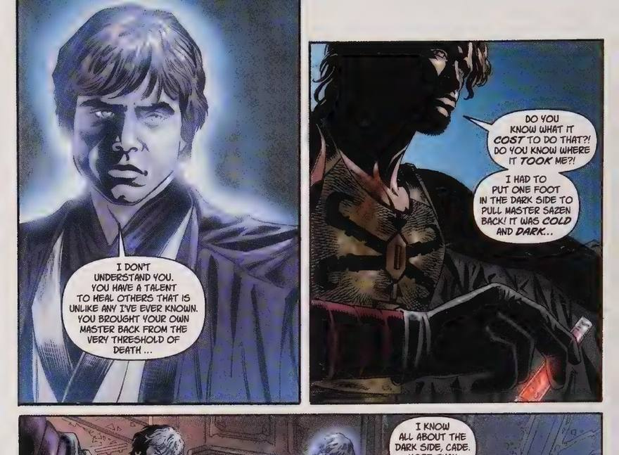
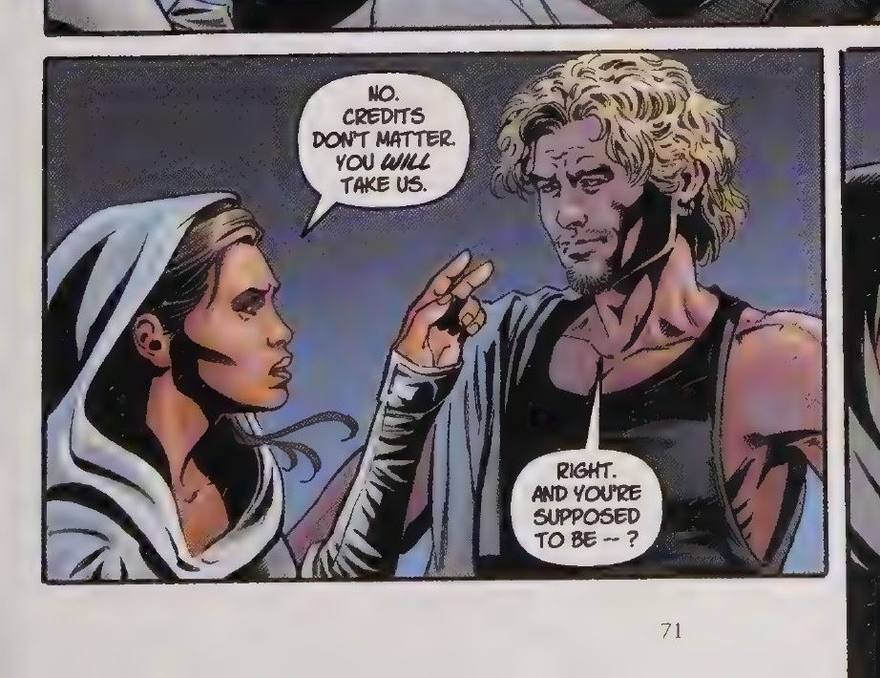
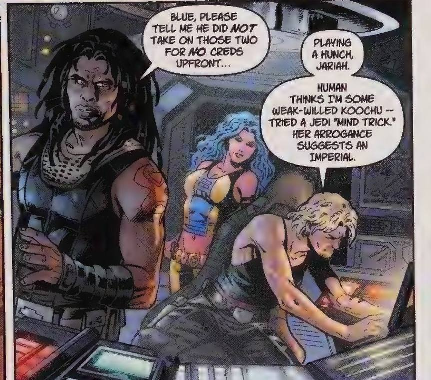
Our notes: `notes/materials/009-legacy-book-1.md:46`

> Cade: "I HAD TO PUT ONE FOOT IN THE DARK SIDE TO PULL MASTER SAZEN BACK!" · Luke: "YOU HAVE A TALENT TO HEAL OTHERS THAT IS UNLIKE ANY I'VE EVER KNOWN. YOU BROUGHT YOUR OWN MASTER BACK FROM THE VERY THRESHOLD OF DEATH ..." · Cade: "... AND PART OF ME LIKED IT! PART OF ME HUNGERED FOR IT!"
> [fragment — full passage not on file]
— Source: Legacy Book 1 (omnibus): power-scaling notes with panels.
Context: 3. Luke's ghost on Cade's healing ("UNLIKE ANY I'VE EVER KNOWN"). p72 (#3 Broken) *(possible death-stick hallucination; the handbook (p472) flags this)*
Our notes: `notes/materials/009-legacy-book-1.md:359`

> truly those of the actual 'Force ghost' of Luke Skywalker, or figments of Cade's own mind *(p472)*
> [fragment — full passage not on file]
— Source: Legacy Book 1 (omnibus): power-scaling notes with panels.
Note (our notes, around the quote): Scaling (ANALYSIS): a strong-sounding hype quote, from Luke no less. Its reliability is disputable: the handbook says it's unclear whether these visits are "truly those of the actual 'Force ghost' of Luke Skywalker, or figments of Cade's own mind" (p472).
Our notes: `notes/materials/009-legacy-book-1.md:366`

> YOU HAVE A DESTINY, CADE ... WHETHER YOU WANT OR NOT, IT WILL FIND YOU. JUST AS MINE FOUND ME.
> [fragment — full passage not on file]
>
> THIS IS ABOUT ONE JEDI -- HOSK TREY'LIS -- WHO YOU SURRENDERED TO THE ENEMY.
— Source: Legacy Book 1 (omnibus): power-scaling notes with panels; Luke (p71–74, p304–305). POV: Luke.
Label in our notes: Luke (p71–74, p304–305): ·

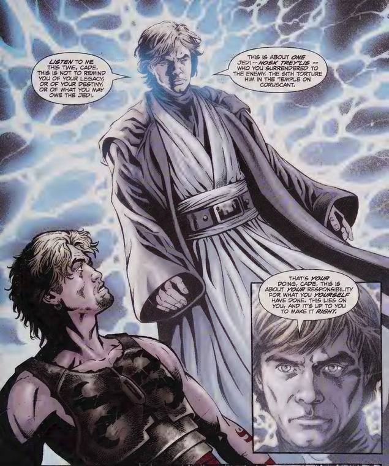
Our notes: `notes/materials/009-legacy-book-1.md:1023`

- Note (summary from our notes, not a quotation): 
  — Source: Legacy Book 1 (omnibus): power-scaling notes with panels.
(*Panel: p305 Luke vision — `p305-luke-ghost-hosk-responsibility.jpg`*)
Our notes: `notes/materials/009-legacy-book-1.md:1035`

> Twenty-five years after Luke Skywalker and the Rebel Alliance freed the galaxy from the tyranny of Emperor Palpatine and Darth Vader, a new threat emerged: alien invaders called Yuuzhan Vong.
>
> But, unknown to all, a new Sith Order was secretly rising on the planet Korriban.
>
> Sabotaging the Vong's transformation processes, the Sith used the disastrous results to incite war between the Empire and the Galactic Alliance. Emperor Roan Fel tried to end the war, but his own Moffs were secretly allied with the Sith and thwarted his efforts.
>
> Following the disastrous Battle of Caamas, the Galactic Alliance was defeated. Many Jedi were subsequently killed in the Massacre of Ossus and the rest scattered as fugitives throughout the galaxy. Within days of the defeat, the Sith also moved against Emperor Fel. He, however, escaped into exile, and the Moff Council's supposed victory was turned into defeat as the Sith's leader, Darth Krayt, proclaimed himself emperor . . .
— Source: Legacy Book 1 (omnibus): power-scaling notes with panels; The State of the Galaxy (p445–446).
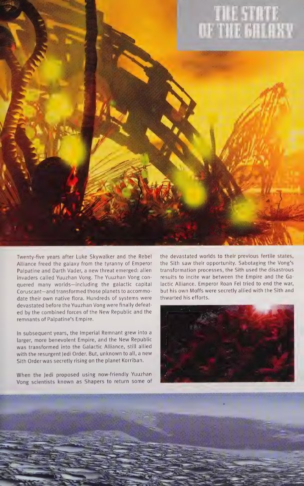 *(p445)*
Our notes: `notes/materials/009-legacy-book-1.md:1118`

> ...the Jedi scattered, leaderless and with few allies. Today they are hunted by the Sith Empire and its agents.
> [fragment — full passage not on file]
>
> Descendant of Anakin and Luke Skywalker. Honor bound and driven, Kol was one of the leaders of the Jedi Council.
>
> He was briefly married to Morrigan Corde, who left him shortly after she gave birth to their son Cade.
— Source: Legacy Book 1 (omnibus): power-scaling notes with panels; The Jedi (p464).
Label in our notes: Kol Skywalker: ·
Our notes: `notes/materials/009-legacy-book-1.md:1137`

> ...the ghostly visage of Luke Skywalker sometimes appears to Cade... Since Luke's appearances often coincide with Cade's regrettable consumption of hallucinogenic 'death-sticks,' there is some question as to whether the visitations are truly those of the actual 'Force ghost' of Luke Skywalker, or figments of Cade's own mind.
> [fragment — full passage not on file]
— Source: Legacy Book 1 (omnibus): power-scaling notes with panels; Luke Skywalker (p472).
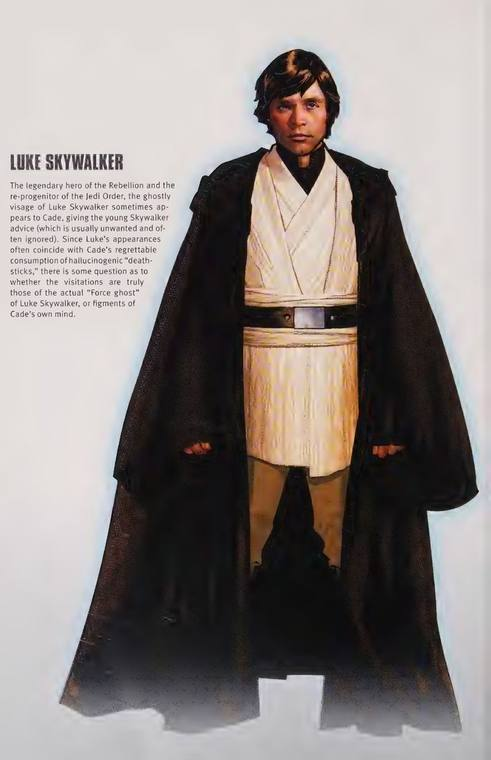
Our notes: `notes/materials/009-legacy-book-1.md:1144`

- Note (summary from our notes, not a quotation): 
  — Source: Legacy Book 1 (omnibus): power-scaling notes with panels.
(*Panel: p472 handbook: Luke (ghost or death-stick figment) — `p472-handbook-luke-ghost-deathsticks.jpg`*)
Our notes: `notes/materials/009-legacy-book-1.md:1168`

- Note (summary from our notes, not a quotation): Visions as hype (Luke, Anakin/Vader, Mara).
  — Source: Legacy Book 1 (omnibus): power-scaling notes with panels.
Our notes: `notes/materials/009-legacy-book-1.md:1206`

> a talent… unlike any I've ever known *(p72)*
> [fragment — full passage not on file]
— Source: Legacy Book 1 (omnibus): power-scaling notes with panels.
Note (our notes, around the quote): The handbook (p472) casts doubt on whether they're real. Don't treat "a talent… unlike any I've ever known" (p72) as authoritative without that caveat.
Context: Visions as hype (Luke, Anakin/Vader, Mara).
Our notes: `notes/materials/009-legacy-book-1.md:1207`

## Star Wars: Legacy—War #1–6 (2010–11): power-scaling notes with panels

- Note (summary from our notes, not a quotation): | #6 | 115–136 | WAR PART SIX | Sith Temple (Coruscant), *Jagged Fel*, the sun, Korriban, aftermath | Cade vs Krayt: lightning, dark transfer, the vision. Cade rejects Krayt and stabs him. Fel tries to launch the toxin and Draco strikes him down. Troopers go mad, K'Kruhk warns of suicide runs, Nihl withdraws. Cade flies Krayt's body into the sun, Luke's ghost appears, Cade ejects. Fel's funeral and the Triumvirate. Nihl's dispersal speech. Cade revived from a hibernation trance. Epilogue. |
  — Source: Legacy—War #1–6 (2010–11): power-scaling notes with panels.
Context: | Issue | PDF pages | Title on recap page | Setting | Main events |
Our notes: `notes/materials/010-legacy-war.md:41`

- Note (summary from our notes, not a quotation): Ghosts: Kol Skywalker (p54–55). Luke Skywalker (p130).
  — Source: Legacy—War #1–6 (2010–11): power-scaling notes with panels.
Our notes: `notes/materials/010-legacy-war.md:71`

> WALKIN' IN THE SKY...
> [fragment — full passage not on file]
— Source: Legacy—War #1–6 (2010–11): power-scaling notes with panels.
Note (our notes, around the quote): Into the sun (p128–131). Cade still hears Krayt's voice and takes the body to the sun with Corde's locket (a tracer). Krayt's voice claims "TRANSFER ESSENCE". Luke's ghost speaks. The body burns and Cade drifts in space, "WALKIN' IN THE SKY...".
Our notes: `notes/materials/010-legacy-war.md:137`

> (p124) "APPRENTICE. DID YOU SEE?" · "DO YOU UNDERSTAND WHAT YOU ARE MEANT TO BE?" · (p130, his voice in Cade's head, over the body) "YOU WON'T DO THIS, APPRENTICE. IF YOU HAD TRULY WANTED ME DEAD, YOU WOULD HAVE CUT OFF MY HEAD." · "DESTROY MY BODY IF YOU WISH. I'LL LIVE AGAIN -- THROUGH *YOU*. LORD ANDEDDU AND KARNESS MUUR SHOWED ME THE WAY OF TRANSFER ESSENCE."
> [fragment — full passage not on file]
— Source: Legacy—War #1–6 (2010–11): power-scaling notes with panels.
Context: 9. Krayt dies: stabbed by Cade's recalled saber; his voice and "TRANSFER ESSENCE"; body burned in the sun. p124–131 (#6). See "Krayt's fate in detail".
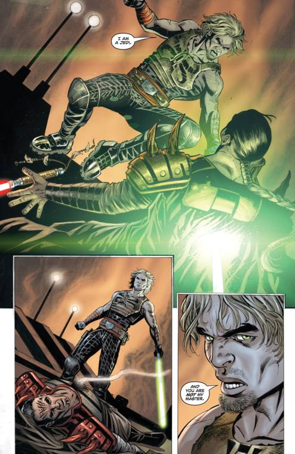 *(p125)*
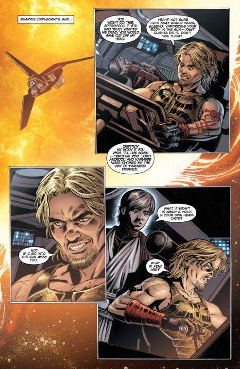 *(p130)*
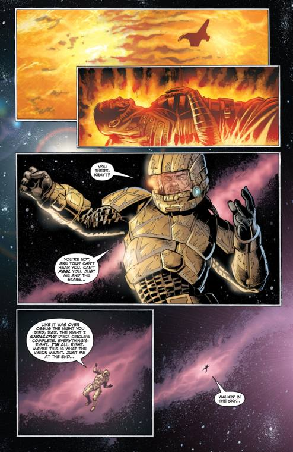 *(p131)*
Our notes: `notes/materials/010-legacy-war.md:284`

> LORD ANDEDDU AND KARNESS MUUR SHOWED ME THE WAY OF TRANSFER ESSENCE
> [fragment — full passage not on file]
— Source: Legacy—War #1–6 (2010–11): power-scaling notes with panels; ![p130.
Note (our notes, around the quote): 
(*Panel: p130 — `p130-transfer-essence-luke-ghost.jpg`*)
Our notes: `notes/materials/010-legacy-war.md:292`

> (p128) Corde: "KRAYT'S DEAD?" · Cade: "STONE COLD..." · "...BUT...I CAN STILL HEAR HIS VOICE -- TELLING ME THAT DEATH CAN'T STOP HIM...THAT HIS BODY WILL HEAL AND LIFE WILL RETURN." · "HE'S INFECTING ME. HE'S EATING MY MIND. ONLY ONE WAY TO BE SURE KRAYT CAN'T COME BACK -- PLUNGE HIS BODY INTO A SUN. MINE TOO." · "NO OTHER WAY, MOM." · (p130) "YEAH? NOT SURE EVEN THAT WOULD WORK, SLEEMO. VAPORIZING YOUR BODY IN THE SUN -- THAT OUGHTA DO IT, DON'T YOU THINK?" · "NOT IF I GO INTO THE SUN WITH YOU." · Luke: "WHAT IF KRAYT IS ONLY A VOICE IN YOUR OWN HEAD, CADE?" · Cade: "WHAT IF *YOU* ARE?" · (p131) "YOU THERE, KRAYT?" · "YOU'RE NOT, ARE YOU? CAN'T HEAR YOU. CAN'T FEEL YOU. JUST ME AND THE STARS..." · "LIKE IT WAS OVER OSSUS THE NIGHT YOU DIED, DAD. THE NIGHT I SHOULD'VE DIED. CIRCLE'S COMPLETE. EVERYTHING'S RIGHT. I'M ALL RIGHT. MAYBE THIS IS WHAT THE VISION MEANT. JUST ME AT THE END..." · "WALKIN' IN THE SKY..." · (p133) Deliah: "SYN... HE'S NOT BREATHING!" · (p135) Cade: "JEDI HIBERNATION TRANCE. OLD SCHOOL. GOOD THING I DIDN'T CUT THAT CLASS." · "PEACEFUL, BLUE. KRAYT'S GONE. I'M FREE."
> [fragment — full passage not on file]
— Source: Legacy—War #1–6 (2010–11): power-scaling notes with panels.
Context: 14. Krayt's voice; flies the body into the sun; Luke's ghost; hibernation trance. p128–135 (#6)
 *(p130)*
 *(p131)*
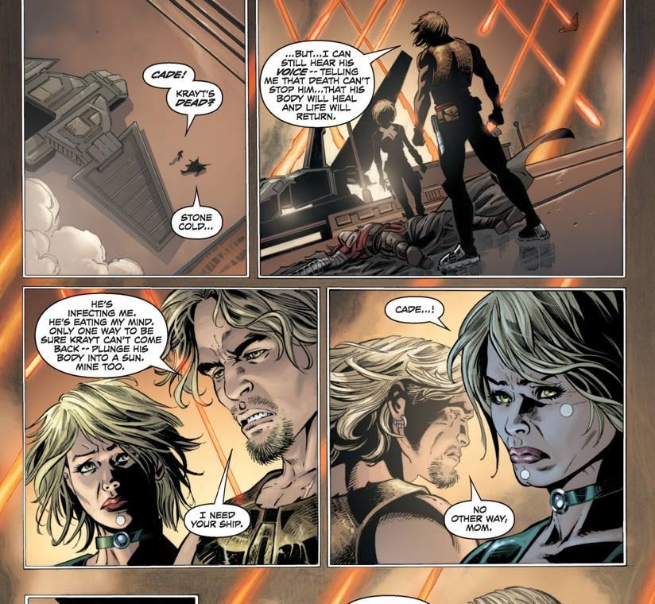 *(p128)*
Our notes: `notes/materials/010-legacy-war.md:472`; `notes/materials/010-legacy-war.md:980`

- Note (summary from our notes, not a quotation): Willpower credit is shared with Luke, whose single line suggests the voice is in Cade's own head.
  — Source: Legacy—War #1–6 (2010–11): power-scaling notes with panels.
Context: Scaling (ANALYSIS):
Our notes: `notes/materials/010-legacy-war.md:494`

> You are a Jedi. Time to choose your own path.
— Source: Legacy—War #1–6 (2010–11): power-scaling notes with panels; Luke's.
Note (our notes, around the quote): Luke's "You are a Jedi. Time to choose your own path." is not on this page or anywhere in War (see Differences).
Context: Scaling (ANALYSIS):
Also cited as: Legacy—War #1–6 (2010–11): power-scaling notes with panels.
Also noted as: Luke never says Krayt is "truly finished" (W paraphrase), and never says "You are a Jedi. Time to choose your own path."
Also cited as: Legacy—War #1–6 (2010–11): power-scaling notes with panels; Luke.
Also noted as: Luke: "You are a *Jedi*. Time to choose your *own* path." Luke's only War line is on p130.
Our notes: `notes/materials/010-legacy-war.md:495`; `notes/materials/010-legacy-war.md:871`; `notes/materials/010-legacy-war.md:1219`

> THEN HEAL HER FOR ME, SON.
>
> NEVER MORE THAN YOU COULD DO, SON.
>
> I FORGIVE YOU, MY LOVE.
> [fragment — full passage not on file]
>
> YOU CANNOT HEAR ME, DARLING. FEEL WHAT I SAY. KNOW THAT I LOVE YOU. ALWAYS AND FOREVER.
— Source: Legacy—War #1–6 (2010–11): power-scaling notes with panels; Kol (p54–55, #3).
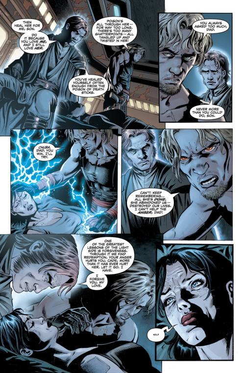
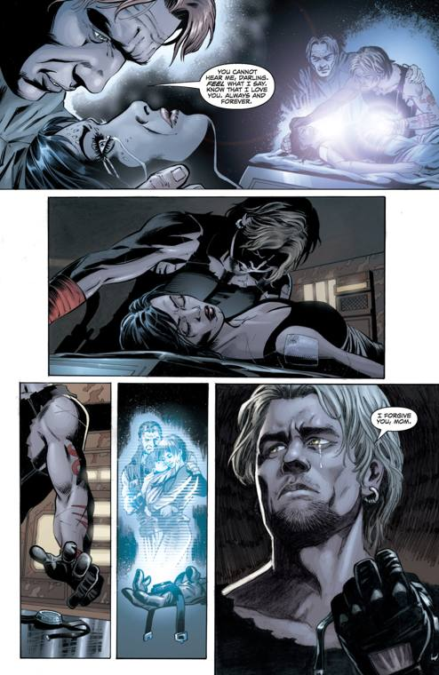
Our notes: `notes/materials/010-legacy-war.md:865`

- Note (summary from our notes, not a quotation): Visible and audible to Cade only. Corde reacts ("KOL?") but cannot hear him.
  — Source: Legacy—War #1–6 (2010–11): power-scaling notes with panels.
Context: Kol (p54–55, #3): "THEN HEAL HER FOR ME, SON." · "NEVER MORE THAN YOU COULD DO, SON." · "I FORGIVE YOU, MY LOVE." · "YOU CANNOT HEAR ME, DARLING. FEEL WHAT I SAY. KNOW THAT I LOVE YOU. ALWAYS AND FOREVER."
 *(p54)*
Our notes: `notes/materials/010-legacy-war.md:866`

> WHAT IF KRAYT IS ONLY A VOICE IN YOUR OWN HEAD, CADE?
>
> “And what if you are not?”
— Source: Legacy—War #1–6 (2010–11): power-scaling notes with panels.
(Full sentence/passage taken from the source text on file: `novels_tmp_star_by_star_star_by_star_epub`.)
Note (our notes, around the quote): Luke (p130, #6): a glowing outline behind Cade in the cockpit. His only line: "WHAT IF KRAYT IS ONLY A VOICE IN YOUR OWN HEAD, CADE?" Cade answers: "WHAT IF *YOU* ARE?"

Our notes: `notes/materials/010-legacy-war.md:868`

> figment vs real ghost
> [fragment — full passage not on file]
— Source: Legacy—War #1–6 (2010–11): power-scaling notes with panels; The page leaves the.
Label in our notes: question open (cf. 009 p472
Context: Luke (p130, #6): a glowing outline behind Cade in the cockpit. His only line: "WHAT IF KRAYT IS ONLY A VOICE IN YOUR OWN HEAD, CADE?" Cade answers: "WHAT IF *YOU* ARE?"
 *(p130)*
Our notes: `notes/materials/010-legacy-war.md:869`

- Note (summary from our notes, not a quotation): | 26 | Krayt's voice vs Cade (possession threat) | Ship to the sun | p128–131 (#6) | Body burned; the voice is gone | Luke's ghost speaks |
  — Source: Legacy—War #1–6 (2010–11): power-scaling notes with panels.
Context: | # | Fight | Where | Pages (issue) | Outcome | Conditions / outside help |
Our notes: `notes/materials/010-legacy-war.md:951`

- Note (summary from our notes, not a quotation): The essence-transfer threat and the ghost-or-voice question are left open on purpose: Luke's line and Shado's doubt. Nihl's "HE LIVES IN US" is metaphor.
  — Source: Legacy—War #1–6 (2010–11): power-scaling notes with panels.
Our notes: `notes/materials/010-legacy-war.md:992`

- Note (summary from our notes, not a quotation): Luke's ghost. 009 p472's handbook doubt is untouched. War's Luke only asks whether Krayt is a voice in Cade's head (p130).
  — Source: Legacy—War #1–6 (2010–11): power-scaling notes with panels.
Our notes: `notes/materials/010-legacy-war.md:1131`

- Note (summary from our notes, not a quotation): Wolf Sazen, Shado Vao, K'Kruhk, Rawk, T'ra Saa, Tili Qua, and the ghosts of Kol and Luke.
  — Source: Legacy—War #1–6 (2010–11): power-scaling notes with panels.
Context: Covers:
Our notes: `notes/materials/010-legacy-war.md:1143`

> Krayt was truly finished *(W paraphrase)*
> [fragment — full passage not on file]
— Source: Legacy—War #1–6 (2010–11): power-scaling notes with panels; Luke telling Cade.
Label in our notes: W paraphrase
Our notes: `notes/materials/010-legacy-war.md:1220`

## Star Wars Saga Edition: *Legacy Era Campaign Guide* (WotC 2009): power-scaling notes with panels

> a direct descendent [sic] of Anakin and Luke Skywalker, serves on the Jedi Council prior to the collapse of the Galactic Alliance.
> [fragment — full passage not on file]
— Source: *Legacy Era Campaign Guide* (WotC 2009): power-scaling notes with panels; p196.
Context: Bio:
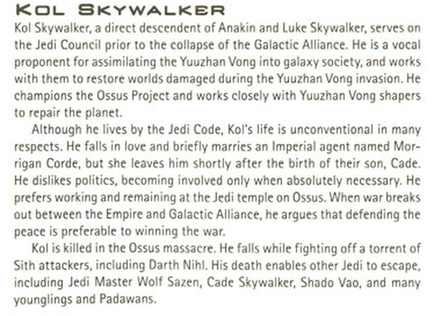
Our notes: `notes/materials/011-legacy-era-campaign-guide.md:567`

> recovered from the remnants of the Ossus academy
> [fragment — full passage not on file]
— Source: *Legacy Era Campaign Guide* (WotC 2009): power-scaling notes with panels; Luke's lightsaber was.
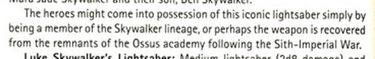
Our notes: `notes/materials/011-legacy-era-campaign-guide.md:877`

## Star Wars: Legacy Volume 2, *Shards* (TPB): power-scaling notes with panels

> approximately 130 years after the Battle of Yavin
> [fragment — full passage not on file]
— Source: Legacy Volume 2, *Shards* (TPB): power-scaling notes with panels.
Note (our notes, around the quote): | Front matter | 1–6 | — | Cover (Hughes: Luke Skywalker), half-title, era page (p3: "approximately 130 years after the Battle of Yavin"), title, indicia/credits (p5), backstory text (p6) | Adam Hughes cover |
Context: | Arc (on-page title) | PDF pages | Issue(s) | Setting / year | Credits page (art) |
Our notes: `notes/materials/012-legacy-vol-2-shards.md:18`

- Note (summary from our notes, not a quotation): 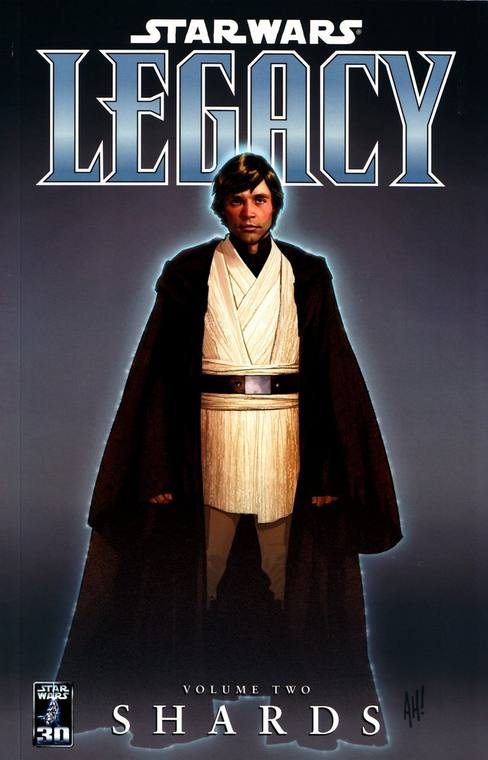
  — Source: Legacy Volume 2, *Shards* (TPB): power-scaling notes with panels.
(*Panel: p1 front cover — `p001-cover-hughes-luke.jpg`*)
Our notes: `notes/materials/012-legacy-vol-2-shards.md:28`

- Note (summary from our notes, not a quotation): Visions (framing, not feats): Mara Jade, Anakin Skywalker / Darth Vader (p129–134) and Luke Skywalker (p168) appear to a drugged or meditating Cade.
  — Source: Legacy Volume 2, *Shards* (TPB): power-scaling notes with panels.
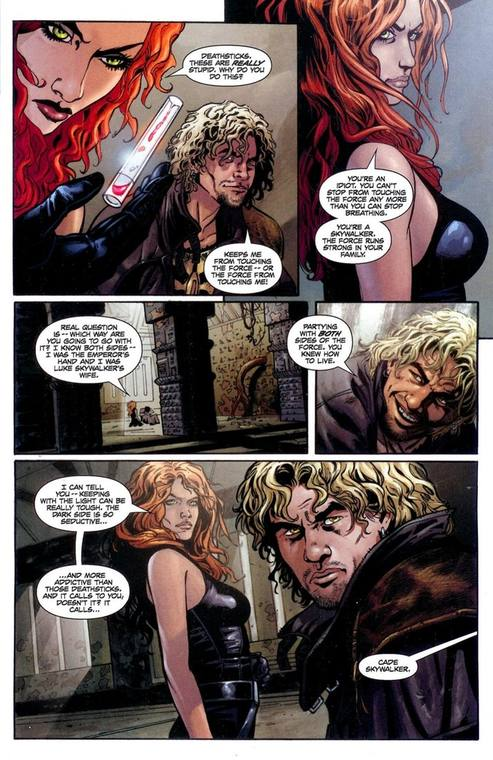
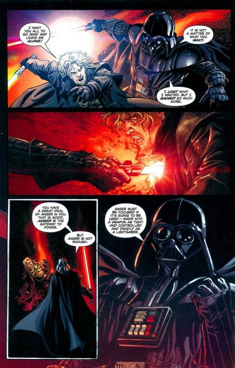
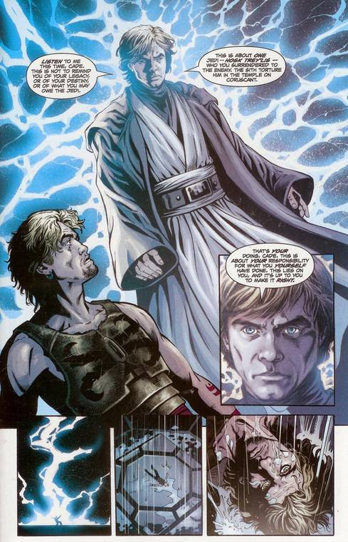
Our notes: `notes/materials/012-legacy-vol-2-shards.md:38`

> WITHIN THE FLAMES, HIS BODY DISAPPEARED.
>
> IF HE EVER GOES COMPLETELY OVER TO THE DARK SIDE, I WILL END HIM. *(p170)*
>
> NO ONE DIES FOR ME. NEVER AGAIN. *(p171)*
— Source: Legacy Volume 2, *Shards* (TPB): power-scaling notes with panels.
Note (our notes, around the quote): #12: A Vong warrior pins Cade. Master Shaper Nei Rin stops the fight, and Sazen and K'Kruhk arrive (p150–151). Nei Rin explains the Ossus Project, the Sith sabotage, and Kol's funeral: "WITHIN THE FLAMES, HIS BODY DISAPPEARED." She offers Cade the Jedi legacy, and he refuses it (p152–155). At the spot where Kol died, Cade attacks Sazen and loses. Sazen tells him his healings drew on the dark side and calls Kol's last stand a selfless holding action (p156–161). In the meditation of emptiness, Cade remembers drifting in space and his rescue by Rav and Jariah (p162–166). He then sees the tortured Hosk, and Luke's spirit tells him to make it right (p167–168). Nei Rin gives him Kol's lightsaber, now with a Vong-shaped lambent crystal, and K'Kruhk gives him R2-D2 (p169–170). Shado: "IF HE EVER GOES COMPLETELY OVER TO THE DARK SIDE, I WILL END HIM." (p170). Cade heads for Coruscant: "NO ONE DIES FOR ME. NEVER AGAIN." (p171).
Our notes: `notes/materials/012-legacy-vol-2-shards.md:62`

> THE FORCE...IT'S VERY STRONG IN YOU! NOT SITH...
> [fragment — full passage not on file]
— Source: Legacy Volume 2, *Shards* (TPB): power-scaling notes with panels.
Note (our notes, around the quote): Broken by Maladi (p58–60). Security-cam holo of Cade healing him: "THE FORCE...IT'S VERY STRONG IN YOU! NOT SITH..." "JEDI...?!" (p141). The Sith torture him in the Coruscant Temple, per Luke's spirit (p168).
Our notes: `notes/materials/012-legacy-vol-2-shards.md:353`

> THIS IS ABOUT ONE JEDI -- HOSK TREY'LIS -- WHO YOU SURRENDERED TO THE ENEMY. THE SITH TORTURE HIM IN THE TEMPLE ON CORUSCANT.
>
> THIS LIES ON YOU, AND IT'S UP TO YOU TO MAKE IT RIGHT.
— Source: Legacy Volume 2, *Shards* (TPB): power-scaling notes with panels; Luke Skywalker (p168). POV: Luke Skywalker.
Note (our notes, around the quote): Luke Skywalker (p168): "THIS IS ABOUT ONE JEDI -- HOSK TREY'LIS -- WHO YOU SURRENDERED TO THE ENEMY. THE SITH TORTURE HIM IN THE TEMPLE ON CORUSCANT." · "THIS LIES ON YOU, AND IT'S UP TO YOU TO MAKE IT RIGHT." Unlike the drug visions, this one gives information that turns out to be true (Hosk is in the Temple in Claws). Before Luke appears, the vision shows Hosk's screaming face and a huge armoured mask wreathed in lightning (p167).

Our notes: `notes/materials/012-legacy-vol-2-shards.md:397`

- Note (summary from our notes, not a quotation): 
  — Source: Legacy Volume 2, *Shards* (TPB): power-scaling notes with panels.
(*Panel: p168 — `p168-luke-ghost-hosk.jpg`*)
Our notes: `notes/materials/012-legacy-vol-2-shards.md:405`

> MAYBE THAT LAST DEATHSTICK WASN'T SUCH A GOOD IDEA...
> [fragment — full passage not on file]
— Source: Legacy Volume 2, *Shards* (TPB): power-scaling notes with panels.
Note (our notes, around the quote): Visions as hype. Vader's "ANGER IS THE GATEWAY TO POWER" (p133) and Mara's lines (p130) come from a death-stick overdose ("MAYBE THAT LAST DEATHSTICK WASN'T SUCH A GOOD IDEA...", p135). Luke's p168 vision is different: it carries true information, but it is still framing, not a feat.
Our notes: `notes/materials/012-legacy-vol-2-shards.md:495`

> The events in this story begin approximately 130 years after the Battle of Yavin.
>
> approximately 137 years after… *A New Hope*
> [fragment — full passage not on file]
>
> a new breed of Sith, numbering more than two
> [fragment — full passage not on file]
— Source: Legacy Volume 2, *Shards* (TPB): power-scaling notes with panels.
Note (our notes, around the quote): Front matter: 012 has its own Adam Hughes cover (Luke Skywalker in robes, with a Star Wars 30th-anniversary badge; 009's cover is Deliah/Cade/Jariah), a half-title, and an era page that says "The events in this story begin approximately 130 years after the Battle of Yavin." (p3; 009 p11 says "approximately 137 years after… *A New Hope*"). There is also an indicia page with the issue order and first-printing date (p5) and a backstory page (p6; "a new breed of Sith, numbering more than two").
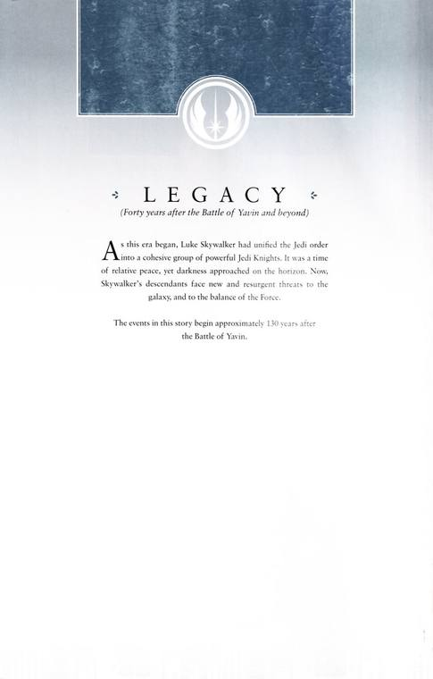
Our notes: `notes/materials/012-legacy-vol-2-shards.md:509`

## Star Wars: Legacy Volume 3, *Claws of the Dragon* (TPB): power-scaling notes with panels

- Note (summary from our notes, not a quotation): Flashbacks, narrated by Krayt or Talon (framing by an interested narrator): Jedi General A'Sharad Hett at Order 66 (p61); Hett as Tusken warlord vs Obi-Wan Kenobi on Tatooine while Luke is hidden on the Lars farm (p62–70); Hett as bounty hunter, then XoXaan's apprentice on Korriban (p89–91, p98); Hett's capture and shaping by the Yuuzhan Vong and his meetings with Vergere (p99–104); the founding of Krayt's Order, Lumiya and "CADEUS", stasis (p105–106).
  — Source: Legacy Volume 3, *Claws of the Dragon* (TPB): power-scaling notes with panels.
Our notes: `notes/materials/013-legacy-vol-3-claws-of-the-dragon.md:33`

> LEGACY ERA (40+ YEARS AFTER STAR WARS: A NEW HOPE) The Yuuzhan Vong have been defeated, but the galaxy has been slow to recover from their depredations, with powerful worlds chafing at the economic burdens and military restrictions put upon them by the nascent Galactic Alliance, once-powerful species seeking to rise again, newly prosperous worlds testing their influence, and long-buried secrets coming to light. The result of all this instability is civil war. Faced with a Galactic Alliance that has fallen away from its values, Luke and the Jedi Order must decide where their loyalties lie—and so, too, must the heroes of the Rebellion.
>
> will the last Skywalker live up to the triumph of Luke, or return to the tragedy of Anakin?
> [fragment — full passage not on file]
— Source: Legacy Volume 3, *Claws of the Dragon* (TPB): power-scaling notes with panels.
(Excerpt widened 2026-11-17 to the relevant passage, word for word from Shadow Hunter (Michael Reaves) (text copy `MEGA_Legend_Darth_Maul_Star_Wars_Darth_Maul_02_Shadow_Hunter_Michael_Reaves_epub`).)
(Fragment completed 2026-11-17: full sentence/passage matched word for word in the source text on file: `MEGA_Legend_Darth_Maul_Star_Wars_Darth_Maul_02_Shadow_Hunter_Michael_Reaves_epub`.)
Note (our notes, around the quote): Back matter only in 013: crest page (p142), Dark Horse "Timeline of Graphic Novels" listing *Legacy* Vol 1–2 only (p143–144; "LEGACY ERA: 40+ YEARS AFTER STAR WARS: A NEW HOPE", "STAR WARS ©2008"), back cover with painted Obi-Wan and blurb ("will the last Skywalker live up to the triumph of Luke, or return to the tragedy of Anakin?") and the Titan Books £14.99 sticker (p145), scanner's page (p146).
Our notes: `notes/materials/013-legacy-vol-3-claws-of-the-dragon.md:586`

## https://starwars.fandom.com/wiki/Abeloth ; https://starwars.fandom.com/wiki/Abeloth/Legends

- Note (summary from our notes, not a quotation): At the Font of Power, Luke Skywalker approached Abeloth's manifested true form beyond shadows. The article says a tentacle entered and moved up inside Luke's leg; Abeloth tried to lure him by using a familiar, dream-lover-like voice, but he withdrew [7].
  — Source: Abeloth research extraction (Wookieepedia / Star Wars Legends) — https://starwars.fandom.com/wiki/Abeloth ; https://starwars.fandom.com/wiki/Abeloth/Legends.
Our notes: `external/mega-notes/abeloth-quotes.txt:35`

> one of the old ones
> [fragment — full passage not on file]
— Source: Abeloth research extraction (Wookieepedia / Star Wars Legends) — https://starwars.fandom.com/wiki/Abeloth ; https://starwars.fandom.com/wiki/Abeloth/Legends.
Note (our notes, around the quote): Beyond shadows, the dead Mara Jade warned Luke that Abeloth was “one of the old ones” and told him to leave her alone; this is a character statement/warning, not a measured feat [7].
Our notes: `external/mega-notes/abeloth-quotes.txt:36`

- Note (summary from our notes, not a quotation): Abeloth used the Force to seize Vestara Khai and strike her with lightning; Khai deflected it back. Abeloth fought Luke Skywalker, High Lord Sarasu Taalon, Gavar Khai, and other Sith, disappeared/reappeared during the fight, and was constrained enough by the Sith control web that the web stifled her powers and frightened her [4].
  — Source: Abeloth research extraction (Wookieepedia / Star Wars Legends) — https://starwars.fandom.com/wiki/Abeloth ; https://starwars.fandom.com/wiki/Abeloth/Legends.
Our notes: `external/mega-notes/abeloth-quotes.txt:39`

- Note (summary from our notes, not a quotation): Abeloth then released a massive Force wave that repulsed all her attackers and fled. She killed the Sith left guarding Dyon Stadd. Luke cut through Stadd's body, revealing that Abeloth had switched bodies; the apparent Abeloth body had died, while Abeloth survived in Stadd's form [4][11].
  — Source: Abeloth research extraction (Wookieepedia / Star Wars Legends) — https://starwars.fandom.com/wiki/Abeloth ; https://starwars.fandom.com/wiki/Abeloth/Legends.
Our notes: `external/mega-notes/abeloth-quotes.txt:40`

- Note (summary from our notes, not a quotation): On Pydyr, Abeloth used illusions and fear against the Sith and Fallanassi. When Luke fought the Akanah avatar, he flung Taalon away, kicked Abeloth without effect, severed her arm with his lightsaber, cut her leg, and pushed her into a pit [11].
  — Source: Abeloth research extraction (Wookieepedia / Star Wars Legends) — https://starwars.fandom.com/wiki/Abeloth ; https://starwars.fandom.com/wiki/Abeloth/Legends.
Our notes: `external/mega-notes/abeloth-quotes.txt:43`

- Note (summary from our notes, not a quotation): Abeloth survived the fall, came onto Luke, held him down, drove her severed arm into his throat, pressed against his larynx, and bent his knee with her strength. Luke snapped three of her ribs and activated his lightsaber through her stomach “to no avail.” He splashed lava onto her back; she wailed and had to sustain her body through the Force [11].
  — Source: Abeloth research extraction (Wookieepedia / Star Wars Legends) — https://starwars.fandom.com/wiki/Abeloth ; https://starwars.fandom.com/wiki/Abeloth/Legends.
Our notes: `external/mega-notes/abeloth-quotes.txt:44`

- Note (summary from our notes, not a quotation): Luke lifted a ceiling beam that crushed Abeloth against him. Akanah resisted possession, and Luke's lightsaber then cut through Abeloth's flank and killed that manifestation [11]. This is a concrete kill of a manifestation, not proof of permanent death.
  — Source: Abeloth research extraction (Wookieepedia / Star Wars Legends) — https://starwars.fandom.com/wiki/Abeloth ; https://starwars.fandom.com/wiki/Abeloth/Legends.
Our notes: `external/mega-notes/abeloth-quotes.txt:45`

- Note (summary from our notes, not a quotation): Luke used a dark-side variant of mnemotherapy to tear Callista Ming's spirit/consciousness out of Abeloth. The article says the act severely weakened Abeloth; Ming glowed and became one with the Force [32].
  — Source: Abeloth research extraction (Wookieepedia / Star Wars Legends) — https://starwars.fandom.com/wiki/Abeloth ; https://starwars.fandom.com/wiki/Abeloth/Legends.
Our notes: `external/mega-notes/abeloth-quotes.txt:48`

- Note (summary from our notes, not a quotation): On Nam Chorios, Abeloth's possessed Nenn killed himself, weakening her. Abeloth escaped in Ship; Vestara's killing of a tsil caused a death convulsion that debilitated Abeloth. A Jedi shadow bomb also caused pain through the Force, and Luke's attack damaged Ship, but Abeloth escaped. The article says she was left weaker than ever [32].
  — Source: Abeloth research extraction (Wookieepedia / Star Wars Legends) — https://starwars.fandom.com/wiki/Abeloth ; https://starwars.fandom.com/wiki/Abeloth/Legends.
Our notes: `external/mega-notes/abeloth-quotes.txt:49`

- Note (summary from our notes, not a quotation): In the final battle beyond shadows, Luke fought Abeloth while both used their Force essences. Luke's Force blast made her sag by the Lake of Apparitions; he struck her legs, throat, and head, constricted her larynx, and lost a knee of her form. Abeloth struck Luke's right eye [1].
  — Source: Abeloth research extraction (Wookieepedia / Star Wars Legends) — https://starwars.fandom.com/wiki/Abeloth ; https://starwars.fandom.com/wiki/Abeloth/Legends.
Our notes: `external/mega-notes/abeloth-quotes.txt:53`

- Note (summary from our notes, not a quotation): Darth Krayt drove his fingers into Abeloth's stomach and drained her power. Krayt, Luke, and Abeloth became entangled in a Force-energy struggle; the article says Abeloth was weakened faster than Luke while Krayt drained her, but the drain also harmed Krayt and Luke [1].
  — Source: Abeloth research extraction (Wookieepedia / Star Wars Legends) — https://starwars.fandom.com/wiki/Abeloth ; https://starwars.fandom.com/wiki/Abeloth/Legends.
Our notes: `external/mega-notes/abeloth-quotes.txt:54`

- Note (summary from our notes, not a quotation): Abeloth tore away her energy bond with Luke and tried to bite them. Luke merged his form with hers again and urged Krayt to pull harder. Krayt recalled a severed hand lodged in Abeloth; Abeloth then tore at both men and left each with a fist-sized hole in the chest while she escaped with some of their Force essence [1].
  — Source: Abeloth research extraction (Wookieepedia / Star Wars Legends) — https://starwars.fandom.com/wiki/Abeloth ; https://starwars.fandom.com/wiki/Abeloth/Legends.
Our notes: `external/mega-notes/abeloth-quotes.txt:55`

- Note (summary from our notes, not a quotation): In the astral realm, Abeloth's Force lightning passed through Darth Krayt and hit Luke before Krayt could attack; it blasted Krayt backward [1].
  — Source: Abeloth research extraction (Wookieepedia / Star Wars Legends) — https://starwars.fandom.com/wiki/Abeloth ; https://starwars.fandom.com/wiki/Abeloth/Legends.
Our notes: `external/mega-notes/abeloth-quotes.txt:59`

- Note (summary from our notes, not a quotation): The article says Krayt left Luke after stating that Sith dominance had only been delayed by Caedus and Abeloth. This is Krayt's statement about the future, not a feat [1].
  — Source: Abeloth research extraction (Wookieepedia / Star Wars Legends) — https://starwars.fandom.com/wiki/Abeloth ; https://starwars.fandom.com/wiki/Abeloth/Legends.
Our notes: `external/mega-notes/abeloth-quotes.txt:61`

- Note (summary from our notes, not a quotation): Luke retained a severe chest wound from Abeloth that cost him a rib and part of a lung [1][41]. The Jedi sought the Dagger of Mortis to make her permanent death possible [1].
  — Source: Abeloth research extraction (Wookieepedia / Star Wars Legends) — https://starwars.fandom.com/wiki/Abeloth ; https://starwars.fandom.com/wiki/Abeloth/Legends.
Our notes: `external/mega-notes/abeloth-quotes.txt:67`

- Note (summary from our notes, not a quotation): Avatar dependency is a stated weakness: killing avatar bodies weakened her rapidly; destroying all could result in “death.” Non-Force-sensitive hosts deteriorated more quickly. The article says Luke used this weakness to deliver the finishing blow [1].
  — Source: Abeloth research extraction (Wookieepedia / Star Wars Legends) — https://starwars.fandom.com/wiki/Abeloth ; https://starwars.fandom.com/wiki/Abeloth/Legends.
Our notes: `external/mega-notes/abeloth-quotes.txt:74`

- Note (summary from our notes, not a quotation): The article says Abeloth was not invincible: manifestations could be annihilated by a thermal detonator, and blades, lightsabers, blasters, or Force-thrown objects could wound her if they bypassed her guard [1][4][11]. Krayt's life-force drain harmed her and also harmed him and Luke [1].
  — Source: Abeloth research extraction (Wookieepedia / Star Wars Legends) — https://starwars.fandom.com/wiki/Abeloth ; https://starwars.fandom.com/wiki/Abeloth/Legends.
Our notes: `external/mega-notes/abeloth-quotes.txt:76`

- Note (summary from our notes, not a quotation): The article states Abeloth's physical strength augmentation was “a dozen times” Luke Skywalker's, while also stating Luke defeated her in a duel by raining debris on her [11]. This is the page's explicit Luke comparison; it is a cited statement, not an independently measured feat.
  — Source: Abeloth research extraction (Wookieepedia / Star Wars Legends) — https://starwars.fandom.com/wiki/Abeloth ; https://starwars.fandom.com/wiki/Abeloth/Legends.
Our notes: `external/mega-notes/abeloth-quotes.txt:80`

- Note (summary from our notes, not a quotation): The article says Luke had encountered no more powerful use of Force Healing [32]. This is Luke's comparative assessment, not a quantified feat.
  — Source: Abeloth research extraction (Wookieepedia / Star Wars Legends) — https://starwars.fandom.com/wiki/Abeloth ; https://starwars.fandom.com/wiki/Abeloth/Legends.
Our notes: `external/mega-notes/abeloth-quotes.txt:82`

## https://starwars.fandom.com/wiki/Darth_Bane

- Note (summary from our notes, not a quotation): Type: cited reaction/opinion, not a feat.
  — Source: Star Wars (2020) 20 [per Wookieepedia "Darth Bane" rev 15707280, ref 30; exact text match]; per Wookieepedia "Darth Bane" rev 15707280, ref 30; exact text match — Research extraction: Darth Bane | Wookieepedia (Fandom) — https://starwars.fandom.com/wiki/Darth_Bane.
(Article quote: “Yeah, see… This is what I'm talking about. Darth Bane? It's too much.”)
(Scaling/connection: Luke Skywalker says this in reaction to Mann mentioning Bane; no power comparison is made.)
(Source: Star Wars (2020) 20 [per Wookieepedia "Darth Bane" rev 15707280, ref 30; exact text match])
Our notes: `external/mega-notes/bane-legends-quotes.txt:147`

- Note (summary from our notes, not a quotation): Type: concrete feat by Vader; lineage connection.
  — Source: Star Wars: Timelines ; Star Wars: The Last Jedi: The Visual Dictionary [per Wookieepedia "Darth Bane" rev 15707280, ref 16,32; exact text match]; per Wookieepedia "Darth Bane" rev 15707280, ref 16,32; exact text match — Research extraction: Darth Bane | Wookieepedia (Fandom) — https://starwars.fandom.com/wiki/Darth_Bane.
(Article quote: “During the Battle of Endor in 4 ABY, Vader sacrificed his life to save his son, Luke, killing the Emperor and dying as the last Sith Lord in the lineage of Darth Bane.”)
(Scaling/connection: The article identifies Vader as the last Sith Lord in Bane’s lineage.)
(Source: Star Wars: Timelines ; Star Wars: The Last Jedi: The Visual Dictionary [per Wookieepedia "Darth Bane" rev 15707280, ref 16,32; exact text match])
Our notes: `external/mega-notes/bane-legends-quotes.txt:163`

- Note (summary from our notes, not a quotation): Type: cited statement (warning, not a feat).
  — Source: Star Wars: The Secrets of the Jedi [per Wookieepedia "Darth Bane" rev 15707280, ref 34; exact text match]; per Wookieepedia "Darth Bane" rev 15707280, ref 34; exact text match — Research extraction: Darth Bane | Wookieepedia (Fandom) — https://starwars.fandom.com/wiki/Darth_Bane.
(Article quote: “The Sith have not risen again since the fall of the Empire, but history proves that they could return when we least expect it.”)
(Scaling/connection: Attributed to Luke Skywalker; it states a historical possibility rather than a Bane feat.)
(Source: Star Wars: The Secrets of the Jedi [per Wookieepedia "Darth Bane" rev 15707280, ref 34; exact text match])
Our notes: `external/mega-notes/bane-legends-quotes.txt:169`

## https://starwars.fandom.com/wiki/Cade_Skywalker

- Note (summary from our notes, not a quotation): Cade expected Krayt to revive again, so he took Krayt's body toward Coruscant's sun. Krayt's spirit claimed it would use Cade as a host, but Cade rejected this; Luke's guidance let Cade escape and enter a Jedi healing trance. [2]
  — Source: Cade Skywalker — article extraction — https://starwars.fandom.com/wiki/Cade_Skywalker.
Our notes: `external/mega-notes/cade-skywalker-quotes.txt:63`

## https://starwars.fandom.com/wiki/Darth_Caedus

- Note (summary from our notes, not a quotation): [STATEMENT] Section: Earliest years — Target from birth
  — Source: The Last Command Sourcebook [per Wookieepedia "Darth Caedus" rev 15733922, ref 27; exact text match; agrees with the entry's own ref marker]; per Wookieepedia "Darth Caedus" rev 15733922, ref 27; exact text match; agrees with the entry's own ref marker — Darth Caedus (Jacen Solo) — article extraction — https://starwars.fandom.com/wiki/Darth_Caedus.
(“Their uncle, Luke Skywalker, tested their Force potential and found it astonishing.” [27])
(Scaling: Luke Skywalker is the evaluator; this is an assessment, not a demonstrated feat.)
(Source: The Last Command Sourcebook [per Wookieepedia "Darth Caedus" rev 15733922, ref 27; exact text match; agrees with the entry's own ref marker])
Our notes: `external/mega-notes/caedus-legends-quotes.txt:20`

- Note (summary from our notes, not a quotation): [FEAT] Section: Earliest years — Target from birth
  — Source: Champions of the Force [per Wookieepedia "Darth Caedus" rev 15733922, ref 33; exact text match; agrees with the entry's own ref marker]; per Wookieepedia "Darth Caedus" rev 15733922, ref 33; exact text match; agrees with the entry's own ref marker — Darth Caedus (Jacen Solo) — article extraction — https://starwars.fandom.com/wiki/Darth_Caedus.
(“Fearlessly, young Solo charged the creatures to drive them away. At Skywalker's urging, he took up the Jedi Master's lightsaber and, with Skywalker fighting through him, defeated all three creatures.” [33])
(Scaling: The article explicitly says Luke Skywalker was fighting through him; Jacen was two years old and used Luke’s lightsaber against three Sithspawn battle hydras.)
(Source: Champions of the Force [per Wookieepedia "Darth Caedus" rev 15733922, ref 33; exact text match; agrees with the entry's own ref marker])
Our notes: `external/mega-notes/caedus-legends-quotes.txt:30`

- Note (summary from our notes, not a quotation): [STATEMENT] Section: A new hope — The Truth
  — Source: The New Jedi Order: Destiny's Way [per Wookieepedia "Darth Caedus" rev 15733922, ref 13; approximate match 0.80, verify; agrees with the entry's own ref marker]; per Wookieepedia "Darth Caedus" rev 15733922, ref 13; approximate match 0.80, verify; agrees with the entry's own ref marker — Darth Caedus (Jacen Solo) — article extraction — https://starwars.fandom.com/wiki/Darth_Caedus.
(“Vergere, to Luke Skywalker: ‘Jacen Solo had to be bereft of friends, of relatives, of teachers and knowledge and the Force and everything that could help him. He had to be reduced to nothing—or rather, to himself only.’” [13])
(Scaling: Vergere’s assessment of the conditions of Jacen’s captivity; it is a character explanation, not a feat.)
(Source: The New Jedi Order: Destiny's Way [per Wookieepedia "Darth Caedus" rev 15733922, ref 13; approximate match 0.80, verify; agrees with the entry's own ref marker])
Our notes: `external/mega-notes/caedus-legends-quotes.txt:172`

- Note (summary from our notes, not a quotation): [FEAT] Section: Dark Lord of the Sith — The death of Nelani Dinn
  — Source: Legacy of the Force: Betrayal [per Wookieepedia "Darth Caedus" rev 15733922, ref 16; exact text match; agrees with the entry's own ref marker]; per Wookieepedia "Darth Caedus" rev 15733922, ref 16; exact text match; agrees with the entry's own ref marker — Darth Caedus (Jacen Solo) — article extraction — https://starwars.fandom.com/wiki/Darth_Caedus.
(“Reluctantly, Solo chased down Dinn, who had grown aware of his intent, and killed her in the name of the greater good.” [16])
(Scaling: The article says Solo’s future-probing showed Luke Skywalker lived only in futures in which Dinn died; it is a stated rationale, not an endorsement.)
(Source: Legacy of the Force: Betrayal [per Wookieepedia "Darth Caedus" rev 15733922, ref 16; exact text match; agrees with the entry's own ref marker])
Our notes: `external/mega-notes/caedus-legends-quotes.txt:266`

- Note (summary from our notes, not a quotation): [FEAT] Section: Dark Lord of the Sith — Standing alone
  — Source: Legacy of the Force: Inferno [per Wookieepedia "Darth Caedus" rev 15733922, ref 24; exact text match; agrees with the entry's own ref marker]; per Wookieepedia "Darth Caedus" rev 15733922, ref 24; exact text match; agrees with the entry's own ref marker — Darth Caedus (Jacen Solo) — article extraction — https://starwars.fandom.com/wiki/Darth_Caedus.
(“As Caedus, he proved able to hold his own extremely well against the Grand Master during their duel on the Anakin Solo, managing to inflict severe injuries on his uncle, although in the end Luke proved to triumph and dealt more injuries on Caedus in his victory.” [24])
(Scaling: The opponent was Jedi Grand Master Luke Skywalker; Luke won the duel.)
(Source: Legacy of the Force: Inferno [per Wookieepedia "Darth Caedus" rev 15733922, ref 24; exact text match; agrees with the entry's own ref marker])
Our notes: `external/mega-notes/caedus-legends-quotes.txt:286`

- Note (summary from our notes, not a quotation): [FEAT] Section: Dark Lord of the Sith — Standing alone
  — Source: Legacy of the Force: Invincible [per Wookieepedia "Darth Caedus" rev 15733922, ref 6; approximate match 0.94, verify; agrees with the entry's own ref marker]; per Wookieepedia "Darth Caedus" rev 15733922, ref 6; approximate match 0.94, verify; agrees with the entry's own ref marker — Darth Caedus (Jacen Solo) — article extraction — https://starwars.fandom.com/wiki/Darth_Caedus.
(“Though he had already suffered a disabling shoulder injury from one of her sniper shots, Caedus engaged his sister but knew he was at a disadvantage, especially as he thought he was facing Skywalker.” [6])
(Scaling: Jaina Solo attacked while Luke Skywalker’s masking illusion made Caedus think he was fighting Luke; Jaina severed one of Caedus’s arms, and Caedus disabled her with Force lightning before recognizing her.)
(Source: Legacy of the Force: Invincible [per Wookieepedia "Darth Caedus" rev 15733922, ref 6; approximate match 0.94, verify; agrees with the entry's own ref marker])
Our notes: `external/mega-notes/caedus-legends-quotes.txt:296`

- Note (summary from our notes, not a quotation): [STATEMENT] Section: Powers and abilities — Lightsaber skills
  — Source: The New Jedi Order: Force Heretic II: Refugee [per Wookieepedia "Darth Caedus" rev 15733922, ref 82; exact text match; agrees with the entry's own ref marker]; per Wookieepedia "Darth Caedus" rev 15733922, ref 82; exact text match; agrees with the entry's own ref marker — Darth Caedus (Jacen Solo) — article extraction — https://starwars.fandom.com/wiki/Darth_Caedus.
(“The Jedi judged few but Luke and Mara Jade Skywalker to be on his level.” [82])
(Scaling: The article presents this as the Jedi’s judgment; it is a comparison statement, not a separate feat.)
(Source: The New Jedi Order: Force Heretic II: Refugee [per Wookieepedia "Darth Caedus" rev 15733922, ref 82; exact text match; agrees with the entry's own ref marker])
Our notes: `external/mega-notes/caedus-legends-quotes.txt:306`

- Note (summary from our notes, not a quotation): [FEAT] Section: Dark Lord of the Sith — Standing alone
  — Source: Legacy of the Force: Inferno [per Wookieepedia "Darth Caedus" rev 15733922, ref 24; exact text match; agrees with the entry's own ref marker]; per Wookieepedia "Darth Caedus" rev 15733922, ref 24; exact text match; agrees with the entry's own ref marker — Darth Caedus (Jacen Solo) — article extraction — https://starwars.fandom.com/wiki/Darth_Caedus.
(“Caedus returned to action as soon as he could, well before he was fully recovered.” [24])
(Scaling: This followed Luke Skywalker’s duel, Ben Skywalker stabbing him through the back, and multiple wounds that the article says would have killed or incapacitated a normal Human or Jedi.)
(Source: Legacy of the Force: Inferno [per Wookieepedia "Darth Caedus" rev 15733922, ref 24; exact text match; agrees with the entry's own ref marker])
Our notes: `external/mega-notes/caedus-legends-quotes.txt:316`

- Note (summary from our notes, not a quotation): [FEAT] Section: Dark Lord of the Sith — Last days
  — Source: Legacy of the Force: Invincible [per Wookieepedia "Darth Caedus" rev 15733922, ref 6; exact text match; agrees with the entry's own ref marker]; per Wookieepedia "Darth Caedus" rev 15733922, ref 6; exact text match; agrees with the entry's own ref marker — Darth Caedus (Jacen Solo) — article extraction — https://starwars.fandom.com/wiki/Darth_Caedus.
(“Despite having already suffered a disabling shoulder injury from one of her sniper shots, Caedus engaged his sister but knew he was at a disadvantage, especially as he thought he was facing Skywalker.” [6])
(Scaling: Luke’s illusion aided Jaina; she cut off one arm, and Caedus used Force lightning to disable her before learning the opponent was Jaina.)
(Source: Legacy of the Force: Invincible [per Wookieepedia "Darth Caedus" rev 15733922, ref 6; exact text match; agrees with the entry's own ref marker])
Our notes: `external/mega-notes/caedus-legends-quotes.txt:341`

- Note (summary from our notes, not a quotation): [STATEMENT] Section: Powers and abilities — Force powers
  — Source: The Last Command Sourcebook [per Wookieepedia "Darth Caedus" rev 15733922, ref 27; exact text match; agrees with the entry's own ref marker]; per Wookieepedia "Darth Caedus" rev 15733922, ref 27; exact text match; agrees with the entry's own ref marker — Darth Caedus (Jacen Solo) — article extraction — https://starwars.fandom.com/wiki/Darth_Caedus.
(“Jacen Solo had great Force potential, which his uncle was able to sense shortly after his birth.” [27])
(Scaling: Luke Skywalker is the uncle and the person who sensed it.)
(Source: The Last Command Sourcebook [per Wookieepedia "Darth Caedus" rev 15733922, ref 27; exact text match; agrees with the entry's own ref marker])
Our notes: `external/mega-notes/caedus-legends-quotes.txt:363`

- Note (summary from our notes, not a quotation): [STATEMENT] Section: Powers and abilities — Force powers
  — Source: Legacy of the Force: Inferno [per Wookieepedia "Darth Caedus" rev 15733922, ref 24; exact text match; agrees with the entry's own ref marker]; per Wookieepedia "Darth Caedus" rev 15733922, ref 24; exact text match; agrees with the entry's own ref marker — Darth Caedus (Jacen Solo) — article extraction — https://starwars.fandom.com/wiki/Darth_Caedus.
(“However, he was not as powerful as his uncle in a direct contest of strength. Even as a fully-trained Sith Lord, Darth Caedus could be overwhelmed by Luke Skywalker's power, unable to break his uncle's Force grip.” [24])
(Scaling: Explicitly places Luke above Caedus in direct Force strength.)
(Source: Legacy of the Force: Inferno [per Wookieepedia "Darth Caedus" rev 15733922, ref 24; exact text match; agrees with the entry's own ref marker])
Our notes: `external/mega-notes/caedus-legends-quotes.txt:378`

- Note (summary from our notes, not a quotation): [FEAT] Section: Powers and abilities — Force powers
  — Source: The New Jedi Order: The Unifying Force [per Wookieepedia "Darth Caedus" rev 15733922, ref 84; exact text match; agrees with the entry's own ref marker]; per Wookieepedia "Darth Caedus" rev 15733922, ref 84; exact text match; agrees with the entry's own ref marker — Darth Caedus (Jacen Solo) — article extraction — https://starwars.fandom.com/wiki/Darth_Caedus.
(“By the end of the Yuuzhan Vong War, Solo could neutralize toxins and manipulate substances on a molecular level, as Vergere had been able to.” [84])
(Scaling: Explicit comparison to Vergere; the narrative example is neutralizing Onimi’s toxins and later healing Luke Skywalker’s amphistaff poisoning.)
(Source: The New Jedi Order: The Unifying Force [per Wookieepedia "Darth Caedus" rev 15733922, ref 84; exact text match; agrees with the entry's own ref marker])
Our notes: `external/mega-notes/caedus-legends-quotes.txt:423`

- Note (summary from our notes, not a quotation): [FEAT] Section: Powers and abilities — Esoteric Force powers
  — Source: Dark Nest II: The Unseen Queen [per Wookieepedia "Darth Caedus" rev 15733922, ref 22; exact text match; agrees with the entry's own ref marker]; per Wookieepedia "Darth Caedus" rev 15733922, ref 22; exact text match; agrees with the entry's own ref marker — Darth Caedus (Jacen Solo) — article extraction — https://starwars.fandom.com/wiki/Darth_Caedus.
(“Solo learned the memory rub technique from the Fallanassi, which allowed him to suppress others' memories through application of the Force.” [22])
(Scaling: The narrative examples are suppressing Luke Skywalker’s memories and later repeatedly burying Ben Skywalker’s memories.)
(Source: Dark Nest II: The Unseen Queen [per Wookieepedia "Darth Caedus" rev 15733922, ref 22; exact text match; agrees with the entry's own ref marker])
Our notes: `external/mega-notes/caedus-legends-quotes.txt:443`

## https://starwars.fandom.com/wiki/Exar_Kun ; https://starwars.fandom.com/wiki/Exar_Kun/Legends

> Skywalker was stunned at Durron's fall, and although he attempted to convince Durron to turn away from the dark side, Kun revealed himself and aided his young apprentice in attacking and overwhelming the Jedi Master—as Durron left Yavin 4 behind aboard the Sun Crusher, Skywalker was left in a semi-comatose state, his spirit sundered from his still-living body.
— Source: Dark Apprentice [per Wookieepedia "Exar Kun/Legends" rev 15679816, ref 12; exact text match]; per Wookieepedia "Exar Kun/Legends" rev 15679816, ref 12; exact text match — Exar Kun — Legends article extraction — https://starwars.fandom.com/wiki/Exar_Kun ; https://starwars.fandom.com/wiki/Exar_Kun/Legends.
(Classification: Concrete combat/Force feat.)
(Scaling: Kun and Durron together overwhelm Jedi Master Luke Skywalker; the article attributes the spirit-sundering result to the attack, not solely to Kun.)
(Source: Dark Apprentice [per Wookieepedia "Exar Kun/Legends" rev 15679816, ref 12; exact text match])
Our notes: `external/mega-notes/exar-kun-legends-quotes.txt:220`

> As the synergy between the Jedi grew, the images of Luke Skywalker and the long-dead Vodo-Siosk Baas appeared—after four thousand years, Master Baas proclaimed Kun defeated, just as he had promised before his former apprentice struck him down on the Senate floor.
— Source: Champions of the Force ; Tales of the Jedi – The Sith War 3 [per Wookieepedia "Exar Kun/Legends" rev 15679816, ref 3,30; exact text match]; per Wookieepedia "Exar Kun/Legends" rev 15679816, ref 3,30; exact text match — Exar Kun — Legends article extraction — https://starwars.fandom.com/wiki/Exar_Kun ; https://starwars.fandom.com/wiki/Exar_Kun/Legends.
(Classification: Cited defeat statement.)
(Scaling: Kun is defeated by the collective will/synergy of Luke Skywalker’s Jedi students; Baas’s appearance provides the article’s continuity link to the earlier duel.)
(Source: Champions of the Force ; Tales of the Jedi – The Sith War 3 [per Wookieepedia "Exar Kun/Legends" rev 15679816, ref 3,30; exact text match])
Our notes: `external/mega-notes/exar-kun-legends-quotes.txt:232`

> Although Corran Horn offered the possible explanation that, after 4,000 years in solitude, the exertion it took to possess Kyp Durron and defeat Luke Skywalker had simply tired Exar Kun out.
— Source: Jedi vs. Sith: The Essential Guide to the Force [per Wookieepedia "Exar Kun/Legends" rev 15679816, ref 16; exact text match]; per Wookieepedia "Exar Kun/Legends" rev 15679816, ref 16; exact text match — Exar Kun — Legends article extraction — https://starwars.fandom.com/wiki/Exar_Kun ; https://starwars.fandom.com/wiki/Exar_Kun/Legends.
(Classification: Character explanation/speculation, not a feat.)
(Scaling: The proposed explanation connects Kun’s exertion to possessing Kyp Durron and defeating Luke Skywalker, but the article labels it as Corran Horn’s possible explanation.)
(Source: Jedi vs. Sith: The Essential Guide to the Force [per Wookieepedia "Exar Kun/Legends" rev 15679816, ref 16; exact text match])
Our notes: `external/mega-notes/exar-kun-legends-quotes.txt:266`

> In his spiritual form, Kun was still strong enough to complete great feats of Force power, such as sundering Luke Skywalker's spirit from his body and helping Kyp Durron bring forth the Sun Crusher from Yavin's sun, but he was weak enough that he was unable to prevent his own demise at the hands of a group of Jedi apprentices.
— Source: Dark Apprentice ; Champions of the Force [per Wookieepedia "Exar Kun/Legends" rev 15679816, ref 12,3; exact text match]; per Wookieepedia "Exar Kun/Legends" rev 15679816, ref 12,3; exact text match — Exar Kun — Legends article extraction — https://starwars.fandom.com/wiki/Exar_Kun ; https://starwars.fandom.com/wiki/Exar_Kun/Legends.
(Classification: Cited post-death feats and limitation.)
(Scaling: Explicitly connects Kun to Luke Skywalker’s spirit-sundering and the Sun Crusher retrieval, while also stating that Jedi apprentices ultimately killed/banished him.)
(Source: Dark Apprentice ; Champions of the Force [per Wookieepedia "Exar Kun/Legends" rev 15679816, ref 12,3; exact text match])
Our notes: `external/mega-notes/exar-kun-legends-quotes.txt:366`

## https://starwars.fandom.com/wiki/Jaina_Solo_Fel

> the greatest swordswoman in the order,
> [fragment — full passage not on file]
>
> no better in combat among all the Jedi
> [fragment — full passage not on file]
— Source: Fate of the Jedi: Ascension ; Fate of the Jedi: Apocalypse [per Wookieepedia "Jaina Solo Fel" rev 15688894, ref 97,5; exact text match; agrees with the entry's own ref marker]; per Wookieepedia "Jaina Solo Fel" rev 15688894, ref 97,5; exact text match; agrees with the entry's own ref marker — JAINA SOLO FEL — ARTICLE EXTRACTION — https://starwars.fandom.com/wiki/Jaina_Solo_Fel; The article states that she became.
Note (our notes, around the quote): The article states that she became “the greatest swordswoman in the order,” could fight “perfectly” alike Luke Skywalker [97], and that Luke held that there was “no better in combat among all the Jedi” [5]. These are explicit article scaling statements, not independently assessed here.
(Source: Fate of the Jedi: Ascension ; Fate of the Jedi: Apocalypse [per Wookieepedia "Jaina Solo Fel" rev 15688894, ref 97,5; exact text match; agrees with the entry's own ref marker])
Our notes: `external/mega-notes/jaina-solo-quotes.txt:12`

> the greatest of the New Jedi Order at slaying lesser Sith, better even than her uncle, Luke Skywalker
> [fragment — full passage not on file]
— Source: JAINA SOLO FEL — ARTICLE EXTRACTION — https://starwars.fandom.com/wiki/Jaina_Solo_Fel.
Note (our notes, around the quote): It further states that, besides killing Warmaster Tsavong Lah and Darth Caedus, Jaina was “the greatest of the New Jedi Order at slaying lesser Sith, better even than her uncle, Luke Skywalker” [5]. This is the article’s comparative claim.
Our notes: `external/mega-notes/jaina-solo-quotes.txt:14`

- Note (summary from our notes, not a quotation): The article says Jaina and Luke, as descendants of Anakin Skywalker, could coordinate lightsaber attacks with ease [97].
  — Source: Fate of the Jedi: Ascension [per Wookieepedia "Jaina Solo Fel" rev 15688894, ref 97; approximate match 1.00, verify; agrees with the entry's own ref marker]; per Wookieepedia "Jaina Solo Fel" rev 15688894, ref 97; approximate match 1.00, verify; agrees with the entry's own ref marker — JAINA SOLO FEL — ARTICLE EXTRACTION — https://starwars.fandom.com/wiki/Jaina_Solo_Fel.
(Source: Fate of the Jedi: Ascension [per Wookieepedia "Jaina Solo Fel" rev 15688894, ref 97; approximate match 1.00, verify; agrees with the entry's own ref marker])
Our notes: `external/mega-notes/jaina-solo-quotes.txt:19`

- Note (summary from our notes, not a quotation): The article credits her with using telekinesis, Force-enhanced breathing, toxin clearing, mind trick, Force concealment, shatterpoint (learned from Luke), Beast Control, healing trance, memory alteration, and battle-meld techniques [18][19][40][57][77][88][90][93].
  — Source: UNRESOLVED (sentence not found in current Wookieepedia article revision; primary source not identified) — JAINA SOLO FEL — ARTICLE EXTRACTION — https://starwars.fandom.com/wiki/Jaina_Solo_Fel.
(Source: UNRESOLVED (sentence not found in current Wookieepedia article revision; primary source not identified))
Our notes: `external/mega-notes/jaina-solo-quotes.txt:21`

- Note (summary from our notes, not a quotation): She tried to kill Caedus with a sniper rifle and hit his shoulder. In the ensuing duel she sustained several injuries, including a head wound, but severed Caedus’s arm. The article says Caedus’s Force manipulation made him believe she was Luke Skywalker. She withdrew rather than finish that encounter [90].
  — Source: Legacy of the Force: Invincible [per Wookieepedia "Jaina Solo Fel" rev 15688894, ref 90; per-sentence approximate match (2/4 sentences matched, min 0.76), verify; agrees with the entry's own ref marker]; per Wookieepedia "Jaina Solo Fel" rev 15688894, ref 90; per-sentence approximate match (2/4 sentences matched, min 0.76), verify; agrees with the entry's own ref marker — JAINA SOLO FEL — ARTICLE EXTRACTION — https://starwars.fandom.com/wiki/Jaina_Solo_Fel.
(Source: Legacy of the Force: Invincible [per Wookieepedia "Jaina Solo Fel" rev 15688894, ref 90; per-sentence approximate match (2/4 sentences matched, min 0.76), verify; agrees with the entry's own ref marker])
Our notes: `external/mega-notes/jaina-solo-quotes.txt:30`

- Note (summary from our notes, not a quotation): During Caedus’s assault on Kashyyyk, Jaina’s lasers accidentally hit Luke’s StealthX while she was flying cover; the article says Luke had faked his death, so this was not a kill [88].
  — Source: UNRESOLVED (sentence not found in current Wookieepedia article revision; primary source not identified) — JAINA SOLO FEL — ARTICLE EXTRACTION — https://starwars.fandom.com/wiki/Jaina_Solo_Fel.
(Source: UNRESOLVED (sentence not found in current Wookieepedia article revision; primary source not identified))
Our notes: `external/mega-notes/jaina-solo-quotes.txt:40`; `external/mega-notes/luke-legends-quotes.txt:6`; `external/mega-notes/luke-legends-quotes.txt:71`; `external/mega-notes/luke-legends-quotes.txt:241`

- Note (summary from our notes, not a quotation): As a child at the Jedi Praxeum, Jaina and Jacen helped hold off Sith battle hydras until Luke’s students could combine powers and defeat Exar Kun [27]. This is a joint child/team feat; it is not a solo defeat of Kun.
  — Source: UNRESOLVED (sentence not found in current Wookieepedia article revision; primary source not identified) — JAINA SOLO FEL — ARTICLE EXTRACTION — https://starwars.fandom.com/wiki/Jaina_Solo_Fel.
(Source: UNRESOLVED (sentence not found in current Wookieepedia article revision; primary source not identified))
Our notes: `external/mega-notes/jaina-solo-quotes.txt:77`

## https://starwars.fandom.com/wiki/Darth_Krayt

> During this time of hiding, Krayt was able to keep his operations, and grand displays of the Force, hidden from the Jedi and even other Sith, to the point that Luke Skywalker, Ben Skywalker, and Vestara Khai (and the hounds under her control) could not find the One Sith.
— Source: Fate of the Jedi: Ascension [per Wookieepedia "Darth Krayt" rev 15688608, ref 28; exact text match]; per Wookieepedia "Darth Krayt" rev 15688608, ref 28; exact text match — Darth Krayt — feat/statement extraction from Wookieepedia — https://starwars.fandom.com/wiki/Darth_Krayt.
Note (our notes, around the quote): [Achievement] Section: The rise of Darth Krayt. “During this time of hiding, Krayt was able to keep his operations, and grand displays of the Force, hidden from the Jedi and even other Sith, to the point that Luke Skywalker, Ben Skywalker, and Vestara Khai (and the hounds under her control) could not find the One Sith.” Scaling/context: the article also says he inserted spies into the New Jedi Order.
(Source: Fate of the Jedi: Ascension [per Wookieepedia "Darth Krayt" rev 15688608, ref 28; exact text match])
Our notes: `external/mega-notes/krayt-legends-quotes.txt:82`

> When she tried to take him into custody after sensing his dark side aura, he disarmed her before telling her: ‘Not yet, Jedi. Abeloth first.’
— Source: Fate of the Jedi: Apocalypse [per Wookieepedia "Darth Krayt" rev 15688608, ref 29; exact text match]; per Wookieepedia "Darth Krayt" rev 15688608, ref 29; exact text match — Darth Krayt — feat/statement extraction from Wookieepedia — https://starwars.fandom.com/wiki/Darth_Krayt.
Note (our notes, around the quote): [Pre-rebirth feat] Section: Abeloth. “When she tried to take him into custody after sensing his dark side aura, he disarmed her before telling her: ‘Not yet, Jedi. Abeloth first.’” Scaling/context: Luke Skywalker ordered that the unknown Sith Master not be attacked so long as he did not interfere, because the Jedi did not need another foe.
(Source: Fate of the Jedi: Apocalypse [per Wookieepedia "Darth Krayt" rev 15688608, ref 29; exact text match])
Our notes: `external/mega-notes/krayt-legends-quotes.txt:85`

> Both Krayt and Skywalker ultimately managed to defeat Abeloth, thanks to her host bodies being destroyed around the same time, but the two were left gravely injured, though still alive.
— Source: Fate of the Jedi: Apocalypse ; Legacy (2006) 1 [per Wookieepedia "Darth Krayt" rev 15688608, ref 29,8; exact text match]; per Wookieepedia "Darth Krayt" rev 15688608, ref 29,8; exact text match — Darth Krayt — feat/statement extraction from Wookieepedia — https://starwars.fandom.com/wiki/Darth_Krayt.
Note (our notes, around the quote): [Pre-rebirth feat, with Luke] Section: Abeloth. “Both Krayt and Skywalker ultimately managed to defeat Abeloth, thanks to her host bodies being destroyed around the same time, but the two were left gravely injured, though still alive.” Scaling/context: Krayt fought alongside Grand Master Luke Skywalker; Luke initially thought Krayt might be a Lost Tribe Sith but later recognized he was a separate Sith Lord.
(Source: Fate of the Jedi: Apocalypse ; Legacy (2006) 1 [per Wookieepedia "Darth Krayt" rev 15688608, ref 29,8; exact text match])
Our notes: `external/mega-notes/krayt-legends-quotes.txt:88`

> In addition, when Luke explained that the Sith would not gain the Throne of Balance due to foreseeing a Jedi Queen, Krayt implied that the future of a Sith-dominated Throne of Balance was only delayed and not actually averted, correctly predicting he would one day rule the galaxy.
— Source: Fate of the Jedi: Apocalypse ; Legacy (2006) 1 [per Wookieepedia "Darth Krayt" rev 15688608, ref 29,8; exact text match]; per Wookieepedia "Darth Krayt" rev 15688608, ref 29,8; exact text match — Darth Krayt — feat/statement extraction from Wookieepedia — https://starwars.fandom.com/wiki/Darth_Krayt.
Note (our notes, around the quote): [Statement / prediction] Section: Abeloth. “In addition, when Luke explained that the Sith would not gain the Throne of Balance due to foreseeing a Jedi Queen, Krayt implied that the future of a Sith-dominated Throne of Balance was only delayed and not actually averted, correctly predicting he would one day rule the galaxy.” This is a character prediction/statement, not a standalone feat.
(Source: Fate of the Jedi: Apocalypse ; Legacy (2006) 1 [per Wookieepedia "Darth Krayt" rev 15688608, ref 29,8; exact text match])
Our notes: `external/mega-notes/krayt-legends-quotes.txt:91`

> Krayt was able to survive the battle and beat, rend, bash, and grapple her, causing massive damage to Abeloth, and alongside his draining of her power, caused her to be unable to keep her other avatars functioning elsewhere.
— Source: Fate of the Jedi: Apocalypse [per Wookieepedia "Darth Krayt" rev 15688608, ref 29; exact text match]; per Wookieepedia "Darth Krayt" rev 15688608, ref 29; exact text match — Darth Krayt — feat/statement extraction from Wookieepedia — https://starwars.fandom.com/wiki/Darth_Krayt.
Note (our notes, around the quote): [Pre-rebirth feat with Luke / Abeloth scaling] Section: Lightsaber and Martial Arts Skills. “Krayt was able to survive the battle and beat, rend, bash, and grapple her, causing massive damage to Abeloth, and alongside his draining of her power, caused her to be unable to keep her other avatars functioning elsewhere.” Scaling/context: he was aided by Luke Skywalker and the article says they ultimately “killed” Abeloth.
(Source: Fate of the Jedi: Apocalypse [per Wookieepedia "Darth Krayt" rev 15688608, ref 29; exact text match])
Our notes: `external/mega-notes/krayt-legends-quotes.txt:216`

> In 40 ABY, the Jedi Grandmaster Luke was troubled with visions of Krayt as a shadowy figure who seemed at least as ruthless and strong in the Force as the Chosen One, seeming like a dark spirit on a mission of doom.
— Source: Legacy of the Force: Betrayal ; Fate of the Jedi: Apocalypse [per Wookieepedia "Darth Krayt" rev 15688608, ref 60,29; exact text match]; per Wookieepedia "Darth Krayt" rev 15688608, ref 60,29; exact text match — Darth Krayt — feat/statement extraction from Wookieepedia — https://starwars.fandom.com/wiki/Darth_Krayt.
Note (our notes, around the quote): [Statement / comparison] Section: Force Powers. “In 40 ABY, the Jedi Grandmaster Luke was troubled with visions of Krayt as a shadowy figure who seemed at least as ruthless and strong in the Force as the Chosen One, seeming like a dark spirit on a mission of doom.” Marked as Luke’s visions/comparison, not an objective feat.
(Source: Legacy of the Force: Betrayal ; Fate of the Jedi: Apocalypse [per Wookieepedia "Darth Krayt" rev 15688608, ref 60,29; exact text match])
Our notes: `external/mega-notes/krayt-legends-quotes.txt:242`

> The Dark Lord was powerful enough in the Force to battle a being as powerful as Abeloth, though he was assisted by Grand Master Luke Skywalker, who himself was wary of dueling Krayt in beyond shadows, even to the point of almost backstabbing the Sith preemptively.
— Source: Fate of the Jedi: Apocalypse [per Wookieepedia "Darth Krayt" rev 15688608, ref 29; exact text match]; per Wookieepedia "Darth Krayt" rev 15688608, ref 29; exact text match — Darth Krayt — feat/statement extraction from Wookieepedia — https://starwars.fandom.com/wiki/Darth_Krayt.
Note (our notes, around the quote): [Pre-rebirth feat with Luke] Section: Force Powers. “The Dark Lord was powerful enough in the Force to battle a being as powerful as Abeloth, though he was assisted by Grand Master Luke Skywalker, who himself was wary of dueling Krayt in beyond shadows, even to the point of almost backstabbing the Sith preemptively.”
(Source: Fate of the Jedi: Apocalypse [per Wookieepedia "Darth Krayt" rev 15688608, ref 29; exact text match])
Our notes: `external/mega-notes/krayt-legends-quotes.txt:245`

> As a Dark Lord in 44 ABY he showed continued mastery of this skill, such as when he disarmed a Jedi, then later yanked Abeloth back to himself and Luke via recalling his embedded severed hand and thus effectively countering her teleportation, as the attack caused her very essence to leak from her wounds.
— Source: Fate of the Jedi: Apocalypse [per Wookieepedia "Darth Krayt" rev 15688608, ref 29; exact text match]; per Wookieepedia "Darth Krayt" rev 15688608, ref 29; exact text match — Darth Krayt — feat/statement extraction from Wookieepedia — https://starwars.fandom.com/wiki/Darth_Krayt.
Note (our notes, around the quote): [Pre-rebirth feat with Luke / Abeloth] Section: Force Powers. “As a Dark Lord in 44 ABY he showed continued mastery of this skill, such as when he disarmed a Jedi, then later yanked Abeloth back to himself and Luke via recalling his embedded severed hand and thus effectively countering her teleportation, as the attack caused her very essence to leak from her wounds.”
(Source: Fate of the Jedi: Apocalypse [per Wookieepedia "Darth Krayt" rev 15688608, ref 29; exact text match])
Our notes: `external/mega-notes/krayt-legends-quotes.txt:269`

> The leader of the Sith could hide his presence in the Force, even from other Sith and the Jedi Grandmaster, though when in the same room Luke Skywalker could sense his dark side affiliations, to the concern of the Jedi.
— Source: Legacy (2006) 48 ; Fate of the Jedi: Apocalypse ; Fate of the Jedi: Ascension [per Wookieepedia "Darth Krayt" rev 15688608, ref 52,29,28; exact text match]; per Wookieepedia "Darth Krayt" rev 15688608, ref 52,29,28; exact text match — Darth Krayt — feat/statement extraction from Wookieepedia — https://starwars.fandom.com/wiki/Darth_Krayt.
Note (our notes, around the quote): [Pre-rebirth / reborn concealment feat] Section: Force Powers. “The leader of the Sith could hide his presence in the Force, even from other Sith and the Jedi Grandmaster, though when in the same room Luke Skywalker could sense his dark side affiliations, to the concern of the Jedi.” Scaling/context: the article says Ben Skywalker and Vestara Khai, with her hounds, could not find him on Korriban; Luke and Mara Jade could learn little about him.
(Source: Legacy (2006) 48 ; Fate of the Jedi: Apocalypse ; Fate of the Jedi: Ascension [per Wookieepedia "Darth Krayt" rev 15688608, ref 52,29,28; exact text match])
Our notes: `external/mega-notes/krayt-legends-quotes.txt:310`

> He was also proficient in the use of Force drain, which he used in his battle against Abeloth--plundering the entity's Force energy while harming her and Luke Skywalker, though at great cost to himself.
— Source: Fate of the Jedi: Apocalypse [per Wookieepedia "Darth Krayt" rev 15688608, ref 29; exact text match]; per Wookieepedia "Darth Krayt" rev 15688608, ref 29; exact text match — Darth Krayt — feat/statement extraction from Wookieepedia — https://starwars.fandom.com/wiki/Darth_Krayt.
Note (our notes, around the quote): [Pre-rebirth feat with Luke / Abeloth] Section: Force Powers. “He was also proficient in the use of Force drain, which he used in his battle against Abeloth--plundering the entity's Force energy while harming her and Luke Skywalker, though at great cost to himself.” Scaling/context: the article says Abeloth’s Coruscant shadow-ghouls were left almost impotent, while Luke threatened to free Abeloth if Krayt did not stop draining both of them.
(Source: Fate of the Jedi: Apocalypse [per Wookieepedia "Darth Krayt" rev 15688608, ref 29; exact text match])
Our notes: `external/mega-notes/krayt-legends-quotes.txt:316`

> When Abeloth cut off his hand beyond shadows, a wound that would have normally transferred over to his physical form, he reclaimed and restored the hand.
— Source: Fate of the Jedi: Apocalypse ; Legacy (2006) 30 [per Wookieepedia "Darth Krayt" rev 15688608, ref 29,47; exact text match]; per Wookieepedia "Darth Krayt" rev 15688608, ref 29,47; exact text match — Darth Krayt — feat/statement extraction from Wookieepedia — https://starwars.fandom.com/wiki/Darth_Krayt.
Note (our notes, around the quote): [Pre-rebirth feat with Luke / Abeloth] Section: Force Powers. “When Abeloth cut off his hand beyond shadows, a wound that would have normally transferred over to his physical form, he reclaimed and restored the hand.” Scaling/context: the article compares this with Luke Skywalker, who was left with lasting wounds from similar blows.
(Source: Fate of the Jedi: Apocalypse ; Legacy (2006) 30 [per Wookieepedia "Darth Krayt" rev 15688608, ref 29,47; exact text match])
Our notes: `external/mega-notes/krayt-legends-quotes.txt:333`

> Darth Krayt came out less hurt than Skywalker after their battle with Abeloth, even after having taken the brunt of a massive bolt of lightning, resisting a Force blast from Abeloth, having to subject himself to his own Force Drain to catch Abeloth, and having his hand cut off in that realm, much like how he was better off when he came to blows with the Grandmaster's father.
— Source: Fate of the Jedi: Apocalypse ; Republic 59 [per Wookieepedia "Darth Krayt" rev 15688608, ref 29,65; exact text match]; per Wookieepedia "Darth Krayt" rev 15688608, ref 29,65; exact text match — Darth Krayt — feat/statement extraction from Wookieepedia — https://starwars.fandom.com/wiki/Darth_Krayt.
Note (our notes, around the quote): [Reborn feat / comparison] Section: Other skills. “Darth Krayt came out less hurt than Skywalker after their battle with Abeloth, even after having taken the brunt of a massive bolt of lightning, resisting a Force blast from Abeloth, having to subject himself to his own Force Drain to catch Abeloth, and having his hand cut off in that realm, much like how he was better off when he came to blows with the Grandmaster's father.” Scaling/context: the article’s comparison is to Luke Skywalker and to Luke’s father, Anakin Skywalker.
(Source: Fate of the Jedi: Apocalypse ; Republic 59 [per Wookieepedia "Darth Krayt" rev 15688608, ref 29,65; exact text match])
Our notes: `external/mega-notes/krayt-legends-quotes.txt:374`

> Such was Krayt's power that Luke Skywalker was afraid of him.
— Source: Fate of the Jedi: Apocalypse [per Wookieepedia "Darth Krayt" rev 15688608, ref 29; exact text match]; per Wookieepedia "Darth Krayt" rev 15688608, ref 29; exact text match — Darth Krayt — feat/statement extraction from Wookieepedia — https://starwars.fandom.com/wiki/Darth_Krayt.
Note (our notes, around the quote): [Statement / opinion] Section: Other skills. “Such was Krayt's power that Luke Skywalker was afraid of him.” Marked as the article’s statement about Luke’s reaction, not a separate feat.
(Source: Fate of the Jedi: Apocalypse [per Wookieepedia "Darth Krayt" rev 15688608, ref 29; exact text match])
Our notes: `external/mega-notes/krayt-legends-quotes.txt:377`

What it shows (our notes): [Statement] Section: Abeloth. “There is only one way to stop Abeloth…Jedi and Sith together.” —Darth Krayt to Luke Skywalker.
> It was the man with the tattooed face—the one who had been behind Luke’s team in the Manarai Heights Spaceport, and who had later disarmed Yaqeel Saav’etu near Fellowship Plaza. “Who are you?”
>
> “No one whose help you want,” Jacen said. “That’s the dark man I saw on the Throne of Balance.”
>
> “And the only one who can help you,” the stranger said. “With the Ones gone, there is only one way to stop Abeloth …
>
> “And the only one who can help you,” the stranger said. “With the Ones gone, there is only one way to stop Abeloth … Jedi and Sith together.”
>
> Luke studied the stranger without answering for a moment, trying to imagine him without the scowl. The man was hardly ugly, but he certainly did not share the Lost Tribe’s usual obsession with careful grooming and good looks.
— Source: Fate of the Jedi: Apocalypse [per Wookieepedia "Darth Krayt" rev 15688608, ref 29; exact text match]; per Wookieepedia "Darth Krayt" rev 15688608, ref 29; exact text match — Darth Krayt — feat/statement extraction from Wookieepedia — https://starwars.fandom.com/wiki/Darth_Krayt.
(Excerpt widened 2026-11-17 to the relevant passage, word for word from Star Wars: Fate of the Jedi: Apocalypse (Troy Denning) (text copy `MEGA_Legend_The_Fate_of_the_Jedi_Series_Star_Wars_Fate_of_the_Jedi_09_Apocalypse_Troy_Denning_epub`).)
(Excerpt widened 2026-11-17 to the relevant passage, word for word from Star Wars: Fate of the Jedi: Apocalypse (Troy Denning) (text copy `MEGA_Legend_The_Fate_of_the_Jedi_Series_Star_Wars_Fate_of_the_Jedi_09_Apocalypse_Troy_Denning_epub`).)
(Fragment completed 2026-11-17: full sentence/passage matched word for word in the source text on file: `MEGA_Legend_The_Fate_of_the_Jedi_Series_Star_Wars_Fate_of_the_Jedi_09_Apocalypse_Troy_Denning_epub`.)
(Source: Fate of the Jedi: Apocalypse [per Wookieepedia "Darth Krayt" rev 15688608, ref 29; exact text match])
Our notes: `external/mega-notes/krayt-legends-quotes.txt:409`

## https://starwars.fandom.com/wiki/Kyle_Katarn

- Note (summary from our notes, not a quotation): Training under Luke Skywalker; Missions for the New Republic; The Empire Reborn (Kejim; Artus Prime; Returning to the Valley of the Jedi and reobtaining his lightsaber; Nar Shaddaa and Bespin; Infiltrating the Doomgiver); Other adventures
  — Source: The New Essential Guide to Characters ; Star Wars: Jedi Knight: Mysteries of the Sith ; Star Wars: Jedi Knight II: Jedi Outcast [per Wookieepedia "Kyle Katarn" rev 15676057, ref 4,8,6; per-sentence approximate match (1/1 sentences matched, min 0.60), verify]; per Wookieepedia "Kyle Katarn" rev 15676057, ref 4,8,6; per-sentence approximate match (1/1 sentences matched, min 0.60), verify — Kyle Katarn — Wookieepedia extraction — https://starwars.fandom.com/wiki/Kyle_Katarn.
Context: Biography
(Source: The New Essential Guide to Characters ; Star Wars: Jedi Knight: Mysteries of the Sith ; Star Wars: Jedi Knight II: Jedi Outcast [per Wookieepedia "Kyle Katarn" rev 15676057, ref 4,8,6; per-sentence approximate match (1/1 sentences matched, min 0.60), verify])
Our notes: `external/mega-notes/kyle-katarn-quotes.txt:12`

> I’m no Jedi; I’m just a guy with a lightsaber and a few questions,
> [fragment — full passage not on file]
— Source: Star Wars: Jedi Knight II: Jedi Outcast [per Wookieepedia "Kyle Katarn" rev 15676057, ref 6; exact text match; agrees with the entry's own ref marker]; per Wookieepedia "Kyle Katarn" rev 15676057, ref 6; exact text match; agrees with the entry's own ref marker — Kyle Katarn — Wookieepedia extraction — https://starwars.fandom.com/wiki/Kyle_Katarn; Quotes such as Kyle’s.
Note (our notes, around the quote): Quotes such as Kyle’s “I’m no Jedi; I’m just a guy with a lightsaber and a few questions,” Rom Mohc’s Medal of Valor citation, and Luke’s statement that Kyle succumbed to the dark side are character statements/context, not feats. [6][3][25]
(Source: Star Wars: Jedi Knight II: Jedi Outcast [per Wookieepedia "Kyle Katarn" rev 15676057, ref 6; exact text match; agrees with the entry's own ref marker])
Our notes: `external/mega-notes/kyle-katarn-quotes.txt:61`

## https://starwars.fandom.com/wiki/Luke_Skywalker/Legends

- Note (summary from our notes, not a quotation): Source: https://starwars.fandom.com/wiki/Luke_Skywalker/Legends
  — Source: Source: https://starwars.fandom.com/wiki/Luke_Skywalker/Legends — https://starwars.fandom.com/wiki/Luke_Skywalker/Legends.
(Final URL after loading: https://starwars.fandom.com/wiki/Luke_Skywalker/Legends)
(Scope: sentences copied from the article's biography and powers/abilities sections. Reference numbers in square brackets are the article's own citations.)
Our notes: `external/mega-notes/luke-legends-quotes.txt:1`

> With the timely arrival of the Millennium Falcon and the guidance of Kenobi's spirit, Skywalker took a single shot[6] and used the Force to direct his proton torpedoes to their target,[62] destroying the station.
— Source: Star Wars: Episode IV A New Hope ; Star Wars: The Roleplaying Game [per Wookieepedia "Luke Skywalker/Legends" rev 15689902, ref 6,62; exact text match; agrees with the entry's own ref marker]; per Wookieepedia "Luke Skywalker/Legends" rev 15689902, ref 6,62; exact text match; agrees with the entry's own ref marker — Source: https://starwars.fandom.com/wiki/Luke_Skywalker/Legends — https://starwars.fandom.com/wiki/Luke_Skywalker/Legends.
(Source: Star Wars: Episode IV A New Hope ; Star Wars: The Roleplaying Game [per Wookieepedia "Luke Skywalker/Legends" rev 15689902, ref 6,62; exact text match; agrees with the entry's own ref marker])
Our notes: `external/mega-notes/luke-legends-quotes.txt:7`

> Within two weeks of the Battle of Yavin, Skywalker had participated in destroying the Imperial I-class Star Destroyer Liquidator, helped the Alliance collect new X-wings directly from Vors Voorhorian (where he displayed his extraordinary potential in bringing down a TIE Fighter using only his father's lightsaber), fought in the Battle of Vactooine, and traveled to Bonadan and the Unknown Regions.
— Source: "Tatooine Sojourn" [per Wookieepedia "Luke Skywalker/Legends" rev 15689902, ref 66; exact text match]; per Wookieepedia "Luke Skywalker/Legends" rev 15689902, ref 66; exact text match — Source: https://starwars.fandom.com/wiki/Luke_Skywalker/Legends — https://starwars.fandom.com/wiki/Luke_Skywalker/Legends.
(Source: "Tatooine Sojourn" [per Wookieepedia "Luke Skywalker/Legends" rev 15689902, ref 66; exact text match])
Our notes: `external/mega-notes/luke-legends-quotes.txt:9`

- Note (summary from our notes, not a quotation): "At an unknown point, Skywalker encountered the Teräs Käsi disciple and Force-sensitive Tusken Raider KkH'Oar'Rrhr, who had been tailing Skywalker to avenge his tribe due to it being wiped out by the \"Demon Outlander\" (actually his father, Anakin Skywalker)."
  — Source: Barely Tolerable: Alien Henchmen of the Empire: Part 2 on StarWars.com (original link is obsolete) [per Wookieepedia "Luke Skywalker/Legends" rev 15689902, ref 78; exact text match]; per Wookieepedia "Luke Skywalker/Legends" rev 15689902, ref 78; exact text match — Source: https://starwars.fandom.com/wiki/Luke_Skywalker/Legends — https://starwars.fandom.com/wiki/Luke_Skywalker/Legends.
(Source: Barely Tolerable: Alien Henchmen of the Empire: Part 2 on StarWars.com (original link is obsolete) [per Wookieepedia "Luke Skywalker/Legends" rev 15689902, ref 78; exact text match])
Our notes: `external/mega-notes/luke-legends-quotes.txt:11`

> The Raider, in a vicious duel, defeated Skywalker and held him at his mercy.
— Source: Barely Tolerable: Alien Henchmen of the Empire: Part 2 on StarWars.com (original link is obsolete) [per Wookieepedia "Luke Skywalker/Legends" rev 15689902, ref 78; exact text match]; per Wookieepedia "Luke Skywalker/Legends" rev 15689902, ref 78; exact text match — Source: https://starwars.fandom.com/wiki/Luke_Skywalker/Legends — https://starwars.fandom.com/wiki/Luke_Skywalker/Legends.
(Source: Barely Tolerable: Alien Henchmen of the Empire: Part 2 on StarWars.com (original link is obsolete) [per Wookieepedia "Luke Skywalker/Legends" rev 15689902, ref 78; exact text match])
Our notes: `external/mega-notes/luke-legends-quotes.txt:13`

> Every movement of Skywalker was guided by the spirit of Kenobi and empowered by the crystal, so the young man amazingly managed to hold Vader off, even managing to sever the Dark Lord's mechanical arm.
— Source: Splinter of the Mind's Eye [per Wookieepedia "Luke Skywalker/Legends" rev 15689902, ref 82; exact text match]; per Wookieepedia "Luke Skywalker/Legends" rev 15689902, ref 82; exact text match — Source: https://starwars.fandom.com/wiki/Luke_Skywalker/Legends — https://starwars.fandom.com/wiki/Luke_Skywalker/Legends.
(Source: Splinter of the Mind's Eye [per Wookieepedia "Luke Skywalker/Legends" rev 15689902, ref 82; exact text match])
Our notes: `external/mega-notes/luke-legends-quotes.txt:17`

> He regained consciousness in the creature's cave, severed its arm with his lightsaber, and escaped only to find that he was far from Echo Base.
— Source: Star Wars: Episode V The Empire Strikes Back [per Wookieepedia "Luke Skywalker/Legends" rev 15689902, ref 10; exact text match]; per Wookieepedia "Luke Skywalker/Legends" rev 15689902, ref 10; exact text match — Source: https://starwars.fandom.com/wiki/Luke_Skywalker/Legends — https://starwars.fandom.com/wiki/Luke_Skywalker/Legends.
(Source: Star Wars: Episode V The Empire Strikes Back [per Wookieepedia "Luke Skywalker/Legends" rev 15689902, ref 10; exact text match])
Our notes: `external/mega-notes/luke-legends-quotes.txt:21`

> Furthermore, even after he was shot down, Skywalker demonstrated his formidable potential as a Jedi when he proceeded to single-handedly destroy two walkers,[85] including the Blizzard 4, with spectacular effectiveness.
— Source: Star Wars: Rogue Squadron III: Rebel Strike ; Star Wars: Episode V The Empire Strikes Back [per Wookieepedia "Luke Skywalker/Legends" rev 15689902, ref 85,10; exact text match; agrees with the entry's own ref marker]; per Wookieepedia "Luke Skywalker/Legends" rev 15689902, ref 85,10; exact text match; agrees with the entry's own ref marker — Source: https://starwars.fandom.com/wiki/Luke_Skywalker/Legends — https://starwars.fandom.com/wiki/Luke_Skywalker/Legends.
(Source: Star Wars: Rogue Squadron III: Rebel Strike ; Star Wars: Episode V The Empire Strikes Back [per Wookieepedia "Luke Skywalker/Legends" rev 15689902, ref 85,10; exact text match; agrees with the entry's own ref marker])
Our notes: `external/mega-notes/luke-legends-quotes.txt:23`

> “Join me,” Vader says, “and I will complete your training. With our combined strength, we can end this horrible war. We can bring order to the galaxy.”
— Source: Star Wars: Episode V The Empire Strikes Back [per Wookieepedia "Luke Skywalker/Legends" rev 15689902, ref 10; exact text match]; per Wookieepedia "Luke Skywalker/Legends" rev 15689902, ref 10; exact text match — Source: https://starwars.fandom.com/wiki/Luke_Skywalker/Legends — https://starwars.fandom.com/wiki/Luke_Skywalker/Legends.
(Fragment completed 2026-11-17 with the full excerpt, word for word from Star Wars: The Empire Strikes Back: So You Want to Be a Jedi? (Adam Gidwitz) (text copy `MEGA_New_Canon_Young_Adult_Novelizations_Star_Wars_The_Empire_Strikes_Back_So_You_Want_to_Be_a_Jedi_Adam_Gidwitz_epub`).)
Note (our notes, around the quote): "After severing Skywalker's hand from his body, Vader attempted to seduce the weakened Jedi to the dark side of the Force, offering Skywalker the chance to destroy the Emperor and \"bring order to the galaxy.\""
(Source: Star Wars: Episode V The Empire Strikes Back [per Wookieepedia "Luke Skywalker/Legends" rev 15689902, ref 10; exact text match])
Our notes: `external/mega-notes/luke-legends-quotes.txt:27`

> Weak and helpless, Skywalker at first called out for Kenobi, but failed to contact him.
— Source: Star Wars: Episode V The Empire Strikes Back [per Wookieepedia "Luke Skywalker/Legends" rev 15689902, ref 10; exact text match]; per Wookieepedia "Luke Skywalker/Legends" rev 15689902, ref 10; exact text match — Source: https://starwars.fandom.com/wiki/Luke_Skywalker/Legends — https://starwars.fandom.com/wiki/Luke_Skywalker/Legends.
(Source: Star Wars: Episode V The Empire Strikes Back [per Wookieepedia "Luke Skywalker/Legends" rev 15689902, ref 10; exact text match])
Our notes: `external/mega-notes/luke-legends-quotes.txt:29`

> He then reached out to Organa with the Force, and soon the Millennium Falcon, with Lando Calrissian, Organa, Chewbacca, and the droids onboard, arrived to rescue him.
— Source: Star Wars: Episode V The Empire Strikes Back [per Wookieepedia "Luke Skywalker/Legends" rev 15689902, ref 10; exact text match]; per Wookieepedia "Luke Skywalker/Legends" rev 15689902, ref 10; exact text match — Source: https://starwars.fandom.com/wiki/Luke_Skywalker/Legends — https://starwars.fandom.com/wiki/Luke_Skywalker/Legends.
(Source: Star Wars: Episode V The Empire Strikes Back [per Wookieepedia "Luke Skywalker/Legends" rev 15689902, ref 10; exact text match])
Our notes: `external/mega-notes/luke-legends-quotes.txt:31`

> Skywalker showed off his skill in the Jedi ways by leaping from one speeder to another while traveling at high speed and deflecting the laser fire of another, which he destroyed with a stroke of his new lightsaber.
— Source: Star Wars: Episode VI Return of the Jedi [per Wookieepedia "Luke Skywalker/Legends" rev 15689902, ref 11; exact text match]; per Wookieepedia "Luke Skywalker/Legends" rev 15689902, ref 11; exact text match — Source: https://starwars.fandom.com/wiki/Luke_Skywalker/Legends — https://starwars.fandom.com/wiki/Luke_Skywalker/Legends.
(Source: Star Wars: Episode VI Return of the Jedi [per Wookieepedia "Luke Skywalker/Legends" rev 15689902, ref 11; exact text match])
Our notes: `external/mega-notes/luke-legends-quotes.txt:35`

> He used the Force to levitate the protocol droid, convincing the Ewoks to release and aid the Rebels.
— Source: Star Wars: Episode VI Return of the Jedi [per Wookieepedia "Luke Skywalker/Legends" rev 15689902, ref 11; exact text match]; per Wookieepedia "Luke Skywalker/Legends" rev 15689902, ref 11; exact text match — Source: https://starwars.fandom.com/wiki/Luke_Skywalker/Legends — https://starwars.fandom.com/wiki/Luke_Skywalker/Legends.
(Source: Star Wars: Episode VI Return of the Jedi [per Wookieepedia "Luke Skywalker/Legends" rev 15689902, ref 11; exact text match])
Our notes: `external/mega-notes/luke-legends-quotes.txt:37`

> Furious at the threat, Skywalker viciously attacked, wielding the full power of Djem So, and eventually cut off the Sith Lord's right hand, nearly killing Vader.
— Source: Star Wars: Episode VI Return of the Jedi [per Wookieepedia "Luke Skywalker/Legends" rev 15689902, ref 11; exact text match]; per Wookieepedia "Luke Skywalker/Legends" rev 15689902, ref 11; exact text match — Source: https://starwars.fandom.com/wiki/Luke_Skywalker/Legends — https://starwars.fandom.com/wiki/Luke_Skywalker/Legends.
(Source: Star Wars: Episode VI Return of the Jedi [per Wookieepedia "Luke Skywalker/Legends" rev 15689902, ref 11; exact text match])
Our notes: `external/mega-notes/luke-legends-quotes.txt:39`

> Enraged, the Emperor unleashed Force lightning against Skywalker to torture and eventually kill the young Jedi.
— Source: Star Wars: Episode VI Return of the Jedi [per Wookieepedia "Luke Skywalker/Legends" rev 15689902, ref 11; exact text match]; per Wookieepedia "Luke Skywalker/Legends" rev 15689902, ref 11; exact text match — Source: https://starwars.fandom.com/wiki/Luke_Skywalker/Legends — https://starwars.fandom.com/wiki/Luke_Skywalker/Legends.
(Source: Star Wars: Episode VI Return of the Jedi [per Wookieepedia "Luke Skywalker/Legends" rev 15689902, ref 11; exact text match])
Our notes: `external/mega-notes/luke-legends-quotes.txt:41`

> When the ship Luke was commanding from was destroyed and split into three pieces, Luke used the Force to ease the descent the planet and survive, then allowed himself to be captured by Lord Shadowspawn's troops.
— Source: Luke Skywalker and the Shadows of Mindor [per Wookieepedia "Luke Skywalker/Legends" rev 15689902, ref 13; exact text match]; per Wookieepedia "Luke Skywalker/Legends" rev 15689902, ref 13; exact text match — Source: https://starwars.fandom.com/wiki/Luke_Skywalker/Legends — https://starwars.fandom.com/wiki/Luke_Skywalker/Legends.
(Source: Luke Skywalker and the Shadows of Mindor [per Wookieepedia "Luke Skywalker/Legends" rev 15689902, ref 13; exact text match])
Our notes: `external/mega-notes/luke-legends-quotes.txt:45`

> In this battle, he was nearly killed by their leader, Gethzerion, but healed himself in only a few hours using the Force.
— Source: The Courtship of Princess Leia [per Wookieepedia "Luke Skywalker/Legends" rev 15689902, ref 51; exact text match]; per Wookieepedia "Luke Skywalker/Legends" rev 15689902, ref 51; exact text match — Source: https://starwars.fandom.com/wiki/Luke_Skywalker/Legends — https://starwars.fandom.com/wiki/Luke_Skywalker/Legends.
(Source: The Courtship of Princess Leia [per Wookieepedia "Luke Skywalker/Legends" rev 15689902, ref 51; exact text match])
Our notes: `external/mega-notes/luke-legends-quotes.txt:49`

> He then went on to pilot the Millennium Falcon, operating all of its systems by himself, using the power of the Force to greatly enhance the effectiveness of the ship, and rescued Han from certain death at the hands of Gethzerion.
— Source: The Courtship of Princess Leia [per Wookieepedia "Luke Skywalker/Legends" rev 15689902, ref 51; exact text match]; per Wookieepedia "Luke Skywalker/Legends" rev 15689902, ref 51; exact text match — Source: https://starwars.fandom.com/wiki/Luke_Skywalker/Legends — https://starwars.fandom.com/wiki/Luke_Skywalker/Legends.
(Source: The Courtship of Princess Leia [per Wookieepedia "Luke Skywalker/Legends" rev 15689902, ref 51; exact text match])
Our notes: `external/mega-notes/luke-legends-quotes.txt:51`

> Using the Falcon, Luke shot down Gethzerion's shuttle, killing her and all aboard, and disabled the orbital nightcloak placed in orbit by Zsinj.
— Source: The Courtship of Princess Leia [per Wookieepedia "Luke Skywalker/Legends" rev 15689902, ref 51; exact text match]; per Wookieepedia "Luke Skywalker/Legends" rev 15689902, ref 51; exact text match — Source: https://starwars.fandom.com/wiki/Luke_Skywalker/Legends — https://starwars.fandom.com/wiki/Luke_Skywalker/Legends.
(Source: The Courtship of Princess Leia [per Wookieepedia "Luke Skywalker/Legends" rev 15689902, ref 51; exact text match])
Our notes: `external/mega-notes/luke-legends-quotes.txt:53`

> Slaying his attackers with a throw of his lightsaber, Luke quickly raced down to aid Leia and with the help of Chewbacca got the Solos onboard the Millennium Falcon and safely away to Coruscant.
— Source: Heir to the Empire [per Wookieepedia "Luke Skywalker/Legends" rev 15689902, ref 122; exact text match]; per Wookieepedia "Luke Skywalker/Legends" rev 15689902, ref 122; exact text match — Source: https://starwars.fandom.com/wiki/Luke_Skywalker/Legends — https://starwars.fandom.com/wiki/Luke_Skywalker/Legends.
(Source: Heir to the Empire [per Wookieepedia "Luke Skywalker/Legends" rev 15689902, ref 122; exact text match])
Our notes: `external/mega-notes/luke-legends-quotes.txt:57`

> Luke then returned to Karrde's base with Han and Lando and the three left in the Millennium Falcon.
— Source: Heir to the Empire [per Wookieepedia "Luke Skywalker/Legends" rev 15689902, ref 122; exact text match]; per Wookieepedia "Luke Skywalker/Legends" rev 15689902, ref 122; exact text match — Source: https://starwars.fandom.com/wiki/Luke_Skywalker/Legends — https://starwars.fandom.com/wiki/Luke_Skywalker/Legends.
(Source: Heir to the Empire [per Wookieepedia "Luke Skywalker/Legends" rev 15689902, ref 122; exact text match])
Our notes: `external/mega-notes/luke-legends-quotes.txt:59`

> Luke used his lightsaber to slice through the pillars supporting it and dropped the sizable structure onto the stormtroopers.
— Source: Heir to the Empire [per Wookieepedia "Luke Skywalker/Legends" rev 15689902, ref 122; exact text match]; per Wookieepedia "Luke Skywalker/Legends" rev 15689902, ref 122; exact text match — Source: https://starwars.fandom.com/wiki/Luke_Skywalker/Legends — https://starwars.fandom.com/wiki/Luke_Skywalker/Legends.
(Source: Heir to the Empire [per Wookieepedia "Luke Skywalker/Legends" rev 15689902, ref 122; exact text match])
Our notes: `external/mega-notes/luke-legends-quotes.txt:61`

> In the end, Luke was able to herd the last of the boarders to one compartment and Chewbacca vented it into space, killing the troopers.
— Source: Dark Force Rising [per Wookieepedia "Luke Skywalker/Legends" rev 15689902, ref 22; exact text match]; per Wookieepedia "Luke Skywalker/Legends" rev 15689902, ref 22; exact text match — Source: https://starwars.fandom.com/wiki/Luke_Skywalker/Legends — https://starwars.fandom.com/wiki/Luke_Skywalker/Legends.
(Source: Dark Force Rising [per Wookieepedia "Luke Skywalker/Legends" rev 15689902, ref 22; exact text match])
Our notes: `external/mega-notes/luke-legends-quotes.txt:63`

> In the aftermath, Luke also used his Force skills to locate Mara Jade, who was floating in space after she had been forced to eject from her fighter.
— Source: Dark Force Rising [per Wookieepedia "Luke Skywalker/Legends" rev 15689902, ref 22; exact text match]; per Wookieepedia "Luke Skywalker/Legends" rev 15689902, ref 22; exact text match — Source: https://starwars.fandom.com/wiki/Luke_Skywalker/Legends — https://starwars.fandom.com/wiki/Luke_Skywalker/Legends.
(Source: Dark Force Rising [per Wookieepedia "Luke Skywalker/Legends" rev 15689902, ref 22; exact text match])
Our notes: `external/mega-notes/luke-legends-quotes.txt:65`

> Only by escaping in an X-wing built into the freighter did he and R2 manage to jump free of the Star Destroyer, but the result left their hyperdrive damaged.
— Source: The Last Command [per Wookieepedia "Luke Skywalker/Legends" rev 15689902, ref 121; exact text match]; per Wookieepedia "Luke Skywalker/Legends" rev 15689902, ref 121; exact text match — Source: https://starwars.fandom.com/wiki/Luke_Skywalker/Legends — https://starwars.fandom.com/wiki/Luke_Skywalker/Legends.
(Source: The Last Command [per Wookieepedia "Luke Skywalker/Legends" rev 15689902, ref 121; exact text match])
Our notes: `external/mega-notes/luke-legends-quotes.txt:67`

> Kyp managed to sunder Luke's spirit from his body, leaving Luke in a lifeless, comatose state.
— Source: Dark Apprentice [per Wookieepedia "Luke Skywalker/Legends" rev 15689902, ref 28; exact text match]; per Wookieepedia "Luke Skywalker/Legends" rev 15689902, ref 28; exact text match — Source: https://starwars.fandom.com/wiki/Luke_Skywalker/Legends — https://starwars.fandom.com/wiki/Luke_Skywalker/Legends.
(Source: Dark Apprentice [per Wookieepedia "Luke Skywalker/Legends" rev 15689902, ref 28; exact text match])
Our notes: `external/mega-notes/luke-legends-quotes.txt:72`

> Luke's spirit was able to communicate with them, although not with any of the others.
— Source: Champions of the Force [per Wookieepedia "Luke Skywalker/Legends" rev 15689902, ref 31; exact text match]; per Wookieepedia "Luke Skywalker/Legends" rev 15689902, ref 31; exact text match — Source: https://starwars.fandom.com/wiki/Luke_Skywalker/Legends — https://starwars.fandom.com/wiki/Luke_Skywalker/Legends.
(Source: Champions of the Force [per Wookieepedia "Luke Skywalker/Legends" rev 15689902, ref 31; exact text match])
Our notes: `external/mega-notes/luke-legends-quotes.txt:74`

> The two engaged in a quick lightsaber duel, but Luke fell before Palpatine's brutal blade work.
— Source: Dark Empire 5 [per Wookieepedia "Luke Skywalker/Legends" rev 15689902, ref 126; exact text match]; per Wookieepedia "Luke Skywalker/Legends" rev 15689902, ref 126; exact text match — Source: https://starwars.fandom.com/wiki/Luke_Skywalker/Legends — https://starwars.fandom.com/wiki/Luke_Skywalker/Legends.
(Source: Dark Empire 5 [per Wookieepedia "Luke Skywalker/Legends" rev 15689902, ref 126; exact text match])
Our notes: `external/mega-notes/luke-legends-quotes.txt:78`

> Skywalker finally defeated Palpatine in single combat.
— Source: Source: https://starwars.fandom.com/wiki/Luke_Skywalker/Legends — https://starwars.fandom.com/wiki/Luke_Skywalker/Legends.
Our notes: `external/mega-notes/luke-legends-quotes.txt:80`

> Luke, together with Leia, used Force harmony to a massive wave of light-side energy that cut off Palpatine's control of the storm, turning it against him.
— Source: Dark Empire 6 [per Wookieepedia "Luke Skywalker/Legends" rev 15689902, ref 50; exact text match]; per Wookieepedia "Luke Skywalker/Legends" rev 15689902, ref 50; exact text match — Source: https://starwars.fandom.com/wiki/Luke_Skywalker/Legends — https://starwars.fandom.com/wiki/Luke_Skywalker/Legends.
(Source: Dark Empire 6 [per Wookieepedia "Luke Skywalker/Legends" rev 15689902, ref 50; exact text match])
Our notes: `external/mega-notes/luke-legends-quotes.txt:81`

> In a swift display of the Force, Skywalker hurled Garowyn into an escape pod and jettisoned her into deep space as soon as the Nightsister had set their course for the Shadow Academy.
— Source: Young Jedi Knights: Shadow Academy [per Wookieepedia "Luke Skywalker/Legends" rev 15689902, ref 155; exact text match]; per Wookieepedia "Luke Skywalker/Legends" rev 15689902, ref 155; exact text match — Source: https://starwars.fandom.com/wiki/Luke_Skywalker/Legends — https://starwars.fandom.com/wiki/Luke_Skywalker/Legends.
(Source: Young Jedi Knights: Shadow Academy [per Wookieepedia "Luke Skywalker/Legends" rev 15689902, ref 155; exact text match])
Our notes: `external/mega-notes/luke-legends-quotes.txt:85`

> With persuasion having failed, the two briefly dueled and Skywalker destroyed Brakiss's lightsaber, but the Dark Jedi escaped.
— Source: Young Jedi Knights: Jedi Under Siege [per Wookieepedia "Luke Skywalker/Legends" rev 15689902, ref 42; exact text match]; per Wookieepedia "Luke Skywalker/Legends" rev 15689902, ref 42; exact text match — Source: https://starwars.fandom.com/wiki/Luke_Skywalker/Legends — https://starwars.fandom.com/wiki/Luke_Skywalker/Legends.
(Source: Young Jedi Knights: Jedi Under Siege [per Wookieepedia "Luke Skywalker/Legends" rev 15689902, ref 42; exact text match])
Our notes: `external/mega-notes/luke-legends-quotes.txt:87`

> Later on, the Yuuzhan Vong chose to attack the defenseless planet Artorias. Just as they were about to break into a hangar and kill the refugees, Skywalker arrived and defeated the Yuuzhan Vong allowing those in the hangar to escape.
— Source: Invasion 1 [per Wookieepedia "Luke Skywalker/Legends" rev 15689902, ref 171; exact text match]; per Wookieepedia "Luke Skywalker/Legends" rev 15689902, ref 171; exact text match — Source: https://starwars.fandom.com/wiki/Luke_Skywalker/Legends — https://starwars.fandom.com/wiki/Luke_Skywalker/Legends.
(Source: Invasion 1 [per Wookieepedia "Luke Skywalker/Legends" rev 15689902, ref 171; exact text match])
Our notes: `external/mega-notes/luke-legends-quotes.txt:91`

> Luke fought off attacking warriors.
> [fragment — full passage not on file]
— Source: Source: https://starwars.fandom.com/wiki/Luke_Skywalker/Legends — https://starwars.fandom.com/wiki/Luke_Skywalker/Legends.
Our notes: `external/mega-notes/luke-legends-quotes.txt:93`

> The Jedi Master became a calm maelstrom of Force energy, surrendering his individual personality to the Force and becoming the embodiment of its will.
— Source: The New Jedi Order: The Unifying Force [per Wookieepedia "Luke Skywalker/Legends" rev 15689902, ref 21; exact text match]; per Wookieepedia "Luke Skywalker/Legends" rev 15689902, ref 21; exact text match — Source: https://starwars.fandom.com/wiki/Luke_Skywalker/Legends — https://starwars.fandom.com/wiki/Luke_Skywalker/Legends; [Article description/statement, not a standalone feat].
(Source: The New Jedi Order: The Unifying Force [per Wookieepedia "Luke Skywalker/Legends" rev 15689902, ref 21; exact text match])
Our notes: `external/mega-notes/luke-legends-quotes.txt:94`

> When Shimrra prepared to strike the death blow, Luke Force pulled Anakin's lightsaber into his hand, slashed the amphistaff into pieces with his own blade, and beheaded Shimrra with the cross of the lightsabers.
— Source: The New Jedi Order: The Unifying Force [per Wookieepedia "Luke Skywalker/Legends" rev 15689902, ref 21; exact text match]; per Wookieepedia "Luke Skywalker/Legends" rev 15689902, ref 21; exact text match — Source: https://starwars.fandom.com/wiki/Luke_Skywalker/Legends — https://starwars.fandom.com/wiki/Luke_Skywalker/Legends.
(Source: The New Jedi Order: The Unifying Force [per Wookieepedia "Luke Skywalker/Legends" rev 15689902, ref 21; exact text match])
Our notes: `external/mega-notes/luke-legends-quotes.txt:96`

> In the end, Mara defeated the Gorog assassin, and Luke slew Welk with his own lightsaber, although Luke sustained a minor leg injury.
— Source: Dark Nest I: The Joiner King [per Wookieepedia "Luke Skywalker/Legends" rev 15689902, ref 15; exact text match]; per Wookieepedia "Luke Skywalker/Legends" rev 15689902, ref 15; exact text match — Source: https://starwars.fandom.com/wiki/Luke_Skywalker/Legends — https://starwars.fandom.com/wiki/Luke_Skywalker/Legends.
(Source: Dark Nest I: The Joiner King [per Wookieepedia "Luke Skywalker/Legends" rev 15689902, ref 15; exact text match])
Our notes: `external/mega-notes/luke-legends-quotes.txt:100`

> Luke fought against Lomi Plo and Raynar alone, against the wishes of his wife and nephew.
— Source: Dark Nest III: The Swarm War [per Wookieepedia "Luke Skywalker/Legends" rev 15689902, ref 181; exact text match]; per Wookieepedia "Luke Skywalker/Legends" rev 15689902, ref 181; exact text match — Source: https://starwars.fandom.com/wiki/Luke_Skywalker/Legends — https://starwars.fandom.com/wiki/Luke_Skywalker/Legends.
(Source: Dark Nest III: The Swarm War [per Wookieepedia "Luke Skywalker/Legends" rev 15689902, ref 181; exact text match])
Our notes: `external/mega-notes/luke-legends-quotes.txt:102`

> He killed Lomi Plo, taking back his original lightsaber that was confiscated by Raynar and brought Raynar back to the Galactic Alliance, albeit under heavy sedation, and proved Jacen wrong by rejecting the dark side of the Force completely.
— Source: Dark Nest III: The Swarm War [per Wookieepedia "Luke Skywalker/Legends" rev 15689902, ref 181; exact text match]; per Wookieepedia "Luke Skywalker/Legends" rev 15689902, ref 181; exact text match — Source: https://starwars.fandom.com/wiki/Luke_Skywalker/Legends — https://starwars.fandom.com/wiki/Luke_Skywalker/Legends.
(Source: Dark Nest III: The Swarm War [per Wookieepedia "Luke Skywalker/Legends" rev 15689902, ref 181; exact text match])
Our notes: `external/mega-notes/luke-legends-quotes.txt:104`

> In fact, he had faked his death in order to sneak onboard the Anakin Solo to disable its weapons and rescue Ben, who had imprisoned by Jacen after he tried to assassinate him.
— Source: Legacy of the Force: Inferno [per Wookieepedia "Luke Skywalker/Legends" rev 15689902, ref 20; exact text match]; per Wookieepedia "Luke Skywalker/Legends" rev 15689902, ref 20; exact text match — Source: https://starwars.fandom.com/wiki/Luke_Skywalker/Legends — https://starwars.fandom.com/wiki/Luke_Skywalker/Legends.
(Source: Legacy of the Force: Inferno [per Wookieepedia "Luke Skywalker/Legends" rev 15689902, ref 20; exact text match])
Our notes: `external/mega-notes/luke-legends-quotes.txt:108`

> The battle then continued into a very physical fight, with both opponents making liberal use of Force techniques, unarmed combat moves such as elbows and kicks, as well as their lightsabers.
— Source: Legacy of the Force: Inferno [per Wookieepedia "Luke Skywalker/Legends" rev 15689902, ref 20; exact text match]; per Wookieepedia "Luke Skywalker/Legends" rev 15689902, ref 20; exact text match — Source: https://starwars.fandom.com/wiki/Luke_Skywalker/Legends — https://starwars.fandom.com/wiki/Luke_Skywalker/Legends.
(Source: Legacy of the Force: Inferno [per Wookieepedia "Luke Skywalker/Legends" rev 15689902, ref 20; exact text match])
Our notes: `external/mega-notes/luke-legends-quotes.txt:110`

- Note (summary from our notes, not a quotation): "Luke learned the \"lightning-rod\" technique Ayna-seff, that Jacen had learned."
  — Source: Fate of the Jedi: Outcast [per Wookieepedia "Luke Skywalker/Legends" rev 15689902, ref 189; exact text match]; per Wookieepedia "Luke Skywalker/Legends" rev 15689902, ref 189; exact text match — Source: https://starwars.fandom.com/wiki/Luke_Skywalker/Legends — https://starwars.fandom.com/wiki/Luke_Skywalker/Legends.
(Source: Fate of the Jedi: Outcast [per Wookieepedia "Luke Skywalker/Legends" rev 15689902, ref 189; exact text match])
Our notes: `external/mega-notes/luke-legends-quotes.txt:114`

> The Hidden one then created powerful vortexes which Luke redirected with the Force.
— Source: Fate of the Jedi: Outcast [per Wookieepedia "Luke Skywalker/Legends" rev 15689902, ref 189; exact text match]; per Wookieepedia "Luke Skywalker/Legends" rev 15689902, ref 189; exact text match — Source: https://starwars.fandom.com/wiki/Luke_Skywalker/Legends — https://starwars.fandom.com/wiki/Luke_Skywalker/Legends.
(Source: Fate of the Jedi: Outcast [per Wookieepedia "Luke Skywalker/Legends" rev 15689902, ref 189; exact text match])
Our notes: `external/mega-notes/luke-legends-quotes.txt:116`

> Despite being severely malnourished from his sojourn in the Beyond Shadows, Luke was able to kill Raas.
— Source: Fate of the Jedi: Backlash [per Wookieepedia "Luke Skywalker/Legends" rev 15689902, ref 193; exact text match]; per Wookieepedia "Luke Skywalker/Legends" rev 15689902, ref 193; exact text match — Source: https://starwars.fandom.com/wiki/Luke_Skywalker/Legends — https://starwars.fandom.com/wiki/Luke_Skywalker/Legends.
(Source: Fate of the Jedi: Backlash [per Wookieepedia "Luke Skywalker/Legends" rev 15689902, ref 193; exact text match])
Our notes: `external/mega-notes/luke-legends-quotes.txt:118`

> After a prolonged duel Luke decapitated Lady Rhea.
— Source: Fate of the Jedi: Backlash [per Wookieepedia "Luke Skywalker/Legends" rev 15689902, ref 193; exact text match]; per Wookieepedia "Luke Skywalker/Legends" rev 15689902, ref 193; exact text match — Source: https://starwars.fandom.com/wiki/Luke_Skywalker/Legends — https://starwars.fandom.com/wiki/Luke_Skywalker/Legends.
(Source: Fate of the Jedi: Backlash [per Wookieepedia "Luke Skywalker/Legends" rev 15689902, ref 193; exact text match])
Our notes: `external/mega-notes/luke-legends-quotes.txt:120`

> Luke used the Force to rip Callista Ming from Abeloth.
— Source: Fate of the Jedi: Conviction [per Wookieepedia "Luke Skywalker/Legends" rev 15689902, ref 194; approximate match 1.00, verify]; per Wookieepedia "Luke Skywalker/Legends" rev 15689902, ref 194; approximate match 1.00, verify — Source: https://starwars.fandom.com/wiki/Luke_Skywalker/Legends — https://starwars.fandom.com/wiki/Luke_Skywalker/Legends.
(Source: Fate of the Jedi: Conviction [per Wookieepedia "Luke Skywalker/Legends" rev 15689902, ref 194; approximate match 1.00, verify])
Our notes: `external/mega-notes/luke-legends-quotes.txt:122`

> Luke fought Abeloth once again, killing her with the lava from the cave.
— Source: Fate of the Jedi: Vortex [per Wookieepedia "Luke Skywalker/Legends" rev 15689902, ref 19; exact text match]; per Wookieepedia "Luke Skywalker/Legends" rev 15689902, ref 19; exact text match — Source: https://starwars.fandom.com/wiki/Luke_Skywalker/Legends — https://starwars.fandom.com/wiki/Luke_Skywalker/Legends.
(Source: Fate of the Jedi: Vortex [per Wookieepedia "Luke Skywalker/Legends" rev 15689902, ref 19; exact text match])
Our notes: `external/mega-notes/luke-legends-quotes.txt:124`

> During the battle in the Fallanassi village, when Abeloth had Luke in a deadly embrace, Luke opened himself to the Force as much as possible, drawing on his love for his son Ben, his lost wife Mara, and the entire Jedi Order.
— Source: Fate of the Jedi: Vortex [per Wookieepedia "Luke Skywalker/Legends" rev 15689902, ref 19; exact text match]; per Wookieepedia "Luke Skywalker/Legends" rev 15689902, ref 19; exact text match — Source: https://starwars.fandom.com/wiki/Luke_Skywalker/Legends — https://starwars.fandom.com/wiki/Luke_Skywalker/Legends.
(Source: Fate of the Jedi: Vortex [per Wookieepedia "Luke Skywalker/Legends" rev 15689902, ref 19; exact text match])
Our notes: `external/mega-notes/luke-legends-quotes.txt:126`

> Afterwards, both left, severely wounded but alive.
— Source: Source: https://starwars.fandom.com/wiki/Luke_Skywalker/Legends — https://starwars.fandom.com/wiki/Luke_Skywalker/Legends.
Our notes: `external/mega-notes/luke-legends-quotes.txt:128`

> Though Luke received little training and was mostly self-taught, he became an exceptionally skilled Jedi in combat, making him one of the most skilled Jedi to ever live.
— Source: UNSOURCED on Wookieepedia (sentence found in "Luke Skywalker/Legends" rev 15689902 but it has no inline citation in its paragraph; exact text match) — Source: https://starwars.fandom.com/wiki/Luke_Skywalker/Legends — https://starwars.fandom.com/wiki/Luke_Skywalker/Legends.
(Source: UNSOURCED on Wookieepedia (sentence found in "Luke Skywalker/Legends" rev 15689902 but it has no inline citation in its paragraph; exact text match))
Our notes: `external/mega-notes/luke-legends-quotes.txt:137`

> On Bespin, Luke revealed that he was an extraordinarily gifted duelist after only one brief session with Obi-Wan Kenobi, and later, Yoda, able to pose a challenge to his much more experienced father, visibly impressing Vader.
— Source: UNSOURCED on Wookieepedia (sentence found in "Luke Skywalker/Legends" rev 15689902 but it has no inline citation in its paragraph; exact text match) — Source: https://starwars.fandom.com/wiki/Luke_Skywalker/Legends — https://starwars.fandom.com/wiki/Luke_Skywalker/Legends.
(Source: UNSOURCED on Wookieepedia (sentence found in "Luke Skywalker/Legends" rev 15689902 but it has no inline citation in its paragraph; exact text match))
Our notes: `external/mega-notes/luke-legends-quotes.txt:139`

> By the time he boarded the second Death Star, Luke had improved his abilities to stand on equal footing with Vader despite not fighting to kill.
— Source: UNSOURCED on Wookieepedia (sentence found in "Luke Skywalker/Legends" rev 15689902 but it has no inline citation in its paragraph; exact text match) — Source: https://starwars.fandom.com/wiki/Luke_Skywalker/Legends — https://starwars.fandom.com/wiki/Luke_Skywalker/Legends.
(Source: UNSOURCED on Wookieepedia (sentence found in "Luke Skywalker/Legends" rev 15689902 but it has no inline citation in its paragraph; exact text match))
Our notes: `external/mega-notes/luke-legends-quotes.txt:141`

> This ferocious display of blade work allowed Luke to quickly drive back and defeat Vader fairly quickly.
— Source: UNSOURCED on Wookieepedia (sentence found in "Luke Skywalker/Legends" rev 15689902 but it has no inline citation in its paragraph; exact text match) — Source: https://starwars.fandom.com/wiki/Luke_Skywalker/Legends — https://starwars.fandom.com/wiki/Luke_Skywalker/Legends.
(Source: UNSOURCED on Wookieepedia (sentence found in "Luke Skywalker/Legends" rev 15689902 but it has no inline citation in its paragraph; exact text match))
Our notes: `external/mega-notes/luke-legends-quotes.txt:143`

> On Myrkr, after screaming like a Krayt Dragon, he cut a Vornskr in half after snatching his saber from Mara Jade's belt, though he surrendered his weapon when she pointed a gun a him, knowing he could not protect himself from her shots without the Force to guide his defence.
— Source: Heir to the Empire [per Wookieepedia "Luke Skywalker/Legends" rev 15689902, ref 122; exact text match]; per Wookieepedia "Luke Skywalker/Legends" rev 15689902, ref 122; exact text match — Source: https://starwars.fandom.com/wiki/Luke_Skywalker/Legends — https://starwars.fandom.com/wiki/Luke_Skywalker/Legends.
(Source: Heir to the Empire [per Wookieepedia "Luke Skywalker/Legends" rev 15689902, ref 122; exact text match])
Our notes: `external/mega-notes/luke-legends-quotes.txt:145`

> In their final duel, despite being stunned by lightning before the fight, boosted by Leia's Force Harmony, Luke stalemated and eventually triumphed over Palpatine in a duel so intense that Leia could hardly see the movements of Luke as he engaged the Emperor, but she sensed titanic waves of power generating from them—dark from the Emperor, and light from Luke, slicing off the Emperor's hand with cho mai, defeating Palpatine,[205][50] whose skills in lightsaber combat and ferocity previously made only Windu ever defeat him in fair combat.[3]
> [fragment — full passage not on file]
— Source: Dark Empire audio drama ; Dark Empire 6 ; Star Wars: Episode III Revenge of the Sith [per Wookieepedia "Luke Skywalker/Legends" rev 15689902, ref 205,50,3; exact text match; agrees with the entry's own ref marker]; per Wookieepedia "Luke Skywalker/Legends" rev 15689902, ref 205,50,3; exact text match; agrees with the entry's own ref marker — Source: https://starwars.fandom.com/wiki/Luke_Skywalker/Legends — https://starwars.fandom.com/wiki/Luke_Skywalker/Legends.
(Source: Dark Empire audio drama ; Dark Empire 6 ; Star Wars: Episode III Revenge of the Sith [per Wookieepedia "Luke Skywalker/Legends" rev 15689902, ref 205,50,3; exact text match; agrees with the entry's own ref marker])
Our notes: `external/mega-notes/luke-legends-quotes.txt:147`

> During the Yuuzhan Vong War, when his nephew, Jacen Solo, was captured by the Yuuzhan Vong, Luke wielded his own blade, as well as Jacen's, and easily defeated three Yuuzhan Vong Warriors, before freeing Jacen.[168]
> [fragment — full passage not on file]
— Source: The New Jedi Order: Dark Tide I: Onslaught [per Wookieepedia "Luke Skywalker/Legends" rev 15689902, ref 168; exact text match; agrees with the entry's own ref marker]; per Wookieepedia "Luke Skywalker/Legends" rev 15689902, ref 168; exact text match; agrees with the entry's own ref marker — Source: https://starwars.fandom.com/wiki/Luke_Skywalker/Legends — https://starwars.fandom.com/wiki/Luke_Skywalker/Legends.
(Source: The New Jedi Order: Dark Tide I: Onslaught [per Wookieepedia "Luke Skywalker/Legends" rev 15689902, ref 168; exact text match; agrees with the entry's own ref marker])
Our notes: `external/mega-notes/luke-legends-quotes.txt:149`

> Later in the Yuuzhan Vong War, Luke participated in the Battle of Artorias and defeated over a dozen Yuuzhan Vong Warriors.[171]
> [fragment — full passage not on file]
— Source: Invasion 1 [per Wookieepedia "Luke Skywalker/Legends" rev 15689902, ref 171; exact text match; agrees with the entry's own ref marker]; per Wookieepedia "Luke Skywalker/Legends" rev 15689902, ref 171; exact text match; agrees with the entry's own ref marker — Source: https://starwars.fandom.com/wiki/Luke_Skywalker/Legends — https://starwars.fandom.com/wiki/Luke_Skywalker/Legends.
(Source: Invasion 1 [per Wookieepedia "Luke Skywalker/Legends" rev 15689902, ref 171; exact text match; agrees with the entry's own ref marker])
Our notes: `external/mega-notes/luke-legends-quotes.txt:151`

> After defeating numerous Yuuzhan Vong warriors in Shimrra's Citadel, Luke defeated more than five Slayers; while Kyp Durron, one of the most powerful Jedi of his time, could not best the Slayers who were exposed to Alpha Red.
— Source: The New Jedi Order: The Unifying Force [per Wookieepedia "Luke Skywalker/Legends" rev 15689902, ref 21; exact text match]; per Wookieepedia "Luke Skywalker/Legends" rev 15689902, ref 21; exact text match — Source: https://starwars.fandom.com/wiki/Luke_Skywalker/Legends — https://starwars.fandom.com/wiki/Luke_Skywalker/Legends.
(Source: The New Jedi Order: The Unifying Force [per Wookieepedia "Luke Skywalker/Legends" rev 15689902, ref 21; exact text match])
Our notes: `external/mega-notes/luke-legends-quotes.txt:153`

> Afterward, Luke slew Supreme Overlord Shimrra Jamaane, who was stated to be the best warrior of the Yuuzhan Vong, despite being injured by the poison of the Scepter of Power.[21]
> [fragment — full passage not on file]
— Source: The New Jedi Order: The Unifying Force [per Wookieepedia "Luke Skywalker/Legends" rev 15689902, ref 21; exact text match; agrees with the entry's own ref marker]; per Wookieepedia "Luke Skywalker/Legends" rev 15689902, ref 21; exact text match; agrees with the entry's own ref marker — Source: https://starwars.fandom.com/wiki/Luke_Skywalker/Legends — https://starwars.fandom.com/wiki/Luke_Skywalker/Legends.
(Source: The New Jedi Order: The Unifying Force [per Wookieepedia "Luke Skywalker/Legends" rev 15689902, ref 21; exact text match; agrees with the entry's own ref marker])
Our notes: `external/mega-notes/luke-legends-quotes.txt:155`

> Later in the Yuuzhan Vong War, Luke led the Jedi against Jacen and faked his death to infiltrate the Anakin Solo.
— Source: Legacy of the Force: Inferno [per Wookieepedia "Luke Skywalker/Legends" rev 15689902, ref 20; approximate match 0.83, verify]; per Wookieepedia "Luke Skywalker/Legends" rev 15689902, ref 20; approximate match 0.83, verify — Source: https://starwars.fandom.com/wiki/Luke_Skywalker/Legends — https://starwars.fandom.com/wiki/Luke_Skywalker/Legends.
(Source: Legacy of the Force: Inferno [per Wookieepedia "Luke Skywalker/Legends" rev 15689902, ref 20; approximate match 0.83, verify])
Our notes: `external/mega-notes/luke-legends-quotes.txt:157`

> During the Battle of Tenupe, Luke dueled Raynar Thul, who at the time could draw on the Force energy of every single nest member and Joiner, and was able to defeat him by cutting off his dominant hand.
— Source: Dark Nest III: The Swarm War [per Wookieepedia "Luke Skywalker/Legends" rev 15689902, ref 181; exact text match]; per Wookieepedia "Luke Skywalker/Legends" rev 15689902, ref 181; exact text match — Source: https://starwars.fandom.com/wiki/Luke_Skywalker/Legends — https://starwars.fandom.com/wiki/Luke_Skywalker/Legends.
(Source: Dark Nest III: The Swarm War [per Wookieepedia "Luke Skywalker/Legends" rev 15689902, ref 181; exact text match])
Our notes: `external/mega-notes/luke-legends-quotes.txt:159`

> Despite being outnumbered, Luke along side Ben, fought his way through approximately fifteen Sith until only the Sith Lady, Olaris Rhea, and her apprentice, Vestara Khai, remained.
— Source: Fate of the Jedi: Abyss [per Wookieepedia "Luke Skywalker/Legends" rev 15689902, ref 192; exact text match]; per Wookieepedia "Luke Skywalker/Legends" rev 15689902, ref 192; exact text match — Source: https://starwars.fandom.com/wiki/Luke_Skywalker/Legends — https://starwars.fandom.com/wiki/Luke_Skywalker/Legends.
(Source: Fate of the Jedi: Abyss [per Wookieepedia "Luke Skywalker/Legends" rev 15689902, ref 192; exact text match])
Our notes: `external/mega-notes/luke-legends-quotes.txt:161`

> Despite being outnumbered and the Sith powered by Dromund Kaas' dark side nexus, the Jedi and Vestara fought them.
— Source: Fate of the Jedi: Ascension [per Wookieepedia "Luke Skywalker/Legends" rev 15689902, ref 47; exact text match]; per Wookieepedia "Luke Skywalker/Legends" rev 15689902, ref 47; exact text match — Source: https://starwars.fandom.com/wiki/Luke_Skywalker/Legends — https://starwars.fandom.com/wiki/Luke_Skywalker/Legends.
(Source: Fate of the Jedi: Ascension [per Wookieepedia "Luke Skywalker/Legends" rev 15689902, ref 47; exact text match])
Our notes: `external/mega-notes/luke-legends-quotes.txt:163`

> Luke Skywalker inherited immense levels of strength in the Force from his father, enough so as to actually exceed Anakin, giving him the Force potential to become what his father was supposed to become—the Force potential of the Chosen One.[209]
> [fragment — full passage not on file]
— Source: Star Wars: Episode V The Empire Strikes Back Director's Commentary [per Wookieepedia "Luke Skywalker/Legends" rev 15689902, ref 209; exact text match; agrees with the entry's own ref marker]; per Wookieepedia "Luke Skywalker/Legends" rev 15689902, ref 209; exact text match; agrees with the entry's own ref marker — Source: https://starwars.fandom.com/wiki/Luke_Skywalker/Legends — https://starwars.fandom.com/wiki/Luke_Skywalker/Legends.
Note (our notes, around the quote): "Luke Skywalker inherited immense levels of strength in the Force from his father, enough so as to actually exceed Anakin, giving him the Force potential to become what his father was supposed to become—the Force potential of the Chosen One.[209]" [Article scaling statement, not a standalone feat.]
(Source: Star Wars: Episode V The Empire Strikes Back Director's Commentary [per Wookieepedia "Luke Skywalker/Legends" rev 15689902, ref 209; exact text match; agrees with the entry's own ref marker])
Our notes: `external/mega-notes/luke-legends-quotes.txt:167`

> Ever since then, Luke greatly advanced his skills and powers in the Force, becoming incredibly skilled in a great number of Force powers and was considered to be the most powerful Force Sensitive in history by some.
— Source: Star Wars: Episode V The Empire Strikes Back Director's Commentary [per Wookieepedia "Luke Skywalker/Legends" rev 15689902, ref 209; article sentence itself uncited (lead/summary); citation taken from the closest cited body passage, approximate match 0.97, verify]; per Wookieepedia "Luke Skywalker/Legends" rev 15689902, ref 209; article sentence itself uncited (lead/summary); citation taken from the closest cited body passage, approximate match 0.97, verify — Source: https://starwars.fandom.com/wiki/Luke_Skywalker/Legends — https://starwars.fandom.com/wiki/Luke_Skywalker/Legends.
Note (our notes, around the quote): "Ever since then, Luke greatly advanced his skills and powers in the Force, becoming incredibly skilled in a great number of Force powers and was considered to be the most powerful Force Sensitive in history by some." [Article's own qualification: “by some”; statement, not a measured feat.]
(Source: Star Wars: Episode V The Empire Strikes Back Director's Commentary [per Wookieepedia "Luke Skywalker/Legends" rev 15689902, ref 209; article sentence itself uncited (lead/summary); citation taken from the closest cited body passage, approximate match 0.97, verify])
Our notes: `external/mega-notes/luke-legends-quotes.txt:169`

> During the Battle of Yavin, Luke managed to destroy the first Death Star by letting the Force tell him when to fire his proton torpedoes, while traveling at very high speeds, not knowing the distance to the port, and having no previous knowledge of proton torpedoes and their capabilities.
— Source: Star Wars: Episode IV A New Hope [per Wookieepedia "Luke Skywalker/Legends" rev 15689902, ref 6; exact text match]; per Wookieepedia "Luke Skywalker/Legends" rev 15689902, ref 6; exact text match — Source: https://starwars.fandom.com/wiki/Luke_Skywalker/Legends — https://starwars.fandom.com/wiki/Luke_Skywalker/Legends.
(Source: Star Wars: Episode IV A New Hope [per Wookieepedia "Luke Skywalker/Legends" rev 15689902, ref 6; exact text match])
Our notes: `external/mega-notes/luke-legends-quotes.txt:171`

> Only a short time after being given a lightsaber by Obi-Wan, Luke was able to instinctively block several blaster bolts fired in rapid succession by a remote, despite his lack of prolonged formal training.
— Source: Star Wars (2013) 8 [per Wookieepedia "Luke Skywalker/Legends" rev 15689902, ref 210; exact text match]; per Wookieepedia "Luke Skywalker/Legends" rev 15689902, ref 210; exact text match — Source: https://starwars.fandom.com/wiki/Luke_Skywalker/Legends — https://starwars.fandom.com/wiki/Luke_Skywalker/Legends.
(Source: Star Wars (2013) 8 [per Wookieepedia "Luke Skywalker/Legends" rev 15689902, ref 210; exact text match])
Our notes: `external/mega-notes/luke-legends-quotes.txt:173`

> Without any guidance except a handbook left by Obi-Wan Kenobi, Luke Skywalker successfully built his first lightsaber, merely three years after he was first introduced to the Force, and undergoing formal training for less than a year.
— Source: Star Wars (2013) 8 [per Wookieepedia "Luke Skywalker/Legends" rev 15689902, ref 210; exact text match]; per Wookieepedia "Luke Skywalker/Legends" rev 15689902, ref 210; exact text match — Source: https://starwars.fandom.com/wiki/Luke_Skywalker/Legends — https://starwars.fandom.com/wiki/Luke_Skywalker/Legends.
(Source: Star Wars (2013) 8 [per Wookieepedia "Luke Skywalker/Legends" rev 15689902, ref 210; exact text match])
Our notes: `external/mega-notes/luke-legends-quotes.txt:175`

> Further testament to this was shown when Luke was able to successfully Mind trick a stormtrooper into disregarding his concealed lightsaber, roughly two months after he had first seen Ben Kenobi perform it.[210]
> [fragment — full passage not on file]
— Source: Star Wars (2013) 8 [per Wookieepedia "Luke Skywalker/Legends" rev 15689902, ref 210; exact text match; agrees with the entry's own ref marker]; per Wookieepedia "Luke Skywalker/Legends" rev 15689902, ref 210; exact text match; agrees with the entry's own ref marker — Source: https://starwars.fandom.com/wiki/Luke_Skywalker/Legends — https://starwars.fandom.com/wiki/Luke_Skywalker/Legends.
(Source: Star Wars (2013) 8 [per Wookieepedia "Luke Skywalker/Legends" rev 15689902, ref 210; exact text match; agrees with the entry's own ref marker])
Our notes: `external/mega-notes/luke-legends-quotes.txt:177`

> After being seemingly fatally wounded in the battle between the Singing Mountain Clan and the Nightsisters, Luke was able to instinctively heal himself in the span of mere hours.[51]
> [fragment — full passage not on file]
— Source: The Courtship of Princess Leia [per Wookieepedia "Luke Skywalker/Legends" rev 15689902, ref 51; exact text match; agrees with the entry's own ref marker]; per Wookieepedia "Luke Skywalker/Legends" rev 15689902, ref 51; exact text match; agrees with the entry's own ref marker — Source: https://starwars.fandom.com/wiki/Luke_Skywalker/Legends — https://starwars.fandom.com/wiki/Luke_Skywalker/Legends.
(Source: The Courtship of Princess Leia [per Wookieepedia "Luke Skywalker/Legends" rev 15689902, ref 51; exact text match; agrees with the entry's own ref marker])
Our notes: `external/mega-notes/luke-legends-quotes.txt:179`

> With guidance from the voice of Ben Kenobi, Luke gave in to the Force and found that time seemed to slow down considerably, allowing him fight with dramatically enhanced reflexes.
— Source: UNSOURCED on Wookieepedia (sentence found in "Luke Skywalker/Legends" rev 15689902 but it has no inline citation in its paragraph; exact text match) — Source: https://starwars.fandom.com/wiki/Luke_Skywalker/Legends — https://starwars.fandom.com/wiki/Luke_Skywalker/Legends.
(Source: UNSOURCED on Wookieepedia (sentence found in "Luke Skywalker/Legends" rev 15689902 but it has no inline citation in its paragraph; exact text match))
Our notes: `external/mega-notes/luke-legends-quotes.txt:181`

> Luke was also skilled in the use of Force Jump, using it to avoid being frozen in carbonite during his duel with Darth Vader.
— Source: UNSOURCED on Wookieepedia (sentence found in "Luke Skywalker/Legends" rev 15689902 but it has no inline citation in its paragraph; exact text match) — Source: https://starwars.fandom.com/wiki/Luke_Skywalker/Legends — https://starwars.fandom.com/wiki/Luke_Skywalker/Legends.
(Source: UNSOURCED on Wookieepedia (sentence found in "Luke Skywalker/Legends" rev 15689902 but it has no inline citation in its paragraph; exact text match))
Our notes: `external/mega-notes/luke-legends-quotes.txt:183`

> Luke safely landed himself and Isolder from a free fall drop from orbit with the Force.
— Source: The Courtship of Princess Leia [per Wookieepedia "Luke Skywalker/Legends" rev 15689902, ref 51; exact text match]; per Wookieepedia "Luke Skywalker/Legends" rev 15689902, ref 51; exact text match — Source: https://starwars.fandom.com/wiki/Luke_Skywalker/Legends — https://starwars.fandom.com/wiki/Luke_Skywalker/Legends.
(Source: The Courtship of Princess Leia [per Wookieepedia "Luke Skywalker/Legends" rev 15689902, ref 51; exact text match])
Our notes: `external/mega-notes/luke-legends-quotes.txt:185`

> Skywalker's skill with telekinesis was as remarkable as it was overwhelming.
— Source: Dark Empire 1 ; Dark Empire audio drama [per Wookieepedia "Luke Skywalker/Legends" rev 15689902, ref 213,205; exact text match]; per Wookieepedia "Luke Skywalker/Legends" rev 15689902, ref 213,205; exact text match — Source: https://starwars.fandom.com/wiki/Luke_Skywalker/Legends — https://starwars.fandom.com/wiki/Luke_Skywalker/Legends; [Article assessment, not a standalone feat].
(Source: Dark Empire 1 ; Dark Empire audio drama [per Wookieepedia "Luke Skywalker/Legends" rev 15689902, ref 213,205; exact text match])
Our notes: `external/mega-notes/luke-legends-quotes.txt:187`

> When Palpatine reincarnated in a clone body right before him, Skywalker subjected the Sith Lord to a Force strike, sending the Emperor slamming against a wall.[126]
> [fragment — full passage not on file]
— Source: Dark Empire 5 [per Wookieepedia "Luke Skywalker/Legends" rev 15689902, ref 126; exact text match; agrees with the entry's own ref marker]; per Wookieepedia "Luke Skywalker/Legends" rev 15689902, ref 126; exact text match; agrees with the entry's own ref marker — Source: https://starwars.fandom.com/wiki/Luke_Skywalker/Legends — https://starwars.fandom.com/wiki/Luke_Skywalker/Legends.
(Source: Dark Empire 5 [per Wookieepedia "Luke Skywalker/Legends" rev 15689902, ref 126; exact text match; agrees with the entry's own ref marker])
Our notes: `external/mega-notes/luke-legends-quotes.txt:189`

> In the middle of a massive midday meal food fight at the Jedi Praxeum's mess hall, Skywalker instantly froze every morsel, drop and item, solid and liquid in midair as if trapped in time, only falling after he had consciously released everything within the room.[131]
> [fragment — full passage not on file]
— Source: Young Jedi Knights: Heirs of the Force [per Wookieepedia "Luke Skywalker/Legends" rev 15689902, ref 131; exact text match; agrees with the entry's own ref marker]; per Wookieepedia "Luke Skywalker/Legends" rev 15689902, ref 131; exact text match; agrees with the entry's own ref marker — Source: https://starwars.fandom.com/wiki/Luke_Skywalker/Legends — https://starwars.fandom.com/wiki/Luke_Skywalker/Legends.
(Source: Young Jedi Knights: Heirs of the Force [per Wookieepedia "Luke Skywalker/Legends" rev 15689902, ref 131; exact text match; agrees with the entry's own ref marker])
Our notes: `external/mega-notes/luke-legends-quotes.txt:191`

> Similarly, during the Black Fleet Crisis, he used the Force to rebuild Darth Vader's old fortress on Coruscant.[137]
> [fragment — full passage not on file]
— Source: Before the Storm [per Wookieepedia "Luke Skywalker/Legends" rev 15689902, ref 137; exact text match; agrees with the entry's own ref marker]; per Wookieepedia "Luke Skywalker/Legends" rev 15689902, ref 137; exact text match; agrees with the entry's own ref marker — Source: https://starwars.fandom.com/wiki/Luke_Skywalker/Legends — https://starwars.fandom.com/wiki/Luke_Skywalker/Legends.
(Source: Before the Storm [per Wookieepedia "Luke Skywalker/Legends" rev 15689902, ref 137; exact text match; agrees with the entry's own ref marker])
Our notes: `external/mega-notes/luke-legends-quotes.txt:193`

> He would later use the Force to crush the rebuilt fortress to rubble, shattering the building piece by piece and throwing the remains into the oceans of Coruscant.[142]
> [fragment — full passage not on file]
— Source: Tyrant's Test [per Wookieepedia "Luke Skywalker/Legends" rev 15689902, ref 142; exact text match; agrees with the entry's own ref marker]; per Wookieepedia "Luke Skywalker/Legends" rev 15689902, ref 142; exact text match; agrees with the entry's own ref marker — Source: https://starwars.fandom.com/wiki/Luke_Skywalker/Legends — https://starwars.fandom.com/wiki/Luke_Skywalker/Legends.
(Source: Tyrant's Test [per Wookieepedia "Luke Skywalker/Legends" rev 15689902, ref 142; exact text match; agrees with the entry's own ref marker])
Our notes: `external/mega-notes/luke-legends-quotes.txt:195`

> When fighting on Coruscant after it fell to the Empire, he also absorbed the initial cannon blasts from the AT-AT, before deflecting the rest with his lightsaber.[213][205]
> [fragment — full passage not on file]
— Source: Dark Empire 1 ; Dark Empire audio drama [per Wookieepedia "Luke Skywalker/Legends" rev 15689902, ref 213,205; exact text match; agrees with the entry's own ref marker]; per Wookieepedia "Luke Skywalker/Legends" rev 15689902, ref 213,205; exact text match; agrees with the entry's own ref marker — Source: https://starwars.fandom.com/wiki/Luke_Skywalker/Legends — https://starwars.fandom.com/wiki/Luke_Skywalker/Legends.
(Source: Dark Empire 1 ; Dark Empire audio drama [per Wookieepedia "Luke Skywalker/Legends" rev 15689902, ref 213,205; exact text match; agrees with the entry's own ref marker])
Our notes: `external/mega-notes/luke-legends-quotes.txt:197`

> More Tutaminis was shown by Luke, who blocked lightning from the Ysaana tribe.[202]
> [fragment — full passage not on file]
— Source: Dark Empire II 3 [per Wookieepedia "Luke Skywalker/Legends" rev 15689902, ref 202; exact text match; agrees with the entry's own ref marker]; per Wookieepedia "Luke Skywalker/Legends" rev 15689902, ref 202; exact text match; agrees with the entry's own ref marker — Source: https://starwars.fandom.com/wiki/Luke_Skywalker/Legends — https://starwars.fandom.com/wiki/Luke_Skywalker/Legends.
(Source: Dark Empire II 3 [per Wookieepedia "Luke Skywalker/Legends" rev 15689902, ref 202; exact text match; agrees with the entry's own ref marker])
Our notes: `external/mega-notes/luke-legends-quotes.txt:199`

> While he was re-creating the Jedi Order and was searching for potential candidates, he walked on lava while still throbbing with the Force after defeating a Fireworm living in the lava just moments before.
— Source: Jedi Search [per Wookieepedia "Luke Skywalker/Legends" rev 15689902, ref 25; exact text match]; per Wookieepedia "Luke Skywalker/Legends" rev 15689902, ref 25; exact text match — Source: https://starwars.fandom.com/wiki/Luke_Skywalker/Legends — https://starwars.fandom.com/wiki/Luke_Skywalker/Legends.
(Source: Jedi Search [per Wookieepedia "Luke Skywalker/Legends" rev 15689902, ref 25; exact text match])
Our notes: `external/mega-notes/luke-legends-quotes.txt:201`

> With his sister, Luke used Force Harmony to shatter Palpatine's control of a Force storm, dooming him to his self-destruction.[50]
> [fragment — full passage not on file]
— Source: Dark Empire 6 [per Wookieepedia "Luke Skywalker/Legends" rev 15689902, ref 50; exact text match; agrees with the entry's own ref marker]; per Wookieepedia "Luke Skywalker/Legends" rev 15689902, ref 50; exact text match; agrees with the entry's own ref marker — Source: https://starwars.fandom.com/wiki/Luke_Skywalker/Legends — https://starwars.fandom.com/wiki/Luke_Skywalker/Legends.
(Source: Dark Empire 6 [per Wookieepedia "Luke Skywalker/Legends" rev 15689902, ref 50; exact text match; agrees with the entry's own ref marker])
Our notes: `external/mega-notes/luke-legends-quotes.txt:203`

> During the Battle of Dantooine of the Yuuzhan Vong War, Luke managed to telekinetically move an artificial black hole generated by the dovin basals that protected a thrall herder, which consumed the vehicle.[168]
> [fragment — full passage not on file]
— Source: The New Jedi Order: Dark Tide I: Onslaught [per Wookieepedia "Luke Skywalker/Legends" rev 15689902, ref 168; exact text match; agrees with the entry's own ref marker]; per Wookieepedia "Luke Skywalker/Legends" rev 15689902, ref 168; exact text match; agrees with the entry's own ref marker — Source: https://starwars.fandom.com/wiki/Luke_Skywalker/Legends — https://starwars.fandom.com/wiki/Luke_Skywalker/Legends.
(Source: The New Jedi Order: Dark Tide I: Onslaught [per Wookieepedia "Luke Skywalker/Legends" rev 15689902, ref 168; exact text match; agrees with the entry's own ref marker])
Our notes: `external/mega-notes/luke-legends-quotes.txt:205`

> While battling UnuThul, Luke was able to resist the combined Force power of the Colony and triumph.
— Source: Dark Nest III: The Swarm War [per Wookieepedia "Luke Skywalker/Legends" rev 15689902, ref 181; exact text match]; per Wookieepedia "Luke Skywalker/Legends" rev 15689902, ref 181; exact text match — Source: https://starwars.fandom.com/wiki/Luke_Skywalker/Legends — https://starwars.fandom.com/wiki/Luke_Skywalker/Legends.
(Source: Dark Nest III: The Swarm War [per Wookieepedia "Luke Skywalker/Legends" rev 15689902, ref 181; exact text match])
Our notes: `external/mega-notes/luke-legends-quotes.txt:207`

> During the Battle of Yuuzhan'tar, Luke had shown himself capable of consciously reaching a state of Oneness.
— Source: The New Jedi Order: The Unifying Force [per Wookieepedia "Luke Skywalker/Legends" rev 15689902, ref 21; exact text match]; per Wookieepedia "Luke Skywalker/Legends" rev 15689902, ref 21; exact text match — Source: https://starwars.fandom.com/wiki/Luke_Skywalker/Legends — https://starwars.fandom.com/wiki/Luke_Skywalker/Legends; [Power-state statement].
(Source: The New Jedi Order: The Unifying Force [per Wookieepedia "Luke Skywalker/Legends" rev 15689902, ref 21; exact text match])
Our notes: `external/mega-notes/luke-legends-quotes.txt:209`

> He used his powers to burn the Yuuzhan Vong's walls, being a maelstrom of power, calmly unleashing a storm of the Force from himself.
— Source: The New Jedi Order: The Unifying Force [per Wookieepedia "Luke Skywalker/Legends" rev 15689902, ref 21; exact text match]; per Wookieepedia "Luke Skywalker/Legends" rev 15689902, ref 21; exact text match — Source: https://starwars.fandom.com/wiki/Luke_Skywalker/Legends — https://starwars.fandom.com/wiki/Luke_Skywalker/Legends; [Article description].
(Source: The New Jedi Order: The Unifying Force [per Wookieepedia "Luke Skywalker/Legends" rev 15689902, ref 21; exact text match])
Our notes: `external/mega-notes/luke-legends-quotes.txt:211`

> Luke used a powerful ability of the Force his signature green Electric Judgment in the chamber of Shimrra Jamaane.
— Source: The New Jedi Order: The Unifying Force [per Wookieepedia "Luke Skywalker/Legends" rev 15689902, ref 21; exact text match]; per Wookieepedia "Luke Skywalker/Legends" rev 15689902, ref 21; exact text match — Source: https://starwars.fandom.com/wiki/Luke_Skywalker/Legends — https://starwars.fandom.com/wiki/Luke_Skywalker/Legends.
(Source: The New Jedi Order: The Unifying Force [per Wookieepedia "Luke Skywalker/Legends" rev 15689902, ref 21; exact text match])
Our notes: `external/mega-notes/luke-legends-quotes.txt:213`

- Note (summary from our notes, not a quotation): "In 43.5 ABY, Skywalker learned the \"lightning-rod\" technique Ayna-seff, which he use to safely travel through the Kathol Rift."
  — Source: Fate of the Jedi: Omen [per Wookieepedia "Luke Skywalker/Legends" rev 15689902, ref 191; exact text match]; per Wookieepedia "Luke Skywalker/Legends" rev 15689902, ref 191; exact text match — Source: https://starwars.fandom.com/wiki/Luke_Skywalker/Legends — https://starwars.fandom.com/wiki/Luke_Skywalker/Legends.
(Source: Fate of the Jedi: Omen [per Wookieepedia "Luke Skywalker/Legends" rev 15689902, ref 191; exact text match])
Our notes: `external/mega-notes/luke-legends-quotes.txt:215`

> After spending time with the Aing-Tii, Luke was taught the Fold space ability which allowed him to teleport objects vast distances.[191]
> [fragment — full passage not on file]
— Source: Fate of the Jedi: Omen [per Wookieepedia "Luke Skywalker/Legends" rev 15689902, ref 191; exact text match; agrees with the entry's own ref marker]; per Wookieepedia "Luke Skywalker/Legends" rev 15689902, ref 191; exact text match; agrees with the entry's own ref marker — Source: https://starwars.fandom.com/wiki/Luke_Skywalker/Legends — https://starwars.fandom.com/wiki/Luke_Skywalker/Legends.
(Source: Fate of the Jedi: Omen [per Wookieepedia "Luke Skywalker/Legends" rev 15689902, ref 191; exact text match; agrees with the entry's own ref marker])
Our notes: `external/mega-notes/luke-legends-quotes.txt:217`

> In arguably the greatest fight of his life, Luke Skywalker walked Beyond shadows and had a final duel with Abeloth.
— Source: Fate of the Jedi: Apocalypse [per Wookieepedia "Luke Skywalker/Legends" rev 15689902, ref 195; exact text match]; per Wookieepedia "Luke Skywalker/Legends" rev 15689902, ref 195; exact text match — Source: https://starwars.fandom.com/wiki/Luke_Skywalker/Legends — https://starwars.fandom.com/wiki/Luke_Skywalker/Legends; [Article hype/assessment, not a standalone feat].
(Source: Fate of the Jedi: Apocalypse [per Wookieepedia "Luke Skywalker/Legends" rev 15689902, ref 195; exact text match])
Our notes: `external/mega-notes/luke-legends-quotes.txt:219`

> Using his bare hands and offensive Force exertions, Luke was able to temporarily destroy the dark side entity, with help from Darth Krayt, who also caught Luke in the effect of his Force drain.[195]
> [fragment — full passage not on file]
— Source: Fate of the Jedi: Apocalypse [per Wookieepedia "Luke Skywalker/Legends" rev 15689902, ref 195; exact text match; agrees with the entry's own ref marker]; per Wookieepedia "Luke Skywalker/Legends" rev 15689902, ref 195; exact text match; agrees with the entry's own ref marker — Source: https://starwars.fandom.com/wiki/Luke_Skywalker/Legends — https://starwars.fandom.com/wiki/Luke_Skywalker/Legends.
(Source: Fate of the Jedi: Apocalypse [per Wookieepedia "Luke Skywalker/Legends" rev 15689902, ref 195; exact text match; agrees with the entry's own ref marker])
Our notes: `external/mega-notes/luke-legends-quotes.txt:221`

> By 45 ABY, Luke had great resilience in Force duels, able to break a powerful Force grip on his neck, and take a full blast of Force lightning to the torso.[4]
> [fragment — full passage not on file]
— Source: Crucible [per Wookieepedia "Luke Skywalker/Legends" rev 15689902, ref 4; exact text match; agrees with the entry's own ref marker]; per Wookieepedia "Luke Skywalker/Legends" rev 15689902, ref 4; exact text match; agrees with the entry's own ref marker — Source: https://starwars.fandom.com/wiki/Luke_Skywalker/Legends — https://starwars.fandom.com/wiki/Luke_Skywalker/Legends.
(Source: Crucible [per Wookieepedia "Luke Skywalker/Legends" rev 15689902, ref 4; exact text match; agrees with the entry's own ref marker])
Our notes: `external/mega-notes/luke-legends-quotes.txt:223`

> Upon death, Luke was able to retain his consciousness in the Netherworld of the Force, and could henceforth manifest himself in spirit form.[5]
> [fragment — full passage not on file]
— Source: Legacy (2006) 3 [per Wookieepedia "Luke Skywalker/Legends" rev 15689902, ref 5; exact text match; agrees with the entry's own ref marker]; per Wookieepedia "Luke Skywalker/Legends" rev 15689902, ref 5; exact text match; agrees with the entry's own ref marker — Source: https://starwars.fandom.com/wiki/Luke_Skywalker/Legends — https://starwars.fandom.com/wiki/Luke_Skywalker/Legends.
(Source: Legacy (2006) 3 [per Wookieepedia "Luke Skywalker/Legends" rev 15689902, ref 5; exact text match; agrees with the entry's own ref marker])
Our notes: `external/mega-notes/luke-legends-quotes.txt:225`

> Like his father, Luke was an expert pilot, being the person who was responsible for destroying the first Death Star and managing to evade Darth Vader himself (albeit with help from Han Solo).[6]
> [fragment — full passage not on file]
— Source: Star Wars: Episode IV A New Hope [per Wookieepedia "Luke Skywalker/Legends" rev 15689902, ref 6; exact text match; agrees with the entry's own ref marker]; per Wookieepedia "Luke Skywalker/Legends" rev 15689902, ref 6; exact text match; agrees with the entry's own ref marker — Source: https://starwars.fandom.com/wiki/Luke_Skywalker/Legends — https://starwars.fandom.com/wiki/Luke_Skywalker/Legends; [Assessment plus concrete events].
(Source: Star Wars: Episode IV A New Hope [per Wookieepedia "Luke Skywalker/Legends" rev 15689902, ref 6; exact text match; agrees with the entry's own ref marker])
Our notes: `external/mega-notes/luke-legends-quotes.txt:229`

> He also landed a crashing Imperial Star Destroyer, with almost no loss of life, on Coruscant by allowing the Force to guide him at the Liberator's controls, mirroring a similar achievement by his father at the end of the Clone Wars.[213][205][222]
> [fragment — full passage not on file]
— Source: Dark Empire 1 ; Dark Empire audio drama ; Dark Empire Sourcebook [per Wookieepedia "Luke Skywalker/Legends" rev 15689902, ref 213,205,222; approximate match 0.95, verify; agrees with the entry's own ref marker]; per Wookieepedia "Luke Skywalker/Legends" rev 15689902, ref 213,205,222; approximate match 0.95, verify; agrees with the entry's own ref marker — Source: https://starwars.fandom.com/wiki/Luke_Skywalker/Legends — https://starwars.fandom.com/wiki/Luke_Skywalker/Legends.
(Source: Dark Empire 1 ; Dark Empire audio drama ; Dark Empire Sourcebook [per Wookieepedia "Luke Skywalker/Legends" rev 15689902, ref 213,205,222; approximate match 0.95, verify; agrees with the entry's own ref marker])
Our notes: `external/mega-notes/luke-legends-quotes.txt:231`

> Luke was able to defeat Guri, who was an expert in unarmed combat.[93]
> [fragment — full passage not on file]
— Source: Star Wars: Shadows of the Empire novel [per Wookieepedia "Luke Skywalker/Legends" rev 15689902, ref 93; approximate match 1.00, verify; agrees with the entry's own ref marker]; per Wookieepedia "Luke Skywalker/Legends" rev 15689902, ref 93; approximate match 1.00, verify; agrees with the entry's own ref marker — Source: https://starwars.fandom.com/wiki/Luke_Skywalker/Legends — https://starwars.fandom.com/wiki/Luke_Skywalker/Legends.
(Source: Star Wars: Shadows of the Empire novel [per Wookieepedia "Luke Skywalker/Legends" rev 15689902, ref 93; approximate match 1.00, verify; agrees with the entry's own ref marker])
Our notes: `external/mega-notes/luke-legends-quotes.txt:233`

> In the duel at the lake of apparitions, Luke killed the entity Abeloth by pushing his elbow through Abeloth's head.
— Source: Fate of the Jedi: Apocalypse [per Wookieepedia "Luke Skywalker/Legends" rev 15689902, ref 195; exact text match]; per Wookieepedia "Luke Skywalker/Legends" rev 15689902, ref 195; exact text match — Source: https://starwars.fandom.com/wiki/Luke_Skywalker/Legends — https://starwars.fandom.com/wiki/Luke_Skywalker/Legends.
(Source: Fate of the Jedi: Apocalypse [per Wookieepedia "Luke Skywalker/Legends" rev 15689902, ref 195; exact text match])
Our notes: `external/mega-notes/luke-legends-quotes.txt:235`

> He also overpowered Darth Krayt when the Dark Lord tried to Force drain him by bashing him and throwing him to the surface of the lake.[195]
> [fragment — full passage not on file]
— Source: Fate of the Jedi: Apocalypse [per Wookieepedia "Luke Skywalker/Legends" rev 15689902, ref 195; exact text match; agrees with the entry's own ref marker]; per Wookieepedia "Luke Skywalker/Legends" rev 15689902, ref 195; exact text match; agrees with the entry's own ref marker — Source: https://starwars.fandom.com/wiki/Luke_Skywalker/Legends — https://starwars.fandom.com/wiki/Luke_Skywalker/Legends.
(Source: Fate of the Jedi: Apocalypse [per Wookieepedia "Luke Skywalker/Legends" rev 15689902, ref 195; exact text match; agrees with the entry's own ref marker])
Our notes: `external/mega-notes/luke-legends-quotes.txt:237`

> George Lucas has stated that Luke has the same Force potential as his father, which is why both Darth Vader and the Emperor were willing to turn on each other to gain Luke as their apprentice.
— Source: Star Wars: Episode V The Empire Strikes Back Director's Commentary [per Wookieepedia "Luke Skywalker/Legends" rev 15689902, ref 209; exact text match]; per Wookieepedia "Luke Skywalker/Legends" rev 15689902, ref 209; exact text match — Source: https://starwars.fandom.com/wiki/Luke_Skywalker/Legends — https://starwars.fandom.com/wiki/Luke_Skywalker/Legends.
(Source: Star Wars: Episode V The Empire Strikes Back Director's Commentary [per Wookieepedia "Luke Skywalker/Legends" rev 15689902, ref 209; exact text match])
Our notes: `external/mega-notes/luke-legends-quotes.txt:242`

> Luke is said to represent Anakin's full potential, if Anakin had lived to achieve it rather than suffer the horrible fate that made him more machine than man.
— Source: Star Wars: Episode V The Empire Strikes Back Director's Commentary [per Wookieepedia "Luke Skywalker/Legends" rev 15689902, ref 209; exact text match]; per Wookieepedia "Luke Skywalker/Legends" rev 15689902, ref 209; exact text match — Source: https://starwars.fandom.com/wiki/Luke_Skywalker/Legends — https://starwars.fandom.com/wiki/Luke_Skywalker/Legends.
(Source: Star Wars: Episode V The Empire Strikes Back Director's Commentary [per Wookieepedia "Luke Skywalker/Legends" rev 15689902, ref 209; exact text match])
Our notes: `external/mega-notes/luke-legends-quotes.txt:244`

> Lucas also mentions that Luke's Force potential was even more powerful than Emperor Palpatine's.[209]
> [fragment — full passage not on file]
— Source: Star Wars: Episode V The Empire Strikes Back Director's Commentary [per Wookieepedia "Luke Skywalker/Legends" rev 15689902, ref 209; exact text match; agrees with the entry's own ref marker]; per Wookieepedia "Luke Skywalker/Legends" rev 15689902, ref 209; exact text match; agrees with the entry's own ref marker — Source: https://starwars.fandom.com/wiki/Luke_Skywalker/Legends — https://starwars.fandom.com/wiki/Luke_Skywalker/Legends.
(Source: Star Wars: Episode V The Empire Strikes Back Director's Commentary [per Wookieepedia "Luke Skywalker/Legends" rev 15689902, ref 209; exact text match; agrees with the entry's own ref marker])
Our notes: `external/mega-notes/luke-legends-quotes.txt:246`

> somebody who would be more powerful than he was and could help him rule the universe\
> [fragment — full passage not on file]
— Source: George Lucas and the Cult of Darth Vader by Gavin Edwards on Rolling Stone (June 2, 2005) (backup link) [per Wookieepedia "Luke Skywalker/Legends" rev 15689902, ref 228; exact text match; agrees with the entry's own ref marker]; per Wookieepedia "Luke Skywalker/Legends" rev 15689902, ref 228; exact text match; agrees with the entry's own ref marker — Source: https://starwars.fandom.com/wiki/Luke_Skywalker/Legends — https://starwars.fandom.com/wiki/Luke_Skywalker/Legends.
Note (our notes, around the quote): "Back in 2005, George Lucas stated in an interview with Rolling Stone, that Palpatine wanted Luke Skywalker because he could become what his father couldn't: \"somebody who would be more powerful than he was and could help him rule the universe\" ―George Lucas[228]"
(Source: George Lucas and the Cult of Darth Vader by Gavin Edwards on Rolling Stone (June 2, 2005) (backup link) [per Wookieepedia "Luke Skywalker/Legends" rev 15689902, ref 228; exact text match; agrees with the entry's own ref marker])
Our notes: `external/mega-notes/luke-legends-quotes.txt:248`

> most powerful Force Sensitive in history
> [fragment — full passage not on file]
— Source: UNSOURCED on Wookieepedia (sentence found in "Luke Skywalker/Legends" rev 15689902 but it has no inline citation in its paragraph; exact text match) — Source: https://starwars.fandom.com/wiki/Luke_Skywalker/Legends — https://starwars.fandom.com/wiki/Luke_Skywalker/Legends; The article explicitly qualifies.
Note (our notes, around the quote): The article explicitly qualifies “most powerful Force Sensitive in history” with “by some”; this is an attributed assessment, not a demonstrated feat.
(Source: UNSOURCED on Wookieepedia (sentence found in "Luke Skywalker/Legends" rev 15689902 but it has no inline citation in its paragraph; exact text match))
Our notes: `external/mega-notes/luke-legends-quotes.txt:252`

> stated to be the best warrior of the Yuuzhan Vong,
> [fragment — full passage not on file]
— Source: The New Jedi Order: The Unifying Force [per Wookieepedia "Luke Skywalker/Legends" rev 15689902, ref 21; exact text match]; per Wookieepedia "Luke Skywalker/Legends" rev 15689902, ref 21; exact text match — Source: https://starwars.fandom.com/wiki/Luke_Skywalker/Legends — https://starwars.fandom.com/wiki/Luke_Skywalker/Legends; The article says Shimrra Jamaane was.
Note (our notes, around the quote): The article says Shimrra Jamaane was “stated to be the best warrior of the Yuuzhan Vong,” then describes Luke defeating him while poisoned; the “best warrior” wording is scaling supplied by the article/source, while the defeat is the concrete event.
(Source: The New Jedi Order: The Unifying Force [per Wookieepedia "Luke Skywalker/Legends" rev 15689902, ref 21; exact text match])
Our notes: `external/mega-notes/luke-legends-quotes.txt:254`

- Note (summary from our notes, not a quotation): The article calls Luke one of the most skilled Jedi ever, calls his potential the Force potential of the Chosen One, and reports Lucas's claim that Luke's potential exceeded Palpatine's; these are statements/scaling, not additional feats.
  — Source: UNRESOLVED (sentence not found in current Wookieepedia article revision; primary source not identified) — Source: https://starwars.fandom.com/wiki/Luke_Skywalker/Legends — https://starwars.fandom.com/wiki/Luke_Skywalker/Legends.
(Source: UNRESOLVED (sentence not found in current Wookieepedia article revision; primary source not identified))
Our notes: `external/mega-notes/luke-legends-quotes.txt:256`

## https://starwars.fandom.com/wiki/Mara_Jade_Skywalker

> high-level Force-using operative.
> [fragment — full passage not on file]
— Source: UNSOURCED on Wookieepedia (sentence found in "Mara Jade Skywalker" rev 15683787 but it has no inline citation in its paragraph; exact text match) — Mara Jade Skywalker — research extraction — https://starwars.fandom.com/wiki/Mara_Jade_Skywalker; The lead describes Mara as a.
Note (our notes, around the quote): The lead describes Mara as a “high-level Force-using operative.” It says Palpatine gave her top-notch training in multiple fields and Force training, later continued by Luke Skywalker. [4, 5]
(Source: UNSOURCED on Wookieepedia (sentence found in "Mara Jade Skywalker" rev 15683787 but it has no inline citation in its paragraph; exact text match))
Our notes: `external/mega-notes/mara-jade-quotes.txt:13`

- Note (summary from our notes, not a quotation): As Emperor's Hand she could hear Palpatine's voice through the Force; shortly before marriage, she and Luke discovered a similar telepathic ability between them. [17, 43]
  — Source: Star Wars: Mara Jade – By the Emperor's Hand ; Vision of the Future [per Wookieepedia "Mara Jade Skywalker" rev 15683787, ref 17,43; approximate match 0.80, verify]; per Wookieepedia "Mara Jade Skywalker" rev 15683787, ref 17,43; approximate match 0.80, verify — Mara Jade Skywalker — research extraction — https://starwars.fandom.com/wiki/Mara_Jade_Skywalker.
(Source: Star Wars: Mara Jade – By the Emperor's Hand ; Vision of the Future [per Wookieepedia "Mara Jade Skywalker" rev 15683787, ref 17,43; approximate match 0.80, verify])
Our notes: `external/mega-notes/mara-jade-quotes.txt:29`

- Note (summary from our notes, not a quotation): Luke relied on Mara's danger sense more than his own, according to the article's relationship/powers discussion. This is a character-level assessment, not a measured feat. [42]
  — Source: Mara Jade Skywalker — research extraction — https://starwars.fandom.com/wiki/Mara_Jade_Skywalker.
Our notes: `external/mega-notes/mara-jade-quotes.txt:31`

- Note (summary from our notes, not a quotation): After eight alien assassins attacked, she killed all eight, although Pakrie escaped. She used an explosive passage as a distraction, deflected blaster fire with a lightsaber, and helped Luke Skywalker free Ferrouz's family. [16]
  — Source: Mara Jade Skywalker — research extraction — https://starwars.fandom.com/wiki/Mara_Jade_Skywalker.
Our notes: `external/mega-notes/mara-jade-quotes.txt:49`

- Note (summary from our notes, not a quotation): Luke's later Force vision said Mara would have prevented his escape at the Great Pit of Carkoon. This is a hypothetical/vision statement, not an actually performed feat. [4]
  — Source: Mara Jade Skywalker — research extraction — https://starwars.fandom.com/wiki/Mara_Jade_Skywalker.
Our notes: `external/mega-notes/mara-jade-quotes.txt:53`

- Note (summary from our notes, not a quotation): With her Force abilities suppressed by ysalamiri, she survived several vornskr attacks while working with Luke. She later sensed an Imperial trap, activated the Wild Karrde in time, and piloted it out of the Interdictor's range into hyperspace. [4, 15]
  — Source: Dark Force Rising [per Wookieepedia "Mara Jade Skywalker" rev 15683787, ref 15; per-sentence approximate match (1/2 sentences matched, min 0.72), verify]; per Wookieepedia "Mara Jade Skywalker" rev 15683787, ref 15; per-sentence approximate match (1/2 sentences matched, min 0.72), verify — Mara Jade Skywalker — research extraction — https://starwars.fandom.com/wiki/Mara_Jade_Skywalker.
(Source: Dark Force Rising [per Wookieepedia "Mara Jade Skywalker" rev 15683787, ref 15; per-sentence approximate match (1/2 sentences matched, min 0.72), verify])
Our notes: `external/mega-notes/mara-jade-quotes.txt:60`

- Note (summary from our notes, not a quotation): She killed bounty hunter Gunner Groth. After turning herself over to Thrawn, she used her old access/passwords to slice into Chimaera and, with Luke, freed Karrde from the brig. [15]
  — Source: Mara Jade Skywalker — research extraction — https://starwars.fandom.com/wiki/Mara_Jade_Skywalker.
Our notes: `external/mega-notes/mara-jade-quotes.txt:62`

- Note (summary from our notes, not a quotation): In the Battle for the Katana fleet she flew a Z-95; after an ion-cannon hit left her drifting, Luke rescued her. [15]
  — Source: Mara Jade Skywalker — research extraction — https://starwars.fandom.com/wiki/Mara_Jade_Skywalker.
Our notes: `external/mega-notes/mara-jade-quotes.txt:63`

- Note (summary from our notes, not a quotation): While strengthened by Luke through the Force, she defeated the dark clone Luuke Skywalker. She then dodged Joruus C'baoth's Force lightning and stabbed C'baoth through the chest while he attacked with Force scream, lightning, and rocks. Luke's powers protected her from the dark-side energy released at C'baoth's death. [14]
  — Source: Mara Jade Skywalker — research extraction — https://starwars.fandom.com/wiki/Mara_Jade_Skywalker.
Our notes: `external/mega-notes/mara-jade-quotes.txt:66`

- Note (summary from our notes, not a quotation): The Powers and abilities section summarizes this as her defeating Luuke while Force-strengthened and dodging C'baoth's lightning before stabbing him. That scaling is conditional on Luke's aid; the article does not present it as a solo defeat of C'baoth. [14]
  — Source: Mara Jade Skywalker — research extraction — https://starwars.fandom.com/wiki/Mara_Jade_Skywalker.
Our notes: `external/mega-notes/mara-jade-quotes.txt:67`

- Note (summary from our notes, not a quotation): During the Helska operation she continued to fly despite worsening disease, then collapsed in battle; her collapse damaged the Jade Sabre and Luke's last-minute maneuver saved her. This demonstrates determination/endurance, not a victory over an opponent. [58]
  — Source: Mara Jade Skywalker — research extraction — https://starwars.fandom.com/wiki/Mara_Jade_Skywalker.
Our notes: `external/mega-notes/mara-jade-quotes.txt:78`

- Note (summary from our notes, not a quotation): With Luke and Tahiri Veila, she pursued Lord Nyax/Irek Ismaren, a Dark Jedi with six surgically implanted lightsaber blades. The article says Nyax's superior strength almost overwhelmed all three Jedi; Veila severely wounded him, and the group defeated him with relatively little injury. This is a team feat, not a solo win for Mara. [64]
  — Source: Mara Jade Skywalker — research extraction — https://starwars.fandom.com/wiki/Mara_Jade_Skywalker.
Our notes: `external/mega-notes/mara-jade-quotes.txt:93`

- Note (summary from our notes, not a quotation): She helped evacuate the wounded Luke after Shimrra was beheaded; Jacen later healed Luke with his tears. Mara did not defeat Shimrra—the article attributes his beheading to Luke. [69]
  — Source: Mara Jade Skywalker — research extraction — https://starwars.fandom.com/wiki/Mara_Jade_Skywalker.
Our notes: `external/mega-notes/mara-jade-quotes.txt:105`

- Note (summary from our notes, not a quotation): In the Battle of Sarm she was first to reach an injured Jacen Solo and tried to rescue him from wreckage. She protected Luke's flanks while he fought Lomi Plo, but a shatter-gun pellet tore through her vac suit and destroyed one kidney. [72]
  — Source: Mara Jade Skywalker — research extraction — https://starwars.fandom.com/wiki/Mara_Jade_Skywalker.
Our notes: `external/mega-notes/mara-jade-quotes.txt:112`

- Note (summary from our notes, not a quotation): Luke, not Mara, killed Lomi Plo; Mara was still recovering at the end of the Swarm War. [72]
  — Source: Mara Jade Skywalker — research extraction — https://starwars.fandom.com/wiki/Mara_Jade_Skywalker.
Our notes: `external/mega-notes/mara-jade-quotes.txt:113`

- Note (summary from our notes, not a quotation): The article says Mara and Luke later fought Lumiya and Rar; Mara defeated Rar while Luke was severely injured fighting Lumiya. [75]
  — Source: Mara Jade Skywalker — research extraction — https://starwars.fandom.com/wiki/Mara_Jade_Skywalker.
Our notes: `external/mega-notes/mara-jade-quotes.txt:121`

- Note (summary from our notes, not a quotation): In her last words, Mara says Jacen had become worse, more vile and cruel than Palpatine and predicts Luke will defeat him. This is her opinion/prediction, not an established comparison or feat. [2]
  — Source: Mara Jade Skywalker — research extraction — https://starwars.fandom.com/wiki/Mara_Jade_Skywalker.
Our notes: `external/mega-notes/mara-jade-quotes.txt:135`

- Note (summary from our notes, not a quotation): Luuke defeat was performed while Luke strengthened Mara through the Force. [14]
  — Source: Mara Jade Skywalker — research extraction — https://starwars.fandom.com/wiki/Mara_Jade_Skywalker.
Our notes: `external/mega-notes/mara-jade-quotes.txt:139`

- Note (summary from our notes, not a quotation): C'baoth was not presented as a solo defeat: Mara received Luke's Force aid, and Luke's powers protected her from the death-energy afterward. [14]
  — Source: Mara Jade Skywalker — research extraction — https://starwars.fandom.com/wiki/Mara_Jade_Skywalker.
Our notes: `external/mega-notes/mara-jade-quotes.txt:140`

- Note (summary from our notes, not a quotation): Nyax's superior strength nearly overwhelmed Luke, Mara, and Veila together; Veila's Force invisibility and severe wounding enabled the team victory. [64]
  — Source: Mara Jade Skywalker — research extraction — https://starwars.fandom.com/wiki/Mara_Jade_Skywalker.
Our notes: `external/mega-notes/mara-jade-quotes.txt:142`

## https://starwars.fandom.com/wiki/Obi-Wan_Kenobi/Legends

- Note (summary from our notes, not a quotation): [Feat/result] After roughly 17 years without dueling (apart from his victory over A’Sharad Hett), the article says Kenobi still predicted Vader’s attacks, countered them, and briefly forced Vader onto the defensive with a flurry. Kenobi ultimately chose to sacrifice his physical self so Luke and the others could escape; Vader’s strike passed through the vanished body (The Force Unleashed novelization; Fightsaber; A New Hope).
  — Source: Wookieepedia extraction: Obi-Wan Kenobi/Legends — https://starwars.fandom.com/wiki/Obi-Wan_Kenobi/Legends.
Our notes: `external/mega-notes/obiwan-legends-quotes.txt:65`

- Note (summary from our notes, not a quotation): [Feat] He calmed and controlled a large group of starved, attacking gutkurrs on Ryloth, and as Ben made a krayt dragon sleep to protect Luke (The Clone Wars: “Storm Over Ryloth”; Life and Legend).
  — Source: Wookieepedia extraction: Obi-Wan Kenobi/Legends — https://starwars.fandom.com/wiki/Obi-Wan_Kenobi/Legends.
Our notes: `external/mega-notes/obiwan-legends-quotes.txt:73`

## https://starwars.fandom.com/wiki/Darth_Plagueis/Legends

- Note (summary from our notes, not a quotation): [FEAT/CLAIM] [Legacy] At some point after Palpatine brought the galaxy under his heel by reorganizing the Republic into the First Galactic Empire, probably between 19 and 18 BBY, the Dark Lord included a manuscript fragment from Plagueis's scientific journal on the nature of the dark side and the progress of the Aborah experiments written by Plagueis's hand around 45 BBY (both dates were Master Luke Skywalker's non-scholarly estimates) into his Book of Sith, showing respect for his master by including him among the handful of Sith who advanced the cause and left behind documents detailing their approach to the dark side.
  — Source: Book of Sith: Secrets from the Dark Side [per Wookieepedia "Darth Plagueis/Legends" rev 15697098, ref 8; exact text match]; per Wookieepedia "Darth Plagueis/Legends" rev 15697098, ref 8; exact text match — Darth Plagueis — Legends feat and statement extraction — https://starwars.fandom.com/wiki/Darth_Plagueis/Legends.
(Source: Book of Sith: Secrets from the Dark Side [per Wookieepedia "Darth Plagueis/Legends" rev 15697098, ref 8; exact text match])
Our notes: `external/mega-notes/plagueis-legends-quotes.txt:381`

- Note (summary from our notes, not a quotation): [STATEMENT/HYPE — not a feat] [Legacy] At some point after Plagueis's death, some of the members of a Sith cult known as the Apex Society believed that Collan Eislo, the leader of the cult, was being guided by the spirits of deceased Sith Lords, such as Plagueis.[19] Sidious eventually achieved "immortality" through cloning and the transfer of his soul, although he was ultimately defeated by Luke Skywalker.[20]
  — Source: "The Mask of Darth Nihilus" — The Unknown Regions ; Star Wars: Dark Empire [per Wookieepedia "Darth Plagueis/Legends" rev 15697098, ref 19,20; exact text match; agrees with the entry's own ref marker]; per Wookieepedia "Darth Plagueis/Legends" rev 15697098, ref 19,20; exact text match; agrees with the entry's own ref marker — Darth Plagueis — Legends feat and statement extraction — https://starwars.fandom.com/wiki/Darth_Plagueis/Legends.
(Source: "The Mask of Darth Nihilus" — The Unknown Regions ; Star Wars: Dark Empire [per Wookieepedia "Darth Plagueis/Legends" rev 15697098, ref 19,20; exact text match; agrees with the entry's own ref marker])
Our notes: `external/mega-notes/plagueis-legends-quotes.txt:385`

## https://starwars.fandom.com/wiki/Palpatine/Legends

> Raising his arms, Palpatine released a withering barrage of Force lightning that tore through the boy and brought him to his knees.
— Source: Star Wars: Return of the Jedi novelization [per Wookieepedia "Palpatine/Legends" rev 15710469, ref 179; exact text match; agrees with the entry's own ref marker]; per Wookieepedia "Palpatine/Legends" rev 15710469, ref 179; exact text match; agrees with the entry's own ref marker — Source: https://starwars.fandom.com/wiki/Palpatine/Legends — https://starwars.fandom.com/wiki/Palpatine/Legends; Palpatine’s Force lightning attack on Luke.
Note (our notes, around the quote): Palpatine’s Force lightning attack on Luke: “Raising his arms, Palpatine released a withering barrage of Force lightning that tore through the boy and brought him to his knees.” Luke could not repel or block it, and the Emperor increased its intensity. [179]
(Source: Star Wars: Return of the Jedi novelization [per Wookieepedia "Palpatine/Legends" rev 15710469, ref 179; exact text match; agrees with the entry's own ref marker])
Our notes: `external/mega-notes/sidious-legends-quotes.txt:64`

> It was within Palpatine's power to use the dark side to control his forces, even across great distances.
— Source: UNSOURCED on Wookieepedia (sentence found in "Palpatine/Legends" rev 15710469 but it has no inline citation in its paragraph; exact text match) — Source: https://starwars.fandom.com/wiki/Palpatine/Legends — https://starwars.fandom.com/wiki/Palpatine/Legends.
Note (our notes, around the quote): “It was within Palpatine's power to use the dark side to control his forces, even across great distances.” The article says that at Endor Palpatine was occupied trying to turn Luke, and Grand Admiral Declann—not Palpatine—used dark-side battle meditation to improve the fleet’s coordination. [179]
(Source: UNSOURCED on Wookieepedia (sentence found in "Palpatine/Legends" rev 15710469 but it has no inline citation in its paragraph; exact text match))
Our notes: `external/mega-notes/sidious-legends-quotes.txt:68`

> Using his dark powers to create a powerful Force storm, he swept Luke Skywalker to Byss.
— Source: Dark Empire 2 ; Dark Empire 1 [per Wookieepedia "Palpatine/Legends" rev 15710469, ref 19,192; exact text match; agrees with the entry's own ref marker]; per Wookieepedia "Palpatine/Legends" rev 15710469, ref 19,192; exact text match; agrees with the entry's own ref marker — Source: https://starwars.fandom.com/wiki/Palpatine/Legends — https://starwars.fandom.com/wiki/Palpatine/Legends.
Label in our notes: [19][192]
(Source: Dark Empire 2 ; Dark Empire 1 [per Wookieepedia "Palpatine/Legends" rev 15710469, ref 19,192; exact text match; agrees with the entry's own ref marker])
Our notes: `external/mega-notes/sidious-legends-quotes.txt:77`

> Before he could finish the job, Palpatine transferred his spirit into one of the last clones.
>
> However, even Luke's skills with Djem So were not enough, and he fell before Palpatine's brutally intense swordplay.
— Source: Dark Empire 5 [per Wookieepedia "Palpatine/Legends" rev 15710469, ref 7; exact text match; agrees with the entry's own ref marker]; per Wookieepedia "Palpatine/Legends" rev 15710469, ref 7; exact text match; agrees with the entry's own ref marker — Source: https://starwars.fandom.com/wiki/Palpatine/Legends — https://starwars.fandom.com/wiki/Palpatine/Legends.
Label in our notes: [7]
(Source: Dark Empire 5 [per Wookieepedia "Palpatine/Legends" rev 15710469, ref 7; exact text match; agrees with the entry's own ref marker])
Our notes: `external/mega-notes/sidious-legends-quotes.txt:81`

> Despite Palpatine's viciousness, Luke managed to defeat the Dark Lord in a brief but intense lightsaber duel, slicing off his hand.
— Source: Dark Empire 6 [per Wookieepedia "Palpatine/Legends" rev 15710469, ref 8; exact text match; agrees with the entry's own ref marker]; per Wookieepedia "Palpatine/Legends" rev 15710469, ref 8; exact text match; agrees with the entry's own ref marker — Source: https://starwars.fandom.com/wiki/Palpatine/Legends — https://starwars.fandom.com/wiki/Palpatine/Legends; In the later encounter.
Label in our notes: [8]
(Source: Dark Empire 6 [per Wookieepedia "Palpatine/Legends" rev 15710469, ref 8; exact text match; agrees with the entry's own ref marker])
Our notes: `external/mega-notes/sidious-legends-quotes.txt:83`

> Palpatine was hardly finished, summoning a Force storm against the New Republic fleet.
— Source: Dark Empire 6 [per Wookieepedia "Palpatine/Legends" rev 15710469, ref 8; exact text match; agrees with the entry's own ref marker]; per Wookieepedia "Palpatine/Legends" rev 15710469, ref 8; exact text match; agrees with the entry's own ref marker — Source: https://starwars.fandom.com/wiki/Palpatine/Legends — https://starwars.fandom.com/wiki/Palpatine/Legends.
Note (our notes, around the quote): “Palpatine was hardly finished, summoning a Force storm against the New Republic fleet.” Leia and Luke, aided by the unborn Anakin Solo, severed his connection to the Force; the uncontrolled storm destroyed Eclipse and killed Palpatine again. [8]
(Source: Dark Empire 6 [per Wookieepedia "Palpatine/Legends" rev 15710469, ref 8; exact text match; agrees with the entry's own ref marker])
Our notes: `external/mega-notes/sidious-legends-quotes.txt:85`

> Darth Sidious was considered by many, including Darth Vader and Luke Skywalker, to be the most powerful Sith Lord in the entire history of the Sith—something he himself firmly believed.
— Source: Dark Empire endnotes ; Vader: The Ultimate Guide ; Darth Plagueis ; Star Wars: Episode III Revenge of the Sith novelization [per Wookieepedia "Palpatine/Legends" rev 15710469, ref 134,223,1,39; exact text match; agrees with the entry's own ref marker]; per Wookieepedia "Palpatine/Legends" rev 15710469, ref 134,223,1,39; exact text match; agrees with the entry's own ref marker — Source: https://starwars.fandom.com/wiki/Palpatine/Legends — https://starwars.fandom.com/wiki/Palpatine/Legends.
Label in our notes: [1][39][134][223]
(Source: Dark Empire endnotes ; Vader: The Ultimate Guide ; Darth Plagueis ; Star Wars: Episode III Revenge of the Sith novelization [per Wookieepedia "Palpatine/Legends" rev 15710469, ref 134,223,1,39; exact text match; agrees with the entry's own ref marker])
Our notes: `external/mega-notes/sidious-legends-quotes.txt:96`

> Many years later, Palpatine, moments after coming back in one of his clone bodies, engaged and defeated Luke Skywalker in a hard-fought one-on-one lightsaber duel
> [fragment — full passage not on file]
— Source: Dark Empire 5 ; Dark Empire 6 [per Wookieepedia "Palpatine/Legends" rev 15710469, ref 7,8; approximate match 0.94, verify; agrees with the entry's own ref marker]; per Wookieepedia "Palpatine/Legends" rev 15710469, ref 7,8; approximate match 0.94, verify; agrees with the entry's own ref marker — Source: https://starwars.fandom.com/wiki/Palpatine/Legends — https://starwars.fandom.com/wiki/Palpatine/Legends.
Note (our notes, around the quote): “Many years later, Palpatine, moments after coming back in one of his clone bodies, engaged and defeated Luke Skywalker in a hard-fought one-on-one lightsaber duel” and “barely lost” the second encounter; Luke’s victory was aided by Leia’s Force Harmony. [7][8]
(Source: Dark Empire 5 ; Dark Empire 6 [per Wookieepedia "Palpatine/Legends" rev 15710469, ref 7,8; approximate match 0.94, verify; agrees with the entry's own ref marker])
Our notes: `external/mega-notes/sidious-legends-quotes.txt:110`

> In fact, the only people known to have even disarmed him in lightsaber combat were Mace Windu, Yoda, and (in the literal sense) Luke Skywalker.
— Source: Star Wars: Episode III Revenge of the Sith ; Star Wars Episode III: Revenge of the Sith junior novelization ; Dark Empire 6 [per Wookieepedia "Palpatine/Legends" rev 15710469, ref 13,114,8; exact text match; agrees with the entry's own ref marker]; per Wookieepedia "Palpatine/Legends" rev 15710469, ref 13,114,8; exact text match; agrees with the entry's own ref marker — Source: https://starwars.fandom.com/wiki/Palpatine/Legends — https://starwars.fandom.com/wiki/Palpatine/Legends.
Label in our notes: [7][8][13][114]
(Source: Star Wars: Episode III Revenge of the Sith ; Star Wars Episode III: Revenge of the Sith junior novelization ; Dark Empire 6 [per Wookieepedia "Palpatine/Legends" rev 15710469, ref 13,114,8; exact text match; agrees with the entry's own ref marker])
Our notes: `external/mega-notes/sidious-legends-quotes.txt:112`

- Note (summary from our notes, not a quotation): The same passage says the storm could rip the space-time continuum into a hyperspace wormhole; early in learning it Palpatine admitted he could not fully control it, while by 10 ABY he could send several storms at will. A fully powered storm required Luke, Leia, and the unborn Anakin Solo’s combined light-side effort to turn it against him. [8][134]
  — Source: Dark Empire endnotes ; Dark Empire 6 [per Wookieepedia "Palpatine/Legends" rev 15710469, ref 134,8; approximate match 0.81, verify; agrees with the entry's own ref marker]; per Wookieepedia "Palpatine/Legends" rev 15710469, ref 134,8; approximate match 0.81, verify; agrees with the entry's own ref marker — Source: https://starwars.fandom.com/wiki/Palpatine/Legends — https://starwars.fandom.com/wiki/Palpatine/Legends.
(Source: Dark Empire endnotes ; Dark Empire 6 [per Wookieepedia "Palpatine/Legends" rev 15710469, ref 134,8; approximate match 0.81, verify; agrees with the entry's own ref marker])
Our notes: `external/mega-notes/sidious-legends-quotes.txt:124`

## [member], that is an excellent question, and it deserves a properly sourced answer.

- Note (summary from our notes, not a quotation): Scaling: Wookieepedia's Palpatine (Legends) article says many people, Vader and Luke included, considered Sidious the most powerful Sith Lord in history.
  — Source: [member], that is an excellent question, and it deserves a properly sourced answer..
Our notes: `external/mega-notes/vader-essay-501st.md:77`

## https://starwars.fandom.com/wiki/Darth_Vader/Legends ; https://starwars.fandom.com/wiki/Anakin_Skywalker/Legends

> On the third wave he killed Biggs Darklighter… and crippled both Wedge Antilles and Luke Skywalker's X-wings…
> [fragment — full passage not on file]
— Source: Star Wars: Episode IV A New Hope [per Wookieepedia "Anakin Skywalker/Legends" rev 15723061, ref 14; exact text match]; per Wookieepedia "Anakin Skywalker/Legends" rev 15723061, ref 14; exact text match — Darth Vader/Legends — feat and power-statement extraction — https://starwars.fandom.com/wiki/Darth_Vader/Legends ; https://starwars.fandom.com/wiki/Anakin_Skywalker/Legends.
Label in our notes: [Master pilot]
(Source: Star Wars: Episode IV A New Hope [per Wookieepedia "Anakin Skywalker/Legends" rev 15723061, ref 14; exact text match])
Our notes: `external/mega-notes/vader-legends-quotes.txt:196`

> Vader immobilized Luke by dropping a ceiling stone at him with the Force…
> [fragment — full passage not on file]
— Source: The Rise and Fall of Darth Vader [per Wookieepedia "Anakin Skywalker/Legends" rev 15723061, ref 34; exact text match]; per Wookieepedia "Anakin Skywalker/Legends" rev 15723061, ref 34; exact text match — Darth Vader/Legends — feat and power-statement extraction — https://starwars.fandom.com/wiki/Darth_Vader/Legends ; https://starwars.fandom.com/wiki/Anakin_Skywalker/Legends.
Label in our notes: [Mimba]
(Source: The Rise and Fall of Darth Vader [per Wookieepedia "Anakin Skywalker/Legends" rev 15723061, ref 34; exact text match])
Our notes: `external/mega-notes/vader-legends-quotes.txt:204`

> Luke's actions were guided by Obi-Wan Kenobi… [and] enough to deflect the Kinetite and slice Vader's arm off. However, this act drained Kenobi's spirit to the point that he could no longer aid Luke, and Vader simply shrugged off the injury.
> [fragment — full passage not on file]
— Source: The New Essential Chronology ; The Rise and Fall of Darth Vader [per Wookieepedia "Anakin Skywalker/Legends" rev 15723061, ref 279,34; exact text match]; per Wookieepedia "Anakin Skywalker/Legends" rev 15723061, ref 279,34; exact text match — Darth Vader/Legends — feat and power-statement extraction — https://starwars.fandom.com/wiki/Darth_Vader/Legends ; https://starwars.fandom.com/wiki/Anakin_Skywalker/Legends.
Label in our notes: [Mimba]
(Source: The New Essential Chronology ; The Rise and Fall of Darth Vader [per Wookieepedia "Anakin Skywalker/Legends" rev 15723061, ref 279,34; exact text match])
Our notes: `external/mega-notes/vader-legends-quotes.txt:206`

> Ultimately, however, the inadequately trained Luke was no match for the powerful and experienced Vader, who ultimately defeated him, and sliced off his right hand…
> [fragment — full passage not on file]
— Source: Star Wars: Episode V The Empire Strikes Back [per Wookieepedia "Anakin Skywalker/Legends" rev 15723061, ref 15; approximate match 1.00, verify]; per Wookieepedia "Anakin Skywalker/Legends" rev 15723061, ref 15; approximate match 1.00, verify — Darth Vader/Legends — feat and power-statement extraction — https://starwars.fandom.com/wiki/Darth_Vader/Legends ; https://starwars.fandom.com/wiki/Anakin_Skywalker/Legends.
Label in our notes: [Conflict on Bespin and aftermath]
(Source: Star Wars: Episode V The Empire Strikes Back [per Wookieepedia "Anakin Skywalker/Legends" rev 15723061, ref 15; approximate match 1.00, verify])
Our notes: `external/mega-notes/vader-legends-quotes.txt:212`

> Luke ultimately bested Vader by drawing on the power of the dark side, boosting his physical prowess with the use of his rage.
— Source: "Fightsaber: Jedi Lightsaber Combat" — Star Wars Insider 62 [per Wookieepedia "Anakin Skywalker/Legends" rev 15723061, ref 296; exact text match]; per Wookieepedia "Anakin Skywalker/Legends" rev 15723061, ref 296; exact text match — Darth Vader/Legends — feat and power-statement extraction — https://starwars.fandom.com/wiki/Darth_Vader/Legends ; https://starwars.fandom.com/wiki/Anakin_Skywalker/Legends.
Label in our notes: [Post-Mustafar, scaling statement]
(Source: "Fightsaber: Jedi Lightsaber Combat" — Star Wars Insider 62 [per Wookieepedia "Anakin Skywalker/Legends" rev 15723061, ref 296; exact text match])
Our notes: `external/mega-notes/vader-legends-quotes.txt:214`

> Finally, Luke knocked Vader to the floor and hacked off his mechanical right hand, defeating the Sith Lord.
— Source: Star Wars: Episode VI Return of the Jedi [per Wookieepedia "Anakin Skywalker/Legends" rev 15723061, ref 4; exact text match]; per Wookieepedia "Anakin Skywalker/Legends" rev 15723061, ref 4; exact text match — Darth Vader/Legends — feat and power-statement extraction — https://starwars.fandom.com/wiki/Darth_Vader/Legends ; https://starwars.fandom.com/wiki/Anakin_Skywalker/Legends.
Label in our notes: [Redemption]
(Source: Star Wars: Episode VI Return of the Jedi [per Wookieepedia "Anakin Skywalker/Legends" rev 15723061, ref 4; exact text match])
Our notes: `external/mega-notes/vader-legends-quotes.txt:218`

> His son, Luke Skywalker, would compare Darth Vader to being possibly as powerful as Darth Krayt.
— Source: Legacy of the Force: Betrayal [per Wookieepedia "Anakin Skywalker/Legends" rev 15723061, ref 303; exact text match]; per Wookieepedia "Anakin Skywalker/Legends" rev 15723061, ref 303; exact text match — Darth Vader/Legends — feat and power-statement extraction — https://starwars.fandom.com/wiki/Darth_Vader/Legends ; https://starwars.fandom.com/wiki/Anakin_Skywalker/Legends.
Label in our notes: [Pre-Mustafar, statement/scaling]
(Source: Legacy of the Force: Betrayal [per Wookieepedia "Anakin Skywalker/Legends" rev 15723061, ref 303; exact text match])
Our notes: `external/mega-notes/vader-legends-quotes.txt:239`

## Legends Feats & Quotes (Star Wars Legends / EU)

- Note (summary from our notes, not a quotation): FotJ Apocalypse: on Luke's shield-generator strike team, prolonged fight vs Sith sabers until 'glowing from force energy' (per Grey) (debate #63)
  — Source: (debate #63) — Legends Feats & Quotes (Star Wars Legends / EU).
Our notes: `legends-feats.md:616`

- Note (summary from our notes, not a quotation): LotF Fury: described as perhaps the best lightsaber swordsman there ever had been, excepting possibly Luke (debate #88)
  — Source: (debate #88) — Legends Feats & Quotes (Star Wars Legends / EU).
Our notes: `legends-feats.md:754`

- Note (summary from our notes, not a quotation): LotF Inferno: lands four heavy physical blows on Luke in their duel, putting him in bacta for a week (debate #94)
  — Source: (debate #94) — Legends Feats & Quotes (Star Wars Legends / EU).
Our notes: `legends-feats.md:758`

What it shows (our notes): Illusion fooled Grandmaster Luke into believing Mara had died (Dark Nest: The Swarm War) (debate #1)
> “Mara?” Now Luke’s voice was frightened. “What’s wrong?”
>
> “Good question,” Mara said.
>
> She turned to Jacen, but he only held a finger to his lips and moved his hoverchair closer to Luke. R2-D2 emitted a confused whistle and raised a hydraulic extension with a medical sensor at the end.
>
>
> "Mara!" Luke turned and hit the emergency summons button next to Mara's bed, but Jacen made a motion with his hands and the button did not depress. Luke did not seem to realize this. He turned back to Mara and placed his fingers to her throat, checking her pulse. "I can't feel a pulse. Artoo, call an EmDee droid. Tell her to hurry!"
>
> R2-D2 spun toward the data jack to obey, but Jacen used the Force to disable the power to the droid’s treads.
>
> Mara caught Jacen’s gaze. “All right, Jacen. This has gone far enough.”
>
> Not yet. The message reverberated without words inside Mara’s head. He must learn.
>
> Mara felt another wave of Force energy pass over her, and Luke cried out in horror and looked toward R2-D2.
>
> Mara felt another wave of Force energy pass over her, and Luke cried out in horror and looked toward R2-D2. "Artoo, what's taking you so long?"
>
> R2-D2 issued a frustrated whistle and spun an accusing photoreceptor toward Jacen. Luke could take it no longer. He raised a hand and began to fill it with life-giving Force energy.
>
> "Jacen, we can't wait. We have to revive her ourselves." He pointed at the emergency respirator hanging on the wall. "Get the respirator."
>
> Luke leaned over Mara and started to place his hand on her chest—until Jacen raised an arm and pushed him away.
>
> “Jacen!” Luke screamed. “What’s wrong with you?”
>
> “Nothing,” Jacen said calmly. “And there’s nothing wrong with Aunt Mara.”
>
> Luke’s gaze swung back to Mara, and she could not decide whether he looked more stunned or relieved. “You’re … you’re alive again!”
>
> “I was never dead,” Mara said. “I think Jacen is trying to make a point.”
>
> Luke turned back to Jacen, still too confused to be angry. “I don’t understand, Jacen. What’s she—”
>
> “You’re not ready to face Lomi Plo again,” Jacen interrupted. “And you just proved it.”
>
> Luke’s confusion started to fade, and his anger quickly began to build. “You did that to me?”
>
> — -Dark Nest: The Swarm War (cited by NevesYtneves (DC77) in debate #1)
> [fragment — full passage not on file]
— Source: (debate #1); (cited by NevesYtneves (DC77) — Legends Feats & Quotes (Star Wars Legends / EU).
(A fragment line was removed 2026-11-17: its words appear word for word inside the full excerpt in this entry.)
(Excerpt widened 2026-11-17 to the relevant passage, word for word from The Swarm War (Troy Denning) (text copy `MEGA_Legend_The_Dark_Nest_Trilogy_Star_Wars_Dark_Nest_03_The_Swarm_War_Troy_Denning_epub`).)
(Fragment completed 2026-11-17 with the full excerpt, word for word from The Swarm War (Troy Denning) (text copy `MEGA_Legend_The_Dark_Nest_Trilogy_Star_Wars_Dark_Nest_03_The_Swarm_War_Troy_Denning_epub`), which is not the work named in the citation above; check the citation.)
(Excerpt widened 2026-11-17 to the relevant passage, word for word from The Swarm War (Troy Denning) (text copy `MEGA_Legend_The_Dark_Nest_Trilogy_Star_Wars_Dark_Nest_03_The_Swarm_War_Troy_Denning_epub`).)
Our notes: `legends-feats.md:768`; `suspect-insight/debates/001-darth-caedus-vs-rotj-darth-vader.md:80`; `suspect-insight/debates/005-darth-caedus-vs-kyp-durron.md:122`; `suspect-insight/debates/069-darth-caedus-vs-revan.md:144`

> Jacen cloaked Lumiya in a Force illusion and projected his own unconcerned calm as Luke approached. It was an exhausting manoeuvre, nothing beyond him when dealing with ordinary people, but something that took all his strength when deceiving a Jedi Master of Luke's stature.
>
> Luke strode toward them and glanced back over his shoulder a couple of times as if someone were following him. He acknowledged Jacen stiffly and paid Lumiya no more than polite attention, as if his mind was more on what was down the corridor.
>
> Jacen strained to hold the Force illusion steady, like a ball of heat within his chest that he had to balance to keep it from touching his rib cage. That was exactly how it felt. And Lumiya . . . Lumiya, somehow nestled in miniature within that ball of heat, felt not vengeful or trying to disguise her intentions, but genuinely worried about being discovered before her work was complete.
>
> — -Legacy Of The Force: Bloodlines (cited by NevesYtneves (DC77) in debate #1)
> [fragment — full passage not on file]
— Source: (debate #1); (cited by NevesYtneves (DC77) — Legends Feats & Quotes (Star Wars Legends / EU).
Context: Hid Lumiya from Luke with a Force illusion — 'took all his strength' vs a master of Luke's stature (LotF: Bloodlines) (debate #1)
Our notes: `legends-feats.md:787`; `suspect-insight/debates/001-darth-caedus-vs-rotj-darth-vader.md:97`; `suspect-insight/debates/005-darth-caedus-vs-kyp-durron.md:137`; `suspect-insight/debates/069-darth-caedus-vs-revan.md:138`; `suspect-insight/respect-threads/darth-caedus.md:128`

What it shows (our notes): TK: dragged a Y-wing; held the Falcon together through Leia during reentry; slowed his StealthX (Betrayal / Bloodlines / Revelation) (debate #1)
> Jacen reached out and pulled a handful of air toward him. Simultaneously the Y-wing's ion jet pods skidded backward across the duracrete, sending up showers of sparks, just until the starfighter's nose slid off the barrier and crashed to the ground, facing directly into the duracrete.
>
> Then he added a twisting motion, and the Y-wing rotated along its long axis, crashing onto the taxiing strip upside down.
>
> “There,” Jacen told Samran. “Problem solved. He can’t lift off with repulsors or thrusters, and he can’t fire his missiles at the city.”
>
> — -Legacy Of The Force: Betrayal (cited by NevesYtneves (DC77) in debate #1)
> [fragment — full passage not on file]
>
> That was what he needed to know. He was certain now that his mother was using the Force to stop the cracks in the drive housing from spreading and ripping the Falcon apart as the ship reentered the atmosphere. It was a massive task. She needed help.
>
> Jacen filled his lungs with a long, slow breath and centered himself to try something he had never attempted before.
>
> Mom, I hope you can handle this.
>
> Mom, I hope you can handle this.
>
> Mom, I hope you can handle this.
>
> He pictured Leia sitting in the copilot's seat. Her emotions and her presence in the Force washed over him and he visualized himself in her place, behind her eyes, seeing what she saw. For a moment he was simply observing; but then a feeling like a sigh drained out of him and it was as if he were exhaling an infinite breath into his mother-no, through his mother. Now he was no longer sitting in the alcove between two topiary bushes, but staring at an array of lights and readouts and at hands that weren't his. Beyond the console, Coruscant loomed in the viewport.
>
> If Jaina had joined the effort, she was hardly detectable. He had drowned out her presence in his own mind with the sheer strength of the telekinesis he was projecting.
>
> Take this, Mom. Use me. Use the Force I’m channeling through you.
>
> He heard her say “Uh!” as if something had startled her. Then he could feel pressure in his lungs as if he were running hard and fighting for breath. He had no idea how long it lasted. But he had the sense of clutching something tight to his chest, and an awareness somewhere outside his mind and yet at its core showed him the Falcon enveloped in the Force, the hull around her drive assembly compressed instead of expanding catastrophically.
>
> He was sure he wasn't seeing what his mother was actually looking at, because he had none of the images of entering the atmosphere or landing. The scenes inside the Falcon's cockpit were being supplied by his memory. He was simultaneously aware both of that rational fact and that his Force power was being funneled through his mother, helping her hold the drive assembly in place by telekinesis.
>
> Then relief swept over him like a wave, making his scalp tingle and his heart pound. The Falcon was down safely. He knew it. Now he could open his eyes. When he did, he was almost surprised to find himself still in the grounds of the Temple in broad daylight.
>
> — -Legacy Of The Force: Bloodlines (cited by NevesYtneves (DC77) in debate #1)
> [fragment — full passage not on file]
>
> The orange tunnel rushed up to meet him faster than he expected and he jerked the yoke back. Nothing snagged him; he didn't feel it, anyway. He couldn't look back. But he felt Luke's moment of horror at a near hit, buying him seconds that he needed to shoot underneath the Star Destroyer and come back along its length toward one of the hangar decks.
>
> “Anakin Solo, emergency landing, damaged StealthX One-One—open Five-Alpha Hangar—”
>
> He could have sworn he snapped off the tip of a comm mast. He was holding the fighter steady as much by the Force as by its controls, and trying to slow it with the Force as well, because the braking burn wasn’t enough. He had to drop into that slot just right or he’d take the section out with him.
>
> He could have sworn he snapped off the tip of a commmast. He was holding the fighter steady as much by the Force as by its controls, and trying to slow it with the Force as well, because the braking burn wasn't enough. He had to drop into that slot just right or he'd take the section out with him.
>
> I could have activated the transponder, let them track me for the last few seconds, but I can’t pinpoint the Jedi—
>
> Too late.
> [fragment — full passage not on file]
>
> Caedus stopped thinking and felt. He was braking with everything he had. Coming out of the blackness of space, the hangar lights were sudden and blinding, and then he realized they were sparks. He was skidding across the hangar deck. The bulkhead filled his view; the arrester baffle caught him. He was flung against what felt like a permacrete wall. As the lights around dimmed and he couldn't see through the canopy any longer, he had a foolish moment of thinking he was dying.
>
> No, you’ve done that. Doesn’t feel like this.
>
> It was the automatic flame-retardant foam coating the fighter. The airframe was completely still; he wasn’t lodged in a bulkhead. He inhaled sharply, cursed a broken rib, and set about trying to heal it, eyes closed, while he waited for the fire party to decide he wasn’t going to explode, and crack the canopy from the outside.
>
> — -Legacy Of The Force: Revelation (cited by NevesYtneves (DC77) in debate #1)
> [fragment — full passage not on file]
— Source: (debate #1); (cited by NevesYtneves (DC77) — Legends Feats & Quotes (Star Wars Legends / EU).
(Excerpt widened 2026-11-17 to the relevant passage, word for word from Betrayal (Aaron Allston) (text copy `MEGA_Legend_The_Legacy_of_the_Force_Series_Star_Wars_Legacy_of_the_Force_01_Betrayal_Aaron_Allston_epub`).)
(Excerpt widened 2026-11-17 to the relevant passage, word for word from Bloodlines (Karen Traviss) (text copy `MEGA_Legend_The_Legacy_of_the_Force_Series_Star_Wars_Legacy_of_the_Force_02_Bloodlines_Karen_Traviss_epub`).)
(Excerpt widened 2026-11-17 to the relevant passage, word for word from Revelation (Karen Traviss) (text copy `MEGA_Legend_The_Legacy_of_the_Force_Series_Star_Wars_Legacy_of_the_Force_08_Revelation_Karen_Traviss_epub`).)
(Fragment completed 2026-11-17 with the full excerpt, word for word from Revelation (Karen Traviss) (text copy `MEGA_Legend_The_Legacy_of_the_Force_Series_Star_Wars_Legacy_of_the_Force_08_Revelation_Karen_Traviss_epub`).)
(Excerpt widened 2026-11-17 to the relevant passage, word for word from Betrayal (Aaron Allston) (text copy `MEGA_Legend_The_Legacy_of_the_Force_Series_Star_Wars_Legacy_of_the_Force_01_Betrayal_Aaron_Allston_epub`).)
(Excerpt widened 2026-11-17 to the relevant passage, word for word from Bloodlines (Karen Traviss) (text copy `MEGA_Legend_The_Legacy_of_the_Force_Series_Star_Wars_Legacy_of_the_Force_02_Bloodlines_Karen_Traviss_epub`).)
(Excerpt widened 2026-11-17 to the relevant passage, word for word from Revelation (Karen Traviss) (text copy `MEGA_Legend_The_Legacy_of_the_Force_Series_Star_Wars_Legacy_of_the_Force_08_Revelation_Karen_Traviss_epub`).)
(Fragment completed 2026-11-17: full sentence/passage matched word for word in the source text on file: `MEGA_Legend_The_Legacy_of_the_Force_Series_Star_Wars_Legacy_of_the_Force_08_Revelation_Karen_Traviss_epub`.)
Our notes: `legends-feats.md:827`; `suspect-insight/debates/001-darth-caedus-vs-rotj-darth-vader.md:144`

What it shows (our notes): Parried a surprise attack from Luke while drawing his saber and landed a rib-crunching kick (LotF: Inferno) (debate #1)
> Luke didn’t give Jacen a chance to surrender. He just sprang.
>
> Ben’s jaw dropped, and Jacen started to spin, snatching his lightsaber from his belt and igniting it in the same motion, bringing the emerald blade around high to protect his heart and head.
>
> But Luke was attacking low, striking for the kidney to disable in the most painful way possible. Jacen's eyes widened. He flipped his lightsaber down in the same moment Luke's met flesh.
>
> The tip sank a few centimeters, drawing a pained hiss as it touched a kidney, then Jacen's blade made contact and knocked it aside. Even that small wound would have left most humans paralyzed with agony. But Jacen thrived on pain, fed on it to make himself stronger and faster. He simply completed his pivot and landed a rib-crunching roundhouse.
>
> Luke stumbled back, his chest filled with fire. Jacen had caught him on the barely healed scar from his first fight with Lumiya, and now his breath was coming in short painful gasps.
>
> — -Legacy Of The Force: Inferno (cited by NevesYtneves (DC77) in debate #1)
> [fragment — full passage not on file]
— Source: (debate #1); (cited by NevesYtneves (DC77) — Legends Feats & Quotes (Star Wars Legends / EU).
(Excerpt widened 2026-11-17 to the relevant passage, word for word from Inferno (Troy Denning) (text copy `MEGA_Legend_The_Legacy_of_the_Force_Series_Star_Wars_Legacy_of_the_Force_06_Inferno_Troy_Denning_epub`).)
(Excerpt widened 2026-11-17 to the relevant passage, word for word from Inferno (Troy Denning) (text copy `MEGA_Legend_The_Legacy_of_the_Force_Series_Star_Wars_Legacy_of_the_Force_06_Inferno_Troy_Denning_epub`).)
Our notes: `legends-feats.md:853`

What it shows (our notes): Sacrificial power-up after killing Mara (Essential Reader's Companion); growing stronger daily (Bloodlines); 'knows more about the Force than anybody' (Tempest) (debate #7)
> Lumiya senses this shift in power and decides a further sacrifice is needed to cement Jacen’s rule. She allows herself to be found on Terephon by a vengeful Luke Skywalker, who attacks the Dark Lady. Lumiya claims credit for killing Mara, and an enraged Luke, tipping toward the dark side, decapitates the Sith. It is a hollow victory, for Luke soon learns from Ben that it could not have been Lumiya who was responsible, as she was with Ben at the time of Mara’s death.
>
> Jacen consoles Ben about Mara’s death, coldly feigning innocence in the murder and suggesting that it was an unseen agent of Lumiya who was responsible. Jacen feels his power in the dark side swell, unlocking new powers, including an unparalleled ability to command and coordinate fighting forces as the former Emperor once did.
>
> Fully committed to the Sith path, Jacen assumes the title Darth Caedus.
>
> Fully committed to the Sith path, Jacen assumes the title Darth Caedus.
>
> Click to buy Legacy of the Force: Sacrifice THE WINNING ENTRY for Jacen’s Sith name, Darth Caedus, was submitted by Tawnia Poland, who is acknowledged at the front of the book.
>
> AUTHOR · Troy Denning COVER ARTIST · Jason Felix PUBLICATION HISTORY · Novel, Del Rey Books · Paperback, August 2007 TIME LINE PLACEMENT · 40 ABY WORLDS VISITED · Balmorra [M-10]; Coruscant [L-9]; Hapes [O-9]; Kashyyyk [P-9]; Korriban [R-5]; Kuat [M-10]; MZX32905 [N-4]; Ossus [R-6] MAIN CHARACTERS · Jacen Solo/Darth Caedus, Sith Lord (human male); Luke Skywalker, Grand Master of the Jedi Order (human male); Ben Skywalker, Galactic Alliance Guard member (human male); Tahiri Veila, Jedi Knight (human female); Tenel Ka, Hapan Queen Mother (human female); Cal Omas, former Chief of State (human male); Jagged Fel, bounty hunter (human male); Jaina Solo, Jedi Knight (human female); Zekk, Jedi Knight (human male); Alema Rar, fallen Jedi (Twi’lek female); Han Solo, captain of the Millennium Falcon (human male); Leia Organa Solo, Jedi Knight (human female); Saba Sebatyne, Jedi Master (Barabel female) SUMMARY · As acting Joint Chief of State, Jacen attends Mara Jade Skywalker’s funeral. The police state he has created on Coruscant has raised the security alerts so high that Han and Leia cannot attend, lest they be arrested.
>
> The duel between Jacen and Mara is an exhausting, no-limits display of acrobatics and Force power. Mara comes to truly comprehend how far Jacen has fallen to the dark side. Jacen uses the Force to distract Mara with a vision of Ben before closing in to stab her with a poison dart. The fast-acting toxin kills Mara, and her death reverberates through the Force, hitting Luke and Ben as if it were a physical blow. Using the echoes of Mara’s death as a distraction, Lumiya escapes to nearby Terephon.
>
> Jacen has reached a threshold in his Sith potential. He has sacrificed a loved one and the bond of trust between himself and Ben.
>
> Jacen has reached a threshold in his Sith potential. He has sacrificed a loved one and the bond of trust between himself and Ben. Lumiya senses this shift in power and decides a further sacrifice is needed to cement Jacen’s rule. She allows herself to be found on Terephon by a vengeful Luke Skywalker, who attacks the Dark Lady. Lumiya claims credit for killing Mara, and an enraged Luke, tipping toward the dark side, decapitates the Sith.
>
> — Essential Reader's Companion (cited by NevesYtneves (DC77) *(November 30th 2019, 9:35 pmMessage reputation : 100% in debate #7)*
> [fragment — full passage not on file]
>
> Ben returned the lightsaber to his utility belt, then added, “But I’m not going dark. Anger has no control over me—and neither does fear.”
>
> Luke nodded. “I can see that, Ben. I still want you to take a proper Master.”
>
> “Then make Jacen a Master,” Ben replied. “He knows more about the Force than anybody.”
>
> “That’s not going to happen, Ben,” Luke said.
>
> Ben considered this a moment, then spoke in a resigned voice.
>
> — Legacy Of The Force: Tempest (cited by NevesYtneves (DC77) *(November 30th 2019, 9:35 pmMessage reputation : 100% in debate #7)*
> [fragment — full passage not on file]
>
> It crossed Luke’s mind that Jacen should have been able to detect his and Mara’s presence in the Force, but it was an unkind thought. Perhaps part of shutting down his own presence was becoming insensitive to others. Luke realized Jacen’s Force skills seemed to be getting stronger and more subtle every day, and he felt uneasy.
>
> — Legacy Of The Force: Bloodlines (cited by NevesYtneves (DC77) *(November 30th 2019, 9:35 pmMessage reputation : 100% in debate #7)*
> [fragment — full passage not on file]
— Source: (debate #7); (cited by NevesYtneves (DC77) — Legends Feats & Quotes (Star Wars Legends / EU).
(Excerpt widened 2026-11-17 to the relevant passage, word for word from The Essential Reader’s Companion: Star Wars (Pablo Hidalgo) (text copy `primary_essential_guides_eg_readers_companion_2012_Star_Wars_The_Essential_Readers_Companion_Pablo_Hidalgo_8O9y2bib_epub_e20384df21`).)
(Excerpt widened 2026-11-17 to the relevant passage, word for word from Star Wars: Legacy of the Force: Tempest (Troy Denning) (text copy `MEGA_Legend_The_Legacy_of_the_Force_Series_Star_Wars_Legacy_of_the_Force_03_Tempest_Troy_Denning_epub`).)
(Excerpt widened 2026-11-17 to the relevant passage, word for word from The Essential Reader’s Companion: Star Wars (Pablo Hidalgo) (text copy `primary_essential_guides_eg_readers_companion_2012_Star_Wars_The_Essential_Readers_Companion_Pablo_Hidalgo_8O9y2bib_epub_e20384df21`).)
(Excerpt widened 2026-11-17 to the relevant passage, word for word from Star Wars: Legacy of the Force: Tempest (Troy Denning) (text copy `MEGA_Legend_The_Legacy_of_the_Force_Series_Star_Wars_Legacy_of_the_Force_03_Tempest_Troy_Denning_epub`).)
(Excerpt widened 2026-11-17 to the relevant passage, word for word from Bloodlines (Karen Traviss), Chapter Seven (text copy `MEGA_Legend_The_Legacy_of_the_Force_Series_Star_Wars_Legacy_of_the_Force_02_Bloodlines_Karen_Traviss_epub`).)
Our notes: `legends-feats.md:944`; `suspect-insight/debates/007-darth-caedus-vs-darth-tenebrous.md:249`

- Note (summary from our notes, not a quotation): FotJ Apocalypse (as read by ILS): fights Abeloth beyond shadows alongside Luke, driving his fingers into her stomach (debate #114)
  — Source: (debate #114) — Legends Feats & Quotes (Star Wars Legends / EU).
Our notes: `legends-feats.md:981`

> “And when he finds out Luke is his son, his first impulse is to figure out a way of getting him to join him to kill the Emperor. That’s what Siths do! He tries it with anybody he thinks might be more powerful, which is what the Emperor was looking for in the first place: somebody who would be more powerful than he was and could help him rule the universe. But Obi-Wan screwed that up by cutting off his arms and legs and burning him up. From then on, he wasn’t as strong as the Emperor – he was like Darth Maul or Count Dooku. He wasn’t what he was supposed to become. But the son could become that.”
>
> — -George Lucas, The Cult Of Darth Vader (cited by NevesYtneves (DC77) in debate #1)
> [fragment — full passage not on file]
— Source: (debate #1); (cited by NevesYtneves (DC77) — Legends Feats & Quotes (Star Wars Legends / EU).
Context: Lucas statement: post-Mustafar Vader 'was like Darth Maul or Count Dooku' (The Cult of Darth Vader) — used AGAINST Vader (debate #1)
Our notes: `legends-feats.md:1304`; `suspect-insight/debates/001-darth-caedus-vs-rotj-darth-vader.md:66`; `suspect-insight/debates/052-super-fight-iii-darth-vader-vs-revan.md:563`; `suspect-insight/debates/113-darth-vader-vs-darth-malgus.md:159`; `suspect-insight/debates/085-ajunta-pall-vs-cade-skywalker.md:161`; `suspect-insight/debates/072-darth-malak-vs-darth-vader.md:142`

What it shows (our notes): ROTJ novelization: Luke's frenzy 'he had never known. Nor had Vader' (p.158); Vader's evil 'compromised' (p.157, quoted inline by Ethanion) (debate #1)
> “He rushed to his father with a frenzy he had never known. Nor had Vader.”
>
> Pg 158, Return of the Jedi novelization
> [fragment — full passage not on file]
>
> — https://comicvine.gamespot.com/images/1300-5639158 (cited by Reynard (Ethanion) in debate #1)
> [fragment — full passage not on file]
>
> Blow upon blow, Luke forced Vader to retreat—back, onto the bridge that crossed the vast, seemingly bottomless shaft to the power core. Each stroke of Luke’s saber pummeled Vader, like accusations, like screams, like shards of hate.
>
> Pg 159, Return of the Jedi novelization
> [fragment — full passage not on file]
>
> — [source not stated adjacent] (cited by Reynard (Ethanion) in debate #1)
> [fragment — full passage not on file]
— Source: (debate #1); (cited by Reynard (Ethanion) — Legends Feats & Quotes (Star Wars Legends / EU).
(Excerpt widened 2026-11-17 to the relevant passage, word for word from Return of the Jedi (James Kahn) (text copy `MEGA_Legend_The_Episode_Novelizations_Star_Wars_Episode_VI_Return_of_the_Jedi_James_Kahn_epub`).)
Our notes: `legends-feats.md:1309`; `suspect-insight/debates/001-darth-caedus-vs-rotj-darth-vader.md:181`

- Note (summary from our notes, not a quotation): Jedi Academy trilogy: spirit Kun overwhelms and dominates the Yavin IV academy, incapacitating Luke (used as a DE-Palpatine comparison) (debate #87)
  — Source: (debate #87) — Legends Feats & Quotes (Star Wars Legends / EU).
Our notes: `legends-feats.md:1374`

> he could see the faint images of Emperor Palpatine and Exar Kun, two of the greatest focal points of the dark side he’d ever had to face… And laughing.
> [fragment — full passage not on file]
— Source: Legends Feats & Quotes (Star Wars Legends / EU).
Note (our notes, around the quote): "he could see the faint images of Emperor Palpatine and Exar Kun, two of the greatest focal points of the dark side he’d ever had to face… And laughing." — Jedi Academy-era source (quoted by AncientPower; exact book not named in the extract)
Context: Jedi Academy trilogy: spirit Kun overwhelms and dominates the Yavin IV academy, incapacitating Luke (used as a DE-Palpatine comparison) (debate #87)
Our notes: `legends-feats.md:1376`

What it shows (our notes): With Luke and Jaina vs Yuuzhan Vong slayers (The Unifying Force, per thread) (debate #17)
> The quartets began to square off with Luke and Jacen, while the larger group formed up opposite Jaina. Seeing that Luke and Jacen were the stronger fighters, the slayers had decided to reserve most of their might for the Jedi they perceived as being the weakest, guessing that Luke and Jacen would always go to Jaina's aid before attempting to reach Shimrra.
>
> -TUF
> [fragment — full passage not on file]
>
> — [source not stated adjacent] (preceding line: "Jacen. I've analyzed the fight too. Blue=Luke's kills, Green=Jacen's kills, Purple=Jaina's kills. Jaina killed maybe one, Luke killed 9-10. Jacen killed 5. And I've already pointed out how impressive killing a Slayer is. As as is stated in the second") (cited by Chris Cortosis *(April 18th 2021, 2:20 pmMessage reputation : 100% in debate #17)*
> [fragment — full passage not on file]
>
> His blade found exposed flesh time and again, but the slayers sustained each searing blow without surrendering ground. The amphistaffs hammered at the lightsaber with such force that flashes of blinding radiance filled the room, projecting giant silhouettes up along the curved walls. In an attempt to forge a united front, and despite battling warriors on three sides,
> [fragment — full passage not on file]
>
> Luke’s lightsaber was a blur of pure energy as he parried a four-pronged attack. His blade found exposed flesh time and again, but the slayers sustained each searing blow without surrendering ground. The amphistaffs hammered at the light-saber with such force that flashes of blinding radiance filled the room, projecting giant silhouettes up along the curved walls. In an attempt to forge a united front, and despite battling warriors on three sides, Luke and Jaina began to move toward one another. For a moment, several slayers found themselves trapped between the two Jedi and the lashing movements of their comrades’ amphistaffs. Pierced simultaneously from either side, one warrior dropped to the floor; then a second.
>
> Luke vaulted through a half-twisting front flip that landed him back to back with Jaina, killing a third warrior on the way down, with a strike to the top of the head. With some effort, Luke saw Jacen through the Force, pressed hard by the four slayers who had dedicated themselves to him. Again Luke leapt, swinging his blade through the air and cleaving the neck of the most formidable of the slayers attacking his nephew. Two slender amphistaffs shot for Luke’s legs, but he managed to jump over both, as if skipping rope, then decapitated the slower amphistaff before it could withdraw.
>
> Again Luke leapt, swinging his blade through the air and cleaving the neck of the most formidable of the slayers attacking his nephew. Two slender amphistaffs shot for Luke's legs, but he managed to jump over both, as if skipping rope, then decapitated the slower amphistaff before it could withdraw. A coufee swooshed through the air millimeters from his right ear. Crouching, he extended one foot and pivoted on the other, knocking feet out from under the knife wielder, then amputating the warriors left foot with a return swing of the lightsaber.
>
> A coufee swooshed through the air millimeters from his right ear. Crouching, he extended one foot and pivoted on the other, knocking the feet out from under the knife wielder, then amputating the warrior’s left foot with a return swing of the lightsaber. Seeing an opening, Luke made a move for Shimrra—only to be dragged down by the dovin basal. Immediately, he rolled to one side, toppling two slayers and removing himself from the gravity field.
>
> Jacen leapt to Jaina’s side of the bunker, and the two of them began working in concert to drive a trio of warriors back toward the moat that encircled Shimrra’s throne. One of the slayers nearly stumbled into the flow, but caught himself in time. Surging after him, Jacen swung his blade through a backhanded crosscut, which the warrior parried, then answered with a fast chop aimed at Jacen’s left knee. Jacen jumped straight up, but not quickly enough, and the amphistaff struck him on the ankle. Landing off balance, he staggered into the wall. Two warriors hurried after him, but made it only halfway when the entire bunker tipped to the right.
>
> A half dozen corpses were sprawled on the floor, sliding or rolling with each random cant of the Citadel. But more than the lightsaber, it was acrobatics that was keeping Jacen from being overwhelmed by the specially engineered warriors. Time and again last-moment leaps had carried him out of the range of their shapeshifting weapons, as the fight moved along the perimeter of the throne room. The gravity-tweaking dovin basal set in the base of the throne made it impossible for Jacen or his opponents to venture closer to the throne than the shallow moat that encircled it without being tugged violently to the yorik coral floor.
>
> Jacen took advantage of the gravitic anomaly now, as one of the slayers lunged for him. He leapt high into the air, and the warrior flew under his feet, only to be pulled to the floor facefirst, so that by the time Jacen had twisted in the air and landed he was able to drive his blade into the small of the warrior’s back, almost pinioning him to the floor. The other two immediately rushed him from behind. Unleashing his amphistaff, one warrior managed to wind the weapon around Jacen’s legs, while the other swung his amphistaff at Jacen’s head. Ducking the swing, Jacen leapt again, taking the attenuated amphistaff with him. Yanked from the warrior’s grasp, the weapon unwound and dropped before it could strike.
>
> Jacen sent a warning to his uncle through the Force, which Luke acknowledged—not only through the Force but also by spinning away from the warriors to provide himself with enough fighting room to confront Shimrra. Whirling through a cartwheel, Luke caught one of the warriors on the chin with the heels of his boots, unbalancing him enough so that Luke could get inside the arm that held the amphistaff and drive his lightsaber through the warrior’s neck. As he quickly withdrew the blade, a second warrior was ready to pounce; Luke stretched out his left hand and impaled the slayer through the right eye. At once the other two converged on him, battering him with their amphistaffs and coufees, opening ragged wounds in his upper arms and chest.
>
> At once the other two converged on him, battering him with their amphistaffs and coufees, opening ragged wounds in his upper arms and chest. Abruptly, the Citadel rocked and the room tilted to the right. Luke dropped to one knee, holding his lightsaber arm up to protect his head, then dived, somersaulting on landing and spinning to his feet to face the warriors' charge. His green blade moved up from the floor in a diagonal motion, cutting off the weapon arm of one of the warriors, then on the downswing grated across the abdomen of the second, leaving a sizzling burn in the slayer's hardened flesh. Wincing, the warrior tried to take hold of the energy blade itself and fell forward on his knees. Luke pierced him through the chest, then pivoted on one foot to take on the others.
>
> One of the warriors stalking Jacen abandoned him to engage Luke. Jacen moved against the others, the shorter of whom feigned a strike at Jacen’s right leg, then twirled the amphistaff in his hands and slammed the tail end of it into Jacen’s right cheek. Reeling from the blow, he staggered within range of the dovin basal, which dragged him to the floor on his back. The short warrior hurried in, his weapon striking at Jacen like a serpent, then stiffening, jabbed him hard in the left forearm, as if to stake the arm to the floor.
>
> The short warrior hurried in, his weapon striking at Jacen like a serpent, then stiffening, jabbed him hard in the left forearm, as if to stake the arm to the floor. Jacen twisted out from under the attack, grasping that Luke had again been pressed to the wall. Having killed three of his assailants, he was facing only one opponent, but his energy was beginning to flag. It was not fatigue born of fear of going to the dark side, but simple exhaustion, and Shimrra was moving in. Eager to award the kill to the Supreme Overlord, the slayer closest to Luke turned and ran at Jacen with his amphistaff held overhead like an ax, intent on splitting open his victim's forehead.
>
> Jacen could feel Luke call deeply on the reservoir that was the Force.
>
> From Luke’s left hand gathered a blinding tangle of energy manipulated into being by the raw power of the Force. As if hitting an invisible wall, the warrior stopped short, then spasmed as green sparks began to coruscate around him. Enveloped, he fell like a tree.
>
> Still twisting and writhing away from the snapping amphistaff, Jacen used his Vongsense to dampen the effect of the dovin basal, allowing him to move out of its gravitic field and get to his feet. His short opponent howled in outrage and whipped the amphistaff. Jacen allowed it to coil around his body; then, as the warrior was reeling the weapon in, Jacen hurled his lightsaber deep into the slayer’s armpit.
>
> Jacen allowed it to coil around his body; then, as the warrior was reeling the weapon in, Jacen hurled his lightsaber deep into the slayer's armpit. The bunker inclined, sending Jacen directly toward Shimrra. Without thinking-and without his lightsaber-he lunged for the neck of the towering Yuuzhan Vong. But Shimrra perceived Jacen's intent, and threw his mighty right arm behind him. Jacen was hit squarely in the center of the chest. Dropping to the floor, he blacked out.
>
> -TUF
> [fragment — full passage not on file]
>
> — [source not stated adjacent] (preceding line: "<<END QUOTE>>") (cited by Chris Cortosis *(April 18th 2021, 2:20 pmMessage reputation : 100% in debate #17)*
> [fragment — full passage not on file]
— Source: (debate #17); (cited by Chris Cortosis (April 18th 2021, 2:20 pmMessage reputation : 100% in debate #17) — Legends Feats & Quotes (Star Wars Legends / EU).
(Excerpt widened 2026-11-17 to the relevant passage, word for word from The Unifying Force (James Luceno) (text copy `MEGA_Legend_The_New_Jedi_Order_Series_Star_Wars_New_Jedi_Order_21_The_Unifying_Force_James_Luceno_epub`).)
(Excerpt widened 2026-11-17 to the relevant passage, word for word from The Unifying Force (James Luceno) (text copy `MEGA_Legend_The_New_Jedi_Order_Series_Star_Wars_New_Jedi_Order_21_The_Unifying_Force_James_Luceno_epub`).)
(Excerpt widened 2026-11-17 to the relevant passage, word for word from The Unifying Force (James Luceno) (text copy `MEGA_Legend_The_New_Jedi_Order_Series_Star_Wars_New_Jedi_Order_21_The_Unifying_Force_James_Luceno_epub`).)
(Full sentence/passage taken from the source text on file: `novels_tmp_unifying_force_unifying_force_epub`.)
(Fragment completed 2026-11-17: full sentence/passage matched word for word in `MEGA_Legend_The_New_Jedi_Order_Series_Star_Wars_New_Jedi_Order_21_The_Unifying_Force_James_Luceno_epub`, which is not the work named in the citation above; check the citation.)
Our notes: `legends-feats.md:1483`; `suspect-insight/debates/017-antares-draco-vs-tuf-jacen-solo.md:229`; `suspect-insight/debates/029-fnu-ulic-qel-droma-vs-tuf-jacen-solo.md:202`; `suspect-insight/debates/026-boc-aseca-vs-tuf-jacen-solo.md:146`; `suspect-insight/debates/017-antares-draco-vs-tuf-jacen-solo.md:225`

- Note (summary from our notes, not a quotation): Dueled DE Luke to mutual exhaustion; Luke admits Kam might kill him (Dark Empire, per thread) (debate #22)
  — Source: (debate #22) — Legends Feats & Quotes (Star Wars Legends / EU).
Our notes: `legends-feats.md:1604`

- Note (summary from our notes, not a quotation): Dark Empire II audio drama: fights Luke Skywalker for over a minute, both tiring; former Jedi Battlemaster (debate #110)
  — Source: (debate #110) — Legends Feats & Quotes (Star Wars Legends / EU).
Our notes: `legends-feats.md:1608`

- Note (summary from our notes, not a quotation): LotF Fury: chosen by Luke to lead the strike team against Caedus; Jedi Academy: tanks Tavion's lightning on Vjun (debate #63)
  — Source: (debate #63) — Legends Feats & Quotes (Star Wars Legends / EU).
Our notes: `legends-feats.md:1636`

- Note (summary from our notes, not a quotation): Jedi Academy (game): defeats Desann, who briefly breaks Luke's passive barrier (debate #107)
  — Source: (debate #107) — Legends Feats & Quotes (Star Wars Legends / EU).
Our notes: `legends-feats.md:1638`

- Note (summary from our notes, not a quotation): NJO Rebel Dream: blinds or neutralizes a dovin basal mid-space-battle, less exhausted than Luke after a similar feat (debate #77)
  — Source: (debate #77) — Legends Feats & Quotes (Star Wars Legends / EU).
Our notes: `legends-feats.md:1681`

- Note (summary from our notes, not a quotation): ESB: drives Vader back, 'matching Darth Vader’s fighting prowess blow for blow' (Junior Novel), nicks Vader's shoulder (Script) (debate #56)
  — Source: (debate #56) — Legends Feats & Quotes (Star Wars Legends / EU).
Our notes: `legends-feats.md:1726`

- Note (summary from our notes, not a quotation): LotF: drives Luke back repeatedly with her lightwhip before he forces her to a cliff edge and kills her (debate #94)
  — Source: (debate #94) — Legends Feats & Quotes (Star Wars Legends / EU).
Our notes: `legends-feats.md:1734`

What it shows (our notes): Fought A'Sharad Hett for Luke's sake (The Life and Legend of Obi-Wan Kenobi) (debate #8)
> Hett's hands dropped to his belt and the two lightsabers practically leapt into his gloved hands. He ignited both weapons at once, unleashing their identical green energy beams. He swung fast with the lightsaber in his right hand but Ben blocked it. The lightsabers sizzled loudly as they clashed.
>
> It was fortunate for Ben that he had continued his Jedi exercises on Tatooine, that he had not allowed his reflexes to become dull. He did not think about how long it had been since he had last used his lightsaber in combat. Nor did he consider that he was older than Hett by at least a decade, or Hett's considerable skills with his own weapons, and that the Tusken was far more experienced at fighting in the desert. Ben knew that any such thoughts would probably only get him killed.
>
> As prepared as Ben was for many things, he was not ready to die. Not yet. Not today. Hett brought his other lightsaber in at a sharp angle, forcing Ben to lurch back. Ben gripped his own weapon with both hands as he swung at Hett's legs, but Hett blocked the swipe. There was another loud sizzle as the blades dragged across each other.
>
> Ben gasped as Hett launched a powerful kick to his midriff. The kick knocked Ben off his feet, and as he fell back through the air, Hett hurled one of his lightsabers at Ben's body. Ben clung tight to his own lightsaber as he twisted his body in midair to avoid being struck by the spinning blade of Hett's weapon. The moment Hett's lightsaber whipped past Ben's head, Hett used the Force to retrieve it, drawing it back to his waiting left hand.
>
> As Hett caught the lightsaber, Ben rolled up from the ground and swung out again. Hett blocked the strike with his right lightsaber, then threw his left arm forward to smash his other lightsaber's handle into Ben's jaw. Ben ignored the painful jolt to his head and reflexively brought his blade up high, forcing Hett to block the blow with his right lightsaber and leaving his own midsection briefly exposed. Before Hett could strike with his other lightsaber, Ben kicked him hard in the stomach.
>
> Hett grunted, but he didn't go down. He lashed out again at Ben, kicking up sand as he moved in for the kill. Not one of the mounted Tuskens so much as flinched as they watched the duel, nor did they rally for their chief. They merely watched in silence, waiting for the outcome.
>
> Ben blocked each blow, but he wasn't doing it with ease. Hett was far more experienced at fighting on the sand and in the desert heat. Ben knew that his opponent would never surrender, let alone withdraw. As much as he hoped to avoid killing Hett, he also knew that they couldn't keep fighting indefinitely.
>
> But in the end, Ben knew he wasn't fighting for his own life. He was fighting for Luke's.
>
> Quickly raising his left hand, Ben used the Force to push out at Hett, shoving him back through the air as Ben's lightsaber swept up and through Hett's right arm. Hett shouted as his arm fell away from his body. As Hett stumbled back, Ben used the Force to tear Hett's other lightsaber from his left hand's grip. Both of Hett's lightsabers deactivated as they sailed past Ben and landed in the sand behind him.
>
> — Star Wars: The Life and Legend of Obi-Wan Kenobi (cited by Master Azronger *(April 2nd 2020, 3:58 pmMessage reputation : 100% in debate #8)*
> [fragment — full passage not on file]
>
> — Star Wars: The Life and Legend of Obi-Wan Kenobi (cited by Master Azronger *(May 12th 2020, 12:15 pmMessage reputation : 100% in debate #8)*
> [fragment — full passage not on file]
— Source: (debate #8); (cited by Master Azronger (April 2nd 2020, 3:58 pmMessage reputation : 100% in debate #8); (cited by Master Azronger (May 12th 2020, 12:15 pmMessage reputation : 100% in debate #8) — Legends Feats & Quotes (Star Wars Legends / EU).
Our notes: `legends-feats.md:1809`; `suspect-insight/debates/008-arcann-vs-vong-krayt.md:362`; `suspect-insight/debates/058-darth-caedus-vs-darth-tyranus.md:950`; `suspect-insight/debates/085-ajunta-pall-vs-cade-skywalker.md:167`; `suspect-insight/debates/093-mara-jade-skywalker-vs-darth-wyyrlok-iii.md:465`; `suspect-insight/debates/081-cade-skywalker-vs-darth-nox.md:103`; `suspect-insight/debates/093-mara-jade-skywalker-vs-darth-wyyrlok-iii.md:676`; `suspect-insight/debates/093-mara-jade-skywalker-vs-darth-wyyrlok-iii.md:549`; `suspect-insight/debates/008-arcann-vs-vong-krayt.md:801`; `suspect-insight/debates/058-darth-caedus-vs-darth-tyranus.md:1324`

What it shows (our notes): Nar Shaddaa sprint: 'No one, not Jedi, not Sith, had ever duplicated such superhuman locomotion' (Lone Wolf) (debate #8)
> No one, not Jedi, not Sith, had ever duplicated such superhuman locomotion.
>
> Was Obi-Wan flying? He didn’t know.
>
> Was Obi-Wan flying? He didn't know.
>
> But he knew that, this time, he was not running from the blaster fire of destroyer droids. He was not running to save his own life.
>
> He was not even running to save Qui-Gon from the slaying fire of Darth Maul’s singing blade.
>
> He was running ... to save the child he loved.
>
>
> — Star Wars: Lone Wolf - A Tale of Obi-Wan and Luke (cited by Master Azronger *(June 10th 2020, 10:09 amMessage reputation : 100% in debate #8)*
> [fragment — full passage not on file]
— Source: (debate #8); (cited by Master Azronger (June 10th 2020, 10:09 amMessage reputation : 100% in debate #8) — Legends Feats & Quotes (Star Wars Legends / EU).
(A fragment line was removed 2026-11-17: its words appear word for word inside the full excerpt in this entry.)
(Excerpt widened 2026-11-17 to the relevant passage, word for word from 19BBY: Lone Wolf: A Tale of Obi-Wan and Luke (Abel G. Peña) (text copy `MEGA_All_Short_Stories_19BBY_Lone_Wolf_A_Tale_of_Obi_Wan_and_Luke_Abel_G_Pena_epub`).)
Our notes: `legends-feats.md:1832`; `suspect-insight/debates/008-arcann-vs-vong-krayt.md:950`

- Note (summary from our notes, not a quotation): Taps an Ossus nexus; later takes out Luke and disintegrates Sedriss at once (Complete SW Encyclopedia, per AP) (debate #59)
  — Source: (debate #59) — Legends Feats & Quotes (Star Wars Legends / EU).
Our notes: `legends-feats.md:1863`

What it shows (our notes): 'our greatest Jedi Knight' (Redemption); destroyed Warb Null past 'a wall of dark force' (TOTJ Companion) (debate #19)
> "Ulic was once our greatest Jedi Knight. Now he is our greatest shame." –Sylvar
> [fragment — full passage not on file]
>
> — - Tales of the Jedi: Redemption *(cited by Vaelias in debate #19)*
> [fragment — full passage not on file]
>
> Nadd imparted his knowledge to the old man, who has been practicing Sith magic ever since. AN ERA OF CONFLlCT _U ; _W ~ - - - - ." .' - 13 Suddenly, Ommin leaps up, striking out at Master Arca. It appears that, although Ommin must rely on a mechanical apparatus to support his physical form, his power in the Force remains. Arca falls, enveloped by dark side energy. Warb Null appears, and Ulic strikes out against Ommin's minions. In the meantime, King Ommin steals Arca's body and escapes. Fighting past a wall of dark force, Ulic manages to destroy Warb Null. Galia and Ulic return to the upper levels of the city to find that the Naddists have taken the palace. The Jedi decide that they cannot fight this darkness alone. They must call on the Jedi Knights and the forces of the Republic. A base of operations is set up in Modon Kira's forest stronghold.
>
> — - Tales of the Jedi Companion *(cited by Vaelias in debate #19)*
> [fragment — full passage not on file]
>
> "Ulic is a prefiguration of Luke Skywalker. He's rash and impulsive, an excellent swordsman. He acts before he thinks and has an angry streak. It was very difficult working out the story of his turning to the dark side, because we had to do it in very few pages."
>
> — -- Tom Veitch, Co-Author of Tales of the Jedi *(cited by Vaelias in debate #19)*
> [fragment — full passage not on file]
— Source: (debate #19); (cited by Vaelias in debate #19) — Legends Feats & Quotes (Star Wars Legends / EU).
(Excerpt widened 2026-11-17 to the relevant passage, word for word from research primary tales of the jedi WEG40082 (text copy `research_primary_tales_of_the_jedi_WEG40082_pdf_afa57d0500`).)
(Excerpt widened 2026-11-17 to the relevant passage, word for word from research primary tales of the jedi WEG40082 (text copy `research_primary_tales_of_the_jedi_WEG40082_pdf_afa57d0500`).)
Our notes: `legends-feats.md:1983`; `suspect-insight/respect-threads/ulic-qel-droma.md:243`; `suspect-insight/debates/019-tfnu-ulic-qel-droma-vs-jax-pavan.md:79`

What it shows (our notes): LotF Fury: Caedus "fully healed" and fresh before the Centerpoint operation (counter to the injury amp) (material 008, reply by hellothere5432)
> Allana was no longer afraid of him, and had accepted him—instantly, with boundless affection—as her father. The Hapans were still behaving well enough, now staging raids on critical Confederation sites and resources. Caedus himself felt healthy again, fully healed for the first time since his fight with Luke. And right up to the day of Caedus’s operation to capture Centerpoint, Corellia’s defenses had been growing weaker, more lax. Caedus was certain this was no ploy on the part of the Corellians—GA Intelligence believed that Confederation supply lines were being taxed past their limits, and Corellia was not being adequately reprovisioned.
>
> — Legacy of the Force: Fury *(cited by hellothere5432 in material 008)*
> [fragment — full passage not on file]
— Source: (cited by hellothere5432 in material 008) — Legends Feats & Quotes (Star Wars Legends / EU).
(Excerpt widened 2026-11-17 to the relevant passage, word for word from Fury (Aaron Allston), Chapter Thirty-One (text copy `MEGA_Legend_The_Legacy_of_the_Force_Series_Star_Wars_Legacy_of_the_Force_07_Fury_Aaron_Allston_epub`).)
Our notes: `legends-feats.md:2251`; `notes/materials/021-legacy-of-the-force/lotf-7-fury-notes.md:118`

> You are a Jedi. Time to choose your own path.
>
> culled from those strongest in the Force
> [fragment — full passage not on file]
— Source: Legends Feats & Quotes (Star Wars Legends / EU).
Note (our notes, around the quote): _Added by the material 010 pass on 2026-10-21. Above this heading, the only changes are two dated correction notes (K'Kruhk "Grand Master", Saarai/Stryfe) and the 2026-10-21 tier notes and MASTERY list. Every quote was read from the page images of *Star Wars: Legacy—War* #1–6 (136-page scan), with lettering kept in capitals. "p" is the scan's PDF page. Issues by page: #1 p1–23, #2 p24–46, #3 p47–69, #4 p70–92, #5 p93–114, #6 p115–136. Known scan gaps: p66 repeats p65, so one #3 page is probably missing, and #5 and #6 have 21 story pages each. Panels and full context: `notes/materials/010-legacy-war.md`. Not found anywhere in War, so don't cite these as War: Krayt's "I HAVE RETURNED WITH MY POWER MULTIPLIED", "THE DARK SIDE ... MANIFESTS ITSELF THROUGH ME" and "ripples" speech (the p1 recap only reports the ripples); Luke's "You are a Jedi. Time to choose your own path."; Sinde's "thousand ships"; Sith troopers "culled from those strongest in the Force"; any "Grand Master" title; any Saarai feat._
Our notes: `legends-feats.md:2792`

## 1995 source-specific claims

- Note (summary from our notes, not a quotation): In the time after the Clone Wars, the Jedi Knight Obi-Wan Kenobi asked his brother and sister-in-law, Owen and Beru Lars of Tatooine, to raise Luke, the son of Kenobi's Jedi student who had been seduced by the dark side of the Force.
  — Source: The Essential Guide to Characters (Andy Mangels, Del Rey, 1995), printed p.137, scan p.146. Secondary guide, not the primary scene. Dated 1995 claim that Owen is Obi-Wan's brother. Not later Legends and not a power feat..
Our notes: `notes/materials/147-essential-guide-to-characters-1995/egc-luke-through-thrawn.md`
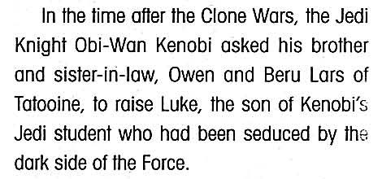

## Essential Guide to Characters (1995)

What it shows (our notes): Luke learned two other valuable lessons. Once, when Yoda had him practice levitation, Skywalker was distracted when his X-wing sank in the bog, and he gave in to despair. Yoda ordered him to use the same levitation powers to raise his ship. Luke said he’d try, but was cut off curtly by Yoda. “No! Try not. Do. Or do not. There is no try.”
> “No. Try not. Do. Or do not. There is no try.”
>
> You take a deep breath. Focus on the ship. You reach out your hand and grip the ship with your mind. It is enormous.
— Source: The Essential Guide to Characters (Andy Mangels, Del Rey, 1995), printed p.192, scan p.201.
(Excerpt widened 2026-11-17 to the relevant passage, word for word from Star Wars: The Empire Strikes Back: So You Want to Be a Jedi? (Adam Gidwitz) (text copy `MEGA_New_Canon_Young_Adult_Novelizations_Star_Wars_The_Empire_Strikes_Back_So_You_Want_to_Be_a_Jedi_Adam_Gidwitz_epub`).)
Our notes: `notes/materials/147-essential-guide-to-characters-1995/egc-qwi-through-zuckuss-bib.md`
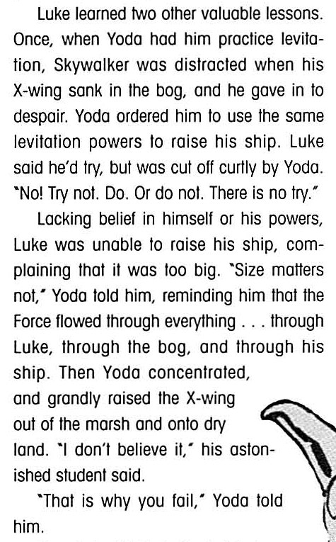

> His failure is now complete. If
>
> you
>
> will not turn to the dark side then perhaps
>
> she
>
> will.’
>
> “I’ll never turn to the dark side. You’ve failed, Your Highness. I am a Jedi, like my father before me.”
— Source: The Essential Guide to Characters (Andy Mangels, Del Rey, 1995), printed p.125, scan p.134. Printed wording is "would join him." The 1995 guide's telling, not a power feat..
(Excerpt widened 2026-11-17 to the relevant passage, word for word from Star Wars: Return of the Jedi: Beware the Power of the Dark Side! (Tom Angleberger) (text copy `MEGA_New_Canon_Young_Adult_Novelizations_Star_Wars_Return_of_the_Jedi_Beware_the_Power_of_the_Dark_Side_Tom_Angleberger_epub`).)
(Full sentence/passage taken from the source text on file: `novels_tmp_lucas_bts_jim_smith_epub`.)
Note (our notes, around the quote): Then, Vader and Palpatine both gained access to Luke's innermost thoughts, those that protected his sister, Princess Leia Organa. "If you will not turn to the dark side, then perhaps she will," Vader threatened. It was the catalyst that broke Luke's Jedi calm. He ferociously attacked Vader, chopping at him with dazzling lightsaber attacks. And then, when Vader's hand was cut off and the Dark Lord was helpless, Luke confronted the Emperor, announcing, "You've failed, Your Highness. I am a Jedi, like my father before me."
Our notes: `notes/materials/147-essential-guide-to-characters-1995/egc-mon-mothma-through-sivrak.md`
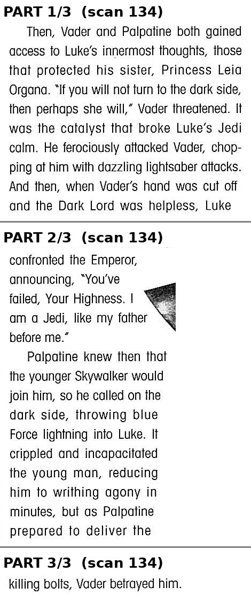

- Note (summary from our notes, not a quotation): As they focused their will into a single entity of the Force, the spirits of Luke and Vodo-Siosk Baas appeared to aid them. The combined powers and energies of the Jedi extinguished the dark light of Kun's spirit.
  — Source: The Essential Guide to Characters (Andy Mangels, Del Rey, 1995), printed p.99, scan p.108.
Our notes: `notes/materials/147-essential-guide-to-characters-1995/egc-exar-kun.md`
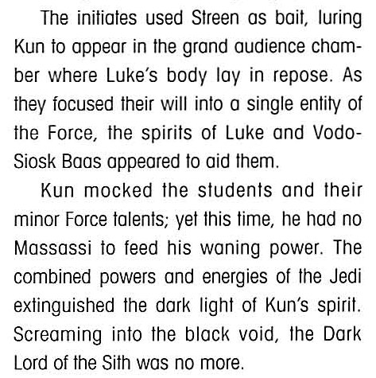

- Note (summary from our notes, not a quotation): Back at the Rebel base on Coruscant, Luke Skywalker tested Kyp's Jedi power potential. What he discovered was the strongest Force presence he had known since his Masters, Obi-Wan Kenobi and Yoda. Luke invited Kyp to join him as a Jedi trainee on the moon of Yavin Four.
  — Source: The Essential Guide to Characters (Andy Mangels, Del Rey, 1995), printed p.51, scan p.060. The 1995 guide's telling, not a power-feat ranking..
Our notes: `notes/materials/147-essential-guide-to-characters-1995/egc-cbaoth-end-through-kyp.md`
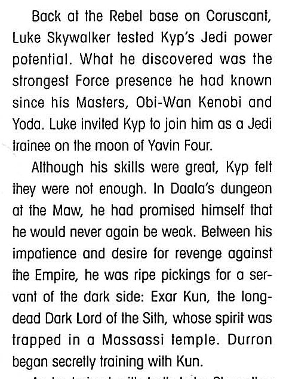

> The distances separating us have become too great for me to appear to you in any other way. Now, even that path is closed to me,
> [fragment — full passage not on file]
>
> The vision seemed to waver and become fainter. “And now, farewell,” Ben said, as if he hadn’t heard the question. “I loved you as a son, and as a student, and as a friend. Until we meet again, may the Force be with you.”
>
> the first of the new.
> [fragment — full passage not on file]
— Source: The Essential Guide to Characters (Andy Mangels, Del Rey, 1995), printed p.93, scan p.102. The 1995 guide's telling, not a power feat..
(Excerpt widened 2026-11-17 to the relevant passage, word for word from Heir to the Empire (Timothy Zahn) (text copy `MEGA_Legend_The_Thrawn_Trilogy_Star_Wars_Thrawn_Trilogy_01_Heir_to_the_Empire_20th_Anniversary_Edition_Timothy_Zahn_epub`).)
Note (our notes, around the quote): The final time Luke saw his mentor was in the Imperial Palace on Coruscant—once the throne of the Empire. Ben appeared to him as he slept, though Kenobi assured Luke he was not a dream. "The distances separating us have become too great for me to appear to you in any other way. Now, even that path is closed to me," he added. Obi-Wan bid the young Jedi good-bye, adding, "I loved you as a son, and as a student, and as a friend. Until we meet again, may the Force be with you." And then, as he disappeared forever, he told Luke to think of himself not as the last of the Jedi, but "the first of the new."
Our notes: `notes/materials/147-essential-guide-to-characters-1995/egc-jerriko-through-kneesaa.md`
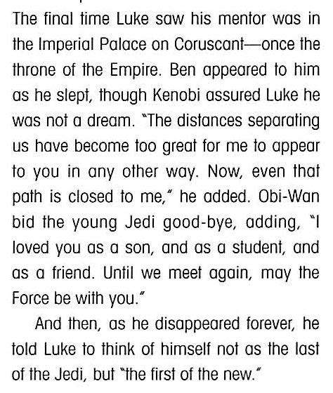

> I am your father,
> [fragment — full passage not on file]
>
> Search your feelings. You know it to be true.
— Source: The Essential Guide to Characters (Andy Mangels, Del Rey, 1995), printed p.140, scan p.149. The 1995 guide's telling, not a power feat..
Note (our notes, around the quote): But the worst was yet to come, as Vader told him the truth of his past that Ben Kenobi had hidden from him: "I am your father," he said solemnly. "Search your feelings. You know it to be true." Vader told Luke that they could overthrow the Emperor and rule the galaxy together as father and son. Luke didn't even reply. Looking sadly at the monster his father had become, he calmly stepped off the platform and fell.
Our notes: `notes/materials/147-essential-guide-to-characters-1995/egc-luke-through-thrawn.md`
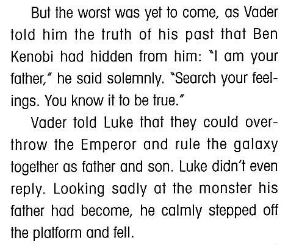

- Note (summary from our notes, not a quotation): But the evil spirit of Dark Lord of the Sith Exar Kun was trapped on Yavin Four. Kun first tempted Gantoris, but the student turned on him and was killed. Later, Kyp Durron would be seduced by Kun's promises of power. The boy helped the Dark Lord attack Luke, leaving the Jedi Master's body comatose. Luke's spirit survived in the same netherworld Exar Kun's shade inhabited. Luke soon found out that Kun had become adept at using the dark side of the Force to influence the living world. Over the following weeks, Kun used his powers to try to destroy Luke's body, but it was protected by the Jedi initiates, Leia, and her two Force-strong twin children, Jacen and Jaina. Finally, the initiates lured Exar Kun to appear in the grand audience chamber where Luke's body lay in repose. Joined by Jacen and Jaina, they focused their will into a single entity of the Force, and Luke's spirit appeared to aid them, as did Vodo-Siosk Baas's spirit. Their combined powers and energies of the Jedi extinguished Kun's dark light.
  — Source: The Essential Guide to Characters (Andy Mangels, Del Rey, 1995), printed p.142, scan p.151. The 1995 guide's telling, not a power feat..
Our notes: `notes/materials/147-essential-guide-to-characters-1995/egc-luke-through-thrawn.md`
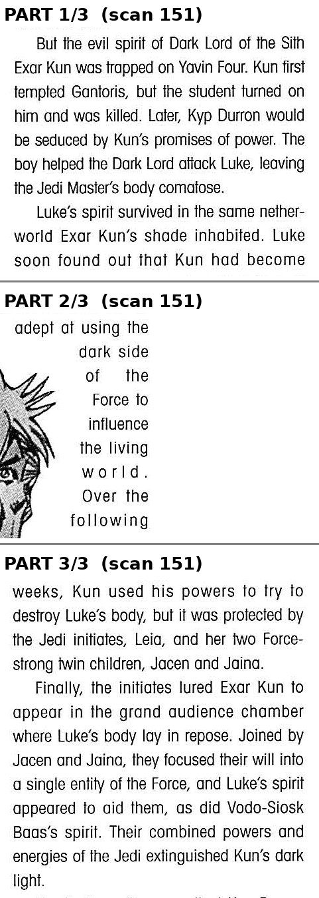

> “I’ll never turn to the dark side. You’ve failed, Your Highness. I am a Jedi, like my father before me.”
— Source: The Essential Guide to Characters (Andy Mangels, Del Rey, 1995), printed p.140, scan p.149. The 1995 guide's telling, not a power feat..
(Excerpt widened 2026-11-17 to the relevant passage, word for word from Star Wars: Return of the Jedi: Beware the Power of the Dark Side! (Tom Angleberger) (text copy `MEGA_New_Canon_Young_Adult_Novelizations_Star_Wars_Return_of_the_Jedi_Beware_the_Power_of_the_Dark_Side_Tom_Angleberger_epub`).)
Note (our notes, around the quote): Turning his back on the crippled Dark Lord, Luke confronted the Emperor, "You've failed, Your Highness. I am a Jedi, like my father before me." Palpatine attacked Luke with blue Force lightning, knowing that the younger Skywalker would never join him. But as Palpatine prepared to deliver the killing bolts, Vader rose up from behind, lifted his Master into the air, and threw him into the burning shaft of the power core. Vader tried to follow him into oblivion, but Luke stopped him.
Our notes: `notes/materials/147-essential-guide-to-characters-1995/egc-luke-through-thrawn.md`
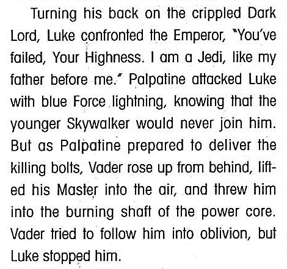

> I am your father. Search your feelings. You know it to be true.
— Source: The Essential Guide to Characters (Andy Mangels, Del Rey, 1995), printed p.179, scan p.188. The 1995 guide's telling, not a power feat. This wording is the gantry account, not the printed p.140 "he said solemnly" account..
Note (our notes, around the quote): Vader finally drove Luke out onto a gantry above a reactor shaft and distracted him long enough to slice off his right hand. Defenseless and in shock, Luke could only scream denials as Vader revealed, "I am your father. Search your feelings. You know it to be true."
Our notes: `notes/materials/147-essential-guide-to-characters-1995/egc-tigris-through-winter.md`
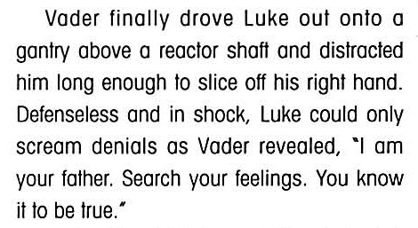

- Note (summary from our notes, not a quotation): On one fateful day at the cantina, Ponda Baba picked the wrong person to harass. Drunk, Baba shoved young Luke Skywalker. When Luke tried to smooth matters, Dr. Evazan threatened him, bragging that he had the death sentence in twelve systems. “I’ll be careful,” Luke said. “You’ll be dead,” Evazan snarled, not noticing the brown-robed old man who had appeared next to the young farm boy. The man, Obi-Wan Kenobi, attempted to calm Baba and Evazan. When the duo attacked anyway, Obi-Wan ignited his lightsaber, slicing Evazan’s chest and cutting off Baba’s right arm at the elbow joint.
  — Source: The Essential Guide to Characters (Andy Mangels, Del Rey, 1995), printed p.11, scan p.020. The 1995 guide's telling, not a power feat..
Our notes: `notes/materials/147-essential-guide-to-characters-1995/egc-bodo-through-cbaoth.md`
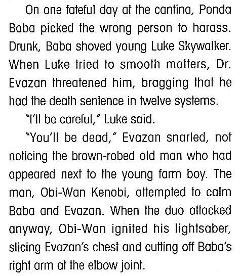

> “For I have foreseen that Mara Jade will kneel before me,” C’baoth reminded her. “One Mara Jade … or another.”
>
— Source: The Essential Guide to Characters (Andy Mangels, Del Rey, 1995), printed p.29, scan p.038. The 1995 guide's telling, not a power feat..
(A fragment line was removed 2026-11-17: its words appear word for word inside the full excerpt in this entry.)
(Fragment completed 2026-11-17 with the full excerpt, word for word from The Last Command (Timothy Zahn) (text copy `MEGA_Legend_The_Thrawn_Trilogy_Star_Wars_Thrawn_Trilogy_03_The_Last_Command_Timothy_Zahn_epub`).)
(Excerpt widened 2026-11-17 to the relevant passage, word for word from The Last Command (Timothy Zahn) (text copy `MEGA_Legend_The_Thrawn_Trilogy_Star_Wars_Thrawn_Trilogy_03_The_Last_Command_Timothy_Zahn_epub`).)
(Fragment completed 2026-11-17: full sentence/passage matched word for word in the source text on file: `MEGA_Legend_The_Thrawn_Trilogy_Star_Wars_Thrawn_Trilogy_03_The_Last_Command_Timothy_Zahn_epub`.)
Note (our notes, around the quote): C’Baoth lost control, his dark-Force powers raging against the Jedi and Jedi-to-be. He attacked Luke and Mara using blue lightning and collapsed rubble from the ceiling, planning to replace the clone of Luke and grow another clone of Mara Jade. “I have foreseen that Mara Jade will kneel before me,” he said. “One Mara Jade . . . or another.” Mara freed herself first, charging C’Baoth with Leia’s lightsaber. She used it to deflect his corona of lightning, but was overcome by a blinding hail of rocks. Leia, who had accompanied them, linked her mind with Mara’s, allowing her to see where she was going. Exhausted and in pain, Luke used the Force to free the savage vornskrs that were leashed nearby. The growling creatures ran for Joruus, distracting the evil clone and his magics. Mara Jade charged and killed C’Baoth with a thrust of the lightsaber. Joruus C’Baoth was finally and truly dead.
Our notes: `notes/materials/147-essential-guide-to-characters-1995/egc-bodo-through-cbaoth.md`
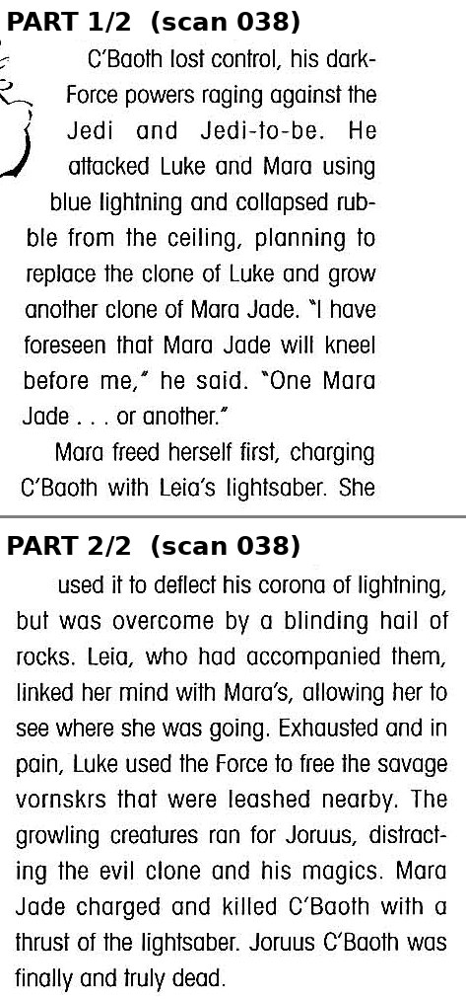

- Note (summary from our notes, not a quotation): Finally, Mara would face her destiny. During a mission that took them to Wayland to destroy the Emperor’s Spaarti cloning cylinders, Luke trained Mara in her slowly returning Force talents. Joruus C’Baoth called both Luke and Mara to him, intending to turn them to the dark side. When it became clear he couldn’t turn Luke, he unleashed his own clone of the hero, calling it Luuke Skywalker. In the battle to follow, Mara killed the Luuke clone, and with help from Luke and Leia Organa Solo, she slew C’Baoth, as well. She had done what the Emperor’s compulsion commanded her. She finally felt free.
  — Source: The Essential Guide to Characters (Andy Mangels, Del Rey, 1995), printed p.83, scan p.092. The 1995 guide's telling, not a power feat..
Our notes: `notes/materials/147-essential-guide-to-characters-1995/egc-greedo-through-mara.md`
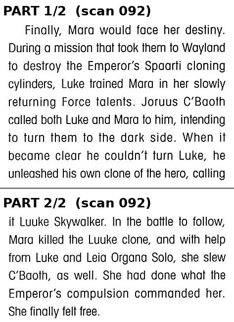

- Note (summary from our notes, not a quotation): Aves coordinates Karrde’s operatives and offers advice. Chin, a middle-aged Myrkr native, handles and trains Karrde’s pet vornskrs, Sturm and Drang. Chin also harvests the mysterious Force dampeners known as ysalamiri. Dankin, Fynn Torve, and Wadewarn are three of Karrde’s best freighter pilots. Ghent is a barely-above-teens slicer with tremendous knowledge of computers, droids, and access codes.
  — Source: The Essential Guide to Characters (Andy Mangels, Del Rey, 1995), printed pp.88–89, scans p.097–098. The 1995 guide's telling, not a power feat..
Our notes: `notes/materials/147-essential-guide-to-characters-1995/egc-jerriko-through-kneesaa.md`
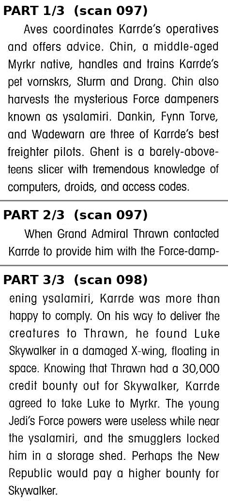

> Only what you take with you.
— Source: The Essential Guide to Characters (Andy Mangels, Del Rey, 1995), printed p.139, scan p.148. This wording is the printed p.139 account. The printed p.192 levitation account stays on its own line. The 1995 guide's telling, not a power feat..
Note (our notes, around the quote): It was then that he found out the diminutive being was Yoda. The Jedi Master discussed Luke’s future with the spirit of Kenobi, then commenced training Luke immediately. He lectured him about the Force while Luke performed rigorous physical and psychological exercises, warning him against the easy path of anger and the lure of the dark side. One of Luke’s most difficult tests was when Yoda told him to go into a tree suffused with dark-side energy. When Luke asked what was inside, the enigmatic Master said, “Only what you take with you.”
Our notes: `notes/materials/147-essential-guide-to-characters-1995/egc-luke-through-thrawn.md`
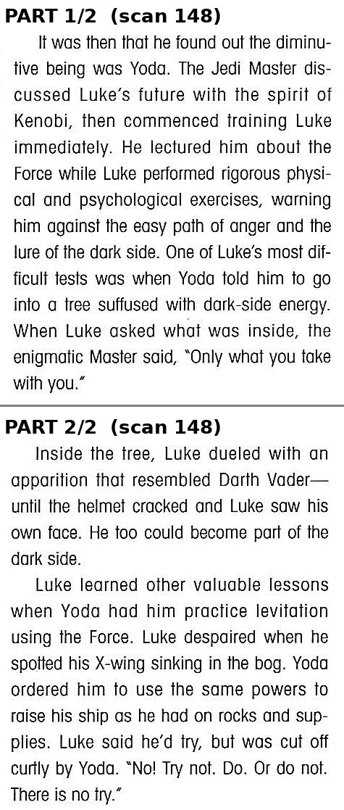

- Note (summary from our notes, not a quotation): Surviving Imperial forces drove the New Republic off Coruscant; its temporary headquarters were established on the Fifth Moon of Da Soocha in the Cyax system. Lando, Wedge, and Luke attacked Coruscant, but their ship crashed. Although the others escaped in the Falcon, Luke allowed himself and Artoo to be sucked up into a crackling blue Force storm. It transported him to an Imperial dungeon ship, which, in turn, took him to Byss. There, he was surprised to find the clone of Emperor Palpatine, alive and willing to teach him.
  — Source: The Essential Guide to Characters (Andy Mangels, Del Rey, 1995), printed p.141, scan p.150. The 1995 guide's telling, not a power feat..
Our notes: `notes/materials/147-essential-guide-to-characters-1995/egc-luke-through-thrawn.md`
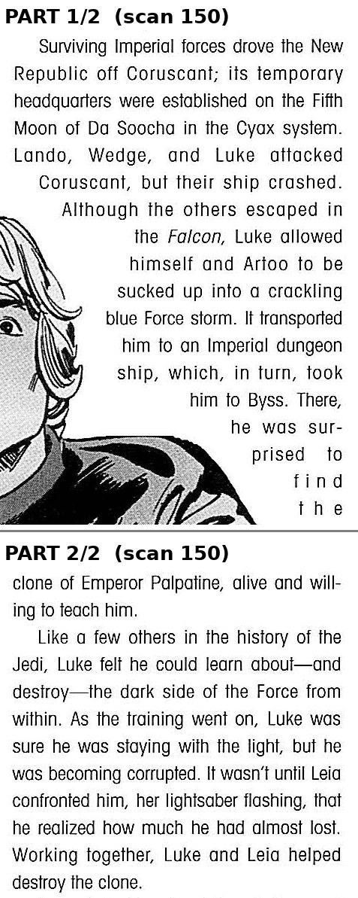

> The vision seemed to waver and become fainter. “And now, farewell,” Ben said, as if he hadn’t heard the question. “I loved you as a son, and as a student, and as a friend. Until we meet again, may the Force be with you.”
>
> the first of the new.
> [fragment — full passage not on file]
— Source: The Essential Guide to Characters (Andy Mangels, Del Rey, 1995), printed p.141, scan p.150. This printed page's wording differs from the printed p.93 account, which stays on its own line. The 1995 guide's telling, not a power feat..
(Excerpt widened 2026-11-17 to the relevant passage, word for word from Heir to the Empire (Timothy Zahn) (text copy `MEGA_Legend_The_Thrawn_Trilogy_Star_Wars_Thrawn_Trilogy_01_Heir_to_the_Empire_20th_Anniversary_Edition_Timothy_Zahn_epub`).)
Note (our notes, around the quote): Luke saw his earlier mentor for the final time in the Imperial Palace on Coruscant. Ben appeared to him as he slept, warning him that the pathways were closing for the fading Jedi. He assured Luke that he was a powerful Jedi, and a hope for the future. Obi-Wan then bid him good-bye, adding, “I loved you as a son, and as a student, and as a friend. Until we meet again, may the Force be with you.” Then, as he disappeared forever, he told Luke to think of himself not as the last of the Jedi, but “the first of the new.”
Our notes: `notes/materials/147-essential-guide-to-characters-1995/egc-luke-through-thrawn.md`
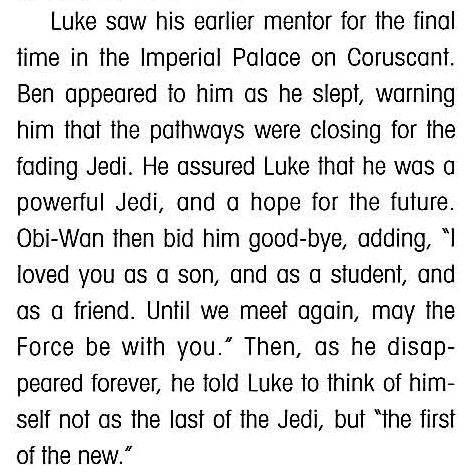

> You are the first of the new Jedi Knights. You are the core of what will become a great order to protect the New Republic. You are champions of the Force.
— Source: The Essential Guide to Characters (Andy Mangels, Del Rey, 1995), printed p.170, scan p.179. The 1995 guide's telling, not a power feat. This is not the printed p.93 "first of the new" sentence..
Note (our notes, around the quote): Shortly thereafter, Luke Skywalker addressed his students. “You are the first of the new Jedi Knights. You are the core of what will become a great order to protect the New Republic. You are champions of the Force.”
Our notes: `notes/materials/147-essential-guide-to-characters-1995/egc-tigris-through-winter.md`
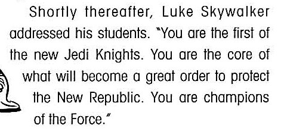

- Note (summary from our notes, not a quotation): Luke was not lost to the dark side, and the following year he returned to Dagobah, as he had sworn to do. But he found that Yoda was dying. Yet the diminutive Jedi Master joked that Luke would not look nearly so good at nine hundred years old.
  — Source: The Essential Guide to Characters (Andy Mangels, Del Rey, 1995), printed p.192, scan p.201. The 1995 guide's telling, not a power feat..
Our notes: `notes/materials/147-essential-guide-to-characters-1995/egc-qwi-through-zuckuss-bib.md`
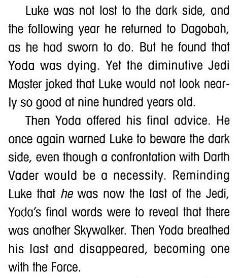

## Essential Guide to Droids (1999)

- Note (summary from our notes, not a quotation): Commander Luke Skywalker, who used the Force to touch several of these trapped minds during the historic truce at Bakura, reports that the process is painful, degrading, and utterly abominable.
  — Source: The Essential Guide to Droids (Daniel Wallace, Del Rey, 1999), printed p.174, scan p.099.
Our notes: `notes/materials/151-essential-guide-to-droids-1999/body/18-security.md`
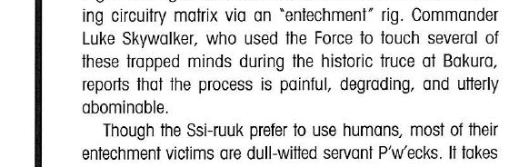

- Note (summary from our notes, not a quotation): Although he was filled with unreasoning fear, Dorsk 81 joined the other trainees in luring Kun into the room where Skywalker's body lay, there surrounding him. Kun attempted to prey on their weaknesses to escape, noting Dorsk's sense of failure to his people. However, Dorsk had learned from Luke that his differences made him stronger. Using their combined powers the students destroyed Exar Kun for all time, and freed Luke's spirit.
  — Source: The Essential Guide to Characters (Andy Mangels, Del Rey, 1995), printed p.49, scan p.058. The 1995 guide's telling, not a power feat..
Our notes: `notes/materials/147-essential-guide-to-characters-1995/egc-cbaoth-end-through-kyp.md`
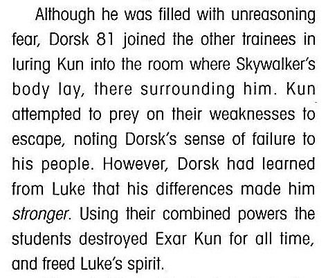

## Essential Guide to Planets and Moons (1998)

> “Well, if there’s a bright center to the universe, you’re on the planet that it’s farthest from.”
>
> “I see, sir,” C-3PO said, sounding disappointed.
— Source: The Essential Guide to Planets and Moons (Daniel Wallace, Del Rey, 1998), printed p.176, scan p.190.
(Excerpt widened 2026-11-17 to the relevant passage, word for word from Star Wars®: Episode IV: A New Hope™ (by Ryder Windham, created by George Lucas) (text copy `MEGA_The_Episode_Junior_Novelizations_Star_Wars_Episode_IV_A_New_Hope_Junior_Novelization_Ryder_Windham_epub`).)
Our notes: `notes/materials/150-essential-guide-to-planets-and-moons-1998/egpm-talus-through-tatooine.md`
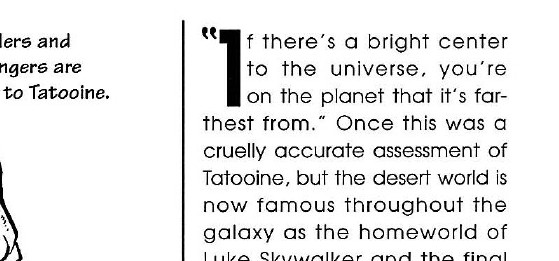

## Essential Guide to Vehicles and Vessels (1996)

- Note (summary from our notes, not a quotation): As Grand Admiral Thrawn prepared for his campaign against the New Republic, he conducted a systematic upgrade of the Chariot and other aging repulsorcraft. The Chariot's laser cannon was replaced with a more powerful swivel gun. Thrawn used a command speeder to coordinate his search for Luke Skywalker and Mara Jade in the dense forests of Myrkr, at least until that command speeder was crushed in the town square of Hyllyard City when Luke Skywalker toppled a ten-meter-tall stone arch on top of it.
  — Source: The Essential Guide to Vehicles and Vessels (Bill Smith, Del Rey, 1996), printed p.18, scan p.028. The guide does not say Thrawn was aboard the speeder, and it does not mention an injury. This is the guide's telling, not a power feat..
Our notes: `notes/materials/148-essential-guide-to-vehicles-vessels-1996/egvv-chariot-through-enforcer.md`
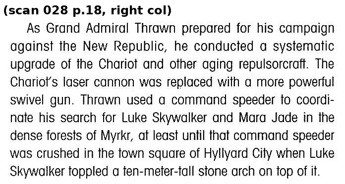

> What a piece of junk!
> [fragment — full passage not on file]
— Source: The Essential Guide to Vehicles and Vessels (Bill Smith, Del Rey, 1996), printed p.114, scan p.076.
Note (our notes, around the quote): "What a piece of junk!" Luke Skywalker couldn't hold in his reaction upon first seeing the Millennium Falcon, the battered freighter that was somehow to transport him, Obi-Wan Kenobi, and the droids R2-D2 and C-3PO from Tatooine to the planet Alderaan. Luke doubted that the ship would be able to lift off from Docking Bay 94, much less make it halfway across the galaxy.
Our notes: `notes/materials/148-essential-guide-to-vehicles-vessels-1996/egvv-lancer-through-moncal.md`
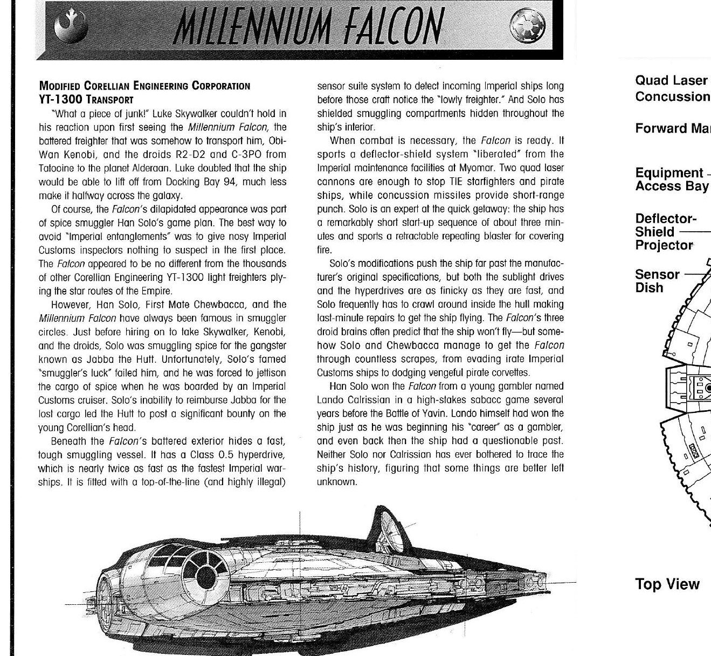

- Note (summary from our notes, not a quotation): Jabba the Hutt used a number of Ubrikkian Bantha II cargo skiffs as patrol and escort vehicles for his sail barge. While they were armor-plated, they were still unsuited to combat, as Luke Skywalker quickly proved. Jabba had had extendable gangplanks affixed to the skiffs to increase the entertainment value of his Sarlacc feedings. After the rescue of Han Solo, Luke Skywalker and other Rebel heroes used one of Jabba's skiffs to escape from the Great Pit of Carkoon even as Jabba's sail barge exploded spectacularly.
  — Source: The Essential Guide to Vehicles and Vessels (Bill Smith, Del Rey, 1996), printed p.40, scan p.039. The printed wording is "Jabba had had." The crop does not say who rescued Han Solo or how. This is the guide's telling, not a power feat..
Our notes: `notes/materials/148-essential-guide-to-vehicles-vessels-1996/egvv-chariot-through-enforcer.md`
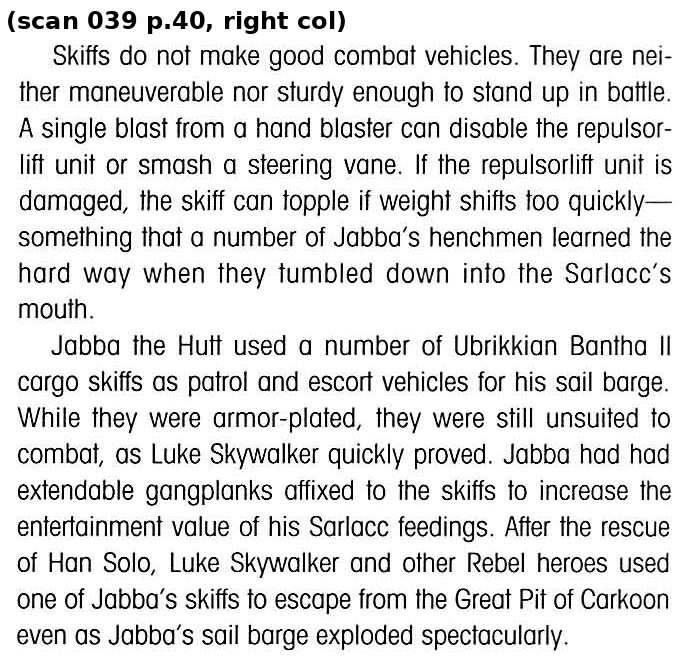

## The Essential Chronology (2000)

- Note (summary from our notes, not a quotation): Master Luke Skywalker's new Jedi Knights have become the galaxy's patrol officers, but Skywalker now sees a need to oversee the Jedi. Consequently, he is seeking approval to reestablish the Jedi Council, which would unite twelve leading Jedi into a governing body not seen since the days of the Old Republic.
  — Source: The Essential Chronology (Kevin J. Anderson and Daniel Wallace, Del Rey, 2000), printed p.165, scan p.180. Secondary chronology, not the primary scene and not a power feat. The left column of this crop stops mid-sentence; those fragments are not quoted..
Our notes: `notes/materials/152-essential-chronology-2000/body/11-afterword-map-timeline-index.md`
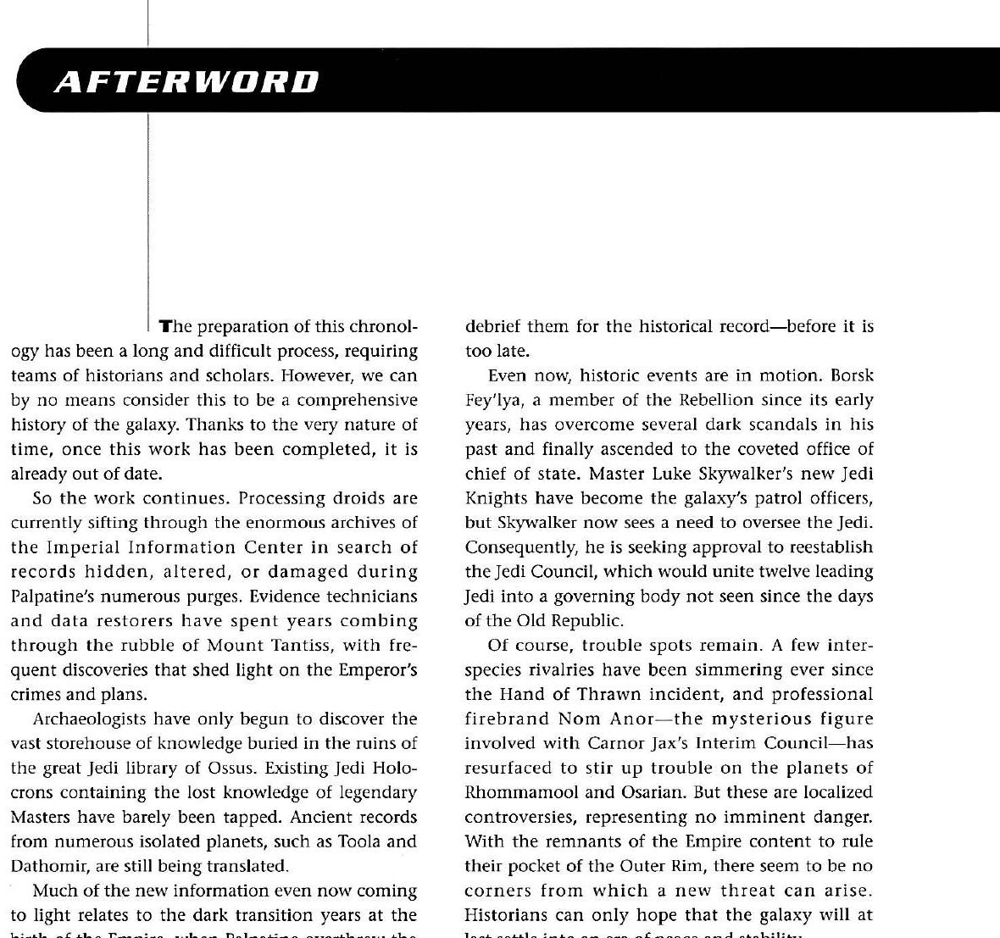

## The New Essential Guide to Vehicles and Vessels (2003)

> That armor's too strong for blasters. Rogue Group, use your harpoons and tow cables. Go for the legs. It might be our only chance of stopping them.
— Source: The New Essential Guide to Vehicles and Vessels (W. Haden Blackman, Del Rey, 2003), printed p.133, scan p.155..
Note (our notes, around the quote): "That armor's too strong for blasters. Rogue Group, use your harpoons and tow cables. Go for the legs. It might be our only chance of stopping them." —Commander Luke Skywalker.
Our notes: `notes/materials/154-new-essential-guide-to-vehicles-vessels-2003/quotes/QUOTES-INDEX.md`
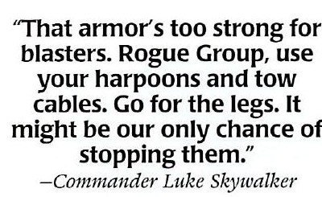

# CANON (Disney canon — kept separate)

## The Complete Star Wars Encyclopedia, Vol. II (H–O)

> With morale crushed after the abandonment of Echo Base and the capture of Han Solo, the Rebels faced the unthinkable possibility that Luke Skywalker had killed a fellow Rebel pilot.
— Source: scan pages 241–280; Han Solo; Luke Skywalker.
Note (our notes, around the quote): Han Solo; Luke Skywalker: "With morale crushed after the abandonment of Echo Base and the capture of Han Solo, the Rebels faced the unthinkable possibility that Luke Skywalker had killed a fellow Rebel pilot." Source: The Complete Star Wars Encyclopedia, Vol. II, p.265
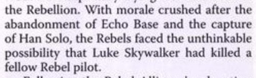
Our notes: `notes/materials/031-complete-star-wars-encyclopedia-vol-2/06-v2-scan-241-280.md:274`

## The Complete Star Wars Encyclopedia, Vol. III (P–Z)

> Later the Tarkin was destroyed by an elite team of Rebels that included Luke Skywalker, Leia Organa, Chewbacca, C-3PO, and R2-D2.
— Source: scan pages 201–240; Grand Moff Tarkin; Luke Skywalker; Leia Organa Solo; Chewbacca.
Note (our notes, around the quote): Grand Moff Tarkin; Luke Skywalker; Leia Organa Solo; Chewbacca: "Later the Tarkin was destroyed by an elite team of Rebels that included Luke Skywalker, Leia Organa, Chewbacca, C-3PO, and R2-D2." Source: The Complete Star Wars Encyclopedia, Vol. III, p.220
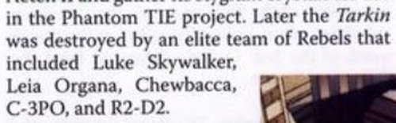
Our notes: `notes/materials/032-complete-star-wars-encyclopedia-vol-3/05-v3-scan-201-240.md:237`

## The New Essential Guide to Characters (2002)

> When his underlings captured Luke Skywalker and Princess Leia on Mimban, Vader rushed to the world and engaged both Rebels in combat, but the spirit of Obi-Wan Kenobi, fighting through Skywalker, defeated Vader and cut through his mechanical right arm.
— Source: scan pages 121–150.
Note (our notes, around the quote): Luke Skywalker; Leia Organa Solo; Darth Vader (Anakin Skywalker); Obi-Wan Kenobi: "When his underlings captured Luke Skywalker and Princess Leia on Mimban, Vader rushed to the world and engaged both Rebels in combat, but the spirit of Obi-Wan Kenobi, fighting through Skywalker, defeated Vader and cut through his mechanical right arm." Source: The New Essential Guide to Characters, p.157
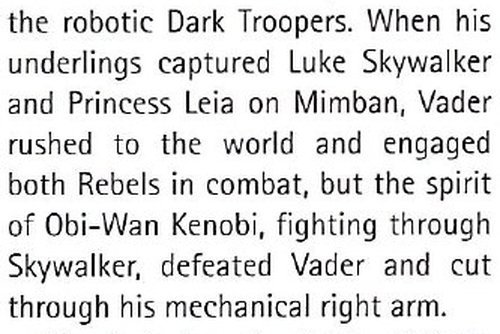
Our notes: `notes/materials/034-new-essential-guide-to-characters/04-negc-scan-121-150.md:185`

## Sourcebooks/Star Wars Roleplaying Game Core Rulebook.pdf [Star Wars Roleplaying Game (d20, 2000)] (scan pages 181–240)

> Darth Vader, searching the galaxy for the Rebels and Luke Skywalker, the Rebel pilot who almost single-handedly destroyed the Death Star, came to Bespin, bringing with him a platoon of stormtroopers and a bounty hunter named Boba Fett.
— Source: Sourcebooks/Star Wars Roleplaying Game Core Rulebook.pdf [Star Wars Rolep; Darth Vader (Anakin Skywalker); Luke Skywalker; Boba Fett.
Note (our notes, around the quote): Darth Vader (Anakin Skywalker); Luke Skywalker; Boba Fett: "Darth Vader, searching the galaxy for the Rebels and Luke Skywalker, the Rebel pilot who almost single-handedly destroyed the Death Star, came to Bespin, bringing with him a platoon of stormtroopers and a bounty hunter named Boba Fett." Source: *Star Wars Roleplaying Game Core Rulebook* (SWRPG d20), scan p.238
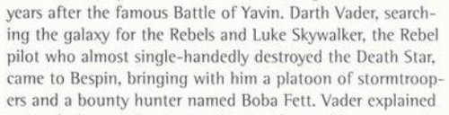
Our notes: `notes/materials/037-sw-d20-folder/046-star-wars-roleplaying-game-core-rulebook-scan-181-240.md:409`

## Star Wars Gamer/Star Wars Gamer 07.pdf [Star Wars Roleplaying Game (d20, 2000)] (scan pages 61–108)

> Luke Skywalker, Rogue Squadron's commander, has already been shot down, Only Wedge Antilles, a Corellian space jockey who survived the attack on the first Death Star, can slow the Imperial advance long enough for the Rebels to escape.
— Source: Star Wars Gamer/Star Wars Gamer 07.pdf [Star Wars Roleplaying Game (d20,; Luke Skywalker. POV: Luke Skywalker.
Note (our notes, around the quote): Luke Skywalker: "Luke Skywalker, Rogue Squadron's commander, has already been shot down, Only Wedge Antilles, a Corellian space jockey who survived the attack on the first Death Star, can slow the Imperial advance long enough for the Rebels to escape." Source: *Star Wars Gamer 07* (SWRPG d20), scan p.94

Our notes: `notes/materials/037-sw-d20-folder/056-star-wars-gamer-07-scan-061-108.md:222`

## Adventures/Rough And Tundra.pdf [Star Wars Roleplaying Game Revised Core (d20, 2002)]

> Given the number of CorSec, Imperial, CSA, and private agents looking for Salmakk, Hoth was a good place to lay low. All the while, Salmakk kept abreast of galactic events. He learned of the price Jabba had put on Solo’s head, the destruction of Alderaan, and of the Rebel victory and Yavin. Imagine his surprise when Solo himself appeared on Hoth a short time later! After his encounter with the Rebels, Salmakk and his crew spent nearly two standard days digging themselves out of the cave-in Solo and Skywalker created to trap them. Once free, he and his crew fled the Hoth system for good, but not the sector. And when the legendary Mugaari pirate Clabburn contacted him as a potential partner, he knew lady luck was still on his side. Salmakk: Male Mon Calamari Scoundrel 8/Soldier 4; Init +6; Defense 22 (+10 class, +2 Dex); Spd 10 m; VP/WP 77/11; Atk +11/+6 melee (2d6+1, vibroblade), +12/+7 ranged (3d8, heavy blaster pistol); SQ amphibious, illicit barter, low-light vision, lucky 2/day, natural astrogator, precise attack +1, sector familiarity x2, uncanny dodge; SV Fort +7, Ref +9, Will +2; FP 0; DSP 2; Rep +6; Str 12, Dex 15, Con 8, Int 14, Wis 10, Cha 10. Challenge Code F. Equipment: Vibroblade, heavy blaster pistol, freighter (Salted Wound).
— Source: Adventures/Rough And Tundra.pdf [Star Wars Roleplaying Game Revised Core.
(Excerpt widened 2026-11-17 to the relevant passage, word for word from research primary sw d20 folder files Star Wars Roleplaying Game Revised Core Adventures Rough And Tundra (text copy `research_primary_sw_d20_folder_files_Star_Wars_Roleplaying_Game_Revised_Core_Adventures_Rough_And_Tundra_pdf_0c241f9999`).)
(Excerpt widened 2026-11-17 to the relevant passage, word for word from research primary sw d20 folder files Star Wars Roleplaying Game Revised Core Adventures Rough And Tundra (text copy `research_primary_sw_d20_folder_files_Star_Wars_Roleplaying_Game_Revised_Core_Adventures_Rough_And_Tundra_pdf_0c241f9999`).)
Note (our notes, around the quote): Han Solo; Luke Skywalker — entry/section: Solo and Skywalker trap Salmakk's pirates on Hoth: "After his encounter with the Rebels, Salmakk and his crew spent nearly two standard days digging themselves out of the cave-in Solo and Skywalker created to trap them. Once free, he and his crew fled the Hoth system for good, but not the sector. And when the legendary Mugaari pirate Clabburn contacted him as a potential partner, he knew lady luck was still on his side." Source: *Rough And Tundra* (SWRPG d20 Revised Core), scan p.4

Our notes: `notes/materials/037-sw-d20-folder/075-rough-and-tundra.md:27`

## Jedi Counselling/Jedi Counseling 17 - Killing Coruscant.pdf [Star Wars Roleplaying Game Revised Core (d20, 2002)]

> The aftermath of Hoth scattered the Rebels, and Luke was stationed at temporary bases on Golrath and Arbra. Ascending to the command of Rogue Squadron, Luke fell in love with one of his squadronmates, the talented and enigmatic Shira Brie. During a heated battle, Luke's targeting computer was knocked out of commission, and he instead relied on the Force to pick his targets. Inexplicably, the Force told him to fire on a friendly vessel, and he shot Shira Brie out of the sky.
— Source: Jedi Counselling/Jedi Counseling 17 - Killing Coruscant.pdf [Star Wars Ro.
Note (our notes, around the quote): Luke Skywalker; Lumiya — entry/section: Luke fires on Shira Brie (question): "Q: I was recently reading about Luke Skywalker at www.starwars.com and noticed something interesting in the middle of the page: "The aftermath of Hoth scattered the Rebels, and Luke was stationed at temporary bases on Golrath and Arbra. Ascending to the command of Rogue Squadron, Luke fell in love with one of his squadronmates, the talented and enigmatic Shira Brie. During a heated battle, Luke's targeting computer was knocked out of commission, and he instead relied on the Force to pick his targets. Inexplicably, the Force told him to fire on a friendly vessel, and he shot Shira Brie out of the sky." That brings us to my question: What type of Force skill and/or feat did he use?" Source: *Jedi Counseling 17 - Killing Coruscant* (SWRPG d20 Revised Core), scan p.2

Our notes: `notes/materials/037-sw-d20-folder/180-jedi-counseling-17-killing-coruscant.md:26`

## Jedi Counselling/Jedi Counseling 18 - Cortosis Bullets.pdf [Star Wars Roleplaying Game Revised Core (d20, 2002)]

- Note (summary from our notes, not a quotation): Luke Skywalker — entry/section: Hunting Luke at the Battle of Yavin (question): "Q: What if you're running a campaign and the "heroes" want to hunt down Luke Skywalker and the gang at the Battle of Yavin? Normally, I'd say it would be okay, but I want to stay true to the Rebellion Era. The characters in question have been Rebels before, but they haven't even met Luke or any of the other famous people in the story. What would you do in a situation like this?" Source: *Jedi Counseling 18 - Cortosis Bullets* (SWRPG d20 Revised Core), scan p.3
  — Source: Jedi Counselling/Jedi Counseling 18 - Cortosis Bullets.pdf [Star Wars Rol.

Our notes: `notes/materials/037-sw-d20-folder/181-jedi-counseling-18-cortosis-bullets.md:26`

## Jedi Counselling/Jedi Counseling 99.pdf [Star Wars Roleplaying Game Revised Core (d20, 2002)]

> He'd have an effective Reputation score of 9 for purposes of this calculation (6 – 2 + 5 = 9). *** Illegal bounties usually pay less because crimelords don't have as much money as Galactic governments; as such, their bounties are generally about half this amount. (Of course, illegal bounties don't require all the licenses and fees described earlier.) If the result of this calculation is less than 500 credits, that character is almost certainly not significant enough to warrant the posting of a bounty. In any event, few bounty hunters would waste their time for such a small reward. This is a rough guideline, and circumstances can change things quite a bit. For example, Luke Skywalker had a bounty on his head for hundreds of thousands of credits despite being of a relatively low level. Of course, a prospective bounty hunter would certainly earn that money. He'd not only have to capture Luke, but also overcome dozens, hundreds, or even thousands of Rebels who stand in his way! Star Wars Miniatures Questions Q: Given that the Mandalorian faction has finally shown up in the Bounty Hunters set, I can't help but wonder why Boba Fett and Jango Fett aren't retroactively considered to be "Mandalorians" (much in the way that all Clone Troopers from Clone Strike were retroactively given Order 66). Shouldn't the fact that Boba and Jango Fett are described as Mandalorian in numerous Expanded Universe sources require that they be given Mandalorian status?
— Source: Jedi Counselling/Jedi Counseling 99.pdf [Star Wars Roleplaying Game Revis; Luke Skywalker — entry/section: Luke Skywalker's bounty.
(Excerpt widened 2026-11-17 to the relevant passage, word for word from research primary sw d20 folder files Star Wars Roleplaying Game Revised Core Jedi Counselling Jedi Counseling 99 (text copy `research_primary_sw_d20_folder_files_Star_Wars_Roleplaying_Game_Revised_Core_Jedi_Counselling_Jedi_Counseling_99_pdf_5f5ad9c03e`).)
(Excerpt widened 2026-11-17 to the relevant passage, word for word from research primary sw d20 folder files Star Wars Roleplaying Game Revised Core Jedi Counselling Jedi Counseling 99 (text copy `research_primary_sw_d20_folder_files_Star_Wars_Roleplaying_Game_Revised_Core_Jedi_Counselling_Jedi_Counseling_99_pdf_5f5ad9c03e`).)
Note (our notes, around the quote): Luke Skywalker — entry/section: Luke Skywalker's bounty: "This is a rough guideline, and circumstances can change things quite a bit. For example, Luke Skywalker had a bounty on his head for hundreds of thousands of credits despite being of a relatively low level. Of course, a prospective bounty hunter would certainly earn that money. He'd not only have to capture Luke, but also overcome dozens, hundreds, or even thousands of Rebels who stand in his way!" Source: *Jedi Counseling 99* (SWRPG d20 Revised Core), scan p.2

Our notes: `notes/materials/037-sw-d20-folder/270-jedi-counseling-99.md:26`

## Sourcebooks/Geonosis and the Outer Rim Worlds.pdf [Star Wars Roleplaying Game Revised Core (d20, 2002)] (scan pages 121–162)

> The scientist Silas Tagge dreamed up a design for a base that would hide in the troposphere of a gas giant and generate a vortex that starfighters could use as a launch corridor, After the Empire dismissed the idea, Baron Orman Tagge committed millions of credits to make his brother's design a reality, naming it after a stealthy forest predator from the Tagge homeworld of Tepasi. Tagge ships towed the station into the Yavin system through a part of the Imperial blockade overseen by a third brother, General Ulric Tagge, and they used the station to harass the Rebels until Luke Skywalker destroyed it in a captured TIE fighter.
— Source: Sourcebooks/Geonosis and the Outer Rim Worlds.pdf [Star Wars Roleplaying.
Note (our notes, around the quote): Silas Tagge; Orman Tagge; Ulric Tagge; Luke Skywalker — entry/section: Achtnak Turbine Station: "The scientist Silas Tagge dreamed up a design for a base that would hide in the troposphere of a gas giant and generate a vortex that starfighters could use as a launch corridor, After the Empire dismissed the idea, Baron Orman Tagge committed millions of credits to make his brother's design a reality, naming it after a stealthy forest predator from the Tagge homeworld of Tepasi. Tagge ships towed the station into the Yavin system through a part of the Imperial blockade overseen by a third brother, General Ulric Tagge, and they used the station to harass the Rebels until Luke Skywalker destroyed it in a captured TIE fighter." Source: *Geonosis and the Outer Rim Worlds* (SWRPG d20 Revised Core), scan p.155

Our notes: `notes/materials/037-sw-d20-folder/667-geonosis-and-the-outer-rim-worlds-scan-121-162.md:278`

## The Lucasfilm Fan Club Magazine #20 (1993)

> The Latest From LucasArts Entertainment Co.
— Source: The Lucasfilm Fan Club Magazine #20 (1993); Page contents: Dan Madsen.
Note (our notes, around the quote): Page contents: Dan Madsen, "The Latest From LucasArts Entertainment Co.": the X-Wing Imperial Pursuit tour of duty (more than 15 missions, set after the Death Star's destruction as the Rebels flee Yavin) and the B-Wing tour of duty (more than 20 missions; the B-wing is described with three laser cannons, three ion cannons and dual proton torpedo launchers; Luke and Leia cameos). Also Sam & Max Hit the Road (Steve Purcell, Sean Clark, Michael Stemmle). Game product copy; S only. (hand-read)
Our notes: `notes/materials/038-star-wars-insider/020-lfc020.md:74`

## Star Wars Insider #111 (2009)

> More Than a Hobbie! *(words: Scott Chernoff)*
> [fragment — full passage not on file]
— Source: Star Wars Insider #111 (2009); Page contents. POV: Page contents, about Luke Skywalker.
Note (our notes, around the quote): Page contents: "More Than a Hobbie!" (words: Scott Chernoff): Corey Burton — Luke on a 1977 record, a Rebel (Hobbie) in ESB, Cad Bane/Ziro/Dooku in TCW. (hand-read)
Our notes: `notes/materials/038-star-wars-insider/111-ins111.md:190`

- Note (summary from our notes, not a quotation): Page contents: Corey Burton cont.: "Recording the Rebels!" — 1979 Disney Read-Along Luke; Hobbie's "I've been hit!" line in ESB; Mark Hamill had him sign the record as "Luke 2". Out-of-universe. (hand-read)
  — Source: Star Wars Insider #111 (2009).
Our notes: `notes/materials/038-star-wars-insider/111-ins111.md:205`

## Star Wars Insider #112 (2009)

- Note (summary from our notes, not a quotation): Page contents: Launch Pad: The Force Unleashed Ultimate Sith Edition (Jedi Temple and Hoth levels vs. Luke) November 3; TCW Season One box set (seven director's cuts, 64-page journal); Filoni and Lucas quotes; Mac/PC versions from Aspyr. Out-of-universe. (hand-read)
  — Source: Star Wars Insider #112 (2009).
Our notes: `notes/materials/038-star-wars-insider/112-ins112.md:45`

## Star Wars Insider #113 (2009)

- Note (summary from our notes, not a quotation): Page contents: "5 Evil Deeds" cont.: 4 The Emperor tricks the Rebels (taunting Luke); 5 Death of Owen and Beru. Editorial ranking, out-of-universe. (hand-read)
  — Source: Star Wars Insider #113 (2009). POV: Page contents, about Luke Skywalker.
Our notes: `notes/materials/038-star-wars-insider/113-ins113.md:180`

## Star Wars Insider #114 (2010)

- Note (summary from our notes, not a quotation): Page contents: Rinzler: unused Joe Johnston Hoth storyboards from spring 1978 left out of The Making of The Empire Strikes Back; Rebels originally attacked walkers in tanks before snowspeeders; Luke's first attack shows blaster-proof armor leading to tow cables; Wedge designated Rogue Junior; walker count not yet fixed. (hand-read)
  — Source: Star Wars Insider #114 (2010).
Our notes: `notes/materials/038-star-wars-insider/114-ins114.md:230`

## Star Wars Insider #119 (2010)

> Mount the tow cable!
> [fragment — full passage not on file]
— Source: Star Wars Insider #119 (2010).
Note (our notes, around the quote): Page contents: TCW team: Matt Lanter (white ice planet Hoth), David Acord (Luke vs. Vader duel lighting and sounds); dream ESB voice roles (Lanter Han, Taylor the Emperor, Wood Yoda and his snowspeeder "Mount the tow cable!" line in the 2004 DVD, Acord Vader). (hand-read)
Our notes: `notes/materials/038-star-wars-insider/119-ins119.md:142`

## Star Wars Insider #129 (2011)

- Note (summary from our notes, not a quotation): Page contents: Comics: Crimson Empire III is set 13 years after ROTJ (Admiral Pellaeon's Empire; Mirith Sinn as Leia's head of security; Kanos targeting Leia and Luke); Stradley on Kanos and Sinn; Paul Gulacy art. Ask Lobot (as related to Leland Y. Chee), on whether Maul's return was always planned (reader handle omitted): any plan to resurrect Darth Maul was known only to Lucas; the Tales/Visionaries appearances were never confirmed as the real Maul; bringing back the real Maul was considered for The Force Unleashed and abandoned; Lucas chooses what EU material TCW uses. (hand-read)
  — Source: Star Wars Insider #129 (2011).
Our notes: `notes/materials/038-star-wars-insider/129-ins129.md:366`

## Star Wars Insider #130 (2012)

- Note (summary from our notes, not a quotation): Page contents: Feature (Fry): Luke succeeds by rejecting Yoda's and Obi-Wan's teachings and embracing love and family. EU box: Obi-Wan and Duchess Satine in TCW; Jude Watson's Qui-Gon/Tahl and Obi-Wan/Siri Tachi; Karen Traviss's rogue Jedi Djinn Altis; Stover's ROTS novelization on the Masters-only lore Anakin hoped would save Padmé. (hand-read)
  — Source: Star Wars Insider #130 (2012).
Our notes: `notes/materials/038-star-wars-insider/130-ins130.md:243`

## Star Wars Insider #139 (2013)

- Note (summary from our notes, not a quotation): Page contents: Newman on writing for audio, Jimmy Mac's 100+ live sound cues, mining Chewbacca's onscreen lines, and casting TCW actors (Matt Lanter as Luke). (hand-read)
  — Source: Star Wars Insider #139 (2013).
Our notes: `notes/materials/038-star-wars-insider/139-ins139.md:155`

## Star Wars Insider #144 (2013)

> There are a lot of ordinary people in the story—Rebels, Imperials, bounty hunters, peasants, miners, noblemen—whose lives all get touched or destroyed as a by-product of Vader's obsessive search for Luke. That's one of the great things when you have a larger-than-life heavy like Vader: You can safely assume that everybody's aware of him and that he shapes events, sometimes even to his own harm, by his very existence.
— Source: Star Wars Insider #144 (2013).
Note (our notes, around the quote): Darth Vader (Anakin Skywalker) — entry/section: Macan on Vader shaping events: ""There are a lot of ordinary people in the story—Rebels, Imperials, bounty hunters, peasants, miners, noblemen—whose lives all get touched or destroyed as a by-product of Vader's obsessive search for Luke. That's one of the great things when you have a larger-than-life heavy like Vader: You can safely assume that everybody's aware of him and that he shapes events, sometimes even to his own harm, by his very existence." —Darko Macan (from Star Wars Insider #42), Star Wars Insider 144, p. 72" Source: *Star Wars Insider #144* (2013), scan p.72

Our notes: `notes/materials/038-star-wars-insider/144-ins144.md:397`

## Star Wars Insider #149 (2014)

> Luke's just not a farmer, Owen. *(hand-read)*
— Source: Star Wars Insider #149 (2014).
Note (our notes, around the quote): Page contents: Classic Moment (Neil Edwards), "Evil Empire!": Death Troopers, Joe Schreiber novel (2009). OCR header "70091" crop-verified as 2009; the Schreiber quote is cited to Insider #112, October 2009. Why it's a classic: Star Wars horror after TCW's "Legacy of Terror"/"Brain Invaders"; Keith Clayton (Del Rey) pitched the idea. Trivia: Purge also appears in Maul: Lockdown (2014), about 32 years earlier in the ship's service history. Next issue: "Luke's just not a farmer, Owen." (hand-read)
Our notes: `notes/materials/038-star-wars-insider/149-ins149.md:350`

## Star Wars Insider #151 (2014)

- Note (summary from our notes, not a quotation): Page contents: Incoming: Funko Pop! series six (wampa, Hoth Luke, Bossk, Emperor, Hammerhead, biker scout); Comic Images Rebels plush (Ezra, Zeb, Chopper, Inquisitor, stormtrooper). (hand-read)
  — Source: Star Wars Insider #151 (2014).
Our notes: `notes/materials/038-star-wars-insider/151-ins151.md:361`

## Star Wars: Dark Empire (1991–92), Dark Empire II (1994–95), Empire's End (1995), single issues, hand-read

> "THE EMPEROR HAS A NEW ELITE CORPS OF DARK-SIDE WARRIORS... THEY'RE VERY POWERFUL."
>
> "I KNOW... I WAS ONE OF THEM."
> [fragment — full passage not on file]
— Source: Star Wars: Dark Empire II #1 (Dec 1994).
Context: Alliance strategy (p15–17): Beltane offers the Rebels a cargo of Vipers. Wedge proposes smuggling troops to Byss inside the shipment. Luke objects: "I'VE BEEN ON BYSS. I KNOW THEIR SECURITY. YOU'LL NEVER REACH THE CITADEL." (p16). He is overruled.
Our notes: `notes/materials/041-dark-empire/de2-01.md:57`

- Note (summary from our notes, not a quotation): New Alderaan (DE II #6 p13–23): scarab-poison ambush on the sleeping Luke. Jem kills Krdys Mordi, Leia kills Tedryn-Sha, Kam drops Xecr Nist with a feint (Nist survives; see EE #1 p8, p27), and Rayf saves the twins. Jem dies of a blaster wound. AT-ATs raze the settlement, and smugglers plus X-wings get the survivors out. Mixed result: the darksider strike team is beaten, but the Rebels lose the base and Jem.
  — Source: Star Wars: Dark Empire II (#1–6, Dec 1994–May 1995): series summary and scaling notes.
Our notes: `notes/materials/041-dark-empire/de2-summary.md:68`

## Star Wars Handbook 3: Dark Empire (Dark Horse, 1998) + Star Wars Insider #157–159 "The Making of Dark Empire" (Titan, 2015)

> "Vast energy storms that connect wildly disparate spots across the galaxy, hyperspace wormholes are unpredictable and devastating. It was to the Rebel Alliance's detriment that Emperor Palpatine was able to not only control these storms, but to create them." — p. 005
> [fragment — full passage not on file]
>
> "a hyperspace wormhole appeared in space and made its way to the surface, indiscriminately destroying friend and enemy vessels alike. Witnesses commented on how the storm seemed single minded, and indeed, it was: the Jedi Luke Skywalker was its target, and even as it tore into the surface of the city-covered planet in a frenzy of random destruction, it made its way toward the spot where Luke … was pinned down" — p. 005
> [fragment — full passage not on file]
>
> "In a last-ditch attempt to stab at his enemies, Palpatine evoked another hyperspace wormhole over the Rebels' Pinnacle Moon base. But the combined burst of energy from Luke Skywalker, Leia, and her unborn child sent the Emperor reeling, and his creation, without anybody to control it, went rampant. The wormhole tore into Palpatine's flagship and sent the Emperor reeling into oblivion." — p. 005
> [fragment — full passage not on file]
— Source: Star Wars Handbook 3: Dark Empire (Dark Horse, 1998), notes part 1: pp. 000–026 (complete handbook).
Context: p. 005: Emperor's Hyperspace Wormhole (Owens; Nestelle):
Our notes: `notes/materials/046-dark-empire-handbook-3/hb3-01.md:29`

## Star Wars: The Ultimate Visual Guide (Ryder Windham, DK 2005)

> traveling at sublight speed
> [fragment — full passage not on file]
>
> proves that a blaster is no match against the dark side of the Force.
> [fragment — full passage not on file]
>
> decides to test it on Han Solo to see if a human can survive the freezing process.
> [fragment — full passage not on file]
>
> avoids being frozen and impresses Vader with his fighting prowess.
> [fragment — full passage not on file]
>
> 'No, Luke. I am your father.' Vader believes Skywalker can destroy the Emperor, and invites Luke to join him so that they can overthrow Palpatine and rule the galaxy as father and son.
>
> When C-3PO's shattered parts are presented to Darth Vader, he instantly recognizes the droid he built as a child. He orders the parts to be destroyed, but after capturing the Rebels, he learns that the droid's pieces have been recovered by Solo's copilot. The Dark Lord uncharacteristically rescinds his previous order, and has C-3PO's remains delivered to the Wookiee's cell.
>
> Luke tells no one of Vader's claim.
— Source: Star Wars: The Ultimate Visual Guide (DK, 2005): The Civil War and A New Era (pp. 72–111), hand-read notes.
Note (our notes, around the quote): p94-95 Betrayal in the Clouds (3 ABY): Lando "Baron Administrator"; Falcon "traveling at sublight speed". Unexpected meeting: Vader "proves that a blaster is no match against the dark side of the Force." FREEZING SOLO: Vader "decides to test it on Han Solo to see if a human can survive the freezing process." Duel on Cloud City: Luke "avoids being frozen and impresses Vader with his fighting prowess." NIGHTMARISH REVELATION: "'No, Luke. I am your father.' Vader believes Skywalker can destroy the Emperor, and invites Luke to join him so that they can overthrow Palpatine and rule the galaxy as father and son." THANK THE MAKER? [KEY]: "When C-3PO's shattered parts are presented to Darth Vader, he instantly recognizes the droid he built as a child. He orders the parts to be destroyed, but after capturing the Rebels, he learns that the droid's pieces have been recovered by Solo's copilot. The Dark Lord uncharacteristically rescinds his previous order, and has C-3PO's remains delivered to the Wookiee's cell." Uncertain future: "Luke tells no one of Vader's claim."
Our notes: `notes/materials/048-ultimate-visual-guide/uvg-03-civil-war-new-era.md:17`

# Debate and forum claims (unverified)

Forum posts, Suspect Insight debates and Discord debates, respect threads, and verdicts. These are posters' arguments or quotations they typed; none is checked against the book here unless the entry says so.

## Legacy of the Force 1–9: novel notes from the other agent (reference copy)

- Note (summary from our notes, not a quotation): Luke > Jacen (40 ABY start): S3, D10, S8–S10. Confidence high.
  — Source: Legacy of the Force 1: Betrayal (novel): feats, scaling and story notes.
Posted by: not named in our notes (see thread/notes link).
Our notes: `notes/materials/021-legacy-of-the-force/lotf-1-betrayal-notes.md:211`

- Note (summary from our notes, not a quotation): Jacen's Betrayal tier: elite Knight, below Luke; this book cannot raise Caedus's peak (it can only fill in his early arc). Caedus's final tier is unchanged (top of tier 5, below Luke); LotF 1 was the last gap.
  — Source: Legacy of the Force 1: Betrayal (novel): feats, scaling and story notes.
Posted by: not named in our notes (see thread/notes link).
Our notes: `notes/materials/021-legacy-of-the-force/lotf-1-betrayal-notes.md:212`

- Note (summary from our notes, not a quotation): Luke > Jacen (closing fast; best in the book at stealth and mind work) > Lumiya (illusion specialist) ≈ Mara (no feats; statement places Jacen above her) > Jaina > Leia > Ben. Fett is the top non-Force fighter, though dying.
  — Source: Legacy of the Force 2: Bloodlines (novel), feats and scaling notes.
Posted by: not named in our notes (see thread/notes link).
Our notes: `notes/materials/021-legacy-of-the-force/lotf-2-bloodlines-notes.md:174`

- Note (summary from our notes, not a quotation): At 40 ABY (Bloodlines), Luke is still above Jacen in reliable narration (L6653). Jacen's wins over Luke are stealth-only and costly.
  — Source: L6653 — Legacy of the Force 2: Bloodlines (novel), feats and scaling notes.
Posted by: not named in our notes (see thread/notes link).
Our notes: `notes/materials/021-legacy-of-the-force/lotf-2-bloodlines-notes.md:179`

- Note (summary from our notes, not a quotation): Luke beats Lumiya at 40 ABY, even in a 2v1 ambush with hostages, after losing his hand. Lumiya predicted that she would probably lose (L4638).
  — Source: L4638 — Legacy of the Force 3: Tempest (novel), feats and scaling notes.
Posted by: not named in our notes (see thread/notes link).
Our notes: `notes/materials/021-legacy-of-the-force/lotf-3-tempest-notes.md:163`

- Note (summary from our notes, not a quotation): Luke > Lumiya. Lumiya herself says Luke hurts her every time (L865). "Standstill" lines (L3545, L4815) are secondhand framing of an ambush.
  — Source: L865 — Legacy of the Force 4: Exile (novel), feats and scaling notes.
Posted by: not named in our notes (see thread/notes link).
Our notes: `notes/materials/021-legacy-of-the-force/lotf-4-exile-notes.md:136`

- Note (summary from our notes, not a quotation): Lightsaber: Luke > Jacen (S1; stated, not shown). Luke > Lumiya (shown, though she was not trying to win). Mara ≥ Lumiya (shown, Duel A).
  — Source: Legacy of the Force 5: Sacrifice (novel, read in full): feats, scaling and story notes.
Posted by: not named in our notes (see thread/notes link).
Our notes: `notes/materials/021-legacy-of-the-force/lotf-5-sacrifice-notes.md:164`

- Note (summary from our notes, not a quotation): Stealth: Ben's camouflage beats Jacen (L6597). Mara with camouflage beats Jacen (L7430, L8072, L8392). Lumiya's stealth beats Luke (L4527, L8968).
  — Source: L6597 — Legacy of the Force 5: Sacrifice (novel, read in full): feats, scaling and story notes.
Posted by: not named in our notes (see thread/notes link).
Our notes: `notes/materials/021-legacy-of-the-force/lotf-5-sacrifice-notes.md:165`

- Note (summary from our notes, not a quotation): Raw Force / TK: Luke >> Caedus (Fight A, S4).
  — Source: Legacy of the Force 6: Inferno (novel, read in full): feats, scaling and story notes.
Posted by: not named in our notes (see thread/notes link).
Our notes: `notes/materials/021-legacy-of-the-force/lotf-6-inferno-notes.md:163`

- Note (summary from our notes, not a quotation): Duel: Luke > Caedus (Fight E, S1), with surprise and rage caveats.
  — Source: Legacy of the Force 6: Inferno (novel, read in full): feats, scaling and story notes.
Posted by: not named in our notes (see thread/notes link).
Our notes: `notes/materials/021-legacy-of-the-force/lotf-6-inferno-notes.md:164`

- Note (summary from our notes, not a quotation): Concealment: Luke > Caedus (Ch8, Ch19; S9). Caedus > most Jedi; Tenel Ka can sense him when she knows him well (L187–211).
  — Source: L187–211 — Legacy of the Force 6: Inferno (novel, read in full): feats, scaling and story notes.
Posted by: not named in our notes (see thread/notes link).
Our notes: `notes/materials/021-legacy-of-the-force/lotf-6-inferno-notes.md:165`

- Note (summary from our notes, not a quotation): Piloting / precognition: Caedus ≥ Jaina (Fight C). Luke's flying is the best in the book (L4227).
  — Source: L4227 — Legacy of the Force 6: Inferno (novel, read in full): feats, scaling and story notes.
Posted by: not named in our notes (see thread/notes link).
Our notes: `notes/materials/021-legacy-of-the-force/lotf-6-inferno-notes.md:166`

- Note (summary from our notes, not a quotation): Caedus vs. Luke: the strongest evidence in the series so far for Luke. Luke out-muscles Caedus in raw TK with no visible effort (Fight A), out-hides him (S9), and beats him in a real duel (Fight E). Caedus says so himself (S1). Caveats: surprise both times, Luke's rage, and Caedus not yet at his peak (see *Invincible*). Luke > Caedus, high confidence for this point in the timeline.
  — Source: Legacy of the Force 6: Inferno (novel, read in full): feats, scaling and story notes.
Posted by: not named in our notes (see thread/notes link).
Our notes: `notes/materials/021-legacy-of-the-force/lotf-6-inferno-notes.md:230`

- Note (summary from our notes, not a quotation): RESULT: Luke wins decisively (Caedus's own POV). Caveats: Luke had surprise; Caedus had just been sabotaged and believed Luke dead; Luke was enraged (amplifying him, cf. Lumiya fight); Luke also injured (ribs, knee popped, nose broken, garrote toxin). Caedus fought pre-"full Sith" but already Darth Caedus.
  — Source: Legacy of the Force 6: Inferno (novel, read in full): feats, scaling and story notes.
Posted by: not named in our notes (see thread/notes link).
Our notes: `notes/materials/021-legacy-of-the-force/lotf-6-inferno-notes.md:398`

- Note (summary from our notes, not a quotation): Top: Luke ≈ Caedus by Allston's framing (S18), Luke > Caedus by series context (*Inferno*). Both are above all other Jedi.
  — Source: Legacy of the Force 7: Fury (novel, read in full): feats, scaling and story notes.
Posted by: not named in our notes (see thread/notes link).
Our notes: `notes/materials/021-legacy-of-the-force/lotf-7-fury-notes.md:152`

- Note (summary from our notes, not a quotation): Caedus vs. Luke: *Fury* pulls back from *Inferno*'s decisive Luke win. Caedus's POV calls the duel even (S1), and Luke's POV calls a fresh Caedus «Luke's match» (S18). But Caedus himself still excepts Luke (S7), Corran ranks Luke first (S4), the injuries took weeks to heal (S15), and Luke out-senses him in the Blur fight. Luke > Caedus still holds, at slightly reduced confidence.
  — Source: Legacy of the Force 7: Fury (novel, read in full): feats, scaling and story notes.
Posted by: not named in our notes (see thread/notes link).
Our notes: `notes/materials/021-legacy-of-the-force/lotf-7-fury-notes.md:214`

- Note (summary from our notes, not a quotation): Caedus's peak range: he beats a Master plus three Knights while hurt (Fight A) and takes Saba out of a fight with one opportunistic shove (feat 34). He fears Luke and Saba together (S16). This is a high Master / Sith Lord tier just below Luke.
  — Source: Legacy of the Force 7: Fury (novel, read in full): feats, scaling and story notes.
Posted by: not named in our notes (see thread/notes link).
Our notes: `notes/materials/021-legacy-of-the-force/lotf-7-fury-notes.md:217`

- Note (summary from our notes, not a quotation): RESULT: Caedus wins (Katarn down, Mithric killed) while wounded; the Jedi achieve their hidden aim (tracker). Caveat: Katarn defeated via a speeder trick, not swordplay; Caedus still recovering from Luke.
  — Source: Legacy of the Force 7: Fury (novel, read in full): feats, scaling and story notes.
Posted by: not named in our notes (see thread/notes link).
Our notes: `notes/materials/021-legacy-of-the-force/lotf-7-fury-notes.md:285`

- Note (summary from our notes, not a quotation): Top: Luke > Caedus (Fight A; S4–S5). Caedus's mass-influence (Fight B) is unmatched in breadth.
  — Source: Legacy of the Force 8: Revelation (novel, read in full): feats, scaling and story notes.
Posted by: not named in our notes (see thread/notes link).
Our notes: `notes/materials/021-legacy-of-the-force/lotf-8-revelation-notes.md:117`

- Note (summary from our notes, not a quotation): Caedus vs Luke: *Revelation* restores a clear Luke edge after Allston's *Fury*. Luke out-illusions, out-hides and out-muscles Caedus in TK (feats 9–11, S5), and says he could have killed him «several times over» (S4). Caveat: it is a fighter duel, not a saber duel, and Luke had a wingmate. Luke > Caedus, confidence back to medium-high.
  — Source: Legacy of the Force 8: Revelation (novel, read in full): feats, scaling and story notes.
Posted by: not named in our notes (see thread/notes link).
Our notes: `notes/materials/021-legacy-of-the-force/lotf-8-revelation-notes.md:180`

- Note (summary from our notes, not a quotation): Caedus's peak range: breadth is now enormous (planetary-shield mind-influence, fleet battle meditation), but he is repeatedly beaten by Luke, by collective Jedi concealment, and by non-Force prep, and is drained by his big feats. High Sith Lord / Master tier, below Luke.
  — Source: Legacy of the Force 8: Revelation (novel, read in full): feats, scaling and story notes.
Posted by: not named in our notes (see thread/notes link).
Our notes: `notes/materials/021-legacy-of-the-force/lotf-8-revelation-notes.md:183`

- Note (summary from our notes, not a quotation): Luke (S1, S3–S5, feats 4/9/20/31) > Caedus (feats 6–8, 11–12, 16, 24–26) ≳ Jaina (raw power below him per S6–S7, but beat him twice: once boosted, once alone vs a crippled, distracted Caedus) > Ben > Tahiri.
  — Source: Legacy of the Force 9: Invincible (novel, read in full): feats, scaling and story notes.
Posted by: S1, S3–S5, feats 4/9/20/31.
Our notes: `notes/materials/021-legacy-of-the-force/lotf-9-invincible-notes.md:123`

- Note (summary from our notes, not a quotation): Caedus vs Luke: S1 (Luke foresees winning), S3–S5 (Caedus fears him one-armed, «barely» survived Inferno), plus *Revelation* Fight A. Luke > Caedus, medium-high → high.
  — Source: Legacy of the Force 9: Invincible (novel, read in full): feats, scaling and story notes.
Posted by: not named in our notes (see thread/notes link).
Our notes: `notes/materials/021-legacy-of-the-force/lotf-9-invincible-notes.md:182`

- Note (summary from our notes, not a quotation): Caedus's final tier: in breadth, Caedus is a top Master/Sith Lord: shatterpoint, Aing-Tii fighting-sight, blood trail, fleet battle meditation and the mass mind-influence of *Revelation*. Feats 7, 8, 12, 24 and 26 show he stayed dangerous while crippled. He remains below Luke and was killed by a well-prepared Knight under heavy disadvantage. Final tier: high Master / Sith Lord, below Luke.
  — Source: Legacy of the Force 9: Invincible (novel, read in full): feats, scaling and story notes.
Posted by: not named in our notes (see thread/notes link).
Our notes: `notes/materials/021-legacy-of-the-force/lotf-9-invincible-notes.md:183`

- Note (summary from our notes, not a quotation): Nickel One is not clean Jaina-solo evidence (S10, L2598). Weight it as Jaina+Luke.
  — Source: Legacy of the Force 9: Invincible (novel, read in full): feats, scaling and story notes.
Posted by: S10, L2598.
Our notes: `notes/materials/021-legacy-of-the-force/lotf-9-invincible-notes.md:184`

## KOTOR I, KOTOR II and The Old Republic: Revan: notes from the other agent (reference copy, reviewed)

What it shows (our notes): *verdicts.md entries touched:* Strongest Legends (L10-14, Vitiate #1; L12 already cites "infinitely more powerful than Darth Nyriss" via a CV respect thread, now verified in the source at L6001). Revan vs the Exile (L345-347). Kun vs Revan (L225-227). Tier list (L383+). Luke vs Vitiate and Luke vs Revan (L363 area). RotS Yoda vs SoR Revan (L840).
> A dozen bolts of purple lightning arced from the Emperor toward him. Revan tried to draw them in and contain them, but the Emperor was infinitely more powerful than Darth Nyriss had ever been.
— Source: L345-347; L225-227; L840 — The Old Republic: Revan (novel, read in full): feats, scaling, quotes and story notes.
(Excerpt widened 2026-11-17 to the relevant passage, word for word from Revan (Drew Karpyshyn), Chapter Twenty-Eight (text copy `MEGA_Legend_The_Old_Republic_Series_Star_Wars_Old_Republic_03_Revan_Drew_Karpyshyn_epub`).)
(Fragment completed 2026-11-17: full sentence/passage matched word for word in the source text on file: `MEGA_Legend_The_Old_Republic_Series_Star_Wars_Old_Republic_03_Revan_Drew_Karpyshyn_epub`.)
Posted by: not named in our notes (see thread/notes link).
Our notes: `notes/materials/023-kotor-and-revan/revan-novel-notes.md:842`

## Jedi Academy Trilogy (Kevin J. Anderson, 1994): Jedi Search, Dark Apprentice, Champions of the Force (power-scaling notes)

> Lando’s tension helped him react like a spring-loaded catapult. He hauled up on the controls, ripping the Falcon straight up in a tight cartwheel. Taken by surprise, all four of the attacking ships splattered into clouds of ignited fuel and ionized metal as they slammed into the invisible energy shield.
— Source: Jedi Search, ch.26, PDF p.249 — Owner Material 026 — Jedi Academy Trilogy: Jedi Search (Kevin J. Anderson); Result of Luke’s timing (also: Lando Calrissian). POV: Result of Luke’s timing.
Note (our notes, around the quote): Result of Luke’s timing (also: Lando Calrissian): "Lando’s tension helped him react like a spring-loaded catapult. He hauled up on the controls, ripping the Falcon straight up in a tight cartwheel. Taken by surprise, all four of the attacking ships splattered into clouds of ignited fuel and ionized metal as they slammed into the invisible energy shield." Source: Jedi Search, ch.26, PDF p.249
Posted by: not named in our notes (see thread/notes link).
Our notes: `notes/materials/026-jedi-academy-trilogy/jedi-search.md:32`

## Legacy of the Force, own full read (Betrayal, Revelation, Invincible)

- Note (summary from our notes, not a quotation): Result: Caedus loses the arm; Jaina is extracted badly hurt. CONDITION: Caedus already wounded and surprised; Jaina boosted by Luke (S10, S11). Weight as Jaina + Luke > wounded Caedus, not Jaina solo.
  — Source: Legacy of the Force 9: Invincible (Troy Denning, 2008) — own full read.
Posted by: not named in our notes (see thread/notes link).
Context: D3 Caedus (one arm usable, pellet-wounded) vs "Luke" = Jaina boosted by Luke, projection booth [c09 ¶72–120]:
Our notes: `notes/materials/040-lotf-own-read/lotf-9-invincible.md:95`

## Star Wars: Dark Empire (1991–92), Dark Empire II (1994–95), Empire's End (1995), single issues, hand-read

- Note (summary from our notes, not a quotation): Result: both Dark Jedi die; Jem is mortally wounded; Luke is out of the fight. (ANALYSIS) Both darksider deaths are quick one-panel kills by Jem and Leia. Tedryn names himself "PALPATINE'S SECOND IN COMMAND" (p15), freshly given "THE FULL RANK OF DARK JEDI" in #4 p9, yet he fights with a blaster, not the Force, and loses to a pregnant Leia in two panels. Leia's "HAS BEATEN HIS PROUDEST WARRIOR" is her own boast. Luke's loss is to a sleep-time ambush plus a dream attack, not to a fight.
  — Source: Star Wars: Dark Empire II #6 (May 1995).
Posted by: not named in our notes (see thread/notes link).
Our notes: `notes/materials/041-dark-empire/de2-06.md:123`

> THE REBELS FEEL FORTUNATE TO HAVE GAINED THE UPPER HAND *(p20)*
> [fragment — full passage not on file]
— Source: Star Wars: Dark Empire II #6 (May 1995).
Note (our notes, around the quote): Result: the darksiders lose Tedryn-Sha and Krdys Mordi, and Nist is put down (Gthull is dropped but not shown dead). Correction: Nist survives. He is alive in Empire's End #1 p8 and captured by Luke in EE #1 p27 and the twins stay safe. Caption: "THE REBELS FEEL FORTUNATE TO HAVE GAINED THE UPPER HAND" (p20). The "SURVIVING DARKSIDERS BREAK FOR COVER" (p20) and later chase the escape in Howlrunners (p23). (ANALYSIS) Nist goes down to one feint after the Emperor's personal empowerment; the comic does not translate that empowerment into a fighting edge.
Posted by: not named in our notes (see thread/notes link).
Our notes: `notes/materials/041-dark-empire/de2-06.md:157`

## The Thrawn Trilogy (Timothy Zahn): Heir to the Empire, Dark Force Rising, The Last Command, plus the Heir 20th Anniversary extras

What it shows (our notes): Leia passes through the spot where the second Death Star exploded: "a black curtain seemed to drop across her vision … The menace, the rage; the hatred, the despair." Chewie and 3PO feel nothing. "anger and bitterness; but at the same time, there was something almost sad". (ANALYSIS: a Force echo of the Emperor's death site five years later.)
> a black curtain seemed to drop across her vision … The menace, the rage; the hatred, the despair.
> [fragment — full passage not on file]
>
> Chewbacca growled an affirmative, then a question. “I really don’t know,” she had to admit. “It sounds a little like something Luke went through on—during his Jedi training,” she amended, remembering just in time that Luke still wanted Dagobah’s significance to be kept a secret. “But he saw a vision. All I felt was … I don’t know. It was anger and bitterness; but at the same time, there was something almost sad about it. No—sad isn’t the right word.” She shook her head, sudden tears welling inexplicably up in her eyes. “I don’t know. Look, I’m all right. You two can go on back to what you were doing.”
— Source: Dark Force Rising — notes part 3: ch. 6–8.
(Excerpt widened 2026-11-17 to the relevant passage, word for word from Dark Force Rising (Timothy Zahn), Chapter 7 (text copy `MEGA_Legend_The_Thrawn_Trilogy_Star_Wars_Thrawn_Trilogy_02_Dark_Force_Rising_Timothy_Zahn_epub`).)
(Fragment completed 2026-11-17: full sentence/passage matched word for word in the source text on file: `MEGA_Legend_The_Thrawn_Trilogy_Star_Wars_Thrawn_Trilogy_02_Dark_Force_Rising_Timothy_Zahn_epub`.)
Posted by: not named in our notes (see thread/notes link).
Our notes: `notes/materials/044-thrawn-trilogy/dfr-03.md:21`

> covert form of taxation
> [fragment — full passage not on file]
— Source: Dark Force Rising — notes part 3: ch. 6–8.
Note (our notes, around the quote): Ilic is a domed jungle city. Its biomolecule exports pay a "covert form of taxation" to the Empire through raids.
Posted by: not named in our notes (see thread/notes link).
Our notes: `notes/materials/044-thrawn-trilogy/dfr-03.md:22`

> No blasters!” an SE4 servant droid called, waving his arms for emphasis as he scuttled toward the confrontation. In the flick of an eye, the Barabel shifted aim and blew the droid apart, bringing his blaster back to bear on the Rodian before the other could react.
— Source: Dark Force Rising — notes part 3: ch. 6–8; Barabel vs. Rodian: the Barabel shoots a droid.
(Fragment completed 2026-11-17: full sentence/passage matched word for word in the source text on file: `MEGA_Legend_The_Thrawn_Trilogy_Star_Wars_Thrawn_Trilogy_02_Dark_Force_Rising_Timothy_Zahn_epub`.)
Note (our notes, around the quote): Barabel vs. Rodian: the Barabel shoots a droid "In the flick of an eye". Luke separates the blasters with the ignited blade. Luke uses "sensory enhancement techniques" and smells Ferrier's tabac in the crowd.
Posted by: not named in our notes (see thread/notes link).
Our notes: `notes/materials/044-thrawn-trilogy/dfr-03.md:23`

What it shows (our notes): Ferrier gives 5/3). Barabels
> There was a low rumble of displeasure from the crowd. Luke didn’t reply, but held Ferrier in a level gaze; and after a moment, the other’s lip twisted. “The last time I did business on the other side, we settled on a five to four Empire/Republic conversion,” he growled.
>
> A low rumble of agreement rippled through the crowd. “Better listen to him,” Lando advised. “I don’t think you’d want to get in a fight here, especially not with a Barabel. They’ve always had a soft spot for Jedi.”
— Source: Dark Force Rising — notes part 3: ch. 6–8; Imperial scrip; exchange rate.
(Excerpt widened 2026-11-17 to the relevant passage, word for word from Dark Force Rising (Timothy Zahn), Chapter 7 (text copy `MEGA_Legend_The_Thrawn_Trilogy_Star_Wars_Thrawn_Trilogy_02_Dark_Force_Rising_Timothy_Zahn_epub`).)
(Fragment completed 2026-11-17: full sentence/passage matched word for word in the source text on file: `MEGA_Legend_The_Thrawn_Trilogy_Star_Wars_Thrawn_Trilogy_02_Dark_Force_Rising_Timothy_Zahn_epub`.)
Note text that was attached to the quote line: *(Ferrier gives 5/3)*
Posted by: not named in our notes (see thread/notes link).
Our notes: `notes/materials/044-thrawn-trilogy/dfr-03.md:24`

> Taking a quiet breath, sternly ordering his pounding heart to calm down, he started through the crowd toward the confrontation. Ben Kenobi had introduced him to the Force; Yoda had taught him how to use the Force for self-control and self-defense. Neither had ever taught him anything about mediating arguments.
— Source: Dark Force Rising — notes part 3: ch. 6–8; Luke. POV: Luke.
(Excerpt widened 2026-11-17 to the relevant passage, word for word from Dark Force Rising (Timothy Zahn), Chapter 7 (text copy `MEGA_Legend_The_Thrawn_Trilogy_Star_Wars_Thrawn_Trilogy_02_Dark_Force_Rising_Timothy_Zahn_epub`).)
Posted by: not named in our notes (see thread/notes link).
Our notes: `notes/materials/044-thrawn-trilogy/dfr-03.md:25`

## "SWTOR Scaling - A New Perspective (2024)" (DarthAnt66)

- Note (summary from our notes, not a quotation): Hero of Tython: ~ GM Luke; beat Vitiate with a "vast portion" of his power.
  — Source: //www.suspectinsightforums.com/t4526-swtor-scaling-a-new-perspective-2024. POV: Hero of Tython; about Luke Skywalker.
Posted by: not named in our notes (see thread/notes link).
Our notes: `notes/materials/003-swtor-scaling-a-new-perspective-2024.md:140`

## "Revan's Combat Style -- Short Summary" (DarthAnt66)

- Note (summary from our notes, not a quotation): Luke (Crucible): an illustration only.
  — Source: //www.suspectinsightforums.com/t4507-revan-s-combat-style-short-summary.
Posted by: Crucible.
Our notes: `notes/materials/006-revans-combat-style-short-summary.md:72`

## "My Problems with Caedus Wank: Why I find Caedus = Maul more believable than Caedus = Yoda" (Master Azronger)

- Note (summary from our notes, not a quotation): Verdict ✗s often turn on the author's reading of context (Inferno, Juke). Others (Ellimist in #94) read the same Inferno duel as Caedus landing devastating blows on a full-power Luke.
  — Source: Why I find Caedus = Maul more believable than Caedus = Yoda" (Master Azronger) — https://www.suspectinsightforums.com/t4493-my-problems-with-caedus-wank-why-i-find-caedus-maul-more-believable-than-caedus-yoda.
Posted by: not named in our notes (see thread/notes link).
Our notes: `notes/materials/008-caedus-wank-problems-caedus-maul-vs-yoda.md:132`

- Note (summary from our notes, not a quotation): Luke (full power) >>> Caedus. "Juke" (Luke-amped Jaina) > Caedus.
  — Source: Why I find Caedus = Maul more believable than Caedus = Yoda" (Master Azronger) — https://www.suspectinsightforums.com/t4493-my-problems-with-caedus-wank-why-i-find-caedus-maul-more-believable-than-caedus-yoda.
Posted by: not named in our notes (see thread/notes link).
Our notes: `notes/materials/008-caedus-wank-problems-caedus-maul-vs-yoda.md:139`

## "Dissecting Legacy #1: Cade Skywalker's Ending Growth" (Suspect Insight Forums)

> a job to do
> [fragment — full passage not on file]
>
> plan to draw Krayt into single combat
> [fragment — full passage not on file]
— Source: Cade Skywalker's Ending Growth" (Suspect Insight Forums) — https://www.suspectinsightforums.com/t4455-dissecting-legacy-1-cade-skywalker-s-ending-growth.
Note (our notes, around the quote): Extremes: from no plan to a destiny and a plan. Luke's spirit says Cade has "no plan". After Krayt's call, Cade's vision ends in "black nothingness". He then accepts "one final round" and "a job to do". The recap says he devises a "plan to draw Krayt into single combat".
Posted by: not named in our notes (see thread/notes link).
Our notes: `notes/materials/014-dissecting-legacy-1-cade-skywalkers-ending-growth.md:28`

## "Dissecting Legacy #4: Darth Krayt vs Yoda" (Suspect Insight Forums)

- Note (summary from our notes, not a quotation): Nobody treats Hett as special. Palpatine knows Hett lives (via Moff Wessel) but shows no interest. Obi-Wan and Yoda see only Luke and Leia as able to defeat Vader (*Archives 1977–1983*, scan dead).
  — Source: Darth Krayt vs Yoda" (Suspect Insight Forums) — https://www.suspectinsightforums.com/t4461-dissecting-legacy-4-darth-krayt-vs-yoda.
Posted by: not named in our notes (see thread/notes link).
Our notes: `notes/materials/017-dissecting-legacy-4-krayt-vs-yoda.md:36`

- Note (summary from our notes, not a quotation): Krayt shows no such decay. *LotF Betrayal* has him looking like Anakin; *FotJ Apocalypse* has Luke say he is "hardly ugly".
  — Source: Darth Krayt vs Yoda" (Suspect Insight Forums) — https://www.suspectinsightforums.com/t4461-dissecting-legacy-4-darth-krayt-vs-yoda.
Posted by: not named in our notes (see thread/notes link).
Context: Ant (post 4) replies:
Our notes: `notes/materials/017-dissecting-legacy-4-krayt-vs-yoda.md:45`

> There’s even the possibility that it’s my father.”
>
> “Darth Vader.”
>
> “No. Before he was Darth Vader. Or just when he was becoming Vader.” Luke’s gaze lost focus as he tried to recapture the dream. “What little of his face I can see reminds me of the features of Anakin Skywalker as a Jedi. But his eyes … as I watch, they turn a molten gold or orange, transforming from Force-use and anger …”
>
> “I have an idea.”
>
> “Tell me.”
>
> “Tell me.”
— Source: Darth Krayt vs Yoda" (Suspect Insight Forums) — https://www.suspectinsightforums.com/t4461-dissecting-legacy-4-darth-krayt-vs-yoda.
(Excerpt widened 2026-11-17 to the relevant passage, word for word from Star Wars: Fate of the Jedi: Apocalypse (Troy Denning) (text copy `MEGA_Legend_The_Fate_of_the_Jedi_Series_Star_Wars_Fate_of_the_Jedi_09_Apocalypse_Troy_Denning_epub`).)
(Excerpt widened 2026-11-17 to the relevant passage, word for word from Star Wars: Fate of the Jedi: Apocalypse (Troy Denning) (text copy `MEGA_Legend_The_Fate_of_the_Jedi_Series_Star_Wars_Fate_of_the_Jedi_09_Apocalypse_Troy_Denning_epub`).)
Context: A26. Source as labelled by blogger: Luke Skywalker - Legacy of the Force: Betrayal (raw thread.txt line 262)
Posted by: raw thread.txt line 262.
Our notes: `notes/materials/017-dissecting-legacy-4-krayt-vs-yoda.md:287`

> But something in this being's posture reminded Luke of the image from his dream, and caused him to wonder if the watcher **had features similar to long-dead Anakin Skywalker**, with eyes turned a liquid yellow by anger and Sith techniques.
— Source: Darth Krayt vs Yoda" (Suspect Insight Forums) — https://www.suspectinsightforums.com/t4461-dissecting-legacy-4-darth-krayt-vs-yoda.
Context: A27. Source as labelled by blogger: Luke Skywalker - Legacy of the Force: Betrayal (raw thread.txt line 268)
Posted by: raw thread.txt line 268.
Our notes: `notes/materials/017-dissecting-legacy-4-krayt-vs-yoda.md:291`

> It was a voice that Luke felt rather than heard, a darkness that pulled at him from behind. And I will.
>
> Luke turned to find the form of a shadow-wrapped human approaching from the shore by which Luke had entered the water, the same shore by which all mortals came to the Lake of Apparitions. The silhouette was tall and broad-shouldered, with a head hooded in darkness and glowing eyes that never seemed to match colors, that went from brown to orange and yellow to blue, that sometimes grew dark as ebony and seemed to be not there at all. As the silhouette drew nearer, it began to resemble a man Luke had seen many years before, a man who had appeared only in his dreams—and always shortly before he awoke feeling uneasy and frightened.
>
> Luke glanced back at Mara, then said, “It’s him.”
>
> “Who?”
>
> “Who?”
>
> “The man I kept seeing in my dreams, before Jacen turned Sith.”
>
> "Who?"
> [fragment — full passage not on file]
>
> Mara looked confused. "But the man in your dreams was Jacen."
>
> Mara looked confused. “But the man in your dreams was Jacen.”
>
> Mara looked confused. “But the man in your dreams was Jacen.”
>
> “I thought so,” Luke replied. “Who else could it have been?”
>
> He turned back to the figure and saw that the cloaking shadows had coalesced into a suit of dark, spiked armor. The newcomer’s right arm seemed a mere ghost, as though he had only a holographic projection where there should have been a limb.
— Source: Darth Krayt vs Yoda" (Suspect Insight Forums) — https://www.suspectinsightforums.com/t4461-dissecting-legacy-4-darth-krayt-vs-yoda.
(Excerpt widened 2026-11-17 to the relevant passage, word for word from Star Wars: Fate of the Jedi: Apocalypse (Troy Denning) (text copy `MEGA_Legend_The_Fate_of_the_Jedi_Series_Star_Wars_Fate_of_the_Jedi_09_Apocalypse_Troy_Denning_epub`).)
(Excerpt widened 2026-11-17 to the relevant passage, word for word from Star Wars: Fate of the Jedi: Apocalypse (Troy Denning) (text copy `MEGA_Legend_The_Fate_of_the_Jedi_Series_Star_Wars_Fate_of_the_Jedi_09_Apocalypse_Troy_Denning_epub`).)
(Fragment completed 2026-11-17: full sentence/passage matched word for word in the source text on file: `MEGA_Legend_The_Fate_of_the_Jedi_Series_Star_Wars_Fate_of_the_Jedi_09_Apocalypse_Troy_Denning_epub`.)
Context: A28. Source as labelled by blogger: Fate of the Jedi - Apocalypse (raw thread.txt line 274)
Posted by: raw thread.txt line 274.
Our notes: `notes/materials/017-dissecting-legacy-4-krayt-vs-yoda.md:295`

> “No one whose help you want,” Jacen said. “That’s the dark man I saw on the Throne of Balance.”
>
> “And the only one who can help you,” the stranger said. “With the Ones gone, there is only one way to stop Abeloth … Jedi and Sith together.”
>
> Luke studied the stranger without answering for a moment, trying to imagine him without the scowl. The man was hardly ugly, but he certainly did not share the Lost Tribe’s usual obsession with careful grooming and good looks.
>
> Luke studied the stranger without answering for a moment, trying to imagine him without the scowl. The man was hardly ugly, but he certainly did not share the Lost Tribe’s usual obsession with careful grooming and good looks. And the tattoos were unusual, too. Vestara had claimed that while the Lost Tribe enjoyed painting their bodies with decorative vor’shandi markings, they would never defile themselves with permanent ink. Of course, she might have been lying—it certainly wouldn’t have been the only time—but Luke couldn’t see how that would have benefited her.
>
> Vestara had claimed that while the Lost Tribe enjoyed painting their bodies with decorative vor’shandi markings, they would never defile themselves with permanent ink. Of course, she might have been lying—it certainly wouldn’t have been the only time—but Luke couldn’t see how that would have benefited her.
>
> At last, Luke said, “I recognize your face. You’ve been watching the fight on Coruscant.”
>
> “And that surprises you?” the stranger asked. “What happens on Coruscant shapes the fate of the entire galaxy.
— Source: Darth Krayt vs Yoda" (Suspect Insight Forums) — https://www.suspectinsightforums.com/t4461-dissecting-legacy-4-darth-krayt-vs-yoda.
(Excerpt widened 2026-11-17 to the relevant passage, word for word from Star Wars: Fate of the Jedi: Apocalypse (Troy Denning) (text copy `MEGA_Legend_The_Fate_of_the_Jedi_Series_Star_Wars_Fate_of_the_Jedi_09_Apocalypse_Troy_Denning_epub`).)
(Excerpt widened 2026-11-17 to the relevant passage, word for word from Star Wars: Fate of the Jedi: Apocalypse (Troy Denning) (text copy `MEGA_Legend_The_Fate_of_the_Jedi_Series_Star_Wars_Fate_of_the_Jedi_09_Apocalypse_Troy_Denning_epub`).)
Context: A29. Source as labelled by blogger: Fate of the Jedi - Apocalypse (raw thread.txt line 284)
Posted by: raw thread.txt line 284.
Our notes: `notes/materials/017-dissecting-legacy-4-krayt-vs-yoda.md:303`

## "Debunking DarthAnt66's 'Dissecting Legacy' Series" (Suspect Insight Forums)

- Note (summary from our notes, not a quotation): | 10 | Talon understands Krayt's power best [016 Part I] | P3 | "Blunder": only Krayt knows his own power, and he says death transformed him (p46 "passageway", p122–127 lines; B027–B031). Talon warns because she cares. Sidious viewed Ventress, Luke and Maul as threats yet was superior, so worry ≠ outcome. |
  — Source: //www.suspectinsightforums.com/t4459-debunking-darthant66-s-dissecting-legacy-series.
Posted by: not named in our notes (see thread/notes link).
Context: | # | Ant claim targeted | ILS part | ILS counter (FORUM OPINION) |
Our notes: `notes/materials/019-debunking-darthant66s-dissecting-legacy.md:33`

> never pressed Krayt offensively
> [fragment — full passage not on file]
— Source: //www.suspectinsightforums.com/t4459-debunking-darthant66-s-dissecting-legacy-series; | 20 | Cade.
Note (our notes, around the quote): | 20 | Cade "never pressed Krayt offensively" | P5 | Agreed: Cade does nothing of note. Krayt going all out would look like *FotJ* vs Abeloth. Inconsistency charge: Ant thinks Luke held back against Abeloth but Krayt can't have held back against Cade. |
Posted by: not named in our notes (see thread/notes link).
Context: | # | Ant claim targeted | ILS part | ILS counter (FORUM OPINION) |
Our notes: `notes/materials/019-debunking-darthant66s-dissecting-legacy.md:43`

- Note (summary from our notes, not a quotation): | 20 | Inconsistency charge (Luke holding back vs Krayt) | Fair as rhetoric | It isn't evidence about War. |
  — Source: //www.suspectinsightforums.com/t4459-debunking-darthant66-s-dissecting-legacy-series.
Posted by: not named in our notes (see thread/notes link).
Context: | # | ILS / Azronger claim | Verdict | Why |
Our notes: `notes/materials/019-debunking-darthant66s-dissecting-legacy.md:181`

> It might be worth zooming out and remembering that even someone as powerful as Darth Sidious viewed Asajj Ventress as a “threat” just on the basis of her growing power, and ordered Dooku to execute her. Likewise he viewed the untrained Luke Skywalker as a potential threat to be destroyed or turned to the dark side. Sidious calls Maul a “rival” and personally fights him and Savage Opress, in a fight where Sidious is described by the aggregate of sources as essentially toying with Maul and “never wavering from his position of superiority.” The point being that a character worrying about another character’s perceived threat does little to inform us of how that threat will actually manifest in a fight.
— Source: //www.suspectinsightforums.com/t4459-debunking-darthant66-s-dissecting-legacy-series.
Context: A29. Source as labelled by blogger: ILS (raw thread.txt line 525)
Posted by: raw thread.txt line 525.
Our notes: `notes/materials/019-debunking-darthant66s-dissecting-legacy.md:347`

## Forum debate: Abeloth vs Sidious & Tenebrae (Suspect Insight)

> Abeloth lost to a weaker duo; Tenebrae > Luke; Sidious >>> Krayt
> [fragment — full passage not on file]
— Source: Forum debate: Abeloth vs Sidious & Tenebrae (Suspect Insight) — https://www.suspectinsightforums.com/t4099-abeloth-vs-sidious-tenebrae; Primarch.
Posted by: not named in our notes (see thread/notes link).
Our notes: `external/mega-notes/debates-abeloth-vs-sidious-tenebrae.md:14`

> Luke and Krayt already beat her *(Primarch)*
> [fragment — full passage not on file]
— Source: Forum debate: Abeloth vs Sidious & Tenebrae (Suspect Insight) — https://www.suspectinsightforums.com/t4099-abeloth-vs-sidious-tenebrae.
Note (our notes, around the quote): "Luke and Krayt already beat her" (Primarch) → the Abeloth voters don't rebut it directly. They lean on R2 home turf and her bodies. Unanswered, so it is the strongest point for the duo.
Posted by: not named in our notes (see thread/notes link).
Our notes: `external/mega-notes/debates-abeloth-vs-sidious-tenebrae.md:20`

- Note (summary from our notes, not a quotation): Luke + Krayt beat Abeloth; Tenebrae > Luke; Sidious >>> Krayt; so the duo > Abeloth (Primarch).
  — Source: Forum debate: Abeloth vs Sidious & Tenebrae (Suspect Insight) — https://www.suspectinsightforums.com/t4099-abeloth-vs-sidious-tenebrae.
Posted by: not named in our notes (see thread/notes link).
Our notes: `external/mega-notes/debates-abeloth-vs-sidious-tenebrae.md:26`

What it shows (our notes): Supported: `abeloth-quotes.txt`: "Darth Krayt drove his fingers into Abeloth's stomach and drained her power… Abeloth was weakened faster than Luke while Krayt drained her". `krayt-legends-quotes.txt`: "Both Krayt and Skywalker ultimately managed to defeat Abeloth, thanks to her host bodies being destroyed around the same time". This matches LeGenD's "kill one, weaken the others" point.
> Darth Krayt drove his fingers into Abeloth's stomach and drained her power… Abeloth was weakened faster than Luke while Krayt drained her
> [fragment — full passage not on file]
>
> Both Krayt and Skywalker ultimately managed to defeat Abeloth, thanks to her host bodies being destroyed around the same time
> [fragment — full passage not on file]
>
> The Void Jumper’s caution was understandable. The pack had advanced only fifteen meters, and already they were down to four hunters. A shadow-ghoul had gotten inside Stomper One’s power armor and caused it to self-destruct, which was why Stomper Two was now at the rear of the pack, carrying a badly dented EMP bomb. And no one was quite certain what had become of Braan, the wounded demolition man. A wave of terror had simply rolled through the Force from his direction, and then a thermal detonator had gone off.
>
> But Saba suspected the change was a good sign. During their strategy meeting on Coruscant, the Jedi had realized it was possible to temporarily weaken at least one of Abeloth’s avatars by killing another.
>
> But Saba suspected the change was a good sign. During their strategy meeting on Coruscant, the Jedi had realized it was possible to temporarily weaken at least one of Abeloth’s avatars by killing another. Kill one, weaken the others. The theory was that Abeloth had only a single Force presence, shared by her avatars, so harming any of her avatars would make it easier to defeat all of them. Assuming that the shadow-ghouls were being animated by Abeloth—and Saba saw no other possibility—then they were growing weaker because Luke was succeeding in the Maw.
— Source: Forum debate: Abeloth vs Sidious & Tenebrae (Suspect Insight) — https://www.suspectinsightforums.com/t4099-abeloth-vs-sidious-tenebrae; Supported: `abeloth-quotes.txt`.
(Excerpt widened 2026-11-17 to the relevant passage, word for word from Star Wars: Fate of the Jedi: Apocalypse (Troy Denning) (text copy `MEGA_Legend_The_Fate_of_the_Jedi_Series_Star_Wars_Fate_of_the_Jedi_09_Apocalypse_Troy_Denning_epub`).)
(Excerpt widened 2026-11-17 to the relevant passage, word for word from Star Wars: Fate of the Jedi: Apocalypse (Troy Denning) (text copy `MEGA_Legend_The_Fate_of_the_Jedi_Series_Star_Wars_Fate_of_the_Jedi_09_Apocalypse_Troy_Denning_epub`).)
(Full sentence/passage taken from the source text on file: `research_suspect_insight_raw_threads_028_txt`.)
Posted by: not named in our notes (see thread/notes link).
Our notes: `external/mega-notes/debates-abeloth-vs-sidious-tenebrae.md:30`

> left each with a fist-sized hole in the chest
> [fragment — full passage not on file]
>
> Abeloth lost to a weaker duo
> [fragment — full passage not on file]
— Source: Forum debate: Abeloth vs Sidious & Tenebrae (Suspect Insight) — https://www.suspectinsightforums.com/t4099-abeloth-vs-sidious-tenebrae.
Note (our notes, around the quote): Nuance posters skip: our notes say the drain also harmed Krayt and Luke, and Abeloth "left each with a fist-sized hole in the chest" and escaped. "Abeloth lost to a weaker duo" is therefore true only with the simultaneous body-destruction caveat.
Posted by: not named in our notes (see thread/notes link).
Our notes: `external/mega-notes/debates-abeloth-vs-sidious-tenebrae.md:31`

> Luke and Krayt already beat her
> [fragment — full passage not on file]
— Source: Forum debate: Abeloth vs Sidious & Tenebrae (Suspect Insight) — https://www.suspectinsightforums.com/t4099-abeloth-vs-sidious-tenebrae; Krayt's Force Drain hurting Abeloth /.
Note (our notes, around the quote): Krayt's Force Drain hurting Abeloth / "Luke and Krayt already beat her" → *Fate of the Jedi: Apocalypse* (same Wookieepedia ref as above).
Posted by: not named in our notes (see thread/notes link).
Our notes: `external/mega-notes/debates-abeloth-vs-sidious-tenebrae.md:37`

## Suspect Insight: Dooku threads (read 2026-10-17)

- Note (summary from our notes, not a quotation): Downloaded but only skimmed for votes: t2417 Dooku vs Vader and Luke (66 posts, ~110k chars). Next pass should read it properly.
  — Source: Suspect Insight: Dooku threads (read 2026-10-17).
Posted by: not named in our notes (see thread/notes link).
Our notes: `external/mega-notes/debates-dooku.md:11`

## Suspect Insight: Exar Kun threads (read 2026-10-18)

> And then, abruptly, he stiffened, his breath seeming to freeze in his throat. There in front of him, starkly visible against the blackness of space, he could see the faint images of Emperor Palpatine and Exar Kun, two of the greatest focal points of the dark side he’d ever had to face. They were standing there before him, gazing back at him.
>
> was able to dominate Luke due to Luke not having prepared
> [fragment — full passage not on file]
>
> Kun was definitely more powerful alive than as a spirit. Less powerful than the combination of Kyp + Yavin Temples + Spirit Kun against an obviously jobbing Luke.
— Source: Suspect Insight: Exar Kun threads (read 2026-10-18) — https://www.suspectinsightforums.com/t22-count-dooku-vs-exar-kun ; https://www.suspectinsightforums.com/t3417-revan-vs-exar-kun ; https://www.suspectinsightforums.com/t29-darth-vader-v-exar-kun.
(Excerpt widened 2026-11-17 to the relevant passage, word for word from Specter of the Past (Timothy Zahn) (text copy `MEGA_Legend_The_Hand_of_Thrawn_Duology_Star_Wars_Hand_of_Thrawn_01_Specter_of_the_Past_Timothy_Zahn_epub`).)
(Full sentence/passage taken from the source text on file: `research_suspect_insight_respect_threads_raw_053_exar_kun_ancient_power_txt`.)
Note (our notes, around the quote): Spirit Kun vs living Kun. Pro-strong-spirit posters (IG, Jake, AncientPower) use the Dark Apprentice Luke beatdown and Specter of the Past "two of the greatest focal points" line to put Kun near Sidious. PeraltaEagle45: spirit Kun "was able to dominate Luke due to Luke not having prepared". t551: AncientPower cites the Jedi Academy Sourcebook (spirit lacks the energy to use his powers / take human form) and claims Tom Veitch (writer) confirmed living Kun was stronger; KingofBlades argued the Massassi ritual empowered him. Ziggy: "Kun was definitely more powerful alive than as a spirit. Less powerful than the combination of Kyp + Yavin Temples + Spirit Kun against an obviously jobbing Luke."
Posted by: not named in our notes (see thread/notes link).
Our notes: `external/mega-notes/debates-exar-kun.md:18`

> Kun's feats utterly dump on Dooku's.
— Source: Suspect Insight: Exar Kun threads (read 2026-10-18) — https://www.suspectinsightforums.com/t22-count-dooku-vs-exar-kun ; https://www.suspectinsightforums.com/t3417-revan-vs-exar-kun ; https://www.suspectinsightforums.com/t29-darth-vader-v-exar-kun.
Note (our notes, around the quote): Pro-Kun (AncientPower, XSUPREMEXSKILLZ): chain "Exar Kun >>> Spirit Kun > Kyp + Luke >> Dooku"; Krayt-growth chain via Hett/Obi-Wan (rejected by others as unquantifiable); Dark Reaper / Force Harvester (Star Wars: The Clone Wars 2002 game) as Kun's creation. "Kun's feats utterly dump on Dooku's."
Posted by: AncientPower.
Our notes: `external/mega-notes/debates-exar-kun.md:22`

> “Ah, but I know other ways to fight,” Kun’s spirit said. “And I have had endless millennia to practice. Rest assured, Skywalker, I will destroy you.”
>
> The handling of Kenobi with Anakin is better combatively than anything we've seen from Kun
> [fragment — full passage not on file]
>
> better in terms of magnitude
> [fragment — full passage not on file]
>
> Dooku could win in single combat for sure.
— Source: Suspect Insight: Exar Kun threads (read 2026-10-18) — https://www.suspectinsightforums.com/t22-count-dooku-vs-exar-kun ; https://www.suspectinsightforums.com/t3417-revan-vs-exar-kun ; https://www.suspectinsightforums.com/t29-darth-vader-v-exar-kun.
(Excerpt widened 2026-11-17 to the relevant passage, word for word from Champions of the Force (Kevin Anderson), Chapter 7 (text copy `MEGA_Legend_The_Jedi_Academy_Trilogy_Star_Wars_Jedi_Academy_03_Champions_of_the_Force_Kevin_J_Anderson_epub`).)
(Full sentence/passage taken from the source text on file: `research_suspect_insight_raw_threads_087_txt`.)
Note (our notes, around the quote): Pro-Dooku (DC77, ArkhamAsylum3/Guest, PeraltaEagle45, TrevaDaProgSnob): AP's chains have "no evidence"; Luke as a spirit couldn't fight back and had no knowledge of the technique (TrevaDaProgSnob, quoting Champions of the Force: "And I have had endless millennia to practice"); film > novel under the 2012 canon policy, and the ROTS film/JN show Dooku "effortlessly/easily" holding off Obi-Wan + Anakin. Ziggy: "The handling of Kenobi with Anakin is better combatively than anything we've seen from Kun", but the Senate spell while fighting Baas is "better in terms of magnitude"; "Dooku could win in single combat for sure."
Posted by: DC77.
Our notes: `external/mega-notes/debates-exar-kun.md:23`

> far more powerful than any one other Jedi of the time
> [fragment — full passage not on file]
— Source: Suspect Insight: Exar Kun threads (read 2026-10-18) — https://www.suspectinsightforums.com/t22-count-dooku-vs-exar-kun ; https://www.suspectinsightforums.com/t3417-revan-vs-exar-kun ; https://www.suspectinsightforums.com/t29-darth-vader-v-exar-kun.
Note (our notes, around the quote): Grok's take: disagree with the majority. Kun's on-page record (Ulic parity for "hours", kills weapon-master Baas, Odan-Urr's power can't stop him, Senate-wide spell, Nadd's spirit) and the "far more powerful than any one other Jedi of the time" line beat Dooku's (Dooku's best is near-Yoda statements and losing to Yoda on Vjun). The pro-Dooku side mostly attacked AP's chains instead of Kun's own feats. But AP's chains are bad (Krayt-growth via Hett), and the spirit feat on Luke is 2-on-1 with Luke on pure defense, so I wouldn't call it a stomp.
Posted by: not named in our notes (see thread/notes link).
Our notes: `external/mega-notes/debates-exar-kun.md:25`

- Note (summary from our notes, not a quotation): Grok's take: agree, Kun, but not "one-shots". Living Kun has the sorcery, the Baas/Ulic dueling record and the stamina Vader lacks; Vader's ROTJ performance against Luke is beatable. The Kyp-"another Vader" line is potential hype for Kyp, not a Vader comparison, so I don't use it. Medium confidence.
  — Source: Suspect Insight: Exar Kun threads (read 2026-10-18) — https://www.suspectinsightforums.com/t22-count-dooku-vs-exar-kun ; https://www.suspectinsightforums.com/t3417-revan-vs-exar-kun ; https://www.suspectinsightforums.com/t29-darth-vader-v-exar-kun.
Posted by: not named in our notes (see thread/notes link).
Our notes: `external/mega-notes/debates-exar-kun.md:38`

- Note (summary from our notes, not a quotation): Grok's take: agree, Reborn Krayt. Krayt's Abeloth showing with Luke (FotJ: Apocalypse) and reborn dark-transfer outrank anything living Kun shows. Kun vs armored Krayt (ill, Legacy) is closer.
  — Source: Suspect Insight: Exar Kun threads (read 2026-10-18) — https://www.suspectinsightforums.com/t22-count-dooku-vs-exar-kun ; https://www.suspectinsightforums.com/t3417-revan-vs-exar-kun ; https://www.suspectinsightforums.com/t29-darth-vader-v-exar-kun.
Posted by: not named in our notes (see thread/notes link).
Our notes: `external/mega-notes/debates-exar-kun.md:49`

> tired Exar Kun out
> [fragment — full passage not on file]
— Source: Suspect Insight: Exar Kun threads (read 2026-10-18) — https://www.suspectinsightforums.com/t22-count-dooku-vs-exar-kun ; https://www.suspectinsightforums.com/t3417-revan-vs-exar-kun ; https://www.suspectinsightforums.com/t29-darth-vader-v-exar-kun.
Note (our notes, around the quote): Covered above. Grok's take: agree living Kun > spirit Kun. The Jedi Academy Sourcebook says it outright (spirit can't harness most of his powers without others' energy) and Jedi vs. Sith says the Luke/Kyp effort "tired Exar Kun out". The Veitch author confirmation is AP's report only (unverified, GAP).
Posted by: not named in our notes (see thread/notes link).
Our notes: `external/mega-notes/debates-exar-kun.md:62`

## Forum debate: Darth Krayt vs Darth Sidious (Suspect Insight)

> Jacen's parity with Luke amped Jaina
> [fragment — full passage not on file]
— Source: Forum debate: Darth Krayt vs Darth Sidious (Suspect Insight) — https://www.suspectinsightforums.com/t1921-darth-krayt-versus-darth-sidious; Jaina amped by Luke ~ Caedus (.
Note (our notes, around the quote): Jaina amped by Luke ~ Caedus ("Jacen's parity with Luke amped Jaina", DC77). This is a feat claim with no citation in the thread.
Posted by: not named in our notes (see thread/notes link).
Our notes: `external/mega-notes/debates-krayt-vs-sidious.md:35`

> Jacen's parity with Luke amped Jaina *(DC77)*
> [fragment — full passage not on file]
— Source: Forum debate: Darth Krayt vs Darth Sidious (Suspect Insight) — https://www.suspectinsightforums.com/t1921-darth-krayt-versus-darth-sidious.
Note (our notes, around the quote): "Jacen's parity with Luke amped Jaina" (DC77) → no work named in the thread. NOT IDENTIFIED.
Posted by: not named in our notes (see thread/notes link).
Our notes: `external/mega-notes/debates-krayt-vs-sidious.md:45`

## Suspect Insight: Luke Skywalker (Legends) threads (read 2026-10-19)

- Note (summary from our notes, not a quotation): t211 Sheev Palpatine/Darth Sidious vs Luke Skywalker (merged thread, era-by-era + FotJ Luke vs DE Sidious), 34 posts: https://www.suspectinsightforums.com/t211-sheev-palpatine-darth-sidious-vs-luke-skywalker
  — Source: Suspect Insight: Luke Skywalker (Legends) threads (read 2026-10-19) — https://www.suspectinsightforums.com/t211-sheev-palpatine-darth-sidious-vs-luke-skywalker.
Posted by: not named in our notes (see thread/notes link).
Our notes: `external/mega-notes/debates-luke.md:5`

> Luke shitstomps DE Sidious
> [fragment — full passage not on file]
>
> he takes a majority but he will have to put serious effort
> [fragment — full passage not on file]
>
> No. Based on what?
> [fragment — full passage not on file]
>
> with unquantifiable mass. Doesn't mean he stomps, let alone wins
> [fragment — full passage not on file]
>
> Done on Byss. I wouldn't count it as legitimate
> [fragment — full passage not on file]
>
> As of the end of DE: Luke fighting all-out + Leia's amp = 'too powerful' for DE Sidious sans Force storms
> [fragment — full passage not on file]
>
> DE II Luke beats ROTS and TFU Sheev
> [fragment — full passage not on file]
— Source: Suspect Insight: Luke Skywalker (Legends) threads (read 2026-10-19) — https://www.suspectinsightforums.com/t211-sheev-palpatine-darth-sidious-vs-luke-skywalker.
Note (our notes, around the quote): Luke (FotJ) vs DE Sidious (t211): Luke majority (NevesYtneves "Luke wins", PeraltaEagle45 "Luke stomps", IG "Luke shitstomps DE Sidious", MasterCilghal "he takes a majority but he will have to put serious effort"). Counter: Azronger ("No. Based on what?"; micro-black holes "with unquantifiable mass. Doesn't mean he stomps, let alone wins"), Deronn_Solo: Sidious bested Luke in a few panels on Byss before Leia's amp (Azronger: "Done on Byss. I wouldn't count it as legitimate"). The Ellimist: "As of the end of DE: Luke fighting all-out + Leia's amp = 'too powerful' for DE Sidious sans Force storms". MasterCilghal: Darish Vol (below Sidious) is outside ragdoll range for Luke, so no stomp. Era ladder (xolthol): young Sheev beats ANH/ESB/ROTJ Luke; "DE II Luke beats ROTS and TFU Sheev"; NJO Luke beats ROTJ and reborn Sidious.
Posted by: not named in our notes (see thread/notes link).
Our notes: `external/mega-notes/debates-luke.md:10`

> Plagueis only used it on a helpless Ars Veruna. Using it combatively against someone much more powerful than you is an entirely different thing.
— Source: Suspect Insight: Luke Skywalker (Legends) threads (read 2026-10-19) — https://www.suspectinsightforums.com/t211-sheev-palpatine-darth-sidious-vs-luke-skywalker.
Note (our notes, around the quote): Luke vs Plagueis (t195): Luke majority (Marc Spector, MasterCilghal, DarthSkywalker0, NevesYtneves "Luke murders him", Gaunter O'Dimm "Luke stomps"). Plagueis case = midi-chlorian manipulation (MM) (Azronger, MP, Guest). O-Siri: "Plagueis only used it on a helpless Ars Veruna. Using it combatively against someone much more powerful than you is an entirely different thing."
Posted by: not named in our notes (see thread/notes link).
Our notes: `external/mega-notes/debates-luke.md:11`

> His defeating of Raynar backed by the killik colony is better than anything Valk has done
> [fragment — full passage not on file]
— Source: Suspect Insight: Luke Skywalker (Legends) threads (read 2026-10-19) — https://www.suspectinsightforums.com/t211-sheev-palpatine-darth-sidious-vs-luke-skywalker.
Note (our notes, around the quote): Luke (FotJ) vs Valkorion (t690): Luke majority (Azronger, MasterCilghal, NevesYtneves, Ziggy "His defeating of Raynar backed by the killik colony is better than anything Valk has done", Praxis, Deronn_Solo). Valkorion: XSUPREMEXSKILLZ (KOTET Ch. 9 scaling), AncientPower (dominating Outlander, Vaylin, Arcann). Azronger: Luke's Inferno chair-pin on Caedus as a comparable showing.
Posted by: not named in our notes (see thread/notes link).
Our notes: `external/mega-notes/debates-luke.md:12`

What it shows (our notes): ROTJ Luke vs Revan (t3752): Revan majority (Latham2000, Darth Nihilus, Azronger, DarthFatcow). ROTJ novel lightning passage quoted: "Soon, though, the shocks came with such speed and power, they coursed over and into him"; Luke "powerless to resist the onslaught" (Seturna). Lord Eon conceded.
> But if it was Force-generated, it could be Force-repelled. Luke raised his arms to deflect the bolts. Initially, he was successful—the lightning rebounded from his touch, harmlessly into the walls. Soon, though, the shocks came with such speed and power, they coursed over and into him, and he could only shrink before them, convulsed with pain, his knees buckling, his powers at ebb.
>
> Skywalker was powerless to resist the onslaught, and his life was fast draining away. *(Seturna)*
— Source: Suspect Insight: Luke Skywalker (Legends) threads (read 2026-10-19) — https://www.suspectinsightforums.com/t211-sheev-palpatine-darth-sidious-vs-luke-skywalker.
(Excerpt widened 2026-11-17 to the relevant passage, word for word from Return of the Jedi (James Kahn) (text copy `MEGA_Legend_The_Episode_Novelizations_Star_Wars_Episode_VI_Return_of_the_Jedi_James_Kahn_epub`).)
(Full sentence/passage taken from the source text on file: `research_suspect_insight_respect_threads_raw_149_sidious_darth_legends_txt`.)
Posted by: not named in our notes (see thread/notes link).
Our notes: `external/mega-notes/debates-luke.md:13`

- Note (summary from our notes, not a quotation): FotJ Luke vs RoS Sidious [CANON opponent]: split; NevesYtneves Sidious (fleet lightning), lorenzo Luke.
  — Source: Suspect Insight: Luke Skywalker (Legends) threads (read 2026-10-19) — https://www.suspectinsightforums.com/t211-sheev-palpatine-darth-sidious-vs-luke-skywalker.
Posted by: not named in our notes (see thread/notes link).
Our notes: `external/mega-notes/debates-luke.md:14`

- Note (summary from our notes, not a quotation): SI consensus: peak Legends Luke (FotJ) beats DE Sidious, Plagueis and Valkorion in most posters' view. This matches my tier list (Luke is top of tier 5, i.e. under Sidious) only if Luke is placed at LotF level; FotJ Luke (unread by me) is higher. Keep my verdicts on LotF-era Luke (primary-read) and flag FotJ Luke separately.
  — Source: Suspect Insight: Luke Skywalker (Legends) threads (read 2026-10-19) — https://www.suspectinsightforums.com/t211-sheev-palpatine-darth-sidious-vs-luke-skywalker.
Posted by: not named in our notes (see thread/notes link).
Our notes: `external/mega-notes/debates-luke.md:18`

- Note (summary from our notes, not a quotation): ROTJ Luke is far lower (loses to Revan). Era labels matter.
  — Source: Suspect Insight: Luke Skywalker (Legends) threads (read 2026-10-19) — https://www.suspectinsightforums.com/t211-sheev-palpatine-darth-sidious-vs-luke-skywalker.
Posted by: not named in our notes (see thread/notes link).
Our notes: `external/mega-notes/debates-luke.md:19`

- Note (summary from our notes, not a quotation): Gaps: FotJ unread (primary); no SI Luke vs Krayt / Luke vs Abeloth one-on-one thread; WollfMyth209 NJO/New Republic/Rebellion RTs unread.
  — Source: Suspect Insight: Luke Skywalker (Legends) threads (read 2026-10-19) — https://www.suspectinsightforums.com/t211-sheev-palpatine-darth-sidious-vs-luke-skywalker.
Posted by: not named in our notes (see thread/notes link).
Our notes: `external/mega-notes/debates-luke.md:20`

## Suspect Insight: Darth Malak and Meetra Surik (the Exile) threads (read 2026-10-19)

> a high-end character who wouldn't provide any trouble whatsoever to a serious Luke
> [fragment — full passage not on file]
— Source: Suspect Insight: Darth Malak and Meetra Surik (the Exile) threads (read 2026-10-19) — https://www.suspectinsightforums.com/t1377-malak-vs-vader; NJO thought experiment (t2908): Malak would be.
Note (our notes, around the quote): NJO thought experiment (t2908): Malak would be "a high-end character who wouldn't provide any trouble whatsoever to a serious Luke" - "the Sedriss to Sheev, the Brakiss to Kueller".
Posted by: not named in our notes (see thread/notes link).
Our notes: `external/mega-notes/debates-malak-exile.md:19`

## Suspect Insight: Darth Maul-centered threads (read 2026-10-19)

- Note (summary from our notes, not a quotation): t161 Luke Skywalker vs Darth Maul; t1453 Maul vs Qui-Gon (read OP); t492 TPM Maul vs TPM Windu (skimmed)
  — Source: Suspect Insight: Darth Maul-centered threads (read 2026-10-19) — https://www.suspectinsightforums.com/t465-darth-maul-vs-obi-wan-kenobi.
Posted by: not named in our notes (see thread/notes link).
Our notes: `external/mega-notes/debates-maul.md:9`

## Suspect Showdown: SoR Revan (KingofBlades) vs Reborn Krayt (ILS), Suspect Insight

> SoR Revan is a fraction of EoO Revan
> [fragment — full passage not on file]
— Source: Suspect Showdown: SoR Revan (KingofBlades) vs Reborn Krayt (ILS), Suspect Insight — https://www.suspectinsightforums.com/t4450-ss-revan-kingofblades-vs-darth-krayt-ils.
Note (our notes, around the quote): Chain: Reborn Krayt > Apocalypse Krayt (drained Luke + Abeloth) > Abeloth-tier >> Tenebrae/Echoes of Oblivion Revan > SoR Revan ("SoR Revan is a fraction of EoO Revan"; Abeloth is in a different tier than Tenebrae).
Posted by: not named in our notes (see thread/notes link).
Our notes: `external/mega-notes/debates-revan-vs-krayt-ss.md:13`

## Suspect Insight t4404: "Star Wars VS Debating in 2022 - Canon and Considerations" (read 2026-10-11)

- Note (summary from our notes, not a quotation): Frequency and consistency: one-off claims count for less than repeated ones. I already treat corroborated POV lines (e.g. Caedus admitting Luke beat him in several books) as stronger.
  — Source: Suspect Insight t4404: "Star Wars VS Debating in 2022 - Canon and Considerations" (read 2026-10-11) — https://www.suspectinsightforums.com/t4404-star-wars-vs-debating-in-2022-canon-and-considerations.
Posted by: not named in our notes (see thread/notes link).
Our notes: `external/mega-notes/debates-si-vs-debating-2022.md:58`

> Luke had beaten him
> [fragment — full passage not on file]
— Source: Suspect Insight t4404: "Star Wars VS Debating in 2022 - Canon and Considerations" (read 2026-10-11) — https://www.suspectinsightforums.com/t4404-star-wars-vs-debating-in-2022-canon-and-considerations.
Note (our notes, around the quote): Statements as "functionally S-canon" goes too far. In-universe statements by reliable characters (e.g. Caedus's own POV "Luke had beaten him", Inferno) are part of the narrative and C-canon, which DarthAnt66 himself concedes under Conformity. Narrator and POV statements in novels are often the AUTHOR telling you who's stronger; that's author intent, not marketing. I keep them as strong evidence. Only out-of-universe hype (blurbs, sourcebook rankings, magazine lines) gets downgraded.
Posted by: not named in our notes (see thread/notes link).
Our notes: `external/mega-notes/debates-si-vs-debating-2022.md:60`

## Forum debates: Yoda vs Sidious, Mace vs Sidious, Yoda vs Mace (Suspect Insight)

> yoda is the best duelist there ever was
> [fragment — full passage not on file]
>
> Yoda = Sheev = Mace in skill
> [fragment — full passage not on file]
— Source: Forum debates: Yoda vs Sidious, Mace vs Sidious, Yoda vs Mace (Suspect Insight) — https://www.suspectinsightforums.com/t205-yoda-v-sidious-rematch.
Note (our notes, around the quote): t1385 six-way saber FFA (Yoda/Sidious/Mace/Luke/KFV/Dooku): Meatpants: Luke > Yoda > Mace > Sidious. dark_globe: "yoda is the best duelist there ever was". One poster: "Yoda = Sheev = Mace in skill". The Ellimist: Luke, Dooku, KFV, Yoda, Mace, Sidious, all close. (Opinion; no sources quoted.)
Posted by: not named in our notes (see thread/notes link).
Our notes: `external/mega-notes/debates-yoda-mace-sidious.md:51`

## https://comicvine.gamespot.com/profile/sithrevenant/blog/exar-kun-the-chronological-respect-thread-2019/134756/ ; https://comicvine.gamespot.com/profile/deactivated-5e8a1f5fafc4e/blog/exar-kun-respect-thread-updated-2014/101338/ ; https://comicvine.gamespot.com/profile/silver2467/blog/exar-kun-respect-thread/67101/

> In many ways, she is the heart and soul of Luke's first The Jedi Academy Sourcebook === sp41 Jedi class. She is the morale booster when the other students grow despondent.
>
> More than the other students, Tionne has made it her task to study the Jedi Holocron, Before its destruction, she spent many long hours studying its many depths, and unlocking its secrets. She perhaps knows it better than anyone else living, Luke included.
>
> It is Tionne who provides the Jedi students with the information they need to combat Exar Kun. She discovers the accounts of the Great Sith War, and learns that though Kun was far more powerful than any one other Jedi of the time, a combined force had defeated him.
>
> It is Tionne who provides the Jedi students with the information they need to combat Exar Kun. She discovers the accounts of the Great Sith War, and learns that though Kun was far more powerful than any one other Jedi of the time, a combined force had defeated him. She supposes that the students have a chance of defeating him, since Kun no longer has his ser- vants to draw on for power. He is his only resource.
>
> Though Kun had enormous power, it seems that the key was that the other Jedi combined their might.
— Source: Exar Kun: Comic Vine respect threads, read 2026-10-18 (DEEP-layer pass) — https://comicvine.gamespot.com/profile/sithrevenant/blog/exar-kun-the-chronological-respect-thread-2019/134756/ ; https://comicvine.gamespot.com/profile/deactivated-5e8a1f5fafc4e/blog/exar-kun-respect-thread-updated-2014/101338/ ; https://comicvine.gamespot.com/profile/silver2467/blog/exar-kun-respect-thread/67101/.
(Excerpt widened 2026-11-17 to the relevant passage, word for word from research primary jedi academy sourcebook jas clean (text copy `research_primary_jedi_academy_sourcebook_jas_clean_txt_04b8ab0d44`).)
(A fragment line was removed 2026-11-17: its words appear word for word inside the full excerpt in this entry.)
(Excerpt widened 2026-11-17 to the relevant passage, word for word from research primary jedi academy sourcebook jas clean (text copy `research_primary_jedi_academy_sourcebook_jas_clean_txt_04b8ab0d44`).)
(Full sentence/passage taken from the source text on file: `research_suspect_insight_respect_threads_raw_053_exar_kun_ancient_power_txt`.)
Note (our notes, around the quote): "far more powerful than any one other Jedi": The Jedi Academy Sourcebook: "though Kun was far more powerful than any one other Jedi of the time, a combined force had defeated him." Champions of the Force (Luke's reading): "Though Kun had enormous power, it seems that the key was that the other Jedi combined their might." In-story: Sith War #6 Kun admits he can't stand up to the whole Order combined [Wookieepedia notes].
Posted by: Luke's reading.
Our notes: `external/mega-notes/exar-kun-comicvine-respect.txt:17`

> Against the full might of Kyp Durron and the forbidden weapons of the long-dead spirit of Exar Kun, even a Jedi Master such as Luke Skywalker could not prevail.
>
> He thrashed, but felt helpless. To lose control to anger and desperation would be as great a failure as if he did nothing at all. Luke called upon the powers that Yoda and Obi-Wan had taught him—but everything he did, every skillful technique, failed utterly.
— Source: Exar Kun: Comic Vine respect threads, read 2026-10-18 (DEEP-layer pass) — https://comicvine.gamespot.com/profile/sithrevenant/blog/exar-kun-the-chronological-respect-thread-2019/134756/ ; https://comicvine.gamespot.com/profile/deactivated-5e8a1f5fafc4e/blog/exar-kun-respect-thread-updated-2014/101338/ ; https://comicvine.gamespot.com/profile/silver2467/blog/exar-kun-respect-thread/67101/.
(Excerpt widened 2026-11-17 to the relevant passage, word for word from Dark Apprentice (Kevin Anderson), Chapter 32 (text copy `MEGA_Legend_The_Jedi_Academy_Trilogy_Star_Wars_Jedi_Academy_02_Dark_Apprentice_Kevin_J_Anderson_epub`).)
(Full sentence/passage taken from the source text on file: `research_suspect_insight_respect_threads_raw_053_exar_kun_ancient_power_txt`.)
Note (our notes, around the quote): Dark Apprentice (Kevin J. Anderson), Luke attacked by Kyp + Kun's spirit: "Against the full might of Kyp Durron and the forbidden weapons of the long-dead spirit of Exar Kun, even a Jedi Master such as Luke Skywalker could not prevail." Luke "called upon the powers that Yoda and Obi-Wan had taught him—but everything he did, every skillful technique, failed utterly." Luke had dropped his lightsaber and was purely defending. 2-on-1 and Luke would not attack Kyp; Luke's spirit is separated from his body.
Posted by: not named in our notes (see thread/notes link).
Our notes: `external/mega-notes/exar-kun-comicvine-respect.txt:31`

What it shows (our notes): Dark Apprentice: Kyp lifts the Sun Crusher out of Yavin with Kun's help: "Behind him, Kyp felt the black-ice power of Exar Kun arise, tapping into him and reinforcing his abilities. His own feeble exploratory touch suddenly plunged forward like a blaster bolt." Luke: "If Kyp had fallen to the dark side, he could become another Darth Vader. Perhaps even worse…" (hype for Kyp's potential, not Kun).
> Behind him Kyp felt the black-ice power of Exar Kun arise, tapping into him and reinforcing his abilities. His own feeble exploratory touch suddenly plunged forward like a blaster bolt. Kyp felt larger, a part of the jungle moon, then a part of the entire planetary system, until he burrowed into the heart of the gas giant itself.
>
> If Kyp had fallen to the dark side, he could become another Darth Vader. Perhaps even worse… *(hype for Kyp's potential, not Kun)*
— Source: Exar Kun: Comic Vine respect threads, read 2026-10-18 (DEEP-layer pass) — https://comicvine.gamespot.com/profile/sithrevenant/blog/exar-kun-the-chronological-respect-thread-2019/134756/ ; https://comicvine.gamespot.com/profile/deactivated-5e8a1f5fafc4e/blog/exar-kun-respect-thread-updated-2014/101338/ ; https://comicvine.gamespot.com/profile/silver2467/blog/exar-kun-respect-thread/67101/.
(Excerpt widened 2026-11-17 to the relevant passage, word for word from Dark Apprentice (Kevin Anderson), Chapter 32 (text copy `MEGA_Legend_The_Jedi_Academy_Trilogy_Star_Wars_Jedi_Academy_02_Dark_Apprentice_Kevin_J_Anderson_epub`).)
Posted by: not named in our notes (see thread/notes link).
Our notes: `external/mega-notes/exar-kun-comicvine-respect.txt:32`

What it shows (our notes): Champions of the Force: chokes all twelve trainees at once: "Even joined together, you are too weak to fight me!"; Streen breaks it by moving air into their lungs; then the twelve plus Luke's spirit banish him. Baas appears and proclaims him defeated.
> “Even joined together, you are too weak to fight me!” the shadowy man said.
>
> Streen felt his throat constrict, his windpipe close. He choked, unable to breathe. The black silhouette turned, staring at those who resisted him. The Jedi trainees grasped their throats, straining to breathe, their faces darkening with the effort.
— Source: Exar Kun: Comic Vine respect threads, read 2026-10-18 (DEEP-layer pass) — https://comicvine.gamespot.com/profile/sithrevenant/blog/exar-kun-the-chronological-respect-thread-2019/134756/ ; https://comicvine.gamespot.com/profile/deactivated-5e8a1f5fafc4e/blog/exar-kun-respect-thread-updated-2014/101338/ ; https://comicvine.gamespot.com/profile/silver2467/blog/exar-kun-respect-thread/67101/; Champions of the Force: chokes all twelve trainees at once.
(Excerpt widened 2026-11-17 to the relevant passage, word for word from Champions of the Force (Kevin Anderson) (text copy `MEGA_Legend_The_Jedi_Academy_Trilogy_Star_Wars_Jedi_Academy_03_Champions_of_the_Force_Kevin_J_Anderson_epub`).)
(Excerpt widened 2026-11-17 to the relevant passage, word for word from Champions of the Force (Kevin Anderson) (text copy `MEGA_Legend_The_Jedi_Academy_Trilogy_Star_Wars_Jedi_Academy_03_Champions_of_the_Force_Kevin_J_Anderson_epub`).)
Posted by: not named in our notes (see thread/notes link).
Our notes: `external/mega-notes/exar-kun-comicvine-respect.txt:33`

> Kun flicked a finger at me, sending me whirling across the courtyard... I heard a bone in my right forearm crack... Ribs crunched
> [fragment — full passage not on file]
>
> If Exar Kun could mask the attack on me in such a way that Master Skywalker could not feel it barely fifteen meters away, then we were up against something more powerful than I'd cared to imagine existing.
— Source: Exar Kun: Comic Vine respect threads, read 2026-10-18 (DEEP-layer pass) — https://comicvine.gamespot.com/profile/sithrevenant/blog/exar-kun-the-chronological-respect-thread-2019/134756/ ; https://comicvine.gamespot.com/profile/deactivated-5e8a1f5fafc4e/blog/exar-kun-respect-thread-updated-2014/101338/ ; https://comicvine.gamespot.com/profile/silver2467/blog/exar-kun-respect-thread/67101/; I, Jedi (Michael A. Stackpole), vs Corran Horn.
(Full sentence/passage taken from the source text on file: `research_suspect_insight_respect_threads_raw_053_exar_kun_ancient_power_txt`.)
Note (our notes, around the quote): I, Jedi (Michael A. Stackpole), vs Corran Horn: "Kun flicked a finger at me, sending me whirling across the courtyard... I heard a bone in my right forearm crack... Ribs crunched". Corran: Kun masked an attack so that Luke "could not feel it barely fifteen meters away... we were up against something more powerful than I'd cared to imagine existing." Corran also says Luke's power "had been redoubled" after Dark Empire.
Posted by: not named in our notes (see thread/notes link).
Our notes: `external/mega-notes/exar-kun-comicvine-respect.txt:34`

> To use any Sith power is to relinquish any claim to call oneself a Jedi. Even the minor powers of the Sith are extremely dangerous for Jedi to use, since they lead to the dark side.
>
> The Sith teachings have largely vanished from the universe by the time of the New Republic.
>
> === sp51 Even 4,000 years ago, when the Jedi Exar Kun first sought the forbidden teachings, they were virtually impossible to find. The true power of the Sith has largely passed from the universe.
>
> Many now regard the once-feared Sith as little more than silly superstition.
>
> The following powers are some of the rem- nant powers Exar Kun taught his disciples Gantoris and Kyp Durron.
>
> The following powers are some of the rem- nant powers Exar Kun taught his disciples Gantoris and Kyp Durron. Exar Kun himself possessed a great many other dark powers that he was unable to harness without the energy he needed to fuel his disembodied will. Some of these powers he was able to channel through Kyp, Gantoris, and Streen to achieve his ends.
>
> Exar Kun himself possessed a great many other dark powers that he was unable to harness without the energy he needed to fuel his disembodied will. Some of these powers he was able to channel through Kyp, Gantoris, and Streen to achieve his ends.
>
> How he was able to, do such things is a Sith mystery which has not been revealed for many centuries.
>
> Note: The dark knowledge of the Sith teach- ings died with Kun; it is extremely unlikely that any records survive, either on Yavin Four, or elsewhere (keep in mind that even Lord Vader, himself a Dark Lord of the Sith, did not know all - there is to know of the Sith powers). Under no circumstances should a Jedi use any of these powers, even for the best intentions.
>
> take on human form
> [fragment — full passage not on file]
>
> had simply tired Exar Kun out
> [fragment — full passage not on file]
— Source: per Wookieepedia notes). — Exar Kun: Comic Vine respect threads, read 2026-10-18 (DEEP-layer pass) — https://comicvine.gamespot.com/profile/sithrevenant/blog/exar-kun-the-chronological-respect-thread-2019/134756/ ; https://comicvine.gamespot.com/profile/deactivated-5e8a1f5fafc4e/blog/exar-kun-respect-thread-updated-2014/101338/ ; https://comicvine.gamespot.com/profile/silver2467/blog/exar-kun-respect-thread/67101/; Jedi Academy Sourcebook (WEG): as a spirit Kun.
(Excerpt widened 2026-11-17 to the relevant passage, word for word from research primary jedi academy sourcebook jas clean (text copy `research_primary_jedi_academy_sourcebook_jas_clean_txt_04b8ab0d44`).)
(Excerpt widened 2026-11-17 to the relevant passage, word for word from research primary jedi academy sourcebook jas clean (text copy `research_primary_jedi_academy_sourcebook_jas_clean_txt_04b8ab0d44`).)
(Full sentence/passage taken from the source text on file: `research_suspect_insight_respect_threads_raw_053_exar_kun_ancient_power_txt`.)
Note (our notes, around the quote): Jedi Academy Sourcebook (WEG): as a spirit Kun "possessed a great many other dark powers that he was unable to harness without the energy he needed"; needs worshippers' energy to "take on human form". => Spirit Kun is a fraction of living Kun (key scaling caveat; also Jedi vs. Sith: possessing Kyp and beating Luke "had simply tired Exar Kun out", per Wookieepedia notes).
Posted by: WEG.
Our notes: `external/mega-notes/exar-kun-comicvine-respect.txt:35`

What it shows (our notes): Specter of the Past (Timothy Zahn): Luke sees "Emperor Palpatine and Exar Kun, two of the greatest focal points of the dark side he'd ever had to face." Children of the Jedi (Barbara Hambly): Luke's list of hellish experiences includes "Exar Kun"; "the slayer of evil, who'd defeated the recloned Emperor and the Sith Lord Exar Kun" (Luke's bitter self-description).
> And then, abruptly, he stiffened, his breath seeming to freeze in his throat. There in front of him, starkly visible against the blackness of space, he could see the faint images of Emperor Palpatine and Exar Kun, two of the greatest focal points of the dark side he’d ever had to face. They were standing there before him, gazing back at him.
>
> The mightiest Jedi in the universe, he reflected bitterly--that he knew of, anyway - come the destroyer of the Sun Crusher, the slayer of evil, who'd defeated the recloned Emperor and the Sith Lord Exar Kun. *(Luke's bitter self-description)*
— Source: Exar Kun: Comic Vine respect threads, read 2026-10-18 (DEEP-layer pass) — https://comicvine.gamespot.com/profile/sithrevenant/blog/exar-kun-the-chronological-respect-thread-2019/134756/ ; https://comicvine.gamespot.com/profile/deactivated-5e8a1f5fafc4e/blog/exar-kun-respect-thread-updated-2014/101338/ ; https://comicvine.gamespot.com/profile/silver2467/blog/exar-kun-respect-thread/67101/; Specter of the Past (Timothy Zahn): Luke sees.
(Excerpt widened 2026-11-17 to the relevant passage, word for word from Specter of the Past (Timothy Zahn) (text copy `MEGA_Legend_The_Hand_of_Thrawn_Duology_Star_Wars_Hand_of_Thrawn_01_Specter_of_the_Past_Timothy_Zahn_epub`).)
(Full sentence/passage taken from the source text on file: `research_suspect_insight_respect_threads_raw_053_exar_kun_ancient_power_txt`.)
Posted by: Timothy Zahn.
Our notes: `external/mega-notes/exar-kun-comicvine-respect.txt:37`

- Note (summary from our notes, not a quotation): Spirit Kun is explicitly weakened (needs others' energy; tired out after Luke). Even so, with Kyp he overwhelms ~11 ABY Luke, who was only defending.
  — Source: Exar Kun: Comic Vine respect threads, read 2026-10-18 (DEEP-layer pass) — https://comicvine.gamespot.com/profile/sithrevenant/blog/exar-kun-the-chronological-respect-thread-2019/134756/ ; https://comicvine.gamespot.com/profile/deactivated-5e8a1f5fafc4e/blog/exar-kun-respect-thread-updated-2014/101338/ ; https://comicvine.gamespot.com/profile/silver2467/blog/exar-kun-respect-thread/67101/.
Posted by: not named in our notes (see thread/notes link).
Our notes: `external/mega-notes/exar-kun-comicvine-respect.txt:52`

## https://starwars.fandom.com/wiki/Jaina_Solo_Fel

What it shows (our notes): Luke’s naming of Jaina as the “Sword of the Jedi,” calling her “tempered steel,” “razor-keen,” a “burning brand,” and saying others shelter in her shadow, is Luke’s ceremonial prophecy/opinion [19].
> While hostilities spread across the Core Worlds, lurking in the shadows is a Sith adept who wastes no time in taking advantage of the galactic chaos to wage a very personal war against the Skywalkers and the Solos. Luke will face terrible loss, Han and Leia will be tested as never before, and their daughter, Jaina, will learn just what it means to fulfill her destiny as “the Sword of the Jedi.” And even as the Galactic Alliance pulls the galaxy back from the brink of total disaster, the Skywalker–Solo clan will never be the same again.
— Source: UNRESOLVED (sentence not found in current Wookieepedia article revision; primary source not identified) — JAINA SOLO FEL — ARTICLE EXTRACTION — https://starwars.fandom.com/wiki/Jaina_Solo_Fel; Luke’s naming of Jaina as the.
(Excerpt widened 2026-11-17 to the relevant passage, word for word from The Han Solo Adventures (Brian Daley) (text copy `MEGA_Legend_The_Han_Solo_Adventures_Star_Wars_Han_Solo_Adventures_99_The_Han_Solo_Adventures_Omnibus_01_03_by_Brian_Daley_epub`).)
(Fragment completed 2026-11-17: full sentence/passage matched word for word in the source text on file: `MEGA_Legend_The_Han_Solo_Adventures_Star_Wars_Han_Solo_Adventures_99_The_Han_Solo_Adventures_Omnibus_01_03_by_Brian_Daley_epub`.)
Posted by: not named in our notes (see thread/notes link).
(Source: UNRESOLVED (sentence not found in current Wookieepedia article revision; primary source not identified))
Our notes: `external/mega-notes/jaina-solo-quotes.txt:100`

## https://comicvine.gamespot.com/forums/gen-discussion-1/emperor-krayt-respect-thread-1684455/

What it shows (our notes): S: "there was a darkness in the man's Force aura that Luke found troubling." (Fate of the Jedi: Apocalypse, novel)
> Doran tipped his head toward the back of the platform, where a long pedramp descended from the arrival lobby of the Manarai Heights Spaceport.
>
> For a moment Luke thought they were trying to draw his attention to the tall, broad-shouldered male just stepping onto the top of the pedramp. His face was decorated with a web of dark, awl-shaped lines radiating outward from an angry gaze. At first glance, the fellow appeared to be a member of the Lost Tribe attempting to follow Luke’s assault team in full vor’shandi face markings. But as the man descended, it grew apparent that his chiseled features were much too weathered and rugged to be those of a Sith from Kesh, and that the face markings were, in fact, permanent tattoos. Still, there was a darkness in the man’s Force aura that Luke found troubling, and he continued to think this was the object of Doran’s attention until the tattooed man suddenly met Luke’s gaze and nodded toward the other side of the pedramp.
>
> Ascending the up-lane was a squad of GAS guards who had arrived on the last levtram.
>
> Their ill-fitting uniforms and bellicose demeanor identified them as new recruits, many of whom Chief of State Kem had rushed into service shortly after assuming office.
— Source: CITED EXTRACTION: "Emperor Krayt Respect Thread" (Comic Vine, NewGuy12, 6/19/2015, marked INCOMPLETE) — https://comicvine.gamespot.com/forums/gen-discussion-1/emperor-krayt-respect-thread-1684455/; S.
(Excerpt widened 2026-11-17 to the relevant passage, word for word from Star Wars: Fate of the Jedi: Apocalypse (Troy Denning) (text copy `MEGA_Legend_The_Fate_of_the_Jedi_Series_Star_Wars_Fate_of_the_Jedi_09_Apocalypse_Troy_Denning_epub`).)
(Excerpt widened 2026-11-17 to the relevant passage, word for word from Star Wars: Fate of the Jedi: Apocalypse (Troy Denning) (text copy `MEGA_Legend_The_Fate_of_the_Jedi_Series_Star_Wars_Fate_of_the_Jedi_09_Apocalypse_Troy_Denning_epub`).)
(Fragment completed 2026-11-17: full sentence/passage matched word for word in the source text on file: `MEGA_Legend_The_Fate_of_the_Jedi_Series_Star_Wars_Fate_of_the_Jedi_09_Apocalypse_Troy_Denning_epub`.)
Note text that was attached to the quote line: *(Fate of the Jedi: Apocalypse, novel)*
Posted by: not named in our notes (see thread/notes link).
Our notes: `external/mega-notes/krayt-comicvine-respect.txt:8`

> “Luke did not understand until an eternity later, when the stranger rolled up in his feet and jerked them all to a halt. The Sith seemed to be growing stronger as Abeloth grew weaker, and there were wisps of dark duke swirling off his shoulders and head. *(FotJ: Apocalypse)*
>
> Mara replies: **“'She wounded him, too.' Mara’s other hand rose out of the water and pointed past Luke’s head, toward the tattooed Sith who had helped Luke kill Abeloth. The stranger was on his feet, limping toward the far shore with both hands clutched to his chest. 'If he can do it, so can you.'”** *(same)*
— Source: CITED EXTRACTION: "Emperor Krayt Respect Thread" (Comic Vine, NewGuy12, 6/19/2015, marked INCOMPLETE) — https://comicvine.gamespot.com/forums/gen-discussion-1/emperor-krayt-respect-thread-1684455/; F: Force-drains Luke AND Abeloth.
(Full sentence/passage taken from the source text on file: `research_suspect_insight_raw_threads_028_txt`.)
Label in our notes: FotJ: Apocalypse). Endurance: Mara: (same
Posted by: not named in our notes (see thread/notes link).
Our notes: `external/mega-notes/krayt-comicvine-respect.txt:19`

- Note (summary from our notes, not a quotation): Telepathy: orders from stasis telepathically (Legacy Campaign Guide); talks into Luke's mind (FotJ: Apocalypse).
  — Source: CITED EXTRACTION: "Emperor Krayt Respect Thread" (Comic Vine, NewGuy12, 6/19/2015, marked INCOMPLETE) — https://comicvine.gamespot.com/forums/gen-discussion-1/emperor-krayt-respect-thread-1684455/.
Posted by: not named in our notes (see thread/notes link).
Our notes: `external/mega-notes/krayt-comicvine-respect.txt:26`

## Legends feat notes

- Note (summary from our notes, not a quotation): With Luke, drained Abeloth badly enough to disrupt her other avatars.
  — Source: Legends feat notes — https://starwars.fandom.com/wiki/Palpatine/Legends ; https://comicvine.gamespot.com/emperor-palpatine/4005-16164/ ; https://www.suspectinsightforums.com/t1921-darth-krayt-versus-darth-sidious.
Posted by: not named in our notes (see thread/notes link).
Our notes: `external/mega-notes/legends-feats.md:31`

- Note (summary from our notes, not a quotation): URL: https://starwars.fandom.com/wiki/Darth_Krayt
  — Source: Legends feat notes — https://starwars.fandom.com/wiki/Palpatine/Legends ; https://comicvine.gamespot.com/emperor-palpatine/4005-16164/ ; https://www.suspectinsightforums.com/t1921-darth-krayt-versus-darth-sidious.
Posted by: not named in our notes (see thread/notes link).
(Quote extraction through the references is in [local path] (305 lines). Pre-rebirth and reborn feats are separated. Scaling the article states is kept (Aurra Sing, Imperial Knights, Wyyrlok, Cade, Abeloth with Luke, the cliff fall, the reborn temple fight). Hype lines are marked as statements.)
Our notes: `external/mega-notes/legends-feats.md:273`

- Note (summary from our notes, not a quotation): URL: https://starwars.fandom.com/wiki/Darth_Caedus
  — Source: Legends feat notes — https://starwars.fandom.com/wiki/Palpatine/Legends ; https://comicvine.gamespot.com/emperor-palpatine/4005-16164/ ; https://www.suspectinsightforums.com/t1921-darth-krayt-versus-darth-sidious.
Posted by: not named in our notes (see thread/notes link).
(Quote extraction through the references is in [local path] (378 lines). Feats and statements are labeled separately. Scaling the article itself states is kept with the copied sentences.)
(Primary-source notes (Oct 17, 2026): the whole Darth Caedus arc has now been read in the novels, from Sacrifice (LotF 5) through Invincible (LotF 9). See lotf-5-sacrifice-notes.md, lotf-6-inferno-notes.md, lotf-7-fury-notes.md, lotf-8-revelation-notes.md and lotf-9-invincible-notes.md. Pre-Caedus Jacen is covered in LotF 1-4. LotF 1 (Betrayal) was added on 2026-10-18 (lotf-1-betrayal-notes.md), so all nine LotF novels are now read. Verdicts: Luke > Caedus (high); Jaina kills Invincible-era Caedus (high for the in-book result, medium for a neutral rematch); final tier is the top of tier 5, just below Luke (verdicts.md).)
Our notes: `external/mega-notes/legends-feats.md:288`

- Note (summary from our notes, not a quotation): URL: https://starwars.fandom.com/wiki/Luke_Skywalker/Legends
  — Source: Legends feat notes — https://starwars.fandom.com/wiki/Palpatine/Legends ; https://comicvine.gamespot.com/emperor-palpatine/4005-16164/ ; https://www.suspectinsightforums.com/t1921-darth-krayt-versus-darth-sidious.
Posted by: not named in our notes (see thread/notes link).
(Combat and Force extraction through the references is in [local path] (151 lines). It is not the whole biography. Hype is marked as statements when the file labels it that way.)
Our notes: `external/mega-notes/legends-feats.md:304`

- Note (summary from our notes, not a quotation): URL: https://starwars.fandom.com/wiki/Abeloth
  — Source: Legends feat notes — https://starwars.fandom.com/wiki/Palpatine/Legends ; https://comicvine.gamespot.com/emperor-palpatine/4005-16164/ ; https://www.suspectinsightforums.com/t1921-darth-krayt-versus-darth-sidious.
Posted by: not named in our notes (see thread/notes link).
(There is no /Abeloth/Legends subpage. The main page is the Legends article. Quote extraction is in [local path] (96 lines). Fights and scaling the article states, including Luke and Krayt where the article states them, are in the file. Hype is marked as statements.)
Our notes: `external/mega-notes/legends-feats.md:348`

- Note (summary from our notes, not a quotation): Luke senses that Jacen is closing on him but still ranks him above Jacen (L6653).
  — Source: L6653 — Legends feat notes — https://starwars.fandom.com/wiki/Palpatine/Legends ; https://comicvine.gamespot.com/emperor-palpatine/4005-16164/ ; https://www.suspectinsightforums.com/t1921-darth-krayt-versus-darth-sidious.
Posted by: not named in our notes (see thread/notes link).
Our notes: `external/mega-notes/legends-feats.md:547`

- Note (summary from our notes, not a quotation): Ladder: Luke > Jacen > Lumiya ≈ Mara > Jaina > Leia > Ben.
  — Source: Legends feat notes — https://starwars.fandom.com/wiki/Palpatine/Legends ; https://comicvine.gamespot.com/emperor-palpatine/4005-16164/ ; https://www.suspectinsightforums.com/t1921-darth-krayt-versus-darth-sidious.
Posted by: not named in our notes (see thread/notes link).
Our notes: `external/mega-notes/legends-feats.md:550`

> not much of a challenge *(L5832)*
> [fragment — full passage not on file]
— Source: L5718-5912; L5832; L5892 — Legends feat notes — https://starwars.fandom.com/wiki/Palpatine/Legends ; https://comicvine.gamespot.com/emperor-palpatine/4005-16164/ ; https://www.suspectinsightforums.com/t1921-darth-krayt-versus-darth-sidious.
Note (our notes, around the quote): Luke + Mara vs. Lumiya + Alema at Roqoo (L5718-5912). Alema's distraction costs Luke his hand. Mara beats Alema: «not much of a challenge» (L5832). Luke, dying, shoots Lumiya five times (L5892).
Posted by: not named in our notes (see thread/notes link).
Our notes: `external/mega-notes/legends-feats.md:559`

> It'll take both of us *(L4220)*
> [fragment — full passage not on file]
>
> Jacen is too powerful already *(L5696)*
> [fragment — full passage not on file]
— Source: L4220; L5696; L4638 — Legends feat notes — https://starwars.fandom.com/wiki/Palpatine/Legends ; https://comicvine.gamespot.com/emperor-palpatine/4005-16164/ ; https://www.suspectinsightforums.com/t1921-darth-krayt-versus-darth-sidious; Statements: Mara on Jacen.
Note (our notes, around the quote): Statements: Mara on Jacen, «It'll take both of us» (L4220) and «Jacen is too powerful already» (L5696). Lumiya expects to lose to Luke (L4638).
Posted by: not named in our notes (see thread/notes link).
Our notes: `external/mega-notes/legends-feats.md:560`

- Note (summary from our notes, not a quotation): Luke vs. Lumiya at Gilatter VIII (L6541-6595): a brief, even exchange, then Lumiya stands down and offers her hand.
  — Source: L6541-6595 — Legends feat notes — https://starwars.fandom.com/wiki/Palpatine/Legends ; https://comicvine.gamespot.com/emperor-palpatine/4005-16164/ ; https://www.suspectinsightforums.com/t1921-darth-krayt-versus-darth-sidious.
Posted by: not named in our notes (see thread/notes link).
Our notes: `external/mega-notes/legends-feats.md:567`

> When ever we meet, I expect him to hurt me *(L865)*
> [fragment — full passage not on file]
>
> fought Luke to a standstill *(L3545, L4815)*
> [fragment — full passage not on file]
— Source: L865 — Legends feat notes — https://starwars.fandom.com/wiki/Palpatine/Legends ; https://comicvine.gamespot.com/emperor-palpatine/4005-16164/ ; https://www.suspectinsightforums.com/t1921-darth-krayt-versus-darth-sidious; Lumiya on Luke. POV: Lumiya, about Luke Skywalker.
Note (our notes, around the quote): Lumiya on Luke: «When ever we meet, I expect him to hurt me» (L865). Two secondhand lines say she «fought Luke to a standstill» (L3545, L4815).
Posted by: not named in our notes (see thread/notes link).
Our notes: `external/mega-notes/legends-feats.md:571`

- Note (summary from our notes, not a quotation): Luke kills Lumiya on Terephon (L9034). She came to die.
  — Source: L9034 — Legends feat notes — https://starwars.fandom.com/wiki/Palpatine/Legends ; https://comicvine.gamespot.com/emperor-palpatine/4005-16164/ ; https://www.suspectinsightforums.com/t1921-darth-krayt-versus-darth-sidious.
Posted by: not named in our notes (see thread/notes link).
Our notes: `external/mega-notes/legends-feats.md:582`

> Luke had beaten him. *(L4961)*
> [fragment — full passage not on file]
— Source: Ch19, L4809-4943; L4961 — Legends feat notes — https://starwars.fandom.com/wiki/Palpatine/Legends ; https://comicvine.gamespot.com/emperor-palpatine/4005-16164/ ; https://www.suspectinsightforums.com/t1921-darth-krayt-versus-darth-sidious.
Note (our notes, around the quote): Luke vs. Caedus in the Embrace-of-Pain chamber (Ch19, L4809-4943): Luke wins. Caedus's own POV: «Luke had beaten him.» (L4961). Ben's vibrodagger ended it.
Posted by: Ch19.
Our notes: `external/mega-notes/legends-feats.md:591`

> with no visible effort *(Ch11, L2559-2639)*
> [fragment — full passage not on file]
— Source: Ch11, L2559-2639 — Legends feat notes — https://starwars.fandom.com/wiki/Palpatine/Legends ; https://comicvine.gamespot.com/emperor-palpatine/4005-16164/ ; https://www.suspectinsightforums.com/t1921-darth-krayt-versus-darth-sidious; Luke Force-pins Caedus.
Label in our notes: Ch11, L2559-2639
Posted by: not named in our notes (see thread/notes link).
Our notes: `external/mega-notes/legends-feats.md:592`

- Note (summary from our notes, not a quotation): StealthX fight (L4273-4319): Caedus anticipates Jaina's shots. Luke fakes his death.
  — Source: L4273-4319 — Legends feat notes — https://starwars.fandom.com/wiki/Palpatine/Legends ; https://comicvine.gamespot.com/emperor-palpatine/4005-16164/ ; https://www.suspectinsightforums.com/t1921-darth-krayt-versus-darth-sidious.
Posted by: not named in our notes (see thread/notes link).
Our notes: `external/mega-notes/legends-feats.md:594`

- Note (summary from our notes, not a quotation): Caedus vs. Katarn + Valin + Mithric + Hu'lya at the Senate plaza (L1545-1745): Caedus runs Katarn through with a speeder trick (Katarn survives) and beheads Mithric, while still not recovered from Luke.
  — Source: L1545-1745 — Legends feat notes — https://starwars.fandom.com/wiki/Palpatine/Legends ; https://comicvine.gamespot.com/emperor-palpatine/4005-16164/ ; https://www.suspectinsightforums.com/t1921-darth-krayt-versus-darth-sidious.
Posted by: not named in our notes (see thread/notes link).
Our notes: `external/mega-notes/legends-feats.md:604`

- Note (summary from our notes, not a quotation): Luke vs. Caedus in the TIE Blur (L3187-3377): Luke breaks off because Allana is aboard.
  — Source: L3187-3377 — Legends feat notes — https://starwars.fandom.com/wiki/Palpatine/Legends ; https://comicvine.gamespot.com/emperor-palpatine/4005-16164/ ; https://www.suspectinsightforums.com/t1921-darth-krayt-versus-darth-sidious.
Posted by: not named in our notes (see thread/notes link).
Our notes: `external/mega-notes/legends-feats.md:606`

> Jacen was Luke's match *(L6729)*
> [fragment — full passage not on file]
— Source: L6459-6755; L6629; L6729 — Legends feat notes — https://starwars.fandom.com/wiki/Palpatine/Legends ; https://comicvine.gamespot.com/emperor-palpatine/4005-16164/ ; https://www.suspectinsightforums.com/t1921-darth-krayt-versus-darth-sidious.
Note (our notes, around the quote): Bridge fight (L6459-6755), Caedus + 8 YVHs vs. Luke, Saba, Ben: Caedus Force-shoves Saba into a grenade blast (L6629). Luke POV: «Jacen was Luke's match» (L6729). Caedus breaks off to chase Allana.
Posted by: not named in our notes (see thread/notes link).
Our notes: `external/mega-notes/legends-feats.md:609`

- Note (summary from our notes, not a quotation): Framing caveat: Allston's Caedus POV calls the *Inferno* duel even (L345). Denning's has Luke winning.
  — Source: L345 — Legends feat notes — https://starwars.fandom.com/wiki/Palpatine/Legends ; https://comicvine.gamespot.com/emperor-palpatine/4005-16164/ ; https://www.suspectinsightforums.com/t1921-darth-krayt-versus-darth-sidious.
Posted by: not named in our notes (see thread/notes link).
Our notes: `external/mega-notes/legends-feats.md:612`

> Caedus tried to block Luke in the Force and suddenly got an idea of just how much power Luke could muster *(L5335)*
>
> Luke’s presence faded back into the Force like a sunrise. “If I wanted to kill you, I could have done it several times over by now.” *(L5299)*
— Source: L5227-5389; L5281; L5335; L5299 — Legends feat notes — https://starwars.fandom.com/wiki/Palpatine/Legends ; https://comicvine.gamespot.com/emperor-palpatine/4005-16164/ ; https://www.suspectinsightforums.com/t1921-darth-krayt-versus-darth-sidious.
(Full sentence/passage taken from the source text on file: `lotf_tmp_b8_epub`.)
Note (our notes, around the quote): Luke vs. Caedus, StealthX duel at Fondor (L5227-5389): Luke wins on the exchange. He goes undetected (L5281) and rips Caedus's fighter apart: «Caedus tried to block Luke in the Force and suddenly got an idea of just how much power Luke could muster» (L5335). Caedus's ribs crack. Luke: «If I wanted to kill you, I could have done it several times over by now» (L5299). Caedus escapes by threatening civilians.
Posted by: not named in our notes (see thread/notes link).
Our notes: `external/mega-notes/legends-feats.md:619`

> We’ve been waiting for Fett’s revenge ever since, but so far … nothing. Just the gift of crushgaunts and armor plate, all made from Mandalorian iron.
>
> So I’m packing for a journey I didn’t think I’d ever make. I’ll give Jag this much: he never said I told you so. He’s the one who said I needed to learn from someone who had a track record in bringing down Jedi.
>
> If anyone can stop Jacen, then, it’s me. I’m his equal, and I’m the Sword of the Jedi.
>
> If anyone can stop Jacen, then, it’s me. I’m his equal, and I’m the Sword of the Jedi. But I just don’t have his … training. I’ve no idea what he learned from Lumiya, let alone what he picked up on his travels during those five years. But he’ll make a mistake sooner or later. He’s way too cocky not to overestimate himself.
>
> But he’ll make a mistake sooner or later. He’s way too cocky not to overestimate himself.
>
> I just hope it’s sooner. And if being a Sith made Jacen invincible, he’d have taken over the galaxy by now.
>
> I have a chance, and Fett’s going to help me make the most of it.
>
> He's just very strong *(L1059)*
> [fragment — full passage not on file]
— Source: L97; L1059 — Legends feat notes — https://starwars.fandom.com/wiki/Palpatine/Legends ; https://comicvine.gamespot.com/emperor-palpatine/4005-16164/ ; https://www.suspectinsightforums.com/t1921-darth-krayt-versus-darth-sidious; Statements: Jaina.
(Excerpt widened 2026-11-17 to the relevant passage, word for word from Revelation (Karen Traviss) (text copy `MEGA_Legend_The_Legacy_of_the_Force_Series_Star_Wars_Legacy_of_the_Force_08_Revelation_Karen_Traviss_epub`).)
(Fragment completed 2026-11-17 with the full excerpt, word for word from Revelation (Karen Traviss) (text copy `MEGA_Legend_The_Legacy_of_the_Force_Series_Star_Wars_Legacy_of_the_Force_08_Revelation_Karen_Traviss_epub`).)
(Excerpt widened 2026-11-17 to the relevant passage, word for word from Revelation (Karen Traviss) (text copy `MEGA_Legend_The_Legacy_of_the_Force_Series_Star_Wars_Legacy_of_the_Force_08_Revelation_Karen_Traviss_epub`).)
(Full sentence/passage taken from the source text on file: `lotf_tmp_b8_epub`.)
(Fragment completed 2026-11-17: full sentence/passage matched word for word in the source text on file: `MEGA_Legend_The_Legacy_of_the_Force_Series_Star_Wars_Legacy_of_the_Force_08_Revelation_Karen_Traviss_epub`.)
Note text that was attached to the quote line: *(L97)*
Label in our notes: L97). Luke: (L1059
Posted by: not named in our notes (see thread/notes link).
Our notes: `external/mega-notes/legends-feats.md:623`

- Note (summary from our notes, not a quotation): Ladder: Luke > Caedus > Jaina > Tahiri. Beskar-armored Mandalorians are a real counter to lightsaber users.
  — Source: Legends feat notes — https://starwars.fandom.com/wiki/Palpatine/Legends ; https://comicvine.gamespot.com/emperor-palpatine/4005-16164/ ; https://www.suspectinsightforums.com/t1921-darth-krayt-versus-darth-sidious.
Posted by: not named in our notes (see thread/notes link).
Our notes: `external/mega-notes/legends-feats.md:624`

- Note (summary from our notes, not a quotation): Nickel One (L2281-2612): Caedus kills Mandalorian commandos and shatterpoints a beskar breastplate with a pommel tap (L2305). Jaina, boosted by Luke flow-walking or projecting into her (L2469, L2598, L3688), cuts off his arm with a beskad (L2566). Caedus's point-blank lightning breaks her ribs. This is not clean Jaina-solo evidence.
  — Source: L2281-2612; L2305; L2566 — Legends feat notes — https://starwars.fandom.com/wiki/Palpatine/Legends ; https://comicvine.gamespot.com/emperor-palpatine/4005-16164/ ; https://www.suspectinsightforums.com/t1921-darth-krayt-versus-darth-sidious.
Posted by: not named in our notes (see thread/notes link).
Our notes: `external/mega-notes/legends-feats.md:631`

- Note (summary from our notes, not a quotation): Jaina vs. Caedus, the final duel in the biodisposal pit (L5088-5186): Jaina kills Caedus. She fights alone, without Luke's boost (L5004). Caedus is one-armed, gut-stabbed in the first second, and distracted by the nanokiller threat to Allana. At the end he stops defending to warn Tenel Ka (L5182-5184). Before that he led the melee and broke her forearm and cheekbone.
  — Source: L5088-5186; L5004; L5182-5184 — Legends feat notes — https://starwars.fandom.com/wiki/Palpatine/Legends ; https://comicvine.gamespot.com/emperor-palpatine/4005-16164/ ; https://www.suspectinsightforums.com/t1921-darth-krayt-versus-darth-sidious.
Posted by: not named in our notes (see thread/notes link).
Our notes: `external/mega-notes/legends-feats.md:633`

- Note (summary from our notes, not a quotation): Luke Force-shears the locking pins of a blast door (L5680).
  — Source: L5680 — Legends feat notes — https://starwars.fandom.com/wiki/Palpatine/Legends ; https://comicvine.gamespot.com/emperor-palpatine/4005-16164/ ; https://www.suspectinsightforums.com/t1921-darth-krayt-versus-darth-sidious.
Posted by: not named in our notes (see thread/notes link).
Our notes: `external/mega-notes/legends-feats.md:635`

> "It's worse," Luke said. "I win." *(L1505)*
>
> All that mattered was that Luke was here, somehow, and that he was the one swordsman in the galaxy whom Caedus did not dare fight one-armed. *(L2515)*
>
> “Maybe not even true. He’s magnitudes stronger than me in the Force. *(L4836)*
>
> Luke Skywalker couldn't kill me. What does she expect to do? *(L4400)*
— Source: L1505; L2515; L4836; L4400 — Legends feat notes — https://starwars.fandom.com/wiki/Palpatine/Legends ; https://comicvine.gamespot.com/emperor-palpatine/4005-16164/ ; https://www.suspectinsightforums.com/t1921-darth-krayt-versus-darth-sidious; Statements: Luke on fighting Caedus.
(Full sentence/passage taken from the source text on file: `lotf_tmp_b9_epub`.)
Note (our notes, around the quote): Statements: Luke on fighting Caedus: «"It's worse," Luke said. "I win."» (L1505). Caedus POV: Luke is «the one swordsman in the galaxy whom Caedus did not dare fight one-armed» (L2515). Jaina: «He's magnitudes stronger than me in the Force» (L4836). Caedus: «Luke Skywalker couldn't kill me. What does she expect to do?» (L4400).
Posted by: not named in our notes (see thread/notes link).
Our notes: `external/mega-notes/legends-feats.md:636`

- Note (summary from our notes, not a quotation): Ladder: Luke > Caedus ≳ Jaina (raw power) > Ben > Tahiri. Jaina wins the prepared fight against a crippled Caedus. Verdicts are in verdicts.md (Oct 17, 2026).
  — Source: Legends feat notes — https://starwars.fandom.com/wiki/Palpatine/Legends ; https://comicvine.gamespot.com/emperor-palpatine/4005-16164/ ; https://www.suspectinsightforums.com/t1921-darth-krayt-versus-darth-sidious.
Posted by: not named in our notes (see thread/notes link).
Our notes: `external/mega-notes/legends-feats.md:637`

- Note (summary from our notes, not a quotation): Luke's phantom/test attack nearly kills Jacen (L7499, L7511-7513). Luke > Jacen (high).
  — Source: Legends feat notes — https://starwars.fandom.com/wiki/Palpatine/Legends ; https://comicvine.gamespot.com/emperor-palpatine/4005-16164/ ; https://www.suspectinsightforums.com/t1921-darth-krayt-versus-darth-sidious.
Posted by: not named in our notes (see thread/notes link).
Our notes: `external/mega-notes/legends-feats.md:644`

- Note (summary from our notes, not a quotation): Ladder: Luke > Jacen (elite Knight, pre-Sith) > Nelani. Caedus's tier doesn't change, because Betrayal is early Jacen and can't raise his peak.
  — Source: Legends feat notes — https://starwars.fandom.com/wiki/Palpatine/Legends ; https://comicvine.gamespot.com/emperor-palpatine/4005-16164/ ; https://www.suspectinsightforums.com/t1921-darth-krayt-versus-darth-sidious.
Posted by: not named in our notes (see thread/notes link).
Our notes: `external/mega-notes/legends-feats.md:646`

> Luke + Krayt beat her
> [fragment — full passage not on file]
— Source: Legends feat notes — https://starwars.fandom.com/wiki/Palpatine/Legends ; https://comicvine.gamespot.com/emperor-palpatine/4005-16164/ ; https://www.suspectinsightforums.com/t1921-darth-krayt-versus-darth-sidious.
Note (our notes, around the quote): debates-abeloth-vs-sidious-tenebrae.md: SI t4099 (1 p). Abeloth 7, duo 3. The "Luke + Krayt beat her" point went unanswered.
Posted by: not named in our notes (see thread/notes link).
Our notes: `external/mega-notes/legends-feats.md:685`

## https://comicvine.gamespot.com/profile/wollfmyth209/blog/luke-skywalker-respect-thread-legacy-era/129252/

- Note (summary from our notes, not a quotation): Luke Skywalker (Legends): respect-thread layer, read 2026-10-19
  — Source: Luke Skywalker (Legends): respect-thread layer, read 2026-10-19 — https://comicvine.gamespot.com/profile/wollfmyth209/blog/luke-skywalker-respect-thread-legacy-era/129252/.
Posted by: Legends.
(CV respect threads by WollfMyth209 (listed in the CV Star Wars RT index, forum 2022954):)
Our notes: `external/mega-notes/luke-comicvine-respect.txt:1`

- Note (summary from our notes, not a quotation): Legacy Era (LotF + FotJ), Nov 25, 2016: https://comicvine.gamespot.com/profile/wollfmyth209/blog/luke-skywalker-respect-thread-legacy-era/129252/  (READ via WebFetch; the tool cut the last ~690 lines, i.e. the end of the combat-feats section: rest of Lumiya rematch, Caedus duels, FotJ Abeloth/Taalon fights. Those LotF fights are already in lotf-*-notes.md / luke-legends-quotes.txt.)
  — Source: Luke Skywalker (Legends): respect-thread layer, read 2026-10-19 — https://comicvine.gamespot.com/profile/wollfmyth209/blog/luke-skywalker-respect-thread-legacy-era/129252/.
Posted by: not named in our notes (see thread/notes link).
Our notes: `external/mega-notes/luke-comicvine-respect.txt:3`

- Note (summary from our notes, not a quotation): Rebellion Era Part 1 (blog 129026), New Republic Era (forum 1840720), NJO Era (KMC copy 636773): NOT read (GAP). Dreamer016 "1 ABY Luke" RT not read.
  — Source: Luke Skywalker (Legends): respect-thread layer, read 2026-10-19 — https://comicvine.gamespot.com/profile/wollfmyth209/blog/luke-skywalker-respect-thread-legacy-era/129252/.
Posted by: KMC copy 636773.
Our notes: `external/mega-notes/luke-comicvine-respect.txt:4`

- Note (summary from our notes, not a quotation): r/respectthreads: reddit blocks curl (403); not read (GAP).
  — Source: Luke Skywalker (Legends): respect-thread layer, read 2026-10-19 — https://comicvine.gamespot.com/profile/wollfmyth209/blog/luke-skywalker-respect-thread-legacy-era/129252/.
Posted by: not named in our notes (see thread/notes link).
Our notes: `external/mega-notes/luke-comicvine-respect.txt:5`

- Note (summary from our notes, not a quotation): Rules: only quoted source text counts. LotF lines below match my own LotF reads (luke-legends-quotes.txt); FotJ lines are NEW (I have NOT read Fate of the Jedi myself, so they are RT-quoted, chapter numbers not given = PARTIAL verification).
  — Source: Luke Skywalker (Legends): respect-thread layer, read 2026-10-19 — https://comicvine.gamespot.com/profile/wollfmyth209/blog/luke-skywalker-respect-thread-legacy-era/129252/.
Posted by: not named in our notes (see thread/notes link).
(Tags: S statement, F feat, W weakness.)
Our notes: `external/mega-notes/luke-comicvine-respect.txt:6`

> It was a boy’s expression of anger, but it was true. And, as history repeated itself because it had no other choice, Jacen was more powerful than any of them except Luke. And he was growing closer to Luke’s strength by the day.
— Source: Luke Skywalker (Legends): respect-thread layer, read 2026-10-19 — https://comicvine.gamespot.com/profile/wollfmyth209/blog/luke-skywalker-respect-thread-legacy-era/129252/; S LotF: Bloodlines (narration, Jacen POV).
(Excerpt widened 2026-11-17 to the relevant passage, word for word from Bloodlines (Karen Traviss), Chapter Seventeen (text copy `MEGA_Legend_The_Legacy_of_the_Force_Series_Star_Wars_Legacy_of_the_Force_02_Bloodlines_Karen_Traviss_epub`).)
Posted by: not named in our notes (see thread/notes link).
(S LotF: Inferno (Jaina POV): "if his flying was any example, he hadn't revealed half of what he could do. Maybe not even a quarter.")
(S LotF: Revelation (Caedus POV): "Luke was the greatest Jedi Master, and he'd just exposed the absolute limits of his powers, a suicidal gamble in any war.")
(S LotF: Invincible: Han after Luke forces a blast door ("thirty-centimeter locking pins"): "Now you know who to call if you need a mountain moved.")
(S LotF: Invincible: Luke: "Every future that begins with me going after Caedus ends in darkness.)
(S LotF: Tempest: Ben: "The greatest sword handler in the galaxy")
(S LotF: Fury (Caedus POV) on their Ship duel: "brilliant demonstrations of lightsaber technique, of raw power within the Force, of subtle Jedi and Sith skills.")
(S FotJ: Outcast (Tila Mong): "Luke Skywalker, the most famous, most powerful, and most experienced living Jedi")
(S FotJ: Omen: "Luke Skywalker was a bright, shining presence to anyone who was Force-sensitive"; Lady Rhea: "I-felt someone very powerful in the Force... Strong in the power of the light side.)
(S FotJ: Vortex (Jaina): "Luke Skywalker is still the most powerful Jedi in the galaxy.")
(S FotJ: Conviction (Vestara): "I just know you have more power than anyone else I can think of.")
(S FotJ: Ascension (Gavar Khai POV): "a fight with one of the most powerful Jedi who had ever lived.")
(S FotJ: Vortex (Vestara): "the Skywalkers were mighty... she was not fool enough to believe they would make her the equal of Luke Skywalker or his son.")
Our notes: `external/mega-notes/luke-comicvine-respect.txt:10`; `notes/materials/021-legacy-of-the-force/lotf-2-bloodlines-notes.md:151`; `suspect-insight/debates/007-darth-caedus-vs-darth-tenebrous.md:246`; `notes/materials/040-lotf-own-read/lotf-9-invincible.md:62`; `notes/materials/008-caedus-wank-problems-caedus-maul-vs-yoda.md:82`

What it shows (our notes): and holds him ; Caedus
>
>
> The irony of the statement was far from lost on Caedus, but he was too astonished—and too frightened—to take any pleasure in it. While it was true that Luke had taken him by surprise, it was equally true that he had done so with no visible effort—and that he was continuing to hold him with no apparent exertion.
— Source: Luke Skywalker (Legends): respect-thread layer, read 2026-10-19 — https://comicvine.gamespot.com/profile/wollfmyth209/blog/luke-skywalker-respect-thread-legacy-era/129252/; F Inferno: Force-pins Caedus in his chair.
(A fragment line was removed 2026-11-17: its words appear word for word inside the full excerpt in this entry.)
(Excerpt widened 2026-11-17 to the relevant passage, word for word from Inferno (Troy Denning) (text copy `MEGA_Legend_The_Legacy_of_the_Force_Series_Star_Wars_Legacy_of_the_Force_06_Inferno_Troy_Denning_epub`).)
(Full sentence/passage taken from the source text on file: `research_materials_raw_008_caedus_wank_problems_caedus_maul_vs_yoda_thread_txt`.)
Posted by: not named in our notes (see thread/notes link).
(F Inferno: beats Caedus in the Anakin Solo duel ("Luke had beaten him. Luke had just kept coming despite his injuries."))
(F Revelation: rips Caedus's ship apart mid-dogfight; "Caedus tried to block Luke in the Force and suddenly got an idea of just how much power Luke could muster.")
(F Revelation: "Luke could even deceive Jacen into fighting a fleet that wasn't there.")
(F Invincible: illusion swaps with Jaina mid-duel; forces open a blast door with 30 cm locking pins.)
(F Tempest: kills nobody but survives Lumiya + Alema ambush while maimed (hand lost); Exile/Sacrifice: kills Lumiya.)
(W Tempest: loses his hand to Lumiya after Alema's Force distraction.)
Our notes: `external/mega-notes/luke-comicvine-respect.txt:25`; `suspect-insight/debates/088-darth-caedus-vs-anakin-skywalker.md:325`

> Luke had his lightsaber activated and up in time. The lightning crackled against his glowing blade. The strength behind the attack, of the Hidden One’s energy and anger, took Luke off his feet and threw him backward. He slammed into a pillar, feeling jolts of pain in his spine and the back of his head.
>
> But the lightning did not reach him.
— Source: per Wookieepedia, Luke deals the final blow with Ben's help - not in the read part of the RT.) — Luke Skywalker (Legends): respect-thread layer, read 2026-10-19 — https://comicvine.gamespot.com/profile/wollfmyth209/blog/luke-skywalker-respect-thread-legacy-era/129252/.
(Fragment completed 2026-11-17 with the full excerpt, word for word from Star Wars: Fate of the Jedi: Outcast (Aaron Allston) (text copy `MEGA_Legend_The_Fate_of_the_Jedi_Series_Star_Wars_Fate_of_the_Jedi_01_Outcast_Aaron_Allston_epub`), which is not the work named in the citation above; check the citation.)
Note (our notes, around the quote): F FotJ: Outcast: vs the Hidden One (Baran Do): lightning thrown "took Luke off his feet and threw him backward" but blade held it; roots himself against wind + lightning and advances; deflects a whirlwind; freezes a falling pillar and spears a thrown stone throne with it; one-kicks the Hidden One.
Posted by: Baran Do.
(F FotJ: Outcast/Omen: learns hassat-durr (lightning rod) and ayna-seff techniques; turns the Jade Shadow into a reverse lightning rod in a storm.)
(F FotJ: Omen: Aing-Tii fold space: teleports a Vor'cha stick from Ben's hand ("Luke had readily mastered the other known Aing-Tii Force technique").)
(F FotJ: Abyss: mind-walks "beyond shadows" for weeks; one-punches Vestara; kills Ahri; hides from several Sith.)
(F FotJ: Backlash: on a dark-side nexus, exhausted and injured, holds off multiple Nightsisters' lightning, redirects it onto a rancor (hassat-durr); "He couldn't advance against it, so he rooted himself in place"; Viun Gaalan clash "a blow that would have thrown any two lesser Force-users back half a dozen meters"; "He's countering my power" when Gaalan's shuttle escapes his TK grip (W: stalemated by Gaalan's TK while tired).)
(F FotJ: Conviction: tears Callista's spirit free of Abeloth ("With all the strength he possessed in the Force, he yanked her away").)
(F FotJ: Vortex: one-hands Gavar Khai by the ankle into Taalon and Vestara; pins Khai to a wall; "flicked a finger" to send Vestara tumbling; magma on Abeloth; beam into Taalon; "perceives" in a nanosecond.)
(F FotJ: Apocalypse: beyond-shadows duel with Abeloth: fights on with "a fist-sized scorch hole" and "his Force essence... bleeding out"; Force blast "rocked Abeloth up on one leg". (He and the Jedi ultimately kill Abeloth's body in Apocalypse; per Wookieepedia, Luke deals the final blow with Ben's help - not in the read part of the RT.))
(W FotJ: Apocalypse: Abeloth's lightning "blasted straight through the stranger into Luke... consumed by pain"; Vortex: "Luke felt a sudden shiver of danger sense, and dived away a mere heartbeat ahead of" Taalon's lightning while "exhausted and incredibly weakened".)
Our notes: `external/mega-notes/luke-comicvine-respect.txt:34`

> *micro-black holes with unquantifiable mass
> [fragment — full passage not on file]
— Source: Luke Skywalker (Legends): respect-thread layer, read 2026-10-19 — https://comicvine.gamespot.com/profile/wollfmyth209/blog/luke-skywalker-respect-thread-legacy-era/129252/; FotJ "micro black holes" push (SI t211, IG; Azronger.
Posted by: not named in our notes (see thread/notes link).
Our notes: `external/mega-notes/luke-comicvine-respect.txt:45`

> in a few panels, in the issue before
> [fragment — full passage not on file]
— Source: Luke Skywalker (Legends): respect-thread layer, read 2026-10-19 — https://comicvine.gamespot.com/profile/wollfmyth209/blog/luke-skywalker-respect-thread-legacy-era/129252/.
Note (our notes, around the quote): Dark Empire: Luke + Leia's help beat DE Sidious in a short clash (SI t195/t211 Ellimist, MasterCilghal); Deronn_Solo: Sidious bested Luke "in a few panels, in the issue before".
Posted by: not named in our notes (see thread/notes link).
Our notes: `external/mega-notes/luke-comicvine-respect.txt:46`

- Note (summary from our notes, not a quotation): Kun incapacitated Luke with an unknown technique (Jedi Academy trilogy) (SI t195 MP).
  — Source: Luke Skywalker (Legends): respect-thread layer, read 2026-10-19 — https://comicvine.gamespot.com/profile/wollfmyth209/blog/luke-skywalker-respect-thread-legacy-era/129252/.
Posted by: not named in our notes (see thread/notes link).
Our notes: `external/mega-notes/luke-comicvine-respect.txt:47`

- Note (summary from our notes, not a quotation): Each panel below came from the respect thread / debate thread / online source this file covers, but its caption could not be matched to one line above. Captions are the poster's or blogger's words, not quote text. Full details: panels/panels-index.md
  — Source: Luke Skywalker (Legends): respect-thread layer, read 2026-10-19 — https://comicvine.gamespot.com/profile/wollfmyth209/blog/luke-skywalker-respect-thread-legacy-era/129252/.
Posted by: not named in our notes (see thread/notes link).
Our notes: `external/mega-notes/luke-comicvine-respect.txt:50`

- Note (summary from our notes, not a quotation): (no caption) (issue unknown (source not named in thread)) [panel: panels/luke/luke-respect-luke-skywalker-1.jpg]
  — Source: Luke Skywalker (Legends): respect-thread layer, read 2026-10-19 — https://comicvine.gamespot.com/profile/wollfmyth209/blog/luke-skywalker-respect-thread-legacy-era/129252/.
Posted by: not named in our notes (see thread/notes link).
Our notes: `external/mega-notes/luke-comicvine-respect.txt:53`

- Note (summary from our notes, not a quotation): Luke and Darth Krayt work together to defeat an avatar of Abeloth , which was partially done by fighting her on more than one plane of existance via Mind-Walkin (issue unknown (source not named in thread)) [panel: panels/luke/luke-luke-darth-krayt-work-together-defeat-avatar-1.jpg]
  — Source: Luke Skywalker (Legends): respect-thread layer, read 2026-10-19 — https://comicvine.gamespot.com/profile/wollfmyth209/blog/luke-skywalker-respect-thread-legacy-era/129252/.
Posted by: not named in our notes (see thread/notes link).
Our notes: `external/mega-notes/luke-comicvine-respect.txt:56`

## https://starwars.fandom.com/wiki/Luke_Skywalker/Legends

> Some Yuuzhan Vong came to view him as the avatar of their god of war, Yun-Yammka.[21]
> [fragment — full passage not on file]
— Source: The New Jedi Order: The Unifying Force [per Wookieepedia "Luke Skywalker/Legends" rev 15689902, ref 21; exact text match; agrees with the entry's own ref marker]; per Wookieepedia "Luke Skywalker/Legends" rev 15689902, ref 21; exact text match; agrees with the entry's own ref marker — Source: https://starwars.fandom.com/wiki/Luke_Skywalker/Legends — https://starwars.fandom.com/wiki/Luke_Skywalker/Legends.
Posted by: not named in our notes (see thread/notes link).
(Source: The New Jedi Order: The Unifying Force [per Wookieepedia "Luke Skywalker/Legends" rev 15689902, ref 21; exact text match; agrees with the entry's own ref marker])
Our notes: `external/mega-notes/luke-legends-quotes.txt:131`

> According to Han Solo, his first impression of Skywalker was a naïve kid who needed to be taught a thing or two.[201]
> [fragment — full passage not on file]
— Source: Star Wars Journal: Hero for Hire [per Wookieepedia "Luke Skywalker/Legends" rev 15689902, ref 201; exact text match; agrees with the entry's own ref marker]; per Wookieepedia "Luke Skywalker/Legends" rev 15689902, ref 201; exact text match; agrees with the entry's own ref marker — Source: https://starwars.fandom.com/wiki/Luke_Skywalker/Legends — https://starwars.fandom.com/wiki/Luke_Skywalker/Legends.
Posted by: not named in our notes (see thread/notes link).
(Source: Star Wars Journal: Hero for Hire [per Wookieepedia "Luke Skywalker/Legends" rev 15689902, ref 201; exact text match; agrees with the entry's own ref marker])
Our notes: `external/mega-notes/luke-legends-quotes.txt:133`

## https://starwars.fandom.com/wiki/Mace_Windu/Legends

- Note (summary from our notes, not a quotation): It says Windu drew power from the current Dark Lord of the Sith to disarm Darth Sidious, calling this a feat only otherwise replicated by Yoda and Luke Skywalker (the latter with a family-power boost). It says Windu acknowledged the duel would have ended in a draw if he had not used shatterpoint. These are the article’s scaling statements; they should not be read as an unqualified “Windu was stronger.” [6][29][116][119]
  — Source: [Cross-link 2026-10-12] DEEP layer: mace-comicvine-respect.txt (ShootingNova + Erkan12 CV RTs, sourced) + debates-yoda-mace-sidious.md (SI). Verdicts in verdict — https://starwars.fandom.com/wiki/Mace_Windu/Legends.
Posted by: not named in our notes (see thread/notes link).
Our notes: `external/mega-notes/mace-legends-quotes.txt:25`

