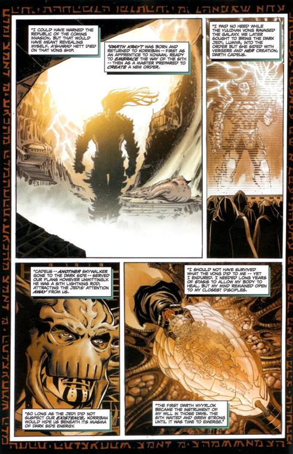

# Lumiya

- **Aliases:** Shira Brie
- **Era:** GCW–LotF
- **Continuity:** default Legends; entries present for: Canon, Legends
- **Research tier:** DEEP
- **Entries:** 457 (268 with quotations; 95 marked as fragments; recounted after the public-release cleanup). Rebuilt 2026-11-17 from 623 old entries; old file: `characters/_bak/lumiya.md.bak-20261117`.
- **How to read:** each entry is the quotation in full (block quote), then its source and point of view. "Note" lines are summaries from our notes, not quotations. `[fragment — full passage not on file]` means the source text is not on the box, so only the words in our notes are shown. Debate and forum material is in the last section and is unverified.

# LEGENDS (Legends / EU — main focus)

## Legacy of the Force 1–9: novel notes from the other agent (reference copy)

- Note (summary from our notes, not a quotation): Headline: the Jacen-turns book. Jacen's commando raids (Adumar, Centerpoint) show a cold, efficient Knight. Lumiya, disguised as "Brisha Syo", lures him to the Vectivus asteroid near Bimmiel, tests him with Force phantoms (a phantom Luke nearly beats him), reveals herself, and argues that the Sith can rule without corruption. Jacen foresees that he kills Luke in every future where Nelani reports what she saw, so he cripples and kills Nelani, edits Ben's memory, and lets Lumiya go. Lumiya's closing scene confirms Luke's dream figure is the Sith Jacen will become.
  — Source: Legacy of the Force 1: Betrayal (novel): feats, scaling and story notes.
Our notes: `notes/materials/021-legacy-of-the-force/lotf-1-betrayal-notes.md:9`

- Note (summary from our notes, not a quotation): Ch29–33: The Bimmiel-area asteroid. Phantoms separate Ben and Nelani; a phantom Luke tests Jacen. Simultaneously phantom Jacen and phantom Ben attack Luke and Mara on Coruscant. Brisha reveals she is Lumiya; Nelani fights her; Jacen's foresight shows Luke dying by his hand along every path where Nelani lives; he kills Nelani.
  — Source: Legacy of the Force 1: Betrayal (novel): feats, scaling and story notes.
Our notes: `notes/materials/021-legacy-of-the-force/lotf-1-betrayal-notes.md:21`

- Note (summary from our notes, not a quotation): Ch34: The Tralus battle ends; Leia renounces doing evil to protect family. Lumiya, alone, talks with a phantom of the Sith Jacen will become. Jacen lies to Ben. Luke senses «He exists» (L8269).
  — Source: L8269 — Legacy of the Force 1: Betrayal (novel): feats, scaling and story notes.
Our notes: `notes/materials/021-legacy-of-the-force/lotf-1-betrayal-notes.md:22`

> “No,” she admitted. “Lumiya isn’t using any Force techniques against you. *(L7917)*
— Source: L7917 — Legacy of the Force 1: Betrayal (novel): feats, scaling and story notes.
(Full sentence/passage taken from the source text on file: `lotf_tmp_b1_epub`.)
Note (our notes, around the quote): The reasonable road to the dark side. Lumiya never uses a mind trick on Jacen; Nelani herself confirms «Lumiya isn't using any Force techniques against you» (L7917). Jacen falls to an argument plus foresight.
Our notes: `notes/materials/021-legacy-of-the-force/lotf-1-betrayal-notes.md:25`

What it shows (our notes): Sacrifice of one to save many (Lumiya: «sometimes this means sacrificing one so that twenty may live», L7901), the same logic Leia rejects in Ch34 («she would not give up a life she did not have the right to sacrifice», L8183).
> “I used them as a test for you.” Lumiya closed her eyes and strained, but the bust still moved toward her. “Sith, like Jedi, have to determine the fates of others. Unlike Jedi, they know that sometimes this means sacrificing one so that twenty may live. I had to find out whether you understood that. And you do.”
>
> In the future, she would willingly give up her life to preserve that of Han, or her children, or Luke and his family … but she would not give up a life she did not have the right to sacrifice.
— Source: Legacy of the Force 1: Betrayal (novel): feats, scaling and story notes; Sacrifice of one to save many (Lumiya.
(Excerpt widened 2026-11-17 to the relevant passage, word for word from Betrayal (Aaron Allston) (text copy `MEGA_Legend_The_Legacy_of_the_Force_Series_Star_Wars_Legacy_of_the_Force_01_Betrayal_Aaron_Allston_epub`).)
(Full sentence/passage taken from the source text on file: `lotf_tmp_b1_epub`.)
Our notes: `notes/materials/021-legacy-of-the-force/lotf-1-betrayal-notes.md:26`

- Note (summary from our notes, not a quotation): Attachment. Leia's Ch34 meditation mirrors Lumiya's Sith «balance» speech (L8203, L8237).
  — Source: Legacy of the Force 1: Betrayal (novel): feats, scaling and story notes.
Our notes: `notes/materials/021-legacy-of-the-force/lotf-1-betrayal-notes.md:27`

> Luke can’t make out his features because he’s not willing to accept what he sees through the Force—your face where the next Lord of the Sith stands.” *(L7905)*
— Source: L7905 — Legacy of the Force 1: Betrayal (novel): feats, scaling and story notes.
(Full sentence/passage taken from the source text on file: `lotf_tmp_b1_epub`.)
Note (our notes, around the quote): Luke's denial. Lumiya: Luke can't see the dream figure's face because he won't accept «your face where the next Lord of the Sith stands» (L7905).
Our notes: `notes/materials/021-legacy-of-the-force/lotf-1-betrayal-notes.md:28`

> “You were never together,” Lumiya said. “When you were talking to Ben and he to you, you were actually hundreds of meters apart, talking to Force phantoms of each other. A trivial thing to arrange in this place, where there’s so much energy to manipulate.” She returned her attention to Jacen. “Energy you could use, in the name of improving people’s lives, if you chose to.”
— Source: Legacy of the Force 1: Betrayal (novel): feats, scaling and story notes; | F28 | Ch32 | L7767 | Lumiya |.
(Excerpt widened 2026-11-17 to the relevant passage, word for word from Betrayal (Aaron Allston), Chapter Thirty-Two (text copy `MEGA_Legend_The_Legacy_of_the_Force_Series_Star_Wars_Legacy_of_the_Force_01_Betrayal_Aaron_Allston_epub`).)
(Full sentence/passage taken from the source text on file: `lotf_tmp_b1_epub`.)
Context: | # | Ch | Line | Character | Feat (exact quote) |
Our notes: `notes/materials/021-legacy-of-the-force/lotf-1-betrayal-notes.md:63`

> Lumiya’s lightwhip flicked around the edges of the shield. Ends of several tendrils rapped into Nelani’s chest and right bicep, creating small blood and burn spots. Nelani cried out and danced back again, baffled by the older woman’s superior technique.
— Source: Legacy of the Force 1: Betrayal (novel): feats, scaling and story notes; | F29 | Ch33 | L7873 | Lumiya vs Nelani |.
(Excerpt widened 2026-11-17 to the relevant passage, word for word from Betrayal (Aaron Allston), Chapter Thirty-Three (text copy `MEGA_Legend_The_Legacy_of_the_Force_Series_Star_Wars_Legacy_of_the_Force_01_Betrayal_Aaron_Allston_epub`).)
Context: | # | Ch | Line | Character | Feat (exact quote) |
Also cited as: L7883 — Legacy of the Force 1: Betrayal (novel): feats, scaling and story notes; | D11 | Ch33 | L7873 | Nelani vs Lumiya |.
Also noted as: | D11 | Ch33 | L7873 | Nelani vs Lumiya | «baffled by the older woman's superior technique» | Lumiya ahead with the lightwhip; TK push-of-war even (L7883) |
Also cited as: Legacy of the Force 1: Betrayal (Aaron Allston, 2006) — own full read.
Also noted as: D13 Nelani vs Lumiya [c33 ¶2–26]: Lumiya dodges behind a bust; her multi-tendril lightwhip cuts Nelani's cheek, chest and bicep; "baffled by the older woman’s superior technique" [c33 ¶10]. TK duel: bust shattered, then an even push-of-war, strained because Lumiya is talking the whole time; she loses it and is disarmed. Jacen intervenes. Lumiya ahead on weapon, roughly even on TK.
Our notes: `notes/materials/021-legacy-of-the-force/lotf-1-betrayal-notes.md:64`; `notes/materials/021-legacy-of-the-force/lotf-1-betrayal-notes.md:117`; `notes/materials/040-lotf-own-read/lotf-1-betrayal.md:78`

> Nelani gestured with her free hand. The bust of Darth Vectivus’s mother flew forward, hurtling toward Lumiya like a marble missile. Lumiya flicked her lightwhip toward it, and nine or ten tendrils converged on it. The bust exploded into countless marble shards, raining down on the floor.
— Source: Legacy of the Force 1: Betrayal (novel): feats, scaling and story notes; | F30 | Ch33 | L7879 | Lumiya |.
(Excerpt widened 2026-11-17 to the relevant passage, word for word from Betrayal (Aaron Allston), Chapter Thirty-Three (text copy `MEGA_Legend_The_Legacy_of_the_Force_Series_Star_Wars_Legacy_of_the_Force_01_Betrayal_Aaron_Allston_epub`).)
Context: | # | Ch | Line | Character | Feat (exact quote) |
Our notes: `notes/materials/021-legacy-of-the-force/lotf-1-betrayal-notes.md:65`

> He's not yet strong enough to face a Sith. *(about Ben)*
— Source: Legacy of the Force 1: Betrayal (novel): feats, scaling and story notes; | S5 | Ch29 | L6867 | "Brisha" (Lumiya) |. POV: Lumiya.
Label in our notes: about Ben) | Medium |
Context: | # | Ch | Line | Speaker | Statement (exact quote) | Reliability |
Also cited as: Legacy of the Force 1: Betrayal (Aaron Allston, 2006) — own full read; | S6 | c29 ¶115 | Brisha (Lumiya) on Ben |.
Also noted as: | S6 | c29 ¶115 | Brisha (Lumiya) on Ben | "He’s not yet strong enough to face a Sith." | Medium |
Our notes: `notes/materials/021-legacy-of-the-force/lotf-1-betrayal-notes.md:83`; `notes/materials/040-lotf-own-read/lotf-1-betrayal.md:55`

> “I am a Master. You are a Jedi Knight. Do you know what that means?”
>
> “That I can’t win?” Jacen punctuated his question with a mocking laugh.
— Source: Legacy of the Force 1: Betrayal (novel): feats, scaling and story notes; | S6 | Ch30 | L7125 | phantom Sith |.
(Excerpt widened 2026-11-17 to the relevant passage, word for word from Betrayal (Aaron Allston) (text copy `MEGA_Legend_The_Legacy_of_the_Force_Series_Star_Wars_Legacy_of_the_Force_01_Betrayal_Aaron_Allston_epub`).)
(Excerpt widened 2026-11-17 to the relevant passage, word for word from Betrayal (Aaron Allston) (text copy `MEGA_Legend_The_Legacy_of_the_Force_Series_Star_Wars_Legacy_of_the_Force_01_Betrayal_Aaron_Allston_epub`).)
Label in our notes: | Low (phantom/Lumiya theater) |
Context: | # | Ch | Line | Speaker | Statement (exact quote) | Reliability |
Our notes: `notes/materials/021-legacy-of-the-force/lotf-1-betrayal-notes.md:84`

> That means that Darth Vader could never have become the Lord of the Sith . . . a true Master.
— Source: L7739 — Legacy of the Force 1: Betrayal (novel): feats, scaling and story notes; | S12 | Ch32 | L7737 | Jacen |.
Label in our notes: | Same; Lumiya agrees (L7739) |
Context: | # | Ch | Line | Speaker | Statement (exact quote) | Reliability |
Our notes: `notes/materials/021-legacy-of-the-force/lotf-1-betrayal-notes.md:90`

> Lumiya managed a laugh that was half-exhausted gasp. “Jacen, that’s you, visions of you. The Sith you will become. Luke can’t make out his features because he’s not willing to accept what he sees through the Force—your face where the next Lord of the Sith stands.” Her last words were little more than a gasp, and her control slipped at that point. The bust of the Bothan hurtled toward her. She cracked her whip at it, a foreshortened stroke that might have missed in any case, but the bust’s trajectory changed, sending the statuary beneath the tendrils. Instead of striking Lumiya’s head or chest, the bust cracked into her right hand, sending the whip spinning from her grip; its tendrils twisted across the floor like living things, scarring it with their passage.
— Source: Legacy of the Force 1: Betrayal (novel): feats, scaling and story notes; | S14 | Ch33 | L7905 | Lumiya |.
(Excerpt widened 2026-11-17 to the relevant passage, word for word from Betrayal (Aaron Allston), Chapter Thirty-Three (text copy `MEGA_Legend_The_Legacy_of_the_Force_Series_Star_Wars_Legacy_of_the_Force_01_Betrayal_Aaron_Allston_epub`).)
Label in our notes: | High (confirmed L8219–L8223, L8269) |
Context: | # | Ch | Line | Speaker | Statement (exact quote) | Reliability |
Our notes: `notes/materials/021-legacy-of-the-force/lotf-1-betrayal-notes.md:92`; `notes/materials/040-lotf-own-read/lotf-1-betrayal.md:60`

> For that moment, she was vulnerable to a counterattack. But Jacen merely kept his blade before hers. Lumiya did not attack, did not even summon her whip back to her; she merely held her forearm and hand where the bust had hit them. Finally Nelani’s eyes opened again and she seemed calmer. “No,” she admitted. “Lumiya isn’t using any Force techniques against you. You’re not being influenced by the dark side energies here. I don’t understand what’s happening.”
— Source: Legacy of the Force 1: Betrayal (novel): feats, scaling and story notes; | S15 | Ch33 | L7917 | Nelani |.
(Excerpt widened 2026-11-17 to the relevant passage, word for word from Betrayal (Aaron Allston), Chapter Thirty-Three (text copy `MEGA_Legend_The_Legacy_of_the_Force_Series_Star_Wars_Legacy_of_the_Force_01_Betrayal_Aaron_Allston_epub`).)
Note (our notes, around the quote): | S15 | Ch33 | L7917 | Nelani | «Lumiya isn't using any Force techniques against you.» | High (Jacen's fall is his own choice) |
Context: | # | Ch | Line | Speaker | Statement (exact quote) | Reliability |
Also cited as: Legacy of the Force 1: Betrayal (Aaron Allston, 2006) — own full read; | S12 | c33 ¶32 | Nelani |.
Also noted as: | S12 | c33 ¶32 | Nelani | "Lumiya isn’t using any Force techniques against you." | High: Jacen's choice is his own |
Our notes: `notes/materials/021-legacy-of-the-force/lotf-1-betrayal-notes.md:93`; `notes/materials/040-lotf-own-read/lotf-1-betrayal.md:61`

> She was a Sith, and yet she helped give Luke Skywalker a son. *(Vergere)*
— Source: Legacy of the Force 1: Betrayal (novel): feats, scaling and story notes; | S16 | Ch32 | L7849 | Lumiya |. POV: Vergere, about Lumiya.
Label in our notes: Vergere) | Low-medium (Lumiya's spin) |
Context: | # | Ch | Line | Speaker | Statement (exact quote) | Reliability |
Our notes: `notes/materials/021-legacy-of-the-force/lotf-1-betrayal-notes.md:94`

> “You will be the man your grandfather couldn’t,” Lumiya said. “Go home, do what you can to stop the war, and to free up time to study. Eventually you will need to find yourself an apprentice. Ben may be worthy, but I think he is already too steeped in the Jedi ways of softness and serenity, so look elsewhere, as well as at him. You’ll need to train to open your mind to facets of the Force you’ve been instructed to ignore or despise. And your greatest attainment of knowledge and power will come at the same time as your greatest act of sacrifice, when you give up something that is as dear to you as life—making your love immortal through its sacrifice.”
— Source: Legacy of the Force 1: Betrayal (novel): feats, scaling and story notes; | S19 | Ch34 | L8209 | Lumiya |.
(Excerpt widened 2026-11-17 to the relevant passage, word for word from Betrayal (Aaron Allston), Chapter Thirty-Four (text copy `MEGA_Legend_The_Legacy_of_the_Force_Series_Star_Wars_Legacy_of_the_Force_01_Betrayal_Aaron_Allston_epub`).)
(Full sentence/passage taken from the source text on file: `lotf_tmp_b1_epub`.)
Label in our notes: | Low for scaling; arc framing |
Context: | # | Ch | Line | Speaker | Statement (exact quote) | Reliability |
Our notes: `notes/materials/021-legacy-of-the-force/lotf-1-betrayal-notes.md:97`

- Note (summary from our notes, not a quotation): Lumiya: superior technique vs a Knight (D11), multi-phantom coordination (F27), even TK push-of-war with Nelani while talking (F31, she is visibly straining, L7897). Fits the existing `verdicts.md` entries Mara ≥ Lumiya and Luke > Lumiya.
  — Source: Legacy of the Force 1: Betrayal (novel): feats, scaling and story notes.
Our notes: `notes/materials/021-legacy-of-the-force/lotf-1-betrayal-notes.md:125`

> Luke would have said that obedience to the guidance of the Force would give him direction and purpose, but since the end of the Yuuzhan Vong war, except for those times when he faced foes whose behavior lit up the Force like a KILL ME SOON sign, the life of the Jedi hadn’t given him the sense of purpose it seemed to have provided his uncle. *(L7785)*
— Source: L7785; L7983 — Legacy of the Force 1: Betrayal (novel): feats, scaling and story notes; Role/arc: a disillusioned Knight whose.
(Full sentence/passage taken from the source text on file: `lotf_tmp_b1_epub`.)
Note (our notes, around the quote): Role/arc: a disillusioned Knight whose «life of the Jedi hadn't given him the sense of purpose it seemed to have provided his uncle» (L7785). Persuaded by argument, not manipulation (S15), he frees Lumiya and kills Nelani to avert the future where he kills Luke (L7983).
Our notes: `notes/materials/021-legacy-of-the-force/lotf-1-betrayal-notes.md:135`

> That you’re destined to become the next Sith Lord—the first Sith Lord to be active in decades, the first one in centuries with the strength to use the Sith techniques to help others. *(S13, pitch)*
— Source: Legacy of the Force 1: Betrayal (novel): feats, scaling and story notes; Statements about him: Thrackan, impressed (S4). Lumiya.
(Full sentence/passage taken from the source text on file: `lotf_tmp_b1_epub`.)
Note (our notes, around the quote): Statements about him: Thrackan, impressed (S4). Lumiya: «the first one in centuries with the strength to use the Sith techniques to help others» (S13, pitch). Luke's dream: Anakin-like features (S2).
Our notes: `notes/materials/021-legacy-of-the-force/lotf-1-betrayal-notes.md:137`; `notes/materials/021-legacy-of-the-force/lotf-1-betrayal-notes.md:91`

> “He’s not yet strong enough to face a Sith.” *(S5)*
>
> She kicked the stuffing out of me. *(S20)*
— Source: Legacy of the Force 1: Betrayal (novel): feats, scaling and story notes; Statements: Lumiya.
(Full sentence/passage taken from the source text on file: `lotf_tmp_b1_epub`.)
Label in our notes: Statements: Lumiya: (S5). Ben: (S20
Our notes: `notes/materials/021-legacy-of-the-force/lotf-1-betrayal-notes.md:153`

- Note (summary from our notes, not a quotation): Scaling: Master-level combatant; nothing here changes Mara ≥ Lumiya.
  — Source: Legacy of the Force 1: Betrayal (novel): feats, scaling and story notes.
Our notes: `notes/materials/021-legacy-of-the-force/lotf-1-betrayal-notes.md:162`

- Note (summary from our notes, not a quotation): Role/arc: the architect. Trained by Vader (L7687), cyborg (L7715), she claims she can never be a true Master (S11, L7735), and wins: «I've won» (L8217).
  — Source: L7687; L7715; L8217 — Legacy of the Force 1: Betrayal (novel): feats, scaling and story notes.
Our notes: `notes/materials/021-legacy-of-the-force/lotf-1-betrayal-notes.md:165`

- Note (summary from our notes, not a quotation): Key feats: coordinates multiple phantoms at once on Coruscant and the asteroid (F27–F28); lightwhip superiority over Nelani (F29–F30); TK stalemate with Nelani while debating (F31).
  — Source: Legacy of the Force 1: Betrayal (novel): feats, scaling and story notes.
Our notes: `notes/materials/021-legacy-of-the-force/lotf-1-betrayal-notes.md:166`

> If it had been an assault, I would have let the Luke phantom kill you. *(L7521)*
— Source: L7521 — Legacy of the Force 1: Betrayal (novel): feats, scaling and story notes; Statements.
Note (our notes, around the quote): Statements: «If it had been an assault, I would have let the Luke phantom kill you.» (L7521). Her own lore claim that cyborgs can't reach «true Mastery» (S11, L7735) also downgrades Vader (S12); treat as self-serving.
Our notes: `notes/materials/021-legacy-of-the-force/lotf-1-betrayal-notes.md:167`

- Note (summary from our notes, not a quotation): Fights: D11 (ahead of Nelani); never fights Jacen.
  — Source: Legacy of the Force 1: Betrayal (novel): feats, scaling and story notes.
Our notes: `notes/materials/021-legacy-of-the-force/lotf-1-betrayal-notes.md:168`

- Note (summary from our notes, not a quotation): Scaling: strong dark-sider with exceptional illusion range; below Luke and Mara in direct combat (other LotF books).
  — Source: Legacy of the Force 1: Betrayal (novel): feats, scaling and story notes.
Our notes: `notes/materials/021-legacy-of-the-force/lotf-1-betrayal-notes.md:169`

- Note (summary from our notes, not a quotation): Feats: TK bust push-of-war with Lumiya (F31); attacks Lumiya first (L7853).
  — Source: L7853 — Legacy of the Force 1: Betrayal (novel): feats, scaling and story notes.
Our notes: `notes/materials/021-legacy-of-the-force/lotf-1-betrayal-notes.md:191`

- Note (summary from our notes, not a quotation): Fights: D11 (losing to Lumiya), D12 (killed by Jacen).
  — Source: Legacy of the Force 1: Betrayal (novel): feats, scaling and story notes.
Our notes: `notes/materials/021-legacy-of-the-force/lotf-1-betrayal-notes.md:193`

- Note (summary from our notes, not a quotation): Role/arc: Corellian Chief of State; Centerpoint's restorer; Lumiya names him behind the Toryaz attack (L7893).
  — Source: L7893 — Legacy of the Force 1: Betrayal (novel): feats, scaling and story notes.
Our notes: `notes/materials/021-legacy-of-the-force/lotf-1-betrayal-notes.md:197`

- Note (summary from our notes, not a quotation): Headline: this book has no lightsaber duel between major Force users. No Jacen vs. Luke, no Mara vs. Lumiya, and Alema Rar does not appear. Its scaling value comes from Jacen's stealth, illusion, and mind feats against Luke, from narration that directly compares Jacen with Luke and with Anakin/Vader, and from the Jacen–Lumiya power relationship.
  — Source: Legacy of the Force 2: Bloodlines (novel), feats and scaling notes.
Our notes: `notes/materials/021-legacy-of-the-force/lotf-2-bloodlines-notes.md:11`

What it shows (our notes): Ch4 · L1777 · Jacen (FEAT plus a statement of capability): senses Lumiya's emotions from Coruscant at her asteroid near Bimmiel. In the same passage: «She might be able to project totally false emotions, too, because he could do much the same himself and fool even other Jedi Masters into believing them.»
> She was still in her asteroid habitat near Bimmiel. He felt her there: when he concentrated, he could sense her emotions, which were an odd blend of relief and sincerity. But if she can create the kind of Force illusions we experienced in her home, then she could fake anything. She could have been anywhere, even on Coruscant. She might be able to project totally false emotions, too, because he could do much the same himself and fool even other Jedi Masters into believing them.
— Source: Ch4 · L1777 — Legacy of the Force 2: Bloodlines (novel), feats and scaling notes.
(Excerpt widened 2026-11-17 to the relevant passage, word for word from Bloodlines (Karen Traviss), Chapter Four (text copy `MEGA_Legend_The_Legacy_of_the_Force_Series_Star_Wars_Legacy_of_the_Force_02_Bloodlines_Karen_Traviss_epub`).)
Our notes: `notes/materials/021-legacy-of-the-force/lotf-2-bloodlines-notes.md:49`

What it shows (our notes): Ch4 · L1879–1883 · Jacen (FEAT, long-range command): reaches out «not as an open hand but as a commanding fist» and summons Lumiya from the Bimmiel system to Coruscant. She comes (Ch5).
> Crossing his legs in a mediation position, he let his consciousness reach out across the Force, not as an open hand but as a commanding fist.
>
> Lumiya. Come here, Lumiya.
— Source: Ch4 · L1879–1883 — Legacy of the Force 2: Bloodlines (novel), feats and scaling notes; Ch4 · L1879–1883 · Jacen (FEAT, long-range command): reaches out.
(Excerpt widened 2026-11-17 to the relevant passage, word for word from Bloodlines (Karen Traviss) (text copy `MEGA_Legend_The_Legacy_of_the_Force_Series_Star_Wars_Legacy_of_the_Force_02_Bloodlines_Karen_Traviss_epub`).)
(Excerpt widened 2026-11-17 to the relevant passage, word for word from Bloodlines (Karen Traviss) (text copy `MEGA_Legend_The_Legacy_of_the_Force_Series_Star_Wars_Legacy_of_the_Force_02_Bloodlines_Karen_Traviss_epub`).)
(Full sentence/passage taken from the source text on file: `novels_tmp_bloodlines_bloodlines_epub`.)
Our notes: `notes/materials/021-legacy-of-the-force/lotf-2-bloodlines-notes.md:51`

What it shows (our notes): Ch5 · L2311 · Lumiya (FEAT, Force concealment): in the Jedi Temple, «it felt as if she had cloaked herself completely». No Jedi reacts to her inside the Temple (L2345).
> Lumiya walked beside him up the promenade leading to the Temple, and it felt as if she had cloaked herself completely. He could sense her unease, but any hint of darkness had been reduced to no more than the simmering passions found in any ordinary untrained human being. She passed through the huge doors of the imposing entrance and reacted just as any ordinary person with no Force sensitivity would: she stopped in her tracks and stared. If she hadn’t been wearing a full veil across her face, Jacen thought she might well have been gaping, too.
— Source: Ch5 · L2311; L2345 — Legacy of the Force 2: Bloodlines (novel), feats and scaling notes; Ch5 · L2311 · Lumiya (FEAT, Force concealment): in the Jedi Temple.
(Excerpt widened 2026-11-17 to the relevant passage, word for word from Bloodlines (Karen Traviss), Chapter Five (text copy `MEGA_Legend_The_Legacy_of_the_Force_Series_Star_Wars_Legacy_of_the_Force_02_Bloodlines_Karen_Traviss_epub`).)
(Full sentence/passage taken from the source text on file: `novels_tmp_bloodlines_bloodlines_epub`.)
Our notes: `notes/materials/021-legacy-of-the-force/lotf-2-bloodlines-notes.md:55`

> Jacen cloaked Lumiya in a Force illusion and projected his own unconcerned calm as Luke approached. It was an exhausting maneuver, nothing beyond him when dealing with ordinary people, but something that took all his strength when deceiving a Jedi Master of Luke's stature. *(L2379)*
>
> Luke was sensing Lumiya, but very faintly. Jacen knew it. *(L2389)*
— Source: Ch5 · L2371–2389; L2379; L2389; L2385 — Legacy of the Force 2: Bloodlines (novel), feats and scaling notes; Ch5 · L2371–2389 · Jacen (+ Lumiya) vs. Luke (FEAT, KEY).
Note (our notes, around the quote): Ch5 · L2371–2389 · Jacen (+ Lumiya) vs. Luke (FEAT, KEY): «Jacen cloaked Lumiya in a Force illusion and projected his own unconcerned calm as Luke approached. It was an exhausting maneuver, nothing beyond him when dealing with ordinary people, but something that took all his strength when deceiving a Jedi Master of Luke's stature.» (L2379). «Luke was sensing Lumiya, but very faintly. Jacen knew it.» (L2389). *Context:* this is two people's concealment stacked (Lumiya's own cloak plus Jacen's illusion). Luke is rushing out of a Council meeting and suspects nothing. It costs Jacen «all his strength». Luke «seemed baffled» (L2385), so he still half-caught her. Read it as a partial win under favorable conditions, not proof that Jacen outclasses Luke.
Our notes: `notes/materials/021-legacy-of-the-force/lotf-2-bloodlines-notes.md:56`; `suspect-insight/respect-threads/darth-caedus.md:126`

What it shows (our notes): Ch7 · L3039–3045 · Luke (FEAT, sensing): catches «a very faint touch of something familiar» and works out who the hooded man from his vision is: «I know who the hooded man is. I know now, and it's not a man at all.» (L3045). This partly undoes feat #10. Luke did register Lumiya.
> I have a lot of doubts. I think I have more doubts than certainties right now.
>
> But as Jacen turned away from him, Luke caught a very faint touch of something familiar in his mind, almost like a trace of a familiar perfume. It was an echo; it felt ancient. Luke almost opened his mouth to inhale it.
>
> I know who the hooded man is. I know now, and it's not a man at all. *(L3045)*
— Source: Ch7 · L3039–3045; L3045 — Legacy of the Force 2: Bloodlines (novel), feats and scaling notes; Ch7 · L3039–3045 · Luke (FEAT, sensing): catches.
(Excerpt widened 2026-11-17 to the relevant passage, word for word from Bloodlines (Karen Traviss) (text copy `MEGA_Legend_The_Legacy_of_the_Force_Series_Star_Wars_Legacy_of_the_Force_02_Bloodlines_Karen_Traviss_epub`).)
(Excerpt widened 2026-11-17 to the relevant passage, word for word from Bloodlines (Karen Traviss) (text copy `MEGA_Legend_The_Legacy_of_the_Force_Series_Star_Wars_Legacy_of_the_Force_02_Bloodlines_Karen_Traviss_epub`).)
(Full sentence/passage taken from the source text on file: `novels_tmp_bloodlines_bloodlines_epub`.)
Our notes: `notes/materials/021-legacy-of-the-force/lotf-2-bloodlines-notes.md:63`

What it shows (our notes): Ch8 · L3495–3519 · Jacen vs. Luke, second time (FEAT): he «projected a Force illusion around Lumiya to bolster her own cloaking» (L3495), with a «ball of heat building in his chest». Luke walks past, and Jacen holds it for ten more minutes (L3517). Lumiya: «I'm impressed by your ability to deceive Luke» (L3519). *Context:* stacked concealment again. Luke was distracted after the Niathal meeting.
> He centered himself and projected a Force illusion around Lumiya to bolster her own cloaking of her identity again. *(L3495)*
>
> “Relax,” said Jacen. He centered himself and projected a Force illusion around Lumiya to bolster her own cloaking of her identity again. He felt the sensation of a ball of heat building in his chest, and he nudged her with his elbow. “Go on. Brief me on the strength of the Corellian fleet and don’t react to anyone passing by.”
>
> “I’m impressed by your ability to deceive Luke,” said Lumiya. *(L3519)*
— Source: Ch8 · L3495–3519; L3495; L3517; L3519 — Legacy of the Force 2: Bloodlines (novel), feats and scaling notes; Ch8 · L3495–3519 · Jacen vs. Luke, second time (FEAT): he.
(Excerpt widened 2026-11-17 to the relevant passage, word for word from Bloodlines (Karen Traviss), Chapter Eight (text copy `MEGA_Legend_The_Legacy_of_the_Force_Series_Star_Wars_Legacy_of_the_Force_02_Bloodlines_Karen_Traviss_epub`).)
(Full sentence/passage taken from the source text on file: `novels_tmp_bloodlines_bloodlines_epub`.)
Our notes: `notes/materials/021-legacy-of-the-force/lotf-2-bloodlines-notes.md:66`

What it shows (our notes): Ch13 · L5239 · Jacen (FEAT, self-cloaking): «he had withdrawn from the Force, cloaking himself against detection». He does this to hide Tenel Ka and Allana from Lumiya, because «Lumiya's Force skills were still not to be taken for granted».
> Jacen could feel Jaina’s anxiety, many decks below in the hangar. He knew she couldn’t feel his, because he had withdrawn from the Force, cloaking himself against detection. For a moment he considered reaching many light-years away, into the Hapes Cluster to brush gently against Tenel Ka’s presence, but he didn’t dare. He tried not to think of her at all. Even thought might put her at risk of discovery if he was careless. Lumiya’s Force skills were still not to be taken for granted, and Tenel Ka and Allana were in a far more dangerous position than he would ever be.
— Source: Ch13 · L5239 — Legacy of the Force 2: Bloodlines (novel), feats and scaling notes; Ch13 · L5239 · Jacen (FEAT, self-cloaking).
(Excerpt widened 2026-11-17 to the relevant passage, word for word from Bloodlines (Karen Traviss), Chapter Thirteen (text copy `MEGA_Legend_The_Legacy_of_the_Force_Series_Star_Wars_Legacy_of_the_Force_02_Bloodlines_Karen_Traviss_epub`).)
(Full sentence/passage taken from the source text on file: `novels_tmp_bloodlines_bloodlines_epub`.)
Our notes: `notes/materials/021-legacy-of-the-force/lotf-2-bloodlines-notes.md:80`

> The room was soothing, an illusion that was almost a meditation chamber. The light around them was deep blue and distorted as if filtered through water. Jacen thought it was ironic that her power and energy could only find an expression in illusion, useful though that was. She could change nothing permanently.
>
> She could change nothing permanently. He could, though. *(L6243, POV)*
>
> “So do I,” said Jacen, and clapped his hands together once in a burst of Force energy. The beautiful blue underwater illusion vanished like shattering ice on a pond, and he was back in his sparse apartment again with a bag to pack and a war to win. *(L6305)*
— Source: Ch16 · L6243; L6305 — Legacy of the Force 2: Bloodlines (novel), feats and scaling notes.
(Excerpt widened 2026-11-17 to the relevant passage, word for word from Bloodlines (Karen Traviss), Chapter Sixteen (text copy `MEGA_Legend_The_Legacy_of_the_Force_Series_Star_Wars_Legacy_of_the_Force_02_Bloodlines_Karen_Traviss_epub`).)
(Full sentence/passage taken from the source text on file: `novels_tmp_bloodlines_bloodlines_epub`.)
Note (our notes, around the quote): Ch16 · L6243, L6305 · Lumiya illusion vs. Jacen dispel (FEAT, KEY for the master–apprentice scale): Lumiya fills the room with an underwater illusion. Jacen's view: «her power and energy could only find an expression in illusion» and «She could change nothing permanently. He could, though.» (L6243, POV). He ends it: he «clapped his hands together once in a burst of Force energy. The beautiful blue underwater illusion vanished like shattering ice» (L6305). *Context:* Lumiya was not resisting. It was a lesson, not a contest.
Our notes: `notes/materials/021-legacy-of-the-force/lotf-2-bloodlines-notes.md:90`

What it shows (our notes): Ch23 · L8541 · Jacen vs. Lumiya (FEAT, masking): he «projected a sense of bewilderment to mask the dread and fear churning his stomach, and it took almost all his strength.» Lumiya does not detect his secret (Tenel Ka and Allana). At L8563 he holds his hand in a candle flame until the flesh chars.
> Jacen concentrated hard and projected a sense of bewilderment to mask the dread and fear churning his stomach, and it took almost all his strength. He picked up the candle from the table and stared into its flame as if distracted by it, using it to focus his control. “You’ll have to explain that.”
— Source: Ch23 · L8541 — Legacy of the Force 2: Bloodlines (novel), feats and scaling notes; Ch23 · L8541 · Jacen vs. Lumiya (FEAT, masking): he.
(Excerpt widened 2026-11-17 to the relevant passage, word for word from Bloodlines (Karen Traviss), Chapter Twenty-Three (text copy `MEGA_Legend_The_Legacy_of_the_Force_Series_Star_Wars_Legacy_of_the_Force_02_Bloodlines_Karen_Traviss_epub`).)
(Full sentence/passage taken from the source text on file: `novels_tmp_bloodlines_bloodlines_epub`.)
Our notes: `notes/materials/021-legacy-of-the-force/lotf-2-bloodlines-notes.md:106`

What it shows (our notes): S5 · L2299 · Lumiya: «I can hide indefinitely-anywhere.» *Partly supported* (feat #9), but Luke senses her anyway (feat #13).
> “I’ve hidden for decades.” She replaced the veil. “I can hide indefinitely—anywhere.”
>
> This was arcane mysticism on a scale that only a handful of people in the galaxy had ever needed to consider. And yet Jacen found himself hailing an air taxi and getting into it with a Sith Master, as mundane and everyday an act as he could imagine. He savored the incongruity of it. They didn’t speak at all on the way to the Temple.
— Source: Legacy of the Force 2: Bloodlines (novel), feats and scaling notes; S5 · L2299 · Lumiya.
(Excerpt widened 2026-11-17 to the relevant passage, word for word from Bloodlines (Karen Traviss) (text copy `MEGA_Legend_The_Legacy_of_the_Force_Series_Star_Wars_Legacy_of_the_Force_02_Bloodlines_Karen_Traviss_epub`).)
(Excerpt widened 2026-11-17 to the relevant passage, word for word from Bloodlines (Karen Traviss) (text copy `MEGA_Legend_The_Legacy_of_the_Force_Series_Star_Wars_Legacy_of_the_Force_02_Bloodlines_Karen_Traviss_epub`).)
(Full sentence/passage taken from the source text on file: `novels_tmp_bloodlines_bloodlines_epub`.)
Our notes: `notes/materials/021-legacy-of-the-force/lotf-2-bloodlines-notes.md:116`

What it shows (our notes): S10 · L6243 · Jacen (POV) on Lumiya: «She could change nothing permanently. He could, though.» *Reliable as a description of their power styles.* Feat #28 supports it.
> The room was soothing, an illusion that was almost a meditation chamber. The light around them was deep blue and distorted as if filtered through water. Jacen thought it was ironic that her power and energy could only find an expression in illusion, useful though that was. She could change nothing permanently.
>
> He could, though.
— Source: Legacy of the Force 2: Bloodlines (novel), feats and scaling notes; S10 · L6243 · Jacen (POV) on Lumiya.
(Excerpt widened 2026-11-17 to the relevant passage, word for word from Bloodlines (Karen Traviss), Chapter Sixteen (text copy `MEGA_Legend_The_Legacy_of_the_Force_Series_Star_Wars_Legacy_of_the_Force_02_Bloodlines_Karen_Traviss_epub`).)
Our notes: `notes/materials/021-legacy-of-the-force/lotf-2-bloodlines-notes.md:121`

What it shows (our notes): S11 · L6265 · Lumiya on Anakin: «He also lacked your breadth of education in the Force.» *Self-serving.* She is grooming Jacen, but the book supports the claim that Jacen is unusually broadly trained (Fallanassi, Theran, Aing-Tii, Vergere).
> “He wanted power. Not political power, but the power to shape reality for those he loved. It diverted him and it flawed a great man. He also lacked your breadth of education in the Force. That’s my belief.”
— Source: Legacy of the Force 2: Bloodlines (novel), feats and scaling notes; S11 · L6265 · Lumiya on Anakin.
(Excerpt widened 2026-11-17 to the relevant passage, word for word from Bloodlines (Karen Traviss), Chapter Sixteen (text copy `MEGA_Legend_The_Legacy_of_the_Force_Series_Star_Wars_Legacy_of_the_Force_02_Bloodlines_Karen_Traviss_epub`).)
Our notes: `notes/materials/021-legacy-of-the-force/lotf-2-bloodlines-notes.md:122`

What it shows (our notes): S14 · L7063 · Lumiya: Anakin «started his training too late and was still inexperienced when he was exploited by a man who wanted power». *Lumiya's manipulative framing.*
> “He started his training too late and was still inexperienced when he was exploited by a man who wanted power. You’re a mature man with a lifetime’s training and nobody is using you. You won’t make the same mistakes.”
— Source: Legacy of the Force 2: Bloodlines (novel), feats and scaling notes; S14 · L7063 · Lumiya: Anakin.
(Excerpt widened 2026-11-17 to the relevant passage, word for word from Bloodlines (Karen Traviss), Chapter Eighteen (text copy `MEGA_Legend_The_Legacy_of_the_Force_Series_Star_Wars_Legacy_of_the_Force_02_Bloodlines_Karen_Traviss_epub`).)
Our notes: `notes/materials/021-legacy-of-the-force/lotf-2-bloodlines-notes.md:125`

What it shows (our notes): S15 · L7075 · Lumiya: «weak men like Palpatine saw only power, and why they were defeated». *Lumiya's ideology.* It is not a power claim about Sidious.
> “That’s the price you pay for bringing order to the galaxy. This is your sacrifice. Now do you see why weak men like Palpatine saw only power, and why they were defeated?” Lumiya’s hypnotic voice was almost disembodied. Jacen watched her mouth, and had no sense of being spoken to by another living being. It was an oracle, a dispassionate revelation. “There is nothing in it for you as Jacen Solo.”
— Source: Legacy of the Force 2: Bloodlines (novel), feats and scaling notes; S15 · L7075 · Lumiya.
(Excerpt widened 2026-11-17 to the relevant passage, word for word from Bloodlines (Karen Traviss), Chapter Eighteen (text copy `MEGA_Legend_The_Legacy_of_the_Force_Series_Star_Wars_Legacy_of_the_Force_02_Bloodlines_Karen_Traviss_epub`).)
(Full sentence/passage taken from the source text on file: `novels_tmp_bloodlines_bloodlines_epub`.)
Our notes: `notes/materials/021-legacy-of-the-force/lotf-2-bloodlines-notes.md:126`

What it shows (our notes): S20 · L8543 · Lumiya: «I can't teach you any more skills.» Also L6233: «Technique is for apprentices. You know all you need to know.» *By the end of Bloodlines, the student has outgrown Lumiya's teaching. Jacen only needs the "final trial."*
> “I can’t teach you any more skills. You now have to pass through the final barrier and do what no ordinary man can—kill someone whose death will cause terrible suffering to those who love them, someone close to you.”
>
> “Not techniques so much as awareness.” Lumiya spread her arms and the room was suddenly both calm and charged with dark energy. It felt to Jacen like sitting in the company of dangerous men in a beautifully appointed office, a veneer of grace over savagery. “Technique is for apprentices. You know all you need to know. It’s within you. You only have to become aware of it and embrace it.”
— Source: Legacy of the Force 2: Bloodlines (novel), feats and scaling notes; S20 · L8543 · Lumiya.
(Excerpt widened 2026-11-17 to the relevant passage, word for word from Bloodlines (Karen Traviss) (text copy `MEGA_Legend_The_Legacy_of_the_Force_Series_Star_Wars_Legacy_of_the_Force_02_Bloodlines_Karen_Traviss_epub`).)
(Excerpt widened 2026-11-17 to the relevant passage, word for word from Bloodlines (Karen Traviss) (text copy `MEGA_Legend_The_Legacy_of_the_Force_Series_Star_Wars_Legacy_of_the_Force_02_Bloodlines_Karen_Traviss_epub`).)
Our notes: `notes/materials/021-legacy-of-the-force/lotf-2-bloodlines-notes.md:131`

- Note (summary from our notes, not a quotation): F. Contests of will rather than fights: Jacen's illusions vs. Luke (Ch5, Ch8, partly successful). Jacen vs. Jaina's mind (Ch17, Jaina pushes him out). Jacen's dispel vs. Lumiya's illusion (Ch16). Jacen's masking vs. Lumiya's reading (Ch23, Jacen wins).
  — Source: Legacy of the Force 2: Bloodlines (novel), feats and scaling notes.
Our notes: `notes/materials/021-legacy-of-the-force/lotf-2-bloodlines-notes.md:144`

- Note (summary from our notes, not a quotation): Jacen's stealth wins over Luke all come with conditions: concealment stacked with Lumiya's, Luke distracted, and Jacen using «all his strength» (L2379). Luke still half-senses Lumiya (L2389) and later identifies her (L3045).
  — Source: L2379; L2389; L3045 — Legacy of the Force 2: Bloodlines (novel), feats and scaling notes.
Our notes: `notes/materials/021-legacy-of-the-force/lotf-2-bloodlines-notes.md:152`

- Note (summary from our notes, not a quotation): Jacen's raw, physical Force exceeds Lumiya's. She is an illusion and stealth specialist (S10, feat #28). She tells him she has nothing left to teach (S20). He hides a secret from her at full strain (feat #38). Jacen > Lumiya in power by the end of Book 2, while she keeps the edge in Sith lore and manipulation.
  — Source: Legacy of the Force 2: Bloodlines (novel), feats and scaling notes.
Our notes: `notes/materials/021-legacy-of-the-force/lotf-2-bloodlines-notes.md:156`

- Note (summary from our notes, not a quotation): Power claims: S11, S13, and S14 say Jacen is better trained than Anakin was. Those claims come from Lumiya and from Jacen himself. The authorial verdict (S21) says Jacen is a *lesser* Vader. Treat Bloodlines as framing that favors Vader on stature, with no head-to-head data.
  — Source: Legacy of the Force 2: Bloodlines (novel), feats and scaling notes.
Our notes: `notes/materials/021-legacy-of-the-force/lotf-2-bloodlines-notes.md:163`

- Note (summary from our notes, not a quotation): Nothing direct. Lumiya's dismissal of Palpatine (S15) is ideology. For existing comparisons, see `debates-sidious-plagueis-tenebrous-vs-krayt-caedus-valkorion.md`.
  — Source: Legacy of the Force 2: Bloodlines (novel), feats and scaling notes.
Our notes: `notes/materials/021-legacy-of-the-force/lotf-2-bloodlines-notes.md:166`

> “You have to kill what you love.”
>
> Jacen didn’t quite take in the meaning of that at first. Then panic gripped him.
— Source: Legacy of the Force 2: Bloodlines (novel), feats and scaling notes; L8535 Lumiya. POV: L8535 Lumiya.
(Excerpt widened 2026-11-17 to the relevant passage, word for word from Bloodlines (Karen Traviss) (text copy `MEGA_Legend_The_Legacy_of_the_Force_Series_Star_Wars_Legacy_of_the_Force_02_Bloodlines_Karen_Traviss_epub`).)
(Excerpt widened 2026-11-17 to the relevant passage, word for word from Bloodlines (Karen Traviss) (text copy `MEGA_Legend_The_Legacy_of_the_Force_Series_Star_Wars_Legacy_of_the_Force_02_Bloodlines_Karen_Traviss_epub`).)
Our notes: `notes/materials/021-legacy-of-the-force/lotf-2-bloodlines-notes.md:217`

- Note (summary from our notes, not a quotation): Role/arc: GAG colonel and Lumiya's apprentice. He goes from shielding a taxi (Ch2) to his first deliberate kill (Ch14), the Force-interrogation death of Ailyn Vel (Ch15), torpedoing a freighter (Ch17), and accepting that his Sith trial means killing someone he loves (Ch23).
  — Source: Legacy of the Force 2: Bloodlines (novel), feats and scaling notes.
Our notes: `notes/materials/021-legacy-of-the-force/lotf-2-bloodlines-notes.md:243`

> as a commanding fist *(Ch4, L1879–1883)*
> [fragment — full passage not on file]
— Source: Ch2, L989; Ch4, L1879–1883; Ch5, L2379; Ch8, L3495; Ch6, L2599–2605 — Legacy of the Force 2: Bloodlines (novel), feats and scaling notes.
Note (our notes, around the quote): Key feats: Force shield around Niathal's taxi in a bomb blast (Ch2, L989). Summons Lumiya from the Bimmiel system «as a commanding fist» (Ch4, L1879–1883). Hides Lumiya from Luke twice by stacking illusion on her cloak, at «all his strength» (Ch5, L2379; Ch8, L3495). Channels telekinesis through Leia to keep the *Falcon*'s drive housing together (Ch6, L2599–2605). Paralyzes three unseen targets at once (Ch9, L3713). Shields a crowd of about half a million (Ch15, L5797–5799). Holds invisibility, presence-erasure and flow-walking at once (Ch17, L6595–6631). Dispels Lumiya's illusion with a clap (Ch16, L6305).
Our notes: `notes/materials/021-legacy-of-the-force/lotf-2-bloodlines-notes.md:244`

- Note (summary from our notes, not a quotation): Scaling: Luke > Jacen in overall power, but Jacen is the best in the book at stealth, illusion and mind work, with the widest toolkit of the era. Jacen > Lumiya in raw power by the end of the book.
  — Source: Legacy of the Force 2: Bloodlines (novel), feats and scaling notes.
Our notes: `notes/materials/021-legacy-of-the-force/lotf-2-bloodlines-notes.md:248`

- Note (summary from our notes, not a quotation): Role/arc: a Sith teacher who comes to Coruscant when Jacen summons her and admits by the end that she has nothing left to teach him.
  — Source: Legacy of the Force 2: Bloodlines (novel), feats and scaling notes.
Our notes: `notes/materials/021-legacy-of-the-force/lotf-2-bloodlines-notes.md:251`

- Note (summary from our notes, not a quotation): Key feats: cloaks herself inside the Jedi Temple and no Jedi reacts (Ch5, L2311, L2345). Fills a room with an underwater illusion (Ch16, L6243). Long-range emotional projection is implied by Jacen (Ch4, L1777).
  — Source: Ch5, L2311, L2345; Ch16, L6243; Ch4, L1777; Ch5, L2311 — Legacy of the Force 2: Bloodlines (novel), feats and scaling notes.
Our notes: `notes/materials/021-legacy-of-the-force/lotf-2-bloodlines-notes.md:252`

> She replaced the veil. “I can hide indefinitely—anywhere.” *(Ch5, L2299)*
>
> She could change nothing permanently. He could, though. *(Ch16, L6243)*
>
> I can't teach you any more skills. *(Ch23, L8543)*
>
> It felt to Jacen like sitting in the company of dangerous men in a beautifully appointed office, a veneer of grace over savagery. “Technique is for apprentices. *(Ch16, L6233)*
— Source: Ch5, L2299; Ch16, L6243; Ch23, L8543; Ch16, L6233 — Legacy of the Force 2: Bloodlines (novel), feats and scaling notes; Statements.
(Full sentence/passage taken from the source text on file: `novels_tmp_bloodlines_bloodlines_epub`.)
Note (our notes, around the quote): Statements: «I can hide indefinitely-anywhere.» (Ch5, L2299). Jacen's POV: «She could change nothing permanently. He could, though.» (Ch16, L6243). Her own: «I can't teach you any more skills.» (Ch23, L8543); «Technique is for apprentices.» (Ch16, L6233).
Our notes: `notes/materials/021-legacy-of-the-force/lotf-2-bloodlines-notes.md:253`

> “I don’t need to create chaos, Jacen,” she said quietly. *(Ch5, L2365)*
>
> He also lacked your breadth of education in the Force. *(Ch16, L6265)*
— Source: Ch5, L2365; Ch16, L6265 — Legacy of the Force 2: Bloodlines (novel), feats and scaling notes; Notable quotes.
(Full sentence/passage taken from the source text on file: `novels_tmp_bloodlines_bloodlines_epub`.)
Note (our notes, around the quote): Notable quotes: «I don't need to create chaos, Jacen» (Ch5, L2365). On Anakin: «He also lacked your breadth of education in the Force.» (Ch16, L6265).
Our notes: `notes/materials/021-legacy-of-the-force/lotf-2-bloodlines-notes.md:254`

- Note (summary from our notes, not a quotation): Fights/results: none. Jacen breaks her illusion (Ch16, L6305, a lesson rather than a contest), and she fails to read his hidden secret (Ch23, L8541).
  — Source: Ch16, L6305, a lesson rather than a contest; Ch23, L8541; Ch16, L6305 — Legacy of the Force 2: Bloodlines (novel), feats and scaling notes.
Our notes: `notes/materials/021-legacy-of-the-force/lotf-2-bloodlines-notes.md:255`

- Note (summary from our notes, not a quotation): Scaling: an illusion and stealth specialist, below Jacen in power. Luke still identifies her (Ch7, L3045), so Luke > Lumiya at sensing. This lines up with Luke vs. Lumiya in Exile.
  — Source: Ch7, L3045 — Legacy of the Force 2: Bloodlines (novel), feats and scaling notes.
Our notes: `notes/materials/021-legacy-of-the-force/lotf-2-bloodlines-notes.md:256`

- Note (summary from our notes, not a quotation): Role/arc: a Grand Master held back by politics and by his reluctance to push Ben. He senses a darkness and works out that the hooded figure is Lumiya.
  — Source: Legacy of the Force 2: Bloodlines (novel), feats and scaling notes.
Our notes: `notes/materials/021-legacy-of-the-force/lotf-2-bloodlines-notes.md:259`

> I know who the hooded man is. I know now, and it's not a man at all. *(Ch7, L3045)*
— Source: Ch5, L2385–2389; Ch7, L3045; Ch19, L7571–7581 — Legacy of the Force 2: Bloodlines (novel), feats and scaling notes.
Note (our notes, around the quote): Key feats: half-senses Lumiya through two layers of concealment (Ch5, L2385–2389) and then identifies her: «I know who the hooded man is. I know now, and it's not a man at all.» (Ch7, L3045). Briefly feels Ben's masked pain (Ch19, L7571–7581).
Our notes: `notes/materials/021-legacy-of-the-force/lotf-2-bloodlines-notes.md:260`

- Note (summary from our notes, not a quotation): Headline: this is the combat book of the first LotF trilogy. It contains: Tresina Lobi vs. Lumiya + Alema (Ch6), Jacen vs. Aurra Sing (Ch19), Luke + Mara vs. Lumiya + Alema at Roqoo Depot (Ch21), and Jacen ordering the Anakin Solo to fire on the Falcon (Ch23).
  — Source: Legacy of the Force 3: Tempest (novel), feats and scaling notes.
Our notes: `notes/materials/021-legacy-of-the-force/lotf-3-tempest-notes.md:11`

What it shows (our notes): She cuts down Quarren guards
> No spice she had ever used was so harsh; if the odor grew any stronger, it would be foul enough to quell a rancor in rut.
>
> She had just reached a short side passage when the distant shriek of blaster rifles sang down the corridor—the vestibule guards opening fire on her mysterious stalker.
>
> Alema peered down the side passage and saw that it opened into something vaguely reminiscent of a Kala’uun joy cave: a central chamber surrounded by a number of privacy cells.
>
> Was that where she would find Jacen and his friend?
>
> A strange chorus of snap-hisses erupted from the entry vestibule, and the blasterfire ceased as suddenly as it had begun.
>
> A strange chorus of snap-hisses erupted from the entry vestibule, and the blasterfire ceased as suddenly as it had begun. By the sound of it, whoever was following Alema was using some sort of strange lightsaber technology—and using it well. The Quarren had bought Alema even less time than she had expected.
>
> By the sound of it, whoever was following Alema was using some sort of strange lightsaber technology—and using it well. The Quarren had bought Alema even less time than she had expected.
>
> But which way had Jacen gone—into the joy cave, or deeper into the building? Searching for him in the Force would do no good—indeed, would probably prove disastrous. Even if he wasn’t concealing his own presence, he would feel her looking for him, and Alema could not best Jacen Solo in a straight duel—not with one half-useless arm and one clumsy half foot.
— Source: Legacy of the Force 3: Tempest (novel), feats and scaling notes; Prologue · L232 · Lumiya (FEAT, lightwhip).
(Excerpt widened 2026-11-17 to the relevant passage, word for word from Star Wars: Legacy of the Force: Tempest (Troy Denning) (text copy `MEGA_Legend_The_Legacy_of_the_Force_Series_Star_Wars_Legacy_of_the_Force_03_Tempest_Troy_Denning_epub`).)
(Excerpt widened 2026-11-17 to the relevant passage, word for word from Star Wars: Legacy of the Force: Tempest (Troy Denning) (text copy `MEGA_Legend_The_Legacy_of_the_Force_Series_Star_Wars_Legacy_of_the_Force_03_Tempest_Troy_Denning_epub`).)
(Full sentence/passage taken from the source text on file: `novels_tmp_tempest_tempest_epub`.)
Our notes: `notes/materials/021-legacy-of-the-force/lotf-3-tempest-notes.md:41`

> blade was not rising to block. *(L320)*
>
> Then Jacen cried out and flew backward, as though hurled by an invisible hand, and *(L322)*
— Source: L320; L322 — Legacy of the Force 3: Tempest (novel), feats and scaling notes.
(Full sentence/passage taken from the source text on file: `novels_tmp_tempest_tempest_epub`.)
Note (our notes, around the quote): Prologue · L320–326 · Lumiya saves Jacen (FEAT): Alema's Force-hidden dart is incoming, and Jacen's blade «was not rising to block» (L320). Then «Jacen cried out and flew backward, as though hurled by an invisible hand» (L322). *Context:* Lumiya sensed Alema and Jacen did not. Jacen was distracted talking to the World Brain.
Our notes: `notes/materials/021-legacy-of-the-force/lotf-3-tempest-notes.md:42`

> His gaze fell on the blowgun, and he started forward.
>
> An ear-piercing screech rang out from the Well of the World Brain, then a dozen black tentacles rose out of the fog. They began to thrash about wildly, gashing themselves on the balcony and spraying the walls with blood. Jacen’s eyes darkened to the color of black holes, and he started forward, his gaze shifting to the corridor where Alema was hiding.
>
> Though Alema knew she lacked the power to kill Jacen with one attack—and that she would not have time for two—she opened herself to the Force, preparing to blast him with lightning.
>
> Then a second silhouette—this one a slender woman with a veiled face—dropped out of the fog, landing on the edge of the balcony and dancing past the thrashing tentacles as only someone trained in Force acrobatics could.
>
> Alema extended her hand. Lumiya was not going to steal her kill.
— Source: Legacy of the Force 3: Tempest (novel), feats and scaling notes; Prologue · L342 · Lumiya (FEAT, acrobatics).
(Excerpt widened 2026-11-17 to the relevant passage, word for word from Star Wars: Legacy of the Force: Tempest (Troy Denning) (text copy `MEGA_Legend_The_Legacy_of_the_Force_Series_Star_Wars_Legacy_of_the_Force_03_Tempest_Troy_Denning_epub`).)
(Excerpt widened 2026-11-17 to the relevant passage, word for word from Star Wars: Legacy of the Force: Tempest (Troy Denning) (text copy `MEGA_Legend_The_Legacy_of_the_Force_Series_Star_Wars_Legacy_of_the_Force_03_Tempest_Troy_Denning_epub`).)
(Full sentence/passage taken from the source text on file: `novels_tmp_tempest_tempest_epub`.)
Our notes: `notes/materials/021-legacy-of-the-force/lotf-3-tempest-notes.md:44`

What it shows (our notes): Ch6 · L1656 · Alema (FEAT, lightning): her lightning «caught her target square between the shoulder blades-and drove her to the ground». Lobi gets up, and Alema cannot redirect Lobi's thrown urn: «Lobi's Force grasp was too secure» (L1666).
> Alema launched herself back through the blartrees; if Lobi had not yet followed, that could only mean she was fleeing. “Come, before the Jedi spy escapes!”
>
> Alema emerged from the hedge to find Lobi twenty paces away and already fading into the night. Alema dropped her lightsaber and pointed in the Chev’s direction, opening herself completely to the Force, using her anger and fear to draw it deep down inside.
>
> A moment later its power began to burn, and she released it in a long crackling bolt that caught her target square between the shoulder blades—and drove her to the ground.
>
> Lumiya emerged from the hedge, her lightwhip burning a bright-colored hole in the fog.
>
> Lumiya emerged from the hedge, her lightwhip burning a bright-colored hole in the fog. She glanced at the blue bolts coming from Alema’s fingertips, then asked again, “Who are you?”
>
> They had closed to within five meters of Lobi. “Right now, we are in too much trouble to …”
>
> Lobi suddenly stopped writhing and extended a hand toward a nearby patio. A decorative urn came flying out of the fog.
>
> Alema let the Force lightning sizzle out and tried to redirect the urn, but Lobi’s Force grasp was too secure. The urn caught her full in her crippled shoulder and sent her flying.
>
> Alema let the Force lightning sizzle out and tried to redirect the urn, but Lobi’s Force grasp was too secure. The urn caught her full in her crippled shoulder and sent her flying. She landed in the chrysanthus shrubs several meters away, her body throbbing with pain and her mind numb with shock.
>
> Force grasp was too secure. *(L1666)*
— Source: Ch6 · L1656; L1666 — Legacy of the Force 3: Tempest (novel), feats and scaling notes; Ch6 · L1656 · Alema (FEAT, lightning): her lightning.
(Excerpt widened 2026-11-17 to the relevant passage, word for word from Star Wars: Legacy of the Force: Tempest (Troy Denning) (text copy `MEGA_Legend_The_Legacy_of_the_Force_Series_Star_Wars_Legacy_of_the_Force_03_Tempest_Troy_Denning_epub`).)
(Excerpt widened 2026-11-17 to the relevant passage, word for word from Star Wars: Legacy of the Force: Tempest (Troy Denning) (text copy `MEGA_Legend_The_Legacy_of_the_Force_Series_Star_Wars_Legacy_of_the_Force_03_Tempest_Troy_Denning_epub`).)
(Full sentence/passage taken from the source text on file: `novels_tmp_tempest_tempest_epub`.)
Our notes: `notes/materials/021-legacy-of-the-force/lotf-3-tempest-notes.md:53`

What it shows (our notes): Ch6 · L1668–1674 · Lobi vs. Lumiya (FEAT, key): Lobi was «slowly forcing Lumiya back» (L1668). She Force-pulls Alema into the whip's path (L1672), and «Lumiya's weapon arm-one of her many cybernetic parts- fell to the ground» (L1674). *Context:* this was 1v1 vs. Lumiya while Alema was recovering. A Jedi Master was out-fighting Lumiya.
> slowly forcing Lumiya back *(L1668)*
> [fragment — full passage not on file]
>
> Alema summoned her own weapon back into her grasp, then stood and limped forward to help.
>
> Lobi sprang into a backflip and sailed over a crackling whip strike. Then, as she was still descending, she extended a hand in Alema’s direction and used the Force to pull her into the path of the flashing strands. Lumiya barely managed to shut down the weapon before it struck, and even then the hot filaments cut through Alema’s robe, burning a rainbow of hot welts into her thigh and ribs.
>
> Alema was still screaming when Lobi landed at Lumiya’s side. The Chev brought her lightsaber down, and Lumiya’s weapon arm—one of her many cybernetic parts—fell to the ground trailing sparks and hydraulic fluid.
>
> Lobi reversed her blade instantly, angling for Lumiya’s torso, but Alema was already leaping forward to catch the Chev’s attack on her own lightsaber.
>
> Lobi whipped her lightsaber around low, aiming at Alema’s knees and forcing her to leap back.
>
> the ground trailing sparks and hydraulic fluid. *(L1674)*
— Source: Ch6 · L1668–1674; L1668; L1672; L1674 — Legacy of the Force 3: Tempest (novel), feats and scaling notes; Ch6 · L1668–1674 · Lobi vs. Lumiya (FEAT, key): Lobi was.
(Excerpt widened 2026-11-17 to the relevant passage, word for word from Star Wars: Legacy of the Force: Tempest (Troy Denning) (text copy `MEGA_Legend_The_Legacy_of_the_Force_Series_Star_Wars_Legacy_of_the_Force_03_Tempest_Troy_Denning_epub`).)
(Excerpt widened 2026-11-17 to the relevant passage, word for word from Star Wars: Legacy of the Force: Tempest (Troy Denning) (text copy `MEGA_Legend_The_Legacy_of_the_Force_Series_Star_Wars_Legacy_of_the_Force_03_Tempest_Troy_Denning_epub`).)
(Full sentence/passage taken from the source text on file: `novels_tmp_tempest_tempest_epub`.)
Our notes: `notes/materials/021-legacy-of-the-force/lotf-3-tempest-notes.md:54`

> Even you cannot defeat two of us. *(L1688)*
— Source: Ch6 · L1688–1700; L1688; L1696; L1700 — Legacy of the Force 3: Tempest (novel), feats and scaling notes.
Note (our notes, around the quote): Ch6 · L1688–1700 · Alema + Lumiya kill Lobi (2v1): Alema's Force whisper: «Even you cannot defeat two of us.» (L1688). Lumiya's whip takes Lobi's legs (L1696) and Alema beheads her (L1700). *Context:* 2v1, and Lumiya fought on after losing a cybernetic arm.
Our notes: `notes/materials/021-legacy-of-the-force/lotf-3-tempest-notes.md:55`

- Note (summary from our notes, not a quotation): Ch10 · L2388–2400 · Luke and Mara (FEAT, danger sense): they detect a booby-trapped detonator on Lumiya's door keypad. Luke also spots the «Force-flash» used to blank cameras (L2338).
  — Source: Ch10 · L2388–2400; L2338 — Legacy of the Force 3: Tempest (novel), feats and scaling notes.
Our notes: `notes/materials/021-legacy-of-the-force/lotf-3-tempest-notes.md:59`

- Note (summary from our notes, not a quotation): Ch21 · L5736–5756 · Lumiya (FEAT): the lightwhip butchers cantina patrons, and she uses the Force to turn the crowd's fear and anger on Luke (L5754).
  — Source: Ch21 · L5736–5756; L5754 — Legacy of the Force 3: Tempest (novel), feats and scaling notes.
Our notes: `notes/materials/021-legacy-of-the-force/lotf-3-tempest-notes.md:72`

What it shows (our notes): Ch21 · L5766–5776 · Luke vs. Lumiya, exchange (FEAT): «Lumiya's counter was, of course, masterful.» (L5766; Alema POV). Luke cuts away a strand of the whip (L5768). L5776: Luke «made an unbelievable parry across his body with his short blade, then spun into a slashing, whirling advance», and Lumiya retreats behind bystanders (L5780).
> Lumiya's counter was, of course, masterful. *(L5766; Alema POV)*
>
> Luke Skywalker had taken so much from her—the use of her arm, her nest, her identity—and it would not be right for Alema to simply kill him. She had to destroy him, to let him watch Mara die first so that when he died, he would know that there was no hope—so he would know that Lumiya had won, that the Sith would have his nephew and his son, and that the Jedi order would die with him.
>
> So Alema held her dart, waiting motionless while Lumiya’s lightwhip flashed again and again, keeping Skywalker framed in the hatchway for her, striking at his flanks and head to keep him from pivoting or somersaulting or simply advancing out of her line of sight.
>
> Finally Skywalker feinted a leap for the hatchway. When Lumiya made the mistake of trying only halfheartedly to block his “escape,” he made an unbelievable parry across his body with his short blade, then spun into a slashing, whirling advance with his long blade.
>
> Lumiya had no choice except to retreat. Skywalker vanished from the hatchway and out of Alema’s sight, then the last of the lightwhip’s metallic strands whirled past the hatchway.
— Source: Ch21 · L5766–5776; L5768; L5780 — Legacy of the Force 3: Tempest (novel), feats and scaling notes; Ch21 · L5766–5776 · Luke vs. Lumiya, exchange (FEAT).
(Excerpt widened 2026-11-17 to the relevant passage, word for word from Star Wars: Legacy of the Force: Tempest (Troy Denning) (text copy `MEGA_Legend_The_Legacy_of_the_Force_Series_Star_Wars_Legacy_of_the_Force_03_Tempest_Troy_Denning_epub`).)
(Excerpt widened 2026-11-17 to the relevant passage, word for word from Star Wars: Legacy of the Force: Tempest (Troy Denning) (text copy `MEGA_Legend_The_Legacy_of_the_Force_Series_Star_Wars_Legacy_of_the_Force_03_Tempest_Troy_Denning_epub`).)
(Full sentence/passage taken from the source text on file: `novels_tmp_tempest_tempest_epub`.)
Our notes: `notes/materials/021-legacy-of-the-force/lotf-3-tempest-notes.md:73`

What it shows (our notes): Ch21 · L5786–5790 · Lumiya + Alema maim Luke (FEAT, 2v1 + distraction): Alema projects her anguish into Luke. «A bolt of surprise shot through the Force», and the whip wraps him «in a fiery cage». «The short blade went flying, taking along the hand that had been holding it» (his cybernetic hand), and his torso is lacerated. *Context:* 2v1, a surprise psychic attack, and Luke protecting bystanders.
> When Alema looked back into the cantina, it was to find Mara crouching opposite her, just inside the hatchway and facing away. Half a dozen meters beyond her, Skywalker and Lumiya were fighting a frantic battle in the midst of the crowd, Skywalker trying to remain in clear areas so no bystanders would be injured, Lumiya working to keep those same bystanders in front of her so Skywalker could not attack without cutting his way through them first.
>
> Now was Alema’s chance—but it would not be enough to simply kill Mara. Alema was a Jedi, and Jedi served the Balance.
>
> As she filled her lungs, Alema was also reaching out to Skywalker, sharing with him all the sorrow and loneliness and despair he had caused her—the shame and hopelessness and unending anguish.
>
> A bolt of surprise shot through the Force.
>
> A bolt of surprise shot through the Force. Skywalker’s eyes widened and slid toward the hatchway—and that was all the opening Lumiya needed.
>
> The lightwhip cracked again, wrapping Skywalker in a fiery cage of light and leather.
>
> The short blade went flying, taking along the hand that had been holding it, and Skywalker’s *(his cybernetic hand)*
— Source: Ch21 · L5786–5790 — Legacy of the Force 3: Tempest (novel), feats and scaling notes.
(Excerpt widened 2026-11-17 to the relevant passage, word for word from Star Wars: Legacy of the Force: Tempest (Troy Denning) (text copy `MEGA_Legend_The_Legacy_of_the_Force_Series_Star_Wars_Legacy_of_the_Force_03_Tempest_Troy_Denning_epub`).)
(A fragment line was removed 2026-11-17: its words appear word for word inside the full excerpt in this entry.)
(Excerpt widened 2026-11-17 to the relevant passage, word for word from Star Wars: Legacy of the Force: Tempest (Troy Denning) (text copy `MEGA_Legend_The_Legacy_of_the_Force_Series_Star_Wars_Legacy_of_the_Force_03_Tempest_Troy_Denning_epub`).)
(Full sentence/passage taken from the source text on file: `novels_tmp_tempest_tempest_epub`.)
(Fragment completed 2026-11-17: full sentence/passage matched word for word in the source text on file: `MEGA_Legend_The_Legacy_of_the_Force_Series_Star_Wars_Legacy_of_the_Force_03_Tempest_Troy_Denning_epub`.)
Our notes: `notes/materials/021-legacy-of-the-force/lotf-3-tempest-notes.md:74`

What it shows (our notes): Ch21 · L5850–5862 · Luke vs. Lumiya, wounded (FEAT): «He was calling on the Force to keep fighting» … «literally boiling his own cells. At most, he had another minute of fight in him» (L5850). He refuses to cut through a hostage (L5854), Force-shoves Lumiya into a spin (L5856), and wrenches the hostage free (L5858). His saber slips from his weakening grip (L5862).
> Mara only hoped that Luke could hold Lumiya off until she finished. Even with the Force to guide her, this was going to take time.
>
> And time was something Luke did not have. He could feel that in the fire eating his lungs, in the raw nettling of his flesh. His breath came in inadequate gasps, and his blood was bubbling from his side in a pink froth. He was calling on the Force to keep fighting, drawing it through himself faster than his body could endure, literally boiling his own cells. At most, he had another minute of fight in him … maybe less.
>
> Luke had to end this now.
>
> He blocked a pair of crackling energy strands with his lightsaber and flung them aside, then launched himself across a claqball table toward Lumiya.
>
> boiling his own cells. At most, he had another minute of fight in him … *(L5850)*
— Source: Ch21 · L5850–5862; L5850; L5854; L5856 — Legacy of the Force 3: Tempest (novel), feats and scaling notes; Ch21 · L5850–5862 · Luke vs. Lumiya, wounded (FEAT).
(Excerpt widened 2026-11-17 to the relevant passage, word for word from Star Wars: Legacy of the Force: Tempest (Troy Denning) (text copy `MEGA_Legend_The_Legacy_of_the_Force_Series_Star_Wars_Legacy_of_the_Force_03_Tempest_Troy_Denning_epub`).)
(Excerpt widened 2026-11-17 to the relevant passage, word for word from Star Wars: Legacy of the Force: Tempest (Troy Denning) (text copy `MEGA_Legend_The_Legacy_of_the_Force_Series_Star_Wars_Legacy_of_the_Force_03_Tempest_Troy_Denning_epub`).)
(Full sentence/passage taken from the source text on file: `novels_tmp_tempest_tempest_epub`.)
Our notes: `notes/materials/021-legacy-of-the-force/lotf-3-tempest-notes.md:76`

> the dead spacer’s holster, allowing the Force to guide his hand, squeezing the trigger *(L5892)*
>
> You can't kill her! *(L5898)*
>
> “In fact, I think we’d better run.” *(L5912)*
— Source: Ch21 · L5892–5900; L5892; L5900; L5898 — Legacy of the Force 3: Tempest (novel), feats and scaling notes.
(Full sentence/passage taken from the source text on file: `novels_tmp_tempest_tempest_epub`.)
Note (our notes, around the quote): Ch21 · L5892–5900 · Luke beats Lumiya (FEAT): falling back under the whip, Luke fires a dead spacer's blaster, «allowing the Force to guide his hand» (L5892). Lumiya goes down with her life-support girdle sparking (L5900). Mara: «You can't kill her!» (L5898), because of the dead-man vest. Mara: «I think we'd better run.» (L5912). Result: Luke wins while one-handed and bleeding out, against a 2v1 that was handled by splitting the pair.
Our notes: `notes/materials/021-legacy-of-the-force/lotf-3-tempest-notes.md:77`

What it shows (our notes): / *Shows the hierarchy.*
> Lumiya was not going to steal her kill.
>
> But instead of attacking Jacen, Lumiya merely caught him by the arm and spun him toward the thrashing tentacles.
>
> “Jacen, those are convulsions,” she said. “We have to slow the poison now, or your spy is dead.”
>
> Alema’s jaw dropped. Lumiya’s tone was one of command—a Master to a student.
>
> “But the assassin—”
>
> “Would you rather have vengeance or preserve an intelligence asset?”
>
> “This isn’t about vengeance.”
>
> It’s Reh’mwa and his lieutenants.”
>
> Jacen continued to stare at Alema’s corridor, his fury and desire to kill pouring into the Force.
>
> Lumiya released Jacen’s arm, pulling her hand away in disgust. “I can see it was a mistake to pick you. Go on.” She waved him toward Alema’s hiding place. “You are a servant to your emotions, not a master to them.”
>
> “This has nothing to do with my emotions.”
>
> “It has everything to do with your emotions,” Lumiya countered.
— Source: Legacy of the Force 3: Tempest (novel), feats and scaling notes; S3 · L350, L362 · Lumiya → Jacen.
(Excerpt widened 2026-11-17 to the relevant passage, word for word from Star Wars: Legacy of the Force: Tempest (Troy Denning) (text copy `MEGA_Legend_The_Legacy_of_the_Force_Series_Star_Wars_Legacy_of_the_Force_03_Tempest_Troy_Denning_epub`).)
(Excerpt widened 2026-11-17 to the relevant passage, word for word from Star Wars: Legacy of the Force: Tempest (Troy Denning) (text copy `MEGA_Legend_The_Legacy_of_the_Force_Series_Star_Wars_Legacy_of_the_Force_03_Tempest_Troy_Denning_epub`).)
Our notes: `notes/materials/021-legacy-of-the-force/lotf-3-tempest-notes.md:90`

What it shows (our notes): S7 · L1044 · narration: the shoto was «built after nearly losing his life the first time he encountered Lumiya's lightwhip» (Jar'Kai). *Reliable history: Lumiya's whip once nearly killed Luke.*
> “I don’t like that throne, though. It smacks of empire.”
>
> “It certainly does,” Luke said, nodding. “So I think it’s time to break out my shoto.”
>
> Mara raised her brow. The shoto was a special half-length lightsaber that Luke had built after nearly losing his life the first time he encountered Lumiya’s lightwhip.
>
> Mara raised her brow. The shoto was a special half-length lightsaber that Luke had built after nearly losing his life the first time he encountered Lumiya’s lightwhip. The shorter blade allowed him to fight in the Jar’Kai style—with a weapon in each hand—which counteracted the advantage of the lightwhip’s dual-natured strands of energy and matter.
>
> “So you’re going after her?”
>
> Lumiya’s lightwhip. *(Jar'Kai)*
— Source: Legacy of the Force 3: Tempest (novel), feats and scaling notes; S7 · L1044 · narration: the shoto was.
(Excerpt widened 2026-11-17 to the relevant passage, word for word from Star Wars: Legacy of the Force: Tempest (Troy Denning) (text copy `MEGA_Legend_The_Legacy_of_the_Force_Series_Star_Wars_Legacy_of_the_Force_03_Tempest_Troy_Denning_epub`).)
(Excerpt widened 2026-11-17 to the relevant passage, word for word from Star Wars: Legacy of the Force: Tempest (Troy Denning) (text copy `MEGA_Legend_The_Legacy_of_the_Force_Series_Star_Wars_Legacy_of_the_Force_03_Tempest_Troy_Denning_epub`).)
(Full sentence/passage taken from the source text on file: `novels_tmp_tempest_tempest_epub`.)
Our notes: `notes/materials/021-legacy-of-the-force/lotf-3-tempest-notes.md:94`

> “Tahiri is not a descendant of Anakin Skywalker,” Lumiya replied. *(on wanting Ben as an apprentice)*
— Source: Legacy of the Force 3: Tempest (novel), feats and scaling notes; S9 · L1556 · Lumiya.
(Full sentence/passage taken from the source text on file: `novels_tmp_tempest_tempest_epub`.)
Note (our notes, around the quote): S9 · L1556 · Lumiya: «Tahiri is not a descendant of Anakin Skywalker» (on wanting Ben as an apprentice).
Our notes: `notes/materials/021-legacy-of-the-force/lotf-3-tempest-notes.md:96`

> “And he cared more about personal power than his responsibility to the galaxy. *(about Sidious)*
— Source: Legacy of the Force 3: Tempest (novel), feats and scaling notes; S10 · L2692 · Lumiya.
(Full sentence/passage taken from the source text on file: `novels_tmp_tempest_tempest_epub`.)
Label in our notes: about Sidious). *Ideology.*
Our notes: `notes/materials/021-legacy-of-the-force/lotf-3-tempest-notes.md:97`

What it shows (our notes): S11 · L2708 · Lumiya: «Kyp Durron is too stubborn and unpredictable, Mara too committed to her attachments, your sister too ruled by emotion». Luke is «too bound by Jedi dogma» (L2712). *She names the Jedi she considered as candidates.*
> “And that is how I know you won’t fall to the temptations that undid them.” Lumiya paused to think, then added, “Vergere certainly didn’t think so, either … or you wouldn’t have been the one she chose.”
>
> Jacen raised his brow. “There were other candidates?”
>
> “Of course,” Lumiya said. “Do you think we would select someone for such an important role without considering all our options?
>
> “Of course,” Lumiya said. “Do you think we would select someone for such an important role without considering all our options? Kyp Durron is too stubborn and unpredictable, Mara too committed to her attachments, your sister too ruled by emotion—”
>
> “You considered Mara?” Jacen gasped. “And Jaina?”
>
> He was too bound by Jedi dogma.” *(L2712)*
— Source: L2712 — Legacy of the Force 3: Tempest (novel), feats and scaling notes; S11 · L2708 · Lumiya.
(Excerpt widened 2026-11-17 to the relevant passage, word for word from Star Wars: Legacy of the Force: Tempest (Troy Denning) (text copy `MEGA_Legend_The_Legacy_of_the_Force_Series_Star_Wars_Legacy_of_the_Force_03_Tempest_Troy_Denning_epub`).)
(Excerpt widened 2026-11-17 to the relevant passage, word for word from Star Wars: Legacy of the Force: Tempest (Troy Denning) (text copy `MEGA_Legend_The_Legacy_of_the_Force_Series_Star_Wars_Legacy_of_the_Force_03_Tempest_Troy_Denning_epub`).)
(Full sentence/passage taken from the source text on file: `novels_tmp_tempest_tempest_epub`.)
Our notes: `notes/materials/021-legacy-of-the-force/lotf-3-tempest-notes.md:98`

> “And old grudges,” Jacen added. The long history of malice and betrayal between his uncle and Lumiya was one of the reasons he still had doubts about his decision to become a Sith. He was well aware that all Lumiya’s talk of saving the galaxy might be a ploy; that turning him and Ben into Sith would be a vengeance on Luke that surpassed even murder. “What about you or Vergere? Why bother making me a Sith when you were Sith?”
>
> “Because we wouldn’t have succeeded,” Lumiya said. “I’m as much machine as human, and you know how that limits me.”
>
> “I know the theory,” Jacen said. “The Force can be tapped only by living beings, so people with largely cybernetic bodies can’t use it to its full potential.
>
> “I know the theory,” Jacen said. “The Force can be tapped only by living beings, so people with largely cybernetic bodies can’t use it to its full potential. But, frankly, your Force powers don’t seem all that limited.”
>
> “Neither did your grandfather’s—except to the Emperor, whose power had no limit,” Lumiya replied. “You have the potential to succeed.
>
> You have the potential to succeed. I don't.
— Source: Legacy of the Force 3: Tempest (novel), feats and scaling notes; S12 · L2716–2720 · Lumiya (key).
(Excerpt widened 2026-11-17 to the relevant passage, word for word from Star Wars: Legacy of the Force: Tempest (Troy Denning) (text copy `MEGA_Legend_The_Legacy_of_the_Force_Series_Star_Wars_Legacy_of_the_Force_03_Tempest_Troy_Denning_epub`).)
(Excerpt widened 2026-11-17 to the relevant passage, word for word from Star Wars: Legacy of the Force: Tempest (Troy Denning) (text copy `MEGA_Legend_The_Legacy_of_the_Force_Series_Star_Wars_Legacy_of_the_Force_03_Tempest_Troy_Denning_epub`).)
(Full sentence/passage taken from the source text on file: `novels_tmp_tempest_tempest_epub`.)
Note (our notes, around the quote): S12 · L2716–2720 · Lumiya (key): «I'm as much machine as human, and you know how that limits me.» Jacen replies that her powers «don't seem all that limited». Lumiya: «Neither did your grandfather's-except to the Emperor, whose power had no limit». She adds: «You have the potential to succeed. I don't.» *An in-universe Sith claim that cybernetics capped both her and Vader, and that Sidious had no limit. Useful for Vader and Caedus scaling.*
Our notes: `notes/materials/021-legacy-of-the-force/lotf-3-tempest-notes.md:99`

> He was still unsure whether Lumiya was telling the truth, but he could find nothing in her explanations to prove she wasn’t. “So that left me.”
>
> “I wouldn’t say left,” Lumiya replied. “You were clearly the best choice. Your reluctance to use Centerpoint against the Yuuzhan Vong demonstrated that you were capable of wielding great power responsibly. Your defeat of Tsavong Lah in personal combat proved you were not afraid to use great power when necessary. All that remained was for Vergere to recruit you.”
>
> “Recruit me?” Jacen scoffed, thinking of his long imprisonment among the Yuuzhan Vong.
>
> “Recruit me?”
— Source: Legacy of the Force 3: Tempest (novel), feats and scaling notes; S13 · L2728 · Lumiya.
(Excerpt widened 2026-11-17 to the relevant passage, word for word from Star Wars: Legacy of the Force: Tempest (Troy Denning) (text copy `MEGA_Legend_The_Legacy_of_the_Force_Series_Star_Wars_Legacy_of_the_Force_03_Tempest_Troy_Denning_epub`).)
(Excerpt widened 2026-11-17 to the relevant passage, word for word from Star Wars: Legacy of the Force: Tempest (Troy Denning) (text copy `MEGA_Legend_The_Legacy_of_the_Force_Series_Star_Wars_Legacy_of_the_Force_03_Tempest_Troy_Denning_epub`).)
Our notes: `notes/materials/021-legacy-of-the-force/lotf-3-tempest-notes.md:100`

- Note (summary from our notes, not a quotation): S14 · L2732: Vergere helped the Yuuzhan Vong capture Jacen to isolate him from Luke. *A retcon, from Lumiya.*
  — Source: Legacy of the Force 3: Tempest (novel), feats and scaling notes.
Our notes: `notes/materials/021-legacy-of-the-force/lotf-3-tempest-notes.md:101`

> “If I’m wrong, Jacen won’t have a path,” Mara said. “We’ll have to end it.” *(L4228)*
>
> “Even I’m not that naïve. Lumiya is going down.” *(L4242)*
— Source: L4228; L4242 — Legacy of the Force 3: Tempest (novel), feats and scaling notes; S18 · L4228–4242 · Mara/Luke.
(Full sentence/passage taken from the source text on file: `novels_tmp_tempest_tempest_epub`.)
Label in our notes: L4228), Luke: (L4242
Our notes: `notes/materials/021-legacy-of-the-force/lotf-3-tempest-notes.md:105`

> Jacen came to me as soon as the Skywalkers ended their little visit.
>
> I fear I’ve become a liability.”
>
> Alema returned the light to Lumiya’s work. “You think Jacen is sending you into a trap?”
>
> “I know he is. He’s arranging a fight between me and Luke.”
>
> “I know he is. He’s arranging a fight between me and Luke.” Lumiya returned the fusioncutter to the weld and resumed work. “If I kill Luke, it creates an opening for Jacen to take over leadership of the Jedi order.
— Source: Legacy of the Force 3: Tempest (novel), feats and scaling notes; S20 · L4574 · Lumiya.
(Excerpt widened 2026-11-17 to the relevant passage, word for word from Star Wars: Legacy of the Force: Tempest (Troy Denning) (text copy `MEGA_Legend_The_Legacy_of_the_Force_Series_Star_Wars_Legacy_of_the_Force_03_Tempest_Troy_Denning_epub`).)
(Excerpt widened 2026-11-17 to the relevant passage, word for word from Star Wars: Legacy of the Force: Tempest (Troy Denning) (text copy `MEGA_Legend_The_Legacy_of_the_Force_Series_Star_Wars_Legacy_of_the_Force_03_Tempest_Troy_Denning_epub`).)
Our notes: `notes/materials/021-legacy-of-the-force/lotf-3-tempest-notes.md:107`

> “Master Skywalker is not someone to trifle with,” Alema said. *(L4594)*
>
> I have fought him before, you know. *(L4596)*
>
> that being killed is a more likely outcome than I would prefer.” *(L4638)*
— Source: L4594; L4596; L4638 — Legacy of the Force 3: Tempest (novel), feats and scaling notes; S21 · L4594–4638 · Alema/Lumiya (key): Alema.
(Full sentence/passage taken from the source text on file: `novels_tmp_tempest_tempest_epub`.)
Note (our notes, around the quote): S21 · L4594–4638 · Alema/Lumiya (key): Alema: «Master Skywalker is not someone to trifle with» (L4594). Lumiya: «I have fought him before, you know.» (L4596) and «being killed is a more likely outcome than I would prefer» (L4638). *Lumiya expects to lose to Luke. High reliability; it comes from the Sith's own POV.*
Our notes: `notes/materials/021-legacy-of-the-force/lotf-3-tempest-notes.md:108`

What it shows (our notes): S23 · L4670 · Lumiya: «There is a plan-a plan that will be carried out whether or not I survive.» *Points ahead to the One Sith and to Exile.*
> “How is it not different? You are the … last of … the …” She stopped, suddenly realizing why Lumiya might be willing to risk dying before Jacen completed his sacrifice … why Lumiya seemed so confident he would, even without her to guide him. “There are more Sith?”
>
> Lumiya floated the housing down to the floor, revealing a head-sized wafer of bright metal with a small tube of liquid deuterium sunk into the center.
>
> “There is a plan—a plan that will be carried out whether or not I survive.”
>
> “There is a plan—a plan that will be carried out whether or not I survive.” Lumiya reached over and followed two wires from the top of the deuterium tube to a small circuit board, then unclipped them both. “That’s all you need to know.”
— Source: Legacy of the Force 3: Tempest (novel), feats and scaling notes; S23 · L4670 · Lumiya.
(Excerpt widened 2026-11-17 to the relevant passage, word for word from Star Wars: Legacy of the Force: Tempest (Troy Denning) (text copy `MEGA_Legend_The_Legacy_of_the_Force_Series_Star_Wars_Legacy_of_the_Force_03_Tempest_Troy_Denning_epub`).)
(Excerpt widened 2026-11-17 to the relevant passage, word for word from Star Wars: Legacy of the Force: Tempest (Troy Denning) (text copy `MEGA_Legend_The_Legacy_of_the_Force_Series_Star_Wars_Legacy_of_the_Force_03_Tempest_Troy_Denning_epub`).)
Our notes: `notes/materials/021-legacy-of-the-force/lotf-3-tempest-notes.md:110`

> “Commend the chief on his caution,” Jacen said. “And tell him to get that pilot up here now.”
>
> For someone like Lumiya, foreseeing the Anakin’s reversion coordinates would have required only a little guesswork and some Force meditation. Jacen was far more surprised that she had returned at all, since he had felt nothing in the Force to suggest that either Luke or Mara had been killed.
>
> It occurred to him that Lumiya might have foreseen his trap and avoided the confrontation entirely. He wondered briefly if her return ought to worry him, but—despite the reservations she had expressed recently about his ability to make the necessary sacrifices to bring order to the galaxy—he was well aware that Lumiya needed him more than he needed her.
>
> In the holodisplay, the Galney fleet began to glow more brightly as the Anakin Solo closed to within range of its new, long-distance turbolasers. The usurper reinforcements continued toward Hapes at maximum acceleration, clearly convinced they could reach the battle and kill Tenel Ka before Jacen’s task force caught up to them.
— Source: Legacy of the Force 3: Tempest (novel), feats and scaling notes; S26 · L6248 · Jacen (POV).
(Excerpt widened 2026-11-17 to the relevant passage, word for word from Star Wars: Legacy of the Force: Tempest (Troy Denning) (text copy `MEGA_Legend_The_Legacy_of_the_Force_Series_Star_Wars_Legacy_of_the_Force_03_Tempest_Troy_Denning_epub`).)
(Excerpt widened 2026-11-17 to the relevant passage, word for word from Star Wars: Legacy of the Force: Tempest (Troy Denning) (text copy `MEGA_Legend_The_Legacy_of_the_Force_Series_Star_Wars_Legacy_of_the_Force_03_Tempest_Troy_Denning_epub`).)
Our notes: `notes/materials/021-legacy-of-the-force/lotf-3-tempest-notes.md:113`

> “A bomb that exploded after we left the cantina,” Luke reminded him. *(L7010)*
>
> It took nearly two minutes for that bomb to detonate. *(L7012)*
— Source: L7010; L7012 — Legacy of the Force 3: Tempest (novel), feats and scaling notes; S29 · L7010–7014 · Luke/Mara: the bomb went off.
(Full sentence/passage taken from the source text on file: `novels_tmp_tempest_tempest_epub`.)
Note (our notes, around the quote): S29 · L7010–7014 · Luke/Mara: the bomb went off «after we left the cantina» (L7010). Mara: «It took nearly two minutes for that bomb to detonate.» (L7012). Luke won't believe Lumiya is dead «until» he cremates her body (L7014; the text prints "1 won't believe" with OCR digit "1"). *Lumiya's survival is left open for Exile.*
Our notes: `notes/materials/021-legacy-of-the-force/lotf-3-tempest-notes.md:116`

- Note (summary from our notes, not a quotation): | D1 | Alema vs. Jacen (+ Lumiya) | Prologue, Tenupe / World Brain | Alema driven off | Ambush; Lumiya detects Alema and saves Jacen |
  — Source: Legacy of the Force 3: Tempest (novel), feats and scaling notes.
Context: | # | Fight | Where | Result | Context |
Our notes: `notes/materials/021-legacy-of-the-force/lotf-3-tempest-notes.md:123`

- Note (summary from our notes, not a quotation): | D3 | Tresina Lobi vs. Alema + Lumiya | Ch6, Fellowship Plaza | Lobi killed | 2v1; Lobi was pushing Lumiya back and took her arm |
  — Source: Legacy of the Force 3: Tempest (novel), feats and scaling notes.
Context: | # | Fight | Where | Result | Context |
Our notes: `notes/materials/021-legacy-of-the-force/lotf-3-tempest-notes.md:125`

- Note (summary from our notes, not a quotation): | D7 | Luke + Mara vs. Lumiya + Alema | Ch21, Roqoo Depot | Skywalkers win; Alema KO'd, Lumiya shot | Ambush, hostages, crowd turned against Luke; Luke loses his hand |
  — Source: Legacy of the Force 3: Tempest (novel), feats and scaling notes.
Context: | # | Fight | Where | Result | Context |
Our notes: `notes/materials/021-legacy-of-the-force/lotf-3-tempest-notes.md:129`

- Note (summary from our notes, not a quotation): Lumiya herself expects to lose (S21). Luke out-parries her in an even exchange (feat 25). She only lands the maiming blow because Alema projects distress into Luke (feat 26), and Luke still finishes her one-handed (feats 28–29).
  — Source: Legacy of the Force 3: Tempest (novel), feats and scaling notes.
Our notes: `notes/materials/021-legacy-of-the-force/lotf-3-tempest-notes.md:137`

- Note (summary from our notes, not a quotation): History: her whip once nearly killed him (S7). Luke > Lumiya clearly. Compare Lobi, a Council Master below Luke, who was already beating Lumiya 1v1 (feat 12).
  — Source: Legacy of the Force 3: Tempest (novel), feats and scaling notes.
Our notes: `notes/materials/021-legacy-of-the-force/lotf-3-tempest-notes.md:138`

- Note (summary from our notes, not a quotation): Lumiya is still the "Master" in tone (S3) and out-senses Jacen in the Prologue (feat 4). But she says cybernetics cap her and that Jacen has potential she lacks (S12), and Jacen thinks she needs him more (S26). Taken with Bloodlines (L6243, L6305, L8543): Jacen > Lumiya in power; Lumiya > Jacen in situational sensing and craft at this point.
  — Source: Legacy of the Force 3: Tempest (novel), feats and scaling notes.
Our notes: `notes/materials/021-legacy-of-the-force/lotf-3-tempest-notes.md:144`

- Note (summary from our notes, not a quotation): S12 is a useful in-universe line: cybernetics limited Vader (and Lumiya), and Sidious's power «had no limit» (L2720). Jacen's choke of Espara (feat 31) and firing on his own parents (Ch23) are explicit Vader echoes. No direct power comparison. See `vader-legends-quotes.txt`, `sidious-legends-quotes.txt`, and `debates-sidious-plagueis-tenebrous-vs-krayt-caedus-valkorion.md`.
  — Source: L2720 — Legacy of the Force 3: Tempest (novel), feats and scaling notes.
Our notes: `notes/materials/021-legacy-of-the-force/lotf-3-tempest-notes.md:150`

- Note (summary from our notes, not a quotation): Tresina Lobi: a calibration Master who was beating Lumiya 1v1 (D3).
  — Source: Legacy of the Force 3: Tempest (novel), feats and scaling notes.
Our notes: `notes/materials/021-legacy-of-the-force/lotf-3-tempest-notes.md:155`

> Lumiya had been right. Jacen had put loyalty to family above his mission. *(L6510)*
— Source: L6510 — Legacy of the Force 3: Tempest (novel), feats and scaling notes; Family vs. duty.
Label in our notes: L6510
Our notes: `notes/materials/021-legacy-of-the-force/lotf-3-tempest-notes.md:194`

What it shows (our notes): 40 ABY. Han is «not even seventy yet» (L402) and «already older than Obi-Wan Kenobi had been» (L5256). Allana is about 4. LotF 3 of 9: after *Bloodlines*, before *Exile*. Lumiya's survival and Luke's suspicion carry into *Exile*.
> not even seventy yet *(L402)*
> [fragment — full passage not on file]
>
> “Yedi never kill helpless people—even bad ones like you.”
>
> “That’s right.” Jacen took Allana’s hand and, surprised by how right her words felt, pulled her up to stand at his side. “We just put them in a confinement facility for a very, very long time.” chapter twenty Outside the Falcon’s canopy hung a streaming veil of blue and white brilliance, so intense that it made Han’s eyes hurt like a Fogblaster hangover. He hesitated at the back of the flight deck, trying to make some sense of what he was seeing, half convinced that it was the efflux tail of some Death Star-type megaship.
>
> And if it was some big new superweapon, Han knew he and Leia would end up trying to destroy the thing before it blew up Tenel Ka’s throneworld or something—and he had no doubts about how that would turn out. Han was already older than Obi-Wan Kenobi had been when he’d died aboard the original Death Star, and on crazy missions like that, wasn’t it always the wise old man who got killed first?
>
> And if it was some big new superweapon, Han knew he and Leia would end up trying to destroy the thing before it blew up Tenel Ka’s throneworld or something—and he had no doubts about how that would turn out. Han was already older than Obi-Wan Kenobi had been when he’d died aboard the original Death Star, and on crazy missions like that, wasn’t it always the wise old man who got killed first? If it happened, Han only hoped his kids would figure out he and Leia had been no part of the assassination attempt on Tenel Ka. Dying, he could take—he just didn’t want to go out with people thinking he was some kind of terrorist.
>
> had been when he’d died aboard the original Death Star, and on crazy missions like *(L5256)*
— Source: L402; L5256 — Legacy of the Force 3: Tempest (novel), feats and scaling notes; 40 ABY. Han is.
(Excerpt widened 2026-11-17 to the relevant passage, word for word from Star Wars: Legacy of the Force: Tempest (Troy Denning) (text copy `MEGA_Legend_The_Legacy_of_the_Force_Series_Star_Wars_Legacy_of_the_Force_03_Tempest_Troy_Denning_epub`).)
(Excerpt widened 2026-11-17 to the relevant passage, word for word from Star Wars: Legacy of the Force: Tempest (Troy Denning) (text copy `MEGA_Legend_The_Legacy_of_the_Force_Series_Star_Wars_Legacy_of_the_Force_03_Tempest_Troy_Denning_epub`).)
(Full sentence/passage taken from the source text on file: `novels_tmp_tempest_tempest_epub`.)
Our notes: `notes/materials/021-legacy-of-the-force/lotf-3-tempest-notes.md:213`

> If you're right-if Jacen has been making a fool of me-he won't be easy to handle. It'll take both of us. *(Ch16, L4220)*
>
> “But we’d better work fast. Jacen is too powerful already, *(Ch21, L5696)*
>
> By the sound of it, whoever was following Alema was using some sort of strange lightsaber technology—and using it well. The Quarren had bought Alema even less time than she had expected.
>
> But which way had Jacen gone—into the joy cave, or deeper into the building? Searching for him in the Force would do no good—indeed, would probably prove disastrous. Even if he wasn’t concealing his own presence, he would feel her looking for him, and Alema could not best Jacen Solo in a straight duel—not with one half-useless arm and one clumsy half foot.
>
> Fortunately, Alema knew males, and males—especially important males who pursued their secret passions in low places—did not like to wait for their pleasure.
>
> She went down the side passage and was surprised to find no panderer there to greet her, nor any spice dealers, nor any glitter girls waiting for new clients.
>
> could not best Jacen Solo in a straight duel—not with one half-useless arm and one *(L234)*
>
> a thernbee-sly, ruthless, and deadly. I couldn't be more proud. *(L4578)*
>
> Jacen isn't ready to be a Master . . . and I don't think he ever will be. *(L1008)*
— Source: Ch16, L4220; Ch21, L5696; L234; L4578 — Legacy of the Force 3: Tempest (novel), feats and scaling notes; Statements: Mara.
(Excerpt widened 2026-11-17 to the relevant passage, word for word from Star Wars: Legacy of the Force: Tempest (Troy Denning) (text copy `MEGA_Legend_The_Legacy_of_the_Force_Series_Star_Wars_Legacy_of_the_Force_03_Tempest_Troy_Denning_epub`).)
(Excerpt widened 2026-11-17 to the relevant passage, word for word from Star Wars: Legacy of the Force: Tempest (Troy Denning) (text copy `MEGA_Legend_The_Legacy_of_the_Force_Series_Star_Wars_Legacy_of_the_Force_03_Tempest_Troy_Denning_epub`).)
(Full sentence/passage taken from the source text on file: `novels_tmp_tempest_tempest_epub`.)
Note (our notes, around the quote): Statements: Mara: «If you're right-if Jacen has been making a fool of me-he won't be easy to handle. It'll take both of us.» (Ch16, L4220) and «Jacen is too powerful already» (Ch21, L5696). Alema: «Alema could not best Jacen Solo in a straight duel» (L234). Lumiya calls him «a thernbee-sly, ruthless, and deadly. I couldn't be more proud.» (L4578). Luke: «Jacen isn't ready to be a Master . . . and I don't think he ever will be.» (L1008).
Our notes: `notes/materials/021-legacy-of-the-force/lotf-3-tempest-notes.md:227`; `notes/materials/021-legacy-of-the-force/lotf-3-tempest-notes.md:109`

- Note (summary from our notes, not a quotation): Fights/results: Alema's prologue ambush. He missed her dart and Lumiya saved him (L320–322). Beats Aurra Sing (Ch19, L5146–5236), but he was surprised, held back his lightning (L5206), took knee and knife strikes, and Allana sedated Sing at the end. Pulls free of Tenel Ka's Force grip easily (Ch11, L2926).
  — Source: Ch19, L5146–5236; Ch11, L2926; L320–322; L5206 — Legacy of the Force 3: Tempest (novel), feats and scaling notes.
Our notes: `notes/materials/021-legacy-of-the-force/lotf-3-tempest-notes.md:229`

- Note (summary from our notes, not a quotation): Role/arc: hunts Lumiya, fighting Jar'Kai with a shoto. He loses his cybernetic hand at Roqoo and still wins.
  — Source: Legacy of the Force 3: Tempest (novel), feats and scaling notes.
Our notes: `notes/materials/021-legacy-of-the-force/lotf-3-tempest-notes.md:233`

> somersaulted three meters up
> [fragment — full passage not on file]
>
> Luke Skywalker had taken so much from her—the use of her arm, her nest, her identity—and it would not be right for Alema to simply kill him. She had to destroy him, to let him watch Mara die first so that when he died, he would know that there was no hope—so he would know that Lumiya had won, that the Sith would have his nephew and his son, and that the Jedi order would die with him.
>
> So Alema held her dart, waiting motionless while Lumiya’s lightwhip flashed again and again, keeping Skywalker framed in the hatchway for her, striking at his flanks and head to keep him from pivoting or somersaulting or simply advancing out of her line of sight.
>
> Finally Skywalker feinted a leap for the hatchway. When Lumiya made the mistake of trying only halfheartedly to block his “escape,” he made an unbelievable parry across his body with his short blade, then spun into a slashing, whirling advance with his long blade.
>
> Lumiya had no choice except to retreat. Skywalker vanished from the hatchway and out of Alema’s sight, then the last of the lightwhip’s metallic strands whirled past the hatchway.
>
> Mara only hoped that Luke could hold Lumiya off until she finished. Even with the Force to guide her, this was going to take time.
>
> And time was something Luke did not have. He could feel that in the fire eating his lungs, in the raw nettling of his flesh. His breath came in inadequate gasps, and his blood was bubbling from his side in a pink froth. He was calling on the Force to keep fighting, drawing it through himself faster than his body could endure, literally boiling his own cells. At most, he had another minute of fight in him … maybe less.
>
> Luke had to end this now.
>
> He blocked a pair of crackling energy strands with his lightsaber and flung them aside, then launched himself across a claqball table toward Lumiya.
>
> boiling his own cells. *(L5850)*
— Source: Ch3, L942; Ch21, L5718; L844; L5776 — Legacy of the Force 3: Tempest (novel), feats and scaling notes.
(Excerpt widened 2026-11-17 to the relevant passage, word for word from Star Wars: Legacy of the Force: Tempest (Troy Denning) (text copy `MEGA_Legend_The_Legacy_of_the_Force_Series_Star_Wars_Legacy_of_the_Force_03_Tempest_Troy_Denning_epub`).)
(Excerpt widened 2026-11-17 to the relevant passage, word for word from Star Wars: Legacy of the Force: Tempest (Troy Denning) (text copy `MEGA_Legend_The_Legacy_of_the_Force_Series_Star_Wars_Legacy_of_the_Force_03_Tempest_Troy_Denning_epub`).)
(Full sentence/passage taken from the source text on file: `novels_tmp_tempest_tempest_epub`.)
Note (our notes, around the quote): Key feats: holds Ben's hilt motionless two meters away with his eyes closed (Ch3, L942) and «somersaulted three meters up» onto a beam (L844). In the cantina he hurls Alema's grenade back while unable to feel her (Ch21, L5718). He «made an unbelievable parry across his body with his short blade, then spun into a slashing, whirling advance» against Lumiya (L5776). Wounded and «literally boiling his own cells» (L5850), he keeps fighting and drops Lumiya with a Force-guided blaster shot (L5892–5900).
Our notes: `notes/materials/021-legacy-of-the-force/lotf-3-tempest-notes.md:234`

> Ben’s voice was sarcastic. “The greatest sword handler in the galaxy *(L810)*
>
> “Master Skywalker is not someone to trifle with,” Alema said. *(L4594)*
>
> that being killed is a more likely outcome than I would prefer.” *(L4638)*
— Source: L810; L4594; L4638 — Legacy of the Force 3: Tempest (novel), feats and scaling notes; Statements: Ben.
(Full sentence/passage taken from the source text on file: `novels_tmp_tempest_tempest_epub`.)
Note (our notes, around the quote): Statements: Ben: «The greatest sword handler in the galaxy» (L810). Alema: «Master Skywalker is not someone to trifle with» (L4594). Lumiya: «being killed is a more likely outcome than I would prefer» (L4638).
Our notes: `notes/materials/021-legacy-of-the-force/lotf-3-tempest-notes.md:235`

- Note (summary from our notes, not a quotation): Fights/results: dominates Ben in a spar while holding back (Ch3). With Mara, beats Lumiya and Alema (Ch21). He was maimed only through a 2v1 psychic distraction (L5786–5790).
  — Source: L5786–5790 — Legacy of the Force 3: Tempest (novel), feats and scaling notes.
Our notes: `notes/materials/021-legacy-of-the-force/lotf-3-tempest-notes.md:237`

- Note (summary from our notes, not a quotation): Scaling: Luke > Lumiya clearly. The top of the book.
  — Source: Legacy of the Force 3: Tempest (novel), feats and scaling notes.
Our notes: `notes/materials/021-legacy-of-the-force/lotf-3-tempest-notes.md:238`

- Note (summary from our notes, not a quotation): Key feats: detects the booby trap on Lumiya's door with Luke (Ch10, L2388–2400). Beats Alema with a scissor takedown after her throat is pierced (Ch21, L5836–5840), then disarms Alema's dead-man vest (L5846–5848).
  — Source: Ch10, L2388–2400; Ch21, L5836–5840; L5846–5848 — Legacy of the Force 3: Tempest (novel), feats and scaling notes.
Our notes: `notes/materials/021-legacy-of-the-force/lotf-3-tempest-notes.md:242`

> to the weld and resumed work. “If I kill Luke, it creates an opening for Jacen to *(L4574)*
— Source: L4574; L7014 — Legacy of the Force 3: Tempest (novel), feats and scaling notes.
(Full sentence/passage taken from the source text on file: `novels_tmp_tempest_tempest_epub`.)
Note (our notes, around the quote): Role/arc: a Sith Master who walks into Jacen's trap knowingly to clear his path: «If I kill Luke, it creates an opening for Jacen» (L4574). She is shot and her fate is left open (L7014).
Our notes: `notes/materials/021-legacy-of-the-force/lotf-3-tempest-notes.md:248`

- Note (summary from our notes, not a quotation): Key feats: lightwhip skill against Quarren guards (Prologue, L232). Senses Alema's hidden dart when Jacen does not and saves him (L320–322). Turns a cantina crowd's fear on Luke (Ch21, L5754).
  — Source: Ch21, L5754; L320–322 — Legacy of the Force 3: Tempest (novel), feats and scaling notes.
Our notes: `notes/materials/021-legacy-of-the-force/lotf-3-tempest-notes.md:249`

> “And old grudges,” Jacen added. The long history of malice and betrayal between his uncle and Lumiya was one of the reasons he still had doubts about his decision to become a Sith. He was well aware that all Lumiya’s talk of saving the galaxy might be a ploy; that turning him and Ben into Sith would be a vengeance on Luke that surpassed even murder. “What about you or Vergere? Why bother making me a Sith when you were Sith?”
>
> “Because we wouldn’t have succeeded,” Lumiya said. “I’m as much machine as human, and you know how that limits me.”
>
> “I know the theory,” Jacen said. “The Force can be tapped only by living beings, so people with largely cybernetic bodies can’t use it to its full potential.
>
> “Neither did your grandfather’s—except to the Emperor, whose power had no limit,” Lumiya replied. *(Ch12, L2716–2720)*
>
> I have fought him before, you know. *(L4596)*
>
> Lumiya's counter was, of course, masterful. *(L5766)*
— Source: Ch12, L2716–2720; L4596; L5766 — Legacy of the Force 3: Tempest (novel), feats and scaling notes; Statements: her own.
(Excerpt widened 2026-11-17 to the relevant passage, word for word from Star Wars: Legacy of the Force: Tempest (Troy Denning) (text copy `MEGA_Legend_The_Legacy_of_the_Force_Series_Star_Wars_Legacy_of_the_Force_03_Tempest_Troy_Denning_epub`).)
(Excerpt widened 2026-11-17 to the relevant passage, word for word from Star Wars: Legacy of the Force: Tempest (Troy Denning) (text copy `MEGA_Legend_The_Legacy_of_the_Force_Series_Star_Wars_Legacy_of_the_Force_03_Tempest_Troy_Denning_epub`).)
(Full sentence/passage taken from the source text on file: `novels_tmp_tempest_tempest_epub`.)
Note (our notes, around the quote): Statements: her own: «I'm as much machine as human, and you know how that limits me.» Vader's limits were «Neither did your grandfather's-except to the Emperor, whose power had no limit» (Ch12, L2716–2720). «I have fought him before, you know.» (L4596). Alema's POV in the cantina: «Lumiya's counter was, of course, masterful.» (L5766).
Our notes: `notes/materials/021-legacy-of-the-force/lotf-3-tempest-notes.md:250`

> slowly forcing Lumiya back
> [fragment — full passage not on file]
— Source: Ch6, L1668–1674; L1696–1700 — Legacy of the Force 3: Tempest (novel), feats and scaling notes; Fights/results: a Council Master, Tresina Lobi, was.
Note (our notes, around the quote): Fights/results: a Council Master, Tresina Lobi, was «slowly forcing Lumiya back» 1v1 and severed her cybernetic arm (Ch6, L1668–1674). She killed Lobi only 2v1 with Alema (L1696–1700). Luke beats her (Ch21).
Our notes: `notes/materials/021-legacy-of-the-force/lotf-3-tempest-notes.md:251`

- Note (summary from our notes, not a quotation): Scaling: below a Council-level duelist in a straight fight. She is an ambusher and manipulator, so Luke > Lobi ≳ Lumiya.
  — Source: Legacy of the Force 3: Tempest (novel), feats and scaling notes.
Our notes: `notes/materials/021-legacy-of-the-force/lotf-3-tempest-notes.md:252`

- Note (summary from our notes, not a quotation): Fights/results: with Lumiya, kills Lobi (2v1). Loses to Mara (Ch21). Pierces Mara's throat during the fight (L5836).
  — Source: L5836 — Legacy of the Force 3: Tempest (novel), feats and scaling notes.
Our notes: `notes/materials/021-legacy-of-the-force/lotf-3-tempest-notes.md:259`

- Note (summary from our notes, not a quotation): Role/arc: a Council Master investigating Lumiya, killed in Ch6.
  — Source: Legacy of the Force 3: Tempest (novel), feats and scaling notes.
Our notes: `notes/materials/021-legacy-of-the-force/lotf-3-tempest-notes.md:263`

What it shows (our notes): Key feats: counters Alema's Force-leap with an elbow to the knee (L1632). Alema cannot redirect her thrown urn: «Lobi's Force grasp was too secure» (L1666). Takes Lumiya's weapon arm (L1674).
> They had closed to within five meters of Lobi. “Right now, we are in too much trouble to …”
>
> Lobi suddenly stopped writhing and extended a hand toward a nearby patio. A decorative urn came flying out of the fog.
>
> Alema let the Force lightning sizzle out and tried to redirect the urn, but Lobi’s Force grasp was too secure. The urn caught her full in her crippled shoulder and sent her flying.
>
> Alema let the Force lightning sizzle out and tried to redirect the urn, but Lobi’s Force grasp was too secure. The urn caught her full in her crippled shoulder and sent her flying. She landed in the chrysanthus shrubs several meters away, her body throbbing with pain and her mind numb with shock.
>
> Force grasp was too secure. *(L1666)*
— Source: L1632; L1666; L1674 — Legacy of the Force 3: Tempest (novel), feats and scaling notes.
(Excerpt widened 2026-11-17 to the relevant passage, word for word from Star Wars: Legacy of the Force: Tempest (Troy Denning) (text copy `MEGA_Legend_The_Legacy_of_the_Force_Series_Star_Wars_Legacy_of_the_Force_03_Tempest_Troy_Denning_epub`).)
(Excerpt widened 2026-11-17 to the relevant passage, word for word from Star Wars: Legacy of the Force: Tempest (Troy Denning) (text copy `MEGA_Legend_The_Legacy_of_the_Force_Series_Star_Wars_Legacy_of_the_Force_03_Tempest_Troy_Denning_epub`).)
(Full sentence/passage taken from the source text on file: `novels_tmp_tempest_tempest_epub`.)
Our notes: `notes/materials/021-legacy-of-the-force/lotf-3-tempest-notes.md:264`

- Note (summary from our notes, not a quotation): Fights/results: winning 1v1 against Lumiya, then killed 2v1.
  — Source: Legacy of the Force 3: Tempest (novel), feats and scaling notes.
Our notes: `notes/materials/021-legacy-of-the-force/lotf-3-tempest-notes.md:266`

- Note (summary from our notes, not a quotation): Scaling: the calibration piece. A Council Master ≥ Lumiya 1v1.
  — Source: Legacy of the Force 3: Tempest (novel), feats and scaling notes.
Our notes: `notes/materials/021-legacy-of-the-force/lotf-3-tempest-notes.md:267`

- Note (summary from our notes, not a quotation): Headline: Exile is a spy and intrigue book with limited saber combat. The key items: Lumiya's long-range possession and phantom feat (Ch10); Luke vs. Lumiya at Gilatter VIII (brief, no decision; Lumiya stands down); Leia vs. Alema (Errant Venture trap and Gilatter); Ben's Ziost survival story with TK kills; and two characters saying Lumiya fought Luke "to a standstill" at Roqoo (L3545, L4815). Lumiya's own POV contradicts that (L865).
  — Source: L865 — Legacy of the Force 4: Exile (novel), feats and scaling notes.
Our notes: `notes/materials/021-legacy-of-the-force/lotf-4-exile-notes.md:11`

What it shows (our notes): Ch4 · L847–861 · Jacen + Lumiya (FEAT, long-range sensing and projection): Jacen, levitating and «fully open to the Force», locates Lumiya across the galaxy (L849–851). Lumiya projects a phantom of herself to talk with him (L853–859). Jacen envies the technique (L859).
> For once, he was fully open to the Force, letting it flow through him, sustain him, support him in the air. He let the Force do as it wished, showing him pictures, flicking little traces of thought and emotion through him … and all the while he searched, peering as if the entirety of the Force were an ocean and he wanted to find one distant, familiar face among its waves and currents.
— Source: Ch4 · L847–861; L849–851; L853–859; L859 — Legacy of the Force 4: Exile (novel), feats and scaling notes.
(Excerpt widened 2026-11-17 to the relevant passage, word for word from Exile (Aaron Allston), Chapter Four (text copy `MEGA_Legend_The_Legacy_of_the_Force_Series_Star_Wars_Legacy_of_the_Force_04_Exile_Aaron_Allston_epub`).)
(Full sentence/passage taken from the source text on file: `novels_tmp_exile_exile_epub`.)
Our notes: `notes/materials/021-legacy-of-the-force/lotf-4-exile-notes.md:39`

What it shows (our notes): Ch7 · L1575 · Lumiya's injuries (context): «Not long ago, Luke Skywalker had shot her five times with a blaster. Two of those shots had hit prosthetic limbs». The other three «had found meat», and despite Force healing trances and the Emperor's alterations, «she was far from recovered.» She is about 60 (L1583).
> It was painful, of course. Not long ago, Luke Skywalker had shot her five times with a blaster. Two of those shots had hit prosthetic limbs, with simulated pain that could be switched off instantly and damage that could be repaired within minutes. But three of those shots had found meat, and despite the fact that she healed at an unnaturally high rate—both from Force-based healing trances and from the alterations made to her body decades earlier by the science of Emperor Palpatine—she was far from recovered. She hurt.
— Source: Ch7 · L1575; L1583 — Legacy of the Force 4: Exile (novel), feats and scaling notes; Ch7 · L1575 · Lumiya's injuries (context).
(Excerpt widened 2026-11-17 to the relevant passage, word for word from Exile (Aaron Allston), Chapter Seven (text copy `MEGA_Legend_The_Legacy_of_the_Force_Series_Star_Wars_Legacy_of_the_Force_04_Exile_Aaron_Allston_epub`).)
(Full sentence/passage taken from the source text on file: `novels_tmp_exile_exile_epub`.)
Our notes: `notes/materials/021-legacy-of-the-force/lotf-4-exile-notes.md:42`

- Note (summary from our notes, not a quotation): Ch10 · L2581–2583 · Mara (FEAT, reflexes): bends backward as a meter-long dart trap fires from Lumiya's closet. Earlier she defuses a bomb and trihexalon trap (L2509–2517).
  — Source: Ch10 · L2581–2583; L2509–2517 — Legacy of the Force 4: Exile (novel), feats and scaling notes.
Our notes: `notes/materials/021-legacy-of-the-force/lotf-4-exile-notes.md:46`

> She closed her eyes and let the dark side power that suffused the asteroid roll over her, through her.
>
> Then she began looking, through the Force, for a distant target—a mind she had touched many times and reshaped during those contacts, a mind she had made so familiar and distinct she could find it even halfway across the galaxy.
>
> But only in part. Lumiya smiled. The enemy’s techniques were nowhere near as effective as hers.
>
> She approached the mind until it filled her vision, and she planted herself there, making its location an anchor point for her consciousness.
>
> Like a spectral parasite *(L2731)*
> [fragment — full passage not on file]
>
> That’s when the pain and weakness hit hard. She spasmed, sitting upright, and nearly rolled out of her reclining chair. *(L2817)*
>
> She wondered what would have happened if she had continued it to the point of her own collapse. Would she have died? *(L2823)*
— Source: Ch10 · L2713–2823; L2717; L2721; L2731 — Legacy of the Force 4: Exile (novel), feats and scaling notes.
(Excerpt widened 2026-11-17 to the relevant passage, word for word from Exile (Aaron Allston) (text copy `MEGA_Legend_The_Legacy_of_the_Force_Series_Star_Wars_Legacy_of_the_Force_04_Exile_Aaron_Allston_epub`).)
(Excerpt widened 2026-11-17 to the relevant passage, word for word from Exile (Aaron Allston) (text copy `MEGA_Legend_The_Legacy_of_the_Force_Series_Star_Wars_Legacy_of_the_Force_04_Exile_Aaron_Allston_epub`).)
(Full sentence/passage taken from the source text on file: `novels_tmp_exile_exile_epub`.)
(Fragment completed 2026-11-17: full sentence/passage matched word for word in the source text on file: `MEGA_Legend_The_Legacy_of_the_Force_Series_Star_Wars_Legacy_of_the_Force_04_Exile_Aaron_Allston_epub`.)
Note text that was attached to the quote line: *(L2717)*
Note text that was attached to the quote line: *(L2721)*
Note (our notes, around the quote): Ch10 · L2713–2823 · Lumiya (FEAT, key: long-range possession and phantom). From her asteroid near Bimmiel she finds Klauskin's mind on Coruscant, a mind she «had touched many times and reshaped» (L2717). «The enemy's techniques were nowhere near as effective as hers.» (L2721). She takes over a sleeping Quarren nurse, «Like a spectral parasite» (L2731), then appears as Klauskin's dead wife, opens his door, and frees him (L2761–2813). *Cost:* «That's when the pain and weakness hit hard. She spasmed» (L2817). She wonders, «Would she have died?» (L2823). *Context:* still wounded; galactic range; she calls it an «elaborate Sith technique» (L2725).
Our notes: `notes/materials/021-legacy-of-the-force/lotf-4-exile-notes.md:47`

- Note (summary from our notes, not a quotation): Ch12 · L3675–3709 · Klauskin (Lumiya's puppet): murders Captain Biurk and vents the *Shamunaar*'s crew to blind the Bothawui watch. This is Lumiya's possession paying off.
  — Source: Ch12 · L3675–3709 — Legacy of the Force 4: Exile (novel), feats and scaling notes.
Our notes: `notes/materials/021-legacy-of-the-force/lotf-4-exile-notes.md:51`

- Note (summary from our notes, not a quotation): Ch20 · L6541–6595 · Luke vs. Lumiya, Gilatter (FEAT, brief duel): Luke fights with saber plus shoto (L6541), and Lumiya dodges Han's shot (L6543). Luke presses in with the shoto, and Lumiya TK-lifts a severed head into the blow (L6555). Luke TK-whips a tablecloth at her back; she cuts it and attacks, and Luke deflects whip tendrils with both blades (L6559). Luke leaps a sweep (L6563). Then Lumiya stands down, offers her hand, and Luke takes it: «And nothing happened.» (L6595). *Result:* no decision. Both are fully healed and in the open; she chose to disengage.
  — Source: Ch20 · L6541–6595; L6541; L6543; L6555 — Legacy of the Force 4: Exile (novel), feats and scaling notes.
Our notes: `notes/materials/021-legacy-of-the-force/lotf-4-exile-notes.md:64`

> He did not relinquish his anger, but he did concentrate on diminishing his own presence in the Force.
— Source: Ch20 · L6735 — Legacy of the Force 4: Exile (novel), feats and scaling notes; Ch20 · L6735 · Jacen (FEAT, concealment).
(Full sentence/passage taken from the source text on file: `novels_tmp_exile_exile_epub`.)
Label in our notes: when Lumiya tells him to
Our notes: `notes/materials/021-legacy-of-the-force/lotf-4-exile-notes.md:68`

What it shows (our notes): S5 · L861–865 · Lumiya (key): «I am healing. Here I can summon my strength. Your uncle hurt me.» and «When ever we meet, I expect him to hurt me. He will probably do so until I die». *Lumiya admits Luke beats her every time. High reliability: it is her own words, said to her apprentice.*
> “Thank you.” She laid her head down again, as if on a pillow. Her movements suggested exhaustion, even pain. “I am healing. Here I can summon my strength. Your uncle hurt me.”
>
> When ever we meet, I expect him to hurt me. He will probably do so until I die
> [fragment — full passage not on file]
— Source: Legacy of the Force 4: Exile (novel), feats and scaling notes; S5 · L861–865 · Lumiya (key).
(Excerpt widened 2026-11-17 to the relevant passage, word for word from Exile (Aaron Allston), Chapter Four (text copy `MEGA_Legend_The_Legacy_of_the_Force_Series_Star_Wars_Legacy_of_the_Force_04_Exile_Aaron_Allston_epub`).)
Our notes: `notes/materials/021-legacy-of-the-force/lotf-4-exile-notes.md:77`

What it shows (our notes): S12 · L4711 · Jacen: «I'm a Jedi. It would be next to impossible for one of my senior officers to deceive me that way.» *Irony: Lumiya used a GAG passcode.*
> “No one with access at a high enough level to make significant requests of the military network is a security risk.” Jacen kept his voice hard. “In addition to all the security measures we employ, I’m a Jedi. It would be next to impossible for one of my senior officers to deceive me that way.”
— Source: Legacy of the Force 4: Exile (novel), feats and scaling notes; S12 · L4711 · Jacen.
(Excerpt widened 2026-11-17 to the relevant passage, word for word from Exile (Aaron Allston), Chapter Sixteen (text copy `MEGA_Legend_The_Legacy_of_the_Force_Series_Star_Wars_Legacy_of_the_Force_04_Exile_Aaron_Allston_epub`).)
Our notes: `notes/materials/021-legacy-of-the-force/lotf-4-exile-notes.md:84`

What it shows (our notes): S13 · L5035–5049 · Lumiya (POV): Ben protecting Kiara is «not Sith thinking»; «He was just too much like his father.» Then «Kill them» (L5039), and «One more reason for him to kill her if he found out about it.» (L5049). *She expects Luke would kill her.*
> And the boy must know it. He was just too much like his father.
>
> And that meant he’d never be good Sith material.
>
> One more reason for him to kill her if he found out about it. *(L5049)*
— Source: L5039; L5049 — Legacy of the Force 4: Exile (novel), feats and scaling notes.
(Excerpt widened 2026-11-17 to the relevant passage, word for word from Exile (Aaron Allston) (text copy `MEGA_Legend_The_Legacy_of_the_Force_Series_Star_Wars_Legacy_of_the_Force_04_Exile_Aaron_Allston_epub`).)
(Excerpt widened 2026-11-17 to the relevant passage, word for word from Exile (Aaron Allston) (text copy `MEGA_Legend_The_Legacy_of_the_Force_Series_Star_Wars_Legacy_of_the_Force_04_Exile_Aaron_Allston_epub`).)
Our notes: `notes/materials/021-legacy-of-the-force/lotf-4-exile-notes.md:85`

> “I don’t hate.” She lowered her whip. “I’m sorry you think that of me. I haven’t hated for … a very long time. Yes, I’ve tried to kill you—but that was professional. Not personal.”
>
> Luke held up his own weapon long enough to deflect a stray blaster bolt, a security agent attack that merely strayed too near him, then lowered the lightsaber, matching Lumiya’s action. “You don’t hate. Somehow I don’t believe that.”
>
> “We belong to rival schools, Luke. That’s all. Shall I prove it?”
>
> “No tactic, Luke. Listen to my voice. Listen to my feelings. I’m not offering you poisoned fingers or Force lightning, just a touch.” Her voice became more sad. “If I’d wanted to hurt you tonight, I would have killed your nephew instead of letting him flee.”
— Source: L6591; L6709 — Legacy of the Force 4: Exile (novel), feats and scaling notes; S16 · L6565–6581 · Lumiya to Luke.
(Excerpt widened 2026-11-17 to the relevant passage, word for word from Exile (Aaron Allston) (text copy `MEGA_Legend_The_Legacy_of_the_Force_Series_Star_Wars_Legacy_of_the_Force_04_Exile_Aaron_Allston_epub`).)
(Excerpt widened 2026-11-17 to the relevant passage, word for word from Exile (Aaron Allston) (text copy `MEGA_Legend_The_Legacy_of_the_Force_Series_Star_Wars_Legacy_of_the_Force_04_Exile_Aaron_Allston_epub`).)
Note (our notes, around the quote): S16 · L6565–6581 · Lumiya to Luke: «Yes, I've tried to kill you-but that was professional. Not personal.»; «We belong to rival schools, Luke. That's all.»; «If I'd wanted to hurt you tonight, I would have killed your nephew instead of letting him flee.» *Manipulative and boastful. Jacen had in fact run off. Luke senses «only peaceful intent» (L6591) and later thinks her gentleness was real (L6709).*
Our notes: `notes/materials/021-legacy-of-the-force/lotf-4-exile-notes.md:88`

> “No. Battle meditation is something many very accomplished Force-users, Jedi and Sith, can do. Consider battle meditation to be the learner. The technique I’m talking about is the master. It is the capacity to sense, to coordinate, just by the power of the mind and the will. This is the ability that comes with the assumption of the title of Master of the Sith.”
>
> “I’m not, but I can. A blind woman who was once sighted can still experience colors in her memory. I learned everything there was to learn about this power … I can just never wield it.” Lumiya stared down at her limbs. Her expression did not suggest that she felt betrayed by them, by their robotic nature—only that they were a bit disappointing.
— Source: Legacy of the Force 4: Exile (novel), feats and scaling notes; S17 · L6755–6759 · Lumiya (key lore): beyond battle meditation is.
(Excerpt widened 2026-11-17 to the relevant passage, word for word from Exile (Aaron Allston), Chapter Twenty (text copy `MEGA_Legend_The_Legacy_of_the_Force_Series_Star_Wars_Legacy_of_the_Force_04_Exile_Aaron_Allston_epub`).)
(Full sentence/passage taken from the source text on file: `novels_tmp_exile_exile_epub`.)
Note (our notes, around the quote): S17 · L6755–6759 · Lumiya (key lore): beyond battle meditation is «the capacity to sense, to coordinate, just by the power of the mind and the will. This is the ability that comes with the assumption of the title of Master of the Sith.» Also: «I learned everything there was to learn about this power ... I can just never wield it.» *She again concedes her own ceiling (cybernetics, L6759), while saying Jacen can reach it. Points to Caedus's battle meditation in later books.*
Our notes: `notes/materials/021-legacy-of-the-force/lotf-4-exile-notes.md:89`

> That is not the Sith way. You must do both.”
>
> Jacen shook his head. “Emotion weakens you.”
>
> “Yet anger, an emotion, gives you strength. Emotion doesn’t weaken you, Jacen.
>
> “Yet anger, an emotion, gives you strength. Emotion doesn’t weaken you, Jacen. It scares you. You specifically.”
>
> It scares you. You specifically.”
>
> He stared at her, suddenly furious. “Nothing scares me.”
>
> He could not see her face beneath her scarf, but he knew that she was smiling.
>
> “Liar,” she said. Before he could formulate an answer, she rose and returned to the secret passage. “I was wrong,” she said. “You’re not quite ready. You don’t know yourself as well as you must. Find yourself, Jacen.
— Source: Legacy of the Force 4: Exile (novel), feats and scaling notes; S18 · L6797–6803 · Lumiya.
(Excerpt widened 2026-11-17 to the relevant passage, word for word from Exile (Aaron Allston) (text copy `MEGA_Legend_The_Legacy_of_the_Force_Series_Star_Wars_Legacy_of_the_Force_04_Exile_Aaron_Allston_epub`).)
(Excerpt widened 2026-11-17 to the relevant passage, word for word from Exile (Aaron Allston) (text copy `MEGA_Legend_The_Legacy_of_the_Force_Series_Star_Wars_Legacy_of_the_Force_04_Exile_Aaron_Allston_epub`).)
(Full sentence/passage taken from the source text on file: `novels_tmp_exile_exile_epub`.)
Our notes: `notes/materials/021-legacy-of-the-force/lotf-4-exile-notes.md:90`

- Note (summary from our notes, not a quotation): | D5 | Luke vs. Lumiya | Ch20, Gilatter VIII | No decision; Lumiya stands down | Both healthy; short exchange |
  — Source: Legacy of the Force 4: Exile (novel), feats and scaling notes.
Context: | # | Fight | Where | Result | Context |
Our notes: `notes/materials/021-legacy-of-the-force/lotf-4-exile-notes.md:101`

> When ever we meet, I expect him to hurt me *(L865)*
> [fragment — full passage not on file]
— Source: L865; L1575; L5049 — Legacy of the Force 4: Exile (novel), feats and scaling notes; Primary sources favor Luke: Lumiya's own.
Note (our notes, around the quote): Primary sources favor Luke: Lumiya's own «When ever we meet, I expect him to hurt me» (L865), her healing from his five shots (L1575), and her fear that Luke would kill her (L5049). Tempest Ch21 shows Luke winning (see `lotf-3-tempest-notes.md` §2 #23–29).
Our notes: `notes/materials/021-legacy-of-the-force/lotf-4-exile-notes.md:111`

What it shows (our notes): Secondary framing ("fought Luke to a standstill"): L3545 (Luke POV) and L4815 (Zekk). Read these as acknowledging that Roqoo was close because of the ambush, not as a parity verdict.
> Luke shook his head. “We don’t know that Jacen wounded Brisha. How could he have done so and then left the habitat without thinking of her as an enemy? Ben must have done it, during one of the periods of time his memory doesn’t cover. Which would make Ben the target.” His stomach began doing flip-flops. In addition to being a cocky teenager alone in a galaxy at war, Ben might now be the target of one of the galaxy’s deadliest killers—a woman who had fought Luke to a standstill mere weeks before.
— Source: Legacy of the Force 4: Exile (novel), feats and scaling notes; **Secondary framing (.
(Excerpt widened 2026-11-17 to the relevant passage, word for word from Exile (Aaron Allston), Chapter Thirteen (text copy `MEGA_Legend_The_Legacy_of_the_Force_Series_Star_Wars_Legacy_of_the_Force_04_Exile_Aaron_Allston_epub`).)
(Full sentence/passage taken from the source text on file: `novels_tmp_exile_exile_epub`.)
Our notes: `notes/materials/021-legacy-of-the-force/lotf-4-exile-notes.md:112`

- Note (summary from our notes, not a quotation): Gilatter (D5): an even but very short exchange, and she disengages. Verdict: Luke > Lumiya, with high confidence.
  — Source: Legacy of the Force 4: Exile (novel), feats and scaling notes.
Our notes: `notes/materials/021-legacy-of-the-force/lotf-4-exile-notes.md:113`

- Note (summary from our notes, not a quotation): Lumiya twice concedes her cybernetic ceiling: L6759 here and Tempest L2716–2720. She says Jacen can learn the Sith Master's coordination power that she cannot wield. Her long-range possession (feat #10) is a major technique feat, but it nearly kills her. Jacen > Lumiya in potential and raw power; Lumiya > Jacen in technique breadth at this moment.
  — Source: Legacy of the Force 4: Exile (novel), feats and scaling notes.
Our notes: `notes/materials/021-legacy-of-the-force/lotf-4-exile-notes.md:116`

> neither thinking nor feeling heeded [needed] to be the boss of the other *(L6023, OCR typo)*
> [fragment — full passage not on file]
>
> Emotion doesn't weaken you, Jacen. It scares you. *(L6797)*
— Source: L6797 — Legacy of the Force 4: Exile (novel), feats and scaling notes; Logic vs. feeling.
Note (our notes, around the quote): Logic vs. feeling: "neither thinking nor feeling heeded [needed] to be the boss of the other" (L6023, OCR typo), set against Lumiya's «Emotion doesn't weaken you, Jacen. It scares you.» (L6797).
Our notes: `notes/materials/021-legacy-of-the-force/lotf-4-exile-notes.md:164`

- Note (summary from our notes, not a quotation): Brisha Syo as Lumiya's daughter: Luke's hypothesis, from a coded «the Lady's daughter» report (L3523–3535). It is not confirmed in this book, and it reframes *Betrayal*.
  — Source: L3523–3535 — Legacy of the Force 4: Exile (novel), feats and scaling notes.
Our notes: `notes/materials/021-legacy-of-the-force/lotf-4-exile-notes.md:176`

- Note (summary from our notes, not a quotation): Role/arc: clinical and openly contemptuous of Luke. He tests Ben through Lumiya and, by the end, is resolving to kill a loved one (L6809–6811).
  — Source: L6809–6811 — Legacy of the Force 4: Exile (novel), feats and scaling notes.
Our notes: `notes/materials/021-legacy-of-the-force/lotf-4-exile-notes.md:191`

What it shows (our notes): Key feats: finds Lumiya across the galaxy while levitating (Ch4, L849–851). Deceives Luke: «Even if Jacen had been lying, he was sure Luke would not have been able to detect it.» (Ch9, L2355). Sends a telepathic «It's a trap! Mines!» that Luke picks up in a StealthX hundreds of km away (Ch20, L6319–6323). «He leapt above the torrent of blaster shots» and beheads two guards (L6391).
> Even if Jacen had been lying, he was sure Luke would not have been able to detect it. *(Ch9, L2355)*
>
> Yes, he’d fight his way out. But he had something to do first. He gestured upward, toward Gilatter VIII, and put his whole heart into two thoughts: It’s a trap! Mines!
>
> He stood alone, a semicircle of security guards from several different forces blocking his path, and as she watched they opened fire. He leapt above the torrent of blaster shots, igniting his lightsaber as he rose, and came down behind his enemies. He spun, and two of them were suddenly headless. The rest fell back from him, firing as they turned.
— Source: Ch4, L849–851; Ch9, L2355; Ch20, L6319–6323; L6391 — Legacy of the Force 4: Exile (novel), feats and scaling notes.
(Excerpt widened 2026-11-17 to the relevant passage, word for word from Exile (Aaron Allston) (text copy `MEGA_Legend_The_Legacy_of_the_Force_Series_Star_Wars_Legacy_of_the_Force_04_Exile_Aaron_Allston_epub`).)
(Full sentence/passage taken from the source text on file: `novels_tmp_exile_exile_epub`.)
Our notes: `notes/materials/021-legacy-of-the-force/lotf-4-exile-notes.md:192`

> Luke shrugged. “It’s not a question of age.”
>
> “And,” Omas continued, “he has demonstrated that he possesses skills and power that not even most confirmed Masters can match.”
>
> lacks the emotional maturity *(L583)*
> [fragment — full passage not on file]
>
> “I was wrong,” she said. “You’re not quite ready. *(L6803)*
— Source: L589; L583; L6803 — Legacy of the Force 4: Exile (novel), feats and scaling notes; Statements: Omas: he.
(Excerpt widened 2026-11-17 to the relevant passage, word for word from Exile (Aaron Allston) (text copy `MEGA_Legend_The_Legacy_of_the_Force_Series_Star_Wars_Legacy_of_the_Force_04_Exile_Aaron_Allston_epub`).)
(Excerpt widened 2026-11-17 to the relevant passage, word for word from Exile (Aaron Allston) (text copy `MEGA_Legend_The_Legacy_of_the_Force_Series_Star_Wars_Legacy_of_the_Force_04_Exile_Aaron_Allston_epub`).)
(Full sentence/passage taken from the source text on file: `novels_tmp_exile_exile_epub`.)
(Fragment completed 2026-11-17: full sentence/passage matched word for word in the source text on file: `MEGA_Legend_The_Legacy_of_the_Force_Series_Star_Wars_Legacy_of_the_Force_04_Exile_Aaron_Allston_epub`.)
Note text that was attached to the quote line: *(L589)*
Note (our notes, around the quote): Statements: Omas: he «possesses skills and power that not even most confirmed Masters can match.» (L589). Luke says he «lacks the emotional maturity» (L583). Lumiya: «You're not quite ready.» (L6803).
Our notes: `notes/materials/021-legacy-of-the-force/lotf-4-exile-notes.md:193`

- Note (summary from our notes, not a quotation): Role/arc: fitted with a new cybernetic hand. He hunts Lumiya and ends up taking her offered hand at Gilatter.
  — Source: Legacy of the Force 4: Exile (novel), feats and scaling notes.
Our notes: `notes/materials/021-legacy-of-the-force/lotf-4-exile-notes.md:199`

> “Meaning,” Mara said, “that he’s dropped from being the most accomplished lightsaber artist in the galaxy to, well, still being the most accomplished, just a little less so for the time being.” *(L165)*
>
> When ever we meet, I expect him to hurt me. *(L865)*
>
> In addition to being a cocky teenager alone in a galaxy at war, Ben might now be the target of one of the galaxy’s deadliest killers—a woman who had fought Luke to a standstill mere weeks before. *(L3545)*
— Source: L165; L865; L3545 — Legacy of the Force 4: Exile (novel), feats and scaling notes; Statements: Mara.
(Full sentence/passage taken from the source text on file: `novels_tmp_exile_exile_epub`.)
Note (our notes, around the quote): Statements: Mara: «he's dropped from being the most accomplished lightsaber artist in the galaxy to, well, still being the most accomplished, just a little less so for the time being.» (L165). Lumiya: «When ever we meet, I expect him to hurt me.» (L865). Luke's own POV calls her a woman who «had fought Luke to a standstill mere weeks before» (L3545). Luke is being generous; the Tempest text shows him winning.
Our notes: `notes/materials/021-legacy-of-the-force/lotf-4-exile-notes.md:201`

- Note (summary from our notes, not a quotation): Fights/results: vs. Lumiya at Gilatter, no decision after a short exchange because she stands down (L6595).
  — Source: L6595 — Legacy of the Force 4: Exile (novel), feats and scaling notes.
Our notes: `notes/materials/021-legacy-of-the-force/lotf-4-exile-notes.md:202`

- Note (summary from our notes, not a quotation): Scaling: still the best duelist alive per in-book framing. Luke > Lumiya (high confidence).
  — Source: Legacy of the Force 4: Exile (novel), feats and scaling notes.
Our notes: `notes/materials/021-legacy-of-the-force/lotf-4-exile-notes.md:203`

- Note (summary from our notes, not a quotation): Role/arc: recovering from Luke's five shots (L1575). A tired, professional Sith who says «I don't hate.» (L6565).
  — Source: L1575; L6565 — Legacy of the Force 4: Exile (novel), feats and scaling notes.
Our notes: `notes/materials/021-legacy-of-the-force/lotf-4-exile-notes.md:206`

> Like a spectral parasite *(Ch10, L2717–2813)*
> [fragment — full passage not on file]
>
> She wondered what would have happened if she had continued it to the point of her own collapse. Would she have died? *(L2823)*
— Source: Ch10, L2717–2813; Ch4, L853–859; Ch20, L6555; L2823 — Legacy of the Force 4: Exile (novel), feats and scaling notes.
(Full sentence/passage taken from the source text on file: `novels_tmp_exile_exile_epub`.)
Note (our notes, around the quote): Key feats: long-range possession. From near Bimmiel she reshapes and frees Klauskin on Coruscant through a Quarren nurse, «Like a spectral parasite» (Ch10, L2717–2813). It nearly kills her: «Would she have died?» (L2823). She projects a phantom of herself to Jacen (Ch4, L853–859). She TK-lifts a severed head into Luke's blow (Ch20, L6555).
Our notes: `notes/materials/021-legacy-of-the-force/lotf-4-exile-notes.md:207`

> I am healing. Here I can summon my strength. Your uncle hurt me. *(L861)*
>
> A blind woman who was once sighted can still experience colors in her memory. I learned everything there was to learn about this power … I can just never wield it.” *(L6755–6759)*
>
> She fought the Grand Master to a standstill. She's Master level. *(L4815, secondhand)*
— Source: L861; L6755–6759 — Legacy of the Force 4: Exile (novel), feats and scaling notes; Statements: her own.
(Full sentence/passage taken from the source text on file: `novels_tmp_exile_exile_epub`.)
Note (our notes, around the quote): Statements: her own: «I am healing. Here I can summon my strength. Your uncle hurt me.» (L861). On the Sith Master's coordination power: «I learned everything there was to learn about this power ... I can just never wield it.» (L6755–6759). Zekk: «She fought the Grand Master to a standstill. She's Master level.» (L4815, secondhand).
Our notes: `notes/materials/021-legacy-of-the-force/lotf-4-exile-notes.md:208`

- Note (summary from our notes, not a quotation): Scaling: a top-tier manipulator who is physically capped, so Luke > Lumiya and Jacen > her in potential.
  — Source: Legacy of the Force 4: Exile (novel), feats and scaling notes.
Our notes: `notes/materials/021-legacy-of-the-force/lotf-4-exile-notes.md:210`

- Note (summary from our notes, not a quotation): Scaling: Mara > Alema (carried over from Tempest). Roughly Lumiya's level overall.
  — Source: Legacy of the Force 4: Exile (novel), feats and scaling notes.
Our notes: `notes/materials/021-legacy-of-the-force/lotf-4-exile-notes.md:215`

- Note (summary from our notes, not a quotation): Scaling: Knight level, below Lumiya by their own estimate.
  — Source: Legacy of the Force 4: Exile (novel), feats and scaling notes.
Our notes: `notes/materials/021-legacy-of-the-force/lotf-4-exile-notes.md:248`

- Note (summary from our notes, not a quotation): Headline: this is the Mara vs. Jacen book. It has three real fights: Mara vs. Lumiya (+ the Sith sphere) on Hesperidium in Ch10, Mara vs. Jacen in the Kavan tunnels in Ch20–21, and Luke vs. Lumiya on Terephon in Ch22. On points, Mara is beating Jacen when he wins with an illusion of Ben's face and a poison dart.
  — Source: Legacy of the Force 5: Sacrifice (novel, read in full): feats, scaling and story notes.
Our notes: `notes/materials/021-legacy-of-the-force/lotf-5-sacrifice-notes.md:11`

What it shows (our notes): Ch2 · L861 · Lumiya: senses Alema «like a beacon even at this range». *Shows:* sensing.
> There was a presence following her, and Lumiya could pick it out like a beacon even at this range. So could the meditation sphere.
— Source: Ch2 · L861 — Legacy of the Force 5: Sacrifice (novel, read in full): feats, scaling and story notes; Ch2 · L861 · Lumiya: senses Alema.
(Excerpt widened 2026-11-17 to the relevant passage, word for word from Sacrifice (Karen Traviss), Chapter Two (text copy `MEGA_Legend_The_Legacy_of_the_Force_Series_Star_Wars_Legacy_of_the_Force_05_Sacrifice_Karen_Traviss_epub`).)
(Full sentence/passage taken from the source text on file: `novels_tmp_sacrifice_FULL_txt`.)
Our notes: `notes/materials/021-legacy-of-the-force/lotf-5-sacrifice-notes.md:42`

What it shows (our notes): Ch2 · L989–991 · Lumiya: rams a vibroblade into her own thigh and hits metal: «I'm actually more machine than organic». *Shows:* how much of her is cybernetic, which explains her durability later (L5256 «She hit solid durasteel.»).
> “I’m actually more machine than organic,” Lumiya went on. “There’s a point, I think, at which a woman ceases to be a human with cybernetic implants and becomes a machine with organic parts. I believe I’ve passed that threshold. And you know what? I’m not unhappy with that.”
>
> Maybe she had, because Lumiya teetered for a second but came right back. Mara sprang horizontally from a crouch and cannoned into Lumiya’s legs with all the power she could muster from the Force. She hit solid durasteel. Blood filled her mouth but she couldn’t feel a thing—yet. Clinging to Lumiya’s knees with one arm, denying her the space to swing the whip, she brought her down like a felled tree before smashing her head into the woman’s face.
— Source: Ch2 · L989–991 — Legacy of the Force 5: Sacrifice (novel, read in full): feats, scaling and story notes.
(Excerpt widened 2026-11-17 to the relevant passage, word for word from Sacrifice (Karen Traviss) (text copy `MEGA_Legend_The_Legacy_of_the_Force_Series_Star_Wars_Legacy_of_the_Force_05_Sacrifice_Karen_Traviss_epub`).)
(Excerpt widened 2026-11-17 to the relevant passage, word for word from Sacrifice (Karen Traviss) (text copy `MEGA_Legend_The_Legacy_of_the_Force_Series_Star_Wars_Legacy_of_the_Force_05_Sacrifice_Karen_Traviss_epub`).)
(Full sentence/passage taken from the source text on file: `novels_tmp_sacrifice_FULL_txt`.)
Our notes: `notes/materials/021-legacy-of-the-force/lotf-5-sacrifice-notes.md:43`

> I just redirected a little opposition from the gallery. *(L3282)*
— Source: Ch5 · L3248–3282; L3282 — Legacy of the Force 5: Sacrifice (novel, read in full): feats, scaling and story notes.
Note (our notes, around the quote): Ch5 · L3248–3282 · Lumiya: Force-influences the Senate P&R Council from the gallery so it passes Item 357. «I just redirected a little opposition from the gallery.» (L3282). *Shows:* subtle mass influence on a committee.
Our notes: `notes/materials/021-legacy-of-the-force/lotf-5-sacrifice-notes.md:51`

- Note (summary from our notes, not a quotation): Ch8 · L4529–4543 · Luke vs. Lumiya (sensing): Luke senses Lumiya at his apartment, but only because she lets him (L4527). He Force-jams the corridor doors (L4535), but she is already gone and leaves Ben's boots behind. *Shows:* Lumiya's stealth beats Luke's sensing until she chooses to show herself. Luke also gets an impression of Ben from the boots (L4543).
  — Source: Ch8 · L4529–4543; L4527; L4535; L4543 — Legacy of the Force 5: Sacrifice (novel, read in full): feats, scaling and story notes.
Our notes: `notes/materials/021-legacy-of-the-force/lotf-5-sacrifice-notes.md:54`

What it shows (our notes): Ch10 · L5248 · Mara: «She Force-leapt five meters at Lumiya, slashing down right to left, two-handed.» The stroke clips Lumiya's headdress, and Mara slows the whip tails with a Force push.
> She Force-leapt five meters at Lumiya, slashing down right to left, two-handed. The stroke—all power, no finesse—clipped the Sith’s headdress as she sprang back, slicing off a section. Lumiya’s eyes widened, pupils dilated, but she was already whirling her lightwhip about her head. The tails crackled and hissed, missing Mara only because she threw all her energy into a Force push to slow them a fraction.
— Source: Ch10 · L5248 — Legacy of the Force 5: Sacrifice (novel, read in full): feats, scaling and story notes; Ch10 · L5248 · Mara.
(Excerpt widened 2026-11-17 to the relevant passage, word for word from Sacrifice (Karen Traviss), Chapter Ten (text copy `MEGA_Legend_The_Legacy_of_the_Force_Series_Star_Wars_Legacy_of_the_Force_05_Sacrifice_Karen_Traviss_epub`).)
Our notes: `notes/materials/021-legacy-of-the-force/lotf-5-sacrifice-notes.md:59`

What it shows (our notes): Ch10 · L5252 · Mara: a blaster hit on Lumiya's shoulder: «A puff of white vapor burst from Lumiya's shoulder».
> Mara wasn’t even thinking when she aimed the blaster. Lumiya’s whip hand was raised to throw as much weight as possible from the back stroke. A puff of white vapor burst from Lumiya’s shoulder, and she staggered a few paces.
— Source: Ch10 · L5252 — Legacy of the Force 5: Sacrifice (novel, read in full): feats, scaling and story notes; Ch10 · L5252 · Mara: a blaster hit on Lumiya's shoulder.
(Excerpt widened 2026-11-17 to the relevant passage, word for word from Sacrifice (Karen Traviss), Chapter Ten (text copy `MEGA_Legend_The_Legacy_of_the_Force_Series_Star_Wars_Legacy_of_the_Force_05_Sacrifice_Karen_Traviss_epub`).)
(Full sentence/passage taken from the source text on file: `novels_tmp_sacrifice_FULL_txt`.)
Our notes: `notes/materials/021-legacy-of-the-force/lotf-5-sacrifice-notes.md:61`

> It wasn't a droid. I got bushwhacked by a living ship, a Sith ship. *(L6816)*
— Source: Ch10 · L5268; L6816; L7775; L5302 — Legacy of the Force 5: Sacrifice (novel, read in full): feats, scaling and story notes.
Note (our notes, around the quote): Ch10 · L5268 + Ch14 L6816 + Ch17 L7775 · Sith sphere: a cable wraps Mara's neck from behind and throws her. Mara: «It wasn't a droid. I got bushwhacked by a living ship, a Sith ship.» (L6816). The sphere later confirms it «stopped her fighting» (L7775). Context: 2v1. Lumiya was on a decoy mission (L3910, L3940, L6599). She flees wounded and does not finish Mara (L5302).
Our notes: `notes/materials/021-legacy-of-the-force/lotf-5-sacrifice-notes.md:64`

What it shows (our notes): Ch10 · L5278 · Mara: with a concussion and a black eye, she mind-tricks two joggers: «You didn't see a fight at all.»
> “You’ve just seen two stuntwomen performing for a holovid, shot by a hidden cam,” she said. “You didn’t see a fight at all.”
— Source: Ch10 · L5278 — Legacy of the Force 5: Sacrifice (novel, read in full): feats, scaling and story notes.
(Excerpt widened 2026-11-17 to the relevant passage, word for word from Sacrifice (Karen Traviss), Chapter Ten (text copy `MEGA_Legend_The_Legacy_of_the_Force_Series_Star_Wars_Legacy_of_the_Force_05_Sacrifice_Karen_Traviss_epub`).)
Our notes: `notes/materials/021-legacy-of-the-force/lotf-5-sacrifice-notes.md:65`

> This wing of the headquarters building was deserted, and Jacen probably relied on sensing people coming and going. *(L6597)*
— Source: Ch13 · L6577–6659; L6597 — Legacy of the Force 5: Sacrifice (novel, read in full): feats, scaling and story notes.
(Full sentence/passage taken from the source text on file: `novels_tmp_sacrifice_FULL_txt`.)
Note (our notes, around the quote): Ch13 · L6577–6659 · Ben vs. Jacen + Lumiya (stealth): Ben, camouflaged, walks up and eavesdrops undetected. Jacen «probably relied on sensing people coming and going» (L6597). *Shows:* Ben's camouflage beats Jacen's and Lumiya's sensing at this point.
Our notes: `notes/materials/021-legacy-of-the-force/lotf-5-sacrifice-notes.md:68`

What it shows (our notes): Ch17 · L7839 · Jacen (POV Lumiya): when he lowers his guard on Hapes, «His Force presence could be strong enough to drown out everyone else's around him.» Through the sphere, Lumiya feels the toy in his hands and works out that Allana exists (L7857).
> Lumiya risked searching the Force more closely for him to try to get an impression of exactly where he was. The sphere said he was in the palace itself, and although the tidal wave of emotion that had burst through had ebbed, it was still powerful enough to focus on. She shut out everything else—even her constant obsession, Jacen’s destiny—and just opened her mind to the most basic impressions. His Force presence could be strong enough to drown out everyone else’s around him. Now that he thought he was unseen and undetected, his presence was as deafening as a shout.
— Source: Ch17 · L7839; L7857 — Legacy of the Force 5: Sacrifice (novel, read in full): feats, scaling and story notes.
(Excerpt widened 2026-11-17 to the relevant passage, word for word from Sacrifice (Karen Traviss), Chapter Seventeen (text copy `MEGA_Legend_The_Legacy_of_the_Force_Series_Star_Wars_Legacy_of_the_Force_05_Sacrifice_Karen_Traviss_epub`).)
Our notes: `notes/materials/021-legacy-of-the-force/lotf-5-sacrifice-notes.md:73`; `notes/materials/021-legacy-of-the-force/lotf-5-sacrifice-notes.md:134`

What it shows (our notes): Ch18 · L8072 · Mara vs. Jacen (stealth piloting): her StealthX gets onto Jacen's tail undetected: «How did the proximity sensors miss it? How did he miss it?» Jacen did sense «something dark» first (L8046) but took it for Lumiya.
> “Lumiya, last chance …”
>
> Then a searing white beam flooded his cockpit and blinded him for a second; he rolled instinctively to break, suddenly aware it was a landing light so close on his tail that the vessel must have nearly collided with him. How did the proximity sensors miss it? How did he miss it?
— Source: Ch18 · L8072; L8046 — Legacy of the Force 5: Sacrifice (novel, read in full): feats, scaling and story notes.
(Excerpt widened 2026-11-17 to the relevant passage, word for word from Sacrifice (Karen Traviss) (text copy `MEGA_Legend_The_Legacy_of_the_Force_Series_Star_Wars_Legacy_of_the_Force_05_Sacrifice_Karen_Traviss_epub`).)
(Excerpt widened 2026-11-17 to the relevant passage, word for word from Sacrifice (Karen Traviss) (text copy `MEGA_Legend_The_Legacy_of_the_Force_Series_Star_Wars_Legacy_of_the_Force_05_Sacrifice_Karen_Traviss_epub`).)
Our notes: `notes/materials/021-legacy-of-the-force/lotf-5-sacrifice-notes.md:77`

What it shows (our notes): Ch19 · L8129–8131 · Lumiya (sphere) vs. Mara: on Jacen's order («Lumiya, crack her canopy. Weak shields.») the sphere strikes Mara's fighter: «Hull breach, she's venting atmosphere.» Context: 2v1. Mara ditches on Kavan.
> “Canopy,” he yelled. Ben’s report had said he’d used a magnetic accelerator in the Sith sphere. “Lumiya, crack her canopy. Weak shields.”
>
> He didn’t have to explain it to her. Suddenly he could see an orange ball accelerating toward him on a collision course and he flipped ninety degrees just in time for it to pass under him. The next thing he heard was Lumiya’s voice saying, “Hull breach, she’s venting atmosphere.”
— Source: Ch19 · L8129–8131 — Legacy of the Force 5: Sacrifice (novel, read in full): feats, scaling and story notes; Ch19 · L8129–8131 · Lumiya (sphere) vs. Mara: on Jacen's order (.
(Excerpt widened 2026-11-17 to the relevant passage, word for word from Sacrifice (Karen Traviss), Chapter Nineteen (text copy `MEGA_Legend_The_Legacy_of_the_Force_Series_Star_Wars_Legacy_of_the_Force_05_Sacrifice_Karen_Traviss_epub`).)
(Full sentence/passage taken from the source text on file: `novels_tmp_sacrifice_FULL_txt`.)
Our notes: `notes/materials/021-legacy-of-the-force/lotf-5-sacrifice-notes.md:79`

> “You certainly will,” he said, and locked all eight proton torpedoes on the Sith sphere. “This is what you taught me to be.”
— Source: Ch19 · L8143; L8147 — Legacy of the Force 5: Sacrifice (novel, read in full): feats, scaling and story notes; Ch19 · L8143 · Jacen vs. Lumiya.
(Full sentence/passage taken from the source text on file: `novels_tmp_sacrifice_FULL_txt`.)
Note (our notes, around the quote): Ch19 · L8143 · Jacen vs. Lumiya: «locked all eight proton torpedoes on the Sith sphere. "This is what you taught me to be."» The sphere survives, with no explosion seen (L8147).
Our notes: `notes/materials/021-legacy-of-the-force/lotf-5-sacrifice-notes.md:80`

What it shows (our notes): Ch19 · L8161–8229 · Ben: talks the sphere out of a fight («Once I fought. Now I educate and protect apprentices.» L8193) and so captures Lumiya: «Ben had caught a Sith.» (L8229).
> “That’s right,” Ben said. Shevu had told him that humoring nutters, as he called it, was an essential police skill. Keeping them talking was what it was all about—and if Ben had the ship, he had Lumiya. “Ship, what’s your task?”
>
> Once I fought. Now I educate and protect apprentices.
>
> “What do you believe I am?”
>
> Ben had caught a Sith. *(L8229)*
— Source: Ch19 · L8161–8229; L8229 — Legacy of the Force 5: Sacrifice (novel, read in full): feats, scaling and story notes.
(Excerpt widened 2026-11-17 to the relevant passage, word for word from Sacrifice (Karen Traviss) (text copy `MEGA_Legend_The_Legacy_of_the_Force_Series_Star_Wars_Legacy_of_the_Force_05_Sacrifice_Karen_Traviss_epub`).)
(Excerpt widened 2026-11-17 to the relevant passage, word for word from Sacrifice (Karen Traviss) (text copy `MEGA_Legend_The_Legacy_of_the_Force_Series_Star_Wars_Legacy_of_the_Force_05_Sacrifice_Karen_Traviss_epub`).)
Our notes: `notes/materials/021-legacy-of-the-force/lotf-5-sacrifice-notes.md:81`

> He drove her like a battering ram toward the edge of the mesa, pushing her within meters, then a step, of the edge. *(L9026)*
>
> "I'd never let you fall," Luke said, and pulled her back to safety. As she straightened up, he looked her in the eyes-calm, eerily calm-and swung his lightsaber in a single decapitating arc. *(L9034)*
>
> “My work and my life are done, Jacen. I’d really welcome a rest.”
>
> Death seemed a very routine commodity lately. Jacen wasn’t comfortable with that. He had a sudden urge to embrace life. Deep in him, for all the boy inside that still expected a lightning bolt to mark his passage into Sith maturity, there was a feeling of optimism, green and fresh. It took him aback.
— Source: Ch22 · L9008–9034; L9026; L9028; L9034 — Legacy of the Force 5: Sacrifice (novel, read in full): feats, scaling and story notes.
(Excerpt widened 2026-11-17 to the relevant passage, word for word from Sacrifice (Karen Traviss) (text copy `MEGA_Legend_The_Legacy_of_the_Force_Series_Star_Wars_Legacy_of_the_Force_05_Sacrifice_Karen_Traviss_epub`).)
(Excerpt widened 2026-11-17 to the relevant passage, word for word from Sacrifice (Karen Traviss) (text copy `MEGA_Legend_The_Legacy_of_the_Force_Series_Star_Wars_Legacy_of_the_Force_05_Sacrifice_Karen_Traviss_epub`).)
(Full sentence/passage taken from the source text on file: `novels_tmp_sacrifice_FULL_txt`.)
Note (our notes, around the quote): Ch22 · L9008–9034 · Luke vs. Lumiya, DUEL C: Luke uses only his lightsaber, no shoto. He gets inside the whip's range, drives her «like a battering ram toward the edge of the mesa» (L9026), and holds a blade lock against the whip handle (L9028). She slips, and he catches her hand: «"I'd never let you fall," Luke said, and pulled her back to safety. As she straightened up, he looked her in the eyes-calm, eerily calm-and swung his lightsaber in a single decapitating arc.» (L9034). Context: Lumiya came to die («My work and my life are done, Jacen. I'd really welcome a rest.» L8704) and falsely claimed Mara's killing (L8986).
Our notes: `notes/materials/021-legacy-of-the-force/lotf-5-sacrifice-notes.md:102`

> “Think laterally,” Lumiya said gently. “Luke can still take you in a lightsaber fight.”
>
> “I’m already a few steps ahead of him. Trust me.”
— Source: Legacy of the Force 5: Sacrifice (novel, read in full): feats, scaling and story notes; | S1 | L3958 | Lumiya, to Jacen |.
(Excerpt widened 2026-11-17 to the relevant passage, word for word from Sacrifice (Karen Traviss) (text copy `MEGA_Legend_The_Legacy_of_the_Force_Series_Star_Wars_Legacy_of_the_Force_05_Sacrifice_Karen_Traviss_epub`).)
(Excerpt widened 2026-11-17 to the relevant passage, word for word from Sacrifice (Karen Traviss) (text copy `MEGA_Legend_The_Legacy_of_the_Force_Series_Star_Wars_Legacy_of_the_Force_05_Sacrifice_Karen_Traviss_epub`).)
Note (our notes, around the quote): | S1 | L3958 | Lumiya, to Jacen | «Luke can still take you in a lightsaber fight.» | High. She is his teacher and has fought Luke. It is mid-40 ABY, before Jacen becomes a Sith Lord. |
Context: | # | Line | Speaker / POV | Statement | Reliability |
Also cited as: L3958; L6948 — Legacy of the Force 5: Sacrifice (novel, read in full): feats, scaling and story notes; Caedus vs. Luke: this book only gives statements. Lumiya's.
Also noted as: Caedus vs. Luke: this book only gives statements. Lumiya's «Luke can still take you in a lightsaber fight.» (L3958) and Jacen's own poison planning (L6948) both point to Luke.
Our notes: `notes/materials/021-legacy-of-the-force/lotf-5-sacrifice-notes.md:112`; `notes/materials/021-legacy-of-the-force/lotf-5-sacrifice-notes.md:236`

> He was Luke Skywalker. And if he could take on the Empire without a second thought, he could certainly finish off one of the last pitiful remnants of its rule—Lumiya.
— Source: Legacy of the Force 5: Sacrifice (novel, read in full): feats, scaling and story notes; | S14 | L4619 | Luke (POV) |.
(Excerpt widened 2026-11-17 to the relevant passage, word for word from Sacrifice (Karen Traviss), Chapter Eight (text copy `MEGA_Legend_The_Legacy_of_the_Force_Series_Star_Wars_Legacy_of_the_Force_05_Sacrifice_Karen_Traviss_epub`).)
(Full sentence/passage taken from the source text on file: `novels_tmp_sacrifice_FULL_txt`.)
Note (our notes, around the quote): | S14 | L4619 | Luke (POV) | «if he could take on the Empire without a second thought, he could certainly finish off one of the last pitiful remnants of its rule-Lumiya.» | Confidence. It is borne out in Ch22, though Lumiya was not trying to win. |
Context: | # | Line | Speaker / POV | Statement | Reliability |
Our notes: `notes/materials/021-legacy-of-the-force/lotf-5-sacrifice-notes.md:125`

> He’d promised her. If anyone could take Lumiya, Mara could, and he knew he had to put his own fixation with Lumiya out of his mind—stop it from clouding his judgment. He’d give Mara a little more time, but wondered how he’d feel if she came home battered and bruised like this again.
— Source: Legacy of the Force 5: Sacrifice (novel, read in full): feats, scaling and story notes; | S18 | L5943 | Luke (POV) |.
(Excerpt widened 2026-11-17 to the relevant passage, word for word from Sacrifice (Karen Traviss), Chapter Eleven (text copy `MEGA_Legend_The_Legacy_of_the_Force_Series_Star_Wars_Legacy_of_the_Force_05_Sacrifice_Karen_Traviss_epub`).)
(Full sentence/passage taken from the source text on file: `novels_tmp_sacrifice_FULL_txt`.)
Label in our notes: | Medium (spouse). |
Context: | # | Line | Speaker / POV | Statement | Reliability |
Our notes: `notes/materials/021-legacy-of-the-force/lotf-5-sacrifice-notes.md:129`

> “No,” Leia said at last. “He’s stubborn and he’s his own man. She could make the difference between him doing something and hesitating, but she could never make him act totally against his will. I’ve had to come to terms with that, but he’s still my boy, and I still love him.”
— Source: Legacy of the Force 5: Sacrifice (novel, read in full): feats, scaling and story notes; | S21 | L7375 | Leia | Lumiya.
(Excerpt widened 2026-11-17 to the relevant passage, word for word from Sacrifice (Karen Traviss), Chapter Fifteen (text copy `MEGA_Legend_The_Legacy_of_the_Force_Series_Star_Wars_Legacy_of_the_Force_05_Sacrifice_Karen_Traviss_epub`).)
(Full sentence/passage taken from the source text on file: `novels_tmp_sacrifice_FULL_txt`.)
Note (our notes, around the quote): | S21 | L7375 | Leia | Lumiya «could never make him act totally against his will.» | High (mother). Establishes that Jacen acts by his own choice. |
Context: | # | Line | Speaker / POV | Statement | Reliability |
Our notes: `notes/materials/021-legacy-of-the-force/lotf-5-sacrifice-notes.md:132`

> Jacen didn’t need solitude. He was quite capable of shutting out the world anytime he wanted to. The man could meditate in the middle of a hurricane. He wasn’t running away; he was going in pursuit of something.
— Source: Legacy of the Force 5: Sacrifice (novel, read in full): feats, scaling and story notes; | S22 | L7526 | Lumiya (POV) |.
(Excerpt widened 2026-11-17 to the relevant passage, word for word from Sacrifice (Karen Traviss), Chapter Sixteen (text copy `MEGA_Legend_The_Legacy_of_the_Force_Series_Star_Wars_Legacy_of_the_Force_05_Sacrifice_Karen_Traviss_epub`).)
Label in our notes: | Medium. |
Context: | # | Line | Speaker / POV | Statement | Reliability |
Our notes: `notes/materials/021-legacy-of-the-force/lotf-5-sacrifice-notes.md:133`

> She's not up to killing you. *(Lumiya vs. Ben)*
— Source: Legacy of the Force 5: Sacrifice (novel, read in full): feats, scaling and story notes; | S28 | L2537 | Jacen |.
Label in our notes: Lumiya vs. Ben) | Self-serving. |
Context: | # | Line | Speaker / POV | Statement | Reliability |
Our notes: `notes/materials/021-legacy-of-the-force/lotf-5-sacrifice-notes.md:139`

- Note (summary from our notes, not a quotation): | A | Mara vs. Lumiya | Hesperidium, L5242–5316 | short | No result. Lumiya flees wounded (shoulder hit, saber through the chest) | 2v1: the sphere ambushes Mara with a cable (L5268, L6816). Lumiya was a decoy whose job was to buy time (L3940, L6599). Mara: black eye, rope burn. | Mara ≥ Lumiya one-on-one. She lands every clean blow and is only stopped by the ship. Lumiya was not trying to win. |
  — Source: Legacy of the Force 5: Sacrifice (novel, read in full): feats, scaling and story notes.
Context: | # | Fight | Where (lines) | Length | Winner | Holding back / help / injuries | What it suggests |
Our notes: `notes/materials/021-legacy-of-the-force/lotf-5-sacrifice-notes.md:148`

> No edge: she was as good a pilot. *(L8105)*
— Source: L8105 — Legacy of the Force 5: Sacrifice (novel, read in full): feats, scaling and story notes.
(Full sentence/passage taken from the source text on file: `novels_tmp_sacrifice_FULL_txt`.)
Note (our notes, around the quote): | B | Jacen (+Lumiya) vs. Mara, StealthX dogfight | Hapes, L8072–8135 | short | Mara's fighter is crippled by the sphere | 2v1. Same fighter type. «she was as good a pilot» (L8105). | Pilot parity. The only reason Mara lands on Kavan is the sphere's strike. |
Context: | # | Fight | Where (lines) | Length | Winner | Holding back / help / injuries | What it suggests |
Our notes: `notes/materials/021-legacy-of-the-force/lotf-5-sacrifice-notes.md:149`

- Note (summary from our notes, not a quotation): | D | Luke vs. Lumiya | Terephon, L8998–9034 | short | Luke, by decapitation | Lumiya was on a planned suicide mission (L8696–8704). Luke uses no shoto, by choice (L9008). | Luke handles the lightwhip easily on his own. Not a fair test, because she wanted to die. |
  — Source: L8696–8704; L9008 — Legacy of the Force 5: Sacrifice (novel, read in full): feats, scaling and story notes.
Context: | # | Fight | Where (lines) | Length | Winner | Holding back / help / injuries | What it suggests |
Our notes: `notes/materials/021-legacy-of-the-force/lotf-5-sacrifice-notes.md:151`

- Note (summary from our notes, not a quotation): | E | Ben vs. the sphere/Lumiya (talk) | L8161–8229 | – | Ben (captures her without combat) | – | Not a power feat. |
  — Source: Legacy of the Force 5: Sacrifice (novel, read in full): feats, scaling and story notes.
Context: | # | Fight | Where (lines) | Length | Winner | Holding back / help / injuries | What it suggests |
Our notes: `notes/materials/021-legacy-of-the-force/lotf-5-sacrifice-notes.md:152`

- Note (summary from our notes, not a quotation): Sacrifice (the title): Lekauf's self-destruction (L5516), Mara's death, Lumiya's suicide, and Jacen sacrificing Ben's love (L9540).
  — Source: L5516; L9540 — Legacy of the Force 5: Sacrifice (novel, read in full): feats, scaling and story notes.
Our notes: `notes/materials/021-legacy-of-the-force/lotf-5-sacrifice-notes.md:202`

- Note (summary from our notes, not a quotation): 40 ABY. Follows *Exile* (Lumiya and Alema hunt; Gilatter VIII; Ailyn Vel's death under Jacen's interrogation, L727). Followed by *Inferno*, where Ben investigates Mara's murder, and later Luke vs. Caedus.
  — Source: Legacy of the Force 5: Sacrifice (novel, read in full): feats, scaling and story notes.
Our notes: `notes/materials/021-legacy-of-the-force/lotf-5-sacrifice-notes.md:228`

- Note (summary from our notes, not a quotation): Callbacks: Luke shot down Shira Brie's TIE (L883). Vergere's torture of Jacen (L9536). Kamino and the Null ARCs (Jaing). Geonosis (Fett, L9231).
  — Source: L883; L9536 — Legacy of the Force 5: Sacrifice (novel, read in full): feats, scaling and story notes.
Our notes: `notes/materials/021-legacy-of-the-force/lotf-5-sacrifice-notes.md:229`

> Luke will crush you *(L8541)*
> [fragment — full passage not on file]
>
> Alema is still prowling *(L8708)*
> [fragment — full passage not on file]
— Source: L8541; L9554; L8708; L9410 — Legacy of the Force 5: Sacrifice (novel, read in full): feats, scaling and story notes; Foreshadowing: Mara's last words.
Note (our notes, around the quote): Foreshadowing: Mara's last words «Luke will crush you» (L8541). Caedus expects Ben's future hatred (L9554). Lumiya warns «Alema is still prowling» (L8708). The sphere is stolen from Terephon (L9410).
Our notes: `notes/materials/021-legacy-of-the-force/lotf-5-sacrifice-notes.md:230`

> Luke can still take you in a lightsaber fight. *(L3958)*
>
> He examined his lightsaber and blaster, and knew that those still wouldn’t be enough when Luke and Mara came after him to exact vengeance for Ben. *(L6948)*
>
> Either way, she was going to get a reaction out of him. She couldn’t outstrip his Force powers, but the tricks of flesh and blood put her on a more level playing field. *(L7444)*
>
> Jacen Solo, the boy who wants to be Vader when he grows up. *(L6682)*
— Source: L3958; L6948; L7444; L6682 — Legacy of the Force 5: Sacrifice (novel, read in full): feats, scaling and story notes; Statements: Lumiya.
(Full sentence/passage taken from the source text on file: `novels_tmp_sacrifice_FULL_txt`.)
Note (our notes, around the quote): Statements: Lumiya: «Luke can still take you in a lightsaber fight.» (L3958). Jacen's own fear: blade and blaster «still wouldn't be enough when Luke and Mara came after him» (L6948). Mara: «She couldn't outstrip his Force powers» (L7444). Fett: «Jacen Solo, the boy who wants to be Vader when he grows up.» (L6682).
Our notes: `notes/materials/021-legacy-of-the-force/lotf-5-sacrifice-notes.md:456`; `external/mega-notes/legends-feats.md:584`

> She shouldn't have been able to get near him. *(L8487)*
— Source: L8487; L8143 — Legacy of the Force 5: Sacrifice (novel, read in full): feats, scaling and story notes.
Note (our notes, around the quote): Fights/results: beats Mara (Kavan), but only after a knee ripped open, a tunnel collapse and a shoto under the collarbone. His own POV admits «She shouldn't have been able to get near him.» (L8487). Fires eight torpedoes at Lumiya's sphere, which survives (L8143).
Our notes: `notes/materials/021-legacy-of-the-force/lotf-5-sacrifice-notes.md:458`

> She brought down both sections of tunnel, before and behind, with a massive exertion in the Force that made her breathless. *(L8426)*
>
> He drew his dart gun and fired one after the other, but Mara scattered all four needles in a blur of blue light. *(L8489)*
— Source: Ch10, L5248; Ch18, L8072; Ch20, L8392; L5258 — Legacy of the Force 5: Sacrifice (novel, read in full): feats, scaling and story notes.
(Full sentence/passage taken from the source text on file: `novels_tmp_sacrifice_FULL_txt`.)
Note (our notes, around the quote): Key feats: Force-leaps five meters at Lumiya (Ch10, L5248). Turns her saber off and stabs the hilt into Lumiya's chest before reigniting it (L5258). Gets her StealthX on Jacen's tail unseen (Ch18, L8072). Ambushes Jacen and rips his knee tendons (Ch20, L8392). Brings down both tunnel sections «with a massive exertion in the Force» (L8426). «Mara scattered all four needles in a blur of blue light» (L8489). Deflects his spine-jolt (L8495).
Our notes: `notes/materials/021-legacy-of-the-force/lotf-5-sacrifice-notes.md:463`

> I'm much more dangerous now I have a cub to protect. *(L1876)*
>
> No edge: she was as good a pilot. *(L8105)*
>
> It wasn’t pretty, and it wouldn’t capture the public’s imagination like a lightsaber display at the academy, but her training was in destruction. Jacen’s was in deception. *(L8410)*
>
> He’d promised her. If anyone could take Lumiya, Mara could, and he knew he had to put his own fixation with Lumiya out of his mind—stop it from clouding his judgment. *(L5943)*
— Source: L1876; L8105; L8410; L5943 — Legacy of the Force 5: Sacrifice (novel, read in full): feats, scaling and story notes; Statements: Mara.
(Full sentence/passage taken from the source text on file: `novels_tmp_sacrifice_FULL_txt`.)
Note (our notes, around the quote): Statements: Mara: «I'm much more dangerous now I have a cub to protect.» (L1876). Narration: «No edge: she was as good a pilot.» (L8105). Her own POV: «her training was in destruction. Jacen's was in deception.» (L8410). Luke's POV: «If anyone could take Lumiya, Mara could» (L5943).
Our notes: `notes/materials/021-legacy-of-the-force/lotf-5-sacrifice-notes.md:464`

- Note (summary from our notes, not a quotation): Fights/results: vs. Lumiya, no result, as the sphere ambushed her 2v1 (L5268). Lost the dogfight to Jacen plus the sphere, 2v1 (L8129–8131). Lost to Jacen (Kavan), narrowly, after nearly killing him twice.
  — Source: L5268; L8129–8131 — Legacy of the Force 5: Sacrifice (novel, read in full): feats, scaling and story notes.
Our notes: `notes/materials/021-legacy-of-the-force/lotf-5-sacrifice-notes.md:466`

- Note (summary from our notes, not a quotation): Scaling: Mara ≥ Lumiya 1v1. Mara < Jacen, narrowly and only through a trick. She is the closest anyone comes to killing pre-Caedus Jacen.
  — Source: Legacy of the Force 5: Sacrifice (novel, read in full): feats, scaling and story notes.
Our notes: `notes/materials/021-legacy-of-the-force/lotf-5-sacrifice-notes.md:467`

> Luke felt like his old self for the first time in years. *(L8940)*
— Source: L8940; L9397 — Legacy of the Force 5: Sacrifice (novel, read in full): feats, scaling and story notes; Role/arc: passive and over-trusting until Mara's death. Then.
Note (our notes, around the quote): Role/arc: passive and over-trusting until Mara's death. Then «Luke felt like his old self for the first time in years.» (L8940). He executes Lumiya and is broken to learn she was innocent (L9397).
Our notes: `notes/materials/021-legacy-of-the-force/lotf-5-sacrifice-notes.md:470`

What it shows (our notes): Key feats: tractors the Sith sphere down onto a mesa (Ch22, L8998–9000). Beats Lumiya with a single saber and no shoto (L9008–9034): «"I'd never let you fall," Luke said, and pulled her back to safety.» Then the decapitation (L9034). Feels Mara's death from a distance (L8577).
> “I’d never let you fall,” Luke said, and pulled her back to safety. As she straightened up, he looked her in the eyes—calm, eerily calm—and swung his lightsaber in a single decapitating arc.
— Source: Ch22, L8998–9000; L9008–9034; L9034; L8577 — Legacy of the Force 5: Sacrifice (novel, read in full): feats, scaling and story notes.
(Excerpt widened 2026-11-17 to the relevant passage, word for word from Sacrifice (Karen Traviss), Chapter Twenty-Two (text copy `MEGA_Legend_The_Legacy_of_the_Force_Series_Star_Wars_Legacy_of_the_Force_05_Sacrifice_Karen_Traviss_epub`).)
Our notes: `notes/materials/021-legacy-of-the-force/lotf-5-sacrifice-notes.md:471`

- Note (summary from our notes, not a quotation): Fights/results: beats Lumiya, though she came to die (L8704). Lumiya's stealth beats his sensing until she lets him find her (Ch8, L4527).
  — Source: Ch8, L4527; L8704 — Legacy of the Force 5: Sacrifice (novel, read in full): feats, scaling and story notes.
Our notes: `notes/materials/021-legacy-of-the-force/lotf-5-sacrifice-notes.md:473`

What it shows (our notes): Key feats: learns camouflage on the first try. Jacen: «But full marks for technique.» (L2565). Force-guided sniping at 97 percent (L4423). Kills Gejjen: «a textbook head shot» (L5079). Camouflaged, he eavesdrops on Jacen and Lumiya undetected (Ch13, L6577–6659). Talks the sphere out of fighting: «Ben had caught a Sith.» (L8229).
> “Now,” Jacen said softly, “you see why practice is necessary. But full marks for technique.”
>
> “How does that hide me?”
>
> “You blend with the universe. Think of it as Force camouflage. The trick is to become so comfortable with it that you can slip into this state of being … dissolved, yet still carry on functioning, fully aware.”
>
> a textbook head shot *(L5079)*
> [fragment — full passage not on file]
>
> Ben had caught a Sith. *(L8229)*
— Source: Ch13, L6577–6659; L2565; L4423; L5079 — Legacy of the Force 5: Sacrifice (novel, read in full): feats, scaling and story notes; Key feats: learns camouflage on the first try. Jacen.
(Excerpt widened 2026-11-17 to the relevant passage, word for word from Sacrifice (Karen Traviss) (text copy `MEGA_Legend_The_Legacy_of_the_Force_Series_Star_Wars_Legacy_of_the_Force_05_Sacrifice_Karen_Traviss_epub`).)
(Fragment completed 2026-11-17 with the full excerpt, word for word from Sacrifice (Karen Traviss) (text copy `MEGA_Legend_The_Legacy_of_the_Force_Series_Star_Wars_Legacy_of_the_Force_05_Sacrifice_Karen_Traviss_epub`).)
(Excerpt widened 2026-11-17 to the relevant passage, word for word from Sacrifice (Karen Traviss) (text copy `MEGA_Legend_The_Legacy_of_the_Force_Series_Star_Wars_Legacy_of_the_Force_05_Sacrifice_Karen_Traviss_epub`).)
(Full sentence/passage taken from the source text on file: `novels_tmp_sacrifice_FULL_txt`.)
(Fragment completed 2026-11-17: full sentence/passage matched word for word in the source text on file: `MEGA_Legend_The_Legacy_of_the_Force_Series_Star_Wars_Legacy_of_the_Force_05_Sacrifice_Karen_Traviss_epub`.)
Note text that was attached to the quote line: *(L2565)*
Our notes: `notes/materials/021-legacy-of-the-force/lotf-5-sacrifice-notes.md:478`

> A death in service of a great ideal is a fine thing. *(L3940)*
— Source: L3940; L8986 — Legacy of the Force 5: Sacrifice (novel, read in full): feats, scaling and story notes; Role/arc: puts the Sith idea above her own life.
Note (our notes, around the quote): Role/arc: puts the Sith idea above her own life: «A death in service of a great ideal is a fine thing.» (L3940). She claims Mara's killing and dies by design (L8986).
Our notes: `notes/materials/021-legacy-of-the-force/lotf-5-sacrifice-notes.md:482`

> “I’m actually more machine than organic,” Lumiya went on. *(L989–991)*
>
> I just redirected a little opposition from the gallery. *(L3282)*
>
> There was a presence following her, and Lumiya could pick it out like a beacon even at this range. *(L861)*
— Source: L989–991; L3282; L861 — Legacy of the Force 5: Sacrifice (novel, read in full): feats, scaling and story notes; Key feats: stabs her own thigh and hits metal.
(Full sentence/passage taken from the source text on file: `novels_tmp_sacrifice_FULL_txt`.)
Note (our notes, around the quote): Key feats: stabs her own thigh and hits metal: «I'm actually more machine than organic» (L989–991). Influences a Senate council from the gallery: «I just redirected a little opposition from the gallery.» (L3282). Senses Alema «like a beacon even at this range» (L861).
Our notes: `notes/materials/021-legacy-of-the-force/lotf-5-sacrifice-notes.md:483`

> “Not closely enough.” Lumiya didn’t have the complete Sith ability to see all the pieces in the game, every element in the battle. That was for a full Sith Master. *(L1021)*
— Source: L1021 — Legacy of the Force 5: Sacrifice (novel, read in full): feats, scaling and story notes; Statements.
(Full sentence/passage taken from the source text on file: `novels_tmp_sacrifice_FULL_txt`.)
Label in our notes: L1021
Our notes: `notes/materials/021-legacy-of-the-force/lotf-5-sacrifice-notes.md:484`

- Note (summary from our notes, not a quotation): Fights/results: vs. Mara, wounded and fleeing (Ch10). Beheaded by Luke (Ch22, by choice).
  — Source: Legacy of the Force 5: Sacrifice (novel, read in full): feats, scaling and story notes.
Our notes: `notes/materials/021-legacy-of-the-force/lotf-5-sacrifice-notes.md:485`

- Note (summary from our notes, not a quotation): Scaling: below Mara 1v1 and well below Luke. Her strength is influence.
  — Source: Legacy of the Force 5: Sacrifice (novel, read in full): feats, scaling and story notes.
Our notes: `notes/materials/021-legacy-of-the-force/lotf-5-sacrifice-notes.md:486`

- Note (summary from our notes, not a quotation): Role: a living Sith training ship and Lumiya's ally.
  — Source: Legacy of the Force 5: Sacrifice (novel, read in full): feats, scaling and story notes.
Our notes: `notes/materials/021-legacy-of-the-force/lotf-5-sacrifice-notes.md:489`

- Note (summary from our notes, not a quotation): Ch5 · L1449–1471 · Alema: gets through Lumiya's trap gauntlet, including a damage-reflecting Force illusion (L1471).
  — Source: Ch5 · L1449–1471; L1471 — Legacy of the Force 6: Inferno (novel, read in full): feats, scaling and story notes.
Our notes: `notes/materials/021-legacy-of-the-force/lotf-6-inferno-notes.md:47`

> White Eyes shook his head. “Our Master met Vergere while he was a captive of the Yuuzhan Vong. She liked his vision of One Sith.”
>
> decided to create Jacen
> [fragment — full passage not on file]
— Source: Legacy of the Force 6: Inferno (novel, read in full): feats, scaling and story notes; | S18 | L4025–4029 | White Eyes / raspy woman |.
(Excerpt widened 2026-11-17 to the relevant passage, word for word from Inferno (Troy Denning) (text copy `MEGA_Legend_The_Legacy_of_the_Force_Series_Star_Wars_Legacy_of_the_Force_06_Inferno_Troy_Denning_epub`).)
Note (our notes, around the quote): | S18 | L4025–4029 | White Eyes / raspy woman | «Our Master met Vergere while he was a captive of the Yuuzhan Vong. She liked his vision of One Sith.» Lumiya and Vergere «decided to create Jacen». | Medium-high. In-universe Sith claim about Caedus's origin. |
Context: | # | Line | Speaker / POV | Statement | Reliability |
Our notes: `notes/materials/021-legacy-of-the-force/lotf-6-inferno-notes.md:133`

> With a bruised face, two black eyes, and half a dozen casts and bandages not quite hidden beneath his cloak, he looked like he had actually taken the beating that Leia and Jaina had threatened to give him if he ever faked his death again. *(L5301)*
— Source: Ch19, L4809–4943; L5301; L5007 — Legacy of the Force 6: Inferno (novel, read in full): feats, scaling and story notes.
(Full sentence/passage taken from the source text on file: `novels_tmp_inferno_FULL_txt`.)
Note (our notes, around the quote): | E | Luke vs. Caedus, Embrace-of-Pain chamber | Ch19, L4809–4943 | the book's main duel: several exchanges plus a Force-pulled re-engagement | Luke (Caedus's own POV, L4961) | Luke had surprise; Caedus believed him dead. Luke was in a battle rage. Luke's injuries: re-cracked Lumiya rib wound, a knee that "popped", broken nose, toxic garrote wound; later «two black eyes, and half a dozen casts» (L5301). Caedus's injuries: kidney stab, shoulder bitten by his own blade, scorched skull, eye injury, shattered facial bone, then Ben's vibrodagger near the heart; perforated lung and brain swelling (L5007). Ben's stab ended it, but Caedus says Luke had already escaped the garrote. | Luke wins a lightsaber-and-Force duel against Darth Caedus. Caedus's best moves are tricks (thorn bed, light panel, garrote), not straight dueling. |
Context: | # | Fight | Where (lines) | Length | Winner | Holding back / help / injuries | What it suggests |
Our notes: `notes/materials/021-legacy-of-the-force/lotf-6-inferno-notes.md:151`

- Note (summary from our notes, not a quotation): Lumiya's traps: a Force illusion that reflects damage back on the attacker (L1471).
  — Source: L1471 — Legacy of the Force 6: Inferno (novel, read in full): feats, scaling and story notes.
Our notes: `notes/materials/021-legacy-of-the-force/lotf-6-inferno-notes.md:219`

> If anything remained of the gentle-hearted boy he remembered from the Jedi academy on Yavin 4, he could no longer find it. Jacen was swaddled in a darkness deeper than any he had felt in recent memory—perhaps since the days of Darth Vader and the Emperor—and it was not at all clear that he could be drawn back into the light. *(L829)*
>
> With only an aching void where there used to be Mara, Luke felt like the victim of a heart amputation, everything inside burning in grief, his thoughts whirling with memories of Mara’s death … that sudden awful pulling on their Force-bond, as though she were falling into a star, then trying to reach out and draw her to safety, but the bond just snapping and leaving him broken and lost and hurting. *(L833)*
— Source: L811; L829; L833 — Legacy of the Force 6: Inferno (novel, read in full): feats, scaling and story notes; Jacen accompanying Fourth Fleet, requested Jedi StealthXs (L811). Luke POV.
(Full sentence/passage taken from the source text on file: `novels_tmp_inferno_FULL_txt`.)
Note (our notes, around the quote): Jacen accompanying Fourth Fleet, requested Jedi StealthXs (L811). Luke POV: «Jacen was swaddled in a darkness deeper than any he had felt in recent memory - perhaps since the days of Darth Vader and the Emperor» (L829) — STATEMENT (Luke; high reliability re darkness, not power). Luke's guilt over killing Lumiya wrongly (L829). Mara's death felt as «that sudden awful pulling on their Force - bond, as though she were falling into a star» (L833).
Our notes: `notes/materials/021-legacy-of-the-force/lotf-6-inferno-notes.md:266`

> “So the Jedi would know we were near when Mara died,” Alema clarified. “So they would suspect us instead of Jacen.” *(L1417)*
>
> “She assigned us to keep watch on Mara.” *(L1409)*
— Source: L1417; L1409 — Legacy of the Force 6: Inferno (novel, read in full): feats, scaling and story notes; Alema reveals the Roqoo Depot massacre was to frame herself.
(Full sentence/passage taken from the source text on file: `novels_tmp_inferno_FULL_txt`.)
Note (our notes, around the quote): Alema reveals the Roqoo Depot massacre was to frame herself: «So the Jedi would know we were near when Mara died ... So they would suspect us instead of Jacen.» (L1417). Lumiya had assigned Alema «to keep watch on Mara» (L1409). (Alema knows Jacen killed Mara.)
Our notes: `notes/materials/021-legacy-of-the-force/lotf-6-inferno-notes.md:279`

- Note (summary from our notes, not a quotation): Lumiya's asteroid hideaway (Kanz sector) — booby-trapped; Alema senses danger from coolant drums, Force-pulls the middle drum out (L1449–1457).
  — Source: L1449–1457 — Legacy of the Force 6: Inferno (novel, read in full): feats, scaling and story notes.
Our notes: `notes/materials/021-legacy-of-the-force/lotf-6-inferno-notes.md:280`

> Then came the air lock with the reversed controls and the poison “decontamination shower,” followed by a clever Force illusion of Lumiya herself that somehow transferred the damage of any attack directed at it back to the assailant. *(L1471)*
— Source: L1461–1465; L1471; L1501–1517 — Legacy of the Force 6: Inferno (novel, read in full): feats, scaling and story notes.
(Full sentence/passage taken from the source text on file: `novels_tmp_inferno_FULL_txt`.)
Note (our notes, around the quote): Alema disarms a baradium bomb (L1461–1465); gets through Lumiya's trap gauntlet incl. «a clever Force illusion of Lumiya herself that somehow transferred the damage of any attack directed at it back to the assailant» (L1471) — lore. Kaiburr crystals, lightwhip spares, >1M credits (L1501–1517).
Our notes: `notes/materials/021-legacy-of-the-force/lotf-6-inferno-notes.md:281`

> “Had we foreseen the speed of the invaders’ advance, we would have sent a more sizable escort. Should you survive and care to reach us on your own, the navigation string attached to this message will guide you … Once.” *(L1521)*
>
> But Lumiya had once hinted—in the missile hold of the Anakin Solo, as she made preparations that might involve sacrificing herself to kill Luke Skywalker—that there were more than two Sith, and that their plan for the galaxy did not necessarily involve Lumiya’s survival. *(L1523)*
>
> What she needed were the Sith themselves. *(L1527)*
— Source: L1521; L1523; L1527 — Legacy of the Force 6: Inferno (novel, read in full): feats, scaling and story notes; Datachip: hooded male Sith message.
(Full sentence/passage taken from the source text on file: `novels_tmp_inferno_FULL_txt`.)
Note (our notes, around the quote): Datachip: hooded male Sith message — «Should you survive and care to reach us on your own, the navigation string attached to this message will guide you.... once.» (L1521). Lumiya hinted «there were more than two Sith» (L1523) → [the Lost Tribe; pays off in Fury]. «What she needed were the Sith themselves.» (L1527).
Our notes: `notes/materials/021-legacy-of-the-force/lotf-6-inferno-notes.md:282`

What it shows (our notes): Krova: «Do a Habuur on him.» (L1565). Ben confronts Caedus by holo: «Did you kill Mom?» (L1579); «You're already confessing.» (L1587). Caedus: «It all pointed to how wrong Lumiya had been about him, to what a fine apprentice Ben still might make.» (L1571).
> “When you catch the dung-worm who killed her, don’t go easy,” she said. “Do a Habuur on him.” *(L1565)*
>
> Ben narrowed his eyes. “Did you kill Mom?”
>
> Caedus shot his brow up as though shocked, and it was not entirely an act: he was surprised at how directly Ben had put the question.
>
> It all pointed to how wrong Lumiya had been about him, to what a fine apprentice Ben still might make. *(L1571)*
— Source: L1565; L1579; L1587; L1571 — Legacy of the Force 6: Inferno (novel, read in full): feats, scaling and story notes; Krova. POV: Krova, about Lumiya.
(Excerpt widened 2026-11-17 to the relevant passage, word for word from Inferno (Troy Denning) (text copy `MEGA_Legend_The_Legacy_of_the_Force_Series_Star_Wars_Legacy_of_the_Force_06_Inferno_Troy_Denning_epub`).)
(Excerpt widened 2026-11-17 to the relevant passage, word for word from Inferno (Troy Denning) (text copy `MEGA_Legend_The_Legacy_of_the_Force_Series_Star_Wars_Legacy_of_the_Force_06_Inferno_Troy_Denning_epub`).)
(Full sentence/passage taken from the source text on file: `novels_tmp_inferno_FULL_txt`.)
Our notes: `notes/materials/021-legacy-of-the-force/lotf-6-inferno-notes.md:286`

> Caedus returned to his bubble, but made no attempt to resume his battle meditation. The technique—at least as Lumiya had taught it to him—was Sith, and he did not want to risk using it while what felt like half the Jedi Order was attempting to draw him into a meld. *(L2037)*
>
> The Sith way was one of deep sacrifice, and only now was Caedus coming to understand that he had not sacrificed the ability to love—only the ability to be loved in return. *(L2041)*
— Source: L2021–2023; L2045; L2037; L2041 — Legacy of the Force 6: Inferno (novel, read in full): feats, scaling and story notes.
(Full sentence/passage taken from the source text on file: `novels_tmp_inferno_FULL_txt`.)
Note (our notes, around the quote): Jedi battle-meld (Saba, Kyp, Corran, Tesar, Lowbacca etc.) invites Caedus in (L2021–2023); ~70+ StealthXs (L2045). Caedus avoids Sith battle meditation in the meld: «The technique-at least as Lumiya had taught it to him-was Sith» (L2037). Caedus: he had «not sacrificed the ability to love-only the ability to be loved in return.» (L2041).
Our notes: `notes/materials/021-legacy-of-the-force/lotf-6-inferno-notes.md:298`

What it shows (our notes): White Eyes: «Lumiya's plan-not ours. Hers and Vergere's.» (L3983); raspy woman: «You didn't know that?» re Vergere being a Sith (L3985–3987) — STATEMENT (One Sith claim that Vergere was a Sith). White Eyes: «Jacen Solo is not our problem. Nor do we want him to be.» (L3991). Alema: «all it took to bring Palpatine down was a farmboy and a self-absorbed Princess» (L3975).
> At last, the white eyes seemed to glow with comprehension. “Lumiya’s plan—not ours. Hers and Vergere’s.”
>
> Now it was Alema’s turn to be surprised. “Vergere was a Sith?”
>
> “You didn’t know that?” asked the raspy-voiced woman. “I thought you were Lumiya’s apprentice?”
>
> “Do you tell your apprentice everything?” Alema countered.
>
> Jacen Solo is not our problem. Nor do we want him to be. *(L3991)*
>
> No wonder all it took to bring Palpatine down was a farmboy and a self-absorbed Princess.” *(L3975)*
— Source: L3983; L3985–3987; L3991; L3975 — Legacy of the Force 6: Inferno (novel, read in full): feats, scaling and story notes; **White Eyes. POV: White Eyes, about Lumiya.
(Excerpt widened 2026-11-17 to the relevant passage, word for word from Inferno (Troy Denning) (text copy `MEGA_Legend_The_Legacy_of_the_Force_Series_Star_Wars_Legacy_of_the_Force_06_Inferno_Troy_Denning_epub`).)
(Excerpt widened 2026-11-17 to the relevant passage, word for word from Inferno (Troy Denning) (text copy `MEGA_Legend_The_Legacy_of_the_Force_Series_Star_Wars_Legacy_of_the_Force_06_Inferno_Troy_Denning_epub`).)
(Full sentence/passage taken from the source text on file: `novels_tmp_inferno_FULL_txt`.)
Our notes: `notes/materials/021-legacy-of-the-force/lotf-6-inferno-notes.md:355`

> White Eyes shook his head. “Our Master met Vergere while he was a captive of the Yuuzhan Vong. She liked his vision of One Sith.”
>
> “So they decided to create Jacen,” White Eyes finished. *(L4029)*
— Source: L4005–4007; L4025; L4027; L4029 — Legacy of the Force 6: Inferno (novel, read in full): feats, scaling and story notes.
(Excerpt widened 2026-11-17 to the relevant passage, word for word from Inferno (Troy Denning) (text copy `MEGA_Legend_The_Legacy_of_the_Force_Series_Star_Wars_Legacy_of_the_Force_06_Inferno_Troy_Denning_epub`).)
(Full sentence/passage taken from the source text on file: `novels_tmp_inferno_FULL_txt`.)
Note (our notes, around the quote): One Sith lore: message was meant to invite Lumiya to join «our organization»; Lomi Plo and her apprentice were One Sith, ambushed by the Vong (L4005–4007); «Our Master met Vergere while he was a captive of the Yuuzhan Vong. She liked his vision of One Sith.» (L4025); Lumiya convinced Vergere the Master's plan «was too slow» (L4027); «So they decided to create Jacen» (L4029) — STATEMENT (One Sith account of Caedus's origins; links to Krayt — "our Master" captive of the Vong = Krayt per Legacy lore, not named here).
Our notes: `notes/materials/021-legacy-of-the-force/lotf-6-inferno-notes.md:356`

> Jacen had caught him on the barely healed scar from his first fight with Lumiya, and now his breath was coming in short painful gasps. *(L4817)*
— Source: L4817 — Legacy of the Force 6: Inferno (novel, read in full): feats, scaling and story notes.
(Full sentence/passage taken from the source text on file: `novels_tmp_inferno_FULL_txt`.)
Note (our notes, around the quote): Context: Luke attacks from surprise (Caedus distracted taunting Ben). Luke is in a battle rage (grief over Mara + finding Ben tortured). Luke's ribs carry «the barely healed scar from his first fight with Lumiya» (L4817). No-quarter fight in the dark; ends with Ben's vibrodagger in Caedus's back.
Our notes: `notes/materials/021-legacy-of-the-force/lotf-6-inferno-notes.md:381`

> I did that with Lumiya, and all it did was make me weak. *(L4909)*
— Source: L4943; L4909; L4921 — Legacy of the Force 6: Inferno (novel, read in full): feats, scaling and story notes.
Note (our notes, around the quote): Luke refuses to let Ben kill him; spares Caedus to save Ben from the dark side (L4909, L4933–4941); Luke takes Caedus's lightsaber (L4943). Luke: «I did that with Lumiya, and all it did was make me weak.» (L4909). Luke sabotaged all four long-range batteries (L4921) and they blew during the fight.
Also cited as: L4909 — Legacy of the Force 6: Inferno (novel, read in full): feats, scaling and story notes.
Also noted as: Role/arc: goes from grief to decisive deception (a fake reconciliation, then a fake death). Refuses vengeance: «I did that with Lumiya, and all it did was make me weak.» (L4909).
Our notes: `notes/materials/021-legacy-of-the-force/lotf-6-inferno-notes.md:396`; `notes/materials/021-legacy-of-the-force/lotf-6-inferno-notes.md:436`

> These people are superweapons *(L5483)*
> [fragment — full passage not on file]
>
> As Boba says, it’s a small religious schismatic war within a tiny unelected elite that drags in trillions of folk. *(L5475)*
>
> We’ll have to see about Ben, but even Jacen was responsible for ending the Yuuzhan Vong war. *(L5485)*
>
> TD: You’ll definitely see some grand space battles and classic lightsaber duels. *(L5513)*
— Source: L5483; L5475; L5485; L5501 — Legacy of the Force 6: Inferno (novel, read in full): feats, scaling and story notes; Traviss on Jedi. POV: Traviss, about Lumiya.
(Full sentence/passage taken from the source text on file: `novels_tmp_inferno_FULL_txt`.)
Note (our notes, around the quote): Traviss on Jedi: «These people are superweapons» (L5483); «a small religious schismatic war within a tiny unelected elite» (L5475). Denning: «even Jacen was responsible for ending the Yuuzhan Vong war» (L5485). Lumiya was originally a role called «the wizard» (L5501). Denning hint: «grand space battles and classic lightsaber duels» (L5513).
Our notes: `notes/materials/021-legacy-of-the-force/lotf-6-inferno-notes.md:416`

> She pushed harder against its resolve, this time forsaking subtlety for sheer power. *(Ch5, L1399)*
— Source: Ch5, L1399; L1449–1471; L5271 — Legacy of the Force 6: Inferno (novel, read in full): feats, scaling and story notes; Key feats: overpowers the Sith sphere's will.
(Full sentence/passage taken from the source text on file: `novels_tmp_inferno_FULL_txt`.)
Note (our notes, around the quote): Key feats: overpowers the Sith sphere's will, «forsaking subtlety for sheer power» (Ch5, L1399). Gets through Lumiya's trap gauntlet, including a damage-reflecting illusion (L1449–1471). Helps Caedus's battle meditation with the sphere (L5271).
Our notes: `notes/materials/021-legacy-of-the-force/lotf-6-inferno-notes.md:475`

> I couldn't even feel her in the Force. Only Lumpy. I mean, Waroo. *(L573)*
>
> It seems more likely that she was a fiction. An agent of, or an alternate identity of, Lumiya herself.” *(L657)*
>
> She's going to use this technique again. And she'll get better with practice. *(L613)*
— Source: L557; L573; L589–593; L597 — Legacy of the Force 7: Fury (novel, read in full): feats, scaling and story notes.
(Full sentence/passage taken from the source text on file: `novels_tmp_fury_FULL_txt`.)
Note (our notes, around the quote): Jaina repaired the *Falcon*. Alema left no fingerprints, threads or skin cells (L557); Leia: «I couldn't even feel her in the Force. Only Lumpy. I mean, Waroo.» (L573). Jaina's theory: Alema is projecting a phantom, like Brisha Syo's evil Mara phantom that Ben fought (L589–593), via the Sith sphere (L597). Jag: Brisha Syo was likely «a fiction. An agent of, or an alternate identity of, Lumiya herself.» (L657). Jag: «She's going to use this technique again. And she'll get better with practice.» (L613). Han's plan: reconstruct the asteroid's location from Caedus's shuttle telemetry aboard the *Anakin Solo* (L615–623).
Our notes: `notes/materials/021-legacy-of-the-force/lotf-7-fury-notes.md:243`

> She sat in the topmost chamber of Lumiya’s former habitat, the chamber with the curved, bookcase-laden walls and transparisteel dome, in a ridiculously comfortable stuffed chair … in her old body, the crippled one. *(L2847)*
>
> Alema relaxed, closing her eyes, and invited the immense pool of dark power waiting hundreds of meters below her, in the asteroid proper, to ascend to her, to flow through her. *(L2855)*
>
> Her last projection to Kashyyyk had tired her immensely. She had slept for days afterward. *(L2853)*
>
> They would be too strong for her to merge with. *(L2863)*
>
> I dreamed there was a lady here. *(L2923)*
— Source: L2847; L2855; L2853; L2863 — Legacy of the Force 7: Fury (novel, read in full): feats, scaling and story notes.
(Full sentence/passage taken from the source text on file: `novels_tmp_fury_FULL_txt`.)
Note (our notes, around the quote): Alema's Force projection — lore: she sits in Lumiya's asteroid habitat (system MZX32905 near Bimmiel) «in her old body, the crippled one» (L2847); draws on «the immense pool of dark power waiting hundreds of meters below her, in the asteroid proper» (L2855); projects herself across the galaxy; «Her last projection to Kashyyyk had tired her immensely. She had slept for days afterward.» (L2853). She needs an anchor presence: too-bright presences are «too strong for her to merge with» (L2863). She anchors on a sleeping child — Allana — aboard the *Anakin Solo* (L2865–2871) and goes hunting for Han. Alema plans to exterminate the Korriban Sith (L2851). Allana: «I dreamed there was a lady here.» (L2923).
Our notes: `notes/materials/021-legacy-of-the-force/lotf-7-fury-notes.md:314`

> He gestured at the material of his flight suit. “Laced with cortosis alloy. Not much—with the Temple and the academy at Ossus both abandoned, Master Luke could supply me with only a little. But a little still means that a graze from a lightsaber could result in minor or no damage instead of an amputation. *(L3771)*
>
> He shrugged; his entire torso rose as one piece. “It doesn’t make me a Jedi … but we don’t need another Jedi. We need something she can’t predict. *(L3779)*
— Source: L3763–3769; L3771; L3779; L3785 — Legacy of the Force 7: Fury (novel, read in full): feats, scaling and story notes.
(Full sentence/passage taken from the source text on file: `novels_tmp_fury_FULL_txt`.)
Note (our notes, around the quote): Jag's Jedi-hunter kit: beskar helmet/breastplate/crushgaunts, thruster pack, custom oversized blaster with a secret feature (L3763–3769), flight suit «Laced with cortosis alloy ... a graze from a lightsaber could result in minor or no damage instead of an amputation» (L3771); «It doesn't make me a Jedi. ... but we don't need another Jedi. We need something she can't predict.» (L3779). Karrde's data gives probable coordinates of Brisha Syo's (Lumiya's) habitat (L3785).
Our notes: `notes/materials/021-legacy-of-the-force/lotf-7-fury-notes.md:338`

> She had been hunted many times, but this was the first time she had ever been hunted in a place where she made the rules—all the rules. *(L4023)*
>
> It was at times like this that the vast amount of dark side power down below was an impediment instead of a blessing—like a racing thruster engine, it offered many resources but tended to drown out all lesser noises around it. *(L4017)*
— Source: L3985–3995; L4023; L4017 — Legacy of the Force 7: Fury (novel, read in full): feats, scaling and story notes.
(Full sentence/passage taken from the source text on file: `novels_tmp_fury_FULL_txt`.)
Note (our notes, around the quote): Han/Leia in the *Falcon*, Jag in X-wing, Jaina & Zekk in StealthXs locate the asteroid (L3985–3995). Alema senses being hunted: «this was the first time she had ever been hunted in a place where she made the rules-all the rules.» (L4023). The dark power «like a racing thruster engine ... tended to drown out all lesser noises» (L4017).
Our notes: `notes/materials/021-legacy-of-the-force/lotf-7-fury-notes.md:344`

- Note (summary from our notes, not a quotation): Dician's frigate *Poison Moon* approaches stealthily with asteroid-buster bombs (L4031–4053).
  — Source: L4031–4053 — Legacy of the Force 7: Fury (novel, read in full): feats, scaling and story notes.
Our notes: `notes/materials/021-legacy-of-the-force/lotf-7-fury-notes.md:345`

- Note (summary from our notes, not a quotation): Jag flies into the habitat with his thruster pack through vacuum (L4077–4087); finds two improvised bombs (L4109). Zekk traces the Sith ship's trail down into the asteroid (L4115–4117). «Let's end this.» (L4125).
  — Source: L4077–4087; L4109; L4115–4117; L4125 — Legacy of the Force 7: Fury (novel, read in full): feats, scaling and story notes.
Our notes: `notes/materials/021-legacy-of-the-force/lotf-7-fury-notes.md:346`

> And the pleasure would be doubled if Leia Organa Solo, Jedi and traitor to the noble Sith name of Skywalker, was aboard. *(L4143)*
— Source: L4143; L4145–4149 — Legacy of the Force 7: Fury (novel, read in full): feats, scaling and story notes; Dician (One Sith) plans to kill Han and Leia.
(Full sentence/passage taken from the source text on file: `novels_tmp_fury_FULL_txt`.)
Note (our notes, around the quote): Dician (One Sith) plans to kill Han and Leia: «Leia Organa Solo, Jedi and traitor to the noble Sith name of Skywalker» (L4143). Bridge drill: «Perfect.» (L4145–4149).
Our notes: `notes/materials/021-legacy-of-the-force/lotf-7-fury-notes.md:347`

> Burn that and you burn yourself. *(L4205–4207)*
>
> On Kashyyyk and here, none had demonstrated an ability to project damage at range, as with a blaster—the phantoms seemed to be contained, confined to the limits of the bodies they simulated. Some could wield lightsabers, but that made a certain amount of sense, as the Jedi regarded their lightsabers as extensions of themselves. *(L4317)*
— Source: L4205–4207; L4253–4255; L4317; L4231 — Legacy of the Force 7: Fury (novel, read in full): feats, scaling and story notes.
(Full sentence/passage taken from the source text on file: `novels_tmp_fury_FULL_txt`.)
Note (our notes, around the quote): Alema's phantoms are linked to real people: a mynock on the *Falcon*'s viewport is a phantom «And it's you» (Han) — «Burn that and you burn yourself.» (L4205–4207); a flock of 20+ mynock phantoms in the caverns, the lead one is Jag (L4253–4255). Lore/statement: phantoms «seemed to be contained, confined to the limits of the bodies they simulated. Some could wield lightsabers» (L4317). Alema also brushes the *Poison Moon* (L4231). *Poison Moon* attacks the *Falcon* and launches raiding shuttles (L4285–4289).
Our notes: `notes/materials/021-legacy-of-the-force/lotf-7-fury-notes.md:348`

- Note (summary from our notes, not a quotation): Booby-trap protocol droids with rail clubs; Zekk's ribs cracked; Zekk Force-throws the droid away (L4303–4313).
  — Source: L4303–4313 — Legacy of the Force 7: Fury (novel, read in full): feats, scaling and story notes.
Our notes: `notes/materials/021-legacy-of-the-force/lotf-7-fury-notes.md:349`

- Note (summary from our notes, not a quotation): Jag blocks mynock tails on his beskar (L4325) and is towed away (L4331).
  — Source: L4325; L4331 — Legacy of the Force 7: Fury (novel, read in full): feats, scaling and story notes.
Our notes: `notes/materials/021-legacy-of-the-force/lotf-7-fury-notes.md:350`

> She was already panting, tired by the effort of maintaining so many phantoms at once. *(L4341)*
— Source: L4339; L4341 — Legacy of the Force 7: Fury (novel, read in full): feats, scaling and story notes.
(Full sentence/passage taken from the source text on file: `novels_tmp_fury_FULL_txt`.)
Note (our notes, around the quote): (Ch24 heading not found in OCR; the section from about L4339 is Alema's POV.) Alema sits at the bottom near Darth Vectivus's private cavern and mansion (L4339); «already panting, tired by the effort of maintaining so many phantoms at once» (L4341).
Our notes: `notes/materials/021-legacy-of-the-force/lotf-7-fury-notes.md:351`

## Star Wars: The New Essential Chronology (Del Rey, 2005): power-scaling and lore notes

> Shira survived the ordeal, and Vader rebuilt her body with cybernetic parts. Shira Brie became the Dark Lady Lumiya, disciple of the Sith.
— Source: Part Five: The Galactic Civil War; Luke Skywalker; Darth Vader (Anakin Skywalker) — Shira Brie becomes Lumiya.
Note (our notes, around the quote): Luke Skywalker; Darth Vader (Anakin Skywalker) — Shira Brie becomes Lumiya: "Shira survived the ordeal, and Vader rebuilt her body with cybernetic parts. Shira Brie became the Dark Lady Lumiya, disciple of the Sith." Source: The New Essential Chronology, p.121
Our notes: `notes/materials/027-new-essential-chronology/05-part-five-galactic-civil-war.md:148`

> Lumiya fled the battle and retreated to the ancient Sith worlds, where she trained her first apprentice, Flint, and later the Royal Guardsman Carnor Jax.
— Source: Part Six: Birth of the New Republic; Lumiya trains Flint and Carnor Jax.
Note (our notes, around the quote): Lumiya trains Flint and Carnor Jax: "Lumiya fled the battle and retreated to the ancient Sith worlds, where she trained her first apprentice, Flint, and later the Royal Guardsman Carnor Jax." Source: The New Essential Chronology, p.130
Our notes: `notes/materials/027-new-essential-chronology/06-part-six-birth-of-the-new-republic.md:11`

> Dark Lady Lumiya, formerly known as Shira Brie.
— Source: Part Six: Birth of the New Republic; art caption.
Note (our notes, around the quote): art caption: "Dark Lady Lumiya, formerly known as Shira Brie." Source: The New Essential Chronology, p.130, caption
Our notes: `notes/materials/027-new-essential-chronology/06-part-six-birth-of-the-new-republic.md:13`

## The Complete Star Wars Encyclopedia, Vol. I (A–G)

> Sith battle meditation was a comparatively rare discipline, though Darth Sidious, Lumiya, and Darth Caedus proved capable of it.
— Source: scan pages 41–80; Palpatine (Darth Sidious); Lumiya; Jacen Solo (Darth Caedus).
Note (our notes, around the quote): Palpatine (Darth Sidious); Lumiya; Jacen Solo (Darth Caedus): "Sith battle meditation was a comparatively rare discipline, though Darth Sidious, Lumiya, and Darth Caedus proved capable of it." Source: The Complete Star Wars Encyclopedia, Vol. I, p.64
Our notes: `notes/materials/030-complete-star-wars-encyclopedia-vol-1/01-v1-scan-041-080.md:314`

> She was grievously injured by the Dark Lady Lumiya, and while she survived, she was a changed person.
— Source: scan pages 161–200; Lumiya. POV: Lumiya.
Note (our notes, around the quote): Lumiya: "She was grievously injured by the Dark Lady Lumiya, and while she survived, she was a changed person." Source: The Complete Star Wars Encyclopedia, Vol. I, p.164
Our notes: `notes/materials/030-complete-star-wars-encyclopedia-vol-1/04-v1-scan-161-200.md:158`

> Many believed he had been killed by Lumiya.
— Source: scan pages 281–320; Lumiya. POV: Lumiya.
Note (our notes, around the quote): Lumiya: "Many believed he had been killed by Lumiya." Source: The Complete Star Wars Encyclopedia, Vol. I, p.281
Our notes: `notes/materials/030-complete-star-wars-encyclopedia-vol-1/07-v1-scan-281-320.md:121`

> Fury (3) One of three /mperial-class Star Destroyers, it was under the command of Lumiya following the Battle of Endor.
— Source: scan pages 281–320; Lumiya. POV: Lumiya.
Note (our notes, around the quote): Lumiya: "Fury (3) One of three /mperial-class Star Destroyers, it was under the command of Lumiya following the Battle of Endor." Source: The Complete Star Wars Encyclopedia, Vol. I, p.299
Our notes: `notes/materials/030-complete-star-wars-encyclopedia-vol-1/07-v1-scan-281-320.md:255`

## The Complete Star Wars Encyclopedia, Vol. II (H–O)

> Lumiya used her lightwhip to take off the Jedi's legs at the knees, and then Rar beheaded the Chev with her lightsaber.
— Source: scan pages 241–280; Lumiya. POV: Lumiya.
Note (our notes, around the quote): Lumiya: "Lumiya used her lightwhip to take off the Jedi's legs at the knees, and then Rar beheaded the Chev with her lightsaber." Source: The Complete Star Wars Encyclopedia, Vol. II, p.258
Our notes: `notes/materials/031-complete-star-wars-encyclopedia-vol-2/06-v2-scan-241-280.md:209`

- Note (summary from our notes, not a quotation): Page contents: 914 words, 33 paragraphs | headings/entries: Lucky Star; Lugus; Luka; Lumat; Lumiya
  — Source: scan pages 241–280.
Our notes: `notes/materials/031-complete-star-wars-encyclopedia-vol-2/06-v2-scan-241-280.md:270`

> Though Lumiya sustained a_ blaster wound, she survived the battle to swear vengeance on the Alliance.
— Source: scan pages 241–280; Lumiya — entry/section: Lumiya.
Note (our notes, around the quote): Lumiya — entry/section: Lumiya: "Though Lumiya sustained a_ blaster wound, she survived the battle to swear vengeance on the Alliance." Source: The Complete Star Wars Encyclopedia, Vol. II, p.266
Our notes: `notes/materials/031-complete-star-wars-encyclopedia-vol-2/06-v2-scan-241-280.md:283`

> Skywalker and Lumiya were finally reunited, and the two engaged in a spectacular duel.
— Source: scan pages 241–280; Lumiya — entry/section: Lumiya.
Note (our notes, around the quote): Lumiya — entry/section: Lumiya: "Skywalker and Lumiya were finally reunited, and the two engaged in a spectacular duel." Source: The Complete Star Wars Encyclopedia, Vol. II, p.266
Our notes: `notes/materials/031-complete-star-wars-encyclopedia-vol-2/06-v2-scan-241-280.md:285`

> At first, Lumiya bested Luke and brutally wounded his allies Dani and Kiro.
— Source: scan pages 241–280; Lumiya; Luke Skywalker — entry/section: Lumiya.
Note (our notes, around the quote): Lumiya; Luke Skywalker — entry/section: Lumiya: "At first, Lumiya bested Luke and brutally wounded his allies Dani and Kiro." Source: The Complete Star Wars Encyclopedia, Vol. II, p.266
Our notes: `notes/materials/031-complete-star-wars-encyclopedia-vol-2/06-v2-scan-241-280.md:287`

> In their second battle, Skywalker managed to defeat Lumiya, shattering her armor and revealing her to be Shira Brie.
— Source: scan pages 241–280; Lumiya — entry/section: Lumiya.
Note (our notes, around the quote): Lumiya — entry/section: Lumiya: "In their second battle, Skywalker managed to defeat Lumiya, shattering her armor and revealing her to be Shira Brie." Source: The Complete Star Wars Encyclopedia, Vol. II, p.266
Our notes: `notes/materials/031-complete-star-wars-encyclopedia-vol-2/06-v2-scan-241-280.md:289`

> In the nebulous and shifting alliances that plagued Imperial fragments during the Nagai invasion, Lumiya lent her Imperial resources—which included three Star Destroyers, two frigates and four corvettes—to the fleet belonging to the Tofs.
— Source: scan pages 241–280; Lumiya — entry/section: Lumiya.
Note (our notes, around the quote): Lumiya — entry/section: Lumiya: "In the nebulous and shifting alliances that plagued Imperial fragments during the Nagai invasion, Lumiya lent her Imperial resources—which included three Star Destroyers, two frigates and four corvettes—to the fleet belonging to the Tofs." Source: The Complete Star Wars Encyclopedia, Vol. II, p.266
Our notes: `notes/materials/031-complete-star-wars-encyclopedia-vol-2/06-v2-scan-241-280.md:291`

> In his anguish, Luke Skywalker mistakenly believed Lumiya was the killer, and slew her in turn, an act of vengeance that put him on the precipice of the dark side.
— Source: scan pages 241–280; Lumiya; Luke Skywalker — entry/section: Lumiya.
Note (our notes, around the quote): Lumiya; Luke Skywalker — entry/section: Lumiya: "In his anguish, Luke Skywalker mistakenly believed Lumiya was the killer, and slew her in turn, an act of vengeance that put him on the precipice of the dark side." Source: The Complete Star Wars Encyclopedia, Vol. II, p.266
Our notes: `notes/materials/031-complete-star-wars-encyclopedia-vol-2/06-v2-scan-241-280.md:295`

> While on Caprioril, Mara encountered Lumiya for the first time and was forced to defeat her in combat.
— Source: scan pages 281–320; Mara Jade Skywalker; Lumiya.
Note (our notes, around the quote): Mara Jade Skywalker; Lumiya: "While on Caprioril, Mara encountered Lumiya for the first time and was forced to defeat her in combat." Source: The Complete Star Wars Encyclopedia, Vol. II, p.289
Our notes: `notes/materials/031-complete-star-wars-encyclopedia-vol-2/07-v2-scan-281-320.md:126`

> He was killed when the Iskalonian Kiro—who was on Kinooine with Luke Skywalker to investigate the loss of an Alliance of Free Planets scouting team—infiltrated Lumiya's stronghold to rescue Dani.
— Source: scan pages 281–320; Luke Skywalker; Lumiya.
Note (our notes, around the quote): Luke Skywalker; Lumiya: "He was killed when the Iskalonian Kiro—who was on Kinooine with Luke Skywalker to investigate the loss of an Alliance of Free Planets scouting team—infiltrated Lumiya's stronghold to rescue Dani." Source: The Complete Star Wars Encyclopedia, Vol. II, p.306
Our notes: `notes/materials/031-complete-star-wars-encyclopedia-vol-2/07-v2-scan-281-320.md:271`

## The Complete Star Wars Encyclopedia, Vol. III (P–Z)

> The true Prophets surfaced during the campaigns of Trioculus and were finally destroyed by Azrakel and Lumiya.
— Source: scan pages 41–80; Lumiya. POV: Lumiya.
Note (our notes, around the quote): Lumiya: "The true Prophets surfaced during the campaigns of Trioculus and were finally destroyed by Azrakel and Lumiya." Source: The Complete Star Wars Encyclopedia, Vol. III, p.46
Our notes: `notes/materials/032-complete-star-wars-encyclopedia-vol-3/01-v3-scan-041-080.md:99`

> Rampage One of three Imperial Star Destroyers under Lumiya's command following the Battle of Endor.
— Source: scan pages 81–120; Lumiya. POV: Lumiya.
Note (our notes, around the quote): Lumiya: "Rampage One of three Imperial Star Destroyers under Lumiya's command following the Battle of Endor." Source: The Complete Star Wars Encyclopedia, Vol. III, p.77
Our notes: `notes/materials/032-complete-star-wars-encyclopedia-vol-3/02-v3-scan-081-120.md:32`

> Together they killed the Jedi Tresina Lobi; Alema also fought by Lumiya's side at Rooqoo Depot, where they attempted to defeat Luke and Mara Jade Skywalker.
— Source: scan pages 81–120; Tresina Lobi; Alema Rar; Lumiya; Luke Skywalker; Mara Jade Skywalker.
Note (our notes, around the quote): Tresina Lobi; Alema Rar; Lumiya; Luke Skywalker; Mara Jade Skywalker: "Together they killed the Jedi Tresina Lobi; Alema also fought by Lumiya's side at Rooqoo Depot, where they attempted to defeat Luke and Mara Jade Skywalker." Source: The Complete Star Wars Encyclopedia, Vol. III, p.81
Our notes: `notes/materials/032-complete-star-wars-encyclopedia-vol-3/02-v3-scan-081-120.md:74`

> Luke, who had killed Lumiya to avenge Mara, realized that she couldn't have been the culprit when Ben explained the circumstances of the Kavan incident.
— Source: scan pages 161–200; Luke Skywalker; Lumiya; Mara Jade Skywalker.
Note (our notes, around the quote): Luke Skywalker; Lumiya; Mara Jade Skywalker: "Luke, who had killed Lumiya to avenge Mara, realized that she couldn't have been the culprit when Ben explained the circumstances of the Kavan incident." Source: The Complete Star Wars Encyclopedia, Vol. III, p.162
Our notes: `notes/materials/032-complete-star-wars-encyclopedia-vol-3/04-v3-scan-161-200.md:77`

> On Terephon, Lumiya claimed to have killed Mara, and Luke beheaded her after a struggle.
— Source: scan pages 161–200; Lumiya; Mara Jade Skywalker; Luke Skywalker.
Note (our notes, around the quote): Lumiya; Mara Jade Skywalker; Luke Skywalker: "On Terephon, Lumiya claimed to have killed Mara, and Luke beheaded her after a struggle." Source: The Complete Star Wars Encyclopedia, Vol. III, p.165
Our notes: `notes/materials/032-complete-star-wars-encyclopedia-vol-3/04-v3-scan-161-200.md:128`

> Luke, however, at first believed Lumiya was the murderer and killed her.
— Source: scan pages 161–200; Luke Skywalker; Lumiya.
Note (our notes, around the quote): Luke Skywalker; Lumiya: "Luke, however, at first believed Lumiya was the murderer and killed her." Source: The Complete Star Wars Encyclopedia, Vol. III, p.166
Our notes: `notes/materials/032-complete-star-wars-encyclopedia-vol-3/04-v3-scan-161-200.md:159`

> Jacen fled to Ziost, where Lumiya agreed to make Luke believe that she had killed Mara.
— Source: scan pages 161–200.
Note (our notes, around the quote): Jacen Solo (Darth Caedus); Lumiya; Luke Skywalker; Mara Jade Skywalker — entry/section: Solo, Jacen: "Jacen fled to Ziost, where Lumiya agreed to make Luke believe that she had killed Mara." Source: The Complete Star Wars Encyclopedia, Vol. III, p.175
Our notes: `notes/materials/032-complete-star-wars-encyclopedia-vol-3/04-v3-scan-161-200.md:244`

## The New Essential Guide to Characters (2002)

- Note (summary from our notes, not a quotation): Page contents: 455 words, 11 paragraphs | headings/entries: Le Mara Jade, Shira Brie was
  — Source: scan pages 1–30.
Our notes: `notes/materials/034-new-essential-guide-to-characters/00-negc-scan-001-030.md:193`

> On Herdessa she nearly killed Leia Organa, while on Kinooine she dueled with Luke Skywalker and revealed to him her past life as Shira Brie.
— Source: scan pages 1–30.
Note (our notes, around the quote): Mara Jade Skywalker; Lumiya; Leia Organa Solo; Luke Skywalker — entry/section: Le Mara Jade, Shira Brie was: "On Herdessa she nearly killed Leia Organa, while on Kinooine she dueled with Luke Skywalker and revealed to him her past life as Shira Brie." Source: The New Essential Guide to Characters, p.33
Our notes: `notes/materials/034-new-essential-guide-to-characters/00-negc-scan-001-030.md:197`

> He flew many missions with Rebel pilot and double agent Shira Brie, and was nearly courtmatialed when it appeared he had killed her in a dogfight.
— Source: scan pages 151–180; Lumiya. POV: Lumiya.
Note (our notes, around the quote): Lumiya: "He flew many missions with Rebel pilot and double agent Shira Brie, and was nearly courtmatialed when it appeared he had killed her in a dogfight." Source: The New Essential Guide to Characters, p.159
Our notes: `notes/materials/034-new-essential-guide-to-characters/05-negc-scan-151-180.md:23`

## Star Wars Gamer/Star Wars Gamer 01.pdf [Star Wars Roleplaying Game (d20, 2000)] (scan pages 1–60)

> On Shalyvane, the dominant species, the Em'liy, were driven out of their cities, including the capital city of Chenshassa by imperial forces led by double agent Shira Brie.
— Source: Star Wars Gamer/Star Wars Gamer 01.pdf [Star Wars Roleplaying Game (d20,; Lumiya — entry/section: UoS Guide: Em'liy.
Note (our notes, around the quote): Lumiya — entry/section: UoS Guide: Em'liy: "On Shalyvane, the dominant species, the Em'liy, were driven out of their cities, including the capital city of Chenshassa by imperial forces led by double agent Shira Brie." Source: *Star Wars Gamer 01* (SWRPG d20), scan p.45
Our notes: `notes/materials/037-sw-d20-folder/050-star-wars-gamer-01-scan-001-060.md:259`

> Rebels led by an agent named Markko have hired Ghent, ostensibly to purge a captured Rebel computer of sensitive data before the Imperial governor Egron has time to examine it. Mara pieces together the true story: the computer is a Star Destroyer system containing sensitive Imperial data, and the treacherous Egron intends to sell it to the Rebels.
>
> Still inclined to dispense Imperial justice, Mara kills Egron, but allows Markko and Ghent to go their way. Ghent is intercepted by an up-and-coming smuggler baron named Talon Karrde, who is interested in his skills.
>
> FILLING OUT THE BACKSTORY of the smuggler characters he created for Heir to the Empire (1991), Zahn introduces the slicer Ghent in this tale, making him the first of Karrde’s organization to meet Mara Jade.
>
> AUTHOR · Michael Mikaelian PUBLICATION HISTORY · Short story, The Topps Company · Star Wars Galaxy #3, Spring 1995 TIME LINE PLACEMENT · 4 ABY WORLD VISITED · Cron drift [R-6] MAIN CHARACTER · Lumiya, Dark Lady of the Sith (human cyborg female) SUMMARY · Lumiya leads an assault force to Epsilon 9, a secret Imperial research installation taken over by the New Republic.
>
> AUTHOR · Michael Mikaelian PUBLICATION HISTORY · Short story, The Topps Company · Star Wars Galaxy #3, Spring 1995 TIME LINE PLACEMENT · 4 ABY WORLD VISITED · Cron drift [R-6] MAIN CHARACTER · Lumiya, Dark Lady of the Sith (human cyborg female) SUMMARY · Lumiya leads an assault force to Epsilon 9, a secret Imperial research installation taken over by the New Republic. Her red-armored stormtroopers destroy the facility, killing all the Republic troops within.
>
> THIS VERY SHORT STORY published as part of the roleplaying game section of Star Wars Galaxy magazine is notable for bringing Lumiya back into “modern” continuity.
— Source: Star Wars Gamer/Star Wars Gamer 01.pdf [Star Wars Roleplaying Game (d20,.
(Excerpt widened 2026-11-17 to the relevant passage, word for word from The Essential Reader’s Companion: Star Wars (Pablo Hidalgo) (text copy `primary_essential_guides_eg_readers_companion_2012_Star_Wars_The_Essential_Readers_Companion_Pablo_Hidalgo_8O9y2bib_epub_e20384df21`).)
(Excerpt widened 2026-11-17 to the relevant passage, word for word from The Essential Reader’s Companion: Star Wars (Pablo Hidalgo) (text copy `primary_essential_guides_eg_readers_companion_2012_Star_Wars_The_Essential_Readers_Companion_Pablo_Hidalgo_8O9y2bib_epub_e20384df21`).)
(Full sentence/passage taken from the source text on file: `primary_essential_guides_eg_readers_companion_2012_Star_Wars_The_Essential_Readers_Companion_Pablo_Hidalgo_8O9y2bib_epub`.)
Note (our notes, around the quote): Lumiya — entry/section: UoS Guide: Nagai: "The Nagai found an ally in Lumiya, the self-styled "Dark Lady of the Sith," who was given a Nagai aide, Den Siva." Source: *Star Wars Gamer 01* (SWRPG d20), scan p.55
Our notes: `notes/materials/037-sw-d20-folder/050-star-wars-gamer-01-scan-001-060.md:313`

> The Maccabrees were destroyed, and Lumiya's forces retreated.
— Source: Star Wars Gamer/Star Wars Gamer 01.pdf [Star Wars Roleplaying Game (d20,; Lumiya. POV: Lumiya.
Note (our notes, around the quote): Lumiya: "The Maccabrees were destroyed, and Lumiya's forces retreated." Source: *Star Wars Gamer 01* (SWRPG d20), scan p.55
Our notes: `notes/materials/037-sw-d20-folder/050-star-wars-gamer-01-scan-001-060.md:317`

## Star Wars Gamer/Star Wars Gamer 03.pdf [Star Wars Roleplaying Game (d20, 2000)] (scan pages 1–60)

> We have never disavowed the existence of the Marvel comics
> [fragment — full passage not on file]
— Source: Star Wars Gamer/Star Wars Gamer 03.pdf [Star Wars Roleplaying Game (d20,; Page contents: Letters: Lucasfilm's Ben Harper on Marvel comics.
Note (our notes, around the quote): Page contents: Letters: Lucasfilm's Ben Harper on Marvel comics — "We have never disavowed the existence of the Marvel comics"; non-contradicting Marvel elements being integrated into official canon (Lady Lumiya stats first in Star Wars Galaxy Magazine #3) (hand-read)
Our notes: `notes/materials/037-sw-d20-folder/052-star-wars-gamer-03-scan-001-060.md:40`

## Star Wars Gamer/Star Wars Gamer 05.pdf [Star Wars Roleplaying Game (d20, 2000)] (scan pages 1–60)

- Note (summary from our notes, not a quotation): Page contents: Dark Side issue editorial: features Lumiya (Shira Brie survived Luke), Blackhole, Maarek Stele, Jeng Droga; August 2001 'Official Dark Side Month' with the Dark Side Sourcebook (hand-read)
  — Source: Star Wars Gamer/Star Wars Gamer 05.pdf [Star Wars Roleplaying Game (d20,.
Our notes: `notes/materials/037-sw-d20-folder/054-star-wars-gamer-05-scan-001-060.md:25`

- Note (summary from our notes, not a quotation): Page contents: The Emperor's Pawns (Abel G. Peña, Juan Schwartz, Pablo Hidalgo): Mara learns from Solo that Roganda Ismaren was another Emperor's Hand; Thrawn had called Mara a courier like 'the rest of the Emperor's Hands'; Mara's memory of Palpatine with the cyborg Lumiya; Hands drawn from disaffected Jedi such as Jerec and Brandl and from Palpatine's own dark side adepts (hand-read)
  — Source: Star Wars Gamer/Star Wars Gamer 05.pdf [Star Wars Roleplaying Game (d20,.
Our notes: `notes/materials/037-sw-d20-folder/054-star-wars-gamer-05-scan-001-060.md:214`

- Note (summary from our notes, not a quotation): Page contents: Lumiya: Shira Brie born on Imperial Center, trained for Imperial Intelligence at Vader's direction, Echani and Noghri stava; shot down by Luke, rebuilt with cybernetics by Vader who offered her to Palpatine as a Hand; on Ziost built a lightwhip from Vader's Kaiburr crystal shard and Mandalorian iron; allied with Flint vs the Nagai; trained Carnor Jax; seed: Nom Anor approached Jax about a Sith alliance (hand-read)
  — Source: Star Wars Gamer/Star Wars Gamer 05.pdf [Star Wars Roleplaying Game (d20,.
Our notes: `notes/materials/037-sw-d20-folder/054-star-wars-gamer-05-scan-001-060.md:237`

## Star Wars Gamer/Star Wars Gamer 08.pdf [Star Wars Roleplaying Game (d20, 2000)] (scan pages 1–60)

- Note (summary from our notes, not a quotation): Page contents: Vong adventure seed 'Kneel, Imperial Slave!': after Ithor, strike the Yaga Minor shipyards in a captured Sentinel-class shuttle, destroy a lab studying bafforr tree pollen (fatal to Vong in vonduun crab armor), and meet Lumiya stealing the pollen (hand-read)
  — Source: Star Wars Gamer/Star Wars Gamer 08.pdf [Star Wars Roleplaying Game (d20,.
Our notes: `notes/materials/037-sw-d20-folder/057-star-wars-gamer-08-scan-001-060.md:337`

## Characters/The Dark Forces Saga/The Dark Forces Saga, Part 1.pdf [Star Wars Roleplaying Game Revised Core (d20, 2002)]

> Kyle also took part in a SpecForce mission put together by Rebel operative Corwin Shelvay, in which he teamed up with Force-sensitives Shira Brie and Erling Tredway to render inoperative the superlaser of the second Death Star en route to D'rinba IV.
— Source: Characters/The Dark Forces Saga/The Dark Forces Saga, Part 1.pdf [Star Wa; Kyle Katarn; Lumiya — entry/section: Kyle Katarn, Jedi Knight.
Note (our notes, around the quote): Kyle Katarn; Lumiya — entry/section: Kyle Katarn, Jedi Knight: "Kyle also took part in a SpecForce mission put together by Rebel operative Corwin Shelvay, in which he teamed up with Force-sensitives Shira Brie and Erling Tredway to render inoperative the superlaser of the second Death Star en route to D'rinba IV." Source: *The Dark Forces Saga, Part 1* (SWRPG d20 Revised Core), scan p.1
Our notes: `notes/materials/037-sw-d20-folder/128-the-dark-forces-saga-part-1.md:20`

## Characters/The Dark Forces Saga/The Dark Forces Saga, Part 4.pdf [Star Wars Roleplaying Game Revised Core (d20, 2002)]

- Note (summary from our notes, not a quotation): Page contents: Trispzest Mastery prerequisites/benefit/normal/special; Jar'Kai history (Yovshin Swordsmen, Royale Macheteros, Legions of Lettow, Awdrysta Pina, Dark Underlord, Boc, Jeng Droga, Sora Bulg vs Mace Windu, Luke vs Lumiya); link to Niman (Jar'Kai) Mastery web enhancement (hand-read)
  — Source: Characters/The Dark Forces Saga/The Dark Forces Saga, Part 4.pdf [Star Wa.
Our notes: `notes/materials/037-sw-d20-folder/131-the-dark-forces-saga-part-4.md:53`

- Note (summary from our notes, not a quotation): Boc Aseca; Jeng Droga; Kyle Katarn; Luke Skywalker; Lumiya; Mace Windu — entry/section: Jar'Kai stylists: "Though Jedi and Sith since those early times have taken to substituting laser swords in place of steel ones, the ancient Jedi Awdrysta Pina favored dual Jedi Katana, while the Dark Underlord insisted on using twin Sith Swords despite being outmoded by the time of the New Sith Wars. The Jedi Kyle Katarn has faced and exterminated two Jar’Kai stylists: the Dark Jedi Boc and the Emperor's Hand Jeng Droga.
  — Source: Characters/The Dark Forces Saga/The Dark Forces Saga, Part 4.pdf [Star Wa.
Our notes: `notes/materials/037-sw-d20-folder/131-the-dark-forces-saga-part-4.md:59`

- Note (summary from our notes, not a quotation): A popular variant of Jar‘Kai involves the combination of one lightsaber and one short saber. This method was employed by the Weequay Jedi Master Sora Bulg in combat against Mace Windu, as well as by Luke Skywalker when faced with the Sith lightwhip of the Dark Lady Lumiya." Source: *The Dark Forces Saga, Part 4* (SWRPG d20 Revised Core), scan p.3
  — Source: Characters/The Dark Forces Saga/The Dark Forces Saga, Part 4.pdf [Star Wa.
Our notes: `notes/materials/037-sw-d20-folder/131-the-dark-forces-saga-part-4.md:60`

## Jedi Counselling/Jedi Counseling 17 - Killing Coruscant.pdf [Star Wars Roleplaying Game Revised Core (d20, 2002)]

- Note (summary from our notes, not a quotation): Page contents: Coruscant collision, Miraluka sense, Dissipate Energy take 10, Luke and Shira Brie, Small characters with double lightsabers (hand-read)
  — Source: Jedi Counselling/Jedi Counseling 17 - Killing Coruscant.pdf [Star Wars Ro.
Our notes: `notes/materials/037-sw-d20-folder/180-jedi-counseling-17-killing-coruscant.md:21`

> During a heated battle, Luke's targeting computer was knocked out of commission, and he instead relied on the Force to pick his targets. Inexplicably, the Force told him to fire on a friendly vessel, and he shot Shira Brie out of the sky." That brings us to my question: What type of Force skill and/or feat did he use? A: None, I'd say. This, to me, is a case where the GM said, "You get a strong feeling from the Force . . ." which doesn't require anything except that the GM wants the player to make a certain decision. Remember, in any roleplaying game (and especially in one that has something so mysterious as the Force), the GM can give the players information and let them choose how to interpret it and how to act on it, without the players choosing to make a check or roll. Q: One of my players has a Noghri Jedi hero. He desperately wants to use a double­bladed lightsaber and claims he can do so, since the weapon is Medium­sized. But when I watched Episode I again, I noticed that Maul's lightsaber almost looks too big for him (and he's a Medium­sized character) Would a Small character be able to use a double­bladed lightsaber?
— Source: Jedi Counselling/Jedi Counseling 17 - Killing Coruscant.pdf [Star Wars Ro.
(Excerpt widened 2026-11-17 to the relevant passage, word for word from ry sw d20 folder files Star Wars Roleplaying Game Revised Core Jedi Counselling Jedi Counseling 17 Killing Coruscant (text copy `ry_sw_d20_folder_files_Star_Wars_Roleplaying_Game_Revised_Core_Jedi_Counselling_Jedi_Counseling_17_Killing_Coruscant_pdf_ab24bceae7`).)
(Excerpt widened 2026-11-17 to the relevant passage, word for word from ry sw d20 folder files Star Wars Roleplaying Game Revised Core Jedi Counselling Jedi Counseling 17 Killing Coruscant (text copy `ry_sw_d20_folder_files_Star_Wars_Roleplaying_Game_Revised_Core_Jedi_Counselling_Jedi_Counseling_17_Killing_Coruscant_pdf_ab24bceae7`).)
Note (our notes, around the quote): Luke Skywalker; Lumiya — entry/section: Luke fires on Shira Brie: a feeling from the Force: "A: None, I'd say. This, to me, is a case where the GM said, "You get a strong feeling from the Force . . ." which doesn't require anything except that the GM wants the player to make a certain decision. Remember, in any roleplaying game (and especially in one that has something so mysterious as the Force), the GM can give the players information and let them choose how to interpret it and how to act on it, without the players choosing to make a check or roll." Source: *Jedi Counseling 17 - Killing Coruscant* (SWRPG d20 Revised Core), scan p.2
Our notes: `notes/materials/037-sw-d20-folder/180-jedi-counseling-17-killing-coruscant.md:28`

## Locations/Planet Hoppers/Beheboth - Blood and Water/Part 1 - Return to Prosperity.pdf [Star Wars Roleplaying Game Revised Core (d20, 2002)]

- Note (summary from our notes, not a quotation): Page contents: Beheboth history (Bothan colony, Human settlers, mild mutations, warlord Gideon Longspar); Senator Darial Anglethorn, peacekeeper of Prosperity (formerly Garrotine); Tirrith gaseous energy beings who brought rain; Luke arrives months after the Solo wedding; planet stats; Marvel Simonson-era sidebar (Shira Brie) (hand-read)
  — Source: Locations/Planet Hoppers/Beheboth - Blood and Water/Part 1 - Return to Pr.
Our notes: `notes/materials/037-sw-d20-folder/573-part-1-return-to-prosperity.md:10`

## Locations/Planet Hoppers/Bespin - Action Tidings/Part 4 - The Empire's Ugly Nose.pdf [Star Wars Roleplaying Game Revised Core (d20, 2002)]

- Note (summary from our notes, not a quotation): Page contents: Zavlabar's ad; GM notes: Capt. Hugo Treece (Corellian, ex-Punisher) enslaved the Ugnaughts and embezzled; stats Noble 4/Soldier 1/Officer 7, CL E; Part Five teaser (Lando, Luke, Shira Brie); "The Fall of Cloud City" adventure plug (hand-read)
  — Source: Locations/Planet Hoppers/Bespin - Action Tidings/Part 4 - The Empire's Ug.
Our notes: `notes/materials/037-sw-d20-folder/580-part-4-the-empires-ugly-nose.md:28`

## Locations/Planet Hoppers/Bespin - Action Tidings/Part 5 - An Exclusive!.pdf [Star Wars Roleplaying Game Revised Core (d20, 2002)]

- Note (summary from our notes, not a quotation): Page contents: Lobot catches Lando with a jet pack; Floatboat 2 rescue; Fivvle's film-can slingshot downs an Imperial skimmer; King Ozz briefs Lando; live footage: Luke, Shira Brie, and R2 vs Treece's troops (hand-read)
  — Source: Locations/Planet Hoppers/Bespin - Action Tidings/Part 5 - An Exclusive!.p.
Our notes: `notes/materials/037-sw-d20-folder/581-part-5-an-exclusive.md:15`

What it shows (our notes): Page contents: Sign-off; GM notes: talking bomb (droid brain, two Bluff checks at +20, Move Object DC 14 with Repair ranks; 8d12+20, 8,000 + 1d4 x 1,000 cr); Marvel #56-57 "Hello, Bespin, Good-bye!" sidebar (Shira Brie later revealed as an Imperial mole); next feature Dagobah (hand-read)
> AF: Since that day, the Ugnaughts have kept their freedom. In the ensuin' years, the Surface would see expansion, an' even tourists fer the first time. The Swampway 200 would bring even more visitors eager t'learn more about our people, customs, an' way of life on this glorious golden giant called Bespin. Today, the Ugnaughts future is brighter than ever. An' even if Action Tidings had some small part in bringin' this about, the real credit belongs t'all of you: Irden, Botrut, Isced; the tribeless, the belters, the bosses an' the hard­workin' Ugnaughts that made Cloud City an' the Surface below a dream that became reality. "Hello, Bespin, Good­bye!" Featuring a major Star Wars universe event ­­ Lando Calrissian's first return to Cloud City after The Empire Strikes Back ­­ issues 56 and 57 of Marvel's Star Wars comic book saw writer David Micheline, with artists Walt Simonson (pencils) and Tom Palmer (inks), introduce readers to Captain Treece and the bomb squad stormtroopers, along with the Action Tidings news team and King Ozz's domain on the Ugnaught Surface. Readers and young Skywalker also got to spend a little more time with Shira Brie, who would later become one of Luke's deadliest enemies when she was revealed as an Imperial mole.
— Source: Locations/Planet Hoppers/Bespin - Action Tidings/Part 5 - An Exclusive!.p.
(Excerpt widened 2026-11-17 to the relevant passage, word for word from der files Star Wars Roleplaying Game Revised Core Locations Planet Hoppers Bespin Action Tidings Part 5 An Exclusive (text copy `der_files_Star_Wars_Roleplaying_Game_Revised_Core_Locations_Planet_Hoppers_Bespin_Action_Tidings_Part_5_An_Exclusive_pdf_0f065a9d87`).)
(Excerpt widened 2026-11-17 to the relevant passage, word for word from der files Star Wars Roleplaying Game Revised Core Locations Planet Hoppers Bespin Action Tidings Part 5 An Exclusive (text copy `der_files_Star_Wars_Roleplaying_Game_Revised_Core_Locations_Planet_Hoppers_Bespin_Action_Tidings_Part_5_An_Exclusive_pdf_0f065a9d87`).)
(Full sentence/passage taken from the source text on file: `der_files_Star_Wars_Roleplaying_Game_Revised_Core_Locations_Planet_Hoppers_Bespin_Action_Tidings_Part_5_An_Exclusive_pdf`.)
Our notes: `notes/materials/037-sw-d20-folder/581-part-5-an-exclusive.md:33`

## Locations/Planet Hoppers/Carida - Heavy Duty/Part 1 - Weight Training.pdf [Star Wars Roleplaying Game Revised Core (d20, 2002)]

- Note (summary from our notes, not a quotation): Page contents: Davani's letter: piloted the class shuttle, defers to Cadet Shira Brie, describes Carida, the gravity, and the curriculum; Part Two teaser; "Jedi Counseling" plug (hand-read)
  — Source: Locations/Planet Hoppers/Carida - Heavy Duty/Part 1 - Weight Training.pdf.
Our notes: `notes/materials/037-sw-d20-folder/586-part-1-weight-training.md:15`

## Locations/Planet Hoppers/Carida - Heavy Duty/Part 2 - Boot Camp.pdf [Star Wars Roleplaying Game Revised Core (d20, 2002)]

> That's where you're wrong, 'Rette. This isn't a test of our physical condition. We wouldn't be here if our bodies weren't up to the task. They're testing our spirit.
— Source: Locations/Planet Hoppers/Carida - Heavy Duty/Part 2 - Boot Camp.pdf [Star.
Note (our notes, around the quote): No single roster character (rules/setting/general) — entry/section: Shira Brie to Davani: "That's where you're wrong, 'Rette. This isn't a test of our physical condition. We wouldn't be here if our bodies weren't up to the task. They're testing our spirit." Source: *Part 2 - Boot Camp* (SWRPG d20 Revised Core), scan p.1
Our notes: `notes/materials/037-sw-d20-folder/587-part-2-boot-camp.md:12`

## Locations/Planet Hoppers/Carida - Heavy Duty/Part 3 - War Games.pdf [Star Wars Roleplaying Game Revised Core (d20, 2002)]

> Found them, zone 3, eight targets, opening fire.
— Source: Locations/Planet Hoppers/Carida - Heavy Duty/Part 3 - War Games.pdf [Star.
Note (our notes, around the quote): No single roster character (rules/setting/general) — entry/section: Shira Brie's transmission: "Found them, zone 3, eight targets, opening fire." Source: *Part 3 - War Games* (SWRPG d20 Revised Core), scan p.1
Our notes: `notes/materials/037-sw-d20-folder/588-part-3-war-games.md:12`

## Locations/Planet Hoppers/Carida - Heavy Duty/Part 4 - Cadets Gone Wild.pdf [Star Wars Roleplaying Game Revised Core (d20, 2002)]

- Note (summary from our notes, not a quotation): No single roster character (rules/setting/general) — entry/section: Shira Brie to a Caridan: "Not interested." Source: *Part 4 - Cadets Gone Wild* (SWRPG d20 Revised Core), scan p.1
  — Source: Locations/Planet Hoppers/Carida - Heavy Duty/Part 4 - Cadets Gone Wild.pd.
Our notes: `notes/materials/037-sw-d20-folder/589-part-4-cadets-gone-wild.md:12`

## Tips and Tactics/Dead Eye For the Jedi.pdf [Star Wars Roleplaying Game Revised Core (d20, 2002)]

- Note (summary from our notes, not a quotation): Page contents: Alternative weapons (Merr-Sonn grenades, flame carbine, cortosis bullets from Jedi Counseling); don't overdo it; Planet Hoppers teaser (Myrette Davani and Shira Brie on Carida). (hand-read)
  — Source: Tips and Tactics/Dead Eye For the Jedi.pdf [Star Wars Roleplaying Game Re.
Our notes: `notes/materials/037-sw-d20-folder/677-dead-eye-for-the-jedi.md:15`

## Sourcebooks/Galaxy of Intrigue.pdf [Star Wars Roleplaying Game Saga Edition (2007)] (scan pages 61–120)

- Note (summary from our notes, not a quotation): Page contents: The Galactic Alliance Guard: Cal Omas forms the Galactic Alliance; GAG secret police led by Jacen Solo; Lumiya; Darth Caedus; killed by Jaina Solo in 41 ABY; Goals (Anakin Solo Star Destroyer; Daala); Methods. (hand-read)
  — Source: Sourcebooks/Galaxy of Intrigue.pdf [Star Wars Roleplaying Game Saga Editi.
Our notes: `notes/materials/037-sw-d20-folder/716-galaxy-of-intrigue-scan-061-120.md:298`

## Sourcebooks/Legacy Era Campaign Guide.pdf [Star Wars Roleplaying Game Saga Edition (2007)] (scan pages 1–60)

> A former Emperor's Hand, Lumiya, helped carry on the Sith tradition for a while, but the true resurrection of the Sith begins on the planet Korriban, where a devotee named A'Sharad Hett learns the ways of the Sith tradition and discovers a group of Sith cultists planting the seeds of their eventual return.
— Source: Sourcebooks/Legacy Era Campaign Guide.pdf [Star Wars Roleplaying Game Sag; Lumiya; Darth Krayt.
Note (our notes, around the quote): Lumiya; Darth Krayt: "A former Emperor's Hand, Lumiya, helped carry on the Sith tradition for a while, but the true resurrection of the Sith begins on the planet Korriban, where a devotee named A'Sharad Hett learns the ways of the Sith tradition and discovers a group of Sith cultists planting the seeds of their eventual return." Source: *Legacy Era Campaign Guide* (SWRPG Saga Edition), scan p.53
Our notes: `notes/materials/037-sw-d20-folder/719-legacy-era-campaign-guide-scan-001-060.md:385`

## Sourcebooks/The Force Unleashed Campaign Guide.pdf [Star Wars Roleplaying Game Saga Edition (2007)] (scan pages 1–60)

- Note (summary from our notes, not a quotation): Page contents: Ascension cont. (later defections; Han Solo briefly serves the Empire). Growing Threat of the Dark Side (Inquisitorius; Emperor's Hands Mara Jade and Shira Brie; Prophets of the Dark Side of Dromund Kaas; Sith alchemy on Byss creates Imperial Sentinels; Royal Guards trained as Sovereign Protectors). Imperial Atrocities (Caamas razed; Ghorman Massacre; Duro and Centares used up; slavery of Mon Calamari and Wookiees; Corporate Sector Authority). A Less Civilized Age (Black Sun; Jorj Car'das's smuggling cartel). Corellian Treaty (Mon Mothma, Garm Bel Iblis, Bail Organa; meeting on Corellia, finalized on Kashyyyk). Sidebar: Unleashed Concepts (concept art from the game). (hand-read)
  — Source: Sourcebooks/The Force Unleashed Campaign Guide.pdf [Star Wars Roleplaying.
Our notes: `notes/materials/037-sw-d20-folder/729-the-force-unleashed-campaign-guide-scan-001-060.md:66`

- Note (summary from our notes, not a quotation): Page contents: Examples of infiltrators (Lt. Judder Page, Sabe, Shira Brie, Winter, Bothan Spynet operatives). Table; requirements; Infiltration talent tree (Always Ready, Concealed Weapon Expert, Creeping Approach, Set for Stun, Silent Takedown). (hand-read)
  — Source: Sourcebooks/The Force Unleashed Campaign Guide.pdf [Star Wars Roleplaying.
Our notes: `notes/materials/037-sw-d20-folder/729-the-force-unleashed-campaign-guide-scan-001-060.md:314`

## Sourcebooks/Threats of the Galaxy.pdf [Star Wars Roleplaying Game Saga Edition (2007)] (scan pages 61–120)

- Note (summary from our notes, not a quotation): Page contents: Fallen Jedi Sith Lord CL 18 stat block (Jedi 7/Jedi Knight 4/Sith apprentice 5/Sith Lord 2; Djem So, Shien, Wicked Strike; short lightsaber); Lumiya, Dark Lady of the Sith bio begins. (hand-read)
  — Source: Sourcebooks/Threats of the Galaxy.pdf [Star Wars Roleplaying Game Saga Ed.
Our notes: `notes/materials/037-sw-d20-folder/731-threats-of-the-galaxy-scan-061-120.md:164`

- Note (summary from our notes, not a quotation): Page contents: Lumiya, Dark Lady of the Sith CL 19 stat block (Human soldier 5/scoundrel 3/ace pilot 3/Force adept 3/Sith apprentice 3/Sith Lord 2; lightwhip, custom armor, four cybernetic prosthetics with palm blasters); Lightwhip sidebar (reach 2 squares, can pin and trip; cost 5,000, 2d4, Rare); Darth Bane bio. (hand-read)
  — Source: Sourcebooks/Threats of the Galaxy.pdf [Star Wars Roleplaying Game Saga Ed.
Our notes: `notes/materials/037-sw-d20-folder/731-threats-of-the-galaxy-scan-061-120.md:175`

## Star Wars Insider #31 (1996)

- Note (summary from our notes, not a quotation): Page contents: Sidebar "Bill Smith's 10 Favorite Expanded Star Wars Universe Creations" (West End Games): DarkStryder technology, TIE Defender, TIE Scout, Veitch's Jedi Holocron, Imperial Troop Transport, Shadows of the Empire cards, the Shira Brie storyline (Marvel 55-63) and Tarkin story (51-52), Gallandro, Thrawn (T lines for the last two). (hand-read)
  — Source: Star Wars Insider #31 (1996).
Our notes: `notes/materials/038-star-wars-insider/031-ins031.md:110`

## Star Wars Insider #61 (2002)

- Note (summary from our notes, not a quotation): Page contents: Marvel feature cont.: Michelinie's #68 Boba Fett origin as a Mandalorian Protector, continuity limits (no Han Solo, no Luke–Vader confrontation), the second Death Star story; Duffy on shared-universe writing; Shira Brie/Lumiya created by Michelinie and Duffy. Sidebar "Marvel Madness": ten wacky and memorable issues (#8, #17, #24, #28, #38, #52, #68, #80, #96, #107). (hand-read)
  — Source: Star Wars Insider #61 (2002).
Our notes: `notes/materials/038-star-wars-insider/061-ins061.md:529`

> I wanted a really strong foil for Luke, a character people would love to see him go up against. It looked like the seeds of what could turn someone to the dark side were all there in Shira, based on what we knew then of Anakin Skywalker and on what David had already established for Shira. Once the progression had occurred to me, developing it along those lines to create my villain was a pretty irresistible idea.
— Source: Star Wars Insider #61 (2002); Lumiya; Luke Skywalker — entry/section: Jo Duffy on creating Lumiya.
Note (our notes, around the quote): Lumiya; Luke Skywalker — entry/section: Jo Duffy on creating Lumiya: ""I wanted a really strong foil for Luke, a character people would love to see him go up against. It looked like the seeds of what could turn someone to the dark side were all there in Shira, based on what we knew then of Anakin Skywalker and on what David had already established for Shira. Once the progression had occurred to me, developing it along those lines to create my villain was a pretty irresistible idea." —Jo Duffy, Star Wars Insider 61, p. 83" Source: *Star Wars Insider #61* (2002), scan p.83
Our notes: `notes/materials/038-star-wars-insider/061-ins061.md:531`

## Star Wars Insider #82 (2005)

- Note (summary from our notes, not a quotation): Page contents: Ask the Master (Pablo Hidalgo), "A Grab Bag of Lightsabers": Grievous' trophy lightsaber is Obi-Wan's (Ty Teiger prop; Luke's Episode VI saber resembles it); did the Sith continue (Vader and Sidious seeking secret apprentices; Emperor's Hands; Vader's apprentices Tyne Vost, Hethrir, Shira Brie/Lumiya; Sith relics and followers). Questioners omitted. (hand-read)
  — Source: Star Wars Insider #82 (2005).
Our notes: `notes/materials/038-star-wars-insider/082-ins082.md:255`

## Star Wars Insider #83 (2005)

- Note (summary from our notes, not a quotation): Page contents: Memorable Moments continued: the death of Ton Phanan (X-Wing: Solo Command, Aaron Allston); Darth Vader vs. Darth Maul (Ron Marz and Rick Leonardi); Luke vs. Lumiya (A Long Time Ago Vol. 7, Jo Duffy and Cynthia Martin); Ton Phanan and Face Loran illustration. (hand-read)
  — Source: Star Wars Insider #83 (2005).
Our notes: `notes/materials/038-star-wars-insider/083-ins083.md:283`

## Star Wars Insider #88 (2006)

- Note (summary from our notes, not a quotation): Page contents: Ask the Master: Adi Gallia vs. Stass Allie on Saleucami (caption Gin Clarke, Lily Nyamwasa, Nina Fallon); Vader's and the Emperor's other apprentices (Lumiya, Vost Tyne, Lord Hethrir); Jango "keep him here" (hand-read)
  — Source: Star Wars Insider #88 (2006).
Our notes: `notes/materials/038-star-wars-insider/088-ins088.md:246`

- Note (summary from our notes, not a quotation): Page contents: Betrayal continued; "I've Seen That Face Before" box: Lumiya's Marvel history (Shira Brie) (hand-read)
  — Source: Star Wars Insider #88 (2006).
Our notes: `notes/materials/038-star-wars-insider/088-ins088.md:268`

- Note (summary from our notes, not a quotation): Page contents: Betrayal: Legacy of the New Jedi Order box (Shelly Shapiro; Allston, Karen Traviss, Troy Denning); Bloodlines and Betrayal covers; Lumiya and Vergere (hand-read)
  — Source: Star Wars Insider #88 (2006).
Our notes: `notes/materials/038-star-wars-insider/088-ins088.md:273`

- Note (summary from our notes, not a quotation): Page contents: Betrayal conclusion: Allston on Lumiya, Big Rock Ranch story conferences, tragedy (hand-read)
  — Source: Star Wars Insider #88 (2006).
Our notes: `notes/materials/038-star-wars-insider/088-ins088.md:278`

## Star Wars Insider #90 (2006)

- Note (summary from our notes, not a quotation): Page contents: Tempest cont.: Luke and Mara worry about Ben and Jacen; Luke vs. Lumiya rematch; Tenel Ka and Allana in the Hapan Court; Denning on Jacen as tragic hero and fanatic; politics; returning foes; Upcoming Books Oct 2006–Feb 2007 (Allegiance cover by Timothy Zahn) (hand-read)
  — Source: Star Wars Insider #90 (2006).
Our notes: `notes/materials/038-star-wars-insider/090-ins090.md:136`

## Star Wars Insider #91 (2007)

- Note (summary from our notes, not a quotation): Page contents: Comic Marvels cont.: Lando (Repaying a Debt; Drebble), C-3PO and R2-D2, Darth Vader and his quest; Allies: Shira Brie (issue 56), Fenn Shysa (issue 68), Plif (issue 55), Dani (issue 71), Bey (issue 99) (hand-read)
  — Source: Star Wars Insider #91 (2007).
Our notes: `notes/materials/038-star-wars-insider/091-ins091.md:357`

- Note (summary from our notes, not a quotation): Page contents: Comic Marvels cont.: Anticipation: The Tarkin (issue 51), Always Look for the Body (issue 81, "Jawas of Doom", Boba Fett escapes the Sarlacc), Threats from Beyond (issue 96, the Nagai and the Tofs), A Redhead with a Past (issue 56, Shira Brie; Domina Tagge), Brainstorming a Title! (issue 18, "The Empire Strikes!") (hand-read)
  — Source: Star Wars Insider #91 (2007).
Our notes: `notes/materials/038-star-wars-insider/091-ins091.md:392`

- Note (summary from our notes, not a quotation): Page contents: Comic Marvels cont.: Corellians Are Always Guilty of Something (issue 37, new death mark on Han over Crimson Jack's cruiser), They All Look Alike in Flight Suits (issue 78, "Hoth Stuff!": Wedge's first non-movie appearance, Wes Janson killed); sidebar Classic Marvel Talent: Jo Duffy by Kurt Anthony Krug (wrote from issue 70; no Vader between ESB and ROTJ; created Dani, Lumiya, the Nagai; 107,000 copies monthly; cancelled for New Universe; 15 pages to wrap up) (hand-read)
  — Source: Star Wars Insider #91 (2007).
Our notes: `notes/materials/038-star-wars-insider/091-ins091.md:412`

## Star Wars Insider #92 (2007)

- Note (summary from our notes, not a quotation): Page contents: Ask the Master cont.: Path of Destruction timeline vs. Jedi vs. Sith; Lumiya vs. Tremayne; Kas'im and Vaapad/Juyo; tall Jawas (a crew member behind R2-D2) (hand-read)
  — Source: Star Wars Insider #92 (2007).
Our notes: `notes/materials/038-star-wars-insider/092-ins092.md:357`

## Star Wars Insider #93 (2007)

- Note (summary from our notes, not a quotation): Page contents: Books cont.: Upcoming Book Releases Timeline, Legacy of the Force forthcoming books (Book 5 Sacrifice by Karen Traviss, hardcover; Book 6 Inferno by Troy Denning, paperback; Book 7 Fury by Aaron Allston, paperback; Book 8 Revelation by Karen Traviss, paperback; Book 9 TBA by Troy Denning, hardcover); Lumiya and Alema Rar; Pushed to the Limit; True Colors due this summer; Mird the strill; dream projects; Das Boot; Lumiya art (hand-read)
  — Source: Star Wars Insider #93 (2007).
Our notes: `notes/materials/038-star-wars-insider/093-ins093.md:350`

> a woman who was indoctrinated and used, and who paid a terrible price for her service to the Empire, but because she's smart and strong she doesn't go crazy about all the things she'll never have and all she's lost... She's exemplary in many ways: tough, smart, with no trace of self-pity.
> [fragment — full passage not on file]
— Source: Star Wars Insider #93 (2007); Lumiya — entry/section: Exemplary Lumiya: "Lumiya, Traviss says is.
Note (our notes, around the quote): Lumiya — entry/section: Exemplary Lumiya: "Lumiya, Traviss says is "a woman who was indoctrinated and used, and who paid a terrible price for her service to the Empire, but because she's smart and strong she doesn't go crazy about all the things she'll never have and all she's lost... She's exemplary in many ways: tough, smart, with no trace of self-pity." —Karen Traviss, Star Wars Insider 93, p. 42" Source: *Star Wars Insider #93* (2007), scan p.42
Our notes: `notes/materials/038-star-wars-insider/093-ins093.md:354`

## Star Wars Insider #106 (2009)

- Note (summary from our notes, not a quotation): Page contents: Books continued: sources (Holocron, CUSWE), inclusion of Marvel comics and Nelvana series (Lumiya came from the Marvel comic); "Sizing Up Star Wars" box on Wookieepedia/CUSWE. Out-of-universe. (hand-read)
  — Source: Star Wars Insider #106 (2009).
Our notes: `notes/materials/038-star-wars-insider/106-ins106.md:311`

## Star Wars Insider #107 (2009)

> a cyborg first encountered in the classic Marvel Comics series
> [fragment — full passage not on file]
— Source: Star Wars Insider #107 (2009).
Note (our notes, around the quote): Page contents: Making a Wave: draft-day trading, Willrow Hood, ROTJ wave (black-garb Luke A+, Slave Leia, Paploo and NoApakk, Klaatu, Nikto, Malakili, Major Panno, Ten Numb, biker scout); input drawings for T'ra Saa; Lumiya ("a cyborg first encountered in the classic Marvel Comics series") alternate head. Out-of-universe. (hand-read)
Our notes: `notes/materials/038-star-wars-insider/107-ins107.md:75`

> the Dark Lady's opponent in a two-pack
> [fragment — full passage not on file]
— Source: Star Wars Insider #107 (2009).
Note (our notes, around the quote): Page contents: Input drawing diagram; Dave Vennemeyer sculpts wax prototypes at production scale (Lumiya, Luke "the Dark Lady's opponent in a two-pack", Darth Krayt); Build-a-Droid 1 box. Out-of-universe. (hand-read)
Our notes: `notes/materials/038-star-wars-insider/107-ins107.md:80`

- Note (summary from our notes, not a quotation): Page contents: Articulation design (Luke wrist joints, Ewok ankles, Darth Krayt ponytail, Slave Leia) and the Lumiya head revisions. Out-of-universe. (hand-read)
  — Source: Star Wars Insider #107 (2009).
Our notes: `notes/materials/038-star-wars-insider/107-ins107.md:85`

## Star Wars Insider #110 (2009)

- Note (summary from our notes, not a quotation): Page contents: Incoming (words: Chris Spitale): Hasbro EU comic two-packs — Luke vs. Lumiya (with lightwhip), Darth Krayt & Sigel Dare (Legacy #22), Kyle Katarn & Yuuzhan Vong warrior (Tales #21). Out-of-universe merchandise. (hand-read)
  — Source: Star Wars Insider #110 (2009).
Our notes: `notes/materials/038-star-wars-insider/110-ins110.md:377`

## Star Wars Insider #113 (2009)

- Note (summary from our notes, not a quotation): Page contents: Ad: Hasbro Comic Packs coming soon—Sigel Dare/Darth Krayt (Star Wars Legacy), Lumiya/Luke Skywalker and Yuuzhan Vong/Kyle Katarn (Star Wars Tales). Out-of-universe. Note: the Ask Lobot continuation flagged on p85 ("continues next page") is not in this scan; no further Ask Lobot text is available to read. (hand-read)
  — Source: Star Wars Insider #113 (2009).
Our notes: `notes/materials/038-star-wars-insider/113-ins113.md:629`

## Star Wars Insider #117 (2010)

- Note (summary from our notes, not a quotation): Page contents: Boba Fett history: Tales of the Bounty Hunters (Jaster Mereel past, a man convicted of murder; views on Leia as a gift); Special Edition shots; Essential Guide to Characters (Journeyman Protector from Concord Dawn); Rebel Dawn (news of Shira Brie's death); Bounty Hunter Wars (D'harhan, a bounty hunter with a blaster for a head); datafile (Mandalorian battle armor, Slave I). (hand-read)
  — Source: Star Wars Insider #117 (2010).
Our notes: `notes/materials/038-star-wars-insider/117-ins117.md:280`

## Star Wars Insider #137 (2012)

- Note (summary from our notes, not a quotation): Page contents: Red Five, continued: Aayla Secura (first appeared in Republic "Twilight"; Lucas put her in the films; originally meant to be killed off); Quinlan Vos; Lumiya (Shira Brie, lightwhip wielder); honorable mention Kai Justiss (Corroney's own Jedi, captured in a battle in Jedi: Dooku and then released by Count Dooku). The family detail behind Aayla being spared is omitted. (hand-read)
  — Source: Star Wars Insider #137 (2012).
Our notes: `notes/materials/038-star-wars-insider/137-ins137.md:429`

## Star Wars Insider #149 (2014)

- Note (summary from our notes, not a quotation): Page contents: Red Five continued: 3 Mosep Binneed, the Nimbanel "Monkey Jabba" stand-in from the ANH novelization and Marvel adaptation (Howard Chaykin), later established as Jabba's accountant and used in Miller's Kenobi; 4 Lumiya; 5 Marn "The Gryph" Hierogryph, Miller's own KOTOR comics con man (fake modern art, stolen fleek eels, Trandoshan flatcakes, planets). (hand-read)
  — Source: Star Wars Insider #149 (2014).
Our notes: `notes/materials/038-star-wars-insider/149-ins149.md:474`

## Legacy of the Force, own full read (Betrayal, Revelation, Invincible)

- Note (summary from our notes, not a quotation): At the Toryaz Station summit, terminally ill Corellian assassins with anti-Jedi gear hit the Jedi and delegates. A hidden female Force-user (Lumiya) has mind-controlled the station security chief (c19–c20). Luke's best feats of the book come here.
  — Source: Legacy of the Force 1: Betrayal (Aaron Allston, 2006) — own full read.
Our notes: `notes/materials/040-lotf-own-read/lotf-1-betrayal.md:8`

- Note (summary from our notes, not a quotation): Force phantoms attack Ben, Nelani, Jacen, and even Luke and Mara on Coruscant (c30–c32). Brisha reveals she is Lumiya and pitches the Sith path; she claims Vergere was a Sith candidate (c32). Nelani attacks Lumiya. Jacen foresees that he kills Luke in every future where Nelani lives, so he kills Nelani (c33). He wipes Ben's memories of Brisha and hides Lumiya (c34). Luke feels the man who doesn't exist now exists (c34).
  — Source: Legacy of the Force 1: Betrayal (Aaron Allston, 2006) — own full read.
Our notes: `notes/materials/040-lotf-own-read/lotf-1-betrayal.md:11`

> She nodded. “Coordinating the actions of several Force phantoms at once? Very tiring. Try it sometime.”
>
> “So you admit that you’re behind this assault on me.”
— Source: Legacy of the Force 1: Betrayal (Aaron Allston, 2006) — own full read.
(Excerpt widened 2026-11-17 to the relevant passage, word for word from Betrayal (Aaron Allston) (text copy `MEGA_Legend_The_Legacy_of_the_Force_Series_Star_Wars_Legacy_of_the_Force_01_Betrayal_Aaron_Allston_epub`).)
(Excerpt widened 2026-11-17 to the relevant passage, word for word from Betrayal (Aaron Allston) (text copy `MEGA_Legend_The_Legacy_of_the_Force_Series_Star_Wars_Legacy_of_the_Force_01_Betrayal_Aaron_Allston_epub`).)
Note (our notes, around the quote): | F23 | c30–c32 | Lumiya | Force phantoms on the asteroid AND on Coruscant (vs Luke and Mara), coordinated at once | "Coordinating the actions of several Force phantoms at once? Very tiring." [c32 ¶15] |
Context: | # | Ref | Character | Feat | Quote / note |
Our notes: `notes/materials/040-lotf-own-read/lotf-1-betrayal.md:38`; `notes/materials/021-legacy-of-the-force/lotf-1-betrayal-notes.md:62`

> Nelani tried again, this time with the bust of the Bothan. It reached a halfway point between her and Lumiya, but the older woman reached out with her own free hand and the bust stopped in midair. Now it strained forward toward her; a moment later, it crept back through the air toward Nelani. It was a piece in a game of push-of-war between the women, and neither was winning.
— Source: Legacy of the Force 1: Betrayal (Aaron Allston, 2006) — own full read.
(Excerpt widened 2026-11-17 to the relevant passage, word for word from Betrayal (Aaron Allston), Chapter Thirty-Three (text copy `MEGA_Legend_The_Legacy_of_the_Force_Series_Star_Wars_Legacy_of_the_Force_01_Betrayal_Aaron_Allston_epub`).)
Note (our notes, around the quote): | F27 | c33 ¶13–26 | Lumiya vs Nelani | Whip shatters a TK-thrown bust; even TK push-of-war that Lumiya then loses | "It was a piece in a game of push-of-war between the women, and neither was winning." |
Context: | # | Ref | Character | Feat | Quote / note |
Our notes: `notes/materials/040-lotf-own-read/lotf-1-betrayal.md:42`; `notes/materials/021-legacy-of-the-force/lotf-1-betrayal-notes.md:66`

> She shrugged. “A combination of the real Luke Skywalker and the dark side energy of this place. A combination that would have beaten you, since you weren’t utilizing the same energy, the resources available to you.” She still held on to one of the rails—sagged against it, actually. She was perspiring.
— Source: Legacy of the Force 1: Betrayal (Aaron Allston, 2006) — own full read; | S9 | c32 ¶13 | Lumiya |.
(Excerpt widened 2026-11-17 to the relevant passage, word for word from Betrayal (Aaron Allston), Chapter Thirty-Two (text copy `MEGA_Legend_The_Legacy_of_the_Force_Series_Star_Wars_Legacy_of_the_Force_01_Betrayal_Aaron_Allston_epub`).)
(Full sentence/passage taken from the source text on file: `lotf_tmp_b1_epub`.)
Label in our notes: | Medium (she ran it) |
Context: | # | Ref | Speaker | Statement | Reliability |
Our notes: `notes/materials/040-lotf-own-read/lotf-1-betrayal.md:58`; `notes/materials/021-legacy-of-the-force/lotf-1-betrayal-notes.md:88`

> It was no use. The false Luke adapted instantly to his change in tactics, reverting to a softer, defensive style, turning away each of Jacen’s all-out attacks. And he did so grinning, silently mocking.
— Source: Legacy of the Force 1: Betrayal (Aaron Allston, 2006) — own full read.
(Excerpt widened 2026-11-17 to the relevant passage, word for word from Betrayal (Aaron Allston), Chapter Thirty-Two (text copy `MEGA_Legend_The_Legacy_of_the_Force_Series_Star_Wars_Legacy_of_the_Force_01_Betrayal_Aaron_Allston_epub`).)
(Full sentence/passage taken from the source text on file: `lotf_tmp_b1_epub`.)
Note (our notes, around the quote): D12 Jacen vs phantom Luke [c32 ¶2–12]: Jacen's low-gravity bounding tactics are read; he switches to Force-braced flurries; the phantom shifts to soft defense "turning away each of Jacen’s all-out attacks" [c32 ¶10], then sidesteps the fifth blow and counters into his back. Lumiya cancels it; Jacen still feels pain and his robe is burning [c32 ¶12]. Loss. CONDITION: the phantom drew on the asteroid's dark-side energy; Jacen did not.
Our notes: `notes/materials/040-lotf-own-read/lotf-1-betrayal.md:77`

- Note (summary from our notes, not a quotation): Lumiya: multi-site phantom puppeteering (F23), possibly from one asteroid to Coruscant, though it depends on the place's dark-side reservoir [c34 ¶63] (Jacen's lie, but he matches the setup); mind control of Tawaler [c19 ¶12–39]; whip superiority over a Knight; only even TK with Nelani (D13). Her claim that cyborgs can't become true Masters (S10) caps her by her own account.
  — Source: Legacy of the Force 1: Betrayal (Aaron Allston, 2006) — own full read.
Our notes: `notes/materials/040-lotf-own-read/lotf-1-betrayal.md:86`

- Note (summary from our notes, not a quotation): Nelani Dinn: competent young Knight (F22, low-gravity acrobatics); weaker than Lumiya in technique and far below Jacen.
  — Source: Legacy of the Force 1: Betrayal (Aaron Allston, 2006) — own full read.
Our notes: `notes/materials/040-lotf-own-read/lotf-1-betrayal.md:87`

- Note (summary from our notes, not a quotation): Luke > Jacen (40 ABY): S2 + D12 (a Luke-plus-dark-side phantom beats Jacen) + D8 (Luke even or ahead vs a Jacen phantom). Caveat: phantoms are Lumiya constructs, and the dialogue in D8 and D12 is mirrored word for word [c31 ¶121–125 = c32 ¶2–8], so they are staged fights.
  — Source: Legacy of the Force 1: Betrayal (Aaron Allston, 2006) — own full read.
Our notes: `notes/materials/040-lotf-own-read/lotf-1-betrayal.md:94`

- Note (summary from our notes, not a quotation): Jacen >> Nelani (D14) ≥ Lumiya on TK (D13) → Jacen > Lumiya in raw power, while Lumiya wins on whip technique vs Nelani.
  — Source: Legacy of the Force 1: Betrayal (Aaron Allston, 2006) — own full read.
Our notes: `notes/materials/040-lotf-own-read/lotf-1-betrayal.md:95`

- Note (summary from our notes, not a quotation): Betrayal is a low-ceiling book. The biggest feats are precise rather than large: bolt catching, simultaneous TK plus blade work, power-pack overloads, Mara's three-way stealth. The largest raw TK is the Y-wing flip and Jaina's cargo-drone drop. Jacen gets the most feats, but every direct comparison still puts Luke above him. The phantom fights are useful but conditional: they are staged by Lumiya and powered by the Vectivus asteroid. Nelani's death shows the gap between Jacen and an ordinary Knight, not a peak. Use Betrayal for baselines (40 ABY Jacen ≈ elite Knight with Master-level versatility per S1; Luke above him) rather than for top-end feats.
  — Source: Legacy of the Force 1: Betrayal (Aaron Allston, 2006) — own full read.
Our notes: `notes/materials/040-lotf-own-read/lotf-1-betrayal.md:100`

- Note (summary from our notes, not a quotation): Lumiya and Alema are dead before this book and appear only in Caedus's memories [c18 ¶197]. Kyp does not appear.
  — Source: Legacy of the Force 8: Revelation (Karen Traviss, 2008) — own full read.
Our notes: `notes/materials/040-lotf-own-read/lotf-8-revelation.md:95`

- Note (summary from our notes, not a quotation): Lumiya and Alema are dead; Lumiya is named only in Saba's taint remark [c02 ¶109–111]. Mara appears only as Luke's motive.
  — Source: Legacy of the Force 9: Invincible (Troy Denning, 2008) — own full read.
Our notes: `notes/materials/040-lotf-own-read/lotf-9-invincible.md:122`

## "My Problems with Caedus Wank: Why I find Caedus = Maul more believable than Caedus = Yoda" (Master Azronger)

> took all his strength
> [fragment — full passage not on file]
— Source: (debate #1, DC77) — Owner Material 008 — "My Problems with Caedus Wank: Why I find Caedus = Maul more believable than Caedus = Yoda" (Master Azronger) — https://www.suspectinsightforums.com/t4493-my-problems-with-caedus-wank-why-i-find-caedus-maul-more-believable-than-caedus-yoda.
Note (our notes, around the quote): Conflicts with `legends-feats.md` § Darth Caedus / Jacen Solo (debate #1, DC77): the illusion that "fooled Grandmaster Luke", the Lumiya illusion that "took all his strength", the Fondor remote illusion (Revelation) and the Force barrier vs cannon bolts. 008 discusses these exact feats (Swarm War illusion: ✗; Revelation telepathy: a negative). The feat text is the same; the significance is disputed.
Our notes: `notes/materials/008-caedus-wank-problems-caedus-maul-vs-yoda.md:146`

> There had to be something that changed the fabric of the galaxy-a tipping point. Meanwhile, Mara was challenging him, pinpointing herself in the tunnels that ran deep under the Kavan countryside, thinking she was still an A-list assassin and that she could take someone who had complete mastery of the Force.
>
> She was a superb assassin, but her Force skills were crude compared to his. Once Jacen removed her, it would be easier to deal with Ben. And Luke . . . he'd cross that bridge when he had to.
>
> Jacen checked his belt, pockets, and holster, and decided to oblige Mara. Lumiya and Ben seemed [… truncated here for length; full passage in raw thread.txt from line 527]
> [fragment — full passage not on file]
— Source: Why I find Caedus = Maul more believable than Caedus = Yoda" (Master Azronger) — https://www.suspectinsightforums.com/t4493-my-problems-with-caedus-wank-why-i-find-caedus-maul-more-believable-than-caedus-yoda.
Context: A12. Source as labelled by blogger: Star Wars: Legacy of the Force - Sacrifice (raw thread.txt line 527)
Our notes: `notes/materials/008-caedus-wank-problems-caedus-maul-vs-yoda.md:267`

> Nelani moved slightly, stepping back, bringing the hilt of her lightsaber a few centimeters up. “I am arresting her.”
>
> Lumiya interrupted. “I’ll consent to be arrested.”
>
> Both of the Jedi looked at her. “You will?” Jacen asked.
>
> “Of course.” Lumiya looked sober, unhappy. “I know my fate is no longer my own. I want to see the Sith rise with you at the head of the order, Jacen, and for that reason I swear myself to your service.” She knelt as she spoke, lowering her head—an invitation for a blessing, or for a killing stroke. “But whichever one of you is in charge here will choose my fate, my [… truncated here for length; full passage in raw thread.txt from line 4322]
> [fragment — full passage not on file]
— Source: Why I find Caedus = Maul more believable than Caedus = Yoda" (Master Azronger) — https://www.suspectinsightforums.com/t4493-my-problems-with-caedus-wank-why-i-find-caedus-maul-more-believable-than-caedus-yoda.
(Excerpt widened 2026-11-17 to the relevant passage, word for word from Betrayal (Aaron Allston) (text copy `MEGA_Legend_The_Legacy_of_the_Force_Series_Star_Wars_Legacy_of_the_Force_01_Betrayal_Aaron_Allston_epub`).)
(Excerpt widened 2026-11-17 to the relevant passage, word for word from Betrayal (Aaron Allston) (text copy `MEGA_Legend_The_Legacy_of_the_Force_Series_Star_Wars_Legacy_of_the_Force_01_Betrayal_Aaron_Allston_epub`).)
Context: A99. Source as labelled by blogger: Star Wars: Legacy of the Force - Betrayal (raw thread.txt line 4322)
Our notes: `notes/materials/008-caedus-wank-problems-caedus-maul-vs-yoda.md:929`

> Why doesn't Luke just face Caedus on his own? Why go through this elaborate battle of Force visions?
>
> The answer to this is as Luke explains, that fighting Lumiya out of vengeance had tainted him with the dark side, and that any future involving himself going after Caedus ends in darkness. If he goes after Caedus, he wins, but wins by turning to the dark side and becoming Caedus.
— Source: Why I find Caedus = Maul more believable than Caedus = Yoda" (Master Azronger) — https://www.suspectinsightforums.com/t4493-my-problems-with-caedus-wank-why-i-find-caedus-maul-more-believable-than-caedus-yoda.
Context: A101. Source as labelled by blogger: EmperorCaedus (raw thread.txt line 4400)
Our notes: `notes/materials/008-caedus-wank-problems-caedus-maul-vs-yoda.md:943`

> Most of the yelling seemed to be coming from deeper in the cantina behind him, where the patrons had been far enough from the blast to become panicked instead of stunned.
>
> Mara stepped to Luke’s side. “Nice save.” She nodded out the viewport, where a cloud of flotsam from the damaged corridor was already drifting past. Fortunately, there seemed to be only a few bodies—but none was dressed in a black cloak.
>
> “That was just the opening salvo.” As Luke spoke, the first frightened patrons began to crowd toward the cantina’s other exit, their cries turning impatient and angry when everyone could not squeeze through the hatch at once.
>
> “That was just the opening salvo.” As Luke spoke, the first frightened patrons began to crowd toward the cantina’s other exit, their cries turning impatient and angry when everyone could not squeeze through the hatch at once. “There’s a reason she attacked before we were—”
>
> A long hissing crackle sounded from the second exit, drawing a frenzy of screams from fleeing patrons. Luke had not heard the sizzle of a striking lightwhip in decades, and the sound sent a hot prickle up his spine. He reached inside his robe and withdrew the shoto he had been carrying in anticipation of just this moment.
>
> A long hissing crackle sounded from the second exit, drawing a frenzy of screams from fleeing patrons. Luke had not heard the sizzle of a striking lightwhip in decades, and the sound sent a hot prickle up his spine. He reached inside his robe and withdrew the shoto he had been carrying in anticipation of just this moment.
>
> Luke had not heard the sizzle of a striking lightwhip in decades, and the sound sent a hot prickle up his spine. He reached inside his robe and withdrew the shoto he had been carrying in anticipation of just this moment.
>
> “Well, I’d say this proves it.” Luke’s heart ached with disappointment. “Ben’s not here. Lumiya is.”
>
> “Yeah.” Mara’s voice was angry. “Jacen set us up.”
>
> She snapped the shoto off her own equipment belt and started for the cantina’s inner wall, moving into position to flank [… truncated here for length; full passage in raw thread.txt from line 4838]
> [fragment — full passage not on file]
— Source: Why I find Caedus = Maul more believable than Caedus = Yoda" (Master Azronger) — https://www.suspectinsightforums.com/t4493-my-problems-with-caedus-wank-why-i-find-caedus-maul-more-believable-than-caedus-yoda.
(Excerpt widened 2026-11-17 to the relevant passage, word for word from Star Wars: Legacy of the Force: Tempest (Troy Denning) (text copy `MEGA_Legend_The_Legacy_of_the_Force_Series_Star_Wars_Legacy_of_the_Force_03_Tempest_Troy_Denning_epub`).)
(Fragment completed 2026-11-17 with the full excerpt, word for word from Star Wars: Legacy of the Force: Tempest (Troy Denning) (text copy `MEGA_Legend_The_Legacy_of_the_Force_Series_Star_Wars_Legacy_of_the_Force_03_Tempest_Troy_Denning_epub`), which is not the work named in the citation above; check the citation.)
(Excerpt widened 2026-11-17 to the relevant passage, word for word from Star Wars: Legacy of the Force: Tempest (Troy Denning) (text copy `MEGA_Legend_The_Legacy_of_the_Force_Series_Star_Wars_Legacy_of_the_Force_03_Tempest_Troy_Denning_epub`).)
Context: A110. Source as labelled by blogger: Star Wars: Legacy of the Force - Tempest (raw thread.txt line 4838)
Our notes: `notes/materials/008-caedus-wank-problems-caedus-maul-vs-yoda.md:1015`

> Jacen shuddered. “So far, the one irrefutable sign that Vectivus was evil … No, we can do the house tour after your explanation, after I retrieve Ben and Nelani. So—Palpatine and Vader both die, and you have no chance to be educated enough to become the Mistress of the Sith.”
>
> “Oh, there you’re wrong, Jacen.” Lumiya shook her head as if chiding him for his ignorance. “I never had any chance to become Mistress of the Sith. No matter how much I learned.”
>
> Jacen moved to the next bust in line. This was a Bothan face, alert and intelligent. “Why not?”
>
> “The Force is the energy of the living. You [… truncated here for length; full passage in raw thread.txt from line 4966]
> [fragment — full passage not on file]
— Source: Why I find Caedus = Maul more believable than Caedus = Yoda" (Master Azronger) — https://www.suspectinsightforums.com/t4493-my-problems-with-caedus-wank-why-i-find-caedus-maul-more-believable-than-caedus-yoda.
(Fragment completed 2026-11-17 with the full excerpt, word for word from Betrayal (Aaron Allston), Chapter Thirty-Two (text copy `MEGA_Legend_The_Legacy_of_the_Force_Series_Star_Wars_Legacy_of_the_Force_01_Betrayal_Aaron_Allston_epub`).)
(Fragment completed 2026-11-17: full sentence/passage matched word for word in the source text on file: `MEGA_Legend_The_Legacy_of_the_Force_Series_Star_Wars_Legacy_of_the_Force_01_Betrayal_Aaron_Allston_epub`.)
Context: A111. Source as labelled by blogger: Star Wars: Legacy of the Force - Betrayal (raw thread.txt line 4966)
Our notes: `notes/materials/008-caedus-wank-problems-caedus-maul-vs-yoda.md:1025`

> Nelani tried again, this time with the bust of the Bothan. It reached a halfway point between her and Lumiya, but the older woman reached out with her own free hand and the bust stopped in midair. Now it strained forward toward her; a moment later, it crept back through the air toward Nelani. It was a piece in a game of push-of-war between the women, and neither was winning.
>
> The strain showed in Lumiya’s voice, causing it to hoarsen. “Vergere sacrificed herself so you could assume the Sith mantle she wanted for you. That’s the kind of self-sacrifice no Jedi would admit is possible for the [… truncated here for length; full passage in raw thread.txt from line 4998]
> [fragment — full passage not on file]
— Source: Why I find Caedus = Maul more believable than Caedus = Yoda" (Master Azronger) — https://www.suspectinsightforums.com/t4493-my-problems-with-caedus-wank-why-i-find-caedus-maul-more-believable-than-caedus-yoda.
Context: A112. Source as labelled by blogger: Star Wars: Legacy of the Force - Betrayal (raw thread.txt line 4998)
Our notes: `notes/materials/008-caedus-wank-problems-caedus-maul-vs-yoda.md:1035`

> Mara leaned forward, elbows on the table on either side of the datapad retrieved from Lumiya’s quarters, and rested her chin in her hands.
>
> From the other side of the table, Luke looked at her. “You cracked the encryption on the data card?”
>
> “Finally.”
> [fragment — full passage not on file]
>
>
> “But you don’t look happy.”
>
> “You don’t need a Force-bond to tell that, farmboy.”
>
> “Tell me.”
> [fragment — full passage not on file]
>
> “Some of it’s an invoice. The sender seems to have been a bounty hunter working for Lumiya, and the invoice is an itemized list of expenses: hours worked, fuel expended, blaster shots taken. The main part, though, is a mission status and event [… truncated here for length; full passage in raw thread.txt from line 5030]
> [fragment — full passage not on file]
— Source: Why I find Caedus = Maul more believable than Caedus = Yoda" (Master Azronger) — https://www.suspectinsightforums.com/t4493-my-problems-with-caedus-wank-why-i-find-caedus-maul-more-believable-than-caedus-yoda.
(A fragment line was removed 2026-11-17: its words appear word for word inside the full excerpt in this entry.)
(Excerpt widened 2026-11-17 to the relevant passage, word for word from Exile (Aaron Allston) (text copy `MEGA_Legend_The_Legacy_of_the_Force_Series_Star_Wars_Legacy_of_the_Force_04_Exile_Aaron_Allston_epub`).)
(Excerpt widened 2026-11-17 to the relevant passage, word for word from Exile (Aaron Allston) (text copy `MEGA_Legend_The_Legacy_of_the_Force_Series_Star_Wars_Legacy_of_the_Force_04_Exile_Aaron_Allston_epub`).)
Context: A113. Source as labelled by blogger: Star Wars: Legacy of the Force - Exile (raw thread.txt line 5030)
Our notes: `notes/materials/008-caedus-wank-problems-caedus-maul-vs-yoda.md:1041`

> “I’m no more suited to analyze the Force than I am to composing ultrasonic music, since I can’t experience either. I just know the little bits I’ve heard, and that’s been added to quite a lot since I’ve come here. But if the Force was speaking through the Grand Master when he pronounced you the Sword of the Jedi, and if the Sword is anything like the Chosen One, then there’s some sort of imbalance that needs to be addressed. And that would seem to point to Lumiya.”
>
> Jaina nodded. “Maybe our task force needs to be pursuing her instead of Alema Rar.”
>
> “Or in addition to, since the two of them were clearly cooperating against the Skywalkers at Roqoo Depot.”
>
> “Or in addition to, since the two of them [… truncated here for length; full passage in raw thread.txt from line 5074]
> [fragment — full passage not on file]
— Source: Why I find Caedus = Maul more believable than Caedus = Yoda" (Master Azronger) — https://www.suspectinsightforums.com/t4493-my-problems-with-caedus-wank-why-i-find-caedus-maul-more-believable-than-caedus-yoda.
(Excerpt widened 2026-11-17 to the relevant passage, word for word from Exile (Aaron Allston) (text copy `MEGA_Legend_The_Legacy_of_the_Force_Series_Star_Wars_Legacy_of_the_Force_04_Exile_Aaron_Allston_epub`).)
(Excerpt widened 2026-11-17 to the relevant passage, word for word from Exile (Aaron Allston) (text copy `MEGA_Legend_The_Legacy_of_the_Force_Series_Star_Wars_Legacy_of_the_Force_04_Exile_Aaron_Allston_epub`).)
Context: A114. Source as labelled by blogger: Star Wars: Legacy of the Force - Exile (raw thread.txt line 5074)
Our notes: `notes/materials/008-caedus-wank-problems-caedus-maul-vs-yoda.md:1057`

> A slim figure in a dark gray suit and veiled triangular headdress stepped into the space between the parked ships.
>
> “Hello, little housewife …,” said Lumiya.
>
> “Hello, little housewife …,” said Lumiya.
>
> Mara's autopilot kicked in and she was the Emperor's Hand again, silent and focused. There was nothing worth saying anyway. Amateurs gave speeches; professionals got on with the job.
>
> She Force-leapt five meters at Lumiya, slashing down right to left, two-handed. The stroke - all power, no finesse - clipped the Sith's headdress as she sprang back, slicing off a section. Lumiya's eyes widened, pupils dilated, but she was already [… truncated here for length; full passage in raw thread.txt from line 5323]
> [fragment — full passage not on file]
— Source: Why I find Caedus = Maul more believable than Caedus = Yoda" (Master Azronger) — https://www.suspectinsightforums.com/t4493-my-problems-with-caedus-wank-why-i-find-caedus-maul-more-believable-than-caedus-yoda.
(Excerpt widened 2026-11-17 to the relevant passage, word for word from Sacrifice (Karen Traviss) (text copy `MEGA_Legend_The_Legacy_of_the_Force_Series_Star_Wars_Legacy_of_the_Force_05_Sacrifice_Karen_Traviss_epub`).)
(A fragment line was removed 2026-11-17: its words appear word for word inside the full excerpt in this entry.)
(Excerpt widened 2026-11-17 to the relevant passage, word for word from Sacrifice (Karen Traviss) (text copy `MEGA_Legend_The_Legacy_of_the_Force_Series_Star_Wars_Legacy_of_the_Force_05_Sacrifice_Karen_Traviss_epub`).)
Context: A121. Source as labelled by blogger: Star Wars: Legacy of the Force - Sacrifice (raw thread.txt line 5323)
Our notes: `notes/materials/008-caedus-wank-problems-caedus-maul-vs-yoda.md:1123`

> He jumped out of the cockpit and waited for her to leave the safety of her vessel, standing with his lightsaber in both hands. Eventually an opening formed in the side of the sphere, and she emerged. Would the ship attack him as it had Mara? It made no move. He couldn't even feel it now.
>
> "Come on, Luke, try to finish the job. Mara would have wanted that, yes?" Lumiya reached up to her face and tore away the veil that covered everything but her eyes. Then she reached behind her back and slowly drew out her lightwhip. "And this isn't to make you feel shame for the extent of my injuries. I just [… truncated here for length; full passage in raw thread.txt from line 5403]
> [fragment — full passage not on file]
— Source: Why I find Caedus = Maul more believable than Caedus = Yoda" (Master Azronger) — https://www.suspectinsightforums.com/t4493-my-problems-with-caedus-wank-why-i-find-caedus-maul-more-believable-than-caedus-yoda.
Context: A122. Source as labelled by blogger: Star Wars: Legacy of the Force - Sacrifice (raw thread.txt line 5403)
Our notes: `notes/materials/008-caedus-wank-problems-caedus-maul-vs-yoda.md:1133`

> "Anyway, I got Lumiya."
> [fragment — full passage not on file]
>
> "Yeah?" Ben sounded surprised. "What do you mean, got?"
>
> “I killed her. I won’t dress it up. I owed it to Mara to give her justice.”
>
> Ben was totally silent. Luke felt a small disturbance around him and his muscles stiffened.
>
> "Dad . . ."
> [fragment — full passage not on file]
>
> "I know, legal process and all that, but legal process . . . Lumiya said she had to . . . well, a life for a life. That's all."
>
> "Dad . . . Dad, it wasn't Lumiya."
> [fragment — full passage not on file]
>
> "It was. She said . . ."
> [fragment — full passage not on file]
>
> What exactly had Lumiya said?
> [fragment — full passage not on file]
>
> "No, no, it can't be, because I was right next to her at the moment Mom died, nowhere near the scene. We'd [… truncated here for length; full passage in raw thread.txt from line 5784]
> [fragment — full passage not on file]
— Source: Why I find Caedus = Maul more believable than Caedus = Yoda" (Master Azronger) — https://www.suspectinsightforums.com/t4493-my-problems-with-caedus-wank-why-i-find-caedus-maul-more-believable-than-caedus-yoda.
(Excerpt widened 2026-11-17 to the relevant passage, word for word from Sacrifice (Karen Traviss) (text copy `MEGA_Legend_The_Legacy_of_the_Force_Series_Star_Wars_Legacy_of_the_Force_05_Sacrifice_Karen_Traviss_epub`).)
(Excerpt widened 2026-11-17 to the relevant passage, word for word from Sacrifice (Karen Traviss) (text copy `MEGA_Legend_The_Legacy_of_the_Force_Series_Star_Wars_Legacy_of_the_Force_05_Sacrifice_Karen_Traviss_epub`).)
Context: A135. Source as labelled by blogger: Star Wars: Legacy of the Force - Sacrifice (raw thread.txt line 5784)
Our notes: `notes/materials/008-caedus-wank-problems-caedus-maul-vs-yoda.md:1221`

## Star Wars: Legacy Volume 3, *Claws of the Dragon* (TPB): power-scaling notes with panels

- Note (summary from our notes, not a quotation): Flashbacks, narrated by Krayt or Talon (framing by an interested narrator): Jedi General A'Sharad Hett at Order 66 (p61); Hett as Tusken warlord vs Obi-Wan Kenobi on Tatooine while Luke is hidden on the Lars farm (p62–70); Hett as bounty hunter, then XoXaan's apprentice on Korriban (p89–91, p98); Hett's capture and shaping by the Yuuzhan Vong and his meetings with Vergere (p99–104); the founding of Krayt's Order, Lumiya and "CADEUS", stasis (p105–106).
  — Source: Legacy Volume 3, *Claws of the Dragon* (TPB): power-scaling notes with panels.
Our notes: `notes/materials/013-legacy-vol-3-claws-of-the-dragon.md:33`

> THAT WHICH CAN HEAL CAN ALSO BREAK. *(p115)*
— Source: Legacy Volume 3, *Claws of the Dragon* (TPB): power-scaling notes with panels.
Note (our notes, around the quote): Cade hangs in the Vong "EMBRACE OF PAIN" while Krayt tells the rest: Vong capture, shaping, Vergere, his vision, the escape, the new Order, Lumiya and "CADEUS", stasis, and his dying body (p98–107). Cade slips out of his cell; the crew launches (p108–109). Talon is waiting in Maladi's lab and drops him (p110). Krayt orders him to kill Hosk; Cade refuses, Hosk forgives everyone, and Krayt runs Hosk through; Hosk's body vanishes (p111–114). Kol's ghost: "THAT WHICH CAN HEAL CAN ALSO BREAK." (p115). Cade's telekinetic burst shatters the case, he calls Kol's saber, strikes Talon and engages Nihl while Krayt urges revenge (p116–119).
Our notes: `notes/materials/013-legacy-vol-3-claws-of-the-dragon.md:56`

- Note (summary from our notes, not a quotation): 
  — Source: Legacy Volume 3, *Claws of the Dragon* (TPB): power-scaling notes with panels.
(*Panel: p105 — `p105-krayt-should-not-have-survived-cadeus.jpg`*)
Our notes: `notes/materials/013-legacy-vol-3-claws-of-the-dragon.md:115`

## https://starwars.fandom.com/wiki/Darth_Caedus

- Note (summary from our notes, not a quotation): [FEAT] Section: Dark Lord of the Sith — Ascent to Mastery
  — Source: Legacy of the Force: Sacrifice [per Wookieepedia "Darth Caedus" rev 15733922, ref 15; approximate match 1.00, verify; agrees with the entry's own ref marker]; per Wookieepedia "Darth Caedus" rev 15733922, ref 15; approximate match 1.00, verify; agrees with the entry's own ref marker — Darth Caedus (Jacen Solo) — article extraction — https://starwars.fandom.com/wiki/Darth_Caedus.
(“While monitoring tactical displays on the flagship Ocean, he found that he had access to battle meditation, giving him a grasp of the battlefield and the ability to influence the outcome.” [15])
(Scaling: Lumiya had indicated that access to battle meditation was a sign of Sith Mastery; the article says this led him to name himself Darth Caedus.)
(Source: Legacy of the Force: Sacrifice [per Wookieepedia "Darth Caedus" rev 15733922, ref 15; approximate match 1.00, verify; agrees with the entry's own ref marker])
Our notes: `external/mega-notes/caedus-legends-quotes.txt:281`

- Note (summary from our notes, not a quotation): [FEAT] Section: Powers and abilities — Force powers
  — Source: Legacy of the Force: Bloodlines [per Wookieepedia "Darth Caedus" rev 15733922, ref 14; exact text match; agrees with the entry's own ref marker]; per Wookieepedia "Darth Caedus" rev 15733922, ref 14; exact text match; agrees with the entry's own ref marker — Darth Caedus (Jacen Solo) — article extraction — https://starwars.fandom.com/wiki/Darth_Caedus.
(“He was able to dispel Force illusions, even those erected by Lumiya.” [14])
(Scaling: Lumiya is the named comparison.)
(Source: Legacy of the Force: Bloodlines [per Wookieepedia "Darth Caedus" rev 15733922, ref 14; exact text match; agrees with the entry's own ref marker])
Our notes: `external/mega-notes/caedus-legends-quotes.txt:373`

## https://starwars.fandom.com/wiki/Mara_Jade_Skywalker

- Note (summary from our notes, not a quotation): She built a shoto specifically to fight Lumiya's lightwhip. In the encounter at the Hapan rendezvous, Alema Rar nearly killed Mara with a dart, but Mara defeated Rar and knocked her unconscious; she noticed the bomb on Rar and prevented her death from triggering it. [75]
  — Source: Mara Jade Skywalker — research extraction — https://starwars.fandom.com/wiki/Mara_Jade_Skywalker.
Our notes: `external/mega-notes/mara-jade-quotes.txt:120`

- Note (summary from our notes, not a quotation): The article says Mara and Luke later fought Lumiya and Rar; Mara defeated Rar while Luke was severely injured fighting Lumiya. [75]
  — Source: Mara Jade Skywalker — research extraction — https://starwars.fandom.com/wiki/Mara_Jade_Skywalker.
Our notes: `external/mega-notes/mara-jade-quotes.txt:121`

## Legends Feats & Quotes (Star Wars Legends / EU)

> Jacen cloaked Lumiya in a Force illusion and projected his own unconcerned calm as Luke approached. It was an exhausting manoeuvre, nothing beyond him when dealing with ordinary people, but something that took all his strength when deceiving a Jedi Master of Luke's stature.
>
> Luke strode toward them and glanced back over his shoulder a couple of times as if someone were following him. He acknowledged Jacen stiffly and paid Lumiya no more than polite attention, as if his mind was more on what was down the corridor.
>
> Jacen strained to hold the Force illusion steady, like a ball of heat within his chest that he had to balance to keep it from touching his rib cage. That was exactly how it felt. And Lumiya . . . Lumiya, somehow nestled in miniature within that ball of heat, felt not vengeful or trying to disguise her intentions, but genuinely worried about being discovered before her work was complete.
>
> — -Legacy Of The Force: Bloodlines (cited by NevesYtneves (DC77) in debate #1)
> [fragment — full passage not on file]
— Source: (debate #1); (cited by NevesYtneves (DC77) — Legends Feats & Quotes (Star Wars Legends / EU).
Context: Hid Lumiya from Luke with a Force illusion — 'took all his strength' vs a master of Luke's stature (LotF: Bloodlines) (debate #1)
Our notes: `legends-feats.md:787`; `suspect-insight/debates/005-darth-caedus-vs-kyp-durron.md:137`

What it shows (our notes): Parried a surprise attack from Luke while drawing his saber and landed a rib-crunching kick (LotF: Inferno) (debate #1)
> Luke didn’t give Jacen a chance to surrender. He just sprang.
>
> Ben’s jaw dropped, and Jacen started to spin, snatching his lightsaber from his belt and igniting it in the same motion, bringing the emerald blade around high to protect his heart and head.
>
> But Luke was attacking low, striking for the kidney to disable in the most painful way possible. Jacen's eyes widened. He flipped his lightsaber down in the same moment Luke's met flesh.
>
> The tip sank a few centimeters, drawing a pained hiss as it touched a kidney, then Jacen's blade made contact and knocked it aside. Even that small wound would have left most humans paralyzed with agony. But Jacen thrived on pain, fed on it to make himself stronger and faster. He simply completed his pivot and landed a rib-crunching roundhouse.
>
> Luke stumbled back, his chest filled with fire. Jacen had caught him on the barely healed scar from his first fight with Lumiya, and now his breath was coming in short painful gasps.
>
> — -Legacy Of The Force: Inferno (cited by NevesYtneves (DC77) in debate #1)
> [fragment — full passage not on file]
— Source: (debate #1); (cited by NevesYtneves (DC77) — Legends Feats & Quotes (Star Wars Legends / EU).
(Excerpt widened 2026-11-17 to the relevant passage, word for word from Inferno (Troy Denning) (text copy `MEGA_Legend_The_Legacy_of_the_Force_Series_Star_Wars_Legacy_of_the_Force_06_Inferno_Troy_Denning_epub`).)
(Excerpt widened 2026-11-17 to the relevant passage, word for word from Inferno (Troy Denning) (text copy `MEGA_Legend_The_Legacy_of_the_Force_Series_Star_Wars_Legacy_of_the_Force_06_Inferno_Troy_Denning_epub`).)
Our notes: `legends-feats.md:853`

What it shows (our notes): Sacrificial power-up after killing Mara (Essential Reader's Companion); growing stronger daily (Bloodlines); 'knows more about the Force than anybody' (Tempest) (debate #7)
> It is a hollow victory, for Luke soon learns from Ben that it could not have been Lumiya who was responsible, as she was with Ben at the time of Mara’s death.
>
> Jacen consoles Ben about Mara’s death, coldly feigning innocence in the murder and suggesting that it was an unseen agent of Lumiya who was responsible. Jacen feels his power in the dark side swell, unlocking new powers, including an unparalleled ability to command and coordinate fighting forces as the former Emperor once did.
>
> Fully committed to the Sith path, Jacen assumes the title Darth Caedus.
>
> Click to buy Legacy of the Force: Sacrifice THE WINNING ENTRY for Jacen’s Sith name, Darth Caedus, was submitted by Tawnia Poland, who is acknowledged at the front of the book.
>
> The fast-acting toxin kills Mara, and her death reverberates through the Force, hitting Luke and Ben as if it were a physical blow. Using the echoes of Mara’s death as a distraction, Lumiya escapes to nearby Terephon.
>
> Jacen has reached a threshold in his Sith potential. He has sacrificed a loved one and the bond of trust between himself and Ben. Lumiya senses this shift in power and decides a further sacrifice is needed to cement Jacen’s rule. She allows herself to be found on Terephon by a vengeful Luke Skywalker, who attacks the Dark Lady. Lumiya claims credit for killing Mara, and an enraged Luke, tipping toward the dark side, decapitates the Sith.
>
> — Essential Reader's Companion (cited by NevesYtneves (DC77) *(November 30th 2019, 9:35 pmMessage reputation : 100% in debate #7)*
> [fragment — full passage not on file]
>
> “I can see that, Ben. I still want you to take a proper Master.”
>
> “Then make Jacen a Master,” Ben replied. “He knows more about the Force than anybody.”
>
> “That’s not going to happen, Ben,” Luke said.
>
> Ben considered this a moment, then spoke in a resigned voice.
>
> TROY DENNING is the New York Times bestselling author of Star Wars: Fate of the Jedi: Abyss; Star Wars: Tatooine Ghost; Star Wars: The New Jedi Order: Star by Star; the Star Wars: Dark Nest trilogy: The Joiner King, The Unseen Queen, and The Swarm War; and Star Wars: Legacy of the Force: Tempest, Inferno, and Invincible—as well as Pages of Pain, Beyond the High Road, The Summoning, and many other novels.
>
> It crossed Luke’s mind that Jacen should have been able to detect his and Mara’s presence in the Force, but it was an unkind thought. Perhaps part of shutting down his own presence was becoming insensitive to others. Luke realized Jacen’s Force skills seemed to be getting stronger and more subtle every day, and he felt uneasy.
>
> — Legacy Of The Force: Bloodlines (cited by NevesYtneves (DC77) *(November 30th 2019, 9:35 pmMessage reputation : 100% in debate #7)*
> [fragment — full passage not on file]
— Source: (debate #7); (cited by NevesYtneves (DC77) — Legends Feats & Quotes (Star Wars Legends / EU).
(Excerpt widened 2026-11-17 to the relevant passage, word for word from The Essential Reader’s Companion: Star Wars (Pablo Hidalgo) (text copy `primary_essential_guides_eg_readers_companion_2012_Star_Wars_The_Essential_Readers_Companion_Pablo_Hidalgo_8O9y2bib_epub_e20384df21`).)
(Excerpt widened 2026-11-17 to the relevant passage, word for word from Star Wars: Legacy of the Force: Tempest (Troy Denning) (text copy `MEGA_Legend_The_Legacy_of_the_Force_Series_Star_Wars_Legacy_of_the_Force_03_Tempest_Troy_Denning_epub`).)
(Excerpt widened 2026-11-17 to the relevant passage, word for word from The Joiner King (Troy Denning) (text copy `MEGA_Legend_The_Dark_Nest_Trilogy_Star_Wars_Dark_Nest_01_The_Joiner_King_Troy_Denning_epub`).)
(Excerpt widened 2026-11-17 to the relevant passage, word for word from Bloodlines (Karen Traviss), Chapter Seven (text copy `MEGA_Legend_The_Legacy_of_the_Force_Series_Star_Wars_Legacy_of_the_Force_02_Bloodlines_Karen_Traviss_epub`).)
(Fragment completed 2026-11-17 with the full excerpt, word for word from The Joiner King (Troy Denning) (text copy `MEGA_Legend_The_Dark_Nest_Trilogy_Star_Wars_Dark_Nest_01_The_Joiner_King_Troy_Denning_epub`).)
Note text that was attached to the quote line: (cited by NevesYtneves (DC77) *(November 30th 2019, 9:35 pmMessage reputation : 100% in debate #7)*
Our notes: `legends-feats.md:944`; `suspect-insight/debates/007-darth-caedus-vs-darth-tenebrous.md:264`; `suspect-insight/debates/058-darth-caedus-vs-darth-tyranus.md:212`; `suspect-insight/debates/059-darth-caedus-vs-exar-kun.md:158`

- Note (summary from our notes, not a quotation): LotF: drives Luke back repeatedly with her lightwhip before he forces her to a cliff edge and kills her (debate #94)
  — Source: (debate #94) — Legends Feats & Quotes (Star Wars Legends / EU).
Our notes: `legends-feats.md:1734`

# CANON (Disney canon — kept separate)

## The New Essential Guide to Characters (2002)

> Lumiya committed herself to exterminating the Rebels who had destroyed what she believed was the galaxy's natural order.
— Source: scan pages 1–30.
Note (our notes, around the quote): Mara Jade Skywalker; Lumiya — entry/section: Le Mara Jade, Shira Brie was: "Lumiya committed herself to exterminating the Rebels who had destroyed what she believed was the galaxy's natural order." Source: The New Essential Guide to Characters, p.33
Our notes: `notes/materials/034-new-essential-guide-to-characters/00-negc-scan-001-030.md:195`

## Star Wars Gamer/Star Wars Gamer 01.pdf [Star Wars Roleplaying Game (d20, 2000)] (scan pages 1–60)

> Lumiya and Siva killed twenty captured Rebels on Kinooine, a barren world on the fringe of the galactic perimeter.
— Source: Star Wars Gamer/Star Wars Gamer 01.pdf [Star Wars Roleplaying Game (d20,; Lumiya — entry/section: UoS Guide: Nagai.
Note (our notes, around the quote): Lumiya — entry/section: UoS Guide: Nagai: "Lumiya and Siva killed twenty captured Rebels on Kinooine, a barren world on the fringe of the galactic perimeter." Source: *Star Wars Gamer 01* (SWRPG d20), scan p.55
Our notes: `notes/materials/037-sw-d20-folder/050-star-wars-gamer-01-scan-001-060.md:315`

## Jedi Counselling/Jedi Counseling 17 - Killing Coruscant.pdf [Star Wars Roleplaying Game Revised Core (d20, 2002)]

> The aftermath of Hoth scattered the Rebels, and Luke was stationed at temporary bases on Golrath and Arbra. Ascending to the command of Rogue Squadron, Luke fell in love with one of his squadronmates, the talented and enigmatic Shira Brie. During a heated battle, Luke's targeting computer was knocked out of commission, and he instead relied on the Force to pick his targets. Inexplicably, the Force told him to fire on a friendly vessel, and he shot Shira Brie out of the sky.
— Source: Jedi Counselling/Jedi Counseling 17 - Killing Coruscant.pdf [Star Wars Ro.
Note (our notes, around the quote): Luke Skywalker; Lumiya — entry/section: Luke fires on Shira Brie (question): "Q: I was recently reading about Luke Skywalker at www.starwars.com and noticed something interesting in the middle of the page: "The aftermath of Hoth scattered the Rebels, and Luke was stationed at temporary bases on Golrath and Arbra. Ascending to the command of Rogue Squadron, Luke fell in love with one of his squadronmates, the talented and enigmatic Shira Brie. During a heated battle, Luke's targeting computer was knocked out of commission, and he instead relied on the Force to pick his targets. Inexplicably, the Force told him to fire on a friendly vessel, and he shot Shira Brie out of the sky." That brings us to my question: What type of Force skill and/or feat did he use?" Source: *Jedi Counseling 17 - Killing Coruscant* (SWRPG d20 Revised Core), scan p.2
Our notes: `notes/materials/037-sw-d20-folder/180-jedi-counseling-17-killing-coruscant.md:26`

# Debate and forum claims (unverified)

Forum posts, Suspect Insight debates and Discord debates, respect threads, and verdicts. These are posters' arguments or quotations they typed; none is checked against the book here unless the entry says so.

## Legacy of the Force 1–9: novel notes from the other agent (reference copy)

- Note (summary from our notes, not a quotation): Lumiya is a skilled illusionist who beats a Knight on technique (D11), consistent with the existing Mara ≥ Lumiya entry.
  — Source: Legacy of the Force 1: Betrayal (novel): feats, scaling and story notes.
Posted by: not named in our notes (see thread/notes link).
Our notes: `notes/materials/021-legacy-of-the-force/lotf-1-betrayal-notes.md:213`

- Note (summary from our notes, not a quotation): Luke > Jacen (closing fast; best in the book at stealth and mind work) > Lumiya (illusion specialist) ≈ Mara (no feats; statement places Jacen above her) > Jaina > Leia > Ben. Fett is the top non-Force fighter, though dying.
  — Source: Legacy of the Force 2: Bloodlines (novel), feats and scaling notes.
Posted by: not named in our notes (see thread/notes link).
Our notes: `notes/materials/021-legacy-of-the-force/lotf-2-bloodlines-notes.md:174`

- Note (summary from our notes, not a quotation): Jacen > Lumiya in raw power by the end of Book 2 (L6243, L6305, L8543).
  — Source: Legacy of the Force 2: Bloodlines (novel), feats and scaling notes.
Posted by: not named in our notes (see thread/notes link).
Our notes: `notes/materials/021-legacy-of-the-force/lotf-2-bloodlines-notes.md:180`

- Note (summary from our notes, not a quotation): Luke beats Lumiya at 40 ABY, even in a 2v1 ambush with hostages, after losing his hand. Lumiya predicted that she would probably lose (L4638).
  — Source: L4638 — Legacy of the Force 3: Tempest (novel), feats and scaling notes.
Posted by: not named in our notes (see thread/notes link).
Our notes: `notes/materials/021-legacy-of-the-force/lotf-3-tempest-notes.md:163`

- Note (summary from our notes, not a quotation): Lumiya was being out-fought by a Council-level Master (Lobi) 1v1 (L1668–1674). She is a manipulator and ambusher, not a top-tier duelist.
  — Source: L1668–1674 — Legacy of the Force 3: Tempest (novel), feats and scaling notes.
Posted by: Lobi.
Our notes: `notes/materials/021-legacy-of-the-force/lotf-3-tempest-notes.md:165`

- Note (summary from our notes, not a quotation): Luke > Lumiya. Lumiya herself says Luke hurts her every time (L865). "Standstill" lines (L3545, L4815) are secondhand framing of an ambush.
  — Source: L865 — Legacy of the Force 4: Exile (novel), feats and scaling notes.
Posted by: not named in our notes (see thread/notes link).
Our notes: `notes/materials/021-legacy-of-the-force/lotf-4-exile-notes.md:136`

- Note (summary from our notes, not a quotation): Lumiya is a long-range puppet master (feat #10). The Klauskin operation broke the Corellia blockade, but her body cannot sustain it.
  — Source: Legacy of the Force 4: Exile (novel), feats and scaling notes.
Posted by: feat #10.
Our notes: `notes/materials/021-legacy-of-the-force/lotf-4-exile-notes.md:137`

- Note (summary from our notes, not a quotation): Jacen is closing on Sith Mastery. Lumiya says only the «sacrifice of love» and a Sith name remain (L6763), and the book ends with him resolving to kill his parents (L6809–6811).
  — Source: L6763; L6809–6811 — Legacy of the Force 4: Exile (novel), feats and scaling notes.
Posted by: not named in our notes (see thread/notes link).
Our notes: `notes/materials/021-legacy-of-the-force/lotf-4-exile-notes.md:138`

- Note (summary from our notes, not a quotation): Lightsaber: Luke > Jacen (S1; stated, not shown). Luke > Lumiya (shown, though she was not trying to win). Mara ≥ Lumiya (shown, Duel A).
  — Source: Legacy of the Force 5: Sacrifice (novel, read in full): feats, scaling and story notes.
Posted by: not named in our notes (see thread/notes link).
Our notes: `notes/materials/021-legacy-of-the-force/lotf-5-sacrifice-notes.md:164`

- Note (summary from our notes, not a quotation): Stealth: Ben's camouflage beats Jacen (L6597). Mara with camouflage beats Jacen (L7430, L8072, L8392). Lumiya's stealth beats Luke (L4527, L8968).
  — Source: L6597 — Legacy of the Force 5: Sacrifice (novel, read in full): feats, scaling and story notes.
Posted by: not named in our notes (see thread/notes link).
Our notes: `notes/materials/021-legacy-of-the-force/lotf-5-sacrifice-notes.md:165`

- Note (summary from our notes, not a quotation): RESULT: Luke wins decisively (Caedus's own POV). Caveats: Luke had surprise; Caedus had just been sabotaged and believed Luke dead; Luke was enraged (amplifying him, cf. Lumiya fight); Luke also injured (ribs, knee popped, nose broken, garrote toxin). Caedus fought pre-"full Sith" but already Darth Caedus.
  — Source: Legacy of the Force 6: Inferno (novel, read in full): feats, scaling and story notes.
Posted by: not named in our notes (see thread/notes link).
Our notes: `notes/materials/021-legacy-of-the-force/lotf-6-inferno-notes.md:398`

## Legends feat notes

- Note (summary from our notes, not a quotation): Jacen vs. Lumiya, sparring and training: Jacen is framed as the stronger one (L6243, L6305, L8543).
  — Source: Legends feat notes — https://starwars.fandom.com/wiki/Palpatine/Legends ; https://comicvine.gamespot.com/emperor-palpatine/4005-16164/ ; https://www.suspectinsightforums.com/t1921-darth-krayt-versus-darth-sidious.
Posted by: not named in our notes (see thread/notes link).
Our notes: `external/mega-notes/legends-feats.md:546`

- Note (summary from our notes, not a quotation): Ladder: Luke > Jacen > Lumiya ≈ Mara > Jaina > Leia > Ben.
  — Source: Legends feat notes — https://starwars.fandom.com/wiki/Palpatine/Legends ; https://comicvine.gamespot.com/emperor-palpatine/4005-16164/ ; https://www.suspectinsightforums.com/t1921-darth-krayt-versus-darth-sidious.
Posted by: not named in our notes (see thread/notes link).
Our notes: `external/mega-notes/legends-feats.md:550`

- Note (summary from our notes, not a quotation): Lobi vs. Lumiya + Alema: Lobi was pushing Lumiya back 1v1 and severed her arm (L1668-1700).
  — Source: L1668-1700 — Legends feat notes — https://starwars.fandom.com/wiki/Palpatine/Legends ; https://comicvine.gamespot.com/emperor-palpatine/4005-16164/ ; https://www.suspectinsightforums.com/t1921-darth-krayt-versus-darth-sidious.
Posted by: not named in our notes (see thread/notes link).
Our notes: `external/mega-notes/legends-feats.md:557`

> not much of a challenge *(L5832)*
> [fragment — full passage not on file]
— Source: L5718-5912; L5832; L5892 — Legends feat notes — https://starwars.fandom.com/wiki/Palpatine/Legends ; https://comicvine.gamespot.com/emperor-palpatine/4005-16164/ ; https://www.suspectinsightforums.com/t1921-darth-krayt-versus-darth-sidious.
Note (our notes, around the quote): Luke + Mara vs. Lumiya + Alema at Roqoo (L5718-5912). Alema's distraction costs Luke his hand. Mara beats Alema: «not much of a challenge» (L5832). Luke, dying, shoots Lumiya five times (L5892).
Posted by: not named in our notes (see thread/notes link).
Our notes: `external/mega-notes/legends-feats.md:559`

> It'll take both of us *(L4220)*
> [fragment — full passage not on file]
>
> Jacen is too powerful already *(L5696)*
> [fragment — full passage not on file]
— Source: L4220; L5696; L4638 — Legends feat notes — https://starwars.fandom.com/wiki/Palpatine/Legends ; https://comicvine.gamespot.com/emperor-palpatine/4005-16164/ ; https://www.suspectinsightforums.com/t1921-darth-krayt-versus-darth-sidious; Statements: Mara on Jacen.
Note (our notes, around the quote): Statements: Mara on Jacen, «It'll take both of us» (L4220) and «Jacen is too powerful already» (L5696). Lumiya expects to lose to Luke (L4638).
Posted by: not named in our notes (see thread/notes link).
Our notes: `external/mega-notes/legends-feats.md:560`

- Note (summary from our notes, not a quotation): Luke vs. Lumiya at Gilatter VIII (L6541-6595): a brief, even exchange, then Lumiya stands down and offers her hand.
  — Source: L6541-6595 — Legends feat notes — https://starwars.fandom.com/wiki/Palpatine/Legends ; https://comicvine.gamespot.com/emperor-palpatine/4005-16164/ ; https://www.suspectinsightforums.com/t1921-darth-krayt-versus-darth-sidious.
Posted by: not named in our notes (see thread/notes link).
Our notes: `external/mega-notes/legends-feats.md:567`

- Note (summary from our notes, not a quotation): Lumiya possesses a nurse from galactic range to free Klauskin. It nearly kills her (L2713-2823).
  — Source: L2713-2823 — Legends feat notes — https://starwars.fandom.com/wiki/Palpatine/Legends ; https://comicvine.gamespot.com/emperor-palpatine/4005-16164/ ; https://www.suspectinsightforums.com/t1921-darth-krayt-versus-darth-sidious.
Posted by: not named in our notes (see thread/notes link).
Our notes: `external/mega-notes/legends-feats.md:570`

> When ever we meet, I expect him to hurt me *(L865)*
> [fragment — full passage not on file]
>
> fought Luke to a standstill *(L3545, L4815)*
> [fragment — full passage not on file]
— Source: L865 — Legends feat notes — https://starwars.fandom.com/wiki/Palpatine/Legends ; https://comicvine.gamespot.com/emperor-palpatine/4005-16164/ ; https://www.suspectinsightforums.com/t1921-darth-krayt-versus-darth-sidious; Lumiya on Luke. POV: Lumiya.
Note (our notes, around the quote): Lumiya on Luke: «When ever we meet, I expect him to hurt me» (L865). Two secondhand lines say she «fought Luke to a standstill» (L3545, L4815).
Posted by: not named in our notes (see thread/notes link).
Our notes: `external/mega-notes/legends-feats.md:571`

- Note (summary from our notes, not a quotation): Lumiya on the Sith Master's coordination power: she says she can never wield it herself (L6755-6759).
  — Source: L6755-6759 — Legends feat notes — https://starwars.fandom.com/wiki/Palpatine/Legends ; https://comicvine.gamespot.com/emperor-palpatine/4005-16164/ ; https://www.suspectinsightforums.com/t1921-darth-krayt-versus-darth-sidious.
Posted by: not named in our notes (see thread/notes link).
Our notes: `external/mega-notes/legends-feats.md:572`

- Note (summary from our notes, not a quotation): Mara vs. Lumiya on Hesperidium (L5242-5316): Mara ahead. Lumiya is a decoy helped by the sphere.
  — Source: L5242-5316 — Legends feat notes — https://starwars.fandom.com/wiki/Palpatine/Legends ; https://comicvine.gamespot.com/emperor-palpatine/4005-16164/ ; https://www.suspectinsightforums.com/t1921-darth-krayt-versus-darth-sidious.
Posted by: not named in our notes (see thread/notes link).
Our notes: `external/mega-notes/legends-feats.md:581`

- Note (summary from our notes, not a quotation): Luke kills Lumiya on Terephon (L9034). She came to die.
  — Source: L9034 — Legends feat notes — https://starwars.fandom.com/wiki/Palpatine/Legends ; https://comicvine.gamespot.com/emperor-palpatine/4005-16164/ ; https://www.suspectinsightforums.com/t1921-darth-krayt-versus-darth-sidious.
Posted by: not named in our notes (see thread/notes link).
Our notes: `external/mega-notes/legends-feats.md:582`

- Note (summary from our notes, not a quotation): Jacen kills Nelani (L8125). Lumiya beats Nelani on technique.
  — Source: L8125 — Legends feat notes — https://starwars.fandom.com/wiki/Palpatine/Legends ; https://comicvine.gamespot.com/emperor-palpatine/4005-16164/ ; https://www.suspectinsightforums.com/t1921-darth-krayt-versus-darth-sidious.
Posted by: not named in our notes (see thread/notes link).
Our notes: `external/mega-notes/legends-feats.md:645`

## https://comicvine.gamespot.com/profile/wollfmyth209/blog/luke-skywalker-respect-thread-legacy-era/129252/

- Note (summary from our notes, not a quotation): Legacy Era (LotF + FotJ), Nov 25, 2016: https://comicvine.gamespot.com/profile/wollfmyth209/blog/luke-skywalker-respect-thread-legacy-era/129252/  (READ via WebFetch; the tool cut the last ~690 lines, i.e. the end of the combat-feats section: rest of Lumiya rematch, Caedus duels, FotJ Abeloth/Taalon fights. Those LotF fights are already in lotf-*-notes.md / luke-legends-quotes.txt.)
  — Source: Luke Skywalker (Legends): respect-thread layer, read 2026-10-19 — https://comicvine.gamespot.com/profile/wollfmyth209/blog/luke-skywalker-respect-thread-legacy-era/129252/.
Posted by: not named in our notes (see thread/notes link).
Our notes: `external/mega-notes/luke-comicvine-respect.txt:3`

## https://comicvine.gamespot.com/forums/star-wars-universe-1943200/darth-sidioussheev-palpatine-super-respect-thread-1877280/

- Note (summary from our notes, not a quotation): [129] Type: feat
  — Source: Darth Sidious/Sheev Palpatine Super Respect Thread — cited-quote extraction — https://comicvine.gamespot.com/forums/star-wars-universe-1943200/darth-sidioussheev-palpatine-super-respect-thread-1877280/; Source named in post: Lumiya, Legacy of the Force: Betrayal.
Posted by: not named in our notes (see thread/notes link).
(Section context: Most powerful)
(Quote/source-associated text (verbatim):)
("Vergere learns from Palpatine... and she learns about him. She observes. She sees his weakness, his greed, his compulsion to rule and manipulate. She realizes that he could be the most destructive living force in the galaxy. And she decides to kill him.")
(Scaling stated in quote (verbatim):)
(None stated explicitly in this quote block.)
Our notes: `external/mega-notes/sidious-comicvine-respect.txt:1147`

- Note (summary from our notes, not a quotation): [537] Type: feat
  — Source: Darth Sidious/Sheev Palpatine Super Respect Thread — cited-quote extraction — https://comicvine.gamespot.com/forums/star-wars-universe-1943200/darth-sidioussheev-palpatine-super-respect-thread-1877280/; Source named in post: The Complete Star Wars Encyclopedia.
Posted by: not named in our notes (see thread/notes link).
(Section context: Feats)
(Quote/source-associated text (verbatim):)
((★) Palpatine knows a Sith variant of Battle Meditation and used it many times, including during the Battle of Endor to coordinate hundreds of thousands of troops.)
(Sith battle meditation was a comparatively rare discipline, though Palpatine, Lumiya and Darth Caedus proved capable of it.)
(Scaling stated in quote (verbatim):)
(Sith battle meditation was a comparatively rare discipline, though Palpatine, Lumiya and Darth Caedus proved capable of it.)
Our notes: `external/mega-notes/sidious-comicvine-respect.txt:5997`; `suspect-insight/respect-threads/darth-sidious--palpatine-emperor-legends.md:3266`

## https://comicvine.gamespot.com/profile/zapan871/blog/darth-vader-respect-thread-part-3/127003/

- Note (summary from our notes, not a quotation): [79] Section: Combat skill / Accolades | Type: statement
  — Source: DARTH VADER RESPECT THREAD (PART 3) - CITED EXTRACTION — https://comicvine.gamespot.com/profile/zapan871/blog/darth-vader-respect-thread-part-3/127003/; Source named in post: "Credit to WollfMyth209" then "-- Legacy of the Force: Exile".
Posted by: not named in our notes (see thread/notes link).
(Caption (poster text): "According to Luke Skywalker, Vader would slap Lumiya down for presumption if he was alive, suggesting the latter is inferior to him in both skill and power:")
(Quote: "Luke frowned over that one. \"Lady has to be Lumiya. She used to style herself the Dark Lady of the Sith ... after Emperor Palpatine and my father were no longer around to slap her down for presumption.\"")
(Label: Legends)
(Scaling stated: none numeric. The "inferior... in both skill and power" part is the poster's inference; the quote says only "slap her down for presumption.")
Our notes: `external/mega-notes/vader-comicvine-respect-part3.txt:546`; `notes/materials/021-legacy-of-the-force/lotf-4-exile-notes.md:81`

## Verdicts and rankings (living file)

- Note (summary from our notes, not a quotation): Verdict: Jacen wins. Lumiya is ahead in Sith technique and long-range manipulation, but she is physically capped. Jacen has more raw power and the higher ceiling.
  — Source: Verdicts and rankings (living file).
Posted by: verdict file (verdicts.md).
Our notes: `external/mega-notes/verdicts.md:18`

> can just never wield it *(Exile L6759)*
> [fragment — full passage not on file]
— Source: Verdicts and rankings (living file).
Note (our notes, around the quote): Reasoning: Bloodlines frames Jacen as the stronger one in their sparring and training (lotf-2 L6243, L6305, L8543). Lumiya says her cybernetic body limits her, and she contrasts herself with Sidious, who «had no limit» (Tempest L2716-2720). She also says she knows the Sith Master's coordination power but «can just never wield it» (Exile L6759). Lobi was pushing her back one on one (Tempest L1668).
Posted by: verdict file (verdicts.md).
Our notes: `external/mega-notes/verdicts.md:19`

- Note (summary from our notes, not a quotation): What could flip it: a prepared Lumiya using her phantom and possession techniques (Exile Ch10) or the Sith sphere in Sacrifice. She also senses things better than Jacen.
  — Source: Verdicts and rankings (living file).
Posted by: verdict file (verdicts.md).
Our notes: `external/mega-notes/verdicts.md:20`

> with no visible effort *(lotf-6 Fight A, L2559-2639)*
> [fragment — full passage not on file]
>
> Luke had beaten him
> [fragment — full passage not on file]
>
> Caedus picked up his utility belt, then motioned for Orlopp to follow and left the infirmary feeling more cheerful inside than he had in ages. His parents had turned the Wookiees against him, his classmate Lowbacca had hurled a shadow bomb at him, his uncle had nearly killed him, and his cousin had planted a vibrodagger so near his heart that the handle had twitched in time to his pulse.
>
> Not even Jacen had that kind of control. *(Inferno L4741)*
>
> Luke can still take you in a lightsaber fight. *(L3958)*
>
> But he was still the best lightsaber swordsman around—excepting possibly Luke, perhaps the best there ever had been. *(L1717)*
— Source: L5067; L3958; L1717; L783 — Verdicts and rankings (living file); Reasoning: Inferno Ch11: Luke Force-pins Caedus.
(Excerpt widened 2026-11-17 to the relevant passage, word for word from Inferno (Troy Denning) (text copy `MEGA_Legend_The_Legacy_of_the_Force_Series_Star_Wars_Legacy_of_the_Force_06_Inferno_Troy_Denning_epub`).)
(Full sentence/passage taken from the source text on file: `novels_tmp_fury_fury_epub`.)
(Fragment completed 2026-11-17: full sentence/passage matched word for word in the source text on file: `MEGA_Legend_The_Legacy_of_the_Force_Series_Star_Wars_Legacy_of_the_Force_06_Inferno_Troy_Denning_epub`.)
Note text that was attached to the quote line: *(L5067)*
Note (our notes, around the quote): Reasoning: Inferno Ch11: Luke Force-pins Caedus «with no visible effort» (lotf-6 Fight A, L2559-2639). Inferno Ch19: Luke beats Caedus in the Embrace-of-Pain duel. Caedus's own POV says «Luke had beaten him» and admits Luke had escaped the garrote before Ben's stab (Inferno L4961), and that «his uncle had nearly killed him» (L5067). Luke out-hides him: «Not even Jacen had that kind of control.» (Inferno L4741). Sacrifice: Lumiya, «Luke can still take you in a lightsaber fight.» (L3958). Fury: Caedus calls himself «the best lightsaber swordsman around-excepting possibly Luke» (L1717). Corran ranks Luke #1 and Jacen #2 (L783). The Inferno injuries took weeks to heal (Fury L5573). Luke out-senses him and hits the stealth Blur by feel (Fury L3215).
Posted by: verdict file (verdicts.md).
Our notes: `external/mega-notes/verdicts.md:35`

> hurt me ... until I die *(Exile L865)*
> [fragment — full passage not on file]
— Source: Verdicts and rankings (living file).
Note (our notes, around the quote): Reasoning: At Roqoo, Luke beat her even in a 2v1 with hostages at stake and after losing his hand: five blaster shots (Tempest L5892). She predicted she would lose (Tempest L4638) and says Luke will «hurt me ... until I die» (Exile L865). At Gilatter, the exchange was even and she disengaged (Exile L6555-6595). In Sacrifice he beats her on Terephon and beheads her (lotf-5 L9008-9034).
Posted by: verdict file (verdicts.md).
Our notes: `external/mega-notes/verdicts.md:92`

> fought Luke to a standstill *(Exile L3545, L4815)*
> [fragment — full passage not on file]
— Source: Verdicts and rankings (living file); Weak spot: two secondhand lines say she.
Note (our notes, around the quote): Weak spot: two secondhand lines say she «fought Luke to a standstill» (Exile L3545, L4815). At Terephon she came to die (Sacrifice L8704).
Posted by: verdict file (verdicts.md).
Our notes: `external/mega-notes/verdicts.md:93`

- Note (summary from our notes, not a quotation): Verdict: Mara wins a fair 1v1.
  — Source: Verdicts and rankings (living file).
Posted by: verdict file (verdicts.md).
Our notes: `external/mega-notes/verdicts.md:208`

> It wasn’t a droid. I got bushwhacked by a living ship, a Sith ship.
>
> That old, cold clarity and pitiless sense of purpose flooded Mara’s body, and instead of making her gut churn, as any mother’s might at hearing the kind of risk her son had been subjected to, it settled her into a calm and rational state close to transcendence. She was the Hand again, planning her move.
>
> slowly forcing Lumiya back
> [fragment — full passage not on file]
— Source: L5248–5258; L3940 — Verdicts and rankings (living file).
(Excerpt widened 2026-11-17 to the relevant passage, word for word from Sacrifice (Karen Traviss) (text copy `MEGA_Legend_The_Legacy_of_the_Force_Series_Star_Wars_Legacy_of_the_Force_05_Sacrifice_Karen_Traviss_epub`).)
(Excerpt widened 2026-11-17 to the relevant passage, word for word from Sacrifice (Karen Traviss) (text copy `MEGA_Legend_The_Legacy_of_the_Force_Series_Star_Wars_Legacy_of_the_Force_05_Sacrifice_Karen_Traviss_epub`).)
(Full sentence/passage taken from the source text on file: `novels_tmp_sacrifice_sacrifice_epub`.)
Note (our notes, around the quote): Reasoning: on Hesperidium (Sacrifice Ch10) Mara lands every clean blow: a five-meter Force leap, a blaster hit to the shoulder, and the hilt-dagger stab through Lumiya's chest (L5248–5258). She was stopped only when the Sith sphere ambushed her from behind (L5268; «I got bushwhacked by a living ship», L6816). Lumiya was on a decoy mission (L3940). Tempest Ch6 adds that a Council Master (Lobi) was «slowly forcing Lumiya back» 1v1 (Tempest L1668).
Posted by: verdict file (verdicts.md).
Our notes: `external/mega-notes/verdicts.md:209`

- Note (summary from our notes, not a quotation): What could flip it: Lumiya fighting to win from a prepared position (her phantom and possession techniques, Exile Ch10). Lumiya was not trying to win either time.
  — Source: Verdicts and rankings (living file).
Posted by: verdict file (verdicts.md).
Our notes: `external/mega-notes/verdicts.md:210`

## Darth Caedus (DC77) vs RotJ Darth Vader (Ethanion)

> It was an exhausting maneuver, nothing beyond him when dealing with ordinary people, but something that took all his strength when deceiving a Jedi Master of Luke's stature. *(*LotF: Bloodlines*, Q5)*
— Source: Darth Caedus (DC77) vs RotJ Darth Vader (Ethanion) — https://www.suspectinsightforums.com/t13-ss-the-tyrannical-ten-darth-caedus-dc77-vs-darth-vader-ethanion.
(Full sentence/passage taken from the source text on file: `research_suspect_insight_raw_threads_005_txt`.)
Note (our notes, around the quote): Feats — Illusions: fooled Luke into thinking Mara was dead (*Dark Nest: The Swarm War*, Q4); cloaked Lumiya from Luke, noted as taking "all his strength when deceiving a Jedi Master of Luke's stature" (*LotF: Bloodlines*, Q5); projected an illusion onto Fondorian shield operators without being on Fondor or knowing the location, while suffering battle-meld backlash (*LotF: Revelation*, Q6).
Posted by: not named in our notes (see thread/notes link).
Our notes: `suspect-insight/debates/001-darth-caedus-vs-rotj-darth-vader.md:30`

## Darth Caedus (DC77) vs Kyp Durron (Sith Archaeologist)

> Working in the world of those who couldn't use the Force, Jacen was falling into conniving and manipulating just like them, and while Lumiya didn't think that was a bad thing-all tools were valid to achieve the outcome-he was letting himself be bound by their rules. He was talking about timing. He had full mastery of the Force, but he seemed to enjoy using the limited tricks of ordinary people.
— Source: Darth Caedus (DC77) vs Kyp Durron (Sith Archaeologist) — https://www.suspectinsightforums.com/t241-ss-the-tyrannical-ten-darth-caedus-dc77-vs-kyp-durron-sitharchaeologist.
Context: Q3 — Source: -Sacrifice
Posted by: not named in our notes (see thread/notes link).
Our notes: `suspect-insight/debates/005-darth-caedus-vs-kyp-durron.md:65`; `notes/materials/021-legacy-of-the-force/lotf-5-sacrifice-notes.md:114`

> For as Jacen Solo's dark powers grow stronger under the Dark Jedi Lumiya, and his influence over Ben Skywalker becomes more insidious, Luke's concern for his nephew forces him into a life-and-death struggle against his fiercest foe, and Han and Leia Solo find themselves at the mercy of their deadliest enemy . . . their son.
— Source: Darth Caedus (DC77) vs Kyp Durron (Sith Archaeologist) — https://www.suspectinsightforums.com/t241-ss-the-tyrannical-ten-darth-caedus-dc77-vs-kyp-durron-sitharchaeologist.
Context: Q27 — Source: -Tempest (Novel Synopsis)
Posted by: not named in our notes (see thread/notes link).
Our notes: `suspect-insight/debates/005-darth-caedus-vs-kyp-durron.md:210`

## Darth Caedus (DC77) vs Darth Tenebrous (The Ellimist)

> They stood together in the large air lock adjacent to the hangar bay where Jacen’s shuttle waited. The docking tube was pressurized and coupled to the shuttle’s side. Ben, unconscious, was aboard, strapped onto a seat with his lightsaber once again hooked to his belt.
>
> “I know this was hurtful,” Lumiya said. “But you have been strengthened by it already.”
>
> Jacen, pained, looked at her. “Words, Lumiya. He will strengthen himself through pain. They don’t diminish the tragedy of what just happened, not at all.”
— Source: Darth Caedus (DC77) vs Darth Tenebrous (The Ellimist) — https://www.suspectinsightforums.com/t1353-ss-the-tyrannical-ten-darth-caedus-dc77-vs-darth-tenebrous-the-ellimist.
(Excerpt widened 2026-11-17 to the relevant passage, word for word from Betrayal (Aaron Allston) (text copy `MEGA_Legend_The_Legacy_of_the_Force_Series_Star_Wars_Legacy_of_the_Force_01_Betrayal_Aaron_Allston_epub`).)
(Excerpt widened 2026-11-17 to the relevant passage, word for word from Betrayal (Aaron Allston) (text copy `MEGA_Legend_The_Legacy_of_the_Force_Series_Star_Wars_Legacy_of_the_Force_01_Betrayal_Aaron_Allston_epub`).)
Context: Q30 — Source: Legacy Of The Force: Betrayal
Posted by: not named in our notes (see thread/notes link).
Our notes: `suspect-insight/debates/007-darth-caedus-vs-darth-tenebrous.md:252`

## Cin Drallig (XanNotZan) vs Jaina Solo (hellothere)

What it shows (our notes): Jaina: Mara vs Lumiya fight (LotF, long excerpts). Lumiya is compared to Vader ("more machine than organic"; she lacks "the complete Sith ability to see all the pieces in the game").
> more machine than organic
> [fragment — full passage not on file]
>
> “Not closely enough.” Lumiya didn’t have the complete Sith ability to see all the pieces in the game, every element in the battle. That was for a full Sith Master. But she didn’t need to let on that she had fewer powers than Alema might think. “I don’t have time to log his movements, but for his own safety, I need to know exactly where he is at all times, especially when he leaves Coruscant. Do you think you can do that? It’s tedious work, but necessary.”
— Source: Cin Drallig (XanNotZan) vs Jaina Solo (hellothere) — https://www.suspectinsightforums.com/t4500-ss-arena-of-the-unknowns-cin-drallig-xan-vs-jaina-solo-hellothere.
(Excerpt widened 2026-11-17 to the relevant passage, word for word from Sacrifice (Karen Traviss), Chapter Two (text copy `MEGA_Legend_The_Legacy_of_the_Force_Series_Star_Wars_Legacy_of_the_Force_05_Sacrifice_Karen_Traviss_epub`).)
(Full sentence/passage taken from the source text on file: `novels_tmp_sacrifice_sacrifice_epub`.)
Posted by: not named in our notes (see thread/notes link).
Our notes: `suspect-insight/debates/050-cin-drallig-vs-jaina-solo.md:27`

- Note (summary from our notes, not a quotation): Final chain (verbatim): "Anakin > Drallig > Lumiya = Mara > Jaina".
  — Source: Cin Drallig (XanNotZan) vs Jaina Solo (hellothere) — https://www.suspectinsightforums.com/t4500-ss-arena-of-the-unknowns-cin-drallig-xan-vs-jaina-solo-hellothere.
Posted by: not named in our notes (see thread/notes link).
Our notes: `suspect-insight/debates/050-cin-drallig-vs-jaina-solo.md:29`

- Note (summary from our notes, not a quotation): Lumiya's Vader comparison is only about both being machine-limited.
  — Source: Cin Drallig (XanNotZan) vs Jaina Solo (hellothere) — https://www.suspectinsightforums.com/t4500-ss-arena-of-the-unknowns-cin-drallig-xan-vs-jaina-solo-hellothere.
Posted by: not named in our notes (see thread/notes link).
Context: P4 "The Sword of the Jedi": Xan's case is "generic wide ranging claims… so you can avoid them [sic]".
Our notes: `suspect-insight/debates/050-cin-drallig-vs-jaina-solo.md:40`

> “I’ll get you a pair of his boots. He keeps several pairs in his locker, and Mara already suspects a GAG connection.” He gave her a little frown of concern, but she felt nothing emanating from him. “What if she actually catches you?”
>
> “I might win, and anyway—it’ll buy you time.” Lumiya was still testing herself to see if she resented Jacen for leaving her to die, too. “I’m expendable, as you’ve proven. My life’s purpose is to enable you to become a Sith Lord, because that secures the stability of the galaxy. The ambition of most beings is just to stay alive, overeat, spend too much, and avoid hard work. I’m happy that I can achieve much more than that … and we all die sooner or later. A death in service of a great ideal is a fine thing.”
— Source: Cin Drallig (XanNotZan) vs Jaina Solo (hellothere) — https://www.suspectinsightforums.com/t4500-ss-arena-of-the-unknowns-cin-drallig-xan-vs-jaina-solo-hellothere.
(Excerpt widened 2026-11-17 to the relevant passage, word for word from Sacrifice (Karen Traviss), Chapter Seven (text copy `MEGA_Legend_The_Legacy_of_the_Force_Series_Star_Wars_Legacy_of_the_Force_05_Sacrifice_Karen_Traviss_epub`).)
Context: I20 — Source line: - LotF: Sacrifice
Posted by: not named in our notes (see thread/notes link).
Our notes: `suspect-insight/debates/050-cin-drallig-vs-jaina-solo.md:210`

> Unfortunately for Mara, Lumiya is constantly compared to the likes of Darth Vader.
>
> Spoiler:
> [fragment — full passage not on file]
>
> “Jacen shuddered. “So far, the one irrefutable sign that Vectivus was evil…No, we can do the house tour after your explanation, after I retrieve Ben and Nelani. So—Palpatine and Vader both die, and you have no chance to be educated enough to become the Mistress of the Sith.” “Oh, there you’re wrong, Jacen.” Lumiya shook her head as if chiding him for his ignorance. “I never had any chance to become Mistress of the Sith. No matter how much I learned.” Jacen moved to the next bust in line. This was a Bothan face, alert and intelligent. “Why not?” “The Force is the energy of the living. You interact with it, its eddies and flows, with your own living body. It’s all right to have a mechanical part or two—an implant, a replacement foot. But for true Mastery in the Force, light side or dark side, you have to be mostly organic. I’m not, and so the greatest, the most significant powers, I can never learn.” Jacen frowned. “Wait. That means that Darth Vader could never have become the Lord of the Sith…a true Master.” “That’s correct. I’m not sure he ever understood that. He might not have cared. He was numbed by tragedy. The Bothan you’re looking at, by the way, was an old family friend of Darth Vectivus. Taught Vectivus basic principles of negotiation.”
— Source: Cin Drallig (XanNotZan) vs Jaina Solo (hellothere) — https://www.suspectinsightforums.com/t4500-ss-arena-of-the-unknowns-cin-drallig-xan-vs-jaina-solo-hellothere.
Context: I23 — Source line: - LotF: Betrayal
Posted by: not named in our notes (see thread/notes link).
Our notes: `suspect-insight/debates/050-cin-drallig-vs-jaina-solo.md:235`; `notes/materials/040-lotf-own-read/lotf-1-betrayal.md:59`; `notes/materials/021-legacy-of-the-force/lotf-1-betrayal-notes.md:89`

> “Luke sensed the barely perceptible trace in the Force of a woman who had once loved him, the Dark Jedi called Shira Brie who had degenerated into Lumiya, a Sith who was more cyborg than human. A woman who hated him, too, but whom he thought had vanished forever.”
— Source: Cin Drallig (XanNotZan) vs Jaina Solo (hellothere) — https://www.suspectinsightforums.com/t4500-ss-arena-of-the-unknowns-cin-drallig-xan-vs-jaina-solo-hellothere.
Context: I24 — Source line: - LotF: Bloodlines
Posted by: not named in our notes (see thread/notes link).
Our notes: `suspect-insight/debates/050-cin-drallig-vs-jaina-solo.md:240`

> “Well, he wouldn’t have listened.
>
> He was too bound by Jedi dogma.”
>
> “Well, he wouldn’t have listened.
>
> He was too bound by Jedi dogma.”
>
> “And old grudges,” Jacen added. The long history of malice and betrayal between his uncle and Lumiya was one of the reasons he still had doubts about his decision to become a Sith. He was well aware that all Lumiya’s talk of saving the galaxy might be a ploy; that turning him and Ben into Sith would be a vengeance on Luke that surpassed even murder. “What about you or Vergere? Why bother making me a Sith when you were Sith?”
>
> “Because we wouldn’t have succeeded,” Lumiya said. “I’m as much machine as human, and you know how that limits me.”
>
> “I know the theory,” Jacen said. “The Force can be tapped only by living beings, so people with largely cybernetic bodies can’t use it to its full potential. But, frankly, your Force powers don’t seem all that limited.”
>
> “The Force can be tapped only by living beings, so people with largely cybernetic bodies can’t use it to its full potential. But, frankly, your Force powers don’t seem all that limited.”
>
> “The Force can be tapped only by living beings, so people with largely cybernetic bodies can’t use it to its full potential. But, frankly, your Force powers don’t seem all that limited.”
>
> “Neither did your grandfather’s—except to the Emperor, whose power had no limit,” Lumiya replied. “You have the potential to succeed. I don’t.”
>
> “And Vergere?” Jacen asked.
>
> “And Vergere?” Jacen asked.
— Source: Cin Drallig (XanNotZan) vs Jaina Solo (hellothere) — https://www.suspectinsightforums.com/t4500-ss-arena-of-the-unknowns-cin-drallig-xan-vs-jaina-solo-hellothere.
(Excerpt widened 2026-11-17 to the relevant passage, word for word from Star Wars: Legacy of the Force: Tempest (Troy Denning) (text copy `MEGA_Legend_The_Legacy_of_the_Force_Series_Star_Wars_Legacy_of_the_Force_03_Tempest_Troy_Denning_epub`).)
(Excerpt widened 2026-11-17 to the relevant passage, word for word from Star Wars: Legacy of the Force: Tempest (Troy Denning) (text copy `MEGA_Legend_The_Legacy_of_the_Force_Series_Star_Wars_Legacy_of_the_Force_03_Tempest_Troy_Denning_epub`).)
Context: I25 — Source line: - LotF: Tempest
Posted by: not named in our notes (see thread/notes link).
Our notes: `suspect-insight/debates/050-cin-drallig-vs-jaina-solo.md:243`

> “I’m actually more machine than organic,” Lumiya went on. “There’s a point, I think, at which a woman ceases to be a human with cybernetic implants and becomes a machine with organic parts. I believe I’ve passed that threshold. And you know what? I’m not unhappy with that.”
— Source: Cin Drallig (XanNotZan) vs Jaina Solo (hellothere) — https://www.suspectinsightforums.com/t4500-ss-arena-of-the-unknowns-cin-drallig-xan-vs-jaina-solo-hellothere.
(Excerpt widened 2026-11-17 to the relevant passage, word for word from Sacrifice (Karen Traviss), Chapter Two (text copy `MEGA_Legend_The_Legacy_of_the_Force_Series_Star_Wars_Legacy_of_the_Force_05_Sacrifice_Karen_Traviss_epub`).)
Context: I26 — Source line: - LotF: Sacrifice
Posted by: not named in our notes (see thread/notes link).
Our notes: `suspect-insight/debates/050-cin-drallig-vs-jaina-solo.md:249`

> “Not closely enough.” Lumiya didn’t have the complete Sith ability to see all the pieces in the game, every element in the battle. That was for a full Sith Master. But she didn’t need to let on that she had fewer powers than Alema might think. “I don’t have time to log his movements, but for his own safety, I need to know exactly where he is at all times, especially when he leaves Coruscant. Do you think you can do that? It’s tedious work, but necessary.”
— Source: Cin Drallig (XanNotZan) vs Jaina Solo (hellothere) — https://www.suspectinsightforums.com/t4500-ss-arena-of-the-unknowns-cin-drallig-xan-vs-jaina-solo-hellothere.
Context: I27 — Source line: - LotF: Sacrifice
Posted by: not named in our notes (see thread/notes link).
Our notes: `suspect-insight/debates/050-cin-drallig-vs-jaina-solo.md:252`; `notes/materials/021-legacy-of-the-force/lotf-5-sacrifice-notes.md:126`

> Lumiya outright says she never had any chance at becoming mistress of the Sith, regardless of how much she learned. It is not the death of Vader or Sheev that prevents her ascension, it is her inability to surpass Vader. Vader, whose power will never return to the levels it was at in RotS. Note that Vader will never return to his former power due to the loss of limbs the same way that Lumiya will never rise to power due to her cyborg body.
>
> Spoiler:
> [fragment — full passage not on file]
>
> “And there is one blazing moment in which you finally understand that there was no dragon. That there was no Vader. That there was only you. Only Anakin Skywalker.
>
> That it was all you. Is you.
>
> Only you.
> [fragment — full passage not on file]
>
> You did it.
> [fragment — full passage not on file]
>
> You killed her.
> [fragment — full passage not on file]
>
> You killed her because, finally, when you could have saved her, when you could have gone away with her, when you could have been thinking about her, you were thinking about yourself …
>
> It is in this blazing moment that you finally understand the trap of the dark side, the final cruelty of the Sith-Because now your self is all you will ever have.
>
> And you rage and scream and reach through the Force to crush the shadow who has destroyed you, but you are so far less now than what you were, you are more than half machine, you are like a painter gone blind, a composer gone deaf, you can remember where the power was but the power you can touch is only a memory, and so with all your world-destroying fury it is only droids around you that implode, and equipment, and the table on which you were strapped shatters, and in the end, you cannot touch the shadow.
>
> In the end, you do not even want to.
>
> In the end, the shadow is all you have left.
>
> Because the shadow understands you, the shadow forgives you, the shadow gathers you unto itself—
>
> Because the shadow understands you, the shadow forgives you, the shadow gathers you unto itself—
>
> Because the shadow understands you, the shadow forgives you, the shadow gathers you unto itself—
>
> And within your furnace heart, you burn in your own flame.
>
> This is how it feels to be Anakin Skywalker.
>
> This is how it feels to be Anakin Skywalker, for now:
>
> The Supreme Chancellor returns your look with a hint of smile and a sliver of an approving nod, and for you, this tiny, trivial, comradely victory sparks a warmth and ease that relaxes the dragon-grip of dread on your heart.
>
> Forever …”
> [fragment — full passage not on file]
— Source: Cin Drallig (XanNotZan) vs Jaina Solo (hellothere) — https://www.suspectinsightforums.com/t4500-ss-arena-of-the-unknowns-cin-drallig-xan-vs-jaina-solo-hellothere.
(Excerpt widened 2026-11-17 to the relevant passage, word for word from Revenge of the Sith (Matthew Stover) (text copy `MEGA_Legend_The_Episode_Novelizations_Star_Wars_Revenge_of_the_Sith_02_Episode_III_Revenge_of_the_Sith_Matthew_Stover_epub`).)
(Excerpt widened 2026-11-17 to the relevant passage, word for word from Revenge of the Sith (Matthew Stover) (text copy `MEGA_Legend_The_Episode_Novelizations_Star_Wars_Revenge_of_the_Sith_02_Episode_III_Revenge_of_the_Sith_Matthew_Stover_epub`).)
(Fragment completed 2026-11-17 with the full excerpt, word for word from Revenge of the Sith (Matthew Stover) (text copy `MEGA_Legend_The_Episode_Novelizations_Star_Wars_Revenge_of_the_Sith_02_Episode_III_Revenge_of_the_Sith_Matthew_Stover_epub`).)
(Fragment completed 2026-11-17 with the full excerpt, word for word from Revenge of the Sith (Matthew Stover) (text copy `MEGA_Legend_The_Episode_Novelizations_Star_Wars_Revenge_of_the_Sith_02_Episode_III_Revenge_of_the_Sith_Matthew_Stover_epub`).)
(Excerpt widened 2026-11-17 to the relevant passage, word for word from Revenge of the Sith (Matthew Stover) (text copy `MEGA_Legend_The_Episode_Novelizations_Star_Wars_Revenge_of_the_Sith_02_Episode_III_Revenge_of_the_Sith_Matthew_Stover_epub`).)
(Excerpt widened 2026-11-17 to the relevant passage, word for word from Revenge of the Sith (Matthew Stover) (text copy `MEGA_Legend_The_Episode_Novelizations_Star_Wars_Revenge_of_the_Sith_02_Episode_III_Revenge_of_the_Sith_Matthew_Stover_epub`).)
(Full sentence/passage taken from the source text on file: `research_suspect_insight_raw_threads_123_txt`.)
(Fragment completed 2026-11-17: full sentence/passage matched word for word in the source text on file: `MEGA_Legend_The_Episode_Novelizations_Star_Wars_Revenge_of_the_Sith_02_Episode_III_Revenge_of_the_Sith_Matthew_Stover_epub`.)
Context: I28 — Source line: - RotS novel, Matthew Stover
Posted by: not named in our notes (see thread/notes link).
Our notes: `suspect-insight/debates/050-cin-drallig-vs-jaina-solo.md:255`

> Lumiya lacks the powerful capabilities of a Sith Master to see all the pieces in the game and every element in the battle. Again, she lacks these powers because of her degenerated body. In other words, Lumiya lacks what Anakin Skywalker would likely have. Remember, Anakin’s intuition let him surpass the extremely well trained and practiced Dooku. Even if Anakin didn’t explicitly have this ability, he would still be good enough to fight people who do, and Cin Drallig is good enough to fight Anakin in an even exchange.
>
> Quite unfortunately for Jaina, Mara doesn’t seem like someone she ever surpasses. Even after LotF, into FotJ, Jaina’s greatest hype is being the equal of anyone in the Order.
>
> Spoiler:
> [fragment — full passage not on file]
>
> “On most days, that would have been an easy job for two Jedi Masters and Jaina Solo, who, as Sword of the Jedi, had proven time and again that she was the combat equal of anyone in the Order.”
— Source: Cin Drallig (XanNotZan) vs Jaina Solo (hellothere) — https://www.suspectinsightforums.com/t4500-ss-arena-of-the-unknowns-cin-drallig-xan-vs-jaina-solo-hellothere.
Context: I29 — Source line: - Fate of the Jedi: Apocalypse
Posted by: not named in our notes (see thread/notes link).
Our notes: `suspect-insight/debates/050-cin-drallig-vs-jaina-solo.md:274`

## Darth Traya (MasterCilghal) vs Jaina Solo (Xolthol)

> I've no idea what he learned from Lumiya, let alone what he picked up on his travels during those five years (Jaina)
— Source: Darth Traya (MasterCilghal) vs Jaina Solo (Xolthol) — https://www.suspectinsightforums.com/t110-ss-darth-traya-mastercilghal-vs-jaina-solo-xolthol.
Context: Q73 — Source: [source not stated adjacent] (preceding line: "Obviously, one of the reason explaining this choice is the fact that she is her twin sister so should have a good knowledge of her brother. However, she also stated that she have no idea of: what Lumyia teached him and what he learned during his five")
Posted by: not named in our notes (see thread/notes link).
Our notes: `suspect-insight/debates/055-darth-traya-vs-jaina-solo.md:454`

> I almost expected the things to detonate when Dad opened the package. Since when did Boba Fett ever send my father gifts?
>
> Since his daughter was tortured to death by my brother, actually. We’ve been waiting for Fett’s revenge ever since, but so far … nothing. Just the gift of crushgaunts and armor plate, all made from Mandalorian iron.
>
> So I’m packing for a journey I didn’t think I’d ever make. I’ll give Jag this much: he never said I told you so.
>
> So I’m packing for a journey I didn’t think I’d ever make. I’ll give Jag this much: he never said I told you so. He’s the one who said I needed to learn from someone who had a track record in bringing down Jedi.
>
> If anyone can stop Jacen, then, it’s me. I’m his equal, and I’m the Sword of the Jedi.
>
> If anyone can stop Jacen, then, it's me. I'm his equal, and I'm the Sword of the Jedi. But I just don't have his... training. I've no idea what he learned from Lumiya, let alone what he picked up on his travels during those five years. But he'll make a mistake sooner or later. He's way too cocky not to overestimate himself.
>
> I’m his equal, and I’m the Sword of the Jedi. But I just don’t have his … training. I’ve no idea what he learned from Lumiya, let alone what he picked up on his travels during those five years. But he’ll make a mistake sooner or later. He’s way too cocky not to overestimate himself.
>
> I just hope it’s sooner. And if being a Sith made Jacen invincible, he’d have taken over the galaxy by now.
>
> I have a chance, and Fett’s going to help me make the most of it.
>
> It can’t be that hard to find him.
>
> It can't be that hard to find him. He's a bounty hunter, so I'll hire him like any other client, except I'm not just any other client - I'm Han Solo's daughter, and I'm a Jedi, and Fett has spent a lifetime hunting us.
>
> It can’t be that hard to find him. He’s a bounty hunter, so I’ll hire him like any other client, except I’m not just any other client—I’m Han Solo’s daughter, and I’m a Jedi, and Fett has spent a lifetime hunting us.
>
> And now I’m asking him to train me to hunt and capture my own brother.
>
> For all I know, he’ll laugh in my face—if he ever laughs, that is—and tell me to get lost. But I have to ask him.
>
> For all I know, he’ll laugh in my face—if he ever laughs, that is—and tell me to get lost. But I have to ask him. Swallow pride, eat humble pie, and beg if need be. Dad seems to have thawed a little toward him; I still despise him.
>
> But if he says yes—I swear I’ll be the best pupil he’s ever had. Come on, Fett: show me how it’s done. chapter one When the nation is in its darkest peril, the great warrior-sailor Darakaer shall be summoned from his eternal sleep by a rhythm beaten on his ancient drum. For his final pledge was that he would come to our aid when the drum sounded, and that we should call him when we sailed to meet the foe.
— Source: Darth Traya (MasterCilghal) vs Jaina Solo (Xolthol) — https://www.suspectinsightforums.com/t110-ss-darth-traya-mastercilghal-vs-jaina-solo-xolthol.
(Excerpt widened 2026-11-17 to the relevant passage, word for word from Revelation (Karen Traviss) (text copy `MEGA_Legend_The_Legacy_of_the_Force_Series_Star_Wars_Legacy_of_the_Force_08_Revelation_Karen_Traviss_epub`).)
(Excerpt widened 2026-11-17 to the relevant passage, word for word from Revelation (Karen Traviss) (text copy `MEGA_Legend_The_Legacy_of_the_Force_Series_Star_Wars_Legacy_of_the_Force_08_Revelation_Karen_Traviss_epub`).)
Context: Q85 — Source: [source not stated adjacent]
Posted by: not named in our notes (see thread/notes link).
Our notes: `suspect-insight/debates/055-darth-traya-vs-jaina-solo.md:606`

## Darth Caedus (DC77) vs Darth Tyranus (Meatpants and greysentinel365)

> She drew back her arm and brought the lightwhip crackling through the air, missing Luke by centimeters. He lunged at her again and again, driven back each time. She’d slow sooner or later.
>
> But so would he.
>
> But so would he.
>
> But so would he.
>
> Then, as she began to raise her arm again, he ran at her, so close in that she couldn’t get the whip traveling at its maximum lethal speed. He forced her back, step by step, as she tried to maintain the distance she needed.
>
> One—two—three—four; she blocked him, handle held this way, then that, using the whip like a short lightsaber to deflect him, but Luke didn’t pause or shift direction to wrong-foot her. He drove her like a battering ram toward the edge of the mesa, pushing her within meters, then a step, of the edge.
>
> Lumiya held the whip handle in both hands like a staff and blocked his downward sweep. For a moment they were locked in a stalemate, pushing against each other and grunting with the effort, with only the sounds of exertion because they had nothing left to say to each other.
>
> **-Sacrifice**
> [fragment — full passage not on file]
— Source: Darth Caedus (DC77) vs Darth Tyranus (Meatpants and greysentinel365) — https://www.suspectinsightforums.com/t532-ss-darth-caedus-dc77-vs-darth-tyranus-greysentinel365.
(Excerpt widened 2026-11-17 to the relevant passage, word for word from Sacrifice (Karen Traviss) (text copy `MEGA_Legend_The_Legacy_of_the_Force_Series_Star_Wars_Legacy_of_the_Force_05_Sacrifice_Karen_Traviss_epub`).)
(Fragment completed 2026-11-17 with the full excerpt, word for word from Sacrifice (Karen Traviss) (text copy `MEGA_Legend_The_Legacy_of_the_Force_Series_Star_Wars_Legacy_of_the_Force_05_Sacrifice_Karen_Traviss_epub`).)
(Excerpt widened 2026-11-17 to the relevant passage, word for word from Sacrifice (Karen Traviss) (text copy `MEGA_Legend_The_Legacy_of_the_Force_Series_Star_Wars_Legacy_of_the_Force_05_Sacrifice_Karen_Traviss_epub`).)
(Fragment completed 2026-11-17: full sentence/passage matched word for word in the source text on file: `MEGA_Legend_The_Legacy_of_the_Force_Series_Star_Wars_Legacy_of_the_Force_05_Sacrifice_Karen_Traviss_epub`.)
Context: Q69 — Source: [source not stated adjacent] (preceding line: "You’ve presented no substantive stand alone feats for Caedus or those he supposedly scales above and have instead chosen to anchor the boys only hopes on Luke Skywalker. Whose abilities fluctuate from struggling with Lumiya,")
Posted by: not named in our notes (see thread/notes link).
Our notes: `suspect-insight/debates/058-darth-caedus-vs-darth-tyranus.md:743`; `suspect-insight/debates/069-darth-caedus-vs-revan.md:1013`

## Darth Caedus (EmperorCaedus) vs Revan (IdrisianGraecus)

> IG's post also divorced the main man Caedus from EC's scaling as well by showcasing Luke stomping his nephew with telekinesis, and proffering that Luke's slugfest against him happened in a state of emotional vulnerability in which he has struggled against even Lumiya.
— Source: Darth Caedus (EmperorCaedus) vs Revan (IdrisianGraecus) — https://www.suspectinsightforums.com/t1727p50-ss-darth-caedus-emperorcaedus-vs-revan-ig; IG also showed Luke.
(Full sentence/passage taken from the source text on file: `research_suspect_insight_raw_threads_069_txt`.)
Note (our notes, around the quote): IG also showed Luke "stomping his nephew with telekinesis" and noted that Luke struggled even against Lumiya.
Posted by: not named in our notes (see thread/notes link).
Context: Master Azronger (P65), vote IG:
Our notes: `suspect-insight/debates/069-darth-caedus-vs-revan.md:21`

> Similarly with the Jacen fight: IG’s point is that Luke’s power shifts according to the situation, especially when enraged, and it was not addressed at its core, just dismissed by saying that Luke is not a weak combatant.
— Source: Darth Caedus (EmperorCaedus) vs Revan (IdrisianGraecus) — https://www.suspectinsightforums.com/t1727p50-ss-darth-caedus-emperorcaedus-vs-revan-ig; Luke vs Lumiya vs Jacen: went to IG. Luke's power.
(Full sentence/passage taken from the source text on file: `research_suspect_insight_raw_threads_069_txt`.)
Note (our notes, around the quote): Luke vs Lumiya vs Jacen: went to IG. Luke's power "shifts according to the situation".
Posted by: not named in our notes (see thread/notes link).
Context: MasterCilghal (P66), vote IG, point by point:
Our notes: `suspect-insight/debates/069-darth-caedus-vs-revan.md:25`

> **Part 4: Jacen Solo/Darth Caedus**
>
> **"I wish I could do that, Uncle Luke," Jacen said. "That was really something."**
> [fragment — full passage not on file]
>
> **"You will be able to do anything you want, Jacen," Luke said. "You have the potential-as long as you have the discipline." **
>
> Jacen is stated to inherit the same force potential as his uncle Luke.
>
> **Jacen cloaked Lumiya in a Force illusion and projected his own unconcerned calm as Luke approached. It was an exhausting manoeuvre, nothing beyond him when dealing with ordinary people, but something that took all his strength when deceiving a Jedi Master of Luke's stature.**
>
> **Luke strode toward them and glanced back over his shoulder a couple of times as if someone were following him. He acknowledged Jacen stiffly and paid Lumiya no more than polite attention, as if his mind was more on what was down the corridor.**
>
> **Jacen strained to hold the Force illusion steady, like a ball of heat within his chest that he had to balance to keep it from touching his rib cage. That was exactly how it felt. And Lumiya . . . Lumiya, somehow nestled in miniature within that ball of heat, felt not vengeful or trying to disguise her intentions, but genuinely worried about being discovered before her work was complete. **
>
> “Mara?” Now Luke’s voice was frightened. “What’s wrong?”
>
> “Good question,” Mara said.
>
> She turned to Jacen, but he only held a finger to his lips and moved his hoverchair closer to Luke. R2-D2 emitted a confused whistle and raised a hydraulic extension with a medical sensor at the end.
>
>
> **She turned to Jacen, but he only held a finger to his lips and moved his hoverchair closer to Luke. R2-D2 Mara!" Luke turned and hit the emergency summons button next to Mara's bed, but Jacen made a motion with his hands and the button did not depress. Luke did not seem to realize this. He turned back to Mara and placed his fingers to her throat, checking her pulse. "I can't feel a pulse. Artoo, call an EmDee droid. Tell her to hurry!"**
>
> R2-D2 spun toward the data jack to obey, but Jacen used the Force to disable the power to the droid’s treads.
>
> Mara caught Jacen’s gaze. “All right, Jacen. This has gone far enough.”
>
> Not yet. The message reverberated without words inside Mara’s head. He must learn.
>
> Mara felt another wave of Force energy pass over her, and Luke cried out in horror and looked toward R2-D2.
>
> **Mara felt another wave of Force energy pass over her, and Luke cried out in horror and looked toward R2-D2. "Artoo, what's taking you so long?"**
>
> **R2-D2 issued a frustrated whistle and spun an accusing photoreceptor toward Jacen. Luke could take it no longer. He raised a hand and began to fill it with life-giving Force energy.**
>
> **"Jacen, we can't wait. We have to revive her ourselves." He pointed at the emergency respirator hanging on the wall. "Get the respirator."**
>
> Luke leaned over Mara and started to place his hand on her chest—until Jacen raised an arm and pushed him away.
>
> “Jacen!” Luke screamed. “What’s wrong with you?”
>
> “Nothing,” Jacen said calmly. “And there’s nothing wrong with Aunt Mara.”
>
> Luke’s gaze swung back to Mara, and she could not decide whether he looked more stunned or relieved. “You’re … you’re alive again!”
>
> “I was never dead,” Mara said. “I think Jacen is trying to make a point.”
>
> Luke turned back to Jacen, still too confused to be angry. “I don’t understand, Jacen. What’s she—”
>
> <<QUOTE Dark Nest: The Swarm War wrote:>>
>
> Caedus has repeatedly managed to fool Luke with his illusions, who is the most powerful mortal force user ever, the ladder feat being a pre-prime Jacen Solo.
>
> **The orange tunnel rushed up to meet him faster than he expected and he jerked the yoke back. Nothing snagged him; he didn't feel it, anyway. He couldn't look back. But he felt Luke's moment of horror at a near hit, buying him seconds that he needed to shoot underneath the Star Destroyer and come back along its length toward one of the hangar decks.**
>
> “Anakin Solo, emergency landing, damaged StealthX One-One—open Five-Alpha Hangar—”
>
> He could have sworn he snapped off the tip of a comm mast. He was holding the fighter steady as much by the Force as by its controls, and trying to slow it with the Force as well, because the braking burn wasn’t enough. He had to drop into that slot just right or he’d take the section out with him.
>
> **He could have sworn he snapped off the tip of a commast. He was holding the fighter steady as much by the Force as by its controls, and trying to slow it with the Force as well, because the braking burn wasn't enough. He had to drop into that slot just right or he'd take the section out with him.**
>
> **I could have activated the transponder, let them track me for the last few seconds, but I can't pinpoint the Jedi...**
>
> **Too late.**
> [fragment — full passage not on file]
>
> **Caedus stopped thinking and felt. He was braking with everything he had. Coming out of the blackness of space, the hangar lights were sudden and blinding, and then he realized they were sparks. He was skidding across the hangar deck. The bulkhead filled his view; the arrester baffle caught him. He was flung against what felt like a permacrete wall. As the lights around dimmed and he couldn't see through the canopy any longer, he had a foolish moment of thinking he was dying.**
>
> No, you’ve done that. Doesn’t feel like this.
>
> It was the automatic flame-retardant foam coating the fighter. The airframe was completely still; he wasn’t lodged in a bulkhead. He inhaled sharply, cursed a broken rib, and set about trying to heal it, eyes closed, while he waited for the fire party to decide he wasn’t going to explode, and crack the canopy from the outside.
>
> For Bryan Boult acknowledgments My grateful thanks go to my editors, Shelly Shapiro (Del Rey) and Sue Rostoni (Lucasfilm), for their support and for letting me bring back Boba; my agent, Russ Galen, for handling all the small print; Ray Ramirez, for great Mando armor; Ryan Kaufman, for patient reading and generous encouragement; to Tom Hodges, for giving Vevut and Orade a face; and all the Fett fans and other Mando fando’ade who have indulged my Mandalorian habit without reservation. Oya Manda!
>
> By Karen Traviss CITY OF PEARL CROSSING THE LINE THE WORLD BEFORE MATRIARCH ALLY JUDGE STAR WARS: REPUBLIC COMMANDO: HARD CONTACT STAR WARS: REPUBLIC COMMANDO: TRIPLE ZERO STAR WARS: REPUBLIC COMMANDO: TRUE COLORS STAR WARS: ORDER 66: A REPUBLIC COMMANDO NOVEL STAR WARS: 501st STAR WARS: THE CLONE WARS STAR WARS: THE CLONE WARS: NO PRISONERS STAR WARS: LEGACY OF THE FORCE: BLOODLINES STAR WARS: LEGACY OF THE FORCE: SACRIFICE STAR WARS: LEGACY OF THE FORCE: REVELATION GEARS OF WAR: ASPHO FIELDS GEARS OF WAR: JACINTO’S REMNANT GEARS OF WAR: ANVIL GATE STAR WARS—LEGENDS What is a legend? According to the Random House Dictionary, a legend is “a nonhistorical or unverifiable story handed down by tradition from earlier times and popularly accepted as historical.” Merriam-Webster defines it as “a story from the past that is believed by many people but cannot be proved to be true.” And Wikipedia says, “Legends are tales that, because of the tie to a historical event or location, are believable, though not necessarily believed.” Because of this inherent believability, legends tend to live on in a culture, told and retold even though they are generally regarded as fiction.
> [fragment — full passage not on file]
>
> Jacen manages to slow his StealthX which was accelerating rapidly while simultaneously holding it steady to avoid a crash, this goes to show his telekinetic strength and skill is unparalleled, save for Luke.
>
> **Jacen jerked his head around, suddenly seized by such a powerful sense of immediate danger that his instinct was to fling himself on Niathal and wrap the taxi tight in a Force shield. The vessel bucked hard as if it had been hit by a tidal wave. There was a second of silence before a deafening whump shook it like a box and they were caught in an instant blizzard of what seemed to be glittering snow. It hammered the hull as Jacen fought to hold the taxi steady, oblivious of the pilot's efforts.**
>
> **Shattered transparisteel.**
> [fragment — full passage not on file]
>
> **It seemed to go on for minutes. The pilot was shouting. Jacen straightened up, staring into the rapidly blinking eye of a shaken Niathal, and knew that they had caught the tail end of a huge explosion.**
>
> **Jacen could feel what had happened, but it was still a shocking sight. Ahead of them, the skylanes seemed to be a gaping hole of nothing-as if a whole mass of speeders had fallen out of the sky, which they clearly had-and for a hundred meters the buildings on either side were like jagged, open mouths. Each transparisteel frontage had been blown out. The Force was torn with anger and fear and shock. The unnatural silence was broken by emergency klaxons and echoing shouts. Jacen realized the taxi's screens had collapsed into the cabin, although still in one piece.**
>
> Jacen manages to shield himself and his vehicle from an explosion that damaged or ripped apart every building in a two hundred meter radius. This goes to show that his force barriers are unparalleled, save for Luke.
>
> **The invisible fist of a Force blast slammed Jaina in the chest and sent her flying back, her breath groaning from her lungs and her lightsaber hissing free of Caedus's stomach. From the fight on Nickel One, she had learned the dangers of letting her head snap back on impact. She tucked her chin, then fought to hold it there as she struck the durasteel wall on the far side of the corridor.**
>
> The flimsicrate burst at the seams as Caedus’s shoulder and head came down on top of it. Jaina leapt in to press the attack—and was stunned by how quickly he popped back up. There were more than a dozen used syringes hanging from his shoulder and face. He barely seemed to notice. Letting his lightsaber deactivate and drop to the floor, he reached toward her, making a twisting motion with his hand.
>
> Jaina felt her chin twisting around and went with it, using the Force to accelerate her whole body into a spin, still leaping toward Caedus, bringing her lightsaber around in a clearing arc. She felt the blade meet metal, and the droid’s ebony head popped into the air. Then she was on Caedus, slashing at his head with her lightsaber, bringing her boot toe up under his chin when he grew predictable and ducked.
>
> **Caedus didn't even try. He simply glanced toward the open mouth of the fusion incinerator. In the next instant Jaina felt herself rushing toward its searing heat, and it took all her Force strength to pull herself aside the half meter that saved her life.**
>
> **But the durasteel into which she slammed was still scorching, and the pain of impact was nothing compared to the sizzling shock of merely contacting the furnace exterior. She dropped to the floor screaming in rage and anguish, her nostrils filled with the stench of singed hair and charred skin, the black GAG utilities still burning on her back.**
>
> Jaina came to a knee facing him and knew Caedus was about to die. He had one arm and one good leg, and they were not even on the same side of the body. He could not pivot and he could not retreat. All she needed was to get past his lightsaber and attack the armless side of his body—before she collapsed herself, or he recovered enough to kill her with one last Force blast.
>
> TROY DENNING is the New York Times bestselling author of Star Wars: Fate of the Jedi: Abyss; Star Wars: Tatooine Ghost; Star Wars: The New Jedi Order: Star by Star; the Star Wars: Dark Nest trilogy: The Joiner King, The Unseen Queen, and The Swarm War; and Star Wars: Legacy of the Force: Tempest, Inferno, and Invincible—as well as Pages of Pain, Beyond the High Road, The Summoning, and many other novels. A former game designer and editor, he lives in western Wisconsin with his wife, Andria.
>
> By Troy Denning Waterdeep Dragonwall The Parched Sea The Verdant Passage The Crimson Legion The Amber Enchantress The Obsidian Oracle The Cerulean Storm The Ogre’s Pact The Giant Among Us The Titan of Twilight The Veiled Dragon Pages of Pain Crucible: The Trial of Cyric the Mad The Oath of Stonekeep Faces of Deception Beyond the High Road Death of the Dragon (with Ed Greenwood) The Summoning The Siege The Sorcerer Star Wars: The New Jedi Order: Star by Star Star Wars: Tatooine Ghost Star Wars: Dark Nest I: The Joiner King Star Wars: Dark Nest II: The Unseen Queen Star Wars: Dark Nest III: The Swarm War Star Wars: Legacy of the Force: Tempest Star Wars: Legacy of the Force: Inferno Star Wars: Legacy of the Force: Invincible Star Wars: Fate of the Jedi: Abyss Star Wars: Fate of the Jedi: Vortex STAR WARS—LEGENDS What is a legend? According to the Random House Dictionary, a legend is “a nonhistorical or unverifiable story handed down by tradition from earlier times and popularly accepted as historical.” Merriam-Webster defines it as “a story from the past that is believed by many people but cannot be proved to be true.” And Wikipedia says, “Legends are tales that, because of the tie to a historical event or location, are believable, though not necessarily believed.”
> [fragment — full passage not on file]
>
> Jacen is shown to be the superior of his twin sister, Jaina Solo. He managed to do this while previously sustaining injuries. These injuries include a hole in his shoulder, a shattered kneecap, a crushed ankle, only one arm, a stab wound to his gut, and a broken ribcage.
— Source: Darth Caedus (EmperorCaedus) vs Revan (IdrisianGraecus) — https://www.suspectinsightforums.com/t1727p50-ss-darth-caedus-emperorcaedus-vs-revan-ig.
(A fragment line was removed 2026-11-17: its words appear word for word inside the full excerpt in this entry.)
(Fragment completed 2026-11-17 with the full excerpt, word for word from Bloodlines (Karen Traviss) (text copy `MEGA_Legend_The_Legacy_of_the_Force_Series_Star_Wars_Legacy_of_the_Force_02_Bloodlines_Karen_Traviss_epub`).)
(Fragment completed 2026-11-17 with the full excerpt, word for word from The Swarm War (Troy Denning) (text copy `MEGA_Legend_The_Dark_Nest_Trilogy_Star_Wars_Dark_Nest_03_The_Swarm_War_Troy_Denning_epub`).)
(Excerpt widened 2026-11-17 to the relevant passage, word for word from The Swarm War (Troy Denning) (text copy `MEGA_Legend_The_Dark_Nest_Trilogy_Star_Wars_Dark_Nest_03_The_Swarm_War_Troy_Denning_epub`).)
(Excerpt widened 2026-11-17 to the relevant passage, word for word from Revelation (Karen Traviss), Chapter Twelve (text copy `MEGA_Legend_The_Legacy_of_the_Force_Series_Star_Wars_Legacy_of_the_Force_08_Revelation_Karen_Traviss_epub`).)
(Excerpt widened 2026-11-17 to the relevant passage, word for word from Invincible (Troy Denning) (text copy `MEGA_Legend_The_Legacy_of_the_Force_Series_Star_Wars_Legacy_of_the_Force_09_Invincible_Troy_Denning_epub`).)
(Excerpt widened 2026-11-17 to the relevant passage, word for word from The Swarm War (Troy Denning) (text copy `MEGA_Legend_The_Dark_Nest_Trilogy_Star_Wars_Dark_Nest_03_The_Swarm_War_Troy_Denning_epub`).)
(Full sentence/passage taken from the source text on file: `research_suspect_insight_raw_threads_058_txt`.)
(A fragment line was removed 2026-11-17: its words appear word for word inside the full excerpt in this entry.)
(Fragment completed 2026-11-17 with the full excerpt, word for word from The Swarm War (Troy Denning) (text copy `MEGA_Legend_The_Dark_Nest_Trilogy_Star_Wars_Dark_Nest_03_The_Swarm_War_Troy_Denning_epub`).)
(Fragment completed 2026-11-17 with the full excerpt, word for word from Bloodlines (Karen Traviss) (text copy `MEGA_Legend_The_Legacy_of_the_Force_Series_Star_Wars_Legacy_of_the_Force_02_Bloodlines_Karen_Traviss_epub`).)
(Fragment completed 2026-11-17 with the full excerpt, word for word from The Swarm War (Troy Denning) (text copy `MEGA_Legend_The_Dark_Nest_Trilogy_Star_Wars_Dark_Nest_03_The_Swarm_War_Troy_Denning_epub`).)
Context: Q41 — Source: EC
Posted by: not named in our notes (see thread/notes link).
Our notes: `suspect-insight/debates/069-darth-caedus-vs-revan.md:254`; `suspect-insight/debates/001-darth-caedus-vs-rotj-darth-vader.md:97`; `suspect-insight/debates/069-darth-caedus-vs-revan.md:141`; `suspect-insight/debates/069-darth-caedus-vs-revan.md:135`; `suspect-insight/debates/069-darth-caedus-vs-revan.md:138`; `suspect-insight/respect-threads/darth-caedus.md:128`

> Alright, this leads nicely into my next topic
>
> **B. Comparisons between Luke vs Caedus, and Luke vs Lumiya**
>
> She drew back her arm and brought the lightwhip crackling through the air, missing Luke by centimeters. He lunged at her again and again, driven back each time. She'd slow sooner or later.
>
> But so would he.
>
> But so would he.
>
> Then, as she began to raise her arm again, he ran at her, so close in that she couldn’t get the whip traveling at its maximum lethal speed. He forced her back, step by step, as she tried to maintain the distance she needed.
>
> One-two-three-four; she blocked him, handle held this way, then that, using the whip like a short lightsaber to deflect him, but Luke didn't pause or shift direction to wrong-foot her. He drove her like a battering ram toward the edge of the mesa, pushing her within meters, then a step, of the edge.
>
> Her rear foot began to slide backward as she struggled for purchase. The edge of the mesa was cracked and fissured. The smooth glittering stone began to crumble.
>
> Luke reached out and caught her hand as she fell, whip tumbling and bouncing down the steep rock face into oblivion. He leaned back, all his weight on his heels, knuckles clenched white with the strain of holding her weight, and for a second he wanted to see her face dwindling as she fell to her death, mouth open in a scream, but that wasn't the way to end this.
>
> "I'd never let you fall," Luke said, and pulled her back to safety. As she straightened up, he looked her in the eyes-calm, eerily calm-and swung his lightsaber in a single decapitating arc.
>
> Now he could breathe again.
>
> Here is the entire fight, I will be breaking it up into sections as the fight progresses, and comparing it to Caedus's fight with Luke.
>
> The fight starts off, and we are already given the notion that Skywalker is the **clear superior.**
>
> Luke didn’t give Jacen a chance to surrender. He just sprang.
>
> Ben’s jaw dropped, and Jacen started to spin, snatching his lightsaber from his belt and igniting it in the same motion, bringing the emerald blade around high to protect his heart and head.
>
> But Luke was attacking low, striking for the kidney to disable in the most painful way possible. Jacen's eyes widened. He flipped his lightsaber down in the same moment Luke's met flesh.
>
> The tip sank a few centimeters, drawing a pained hiss as it touched a kidney, then Jacen's blade made contact and knocked it aside. Even that small wound would have left most humans paralyzed with agony. But Jacen thrived on pain, fed on it to make himself stronger and faster. He simply completed his pivot and landed a rib-crunching roundhouse."
>
> In comparison, Luke’s fight with Caedus starts **neutral,** even when Luke masked his presence in the force to get the element of **surprise.**
>
> Luke was quite literally battering Lumiya, Lumiya is close to the edge of the mesa.
>
> “Except Jacen was sliding backward, one hand extended behind him, using the Force to pull himself toward a tendril-draped rack in the far corner of the torture chamber. Luke leapt after him, bringing his lightsaber around in a low, clearing sweep.
>
> Jacen stopped pulling and started to swing his free hand around. Luke was ready, had been expecting this since the fight started. Still flying through the air, he raised his own hand, palm outward, and pushed the Force out through his arm to form a protective shield.
>
> The lightning never came. Instead, Luke was blindsided by something heavy and spiky, and his body exploded into pain as he slammed into a durasteel wall. He found himself pinned in place, trapped by a bed of thorns Jacen had hurled across the cabin. He felt the hot sting of the thorns pumping their venom into him. His hearing faded and his head began to spin, and he saw Jacen, one hand still raised to keep Luke pinned, sneering and taking his time rising.”
>
> In contrast, as Luke **pushes the offensive,** Jacen is able to fool his uncle into thinking he will employ Force lightning and instead, he proceeds to smash him with a tendril and momentarily pis him against the wall. Like I said in my previous post, **Caedus could’ve killed Luke** in this moment, and even messes with Luke.
>
> Luke then proceeds to **batter and ragdoll** her at the edge of the Mesa.
>
> “Luke raised his lightsaber, slashing through the thorn bed as he sprang. Jacen scrambled to his feet, barely bringing his weapon up in time to block a vicious downstroke. Luke landed a snap-kick to the stomach that lifted Jacen a meter off the deck, then followed it with a slash to the neck, which Jacen ducked. He came up under Luke's guard, holding his weapon with one hand and driving a Force-enhanced punch into Luke's ribs with the other, striking for the same place he had kicked earlier. Luke's chest exploded into pain, and he found himself croaking instead of breathing.”
>
> Once again, Caedus was able to dodge a **potential killing blow** from Luke, then proceeds to land a Force-enhanced punch into the exact spot he had earlier.
>
> Now he could breathe again.
>
> The fight ends with Lumiya about to fall of the Mesa, but Luke picks her back up and promptly **decapitates **her.
>
> **“Luke slammed an elbow into Jacen's ribs, but it was like hitting a permacrete wall. Instead of continuing to fight, he accelerated into the spin, using the Force to hurl them both into the nearest wall. Jacen hit first, his skull clunking hard into the durasteel. The garrote loosened a little. Luke dropped his lightsaber, bracing one hand against the other so he could use the strength of both arms to gammer his elbow up under Jacen's chin.**
>
> Once Luke lands some hits with his elbows, and smashes the both of them into the wall with the Force he is able to break free from Caedus’s grasp. After this point, Caedus is **literally stabbed in the back by Ben,** which ends the fight, **not Luke** ending it himself.
>
> Yeah, except for the fact that Luke still manages to beat Jacen, despite Jacen having every conceivable advantage in this scenario, and Luke in this grief-torn, angry state is literally matched by fucking Lumiya. Are you seriously telling me Lumiya ~ LOTF Luke?
>
> Now back to this point, have you not read my opener? Luke had the advantage from the start by **ambushing** Caedus while he wasn’t expecting it, Caedus literally ignites his saber** just in time **for himself not do get stabbed **fatally.** And as I explained, Luke and Caedus had a competent matchup, while Luke quite literally ragdolls Lumiya.
— Source: Darth Caedus (EmperorCaedus) vs Revan (IdrisianGraecus) — https://www.suspectinsightforums.com/t1727p50-ss-darth-caedus-emperorcaedus-vs-revan-ig.
(Excerpt widened 2026-11-17 to the relevant passage, word for word from Sacrifice (Karen Traviss) (text copy `MEGA_Legend_The_Legacy_of_the_Force_Series_Star_Wars_Legacy_of_the_Force_05_Sacrifice_Karen_Traviss_epub`).)
(Excerpt widened 2026-11-17 to the relevant passage, word for word from Inferno (Troy Denning) (text copy `MEGA_Legend_The_Legacy_of_the_Force_Series_Star_Wars_Legacy_of_the_Force_06_Inferno_Troy_Denning_epub`).)
(A fragment line was removed 2026-11-17: its words appear word for word inside the full excerpt in this entry.)
(Fragment completed 2026-11-17 from the forum thread text on file, not from the book itself: research suspect insight raw threads 069 (text copy `research_suspect_insight_raw_threads_069_txt_fb5f337778`).)
Note text that was attached to the quote line: **clear superior.**
Note text that was attached to the quote line: **neutral,** even when Luke masked his presence in the force to get the element of **surprise.**
(Excerpt widened 2026-11-17 to the relevant passage, word for word from Sacrifice (Karen Traviss) (text copy `MEGA_Legend_The_Legacy_of_the_Force_Series_Star_Wars_Legacy_of_the_Force_05_Sacrifice_Karen_Traviss_epub`).)
(Excerpt widened 2026-11-17 to the relevant passage, word for word from Inferno (Troy Denning) (text copy `MEGA_Legend_The_Legacy_of_the_Force_Series_Star_Wars_Legacy_of_the_Force_06_Inferno_Troy_Denning_epub`).)
(Fragment completed 2026-11-17 from the forum thread text on file, not from the book itself: `research_suspect_insight_raw_threads_069_txt_fb5f337778`.)
Context: Q95 — Source: EC
Posted by: not named in our notes (see thread/notes link).
Our notes: `suspect-insight/debates/069-darth-caedus-vs-revan.md:734`; `legends-feats.md:1736`

> Unlike Caedus, Lumiya was able to compete with Luke in the most direct way possible, the negative circumstances surrounding her notwithstanding.
>
> Environmental: She’s on the wrong side of the cliff
>
> Physical: She isn’t recovered fully from a fight with Mara previously in the novel, in which she was stabbed in the gut.
>
> Mental: She was resigned to death.
>
> Lumiya’s only goals against Luke were to misdirect the blame, and also to die.
>
> She wants to die, and therefore won't go to desperate measures to live... such as breaking off the fight to poison Luke with venom, casting illusions, manipulating the environment to batter him or exploiting the wound **she gave him** in one of the previous books.
— Source: Darth Caedus (EmperorCaedus) vs Revan (IdrisianGraecus) — https://www.suspectinsightforums.com/t1727p50-ss-darth-caedus-emperorcaedus-vs-revan-ig.
(Full sentence/passage taken from the source text on file: `research_suspect_insight_raw_threads_069_txt`.)
Context: Q117 — Source: (inline bold passage) | she gave him** in one of the previous books.  She didn't do any of that, but Jacen did. He did because if he didn't play a guileful game, he would have lost the duel in around 3 hits, despite gaining a power boost in the first instance:
Posted by: not named in our notes (see thread/notes link).
Our notes: `suspect-insight/debates/069-darth-caedus-vs-revan.md:918`

> She drew back her arm and brought the lightwhip crackling through the air, missing Luke by centimeters. He lunged at her again and again, driven back each time. She'd slow sooner or later.
>
> But so would he.
>
> But so would he.
>
> But so would he.
>
> Then, as she began to raise her arm again, he ran at her, so close in that she couldn’t get the whip traveling at its maximum lethal speed. He forced her back, step by step, as she tried to maintain the distance she needed.
>
> One—two—three—four; she blocked him, handle held this way, then that, using the whip like a short lightsaber to deflect him, but Luke didn't pause or shift direction to wrong-foot her. He drove her like a battering ram toward the edge of the mesa, pushing her within meters, then a step, of the edge.
>
> Lumiya held the whip handle in both hands like a staff and blocked his downward sweep. For a moment they were locked in a stalemate, pushing against each other and grunting with the effort, with only the sounds of exertion because they had nothing left to say to each other.
>
> Her rear foot began to slide backward as she struggled for purchase. The edge of the mesa was cracked and fissured. The smooth glittering stone began to crumble. Luke reached out and caught her hand as she fell, whip tumbling and bouncing down the steep rock face into oblivion. He leaned back, all his weight on his heels, knuckles clenched white with the strain of holding her weight, and for a second he wanted to see her face dwindling as she fell to her death, mouth open in a scream, but that wasn't the way to end this.
>
> "I'd never let you fall," Luke said, and pulled her back to safety. As she straightened up, he looked her in the eyes—calm, eerily calm—and swung his lightsaber in a single decapitating arc.
>
> Now he could breathe again.
— Source: Darth Caedus (EmperorCaedus) vs Revan (IdrisianGraecus) — https://www.suspectinsightforums.com/t1727p50-ss-darth-caedus-emperorcaedus-vs-revan-ig.
(Excerpt widened 2026-11-17 to the relevant passage, word for word from Sacrifice (Karen Traviss) (text copy `MEGA_Legend_The_Legacy_of_the_Force_Series_Star_Wars_Legacy_of_the_Force_05_Sacrifice_Karen_Traviss_epub`).)
(Excerpt widened 2026-11-17 to the relevant passage, word for word from Sacrifice (Karen Traviss) (text copy `MEGA_Legend_The_Legacy_of_the_Force_Series_Star_Wars_Legacy_of_the_Force_05_Sacrifice_Karen_Traviss_epub`).)
Context: Q121 — Source: Legacy of the Force: Sacrifice
Posted by: not named in our notes (see thread/notes link).
Our notes: `suspect-insight/debates/069-darth-caedus-vs-revan.md:994`

> As addressed, you need to prove why, at least in this case, more bloodlust = more power.
>
> Luke was bloodlusted against an injured Lumiya... it didn't stop her from matching his strength in a brief "stalemate" while both grunted in exertion.
>
> Luke also described his emotional unbalancing regarding this scene; angered, saddened, and betrayed.  Emotions like these may enhance dark side adepts, and sith acolytes, but what do they do to someone who deliberately, continuously, and perhaps unconsciously holds back their power in fear of turning? Yeah, it probably hinders them.
>
> To argue that Luke is boosted well beyond his usual jobbing in this instance is to argue that this is where he opens himself up fully to the dark side and turns his emotions into a weapon. The point is, he's not doing that here. There would have been significant exposition around the fact. It's a big deal if Luke taps into the dark side, given his character. And as for the facts, the memory of this scene unbalances him. It's likely that experiencing it had a more intense effect.
>
> There is a wide spectrum concerning how powerful Luke can be on any given day.  According to FOTJ, it bottoms at around Cilghal level. This fight against Jacen happens to be one of his lower points. Therefore it says nothing of Jacen's ability to prolong the engagement.
>
> This omission of context is rather disturbing. Jacen pins him with a Vong torture device called the Embrace of Pain. He hurls the Embrace at Luke, and the object’s **momentum** slams the Grandmaster to the wall.
— Source: Darth Caedus (EmperorCaedus) vs Revan (IdrisianGraecus) — https://www.suspectinsightforums.com/t1727p50-ss-darth-caedus-emperorcaedus-vs-revan-ig.
(Full sentence/passage taken from the source text on file: `research_suspect_insight_raw_threads_069_txt`.)
Context: Q126 — Source: (inline bold passage)
Posted by: not named in our notes (see thread/notes link).
Our notes: `suspect-insight/debates/069-darth-caedus-vs-revan.md:1016`

> He hurls the Embrace at Luke, and the object’s **momentum** slams the Grandmaster to the wall. You made it sound like Caedus telekinetically pinned Luke, which creates a completely new set of circumstances and has radically different implications.
>
> Jacen certainly is quite good at prolonging his fights with shenanigans. Occasionally it’s his own skill, mostly it’s Luke’s emotional hindrance or his instability negatively affecting his senses. For example, he mistook lightning for TK, and ignored massive objects being hurled at him. Moreover, Jacen is familiar with the environment and the object used to trap Luke (the Embrace of Pain), which contains toxins that interfere with Luke’s ability to concentrate (use the force), and have the opposite effect on Jacen, a person who thrives on pain and uses the Embrace like a shower.
>
> Caedus will have no such advantage against Revan in this fight however, as the rules stipulate that the fight takes place in an open field, and thus has no environment for Jacen to manipulate. Revan will be going all out from the very beginning in an attempt to kill the Sith wannabe, and Caedus doesn’t have much of a chance.
>
> And as we established before, Jacen was able to hold his own against an emotionally hindered Luke whose force powers cannot manifest and he does so by kicking unhealed ribs, breaking off the engagement after being cucked in 3 strikes, and injecting Luke with a venom that causes his head to spin (therefore hindering his connection to the force). When you add all of this up, Lumiya comes out much better, being able to stand up to Luke in a far more direct way, despite having far more disadvantages than Caedus (namely her physical, environmental, and mental ones). Give her all of Jacen’s advantages as well as a will to live and there’s no reason why she wouldn’t perform better than him.
>
> Inferno was the book in which Luke fought Caedus, the book that contains that quote comes before, not after the fight in Betrayal, thus proving your lack of knowledge of the continuity, or perhaps your lack of honesty. Not sure which to be honest. What else is this, you ask? Another misplaced opinion on Jacen’s part.
>
> I don’t give a damn what Karen Traviss says. The only person whose spoken interviews or unpublished notes are canon is Lucas himself. Karen Traviss in another interview claims that Jacen has an “excessively high opinion of himself”, thus contradicting this quote entirely. Furthermore, Jacen thinks he’s getting close to Luke in Betrayal, but then Jaina claims that they haven’t seen a fraction of what Luke can do, which is corroborated by Jacen in Revelation, in which he realizes “just how much power Luke could muster”.
>
> There it is, the one copy pasted argument from DC I've been waiting for.
>
> The interesting thing here is that Jacen is a(n) [extremely] fallible narrator, as he shows in the example above. If he can misunderstand his power in relation to Luke’s, it stands to reason that he can do so in relation to others as well. The reason he doesn’t know the full extent of Luke’s power is because Luke is reluctant to display the full extent of it, and the same is true of Kyp:
>
> Here's how I see it, and I doubt I’m alone on this. Giving Jacen Kyp's feats and accomplishments is an admission of a simple fact--Caedus has none.  If he did, you’d have found something relevant in one of the 9 books that are literally written about him, or perhaps the countless books featuring Jacen Solo before that.  So many feats of his across the NJO, DN, and LOTF, so many that his RT required two parts. So many feats, yet you still need Kyp Durron as a crutch to get by, with a comparison that probably doesn't work too. This is a declaration of defeat.  A declaration that all the memes that surfaced around Caedus' failures, weakness and limitations are legitimate and not just trolling.
>
> If that’s true, then it means that Jacen can move Dovin Basals in Tempest. Then why does he struggle to paralyze Aurra Sing in the same book?  The latter is caught unaware, yet he needs all his energy, without any distractions whatsoever to keep her in stasis.  And when she does break free, she demonstrates parity, if not superiority, to Jacen by overpowering him in a bladelock. Moving a black hole becomes less special when everyone above Aurra Sing theoretically scales above it. Furthermore, characters that scale vastly above Aurra like Mace Windu have proclaimed their inability to TK a train, disproving this comparison entirely. Perhaps TK isn’t an accurate proxy for power as you claim it is, or perhaps Jacen doesn’t scale above Kyp. They both cannot be true.
>
> Not as good as moving a dovin basal, but still better than anything Jacen has done to date. Thanks for saving me all of the copy pasting. Furthermore, you’ve yet to prove that Revan on the Foundry is more powerful than Revan in KOTOR. There’s nothing that proves this, or even if there is, you’ve yet to show it, thus rendering this null and void.
>
> We’ve already established how weak Luke was at this point, demonstrating that Caedus is capable of beating somebody that seriously struggles with the likes of Lumiya. This doesn’t demonstrate any superiority to Revan, as contending with Luke isn’t a particularly accurate proxy for power, and Jacen doesn’t scale over Kyp. Fighting a force that’s equivalent to that of Bloodlusted/Hindered Luke and coming out on top isn’t impressive.
— Source: Darth Caedus (EmperorCaedus) vs Revan (IdrisianGraecus) — https://www.suspectinsightforums.com/t1727p50-ss-darth-caedus-emperorcaedus-vs-revan-ig.
(Full sentence/passage taken from the source text on file: `research_suspect_insight_raw_threads_069_txt`.)
Context: Q129 — Source: (inline bold passage)
Posted by: not named in our notes (see thread/notes link).
Our notes: `suspect-insight/debates/069-darth-caedus-vs-revan.md:1037`

> Here are the main points:
>
> - Exar Kun’s sith ritual feat and Jacen’s BM feat are not remotely comparable.
>
> - Lumiya gets stomped by Bloodlust!Luke, while Jacen holds his own.
>
> - Jacen scales above Kyp Durron, who has significantly better TK feats than Revan, which is an accurate proxy for power.
>
> Which means Jacen against Luke-amped-Jaina scales far above Jacen against Bloodlust!Luke.
— Source: Darth Caedus (EmperorCaedus) vs Revan (IdrisianGraecus) — https://www.suspectinsightforums.com/t1727p50-ss-darth-caedus-emperorcaedus-vs-revan-ig.
(Full sentence/passage taken from the source text on file: `research_suspect_insight_raw_threads_069_txt`.)
Context: Q140 — Source: EC
Posted by: not named in our notes (see thread/notes link).
Our notes: `suspect-insight/debates/069-darth-caedus-vs-revan.md:1124`

> The quote you linked about Luke’s shock is about his fight with Caedus. You’ve cited to me why Luke is hindered. You’ve not refuted a single of my points as to why he’s as hindered as he is against Lumiya, so I’ll take this as another concession.
>
> As KoB said, “Interesting that you waited until your closing statements to point out that IG had forgotten to provide a critical source (though I'd wager everyone on the forum has seen the quote). Seems like a gotcha tactic to me”. It’s taken as a concession that you accept Malak > Kun based on the fact you ignored it for your first three posts. Good try though!
>
> Your ignorance of the quote’s omission is taken as a concession
— Source: Darth Caedus (EmperorCaedus) vs Revan (IdrisianGraecus) — https://www.suspectinsightforums.com/t1727p50-ss-darth-caedus-emperorcaedus-vs-revan-ig.
Context: Q150 — Source: (inline bold passage)
Posted by: not named in our notes (see thread/notes link).
Our notes: `suspect-insight/debates/069-darth-caedus-vs-revan.md:1231`

## Darth Maul (IdrisianGraecus) vs the Hero of Tython (KingofBlades)

- Note (summary from our notes, not a quotation): Vader > Lumiya ≥ prime Mara. Mara's Balance Point bubble feat: sustaining a protection bubble while moving "several hundred rocks" over many hours.
  — Source: Darth Maul (IdrisianGraecus) vs the Hero of Tython (KingofBlades) — https://www.suspectinsightforums.com/t1837-ss-darth-maul-ig-vs-hero-of-tython-kingofblades ; https://web.archive.org/web/20020722052633/http://www.starwars.com/eu/news/2001/06/news20010607.html.
Posted by: not named in our notes (see thread/notes link).
Our notes: `suspect-insight/debates/074-darth-maul-vs-the-hero-of-tython.md:23`

> Luke frowned over that one. "Lady has to be Lumiya. She used to style herself the Dark Lady of the Sith ... after Emperor Palpatine and** my father were no longer around to slap her down for presumption**."
— Source: Darth Maul (IdrisianGraecus) vs the Hero of Tython (KingofBlades) — https://www.suspectinsightforums.com/t1837-ss-darth-maul-ig-vs-hero-of-tython-kingofblades ; https://web.archive.org/web/20020722052633/http://www.starwars.com/eu/news/2001/06/news20010607.html.
Context: Q1 — Source: Legacy of the Force: Exile
Posted by: not named in our notes (see thread/notes link).
Our notes: `suspect-insight/debates/074-darth-maul-vs-the-hero-of-tython.md:67`

## Darth Caedus (EmperorCaedus) vs Anakin Skywalker (Vaelias)

> Jacen knew exactly where he was now, and it scared him. He had a finely tuned sense of where he was in space. Had he rolled back time by fifty-nine years to this exact distance from the planet's core, this exact distance from the planet's north pole, this very point in three dimensions, he would have been walking with his grandfather Anakin Skywalker.
>
> But I can walk back in time.
>
> Jacen could time-drift. He was almost too afraid to. But he did, almost without thinking. As he projected himself into the past and merged with its reality, he saw a young blond Jedi with his lightsaber drawn, flanked by troops in white armor. Jacen was looking at him from behind. He could see the muscles in his jaw twitching as his head turned, seeking something: he could feel his dread and determination.
>
> Nobody spoke. They were searching, all of them looking to one side then the other, aiming rifles and lowering them a little. Something terrible was happening.
>
> Anakin.
> [fragment — full passage not on file]
>
> Anakin Skywalker held his lightsaber two-handed, and for a moment Jacen was one with his grandfather's emotions. He was overwhelmed by a dread and reluctance-the same dread and reluctance he had felt himself when Lumiya told him his destiny. Jacen felt, too, a crushing sense of something terrible and deadly about to happen.
>
> He hung back. He'd been spotted while time-drifting before and had been forced to withdraw. But he had to stay with this. He hardly dared think ahead.
>
> I might be able to ask him. I might be able to ask Grandfather about his own fall to the Sith.
>
> This would be his answer about his own path.
>
> He touched Anakin’s emotions again, comparing them with his own, and then he felt something that was not within him at all: it was desperate, terrified loss. For a second he couldn’t identify it. Then it settled and became clear in the form of a tight sensation in his throat and the pressure of tears behind his eyes that stung and burned. It was very like the brief misery he had felt when he left Tenel Ka and his daughter. Anakin was facing separation from Padmé, and was terrified by it.
>
> He touched Anakin's emotions again, comparing them with his own, and then he felt something that was not within him at all: it was desperate, terrified loss. For a second he couldn't identify it. Then it settled and became clear in the form of a tight sensation in his throat and the pressure of tears behind his eyes that stung and burned. It was very like the brief misery he had felt when he left Tenel Ka and his daughter. Anakin was facing separation from Padme, and was terrified by it.
>
> But it wasn’t a moment’s emotion for his grandfather: it was the whole of him. Anakin had been driven to the dark side by agonized love. The revelation stunned Jacen because it was so narrow and so … selfish. Relief flooded him.
>
> This is different. That isn’t what I feel, or what’s driving me.
>
> And right then he wanted to talk to his grandfather more than anything he could imagine. It was a burst of love for a man he had never known—a man who had helped bring balance to the Force.
>
> You’re insane. You’re going too far. Don’t even think about influencing the past—
>
> But he had absolutely no idea what the past really was, right up to the point where he saw the younglings approach Anakin, scared but clutching their lightsabers, telling him there were too many soldiers for them to drive off. Anakin stared down at them. Then he drew his own saber and Jacen tasted absolute grief and shame and duty.
>
> He was hunting Jedi. He was killing them somehow for Padme's sake. His reasoning was vivid and focused. Jacen knew that Anakin had done this, but seeing it-feeling it-living it-was agonizingly new and shocking because the emotion was so desperately animal in its intensity.
>
> No, I’m not feeling this. It’s one of Lumiya’s vile tricks. I’m not seeing this.
>
> Then one of the armored troopers appeared, raising his rifle, and Jacen jerked himself out of time and back to the present, heart pounding.
>
> Grandfather…
> [fragment — full passage not on file]
— Source: Darth Caedus (EmperorCaedus) vs Anakin Skywalker (Vaelias) — https://www.suspectinsightforums.com/t4380-ss-darth-caedus-emperorcaedus-prez-vs-anakin-skywalker-vaelias.
(Excerpt widened 2026-11-17 to the relevant passage, word for word from Bloodlines (Karen Traviss) (text copy `MEGA_Legend_The_Legacy_of_the_Force_Series_Star_Wars_Legacy_of_the_Force_02_Bloodlines_Karen_Traviss_epub`).)
(Fragment completed 2026-11-17 with the full excerpt, word for word from Bloodlines (Karen Traviss) (text copy `MEGA_Legend_The_Legacy_of_the_Force_Series_Star_Wars_Legacy_of_the_Force_02_Bloodlines_Karen_Traviss_epub`).)
(Excerpt widened 2026-11-17 to the relevant passage, word for word from Bloodlines (Karen Traviss) (text copy `MEGA_Legend_The_Legacy_of_the_Force_Series_Star_Wars_Legacy_of_the_Force_02_Bloodlines_Karen_Traviss_epub`).)
(Fragment completed 2026-11-17: full sentence/passage matched word for word in the source text on file: `MEGA_Legend_The_Legacy_of_the_Force_Series_Star_Wars_Legacy_of_the_Force_02_Bloodlines_Karen_Traviss_epub`.)
Context: Q69 — Source: Legacy of the Force: Bloodlines
Posted by: not named in our notes (see thread/notes link).
Our notes: `suspect-insight/debates/088-darth-caedus-vs-anakin-skywalker.md:639`

> Frowning, **Jacen cast out his senses like a net, sampling the present and the future. Pathways led in all directions**, but in each of them one of the three people present fell dying. Jacen, head severed by a pliant whip of light. Lumiya, Nelani's lightsaber cutting her in half-lengthwise, so there was no chance of missing the organic parts. Nelani, her heart speared by Jacen's lightsaber. Jacen, stabbed from behind by Ben, the boy's uncomprehending features making it clear that he was seeing something very different from the reality before him. Lumiya, swept into a marble wall by Jacen's control of the Force, her skull shattered-Jacen shut his eyes against the parade of tragedy. He opened them to view reality. "You're right. I can't see a path that doesn't lead to death. **Let's revise our circumstances and see if any more options open to us in a minute or two."**
— Source: Darth Caedus (EmperorCaedus) vs Anakin Skywalker (Vaelias) — https://www.suspectinsightforums.com/t4380-ss-darth-caedus-emperorcaedus-prez-vs-anakin-skywalker-vaelias.
Context: Q76 — Source: Legacy of the Force: Betrayal
Posted by: not named in our notes (see thread/notes link).
Our notes: `suspect-insight/debates/088-darth-caedus-vs-anakin-skywalker.md:728`

## Darth Caedus (The Ellimist) vs the Outlander (XSupremeSkillzX)

- Note (summary from our notes, not a quotation): Lumiya drove Luke back "again and again" with her lightwhip, missing "by centimeters".
  — Source: Darth Caedus (The Ellimist) vs the Outlander (XSupremeSkillzX) — https://www.suspectinsightforums.com/t4397-ss-darth-caedus-the-ellimist-vs-the-alliance-commander-xsupremeskillz.
Posted by: not named in our notes (see thread/notes link).
Context: Reaction scaling isn't power scaling:
Our notes: `suspect-insight/debates/094-darth-caedus-vs-the-outlander.md:33`

> Luke is participating in a protracted duel with Lumiya where he’s clearly exerting effort and seemingly unable to obliterate her
> [fragment — full passage not on file]
— Source: Darth Caedus (The Ellimist) vs the Outlander (XSupremeSkillzX) — https://www.suspectinsightforums.com/t4397-ss-darth-caedus-the-ellimist-vs-the-alliance-commander-xsupremeskillz.
Note (our notes, around the quote): "Luke is participating in a protracted duel with Lumiya where he’s clearly exerting effort and seemingly unable to obliterate her". So the Caedus fight doesn't show Caedus ~ Luke in power.
Posted by: not named in our notes (see thread/notes link).
Context: Reaction scaling isn't power scaling:
Our notes: `suspect-insight/debates/094-darth-caedus-vs-the-outlander.md:34`

> But Jacen thrived on pain, fed on it to make himself stronger and faster. He simply completed his pivot and landed a rib-crunching roundhouse.
>
> Luke stumbled back, his chest filled with fire. Jacen had caught him on the barely healed scar from his first fight with Lumiya, and now his breath was coming in short painful gasps.
— Source: Darth Caedus (The Ellimist) vs the Outlander (XSupremeSkillzX) — https://www.suspectinsightforums.com/t4397-ss-darth-caedus-the-ellimist-vs-the-alliance-commander-xsupremeskillz.
Context: Q1 — Source: [source not stated adjacent] (preceding line: "Pre-prime Caedus famously fights Luke in Inferno. While he loses, he puts up a more impressive fight than anyone ever has on a serious GM Luke, and ever would until Abeloth.")
Posted by: not named in our notes (see thread/notes link).
Our notes: `suspect-insight/debates/094-darth-caedus-vs-the-outlander.md:59`

> He knew the lightwhip by now. He'd relied on the shoto as an extra weapon in the past to counter the whip's twin elements of matter and energy, but he was flooded with a new confidence that he could take her with just the lightsaber that had always stood between him and darkness. Holding it two-handed over his head, he rotated it slowly, stalking around her.
>
> Lumiya raised her arm to flick the whip and get the momentum for the forward stroke. And then she cracked it, sending forks of dark energy crackling into the ground at his feet, making him jump back before he sprang forward again and brought the lightsaber around in a right-to-left arc that she parried with the whip's handle. He leapt out of range of the whirling tails again and again, then she paused and he edged closer again.
>
> "You hate me that much?" he asked.
>
> "I don't hate you at all."
>
> "You killed her. You killed my Mara."
>
> "Nothing personal." She looked as if she was smiling, but the movement was around her eyes rather than her cybernetic mouth. "Just doing what I swore an oath to the Emperor to do. To serve the dark side. Oaths matter, Luke. They're all you're left with in the end."
>
> She drew back her arm and brought the lightwhip crackling through the air, missing Luke by centimeters. He lunged at her again and again, driven back each time. She'd slow sooner or later.
>
> But so would he.
>
> But so would he.
>
> But so would he.
>
> Then, as she began to raise her arm again, he ran at her, so close in that she couldn’t get the whip traveling at its maximum lethal speed. He forced her back, step by step, as she tried to maintain the distance she needed.
>
> One-two-three-four; she blocked him, handle held this way, then that, using the whip like a short lightsaber to deflect him, but Luke didn't pause or shift direction to wrong-foot her. He drove her like a battering ram toward the edge of the mesa, pushing her within meters, then a step, of the edge.
>
> Lumiya held the whip handle in both hands like a staff and blocked his downward sweep. For a moment they were locked in a stalemate, pushing against each other and grunting with the effort, with only the sounds of exertion because they had nothing left to say to each other.
>
> Her rear foot began to slide backward as she struggled for purchase. The edge of the mesa was cracked and fissured. The smooth glittering stone began to crumble.
>
> Luke reached out and caught her hand as she fell, whip tumbling and bouncing down the steep rock face into oblivion. He leaned back, all his weight on his heels, knuckles clenched white with the strain of holding her weight, and for a second he wanted to see her face dwindling as she fell to her death, mouth open in a scream, but that wasn't the way to end this.
>
> "I'd never let you fall," Luke said, and pulled her back to safety. As she straightened up, he looked her in the eyes-calm, eerily calm-and swung his lightsaber in a single decapitating arc.
>
> Now he could breathe again.
— Source: Darth Caedus (The Ellimist) vs the Outlander (XSupremeSkillzX) — https://www.suspectinsightforums.com/t4397-ss-darth-caedus-the-ellimist-vs-the-alliance-commander-xsupremeskillz.
(Excerpt widened 2026-11-17 to the relevant passage, word for word from Sacrifice (Karen Traviss) (text copy `MEGA_Legend_The_Legacy_of_the_Force_Series_Star_Wars_Legacy_of_the_Force_05_Sacrifice_Karen_Traviss_epub`).)
(Excerpt widened 2026-11-17 to the relevant passage, word for word from Sacrifice (Karen Traviss) (text copy `MEGA_Legend_The_Legacy_of_the_Force_Series_Star_Wars_Legacy_of_the_Force_05_Sacrifice_Karen_Traviss_epub`).)
Context: Q17 — Source: [source not stated adjacent] (preceding line: "This scaling on a fundamental level relies on reaction scaling to be an effective indicator of Caedus’ power level relative to Luke. The fight alone does not inform us on the power relationship between the two. Luke in the same mindset in the same ma")
Posted by: not named in our notes (see thread/notes link).
Our notes: `suspect-insight/debates/094-darth-caedus-vs-the-outlander.md:194`

> I should be beyond this. I should be anticipating these strikes against me.
>
> It had to be one of the renegade Jedi. Lumiya was dead. Who else might be able to fool him? Ben—no, Ben had his skills like vanishing in the Force, but he thought in honest, plain lines, channeling his Force power into extensions of ordinary talents like smashing down doors, locating explosives, and blinding surveillance holocams. Two burly CSF officers and a sniffer akk could do that. So it would be one of the usual suspects—Luke, probably, or maybe Zekk, because it wasn’t his mother’s or his sister’s style. Where were they? How far could Luke extend his powers?
>
> It had to be one of the renegade Jedi. Lumiya was dead. Who else might be able to fool him? Ben-no, Ben had his skills like vanishing in the Force, but he thought in honest, plain lines, channeling his Force power into extensions of ordinary talents like smashing down doors, locating explo-sives, and blinding surveillance holocams. Two burly CSF officers and a sniffer akk could do that. So it would be one of the usual suspects-Luke, probably, or maybe Zekk, be-cause it wasn't his mother's or his sister's style. Where were they? How far could Luke extend his powers?
>
> And why couldn't anyone else see it? Illusions could be made visible to many people. So it was designed to disturb him, and him alone, not to lure his ships into shooting and whatever might result from that.
>
> Caedus could feel nothing beyond a distant sense that there were still Jedi in the Force, much the way the lights of a city were a constant and unnoticed backdrop until they went out. He was chasing phantoms again. That was what they wanted. He had to focus, swallow his anger, and avoid being provoked.
>
> The crew of the Anakin Solo had already heard him make a complete fool of himself. He'd have to work on restoring his infallible image.
— Source: Darth Caedus (The Ellimist) vs the Outlander (XSupremeSkillzX) — https://www.suspectinsightforums.com/t4397-ss-darth-caedus-the-ellimist-vs-the-alliance-commander-xsupremeskillz.
(Excerpt widened 2026-11-17 to the relevant passage, word for word from Revelation (Karen Traviss) (text copy `MEGA_Legend_The_Legacy_of_the_Force_Series_Star_Wars_Legacy_of_the_Force_08_Revelation_Karen_Traviss_epub`).)
(Excerpt widened 2026-11-17 to the relevant passage, word for word from Revelation (Karen Traviss) (text copy `MEGA_Legend_The_Legacy_of_the_Force_Series_Star_Wars_Legacy_of_the_Force_08_Revelation_Karen_Traviss_epub`).)
Context: Q19 — Source: [source not stated adjacent] (preceding line: "<<END QUOTE>>")
Posted by: not named in our notes (see thread/notes link).
Our notes: `suspect-insight/debates/094-darth-caedus-vs-the-outlander.md:228`

## Ki-Adi-Mundi (Rogue Emperor) vs Corran Horn (Corran Horn)

> gives her an edge
> [fragment — full passage not on file]
— Source: Ki-Adi-Mundi (Rogue Emperor) vs Corran Horn (Corran Horn) — https://www.suspectinsightforums.com/t4402-ki-adi-mundi-rogue-emperor-vs-corran-horn-admiral-ackbar; Side points: Mara and Caedus traps; Lumiya's lightwhip.
Posted by: not named in our notes (see thread/notes link).
Our notes: `suspect-insight/debates/095-ki-adi-mundi-vs-corran-horn.md:38`

> "The Empire's deadliest agent married to the Rebel Alliance's greatest hero. The irony is thick, but many on both sides relish the symbolism. As Luke Skywalker's wife and one of the few Jedi Masters of the New Jedi Order, Mara Jade finds it hard to stay out of the public's eye.” (The New Essential Guide to Characters)
> [fragment — full passage not on file]
— Source: Ki-Adi-Mundi (Rogue Emperor) vs Corran Horn (Corran Horn) — https://www.suspectinsightforums.com/t4402-ki-adi-mundi-rogue-emperor-vs-corran-horn-admiral-ackbar.
Context: Q7 — Source: [source not stated adjacent] (preceding line: "Mara is also more powerful than Lumiya.")
Posted by: not named in our notes (see thread/notes link).
Our notes: `suspect-insight/debates/095-ki-adi-mundi-vs-corran-horn.md:128`

> Zekk returned to stand over the two of them. “I don’t think the three of us are a match for Lumiya. She fought the Grand Master to a standstill. She’s Master level. We’re two Jedi Knights and one Force-blind space jockey.”
— Source: Ki-Adi-Mundi (Rogue Emperor) vs Corran Horn (Corran Horn) — https://www.suspectinsightforums.com/t4402-ki-adi-mundi-rogue-emperor-vs-corran-horn-admiral-ackbar.
(Fragment completed 2026-11-17: full sentence/passage matched word for word in the source text on file: `MEGA_Legend_The_Legacy_of_the_Force_Series_Star_Wars_Legacy_of_the_Force_04_Exile_Aaron_Allston_epub`.)
Note text that was attached to the quote line: (Legacy of the Force: Exile)
Context: Q10 — Source: [source not stated adjacent] (preceding line: "<<END QUOTE>>")
Posted by: not named in our notes (see thread/notes link).
Our notes: `suspect-insight/debates/095-ki-adi-mundi-vs-corran-horn.md:152`; `notes/materials/021-legacy-of-the-force/lotf-4-exile-notes.md:83`; `notes/materials/021-legacy-of-the-force/lotf-4-exile-notes.md:247`

> “Like Mara Jade, Shira Brie was one of the Emperor’s Hands.”
— Source: Ki-Adi-Mundi (Rogue Emperor) vs Corran Horn (Corran Horn) — https://www.suspectinsightforums.com/t4402-ki-adi-mundi-rogue-emperor-vs-corran-horn-admiral-ackbar.
Context: Q22 — Source: The New Essential Guide to Characters
Posted by: not named in our notes (see thread/notes link).
Our notes: `suspect-insight/debates/095-ki-adi-mundi-vs-corran-horn.md:216`

> “Luke is unfamiliar with Lumiya's lighwhip which is a disadvantage.”
— Source: Ki-Adi-Mundi (Rogue Emperor) vs Corran Horn (Corran Horn) — https://www.suspectinsightforums.com/t4402-ki-adi-mundi-rogue-emperor-vs-corran-horn-admiral-ackbar.
Context: Q23 — Source: RogueEmperor
Posted by: not named in our notes (see thread/notes link).
Our notes: `suspect-insight/debates/095-ki-adi-mundi-vs-corran-horn.md:219`

## Jaden Korr (Fated Xtasy) vs Kam Solusar (RNGesus)

> "The female clone stared at him, a strange smile on her face. Her strong jaw and almond-shaped eyes clicked in Jaden’s memory and he recognized her as a clone of the Dark Jedi Lumiya. Her baldness had thrown him at first. The child, her face dirty, her long red hair matted, did not move at all.
>
> “What do you want?” Jaden asked through gritted teeth.
>
> “To go home,” the Lumiya-clone said.
>
> “I can’t allow that,” Jaden said.
>
> Her smile deepened. “You cannot stop us. No one can. Mother has called.”
>
> As one, the two male clones took a step toward Jaden, their power pressing against him. He fell to one knee, grunting against their onslaught, barely holding on.
>
> They took another step and he fell to both knees.
>
> The larger of the two grinned. Jaden recognized him now, behind the beard and hair. He was a clone of Jaden’s Master, Kyle Katarn. Anger poured off both clones, anger born of years of frustration and mistreatment. It hit Jaden like a hailstorm. His elbows bent. He was failing, failing.
>
> But he refused to give in.
>
> He grunted, summoned a reserve of strength, extended his arms fully, pushed back against the clones, stood up, and held his ground.
>
> “I won’t let you pass,” he grunted. “I can’t.”
>
> “I won’t let you pass,” he grunted. “I can’t.”
>
> “I won’t let you pass,” he grunted. “I can’t.”
>
> His words erased the smile on the Lumiya-clone’s face. She shrieked, her calm façade shattering under the sudden expression of her rage. Power went forth from her, joined that of the other two clones, and slammed him against the wall."
— Source: Jaden Korr (Fated Xtasy) vs Kam Solusar (RNGesus) — https://www.suspectinsightforums.com/t4437-jaden-korr-fatedxtasy-vs-kam-solusar-chris-cortosis-rng.
(Excerpt widened 2026-11-17 to the relevant passage, word for word from Riptide (Paul S. Kemp) (text copy `MEGA_Legend_Standalones_Star_Wars_Riptide_Paul_S_Kemp_epub`).)
(Excerpt widened 2026-11-17 to the relevant passage, word for word from Riptide (Paul S. Kemp) (text copy `MEGA_Legend_Standalones_Star_Wars_Riptide_Paul_S_Kemp_epub`).)
Context: Q14 — Source: Star Wars: Riptide
Posted by: not named in our notes (see thread/notes link).
Our notes: `suspect-insight/debates/110-jaden-korr-vs-kam-solusar.md:130`

## Darth Caedus (HelloThere) vs Kyle Katarn and Mara Jade (Fated Xtasy)

> . He had to assert some sort of authority. Source: Legacy of the Force: Inferno"]
> [fragment — full passage not on file]
>
> And while it is true that Caedus wasn't expecting Luke's attack, it's still made clear from the text that Skywalker is far more powerful than his nephew. Once he tried to fight back, Jacen didn't move at all. His best efforts at resistance were a complete and utter joke. And yet, Luke wasn't even coming close to going all out. The text repeatedly notes that Luke wasn't exerting any effort into dominating Caedus, and that he had pinned his nephew down with a casual demonstration of power. If Caedus' power was really comparable to Luke's here, Caedus' best efforts at resisting Luke's grip wouldn't be annihilated with comical ease. Luke would have been unable to bind him with such little effort.
>
> Later on, when they fight Caedus is near blitzed by Luke, only surviving due to the environment:
> [fragment — full passage not on file]
>
> Luke didn't give Jacen a chance to surrender. He just sprang. Ben's jaw dropped, and Jacen started to spin, snatching his lightsaber from his belt and igniting it in the same motion, bringing the emerald blade around high to protect his heart and head. But Luke was attacking low, striking for the kidney to disable in the most painful way possible. Jacen's eyes widened. He flipped his lightsaber down in the same moment Luke's met flesh. The tip sank a few centimeters, drawing a pained hiss as it touched a kidney, then Jacen's blade made contact and knocked it aside. Even that small wound would have left most humans paralyzed with agony. But Jacen thrived on pain, fed on it to make himself stronger and faster. He simply completed his pivot and landed a rib-crunching roundhouse. Luke stumbled back, his chest filled with fire. Jacen had caught him on the barely healed scar from his first fight with Lumiya, and now his breath was coming in short painful gasps. Good, Luke thought. This was supposed to hurt. [b:2172:
> [fragment — full passage not on file]
>
> Jacen followed the kick with a high slash. Luke blocked and spun inside, landing an elbow smash to the temple that dropped Jacen to his knees. He brought his own knee up under Jacen’s chin, hearing teeth crack—and relishing it. He parried a weak slash at his thighs, then drew his blade up diagonally where his nephew’s chest should have been.
>
> Except Jacen was sliding backward, one hand extended behind him, using the Force to pull himself toward a tendril-draped rack in the far corner of the torture chamber. Luke leapt after him, bringing his lightsaber around in a low, clearing sweep.
>
>
> Yet in Invincible, Caedus, fights Jaina who was amped by Luke. Lets break it down:
> [fragment — full passage not on file]
>
> Initially Jaina has the advantage however Caedus at this point only has one functional arm, which would obviously hinder his overall combative ability:
> [fragment — full passage not on file]
>
> To address the Juke had Caedus dead to right's argument before it shows up - no, she didn't. Juke was beating Caedus because of her unpredictable fighting style - a style which Caedus and and likely no one else ever has encountered before:
> [fragment — full passage not on file]
>
> With Jaina even noting she specifically wanted training from Boba Fett in skills which Caedus wouldn't know how to counter:
> [fragment — full passage not on file]
>
> Which renders Jaina overwhelming and rag dolling Caedus void:
> [fragment — full passage not on file]
>
> [quote="
> [fragment — full passage not on file]
— Source: Darth Caedus (HelloThere) vs Kyle Katarn and Mara Jade (Fated Xtasy) — https://www.suspectinsightforums.com/t4441-darth-caedus-hellothere-vs-kyle-katarn-and-mara-jade-fated-xtasy.
(A fragment line was removed 2026-11-17: its words appear word for word inside the full excerpt in this entry.)
(Excerpt widened 2026-11-17 to the relevant passage, word for word from Inferno (Troy Denning) (text copy `MEGA_Legend_The_Legacy_of_the_Force_Series_Star_Wars_Legacy_of_the_Force_06_Inferno_Troy_Denning_epub`).)
Context: Q4 — Source: (inline bold passage)
Posted by: not named in our notes (see thread/notes link).
Our notes: `suspect-insight/debates/111-darth-caedus-vs-kyle-katarn-and-mara-jade.md:112`

## Boba Fett Respect Thread - Gen. Discussion - Comic Vine — respect-thread notes

- Note (summary from our notes, not a quotation): IIRC, in a discussion with JXM, he brought up that Boba beat Jaina in a H2H display in his seventies, which may have been in LotF. I can't remember it but I'm looking through LotF for my most recent Lumiya respect thread, so if I find it I'll give it to you.
  — Source: SI respect-thread directory: Boba Fett Respect Thread - Gen. Discussion - Comic Vine — https://comicvine.gamespot.com/forums/gen-discussion-1/boba-fett-respect-thread-1581984/.
Posted by: not named in our notes (see thread/notes link).
Our notes: `suspect-insight/respect-threads/boba-fett.md:776`

## Darth Caedus Respect Thread — respect-thread notes

- Note (summary from our notes, not a quotation): Jacen Solo concealed Lumiya's presence from Luke Skywalker.
  — Source: SI respect-thread directory: Darth Caedus Respect Thread — https://www.suspectinsightforums.com/t3840-darth-caedus-respect-thread.
Posted by: not named in our notes (see thread/notes link).
Our notes: `suspect-insight/respect-threads/darth-caedus.md:120`

- Note (summary from our notes, not a quotation): **He led her through the corridors to the main lobby through which the passages to the high council chamber passed. Lumiya should have been able to detect Luke's presence, but it was essential that Luke not detect hers. Jacen concentrated on forming a Force illusion around her, not to make her appear as anyone else but to simply erase her presence as a Sith, in case her own subterfuge wasn't powerful enough to deceive Luke.
  — Source: SI respect-thread directory: Darth Caedus Respect Thread — https://www.suspectinsightforums.com/t3840-darth-caedus-respect-thread.
Posted by: not named in our notes (see thread/notes link).
Our notes: `suspect-insight/respect-threads/darth-caedus.md:122`

- Note (summary from our notes, not a quotation): Jacen strained to hold the Force illusion steady, like a ball of heat within his chest that he had to balance to keep it from touching his rib cage. That was exactly how it felt. And Lumiya . . . Lumiya, somehow nestled in miniature within that ball of heat, felt not vengeful or trying to disguise her intentions, but genuinely worried about being discovered before her work was complete.
  — Source: Star Wars Legacy of the Force Bloodlines**.
Posted by: not named in our notes (see thread/notes link).
(Source: Star Wars Legacy of the Force Bloodlines** — SI respect-thread directory: Darth Caedus Respect Thread — https://www.suspectinsightforums.com/t3840-darth-caedus-respect-thread)
Our notes: `suspect-insight/respect-threads/darth-caedus.md:130`

- Note (summary from our notes, not a quotation): Jacen Solo casually shattered Lumiya's illusion.
  — Source: SI respect-thread directory: Darth Caedus Respect Thread — https://www.suspectinsightforums.com/t3840-darth-caedus-respect-thread.
Posted by: not named in our notes (see thread/notes link).
Our notes: `suspect-insight/respect-threads/darth-caedus.md:134`

- Note (summary from our notes, not a quotation): Jacen Solo fought Mara Jade Skywalker. She was a powerful force users. She fought powerful warriors, like Lumiya and Alema Rar.
  — Source: SI respect-thread directory: Darth Caedus Respect Thread — https://www.suspectinsightforums.com/t3840-darth-caedus-respect-thread.
Posted by: not named in our notes (see thread/notes link).
Our notes: `suspect-insight/respect-threads/darth-caedus.md:227`

- Note (summary from our notes, not a quotation): It's true. Lumiya was right. Oh, this is exquisite. I was blind before. How did I ever think I could succeed as a commander without this?**
  — Source: SI respect-thread directory: Darth Caedus Respect Thread — https://www.suspectinsightforums.com/t3840-darth-caedus-respect-thread.
Posted by: not named in our notes (see thread/notes link).
Our notes: `suspect-insight/respect-threads/darth-caedus.md:320`; `suspect-insight/respect-threads/darth-wyyrlok.md:534`

- Note (summary from our notes, not a quotation): **Lumiya had promised him a battlefield awareness and judgment that made ordinary battle meditation look like a finger painting-to sense and coordinate by the power of his mind and will alone, a power that only came to fruition in the Master of the Sith.
  — Source: SI respect-thread directory: Darth Caedus Respect Thread — https://www.suspectinsightforums.com/t3840-darth-caedus-respect-thread.
Posted by: not named in our notes (see thread/notes link).
Our notes: `suspect-insight/respect-threads/darth-caedus.md:322`; `suspect-insight/respect-threads/darth-wyyrlok.md:536`

What it shows (our notes): Darth Caedus fought Luke Skywalker for a while. Luke Skywalker gained the upper hand at the end of the fight although he got severely injured.
> Jacen pointed at a vibrodagger lying on the deck, about two meters in front of Ben. Luke didn’t know what it was doing there—whether Ben had attacked Jacen with it, or whether Jacen had been using it on Ben—but he started to accept that the horrible scene was real. He was, in fact, standing in the doorway of a secret cabin filled with Yuuzhan Vong torture devices, watching his twisted nephew taunt his captive son.
>
> Luke didn’t give Jacen a chance to surrender. He just sprang.
>
> Ben’s jaw dropped, and Jacen started to spin, snatching his lightsaber from his belt and igniting it in the same motion, bringing the emerald blade around high to protect his heart and head.
>
> But Luke was attacking low, striking for the kidney to disable in the most painful way possible. Jacen’s eyes widened. He flipped his lightsaber down in the same moment Luke’s met flesh.
>
> **The tip sank a few centimeters, drawing a pained hiss as it touched a kidney, then Jacen's blade made contact and knocked it aside. Even that small wound would have left most humans paralyzed with agony. But Jacen thrived on pain, fed on it to make himself stronger and faster. He simply completed his pivot and landed a rib-crunching roundhouse.**
>
> Luke stumbled back, his chest filled with fire. Jacen had caught him on the barely healed scar from his first fight with Lumiya, and now his breath was coming in short painful gasps.
>
> Good, Luke thought. This was supposed to hurt.
>
> Jacen followed the kick with a high slash. Luke blocked and spun inside, landing an elbow smash to the temple that dropped Jacen to his knees. He brought his own knee up under Jacen’s chin, hearing teeth crack—and relishing it. He parried a weak slash at his thighs, then drew his blade up diagonally where his nephew’s chest should have been.
>
> Except Jacen was sliding backward, one hand extended behind him, using the Force to pull himself toward a tendril-draped rack in the far corner of the torture chamber. Luke leapt after him, bringing his lightsaber around in a low, clearing sweep.
>
> Jacen stopped pulling and started to swing his free hand around. Luke was ready, had been expecting this since the fight started. Still flying through the air, he raised his own hand, palm outward, and pushed the Force out through his arm to form a protective shield.
>
> The lightning never came. Instead, Luke was blindsided by something heavy and spiky, and his body exploded into pain as he slammed into a durasteel wall. He found himself pinned in place, trapped by a bed of thorns Jacen had hurled across the cabin. He felt the hot sting of the thorns pumping their venom into him. His hearing faded and his head began to spin, and he saw Jacen, one hand still raised to keep Luke pinned, sneering and taking his time rising.
>
> **Bad mistake.**
> [fragment — full passage not on file]
>
> Luke raised his lightsaber, slashing through the thorn bed as he sprang. Jacen scrambled to his feet, barely bringing his weapon up in time to block a vicious downstroke. Luke landed a snap-kick to the stomach that lifted Jacen a meter off the deck, then followed it with a slash to the neck—
>
> —which Jacen ducked. He came up under Luke’s guard, holding his weapon with one hand and driving a Force-enhanced punch into Luke’s ribs with the other, striking for the same place he had kicked earlier. Luke’s chest exploded into pain, and he found himself croaking instead of breathing.
>
> Luke struck again with his lightsaber, using both hands and putting all his strength into the attack, beating his nephew’s guard down so far that Jacen’s emerald blade bit into his own shoulder. Jacen kicked at Luke’s legs, catching the side of a knee. Something popped and Luke felt himself going down. On the way, he swept his blade horizontally.
>
> Jacen screamed, and the smell of scorched bone and singed hair filled the air. Knowing Jacen would strike despite the wound, Luke rolled over his throbbing knee and spun back to his feet with a clearing sweep.
>
> His blade met Jacen’s in a shower of brilliant sparks. Luke freed one hand and drove a finger-strike at Jacen’s eyes.
>
> Jacen turned his head, but Luke’s little finger scratched across something soft and bulbous. Jacen roared and stumbled away, shaking his head. Luke feinted a dash toward his nephew’s blind side, then—as Jacen pivoted to protect his injured eye—Luke hit him with a Force wave.
>
> Jacen went flying, and it required only a soft nudge to steer him into a tendril-draped rack in the far corner. He hit with so much cracking and crashing that Luke worried the rack had broken, but the thin tendrils quickly entwined Jacen in a net of pulsing green.
>
> Luke started forward, his injured knee buckling each time he put weight on it. The rack’s slender tendrils were tightening around Jacen, cutting into his flesh and oozing a yellowish irritant that made skin puff up and split. Jacen began to slash his lightsaber up and down, cutting the vines away two and three at a time. If Luke wanted to finish this—and it seemed like a good idea, given how battered he was himself—he had only a few seconds.
>
> Luke closed to within two meters without saying a word. What point would there have been? Jacen wasn’t going to surrender, and Luke wouldn’t have believed him if he offered. It was better to attack quickly, while he still had the advantage. He brought his lightsaber up to strike.
>
> “Wait!” Ben cried from behind him. “Let me do it!”
>
> Astonished and appalled, Luke put a little too much weight on his injured knee—and fell as it buckled. He rolled beyond the reach of Jacen’s lightsaber and looked back across the chamber. Ben was still strapped in the Embrace, but he had summoned the vibrodagger off the floor and was battling to cut himself free of the chair’s lashing tentacles.
>
> **Luke shook his head. "I don't think so, Ben."**
> [fragment — full passage not on file]
>
> “You have to!” Ben insisted. “I deserve it!”
>
> “Deserve it?” Luke returned to his feet, far angrier with Jacen than he had been just a moment earlier. “To kill someone?”
>
> “You don’t understand,” Ben insisted. “It was my fault. If I don’t do this—”
>
> “I said no,” Luke interrupted. How could Ben believe that he had a right to kill someone? “You’re very confused, Ben. We’ll talk about this later.”
>
> Giving his son no further chance to argue, Luke turned back to Jacen, who by now was almost free. Only one leg remained caught, though it was still entwined in a half a dozen places. Luke limped forward, circling toward Jacen’s trapped side.
>
> Jacen stopped cutting at the tendrils and flung a hand toward the ceiling.
>
> **"Dad, look — "**
> [fragment — full passage not on file]
>
> **Luke was already throwing himself to the deck. A tremendous crash sounded from the illumination panel, and the chamber fell instantly dark. He rolled opposite the direction he had just been moving, but wasn't quick enough. The fixture smashed into his head and shoulders, slamming his face into the deck. He heard something crunch in his nose and was instantly choking on his own thick blood.**
>
> Jacen’s lightsaber droned twice, filling that corner of the torture chamber with flickering green light. Luke Force-hurled the light fixture off his back, then hobbled to his feet.
>
> Jacen launched himself over Luke in a high Force flip. They exchanged perfunctory attacks as he tumbled past, then Luke was alone in the corner, watching the green column of his nephew’s lightsaber move toward the door.
>
> Jacen was running.
>
> Luke spat out a mouthful of blood and Force-leapt after his nephew, at the same time reaching out to drag him back. They came together in a blinding flurry of sparks, their blades colliding faster than the eye could follow, filling the dark chamber with flashing fans of color. Blows came out of nowhere. Luke caught another kick in his knee and found himself calling on the Force to keep his balance. He landed an elbow and felt a bone in Jacen’s face shatter.
>
> **Jacen stumbled back, groaning, the green light of his lightsaber briefly illuminating Ben's face as the boy struggled to cut himself free. Luke pressed forward, angling toward the Embrace to keep Jacen away from Ben. Jacen fought his way over anyway, placing himself squarely between Luke and the chair, then gave ground and vanished behind the green ribbons his lightsaber was weaving through the darkness.**
>
> **Luke Force-leapt after him, knowing that this Jacen- the Jacen he had caught torturing his son-would not hesitate to take Ben hostage... or to kill him. Luke landed half a meter in front of Jacen's lightsaber and quickly beat down his nephew's guard-too quickly. When he did not glimpse a face in the light of his own blade, Luke knew something was wrong and stopped.**
>
> Which was exactly what Jacen was waiting for, of course.
>
> Luke had barely started to turn before a loop of thin tendril slipped over his head and tightened around his throat, oozing toxin and cutting deep into the flesh. The wound swelled and burned as if it were on fire. Luke whipped his lightsaber around, trying to cut Jacen off his back, but Jacen was already spinning away, tightening his garrote and placing Luke’s body between himself and the deadly blade.
>
> “Should have let me go when you had the chance,” Jacen snarled. “Now you’re done.”
>
> Luke slammed an elbow into Jacen’s ribs, but it was like hitting a permacrete wall. Instead of continuing to fight, he accelerated into the spin, using the Force to hurl them both into the nearest wall.
>
> **Jacen hit first, his skull clunking hard into the durasteel. The garrote loosened a little. Luke dropped his lightsaber, bracing one hand against the other so he could use the strength of both arms to hammer his elbow up under Jacen's chin.**
>
> **The garrote went completely slack. Luke followed up with a palm-heel to the same target, using the impact to drive himself away from his attacker and buy some maneuvering room.**
>
> **Then Jacen let out a bloodcurdling scream and stumbled away, a black silhouette vanishing into the darkness of the torture chamber.**
>
> Luke stepped back in shock and confusion, summoning his lightsaber to hand, but knowing by the surprise in Jacen’s scream that this was not another trick.
>
> “It’s okay, Dad,” Ben said from beside him. “It’s just me.”
>
> **Ben took the glow rod from Luke's belt and activated it. Jacen was crawling across the torture chamber, the hilt of a vibrodagger protruding from between his shoulder blades. His face was inflamed and misshapen, his clothes were smoking and tattered, a hand-sized rectangle of scorched skull showed through his scalp, and still he was stretching a hand toward his lightsaber.**
— Source: Star Wars Legacy of the Force Inferno.
(Excerpt widened 2026-11-17 to the relevant passage, word for word from Inferno (Troy Denning) (text copy `MEGA_Legend_The_Legacy_of_the_Force_Series_Star_Wars_Legacy_of_the_Force_06_Inferno_Troy_Denning_epub`).)
(A fragment line was removed 2026-11-17: its words appear word for word inside the full excerpt in this entry.)
(Fragment completed 2026-11-17 with the full excerpt, word for word from Inferno (Troy Denning) (text copy `MEGA_Legend_The_Legacy_of_the_Force_Series_Star_Wars_Legacy_of_the_Force_06_Inferno_Troy_Denning_epub`).)
(Excerpt widened 2026-11-17 to the relevant passage, word for word from Inferno (Troy Denning) (text copy `MEGA_Legend_The_Legacy_of_the_Force_Series_Star_Wars_Legacy_of_the_Force_06_Inferno_Troy_Denning_epub`).)
(Fragment completed 2026-11-17: full sentence/passage matched word for word in the source text on file: `MEGA_Legend_The_Legacy_of_the_Force_Series_Star_Wars_Legacy_of_the_Force_06_Inferno_Troy_Denning_epub`.)
Posted by: not named in our notes (see thread/notes link).
(Source: Star Wars Legacy of the Force Inferno — SI respect-thread directory: Darth Caedus Respect Thread — https://www.suspectinsightforums.com/t3840-darth-caedus-respect-thread)
Our notes: `suspect-insight/respect-threads/darth-caedus.md:331`; `suspect-insight/debates/088-darth-caedus-vs-anakin-skywalker.md:136`; `suspect-insight/debates/069-darth-caedus-vs-revan.md:981`; `suspect-insight/debates/007-darth-caedus-vs-darth-tenebrous.md:272`; `suspect-insight/debates/001-darth-caedus-vs-rotj-darth-vader.md:73`

## Darth Wyyrlok III Respect Thread — respect-thread notes

- Note (summary from our notes, not a quotation): Stupid knotted tassels, all kinds of ancient Sith prophecies that would come to pass when the new Dark Lord was ready to take up his mantle and usher in a golden age of justice, order, and peace. The key had been turned—and this was what the prophecy was supposed to mean—by Jacen killing what he most loved. He’d killed Mara, and Nelani, and Fett’s daughter, and chaotic unjust democracy, and he loved none of those. He’d tried to kill Lumiya more than once. She seemed to think that was part of the job description for Sith acolytes.
  — Source: SI respect-thread directory: Darth Wyyrlok III Respect Thread — https://www.suspectinsightforums.com/t2805-darth-wyyrlok-iii-respect-thread.
Posted by: not named in our notes (see thread/notes link).
Our notes: `suspect-insight/respect-threads/darth-wyyrlok.md:500`

What it shows (our notes): Then he felt a presence. He leaned his head against the side of the cockpit canopy, and gazing up at him from the nightmarish planet surrounding his fighter was Lumiya. Jacen popped the seal. “I’m surprised you could be bothered to come and find me, after what happened.”
> Jacen popped the seal. “I’m surprised you could be bothered to come and find me, after what happened.”
— Source: SI respect-thread directory: Darth Wyyrlok III Respect Thread — https://www.suspectinsightforums.com/t2805-darth-wyyrlok-iii-respect-thread.
(Excerpt widened 2026-11-17 to the relevant passage, word for word from Sacrifice (Karen Traviss), Chapter Twenty-Two (text copy `MEGA_Legend_The_Legacy_of_the_Force_Series_Star_Wars_Legacy_of_the_Force_05_Sacrifice_Karen_Traviss_epub`).)
Posted by: not named in our notes (see thread/notes link).
Our notes: `suspect-insight/respect-threads/darth-wyyrlok.md:508`

> You now need to be seen.
>
> Your new existence has started, Dark Lord.
— Source: SI respect-thread directory: Darth Wyyrlok III Respect Thread — https://www.suspectinsightforums.com/t2805-darth-wyyrlok-iii-respect-thread.
Note (our notes, around the quote): “You now need to be seen.” Lumiya had a new serenity about her. As ever, she still seemed to take no offense at him for trying to kill her again. “Your new existence has started, Dark Lord.”
Posted by: not named in our notes (see thread/notes link).
Our notes: `suspect-insight/respect-threads/darth-wyyrlok.md:510`

- Note (summary from our notes, not a quotation): **Jacen has reached a threshold in his Sith potential. He has sacrificed a loved one and the bond of trust between himself and Ben. Lumiya senses this shift in power and decides a further sacrifice is needed to cement Jacen’s rule. She allows herself to be found on Terephon by a vengeful Luke Skywalker, who attacks the Dark Lady. Lumiya claims credit for killing Mara, and an enraged Luke Skywalker, tipping towards the dark side, decapitates the Sith. It is a hollow victory, for Luke soon learns from Ben that it could not have been Lumiya who was responsible, as she was with Ben at the time of Mara’s death.
  — Source: SI respect-thread directory: Darth Wyyrlok III Respect Thread — https://www.suspectinsightforums.com/t2805-darth-wyyrlok-iii-respect-thread.
Posted by: not named in our notes (see thread/notes link).
Our notes: `suspect-insight/respect-threads/darth-wyyrlok.md:551`

- Note (summary from our notes, not a quotation): Jacen consoles Ben about Mara’s death, coldly feigning innocence in the murder and suggesting that it was an unseen agent of Lumiya who was responsible. Jacen feels his power in the dark side swell, unlocking new powers, including an unparalleled ability to command and coordinate fighting forces as the former Emperor once did. Fully committed to the Sith path, Jacen assumes the title of Darth Caedus.**
  — Source: SI respect-thread directory: Darth Wyyrlok III Respect Thread — https://www.suspectinsightforums.com/t2805-darth-wyyrlok-iii-respect-thread.
Posted by: not named in our notes (see thread/notes link).
Our notes: `suspect-insight/respect-threads/darth-wyyrlok.md:553`

## Exar Kun Supreme Respect Thread (NEW UPDATE 8/28/2022) — respect-thread notes

> “For the record, the first example of a Jedi slicing through Mandalorian iron with relative ease occured way back in Tales of the Jedi: Dark Lords of the Sith, when Exar Kun cuts his way into Freedon Nadd's tomb. The metal portions of Lumiya's lightwhip, shards of which go flying in her duels with Luke, also consists of Mandalorian Iron.”
— Source: SI respect-thread directory: Exar Kun Supreme Respect Thread (NEW UPDATE 8/28/2022) — https://www.suspectinsightforums.com/t822-exar-kun-supreme-respect-thread-new-update-8-28-2022.
Context: Per Abel G. Peña, this was done with ease in a similar way to how Luke Skywalker was capable of cutting through Lumiya's beskar lightwhip:
Posted by: not named in our notes (see thread/notes link).
(Source (as named in the post's quote header): Abel G. Peña wrote:)
Our notes: `suspect-insight/respect-threads/exar-kun--exar-kun-ancient-power.md:116`

## Mara Jade Skywalker Respect Thread (2022) — respect-thread notes

What it shows (our notes): Mara Jade faces Lumiya in a brutal duel that leaves her injured, though she should have won given she impales her on her lightsaber and Lumiya flees with the aid of Ship:
> Mara's autopilot kicked in and she was the Emperor's Hand again, silent and focused. There was nothing worth saying anyway. Amateurs gave speeches; professionals got on with the job.
>
> She Force-leapt five meters at Lumiya, slashing down right to left, two-handed. The stroke—all power, no finesse—clipped the Sith's headdress as she sprang back, slicing off a section. Lumiya's eyes widened, pupils dilated, but she was already whirling her lightwhip about her head. The tails crackled and hissed, missing Mara only because she threw all her energy into a Force push to slow them a fraction.
>
> Mara didn't take that weapon lightly. It was the worst of both worlds, leather strips studded with impervious Mandalorian iron fragments and tendrils of sheer, raw, murderous dark energy. Mara drew her blaster and rolled under the hull of the ship next to her. The light-whip gouged through the durasteel with a shriek of tearing metal, filling the air with the smell of hydraulic fluid, and the spurt of liquid turned into a torrent that began spreading in a thick pool. As Mara rolled clear on the other side of the ship, Lumiya landed heavily on both feet and brought the whip down so close to Mara's head that she felt the rush of air on her right cheek like a breath. The crack was deafening.
>
> Mara wasn't even thinking when she aimed the blaster. Lumiya's whip hand was raised to throw as much weight as possible from the back stroke. A puff of white vapor burst from Lumiya's shoulder, and she staggered a few paces.
>
> Metal. Maybe I hit metal.
>
> Maybe she had, because Lumiya teetered for a second but came right back. Mara sprang horizontally from a crouch and cannoned into Lumiya’s legs with all the power she could muster from the Force. She hit solid durasteel. Blood filled her mouth but she couldn’t feel a thing—yet. Clinging to Lumiya’s knees with one arm, denying her the space to swing the whip, she brought her down like a felled tree before smashing her head into the woman’s face.
>
> And that hurt. Oh yes, Mara felt that. She'd caught not Lumiya's nose but the cybernetic jaw, and it cut deep into her forehead. Fighting on pure reflex now, part stunned, she killed the lightsaber blade for a second and held the hilt like a dagger, stabbing it down into Lumiya's chest before flicking the energy back on. Lumiya pulled to the side as the blade punched through flesh. Mara smelled it. She flicked off the blade to pull back again, triumphant.
>
> I’ve done it. Dead. Dead, you—
>
> But Lumiya was screaming, and that wasn’t right at all. The scream seared through Mara’s spinning head. It was more than sound. It was—
>
> Mara scrambled to her knees to look down at what should have been a dead woman, and stared into green eyes that were utterly devoid of any emotion, and then the world darkened like an eclipse.
>
> Maybe I’m the one who’s dead.
>
> Something hit her square in the back, pitching her forward onto Lumiya. Mara struggled to turn over without letting go of either lightsaber or blaster, but something coiled around her neck and jerked her backward. The lightwhip was still in Lumiya’s fist, she could see the thing, she could see it, so what was around her neck, choking her? She felt as if she was flying backward at high speed, and then she hit something so hard that it punched every bit of breath out of her lungs and left her gulping for air.
>
> A second or two was all it took. Mara lay trying to suck in air in painful, straining gulps, eyes stinging, and saw Lumiya's boots run past her face at a stagger, missing her by centimeters.
>
> What’s in my eyes? What’s stinging?
>
> She raised her hand to rub them and her knuckles came away red and wet. It was blood. The last thing she saw as she looked up was the orange sphere, that impossible Sith ship, soaring vertically into the air and extending webbed vanes like living wings.
— Source: SI respect-thread directory: Mara Jade Skywalker Respect Thread (2022) — https://www.suspectinsightforums.com/t4439-mara-jade-skywalker-respect-thread-2022.
(Excerpt widened 2026-11-17 to the relevant passage, word for word from Sacrifice (Karen Traviss) (text copy `MEGA_Legend_The_Legacy_of_the_Force_Series_Star_Wars_Legacy_of_the_Force_05_Sacrifice_Karen_Traviss_epub`).)
(Excerpt widened 2026-11-17 to the relevant passage, word for word from Sacrifice (Karen Traviss) (text copy `MEGA_Legend_The_Legacy_of_the_Force_Series_Star_Wars_Legacy_of_the_Force_05_Sacrifice_Karen_Traviss_epub`).)
Posted by: not named in our notes (see thread/notes link).
(Source (as named in the post's quote header): Legacy of the Force: Sacrifice wrote:)
Our notes: `suspect-insight/respect-threads/mara-jade.md:316`; `suspect-insight/debates/095-ki-adi-mundi-vs-corran-horn.md:131`; `suspect-insight/debates/050-cin-drallig-vs-jaina-solo.md:214`; `suspect-insight/debates/074-darth-maul-vs-the-hero-of-tython.md:70`; `notes/materials/021-legacy-of-the-force/lotf-5-sacrifice-notes.md:63`; `notes/materials/021-legacy-of-the-force/lotf-5-sacrifice-notes.md:60`; `notes/materials/021-legacy-of-the-force/lotf-5-sacrifice-notes.md:62`

What it shows (our notes): Lumiya is absolutely capable of fighting Grand Master Skywalker to a standstill in the last two months:
> Luke used the Force to shove the Twi’lek aside. Though Mara was no longer in his line of sight, he could sense through their Force-bond that she was in position and ready to strike—and Lumiya continued to seem unaware of her.
>
> The Twi’lek stepped out behind Luke. “Coward!” His voice grew a little muted as he turned toward the crowd. “Let’s get—”
>
> Luke silenced the Twi’lek with a bone-crunching back kick, then hurled himself at Lumiya, both blades striking for the kill. He knew better than to think victory would come so easily, but he had to keep her attention riveted on him until Mara struck.
>
> Lumiya’s counter was, of course, masterful.
>
> Lumiya’s counter was, of course, masterful. She flicked her whip at Luke’s legs, forcing him into a high somersault that bought her half a second to spin away.
>
> Lumiya’s counter was, of course, masterful. She flicked her whip at Luke’s legs, forcing him into a high somersault that bought her half a second to spin away. He came down a couple of paces inside the cantina, framed in the hatchway and facing the murky corridor where Alema crouched, hidden inside her Force shadow.
>
> She flicked her whip at Luke’s legs, forcing him into a high somersault that bought her half a second to spin away. He came down a couple of paces inside the cantina, framed in the hatchway and facing the murky corridor where Alema crouched, hidden inside her Force shadow.
>
> Then Lumiya’s lightwhip crackled in at Luke’s flank, striking high, low, and in between all at once. He pivoted around to defend himself, filling the air with sparks and ozone and flying shards of Kaiburr Crystal as he blocked with the short blade and used the long to cut away one of the strands.
>
> Alema could have taken him at that moment. She had the cone-dart in the blowgun and the blowgun pressed to her lips, and Skywalker was so focused on Lumiya that he would never have sensed the dart coming.
>
> Alema could have taken him at that moment. She had the cone-dart in the blowgun and the blowgun pressed to her lips, and Skywalker was so focused on Lumiya that he would never have sensed the dart coming. That was what Lumiya would want, what she expected.
>
> But where was the Balance in that? Luke Skywalker had taken so much from her—the use of her arm, her nest, her identity—and it would not be right for Alema to simply kill him.
>
> But where was the Balance in that? Luke Skywalker had taken so much from her-the use of her arm, her nest, her identity-and it would not be right for Alema to simply kill him. She had to destroy him, to let him watch Mara die first so that when he died, he would know that there was no hope-so he would know that Lumiya had won, that the Sith would have his nephew and his son, and that the Jedi order would die with him.
>
> Luke Skywalker had taken so much from her—the use of her arm, her nest, her identity—and it would not be right for Alema to simply kill him. She had to destroy him, to let him watch Mara die first so that when he died, he would know that there was no hope—so he would know that Lumiya had won, that the Sith would have his nephew and his son, and that the Jedi order would die with him.
>
> So Alema held her dart, waiting motionless while Lumiya’s lightwhip flashed again and again, keeping Skywalker framed in the hatchway for her, striking at his flanks and head to keep him from pivoting or somersaulting or simply advancing out of her line of sight.
>
> Finally Skywalker feinted a leap for the hatchway. When Lumiya made the mistake of trying only halfheartedly to block his “escape,” he made an unbelievable parry across his body with his short blade, then spun into a slashing, whirling advance with his long blade.
>
> Lumiya had no choice except to retreat. Skywalker vanished from the hatchway and out of Alema’s sight, then the last of the lightwhip’s metallic strands whirled past the hatchway.
>
> Lumiya had no choice except to retreat. Skywalker vanished from the hatchway and out of Alema’s sight, then the last of the lightwhip’s metallic strands whirled past the hatchway. A fresh chorus of screams arose, and a jet of blood arced out of the cantina to splat down in a line of elongated red beads.
>
> Skywalker vanished from the hatchway and out of Alema’s sight, then the last of the lightwhip’s metallic strands whirled past the hatchway. A fresh chorus of screams arose, and a jet of blood arced out of the cantina to splat down in a line of elongated red beads.
>
> When Alema looked back into the cantina, it was to find Mara crouching opposite her, just inside the hatchway and facing away. Half a dozen meters beyond her, Skywalker and Lumiya were fighting a frantic battle in the midst of the crowd, Skywalker trying to remain in clear areas so no bystanders would be injured, Lumiya working to keep those same bystanders in front of her so Skywalker could not attack without cutting his way through them first.
>
> Now was Alema’s chance—but it would not be enough to simply kill Mara. Alema was a Jedi, and Jedi served the Balance.
>
> As she filled her lungs, Alema was also reaching out to Skywalker, sharing with him all the sorrow and loneliness and despair he had caused her—the shame and hopelessness and unending anguish.
>
> A bolt of surprise shot through the Force.
>
> A bolt of surprise shot through the Force. Skywalker’s eyes widened and slid toward the hatchway - and that was all the opening Lumiya needed.
>
> The lightwhip cracked again, wrapping Skywalker in a fiery cage of light and leather. The short blade went flying, taking along the hand that had been holding it, and Sky-walker’s robe fell away below the armpits in ribbons, leaving the air pink and smoky with blood and charred flesh.
>
> Head injuries were too unpredictable. The Twi’lek could die at any moment, and even if she lived, one of the fleeing patrons might trigger the device accidentally. Unfortunately, the wires had to be disconnected in a specific sequence to keep from triggering the detonator. Mara only hoped that Luke could hold Lumiya off until she finished. Even with the Force to guide her, this was going to take time.
>
> And time was something Luke did not have. He could feel that in the fire eating his lungs, in the raw nettling of his flesh.
>
> And time was something Luke did not have. He could feel that in the fire eating his lungs, in the raw nettling of his flesh. His breath came in inadequate gasps, and his blood was bubbling from his side in a pink froth. He was calling on the Force to keep fighting, drawing it through himself faster than his body could endure, literally boiling his own cells. At most, he had another minute of fight in him … maybe less.
>
> Luke had to end this now.
>
> At most, he had another minute of fight in him … maybe less.
>
> Luke had to end this now.
>
> He blocked a pair of crackling energy strands with his lightsaber and flung them aside, then launched himself across a claqball table toward Lumiya. She countered by pivoting away, bringing between them a Twi’lek serving girl. He could have continued the attack, slicing through the chests of both shield and captor, but even desperate, he could not kill a hostage.
>
> Luke had to end this now.
>
> He blocked a pair of crackling energy strands with his lightsaber and flung them aside, then launched himself across a daqball table toward Lumiya. She countered by pivoting away, bringing between them a Twi’lek serving girl. He could have continued the attack, slicing through the chests of both shield and captor, but even desperate, he could not kill a hostage. He threw himself into an aerial cartwheel and came down on a slick, utensil-strewn floor squarely facing Lumiya.
>
> He could have continued the attack, slicing through the chests of both shield and captor, but even desperate, he could not kill a hostage. He threw himself into an aerial cartwheel and came down on a slick, utensil-strewn floor squarely facing Lumiya.
>
> Her hand flicked, and the lightwhip came arcing toward his head. Luke dropped to his haunches and let it crackle past overhead. Then, when Lumiya started to back away from the expected lunge at her midsection, he hit her hard with a Force shove and spun her half around. She crashed into a drink table and nearly fell, but quickly brought her hostage around to protect her from an attack.
>
> Then, when Lumiya started to back away from the expected lunge at her midsection, he hit her hard with a Force shove and spun her half around. She crashed into a drink table and nearly fell, but quickly brought her hostage around to protect her from an attack.
>
> Luke smiled and raised his arm, pointing his lightsaber toward the serving girl, then using the Force to wrench her free of Lumiya’s grasp, he sent her flying across the claqball table. She crashed down on the other side in a heap, screaming in terror but far safer than she had been a moment earlier.
>
> By then Lumiya had recovered from her stumble, and the lightwhip was snaking back toward Luke. He sprang into a round-off, wrapping the tip of his blade into the crackling strands as he passed over upside down.
>
> By then Lumiya had recovered from her stumble, and the lightwhip was snaking back toward Luke. He sprang into a round-off, wrapping the tip of his blade into the crackling strands as he passed over upside down. He landed on the claqball table’s squishy surface and jerked backward with all his might.
>
> He sprang into a round-off, wrapping the tip of his blade into the crackling strands as he passed over upside down. He landed on the claqball table’s squishy surface and jerked backward with all his might.
>
> And that was when his mangled body failed him. Instead of yanking the weapon from Lumiya’s hand, his lightsaber slipped out of his own grasp and went flying into the shadows.
>
> And that was when his mangled body failed him. Instead of yanking the weapon from Lumiya’s hand, his lightsaber slipped out of his own grasp and went flying into the shadows.
>
> Luke cursed in disbelief—then rolled off the table in a backward somersault.
>
> Even that turned into a disaster. He landed on the body of one of Lumiya’s original victims and—too weak to steady himself—hit the floor with an audible thump.
>
> Even that turned into a disaster. He landed on the body of one of Lumiya’s original victims and-too weak to steady himself-hit the floor with an audible thump. He could sense Mara out in the corridor, concentrating intently on something, very frightened and urging him to wait for her, not to press the attack until she was there.
>
> There was no chance of that. Luke’s strength was failing so fast that he feared Jacen’s betrayal would cost him his life. And when Lumiya was done with him, she would be free to go attack Mara, as well. His chest tightened with an emotion that might have been anger or sorrow or fear-and was probably all those things at once. Jacen had betrayed them . . . which could only mean that somewhere along the line, Luke had failed Jacen.
>
> There was no chance of that. Luke’s strength was failing so fast that he feared Jacen’s betrayal would cost him his life. And when Lumiya was done with him, she would be free to go attack Mara, as well. His chest tightened with an emotion that might have been anger or sorrow or fear—and was probably all those things at once. Jacen had betrayed them … which could only mean that somewhere along the line, Luke had failed Jacen.
>
> Lumiya must have suspected a trap, because when Luke failed to rise immediately, she did not rush to attack. Instead, she called, “It’s not too late, Skywalker.
>
> Lumiya must have suspected a trap, because when Luke failed to rise immediately, she did not rush to attack. Instead, she called, “It’s not too late, Skywalker. Let me kill you now, and everyone else survives. Even Mara.”
>
> Let me kill you now, and everyone else survives. Even Mara.”
>
> “Very generous.” As Luke replied, he was inspecting the cantina floor, searching for the shoto he had lost when Lumiya took his cybernetic hand. “But I don’t … think so.
>
> You can’t have …
>
> "Very generous." As Luke replied, he was inspecting the cantina floor, searching for the shoto he had lost when Lumiya took his cybernetic hand. "But I don’t. .. think so. You can’t have . . . Jacen."
>
> You can’t have … Jacen.”
>
> “Jacen?” Lumiya let out a cold laugh. “What makes you think this is about him?”
>
> Lumiya let out a cold laugh. “What makes you think this is about him?”
>
> “Your involvement with GAG.” He wasn’t having much success looking for his lightsabers; the blades had deactivated as soon as they left his grasp, and the cantina floor was too littered in debris and shadow for him to find anything. “Who else could give you … an apartment? Who else could give you access to … their files?”
>
> Again, that cruel laugh. “Indeed.” The lightwhip’s crackling grew deeper as Lumiya shortened the strands for easier control. “Who else has access to Jacen’s codes? Who else could give orders to GAG officers in Jacen’s name?”
>
> “Who else has access to Jacen’s codes? Who else could give orders to GAG officers in Jacen’s name?”
>
> The questions caught Luke like a kick in the stomach. He knew that Lumiya was only trying to hurt him, that her implications were likely more false than true. But the possibility explained too much … and now that he thought back on Ben’s behavior over the last several months, he had to admit that he had seen too much of that possibility himself.
>
> Something crunched on the floor as Lumiya circled the base of the claqball table.
>
> Something crunched on the floor as Lumiya circled the base of the claqball table. Luke gave up his search for his shoto and began to look for another weapon. He had not brought his own blaster into the cantina, prefering light blades instead, but the body he had fallen on was almost certainly a spacer, and spacers always carried blasters.
>
> Luke gave up his search for his shoto and began to look for another weapon. He had not brought his own blaster into the cantina, prefering light blades instead, but the body he had fallen on was almost certainly a spacer, and spacers always carried blasters.
>
> Luke gave up his search for his shoto and began to look for another weapon. He had not brought his own blaster into the cantina, prefering light blades instead, but the body he had fallen on was almost certainly a spacer, and spacers always carried blasters.
>
> “You’re lying.” Luke found the spacer’s belt and followed it to a holster. “Just saying that … to hurt me!”
>
> “Does that make it a lie?” Lumiya asked.
>
> “Does that make it a lie?” Lumiya asked.
>
> "Does that make it a lie?" Lumiya asked. "You’ve caused me a lot of pain over the years, Skywalker. What better way to repay it than bringing your family legacy full circle?"
>
> “You’ve caused me a lot of pain over the years, Skywalker. What better way to repay it than bringing your family legacy full circle?”
>
> “You’ve caused me a lot of pain over the years, Skywalker. What better way to repay it than bringing your family legacy full circle?”
>
> Luke knew she was only trying to twist the vibroblade, to hurt him as much as she could before she killed him—but he stuck his head up anyway.
>
> “Stop it!” he yelled, with real anger. “You’ll never make a Sith of my—”
>
> Luke never had a chance to say son.
>
> Luke never had a chance to say son.
>
> Luke never had a chance to say son. All he saw was the bright glow of Lumiya’s lightwhip snaking across the claqball table barely centimeters above the surface, and he knew that his reflexes were just too slow right now, that he could not duck quickly enough to keep the whip from slicing into his brain.
>
> So Luke simply fell backward, closing his eyes against the crackling glow as the strands swept past a finger’s width above his nose, bringing up the blaster he had taken from the dead spacer’s holster, allowing the Force to guide his hand, squeezing the trigger three times before he felt Lumiya’s shock in the Force, then squeezing it twice more before he heard her body hit the floor.
>
> All he saw was the bright glow of Lumiya’s lightwhip snaking across the claqball table barely centimeters above the surface, and he knew that his reflexes were just too slow right now, that he could not duck quickly enough to keep the whip from slicing into his brain.
>
> So Luke simply fell backward, closing his eyes against the crackling glow as the strands swept past a finger’s width above his nose, bringing up the blaster he had taken from the dead spacer’s holster, allowing the Force to guide his hand, squeezing the trigger three times before he felt Lumiya’s shock in the Force, then squeezing it twice more before he heard her body hit the floor.
>
> All he saw was the bright glow of Lumiya’s lightwhip snaking across the claqball table barely centimeters above the surface, and he knew that his reflexes were just too slow right now, that he could not duck quickly enough to keep the whip from slicing into his brain.
>
> So Luke simply fell backward, closing his eyes against the crackling glow as the strands swept past a finger’s width above his nose, bringing up the blaster he had taken from the dead spacer’s holster, allowing the Force to guide his hand, squeezing the trigger three times before he felt Lumiya’s shock in the Force, then squeezing it twice more before he heard her body hit the floor.
>
> And suddenly Mara was screaming at him from across the cantina, flooding the Force with alarm. “Stop firing!”
>
> Luke sat up and glanced over long enough to see her in the hatchway, pushing past the last handful of stragglers—mostly wounded—who were still struggling to leave the cantina.
>
> “You can’t kill her!”
>
> “You can’t kill her!”
— Source: SI respect-thread directory: Mara Jade Skywalker Respect Thread (2022) — https://www.suspectinsightforums.com/t4439-mara-jade-skywalker-respect-thread-2022.
(Excerpt widened 2026-11-17 to the relevant passage, word for word from Star Wars: Legacy of the Force: Tempest (Troy Denning) (text copy `MEGA_Legend_The_Legacy_of_the_Force_Series_Star_Wars_Legacy_of_the_Force_03_Tempest_Troy_Denning_epub`).)
(Excerpt widened 2026-11-17 to the relevant passage, word for word from Star Wars: Legacy of the Force: Tempest (Troy Denning) (text copy `MEGA_Legend_The_Legacy_of_the_Force_Series_Star_Wars_Legacy_of_the_Force_03_Tempest_Troy_Denning_epub`).)
Posted by: not named in our notes (see thread/notes link).
(Source (as named in the post's quote header): Legacy of the Force: Tempest wrote:)
Our notes: `suspect-insight/respect-threads/mara-jade.md:334`

What it shows (our notes): Mara can only hope that Luke can hold off Lumiya:
> Very carefully, Mara opened the pocket and followed the wires to what she had feared she would find: a dead-man relay connected to the proton detonator from a baradium missile.
>
> There was no question of returning to the cantina without disconnecting the relay.
>
> Head injuries were too unpredictable. The Twi’lek could die at any moment, and even if she lived, one of the fleeing patrons might trigger the device accidentally. Unfortunately, the wires had to be disconnected in a specific sequence to keep from triggering the detonator. Mara only hoped that Luke could hold Lumiya off until she finished. Even with the Force to guide her, this was going to take time.
>
> And time was something Luke did not have. He could feel that in the fire eating his lungs, in the raw nettling of his flesh.
>
> And time was something Luke did not have.
— Source: SI respect-thread directory: Mara Jade Skywalker Respect Thread (2022) — https://www.suspectinsightforums.com/t4439-mara-jade-skywalker-respect-thread-2022.
(Excerpt widened 2026-11-17 to the relevant passage, word for word from Star Wars: Legacy of the Force: Tempest (Troy Denning) (text copy `MEGA_Legend_The_Legacy_of_the_Force_Series_Star_Wars_Legacy_of_the_Force_03_Tempest_Troy_Denning_epub`).)
(Excerpt widened 2026-11-17 to the relevant passage, word for word from Star Wars: Legacy of the Force: Tempest (Troy Denning) (text copy `MEGA_Legend_The_Legacy_of_the_Force_Series_Star_Wars_Legacy_of_the_Force_03_Tempest_Troy_Denning_epub`).)
Posted by: not named in our notes (see thread/notes link).
(Source (as named in the post's quote header): Legacy of the Force: Tempest wrote:)
Our notes: `suspect-insight/respect-threads/mara-jade.md:373`

What it shows (our notes): Lumiya is stated to have fought him to a standstill twice:
> Zekk returned to stand over the two of them. “I don’t think the three of us are a match for Lumiya. She fought the Grand Master to a standstill. She’s Master level. We’re two Jedi Knights and one Force-blind space jockey.”
>
> Luke shook his head. “We don’t know that Jacen wounded Brisha. How could he have done so and then left the habitat without thinking of her as an enemy? Ben must have done it, during one of the periods of time his memory doesn’t cover. Which would make Ben the target.” His stomach began doing flip-flops. In addition to being a cocky teenager alone in a galaxy at war, Ben might now be the target of one of the galaxy’s deadliest killers—a woman who had fought Luke to a standstill mere weeks before.
— Source: SI respect-thread directory: Mara Jade Skywalker Respect Thread (2022) — https://www.suspectinsightforums.com/t4439-mara-jade-skywalker-respect-thread-2022.
(Excerpt widened 2026-11-17 to the relevant passage, word for word from Exile (Aaron Allston) (text copy `MEGA_Legend_The_Legacy_of_the_Force_Series_Star_Wars_Legacy_of_the_Force_04_Exile_Aaron_Allston_epub`).)
(Excerpt widened 2026-11-17 to the relevant passage, word for word from Exile (Aaron Allston) (text copy `MEGA_Legend_The_Legacy_of_the_Force_Series_Star_Wars_Legacy_of_the_Force_04_Exile_Aaron_Allston_epub`).)
Posted by: not named in our notes (see thread/notes link).
(Source (as named in the post's quote header): Zekk, Legacy of the Force: Exile wrote:)
(Source (as named in the post's quote header): Legacy of the Force: Exile wrote:)
Our notes: `suspect-insight/respect-threads/mara-jade.md:377`

What it shows (our notes): Lumiya fights Luke again:
> As Han and Leia approached, the nature of the battle before them changed in an instant. Abruptly Luke was drawing and igniting his second lightsaber, the half-length shoto, and using his primary lightsaber to deflect a weapon that looked oddly like Lumiya’s lightwhip.
>
> Han squinted. The wielder was Lumiya, though her skin was dark. He raised his blaster and fired, but Lumiya must have been aware of him; she simply twisted aside and the bolt caromed off the floor, then passed through the chest of the six-meter hologram of an admiral that dominated the center of the room.
>
> Mara, nearly surrounded by security agents, was batting their blasterfire back at them with her own lightsaber. Leia angled away from her, toward Luke-and then let out a surprised cry as a low table slid into her path, too suddenly for her to vault or sidestep. She tripped but came up on her feet and lit her lightsaber.
>
> She stopped abruptly and stared to the left. Han followed her gaze … to see Alema Rar emerging from wall-side shadows, an odd smile on her lips, her lit lightsaber in her hand.
>
> “Mine,” Leia said, and leapt forward.
>
> Han ignored her. He fired at the Twi’lek, but Alema casually caught the bolt with her lightsaber, then began spinning her blade in a defensive pattern as Leia reached her.
>
> "I guess this settles the question of whether you're dead or not," Luke said. He caught another crack of the lightwhip On his long blade, darted in close, slashed at Lumiya with the shoto. But with an exertion through the Force, she lifted a severed human head into the path of the blow, and Luke's attack sent the head spinning through the air. It landed on a table stacked with food.
>
> “Of course,” Lumiya said. “I thought you knew. I am dead. I have been for decades.”
>
> “Then lie down and let us throw dirt on top of you.” With a similar telekinetic exertion, Luke whipped the tablecloth from beneath all the platters and hurled it at Lumiya. It swept upon her from behind, but she cracked her whip backward, cutting the tablecloth in two, then continued the maneuver into a forward stroke. Luke deflected separate lightwhip tendrils with his two blades.
>
> “You really do hate me, don’t you?” Lumiya asked.
>
> “You’ve given me plenty of reasons to. But no. I don’t reciprocate your hate.” Luke leapt over another sweep of tendrils, coming down atop a chair and leaping free of it as Lumiya’s follow-up attack disintegrated it. He landed lightly, poised.
>
> “I don’t hate.” She lowered her whip. “I’m sorry you think that of me. I haven’t hated for … a very long time. Yes, I’ve tried to kill you—but that was professional. Not personal.”
>
> Luke held up his own weapon long enough to deflect a stray blaster bolt, a security agent attack that merely strayed too near him, then lowered the lightsaber, matching Lumiya's action. "You don't hate. Somehow I don't believe that."
>
> "We belong to rival schools, Luke. That's all. Shall I prove it?"
>
> "Sure."
> [fragment — full passage not on file]
>
> Lumiya deactivated her lightwhip and wrapped it around her waist. She gestured, palms up. "Kill me now, if you want."
— Source: SI respect-thread directory: Mara Jade Skywalker Respect Thread (2022) — https://www.suspectinsightforums.com/t4439-mara-jade-skywalker-respect-thread-2022.
(Excerpt widened 2026-11-17 to the relevant passage, word for word from Exile (Aaron Allston) (text copy `MEGA_Legend_The_Legacy_of_the_Force_Series_Star_Wars_Legacy_of_the_Force_04_Exile_Aaron_Allston_epub`).)
(Fragment completed 2026-11-17 with the full excerpt, word for word from Exile (Aaron Allston) (text copy `MEGA_Legend_The_Legacy_of_the_Force_Series_Star_Wars_Legacy_of_the_Force_04_Exile_Aaron_Allston_epub`).)
(Excerpt widened 2026-11-17 to the relevant passage, word for word from Exile (Aaron Allston) (text copy `MEGA_Legend_The_Legacy_of_the_Force_Series_Star_Wars_Legacy_of_the_Force_04_Exile_Aaron_Allston_epub`).)
(Fragment completed 2026-11-17: full sentence/passage matched word for word in the source text on file: `MEGA_Legend_The_Legacy_of_the_Force_Series_Star_Wars_Legacy_of_the_Force_04_Exile_Aaron_Allston_epub`.)
Posted by: not named in our notes (see thread/notes link).
(Source (as named in the post's quote header): Legacy of the Force: Exile wrote:)
Our notes: `suspect-insight/respect-threads/mara-jade.md:383`; `notes/materials/021-legacy-of-the-force/lotf-4-exile-notes.md:209`

## Intermediary Banite Sith Respect Thread — respect-thread notes

> "It seems that among the resources she inherited from Lumiya is a Force technique permitting her the projection of phantoms across space. It appears in every way to match the lost technique of Darth Vectivus."
— Source: SI respect-thread directory: Intermediary Banite Sith Respect Thread — https://comicvine.gamespot.com/profile/emperordmb/blog/intermediary-banite-sith-respect-thread/126705/.
Context: And these phantoms can be projected from across the Galaxy.
Posted by: not named in our notes (see thread/notes link).
(Source (as named in the post's quote header): Legacy of the Force: Fury)
Our notes: `suspect-insight/respect-threads/thread-intermediary-banite-sith-respect-thread.md:71`

## Tresina Lobi respect thread/Analysis — respect-thread notes

> Whoever it was, the shadow had to be a Jedi- and a fairly adept one, at that. Like Lumiya and Alema herself he-or she- had drawn in on himself until he no longer seemed to have a force presence at all.
>
> -tempest
> [fragment — full passage not on file]
— Source: SI respect-thread directory: Tresina Lobi respect thread/Analysis — https://www.suspectinsightforums.com/t591-tresina-lobi-respect-thread-analysis.
Context: 2-Before recognizing her identity, Alema Rar realizes she must be an adept jedi, especially when it came to her ability to shut down her force presence:
Posted by: not named in our notes (see thread/notes link).
Our notes: `suspect-insight/respect-threads/tresina-lobi.md:20`

What it shows (our notes): 3- Alema Rar, who was quite an arrogant dark jedi, considered Lobi too strong for Lumiya and her  to take out, and that they need all the help they can get (note that Lumiya had just told Jacen to go, so that’s the “help” she was eluding at)
> She merely ignited her own lightsaber and raced forward to attack.
>
> Alema barely had time to slash the headset apart before the Chev was on her, driving her back toward the hedge with a combination of high slashes and powerful front thrust kicks. The first kick that landed drove the air from Alema’s lungs. The second doubled her over, making her an easy target—until she used the Force to accelerate herself off Lobi’s foot and deep into the hedge where she had been hiding a moment earlier.
>
> As Alema crashed into the blartrees, she heard Lumiya on the other side, calling down the walkway to Jacen.
>
> “Go on!
>
> “Go on! I’ll handle this.”
>
> No! Alema wanted to yell.
>
> No! Alema wanted to yell. Lobi is too dangerous—we need all the help we can get!
>
> Alema wanted to yell. Lobi is too dangerous—we need all the help we can get!
>
> But of course, she did not dare. During the early stages of the Killiks’ conflict with the Galactic Alliance, her nest—the Dark Nest—had attempted to assassinate Jacen’s daughter, and she was quite sure that he’d be happy to let Lobi kill her. So she pushed out onto the walkway just far enough to reveal herself to Lumiya.
>
> The Sith scowled and ignited her own weapon—an exotic one that seemed equal parts whip and lightsaber, with long flexible strands of metal and bright hissing energy.
>
> But of course, she did not dare. During the early stages of the Killiks’ conflict with the Galactic Alliance, her nest -- the Dark Nest -- had attempted to inate Jacen’s daughter, and she was quite sure that he’d be happy to let Lobi kill her.
>
> -tempest
> [fragment — full passage not on file]
— Source: SI respect-thread directory: Tresina Lobi respect thread/Analysis — https://www.suspectinsightforums.com/t591-tresina-lobi-respect-thread-analysis.
(Excerpt widened 2026-11-17 to the relevant passage, word for word from Star Wars: Legacy of the Force: Tempest (Troy Denning) (text copy `MEGA_Legend_The_Legacy_of_the_Force_Series_Star_Wars_Legacy_of_the_Force_03_Tempest_Troy_Denning_epub`).)
(Fragment completed 2026-11-17 with the full excerpt, word for word from Star Wars: Legacy of the Force: Tempest (Troy Denning) (text copy `MEGA_Legend_The_Legacy_of_the_Force_Series_Star_Wars_Legacy_of_the_Force_03_Tempest_Troy_Denning_epub`).)
(Excerpt widened 2026-11-17 to the relevant passage, word for word from Star Wars: Legacy of the Force: Tempest (Troy Denning) (text copy `MEGA_Legend_The_Legacy_of_the_Force_Series_Star_Wars_Legacy_of_the_Force_03_Tempest_Troy_Denning_epub`).)
Posted by: not named in our notes (see thread/notes link).
Our notes: `suspect-insight/respect-threads/tresina-lobi.md:24`

- Note (summary from our notes, not a quotation): Jedi master Tresina Lobi has only one major showing of power/skill (that being her confrontation with Lumiya and Alema Rar in the novel tempest ), all the others being simply implied to have happened and not really worthy of attention. However, given its impressiveness and relative obscurity, I feel like it is important to analyze it deeply. All the quotes are from the aforementioned novel.
  — Source: SI respect-thread directory: Tresina Lobi respect thread/Analysis — https://www.suspectinsightforums.com/t591-tresina-lobi-respect-thread-analysis.
Posted by: not named in our notes (see thread/notes link).
Our notes: `suspect-insight/respect-threads/tresina-lobi.md:39`

- Note (summary from our notes, not a quotation): before proceeding with the analysis, let’s give this feat a bit of context. It takes place in 40 ABY. The scene features Jacen Solo, meeting Lumiya on fellowship Plaza (on Coruscant), right after discussing with Ben Skywalker about the current jedi. However, Lobi had been sent to follow Ben and his interactions with Jacen, whose actions were increasingly close to the dark side. There, she discovers Lumiya, who is apparently Jacen’s teacher, but before she can give the information to Luke she is attacked by Alema Rar, who had been present and was spying Jacen and Lumiya as well.
  — Source: SI respect-thread directory: Tresina Lobi respect thread/Analysis — https://www.suspectinsightforums.com/t591-tresina-lobi-respect-thread-analysis.
Posted by: not named in our notes (see thread/notes link).
Our notes: `suspect-insight/respect-threads/tresina-lobi.md:43`

What it shows (our notes): first  see how she actually fared in the first half of the fight, against Alema Alone:
> Skywalker he was … Lumiya IS following Ben—”
>
> That was as far as Lobi made it before Alema understood the reason the Force had brought the Chev so close to her hiding place.
>
> “… is more …”
>
> Alema jerked her lightsaber off her belt. She was a Jedi—and Jedi served the Balance.
>
> “… Lumiya is—”
>
> Alema sprang from her hiding place, activating her blade as she flew through the air.
>
> Lobi was already rolling, her hand flying from her throat as she reached for her own weapon.
>
> “… Lumiya is—”
>
> Lumiya is—”
>
> Alema stretched her jump into a Force leap and brought her mangled half foot down between Lobi’s shoulder blades … then felt a crushing pain as the Chev continued to roll, smashing the back of an elbow into Alema’s knee and knocking her legs out from beneath her.
>
> Alema landed flat atop a chrysanthus shrub, surprised and hurting. Lobi had never been a flashy fighter, but she was powerful and effective—and clearly deserving of her rank.
>
> Alema landed flat atop a chrysanthus shrub, surprised and hurting.
>
> Alema landed flat atop a chrysanthus shrub, surprised and hurting. Lobi had never been a flashy fighter, but she was powerful and effective-and clearly deserving of her rank. Alema whipped her lightsaber around to protect herself, half expecting to feel the death slash before it reached middle guard.
>
> But the Chev had been disoriented by the unexpected ault and decided to buy some reaction time by leaping into a high Force flip. Alema arched her back and sprang to her feet-then nearly fell when her aching knee buckled. Instead of leaping into another attack, she extended her hand and used the Force to pluck the headset off Lobi’s head.
>
> Lobi had never been a flashy fighter, but she was powerful and effective—and clearly deserving of her rank. Alema whipped her lightsaber around to protect herself, half expecting to feel the death slash before it reached middle guard.
>
> But the Chev had been disoriented by the unexpected assault and decided to buy some reaction time by leaping into a high Force flip. Alema arched her back and sprang to her feet—then nearly fell when her aching knee buckled. Instead of leaping into another attack, she extended her hand and used the Force to pluck the headset off Lobi’s head.
>
> The Chev landed an instant later, her eyes wide with rage and disbelief, but she wasted no time acknowledging Alema’s identity. She merely ignited her own lightsaber and raced forward to attack.
>
> Alema barely had time to slash the headset apart before the Chev was on her, driving her back toward the hedge with a combination of high slashes and powerful front thrust kicks. The first kick that landed drove the air from Alema’s lungs.
>
> Alema barely had time to slash the headset apart before the Chev was on her, driving her back toward the hedge with a combination of high slashes and powerful front thrust kicks. The first kick that landed drove the air from Alema’s lungs. The second doubled her over, making her an easy target-until she used the Force to accelerate herself off Lobi’s foot and deep into the hedge where she had been hiding a moment earlier.
>
> The first kick that landed drove the air from Alema’s lungs. The second doubled her over, making her an easy target—until she used the Force to accelerate herself off Lobi’s foot and deep into the hedge where she had been hiding a moment earlier.
>
> As Alema crashed into the blartrees, she heard Lumiya on the other side, calling down the walkway to Jacen.
>
> “Go on! I’ll handle this.”
>
> source: tempest
> [fragment — full passage not on file]
— Source: SI respect-thread directory: Tresina Lobi respect thread/Analysis — https://www.suspectinsightforums.com/t591-tresina-lobi-respect-thread-analysis.
(Excerpt widened 2026-11-17 to the relevant passage, word for word from Star Wars: Legacy of the Force: Tempest (Troy Denning) (text copy `MEGA_Legend_The_Legacy_of_the_Force_Series_Star_Wars_Legacy_of_the_Force_03_Tempest_Troy_Denning_epub`).)
(Fragment completed 2026-11-17 with the full excerpt, word for word from Star Wars: Legacy of the Force: Tempest (Troy Denning) (text copy `MEGA_Legend_The_Legacy_of_the_Force_Series_Star_Wars_Legacy_of_the_Force_03_Tempest_Troy_Denning_epub`).)
(Excerpt widened 2026-11-17 to the relevant passage, word for word from Star Wars: Legacy of the Force: Tempest (Troy Denning) (text copy `MEGA_Legend_The_Legacy_of_the_Force_Series_Star_Wars_Legacy_of_the_Force_03_Tempest_Troy_Denning_epub`).)
(Fragment completed 2026-11-17: full sentence/passage matched word for word in the source text on file: `MEGA_Legend_The_Legacy_of_the_Force_Series_Star_Wars_Legacy_of_the_Force_03_Tempest_Troy_Denning_epub`.)
Posted by: not named in our notes (see thread/notes link).
Our notes: `suspect-insight/respect-threads/tresina-lobi.md:45`; `notes/materials/021-legacy-of-the-force/lotf-3-tempest-notes.md:52`

What it shows (our notes): later, Rar menages to injure Lobi with force lightning, although it should be noted that Lobi was taken off-guard and that Alema had to extensively gather her energies :
> Alema launched herself back through the blartrees; if Lobi had not yet followed, that could only mean she was fleeing. “Come, before the Jedi spy escapes!”
>
> Alema emerged from the hedge to find Lobi twenty paces away and already fading into the night. Alema dropped her lightsaber and pointed in the Chev’s direction, opening herself completely to the Force, using her anger and fear to draw it deep down inside.
>
> A moment later its power began to burn, and she released it in a long crackling bolt that caught her target square between the shoulder blades—and drove her to the ground.
>
> Lumiya emerged from the hedge, her lightwhip burning a bright-colored hole in the fog.
>
> Lumiya emerged from the hedge, her lightwhip burning a bright-colored hole in the fog. She glanced at the blue bolts coming from Alema’s fingertips, then asked again, “Who are you?”
>
> "We’re a friend." Continuing to pour Force lightning into Lobi’s prostrate form, Alema limped forward on her throbbing knee. "One who doesn’t wish Master Sky-walker to learn what you are doing with his nephew." Lumiya followed. "We? I don’t see..."
> [fragment — full passage not on file]
>
> source: tempest
> [fragment — full passage not on file]
— Source: SI respect-thread directory: Tresina Lobi respect thread/Analysis — https://www.suspectinsightforums.com/t591-tresina-lobi-respect-thread-analysis.
(Excerpt widened 2026-11-17 to the relevant passage, word for word from Star Wars: Legacy of the Force: Tempest (Troy Denning) (text copy `MEGA_Legend_The_Legacy_of_the_Force_Series_Star_Wars_Legacy_of_the_Force_03_Tempest_Troy_Denning_epub`).)
(Excerpt widened 2026-11-17 to the relevant passage, word for word from Star Wars: Legacy of the Force: Tempest (Troy Denning) (text copy `MEGA_Legend_The_Legacy_of_the_Force_Series_Star_Wars_Legacy_of_the_Force_03_Tempest_Troy_Denning_epub`).)
Posted by: not named in our notes (see thread/notes link).
Our notes: `suspect-insight/respect-threads/tresina-lobi.md:61`

What it shows (our notes): At this point, Lobi starts engaging Lumiya, at it is noted how she drives her back immediately, and works her way inside lumiya's lightwhip, a notable feat considering that Luke himself had difficulty in doing that.
> Lobi suddenly stopped writhing and extended a hand toward a nearby patio. A decorative urn came flying out of the fog.
>
> Alema let the Force lightning sizzle out and tried to redirect the urn, but Lobi’s Force grasp was too secure. The urn caught her full in her crippled shoulder and sent her flying. She landed in the chrysanthus shrubs several meters away, her body throbbing with pain and her mind numb with shock.
>
> The hum-and-sizzle of clashing weapons slowly brought her back to her senses, and she sat up to find Tresina Lobi spinning and parrying, slowly forcing Lumiya back, probing and feinting, trying to work her way past the crackling strands of Lumiya’s exotic lightwhip—and into the striking range of a lightsaber.
>
> Alema summoned her own weapon back into her grasp, then stood and limped forward to help.
>
> Lobi sprang into a backflip and sailed over a crackling whip strike.
>
> source: tempest
> [fragment — full passage not on file]
— Source: SI respect-thread directory: Tresina Lobi respect thread/Analysis — https://www.suspectinsightforums.com/t591-tresina-lobi-respect-thread-analysis.
(Excerpt widened 2026-11-17 to the relevant passage, word for word from Star Wars: Legacy of the Force: Tempest (Troy Denning) (text copy `MEGA_Legend_The_Legacy_of_the_Force_Series_Star_Wars_Legacy_of_the_Force_03_Tempest_Troy_Denning_epub`).)
(Excerpt widened 2026-11-17 to the relevant passage, word for word from Star Wars: Legacy of the Force: Tempest (Troy Denning) (text copy `MEGA_Legend_The_Legacy_of_the_Force_Series_Star_Wars_Legacy_of_the_Force_03_Tempest_Troy_Denning_epub`).)
Posted by: not named in our notes (see thread/notes link).
Our notes: `suspect-insight/respect-threads/tresina-lobi.md:72`

What it shows (our notes): Further proving Lobi's overwhelming superiority to Rar, she grabs her in the force and hurls her against Lumiya, using the opportunity to disarm the cyborg and sever her arm:
> The urn caught her full in her crippled shoulder and sent her flying. She landed in the chrysanthus shrubs several meters away, her body throbbing with pain and her mind numb with shock.
>
> The hum-and-sizzle of clashing weapons slowly brought her back to her senses, and she sat up to find Tresina Lobi spinning and parrying, slowly forcing Lumiya back, probing and feinting, trying to work her way past the crackling strands of Lumiya’s exotic lightwhip—and into the striking range of a lightsaber.
>
> Alema summoned her own weapon back into her grasp, then stood and limped forward to help.
>
> Lobi sprang into a backflip and sailed over a crackling whip strike.
>
> Lobi sprang into a backflip and sailed over a crackling whip strike. Then, as she was still descending, she extended a hand in Alema’s direction and used the Force to pull her into the path of the flashing strands. Lumiya barely managed to shut down the weapon before it struck, and even then the hot filaments cut through Alema’s robe, burning a rainbow of hot welts into her thigh and ribs.
>
> Then, as she was still descending, she extended a hand in Alema’s direction and used the Force to pull her into the path of the flashing strands. Lumiya barely managed to shut down the weapon before it struck, and even then the hot filaments cut through Alema’s robe, burning a rainbow of hot welts into her thigh and ribs.
>
> Alema was still screaming when Lobi landed at Lumiya’s side. The Chev brought her lightsaber down, and Lumiya’s weapon arm—one of her many cybernetic parts—fell to the ground trailing sparks and hydraulic fluid.
>
> Lobi reversed her blade instantly, angling for Lumiya’s torso, but Alema was already leaping forward to catch the Chev’s attack on her own lightsaber.
>
> Lobi whipped her lightsaber around low, aiming at Alema’s knees and forcing her to leap back.
>
> source: tempest
> [fragment — full passage not on file]
— Source: SI respect-thread directory: Tresina Lobi respect thread/Analysis — https://www.suspectinsightforums.com/t591-tresina-lobi-respect-thread-analysis.
(Excerpt widened 2026-11-17 to the relevant passage, word for word from Star Wars: Legacy of the Force: Tempest (Troy Denning) (text copy `MEGA_Legend_The_Legacy_of_the_Force_Series_Star_Wars_Legacy_of_the_Force_03_Tempest_Troy_Denning_epub`).)
(Excerpt widened 2026-11-17 to the relevant passage, word for word from Star Wars: Legacy of the Force: Tempest (Troy Denning) (text copy `MEGA_Legend_The_Legacy_of_the_Force_Series_Star_Wars_Legacy_of_the_Force_03_Tempest_Troy_Denning_epub`).)
Posted by: not named in our notes (see thread/notes link).
Our notes: `suspect-insight/respect-threads/tresina-lobi.md:76`

What it shows (our notes): At this point, the duo starts to gain ground, thanks to a trick on Alema's part, yet the chev jedi master continues to hold her own against the two and stagger Alema with her strength, until Alema confuses her with her "force whispers" and the two ultimately overwhelm the jedi master.
> Then, as she was still descending, she extended a hand in Alema’s direction and used the Force to pull her into the path of the flashing strands. Lumiya barely managed to shut down the weapon before it struck, and even then the hot filaments cut through Alema’s robe, burning a rainbow of hot welts into her thigh and ribs.
>
> Alema was still screaming when Lobi landed at Lumiya’s side. The Chev brought her lightsaber down, and Lumiya’s weapon arm—one of her many cybernetic parts—fell to the ground trailing sparks and hydraulic fluid.
>
> Lobi reversed her blade instantly, angling for Lumiya’s torso, but Alema was already leaping forward to catch the Chev’s attack on her own lightsaber.
>
> Lobi whipped her lightsaber around low, aiming at Alema’s knees and forcing her to leap back.
>
> Alema pointed at Lumiya’s severed arm, then used the Force to send it spinning toward Lobi’s head.
>
> Alema pointed at Lumiya’s severed arm, then used the Force to send it spinning toward Lobi’s head. The Chev woman ducked easily, but that gave Lumiya time to call her lightwhip into her remaining hand and strike again. Lobi pivoted away from the attack. Alema sprang at her from behind, striking for the Chev’s thick neck, then cried out in surprise as a huge foot glanced off her ribs . . . and still sent her staggering back.
>
> Alema pointed at Lumiya’s severed arm, then used the Force to send it spinning toward Lobi’s head. The Chev woman ducked easily, but that gave Lumiya time to call her lightwhip into her remaining hand and strike again. Lobi pivoted away from the attack. Alema sprang at her from behind, striking for the Chev’s thick neck, then cried out in surprise as a huge foot glanced off her ribs … and still sent her staggering back.
>
> Lobi pivoted away from the attack. Alema sprang at her from behind, striking for the Chev’s thick neck, then cried out in surprise as a huge foot glanced off her ribs … and still sent her staggering back.
>
> Lumiya seized the opportunity to launch a flurry of attacks, fanning the strands of her whip to make it more difficult to block, striking right and left to prevent the Chev from pivoting away again, slowly driving Lobi back toward Alema’s droning lightsaber.
>
> Then, finally, Lobi faltered, gathering herself for a Force leap, but hesitating and retreating another step toward Alema instead.
>
> It was the moment Alema had been waiting for.
>
> "You are good, Master Lobi -- but not that good." Alema spoke in a Force whisper so soft that it was little more than a thought. "Even you cannot defeat two of us."
>
> Alema spoke in a Force whisper so soft that it was little more than a thought. “Even you cannot defeat two of us.”
>
> Alema spoke in a Force whisper so soft that it was little more than a thought. “Even you cannot defeat two of us.”
>
> Lobi’s head snapped around, her eyes filled with confusion and doubt, and she spun into a whirling charge of crescent kicks and horizontal lightsaber strikes.
>
> Alema held her ground, ducking a lightsaber strike and letting a kick slip off her shoulder, then Force-slammed the hilt of her lightsaber into the pit of the Chev’s stomach and spoke again in her Force whisper.
>
> “No good.”
>
> “No good.”
>
> Alema held her ground, ducking a Iightsaber strike and letting a kick slip off her shoulder, then Force-slammed the hilt of her Iightsaber into the pit of the Chev’s stomach and spoke again in her Force whisper.
>
> "No good."
> [fragment — full passage not on file]
>
> Amazingly, Lobi stumbled only one step back... but that step was one too far. Lumiya’s lightwhip caught her across the back of the legs and severed them both at the knees. The Chev roared first in anger, then -- as she dropped onto the stumps and pitched forward onto her hands -- in agony.
>
> Lumiya’s lightwhip caught her across the back of the legs and severed them both at the knees.
>
> Amazingly, Lobi stumbled only one step back … but that step was one too far. Lumiya’s lightwhip caught her across the back of the legs and severed them both at the knees.
>
> The Chev roared first in anger, then—as she dropped onto the stumps and pitched forward onto her hands—in agony.
>
> It was a terrible sound to hear. Alema stepped forward and spoke once more in her Force whisper.
>
> “There is no need to suffer.” She swept her blade across the back of the Chev’s neck, and the head tumbled away.
>
> "There is no need to suffer." She swept her blade across the back of the Chev’s neck, and the head tumbled away. "Your fight is done."
— Source: SI respect-thread directory: Tresina Lobi respect thread/Analysis — https://www.suspectinsightforums.com/t591-tresina-lobi-respect-thread-analysis.
(Excerpt widened 2026-11-17 to the relevant passage, word for word from Star Wars: Legacy of the Force: Tempest (Troy Denning) (text copy `MEGA_Legend_The_Legacy_of_the_Force_Series_Star_Wars_Legacy_of_the_Force_03_Tempest_Troy_Denning_epub`).)
(Fragment completed 2026-11-17 with the full excerpt, word for word from Star Wars: Legacy of the Force: Tempest (Troy Denning) (text copy `MEGA_Legend_The_Legacy_of_the_Force_Series_Star_Wars_Legacy_of_the_Force_03_Tempest_Troy_Denning_epub`).)
(Excerpt widened 2026-11-17 to the relevant passage, word for word from Star Wars: Legacy of the Force: Tempest (Troy Denning) (text copy `MEGA_Legend_The_Legacy_of_the_Force_Series_Star_Wars_Legacy_of_the_Force_03_Tempest_Troy_Denning_epub`).)
Posted by: not named in our notes (see thread/notes link).
Our notes: `suspect-insight/respect-threads/tresina-lobi.md:81`

## Matchup Verdicts — Research Log

> "That’s four physical hits Jacen got in; and they weren’t mild taps either." — The Ellimist
> [fragment — full passage not on file]
>
> "I can assure you that Valk does not have to casually ragdoll DE Sidious and DN Luke for Outlander to defeat Darth Caedus." — XSUPREMEXSKILLZ
> [fragment — full passage not on file]
— Source: Matchup Verdicts — Research Log.
Context: Key reasoning: Elm: Caedus landed four devastating hits on an enraged, non-holding-back Luke (Inferno), and that Luke is far above DE Sidious, who is above Valkorion. Skillz: reaction scaling ≠ power (Luke struggled with Lumiya in the same mindset); DE Palpatine's dueling doesn't reflect his full power; Valkorion's 2012 supremacy quotes can be exceptions.
Posted by: verdict file (verdicts.md).
Our notes: `verdicts.md:1733`
