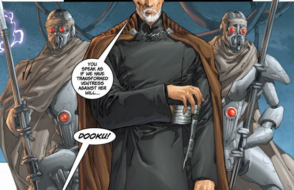
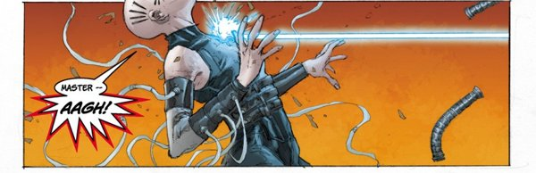

# IG-100 MagnaGuard

- **Aliases:** MagnaGuard, MagnaGuards
- **Era:** Prequel
- **Continuity:** default Legends; entries present for: Canon, Legends
- **Research tier:** untiered (not listed as INTRO/DEEP/MASTERY in legends-feats.md)
- **Entries:** 25 (13 with quotations; 0 quotations extended to the full sentence/passage from the source text on file; 28 marked as fragments). Rebuilt 2026-11-17 from 31 old entries; old file: `characters/_bak/magnaguard.md.bak-20261117`.
- **How to read:** each entry is the quotation in full (block quote), then its source and point of view. "Note" lines are summaries from our notes, not quotations. `[fragment — full passage not on file]` means the source text is not on the box, so only the words in our notes are shown. Debate and forum material is in the last section and is unverified.

# LEGENDS (Legends / EU — main focus)

## Star Wars Insider #108 (2009)

- Note (summary from our notes, not a quotation): Page contents: Cover: Darth Vader; David Prowse interview, Star Wars tattoos, Versus MagnaGuard vs. Imperial (Royal) Guard, Jason Tucker, Matt Lanter and Ashley Eckstein, Oola actress Femi Taylor. No in-universe text. (hand-read)
  — Source: Star Wars Insider #108 (2009).
Our notes: `notes/materials/038-star-wars-insider/108-ins108.md:10`

- Note (summary from our notes, not a quotation): Page contents: Contents cont.: Launch Pad, A Long Time Ago 1997, Versus (Emperor's Royal Guard vs. MagnaGuard), Books (C-3PO and R2-D2's literary moments), Comics (Yuuzhan Vong), Collecting (Darth Vader), Toys, Bounty Hunters, Bantha Tracks, Classic Moment (Vader becomes Anakin again, ROTJ). (hand-read)
  — Source: Star Wars Insider #108 (2009).
Our notes: `notes/materials/038-star-wars-insider/108-ins108.md:20`

> electrostaff or the force pike
> [fragment — full passage not on file]
— Source: Star Wars Insider #108 (2009).
Note (our notes, around the quote): Page contents: Editor's Welcome (Jonathan Wilkins): The Clone Wars shows Anakin as the hero Obi-Wan described; Lanter and Eckstein; Prowse's car once belonged to Kenny Baker; Femi Taylor; Versus Royal Guard vs. MagnaGuard ("electrostaff or the force pike"); Jason Tucker; upcoming 100-page 1999/Episode I salute. (hand-read)
Our notes: `notes/materials/038-star-wars-insider/108-ins108.md:25`

## Star Wars Insider #109 (2009)

- Note (summary from our notes, not a quotation): Page contents: Toys: Basic Fun key chains (Han, Biker Scout, Death Star, Dooku, MagnaGuard, Plo Koon; Cody/Rex/Fox Stack-Ems). Out-of-universe. (hand-read)
  — Source: Star Wars Insider #109 (2009).
Our notes: `notes/materials/038-star-wars-insider/109-ins109.md:362`

## Star Wars Insider #121 (2010)

- Note (summary from our notes, not a quotation): Page contents: Concept art: Carbonite War Droid, Incinerator War Droid, Imperial Riot Trooper whose weapon deflects lightsabers like MagnaGuards (Jia Tan, Christensen). (hand-read)
  — Source: Star Wars Insider #121 (2010).
Our notes: `notes/materials/038-star-wars-insider/121-ins121.md:144`

## Star Wars Insider #128 (2011)

- Note (summary from our notes, not a quotation): Page contents: Jedi Archive: captions (Warren Fu concept art of Grievous and two MagnaGuards; Obi-Wan battling a stuntman later replaced by CG Grievous). (hand-read)
  — Source: Star Wars Insider #128 (2011).
Our notes: `notes/materials/038-star-wars-insider/128-ins128.md:216`

## Star Wars Visual Dictionaries, Episodes I–VI (DK, 1998–2005) + The Phantom Menace Expanded Visual Dictionary (DK, 2012)

> UNKNOWN TO THE JEDI until he battled them on the Separatist foundry world of Hypori, General Grievous was actually present at the Battle of Geonosis
> [fragment — full passage not on file]
>
> laying waste to entire worlds and populations, and leaving trails of blood
> [fragment — full passage not on file]
>
> does not consider himself a droid
> [fragment — full passage not on file]
>
> does not understand why he cannot assassinate Palpatine.
> [fragment — full passage not on file]
>
> can dislocate his shoulders and split his two arms into four
> [fragment — full passage not on file]
>
> secretly humiliated at having been resurrected as a cyborg.
> [fragment — full passage not on file]
>
> The blade of Jedi Master Puroth
> [fragment — full passage not on file]
>
> Anakin has no one to guide him
> [fragment — full passage not on file]
>
> Grievous's hatred of the Jedi goes back to his former life as a Kaleesh warlord. Grievous captured his first lightsaber from a Jedi he defeated, and his collection has expanded ever since.
>
> Neither Force-sensitive nor a Sith, the cyborg general was trained in lightsaber combat by Darth Tyranus, and is more than a match for most Jedi.
>
> Upgraded LX-44 legs
> [fragment — full passage not on file]
>
> Cape contains sheath pockets for lightsabers
> [fragment — full passage not on file]
— Source: Star Wars Revenge of the Sith: The Visual Dictionary (DK, 2005): hand-read notes; p22-23 General Grievous [KEY].
Note (our notes, around the quote): p22-23 General Grievous [KEY]: "UNKNOWN TO THE JEDI until he battled them on the Separatist foundry world of Hypori, General Grievous was actually present at the Battle of Geonosis"; Supreme Commander after Geonosis; "laying waste to entire worlds and populations, and leaving trails of blood"; "does not consider himself a droid". Unaware he serves both Sidious and Palpatine; "does not understand why he cannot assassinate Palpatine." DATA FILE: "can dislocate his shoulders and split his two arms into four"; "secretly humiliated at having been resurrected as a cyborg." Weapons of War: wheel bike, energy staff (like MagnaGuards), grappling hook; DT-57 "Annihilator" blaster; "The blade of Jedi Master Puroth"; Palpatine lures Obi-Wan to Utapau so "Anakin has no one to guide him". [KEY] "Grievous's hatred of the Jedi goes back to his former life as a Kaleesh warlord. Grievous captured his first lightsaber from a Jedi he defeated, and his collection has expanded ever since." Original mask carved from Mumuu skull; Alien Warlord [KEY]: Kaleesh vs Huk war; rebuilt after shuttle crash; "Neither Force-sensitive nor a Sith, the cyborg general was trained in lightsaber combat by Darth Tyranus, and is more than a match for most Jedi." Callouts: "Powerful magnetized talons", "Upgraded LX-44 legs", "Cape contains sheath pockets for lightsabers".
Our notes: `notes/materials/047-visual-dictionaries/vd3-ep3.md:26`

> an elite group of warriors and bodyguards
> [fragment — full passage not on file]
>
> Darth Tyranus authorizes Holowan Mechanicals to manufacture the Prototype Self-Motivating Heuristically Programmed Combat Droid, or IG-series 100 MagnaGuard, built to Grievous's specifications and trained by him.
>
> a warm-up round for Obi-Wan's match with the cyborg commander.
> [fragment — full passage not on file]
>
> Each ... specializes in a form of combat
> [fragment — full passage not on file]
>
> resistant to lightsaber strikes
> [fragment — full passage not on file]
>
> capable of neutralizing ray shields
> [fragment — full passage not on file]
>
> Baton shaft cannot be severed by lightsaber
> [fragment — full passage not on file]
>
> even after they have been beheaded or sustained traumatic amputations.
> [fragment — full passage not on file]
>
> a Republic-funded enterprise after the Clone Wars. It reintroduces the IG-series assassin droid
> [fragment — full passage not on file]
>
> A dozen MagnaGuards, hand-picked by Grievous, help abduct Palpatine.
>
> veterans of countless close-quarter engagements
> [fragment — full passage not on file]
— Source: Star Wars Revenge of the Sith: The Visual Dictionary (DK, 2005): hand-read notes; p26-27 MagnaGuards [KEY]: accompanied by.
Note (our notes, around the quote): p26-27 MagnaGuards [KEY]: accompanied by "an elite group of warriors and bodyguards"; "Darth Tyranus authorizes Holowan Mechanicals to manufacture the Prototype Self-Motivating Heuristically Programmed Combat Droid, or IG-series 100 MagnaGuard, built to Grievous's specifications and trained by him." They capture Anakin, Obi-Wan and Palpatine until R2-D2's diversion; Utapau "a warm-up round for Obi-Wan's match with the cyborg commander." Model Guards (black, alabaster, blue, rare gray; 2 m; "Each ... specializes in a form of combat"). Electrostaffs [KEY]: phrik alloy; "resistant to lightsaber strikes"; some "capable of neutralizing ray shields"; "Baton shaft cannot be severed by lightsaber"; head modeled after Krath droid; backup processors allow them to fight "even after they have been beheaded or sustained traumatic amputations." IG-101, IG-102; Kaleesh royal guard stance. DATA FILE: Holowan "a Republic-funded enterprise after the Clone Wars. It reintroduces the IG-series assassin droid"; "A dozen MagnaGuards, hand-picked by Grievous, help abduct Palpatine." Double Trouble: fight in pairs, adjust combat styles to opponents; "veterans of countless close-quarter engagements".
Our notes: `notes/materials/047-visual-dictionaries/vd3-ep3.md:29`

> Master of Port Administration for Pau City for more than 200 standard-years
> [fragment — full passage not on file]
— Source: Star Wars Revenge of the Sith: The Visual Dictionary (DK, 2005): hand-read notes; p47 Tion Medon.
Note (our notes, around the quote): p47 Tion Medon: "Master of Port Administration for Pau City for more than 200 standard-years"; descendant of Timon Medon who unified Utapau; committee killed by MagnaGuards; Pau'ans prefer darkness and raw meat; Lampay Fay (aide-de-camp); Zenoti Arms HB-9 rifle. DATA FILE: water scarce on surface; Pau'an language once had many dialects.
Our notes: `notes/materials/047-visual-dictionaries/vd3-ep3.md:48`

## Star Wars: Obsession #1–5 (Dark Horse, Nov 2004 – Apr 2005)

- Note (summary from our notes, not a quotation): 
  — Source: Star Wars: Obsession: daily-image candidates.
Our notes: `notes/materials/049-obsession/daily-image-candidates.md:67`

- Note (summary from our notes, not a quotation): 
  — Source: Star Wars: Obsession: daily-image candidates.
Our notes: `notes/materials/049-obsession/daily-image-candidates.md:88`

> Boz Pity, C.I.S. Medical Center.
>
> What have they done to you?
>
> You speak as if we have transformed Ventress against her will...
> [fragment — full passage not on file]
— Source: Star Wars: Obsession #5 (Dark Horse, April 2005): hand-read notes; p3: caption.
Note (our notes, around the quote): p3: caption "Boz Pity, C.I.S. Medical Center." Obi-Wan: "What have they done to you?" Dooku (with two MagnaGuards) [KEY crop candidate]: "You speak as if we have transformed Ventress against her will..." Obi-Wan: "Dooku!"
Our notes: `notes/materials/049-obsession/ob-05.md:9`

> Don't you deign to pity me, Kenobi!
>
> I am fear. I am the queen of a blood-soaked planet and an architect of genocide. I have helped to crack the galaxy in half with this war and conquered every enemy I have ever faced -- including death.
>
> All except for you.
> [fragment — full passage not on file]
— Source: Star Wars: Obsession #5 (Dark Horse, April 2005): hand-read notes.
Note (our notes, around the quote): p5 [KEY crop candidate: Ventress bursts from tank, eye glowing]: "-- AAAIGH!" SFX "KA-KRACK!", "THOK!" (she smashes a MagnaGuard head). Ventress: "Don't you deign to pity me, Kenobi!" "I am fear. I am the queen of a blood-soaked planet and an architect of genocide. I have helped to crack the galaxy in half with this war and conquered every enemy I have ever faced -- including death." "All except for you." Dooku: "Finish him, Ventress." Her curved saber hilts ignite.
Our notes: `notes/materials/049-obsession/ob-05.md:11`

- Note (summary from our notes, not a quotation): p7: Grievous (green + blue sabers) cuts through clones; MagnaGuard "ZZZT!"; blue-armored ARC (Alpha?) thrown: "AAGGGH!" [crop candidate: Grievous splash].
  — Source: Star Wars: Obsession #5 (Dark Horse, April 2005): hand-read notes.
Our notes: `notes/materials/049-obsession/ob-05.md:13`

> Ventress! Listen to me. We're here to help you.
>
> You don't need to be alone any longer!
>
> You'll never convert me to your cause!
>
> My loyalty is to Count Dooku and none other!
>
> But where does his loyalty lie, Ventress?
>
> Locate Grievous and Ventress, if they still live. Kill any clones you encounter, but leave the Jedi to me.
— Source: Star Wars: Obsession #5 (Dark Horse, April 2005): hand-read notes.
Note (our notes, around the quote): p13: Anakin: "No!" SFX "FSSAASHH!" Obi-Wan (holding Anakin back, stepping between): "Ventress! Listen to me. We're here to help you." "You don't need to be alone any longer!" Ventress: "You'll never convert me to your cause!" "My loyalty is to Count Dooku and none other!" Bridging caption (Obi-Wan's voice): "But where does his loyalty lie, Ventress?" Dooku to MagnaGuards: "Locate Grievous and Ventress, if they still live. Kill any clones you encounter, but leave the Jedi to me."
Our notes: `notes/materials/049-obsession/ob-05.md:19`

> Wha --?! You can't think these droids will stop me...
> [fragment — full passage not on file]
>
> -- but they will keep you occupied while I make my departure.
> [fragment — full passage not on file]
>
> -- we have located and recovered General Grievous. He lives.
> [fragment — full passage not on file]
— Source: Star Wars: Obsession #5 (Dark Horse, April 2005): hand-read notes; p15: MagnaGuards seize Mace. Mace.
Note (our notes, around the quote): p15: MagnaGuards seize Mace. Mace: "Wha --?! You can't think these droids will stop me..." Dooku: "No --" Mace: "OOF!" (tumbles downhill) Dooku: "-- but they will keep you occupied while I make my departure." MagnaGuard: "Sir --" "-- we have located and recovered General Grievous. He lives."
Our notes: `notes/materials/049-obsession/ob-05.md:21`

> Good. Take him to the escape shuttle.
>
> He cost too much to let him go to waste.
>
> You see! Dooku flees without you! He would leave you here to die!
— Source: Star Wars: Obsession #5 (Dark Horse, April 2005): hand-read notes; p16: MagnaGuards carry damaged Grievous. Dooku.
Note (our notes, around the quote): p16: MagnaGuards carry damaged Grievous. Dooku: "Good. Take him to the escape shuttle." "He cost too much to let him go to waste." Obi-Wan: "You see! Dooku flees without you! He would leave you here to die!" Ventress: "Liar!"
Our notes: `notes/materials/049-obsession/ob-05.md:22`

> I have visual confirmation. Commander Ventress is alive.
>
> She'll never reach us in time. The Jedi are already regrouping.
>
> She has failed me at every turn. Before she becomes a captive of the Republic -- -- finish her.
— Source: Star Wars: Obsession #5 (Dark Horse, April 2005): hand-read notes; p17 [KEY]: Ventress runs after Dooku: "Master!" "Master!" MagnaGuard.
Note (our notes, around the quote): p17 [KEY]: Ventress runs after Dooku: "Master!" "Master!" MagnaGuard: "I have visual confirmation. Commander Ventress is alive." Other: "She'll never reach us in time. The Jedi are already regrouping." Dooku: "She has failed me at every turn. Before she becomes a captive of the Republic -- -- finish her." MagnaGuard fires a rifle bolt into her back. Ventress: "Master -- AAGH!" [crop candidate: Ventress shot]
Our notes: `notes/materials/049-obsession/ob-05.md:23`

## Prima Official Game Guide: *Star Wars: The Clone Wars — Lightsaber Duels* / *Jedi Alliance* (flip-book)

- Note (summary from our notes, not a quotation): Coruscant — Ziro’s palace (JA pp. 25–30). The Council needs "the Nightsister Ros Lai". Padmé sends C-3PO and R2-D2, a MagnaGuard captures them, and R2 breaks free from Treadwell droids.
  — Source: Prima Jedi Alliance (Nintendo DS) guide — part 3 (eGuide-only half, read in full).
Our notes: `notes/materials/054-prima-lightsaber-duels/ld-03-jedi-alliance.md:39`

> He wonders if you would be more suited to work as a speed bump.
>
> He swears you are the sorriest excuse for a droid and would be more useful melted down. *(JA p. 27)*
— Source: Prima Jedi Alliance (Nintendo DS) guide — part 3 (eGuide-only half, read in full); C-3PO's translation-trick dialogue to the MagnaGuard is printed.
Label in our notes: / (JA p. 27
Context: Coruscant — Ziro’s palace (JA pp. 25–30). The Council needs "the Nightsister Ros Lai". Padmé sends C-3PO and R2-D2, a MagnaGuard captures them, and R2 breaks free from Treadwell droids.
Our notes: `notes/materials/054-prima-lightsaber-duels/ld-03-jedi-alliance.md:40`

> Asajj Ventress, Dooku’s dome-headed drone. *(JA p. 30)*
— Source: Prima Jedi Alliance (Nintendo DS) guide — part 3 (eGuide-only half, read in full).
Note (our notes, around the quote): Ziro is found shackled ("make her stop"). The guide calls her "Asajj Ventress, Dooku’s dome-headed drone." (JA p. 30). Ventress retreats.
Context: Coruscant — Ziro’s palace (JA pp. 25–30). The Council needs "the Nightsister Ros Lai". Padmé sends C-3PO and R2-D2, a MagnaGuard captures them, and R2 breaks free from Treadwell droids.
Our notes: `notes/materials/054-prima-lightsaber-duels/ld-03-jedi-alliance.md:41`

> a mysterious woman in blue drops in from the vents. It’s Ros Lai!
> [fragment — full passage not on file]
>
> as long as you can smuggle her off Coruscant.
> [fragment — full passage not on file]
— Source: Prima Jedi Alliance (Nintendo DS) guide — part 3 (eGuide-only half, read in full).
Label in our notes: She helps
Context: Coruscant — Ziro’s palace (JA pp. 25–30). The Council needs "the Nightsister Ros Lai". Padmé sends C-3PO and R2-D2, a MagnaGuard captures them, and R2 breaks free from Treadwell droids.
Our notes: `notes/materials/054-prima-lightsaber-duels/ld-03-jedi-alliance.md:42`

# CANON (Disney canon — kept separate)

## Star Wars Insider #117 (2010)

- Note (summary from our notes, not a quotation): Page contents: Incoming (Chris Spitale): Hasbro TCW Wave 2 figures (cold-weather Obi-Wan and Anakin, heater-pack clone, Firefighter Droid, MagnaGuard, Cad Bane, Commanders Bly, Cody, Stone). (hand-read)
  — Source: Star Wars Insider #117 (2010).
Our notes: `notes/materials/038-star-wars-insider/117-ins117.md:361`

## Star Wars Insider #121 (2010)

- Note (summary from our notes, not a quotation): Page contents: Incoming (Chris Spitale): Hasbro ROTS vintage-style wave (Sidious, Anakin, MagnaGuard, Grievous, Obi-Wan, Cody); TCW vehicles (AT-AP, AAT, swamp speeder, Hyena bomber). (hand-read)
  — Source: Star Wars Insider #121 (2010).
Our notes: `notes/materials/038-star-wars-insider/121-ins121.md:359`

## Star Wars Insider #149 (2014)

- Note (summary from our notes, not a quotation): Page contents: Son of Dathomir: Shadow Collective (Pyke, Black Sun), Nightbrothers under Brother Viscus, Grievous and MagnaGuards, Dooku's secret; Stygeon prison break, shatterax gladiator pit; Barlow on Maul as "the ultimate underdog." KOTOR Omnibus Volume 3 (issues #38-54 plus KOTOR: War, 416 pages; Zayne Carrick, Jarael, Mandalorian Wars). Dark Times Vol. 7: A Spark Remains (Dass Jennir and the Uhumele crew target Vader; Randy Stradley, Doug Wheatley). (hand-read)
  — Source: Star Wars Insider #149 (2014).
Our notes: `notes/materials/038-star-wars-insider/149-ins149.md:388`

# Debate and forum claims (unverified)

Forum posts, Suspect Insight debates and Discord debates, respect threads, and verdicts. These are posters' arguments or quotations they typed; none is checked against the book here unless the entry says so.

_None in our notes._
