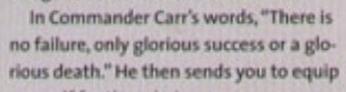

# Malik Carr

- **Aliases:** Commander Carr
- **Era:** NJO
- **Continuity:** default Legends; entries present for: Legends
- **Research tier:** untiered (not listed as INTRO/DEEP/MASTERY in legends-feats.md)
- **Entries:** 7 (3 with quotations; 0 quotations extended to the full sentence/passage from the source text on file; 0 marked as fragments; 2 before the 2026-11-17 fragment fill). Rebuilt 2026-11-17 from 5 old entries; old file: `characters/_bak/malik-carr.md.bak-20261117`.
- **How to read:** each entry is the quotation in full (block quote), then its source and point of view. "Note" lines are summaries from our notes, not quotations. `[fragment — full passage not on file]` means the source text is not on the box, so only the words in our notes are shown. Debate and forum material is in the last section and is unverified.

# LEGENDS (Legends / EU — main focus)

## Star Wars Gamer/Star Wars Gamer 08.pdf [Star Wars Roleplaying Game (d20, 2000)] (scan pages 61–112)

- Note (summary from our notes, not a quotation): Page contents: Hive of the Infidel: commander Malik Carr recruits commandos who speak Basic, aboard the battleship Yammka (hand-read)
  — Source: Star Wars Gamer/Star Wars Gamer 08.pdf [Star Wars Roleplaying Game (d20,.
Our notes: `notes/materials/037-sw-d20-folder/057-star-wars-gamer-08-scan-061-112.md:35`

> “There is no failure, only glorious success or a glorious death.”
— Source: Star Wars Gamer/Star Wars Gamer 08.pdf [Star Wars Roleplaying Game (d20,; Malik Carr — entry/section: Hive of the Infidel.
Note (our notes, around the quote): Malik Carr — entry/section: Hive of the Infidel: "“There is no failure, only glorious success or a glorious death.”" Source: *Star Wars Gamer 08* (SWRPG d20), scan p.67

Our notes: `notes/materials/037-sw-d20-folder/057-star-wars-gamer-08-scan-061-112.md:42`

- Note (summary from our notes, not a quotation): Page contents: Hive of the Infidel: there is a 10% chance a refugee knows Ka-Tu-Un, 20% a crew member and 30% a security staffer (the text puts him in Habitat 3 although the encounter places him in Habitat 4); round up all the Cereans; under no circumstances would normal Vong retreat; Malik Carr would rather they died gloriously; replacement heroes can be commandos left guarding the thrall pilot (hand-read)
  — Source: Star Wars Gamer/Star Wars Gamer 08.pdf [Star Wars Roleplaying Game (d20,.
Our notes: `notes/materials/037-sw-d20-folder/057-star-wars-gamer-08-scan-061-112.md:124`

## NJO 5, *Agents of Chaos II: Jedi Eclipse* (James Luceno, Del Rey 2000): FULL consecutive re-read (2026-11-16 CST)

What it shows (our notes): Malik Carr reveals the targets: "avoiding the Tynnani, Bothan, and Corellian systems. Tynna, especially so."
> Borga grinned broadly. “One more small item, Commander. Since it would be to our mutual advantage that Hutt supply ships refrain from unintentionally bumbling into your operations, is it too much to ask that we be advised of any imminent, uh, activities?”
>
> Malik Carr cut his eyes to Nom Anor. “Exactly as you predicted.”
>
> Nom Anor returned a barely perceptible nod. “Negotiation is also part of their tradition.”
>
> “You do have a keen eye, Executor.”
>
> “A practiced one, Commander.”
>
> Borga watched them without comprehending.
>
> “We were just discussing the terms,” Nom Anor explained.
>
> “Consider our request an accommodation,” Borga said offhandedly. “A show of confidence.”
>
> “What you ask seems harmless enough,” Malik Carr allowed. “As you say, Borga, we certainly wouldn’t want your spice vessels inadvertently disrupting our activities.”
>
> “As I say, Commander.”
>
> “Until further notice, then, you may want to consider avoiding the Tynnani, Bothan, and Corellian systems. Tynna, especially so.”
>
> Borga’s broad grin returned with interest. “Tynna, Bothawui, and Corellia … As it happens, Commander, we do limited business in all of those systems.”
>
> Malik Carr sniffed arrogantly. “I suggest you reduce your business to zero.”
>
> No sooner had the Yuuzhan Vong entourage left the palace than three Hutts hurried into Borga’s court. A young Hutt, uniformly tan in color, slithered in on his own power; an older one, with a stripe of green pigmentation running down his spine and tapered tail, was borne in on a litter supported by a dozen leathery-skinned Weequays; and an even more aged one, sporting a wispy gray beard, made use of a hoversled.
— Source: The New Jedi Order: Agents of Chaos II: Jedi Eclipse (James Luceno, Del Rey 2000), JE ch. 4 — 118 Jedi Eclipse notes (re-read 2026-11-16).
(Excerpt widened 2026-11-17 to the relevant passage, word for word from Jedi Eclipse (James Luceno) (text copy `MEGA_Legend_The_New_Jedi_Order_Series_Star_Wars_New_Jedi_Order_05_Agents_of_Chaos_02_Jedi_Eclipse_James_Luceno_epub`).)
(Excerpt widened 2026-11-17 to the relevant passage, word for word from Jedi Eclipse (James Luceno) (text copy `MEGA_Legend_The_New_Jedi_Order_Series_Star_Wars_New_Jedi_Order_05_Agents_of_Chaos_02_Jedi_Eclipse_James_Luceno_epub`).)
(Fragment completed 2026-11-17: full sentence/passage matched word for word in the source text on file: `MEGA_Legend_The_New_Jedi_Order_Series_Star_Wars_New_Jedi_Order_05_Agents_of_Chaos_02_Jedi_Eclipse_James_Luceno_epub`.)
Note text that was attached to the quote line: (JE ch. 4) — **Malik Carr reveals the targets: "avoiding the Tynnani, Bothan, and Corellian systems. Tynna, especially so."**
Our notes: `notes/materials/118-njo-05-jedi-eclipse/je-01.md:42`

What it shows (our notes): Malik Carr: Tynna's waters will grow dovin basals "of the size needed to remove the shields that guard Coruscant"; the spice-trail disinformation: "Tynna was deliberately won as a means of fortifying the disinformation"; Choka spotted the stealth craft
> The eyes of the facsimile fixed on Nas Choka. “Inform me of recent events, Supreme Commander.”
>
> “We occupy the world called Tynna, Potent One, which fell to us with so meager a fight we might have deemed it unworthy were it not so well suited to our needs and our campaign.”
>
> The eyes moved to Malik Carr. “I would hear more of this.”
>
> “Tynna’s clement waters will one day furnish dovin basals of the size needed to remove the shields that guard Coruscant and other worlds of the Core. It is our conviction that the indigenous species—furred bipeds of diminutive size—can be reeducated and trained, and will make for able and affable tenders of our creations.”
>
> “And as to Tynna’s importance to the conquest?”
>
> “Potent One, the world will also serve as a staging area for eventual incursions into the Corellian and Bothan sectors.”
>
> “Eventual, you say.”
>
> “Tynna is but the first stage of a strategy that will speed us to the Core. To guarantee this, we entered into an agreement with the Hutts, the terms of which require that we apprise them of planetary systems to avoid in their dispersal of a ludicrous product called spice. We did so in complete expectation that they would either alert the New Republic, or that New Republic analysts would discover that spice was moving freely in some sectors and not at all in others, and leap to the conclusion that the latter provided a glimpse of our battle plan. Tynna was one of the worlds we cautioned the Hutts to avoid, along with Corellia and Bothawui. Tynna was deliberately won as a means of fortifying the disinformation.”
>
> The villip was silent for a long moment. “The meager battle you waged suggests that the New Republic failed to behave as predicted. Otherwise, their fleet would have been lying in wait.”
>
> “Testimony to the New Republic’s notion of cleverness, Warmaster,” Nas Choka answered. “Through the whole of the battle and its aftermath we observed spies observing us from a stealthy craft I’m certain they believe went undetected. To have met us in force might have saved the day for Tynna, but the New Republic is well aware that we have targets of greater significance in mind, so they purposely gave Tynna away.
>
> “With tribute to Commander Malik Carr,” Choka continued, “I am now convinced that the same tactic will work for the planned assault. Many coralskipper pilots are readying themselves for the sacrifice the attack will require. And we will soon begin positioning autonomous dovin basals along the routes New Republic ships will use in jumping to the target once they learn the truth.”
>
> “Then these Hutts alerted the New Republic?”
>
> “I deem it of little consequence either way, Potent One. As a bonus, the Hutts will make for bountiful sacrifices when we’re finished with them.”
— Source: The New Jedi Order: Agents of Chaos II: Jedi Eclipse (James Luceno, Del Rey 2000), JE ch. 16 — 118 Jedi Eclipse notes (re-read 2026-11-16).
(Excerpt widened 2026-11-17 to the relevant passage, word for word from Jedi Eclipse (James Luceno) (text copy `MEGA_Legend_The_New_Jedi_Order_Series_Star_Wars_New_Jedi_Order_05_Agents_of_Chaos_02_Jedi_Eclipse_James_Luceno_epub`).)
(Excerpt widened 2026-11-17 to the relevant passage, word for word from Jedi Eclipse (James Luceno) (text copy `MEGA_Legend_The_New_Jedi_Order_Series_Star_Wars_New_Jedi_Order_05_Agents_of_Chaos_02_Jedi_Eclipse_James_Luceno_epub`).)
(Fragment completed 2026-11-17: full sentence/passage matched word for word in the source text on file: `MEGA_Legend_The_New_Jedi_Order_Series_Star_Wars_New_Jedi_Order_05_Agents_of_Chaos_02_Jedi_Eclipse_James_Luceno_epub`.)
Note text that was attached to the quote line: (JE ch. 16) — **Malik Carr: Tynna's waters will grow dovin basals "of the size needed to remove the shields that guard Coruscant"; the spice-trail disinformation: "Tynna was deliberately won as a means of fortifying the disinformation"; Choka spotted the stealth craft**
Our notes: `notes/materials/118-njo-05-jedi-eclipse/je-03.md:17`

# Debate and forum claims (unverified)

Forum posts, Suspect Insight debates and Discord debates, respect threads, and verdicts. These are posters' arguments or quotations they typed; none is checked against the book here unless the entry says so.

_None in our notes._

# NJO FULL re-read additions (2026-11-17)
Verbatim excerpts from the full consecutive re-read of the New Jedi Order novels (Dark Journey through The Unifying Force), each shown with the text around it and its source chapter.

## *The Unifying Force*
Carr admits he is dying of disease and no longer hates them.

> Carr inhaled raggedly. “I’m dying,” he said in disbelief. “Neither in battle nor honorably, but of disease. Life turned against other life. It is something unknown to us, because we are symbiotic with all life—our biots, our weapons, our foodstuffs … We don’t die of disease, or of starvation. Many of us live three times as long as the human species in this galaxy, and yet we have been felled by another living thing.”
>
> He almost grinned. “Yun-Harla is either laughing or outraged. Who can tell anymore? I suppose I should take some measure of comfort in the fact that I will see all of you die first, but somehow the fight has gone out of me. You are infidels, yes. You are ignorant and primitive, and you have chosen to consort with machines, as if they were living beings. But though I pity you for that, I no longer hate you for it. However, you do need to die, if only on the off chance that your sacrifices will persuade the gods to spare the life of our war coordinator.”
>
> He turned slightly and lifted his gaze, as if to the yammosk. “Are you even capable of directing a flight of coralskippers? I think not, poor creature. But I know that, like me, you will die trying.”

— Source: *The Unifying Force* (James Luceno, Del Rey 2004), chapter 25 (UF).

Carr salutes Page as the yammosk dies.

> The yammosk issued an earsplitting screech of agony. Its tentacles flailed for several seconds; then the bloated beast bobbed lifelessly to the surface of the agitated pool.
>
> Malik Carr hauled himself to his feet and lifted one of the amphistaffs, which hung over his hand like a length of rope. “As docile as a mascot.” He looked at Page. “You have won the day, Captain. I salute you.”

— Source: *The Unifying Force* (James Luceno, Del Rey 2004), chapter 25 (UF).

