# Mara Jade Skywalker — part 1 of 3

[All parts](README.md) · [Next](02-legends-njo-2-dark-tide-i-onslaught-michael-a-stac.md)

# Mara Jade Skywalker

- **Aliases:** Mara Jade, Mara
- **Era:** GCW–LotF
- **Continuity:** default Legends; entries present for: Canon, Legends
- **Research tier:** MASTERY (Jedi Academy trilogy 026 version only: Jedi Search, Dark Apprentice, Champions of the Force; primary read 2026-10-28); DEEP
- **Entries:** 1679 (1010 with quotations; 380 marked as fragments; recounted after the public-release cleanup). Rebuilt 2026-11-17 from 2000 old entries; old file: `characters/_bak/mara-jade.md.bak-20261117`.
- **How to read:** each entry is the quotation in full (block quote), then its source and point of view. "Note" lines are summaries from our notes, not quotations. `[fragment — full passage not on file]` means the source text is not on the box, so only the words in our notes are shown. Debate and forum material is in the last section and is unverified.

# LEGENDS (Legends / EU — main focus)

## Legacy of the Force 1–9: novel notes from the other agent (reference copy)

- Note (summary from our notes, not a quotation): Ch17–21: Peace talks at Toryaz Station. A commando raid hits every delegation at once; Luke, Mara, Jacen, Jaina, Zekk, Han and Leia repel it (Ch19–20). Investigation follows.
  — Source: Legacy of the Force 1: Betrayal (novel): feats, scaling and story notes.
Our notes: `notes/materials/021-legacy-of-the-force/lotf-1-betrayal-notes.md:19`

- Note (summary from our notes, not a quotation): Ch29–33: The Bimmiel-area asteroid. Phantoms separate Ben and Nelani; a phantom Luke tests Jacen. Simultaneously phantom Jacen and phantom Ben attack Luke and Mara on Coruscant. Brisha reveals she is Lumiya; Nelani fights her; Jacen's foresight shows Luke dying by his hand along every path where Nelani lives; he kills Nelani.
  — Source: Legacy of the Force 1: Betrayal (novel): feats, scaling and story notes.
Our notes: `notes/materials/021-legacy-of-the-force/lotf-1-betrayal-notes.md:21`

> Mara’s blue lightsaber blade, flashing out from the doorway, cut up through the barrel at an angle and continued across the attacker’s neck. The front half of the rifle and the woman’s hand fell away, then her head rolled off, smoking at the point of the lightsaber contact, to topple to the floor.
— Source: Legacy of the Force 1: Betrayal (novel): feats, scaling and story notes; | F17 | Ch19 | L4141 | Mara |.
(Excerpt widened 2026-11-17 to the relevant passage, word for word from Betrayal (Aaron Allston), Chapter Nineteen (text copy `MEGA_Legend_The_Legacy_of_the_Force_Series_Star_Wars_Legacy_of_the_Force_01_Betrayal_Aaron_Allston_epub`).)
Context: | # | Ch | Line | Character | Feat (exact quote) |
Our notes: `notes/materials/021-legacy-of-the-force/lotf-1-betrayal-notes.md:52`

> As the Sith Mara’s Force attack swept him away from her, Ben switched his lightsaber off. Whirling within the power of her attack, instead of fighting against it, he added some Force energy of his own—shoving him laterally across the direction of her attack, and suddenly he was being swept at almost right angles to the direction she’d sent him. For half the duration of each spin he was making, he could see her, illuminated by her lightsaber, and now she was looking in the wrong direction; his maneuver had worked.
— Source: Legacy of the Force 1: Betrayal (novel): feats, scaling and story notes; | F24 | Ch31 | L7463 | Ben vs phantom Mara |.
(Excerpt widened 2026-11-17 to the relevant passage, word for word from Betrayal (Aaron Allston), Chapter Thirty-One (text copy `MEGA_Legend_The_Legacy_of_the_Force_Series_Star_Wars_Legacy_of_the_Force_01_Betrayal_Aaron_Allston_epub`).)
(Full sentence/passage taken from the source text on file: `lotf_tmp_b1_epub`.)
Context: | # | Ch | Line | Character | Feat (exact quote) |
Our notes: `notes/materials/021-legacy-of-the-force/lotf-1-betrayal-notes.md:59`

> it was her foot that came up, snapping into his gut with the power of a combat droid's pistolling arm
> [fragment — full passage not on file]
— Source: Legacy of the Force 1: Betrayal (novel): feats, scaling and story notes; | F25 | Ch31 | L7485 | phantom Mara vs Ben |.
Context: | # | Ch | Line | Character | Feat (exact quote) |
Our notes: `notes/materials/021-legacy-of-the-force/lotf-1-betrayal-notes.md:60`

> At the end of his spin, Luke stood up, and something fell away from each of his attackers
> [fragment — full passage not on file]
— Source: Legacy of the Force 1: Betrayal (novel): feats, scaling and story notes; | D5 | Ch19 | L4159 | Luke, Mara, Jacen vs commando raiders |.
Note (our notes, around the quote): | D5 | Ch19 | L4159 | Luke, Mara, Jacen vs commando raiders | «At the end of his spin, Luke stood up, and something fell away from each of his attackers» | Jedi rout an anti-Jedi team (nets, poison) |
Context: | # | Ch | Line | Fight | Result (exact quote) | Context / what it suggests |
Our notes: `notes/materials/021-legacy-of-the-force/lotf-1-betrayal-notes.md:111`

> Mara danced back and to one side, out of range of the attack, and negligently waved a hand at the boy. His eyes widened as her wash of Force energy caught him and threw him against a wall.
— Source: Legacy of the Force 1: Betrayal (novel): feats, scaling and story notes; | D8 | Ch31 | L7241 | Mara vs phantom Ben |.
(Excerpt widened 2026-11-17 to the relevant passage, word for word from Betrayal (Aaron Allston), Chapter Thirty-One (text copy `MEGA_Legend_The_Legacy_of_the_Force_Series_Star_Wars_Legacy_of_the_Force_01_Betrayal_Aaron_Allston_epub`).)
(Full sentence/passage taken from the source text on file: `lotf_tmp_b1_epub`.)
Note (our notes, around the quote): | D8 | Ch31 | L7241 | Mara vs phantom Ben | «threw him against a wall» | Mara wins the exchange; phantom vanishes |
Context: | # | Ch | Line | Fight | Result (exact quote) | Context / what it suggests |
Our notes: `notes/materials/021-legacy-of-the-force/lotf-1-betrayal-notes.md:114`

> In slow motion, he felt the wind leaving his lungs, felt himself folding over her foot, felt his internal organs compress and bruise. Then he was flying away, blackness washing across his eyes where the image of his mother had been.
— Source: L7481 — Legacy of the Force 1: Betrayal (novel): feats, scaling and story notes; | D9 | Ch31 | L7487 | Ben vs phantom Mara |.
(Full sentence/passage taken from the source text on file: `lotf_tmp_b1_epub`.)
Note (our notes, around the quote): | D9 | Ch31 | L7487 | Ben vs phantom Mara | «Then he was flying away, blackness washing across his eyes» | Ben loses (KO); he would not strike his mother's face (L7481) |
Context: | # | Ch | Line | Fight | Result (exact quote) | Context / what it suggests |
Our notes: `notes/materials/021-legacy-of-the-force/lotf-1-betrayal-notes.md:115`

- Note (summary from our notes, not a quotation): Lumiya: superior technique vs a Knight (D11), multi-phantom coordination (F27), even TK push-of-war with Nelani while talking (F31, she is visibly straining, L7897). Fits the existing `verdicts.md` entries Mara ≥ Lumiya and Luke > Lumiya.
  — Source: Legacy of the Force 1: Betrayal (novel): feats, scaling and story notes.
Our notes: `notes/materials/021-legacy-of-the-force/lotf-1-betrayal-notes.md:125`

- Note (summary from our notes, not a quotation): Mara: routs a phantom Ben (D8) and kills an armored commando (F17) in the opening second of a raid.
  — Source: Legacy of the Force 1: Betrayal (novel): feats, scaling and story notes.
Our notes: `notes/materials/021-legacy-of-the-force/lotf-1-betrayal-notes.md:126`

- Note (summary from our notes, not a quotation): Ben (13–14): competent apprentice, KO'd by phantom Mara (D9, S20).
  — Source: Legacy of the Force 1: Betrayal (novel): feats, scaling and story notes.
Our notes: `notes/materials/021-legacy-of-the-force/lotf-1-betrayal-notes.md:127`

- Note (summary from our notes, not a quotation): Feats: helps Jacen through the factory and turbolift (F3); cuts the Adumari airspeeder (L417–L421); outmaneuvers phantom Mara's TK (F24).
  — Source: L417–L421 — Legacy of the Force 1: Betrayal (novel): feats, scaling and story notes.
Our notes: `notes/materials/021-legacy-of-the-force/lotf-1-betrayal-notes.md:152`

- Note (summary from our notes, not a quotation): Fights: D4 (stopped by shock tech), D9 (KO'd by phantom Mara).
  — Source: Legacy of the Force 1: Betrayal (novel): feats, scaling and story notes.
Our notes: `notes/materials/021-legacy-of-the-force/lotf-1-betrayal-notes.md:154`

What it shows (our notes): Role/arc: Luke's partner; protective of Ben («is more open. More trusting.», L673).
> “Ben,” Mara said, “is more open. More trusting.” Her words, directed at Jacen, were as much question as statement.
— Source: Legacy of the Force 1: Betrayal (novel): feats, scaling and story notes; Role/arc: Luke's partner; protective of Ben (.
(Excerpt widened 2026-11-17 to the relevant passage, word for word from Betrayal (Aaron Allston), Chapter Four (text copy `MEGA_Legend_The_Legacy_of_the_Force_Series_Star_Wars_Legacy_of_the_Force_01_Betrayal_Aaron_Allston_epub`).)
(Full sentence/passage taken from the source text on file: `lotf_tmp_b1_epub`.)
Our notes: `notes/materials/021-legacy-of-the-force/lotf-1-betrayal-notes.md:158`

- Note (summary from our notes, not a quotation): Feats: one-motion kill through rifle and neck (F17); Force-throws phantom Ben (F22); Force-pulls her saber from sleep (L7229).
  — Source: L7229 — Legacy of the Force 1: Betrayal (novel): feats, scaling and story notes.
Our notes: `notes/materials/021-legacy-of-the-force/lotf-1-betrayal-notes.md:159`

> “We’ll find him,” Mara said. “And we’ll beat him.” *(L8275)*
— Source: L8275 — Legacy of the Force 1: Betrayal (novel): feats, scaling and story notes; Statements: Mara: «We'll find him,» ….
(Full sentence/passage taken from the source text on file: `lotf_tmp_b1_epub`.)
Note (our notes, around the quote): Statements: Mara: «We'll find him,» … «And we'll beat him.» (L8275).
Our notes: `notes/materials/021-legacy-of-the-force/lotf-1-betrayal-notes.md:160`

- Note (summary from our notes, not a quotation): Fights: D5, D8 (wins).
  — Source: Legacy of the Force 1: Betrayal (novel): feats, scaling and story notes.
Our notes: `notes/materials/021-legacy-of-the-force/lotf-1-betrayal-notes.md:161`

- Note (summary from our notes, not a quotation): Scaling: Master-level combatant; nothing here changes Mara ≥ Lumiya.
  — Source: Legacy of the Force 1: Betrayal (novel): feats, scaling and story notes.
Our notes: `notes/materials/021-legacy-of-the-force/lotf-1-betrayal-notes.md:162`

- Note (summary from our notes, not a quotation): Scaling: strong dark-sider with exceptional illusion range; below Luke and Mara in direct combat (other LotF books).
  — Source: Legacy of the Force 1: Betrayal (novel): feats, scaling and story notes.
Our notes: `notes/materials/021-legacy-of-the-force/lotf-1-betrayal-notes.md:169`

- Note (summary from our notes, not a quotation): Scaling: Knight; below Luke/Mara/Jacen.
  — Source: Legacy of the Force 1: Betrayal (novel): feats, scaling and story notes.
Our notes: `notes/materials/021-legacy-of-the-force/lotf-1-betrayal-notes.md:181`

- Note (summary from our notes, not a quotation): Headline: this book has no lightsaber duel between major Force users. No Jacen vs. Luke, no Mara vs. Lumiya, and Alema Rar does not appear. Its scaling value comes from Jacen's stealth, illusion, and mind feats against Luke, from narration that directly compares Jacen with Luke and with Anakin/Vader, and from the Jacen–Lumiya power relationship.
  — Source: Legacy of the Force 2: Bloodlines (novel), feats and scaling notes.
Our notes: `notes/materials/021-legacy-of-the-force/lotf-2-bloodlines-notes.md:11`

What it shows (our notes): Ch3 · L1157 · Jacen vs. Luke and Mara (FEAT, concealment): «He hadn't even felt Jacen enter the room. The fact that Jacen could startle him was disturbing.» (Luke POV). Jacen then floods the room with his presence: «So he wants to show me how powerful he is.» *Context:* Luke and Mara were not hunting for him, but neither felt him. Earlier, Mara feels him «just blinked out» (L1049).
> He hadn't even felt Jacen enter the room. The fact that Jacen could startle him was disturbing. *(Luke POV)*
>
> He hadn’t even felt Jacen enter the room. The fact that Jacen could startle him was disturbing. Mara turned, too, and even though Jacen was standing there in front of them, Luke couldn’t feel him, and—judging by her expression and her little flare of anxiety in the Force—Mara couldn’t, either. Then, like scent suddenly wafting up from a blossom, Jacen’s presence was there, all around them, magnified. So he wants to show me how powerful he is. Luke regretted the hostility in his thoughts. But it did nothing to reassure him.
— Source: Ch3 · L1157; L1049 — Legacy of the Force 2: Bloodlines (novel), feats and scaling notes; Ch3 · L1157 · Jacen vs. Luke and Mara (FEAT, concealment).
(Excerpt widened 2026-11-17 to the relevant passage, word for word from Bloodlines (Karen Traviss), Chapter Three (text copy `MEGA_Legend_The_Legacy_of_the_Force_Series_Star_Wars_Legacy_of_the_Force_02_Bloodlines_Karen_Traviss_epub`).)
Our notes: `notes/materials/021-legacy-of-the-force/lotf-2-bloodlines-notes.md:46`

What it shows (our notes): Ch15 · L5869 · Jacen vs. Luke and Mara (FEAT, emotional masking): he «suppressed his detectable feelings further so that he presented quiet bewilderment to Luke and Mara». This works, though Luke had felt him «flinch as if he'd had an electric shock» (L5857) at a touch.
> Jacen inclined his head politely and suppressed his detectable feelings further so that he presented quiet bewilderment to Luke and Mara. The doors of the side room closed behind them.
>
> But Jacen sensed him flinch as if he’d had an electric shock. *(L5857)*
— Source: Ch15 · L5869; L5857 — Legacy of the Force 2: Bloodlines (novel), feats and scaling notes.
(Excerpt widened 2026-11-17 to the relevant passage, word for word from Bloodlines (Karen Traviss), Chapter Fifteen (text copy `MEGA_Legend_The_Legacy_of_the_Force_Series_Star_Wars_Legacy_of_the_Force_02_Bloodlines_Karen_Traviss_epub`).)
(Full sentence/passage taken from the source text on file: `novels_tmp_bloodlines_bloodlines_epub`.)
Our notes: `notes/materials/021-legacy-of-the-force/lotf-2-bloodlines-notes.md:86`

What it shows (our notes): S2 · L837 · Mara on Jacen: «No, I feel that Jacen's developing powers way beyond mine, and that he's good for Ben». *Sincere.* Mara is biased toward Jacen at this point, but this is still a Jedi Master putting Jacen above herself. Important for Caedus vs. Mara (Sacrifice).
> “No, I feel that Jacen’s developing powers way beyond mine, and that he’s good for Ben, and that he would never harm him.” She stepped back from Luke and he sensed she was shutting him out now, perhaps to stop the conversation from degenerating into an argument that would have no winners. “That makes him a good influence. Without Jacen, we’d have a teenage son with strong Force powers who won’t listen to us. Now that’s really dangerous.”
— Source: Legacy of the Force 2: Bloodlines (novel), feats and scaling notes; S2 · L837 · Mara on Jacen.
(Excerpt widened 2026-11-17 to the relevant passage, word for word from Bloodlines (Karen Traviss), Chapter Two (text copy `MEGA_Legend_The_Legacy_of_the_Force_Series_Star_Wars_Legacy_of_the_Force_02_Bloodlines_Karen_Traviss_epub`).)
(Full sentence/passage taken from the source text on file: `novels_tmp_bloodlines_bloodlines_epub`.)
Also cited as: Star Wars Legacy of the Force Bloodlines.
Also noted as: Mara Jade Skywalker said Jacen Solo's powers were way beyond her powers.
Also cited as: SI respect-thread directory: Mara Jade Skywalker Respect Thread (2022) — https://www.suspectinsightforums.com/t4439-mara-jade-skywalker-respect-thread-2022.
Also noted as: As of 40ABY, Jacen is still only in the process of developing powers well beyond Mara, thus he hasn't actually reached this level yet:
Our notes: `notes/materials/021-legacy-of-the-force/lotf-2-bloodlines-notes.md:113`; `suspect-insight/respect-threads/darth-caedus.md:140`; `suspect-insight/respect-threads/mara-jade.md:308`

> “No, I feel that Jacen’s developing powers way beyond mine, and that he’s good for Ben, and that he would never harm him.” *(L837)*
>
> She was far more attuned to Jacen than Luke was, and he wondered if she kept tabs on her nephew as a precaution. *(L1051)*
— Source: L837; L1051 — Legacy of the Force 2: Bloodlines (novel), feats and scaling notes; Mara: Jacen's.
(Full sentence/passage taken from the source text on file: `novels_tmp_bloodlines_bloodlines_epub`.)
Note (our notes, around the quote): Mara: Jacen's «developing powers way beyond mine» (L837). Mara is «far more attuned to Jacen than Luke was» (L1051), which foreshadows her being the one to find him out. No fight happens in this book.
Our notes: `notes/materials/021-legacy-of-the-force/lotf-2-bloodlines-notes.md:159`; `notes/materials/021-legacy-of-the-force/lotf-2-bloodlines-notes.md:269`

- Note (summary from our notes, not a quotation): The road to authoritarianism: the GAG as secret police (Mara, L1741), protesters chanting «The-Empire's-back!» (L5773), emergency powers (L7881–7883).
  — Source: L5773; L7881–7883 — Legacy of the Force 2: Bloodlines (novel), feats and scaling notes.
Our notes: `notes/materials/021-legacy-of-the-force/lotf-2-bloodlines-notes.md:207`

> “No, I feel that Jacen’s developing powers way beyond mine, and that he’s good for Ben, and that he would never harm him.” *(Ch2, L837)*
>
> Jacen was more powerful than any of them except Luke. And he was growing closer to Luke's strength by the day. *(Ch17, L6653)*
>
> You've developed some impressive skills lately. *(Ch6, L3033)*
>
> Because Jacen Solo was becoming a pale imitation of his grandfather, Lord Vader, and would take on more than he had ever bargained for. *(Ch23, L8679)*
— Source: Ch2, L837; Ch17, L6653; Ch6, L3033; Ch23, L8679 — Legacy of the Force 2: Bloodlines (novel), feats and scaling notes; Statements about him: Mara.
(Full sentence/passage taken from the source text on file: `novels_tmp_bloodlines_bloodlines_epub`.)
Note (our notes, around the quote): Statements about him: Mara: «No, I feel that Jacen's developing powers way beyond mine» (Ch2, L837). Narration: «Jacen was more powerful than any of them except Luke. And he was growing closer to Luke's strength by the day.» (Ch17, L6653). Luke: «You've developed some impressive skills lately.» (Ch6, L3033). Fett's closing line calls him «a pale imitation of his grandfather, Lord Vader» (Ch23, L8679).
Our notes: `notes/materials/021-legacy-of-the-force/lotf-2-bloodlines-notes.md:245`

- Note (summary from our notes, not a quotation): Role/arc: a Jedi Master who defends Jacen to Luke out of loyalty, though she is the one most «attuned» to him (L1051), which sets up Sacrifice.
  — Source: L1051 — Legacy of the Force 2: Bloodlines (novel), feats and scaling notes.
Our notes: `notes/materials/021-legacy-of-the-force/lotf-2-bloodlines-notes.md:267`

- Note (summary from our notes, not a quotation): Key feats: none in combat. She senses Jacen «just blinked out» (Ch2, L1049).
  — Source: Ch2, L1049 — Legacy of the Force 2: Bloodlines (novel), feats and scaling notes.
Our notes: `notes/materials/021-legacy-of-the-force/lotf-2-bloodlines-notes.md:268`

- Note (summary from our notes, not a quotation): Fights/results: none.
  — Source: Legacy of the Force 2: Bloodlines (novel), feats and scaling notes.
Our notes: `notes/materials/021-legacy-of-the-force/lotf-2-bloodlines-notes.md:270`

- Note (summary from our notes, not a quotation): Scaling: her own statement puts Jacen above her. That is an early data point for Caedus > Mara (Sacrifice), but it is a statement, not a feat.
  — Source: Legacy of the Force 2: Bloodlines (novel), feats and scaling notes.
Our notes: `notes/materials/021-legacy-of-the-force/lotf-2-bloodlines-notes.md:271`

- Note (summary from our notes, not a quotation): Headline: this is the combat book of the first LotF trilogy. It contains: Tresina Lobi vs. Lumiya + Alema (Ch6), Jacen vs. Aurra Sing (Ch19), Luke + Mara vs. Lumiya + Alema at Roqoo Depot (Ch21), and Jacen ordering the Anakin Solo to fire on the Falcon (Ch23).
  — Source: Legacy of the Force 3: Tempest (novel), feats and scaling notes.
Our notes: `notes/materials/021-legacy-of-the-force/lotf-3-tempest-notes.md:11`

What it shows (our notes): Prologue · L224 · Alema (FEAT, stealth ability): «Lomi Plo-had helped her develop a slippery presence in the Force. Now, as soon as Alema vanished from someone's sight, she also vanished from memory.» This is her signature tool, and it explains how she gets the drop on Luke and Mara later.
> “You must stop the intruder from entering.”
>
> Three Tentacle pressed a nerve bundle, closing the door, then both Quarren pointed their blaster rifles at the heart of the membrane.
>
> “Good,” Alema said.
>
> She turned away from the door, confident the two Quarren had already forgotten her.
>
> During her time with the Killiks, the queen of her nest—a Dark Jedi named Lomi Plo—had helped her develop a slippery presence in the Force.
>
> During her time with the Killiks, the queen of her nest—a Dark Jedi named Lomi Plo—had helped her develop a slippery presence in the Force. Now, as soon as Alema vanished from someone’s sight, she also vanished from memory.
>
> Alema left the vestibule and entered a warren of winding, tunnel-like passages lit by the bioluminescent lichen typical of Yuuzhan Vong-converted buildings. She selected the largest, most heavily trodden corridor and started forward at a brisk pace.
— Source: Legacy of the Force 3: Tempest (novel), feats and scaling notes; Prologue · L224 · Alema (FEAT, stealth ability).
(Excerpt widened 2026-11-17 to the relevant passage, word for word from Star Wars: Legacy of the Force: Tempest (Troy Denning) (text copy `MEGA_Legend_The_Legacy_of_the_Force_Series_Star_Wars_Legacy_of_the_Force_03_Tempest_Troy_Denning_epub`).)
(Excerpt widened 2026-11-17 to the relevant passage, word for word from Star Wars: Legacy of the Force: Tempest (Troy Denning) (text copy `MEGA_Legend_The_Legacy_of_the_Force_Series_Star_Wars_Legacy_of_the_Force_03_Tempest_Troy_Denning_epub`).)
Our notes: `notes/materials/021-legacy-of-the-force/lotf-3-tempest-notes.md:40`

- Note (summary from our notes, not a quotation): Ch10 · L2388–2400 · Luke and Mara (FEAT, danger sense): they detect a booby-trapped detonator on Lumiya's door keypad. Luke also spots the «Force-flash» used to blank cameras (L2338).
  — Source: Ch10 · L2388–2400; L2338 — Legacy of the Force 3: Tempest (novel), feats and scaling notes.
Our notes: `notes/materials/021-legacy-of-the-force/lotf-3-tempest-notes.md:59`

> an all-out attack, but Alema was not much of a challenge and Luke was running out *(L5832; Mara POV)*
>
> As overconfidence always does, Mara's proved costly *(L5834)*
— Source: Ch21 · L5792–5840; L5792; L5808; L5810 — Legacy of the Force 3: Tempest (novel), feats and scaling notes.
(Full sentence/passage taken from the source text on file: `novels_tmp_tempest_tempest_epub`.)
Note (our notes, around the quote): Ch21 · L5792–5840 · Mara vs. Alema (FEAT): Mara dodges the dart on Luke's warning (L5792). Alema stabs through an Arcona at her (L5808), and Mara grazes Alema's lekku (L5810). «Alema was not much of a challenge» (L5832; Mara POV). Then «As overconfidence always does, Mara's proved costly» (L5834): Alema's talons pierce Mara's throat, and her lightning misses narrowly (L5836–5838). Mara's scissor takedown knocks Alema out (L5838–5840). Mara spares her and disarms Alema's dead-man vest (L5846–5848). Result: Mara wins.
Our notes: `notes/materials/021-legacy-of-the-force/lotf-3-tempest-notes.md:75`

> the dead spacer’s holster, allowing the Force to guide his hand, squeezing the trigger *(L5892)*
>
> You can't kill her! *(L5898)*
>
> “In fact, I think we’d better run.” *(L5912)*
— Source: Ch21 · L5892–5900; L5892; L5900; L5898 — Legacy of the Force 3: Tempest (novel), feats and scaling notes.
(Full sentence/passage taken from the source text on file: `novels_tmp_tempest_tempest_epub`.)
Note (our notes, around the quote): Ch21 · L5892–5900 · Luke beats Lumiya (FEAT): falling back under the whip, Luke fires a dead spacer's blaster, «allowing the Force to guide his hand» (L5892). Lumiya goes down with her life-support girdle sparking (L5900). Mara: «You can't kill her!» (L5898), because of the dead-man vest. Mara: «I think we'd better run.» (L5912). Result: Luke wins while one-handed and bleeding out, against a 2v1 that was handled by splitting the pair.
Our notes: `notes/materials/021-legacy-of-the-force/lotf-3-tempest-notes.md:77`

What it shows (our notes): Mara: (L1006). *Opinion.*
> “Come on, Skywalker,” Mara said. “You can’t dispute Jacen’s Force knowledge. And being a Master might pull him back into the Jedi order. It might give you some control over him—at the least, you’d have a formal means to oversee how he’s training Ben.”
>
> The disapproval vanished from Luke’s face. “There’s something to what you’re saying, but I just can’t do it.
>
> The disapproval vanished from Luke’s face. “There’s something to what you’re saying, but I just can’t do it. Jacen isn’t ready to be a Master … and I don’t think he ever will be. The sooner we get Ben away from him, the better.”
>
> Jacen isn’t ready to be a Master … and I don’t think he ever will be. The sooner we get Ben away from him, the better.”
>
> He started through the door toward the changing rooms, but Mara caught him by the arm.
>
> “Actually, Luke, I’m not so sure of that.” She told him about the profound sense of certainty she had experienced earlier, about how convinced she was that the Force had drawn Ben to Jacen for a reason.
>
> You can't dispute Jacen's Force knowledge. *(L1006)*
— Source: L1006 — Legacy of the Force 3: Tempest (novel), feats and scaling notes; S6 · L1008 · Luke.
(Excerpt widened 2026-11-17 to the relevant passage, word for word from Star Wars: Legacy of the Force: Tempest (Troy Denning) (text copy `MEGA_Legend_The_Legacy_of_the_Force_Series_Star_Wars_Legacy_of_the_Force_03_Tempest_Troy_Denning_epub`).)
(Excerpt widened 2026-11-17 to the relevant passage, word for word from Star Wars: Legacy of the Force: Tempest (Troy Denning) (text copy `MEGA_Legend_The_Legacy_of_the_Force_Series_Star_Wars_Legacy_of_the_Force_03_Tempest_Troy_Denning_epub`).)
Our notes: `notes/materials/021-legacy-of-the-force/lotf-3-tempest-notes.md:93`

What it shows (our notes): S11 · L2708 · Lumiya: «Kyp Durron is too stubborn and unpredictable, Mara too committed to her attachments, your sister too ruled by emotion». Luke is «too bound by Jedi dogma» (L2712). *She names the Jedi she considered as candidates.*
> “And that is how I know you won’t fall to the temptations that undid them.” Lumiya paused to think, then added, “Vergere certainly didn’t think so, either … or you wouldn’t have been the one she chose.”
>
> Jacen raised his brow. “There were other candidates?”
>
> “Of course,” Lumiya said. “Do you think we would select someone for such an important role without considering all our options?
>
> “Of course,” Lumiya said. “Do you think we would select someone for such an important role without considering all our options? Kyp Durron is too stubborn and unpredictable, Mara too committed to her attachments, your sister too ruled by emotion—”
>
> “You considered Mara?” Jacen gasped. “And Jaina?”
>
> He was too bound by Jedi dogma.” *(L2712)*
— Source: L2712 — Legacy of the Force 3: Tempest (novel), feats and scaling notes; S11 · L2708 · Lumiya.
(Excerpt widened 2026-11-17 to the relevant passage, word for word from Star Wars: Legacy of the Force: Tempest (Troy Denning) (text copy `MEGA_Legend_The_Legacy_of_the_Force_Series_Star_Wars_Legacy_of_the_Force_03_Tempest_Troy_Denning_epub`).)
(Excerpt widened 2026-11-17 to the relevant passage, word for word from Star Wars: Legacy of the Force: Tempest (Troy Denning) (text copy `MEGA_Legend_The_Legacy_of_the_Force_Series_Star_Wars_Legacy_of_the_Force_03_Tempest_Troy_Denning_epub`).)
(Full sentence/passage taken from the source text on file: `novels_tmp_tempest_tempest_epub`.)
Our notes: `notes/materials/021-legacy-of-the-force/lotf-3-tempest-notes.md:98`

What it shows (our notes): S17 · L4220 · Mara (key): «If you're right-if Jacen has been making a fool of me-he won't be easy to handle. It'll take both of us.» *Mara's own judgment: she and Luke would need to team up against Jacen. Strong framing for Mara < Jacen.*
> “That’s why we have to work together on this, Skywalker. We need to keep each other honest … and if we don’t like what we find, we’re going to need each other more than ever.”
>
> Her tone made Luke frown. “What are you saying?”
>
> “You know what I mean, Skywalker,” she replied. “If you’re right—if Jacen has been making a fool of me—he won’t be easy to handle.
>
> “You know what I mean, Skywalker,” she replied. “If you’re right—if Jacen has been making a fool of me—he won’t be easy to handle. It’ll take both of us.”
>
> Luke raised his brow, surprised by the ice in Mara’s voice. “What about that sense of certainty you experienced back at the Sparring Arena?
— Source: Legacy of the Force 3: Tempest (novel), feats and scaling notes; S17 · L4220 · Mara (key).
(Excerpt widened 2026-11-17 to the relevant passage, word for word from Star Wars: Legacy of the Force: Tempest (Troy Denning) (text copy `MEGA_Legend_The_Legacy_of_the_Force_Series_Star_Wars_Legacy_of_the_Force_03_Tempest_Troy_Denning_epub`).)
(Excerpt widened 2026-11-17 to the relevant passage, word for word from Star Wars: Legacy of the Force: Tempest (Troy Denning) (text copy `MEGA_Legend_The_Legacy_of_the_Force_Series_Star_Wars_Legacy_of_the_Force_03_Tempest_Troy_Denning_epub`).)
Our notes: `notes/materials/021-legacy-of-the-force/lotf-3-tempest-notes.md:104`

> “If I’m wrong, Jacen won’t have a path,” Mara said. “We’ll have to end it.” *(L4228)*
>
> “Even I’m not that naïve. Lumiya is going down.” *(L4242)*
— Source: L4228; L4242 — Legacy of the Force 3: Tempest (novel), feats and scaling notes; S18 · L4228–4242 · Mara/Luke.
(Full sentence/passage taken from the source text on file: `novels_tmp_tempest_tempest_epub`.)
Label in our notes: L4228), Luke: (L4242
Our notes: `notes/materials/021-legacy-of-the-force/lotf-3-tempest-notes.md:105`

> “A bomb that exploded after we left the cantina,” Luke reminded him. *(L7010)*
>
> It took nearly two minutes for that bomb to detonate. *(L7012)*
— Source: L7010; L7012 — Legacy of the Force 3: Tempest (novel), feats and scaling notes; S29 · L7010–7014 · Luke/Mara: the bomb went off.
(Full sentence/passage taken from the source text on file: `novels_tmp_tempest_tempest_epub`.)
Note (our notes, around the quote): S29 · L7010–7014 · Luke/Mara: the bomb went off «after we left the cantina» (L7010). Mara: «It took nearly two minutes for that bomb to detonate.» (L7012). Luke won't believe Lumiya is dead «until» he cremates her body (L7014; the text prints "1 won't believe" with OCR digit "1"). *Lumiya's survival is left open for Exile.*
Our notes: `notes/materials/021-legacy-of-the-force/lotf-3-tempest-notes.md:116`

- Note (summary from our notes, not a quotation): | D7 | Luke + Mara vs. Lumiya + Alema | Ch21, Roqoo Depot | Skywalkers win; Alema KO'd, Lumiya shot | Ambush, hostages, crowd turned against Luke; Luke loses his hand |
  — Source: Legacy of the Force 3: Tempest (novel), feats and scaling notes.
Context: | # | Fight | Where | Result | Context |
Our notes: `notes/materials/021-legacy-of-the-force/lotf-3-tempest-notes.md:129`

> an all-out attack, but Alema was not much of a challenge and Luke was running out *(L5832)*
— Source: L5832 — Legacy of the Force 3: Tempest (novel), feats and scaling notes; Mara rates her as.
(Full sentence/passage taken from the source text on file: `novels_tmp_tempest_tempest_epub`.)
Note (our notes, around the quote): Mara rates her as «not much of a challenge» (L5832), loses ground only to overconfidence, and wins decisively (feat 27). Mara > Alema. Alema's equalizers are stealth (feat 2) and dirty tactics.
Our notes: `notes/materials/021-legacy-of-the-force/lotf-3-tempest-notes.md:141`

> “But we’d better work fast. Jacen is too powerful already, *(S24, L5696)*
— Source: Legacy of the Force 3: Tempest (novel), feats and scaling notes.
(Full sentence/passage taken from the source text on file: `novels_tmp_tempest_tempest_epub`.)
Note (our notes, around the quote): Jacen's concealment beats Luke's senses (feat 19). Mara says it would take both of them (S17) and «Jacen is too powerful already» (S24, L5696). No direct fight. This confirms the Bloodlines picture (Luke > Jacen in power, Jacen ≥ Luke at hiding) and points to *Sacrifice*. See `[local path]` §5A, `caedus-legends-quotes.txt`, and `mara-jade-quotes.txt`.
Also cited as: Legacy of the Force 3: Tempest (novel), feats and scaling notes; S24 · L5696 · Mara.
Also noted as: S24 · L5696 · Mara: «Jacen is too powerful already».
Our notes: `notes/materials/021-legacy-of-the-force/lotf-3-tempest-notes.md:147`; `notes/materials/021-legacy-of-the-force/lotf-3-tempest-notes.md:111`

> If you're right-if Jacen has been making a fool of me-he won't be easy to handle. It'll take both of us. *(Ch16, L4220)*
>
> “But we’d better work fast. Jacen is too powerful already, *(Ch21, L5696)*
>
> By the sound of it, whoever was following Alema was using some sort of strange lightsaber technology—and using it well. The Quarren had bought Alema even less time than she had expected.
>
> But which way had Jacen gone—into the joy cave, or deeper into the building? Searching for him in the Force would do no good—indeed, would probably prove disastrous. Even if he wasn’t concealing his own presence, he would feel her looking for him, and Alema could not best Jacen Solo in a straight duel—not with one half-useless arm and one clumsy half foot.
>
> Fortunately, Alema knew males, and males—especially important males who pursued their secret passions in low places—did not like to wait for their pleasure.
>
> She went down the side passage and was surprised to find no panderer there to greet her, nor any spice dealers, nor any glitter girls waiting for new clients.
>
> could not best Jacen Solo in a straight duel—not with one half-useless arm and one *(L234)*
>
> a thernbee-sly, ruthless, and deadly. I couldn't be more proud. *(L4578)*
>
> Jacen isn't ready to be a Master . . . and I don't think he ever will be. *(L1008)*
— Source: Ch16, L4220; Ch21, L5696; L234; L4578 — Legacy of the Force 3: Tempest (novel), feats and scaling notes; Statements: Mara.
(Excerpt widened 2026-11-17 to the relevant passage, word for word from Star Wars: Legacy of the Force: Tempest (Troy Denning) (text copy `MEGA_Legend_The_Legacy_of_the_Force_Series_Star_Wars_Legacy_of_the_Force_03_Tempest_Troy_Denning_epub`).)
(Excerpt widened 2026-11-17 to the relevant passage, word for word from Star Wars: Legacy of the Force: Tempest (Troy Denning) (text copy `MEGA_Legend_The_Legacy_of_the_Force_Series_Star_Wars_Legacy_of_the_Force_03_Tempest_Troy_Denning_epub`).)
(Full sentence/passage taken from the source text on file: `novels_tmp_tempest_tempest_epub`.)
Note (our notes, around the quote): Statements: Mara: «If you're right-if Jacen has been making a fool of me-he won't be easy to handle. It'll take both of us.» (Ch16, L4220) and «Jacen is too powerful already» (Ch21, L5696). Alema: «Alema could not best Jacen Solo in a straight duel» (L234). Lumiya calls him «a thernbee-sly, ruthless, and deadly. I couldn't be more proud.» (L4578). Luke: «Jacen isn't ready to be a Master . . . and I don't think he ever will be.» (L1008).
Our notes: `notes/materials/021-legacy-of-the-force/lotf-3-tempest-notes.md:227`

- Note (summary from our notes, not a quotation): Scaling: stealth and mind domination are elite. His saber showing is modest. Mara's statements put him above her alone, and Luke remains above him in power.
  — Source: Legacy of the Force 3: Tempest (novel), feats and scaling notes.
Our notes: `notes/materials/021-legacy-of-the-force/lotf-3-tempest-notes.md:230`

- Note (summary from our notes, not a quotation): Fights/results: dominates Ben in a spar while holding back (Ch3). With Mara, beats Lumiya and Alema (Ch21). He was maimed only through a 2v1 psychic distraction (L5786–5790).
  — Source: L5786–5790 — Legacy of the Force 3: Tempest (novel), feats and scaling notes.
Our notes: `notes/materials/021-legacy-of-the-force/lotf-3-tempest-notes.md:237`

- Note (summary from our notes, not a quotation): Role/arc: moves from defending Jacen to preparing to «end it» (L4228), then softens again (L6974).
  — Source: L4228; L6974 — Legacy of the Force 3: Tempest (novel), feats and scaling notes.
Our notes: `notes/materials/021-legacy-of-the-force/lotf-3-tempest-notes.md:241`

- Note (summary from our notes, not a quotation): Key feats: detects the booby trap on Lumiya's door with Luke (Ch10, L2388–2400). Beats Alema with a scissor takedown after her throat is pierced (Ch21, L5836–5840), then disarms Alema's dead-man vest (L5846–5848).
  — Source: Ch10, L2388–2400; Ch21, L5836–5840; L5846–5848 — Legacy of the Force 3: Tempest (novel), feats and scaling notes.
Our notes: `notes/materials/021-legacy-of-the-force/lotf-3-tempest-notes.md:242`

> an all-out attack, but Alema was not much of a challenge and Luke was running out *(L5832)*
>
> As overconfidence always does, Mara's proved costly *(L5834)*
>
> You can't dispute Jacen's Force knowledge. *(L1006)*
— Source: L5832; L5834; L1006 — Legacy of the Force 3: Tempest (novel), feats and scaling notes; Statements: her own POV.
(Full sentence/passage taken from the source text on file: `novels_tmp_tempest_tempest_epub`.)
Note (our notes, around the quote): Statements: her own POV: «Alema was not much of a challenge» (L5832). Narration: «As overconfidence always does, Mara's proved costly» (L5834). To Luke: «You can't dispute Jacen's Force knowledge.» (L1006).
Our notes: `notes/materials/021-legacy-of-the-force/lotf-3-tempest-notes.md:243`

- Note (summary from our notes, not a quotation): Fights/results: Mara > Alema, a decisive win.
  — Source: Legacy of the Force 3: Tempest (novel), feats and scaling notes.
Our notes: `notes/materials/021-legacy-of-the-force/lotf-3-tempest-notes.md:244`

- Note (summary from our notes, not a quotation): Scaling: well above Alema. Her own judgment that it would take her and Luke together (L4220) places her below Jacen.
  — Source: L4220 — Legacy of the Force 3: Tempest (novel), feats and scaling notes.
Our notes: `notes/materials/021-legacy-of-the-force/lotf-3-tempest-notes.md:245`

- Note (summary from our notes, not a quotation): Fights/results: with Lumiya, kills Lobi (2v1). Loses to Mara (Ch21). Pierces Mara's throat during the fight (L5836).
  — Source: L5836 — Legacy of the Force 3: Tempest (novel), feats and scaling notes.
Our notes: `notes/materials/021-legacy-of-the-force/lotf-3-tempest-notes.md:259`

- Note (summary from our notes, not a quotation): Scaling: a stealth specialist below Mara, Lobi and Jacen. Dangerous only with surprise.
  — Source: Legacy of the Force 3: Tempest (novel), feats and scaling notes.
Our notes: `notes/materials/021-legacy-of-the-force/lotf-3-tempest-notes.md:260`

- Note (summary from our notes, not a quotation): Scaling: a strong Knight. She sits below Mara and Jacen here.
  — Source: Legacy of the Force 3: Tempest (novel), feats and scaling notes.
Our notes: `notes/materials/021-legacy-of-the-force/lotf-3-tempest-notes.md:280`

- Note (summary from our notes, not a quotation): Ch10 · L2581–2583 · Mara (FEAT, reflexes): bends backward as a meter-long dart trap fires from Lumiya's closet. Earlier she defuses a bomb and trihexalon trap (L2509–2517).
  — Source: Ch10 · L2581–2583; L2509–2517 — Legacy of the Force 4: Exile (novel), feats and scaling notes.
Our notes: `notes/materials/021-legacy-of-the-force/lotf-4-exile-notes.md:46`

> She got her dart in hand, placed it into the mouthpiece of her blowgun, and was just raising the weapon to her lips when Luke stood and looked straight at her.
— Source: Ch14 · L3869; L3887–3889 — Legacy of the Force 4: Exile (novel), feats and scaling notes.
(Full sentence/passage taken from the source text on file: `novels_tmp_exile_exile_epub`.)
Note (our notes, around the quote): Ch14 · L3869 · Luke (FEAT, sensing): Alema is hidden in casino shadow and about to fire, but Luke «stood and looked straight at her». She holds off. Her later dart hits an Ortolan instead of Mara (L3887–3889).
Our notes: `notes/materials/021-legacy-of-the-force/lotf-4-exile-notes.md:52`

- Note (summary from our notes, not a quotation): Ch14 · L4107–4111 · Luke + Mara (FEAT, piloting): a StealthX torpedo run cripples a Nebulon-B frigate.
  — Source: Ch14 · L4107–4111 — Legacy of the Force 4: Exile (novel), feats and scaling notes.
Our notes: `notes/materials/021-legacy-of-the-force/lotf-4-exile-notes.md:54`

- Note (summary from our notes, not a quotation): Ch20 · L6529 · Luke + Mara (FEAT): Luke's blade cuts five or six blaster barrels in one circle, and Mara Force-sweeps half a dozen agents.
  — Source: Ch20 · L6529 — Legacy of the Force 4: Exile (novel), feats and scaling notes.
Our notes: `notes/materials/021-legacy-of-the-force/lotf-4-exile-notes.md:63`

What it shows (our notes): S3 · L589 · Omas: Jacen «possesses skills and power that not even most confirmed Masters can match.» *A politician's claim. Luke: Jacen «lacks the emotional maturity» (L583). Mara: «It's not a matter of power, either.» (L591).*
> Luke shrugged. “It’s not a question of age.”
>
> “And,” Omas continued, “he has demonstrated that he possesses skills and power that not even most confirmed Masters can match.”
>
> lacks the emotional maturity *(L583)*
> [fragment — full passage not on file]
>
> It's not a matter of power, either. *(L591)*
— Source: L583; L591 — Legacy of the Force 4: Exile (novel), feats and scaling notes; S3 · L589 · Omas: Jacen.
(Excerpt widened 2026-11-17 to the relevant passage, word for word from Exile (Aaron Allston) (text copy `MEGA_Legend_The_Legacy_of_the_Force_Series_Star_Wars_Legacy_of_the_Force_04_Exile_Aaron_Allston_epub`).)
(Excerpt widened 2026-11-17 to the relevant passage, word for word from Exile (Aaron Allston) (text copy `MEGA_Legend_The_Legacy_of_the_Force_Series_Star_Wars_Legacy_of_the_Force_04_Exile_Aaron_Allston_epub`).)
(Full sentence/passage taken from the source text on file: `novels_tmp_exile_exile_epub`.)
Our notes: `notes/materials/021-legacy-of-the-force/lotf-4-exile-notes.md:75`

- Note (summary from our notes, not a quotation): Mara won in *Tempest*. Here Alema dodges Mara entirely; her dart misses (L3887). Leia beats Alema's tools (the reversed dart, L5593) and pressures her in melee (L6601). Alema's survival comes from stealth and memory-erasure, not dueling. Mara > Alema and Leia ≥ Alema (Leia is pressing; Alema is crippled).
  — Source: L3887; L6601 — Legacy of the Force 4: Exile (novel), feats and scaling notes.
Our notes: `notes/materials/021-legacy-of-the-force/lotf-4-exile-notes.md:122`

- Note (summary from our notes, not a quotation): 40 ABY, weeks after *Tempest*. Han and Leia's escape and the Noghri deaths are recalled (L807). LotF 4 of 9: after *Tempest*, before *Sacrifice* (Karen Traviss), where Jacen kills Mara and becomes Darth Caedus.
  — Source: L807 — Legacy of the Force 4: Exile (novel), feats and scaling notes.
Our notes: `notes/materials/021-legacy-of-the-force/lotf-4-exile-notes.md:179`

> “Meaning,” Mara said, “that he’s dropped from being the most accomplished lightsaber artist in the galaxy to, well, still being the most accomplished, just a little less so for the time being.” *(L165)*
>
> When ever we meet, I expect him to hurt me. *(L865)*
>
> In addition to being a cocky teenager alone in a galaxy at war, Ben might now be the target of one of the galaxy’s deadliest killers—a woman who had fought Luke to a standstill mere weeks before. *(L3545)*
— Source: L165; L865; L3545 — Legacy of the Force 4: Exile (novel), feats and scaling notes; Statements: Mara.
(Full sentence/passage taken from the source text on file: `novels_tmp_exile_exile_epub`.)
Note (our notes, around the quote): Statements: Mara: «he's dropped from being the most accomplished lightsaber artist in the galaxy to, well, still being the most accomplished, just a little less so for the time being.» (L165). Lumiya: «When ever we meet, I expect him to hurt me.» (L865). Luke's own POV calls her a woman who «had fought Luke to a standstill mere weeks before» (L3545). Luke is being generous; the Tempest text shows him winning.
Our notes: `notes/materials/021-legacy-of-the-force/lotf-4-exile-notes.md:201`; `notes/materials/021-legacy-of-the-force/lotf-4-exile-notes.md:73`

> In which case Mara couldn’t forge and sharpen her emotions, her dedication, to oppose and eliminate him as a former Emperor’s Hand should be able to. *(L3553)*
— Source: L3553 — Legacy of the Force 4: Exile (novel), feats and scaling notes; Role/arc: an investigator who wants to oppose Jacen.
(Full sentence/passage taken from the source text on file: `novels_tmp_exile_exile_epub`.)
Note (our notes, around the quote): Role/arc: an investigator who wants to oppose Jacen «as a former Emperor's Hand should be able to» (L3553).
Our notes: `notes/materials/021-legacy-of-the-force/lotf-4-exile-notes.md:213`

- Note (summary from our notes, not a quotation): Key feats: defuses a bomb and trihexalon trap, then bends backward under a meter-long dart trap (Ch10, L2509–2517, L2581–2583). Force-sweeps half a dozen agents (Ch20, L6529). Avoids Alema's dart, which hits an Ortolan instead (L3887–3889).
  — Source: Ch10, L2509–2517, L2581–2583; Ch20, L6529; Ch10, L2509–2517; L3887–3889 — Legacy of the Force 4: Exile (novel), feats and scaling notes.
Our notes: `notes/materials/021-legacy-of-the-force/lotf-4-exile-notes.md:214`

- Note (summary from our notes, not a quotation): Scaling: Mara > Alema (carried over from Tempest). Roughly Lumiya's level overall.
  — Source: Legacy of the Force 4: Exile (novel), feats and scaling notes.
Our notes: `notes/materials/021-legacy-of-the-force/lotf-4-exile-notes.md:215`

- Note (summary from our notes, not a quotation): Scaling: loses every direct contest and escapes every time. Below Leia, Mara and Corran.
  — Source: Legacy of the Force 4: Exile (novel), feats and scaling notes.
Our notes: `notes/materials/021-legacy-of-the-force/lotf-4-exile-notes.md:234`

- Note (summary from our notes, not a quotation): Headline: this is the Mara vs. Jacen book. It has three real fights: Mara vs. Lumiya (+ the Sith sphere) on Hesperidium in Ch10, Mara vs. Jacen in the Kavan tunnels in Ch20–21, and Luke vs. Lumiya on Terephon in Ch22. On points, Mara is beating Jacen when he wins with an illusion of Ben's face and a poison dart.
  — Source: Legacy of the Force 5: Sacrifice (novel, read in full): feats, scaling and story notes.
Our notes: `notes/materials/021-legacy-of-the-force/lotf-5-sacrifice-notes.md:11`

What it shows (our notes): Ch5 · L3188 · Jacen vs. Mara (deception): he projects «a veneer of weary good humor in the Force» at Mara, and she does not see through him this time. *Shows:* Jacen fools a former Emperor's Hand.
> Jacen felt Mara approaching down the corridor, a little tornado of determination. Unlike Lekauf, she walked straight in. Jacen projected a veneer of weary good humor in the Force and smiled at her.
— Source: Ch5 · L3188 — Legacy of the Force 5: Sacrifice (novel, read in full): feats, scaling and story notes; Ch5 · L3188 · Jacen vs. Mara (deception): he projects.
(Excerpt widened 2026-11-17 to the relevant passage, word for word from Sacrifice (Karen Traviss), Chapter Five (text copy `MEGA_Legend_The_Legacy_of_the_Force_Series_Star_Wars_Legacy_of_the_Force_05_Sacrifice_Karen_Traviss_epub`).)
(Full sentence/passage taken from the source text on file: `novels_tmp_sacrifice_FULL_txt`.)
Our notes: `notes/materials/021-legacy-of-the-force/lotf-5-sacrifice-notes.md:50`

What it shows (our notes): Ch10 · L5248 · Mara: «She Force-leapt five meters at Lumiya, slashing down right to left, two-handed.» The stroke clips Lumiya's headdress, and Mara slows the whip tails with a Force push.
> She Force-leapt five meters at Lumiya, slashing down right to left, two-handed. The stroke—all power, no finesse—clipped the Sith’s headdress as she sprang back, slicing off a section. Lumiya’s eyes widened, pupils dilated, but she was already whirling her lightwhip about her head. The tails crackled and hissed, missing Mara only because she threw all her energy into a Force push to slow them a fraction.
— Source: Ch10 · L5248 — Legacy of the Force 5: Sacrifice (novel, read in full): feats, scaling and story notes; Ch10 · L5248 · Mara.
(Excerpt widened 2026-11-17 to the relevant passage, word for word from Sacrifice (Karen Traviss), Chapter Ten (text copy `MEGA_Legend_The_Legacy_of_the_Force_Series_Star_Wars_Legacy_of_the_Force_05_Sacrifice_Karen_Traviss_epub`).)
Our notes: `notes/materials/021-legacy-of-the-force/lotf-5-sacrifice-notes.md:59`

What it shows (our notes): Ch10 · L5252 · Mara: a blaster hit on Lumiya's shoulder: «A puff of white vapor burst from Lumiya's shoulder».
> Mara wasn’t even thinking when she aimed the blaster. Lumiya’s whip hand was raised to throw as much weight as possible from the back stroke. A puff of white vapor burst from Lumiya’s shoulder, and she staggered a few paces.
— Source: Ch10 · L5252 — Legacy of the Force 5: Sacrifice (novel, read in full): feats, scaling and story notes; Ch10 · L5252 · Mara: a blaster hit on Lumiya's shoulder.
(Excerpt widened 2026-11-17 to the relevant passage, word for word from Sacrifice (Karen Traviss), Chapter Ten (text copy `MEGA_Legend_The_Legacy_of_the_Force_Series_Star_Wars_Legacy_of_the_Force_05_Sacrifice_Karen_Traviss_epub`).)
(Full sentence/passage taken from the source text on file: `novels_tmp_sacrifice_FULL_txt`.)
Our notes: `notes/materials/021-legacy-of-the-force/lotf-5-sacrifice-notes.md:61`

> It wasn't a droid. I got bushwhacked by a living ship, a Sith ship. *(L6816)*
— Source: Ch10 · L5268; L6816; L7775; L5302 — Legacy of the Force 5: Sacrifice (novel, read in full): feats, scaling and story notes.
Note (our notes, around the quote): Ch10 · L5268 + Ch14 L6816 + Ch17 L7775 · Sith sphere: a cable wraps Mara's neck from behind and throws her. Mara: «It wasn't a droid. I got bushwhacked by a living ship, a Sith ship.» (L6816). The sphere later confirms it «stopped her fighting» (L7775). Context: 2v1. Lumiya was on a decoy mission (L3910, L3940, L6599). She flees wounded and does not finish Mara (L5302).
Our notes: `notes/materials/021-legacy-of-the-force/lotf-5-sacrifice-notes.md:64`

What it shows (our notes): Ch10 · L5278 · Mara: with a concussion and a black eye, she mind-tricks two joggers: «You didn't see a fight at all.»
> “You’ve just seen two stuntwomen performing for a holovid, shot by a hidden cam,” she said. “You didn’t see a fight at all.”
— Source: Ch10 · L5278 — Legacy of the Force 5: Sacrifice (novel, read in full): feats, scaling and story notes.
(Excerpt widened 2026-11-17 to the relevant passage, word for word from Sacrifice (Karen Traviss), Chapter Ten (text copy `MEGA_Legend_The_Legacy_of_the_Force_Series_Star_Wars_Legacy_of_the_Force_05_Sacrifice_Karen_Traviss_epub`).)
Our notes: `notes/materials/021-legacy-of-the-force/lotf-5-sacrifice-notes.md:65`

What it shows (our notes): Ch14 · L6868 · Mara: learns camouflage from Ben: «After a couple of hours, she could manage a minute or two without needing to grab something solid.»
> They said it was a sure sign of imminent old age when your kids could teach you things. It was a simple thing, hiding in the Force, but then so was dieting, and not many people could knuckle down to that and make it work, either. Ben was a remarkably patient teacher. After a couple of hours, she could manage a minute or two without needing to grab something solid.
— Source: Ch14 · L6868 — Legacy of the Force 5: Sacrifice (novel, read in full): feats, scaling and story notes; Ch14 · L6868 · Mara: learns camouflage from Ben.
(Excerpt widened 2026-11-17 to the relevant passage, word for word from Sacrifice (Karen Traviss), Chapter Fourteen (text copy `MEGA_Legend_The_Legacy_of_the_Force_Series_Star_Wars_Legacy_of_the_Force_05_Sacrifice_Karen_Traviss_epub`).)
Our notes: `notes/materials/021-legacy-of-the-force/lotf-5-sacrifice-notes.md:69`

What it shows (our notes): Ch16 · L7430 · Mara vs. Jacen (stealth): she reaches Jacen in the Senate lobby unsensed: «No, he hadn't felt her presence when it mattered. Thank you, Ben. Nice trick.»
> He registered genuine surprise, and that gave her more satisfaction than he’d ever know. No, he hadn’t felt her presence when it mattered. Thank you, Ben. Nice trick.
— Source: Ch16 · L7430 — Legacy of the Force 5: Sacrifice (novel, read in full): feats, scaling and story notes.
(Excerpt widened 2026-11-17 to the relevant passage, word for word from Sacrifice (Karen Traviss), Chapter Sixteen (text copy `MEGA_Legend_The_Legacy_of_the_Force_Series_Star_Wars_Legacy_of_the_Force_05_Sacrifice_Karen_Traviss_epub`).)
Our notes: `notes/materials/021-legacy-of-the-force/lotf-5-sacrifice-notes.md:71`

What it shows (our notes): Ch18 · L8072 · Mara vs. Jacen (stealth piloting): her StealthX gets onto Jacen's tail undetected: «How did the proximity sensors miss it? How did he miss it?» Jacen did sense «something dark» first (L8046) but took it for Lumiya.
> “Lumiya, last chance …”
>
> Then a searing white beam flooded his cockpit and blinded him for a second; he rolled instinctively to break, suddenly aware it was a landing light so close on his tail that the vessel must have nearly collided with him. How did the proximity sensors miss it? How did he miss it?
— Source: Ch18 · L8072; L8046 — Legacy of the Force 5: Sacrifice (novel, read in full): feats, scaling and story notes.
(Excerpt widened 2026-11-17 to the relevant passage, word for word from Sacrifice (Karen Traviss) (text copy `MEGA_Legend_The_Legacy_of_the_Force_Series_Star_Wars_Legacy_of_the_Force_05_Sacrifice_Karen_Traviss_epub`).)
(Excerpt widened 2026-11-17 to the relevant passage, word for word from Sacrifice (Karen Traviss) (text copy `MEGA_Legend_The_Legacy_of_the_Force_Series_Star_Wars_Legacy_of_the_Force_05_Sacrifice_Karen_Traviss_epub`).)
Our notes: `notes/materials/021-legacy-of-the-force/lotf-5-sacrifice-notes.md:77`

What it shows (our notes): Ch19 · L8103–8105 · Mara = Jacen in a StealthX (narration via Jacen): «There was no advantage: same starfighter. No edge: she was as good a pilot.» Jacen loops away (L8117).
> There was no advantage: same starfighter. No edge: she was as good a pilot. No refuge: they were in open space. It was down to who hated who more, and who was more prepared to die to take out the other.
— Source: Ch19 · L8103–8105; L8117 — Legacy of the Force 5: Sacrifice (novel, read in full): feats, scaling and story notes.
(Excerpt widened 2026-11-17 to the relevant passage, word for word from Sacrifice (Karen Traviss), Chapter Nineteen (text copy `MEGA_Legend_The_Legacy_of_the_Force_Series_Star_Wars_Legacy_of_the_Force_05_Sacrifice_Karen_Traviss_epub`).)
Our notes: `notes/materials/021-legacy-of-the-force/lotf-5-sacrifice-notes.md:78`

What it shows (our notes): Ch19 · L8129–8131 · Lumiya (sphere) vs. Mara: on Jacen's order («Lumiya, crack her canopy. Weak shields.») the sphere strikes Mara's fighter: «Hull breach, she's venting atmosphere.» Context: 2v1. Mara ditches on Kavan.
> “Canopy,” he yelled. Ben’s report had said he’d used a magnetic accelerator in the Sith sphere. “Lumiya, crack her canopy. Weak shields.”
>
> He didn’t have to explain it to her. Suddenly he could see an orange ball accelerating toward him on a collision course and he flipped ninety degrees just in time for it to pass under him. The next thing he heard was Lumiya’s voice saying, “Hull breach, she’s venting atmosphere.”
— Source: Ch19 · L8129–8131 — Legacy of the Force 5: Sacrifice (novel, read in full): feats, scaling and story notes; Ch19 · L8129–8131 · Lumiya (sphere) vs. Mara: on Jacen's order (.
(Excerpt widened 2026-11-17 to the relevant passage, word for word from Sacrifice (Karen Traviss), Chapter Nineteen (text copy `MEGA_Legend_The_Legacy_of_the_Force_Series_Star_Wars_Legacy_of_the_Force_05_Sacrifice_Karen_Traviss_epub`).)
(Full sentence/passage taken from the source text on file: `novels_tmp_sacrifice_FULL_txt`.)
Our notes: `notes/materials/021-legacy-of-the-force/lotf-5-sacrifice-notes.md:79`

What it shows (our notes): Ch20 · L8255 · Mara (prep): picks the terrain. «If I get him in a confined space, he can't use all his Force skills, but I can make the most of what I've got.» She hides in the Force, then makes her presence loud to lure him (L8259–8261).
> She grabbed her bag and everything from the cockpit that could be used as a weapon, then found some cover while she consulted her datapad for charts and surveys of Kavan. It was honeycombed with ruined monuments and tunnels. Fine. If I get him in a confined space, he can’t use all his Force skills, but I can make the most of what I’ve got. She decided to make her way into the maze of buried passages and get Jacen to follow her.
— Source: Ch20 · L8255; L8259–8261 — Legacy of the Force 5: Sacrifice (novel, read in full): feats, scaling and story notes.
(Excerpt widened 2026-11-17 to the relevant passage, word for word from Sacrifice (Karen Traviss), Chapter Nineteen (text copy `MEGA_Legend_The_Legacy_of_the_Force_Series_Star_Wars_Legacy_of_the_Force_05_Sacrifice_Karen_Traviss_epub`).)
Our notes: `notes/materials/021-legacy-of-the-force/lotf-5-sacrifice-notes.md:84`

What it shows (our notes): Ch20 · L8376 · Jacen (prep): «Jacen loaded four poisoned darts into an adapted blaster and slipped the others into slots on his belt». His loadout is shown at L8026: «blaster, lightsaber, vibroblade, and toxin darts».
> Jacen loaded four poisoned darts into an adapted blaster and slipped the others into slots on his belt, wondering how he could think such things so calmly. He approached the tunnel mouth with slow care. While he could sense the layout, Mara had vanished from the Force again. There was about a meter of headroom as he edged carefully along the central tunnel, and he could see horizontal shafts at about hip height branching off. It had been built to drain storm water; in harsh winters, local Kavani had once made emergency homes down here.
>
> “I think the phrase is lonely at the top, Jacen Solo.” She indicated the blaster, lightsaber, vibroblade, and toxin darts in the belt around his waist. “I see you’re getting used to the Hapan level of mistrust …”
— Source: Ch20 · L8376 — Legacy of the Force 5: Sacrifice (novel, read in full): feats, scaling and story notes; Ch20 · L8376 · Jacen (prep).
(Excerpt widened 2026-11-17 to the relevant passage, word for word from Sacrifice (Karen Traviss) (text copy `MEGA_Legend_The_Legacy_of_the_Force_Series_Star_Wars_Legacy_of_the_Force_05_Sacrifice_Karen_Traviss_epub`).)
(Excerpt widened 2026-11-17 to the relevant passage, word for word from Sacrifice (Karen Traviss) (text copy `MEGA_Legend_The_Legacy_of_the_Force_Series_Star_Wars_Legacy_of_the_Force_05_Sacrifice_Karen_Traviss_epub`).)
(Full sentence/passage taken from the source text on file: `novels_tmp_sacrifice_FULL_txt`.)
Our notes: `notes/materials/021-legacy-of-the-force/lotf-5-sacrifice-notes.md:85`

What it shows (our notes): Ch20 · L8402, L8426 · Mara (TK): «An intense Force shake of the brickwork and arches in front of and behind the metal plate weakened them, and then she stopped them from collapsing by Force pressure.» Then «She brought down both sections of tunnel, before and behind, with a massive exertion in the Force that made her breathless.» *Shows:* she buries Jacen under a tunnel collapse.
> So he wouldn’t oblige her by revealing his physical position in the Force. Fine. She spotted a rusty metal sheet about half a meter wide and laid it carefully across the tunnel floor, propped on stones so he’d tread on it and give her an audible warning when he reached that point. An intense Force shake of the brickwork and arches in front of and behind the metal plate weakened them, and then she stopped them from collapsing by Force pressure.
>
> The rumbling began. She brought down both sections of tunnel, before and behind, with a massive exertion in the Force that made her breathless. She didn’t hear him call out. Even in the damp conditions, clouds of fine debris filled the air and made her choke.
— Source: Ch20 · L8402 — Legacy of the Force 5: Sacrifice (novel, read in full): feats, scaling and story notes; Ch20 · L8402, L8426 · Mara (TK).
(Excerpt widened 2026-11-17 to the relevant passage, word for word from Sacrifice (Karen Traviss), Chapter Twenty (text copy `MEGA_Legend_The_Legacy_of_the_Force_Series_Star_Wars_Legacy_of_the_Force_05_Sacrifice_Karen_Traviss_epub`).)
Our notes: `notes/materials/021-legacy-of-the-force/lotf-5-sacrifice-notes.md:87`

- Note (summary from our notes, not a quotation): Ch20 · L8438–8444 · Mara: fires her blaster point-blank at the eye of the buried Jacen.
  — Source: Ch20 · L8438–8444 — Legacy of the Force 5: Sacrifice (novel, read in full): feats, scaling and story notes.
Our notes: `notes/materials/021-legacy-of-the-force/lotf-5-sacrifice-notes.md:88`

What it shows (our notes): Ch21 · L8503 · Jacen: «blocked by his dwindling Force power each time» against her shoto hacks while she pins him. He drags her face toward his blade by her hair.
> Lightsaber wounds hurt a lot more than he ever imagined. Jacen screamed. He summoned his own weapon back to his hand and Mara crashed into him, knocking him flat again and pinning him down. Her vibroblade stopped a hand span from his throat as he managed to grab her hair and drag her face nearer and nearer to his lightsaber. She struggled to pull back, hacking at him with the shoto but blocked by his dwindling Force power each time.
— Source: Ch21 · L8503 — Legacy of the Force 5: Sacrifice (novel, read in full): feats, scaling and story notes; Ch21 · L8503 · Jacen.
(Excerpt widened 2026-11-17 to the relevant passage, word for word from Sacrifice (Karen Traviss), Chapter Twenty-One (text copy `MEGA_Legend_The_Legacy_of_the_Force_Series_Star_Wars_Legacy_of_the_Force_05_Sacrifice_Karen_Traviss_epub`).)
(Full sentence/passage taken from the source text on file: `novels_tmp_sacrifice_FULL_txt`.)
Our notes: `notes/materials/021-legacy-of-the-force/lotf-5-sacrifice-notes.md:95`

> In the cockpit of his StealthX heading for Hapes, Luke Skywalker felt a hand brush his hair, and as he reached out involuntarily to touch it, he knew his world had ended.
— Source: Ch21 · L8567 — Legacy of the Force 5: Sacrifice (novel, read in full): feats, scaling and story notes.
(Full sentence/passage taken from the source text on file: `novels_tmp_sacrifice_FULL_txt`.)
Note (our notes, around the quote): Ch21 · L8567, L8577 · Ben, Luke: both feel her death at a distance. Luke «felt a hand brush his hair».
Our notes: `notes/materials/021-legacy-of-the-force/lotf-5-sacrifice-notes.md:97`

> He drove her like a battering ram toward the edge of the mesa, pushing her within meters, then a step, of the edge. *(L9026)*
>
> "I'd never let you fall," Luke said, and pulled her back to safety. As she straightened up, he looked her in the eyes-calm, eerily calm-and swung his lightsaber in a single decapitating arc. *(L9034)*
>
> “My work and my life are done, Jacen. I’d really welcome a rest.”
>
> Death seemed a very routine commodity lately. Jacen wasn’t comfortable with that. He had a sudden urge to embrace life. Deep in him, for all the boy inside that still expected a lightning bolt to mark his passage into Sith maturity, there was a feeling of optimism, green and fresh. It took him aback.
— Source: Ch22 · L9008–9034; L9026; L9028; L9034 — Legacy of the Force 5: Sacrifice (novel, read in full): feats, scaling and story notes.
(Excerpt widened 2026-11-17 to the relevant passage, word for word from Sacrifice (Karen Traviss) (text copy `MEGA_Legend_The_Legacy_of_the_Force_Series_Star_Wars_Legacy_of_the_Force_05_Sacrifice_Karen_Traviss_epub`).)
(Excerpt widened 2026-11-17 to the relevant passage, word for word from Sacrifice (Karen Traviss) (text copy `MEGA_Legend_The_Legacy_of_the_Force_Series_Star_Wars_Legacy_of_the_Force_05_Sacrifice_Karen_Traviss_epub`).)
(Full sentence/passage taken from the source text on file: `novels_tmp_sacrifice_FULL_txt`.)
Note (our notes, around the quote): Ch22 · L9008–9034 · Luke vs. Lumiya, DUEL C: Luke uses only his lightsaber, no shoto. He gets inside the whip's range, drives her «like a battering ram toward the edge of the mesa» (L9026), and holds a blade lock against the whip handle (L9028). She slips, and he catches her hand: «"I'd never let you fall," Luke said, and pulled her back to safety. As she straightened up, he looked her in the eyes-calm, eerily calm-and swung his lightsaber in a single decapitating arc.» (L9034). Context: Lumiya came to die («My work and my life are done, Jacen. I'd really welcome a rest.» L8704) and falsely claimed Mara's killing (L8986).
Our notes: `notes/materials/021-legacy-of-the-force/lotf-5-sacrifice-notes.md:102`

What it shows (our notes): Ch23 · L9285–9293 · Caedus (Sith battle-sight): reads a live holochart and predicts unseen ship movements: «I can see all this.» This is «a battlefield awareness and judgment that made ordinary battle meditation look like a finger painting» (L9293). *Shows:* this power arrives after Mara's death.
> I can see all this.
>
> “Can we check that out?” the officer of the watch called to a colleague. “Colonel Solo is rarely mistaken.”
>
> Lumiya had promised him a battlefield awareness and judgment that made ordinary battle meditation look like a finger painting—to sense and coordinate by the power of his mind and will alone, a power that only came to fruition in the Master of the Sith. *(L9293)*
— Source: Ch23 · L9285–9293; L9293 — Legacy of the Force 5: Sacrifice (novel, read in full): feats, scaling and story notes.
(Excerpt widened 2026-11-17 to the relevant passage, word for word from Sacrifice (Karen Traviss) (text copy `MEGA_Legend_The_Legacy_of_the_Force_Series_Star_Wars_Legacy_of_the_Force_05_Sacrifice_Karen_Traviss_epub`).)
(Excerpt widened 2026-11-17 to the relevant passage, word for word from Sacrifice (Karen Traviss) (text copy `MEGA_Legend_The_Legacy_of_the_Force_Series_Star_Wars_Legacy_of_the_Force_05_Sacrifice_Karen_Traviss_epub`).)
(Full sentence/passage taken from the source text on file: `novels_tmp_sacrifice_FULL_txt`.)
Our notes: `notes/materials/021-legacy-of-the-force/lotf-5-sacrifice-notes.md:104`

> Jacen dried himself and spent the rest of the evening assembling his personal armory. He examined his lightsaber and blaster, and knew that those still wouldn’t be enough when Luke and Mara came after him to exact vengeance for Ben. He took out the box of assorted poisons and pathogens that could be delivered by dart or projectile, yet another range of weapons that might make it past the defenses of his most persistent enemies. He had all the bases covered: chemical, biological, mechanical.
— Source: Legacy of the Force 5: Sacrifice (novel, read in full): feats, scaling and story notes; | S4 | L6948 | Jacen (POV) | lightsaber and blaster.
(Excerpt widened 2026-11-17 to the relevant passage, word for word from Sacrifice (Karen Traviss), Chapter Fourteen (text copy `MEGA_Legend_The_Legacy_of_the_Force_Series_Star_Wars_Legacy_of_the_Force_05_Sacrifice_Karen_Traviss_epub`).)
(Full sentence/passage taken from the source text on file: `novels_tmp_sacrifice_FULL_txt`.)
Note (our notes, around the quote): | S4 | L6948 | Jacen (POV) | lightsaber and blaster «still wouldn't be enough when Luke and Mara came after him», so he prepares «poisons and pathogens» | High as self-assessment. Jacen does not think he can beat a vengeful Luke and Mara straight up. |
Context: | # | Line | Speaker / POV | Statement | Reliability |
Our notes: `notes/materials/021-legacy-of-the-force/lotf-5-sacrifice-notes.md:115`

> She grabbed her bag and everything from the cockpit that could be used as a weapon, then found some cover while she consulted her datapad for charts and surveys of Kavan. It was honeycombed with ruined monuments and tunnels. Fine. If I get him in a confined space, he can’t use all his Force skills, but I can make the most of what I’ve got. She decided to make her way into the maze of buried passages and get Jacen to follow her.
— Source: Legacy of the Force 5: Sacrifice (novel, read in full): feats, scaling and story notes; | S6 | L8255 | Mara (POV) |.
(Excerpt widened 2026-11-17 to the relevant passage, word for word from Sacrifice (Karen Traviss), Chapter Nineteen (text copy `MEGA_Legend_The_Legacy_of_the_Force_Series_Star_Wars_Legacy_of_the_Force_05_Sacrifice_Karen_Traviss_epub`).)
(Full sentence/passage taken from the source text on file: `novels_tmp_sacrifice_FULL_txt`.)
Note (our notes, around the quote): | S6 | L8255 | Mara (POV) | «If I get him in a confined space, he can't use all his Force skills» | High. It is a tactical read, and the fight bears it out. |
Context: | # | Line | Speaker / POV | Statement | Reliability |
Our notes: `notes/materials/021-legacy-of-the-force/lotf-5-sacrifice-notes.md:117`

> Jacen was now more afraid of the Skywalkers discovering Allana’s parentage than of the Hapan nobles. He could probably protect her from the Hapans if he had to, but it would be far harder to protect her from the vengeance of Luke or Mara. Allana was his weak point.
— Source: Legacy of the Force 5: Sacrifice (novel, read in full): feats, scaling and story notes; | S12 | L8036 | Jacen (POV) | it would be.
(Excerpt widened 2026-11-17 to the relevant passage, word for word from Sacrifice (Karen Traviss), Chapter Eighteen (text copy `MEGA_Legend_The_Legacy_of_the_Force_Series_Star_Wars_Legacy_of_the_Force_05_Sacrifice_Karen_Traviss_epub`).)
(Full sentence/passage taken from the source text on file: `novels_tmp_sacrifice_FULL_txt`.)
Note (our notes, around the quote): | S12 | L8036 | Jacen (POV) | it would be «far harder to protect her from the vengeance of Luke or Mara» than from the Hapans | Fear statement. |
Context: | # | Line | Speaker / POV | Statement | Reliability |
Our notes: `notes/materials/021-legacy-of-the-force/lotf-5-sacrifice-notes.md:123`

> “What took you so long? The old cyborg must be running low on lube oil by now. You could take her anytime.”
>
> “Luke tends to favor taking people alive and trying to talk them around.” She couldn’t bring herself to tell Kyp that Luke had had a civilized chat with Lumiya on the resort satellite. Touched her—even when she had her lightwhip in the other hand. He said her intentions felt peaceful. What was he thinking? “But she’s not so decrepit, believe me. I won’t have an easy time of it.”
— Source: Legacy of the Force 5: Sacrifice (novel, read in full): feats, scaling and story notes; | S17 | L1115 / L1117 | Kyp / Mara | Kyp.
(Excerpt widened 2026-11-17 to the relevant passage, word for word from Sacrifice (Karen Traviss), Chapter Two (text copy `MEGA_Legend_The_Legacy_of_the_Force_Series_Star_Wars_Legacy_of_the_Force_05_Sacrifice_Karen_Traviss_epub`).)
(Full sentence/passage taken from the source text on file: `novels_tmp_sacrifice_FULL_txt`.)
Note (our notes, around the quote): | S17 | L1115 / L1117 | Kyp / Mara | Kyp: «You could take her anytime.» Mara: «But she's not so decrepit, believe me. I won't have an easy time of it.» | Kyp low; Mara's caution is the better read. |
Context: | # | Line | Speaker / POV | Statement | Reliability |
Our notes: `notes/materials/021-legacy-of-the-force/lotf-5-sacrifice-notes.md:128`

> He’d promised her. If anyone could take Lumiya, Mara could, and he knew he had to put his own fixation with Lumiya out of his mind—stop it from clouding his judgment. He’d give Mara a little more time, but wondered how he’d feel if she came home battered and bruised like this again.
— Source: Legacy of the Force 5: Sacrifice (novel, read in full): feats, scaling and story notes; | S18 | L5943 | Luke (POV) |.
(Excerpt widened 2026-11-17 to the relevant passage, word for word from Sacrifice (Karen Traviss), Chapter Eleven (text copy `MEGA_Legend_The_Legacy_of_the_Force_Series_Star_Wars_Legacy_of_the_Force_05_Sacrifice_Karen_Traviss_epub`).)
(Full sentence/passage taken from the source text on file: `novels_tmp_sacrifice_FULL_txt`.)
Label in our notes: | Medium (spouse). |
Context: | # | Line | Speaker / POV | Statement | Reliability |
Our notes: `notes/materials/021-legacy-of-the-force/lotf-5-sacrifice-notes.md:129`

> “You’ll know.” Mara gave him her best I-know-what-I’m-doing grin. “And who better to go after a former Emperor’s Hand than another one?”
>
> I'm much more dangerous now I have a cub to protect.
— Source: Legacy of the Force 5: Sacrifice (novel, read in full): feats, scaling and story notes; | S19 | L1872 / L1876 | Mara |.
(Excerpt widened 2026-11-17 to the relevant passage, word for word from Sacrifice (Karen Traviss), Chapter Three (text copy `MEGA_Legend_The_Legacy_of_the_Force_Series_Star_Wars_Legacy_of_the_Force_05_Sacrifice_Karen_Traviss_epub`).)
(Full sentence/passage taken from the source text on file: `novels_tmp_sacrifice_FULL_txt`.)
Label in our notes: / | Self-assessment. |
Context: | # | Line | Speaker / POV | Statement | Reliability |
Our notes: `notes/materials/021-legacy-of-the-force/lotf-5-sacrifice-notes.md:130`

> Take care. Oh, I will. I’ve got one advantage you haven’t, Leia, and that’s darkness. I’ve been that dark. I was trained by a Sith Lord. I can think like them.
— Source: Legacy of the Force 5: Sacrifice (novel, read in full): feats, scaling and story notes; | S20 | L2778 | Mara |.
(Excerpt widened 2026-11-17 to the relevant passage, word for word from Sacrifice (Karen Traviss), Chapter Five (text copy `MEGA_Legend_The_Legacy_of_the_Force_Series_Star_Wars_Legacy_of_the_Force_05_Sacrifice_Karen_Traviss_epub`).)
Label in our notes: | Self-assessment. |
Context: | # | Line | Speaker / POV | Statement | Reliability |
Our notes: `notes/materials/021-legacy-of-the-force/lotf-5-sacrifice-notes.md:131`

> It wasn’t pretty, and it wouldn’t capture the public’s imagination like a lightsaber display at the academy, but her training was in destruction. Jacen’s was in deception.
— Source: Legacy of the Force 5: Sacrifice (novel, read in full): feats, scaling and story notes; | S29 | L8410 | Mara (POV) |.
(Full sentence/passage taken from the source text on file: `novels_tmp_sacrifice_FULL_txt`.)
Note (our notes, around the quote): | S29 | L8410 | Mara (POV) | «her training was in destruction. Jacen's was in deception.» | Framing of their styles. Accurate to how the fight plays out. |
Context: | # | Line | Speaker / POV | Statement | Reliability |
Our notes: `notes/materials/021-legacy-of-the-force/lotf-5-sacrifice-notes.md:140`

- Note (summary from our notes, not a quotation): | A | Mara vs. Lumiya | Hesperidium, L5242–5316 | short | No result. Lumiya flees wounded (shoulder hit, saber through the chest) | 2v1: the sphere ambushes Mara with a cable (L5268, L6816). Lumiya was a decoy whose job was to buy time (L3940, L6599). Mara: black eye, rope burn. | Mara ≥ Lumiya one-on-one. She lands every clean blow and is only stopped by the ship. Lumiya was not trying to win. |
  — Source: Legacy of the Force 5: Sacrifice (novel, read in full): feats, scaling and story notes.
Context: | # | Fight | Where (lines) | Length | Winner | Holding back / help / injuries | What it suggests |
Our notes: `notes/materials/021-legacy-of-the-force/lotf-5-sacrifice-notes.md:148`

> No edge: she was as good a pilot. *(L8105)*
— Source: L8105 — Legacy of the Force 5: Sacrifice (novel, read in full): feats, scaling and story notes.
(Full sentence/passage taken from the source text on file: `novels_tmp_sacrifice_FULL_txt`.)
Note (our notes, around the quote): | B | Jacen (+Lumiya) vs. Mara, StealthX dogfight | Hapes, L8072–8135 | short | Mara's fighter is crippled by the sphere | 2v1. Same fighter type. «she was as good a pilot» (L8105). | Pilot parity. The only reason Mara lands on Kavan is the sphere's strike. |
Context: | # | Fight | Where (lines) | Length | Winner | Holding back / help / injuries | What it suggests |
Our notes: `notes/materials/021-legacy-of-the-force/lotf-5-sacrifice-notes.md:149`

- Note (summary from our notes, not a quotation): Sacrifice (the title): Lekauf's self-destruction (L5516), Mara's death, Lumiya's suicide, and Jacen sacrificing Ben's love (L9540).
  — Source: L5516; L9540 — Legacy of the Force 5: Sacrifice (novel, read in full): feats, scaling and story notes.
Our notes: `notes/materials/021-legacy-of-the-force/lotf-5-sacrifice-notes.md:202`

> Ben's admiration and devotion
> [fragment — full passage not on file]
— Source: Legacy of the Force 5: Sacrifice (novel, read in full): feats, scaling and story notes.
Note (our notes, around the quote): Immortalized love / the tassel prophecy: misread four times (Ben, Allana, Mara, then «Ben's admiration and devotion»).
Our notes: `notes/materials/021-legacy-of-the-force/lotf-5-sacrifice-notes.md:203`

- Note (summary from our notes, not a quotation): Parents and children: Mara, Ben and Luke. Fett, Ailyn, Mirta and Sintas. Jacen and Allana. Han and Leia's absent grief (L8776).
  — Source: L8776 — Legacy of the Force 5: Sacrifice (novel, read in full): feats, scaling and story notes.
Our notes: `notes/materials/021-legacy-of-the-force/lotf-5-sacrifice-notes.md:205`

> “Tell my mom I’m sorry I failed her,” Jacen whispered.
>
> “She knows,” Mara said, and squeezed the trigger.
>
> "She knows," Mara said, and squeezed the trigger. *(L8442–8444)*
— Source: L8442–8444 — Legacy of the Force 5: Sacrifice (novel, read in full): feats, scaling and story notes.
(Excerpt widened 2026-11-17 to the relevant passage, word for word from Sacrifice (Karen Traviss) (text copy `MEGA_Legend_The_Legacy_of_the_Force_Series_Star_Wars_Legacy_of_the_Force_05_Sacrifice_Karen_Traviss_epub`).)
(Excerpt widened 2026-11-17 to the relevant passage, word for word from Sacrifice (Karen Traviss) (text copy `MEGA_Legend_The_Legacy_of_the_Force_Series_Star_Wars_Legacy_of_the_Force_05_Sacrifice_Karen_Traviss_epub`).)
Label in our notes: L8442–8444
Our notes: `notes/materials/021-legacy-of-the-force/lotf-5-sacrifice-notes.md:211`

> Once I fought. Now I educate and protect apprentices. *(L8193)*
>
> Masters may use their ships to fight but not involve apprentices. *(L8183)*
— Source: L8193; L8183; L7771; L7554 — Legacy of the Force 5: Sacrifice (novel, read in full): feats, scaling and story notes.
Note (our notes, around the quote): The Sith meditation sphere (from Ziost): a living training ship. «Once I fought. Now I educate and protect apprentices.» (L8193). «Masters may use their ships to fight but not involve apprentices.» (L8183). It senses darkness in Mara and Ben (L7771) and can track Jacen while he is hidden (L7554).
Our notes: `notes/materials/021-legacy-of-the-force/lotf-5-sacrifice-notes.md:220`

- Note (summary from our notes, not a quotation): 40 ABY. Follows *Exile* (Lumiya and Alema hunt; Gilatter VIII; Ailyn Vel's death under Jacen's interrogation, L727). Followed by *Inferno*, where Ben investigates Mara's murder, and later Luke vs. Caedus.
  — Source: Legacy of the Force 5: Sacrifice (novel, read in full): feats, scaling and story notes.
Our notes: `notes/materials/021-legacy-of-the-force/lotf-5-sacrifice-notes.md:228`

> Luke will crush you *(L8541)*
> [fragment — full passage not on file]
>
> Alema is still prowling *(L8708)*
> [fragment — full passage not on file]
— Source: L8541; L9554; L8708; L9410 — Legacy of the Force 5: Sacrifice (novel, read in full): feats, scaling and story notes; Foreshadowing: Mara's last words.
Note (our notes, around the quote): Foreshadowing: Mara's last words «Luke will crush you» (L8541). Caedus expects Ben's future hatred (L9554). Lumiya warns «Alema is still prowling» (L8708). The sphere is stolen from Terephon (L9410).
Our notes: `notes/materials/021-legacy-of-the-force/lotf-5-sacrifice-notes.md:230`

- Note (summary from our notes, not a quotation): Role/arc: goes from GAG colonel to joint Chief of State. He kills Mara, gains Sith battle-sight, and names himself Darth Caedus (L9584).
  — Source: L9584 — Legacy of the Force 5: Sacrifice (novel, read in full): feats, scaling and story notes.
Our notes: `notes/materials/021-legacy-of-the-force/lotf-5-sacrifice-notes.md:454`

> But Jacen’s trick of hiding in the Force had become permanent; Ben found he was impossible to track unless he wanted to be found, and right then there was nothing of him, not a whisper or an echo. *(Ch1, L224)*
>
> Jacen projected a veneer of weary good humor in the Force and smiled at her. *(Ch5, L3188)*
>
> He deflected the energy bolt with one last surge of the Force and sent the rubble erupting off his crushed and bleeding body like a detonation. *(Ch21, L8471)*
>
> Lumiya had promised him a battlefield awareness and judgment that made ordinary battle meditation look like a finger painting—to sense and coordinate by the power of his mind and will alone, a power that only came to fruition in the Master of the Sith. *(Ch23, L9293)*
— Source: Ch1, L224; Ch5, L3188; Ch21, L8471; Ch23, L9293 — Legacy of the Force 5: Sacrifice (novel, read in full): feats, scaling and story notes; Key feats: permanent presence-hiding, so that Ben.
(Full sentence/passage taken from the source text on file: `novels_tmp_sacrifice_FULL_txt`.)
Note (our notes, around the quote): Key feats: permanent presence-hiding, so that Ben «found he was impossible to track unless he wanted to be found» (Ch1, L224). Fools Mara with «a veneer of weary good humor in the Force» (Ch5, L3188). Buried and point-blank under fire, «He deflected the energy bolt with one last surge of the Force and sent the rubble erupting off his crushed and bleeding body like a detonation.» (Ch21, L8471). Wins with an illusion of Ben's face and a poison dart (L8507–8511). Battle-sight «that made ordinary battle meditation look like a finger painting» (Ch23, L9293).
Our notes: `notes/materials/021-legacy-of-the-force/lotf-5-sacrifice-notes.md:455`

> Luke can still take you in a lightsaber fight. *(L3958)*
>
> He examined his lightsaber and blaster, and knew that those still wouldn’t be enough when Luke and Mara came after him to exact vengeance for Ben. *(L6948)*
>
> Either way, she was going to get a reaction out of him. She couldn’t outstrip his Force powers, but the tricks of flesh and blood put her on a more level playing field. *(L7444)*
>
> Jacen Solo, the boy who wants to be Vader when he grows up. *(L6682)*
— Source: L3958; L6948; L7444; L6682 — Legacy of the Force 5: Sacrifice (novel, read in full): feats, scaling and story notes; Statements: Lumiya.
(Full sentence/passage taken from the source text on file: `novels_tmp_sacrifice_FULL_txt`.)
Note (our notes, around the quote): Statements: Lumiya: «Luke can still take you in a lightsaber fight.» (L3958). Jacen's own fear: blade and blaster «still wouldn't be enough when Luke and Mara came after him» (L6948). Mara: «She couldn't outstrip his Force powers» (L7444). Fett: «Jacen Solo, the boy who wants to be Vader when he grows up.» (L6682).
Our notes: `notes/materials/021-legacy-of-the-force/lotf-5-sacrifice-notes.md:456`; `external/mega-notes/legends-feats.md:584`

- Note (summary from our notes, not a quotation): Scaling: Jacen > Mara in raw Force, but Mara ≥ him in close-quarters killing. Luke > Jacen with a saber (stated). His power jumps after Mara's death, which feeds into Inferno.
  — Source: Legacy of the Force 5: Sacrifice (novel, read in full): feats, scaling and story notes.
Our notes: `notes/materials/021-legacy-of-the-force/lotf-5-sacrifice-notes.md:459`

> She felt as detached and steady as she'd ever been as the Emperor's Hand. *(L8440)*
— Source: L8440; L8545 — Legacy of the Force 5: Sacrifice (novel, read in full): feats, scaling and story notes.
Note (our notes, around the quote): Role/arc: returns to her Emperor's Hand self to protect Ben: «She felt as detached and steady as she'd ever been as the Emperor's Hand.» (L8440). Killed in Ch21. Her last word is "Ben" (L8545).
Our notes: `notes/materials/021-legacy-of-the-force/lotf-5-sacrifice-notes.md:462`

> She brought down both sections of tunnel, before and behind, with a massive exertion in the Force that made her breathless. *(L8426)*
>
> He drew his dart gun and fired one after the other, but Mara scattered all four needles in a blur of blue light. *(L8489)*
— Source: Ch10, L5248; Ch18, L8072; Ch20, L8392; L5258 — Legacy of the Force 5: Sacrifice (novel, read in full): feats, scaling and story notes.
(Full sentence/passage taken from the source text on file: `novels_tmp_sacrifice_FULL_txt`.)
Note (our notes, around the quote): Key feats: Force-leaps five meters at Lumiya (Ch10, L5248). Turns her saber off and stabs the hilt into Lumiya's chest before reigniting it (L5258). Gets her StealthX on Jacen's tail unseen (Ch18, L8072). Ambushes Jacen and rips his knee tendons (Ch20, L8392). Brings down both tunnel sections «with a massive exertion in the Force» (L8426). «Mara scattered all four needles in a blur of blue light» (L8489). Deflects his spine-jolt (L8495).
Our notes: `notes/materials/021-legacy-of-the-force/lotf-5-sacrifice-notes.md:463`

> I'm much more dangerous now I have a cub to protect. *(L1876)*
>
> No edge: she was as good a pilot. *(L8105)*
>
> It wasn’t pretty, and it wouldn’t capture the public’s imagination like a lightsaber display at the academy, but her training was in destruction. Jacen’s was in deception. *(L8410)*
>
> He’d promised her. If anyone could take Lumiya, Mara could, and he knew he had to put his own fixation with Lumiya out of his mind—stop it from clouding his judgment. *(L5943)*
— Source: L1876; L8105; L8410; L5943 — Legacy of the Force 5: Sacrifice (novel, read in full): feats, scaling and story notes; Statements: Mara.
(Full sentence/passage taken from the source text on file: `novels_tmp_sacrifice_FULL_txt`.)
Note (our notes, around the quote): Statements: Mara: «I'm much more dangerous now I have a cub to protect.» (L1876). Narration: «No edge: she was as good a pilot.» (L8105). Her own POV: «her training was in destruction. Jacen's was in deception.» (L8410). Luke's POV: «If anyone could take Lumiya, Mara could» (L5943).
Our notes: `notes/materials/021-legacy-of-the-force/lotf-5-sacrifice-notes.md:464`

> “You think … you’ve won,” she said, slurred, but utterly lucid and unafraid. “But Luke will crush you … *(L8541)*
— Source: L8541 — Legacy of the Force 5: Sacrifice (novel, read in full): feats, scaling and story notes; Notable quote.
(Full sentence/passage taken from the source text on file: `novels_tmp_sacrifice_FULL_txt`.)
Label in our notes: L8541
Also cited as: Legacy of the Force 5: Sacrifice (novel, read in full): feats, scaling and story notes; | S10 | L8541 | dying Mara |.
Also noted as: | S10 | L8541 | dying Mara | «But Luke will crush you» | Prediction and motivated, but foreshadowing (pays off in *Inferno* and later). |
Our notes: `notes/materials/021-legacy-of-the-force/lotf-5-sacrifice-notes.md:465`; `notes/materials/021-legacy-of-the-force/lotf-5-sacrifice-notes.md:121`

- Note (summary from our notes, not a quotation): Fights/results: vs. Lumiya, no result, as the sphere ambushed her 2v1 (L5268). Lost the dogfight to Jacen plus the sphere, 2v1 (L8129–8131). Lost to Jacen (Kavan), narrowly, after nearly killing him twice.
  — Source: L5268; L8129–8131 — Legacy of the Force 5: Sacrifice (novel, read in full): feats, scaling and story notes.
Our notes: `notes/materials/021-legacy-of-the-force/lotf-5-sacrifice-notes.md:466`

- Note (summary from our notes, not a quotation): Scaling: Mara ≥ Lumiya 1v1. Mara < Jacen, narrowly and only through a trick. She is the closest anyone comes to killing pre-Caedus Jacen.
  — Source: Legacy of the Force 5: Sacrifice (novel, read in full): feats, scaling and story notes.
Our notes: `notes/materials/021-legacy-of-the-force/lotf-5-sacrifice-notes.md:467`

> Luke felt like his old self for the first time in years. *(L8940)*
— Source: L8940; L9397 — Legacy of the Force 5: Sacrifice (novel, read in full): feats, scaling and story notes; Role/arc: passive and over-trusting until Mara's death. Then.
Note (our notes, around the quote): Role/arc: passive and over-trusting until Mara's death. Then «Luke felt like his old self for the first time in years.» (L8940). He executes Lumiya and is broken to learn she was innocent (L9397).
Our notes: `notes/materials/021-legacy-of-the-force/lotf-5-sacrifice-notes.md:470`

What it shows (our notes): Key feats: tractors the Sith sphere down onto a mesa (Ch22, L8998–9000). Beats Lumiya with a single saber and no shoto (L9008–9034): «"I'd never let you fall," Luke said, and pulled her back to safety.» Then the decapitation (L9034). Feels Mara's death from a distance (L8577).
> “I’d never let you fall,” Luke said, and pulled her back to safety. As she straightened up, he looked her in the eyes—calm, eerily calm—and swung his lightsaber in a single decapitating arc.
— Source: Ch22, L8998–9000; L9008–9034; L9034; L8577 — Legacy of the Force 5: Sacrifice (novel, read in full): feats, scaling and story notes.
(Excerpt widened 2026-11-17 to the relevant passage, word for word from Sacrifice (Karen Traviss), Chapter Twenty-Two (text copy `MEGA_Legend_The_Legacy_of_the_Force_Series_Star_Wars_Legacy_of_the_Force_05_Sacrifice_Karen_Traviss_epub`).)
Our notes: `notes/materials/021-legacy-of-the-force/lotf-5-sacrifice-notes.md:471`

- Note (summary from our notes, not a quotation): Role/arc: a 14-year-old GAG lieutenant. Assassinates Gejjen, learns Force camouflage and teaches it to Mara, and starts investigating her death.
  — Source: Legacy of the Force 5: Sacrifice (novel, read in full): feats, scaling and story notes.
Our notes: `notes/materials/021-legacy-of-the-force/lotf-5-sacrifice-notes.md:477`

> A death in service of a great ideal is a fine thing. *(L3940)*
— Source: L3940; L8986 — Legacy of the Force 5: Sacrifice (novel, read in full): feats, scaling and story notes; Role/arc: puts the Sith idea above her own life.
Note (our notes, around the quote): Role/arc: puts the Sith idea above her own life: «A death in service of a great ideal is a fine thing.» (L3940). She claims Mara's killing and dies by design (L8986).
Our notes: `notes/materials/021-legacy-of-the-force/lotf-5-sacrifice-notes.md:482`

- Note (summary from our notes, not a quotation): Fights/results: vs. Mara, wounded and fleeing (Ch10). Beheaded by Luke (Ch22, by choice).
  — Source: Legacy of the Force 5: Sacrifice (novel, read in full): feats, scaling and story notes.
Our notes: `notes/materials/021-legacy-of-the-force/lotf-5-sacrifice-notes.md:485`

- Note (summary from our notes, not a quotation): Scaling: below Mara 1v1 and well below Luke. Her strength is influence.
  — Source: Legacy of the Force 5: Sacrifice (novel, read in full): feats, scaling and story notes.
Our notes: `notes/materials/021-legacy-of-the-force/lotf-5-sacrifice-notes.md:486`

> I got bushwhacked by a living ship, a Sith ship. *(L6816)*
— Source: L6816; L8129–8131; L8143–8147 — Legacy of the Force 5: Sacrifice (novel, read in full): feats, scaling and story notes; Feats: wraps a cable around Mara's neck from behind; Mara.
Note (our notes, around the quote): Feats: wraps a cable around Mara's neck from behind; Mara: «I got bushwhacked by a living ship, a Sith ship.» (L6816). Cracks Mara's canopy on Jacen's order (L8129–8131). Survives eight proton torpedoes (L8143–8147).
Our notes: `notes/materials/021-legacy-of-the-force/lotf-5-sacrifice-notes.md:490`

- Note (summary from our notes, not a quotation): Scaling: the "second" in two 2v1 results. Count its help whenever you cite Mara's losses.
  — Source: Legacy of the Force 5: Sacrifice (novel, read in full): feats, scaling and story notes.
Our notes: `notes/materials/021-legacy-of-the-force/lotf-5-sacrifice-notes.md:492`

- Note (summary from our notes, not a quotation): Role: a fugitive who talks with Mara at Drall (Ch15).
  — Source: Legacy of the Force 5: Sacrifice (novel, read in full): feats, scaling and story notes.
Our notes: `notes/materials/021-legacy-of-the-force/lotf-5-sacrifice-notes.md:509`

- Note (summary from our notes, not a quotation): Ch3 · L721, L771 · Mara (posthumous): her body dematerializes at the funeral. *Shows:* she became one with the Force.
  — Source: Ch3 · L721 — Legacy of the Force 6: Inferno (novel, read in full): feats, scaling and story notes.
Our notes: `notes/materials/021-legacy-of-the-force/lotf-6-inferno-notes.md:44`

> Keenly aware that all that stood between him and a quick death was Luke Skywalker’s much-strained sense of decency, Caedus let a little of his very real fear seep into the Force, just enough to seem properly alarmed.
>
> Caedus would have shaken his head, save that it was still being held motionless with the Force. Had it been Mara’s death instead of Omas’s that Luke had just heard about, Caedus knew he would already be dead. Another reminder that anyone could be surprised.
— Source: Legacy of the Force 6: Inferno (novel, read in full): feats, scaling and story notes; | S5 | L2571, L2585–2587 | Caedus (POV) | only.
(Excerpt widened 2026-11-17 to the relevant passage, word for word from Inferno (Troy Denning) (text copy `MEGA_Legend_The_Legacy_of_the_Force_Series_Star_Wars_Legacy_of_the_Force_06_Inferno_Troy_Denning_epub`).)
(Full sentence/passage taken from the source text on file: `novels_tmp_inferno_FULL_txt`.)
Note (our notes, around the quote): | S5 | L2571, L2585–2587 | Caedus (POV) | only «Luke Skywalker's much-strained sense of decency» stands between him and death; had it been Mara's death Luke had just learned of, «Caedus knew he would already be dead.» | High as Caedus's belief. |
Context: | # | Line | Speaker / POV | Statement | Reliability |
Our notes: `notes/materials/021-legacy-of-the-force/lotf-6-inferno-notes.md:120`

> But that didn’t mean they weren’t coming for him. If Caedus could hide his presence in the Force, so could the Masters—as Mara had demonstrated when she nearly killed him on Kavan.
— Source: Legacy of the Force 6: Inferno (novel, read in full): feats, scaling and story notes; | S7 | L2011 | Caedus (POV) |.
(Excerpt widened 2026-11-17 to the relevant passage, word for word from Inferno (Troy Denning) (text copy `MEGA_Legend_The_Legacy_of_the_Force_Series_Star_Wars_Legacy_of_the_Force_06_Inferno_Troy_Denning_epub`).)
(Full sentence/passage taken from the source text on file: `novels_tmp_inferno_FULL_txt`.)
Note (our notes, around the quote): | S7 | L2011 | Caedus (POV) | «so could the Masters-as Mara had demonstrated when she nearly killed him on Kavan.» | High. Caedus admits Mara nearly killed him (supports reading the Sacrifice duel as close). |
Context: | # | Line | Speaker / POV | Statement | Reliability |
Also cited as: L2011 — Legacy of the Force 6: Inferno (novel, read in full): feats, scaling and story notes; Caedus vs. Mara: Caedus's own admission that.
Also noted as: Caedus vs. Mara: Caedus's own admission that «Mara had demonstrated when she nearly killed him on Kavan» (L2011) supports the view that the *Sacrifice* duel was close and that prepared Mara is a real threat.
Our notes: `notes/materials/021-legacy-of-the-force/lotf-6-inferno-notes.md:122`; `notes/materials/021-legacy-of-the-force/lotf-6-inferno-notes.md:231`

> Karen Traviss: I’m afraid it was me who suggested that Jacen had to kill someone he loved. But I’m the Brit, remember. We’re always the bad guys.
>
> a typical Sith test
> [fragment — full passage not on file]
— Source: Legacy of the Force 6: Inferno (novel, read in full): feats, scaling and story notes; | S22 | L5391–5397 | Karen Traviss (author) |.
(Excerpt widened 2026-11-17 to the relevant passage, word for word from Inferno (Troy Denning) (text copy `MEGA_Legend_The_Legacy_of_the_Force_Series_Star_Wars_Legacy_of_the_Force_06_Inferno_Troy_Denning_epub`).)
Note (our notes, around the quote): | S22 | L5391–5397 | Karen Traviss (author) | «I'm afraid it was me who suggested that Jacen had to kill someone he loved.» The SS puppy test is «a typical Sith test» | Author intent. Mara's death is a Sith-sacrifice beat, not a power showcase. |
Context: | # | Line | Speaker / POV | Statement | Reliability |
Our notes: `notes/materials/021-legacy-of-the-force/lotf-6-inferno-notes.md:137`

> TD: But there were no fistfights, nothing like a deadlocked jury. We knew the storyline demanded a crisis that would shock Ben to the core and really make him think about what he was becoming. Nobody killed Mara just for the heck of it.
— Source: Legacy of the Force 6: Inferno (novel, read in full): feats, scaling and story notes; | S23 | L5395 | Troy Denning (author) |.
(Excerpt widened 2026-11-17 to the relevant passage, word for word from Inferno (Troy Denning) (text copy `MEGA_Legend_The_Legacy_of_the_Force_Series_Star_Wars_Legacy_of_the_Force_06_Inferno_Troy_Denning_epub`).)
Label in our notes: | Author intent. |
Context: | # | Line | Speaker / POV | Statement | Reliability |
Our notes: `notes/materials/021-legacy-of-the-force/lotf-6-inferno-notes.md:138`

> I will use it when the time is right.
— Source: L95 — Legacy of the Force 6: Inferno (novel, read in full): feats, scaling and story notes.
(Full sentence/passage taken from the source text on file: `lotf_tmp_b1_epub`.)
Note (our notes, around the quote): 40 ABY, about a week after Mara's death (L95). It follows *Sacrifice* and leads into *Fury* (Alema and the One Sith, Luke and Ben's promise to come for Jacen «when the time is right», L4937).
Our notes: `notes/materials/021-legacy-of-the-force/lotf-6-inferno-notes.md:223`

> kill someone you love
> [fragment — full passage not on file]
>
> Ultimately, though, the only person responsible for what Jacen has become is Jacen himself. *(L5447)*
— Source: L5391–5397; L5437; L5447 — Legacy of the Force 6: Inferno (novel, read in full): feats, scaling and story notes; Author intent (back-matter interview): Mara's death came from Traviss's.
(Full sentence/passage taken from the source text on file: `novels_tmp_inferno_FULL_txt`.)
Note (our notes, around the quote): Author intent (back-matter interview): Mara's death came from Traviss's "kill someone you love" Sith test (L5391–5397). Denning seeded Jacen's fall in Dark Nest (L5437). Denning: «the only person responsible for what Jacen has become is Jacen himself» (L5447).
Our notes: `notes/materials/021-legacy-of-the-force/lotf-6-inferno-notes.md:225`

> This was what it meant to be Sith: to use friends without hesitation, to sacrifice family for destiny, to live with a stained soul. *(L179)*
>
> Jacen had foreseen that the Confederation’s boldness would soon put victory within the Alliance’s grasp—but only if the Jedi did not interfere with his plans. *(L95)*
— Source: L179; L95 — Legacy of the Force 6: Inferno (novel, read in full): feats, scaling and story notes; Caedus. POV: Caedus, about Mara Jade Skywalker.
(Full sentence/passage taken from the source text on file: `novels_tmp_inferno_FULL_txt`.)
Note (our notes, around the quote): Caedus: «This was what it meant to be Sith: to use friends without hesitation, to sacrifice family for destiny, to live with a stained soul.» (L179). Murder of Mara «a week earlier» (L95). Jacen foresaw Confederation boldness would put victory in reach «but only if the Jedi did not interfere» (L95).
Our notes: `notes/materials/021-legacy-of-the-force/lotf-6-inferno-notes.md:247`

What it shows (our notes): Han: «How come she didn't return to the Force?» Leia: Tresina Lobi didn't either — evidence (L431–435).
> Han stopped beside Leia and peered through the transparisteel wall. “I don’t like it. How come she didn’t return to the Force?”
— Source: L431–435 — Legacy of the Force 6: Inferno (novel, read in full): feats, scaling and story notes; Han. POV: Han, about Mara Jade Skywalker.
(Excerpt widened 2026-11-17 to the relevant passage, word for word from Inferno (Troy Denning) (text copy `MEGA_Legend_The_Legacy_of_the_Force_Series_Star_Wars_Legacy_of_the_Force_06_Inferno_Troy_Denning_epub`).)
Our notes: `notes/materials/021-legacy-of-the-force/lotf-6-inferno-notes.md:254`

> Leia reached out in the Force to let him know they had arrived, but Luke’s presence was so drawn in on itself that it was almost undetectable—and it shrank even more when she tried to touch him. *(L445)*
— Source: L445; L453–455 — Legacy of the Force 6: Inferno (novel, read in full): feats, scaling and story notes; Luke's presence.
(Full sentence/passage taken from the source text on file: `novels_tmp_inferno_FULL_txt`.)
Note (our notes, around the quote): Luke's presence «so drawn in on itself that it was almost undetectable» (L445). Leia wonders when Jacen changed (L453–455).
Our notes: `notes/materials/021-legacy-of-the-force/lotf-6-inferno-notes.md:255`

> I'm not weak-minded, you know. *(L485)*
>
> His voice broke into a scream of alarm as Leia Force-hurled him into the troopers behind him, knocking half the squad off its feet and sending the rest stumbling for balance. *(L491)*
— Source: L463–559; L463; L479–485; L485 — Legacy of the Force 6: Inferno (novel, read in full): feats, scaling and story notes.
(Full sentence/passage taken from the source text on file: `novels_tmp_inferno_FULL_txt`.)
Note (our notes, around the quote): Leia + Han vs GAG squads in the Temple (L463–559): Leia danger sense (L463); mind-trick partially works then is broken by a corporal's warning (L479–485): «I'm not weak-minded, you know.» (L485). Leia Force-hurls the lieutenant into his squad, «knocking half the squad off its feet» (L491). Leia sweeps two shock nets into the wall with the Force, hurls a third back (L509–511). Roundhouse kick + spinning crescent (L523); slashes off a recruit's arms at the elbows (L525). Deflects blaster bolts while backing up (L533). Force-guides an inert grenade to scatter the squad (L541–543). Han stuns troopers (L511). — FEATS (Leia vs ~12 GAG troopers; Han support).
Our notes: `notes/materials/021-legacy-of-the-force/lotf-6-inferno-notes.md:256`

> It's time for us to do something about that kid. *(L559)*
— Source: L559 — Legacy of the Force 6: Inferno (novel, read in full): feats, scaling and story notes; Leia. POV: Leia, about Mara Jade Skywalker.
Label in our notes: L559
Our notes: `notes/materials/021-legacy-of-the-force/lotf-6-inferno-notes.md:257`

> Saba sissed in astonishment and several other Masters sighed in relief, but Jacen nearly choked on his shock. If Mara was trying to tell anyone anything, it had nothing to do with reconciliation—and everything to do with exposing her killer. *(L721)*
— Source: L723–727; L721 — Legacy of the Force 6: Inferno (novel, read in full): feats, scaling and story notes.
(Full sentence/passage taken from the source text on file: `novels_tmp_inferno_FULL_txt`.)
Note (our notes, around the quote): Mara's body dematerializes at the funeral (L721, L743, L771): Luke misreads it as a call to reconcile with Jacen (L723–727). Jacen: «If Mara was trying to tell anyone anything ... everything to do with exposing her killer.» (L721).
Our notes: `notes/materials/021-legacy-of-the-force/lotf-6-inferno-notes.md:263`

> If anything remained of the gentle-hearted boy he remembered from the Jedi academy on Yavin 4, he could no longer find it. Jacen was swaddled in a darkness deeper than any he had felt in recent memory—perhaps since the days of Darth Vader and the Emperor—and it was not at all clear that he could be drawn back into the light. *(L829)*
>
> With only an aching void where there used to be Mara, Luke felt like the victim of a heart amputation, everything inside burning in grief, his thoughts whirling with memories of Mara’s death … that sudden awful pulling on their Force-bond, as though she were falling into a star, then trying to reach out and draw her to safety, but the bond just snapping and leaving him broken and lost and hurting. *(L833)*
— Source: L811; L829; L833 — Legacy of the Force 6: Inferno (novel, read in full): feats, scaling and story notes; Jacen accompanying Fourth Fleet, requested Jedi StealthXs (L811). Luke POV.
(Full sentence/passage taken from the source text on file: `novels_tmp_inferno_FULL_txt`.)
Note (our notes, around the quote): Jacen accompanying Fourth Fleet, requested Jedi StealthXs (L811). Luke POV: «Jacen was swaddled in a darkness deeper than any he had felt in recent memory - perhaps since the days of Darth Vader and the Emperor» (L829) — STATEMENT (Luke; high reliability re darkness, not power). Luke's guilt over killing Lumiya wrongly (L829). Mara's death felt as «that sudden awful pulling on their Force - bond, as though she were falling into a star» (L833).
Our notes: `notes/materials/021-legacy-of-the-force/lotf-6-inferno-notes.md:266`

- Note (summary from our notes, not a quotation): Roqoo Depot lies on a straight hyperlane route to Kavan → Jaina suspects Alema in Mara's death (L1239–1245).
  — Source: L1239–1245 — Legacy of the Force 6: Inferno (novel, read in full): feats, scaling and story notes.
Our notes: `notes/materials/021-legacy-of-the-force/lotf-6-inferno-notes.md:273`

> “So the Jedi would know we were near when Mara died,” Alema clarified. “So they would suspect us instead of Jacen.” *(L1417)*
>
> “She assigned us to keep watch on Mara.” *(L1409)*
— Source: L1417; L1409 — Legacy of the Force 6: Inferno (novel, read in full): feats, scaling and story notes; Alema reveals the Roqoo Depot massacre was to frame herself.
(Full sentence/passage taken from the source text on file: `novels_tmp_inferno_FULL_txt`.)
Note (our notes, around the quote): Alema reveals the Roqoo Depot massacre was to frame herself: «So the Jedi would know we were near when Mara died ... So they would suspect us instead of Jacen.» (L1417). Lumiya had assigned Alema «to keep watch on Mara» (L1409). (Alema knows Jacen killed Mara.)
Our notes: `notes/materials/021-legacy-of-the-force/lotf-6-inferno-notes.md:279`

> Caedus had to bite back a smile at the idea of siccing Ben on Fett—except that he still hoped to make an apprentice of Ben, and he was fairly certain Fett would not come out at the worse end of that fight. *(L1681)*
>
> You're the one who turned me into a killer. *(L1691)*
— Source: L1629–1631; L1665; L1661–1677; L1681 — Legacy of the Force 6: Inferno (novel, read in full): feats, scaling and story notes.
(Full sentence/passage taken from the source text on file: `novels_tmp_inferno_FULL_txt`.)
Note (our notes, around the quote): Caedus manipulates Ben: fake «slip» (L1629–1631); plays a doctored Omas recording, «digitally rearranged» (L1665), framing Omas for ordering Mara's killing (L1661–1677). Caedus POV: siccing Ben on Fett — «he was fairly certain Fett would not come out at the worse end of that fight» (L1681) — STATEMENT (Caedus: Fett > Ben, mid-40 ABY). Ben: «You're the one who turned me into a killer.» (L1691). Caedus then warns Omas's guard of an assassination attempt (L1699) — trap for Ben.
Our notes: `notes/materials/021-legacy-of-the-force/lotf-6-inferno-notes.md:287`

> And Caedus was even more surprised when, an instant later, the Force blossomed with Jedi presence. He felt dozens of them—perhaps as many as a hundred—all somewhere nearby, all strong and clear and resolute. His battle meditation vanished in an eruption of fear and anger, and he Force-leapt from his chair, doing a reverse flip over the seat back, his head passing so close beneath the upper bulkhead that his hair brushed durasteel.
>
> Caedus came down three meters inside his day cabin, his lightsaber in hand and ignited, his gaze fixed on the still-secure hatch on the wall opposite. *(L2007–2009)*
>
> It Caedus could hide his presence in the Force, so could the Masters-as Mara had demonstrated when she nearly killed him on Kavan. *(sic, OCR "It"="If")*
— Source: L2007; L2007–2009; L2011; L2015–2017 — Legacy of the Force 6: Inferno (novel, read in full): feats, scaling and story notes; Caedus senses ~100 Jedi presences suddenly (L2007).
(Excerpt widened 2026-11-17 to the relevant passage, word for word from Inferno (Troy Denning) (text copy `MEGA_Legend_The_Legacy_of_the_Force_Series_Star_Wars_Legacy_of_the_Force_06_Inferno_Troy_Denning_epub`).)
(Full sentence/passage taken from the source text on file: `novels_tmp_inferno_FULL_txt`.)
Note (our notes, around the quote): Caedus senses ~100 Jedi presences suddenly (L2007): «he Force-leapt from his chair, doing a reverse flip over the seat back ... came down three meters inside his day cabin, his lightsaber in hand» (L2007–2009). Caedus POV: «It Caedus could hide his presence in the Force, so could the Masters-as Mara had demonstrated when she nearly killed him on Kavan.» (sic, OCR "It"="If") (L2011) — KEY STATEMENT (Caedus admits Mara nearly killed him). Security droid SD-XX (Tendrando Arms) introduced (L2015–2017).
Our notes: `notes/materials/021-legacy-of-the-force/lotf-6-inferno-notes.md:297`

> "There is no Alliance." Luke turned to leave. "It died with Cal Omas." *(L2661)*
>
> Luke’s hand brushed the hilt of his lightsaber, and Caedus thought for a moment that the fight he had been anticipating since Mara’s death—anticipating, dreading, and wanting—was finally going to come. *(L2665)*
— Source: L2661; L2665; L2667 — Legacy of the Force 6: Inferno (novel, read in full): feats, scaling and story notes; Luke. POV: Luke, about Mara Jade Skywalker.
(Full sentence/passage taken from the source text on file: `novels_tmp_inferno_FULL_txt`.)
Note (our notes, around the quote): Luke: «"There is no Alliance." Luke turned to leave. "It died with Cal Omas."» (L2661). Luke's hand brushes his saber; Caedus anticipates «the fight he had been anticipating since Mara's death-anticipating, dreading, and wanting» (L2665); Luke declines because of the hostages (L2667).
Our notes: `notes/materials/021-legacy-of-the-force/lotf-6-inferno-notes.md:318`

- Note (summary from our notes, not a quotation): SD-XX: Caedus talks in his sleep about Mara and «your daughter» (L2685–2695).
  — Source: L2685–2695 — Legacy of the Force 6: Inferno (novel, read in full): feats, scaling and story notes.
Our notes: `notes/materials/021-legacy-of-the-force/lotf-6-inferno-notes.md:319`

- Note (summary from our notes, not a quotation): Alema claims she killed Mara (by her twisted logic) and the Sith detect no lie (L3945–3955).
  — Source: L3945–3955 — Legacy of the Force 6: Inferno (novel, read in full): feats, scaling and story notes.
Our notes: `notes/materials/021-legacy-of-the-force/lotf-6-inferno-notes.md:354`

> Jacen had caught him on the barely healed scar from his first fight with Lumiya, and now his breath was coming in short painful gasps. *(L4817)*
— Source: L4817 — Legacy of the Force 6: Inferno (novel, read in full): feats, scaling and story notes.
(Full sentence/passage taken from the source text on file: `novels_tmp_inferno_FULL_txt`.)
Note (our notes, around the quote): Context: Luke attacks from surprise (Caedus distracted taunting Ben). Luke is in a battle rage (grief over Mara + finding Ben tortured). Luke's ribs carry «the barely healed scar from his first fight with Lumiya» (L4817). No-quarter fight in the dark; ends with Ben's vibrodagger in Caedus's back.
Our notes: `notes/materials/021-legacy-of-the-force/lotf-6-inferno-notes.md:381`

> I'm afraid it was me who suggested that Jacen had to kill someone he loved. *(L5391)*
>
> We knew the storyline demanded a crisis that would shock Ben to the core and really make him think about what he was becoming. Nobody killed Mara just for the heck of it. *(L5395)*
>
> I said that would be a typical Sith test—to be so loyal to the Sith ideal that you’d obey orders and kill someone you loved to prove you could put the job first. *(L5397)*
— Source: L5391; L5395; L5397 — Legacy of the Force 6: Inferno (novel, read in full): feats, scaling and story notes; Mara's death: Traviss.
(Full sentence/passage taken from the source text on file: `novels_tmp_inferno_FULL_txt`.)
Note (our notes, around the quote): Mara's death: Traviss «I'm afraid it was me who suggested that Jacen had to kill someone he loved.» (L5391); Denning: «the storyline demanded a crisis that would shock Ben to the core ... Nobody killed Mara just for the heck of it.» (L5395). Traviss's SS-puppy test analogy: «a typical Sith test-to be so loyal to the Sith ideal that you'd obey orders and kill someone you loved» (L5397) — author intent: Mara's death = Jacen's Sith "sacrifice" test, not a power showcase.
Our notes: `notes/materials/021-legacy-of-the-force/lotf-6-inferno-notes.md:413`

> Luke had beaten him. Luke had just kept coming despite his injuries. *(L4961)*
>
> His parents had turned the Wookiees against him, his classmate Lowbacca had hurled a shadow bomb at him, his uncle had nearly killed him, and his cousin had planted a vibrodagger so near his heart that the handle had twitched in time to his pulse. *(L5067)*
>
> If Caedus could hide his presence in the Force, so could the Masters—as Mara had demonstrated when she nearly killed him on Kavan. *(L2011)*
>
> Jacen is actually just a very smart guy with an excessively high opinion of himself. *(L5449, author interview)*
— Source: L4961; L5067; L2011 — Legacy of the Force 6: Inferno (novel, read in full): feats, scaling and story notes; Statements: his own POV after Ch19.
(Full sentence/passage taken from the source text on file: `novels_tmp_inferno_FULL_txt`.)
Note (our notes, around the quote): Statements: his own POV after Ch19: «Luke had beaten him. Luke had just kept coming despite his injuries.» (L4961); «his uncle had nearly killed him» (L5067). On Mara: «so could the Masters-as Mara had demonstrated when she nearly killed him on Kavan.» (L2011). Traviss: «Jacen is actually just a very smart guy with an excessively high opinion of himself.» (L5449, author interview).
Our notes: `notes/materials/021-legacy-of-the-force/lotf-6-inferno-notes.md:431`; `external/mega-notes/legends-feats.md:596`

> “Are you all right?”
>
> Luke nodded. “Better. Mara’s murderer has met justice, and we can put that uncertainty behind us.”
— Source: Legacy of the Force 7: Fury (novel, read in full): feats, scaling and story notes; | S20 | L4991, L5001 | Luke (POV) | Luke believes Alema killed Mara.
(Excerpt widened 2026-11-17 to the relevant passage, word for word from Fury (Aaron Allston) (text copy `MEGA_Legend_The_Legacy_of_the_Force_Series_Star_Wars_Legacy_of_the_Force_07_Fury_Aaron_Allston_epub`).)
(Full sentence/passage taken from the source text on file: `novels_tmp_fury_FULL_txt`.)
Label in our notes: | False in-universe. Dramatic irony. |
Context: | # | Line | Speaker / POV | Statement | Reliability |
Our notes: `notes/materials/021-legacy-of-the-force/lotf-7-fury-notes.md:123`

> I couldn't even feel her in the Force. Only Lumpy. I mean, Waroo. *(L573)*
>
> It seems more likely that she was a fiction. An agent of, or an alternate identity of, Lumiya herself.” *(L657)*
>
> She's going to use this technique again. And she'll get better with practice. *(L613)*
— Source: L557; L573; L589–593; L597 — Legacy of the Force 7: Fury (novel, read in full): feats, scaling and story notes.
(Full sentence/passage taken from the source text on file: `novels_tmp_fury_FULL_txt`.)
Note (our notes, around the quote): Jaina repaired the *Falcon*. Alema left no fingerprints, threads or skin cells (L557); Leia: «I couldn't even feel her in the Force. Only Lumpy. I mean, Waroo.» (L573). Jaina's theory: Alema is projecting a phantom, like Brisha Syo's evil Mara phantom that Ben fought (L589–593), via the Sith sphere (L597). Jag: Brisha Syo was likely «a fiction. An agent of, or an alternate identity of, Lumiya herself.» (L657). Jag: «She's going to use this technique again. And she'll get better with practice.» (L613). Han's plan: reconstruct the asteroid's location from Caedus's shuttle telemetry aboard the *Anakin Solo* (L615–623).
Our notes: `notes/materials/021-legacy-of-the-force/lotf-7-fury-notes.md:243`

> If I lead this mission, I will strike at]acen with hatred. *(L837, sic OCR)*
>
> Luke had neither heard nor felt him coming. *(L823)*
— Source: L815–819; L839; L823 — Legacy of the Force 7: Fury (novel, read in full): feats, scaling and story notes.
(Full sentence/passage taken from the source text on file: `novels_tmp_fury_FULL_txt`.)
Note (our notes, around the quote): Luke feels the Force silent on the bigger picture since Mara's death (L815–819); refuses to lead: «If I lead this mission, I will strike at]acen with hatred.» (L837, sic OCR). Kyle Katarn leads (L839). Luke «had neither heard nor felt him coming» (L823) — Luke's senses dulled by grief.
Our notes: `notes/materials/021-legacy-of-the-force/lotf-7-fury-notes.md:252`

> He felt a touch of regret—unlike Jacen, Alema Rar had insanity to blame for the evils she perpetrated. *(L4991)*
— Source: L5001; L5005; L4991 — Legacy of the Force 7: Fury (novel, read in full): feats, scaling and story notes.
(Full sentence/passage taken from the source text on file: `novels_tmp_fury_FULL_txt`.)
Note (our notes, around the quote): Luke believes Mara's killer has met justice (L5001); senses Ben's doubt (L5005). Luke on Alema: «unlike Jacen, Alema Rar had insanity to blame» (L4991).
Our notes: `notes/materials/021-legacy-of-the-force/lotf-7-fury-notes.md:374`

- Note (summary from our notes, not a quotation): Headline: the Mandalorian training / Mara-evidence book. Jaina goes to Boba Fett and is trained in anti-Jedi thinking (Fett, Beviin, Mirta, ex-Jedi Bardan Jusik). Ben and Shevu prove Jacen killed Mara (her hair in his StealthX; his recorded confession). Luke beats Caedus in a StealthX duel at Fondor, ripping his fighter apart with the Force, but lets him escape rather than kill civilians. Caedus brings down Fondor's planetary shield by mass mind-influence and bombs Oridin City. Niathal relieves him; the GA splits. Tahiri murders Pellaeon and becomes Caedus's apprentice. Daala returns. On *Bloodfin*, Mirta and Jaina gut Tahiri, Jaina breaks Caedus's Force choke, and a Mandalorian kneecaps Caedus. Jaina resolves to kill her brother «out of love».
  — Source: Legacy of the Force 8: Revelation (novel, read in full): feats, scaling and story notes.
Our notes: `notes/materials/021-legacy-of-the-force/lotf-8-revelation-notes.md:11`

What it shows (our notes): Ch5 · L1841–1843 · Mara (Force ghost): appears to Ben and tugs her hair: «Love you too, Ben.» It points him to the forensic clue. *(Lore/aftermath, not combat.)*
> Then she turned, tugged at a lock of her hair, and he read her lips: Love you too, Ben.
>
> And she was gone.
— Source: Ch5 · L1841–1843 — Legacy of the Force 8: Revelation (novel, read in full): feats, scaling and story notes.
(Excerpt widened 2026-11-17 to the relevant passage, word for word from Revelation (Karen Traviss) (text copy `MEGA_Legend_The_Legacy_of_the_Force_Series_Star_Wars_Legacy_of_the_Force_08_Revelation_Karen_Traviss_epub`).)
(Excerpt widened 2026-11-17 to the relevant passage, word for word from Revelation (Karen Traviss) (text copy `MEGA_Legend_The_Legacy_of_the_Force_Series_Star_Wars_Legacy_of_the_Force_08_Revelation_Karen_Traviss_epub`).)
(Full sentence/passage taken from the source text on file: `lotf_tmp_b8_epub`.)
Our notes: `notes/materials/021-legacy-of-the-force/lotf-8-revelation-notes.md:37`

- Note (summary from our notes, not a quotation): L7135–7143 · Caedus vs Carid: Caedus projects Ailyn Vel's face (his Mara trick, L7135); Carid isn't fooled and shoots him through the knee; Caedus Force-punches the hatch and escapes with Tahiri.
  — Source: Legacy of the Force 8: Revelation (novel, read in full): feats, scaling and story notes.
Our notes: `notes/materials/021-legacy-of-the-force/lotf-8-revelation-notes.md:59`

> Caedus snapped out of the listening trance and his office looked dead, its colors washed out for a moment. He was furious. I killed Mara? They’re saying I killed her? She came after me. She was trying to kill me. If I hadn’t killed her, I’d be the one getting a state funeral now. Destiny steered by the Force or not, she tried to kill me. She was an assassin. It was all she ever was, all she was destined to be, for the purposes unfolding now. He felt his face flush, hot and hurt. The strength of his reaction shocked him. He could face himself when he shaved each morning, and however many lives this war was costing, he did what he had to do; each life spent was to save many others, and he would not apologize for it, or be regarded as a common criminal.
— Source: Legacy of the Force 8: Revelation (novel, read in full): feats, scaling and story notes; | S10 | L3281 | Caedus (POV) | Mara.
(Excerpt widened 2026-11-17 to the relevant passage, word for word from Revelation (Karen Traviss), Chapter Eight (text copy `MEGA_Legend_The_Legacy_of_the_Force_Series_Star_Wars_Legacy_of_the_Force_08_Revelation_Karen_Traviss_epub`).)
(Full sentence/passage taken from the source text on file: `lotf_tmp_b8_epub`.)
Note (our notes, around the quote): | S10 | L3281 | Caedus (POV) | Mara «was trying to kill me. If I hadn't killed her, I'd be the one getting a state funeral now.» | High (private thought) for Mara scaling. |
Context: | # | Line | Speaker / POV | Statement | Reliability |
Our notes: `notes/materials/021-legacy-of-the-force/lotf-8-revelation-notes.md:80`

> “Okay, so that’s motive, maybe. Now let’s look at means.”
>
> “Only a really skilled Jedi could ever take down Mom. Look at all the stuff Jacen can do.”
— Source: Legacy of the Force 8: Revelation (novel, read in full): feats, scaling and story notes; | S14 | L221 | Ben |.
(Excerpt widened 2026-11-17 to the relevant passage, word for word from Revelation (Karen Traviss) (text copy `MEGA_Legend_The_Legacy_of_the_Force_Series_Star_Wars_Legacy_of_the_Force_08_Revelation_Karen_Traviss_epub`).)
(Excerpt widened 2026-11-17 to the relevant passage, word for word from Revelation (Karen Traviss) (text copy `MEGA_Legend_The_Legacy_of_the_Force_Series_Star_Wars_Legacy_of_the_Force_08_Revelation_Karen_Traviss_epub`).)
Label in our notes: | Medium (Mara scaling, partisan). |
Context: | # | Line | Speaker / POV | Statement | Reliability |
Our notes: `notes/materials/021-legacy-of-the-force/lotf-8-revelation-notes.md:84`

> He was utterly alone now, rejected even by his daughter, Allana.
>
> That … that was my sacrifice.
>
> He had convinced himself it was Mara Skywalker. Then he had convinced himself it was Ben’s adulation he’d sacrificed by killing her. Now he knew that whatever the ancient Sith tassels had prophesied in their arcane language of knots and colors, his sacrifice was an ordinary man’s precious connection to other beings—love, trust, and intimacy. He could never recover any of it. Allana was gone from him forever. His only comfort was that the galaxy would be safer for her.
— Source: Legacy of the Force 8: Revelation (novel, read in full): feats, scaling and story notes.
(Excerpt widened 2026-11-17 to the relevant passage, word for word from Revelation (Karen Traviss) (text copy `MEGA_Legend_The_Legacy_of_the_Force_Series_Star_Wars_Legacy_of_the_Force_08_Revelation_Karen_Traviss_epub`).)
(Excerpt widened 2026-11-17 to the relevant passage, word for word from Revelation (Karen Traviss) (text copy `MEGA_Legend_The_Legacy_of_the_Force_Series_Star_Wars_Legacy_of_the_Force_08_Revelation_Karen_Traviss_epub`).)
Note (our notes, around the quote): | S21 | L1537–1541 | Caedus (POV) | his Sith sacrifice was not Mara: «He was utterly alone now, rejected even by his daughter, Allana. / That.... that was my sacrifice.» | High (characterization). |
Context: | # | Line | Speaker / POV | Statement | Reliability |
Our notes: `notes/materials/021-legacy-of-the-force/lotf-8-revelation-notes.md:91`

- Note (summary from our notes, not a quotation): Luke: older, grieving, but capable and controlled. Beats Caedus in Fight A and refuses to kill civilians to finish him (L5359). Weeps with pride at Ben (L4271). Ends comforted by Mara's ghost (L8479).
  — Source: L5359; L4271; L8479 — Legacy of the Force 8: Revelation (novel, read in full): feats, scaling and story notes.
Our notes: `notes/materials/021-legacy-of-the-force/lotf-8-revelation-notes.md:141`

> He was sure now that he didn’t mean killing him. *(L851)*
>
> “Look, I’m not the jury or the judge. *(L4263)*
— Source: L851; L4263; L4351 — Legacy of the Force 8: Revelation (novel, read in full): feats, scaling and story notes; Ben: cop, not avenger.
(Full sentence/passage taken from the source text on file: `lotf_tmp_b8_epub`.)
Note (our notes, around the quote): Ben: cop, not avenger: «he didn't mean killing him» (L851); «I'm not the jury or the judge» (L4263). Luke calls him «a moral compass» (L4351). Sees Mara's ghost first.
Our notes: `notes/materials/021-legacy-of-the-force/lotf-8-revelation-notes.md:142`

- Note (summary from our notes, not a quotation): Mara's aftermath: her ghost (L1843, L8479), her hair (L3461, L4447), her threat (L4207), and Caedus's own confession (S11) re-establish her as the one who nearly won.
  — Source: L4207 — Legacy of the Force 8: Revelation (novel, read in full): feats, scaling and story notes.
Our notes: `notes/materials/021-legacy-of-the-force/lotf-8-revelation-notes.md:144`

- Note (summary from our notes, not a quotation): 41 ABY, twelve-plus weeks after Mara's death. Sets up *Invincible*: Jaina trained and resolved; the Jedi in the Transitory Mists; Tahiri found the old Endor base (L8019); Niathal's government in exile; Daala allied with Fett; Caedus kneecapped with a cracked chest.
  — Source: L8019 — Legacy of the Force 8: Revelation (novel, read in full): feats, scaling and story notes.
Our notes: `notes/materials/021-legacy-of-the-force/lotf-8-revelation-notes.md:174`

> “Not really. He’s just very strong, and he has an ability to use a battle meditation technique that gives him a remarkable awareness of the battlefield.” *(L1059)*
>
> I'm not omnipotent. I have to understand my limits. *(L5003)*
>
> I had lightsaber, blaster, and crush injuries, and the only way I could stop her was to use the poison darts I keep as a last line of defense.” *(L7501)*
— Source: L1059; L5003; L7501; L7675 — Legacy of the Force 8: Revelation (novel, read in full): feats, scaling and story notes; Statements: Luke.
(Full sentence/passage taken from the source text on file: `lotf_tmp_b8_epub`.)
Note (our notes, around the quote): Statements: Luke: «He's just very strong, and he has an ability to use a battle meditation technique» (L1059). Caedus: «I'm not omnipotent. I have to understand my limits.» (L5003). His recorded confession about Mara: «the only way I could stop her was to use the poison darts I keep as a last line of defense.» (L7501). Fett: «She nearly succeeded.» (L7675).
Our notes: `notes/materials/021-legacy-of-the-force/lotf-8-revelation-notes.md:313`

- Note (summary from our notes, not a quotation): Role/arc: grieving but controlled. Refuses to fire through civilians to finish Caedus (L5359). Ends comforted by Mara's ghost (L8479).
  — Source: L5359; L8479 — Legacy of the Force 8: Revelation (novel, read in full): feats, scaling and story notes.
Our notes: `notes/materials/021-legacy-of-the-force/lotf-8-revelation-notes.md:318`

What it shows (our notes): Role: her ghost tugs Ben's hair, «Love you too, Ben.» (L1841–1843). To Luke: «Oh.... sweetheart.... you found me.» (L8479).
> Then she turned, tugged at a lock of her hair, and he read her lips: Love you too, Ben.
>
> And she was gone.
>
> Oh.... sweetheart.... you found me. *(L8479)*
> [fragment — full passage not on file]
— Source: L1841–1843; L8479 — Legacy of the Force 8: Revelation (novel, read in full): feats, scaling and story notes; Role: her ghost tugs Ben's hair.
(Excerpt widened 2026-11-17 to the relevant passage, word for word from Revelation (Karen Traviss) (text copy `MEGA_Legend_The_Legacy_of_the_Force_Series_Star_Wars_Legacy_of_the_Force_08_Revelation_Karen_Traviss_epub`).)
(Fragment completed 2026-11-17 with the full excerpt, word for word from Revelation (Karen Traviss) (text copy `MEGA_Legend_The_Legacy_of_the_Force_Series_Star_Wars_Legacy_of_the_Force_08_Revelation_Karen_Traviss_epub`).)
(Excerpt widened 2026-11-17 to the relevant passage, word for word from Revelation (Karen Traviss) (text copy `MEGA_Legend_The_Legacy_of_the_Force_Series_Star_Wars_Legacy_of_the_Force_08_Revelation_Karen_Traviss_epub`).)
(Full sentence/passage taken from the source text on file: `lotf_tmp_b8_epub`.)
(Fragment completed 2026-11-17: full sentence/passage matched word for word in the source text on file: `MEGA_Legend_The_Legacy_of_the_Force_Series_Star_Wars_Legacy_of_the_Force_08_Revelation_Karen_Traviss_epub`.)
Note text that was attached to the quote line: *(L1841–1843)*
Our notes: `notes/materials/021-legacy-of-the-force/lotf-8-revelation-notes.md:370`

> But Ben had taken to Force hiding instantly. Mara had managed it for critical moments and nearly killed him, but this smacked of Ben. *(L5281)*
— Source: L5281; L7501; L7675 — Legacy of the Force 8: Revelation (novel, read in full): feats, scaling and story notes; Statements: Caedus's POV: (on Force-hiding).
(Full sentence/passage taken from the source text on file: `lotf_tmp_b8_epub`.)
Note (our notes, around the quote): Statements: Caedus's POV: (on Force-hiding) «Mara had managed it for critical moments and nearly killed him» (L5281). His confession (L7501) and Fett (L7675) confirm it.
Our notes: `notes/materials/021-legacy-of-the-force/lotf-8-revelation-notes.md:371`; `notes/materials/040-lotf-own-read/lotf-8-revelation.md:58`

- Note (summary from our notes, not a quotation): Scaling: confirms that she nearly beat pre-Caedus Jacen.
  — Source: Legacy of the Force 8: Revelation (novel, read in full): feats, scaling and story notes.
Our notes: `notes/materials/021-legacy-of-the-force/lotf-8-revelation-notes.md:372`

- Note (summary from our notes, not a quotation): Mara's aftermath: present only as motive (Luke's vengeance, L731, L2519).
  — Source: Legacy of the Force 9: Invincible (novel, read in full): feats, scaling and story notes.
Our notes: `notes/materials/021-legacy-of-the-force/lotf-9-invincible-notes.md:149`

## Jedi Academy Trilogy (Kevin J. Anderson, 1994): Jedi Search, Dark Apprentice, Champions of the Force (power-scaling notes)

> “He’s slowed his functions almost to the point of suspended animation,” Mara said. “He’s in so deep that he might as well be dead.”
— Source: Champions of the Force, ch.40, PDF p.237 — Owner Material 026 — Jedi Academy Trilogy: Champions of the Force (Kevin J. Anderson); Mara (also: Mara Jade). POV: Mara.
Note (our notes, around the quote): Mara (also: Mara Jade): "“He’s slowed his functions almost to the point of suspended animation,” Mara said. “He’s in so deep that he might as well be dead.”" Source: Champions of the Force, ch.40, PDF p.237
Our notes: `notes/materials/026-jedi-academy-trilogy/champions-of-the-force.md:112`

> “Over half of the atmosphere factories are out of commission,” Mara explained. “Admiral Daala did a lot of damage. Seems she thought this was a Rebel base, so she struck at anything that showed up on her targeting screens.”
— Source: Champions of the Force, ch.24, PDF p.158 — Owner Material 026 — Jedi Academy Trilogy: Champions of the Force (Kevin J. Anderson); Daala’s damage to Kessel. POV: Daala’s damage, about Mara Jade Skywalker.
Note (our notes, around the quote): Daala’s damage to Kessel: "“Over half of the atmosphere factories are out of commission,” Mara explained. “Admiral Daala did a lot of damage. Seems she thought this was a Rebel base, so she struck at anything that showed up on her targeting screens.”" Source: Champions of the Force, ch.24, PDF p.158
Our notes: `notes/materials/026-jedi-academy-trilogy/champions-of-the-force.md:165`

> The trooper reached up, stabbing through the plated case with vibroblade claws. Mara used his temporary disorientation to grab Lando and add his mass to her own as she shoved the spacetrooper. With her foot Mara pried free one of the spacetrooper’s boots as he fought to regain his balance. She slammed against him, breaking the magnetic grip of his other boot. In an instant the trooper snapped free.
>
> free.
>
> Suddenly unattached to the core, he dropped with the momentum imparted by the force of Mara’s attack. The spacetrooper scrabbled to find purchase against the smooth cylindrical hull as he slid down toward the fiery contact points. The vibroblades in his glove made long, silvery score marks on the metal, but did no good.
>
> Sucked inexorably down, the trooper plunged into the flaming discharge between the contact points and vaporized in a bolt of green-and-blue static.
>
> The detonators continued their countdown.
— Source: Champions of the Force, ch.36, PDF p.216 — Owner Material 026 — Jedi Academy Trilogy: Champions of the Force (Kevin J. Anderson); Mara knocks a spacetrooper into the power-core discharge.
(Excerpt widened 2026-11-17 to the relevant passage, word for word from Champions of the Force (Kevin Anderson) (text copy `MEGA_Legend_The_Jedi_Academy_Trilogy_Star_Wars_Jedi_Academy_03_Champions_of_the_Force_Kevin_J_Anderson_epub`).)
(Excerpt widened 2026-11-17 to the relevant passage, word for word from Champions of the Force (Kevin Anderson) (text copy `MEGA_Legend_The_Jedi_Academy_Trilogy_Star_Wars_Jedi_Academy_03_Champions_of_the_Force_Kevin_J_Anderson_epub`).)
(Full sentence/passage taken from the source text on file: `research_primary_jedi_academy_trilogy_champions_of_the_force_txt`.)
Note (our notes, around the quote): Mara knocks a spacetrooper into the power-core discharge: "Mara used his temporary disorientation to grab Lando and add his mass to her own as she shoved the spacetrooper. With her foot Mara pried free one of the spacetrooper’s boots as he fought to regain his balance. She slammed against him, breaking the magnetic grip of his other boot. … Sucked inexorably down, the trooper plunged into the flaming discharge between the contact points and vaporized in a bolt of green-and-blue static." Source: Champions of the Force, ch.36, PDF p.216
Our notes: `notes/materials/026-jedi-academy-trilogy/champions-of-the-force.md:195`

> As the spacetrooper glanced in the other direction, Mara launched herself forward and grabbed the barrel of his blaster rifle, using it like a lever. In free fall her own momentum knocked him free, sending the trooper tumbling back up toward the catwalks.
— Source: Champions of the Force, ch.36, PDF p.217 — Owner Material 026 — Jedi Academy Trilogy: Champions of the Force (Kevin J. Anderson); Mara disarms the second spacetrooper.
Note (our notes, around the quote): Mara disarms the second spacetrooper: "As the spacetrooper glanced in the other direction, Mara launched herself forward and grabbed the barrel of his blaster rifle, using it like a lever. In free fall her own momentum knocked him free, sending the trooper tumbling back up toward the catwalks." Source: Champions of the Force, ch.36, PDF p.217
Our notes: `notes/materials/026-jedi-academy-trilogy/champions-of-the-force.md:196`

> “Not to mention we don’t know the way out,” Mara said. “My Jedi instincts aren’t strong enough for a job like that.”
— Source: Champions of the Force, ch.36, PDF p.211 — Owner Material 026 — Jedi Academy Trilogy: Champions of the Force (Kevin J. Anderson); Mara on her limits. POV: Mara.
Note (our notes, around the quote): Mara on her limits: "“Not to mention we don’t know the way out,” Mara said. “My Jedi instincts aren’t strong enough for a job like that.”" Source: Champions of the Force, ch.36, PDF p.211
Our notes: `notes/materials/026-jedi-academy-trilogy/champions-of-the-force.md:200`

> “Ninety percent of Doole’s ships were obliterated in their tangle with Daala’s Star Destroyers. Most of the surviving pilots took their ships and fled into hyperspace. No one knows where they are now—and frankly, I don’t really care.
— Source: Champions of the Force, ch.24, PDF p.157 — Owner Material 026 — Jedi Academy Trilogy: Champions of the Force (Kevin J. Anderson); Mara on Doole’s fleet. POV: Mara.
(Excerpt widened 2026-11-17 to the relevant passage, word for word from Champions of the Force (Kevin Anderson), Chapter 24 (text copy `MEGA_Legend_The_Jedi_Academy_Trilogy_Star_Wars_Jedi_Academy_03_Champions_of_the_Force_Kevin_J_Anderson_epub`).)
Note (our notes, around the quote): Mara on Doole’s fleet: "“Ninety percent of Doole’s ships were obliterated in their tangle with Daala’s Star Destroyers. Most of the surviving pilots took their ships and fled into hyperspace.”" Source: Champions of the Force, ch.24, PDF p.157
Our notes: `notes/materials/026-jedi-academy-trilogy/champions-of-the-force.md:204`

> The Millennium Falcon soared into the vanguard of the smugglers’ attack formation. Han was impressed to see the assortment of large and small ships fall into a perfect pattern, as if they were trained and regimented. The motley bunch must have a great deal of respect for Mara Jade, he realized; as a rule, smugglers were notoriously independent and took orders from no one.
— Source: Champions of the Force, ch.32, PDF p.195 — Owner Material 026 — Jedi Academy Trilogy: Champions of the Force (Kevin J. Anderson); Mara commands the Smugglers’ Alliance fleet.
(Excerpt widened 2026-11-17 to the relevant passage, word for word from Champions of the Force (Kevin Anderson), Chapter 32 (text copy `MEGA_Legend_The_Jedi_Academy_Trilogy_Star_Wars_Jedi_Academy_03_Champions_of_the_Force_Kevin_J_Anderson_epub`).)
Note (our notes, around the quote): Mara commands the Smugglers’ Alliance fleet: "The motley bunch must have a great deal of respect for Mara Jade, he realized; as a rule, smugglers were notoriously independent and took orders from no one." Source: Champions of the Force, ch.32, PDF p.195
Our notes: `notes/materials/026-jedi-academy-trilogy/champions-of-the-force.md:205`

> He heard them stirring, not speaking to each other, each one no doubt wrapped up in thoughts of touching the Force, finding new pathways to inner strength and windows to the universe that only Jedi teachings could open for them. Their collective talent amazed him, but he hoped for even more trainees. Soon Han Solo would send his young friend, Kyp Durron; and Luke had strongly hinted for his former opponent Mara Jade to join them, since they had struck an uneasy truce during the battle against Joruus C’baoth.
— Source: Dark Apprentice, ch.5, PDF p.53 — Owner Material 026 — Jedi Academy Trilogy: Dark Apprentice (Kevin J. Anderson); Luke hopes Mara will join (also: Mara Jade, Joruus C'baoth). POV: Luke hopes Mara will join.
(Excerpt widened 2026-11-17 to the relevant passage, word for word from Dark Apprentice (Kevin Anderson), Chapter 5 (text copy `MEGA_Legend_The_Jedi_Academy_Trilogy_Star_Wars_Jedi_Academy_02_Dark_Apprentice_Kevin_J_Anderson_epub`).)
Note (our notes, around the quote): Luke hopes Mara will join (also: Mara Jade, Joruus C'baoth): "Soon Han Solo would send his young friend, Kyp Durron; and Luke had strongly hinted for his former opponent Mara Jade to join them, since they had struck an uneasy truce during the battle against Joruus C’baoth." Source: Dark Apprentice, ch.5, PDF p.53
Our notes: `notes/materials/026-jedi-academy-trilogy/dark-apprentice.md:49`

> “He’s stealing my ship!” Mara Jade shouted. The Headhunter’s sublight engines kicked in, burning white-hot behind the craft as it shot into the sky.
— Source: Dark Apprentice, ch.23, PDF p.182 — Owner Material 026 — Jedi Academy Trilogy: Dark Apprentice (Kevin J. Anderson); Kyp steals Mara’s Z-95 (also: Mara Jade). POV: Kyp steals Mara’s Z-95.
(Excerpt widened 2026-11-17 to the relevant passage, word for word from Dark Apprentice (Kevin Anderson), Chapter 23 (text copy `MEGA_Legend_The_Jedi_Academy_Trilogy_Star_Wars_Jedi_Academy_02_Dark_Apprentice_Kevin_J_Anderson_epub`).)
Note (our notes, around the quote): Kyp steals Mara’s Z-95 (also: Mara Jade): "“He’s stealing my ship!” Mara Jade shouted." Source: Dark Apprentice, ch.23, PDF p.182
Our notes: `notes/materials/026-jedi-academy-trilogy/dark-apprentice.md:126`

> Mara Jade looked at him as if noticing the young dark-haired man for the first time. “She still has two Star Destroyers, and no inhibitions. Admiral Daala can still cause incredible destruction, and she has a weapon no one else seems to have: she knows she’s got nothing to lose.”
— Source: Dark Apprentice, ch.23, PDF p.180 — Owner Material 026 — Jedi Academy Trilogy: Dark Apprentice (Kevin J. Anderson); Mara on Daala (also: Mara Jade). POV: Mara.
(Excerpt widened 2026-11-17 to the relevant passage, word for word from Dark Apprentice (Kevin Anderson), Chapter 23 (text copy `MEGA_Legend_The_Jedi_Academy_Trilogy_Star_Wars_Jedi_Academy_02_Dark_Apprentice_Kevin_J_Anderson_epub`).)
Note (our notes, around the quote): Mara on Daala (also: Mara Jade): "“She still has two Star Destroyers, and no inhibitions. Admiral Daala can still cause incredible destruction, and she has a weapon no one else seems to have: she knows she’s got nothing to lose.”" Source: Dark Apprentice, ch.23, PDF p.180
Our notes: `notes/materials/026-jedi-academy-trilogy/dark-apprentice.md:172`

> “I’ll be leaving immediately,” she said. “I’m going to spend some time at Skywalker’s Jedi training center. It makes good business sense to learn how to use my Jedi abilities, if only for self-protection.”
— Source: Dark Apprentice, ch.12, PDF p.101-102 — Owner Material 026 — Jedi Academy Trilogy: Dark Apprentice (Kevin J. Anderson); Mara on joining the academy. POV: Mara.
Note (our notes, around the quote): Mara on joining the academy: "“I’ll be leaving immediately,” she said. “I’m going to spend some time at Skywalker’s Jedi training center. It makes good business sense to learn how to use my Jedi abilities, if only for self-protection.”" Source: Dark Apprentice, ch.12, PDF p.101-102
Our notes: `notes/materials/026-jedi-academy-trilogy/dark-apprentice.md:192`

> “You told me I had the ability to use the Force,” she said. “I came here to learn more about it. Jedi powers could help me run the smugglers’ guild.”
— Source: Dark Apprentice, ch.23, PDF p.178 — Owner Material 026 — Jedi Academy Trilogy: Dark Apprentice (Kevin J. Anderson); Mara arrives. POV: Mara arrives.
Note (our notes, around the quote): Mara arrives: "“You told me I had the ability to use the Force,” she said. “I came here to learn more about it. Jedi powers could help me run the smugglers’ guild.”" Source: Dark Apprentice, ch.23, PDF p.178
Our notes: `notes/materials/026-jedi-academy-trilogy/dark-apprentice.md:193`

> Mara stopped in front of him, glanced at the two Jedi trainees waiting to depart on their jungle trek, then ignored them completely. “I can’t deny what I’ve learned here, Luke. But Talon Karrde gave me control of the smugglers’ alliance, and I’ve got too much to do. I can’t just meditate all day long.” Her narrow chiseled face seemed flushed even in the dim light. “I need to send for another transport to get out of here, since your prize student ran off with my ship.”
— Source: Dark Apprentice, ch.30, PDF p.218 — Owner Material 026 — Jedi Academy Trilogy: Dark Apprentice (Kevin J. Anderson); Mara leaves. POV: Mara leaves.
(Excerpt widened 2026-11-17 to the relevant passage, word for word from Dark Apprentice (Kevin Anderson), Chapter 30 (text copy `MEGA_Legend_The_Jedi_Academy_Trilogy_Star_Wars_Jedi_Academy_02_Dark_Apprentice_Kevin_J_Anderson_epub`).)
Note (our notes, around the quote): Mara leaves: "“I can’t deny what I’ve learned here, Luke. But Talon Karrde gave me control of the smugglers’ alliance, and I’ve got too much to do. I can’t just meditate all day long.”" Source: Dark Apprentice, ch.30, PDF p.218
Our notes: `notes/materials/026-jedi-academy-trilogy/dark-apprentice.md:194`

> Dark patches stood out on the shoulders and sleeves of Mara’s flight jacket, as if it had once borne the insignia of military service. Mara Jade had been the Emperor’s Hand, a special servant to Palpatine himself, and she had seen her life crumble after his death; she had blamed Luke for that and held a vendetta against him until recently.
— Source: Dark Apprentice, ch.12, PDF p.100 — Owner Material 026 — Jedi Academy Trilogy: Dark Apprentice (Kevin J. Anderson); Mara recap (also: Palpatine (the Emperor), Grand Admiral Thrawn).
(Excerpt widened 2026-11-17 to the relevant passage, word for word from Dark Apprentice (Kevin Anderson), Chapter 12 (text copy `MEGA_Legend_The_Jedi_Academy_Trilogy_Star_Wars_Jedi_Academy_02_Dark_Apprentice_Kevin_J_Anderson_epub`).)
Note (our notes, around the quote): Mara recap (also: Palpatine (the Emperor), Grand Admiral Thrawn): "Mara Jade had been the Emperor’s Hand, a special servant to Palpatine himself, and she had seen her life crumble after his death; she had blamed Luke for that and held a vendetta against him until recently." Source: Dark Apprentice, ch.12, PDF p.100
Our notes: `notes/materials/026-jedi-academy-trilogy/dark-apprentice.md:198`

> “My sister is undergoing Jedi training. She has a great deal of skill in the Force. Her three children are also likely candidates to be trained as young Jedi. In recent years I have come to know a woman named Mara Jade, who is now unifying the smugglers—the former smugglers,” he amended, “into an organization that can support the needs of the New Republic. She also has a talent for the Force. I have encountered others in my travels.”
— Source: Jedi Search, ch.2, PDF p.24 — Owner Material 026 — Jedi Academy Trilogy: Jedi Search (Kevin J. Anderson).
Note (our notes, around the quote): Luke to the Senate on Force-sensitives he knows (also: Leia Organa Solo, Mara Jade): "“My sister is undergoing Jedi training. She has a great deal of skill in the Force. Her three children are also likely candidates to be trained as young Jedi. In recent years I have come to know a woman named Mara Jade, who is now unifying the smugglers—the former smugglers,” he amended, “into an organization that can support the needs of the New Republic. She also has a talent for the Force. I have encountered others in my travels.”" Source: Jedi Search, ch.2, PDF p.24
Our notes: `notes/materials/026-jedi-academy-trilogy/jedi-search.md:43`

> Luke intended to bring together everyone he could, immediately—not just Gantoris and Streen, but also Kyp Durron, Mara Jade, several of the witches of Dathomir, Kam Solusar, and others he had encountered since the Battle of Endor. And the search for new people with Jedi potential would have to be intensified. He needed candidates, as many as possible.
— Source: Jedi Search, Epilogue, PDF p.273 — Owner Material 026 — Jedi Academy Trilogy: Jedi Search (Kevin J. Anderson).
(Excerpt widened 2026-11-17 to the relevant passage, word for word from Jedi Search (Kevin Anderson), Epilogue (text copy `MEGA_Legend_The_Jedi_Academy_Trilogy_Star_Wars_Jedi_Academy_01_Jedi_Search_Kevin_J_Anderson_epub`).)
Note (our notes, around the quote): Luke’s planned first class on Yavin 4 (Kam Solusar named) (also: Kyp Durron, Mara Jade, Kam Solusar, Gantoris, Streen): "Luke intended to bring together everyone he could, immediately—not just Gantoris and Streen, but also Kyp Durron, Mara Jade, several of the witches of Dathomir, Kam Solusar, and others he had encountered since the Battle of Endor." Source: Jedi Search, Epilogue, PDF p.273
Our notes: `notes/materials/026-jedi-academy-trilogy/jedi-search.md:70`

## Star Wars: The New Essential Chronology (Del Rey, 2005): power-scaling and lore notes

> The Hands answered only to Palpatine, and included top assassins and experts in physical and psychological combat. Each of them labored under the delusion that he or she was the only Emperor's Hand.
— Source: Part Three: The Empire and the New Order; Palpatine (Darth Sidious); Mara Jade Skywalker — Emperor's Hands.
Note (our notes, around the quote): Palpatine (Darth Sidious); Mara Jade Skywalker — Emperor's Hands: "The Hands answered only to Palpatine, and included top assassins and experts in physical and psychological combat. Each of them labored under the delusion that he or she was the only Emperor's Hand." Source: The New Essential Chronology, p.86
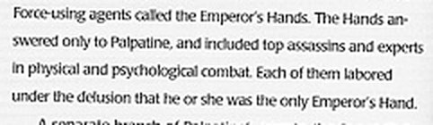
Our notes: `notes/materials/027-new-essential-chronology/03-part-three-empire-new-order.md:26`

> Mara later learned that the victim on Svivren had been a decoy. Dequc continued to expand Black Nebula in the post-Palpatine Empire, until Mara tracked him down and killed him on Qiaxx several months later.
— Source: Part Six: Birth of the New Republic; Mara Jade Skywalker — Mara kills Dequc.
Note (our notes, around the quote): Mara Jade Skywalker — Mara kills Dequc: "Mara later learned that the victim on Svivren had been a decoy. Dequc continued to expand Black Nebula in the post-Palpatine Empire, until Mara tracked him down and killed him on Qiaxx several months later." Source: The New Essential Chronology, p.132
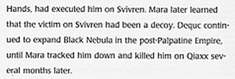
Our notes: `notes/materials/027-new-essential-chronology/06-part-six-birth-of-the-new-republic.md:27`

> Mara Jade, former Imperial assassin.
> [fragment — full passage not on file]
— Source: Part Six: Birth of the New Republic; Mara Jade Skywalker — art caption.
Note (our notes, around the quote): Mara Jade Skywalker — art caption: "Mara Jade, former Imperial assassin." Source: The New Essential Chronology, p.133, caption
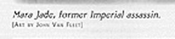
Our notes: `notes/materials/027-new-essential-chronology/06-part-six-birth-of-the-new-republic.md:36`

> Mara revealed that she had once been an Emperor's Hand in the service of Palpatine, and since Luke was indirectly responsible for the Emperor's death, she had vowed to kill him.
— Source: Part Seven: Empire Resurgent; Mara Jade Skywalker; Luke Skywalker — Mara's vow.
Note (our notes, around the quote): Mara Jade Skywalker; Luke Skywalker — Mara's vow: "Mara revealed that she had once been an Emperor's Hand in the service of Palpatine, and since Luke was indirectly responsible for the Emperor's death, she had vowed to kill him." Source: The New Essential Chronology, p.150
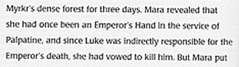
Our notes: `notes/materials/027-new-essential-chronology/07-part-seven-empire-resurgent.md:31`

> Admiral Ackbar was reinstated as fleet commander, the finandal scandal having been revealed as an Imperial setup.
>
> On Coruscant, Leia Organa Solo gave birth to twins, a boy and a girl—Jacen and Jaina-who were to join the new gen- eration of Jedi Knights.
>
> _ Because she had been an Emperor's Hand, Mara Jaxie had known many of Palpatine’s srets—inciuding the location of the Mount Tantiss Goning fadiity on Wayland. Mara ki Luke Skywalker, Han Solo, Chewbacca, Lando Calrissian, and their droids to Wayland to destray Thrawn’s ready-made soldier fac tory. Upon reaching Mount Tantiss, Luke and Mara headed for the Emperor's throne room. Waiting for them on the throne, Ike an arachnid at the center of Its web, was Joruus Cbaoth, The demented Jedi Master was easily a match for both Skywalker and Jade combined. While he toyed with them, he unleashed a shocking surprise: Cbaoth had grown a special clone from Skywalker's own genetic material, taken from the hand Luke had lost at Cloud City, The mindless drone, Luuke Skywalker, was his exact duplicate.
>
> The cone had a lightsaber as well-the blue-bladed saber that had once belonged to Anakin Skywalker, a weapon that had been considered lost since the agic events in Goud City.
— Source: Part Seven: Empire Resurgent.
(Excerpt widened 2026-11-17 to the relevant passage, word for word from research primary new essential chronology nec paged (text copy `research_primary_new_essential_chronology_nec_paged_txt_88b808b5bc`).)
(Excerpt widened 2026-11-17 to the relevant passage, word for word from research primary new essential chronology nec paged (text copy `research_primary_new_essential_chronology_nec_paged_txt_88b808b5bc`).)
Note (our notes, around the quote): Joruus C'baoth; Luke Skywalker; Mara Jade Skywalker — C'baoth a match for both: "The demented Jedi Master was easily a match for both Skywalker and Jade combined." Source: The New Essential Chronology, p.152
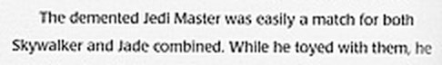
Our notes: `notes/materials/027-new-essential-chronology/07-part-seven-empire-resurgent.md:51`

> The doubles squared off in a frenzied duel. Though she had often expressed her desire to murder the man who had brought about the Emperor's death, Mara Jade ended the combat by killing the Luke clone. C'baoth, in a fit of rage, collapsed the chamber's ceiling, but Mara skewered him cleanly through the torso.
— Source: Part Seven: Empire Resurgent.
Note (our notes, around the quote): Mara Jade Skywalker; Luke Skywalker; Joruus C'baoth — Mara kills Luuke and C'baoth: "The doubles squared off in a frenzied duel. Though she had often expressed her desire to murder the man who had brought about the Emperor's death, Mara Jade ended the combat by killing the Luke clone. C'baoth, in a fit of rage, collapsed the chamber's ceiling, but Mara skewered him cleanly through the torso." Source: The New Essential Chronology, p.152
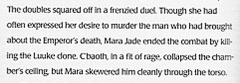
Our notes: `notes/materials/027-new-essential-chronology/07-part-seven-empire-resurgent.md:53`

> He knew that his sister Leia, her three children, Kam Solusar, the Witches of Dathomir, Kyle Katarn, and Mara Jade had all exhibited an aptitude for the Force.
— Source: Part Eight: The Return of the Jedi Knights; Luke Skywalker — academy recruits. POV: speaker not named in our notes.
Note (our notes, around the quote): Luke Skywalker — academy recruits: "He knew that his sister Leia, her three children, Kam Solusar, the Witches of Dathomir, Kyle Katarn, and Mara Jade had all exhibited an aptitude for the Force." Source: The New Essential Chronology, p.162
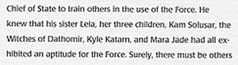
Our notes: `notes/materials/027-new-essential-chronology/08-part-eight-return-of-the-jedi-knights.md:11`

> One warlord, Admiral Harrsk, began shuttling troops out of the Deep Core and amassing a force in the Atravis sextor in the Outer Rim, where he was supported by several Imperial fortress workds. While New Republic Intelligence kept a close eye on this development, they completely missed the oml- nous stinings in the Senex and Juvex sectors of the Mid Rim.
>
> Both the Senex and Juvex sectors are ancient aristocra:
>
> <ies ruled by 4 multitude of houses. Emperor Palpatine kept only a token military force in the region, and the New Re- public had no success in persuading the Senex Lords to take a more active role in galactic affairs. Their arrogance and sense of noblesse oblige prompted the Senex Lords to forge an alliance with Roganda Ismaren, The woman did not have a biue-blooded pedigree, but she answered to the title by which Palpatine had called her-Emperor’s Hand.
>
> Palpatine, of course, had employed many Hands. Arden Lyn had been among the first, and Mara Jade was arguably the best.
>
> Palpatine, of course, had employed many Hands. Arden Lyn had been among the first, and Mara Jade was arguably the best. Others had inxfuded Maarek Stele, Sarcev Quest, Blackhole, and Roganda Ismaren. Following the death of her Master, Roganda had gone to ground on the sicepy world of Belsavis.
— Source: Part Eight: The Return of the Jedi Knights; Mara Jade Skywalker — Emperor's Hands. POV: Emperor's Hands; about Mara Jade Skywalker.
(Excerpt widened 2026-11-17 to the relevant passage, word for word from research primary new essential chronology nec paged (text copy `research_primary_new_essential_chronology_nec_paged_txt_88b808b5bc`).)
(Excerpt widened 2026-11-17 to the relevant passage, word for word from research primary new essential chronology nec paged (text copy `research_primary_new_essential_chronology_nec_paged_txt_88b808b5bc`).)
Note (our notes, around the quote): Mara Jade Skywalker — Emperor's Hands: "Palpatine, of course, had employed many Hands. Arden Lyn had been among the first, and Mara Jade was arguably the best." Source: The New Essential Chronology, p.167
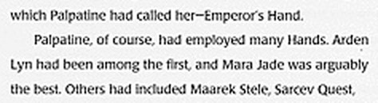
Our notes: `notes/materials/027-new-essential-chronology/08-part-eight-return-of-the-jedi-knights.md:74`

> Mara used the beckon call installed aboard Jade's Fire to rouse her cherished ship and guide it directly into the Hand of Thrawn's docking bay, destroying every craft on the launching pad.
— Source: Part Ten: A Lasting Peace; Mara Jade Skywalker — Jade's Fire beckon call.
Note (our notes, around the quote): Mara Jade Skywalker — Jade's Fire beckon call: "Mara used the beckon call installed aboard Jade's Fire to rouse her cherished ship and guide it directly into the Hand of Thrawn's docking bay, destroying every craft on the launching pad." Source: The New Essential Chronology, p.193
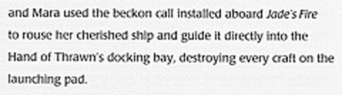
Our notes: `notes/materials/027-new-essential-chronology/10-part-ten-a-lasting-peace.md:36`

> The marriage of the Rebel Alliance's iconic hero to the woman who had once been Emperor Palpatine's top assassin drew attention from all corners of the galaxy
> [fragment — full passage not on file]
— Source: Part Ten: A Lasting Peace; Mara Jade Skywalker — Palpatine's top assassin.
Note (our notes, around the quote): Mara Jade Skywalker — Palpatine's top assassin: "The marriage of the Rebel Alliance's iconic hero to the woman who had once been Emperor Palpatine's top assassin drew attention from all corners of the galaxy" Source: The New Essential Chronology, p.194
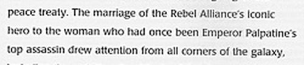
Our notes: `notes/materials/027-new-essential-chronology/10-part-ten-a-lasting-peace.md:47`

> On snowy Dolls 3, a band of Imperial partisans viewed the looming nuptials with contempt Believing the event to be more proof thal the Empire had been watered down like weak caf, the loyalists made plans to slip into Coruscant and sabotage the ceremony.
>
> One of their number claimed to be a former Royal Guardsman, and though his experience was likely a mere boast, his attempt to kill Mara Jade during her dress fitting gave a murderous edge to the plot. The other Imperiats focused on infiltrating the event site and hiring a gang of swoopbikers to harass the wedding guests, Despite the scheming, the wedding went off with mini mum mayhem. Following Luke's raucous bachelor party in Coruscant’s lower levels, the happy couple joined together in a private Jedi ceremony officiated by Kam Solusar in the renovated Jedi Temple. The public ceremony, held in Coruscant’s Reflection Gardens, remained peaceful thanks to extra muscle provided by Booster Terrik and others, who kept the swoopbikers at bay. When the final Imperial plotter crashed the ceremony and threatened to release a crippling computer virus, Luke persuaded him to give himself up and join the party. With that quiet denouncement, a generation Of hostilities suddenly seemed as dead as Palpatine himself.
>
> Weeks later, Lando Calrissian wed Tendra Risant, the woman he had met during the events of the Corellian insurrection.
— Source: Part Ten: A Lasting Peace; Kam Solusar; Luke Skywalker; Mara Jade Skywalker — Kam officiates.
(Excerpt widened 2026-11-17 to the relevant passage, word for word from research primary new essential chronology nec paged (text copy `research_primary_new_essential_chronology_nec_paged_txt_88b808b5bc`).)
(Excerpt widened 2026-11-17 to the relevant passage, word for word from research primary new essential chronology nec paged (text copy `research_primary_new_essential_chronology_nec_paged_txt_88b808b5bc`).)
(Full sentence/passage taken from the source text on file: `research_primary_new_essential_chronology_nec_paged_txt`.)
Note (our notes, around the quote): Kam Solusar; Luke Skywalker; Mara Jade Skywalker — Kam officiates: "the happy couple joined together in a private Jedi ceremony officiated by Kam Solusar in the renovated Jedi Temple." Source: The New Essential Chronology, p.194
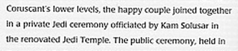
Our notes: `notes/materials/027-new-essential-chronology/10-part-ten-a-lasting-peace.md:49`

> Luke and Mara activated the craft, caught up to the Dreadnaught, and eliminated the threat posed by the Vagaari renegades.
— Source: Part Eleven: Generations of Jedi; Luke Skywalker; Mara Jade Skywalker — Vagaari Dreadnaught.
Note (our notes, around the quote): Luke Skywalker; Mara Jade Skywalker — Vagaari Dreadnaught: "Luke and Mara activated the craft, caught up to the Dreadnaught, and eliminated the threat posed by the Vagaari renegades." Source: The New Essential Chronology, p.198
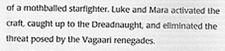
Our notes: `notes/materials/027-new-essential-chronology/11-part-eleven-generations-of-jedi.md:36`

> Mara Jade, now a Jedi Master, supported her husband's efforts to keep the Jedi order focused, but grew weaker and weaker, victim of a mysterious ailment
> [fragment — full passage not on file]
— Source: Part Twelve: The New Jedi Order; Mara Jade Skywalker — Mara, Jedi Master, falls ill.
Note (our notes, around the quote): Mara Jade Skywalker — Mara, Jedi Master, falls ill: "Mara Jade, now a Jedi Master, supported her husband's efforts to keep the Jedi order focused, but grew weaker and weaker, victim of a mysterious ailment" Source: The New Essential Chronology, p.203
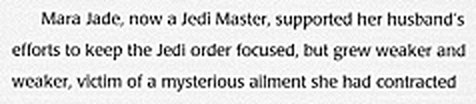
Our notes: `notes/materials/027-new-essential-chronology/12-part-twelve-new-jedi-order.md:13`

> Defeating an enraged Yomin Carr and witnessing the speed of the planet's environmental reprogramming, they realized the face of their enemy and the breathtaking extent of their foes' biology-based powers.
— Source: Part Twelve: The New Jedi Order; Luke Skywalker; Mara Jade Skywalker — Luke and Mara at Belkadan.
Note (our notes, around the quote): Luke Skywalker; Mara Jade Skywalker — Luke and Mara at Belkadan: "Defeating an enraged Yomin Carr and witnessing the speed of the planet's environmental reprogramming, they realized the face of their enemy and the breathtaking extent of their foes' biology-based powers." Source: The New Essential Chronology, p.204
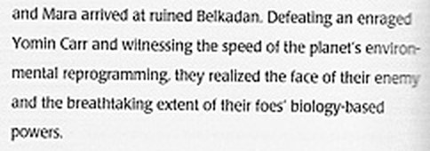
Our notes: `notes/materials/027-new-essential-chronology/12-part-twelve-new-jedi-order.md:24`

> To everyone's surprise, the dosage of Vergere's tears sent Mara Jade's disease into temporary remission.
— Source: Part Twelve: The New Jedi Order; Mara Jade Skywalker — Vergere's tears.
Note (our notes, around the quote): Mara Jade Skywalker — Vergere's tears: "To everyone's surprise, the dosage of Vergere's tears sent Mara Jade's disease into temporary remission." Source: The New Essential Chronology, p.209
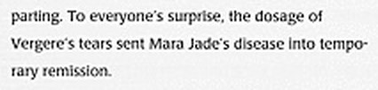
Our notes: `notes/materials/027-new-essential-chronology/12-part-twelve-new-jedi-order.md:65`

> He created a beetle swarm that chewed up the refugee shelters before Mara Jade and Jaina Solo uncovered his identity.
— Source: Part Twelve: The New Jedi Order; Mara Jade Skywalker; Jaina Solo — Nom Anor unmasked.
Note (our notes, around the quote): Mara Jade Skywalker; Jaina Solo — Nom Anor unmasked: "He created a beetle swarm that chewed up the refugee shelters before Mara Jade and Jaina Solo uncovered his identity." Source: The New Essential Chronology, p.211
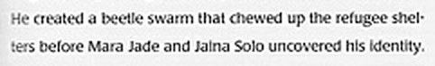
Our notes: `notes/materials/027-new-essential-chronology/12-part-twelve-new-jedi-order.md:85`

> Luke Skywalker and Mara Jade Skywalker, with newborn baby Ben
> [fragment — full passage not on file]
— Source: Part Twelve: The New Jedi Order; Luke Skywalker; Mara Jade Skywalker — art caption.
Note (our notes, around the quote): Luke Skywalker; Mara Jade Skywalker — art caption: "Luke Skywalker and Mara Jade Skywalker, with newborn baby Ben" Source: The New Essential Chronology, p.212, caption
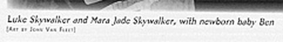
Our notes: `notes/materials/027-new-essential-chronology/12-part-twelve-new-jedi-order.md:94`

> They rushed to the Givin homeworld to wam the skeletal mathematicians of the danger. During the Battle of YagDhul, the three JedI faced down Nom Anor, and Anakin and Tahiti shared a tentative kiss while sealed in a storage locker. The advanced ships of the Givin fleet helped beat back the Yuu- zhan Vong attackers, Luke and Mara arrived at Brant Venture after their depar- ture from unfriendly Coruscant There, a dscase~veakened Mara went into labor, knowing that the effort would probably kill her. Through the Force, Luke joined minds with his son, using their shared energies to scour every trace of contagion from the cells in Mara’s body. Mara and Luke named their new- bom baby Ben, in honor of Ben Kenobi.
>
> Elsewhere, the heretical shaper Nen Yim struggled with her punitive assignment to the dying workiship Baan Miir, Soon, aboard the vessel, a master shaper who had spent weeks tormenting Nen Yim revealed him self as Onimi, the misshapen court jester who served at the skie of Supreme Overlord Shimrra, it seemed that Shimrra had great need for someone with Nen Yim’'s scientific talents.
— Source: Part Twelve: The New Jedi Order; Luke Skywalker; Mara Jade Skywalker — Luke and Ben cure Mara.
(Excerpt widened 2026-11-17 to the relevant passage, word for word from research primary new essential chronology nec paged (text copy `research_primary_new_essential_chronology_nec_paged_txt_88b808b5bc`).)
(Excerpt widened 2026-11-17 to the relevant passage, word for word from research primary new essential chronology nec paged (text copy `research_primary_new_essential_chronology_nec_paged_txt_88b808b5bc`).)
Note (our notes, around the quote): Luke Skywalker; Mara Jade Skywalker — Luke and Ben cure Mara: "Through the Force, Luke joined minds with his son, using their shared energies to scour every trace of contagion from the cells in Mara's body." Source: The New Essential Chronology, p.213
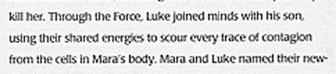
Our notes: `notes/materials/027-new-essential-chronology/12-part-twelve-new-jedi-order.md:103`

> Luke, Mara, and Tahiri faced off against Nyax, who by this time had tapped into the Force repository and could toss debris around in a whirlwind of power. Their combined efforts were enough to fell the Dark Jedi.
— Source: Part Twelve: The New Jedi Order.
Note (our notes, around the quote): Luke Skywalker; Mara Jade Skywalker — Luke, Mara and Tahiri fell Nyax: "Luke, Mara, and Tahiri faced off against Nyax, who by this time had tapped into the Force repository and could toss debris around in a whirlwind of power. Their combined efforts were enough to fell the Dark Jedi." Source: The New Essential Chronology, p.219
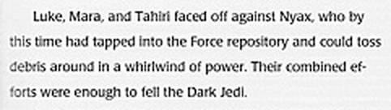
Our notes: `notes/materials/027-new-essential-chronology/12-part-twelve-new-jedi-order.md:155`

## Star Wars Saga Edition: Jedi Academy Training Manual (WotC, 2009): power-scaling and lore notes

> Starting out as a simple ambassador, Cilghal discovers her talent for healing while train- ing on Yavin 4. She proves instrumental in saving the life of New Republic Chief-of-State Mon Mothma, who is possessed by the dark side spirit of Exar Kun. Upon graduation from the Jedi Academy, Cilghal follows in her uncle's footsteps and drifts into politics, becoming the Mon Calamari Senator for the New Republic. Years later, she returns to the academy and resumes her duties as a Jedi Knight, becoming an instructor and taking on a Chadra-Fan apprentice named Tekli.
>
> With the Yuuzhan Vong sweep through the galaxy, Cilghal’s skills as a healer are in great demand. She eventually becomes the obstetrician and midwife to Mara Jade Skywalker and a loyal friend to that family, in addition to being a dedicated Jedi Master.
>
> With the Yuuzhan Vong sweep through the galaxy, Cilghal’s skills as a healer are in great demand. She eventually becomes the obstetrician and midwife to Mara Jade Skywalker and a loyal friend to that family, in addition to being a dedicated Jedi Master.
>
> Cilghal has a noble and gentle spirit. Although trained in the lightsaber and more than willing to use it in defense of the injured and helpless, Cilghal prefers using her skills as a diplomat and healer to serve the will of the Force.
— Source: Chapter V: Instructors and Alumni; Cilghal; Mara Jade Skywalker — Cilghal — NJO.
(Excerpt widened 2026-11-17 to the relevant passage, word for word from research primary jedi academy training manual jatm paged (text copy `research_primary_jedi_academy_training_manual_jatm_paged_txt_fea130719f`).)
(Excerpt widened 2026-11-17 to the relevant passage, word for word from research primary jedi academy training manual jatm paged (text copy `research_primary_jedi_academy_training_manual_jatm_paged_txt_fea130719f`).)
Note (our notes, around the quote): Cilghal; Mara Jade Skywalker — Cilghal — NJO: "She eventually becomes the obstetrician and midwife to Mara Jade Skywalker and a loyal friend to that family, in addition to being a dedicated Jedi Master." Source: Jedi Academy Training Manual, p.97
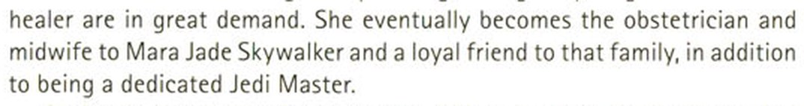
Our notes: `notes/materials/028-jedi-academy-training-manual/05-ch5-instructors-and-alumni.md:29`

- Note (summary from our notes, not a quotation): Luke Skywalker; Grand Admiral Thrawn; Joruus C'baoth; Mara Jade Skywalker — Grand Master Luke Skywalker — Thrawn era: "Skywalker is faced with two threats related to Thrawn. One is a mad clone of the old Jedi Master Jorus C'Baoth. The clone "Joruus" tempts Skywalker toward the dark side but is defeated. The other threat is Mara Jade, an assassin with her sights set on Luke Skywalker." Source: Jedi Academy Training Manual, p.100
  — Source: Chapter V: Instructors and Alumni.
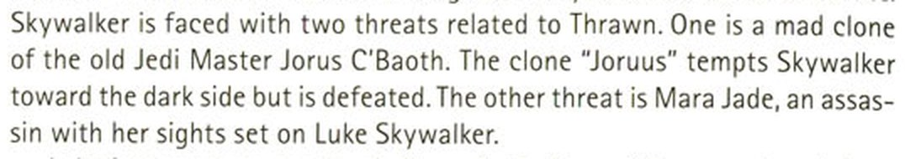
Our notes: `notes/materials/028-jedi-academy-training-manual/05-ch5-instructors-and-alumni.md:51`

> Mara Jade Skywalker CL 17 Medium Human soldier 7/Force adept 5/Jedi Knight 3/Jedi Master 2
> [fragment — full passage not on file]
— Source: Chapter V: Instructors and Alumni.
Note (our notes, around the quote): Mara Jade Skywalker — Mara Jade Skywalker — stat block, level and class — RPG mechanics (weaker source): "Mara Jade Skywalker CL 17 Medium Human soldier 7/Force adept 5/Jedi Knight 3/Jedi Master 2" Source: Jedi Academy Training Manual, p.103, stat block

Our notes: `notes/materials/028-jedi-academy-training-manual/05-ch5-instructors-and-alumni.md:73`

> hp 160; Threshold 32 Immune fear effects Speed 6 squares Melee lightsaber +22 (2d8+16) or Melee lightsaber +17 (2d8+16) with Double Attack or Ranged heavy blaster pistol +22 (3d6+10)
> [fragment — full passage not on file]
— Source: Chapter V: Instructors and Alumni.
Note (our notes, around the quote): Mara Jade Skywalker — Mara Jade Skywalker — stat block, defences and attacks — RPG mechanics (weaker source): "hp 160; Threshold 32 Immune fear effects Speed 6 squares Melee lightsaber +22 (2d8+16) or Melee lightsaber +17 (2d8+16) with Double Attack or Ranged heavy blaster pistol +22 (3d6+10)" Source: Jedi Academy Training Manual, p.103, stat block
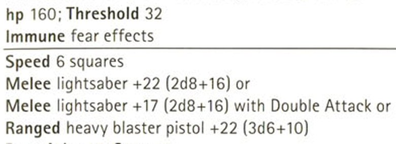
Our notes: `notes/materials/028-jedi-academy-training-manual/05-ch5-instructors-and-alumni.md:75`

> Force Powers Known (Use the Force +17): battle strike (2), Force thrust (2), mind trick, move object (2), surge Force Secrets Devastating Power
> [fragment — full passage not on file]
— Source: Chapter V: Instructors and Alumni.
Note (our notes, around the quote): Mara Jade Skywalker — Mara Jade Skywalker — stat block, Force powers and talents — RPG mechanics (weaker source): "Force Powers Known (Use the Force +17): battle strike (2), Force thrust (2), mind trick, move object (2), surge Force Secrets Devastating Power" Source: Jedi Academy Training Manual, p.103, stat block
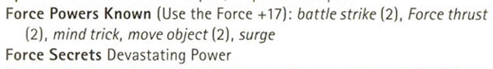
Our notes: `notes/materials/028-jedi-academy-training-manual/05-ch5-instructors-and-alumni.md:77`

> (2), mind trick, move object (2), surge Force Secrets Devastating Power Force Techniques Improved Force Trance, Improved Move Light Object, Improved Sense Surroundings Abilities Str 12, Dex 18, Con 14, Int 17, Wis 16, Cha 19 Special Qualities fearless, serenity Talents Ataru, Attune Weapon, Double Attack (lightsabers), Empower Weapon, Force Power Adept (move object), Foresight, Greater Weapon Focus (lightsabers), Greater Weapon Specialization (lightsabers), Weapon Specialization (lightsaber, pistols) Feats Armor Proficiency (light, medium), Force Sensitivity, Force Training (2), Skill Training (Acrobatics), Weapon Finesse (lightsabers), Weapon Focus (lightsabers, pistols), Weapon Proficiency (advanced melee weapons, heavy weapons, lightsabers, pistols, rifles, simple weapons) Skills Acrobatics +17, Deception +17, Initiative +17, Knowledge (galactic lore) +16, Perception +16, Pilot +17, Use Computer +16, Use the Force +17 Possessions lightsaber, heavy blaster pistol A BSsastdVvHoS c INNNVG © SHOLENHLASRNI Mara Jade Skywalker has a history as long and rich as her husband's. She begins her career as one of the Emperor's personal Force-trained assassins, although, unlike most of his servants, she only kills out of necessity. Highly talented, Mara trains in combat with the Imperial Royal Guard and receives personal tutelage in the Force from the Emperor himself. She performs dozens of missions on his behalf until his demise at the hands of Darth Vader. The Emperor's dying telepathic command to kill Luke Skywalker sets her destiny in a different direction.
— Source: Chapter V: Instructors and Alumni.
(Excerpt widened 2026-11-17 to the relevant passage, word for word from research primary jedi academy training manual jatm paged (text copy `research_primary_jedi_academy_training_manual_jatm_paged_txt_fea130719f`).)
(Excerpt widened 2026-11-17 to the relevant passage, word for word from research primary jedi academy training manual jatm paged (text copy `research_primary_jedi_academy_training_manual_jatm_paged_txt_fea130719f`).)
Note (our notes, around the quote): Mara Jade Skywalker; Palpatine (Darth Sidious) — Mara Jade Skywalker — Emperor's Hand: "She begins her career as one of the Emperor's personal Force-trained assassins, although, unlike most of his servants, she only kills out of necessity. Highly talented, Mara trains in combat with the Imperial Royal Guard and receives personal tutelage in the Force from the Emperor himself." Source: Jedi Academy Training Manual, p.103
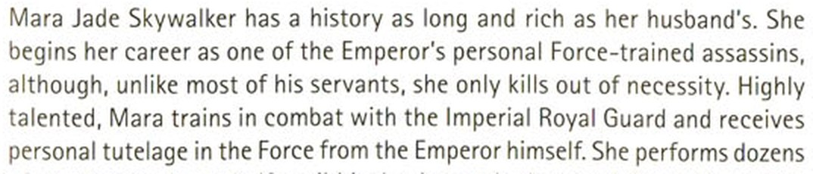
Our notes: `notes/materials/028-jedi-academy-training-manual/05-ch5-instructors-and-alumni.md:79`

> (2), mind trick, move object (2), surge Force Secrets Devastating Power Force Techniques Improved Force Trance, Improved Move Light Object, Improved Sense Surroundings Abilities Str 12, Dex 18, Con 14, Int 17, Wis 16, Cha 19 Special Qualities fearless, serenity Talents Ataru, Attune Weapon, Double Attack (lightsabers), Empower Weapon, Force Power Adept (move object), Foresight, Greater Weapon Focus (lightsabers), Greater Weapon Specialization (lightsabers), Weapon Specialization (lightsaber, pistols) Feats Armor Proficiency (light, medium), Force Sensitivity, Force Training (2), Skill Training (Acrobatics), Weapon Finesse (lightsabers), Weapon Focus (lightsabers, pistols), Weapon Proficiency (advanced melee weapons, heavy weapons, lightsabers, pistols, rifles, simple weapons) Skills Acrobatics +17, Deception +17, Initiative +17, Knowledge (galactic lore) +16, Perception +16, Pilot +17, Use Computer +16, Use the Force +17 Possessions lightsaber, heavy blaster pistol A BSsastdVvHoS c INNNVG © SHOLENHLASRNI Mara Jade Skywalker has a history as long and rich as her husband's. She begins her career as one of the Emperor's personal Force-trained assassins, although, unlike most of his servants, she only kills out of necessity. Highly talented, Mara trains in combat with the Imperial Royal Guard and receives personal tutelage in the Force from the Emperor himself. She performs dozens of missions on his behalf until his demise at the hands of Darth Vader. The Emperor's dying telepathic command to kill Luke Skywalker sets her destiny in a different direction.
>
> MARA JADE SKYWALKER === sp105 .
— Source: Chapter V: Instructors and Alumni.
(Excerpt widened 2026-11-17 to the relevant passage, word for word from research primary jedi academy training manual jatm paged (text copy `research_primary_jedi_academy_training_manual_jatm_paged_txt_fea130719f`).)
(Excerpt widened 2026-11-17 to the relevant passage, word for word from research primary jedi academy training manual jatm paged (text copy `research_primary_jedi_academy_training_manual_jatm_paged_txt_fea130719f`).)
Note (our notes, around the quote): Mara Jade Skywalker; Palpatine (Darth Sidious); Luke Skywalker — Mara Jade Skywalker — the last command: "The Emperor's dying telepathic command to kill Luke Skywalker sets her destiny in a different direction." Source: Jedi Academy Training Manual, p.103
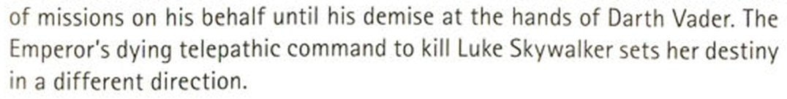
Our notes: `notes/materials/028-jedi-academy-training-manual/05-ch5-instructors-and-alumni.md:81`

- Note (summary from our notes, not a quotation): Mara Jade Skywalker; Luke Skywalker — Mara Jade Skywalker — kills Luke's clone: "She manages to "complete" her mission by killing a clone of Luke Skywalker." Source: Jedi Academy Training Manual, p.103
  — Source: Chapter V: Instructors and Alumni.
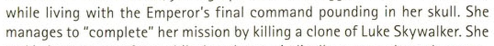
Our notes: `notes/materials/028-jedi-academy-training-manual/05-ch5-instructors-and-alumni.md:83`

> Her skills as an infiltrator and assassin, combined with her formidable skills with the Force and the lightsaber, make her an extremely dangerous opponent.
— Source: Chapter V: Instructors and Alumni; Mara Jade Skywalker — Mara Jade Skywalker Encounters — danger level.
Note (our notes, around the quote): Mara Jade Skywalker — Mara Jade Skywalker Encounters — danger level: "Her skills as an infiltrator and assassin, combined with her formidable skills with the Force and the lightsaber, make her an extremely dangerous opponent." Source: Jedi Academy Training Manual, p.103
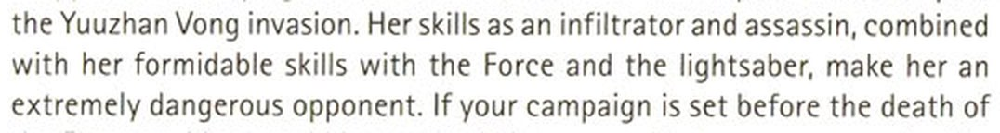
Our notes: `notes/materials/028-jedi-academy-training-manual/05-ch5-instructors-and-alumni.md:85`

> Without the ability to speak or recall his identity, Irek takes the name Lord Nyax from a Corellian myth, locates an abandoned Jedi temple, and taps into the Force wellspring there, increasing his power. While on Corus- cant as part of a reconnaissance team, Luke Skywalker, Mara Jade Skywalker, and Tahiri Veila encounter Lord Nyax and seal him in a pit, but he escapes. lrek Ismaren (Lord Nyax) Encounters Although encountering Irek Ismaren might be pos- sible during the time of the New Republic, he is more likely to be encoun- tered as Lord Nyax on Cor- uscant before or during the Yuuzhan Vong invasion.
— Source: Chapter VI: Dangers of Study.
(Excerpt widened 2026-11-17 to the relevant passage, word for word from research primary jedi academy training manual jatm paged (text copy `research_primary_jedi_academy_training_manual_jatm_paged_txt_fea130719f`).)
(Excerpt widened 2026-11-17 to the relevant passage, word for word from research primary jedi academy training manual jatm paged (text copy `research_primary_jedi_academy_training_manual_jatm_paged_txt_fea130719f`).)
Note (our notes, around the quote): Luke Skywalker; Mara Jade Skywalker — Lord Nyax — sealed in a pit: "Luke Skywalker, Mara Jade Skywalker, and Tahiri Veila encounter Lord Nyax and seal him in a pit, but he escapes." Source: Jedi Academy Training Manual, p.121
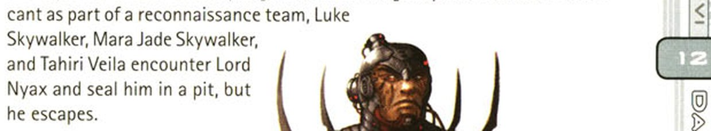
Our notes: `notes/materials/028-jedi-academy-training-manual/06-ch6-dangers-of-study.md:69`

## The Jedi Academy Sourcebook (WEG, 1996): power-scaling and lore notes

> He has encountered several potential Jedi in his travels, among them Mara Jade, Kirana Ti and Kam Solusar.
— Source: Chapter Three: The Jedi Academy.
Note (our notes, around the quote): Luke Skywalker; Mara Jade Skywalker; Kirana Ti; Kam Solusar — The Jedi Search Begins: "He has encountered several potential Jedi in his travels, among them Mara Jade, Kirana Ti and Kam Solusar." Source: The Jedi Academy Sourcebook, p.30
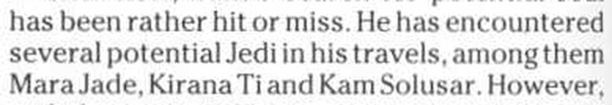
Our notes: `notes/materials/029-jedi-academy-sourcebook/03-ch3-the-jedi-academy.md:11`

> Some have argued that “Smugglers’ Alliance” is not the best name fora group trying to achieve legitimacy as an established organization. There are those in the SA who would agree, but other smuggler groups see the name as a tie to their past — and a suitable reminder not to be fully co-opted by any government, however benevo- lent.
>
> _ Thesymbol of the SA’s affiliation is an elegant crosshatched insignia, which is prominently displayed on ship hulls, uniforms and docu- ments produced by the SA leadership.
>
> Mara Jade When she was appointed by the Smugglers’
>
> Alliance as an SA representative, Mara Jade thought she'd found a job that would employ her skills as a negotiator and businesswoman rather than as some sort of armed trouble- shooter. However, it seems that Mara is des- tined to keep in the thick of things one way or another.
>
> She travels to Coruscant to warn the New Republic through Han Solo that Admiral Daala has been putting out feelers in the fringe, trying to hire spies and saboteurs.
>
> She travels to Coruscant to warn the New Republic through Han Solo that Admiral Daala has been putting out feelers in the fringe, trying to hire spies and saboteurs. While there, she catches Lando’s eye.
>
> Mara attends Luke's Jedi academy for a time, but does not stay long; Kyp’s stealing of her ship sours her on the experience, and she begins to worry how the SA is getting on without her.
— Source: Chapter Seven: The Fringe.
(Excerpt widened 2026-11-17 to the relevant passage, word for word from research primary jedi academy sourcebook jas clean (text copy `research_primary_jedi_academy_sourcebook_jas_clean_txt_04b8ab0d44`).)
(Excerpt widened 2026-11-17 to the relevant passage, word for word from research primary jedi academy sourcebook jas clean (text copy `research_primary_jedi_academy_sourcebook_jas_clean_txt_04b8ab0d44`).)
Note (our notes, around the quote): Mara Jade Skywalker; Han Solo; Admiral Daala — Mara Jade — warning the New Republic: "She travels to Coruscant to warn the New Republic through Han Solo that Admiral Daala has been putting out feelers in the fringe, trying to hire spies and saboteurs." Source: The Jedi Academy Sourcebook, p.80
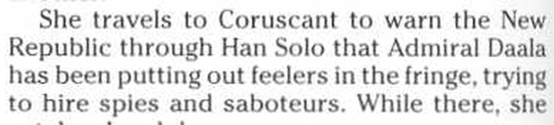
Our notes: `notes/materials/029-jedi-academy-sourcebook/07-ch7-the-fringe.md:11`

> Mara Jade When she was appointed by the Smugglers’
>
> Alliance as an SA representative, Mara Jade thought she'd found a job that would employ her skills as a negotiator and businesswoman rather than as some sort of armed trouble- shooter. However, it seems that Mara is des- tined to keep in the thick of things one way or another.
>
> She travels to Coruscant to warn the New Republic through Han Solo that Admiral Daala has been putting out feelers in the fringe, trying to hire spies and saboteurs. While there, she catches Lando’s eye.
>
> Mara attends Luke's Jedi academy for a time, but does not stay long; Kyp’s stealing of her ship sours her on the experience, and she begins to worry how the SA is getting on without her. She asks Lando to come pick her up.
>
> When Lando returns her to Coruscant, he fills her in on a plan he’s devised to take over the Kessel mining program if she can assure him that the SA can pick up distribution of the glitterstim.
— Source: Chapter Seven: The Fringe.
(Excerpt widened 2026-11-17 to the relevant passage, word for word from research primary jedi academy sourcebook jas clean (text copy `research_primary_jedi_academy_sourcebook_jas_clean_txt_04b8ab0d44`).)
(Excerpt widened 2026-11-17 to the relevant passage, word for word from research primary jedi academy sourcebook jas clean (text copy `research_primary_jedi_academy_sourcebook_jas_clean_txt_04b8ab0d44`).)
(Full sentence/passage taken from the source text on file: `research_primary_jedi_academy_sourcebook_jas_clean_txt`.)
Note (our notes, around the quote): Mara Jade Skywalker; Luke Skywalker; Kyp Durron — Mara Jade — at the Jedi academy: "Mara attends Luke's Jedi academy for a time, but does not stay long; Kyp's stealing of her ship sours her on the experience," Source: The Jedi Academy Sourcebook, p.80
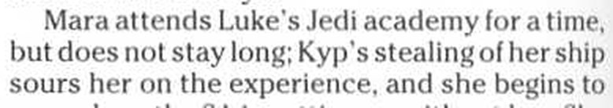
Our notes: `notes/materials/029-jedi-academy-sourcebook/07-ch7-the-fringe.md:13`

> In Calrissian’s defense, | would like to point out that while it is true that he has lost several major mining installations in the past, the loss of these assets came out of gross Imperial interven- tion rather than incompetence or misman- agement, Itis a point in Calrissian’s favor that he has solid experience in managing major-scale min- ing operations, each of which generated record profits during his tenure. | will again point out that Calrissian has very solid ties with the New Republic government which we may exploit in gaining trade con- cessions and advantageous distribution deals with government institu- tions with a use for glitterstim spice.
>
> Regarding your own rather pointed remark thatI might have a “personal interest” in working with Calrissian, | can assure youthat my inter- est in him is purely profes- sional. It is true that he has initiated some rather appallingly public ro- mantic overtures toward me, but this should not be construed as a result of any encour- agement by me.
>
> Do not be particularly concerned if | am seen to return in some minor way his affec- tion. If Calrissian refuses to be discouraged by my obvious lack of interest in him, |see no reason not to take advantage of this to obtain terms favorable for the SAas we hammer out our final distribution agreements Some might regard this as callous, but business is business.
>
> Do not be particularly concerned if | am seen to return in some minor way his affec- tion. If Calrissian refuses to be discouraged by my obvious lack of interest in him, |see no reason not to take advantage of this to obtain terms favorable for the SAas we hammer out our final distribution agreements Some might regard this as callous, but business is business. Calrissian can not claim that | did not do my best to discourage him, If you have any lingering doubts about my ability to remain objective in the current negotiations, | refer you to Talon Karrde, who will vouch for me.
>
> === sp83 Chapter Seven: The Fringe Storm Coos When the “closer look” turns into a wild and rough piggyback ride within the girders of the Death Star, she suggests that she and Lando plant limpet mines on the power core of the Death Star while Han repairs the Falcon’s hyperdrive. The ruse ultimately fails, but the Falcon does get away unscathed before the Death Star plunges into the black holes of the Mara, once a hardened and angry lone wolf, is softening as time takes her farther from her experience as the Emperor's Hand.
— Source: Chapter Seven: The Fringe.
(Excerpt widened 2026-11-17 to the relevant passage, word for word from research primary jedi academy sourcebook jas clean (text copy `research_primary_jedi_academy_sourcebook_jas_clean_txt_04b8ab0d44`).)
(Excerpt widened 2026-11-17 to the relevant passage, word for word from research primary jedi academy sourcebook jas clean (text copy `research_primary_jedi_academy_sourcebook_jas_clean_txt_04b8ab0d44`).)
Note (our notes, around the quote): Mara Jade Skywalker — Mara Jade's report to the Smugglers' Alliance (sidebar): "Some might regard this as callous, but business is business." Source: The Jedi Academy Sourcebook, p.81, sidebar/caption
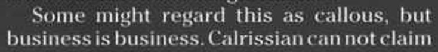
Our notes: `notes/materials/029-jedi-academy-sourcebook/07-ch7-the-fringe.md:20`

- Note (summary from our notes, not a quotation): Mara Jade Skywalker; Han Solo — Mara Jade — aboard the Death Star: "When the "closer look" turns into a wild and rough piggyback ride within the girders of the Death Star, she suggests that she and Lando plant limpet mines on the power core of the Death Star while Han repairs the Falcon's hyperdrive." Source: The Jedi Academy Sourcebook, p.82
  — Source: Chapter Seven: The Fringe.
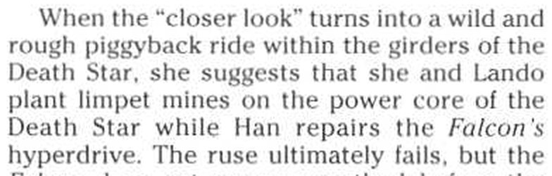
Our notes: `notes/materials/029-jedi-academy-sourcebook/07-ch7-the-fringe.md:27`

> Calrissian can not claim that | did not do my best to discourage him, If you have any lingering doubts about my ability to remain objective in the current negotiations, | refer you to Talon Karrde, who will vouch for me.
>
> === sp83 Chapter Seven: The Fringe Storm Coos When the “closer look” turns into a wild and rough piggyback ride within the girders of the Death Star, she suggests that she and Lando plant limpet mines on the power core of the Death Star while Han repairs the Falcon’s hyperdrive. The ruse ultimately fails, but the Falcon does get away unscathed before the Death Star plunges into the black holes of the Mara, once a hardened and angry lone wolf, is softening as time takes her farther from her experience as the Emperor's Hand. She still has a rough-edged hardness about her, but she has emerged from the shadow of the dark side.
— Source: Chapter Seven: The Fringe.
(Excerpt widened 2026-11-17 to the relevant passage, word for word from research primary jedi academy sourcebook jas clean (text copy `research_primary_jedi_academy_sourcebook_jas_clean_txt_04b8ab0d44`).)
(Excerpt widened 2026-11-17 to the relevant passage, word for word from research primary jedi academy sourcebook jas clean (text copy `research_primary_jedi_academy_sourcebook_jas_clean_txt_04b8ab0d44`).)
Note (our notes, around the quote): Mara Jade Skywalker; Palpatine (Darth Sidious) — Mara Jade — out of the dark side's shadow: "Mara, once a hardened and angry lone wolf, is softening as time takes her farther from her experience as the Emperor's Hand. She still has a rough-edged hardness about her, but she has emerged from the shadow of the dark side." Source: The Jedi Academy Sourcebook, p.82
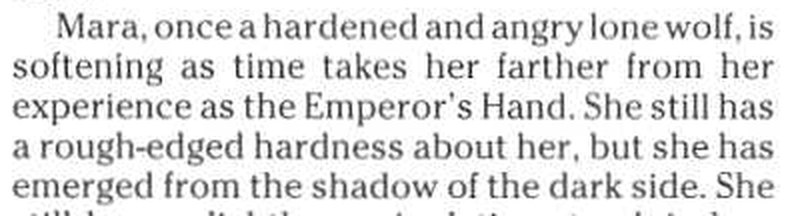
Our notes: `notes/materials/029-jedi-academy-sourcebook/07-ch7-the-fringe.md:29`

> She still has a rough-edged hardness about her, but she has emerged from the shadow of the dark side. She still has a slightly manipulative streak in her, though, which she occasionally lets out when people annoy her. m@ Mara Jade Type: Smuggers Alliance Representative DEXTERITY 3D+2 Blaster 9D+1, blaster: hold-out blaster 11D, brawling parry 7D+2, dodge 9D, lightsaber 4D+2, melee combat 8D+1, melee parry 7D+2, missile weapons 6D+2, pick pocket 8D+2, running 6D+2, thrown weapons 6D+2 KNOWLEDGE 2D+2 Alien species 8D+2, bureaucracy 7D+2, bureaucracy:
>
> New Republic 5D, business 7D+2, business: Smugglers’
>
> Alliance 6D+1. intimidation 7D+2, languages 8D+2, plan- etary systems 5D+2, streetwise 6D-+2, streetwise: Talon Karrde’s organization 7D+2, survival 7D, value 5D-2, willpower 7D MECHANICAL 2D+2 Astrogation 8D+2, beast riding 5D+2, communications 7D+1, ground vehicle operation 6D+ 2, repulsorlift opera- tion 6D, sensors 5D+2, space transports LUD, starfighter piloting 10D, starship gunnery 9D-2, starship shields 8D+1, swoop operation 7D+2 PERCEPTION 2D+14 Bargain 6D, command 8D, con 6D+2, gambling 4D-+2, hide 8D+1, investigation 5D+2, persuasion 6D+2, search 7D+2, sneak 8D.
— Source: Chapter Seven: The Fringe.
(Excerpt widened 2026-11-17 to the relevant passage, word for word from research primary jedi academy sourcebook jas clean (text copy `research_primary_jedi_academy_sourcebook_jas_clean_txt_04b8ab0d44`).)
(Excerpt widened 2026-11-17 to the relevant passage, word for word from research primary jedi academy sourcebook jas clean (text copy `research_primary_jedi_academy_sourcebook_jas_clean_txt_04b8ab0d44`).)
(Full sentence/passage taken from the source text on file: `research_primary_jedi_academy_sourcebook_jas_clean_txt`.)
Note (our notes, around the quote): Mara Jade Skywalker — Mara Jade — stat block, combat skills (RPG mechanics) — RPG mechanics (weaker source): "Blaster 9D+1, blaster: hold-out blaster 11D, brawling parry 7D+2, dodge 9D, lightsaber 4D+2, melee combat 8D+1, melee parry 7D+2," Source: The Jedi Academy Sourcebook, p.82, stat block
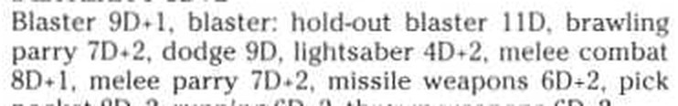
Our notes: `notes/materials/029-jedi-academy-sourcebook/07-ch7-the-fringe.md:31`

> She still has a slightly manipulative streak in her, though, which she occasionally lets out when people annoy her. m@ Mara Jade Type: Smuggers Alliance Representative DEXTERITY 3D+2 Blaster 9D+1, blaster: hold-out blaster 11D, brawling parry 7D+2, dodge 9D, lightsaber 4D+2, melee combat 8D+1, melee parry 7D+2, missile weapons 6D+2, pick pocket 8D+2, running 6D+2, thrown weapons 6D+2 KNOWLEDGE 2D+2 Alien species 8D+2, bureaucracy 7D+2, bureaucracy:
>
> New Republic 5D, business 7D+2, business: Smugglers’
>
> Alliance 6D+1. intimidation 7D+2, languages 8D+2, plan- etary systems 5D+2, streetwise 6D-+2, streetwise: Talon Karrde’s organization 7D+2, survival 7D, value 5D-2, willpower 7D MECHANICAL 2D+2 Astrogation 8D+2, beast riding 5D+2, communications 7D+1, ground vehicle operation 6D+ 2, repulsorlift opera- tion 6D, sensors 5D+2, space transports LUD, starfighter piloting 10D, starship gunnery 9D-2, starship shields 8D+1, swoop operation 7D+2 PERCEPTION 2D+14 Bargain 6D, command 8D, con 6D+2, gambling 4D-+2, hide 8D+1, investigation 5D+2, persuasion 6D+2, search 7D+2, sneak 8D. 1 STRENGTH 3D+2 Brawling 8D+2, climbing/jumping 7D+2, lifting 5D-+2, stamina 8D+2, swimming 6D+2 TECHNICAL 3D Blaster repair 6D, computer programming/repair 8D, demolitions 6D-2, droid programming 4D, droid repair 3D+2, first aid 5D, ground vehicle repair 6D, lightsaber repair 3D+2, repulsorlift repair 5D, security 9D, space transports repair 6D+1, starship weapon repair 5D+1 Special Abilities:
>
> Force Skills: Control 3D, sense 3D, alter 2D+1 These are only some of the powers that Mara Jade has demonstrated Control: Absorb/dissipate energy, accelerate healing, concentration", control pain, emptiness, enhance at- tribute**, hibernation trance, remain conscious, resist stun Sense: Combat sense**, danger sense**, life detection, life sense, magnify senses, receptive telepathy, sense Force Alter: Injure/Kill, telekinesis Control and Sense: Projective telepathy, lightsaber com- The Jedi Academy Sourcebook === sp84 Seema. ter Seven: The Fringe SO “ter Sever: The Fringe Control and Alter: inflict pain Control, Sense, and Alter: Telekenetic kill** * Described in the Movie Trilogy Sourcebook ** Described in the The Thrawn Trilogy Sourcebook This character is Force-sensitive Force Points: 5 Dark Side Points: | Character Points: 22 Move: 10 Equipment: Hold-out blaster (3D), comlink, lightsaber Ghent Ghent is one of Talon Karrde’s ace slicers, possibly one of the best in the fringe.
— Source: Chapter Seven: The Fringe.
(Excerpt widened 2026-11-17 to the relevant passage, word for word from research primary jedi academy sourcebook jas clean (text copy `research_primary_jedi_academy_sourcebook_jas_clean_txt_04b8ab0d44`).)
(Excerpt widened 2026-11-17 to the relevant passage, word for word from research primary jedi academy sourcebook jas clean (text copy `research_primary_jedi_academy_sourcebook_jas_clean_txt_04b8ab0d44`).)
Note (our notes, around the quote): Mara Jade Skywalker — Mara Jade — stat block, Force skills (RPG mechanics) — RPG mechanics (weaker source): "Force Skills: Control 3D, sense 3D, alter 2D+1" Source: The Jedi Academy Sourcebook, p.82, stat block
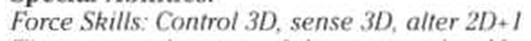
Our notes: `notes/materials/029-jedi-academy-sourcebook/07-ch7-the-fringe.md:33`

> She still has a slightly manipulative streak in her, though, which she occasionally lets out when people annoy her. m@ Mara Jade Type: Smuggers Alliance Representative DEXTERITY 3D+2 Blaster 9D+1, blaster: hold-out blaster 11D, brawling parry 7D+2, dodge 9D, lightsaber 4D+2, melee combat 8D+1, melee parry 7D+2, missile weapons 6D+2, pick pocket 8D+2, running 6D+2, thrown weapons 6D+2 KNOWLEDGE 2D+2 Alien species 8D+2, bureaucracy 7D+2, bureaucracy:
>
> New Republic 5D, business 7D+2, business: Smugglers’
>
> Alliance 6D+1. intimidation 7D+2, languages 8D+2, plan- etary systems 5D+2, streetwise 6D-+2, streetwise: Talon Karrde’s organization 7D+2, survival 7D, value 5D-2, willpower 7D MECHANICAL 2D+2 Astrogation 8D+2, beast riding 5D+2, communications 7D+1, ground vehicle operation 6D+ 2, repulsorlift opera- tion 6D, sensors 5D+2, space transports LUD, starfighter piloting 10D, starship gunnery 9D-2, starship shields 8D+1, swoop operation 7D+2 PERCEPTION 2D+14 Bargain 6D, command 8D, con 6D+2, gambling 4D-+2, hide 8D+1, investigation 5D+2, persuasion 6D+2, search 7D+2, sneak 8D. 1 STRENGTH 3D+2 Brawling 8D+2, climbing/jumping 7D+2, lifting 5D-+2, stamina 8D+2, swimming 6D+2 TECHNICAL 3D Blaster repair 6D, computer programming/repair 8D, demolitions 6D-2, droid programming 4D, droid repair 3D+2, first aid 5D, ground vehicle repair 6D, lightsaber repair 3D+2, repulsorlift repair 5D, security 9D, space transports repair 6D+1, starship weapon repair 5D+1 Special Abilities:
>
> Force Skills: Control 3D, sense 3D, alter 2D+1 These are only some of the powers that Mara Jade has demonstrated Control: Absorb/dissipate energy, accelerate healing, concentration", control pain, emptiness, enhance at- tribute**, hibernation trance, remain conscious, resist stun Sense: Combat sense**, danger sense**, life detection, life sense, magnify senses, receptive telepathy, sense Force Alter: Injure/Kill, telekinesis Control and Sense: Projective telepathy, lightsaber com- The Jedi Academy Sourcebook === sp84 Seema. ter Seven: The Fringe SO “ter Sever: The Fringe Control and Alter: inflict pain Control, Sense, and Alter: Telekenetic kill** * Described in the Movie Trilogy Sourcebook ** Described in the The Thrawn Trilogy Sourcebook This character is Force-sensitive Force Points: 5 Dark Side Points: | Character Points: 22 Move: 10 Equipment: Hold-out blaster (3D), comlink, lightsaber Ghent Ghent is one of Talon Karrde’s ace slicers, possibly one of the best in the fringe.
— Source: Chapter Seven: The Fringe.
(Excerpt widened 2026-11-17 to the relevant passage, word for word from research primary jedi academy sourcebook jas clean (text copy `research_primary_jedi_academy_sourcebook_jas_clean_txt_04b8ab0d44`).)
(Excerpt widened 2026-11-17 to the relevant passage, word for word from research primary jedi academy sourcebook jas clean (text copy `research_primary_jedi_academy_sourcebook_jas_clean_txt_04b8ab0d44`).)
Note (our notes, around the quote): Mara Jade Skywalker — Mara Jade — stat block, Force powers (RPG mechanics) — RPG mechanics (weaker source): "Control, Sense, and Alter: Telekenetic kill**" Source: The Jedi Academy Sourcebook, p.83, stat block
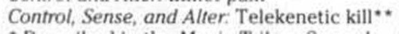
Our notes: `notes/materials/029-jedi-academy-sourcebook/07-ch7-the-fringe.md:40`

> Lando has little trouble locating Tymmo once on Umgul, and soon learns that the scruffy- looking human is not using the Force to win at the races, but a high-tech form of cheating which even the eagle-eyed racing authorities of Umgul have not detected.
>
> Lando corners Tymmo in the Fondine blob stables, and after a brief firefight, has him rounded up by the authorities. When he learn who Tymmo really is (and that there is a huge reward for his return), Lando talks Slish Fondine, owner of the stables, into suspending the tradi- tional death penalty sentence so that the errant consort could be returned to his wife. In return, he agrees to split the million credit reward offered by Duchess Mistal.
>
> Han and Lando enter into an ongoing gam- bling competition over who is the rightful mas- ter of the Millennium Falcon. After several games (each supposedly the final one), Lando wins final ownership of the Falcon, but gives her back to Han as a grand gesture designed to impress Mara Jade, who he has taken a fancy for, The Jedi Academy Sourcebook === sp98 Ray Lederer He comes to regret the gesture when it dawns on him that he is reduced to begging rides from Han until he can recover his own ship.
>
> Han and Lando enter into an ongoing gam- bling competition over who is the rightful mas- ter of the Millennium Falcon. After several games (each supposedly the final one), Lando wins final ownership of the Falcon, but gives her back to Han as a grand gesture designed to impress Mara Jade, who he has taken a fancy for, The Jedi Academy Sourcebook === sp98 Ray Lederer He comes to regret the gesture when it dawns on him that he is reduced to begging rides from Han until he can recover his own ship. He is so obsessed with recovering the Lady Luck that it never occurs to him that he could buy any ship he likes with a million credits in his pocket.
>
> (Given Calrissian’s nature, it is likely that the challenge of recovering his ship was more at- tractive to him than the purchase of a new vessel).
— Source: Chapter Nine: The Independent Class.
(Excerpt widened 2026-11-17 to the relevant passage, word for word from research primary jedi academy sourcebook jas clean (text copy `research_primary_jedi_academy_sourcebook_jas_clean_txt_04b8ab0d44`).)
(Excerpt widened 2026-11-17 to the relevant passage, word for word from research primary jedi academy sourcebook jas clean (text copy `research_primary_jedi_academy_sourcebook_jas_clean_txt_04b8ab0d44`).)
(Full sentence/passage taken from the source text on file: `research_primary_jedi_academy_sourcebook_jas_clean_txt`.)
Note (our notes, around the quote): Han Solo; Lando Calrissian; Mara Jade Skywalker — Lando Calrissian — the Falcon wager: "After several games (each supposedly the final one), Lando wins final ownership of the Falcon, but gives her back to Han as a grand gesture designed to impress Mara Jade, who he has taken a fancy for," Source: The Jedi Academy Sourcebook, p.96
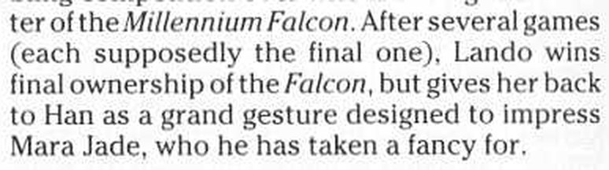
Our notes: `notes/materials/029-jedi-academy-sourcebook/09-ch9-the-independent-class.md:11`

## The Complete Star Wars Encyclopedia, Vol. I (A–G)

> Anor hoped to strike back at Overlord Shirnrra in revenge for his misfortune. With word that the living planet Zonama Sekot had been found, Nom Anor saw his op­ portunity. He knew Zonama Sekot was some­ thing Shimrra deeply feared. Confirming the planet's existence and location, Nom Anor returned to Shimrra and was reinstated for his discovery. He was elevated to the rank of pre­ fect of Yuuzhan'tar and tasked with quelling the growing ranks of heretical Shamed Ones, but Anor found that he could not control the very revolution he had previously sparked and fanned as Yu'shaa. In the interest of self­ preservation, he again adopted the guise ofthe Prophet and led the Shamed Ones in battle against the warriors. Attempting to escape the conflict, Anor was instead defeated and captured by Mara Jade Skywalker. Anor revealed to her Shimrra's plot to use the Republic's own Alpha Red virus to destroy Zonama Sekot. He then agreed to take Mara to Shimrra's Citadel while on the constant lookout for an opportunity to escape. Shirnrra was defeated, and Nom Anor, real­ izing he had no future: died when his escape craft crashed onto Coruscant. Anor,PhaaA Yuuzhan Vong of the inten­ dant caste and a creche-mate of Nom Anor.
— Source: scan pages 41–80; Mara Jade Skywalker. POV: Mara Jade Skywalker.
(Excerpt widened 2026-11-17 to the relevant passage, word for word from research primary cse vol1 (text copy `research_primary_cse_vol1_pdf_45a954be6d`).)
(Excerpt widened 2026-11-17 to the relevant passage, word for word from research primary cse vol1 (text copy `research_primary_cse_vol1_pdf_45a954be6d`).)
Note (our notes, around the quote): Mara Jade Skywalker: "Attempting to escape the conflict, Anor was instead defeated and captured by Mara Jade Skywalker." Source: The Complete Star Wars Encyclopedia, Vol. I, p.33
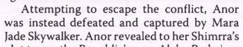
Our notes: `notes/materials/030-complete-star-wars-encyclopedia-vol-1/01-v1-scan-041-080.md:63`

> Barkale, Governor An Imperial officer on Kintoni who embezzled from the sector treasury, he was tracked down and killed by Mara Jade, the Emperor's Hand, for his treachery.
— Source: scan pages 41–80; Mara Jade Skywalker. POV: Mara Jade Skywalker.
Note (our notes, around the quote): Mara Jade Skywalker: "Barkale, Governor An Imperial officer on Kintoni who embezzled from the sector treasury, he was tracked down and killed by Mara Jade, the Emperor's Hand, for his treachery." Source: The Complete Star Wars Encyclopedia, Vol. I, p.62
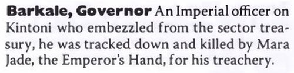
Our notes: `notes/materials/030-complete-star-wars-encyclopedia-vol-1/01-v1-scan-041-080.md:290`

> K. Burtola, Mari Amithest, Ashla, Chian, and Jempa. Bearsh A Vagaari general who posed as the First Steward of the Geroon Remnant during the operation to recover Outbound Flight, a few years prior to the Yuuzhan Vong inva­ sion. He claimed to the Chiss expedition to be a grateful Geroon wishing to accompany those who had freed the Geroon people from Vagaari slavery. Insinuating their way into the recovery mission, Bearsh and his Vagaari co­ conspirators attacked with the wolvik animals they had smuggled aboard as lifeless fur stoles. In fact Bearsh and his 300 soldiers sought to avenge the Vagaari defeated by Chiss Com­ mander Thrawn more than a generation earlier, and brought the battle to the wreckage of Outbound Flight. The Chiss, along with Luke Skywalker and Mara Jade, were able to defeat Bearsh. Bearus,Chairman A humanoid who was leader of the once powerful carbonite-mining guild in the Em­ press Teta system some 4,000 years before the Galactic Civil War. Beast In the Mouth of the Mountains An immense arach­ nid creature on the Forest Moon of Endor feared by the Ewoks. During the Clone Wars, Aayla Secura came to Endor to investigate a deserted Separatist outpost that was attacked by the creature. The Ewoks asked for Aayla's help in slaying the beast, and she killed it by crushing it with stalactites.
— Source: scan pages 41–80; Luke Skywalker; Mara Jade Skywalker.
(Excerpt widened 2026-11-17 to the relevant passage, word for word from research primary cse vol1 (text copy `research_primary_cse_vol1_pdf_45a954be6d`).)
(Excerpt widened 2026-11-17 to the relevant passage, word for word from research primary cse vol1 (text copy `research_primary_cse_vol1_pdf_45a954be6d`).)
Note (our notes, around the quote): Luke Skywalker; Mara Jade Skywalker: "The Chiss, along with Luke Skywalker and Mara Jade, were able to defeat Bearsh." Source: The Complete Star Wars Encyclopedia, Vol. I, p.65
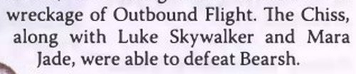
Our notes: `notes/materials/030-complete-star-wars-encyclopedia-vol-1/01-v1-scan-041-080.md:325`

> Following a trail of embezzeled funds, the Emperor's Hand Mara Jade discovered the plot and began an intense pursuit of Caaldra, which finally ended on the sector capital Shelkonwa, where Caaldra died when his own blasterfire was deflected from Jade's lightsaber blade.
— Source: scan pages 81–120; Mara Jade Skywalker. POV: Mara Jade Skywalker.
Note (our notes, around the quote): Mara Jade Skywalker: "Following a trail of embezzeled funds, the Emperor's Hand Mara Jade discovered the plot and began an intense pursuit of Caaldra, which finally ended on the sector capital Shelkonwa, where Caaldra died when his own blasterfire was deflected from Jade's lightsaber blade." Source: The Complete Star Wars Encyclopedia, Vol. I, p.103
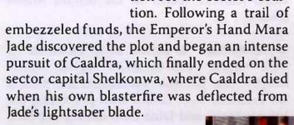
Our notes: `notes/materials/030-complete-star-wars-encyclopedia-vol-1/02-v1-scan-081-120.md:299`

> The clones generated by Thrawn were based on approximately 20 templates. If C'baoth could learn to control only those 20 minds, then, he could command his own army. At this time, the New Republic had discov­ ered Thrawn's cloning operation, and a strike team infiltrated Mount Tantiss. The team in­ cluded Luke Skywalker and Mara Jade, whom C'baoth saw as prospective students. When C'baoth realized he could not turn Luke to the dark side, he unleashed a terrible and twisted weapon: a clone of Luke Skywalker. C'baoth had ordered the clone grown from a sample of Skywalker's genetic material kept in the Mount Tantiss storehouse. Luke faced his mindless doppelganger, but it was Mara Jade who eventually killed Luuke Skywalker. After the clone fell in combat, C'baoth let go of whatever tenuous grip he had on real­ ity and self-control. His rage overtook him, Cel,Lieutenante charged by the dark side. A whirling tempest of anger and the Force, C'baoth dropped his guard, and Mara Jade struck him down. C'borp The chief gunner of the pirate ma­ rauder ship Starjackersome4,000years before the Battle of Yavin, he destroyed an attacking spacecraft piloted by Dreebo, who worked for Great Bogga the Hutt.
— Source: scan pages 121–160; Luke Skywalker; Mara Jade Skywalker.
(Excerpt widened 2026-11-17 to the relevant passage, word for word from research primary cse vol1 (text copy `research_primary_cse_vol1_pdf_45a954be6d`).)
(Excerpt widened 2026-11-17 to the relevant passage, word for word from research primary cse vol1 (text copy `research_primary_cse_vol1_pdf_45a954be6d`).)
Note (our notes, around the quote): Luke Skywalker; Mara Jade Skywalker: "Luke faced his mindless doppelganger, but it was Mara Jade who eventually killed Luuke Skywalker." Source: The Complete Star Wars Encyclopedia, Vol. I, p.113
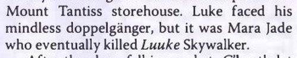
Our notes: `notes/materials/030-complete-star-wars-encyclopedia-vol-1/03-v1-scan-121-160.md:65`

> Chakra This Jeodu guard worked for Prince Dequc and was killed by Mara Jade.
— Source: scan pages 121–160; Mara Jade Skywalker. POV: Mara Jade Skywalker.
Note (our notes, around the quote): Mara Jade Skywalker: "Chakra This Jeodu guard worked for Prince Dequc and was killed by Mara Jade." Source: The Complete Star Wars Encyclopedia, Vol. I, p.118

Our notes: `notes/materials/030-complete-star-wars-encyclopedia-vol-1/03-v1-scan-121-160.md:110`

> Feeorin skin tones varied from coal black to pale white, but green, yellow, and blue were the most common colors. Instead ofhair, thick tendrils hung from the back of Feeorin heads. Feesa (Chaf'ees'aklaio) A female aide to Aristocra Formbi, this young Chiss female met Luke and Mara Jade Skywalker on their way to locate the ruins ofthe Outbound Flight Project. She was curt with answers to any questions they asked. Feesa, whose full Chiss name was Chaf'ees'aklaio, later accompanied a Chiss contingent when the Skywalkers found the ruins of the Outbound Flight mission but got trapped in a turbolift with Bearsh and disguised Vagaari pirates, mortal enemies of the Chiss. Mara finally got to the bottom of a tangled plot by Formbi, with the help of Feesa, to get the Vagaari to attack the Chiss first, so that the Chiss could then take the moral high ground as they wiped out their archfoes. Feethan Ottraw Scalable Assem­ bliesA Utapaun manufacturer, the company was taken over when the planet was invaded by Confederacy forces. The Techno Union used it to turn out its Mankvim-814 Intercep­ tors and small fighters like the Belbullab-22. Fef A moderately large planet orbiting an orange-yellow star in the Glythe sector, it was home to the insectoid Fefze.
— Source: scan pages 241–280; Mara Jade Skywalker. POV: Mara Jade Skywalker.
(Excerpt widened 2026-11-17 to the relevant passage, word for word from research primary cse vol1 (text copy `research_primary_cse_vol1_pdf_45a954be6d`).)
(Excerpt widened 2026-11-17 to the relevant passage, word for word from research primary cse vol1 (text copy `research_primary_cse_vol1_pdf_45a954be6d`).)
Note (our notes, around the quote): Mara Jade Skywalker: "Mara finally got to the bottom of a tangled plot by Formbi, with the help of Feesa, to get the Vagaari to attack the Chiss first, so that the Chiss could then take the moral high ground as they wiped out their archfoes." Source: The Complete Star Wars Encyclopedia, Vol. I, p.259
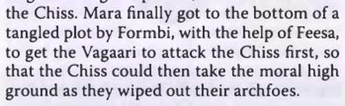
Our notes: `notes/materials/030-complete-star-wars-encyclopedia-vol-1/06-v1-scan-241-280.md:215`

> When Talon Karrde discovered the operation, Gamgalon nearly killed Karrde, but Mara Jade killed Gamgalon first.
— Source: scan pages 321–360; Mara Jade Skywalker. POV: Mara Jade Skywalker.
Note (our notes, around the quote): Mara Jade Skywalker: "When Talon Karrde discovered the operation, Gamgalon nearly killed Karrde, but Mara Jade killed Gamgalon first." Source: The Complete Star Wars Encyclopedia, Vol. I, p.318
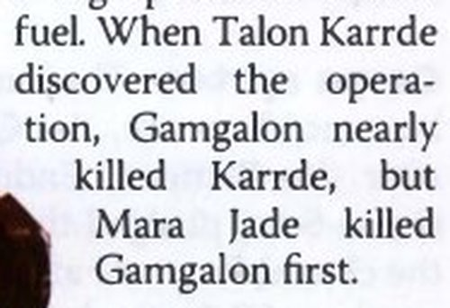
Our notes: `notes/materials/030-complete-star-wars-encyclopedia-vol-1/08-v1-scan-321-360.md:94`

## The Complete Star Wars Encyclopedia, Vol. II (H–O)

- Note (summary from our notes, not a quotation): Page contents: 1084 words, 30 paragraphs | headings/entries: Jabriel; Jacamden, Croig; Jaccoba; Jace, Bairdon; Jace, Bror; Jacelie; Jacipri; Jack; Jackal; Jacques; Jacynith; Jada, Deesra Luur; Jadai Motors; Jade; Jade, Mara; Jaded Jawa; Jade Moon
  — Source: scan pages 121–160.
Our notes: `notes/materials/031-complete-star-wars-encyclopedia-vol-2/03-v2-scan-121-160.md:129`

> But the Yuuzhan Vong were already on Dantooine, and they destroyed the Jade Sabre before Anakin and Mara could recover it.
— Source: scan pages 121–160; Darth Vader (Anakin Skywalker); Mara Jade Skywalker.
Note (our notes, around the quote): Darth Vader (Anakin Skywalker); Mara Jade Skywalker: "But the Yuuzhan Vong were already on Dantooine, and they destroyed the Jade Sabre before Anakin and Mara could recover it." Source: The Complete Star Wars Encyclopedia, Vol. II, p.132
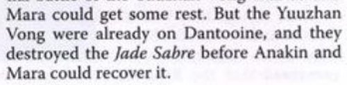
Our notes: `notes/materials/031-complete-star-wars-encyclopedia-vol-2/03-v2-scan-121-160.md:131`

> Luke and Mara were forced to use Lorana's lightsaber in a desperate attempt to destroy the droideka that was protecting Estosh and his Vagaari aboard the D-Four Dreadnaught.
— Source: scan pages 161–200; Luke Skywalker; Mara Jade Skywalker.
Note (our notes, around the quote): Luke Skywalker; Mara Jade Skywalker: "Luke and Mara were forced to use Lorana's lightsaber in a desperate attempt to destroy the droideka that was protecting Estosh and his Vagaari aboard the D-Four Dreadnaught." Source: The Complete Star Wars Encyclopedia, Vol. II, p.166
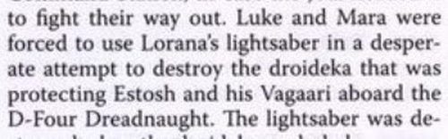
Our notes: `notes/materials/031-complete-star-wars-encyclopedia-vol-2/04-v2-scan-161-200.md:95`

> As part of Caedus's rise to power, he killed Mara Jade Skywalker, though his guilt as the murderer remained unknown for some time.
— Source: scan pages 241–280; Jacen Solo (Darth Caedus); Mara Jade Skywalker.
Note (our notes, around the quote): Jacen Solo (Darth Caedus); Mara Jade Skywalker: "As part of Caedus's rise to power, he killed Mara Jade Skywalker, though his guilt as the murderer remained unknown for some time." Source: The Complete Star Wars Encyclopedia, Vol. II, p.266
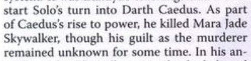
Our notes: `notes/materials/031-complete-star-wars-encyclopedia-vol-2/06-v2-scan-241-280.md:293`

- Note (summary from our notes, not a quotation): Page contents: 1071 words, 32 paragraphs | headings/entries: Mantid, Di; Mantoid; Mantologo; Mantooine; Mantooine; Mantooine Medallion; Mantooine Minuet; Manx; Mara; Marais, The; Marakoloon; Maramere
  — Source: scan pages 281–320.
Our notes: `notes/materials/031-complete-star-wars-encyclopedia-vol-2/07-v2-scan-281-320.md:112`

> While on Caprioril, Mara encountered Lumiya for the first time and was forced to defeat her in combat.
— Source: scan pages 281–320; Mara Jade Skywalker; Lumiya.
Note (our notes, around the quote): Mara Jade Skywalker; Lumiya: "While on Caprioril, Mara encountered Lumiya for the first time and was forced to defeat her in combat." Source: The Complete Star Wars Encyclopedia, Vol. II, p.289
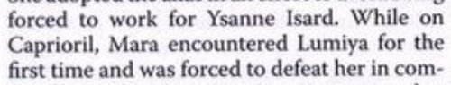
Our notes: `notes/materials/031-complete-star-wars-encyclopedia-vol-2/07-v2-scan-281-320.md:126`

> When Ben confronted Omas, the beleaguered Chief of State revealed that he believed Jacen had been the one who killed Mara.
— Source: scan pages 401–440; Jacen Solo (Darth Caedus); Mara Jade Skywalker.
Note (our notes, around the quote): Jacen Solo (Darth Caedus); Mara Jade Skywalker: "When Ben confronted Omas, the beleaguered Chief of State revealed that he believed Jacen had been the one who killed Mara." Source: The Complete Star Wars Encyclopedia, Vol. II, p.410
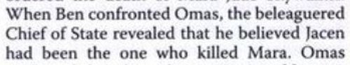
Our notes: `notes/materials/031-complete-star-wars-encyclopedia-vol-2/10-v2-scan-401-440.md:115`

## The Complete Star Wars Encyclopedia, Vol. III (P–Z)

> Mara wanted nothing to do with such small-time antics and quickly disarmed him before he could do any damage.
— Source: scan pages 1–40; Mara Jade Skywalker. POV: Mara Jade Skywalker.
Note (our notes, around the quote): Mara Jade Skywalker: "Mara wanted nothing to do with such small-time antics and quickly disarmed him before he could do any damage." Source: The Complete Star Wars Encyclopedia, Vol. III, p.27

Our notes: `notes/materials/032-complete-star-wars-encyclopedia-vol-3/00-v3-scan-001-040.md:238`

> Despite wearing an armored vest, Plattahr was killed by Mara Jade in Gorb Drig's cantina.
— Source: scan pages 1–40; Mara Jade Skywalker. POV: Mara Jade Skywalker.
Note (our notes, around the quote): Mara Jade Skywalker: "Despite wearing an armored vest, Plattahr was killed by Mara Jade in Gorb Drig's cantina." Source: The Complete Star Wars Encyclopedia, Vol. III, p.29

Our notes: `notes/materials/032-complete-star-wars-encyclopedia-vol-3/00-v3-scan-001-040.md:260`

> Plo nearly overpowered Skywalker, who was rescued by Mara—she literally scraped the Dark Jedi off him with her X-wing.
— Source: scan pages 1–40; Plo Koon; Mara Jade Skywalker.
Note (our notes, around the quote): Plo Koon; Mara Jade Skywalker: "Plo nearly overpowered Skywalker, who was rescued by Mara—she literally scraped the Dark Jedi off him with her X-wing." Source: The Complete Star Wars Encyclopedia, Vol. III, p.30

Our notes: `notes/materials/032-complete-star-wars-encyclopedia-vol-3/00-v3-scan-001-040.md:273`

> Luke and Mara Jade Skywalker confronted Alema there, and engaged in a lightsaber duel.
— Source: scan pages 81–120; Luke Skywalker; Mara Jade Skywalker; Alema Rar.
Note (our notes, around the quote): Luke Skywalker; Mara Jade Skywalker; Alema Rar: "Luke and Mara Jade Skywalker confronted Alema there, and engaged in a lightsaber duel." Source: The Complete Star Wars Encyclopedia, Vol. III, p.80

Our notes: `notes/materials/032-complete-star-wars-encyclopedia-vol-3/02-v3-scan-081-120.md:59`

> Together they killed the Jedi Tresina Lobi; Alema also fought by Lumiya's side at Rooqoo Depot, where they attempted to defeat Luke and Mara Jade Skywalker.
— Source: scan pages 81–120; Tresina Lobi; Alema Rar; Lumiya; Luke Skywalker; Mara Jade Skywalker.
Note (our notes, around the quote): Tresina Lobi; Alema Rar; Lumiya; Luke Skywalker; Mara Jade Skywalker: "Together they killed the Jedi Tresina Lobi; Alema also fought by Lumiya's side at Rooqoo Depot, where they attempted to defeat Luke and Mara Jade Skywalker." Source: The Complete Star Wars Encyclopedia, Vol. III, p.81

Our notes: `notes/materials/032-complete-star-wars-encyclopedia-vol-3/02-v3-scan-081-120.md:74`

> The droid even came to realize that it had been Solo who had killed Mara Jade Skywalker, although it remained loyal and did not divulge this information to any other being.
— Source: scan pages 121–160; Mara Jade Skywalker. POV: Mara Jade Skywalker.
Note (our notes, around the quote): Mara Jade Skywalker: "The droid even came to realize that it had been Solo who had killed Mara Jade Skywalker, although it remained loyal and did not divulge this information to any other being." Source: The Complete Star Wars Encyclopedia, Vol. III, p.132

Our notes: `notes/materials/032-complete-star-wars-encyclopedia-vol-3/03-v3-scan-121-160.md:131`

> He also revealed that he had killed Mara Jade Skywalker, although he firmly believed that the killing had been necessary to allow Jacen to continue his mission to save the galaxy.
— Source: scan pages 121–160; Mara Jade Skywalker; Jacen Solo (Darth Caedus).
Note (our notes, around the quote): Mara Jade Skywalker; Jacen Solo (Darth Caedus): "He also revealed that he had killed Mara Jade Skywalker, although he firmly believed that the killing had been necessary to allow Jacen to continue his mission to save the galaxy." Source: The Complete Star Wars Encyclopedia, Vol. III, p.146

Our notes: `notes/materials/032-complete-star-wars-encyclopedia-vol-3/03-v3-scan-121-160.md:265`

> With the defeat of the Yuuzhan Vong, Luke and Mara resolved to spend more time with their son, but the rigors of leading the new Jedi Order conspired to keep them apart.
— Source: scan pages 161–200; Luke Skywalker; Mara Jade Skywalker.
Note (our notes, around the quote): Luke Skywalker; Mara Jade Skywalker: "With the defeat of the Yuuzhan Vong, Luke and Mara resolved to spend more time with their son, but the rigors of leading the new Jedi Order conspired to keep them apart." Source: The Complete Star Wars Encyclopedia, Vol. III, p.162

Our notes: `notes/materials/032-complete-star-wars-encyclopedia-vol-3/04-v3-scan-161-200.md:75`

> Luke, who had killed Lumiya to avenge Mara, realized that she couldn't have been the culprit when Ben explained the circumstances of the Kavan incident.
— Source: scan pages 161–200; Luke Skywalker; Lumiya; Mara Jade Skywalker.
Note (our notes, around the quote): Luke Skywalker; Lumiya; Mara Jade Skywalker: "Luke, who had killed Lumiya to avenge Mara, realized that she couldn't have been the culprit when Ben explained the circumstances of the Kavan incident." Source: The Complete Star Wars Encyclopedia, Vol. III, p.162

Our notes: `notes/materials/032-complete-star-wars-encyclopedia-vol-3/04-v3-scan-161-200.md:77`

> On Terephon, Lumiya claimed to have killed Mara, and Luke beheaded her after a struggle.
— Source: scan pages 161–200; Lumiya; Mara Jade Skywalker; Luke Skywalker.
Note (our notes, around the quote): Lumiya; Mara Jade Skywalker; Luke Skywalker: "On Terephon, Lumiya claimed to have killed Mara, and Luke beheaded her after a struggle." Source: The Complete Star Wars Encyclopedia, Vol. III, p.165

Our notes: `notes/materials/032-complete-star-wars-encyclopedia-vol-3/04-v3-scan-161-200.md:128`

> When the mad Jedi clone Joruus C'baoth called both Luke and Mara to him, then unleashed Skywalker's clone, Luuke, Mara killed the Skywalker clone—and finally C'baoth, too, with help from Luke and Leia Organa Solo.
— Source: scan pages 161–200; Joruus C'baoth; Luke Skywalker; Mara Jade Skywalker; Leia Organa Solo.
Note (our notes, around the quote): Joruus C'baoth; Luke Skywalker; Mara Jade Skywalker; Leia Organa Solo: "When the mad Jedi clone Joruus C'baoth called both Luke and Mara to him, then unleashed Skywalker's clone, Luuke, Mara killed the Skywalker clone—and finally C'baoth, too, with help from Luke and Leia Organa Solo." Source: The Complete Star Wars Encyclopedia, Vol. III, p.166

Our notes: `notes/materials/032-complete-star-wars-encyclopedia-vol-3/04-v3-scan-161-200.md:151`

> Just as Jacen showed up, Mara's body disappeared, becoming one with the Force—a sure sign to Ben Skywalker that his mother was revealing that she had been killed by Jacen.
— Source: scan pages 161–200; Jacen Solo (Darth Caedus); Mara Jade Skywalker; Ben Skywalker.
Note (our notes, around the quote): Jacen Solo (Darth Caedus); Mara Jade Skywalker; Ben Skywalker: "Just as Jacen showed up, Mara's body disappeared, becoming one with the Force—a sure sign to Ben Skywalker that his mother was revealing that she had been killed by Jacen." Source: The Complete Star Wars Encyclopedia, Vol. III, p.166

Our notes: `notes/materials/032-complete-star-wars-encyclopedia-vol-3/04-v3-scan-161-200.md:157`

> Jacen fled to Ziost, where Lumiya agreed to make Luke believe that she had killed Mara.
— Source: scan pages 161–200.
Note (our notes, around the quote): Jacen Solo (Darth Caedus); Lumiya; Luke Skywalker; Mara Jade Skywalker — entry/section: Solo, Jacen: "Jacen fled to Ziost, where Lumiya agreed to make Luke believe that she had killed Mara." Source: The Complete Star Wars Encyclopedia, Vol. III, p.175

Our notes: `notes/materials/032-complete-star-wars-encyclopedia-vol-3/04-v3-scan-161-200.md:244`

> In the days that followed, Leia and Jaina met with Ben Skywalker, encouraging him to find evidence that would prove that Jacen had killed Mara Jade Skywalker.
— Source: scan pages 161–200.
Note (our notes, around the quote): Jaina Solo; Leia Organa Solo; Ben Skywalker; Jacen Solo (Darth Caedus); Mara Jade Skywalker — entry/section: Solo, Jaina: "In the days that followed, Leia and Jaina met with Ben Skywalker, encouraging him to find evidence that would prove that Jacen had killed Mara Jade Skywalker." Source: The Complete Star Wars Encyclopedia, Vol. III, p.178

Our notes: `notes/materials/032-complete-star-wars-encyclopedia-vol-3/04-v3-scan-161-200.md:297`

> This clone was never activated: Luke Skywalker and Mara Jade discovered it and destroyed it during their escape from the complex.
— Source: scan pages 241–280; Luke Skywalker; Mara Jade Skywalker.
Note (our notes, around the quote): Luke Skywalker; Mara Jade Skywalker: "This clone was never activated: Luke Skywalker and Mara Jade discovered it and destroyed it during their escape from the complex." Source: The Complete Star Wars Encyclopedia, Vol. III, p.240

Our notes: `notes/materials/032-complete-star-wars-encyclopedia-vol-3/06-v3-scan-241-280.md:61`

> When Elan was chosen to act as an envoy to the New Republic in an effort to destroy the Jedi, Vergere accompanied her and gave Han Solo a sample of her tears, which cured Mara Jade Skywalker of a wasting disease that had crippled her.
— Source: scan pages 281–320; Han Solo; Mara Jade Skywalker.
Note (our notes, around the quote): Han Solo; Mara Jade Skywalker: "When Elan was chosen to act as an envoy to the New Republic in an effort to destroy the Jedi, Vergere accompanied her and gave Han Solo a sample of her tears, which cured Mara Jade Skywalker of a wasting disease that had crippled her." Source: The Complete Star Wars Encyclopedia, Vol. III, p.303

Our notes: `notes/materials/032-complete-star-wars-encyclopedia-vol-3/07-v3-scan-281-320.md:234`

> When confronted, Mara Jade quickly cut down two wolvkils while Luke Skywalker used the Force to cause others to fall asleep.
— Source: scan pages 321–360; Mara Jade Skywalker; Luke Skywalker.
Note (our notes, around the quote): Mara Jade Skywalker; Luke Skywalker: "When confronted, Mara Jade quickly cut down two wolvkils while Luke Skywalker used the Force to cause others to fall asleep." Source: The Complete Star Wars Encyclopedia, Vol. III, p.332

Our notes: `notes/materials/032-complete-star-wars-encyclopedia-vol-3/08-v3-scan-321-360.md:147`

## Power of the Jedi Sourcebook (d20, 2002)

> Mara had miraculously survived a Yuuzhan Vong poison in her system with the aid of a chemical compound known as Vergere's Tears.
— Source: Chapter Six: Jedi traditions and famous Jedi; Mara Jade Skywalker. POV: Mara Jade Skywalker.
Note (our notes, around the quote): Mara Jade Skywalker: "Mara had miraculously survived a Yuuzhan Vong poison in her system with the aid of a chemical compound known as Vergere's Tears." Source: Power of the Jedi Sourcebook, p.130

Our notes: `notes/materials/033-power-of-the-jedi-sourcebook/06-ch6-jedi-traditions.md:278`

## The New Essential Guide to Characters (2002)

> Of the hundred victims, only Mara Jade Skywalker survived, and she suffered for years before beating the disease.
— Source: scan pages 1–30; Mara Jade Skywalker. POV: Mara Jade Skywalker.
Note (our notes, around the quote): Mara Jade Skywalker: "Of the hundred victims, only Mara Jade Skywalker survived, and she suffered for years before beating the disease." Source: The New Essential Guide to Characters, p.20

Our notes: `notes/materials/034-new-essential-guide-to-characters/00-negc-scan-001-030.md:102`

- Note (summary from our notes, not a quotation): Page contents: 455 words, 11 paragraphs | headings/entries: Le Mara Jade, Shira Brie was
  — Source: scan pages 1–30.
Our notes: `notes/materials/034-new-essential-guide-to-characters/00-negc-scan-001-030.md:193`

> On Herdessa she nearly killed Leia Organa, while on Kinooine she dueled with Luke Skywalker and revealed to him her past life as Shira Brie.
— Source: scan pages 1–30.
Note (our notes, around the quote): Mara Jade Skywalker; Lumiya; Leia Organa Solo; Luke Skywalker — entry/section: Le Mara Jade, Shira Brie was: "On Herdessa she nearly killed Leia Organa, while on Kinooine she dueled with Luke Skywalker and revealed to him her past life as Shira Brie." Source: The New Essential Guide to Characters, p.33

Our notes: `notes/materials/034-new-essential-guide-to-characters/00-negc-scan-001-030.md:197`

> Lesser bounty hunters tried to trade off his fame, including the hunter Gunner Groth, who posed as Dengar but was killed by Mara Jade on Rishi.
— Source: scan pages 31–60; Dengar; Mara Jade Skywalker.
Note (our notes, around the quote): Dengar; Mara Jade Skywalker: "Lesser bounty hunters tried to trade off his fame, including the hunter Gunner Groth, who posed as Dengar but was killed by Mara Jade on Rishi." Source: The New Essential Guide to Characters, p.54

Our notes: `notes/materials/034-new-essential-guide-to-characters/01-negc-scan-031-060.md:126`

> Raised on Palpatine's estate, Mara became an expert combatant, spy, and assassin, and an excellent blade duelist wielding her blue-hued lightsaber.
— Source: scan pages 151–180; Palpatine (Darth Sidious); Mara Jade Skywalker.
Note (our notes, around the quote): Palpatine (Darth Sidious); Mara Jade Skywalker: "Raised on Palpatine's estate, Mara became an expert combatant, spy, and assassin, and an excellent blade duelist wielding her blue-hued lightsaber." Source: The New Essential Guide to Characters, p.161

Our notes: `notes/materials/034-new-essential-guide-to-characters/05-negc-scan-151-180.md:41`

> Her mission a failure, Mara accepted Palpatine's alternate assignment to assassinate Dequc, a criminal underlord who'd been trying to fill the power vacuum left behind after Darth Vader killed Prince Xizor.
— Source: scan pages 151–180.
Note (our notes, around the quote): Mara Jade Skywalker; Palpatine (Darth Sidious); Darth Vader (Anakin Skywalker); Prince Xizor: "Her mission a failure, Mara accepted Palpatine's alternate assignment to assassinate Dequc, a criminal underlord who'd been trying to fill the power vacuum left behind after Darth Vader killed Prince Xizor." Source: The New Essential Guide to Characters, p.161

Our notes: `notes/materials/034-new-essential-guide-to-characters/05-negc-scan-151-180.md:45`

> Inside Wayland's Mount Tantiss complex, Mara killed two clones— the mad Jedi Master Joruus C'baoth and a clone duplicate of Luke Skywalker, thus fulfilling—on a technicality—the Emperor's final command.
— Source: scan pages 151–180; Mara Jade Skywalker; Joruus C'baoth; Luke Skywalker.
Note (our notes, around the quote): Mara Jade Skywalker; Joruus C'baoth; Luke Skywalker: "Inside Wayland's Mount Tantiss complex, Mara killed two clones— the mad Jedi Master Joruus C'baoth and a clone duplicate of Luke Skywalker, thus fulfilling—on a technicality—the Emperor's final command." Source: The New Essential Guide to Characters, p.162

Our notes: `notes/materials/034-new-essential-guide-to-characters/05-negc-scan-151-180.md:52`

> When Emperor Palpatine came back in a new clone body, Mara refused to believe it was really him.
— Source: scan pages 151–180; Palpatine (Darth Sidious); Mara Jade Skywalker.
Note (our notes, around the quote): Palpatine (Darth Sidious); Mara Jade Skywalker: "When Emperor Palpatine came back in a new clone body, Mara refused to believe it was really him." Source: The New Essential Guide to Characters, p.162

Our notes: `notes/materials/034-new-essential-guide-to-characters/05-negc-scan-151-180.md:54`

> After Admiral Daala's first defeat, Mara entered into a partnership with Lando Calrissian for the administration of the spice mines of Kessel.
— Source: scan pages 151–180; Admiral Daala; Mara Jade Skywalker; Lando Calrissian.
Note (our notes, around the quote): Admiral Daala; Mara Jade Skywalker; Lando Calrissian: "After Admiral Daala's first defeat, Mara entered into a partnership with Lando Calrissian for the administration of the spice mines of Kessel." Source: The New Essential Guide to Characters, p.163

Our notes: `notes/materials/034-new-essential-guide-to-characters/05-negc-scan-151-180.md:61`

> In order to prevent Thrawn's followers from reaching the outer galaxy, Mara remote-siteered the Jade's Fire into the base's docking bay, destroying her most cherished possession.
— Source: scan pages 151–180; Grand Admiral Thrawn; Mara Jade Skywalker.
Note (our notes, around the quote): Grand Admiral Thrawn; Mara Jade Skywalker: "In order to prevent Thrawn's followers from reaching the outer galaxy, Mara remote-siteered the Jade's Fire into the base's docking bay, destroying her most cherished possession." Source: The New Essential Guide to Characters, p.163

Our notes: `notes/materials/034-new-essential-guide-to-characters/05-negc-scan-151-180.md:63`

> An insane clone of the Jedi Master Jorus C'baoth, Joruus assisted Grand Admiral Thrawn in waging war against the New Republic before being killed by Mara Jade on Wayland.
— Source: scan pages 181–210; Joruus C'baoth; Grand Admiral Thrawn; Mara Jade Skywalker.
Note (our notes, around the quote): Joruus C'baoth; Grand Admiral Thrawn; Mara Jade Skywalker: "An insane clone of the Jedi Master Jorus C'baoth, Joruus assisted Grand Admiral Thrawn in waging war against the New Republic before being killed by Mara Jade on Wayland." Source: The New Essential Guide to Characters, p.208

Our notes: `notes/materials/034-new-essential-guide-to-characters/06-negc-scan-181-210.md:146`

## Dark Side Sourcebook (d20, 2001)

- Note (summary from our notes, not a quotation): Page contents: 818 words, 23 paragraphs | headings/entries: Imperial Sovereign Protector; Skills: Intimidate +9, Knowledge (nobility; Imperial Sentinel; Mara Jade, Emperor's Hand
  — Source: Chapter Five: Dark Side Traditions (Sith Empire, Set Harth, prophets, Brakiss…).
Our notes: `notes/materials/035-dark-side-sourcebook/05-ch5-traditions.md:268`

- Note (summary from our notes, not a quotation): Page contents: 1258 words, 121 paragraphs | headings/entries: Index; Drain Energy 14, 17; Drain Force 17; Drain Knowledge 15, 17, 40; Durron, Kyp 12, 104, 105; Dxun tomb beast 112; Emperor Reborn 120, 126; Empress Teta system 8, 74, 75, 76; Endor 10, 91, 92, 94, 110; Force, the 6, 7, 40, 55; Force illusions 16; Force Points, gaining 40; Force-based skills 13, 17; Gepta, Rokur 80; Gethzerion 81, 82, 108, 134; Great Hyperspace War, the 7,; Harth, Set 83; Hatred (feat) 18; Hethrir, Lord 92, 93; Illusion (feat) 15, 17; Imperial campaign 51; Imperial Sentinel 99; Imperial Sovereign Protector 92, 99; Interrogator droid 63; Ismaren, trek 106; Jade, Mara 26, 53, 99; Jedgar 94, 96; Jedi characters 20; Jedi consular 158; Jedi, corrupted 31; Jedi guardian 157; Jedi, history of 7; Jedi hunters 87; Jerec 101; Kadanm 94, 96, 97 Kai,; Tamith 108, 109; Kalgrath 116; Sedriss, Executor 99, 102; Sense (feat) 54; Sing, Aurra 87, 88; Sith acolyte 31, 74; Skywalker, Luk
  — Source: Chapter Seven: Dark Side Campaigns; back matter.
Our notes: `notes/materials/035-dark-side-sourcebook/07-ch7-campaigns.md:117`

## Sourcebooks/Rebellion Era Sourcebook.pdf [Star Wars Roleplaying Game (d20, 2000)] (scan pages 61–120)

> One such Hand is Mara Jade, a beautiful young woman with red-gold hair who looks more like a dancer or @ courte taxes on H san than a highly skilled agent.
— Source: Sourcebooks/Rebellion Era Sourcebook.pdf [Star Wars Roleplaying Game (d20.
Note (our notes, around the quote): Mara Jade Skywalker; Palpatine (Darth Sidious) — entry/section: Emperor's Hand (Rebellion Era Sourcebook): "One such Hand is Mara Jade, a beautiful young woman with red-gold hair who looks more like a dancer or @ courte taxes on H san than a highly skilled agent." Source: *Rebellion Era Sourcebook* (SWRPG d20), scan p.81

Our notes: `notes/materials/037-sw-d20-folder/043-rebellion-era-sourcebook-scan-061-120.md:131`

- Note (summary from our notes, not a quotation): Page contents: Vess Kogo, Emperor's Hand (Scoundrel 4/Force Adept 2, VP/WP 24/12): 'he has the potential to surpass her [Mara Jade] in almost all areas'; Emperor 'turned Kogo into a killing machine'; Inquisitors 'have rarely failed to produce the desired results' (hand-read)
  — Source: Sourcebooks/Rebellion Era Sourcebook.pdf [Star Wars Roleplaying Game (d20.
Our notes: `notes/materials/037-sw-d20-folder/043-rebellion-era-sourcebook-scan-061-120.md:140`

## Sourcebooks/Star Wars Roleplaying Game Core Rulebook.pdf [Star Wars Roleplaying Game (d20, 2000)] (scan pages 241–300)

> Chewbacca has remained Han's friend through countless adventures, helping to rescue him from the clutches of the gangster Jabba the Hutt, facing the three-eyed Trioculus, recruiting the smuggler Talon Karrde and the assassin Mara Jade to fight Grand Admiral Thrawn, destroying the Wayland weapons and cloning facilities, and even helping to raise Han's children.
— Source: Sourcebooks/Star Wars Roleplaying Game Core Rulebook.pdf [Star Wars Rolep; Chewbacca; Mara Jade Skywalker; Grand Admiral Thrawn.
Note (our notes, around the quote): Chewbacca; Mara Jade Skywalker; Grand Admiral Thrawn: "Chewbacca has remained Han's friend through countless adventures, helping to rescue him from the clutches of the gangster Jabba the Hutt, facing the three-eyed Trioculus, recruiting the smuggler Talon Karrde and the assassin Mara Jade to fight Grand Admiral Thrawn, destroying the Wayland weapons and cloning facilities, and even helping to raise Han's children." Source: *Star Wars Roleplaying Game Core Rulebook* (SWRPG d20), scan p.243

Our notes: `notes/materials/037-sw-d20-folder/046-star-wars-roleplaying-game-core-rulebook-scan-241-300.md:46`

> In fact, Mara Jade was trained in hand-to-hand combat, marksmanship, the use of exotic weapons and poisons, and most interestingly, the Force. Although personally trained by the living epitome of the dark side, Mara Jade's own experience with the Force was neither good nor evil. She dwelt in a gray area, using the Force to augment her own formidable abilities, but not drawing on its darker aspects, and not using it in hatred or anger. Indeed, her emotional detachment about her assignments lent Mara an almost Jedi-like self-control. Were she not the Emperor's personal assassin, she might well have become a Jedi Master—though through some means known only to the Emperor, Mara Jade's own control of the Force was assisted by Palpatine himself. When he perished, much of her ability swiftly faded away.
— Source: Sourcebooks/Star Wars Roleplaying Game Core Rulebook.pdf [Star Wars Rolep.
Note (our notes, around the quote): Mara Jade Skywalker; Palpatine (Darth Sidious) — entry/section: Key Characters: Mara Jade Skywalker: "In fact, Mara Jade was trained in hand-to-hand combat, marksmanship, the use of exotic weapons and poisons, and most interestingly, the Force. Although personally trained by the living epitome of the dark side, Mara Jade's own experience with the Force was neither good nor evil. She dwelt in a gray area, using the Force to augment her own formidable abilities, but not drawing on its darker aspects, and not using it in hatred or anger. Indeed, her emotional detachment about her assignments lent Mara an almost Jedi-like self-control. Were she not the Emperor's personal assassin, she might well have become a Jedi Master—though through some means known only to the Emperor, Mara Jade's own control of the Force was assisted by Palpatine himself. When he perished, much of her ability swiftly faded away." Source: *Star Wars Roleplaying Game Core Rulebook* (SWRPG d20), scan p.245

Our notes: `notes/materials/037-sw-d20-folder/046-star-wars-roleplaying-game-core-rulebook-scan-241-300.md:74`

> Although she is able to keep its worst effects at bay using the Force, she is one of only two people to contract it and still live—though the other is near death.
— Source: Sourcebooks/Star Wars Roleplaying Game Core Rulebook.pdf [Star Wars Rolep; Mara Jade Skywalker — entry/section: Key Characters: Mara Jade Skywalker.
Note (our notes, around the quote): Mara Jade Skywalker — entry/section: Key Characters: Mara Jade Skywalker: "Although she is able to keep its worst effects at bay using the Force, she is one of only two people to contract it and still live—though the other is near death." Source: *Star Wars Roleplaying Game Core Rulebook* (SWRPG d20), scan p.246

Our notes: `notes/materials/037-sw-d20-folder/046-star-wars-roleplaying-game-core-rulebook-scan-241-300.md:81`

> Only when the mad Jedi clone Joruus C'Baoth attempted to turn them both to the dark side, and Mara slew a clone of Luke Skywalker, did she finally feel as though she had fulfilled her duty to the Emperor.
— Source: Sourcebooks/Star Wars Roleplaying Game Core Rulebook.pdf [Star Wars Rolep.
Note (our notes, around the quote): Mara Jade Skywalker; Luke Skywalker — entry/section: Key Characters: Mara Jade Skywalker: "Only when the mad Jedi clone Joruus C'Baoth attempted to turn them both to the dark side, and Mara slew a clone of Luke Skywalker, did she finally feel as though she had fulfilled her duty to the Emperor." Source: *Star Wars Roleplaying Game Core Rulebook* (SWRPG d20), scan p.246

Our notes: `notes/materials/037-sw-d20-folder/046-star-wars-roleplaying-game-core-rulebook-scan-241-300.md:83`

## Sourcebooks/Starships Of The Galaxy.pdf [Star Wars Roleplaying Game (d20, 2000)] (scan pages 61–114)

> Jade Sabre was Mara Jade Skywalker's personal shuttle, built for her by her husband, Jedi Master Luke Skywalker. It replaced her original shuttle, Jade's Fire, which was destroyed.
— Source: Sourcebooks/Starships Of The Galaxy.pdf [Star Wars Roleplaying Game (d20,; Mara Jade Skywalker; Luke Skywalker — entry/section: Jade Sabre.
Note (our notes, around the quote): Mara Jade Skywalker; Luke Skywalker — entry/section: Jade Sabre: "Jade Sabre was Mara Jade Skywalker's personal shuttle, built for her by her husband, Jedi Master Luke Skywalker. It replaced her original shuttle, Jade's Fire, which was destroyed." Source: *Starships Of The Galaxy* (SWRPG d20), scan p.84

Our notes: `notes/materials/037-sw-d20-folder/047-starships-of-the-galaxy-scan-061-114.md:151`

> Unfortunately, Jade Sabre was destroyed by the Yuuzhan Vong on the planet Dantooine early in their invasion of the galaxy.
— Source: Sourcebooks/Starships Of The Galaxy.pdf [Star Wars Roleplaying Game (d20,; Mara Jade Skywalker — entry/section: Jade Sabre.
Note (our notes, around the quote): Mara Jade Skywalker — entry/section: Jade Sabre: "Unfortunately, Jade Sabre was destroyed by the Yuuzhan Vong on the planet Dantooine early in their invasion of the galaxy." Source: *Starships Of The Galaxy* (SWRPG d20), scan p.84

Our notes: `notes/materials/037-sw-d20-folder/047-starships-of-the-galaxy-scan-061-114.md:153`

## Sourcebooks/The New Jedi Order Sourcebook.pdf [Star Wars Roleplaying Game (d20, 2000)] (scan pages 1–60)

> Luke Skywalker is the master of the Jedi academy on Yavin 4; Mara Jade Skywalker is not only his wife, but his most powerful supporter and ally,
> [fragment — full passage not on file]
— Source: Sourcebooks/The New Jedi Order Sourcebook.pdf [Star Wars Roleplaying Game.
Note (our notes, around the quote): Mara Jade Skywalker; Luke Skywalker — entry/section: Introduction (The New Jedi Order Sourcebook): "Luke Skywalker is the master of the Jedi academy on Yavin 4; Mara Jade Skywalker is not only his wife, but his most powerful supporter and ally," Source: *The New Jedi Order Sourcebook* (SWRPG d20), scan p.6

Our notes: `notes/materials/037-sw-d20-folder/049-the-new-jedi-order-sourcebook-scan-001-060.md:37`

> Luke Skywalker is the master of the Jedi academy on Yavin 4; Mara Jade Skywalker is not only his wife, but his most powerful supporter and ally, Han Solo and Leia Organa Solo fight the Yuuzhan Vong in their own way, on their own battlefields, while learning to cope with the changes the invasion brings to their family.
— Source: Sourcebooks/The New Jedi Order Sourcebook.pdf [Star Wars Roleplaying Game; Luke Skywalker; Mara Jade Skywalker; Han Solo; Leia Organa Solo.
Note (our notes, around the quote): Luke Skywalker; Mara Jade Skywalker; Han Solo; Leia Organa Solo: "Luke Skywalker is the master of the Jedi academy on Yavin 4; Mara Jade Skywalker is not only his wife, but his most powerful supporter and ally, Han Solo and Leia Organa Solo fight the Yuuzhan Vong in their own way, on their own battlefields, while learning to cope with the changes the invasion brings to their family." Source: *The New Jedi Order Sourcebook* (SWRPG d20), scan p.6

Our notes: `notes/materials/037-sw-d20-folder/049-the-new-jedi-order-sourcebook-scan-001-060.md:39`

> As Mara Jade explained to him, Luke had always overcompensated, using the Force like a heavy club, rather than a light tap.
— Source: Sourcebooks/The New Jedi Order Sourcebook.pdf [Star Wars Roleplaying Game.
Note (our notes, around the quote): Luke Skywalker; Mara Jade Skywalker — entry/section: Luke Skywalker's Traditionalists (The New Jedi Order Sourcebook, Ch1): "As Mara Jade explained to him, Luke had always overcompensated, using the Force like a heavy club, rather than a light tap." Source: *The New Jedi Order Sourcebook* (SWRPG d20), scan p.17

Our notes: `notes/materials/037-sw-d20-folder/049-the-new-jedi-order-sourcebook-scan-001-060.md:100`

> They know only that the Yuuzhan Vong are actively searching for them and have already destroyed Mara's Jade Sabre, their only means of getting offplanet.
— Source: Sourcebooks/The New Jedi Order Sourcebook.pdf [Star Wars Roleplaying Game; Mara Jade Skywalker. POV: Mara Jade Skywalker.
Note (our notes, around the quote): Mara Jade Skywalker: "They know only that the Yuuzhan Vong are actively searching for them and have already destroyed Mara's Jade Sabre, their only means of getting offplanet." Source: *The New Jedi Order Sourcebook* (SWRPG d20), scan p.56

Our notes: `notes/materials/037-sw-d20-folder/049-the-new-jedi-order-sourcebook-scan-001-060.md:333`

## Sourcebooks/The New Jedi Order Sourcebook.pdf [Star Wars Roleplaying Game (d20, 2000)] (scan pages 61–120)

> Meeting no resistance to his attack, Shedao Shai falls temporarily off balance—just long enough for Corran to press his lightsaber hilt to the Yuuzhan Vong’s abdomen and switch it on.
— Source: Sourcebooks/The New Jedi Order Sourcebook.pdf [Star Wars Roleplaying Game.
Note (our notes, around the quote): Corran Horn; Shedao Shai; Mara Jade Skywalker — entry/section: Duel, Betrayal, and Blame (The New Jedi Order Sourcebook, Ch3): "Meeting no resistance to his attack, Shedao Shai falls temporarily off balance—just long enough for Corran to press his lightsaber hilt to the Yuuzhan Vong’s abdomen and switch it on." Source: *The New Jedi Order Sourcebook* (SWRPG d20), scan p.69

Our notes: `notes/materials/037-sw-d20-folder/049-the-new-jedi-order-sourcebook-scan-061-120.md:66`

> Duel, Betrayal, and Blame The Battle of Ithor ends when Corran Horn and Mara Jade Skywalker locate the Yuuzhan Vong command post and contact Shedao Shai, the Yuuzhan Vong commander.
— Source: Sourcebooks/The New Jedi Order Sourcebook.pdf [Star Wars Roleplaying Game; Corran Horn; Mara Jade Skywalker.
Note (our notes, around the quote): Corran Horn; Mara Jade Skywalker: "Duel, Betrayal, and Blame The Battle of Ithor ends when Corran Horn and Mara Jade Skywalker locate the Yuuzhan Vong command post and contact Shedao Shai, the Yuuzhan Vong commander." Source: *The New Jedi Order Sourcebook* (SWRPG d20), scan p.69

Our notes: `notes/materials/037-sw-d20-folder/049-the-new-jedi-order-sourcebook-scan-061-120.md:72`

- Note (summary from our notes, not a quotation): Page contents: 899 words, 24 paragraphs | headings/entries: Errant Venture; Mara Jade's Pregnancy
  — Source: Sourcebooks/The New Jedi Order Sourcebook.pdf [Star Wars Roleplaying Game.
Our notes: `notes/materials/037-sw-d20-folder/049-the-new-jedi-order-sourcebook-scan-061-120.md:369`

## Sourcebooks/The New Jedi Order Sourcebook.pdf [Star Wars Roleplaying Game (d20, 2000)] (scan pages 121–162)

> The most powerful Jedi Master in the galaxy can only stand by and watch his wife die.
— Source: Sourcebooks/The New Jedi Order Sourcebook.pdf [Star Wars Roleplaying Game.
Note (our notes, around the quote): Luke Skywalker; Mara Jade Skywalker — entry/section: Mara's illness (The New Jedi Order Sourcebook, Ch6): "The most powerful Jedi Master in the galaxy can only stand by and watch his wife die." Source: *The New Jedi Order Sourcebook* (SWRPG d20), scan p.128

Our notes: `notes/materials/037-sw-d20-folder/049-the-new-jedi-order-sourcebook-scan-121-162.md:55`

- Note (summary from our notes, not a quotation): Page contents: 916 words, 25 paragraphs | headings/entries: Ht < a > A; Mara Jade; Jade Shadow; Refugee Ships; Alema Rar, Twi'lek Jedi
  — Source: Sourcebooks/The New Jedi Order Sourcebook.pdf [Star Wars Roleplaying Game.
Our notes: `notes/materials/037-sw-d20-folder/049-the-new-jedi-order-sourcebook-scan-121-162.md:108`

> could add +2 to each skill check, attack roll, and saving throw
> [fragment — full passage not on file]
— Source: Sourcebooks/The New Jedi Order Sourcebook.pdf [Star Wars Roleplaying Game.
Note (our notes, around the quote): Page contents: Battle meld: in a meld with Jacen, Jaina and Lowbacca, Anakin "could add +2 to each skill check, attack roll, and saving throw". p.155 Luke and Mara fight off a horde of Vong ships over Coruscant. p.160 Jaina's rage opens her to the dark side. (hand-read)
Our notes: `notes/materials/037-sw-d20-folder/049-the-new-jedi-order-sourcebook-scan-121-162.md:184`

## Star Wars Gamer/Star Wars Gamer 03.pdf [Star Wars Roleplaying Game (d20, 2000)] (scan pages 61–104)

- Note (summary from our notes, not a quotation): Page contents: Star Wars: Battleground RTS preview (Haden Blackman / Garry Gaber): campaigns follow Attichitcuk, Leia, Vader Yavin->Hoth, OOM-9; EU heroes Mara Jade, Aurra Sing, Vilmarh Grahrk (hand-read)
  — Source: Star Wars Gamer/Star Wars Gamer 03.pdf [Star Wars Roleplaying Game (d20,.
Our notes: `notes/materials/037-sw-d20-folder/052-star-wars-gamer-03-scan-061-104.md:232`

## Star Wars Gamer/Star Wars Gamer 05.pdf [Star Wars Roleplaying Game (d20, 2000)] (scan pages 1–60)

- Note (summary from our notes, not a quotation): Page contents: The Crystal (Elaine Cunningham): Jaina's Jedi graduation on Yavin 4; Jacen and Anakin apprenticed to Luke; ailing Mara takes Jaina as apprentice; Han gives her a modified Z-95 which she names Crystal; Bahalian Shipyards a Tenloss Syndicate front; stats for The Crystal (Z-95) (hand-read)
  — Source: Star Wars Gamer/Star Wars Gamer 05.pdf [Star Wars Roleplaying Game (d20,.
Our notes: `notes/materials/037-sw-d20-folder/054-star-wars-gamer-05-scan-001-060.md:65`

> I grew the crystals for my first lightsaber. It connects you, gives you a different feel altogether. You are, almost literally, part of the weapon.
— Source: Star Wars Gamer/Star Wars Gamer 05.pdf [Star Wars Roleplaying Game (d20,.
Note (our notes, around the quote): Mara Jade Skywalker; Jaina Solo — entry/section: Mara on growing lightsaber crystals: "I grew the crystals for my first lightsaber. It connects you, gives you a different feel altogether. You are, almost literally, part of the weapon." Source: *Star Wars Gamer 05* (SWRPG d20), scan p.15

Our notes: `notes/materials/037-sw-d20-folder/054-star-wars-gamer-05-scan-001-060.md:88`

- Note (summary from our notes, not a quotation): Page contents: The Emperor's Pawns (Abel G. Peña, Juan Schwartz, Pablo Hidalgo): Mara learns from Solo that Roganda Ismaren was another Emperor's Hand; Thrawn had called Mara a courier like 'the rest of the Emperor's Hands'; Mara's memory of Palpatine with the cyborg Lumiya; Hands drawn from disaffected Jedi such as Jerec and Brandl and from Palpatine's own dark side adepts (hand-read)
  — Source: Star Wars Gamer/Star Wars Gamer 05.pdf [Star Wars Roleplaying Game (d20,.
Our notes: `notes/materials/037-sw-d20-folder/054-star-wars-gamer-05-scan-001-060.md:214`

## Star Wars Gamer/Star Wars Gamer 05.pdf [Star Wars Roleplaying Game (d20, 2000)] (scan pages 61–118)

- Note (summary from our notes, not a quotation): Page contents: Chiss: Luke and Mara learned the species name at Nirauan; Chiss clawcraft phalanx led by a Human arrived at Garqi; four ruling families Csapla, Nuruodo, Inrokini, Sabosen; capital Csaplar; no money, 28 colonial Phalanxes under Syndics; Syndic Mitth'raw'nuruodo's Household Phalanx allied with Imperials; hyperspace anchor-point beacon network, no navicomputers; Thrawn's beacon in the Imperial Records Library tracked Bastion; Spiker the Tatooine swoop jockey suspected to be a Chiss (hand-read)
  — Source: Star Wars Gamer/Star Wars Gamer 05.pdf [Star Wars Roleplaying Game (d20,.
Our notes: `notes/materials/037-sw-d20-folder/054-star-wars-gamer-05-scan-061-118.md:225`

## Star Wars Gamer/Star Wars Gamer 06.pdf [Star Wars Roleplaying Game (d20, 2000)] (scan pages 61–95)

- Note (summary from our notes, not a quotation): Page contents: The Shaft: Swoop Dreams (Cory J. Herndon), Star Wars CCG Tatooine-expansion Dark Side swoop gang deck: Flare-S Racing Swoop, Darth Maul, Aurra Sing, Mara Jade, Emperor, Bane Malar; Watto's Chance Cube with Maul's Electrobinoculars, Restraining Bolt, Weapon Levitation (hand-read)
  — Source: Star Wars Gamer/Star Wars Gamer 06.pdf [Star Wars Roleplaying Game (d20,.
Our notes: `notes/materials/037-sw-d20-folder/055-star-wars-gamer-06-scan-061-095.md:133`

- Note (summary from our notes, not a quotation): Page contents: Jedi Outcast: Jedi Knight II (PC, Raven Software, Quake III engine): Kyle Katarn redeemed by Mara Jade after Mysteries of the Sith, set 13-14 years after Yavin, smarter stormtroopers, saber 'limbing'; Starfighter Special Edition (Xbox, Secret Level; Rhys Dallows, Vana Sage, Nym) (hand-read)
  — Source: Star Wars Gamer/Star Wars Gamer 06.pdf [Star Wars Roleplaying Game (d20,.
Our notes: `notes/materials/037-sw-d20-folder/055-star-wars-gamer-06-scan-061-095.md:167`

## Star Wars Gamer/Star Wars Gamer 08.pdf [Star Wars Roleplaying Game (d20, 2000)] (scan pages 61–112)

- Note (summary from our notes, not a quotation): Page contents: Luke Skywalker, Jedi Master: with Luke's help Mara overcame the disease inflicted by the Yuuzhan Vong and bore their first son, named Ben after Obi-Wan Kenobi (hand-read)
  — Source: Star Wars Gamer/Star Wars Gamer 08.pdf [Star Wars Roleplaying Game (d20,.
Our notes: `notes/materials/037-sw-d20-folder/057-star-wars-gamer-08-scan-061-112.md:197`

## Star Wars Gamer/Star Wars Gamer 09.pdf [Star Wars Roleplaying Game (d20, 2000)] (scan pages 61–104)

- Note (summary from our notes, not a quotation): Page contents: Jedi Knight II: Jedi Outcast preview (Elliott Chin, PC): Kyle Katarn as a reluctant Jedi like Mara Jade; Desann's Reborn (Force-endowed servants he dupes Kyle into helping create), stormtroopers who flee when their leader falls, Gran and Rodian bounty hunters, and a mine monster (hand-read)
  — Source: Star Wars Gamer/Star Wars Gamer 09.pdf [Star Wars Roleplaying Game (d20,.
Our notes: `notes/materials/037-sw-d20-folder/058-star-wars-gamer-09-scan-061-104.md:237`

- Note (summary from our notes, not a quotation): Page contents: Jedi Outcast: a 3D lightsaber that blocks sabers, with location-based kills; Kyle gave up the Force nine years after Mysteries of the Sith, where Mara Jade saved him from the dark side; he flies missions for Mon Mothma with Jan Ors; it opens at an Imperial listening post on Kejim, taken over by the Dark Jedi Desann (hand-read)
  — Source: Star Wars Gamer/Star Wars Gamer 09.pdf [Star Wars Roleplaying Game (d20,.
Our notes: `notes/materials/037-sw-d20-folder/058-star-wars-gamer-09-scan-061-104.md:242`

## Star Wars Gamer/Star Wars Gamer 10.pdf [Star Wars Roleplaying Game (d20, 2000)] (scan pages 1–60)

- Note (summary from our notes, not a quotation): Page contents: Contents: 'War on Wayland' (New Jedi Order serial), 'Handoff' by Timothy Zahn (Mara Jade as Emperor's Hand), board games, the Model Citizen Lars homestead, Galactic Power Brokers, the revised RPG, Droid Starships (Owen K.C. Stephens), Clawdites, the Sharpshooter and Medic prestige classes, the TCG, 'Jedi's Legacy' and 'Standoff on Leritor' adventures, previews of Bounty Hunter and KotOR, strategy guides for Racer Revenge and Jedi Starfighter, Galaxies (hand-read)
  — Source: Star Wars Gamer/Star Wars Gamer 10.pdf [Star Wars Roleplaying Game (d20,.
Our notes: `notes/materials/037-sw-d20-folder/059-star-wars-gamer-10-scan-001-060.md:20`

- Note (summary from our notes, not a quotation): Page contents: Fiction 'Handoff' by Timothy Zahn (illus. Dave Dorman): Mara Jade, on the run from Ysanne Isard after the Emperor's death, at a Coruscant Full Symphony concert on Chibias; she sees Counselor Raines of Governor Egron's staff plant a datacard on a boy (hand-read)
  — Source: Star Wars Gamer/Star Wars Gamer 10.pdf [Star Wars Roleplaying Game (d20,.
Our notes: `notes/materials/037-sw-d20-folder/059-star-wars-gamer-10-scan-001-060.md:145`

- Note (summary from our notes, not a quotation): Page contents: Handoff: Mara poses as 'Litassa Colay', the director of offworld special events; her Force sense fails ('The Force, apparently, was no longer with her'); her sleeve gun and lightsaber are in her hotel (hand-read)
  — Source: Star Wars Gamer/Star Wars Gamer 10.pdf [Star Wars Roleplaying Game (d20,.
Our notes: `notes/materials/037-sw-d20-folder/059-star-wars-gamer-10-scan-001-060.md:150`

- Note (summary from our notes, not a quotation): Page contents: Handoff: Mara disables security man Jayx and escapes with the boy as stormtroopers arrive; the boy from Saraban City on Sibisime was lured to Chibias with a job offer at the governor's palace (hand-read)
  — Source: Star Wars Gamer/Star Wars Gamer 10.pdf [Star Wars Roleplaying Game (d20,.
Our notes: `notes/materials/037-sw-d20-folder/059-star-wars-gamer-10-scan-001-060.md:155`

- Note (summary from our notes, not a quotation): Page contents: Handoff: the boy, Ghent, slices a Level Three Governor/Diplomatic Imperial encryption instantly; 'They call me Ghent'; Mara arms herself with her sleeve gun and lightsaber (hand-read)
  — Source: Star Wars Gamer/Star Wars Gamer 10.pdf [Star Wars Roleplaying Game (d20,.
Our notes: `notes/materials/037-sw-d20-folder/059-star-wars-gamer-10-scan-001-060.md:160`

- Note (summary from our notes, not a quotation): Page contents: Handoff: Mara poses as 'Arica Pradeux', an envoy of a Grand Admiral, with recognition code Hapspir Barrint; 'Counselor Raines' is Markko, unofficially attached to Governor Egron; she brokers Ghent's services at two thousand an hour (hand-read)
  — Source: Star Wars Gamer/Star Wars Gamer 10.pdf [Star Wars Roleplaying Game (d20,.
Our notes: `notes/materials/037-sw-d20-folder/059-star-wars-gamer-10-scan-001-060.md:165`

- Note (summary from our notes, not a quotation): Page contents: Handoff: Markko claims a captured Rebel sector-command computer; Mara spots and evades two tails, an Emperor's-trainer technique (hand-read)
  — Source: Star Wars Gamer/Star Wars Gamer 10.pdf [Star Wars Roleplaying Game (d20,.
Our notes: `notes/materials/037-sw-d20-folder/059-star-wars-gamer-10-scan-001-060.md:170`

- Note (summary from our notes, not a quotation): Page contents: Handoff: Mara follows the tails to a house and is caught by Markko; she has lost her Force warning sense and wonders whether the Force was ever hers or only the Emperor acting through her; the locals mention Talon Karrde, a would-be smuggling chief filling Jabba's void; Alec Pradeux was among Palpatine's advisors (hand-read)
  — Source: Star Wars Gamer/Star Wars Gamer 10.pdf [Star Wars Roleplaying Game (d20,.
Our notes: `notes/materials/037-sw-d20-folder/059-star-wars-gamer-10-scan-001-060.md:175`

- Note (summary from our notes, not a quotation): Page contents: Handoff: Markko is an agent of the Rebel Alliance with a local cell; Mara plans to betray them to Egron to win an Intelligence post and get Isard off her back (hand-read)
  — Source: Star Wars Gamer/Star Wars Gamer 10.pdf [Star Wars Roleplaying Game (d20,.
Our notes: `notes/materials/037-sw-d20-folder/059-star-wars-gamer-10-scan-001-060.md:182`

- Note (summary from our notes, not a quotation): Page contents: Handoff: under cover of Ghent's Periander feedback screech, Mara uses the Emperor-taught Paparak cross-cut with her lightsaber to weaken the hall's walls; she bluffs Markko about a cantrosh-gas painting frame (hand-read)
  — Source: Star Wars Gamer/Star Wars Gamer 10.pdf [Star Wars Roleplaying Game (d20,.
Our notes: `notes/materials/037-sw-d20-folder/059-star-wars-gamer-10-scan-001-060.md:197`

- Note (summary from our notes, not a quotation): Page contents: Handoff: the hall collapses on the Star Destroyer computer; Mara spares four stormtroopers with recognition code Besh-Senth-Isk-Twelve, pattern Nen-Peth 1377 (hand-read)
  — Source: Star Wars Gamer/Star Wars Gamer 10.pdf [Star Wars Roleplaying Game (d20,.
Our notes: `notes/materials/037-sw-d20-folder/059-star-wars-gamer-10-scan-001-060.md:202`

- Note (summary from our notes, not a quotation): Page contents: Handoff: Mara throws her lightsaber at Egron and kills the traitor governor with her sleeve blaster; Markko takes Ghent hostage (hand-read)
  — Source: Star Wars Gamer/Star Wars Gamer 10.pdf [Star Wars Roleplaying Game (d20,.
Our notes: `notes/materials/037-sw-d20-folder/059-star-wars-gamer-10-scan-001-060.md:207`

- Note (summary from our notes, not a quotation): Page contents: Handoff: Mara lets Markko go to spare Ghent ('Until next time'); she gives Ghent nearly all her money for a ticket home (hand-read)
  — Source: Star Wars Gamer/Star Wars Gamer 10.pdf [Star Wars Roleplaying Game (d20,.
Our notes: `notes/materials/037-sw-d20-folder/059-star-wars-gamer-10-scan-001-060.md:212`

- Note (summary from our notes, not a quotation): Mara Jade Skywalker — entry/section: Mara as Imperial justice: "That's easy enough," Mara said“! am justice.” She nodded her head toward Egron’s body. “He tried to betray the Empire.|pronounced him guilty, and executed him." Source: *Star Wars Gamer 10* (SWRPG d20), scan p.35
  — Source: Star Wars Gamer/Star Wars Gamer 10.pdf [Star Wars Roleplaying Game (d20,.

Our notes: `notes/materials/037-sw-d20-folder/059-star-wars-gamer-10-scan-001-060.md:214`

## Characters/Hutts/Groodo and Ka'Pa.pdf [Star Wars Roleplaying Game Revised Core (d20, 2002)]

- Note (summary from our notes, not a quotation): Page contents: Ka'Pa background, Kyle Katarn quote; Ka'Pa stats (contacts Kyle Katarn, Mara Jade); Wurrek teaser (hand-read)
  — Source: Characters/Hutts/Groodo and Ka'Pa.pdf [Star Wars Roleplaying Game Revised.
Our notes: `notes/materials/037-sw-d20-folder/086-groodo-and-kapa.md:23`

## Characters/The Dark Forces Saga/The Dark Forces Saga, Part 1.pdf [Star Wars Roleplaying Game Revised Core (d20, 2002)]

- Note (summary from our notes, not a quotation): Page contents: Intro on Dark Forces (1994) and Kyle's games; Kyle Katarn, Jedi Knight: Sulon upbringing, mother's death, Carida, Jerec kills Morgan, Death Star plans, Dark Trooper project, Ruusan/Valley prophecy, Mara Jade reciprocal apprenticeship, Drommund Kaas (hand-read)
  — Source: Characters/The Dark Forces Saga/The Dark Forces Saga, Part 1.pdf [Star Wa.
Our notes: `notes/materials/037-sw-d20-folder/128-the-dark-forces-saga-part-1.md:10`

> During this time, Luke Skywalker offered to further Kyle's Force training, but Kyle's fears of the darkness within him kept him from accepting. One person who understood Kyle's reluctance was Mara Jade, the former Emperor's Hand. She and Kyle took up the rare bond of reciprocal apprenticeship, a facet of the Jedi Concordance of Fealty little practiced since the Cleansing of the Nine Houses. When Kyle fell to the dark side on Drommund Kaas, Mara was able to turn him back, if only temporarily.
— Source: Characters/The Dark Forces Saga/The Dark Forces Saga, Part 1.pdf [Star Wa.
Note (our notes, around the quote): Kyle Katarn; Mara Jade Skywalker; Luke Skywalker — entry/section: Kyle and Mara Jade: "During this time, Luke Skywalker offered to further Kyle's Force training, but Kyle's fears of the darkness within him kept him from accepting. One person who understood Kyle's reluctance was Mara Jade, the former Emperor's Hand. She and Kyle took up the rare bond of reciprocal apprenticeship, a facet of the Jedi Concordance of Fealty little practiced since the Cleansing of the Nine Houses. When Kyle fell to the dark side on Drommund Kaas, Mara was able to turn him back, if only temporarily." Source: *The Dark Forces Saga, Part 1* (SWRPG d20 Revised Core), scan p.1

Our notes: `notes/materials/037-sw-d20-folder/128-the-dark-forces-saga-part-1.md:18`

## Characters/The Dark Forces Saga/The Dark Forces Saga, Part 2.pdf [Star Wars Roleplaying Game Revised Core (d20, 2002)]

- Note (summary from our notes, not a quotation): Jan Ors; Kyle Katarn; Mara Jade Skywalker; Mon Mothma; Admiral Hiram Drayson — entry/section: Jan and Kyle declare their love: "Her attitude changed, however, during the race for the Valley of the Jedi, during which Jan and Kyle declared their love. As freedom fighters, Jan and Kyle's relationship was far from ideal, particularly with Kyle's dark mood swings and the close bond he formed with the former Emperor's Hand Mara Jade, but the pair pulled through. On Mon Mothma's recommendation, Jan joined Admiral Hiram Drayson's secretive Alpha Blue intelligence agency, where she helped expose the Yevethan hypocrisy. She also kept a vigilant eye on ambiguous threats like the socialites of the Order of the Canted Circle and the Azurite Society of Lords, and the "retired" Grand Admiral Grant. In her new capacity, Jan was able to assign Kyle and accompany him on off-the-record missions against the Imperial Remnant." Source: *The Dark Forces Saga, Part 2* (SWRPG d20 Revised Core), scan p.1
  — Source: Characters/The Dark Forces Saga/The Dark Forces Saga, Part 2.pdf [Star Wa.

Our notes: `notes/materials/037-sw-d20-folder/129-the-dark-forces-saga-part-2.md:16`

## Characters/The Dark Forces Saga/The Dark Forces Saga, Part 5.pdf [Star Wars Roleplaying Game Revised Core (d20, 2002)]

- Note (summary from our notes, not a quotation): Page contents: Pic SQ Abominable Presence and Darkness Shared; Gorc stats from image (Soldier 3/Jedi Guardian 2/Dark Side Marauder 3, Init -1, CC D) and SQs; Adventure Seed: Jedi Search II (Yoda's lightsaber on Sulon Star); Adventure Seed: Kyle Katarn, Meet Mara Jade (Byss, Blackhole, Senex sector); Dromund Kaas header (hand-read)
  — Source: Characters/The Dark Forces Saga/The Dark Forces Saga, Part 5.pdf [Star Wa.
Our notes: `notes/materials/037-sw-d20-folder/132-the-dark-forces-saga-part-5.md:30`

- Note (summary from our notes, not a quotation): Mara Jade Skywalker; Palpatine (Darth Sidious); Luke Skywalker; Grand Admiral Thrawn; Jan Ors; Kyle Katarn; Blackhole (Emperor's Hand) — entry/section: Adventure seed: Kyle Katarn, Meet Mara Jade: "Over the years convalescing on the planet Byss after his "death" at the Battle of Endor, the resurrected Emperor has been slowly rebuilding his telepathic bond with his Force-servant Mara Jade, incessantly commanding that she destroy Luke Skywalker. However, when Mara killed Luke's evil clone during the campaign against Grand Admiral Thrawn, the telepathic connection she and the Emperor shared was suddenly severed.
  — Source: Characters/The Dark Forces Saga/The Dark Forces Saga, Part 5.pdf [Star Wa.
Our notes: `notes/materials/037-sw-d20-folder/132-the-dark-forces-saga-part-5.md:37`

- Note (summary from our notes, not a quotation): To punish her, Palpatine has sent his minions to intercept Mara during her trip to the Senex sector as a representative of the Smugglers' Alliance. Though Luke is busy along with the rest of the New Republic dealing with an Imperial Mutiny taking place in the Core Worlds, he calls in a favor to Jan Ors at New Republic Intelligence. Ors has dispatched a ragtag group of heroes led by the equally maverick Jedi Kyle Katarn.
  — Source: Characters/The Dark Forces Saga/The Dark Forces Saga, Part 5.pdf [Star Wa.
(The heroes will have to help free Mara from the clutches of one of the Emperor's powerful dark side adepts, the former Prophet of the Dark Side Blackhole, and report to Kyle and Luke about clues they've discovered concerning a Sith temple." Source: *The Dark Forces Saga, Part 5* (SWRPG d20 Revised Core), scan p.2)

Our notes: `notes/materials/037-sw-d20-folder/132-the-dark-forces-saga-part-5.md:38`

> Kyle Katarn traveled there after learning of the witchworld in ancient inscriptions, battling a host of Sith abominations in the planet's seemingly endless bogs before succumbing to the spell of the dark side of the Force. After his rescue by Mara Jade, Kyle, Luke Skywalker, and other Jedi heroes were able to piece together parts of the fabled system's history. Dromund Kaas had been founded by a Sith apostate who rejected the Rule of Two, and was ruled over by a succession of prophets until its discovery by Darth Sidious. Sidious turned the Prophets of the Dark Side to his service. Emperor Palpatine kept Dromund Kaas' location a secret, but he used the planet as a testing ground for his dark side adepts, including the Force-sensitive Grand Admiral Declann.
— Source: Characters/The Dark Forces Saga/The Dark Forces Saga, Part 5.pdf [Star Wa.
Note (our notes, around the quote): Kyle Katarn; Mara Jade Skywalker; Luke Skywalker; Palpatine (Darth Sidious) — entry/section: Kyle on Dromund Kaas: "Kyle Katarn traveled there after learning of the witchworld in ancient inscriptions, battling a host of Sith abominations in the planet's seemingly endless bogs before succumbing to the spell of the dark side of the Force. After his rescue by Mara Jade, Kyle, Luke Skywalker, and other Jedi heroes were able to piece together parts of the fabled system's history. Dromund Kaas had been founded by a Sith apostate who rejected the Rule of Two, and was ruled over by a succession of prophets until its discovery by Darth Sidious. Sidious turned the Prophets of the Dark Side to his service. Emperor Palpatine kept Dromund Kaas' location a secret, but he used the planet as a testing ground for his dark side adepts, including the Force-sensitive Grand Admiral Declann." Source: *The Dark Forces Saga, Part 5* (SWRPG d20 Revised Core), scan p.3

Our notes: `notes/materials/037-sw-d20-folder/132-the-dark-forces-saga-part-5.md:50`

## Jedi Counselling/Jedi Counseling 53 - Backups.pdf [Star Wars Roleplaying Game Revised Core (d20, 2002)]

- Note (summary from our notes, not a quotation): Page contents: Stealth, Mara Jade Blaster Barrage, Vader Double Attack/commander effect, Probe Droid, combined fire (hand-read)
  — Source: Jedi Counselling/Jedi Counseling 53 - Backups.pdf [Star Wars Roleplaying.
Our notes: `notes/materials/037-sw-d20-folder/220-jedi-counseling-53-backups.md:24`

- Note (summary from our notes, not a quotation): Mara Jade Skywalker — entry/section: Mara Jade's Blaster Barrage and Cunning Attack: "Q: If Mara Jade uses her Blaster Barrage Force power, and one of the targets she gets to make an attack against has not yet activated, does she get the Cunning Attack shot bonuses (+4 attack +10 damage vs. unactivated characters)?
  — Source: Jedi Counselling/Jedi Counseling 53 - Backups.pdf [Star Wars Roleplaying.
Our notes: `notes/materials/037-sw-d20-folder/220-jedi-counseling-53-backups.md:28`

- Note (summary from our notes, not a quotation): Mara Jade Skywalker; Palpatine (Darth Sidious) — entry/section: Mara Jade can't Blaster Barrage twice: "Q: Let's say that Mara Jade is in the same squad as the Emperor. If Mara uses her Blaster Barrage (which would take one of her Force Points), can she use Hand of the Emperor to use her Blaster Barrage twice in the same turn?
  — Source: Jedi Counselling/Jedi Counseling 53 - Backups.pdf [Star Wars Roleplaying.
Our notes: `notes/materials/037-sw-d20-folder/220-jedi-counseling-53-backups.md:31`

- Note (summary from our notes, not a quotation): A: No. Blaster Barrage replaces attacks. Mara Jade doesn't have another attack to "give up" to allow her to use it again. Her Hand of the Emperor ability would allow her to use a second Force Point to do something such as re-rolling an attack roll during the Blaster Barrage." Source: *Jedi Counseling 53 - Backups* (SWRPG d20 Revised Core), scan p.3
  — Source: Jedi Counselling/Jedi Counseling 53 - Backups.pdf [Star Wars Roleplaying.

Our notes: `notes/materials/037-sw-d20-folder/220-jedi-counseling-53-backups.md:32`

## Jedi Counselling/Jedi Counseling 54 - Pursuit.pdf [Star Wars Roleplaying Game Revised Core (d20, 2002)]

- Note (summary from our notes, not a quotation): Page contents: Miniatures: trooper followers, Obi-Wan Force Heal, Mara Jade targets, Emperor Force Points, Momentum, grenades, cover, bodyguard vs C-3PO (hand-read)
  — Source: Jedi Counselling/Jedi Counseling 54 - Pursuit.pdf [Star Wars Roleplaying.
Our notes: `notes/materials/037-sw-d20-folder/221-jedi-counseling-54-pursuit.md:24`

> To get the most out of Mara Jade, you have to be careful to move to a square where 1) you have line of sight to a lot of characters, 2) you aren't adjacent to any characters, and 3) most of the characters in line of sight do not have cover. Of course, you can still get several attacks if you position yourself adjacent to several characters. You would get to attack each adjacent character once because each one would be a legal target.
— Source: Jedi Counselling/Jedi Counseling 54 - Pursuit.pdf [Star Wars Roleplaying.
Note (our notes, around the quote): Mara Jade Skywalker — entry/section: Getting the most out of Mara Jade's Blaster Barrage: "To get the most out of Mara Jade, you have to be careful to move to a square where 1) you have line of sight to a lot of characters, 2) you aren't adjacent to any characters, and 3) most of the characters in line of sight do not have cover. Of course, you can still get several attacks if you position yourself adjacent to several characters. You would get to attack each adjacent character once because each one would be a legal target." Source: *Jedi Counseling 54 - Pursuit* (SWRPG d20 Revised Core), scan p.3

Our notes: `notes/materials/037-sw-d20-folder/221-jedi-counseling-54-pursuit.md:29`

## Jedi Counselling/Jedi Counseling 56.pdf [Star Wars Roleplaying Game Revised Core (d20, 2002)]

- Note (summary from our notes, not a quotation): Page contents: Mara/Emperor Force points, line of sight, Tarkin commander effect, doors, Rescue the Princess (hand-read)
  — Source: Jedi Counselling/Jedi Counseling 56.pdf [Star Wars Roleplaying Game Revis.
Our notes: `notes/materials/037-sw-d20-folder/223-jedi-counseling-56.md:25`

> (No one wants to keep track of different bonuses from the same commander effect, anyway.) Q: The Star Wars Miniatures rulebook defines "Hand of the Emperor" as follows (verbatim): "In addition to spending its own Force points once per turn, a character with this special ability can spend Force points from Emperor Palpatine once per turn. Emperor Palpatine must be in your squad for this ability to work." The way this is worded suggests to me that Mara may use her Force points to use Blaster Barrage, and then use additional Force points from Emperor Palpatine to use Blaster Barrage again, should she choose to do so. A: First, she only needs 1 Force Point to use Blaster Barrage. Second, she can only use one of the Emperor's Force Points in any given round. Third, she can't use Blaster Barrage twice in the same round ­­ it replaces attacks, so even if she uses one of the Emperor's Force Points, she can't use Blaster Barrage again. (She wouldn't have another attack to give up.) Q: When playing a three­person game on the blank map with the tile inserts, and someone has line of sight from one player's starting point to another player's starting point, can you make a legal shot on the characters that have not activated at all in the game? A: Yes.
— Source: Jedi Counselling/Jedi Counseling 56.pdf [Star Wars Roleplaying Game Revis.
(Excerpt widened 2026-11-17 to the relevant passage, word for word from research primary sw d20 folder files Star Wars Roleplaying Game Revised Core Jedi Counselling Jedi Counseling 56 (text copy `research_primary_sw_d20_folder_files_Star_Wars_Roleplaying_Game_Revised_Core_Jedi_Counselling_Jedi_Counseling_56_pdf_86cdcbcdd6`).)
(Excerpt widened 2026-11-17 to the relevant passage, word for word from research primary sw d20 folder files Star Wars Roleplaying Game Revised Core Jedi Counselling Jedi Counseling 56 (text copy `research_primary_sw_d20_folder_files_Star_Wars_Roleplaying_Game_Revised_Core_Jedi_Counselling_Jedi_Counseling_56_pdf_86cdcbcdd6`).)
Note (our notes, around the quote): Mara Jade Skywalker; Palpatine (Darth Sidious) — entry/section: Mara can't double Blaster Barrage with the Emperor's Force Points: "A: First, she only needs 1 Force Point to use Blaster Barrage. Second, she can only use one of the Emperor's Force Points in any given round. Third, she can't use Blaster Barrage twice in the same round -- it replaces attacks, so even if she uses one of the Emperor's Force Points, she can't use Blaster Barrage again. (She wouldn't have another attack to give up.)" Source: *Jedi Counseling 56* (SWRPG d20 Revised Core), scan p.3

Our notes: `notes/materials/037-sw-d20-folder/223-jedi-counseling-56.md:27`

## Jedi Counselling/Jedi Counseling 58.pdf [Star Wars Roleplaying Game Revised Core (d20, 2002)]

- Note (summary from our notes, not a quotation): Page contents: Aayla Secura Bodyguard, Spotter, Mara Jade Blaster Barrage targeting, C-3PO Draw Fire (hand-read)
  — Source: Jedi Counselling/Jedi Counseling 58.pdf [Star Wars Roleplaying Game Revis.
Our notes: `notes/materials/037-sw-d20-folder/225-jedi-counseling-58.md:20`

- Note (summary from our notes, not a quotation): Mara Jade Skywalker — entry/section: Mara Jade's Blaster Barrage target scenarios: "Imagine that Mara has line of sight to five enemies: The closest has cover, the next three don't, and the last has cover. She will get to attack the closest one with cover and the three without cover, but not the farthest one with cover. (You can only attack an enemy with cover if it is also the closest enemy.)
  — Source: Jedi Counselling/Jedi Counseling 58.pdf [Star Wars Roleplaying Game Revis.
Our notes: `notes/materials/037-sw-d20-folder/225-jedi-counseling-58.md:25`

- Note (summary from our notes, not a quotation): Second scenario, again with five enemies: The closest two (4 squares away) both have cover, and the three farthest away don't. Mara can attack all five characters.
  — Source: Jedi Counselling/Jedi Counseling 58.pdf [Star Wars Roleplaying Game Revis.
(Third scenario, again with five: The closest one doesn't have cover, but two of the other four do. Mara can only attack the three enemies without cover." Source: *Jedi Counseling 58* (SWRPG d20 Revised Core), scan p.3)

Our notes: `notes/materials/037-sw-d20-folder/225-jedi-counseling-58.md:26`

- Note (summary from our notes, not a quotation): Mara Jade Skywalker; C-3PO — entry/section: C-3PO's Draw Fire vs Mara Jade's Blaster Barrage: "A: Mara Jade is considered to "target" each enemy when using this ability, so C-3P0's Draw Fire ability does work against it. Resolve each attack (including the Draw Fire attempt, if necessary) one at a time, and Mara Jade's player gets to decide what order to take the attacks in. (These are "simultaneous effects," and that player is the acting player.)
  — Source: Jedi Counselling/Jedi Counseling 58.pdf [Star Wars Roleplaying Game Revis.
Our notes: `notes/materials/037-sw-d20-folder/225-jedi-counseling-58.md:29`

- Note (summary from our notes, not a quotation): To use your example, let's say Mara Jade has four legal targets: Rebel Trooper, Rebel Commando, Rebel Pilot, and C-3P0. She decides to attack C- 3P0 first, hoping to take him out of the fight, but he survives the hit. She then targets the Rebel Commando, but C-3P0 makes his Draw Fire roll, so she attacks C-3P0 instead; again, he survives the hit. She then targets the Rebel Trooper, but C-3P0 fails his Draw Fire roll, so she attacks and hits the Rebel Trooper, defeating him. Finally, she targets the Rebel Pilot, and C-3P0 makes his Draw Fire roll; Mara Jade hits and defeats C-3P0 with this last attack." Source: *Jedi Counseling 58* (SWRPG d20 Revised Core), scan p.3
  — Source: Jedi Counselling/Jedi Counseling 58.pdf [Star Wars Roleplaying Game Revis.

Our notes: `notes/materials/037-sw-d20-folder/225-jedi-counseling-58.md:30`

## Jedi Counselling/Jedi Counseling 69.pdf [Star Wars Roleplaying Game Revised Core (d20, 2002)]

- Note (summary from our notes, not a quotation): Page contents: R2-D2 Tow Cable, Dark Side Adept errata, Force Push pits, Mara Jade Hand of the Emperor, optional commander effects (hand-read)
  — Source: Jedi Counselling/Jedi Counseling 69.pdf [Star Wars Roleplaying Game Revis.
Our notes: `notes/materials/037-sw-d20-folder/237-jedi-counseling-69.md:27`

> You might visualize this as the character straining himself while desperately grabbing onto the edge of the pit. In any event, the Force Push ability was not meant to be an easy way of defeating a very powerful opponent! As for characters with Flight, they, too, stop at the edge of the pit and take double damage. Again, you might visualize this as being unable to activate a jet pack quickly enough (Jango Fett) or perhaps slamming on the brakes and jarring oneself in the process (Battle Droid on STAP). Q: Mara Jade's Hand of the Emperor ability (from Rebel Storm) reads, "This Character can spend their own Force points once per turn and spend Emperor Palpatine's Force points once per turn." Does this mean that Mara Jade may use the Force points from Emperor Palpatine, Sith Lord (from Revenge of the Sith) even though he doesn't have the same commander effect as the Rebel Storm version of Palpatine? A: Yes, Mara Jade can use Emperor Palpatine, Sith Lord's Force points. The key to the ability is the name of the character, not that character's commander effect. Still, given the Rebel Storm Emperor Palpatine's commander effect and how it allows others to use his Force points, I can see how this might be confusing.
— Source: Jedi Counselling/Jedi Counseling 69.pdf [Star Wars Roleplaying Game Revis.
(Excerpt widened 2026-11-17 to the relevant passage, word for word from research primary sw d20 folder files Star Wars Roleplaying Game Revised Core Jedi Counselling Jedi Counseling 69 (text copy `research_primary_sw_d20_folder_files_Star_Wars_Roleplaying_Game_Revised_Core_Jedi_Counselling_Jedi_Counseling_69_pdf_db4dd42020`).)
(Excerpt widened 2026-11-17 to the relevant passage, word for word from research primary sw d20 folder files Star Wars Roleplaying Game Revised Core Jedi Counselling Jedi Counseling 69 (text copy `research_primary_sw_d20_folder_files_Star_Wars_Roleplaying_Game_Revised_Core_Jedi_Counselling_Jedi_Counseling_69_pdf_db4dd42020`).)
Note (our notes, around the quote): Mara Jade Skywalker; Palpatine (Darth Sidious) — entry/section: Mara Jade's Hand of the Emperor with Emperor Palpatine, Sith Lord: "Q: Mara Jade's Hand of the Emperor ability (from Rebel Storm) reads, "This Character can spend their own Force points once per turn and spend Emperor Palpatine's Force points once per turn." Does this mean that Mara Jade may use the Force points from Emperor Palpatine, Sith Lord (from Revenge of the Sith) even though he doesn't have the same commander effect as the Rebel Storm version of Palpatine?
Our notes: `notes/materials/037-sw-d20-folder/237-jedi-counseling-69.md:34`

- Note (summary from our notes, not a quotation): A: Yes, Mara Jade can use Emperor Palpatine, Sith Lord's Force points. The key to the ability is the name of the character, not that character's commander effect. Still, given the Rebel Storm Emperor Palpatine's commander effect and how it allows others to use his Force points, I can see how this might be confusing." Source: *Jedi Counseling 69* (SWRPG d20 Revised Core), scan p.3
  — Source: Jedi Counselling/Jedi Counseling 69.pdf [Star Wars Roleplaying Game Revis.

Our notes: `notes/materials/037-sw-d20-folder/237-jedi-counseling-69.md:35`

## Jedi Counselling/Jedi Counseling 96.pdf [Star Wars Roleplaying Game Revised Core (d20, 2002)]

- Note (summary from our notes, not a quotation): Page contents: Charge answer; Mirialans; Move Object gravity; Exar Kun Dark Force Spirit; Mara Jade; Anakin/Vader; Nihilus; Exar Kun CE (hand-read)
  — Source: Jedi Counselling/Jedi Counseling 96.pdf [Star Wars Roleplaying Game Revis.
Our notes: `notes/materials/037-sw-d20-folder/267-jedi-counseling-96.md:19`

- Note (summary from our notes, not a quotation): Mara Jade Skywalker; Palpatine (Darth Sidious) — entry/section: Mara Jade's Hand of the Emperor still works with Emperor Palpatine, Sith Lord: "Q: The new definition of "named/name contains" says a named character must match the name exactly. The FAQ says that Mara Jade's Hand of the Emperor ability and the Royal Guard's Emperor's Bodyguard ability also work with Emperor Palpatine, Sith Lord, but the name doesn't match. Is the FAQ still correct?
  — Source: Jedi Counselling/Jedi Counseling 96.pdf [Star Wars Roleplaying Game Revis.
Our notes: `notes/materials/037-sw-d20-folder/267-jedi-counseling-96.md:28`

## Sourcebooks/Revised Core Rulebook.pdf [Star Wars Roleplaying Game Revised Core (d20, 2002)] (scan pages 121–180)

> In The New Jedi Order era, Luke Skywalker has trained about one hundred Jedi and identified perhaps a dozen others to start training. Prominent Force-users such as Mara Jade Skywalker and Corran Horn help Skywalker train and coordinate the efforts of these Jedi, while promising students such as the Solo children and Ganner Rhysode show great promise for the future,
> [fragment — full passage not on file]
— Source: Sourcebooks/Revised Core Rulebook.pdf [Star Wars Roleplaying Game Revised.
Note (our notes, around the quote): Luke Skywalker; Mara Jade Skywalker; Corran Horn; Ganner Rhysode; Jaina Solo; Jacen Solo (Darth Caedus); Anakin Solo — entry/section: The Jedi — New Jedi Order era (Revised Core Rulebook, Ch9): "In The New Jedi Order era, Luke Skywalker has trained about one hundred Jedi and identified perhaps a dozen others to start training. Prominent Force-users such as Mara Jade Skywalker and Corran Horn help Skywalker train and coordinate the efforts of these Jedi, while promising students such as the Solo children and Ganner Rhysode show great promise for the future," Source: *Revised Core Rulebook* (SWRPG d20 Revised Core), scan p.178

Our notes: `notes/materials/037-sw-d20-folder/671-revised-core-rulebook-scan-121-180.md:301`

## Sourcebooks/Revised Core Rulebook.pdf [Star Wars Roleplaying Game Revised Core (d20, 2002)] (scan pages 301–360)

- Note (summary from our notes, not a quotation): Page contents: 741 words, 22 paragraphs | headings/entries: C-3PO0; Mara Jade Skywalker
  — Source: Sourcebooks/Revised Core Rulebook.pdf [Star Wars Roleplaying Game Revised.
Our notes: `notes/materials/037-sw-d20-folder/671-revised-core-rulebook-scan-301-360.md:126`

> Through some means known only to the Emperor, Mara Jade's control of the Force is assisted by the Emperor himself. When he dies, much of her ability swiftly fades away.
— Source: Sourcebooks/Revised Core Rulebook.pdf [Star Wars Roleplaying Game Revised.
Note (our notes, around the quote): Mara Jade Skywalker; Palpatine (Darth Sidious) — entry/section: Mara Jade (Revised Core Rulebook, Ch13): "Through some means known only to the Emperor, Mara Jade's control of the Force is assisted by the Emperor himself. When he dies, much of her ability swiftly fades away." Source: *Revised Core Rulebook* (SWRPG d20 Revised Core), scan p.311

Our notes: `notes/materials/037-sw-d20-folder/671-revised-core-rulebook-scan-301-360.md:128`

> Only after the mad Jedi clone Joruus C'baoth attempts to turn them both to the dark side, and Mara slays a clone of Luke Skywalker, does she feel as though she has fulfilled her last duty to the Emperor.
— Source: Sourcebooks/Revised Core Rulebook.pdf [Star Wars Roleplaying Game Revised.
Note (our notes, around the quote): Mara Jade Skywalker; Joruus C'baoth; Luke Skywalker — entry/section: Mara Jade (Revised Core Rulebook, Ch13): "Only after the mad Jedi clone Joruus C'baoth attempts to turn them both to the dark side, and Mara slays a clone of Luke Skywalker, does she feel as though she has fulfilled her last duty to the Emperor." Source: *Revised Core Rulebook* (SWRPG d20 Revised Core), scan p.311

Our notes: `notes/materials/037-sw-d20-folder/671-revised-core-rulebook-scan-301-360.md:130`

> Although Mara might have joined Skywalker’s new Jedi academy on Yavin 4 and instantly become his best student, she opts instead to explore the galaxy on her own for a while.
— Source: Sourcebooks/Revised Core Rulebook.pdf [Star Wars Roleplaying Game Revised.
Note (our notes, around the quote): Mara Jade Skywalker; Luke Skywalker — entry/section: Mara Jade (Revised Core Rulebook, Ch13): "Although Mara might have joined Skywalker’s new Jedi academy on Yavin 4 and instantly become his best student, she opts instead to explore the galaxy on her own for a while." Source: *Revised Core Rulebook* (SWRPG d20 Revised Core), scan p.311

Our notes: `notes/materials/037-sw-d20-folder/671-revised-core-rulebook-scan-301-360.md:132`

> Although she keeps its worst effects at bay using the Force, a pregnant Mara fears for her life and the future of their son.
— Source: Sourcebooks/Revised Core Rulebook.pdf [Star Wars Roleplaying Game Revised.
Note (our notes, around the quote): Mara Jade Skywalker; Nom Anor — entry/section: Mara Jade (Revised Core Rulebook, Ch13): "Although she keeps its worst effects at bay using the Force, a pregnant Mara fears for her life and the future of their son." Source: *Revised Core Rulebook* (SWRPG d20 Revised Core), scan p.311

Our notes: `notes/materials/037-sw-d20-folder/671-revised-core-rulebook-scan-301-360.md:134`

> She is given the assignment when Darth Vader fails to destroy Luke at Bespin.
— Source: Sourcebooks/Revised Core Rulebook.pdf [Star Wars Roleplaying Game Revised.
Note (our notes, around the quote): Mara Jade Skywalker; Darth Vader (Anakin Skywalker); Luke Skywalker — entry/section: Mara Jade Skywalker: "She is given the assignment when Darth Vader fails to destroy Luke at Bespin." Source: *Revised Core Rulebook* (SWRPG d20 Revised Core), scan p.311

Our notes: `notes/materials/037-sw-d20-folder/671-revised-core-rulebook-scan-301-360.md:136`

## Sourcebooks/The Force Unleashed Campaign Guide.pdf [Star Wars Roleplaying Game Saga Edition (2007)] (scan pages 1–60)

- Note (summary from our notes, not a quotation): Page contents: Ascension cont. (later defections; Han Solo briefly serves the Empire). Growing Threat of the Dark Side (Inquisitorius; Emperor's Hands Mara Jade and Shira Brie; Prophets of the Dark Side of Dromund Kaas; Sith alchemy on Byss creates Imperial Sentinels; Royal Guards trained as Sovereign Protectors). Imperial Atrocities (Caamas razed; Ghorman Massacre; Duro and Centares used up; slavery of Mon Calamari and Wookiees; Corporate Sector Authority). A Less Civilized Age (Black Sun; Jorj Car'das's smuggling cartel). Corellian Treaty (Mon Mothma, Garm Bel Iblis, Bail Organa; meeting on Corellia, finalized on Kashyyyk). Sidebar: Unleashed Concepts (concept art from the game). (hand-read)
  — Source: Sourcebooks/The Force Unleashed Campaign Guide.pdf [Star Wars Roleplaying.
Our notes: `notes/materials/037-sw-d20-folder/729-the-force-unleashed-campaign-guide-scan-001-060.md:66`

## Web Articles.pdf [Star Wars Roleplaying Game Saga Edition (2007)] (scan pages 241–300)

- Note (summary from our notes, not a quotation): Page contents: Alliance and Empire Preview 6: Mara Jade, Jedi and Death Star Gunner by Gary M. Sarli and Sterling Hershey (title text layer "6&6: MARA UADE" = "6: MARA JADE", verified by OCR): Mara Jade background and miniatures tactics (T records); stat card (New Republic; cost 45; HP 110; Def 20; Atk +12; Dmg 10; Unique, Cunning Attack, Deadly Attack, Lightsaber, Stealth, Twin Attack; Force 4, Lightsaber Assault, Lightsaber Block); Saga stats Mara Jade Skywalker, Jedi CL 14 Medium Human scoundrel 5/Jedi 9 (Destiny 2; Force 5; Dark Side value blank in the source; Init +9; Perception +15; Ref 28, Fort 27, Will 28; hp 110; lightsaber +15 (2d8+9) or two at +10 with Double Attack; blaster pistol +14 (3d6+7); Battlestrike (2), Force Slam, Force Thrust, Mind Trick, Move Object, Surge, Vital Transfer; Block, Deflect, Redirect Shot, Skirmisher; Use the Force +14; possessions lightsaber, blaster pistol, comlink, credit chip). (hand-read)
  — Source: Web Articles.pdf [Star Wars Roleplaying Game Saga Edition (2007)] (scan p.
Our notes: `notes/materials/037-sw-d20-folder/732-web-articles-scan-241-300.md:236`

> If the target successfully uses the Deflect talent (see the Lightsaber Combat talent tree, Saga Edition rulebook page 41) against an attack with a thud bug, the thud bug is destroyed. Table 1-1: Ranged Weapons Simple Cost Damage Stun Rate of Weight Type Availability Tiny Thud bug n/a 2d6 + special -- S 0.5 kg Bludgeoning Illegal, rare NEW EQUIPMENT: OOGLITH MASQUER Cost n/a; Availability illegal, rare An ooglith masquer grants a Yuuzhan Vong a +5 equipment bonus on Deception checks when disguising himself as a Human. Putting on or removing an ooglith masquer requires a full-round action and moves the wearer –3 steps on the condition track. (These steps may be recovered normally 262 Alliance and Empire Preview 6: Mara Jade, Jedi and Death Star Gunner By Gary M. Sarli and Sterling Hershey Mara Jade, Jedi Mara Jade is one of the most popular characters from the Star Wars Expanded Universe. First introduced in Timothy Zahn's Heir to the Empire novel series, Mara developed from Emperor's Hand and Imperial enemy to a reluctant ally, and, by the time of the New Jedi Order, to Mara Jade Skywalker and a Jedi. Mara started off as an Emperor's Hand, trained personally by Palpatine and afforded great latitude in carrying out his specific missions throughout the Empire.
— Source: Web Articles.pdf [Star Wars Roleplaying Game Saga Edition (2007)] (scan p; Mara Jade Skywalker — entry/section: Saga Edition Web Articles.
(Excerpt widened 2026-11-17 to the relevant passage, word for word from research primary sw d20 folder files Star Wars Roleplaying Game Saga Edition Web Articles (text copy `research_primary_sw_d20_folder_files_Star_Wars_Roleplaying_Game_Saga_Edition_Web_Articles_pdf_6187a774ab`).)
(Excerpt widened 2026-11-17 to the relevant passage, word for word from research primary sw d20 folder files Star Wars Roleplaying Game Saga Edition Web Articles (text copy `research_primary_sw_d20_folder_files_Star_Wars_Roleplaying_Game_Saga_Edition_Web_Articles_pdf_6187a774ab`).)
Note (our notes, around the quote): Mara Jade Skywalker — entry/section: Saga Edition Web Articles: "Sarli and Sterling Hershey Mara Jade, Jedi Mara Jade is one of the most popular characters from the Star Wars Expanded Universe." Source: *Web Articles* (SWRPG Saga Edition), scan p.262

Our notes: `notes/materials/037-sw-d20-folder/732-web-articles-scan-241-300.md:238`

## Star Wars Insider #33 (1997)

- Note (summary from our notes, not a quotation): Page contents: Bob Cooper "Straight from the Horse's Mouth" (pp74-76, printed 70-72): making of Dark Horse's Dark Force Rising #1 p3 (Mike Baron script; Gil Kane, Terry Dodson, Kevin Nowlan, Ellie de Ville, Pamela Rambo); dialogue examples with Mara Jade and Talon Karrde are production illustrations. Real-world. (hand-read)
  — Source: Star Wars Insider #33 (1997).
Our notes: `notes/materials/038-star-wars-insider/033-ins033.md:396`

## Star Wars Insider #36 (1998)

> start three to five years after Jedi
> [fragment — full passage not on file]
— Source: Star Wars Insider #36 (1998); Page contents: Zahn interview (printed 52): Lucy Wilson and Bantam.
Note (our notes, around the quote): Page contents: Zahn interview (printed 52): Lucy Wilson and Bantam, "start three to five years after Jedi" rule, Noghri first planned as "Siths", C'baoth first planned as an insane clone of Obi-Wan, Thrawn bridging the gap, Mara Jade (T), ysalamiri as the first idea, sources (films, West End Games). Real-world. (hand-read)
Our notes: `notes/materials/038-star-wars-insider/036-ins036.md:313`

## Star Wars Insider #38 (1998)

- Note (summary from our notes, not a quotation): Page contents: Poll #1 Han Solo; Boba Fett tops the Movie Lines/Popularity Index; Mara Jade #20 highest non-film character; Greedo 29th, Lobot tied 47th. Tina Tweedale contributed to tabulation. Real-world. (hand-read)
  — Source: Star Wars Insider #38 (1998).
Our notes: `notes/materials/038-star-wars-insider/038-ins038.md:412`

## Star Wars Insider #39 (1998)

> Meet the kid who grew up to become Darth Vader
> [fragment — full passage not on file]
— Source: Star Wars Insider #39 (1998).
Note (our notes, around the quote): Page contents: Cover (image-read): Darth Vader with inset of Jake Lloyd, "Meet the kid who grew up to become Darth Vader"; teasers for the Mara Jade comic, Terry Brooks writing the novel based on Episode I, Doug Chiang interview, R2-D2 & Wicket. S only. (hand-read)
Our notes: `notes/materials/038-star-wars-insider/039-ins039.md:10`

- Note (summary from our notes, not a quotation): Page contents: Departments (Prequel Update, Prequel Profile on Don Bies, Star News incl. Decipher tournament weekend, Straight From the Horse's Mouth on Mara Jade p72, Scouting the Galaxy p76; Wonder Column returns next issue); cover note; Jon Bradley Snyder editorial on prequel secrecy (Godzilla comparison), welcomes Scott Chernoff as managing editor. Real-world. (hand-read)
  — Source: Star Wars Insider #39 (1998).
Our notes: `notes/materials/038-star-wars-insider/039-ins039.md:40`

- Note (summary from our notes, not a quotation): Page contents: Masthead and Rebel Rumblings letters (prequel spoilers, Mara Jade, poll). Letter writers omitted. Real-world. (hand-read)
  — Source: Star Wars Insider #39 (1998).
Our notes: `notes/materials/038-star-wars-insider/039-ins039.md:45`

> Mara Jade: Who Needs Movies to Be a Star? *(pp72-75, title/byline crop-verified)*
— Source: Star Wars Insider #39 (1998); Page contents: Straight From the Horse's Mouth: Peet Janes.
Note (our notes, around the quote): Page contents: Straight From the Horse's Mouth: Peet Janes "Mara Jade: Who Needs Movies to Be a Star?" (pp72-75, title/byline crop-verified): Zahn's Thrawn trilogy; Dark Horse's Mara Jade: By the Emperor's Hand replaced the planned Specter of Thrawn series after editor Bob Cooper floated a Mara project in a letters column. T lines. (hand-read)
Our notes: `notes/materials/038-star-wars-insider/039-ins039.md:377`

- Note (summary from our notes, not a quotation): Page contents: Mara Jade art (image-read): Mara amid stormtroopers; Kilian Plunkett cover art and Drew Struzan I, Jedi art. S only. (hand-read)
  — Source: Star Wars Insider #39 (1998).
Our notes: `notes/materials/038-star-wars-insider/039-ins039.md:387`

- Note (summary from our notes, not a quotation): Page contents: Mara Jade article: fan response; Zahn and Stackpole quotes on the series. Fan quotes omitted (fans). Real-world. (hand-read)
  — Source: Star Wars Insider #39 (1998).
Our notes: `notes/materials/038-star-wars-insider/039-ins039.md:392`

- Note (summary from our notes, not a quotation): Page contents: Mara Jade article concluded: Guri's star turn noted; Stackpole on getting Mara right; Zahn on the series covering the Battle of Endor era (T); credits: plots Zahn, scripts Stackpole, art Carlos Ezquerra, covers Kilian Plunkett (credit crop-verified). (hand-read)
  — Source: Star Wars Insider #39 (1998).
Our notes: `notes/materials/038-star-wars-insider/039-ins039.md:397`

## Star Wars Insider #41 (1998)

- Note (summary from our notes, not a quotation): Page contents: Kenner 1998 Expanded Universe / Power of the Force figure ad (Clone Emperor Palpatine, Thrawn, Kyle Katarn, Mara Jade, Spacetrooper etc.). Ad copy only. (hand-read)
  — Source: Star Wars Insider #41 (1998).
Our notes: `notes/materials/038-star-wars-insider/041-ins041.md:118`

## Star Wars Insider #43 (1999)

> about 100 Jedi now
> [fragment — full passage not on file]
— Source: Star Wars Insider #43 (1999).
Note (our notes, around the quote): Page contents: Star News: New Jedi Order announced (Del Rey; R.A. Salvatore hardcover first; Stackpole, Luceno signed; "about 100 Jedi now", outside invasion, Mara Jade present); sports-news item (non-staff names omitted); Sega Star Wars Trilogy arcade with Vader saber-duel boss stage. Publishing/news only. (hand-read)
Our notes: `notes/materials/038-star-wars-insider/043-ins043.md:130`

## Star Wars Insider #45 (1999)

- Note (summary from our notes, not a quotation): Page contents: "Seeds Planted": R.A. Salvatore Vector Prime excerpt (ch. 4). Intro: ~25 ABY, Leia/Jaina/Mara mission to Rhommamool; Nom Anor (Yuuzhan Vong executor) and coomb spores. (hand-read)
  — Source: Star Wars Insider #45 (1999). POV: Page contents, about Mara Jade Skywalker.
Our notes: `notes/materials/038-star-wars-insider/045-ins045.md:327`

> Nor is her daughter you.
> [fragment — full passage not on file]
>
> But Mara Jade is counted among the strongest of the Jedi Knights,” Shok Tinoktin pointed ovt “Mara lade bas her own problems to consider,
> [fragment — full passage not on file]
>
> She should be long dead,” he dared to say.
— Source: Star Wars Insider #45 (1999).
Note (our notes, around the quote): Mara Jade Skywalker; Nom Anor — entry/section: Star Wars Insider 045 (1999): "“Nor is her daughter you.” 4 proven Jedi,* "But Mara Jade is counted among the strongest of the Jedi Knights,” Shok Tinoktin pointed ovt “Mara lade bas her own problems to consider," Nom Anor reminded Shok Tinektin didn't take comfort in that; in fact, the reminder of Mara's disease only heightened his trepidation about letting her see Nom Anor at this time "She should be long dead,” he dared to say." Source: *Star Wars Insider #45* (1999), scan p.64

Our notes: `notes/materials/038-star-wars-insider/045-ins045.md:329`

> But in those endeavors and aspirations, to date at least, it appeared aa if he hed failed, for Mara Jade Skywalker had somehow defeated the spores, or at least had held them at bay.
— Source: Star Wars Insider #45 (1999); Mara Jade Skywalker — entry/section: Star Wars Insider 045 (1999).
Note (our notes, around the quote): Mara Jade Skywalker — entry/section: Star Wars Insider 045 (1999): "But in those endeavors and aspirations, to date at least, it appeared aa if he hed failed, for Mara Jade Skywalker had somehow defeated the spores, or at least had held them at bay." Source: *Star Wars Insider #45* (1999), scan p.64

Our notes: `notes/materials/038-star-wars-insider/045-ins045.md:331`

> The spores—coomb, brollup, tegnest, and a dozen other varieties—were but a hobby, one that he had been able to insert into his official duties in attempting to develop some method for easily killing the super-creatures, the Jedi Knights. Also, such alchemical work, if successful, could prove critical in Nom Anor's ascension to the rank of high prefect. But in those endeavors and aspirations, to date at least, it appeared as if he had failed, for Mara Jade Skywalker had somehow defeated the spores, or at least had held them at bay.
— Source: Star Wars Insider #45 (1999); Mara Jade Skywalker; Nom Anor — entry/section: Vector Prime excerpt.
Note (our notes, around the quote): Mara Jade Skywalker; Nom Anor — entry/section: Vector Prime excerpt: "The spores—coomb, brollup, tegnest, and a dozen other varieties—were but a hobby, one that he had been able to insert into his official duties in attempting to develop some method for easily killing the super-creatures, the Jedi Knights. Also, such alchemical work, if successful, could prove critical in Nom Anor's ascension to the rank of high prefect. But in those endeavors and aspirations, to date at least, it appeared as if he had failed, for Mara Jade Skywalker had somehow defeated the spores, or at least had held them at bay." Source: *Star Wars Insider #45* (1999), scan p.64

Our notes: `notes/materials/038-star-wars-insider/045-ins045.md:333`

> she wasn't as strong
> [fragment — full passage not on file]
— Source: Star Wars Insider #45 (1999).
Note (our notes, around the quote): Page contents: Vector Prime excerpt cont.: Nom Anor threatens C-3PO; newt confirms spores on Mara's breath, "she wasn't as strong"; yammosk mention; party leaves. (hand-read)
Our notes: `notes/materials/038-star-wars-insider/045-ins045.md:350`

- Note (summary from our notes, not a quotation): Page contents: Vector Prime excerpt cont.: Mara and Jaina sense nothing of Nom Anor through the Force; Falcon repair scene with Han, Anakin Solo, Chewie (cont. p74 of magazine). (hand-read)
  — Source: Star Wars Insider #45 (1999).
Our notes: `notes/materials/038-star-wars-insider/045-ins045.md:355`

> “He is about as infuriating as any being I’ve ever met,” Leia agreed.
>
> “And once again, my sensitivity to the Force revealed nothing about him,” Mara added. “Nothing. I even tried to silently call to him, just to get a reaction, but he didn’t respond at all—I don’t even know that he heard it—and so completely did he ignore me that there was little I could learn about him.”
>
> It's like he was totally devoid of the Force.
— Source: Star Wars Insider #45 (1999).
(Excerpt widened 2026-11-17 to the relevant passage, word for word from Vector Prime (R.A. Salvatore) (text copy `MEGA_Legend_The_New_Jedi_Order_Series_Star_Wars_New_Jedi_Order_01_Vector_Prime_R_A_Salvatore_epub`).)
(Excerpt widened 2026-11-17 to the relevant passage, word for word from Vector Prime (R.A. Salvatore) (text copy `MEGA_Legend_The_New_Jedi_Order_Series_Star_Wars_New_Jedi_Order_01_Vector_Prime_R_A_Salvatore_epub`).)
(Full sentence/passage taken from the source text on file: `njo_vp_epub`.)
Note (our notes, around the quote): Mara Jade Skywalker; Jaina Solo; Nom Anor — entry/section: Vector Prime excerpt: ""And once again, my sensitivity to the Force revealed nothing about him," Mara added. "Nothing. I even tried to silently call to him, just to get a reaction, but he didn't respond at all—I don't even know that he heard it—and so completely did he ignore me that there was little I could learn about him." "Same with me," Jaina admitted. "It's like he was totally devoid of the Force." Source: *Star Wars Insider #45* (1999), scan p.68

Our notes: `notes/materials/038-star-wars-insider/045-ins045.md:357`

- Note (summary from our notes, not a quotation): Page contents: Vector Prime excerpt end: Chewie lifts Anakin Solo one-handed and takes his saber; Lando's "running the belt"; Mara's disease held off only by her Force use. (hand-read)
  — Source: Star Wars Insider #45 (1999).
Our notes: `notes/materials/038-star-wars-insider/045-ins045.md:443`

> That hit home to Luke, a reminder, as everything seemed to be a reminder, that his beloved wife was not well. The best doctors in the galaxy were shaking their heads helplessly, able to do nothing but watch as something inside Mara continually altered her molecular structure. No medicine, no therapy, had come close to treating the rare disease, and only her own internal strength, her use of the Force, was somewhat keeping it in check. Those others who had contracted the disease had not been so fortunate.
— Source: Star Wars Insider #45 (1999); Mara Jade Skywalker — entry/section: Vector Prime excerpt.
(Excerpt widened 2026-11-17 to the relevant passage, word for word from Vector Prime (R.A. Salvatore) (text copy `MEGA_Legend_The_New_Jedi_Order_Series_Star_Wars_New_Jedi_Order_01_Vector_Prime_R_A_Salvatore_epub`).)
Note (our notes, around the quote): Mara Jade Skywalker — entry/section: Vector Prime excerpt: "The best doctors in the galaxy were shaking their heads helplessly, able to do nothing but watch as something inside Mara continually altered her molecular structure. No medicine, no therapy, had come close to treating the rare disease, and only her own internal strength, her use of the Force, was somewhat keeping it in check. Those others who had contracted the disease had not been so fortunate." Source: *Star Wars Insider #45* (1999), scan p.84

Our notes: `notes/materials/038-star-wars-insider/045-ins045.md:447`

## Star Wars Insider #47 (1999)

- Note (summary from our notes, not a quotation): Page contents: Cover (Mara Jade / Shannon Baksa; Chewie's fate; Portman). Cover lines only. (hand-read)
  — Source: Star Wars Insider #47 (1999).
Our notes: `notes/materials/038-star-wars-insider/047-ins047.md:10`

- Note (summary from our notes, not a quotation): Page contents: Contents: Portman/August, Mayhew, Mara Jade "Flesh and Blood", creatures of Episode I, Star Wars Rocks II. Contents only. (hand-read)
  — Source: Star Wars Insider #47 (1999).
Our notes: `notes/materials/038-star-wars-insider/047-ins047.md:35`

- Note (summary from our notes, not a quotation): Page contents: Mara Jade feature opens: Shannon Baksa photo shoot for Decipher card; Mara the only non-movie character in the 1998 favorite-character poll (#20). (hand-read)
  — Source: Star Wars Insider #47 (1999).
Our notes: `notes/materials/038-star-wars-insider/047-ins047.md:285`

> He is an enigma. Dark and light. Assassin and abandoned. Reserved but powerful. Graceful as a cat, yet tough as nails. A journey from the Emperor's hand to taking the hand of Luke Skywalker as a wife and Jedi Knight.
— Source: Star Wars Insider #47 (1999).
Note (our notes, around the quote): Mara Jade Skywalker — entry/section: Mara Jade: Flesh & Blood (Scott Chernoff), printed p. 52: "He is an enigma. Dark and light. Assassin and abandoned. Reserved but powerful. Graceful as a cat, yet tough as nails. A journey from the Emperor's hand to taking the hand of Luke Skywalker as a wife and Jedi Knight." Source: *Star Wars Insider #47* (1999), scan p.54

Our notes: `notes/materials/038-star-wars-insider/047-ins047.md:287`

> Taken from her parents as a young girl by the Emperor, who trained her to become his personal, Force-fueled assassin (called the Emperor's Hand), Mara made fulfilling Palpatine's last request—the killing of Luke Skywalker—her mission in life after the Emperor died. But instead, Mara found herself saving Luke's life, and vice versa, time and again
> [fragment — full passage not on file]
— Source: Star Wars Insider #47 (1999).
Note (our notes, around the quote): Mara Jade Skywalker; Palpatine (Darth Sidious); Luke Skywalker — entry/section: Mara Jade: Flesh & Blood (Scott Chernoff), printed p. 52: "Taken from her parents as a young girl by the Emperor, who trained her to become his personal, Force-fueled assassin (called the Emperor's Hand), Mara made fulfilling Palpatine's last request—the killing of Luke Skywalker—her mission in life after the Emperor died. But instead, Mara found herself saving Luke's life, and vice versa, time and again" Source: *Star Wars Insider #47* (1999), scan p.54

Our notes: `notes/materials/038-star-wars-insider/047-ins047.md:289`

- Note (summary from our notes, not a quotation): Page contents: Full-page photo (Baksa as Mara). No text. (hand-read)
  — Source: Star Wars Insider #47 (1999).
Our notes: `notes/materials/038-star-wars-insider/047-ins047.md:294`

> a very strong woman, physically as well as mentally
> [fragment — full passage not on file]
>
> thinking two or three steps ahead
> [fragment — full passage not on file]
— Source: Star Wars Insider #47 (1999); Page contents: Baksa on preparing (.
Note (our notes, around the quote): Page contents: Baksa on preparing ("a very strong woman, physically as well as mentally"); Zahn sidebar: Mara's alertness, "thinking two or three steps ahead"; flip side of Han and Leia. Character commentary. (hand-read)
Our notes: `notes/materials/038-star-wars-insider/047-ins047.md:299`

- Note (summary from our notes, not a quotation): Page contents: Data file: Jedi Knight, magenta lightsaber and Luke's blue lightsaber from Empire; Zahn on name meaning (Mara = bitterness, jade = discarded woman). (hand-read)
  — Source: Star Wars Insider #47 (1999).
Our notes: `notes/materials/038-star-wars-insider/047-ins047.md:304`

> Dancing Mara: Mara took on the identity of Arica, a dancer in Jabba's palace, beating Luke there in a failed attempt to assassinate him.
— Source: Star Wars Insider #47 (1999).
Note (our notes, around the quote): Mara Jade Skywalker; Luke Skywalker — entry/section: Mara Jade feature caption, printed p. 55: "Dancing Mara: Mara took on the identity of Arica, a dancer in Jabba's palace, beating Luke there in a failed attempt to assassinate him." Source: *Star Wars Insider #47* (1999), scan p.57

Our notes: `notes/materials/038-star-wars-insider/047-ins047.md:306`

- Note (summary from our notes, not a quotation): Page contents: Zahn: Mara's anger at Luke was "the Emperor's anger"; caption: Luke gave Mara his Bespin-lost lightsaber; Baksa/Burns comments. Character commentary. (hand-read)
  — Source: Star Wars Insider #47 (1999).
Our notes: `notes/materials/038-star-wars-insider/047-ins047.md:311`

- Note (summary from our notes, not a quotation): Page contents: "Mara Jade: Superstar!" bibliography of novels, comics, games, toys. List only. (hand-read)
  — Source: Star Wars Insider #47 (1999). POV: Page contents, about Mara Jade Skywalker.
Our notes: `notes/materials/038-star-wars-insider/047-ins047.md:316`

> a powerful bond between Luke and Mara, a sharing of vision and feeling
> [fragment — full passage not on file]
— Source: Star Wars Insider #47 (1999).
Note (our notes, around the quote): Page contents: Union preview (Peet Janes): Luke and Mara's wedding; Vision of the Future implied "a powerful bond between Luke and Mara, a sharing of vision and feeling"; Vector Prime five years later. Publishing lore only. (hand-read)
Our notes: `notes/materials/038-star-wars-insider/047-ins047.md:390`

## Star Wars Insider #48 (2000)

- Note (summary from our notes, not a quotation): Page contents: The Horse's Mouth (Peet Janes): origin of Star Wars Tales; "Extinction" (Vader vs a Jedi in exile), Mara Jade story. (hand-read)
  — Source: Star Wars Insider #48 (2000).
Our notes: `notes/materials/038-star-wars-insider/048-ins048.md:399`

## Star Wars Insider #49 (2000)

- Note (summary from our notes, not a quotation): Page contents: Jawa Trader: Kyle Katarn & Mara Jade, Dark Trooper sets, stands. (hand-read)
  — Source: Star Wars Insider #49 (2000).
Our notes: `notes/materials/038-star-wars-insider/049-ins049.md:253`

- Note (summary from our notes, not a quotation): Page contents: Rebel Rumblings cont.: Mara Jade daughter photo, 2-1B replies. (hand-read)
  — Source: Star Wars Insider #49 (2000).
Our notes: `notes/materials/038-star-wars-insider/049-ins049.md:462`

## Star Wars Insider #50 (2000)

- Note (summary from our notes, not a quotation): Page contents: Jawa Trader catalog (12" Valorum/Coruscant guard, Celebration passes, posters, mini-movie cards, books, calendars, helmets, lightsabers, exclusive figures incl. Kyle Katarn & Mara Jade). Ad copy only. (hand-read)
  — Source: Star Wars Insider #50 (2000).
Our notes: `notes/materials/038-star-wars-insider/050-ins050.md:214`

## Star Wars Insider #51 (2000)

> The Emperor's Hand and the Rebel agent
> [fragment — full passage not on file]
— Source: Star Wars Insider #51 (2000).
Note (our notes, around the quote): Page contents: Jawa Trader: Boba Fett, Kyle Katarn & Mara Jade figure set ("The Emperor's Hand and the Rebel agent"), international figures. (hand-read)
Our notes: `notes/materials/038-star-wars-insider/051-ins051.md:230`

- Note (summary from our notes, not a quotation): Page contents: Letters: ESB Notebook, probe droid search-and-destroy, Mara/Lando, Boba Fett Harley, Lando appreciation (hand-read)
  — Source: Star Wars Insider #51 (2000).
Our notes: `notes/materials/038-star-wars-insider/051-ins051.md:427`

## Star Wars Insider #52 (2000)

> Beautifully illustrated, this two-parter about Vader's search for a Jedi woman he failed to kill years before epitomizes his single-minded determination to succeed at all he sets out to do.
— Source: Star Wars Insider #52 (2000).
Note (our notes, around the quote): Darth Vader (Anakin Skywalker); Mara Jade Skywalker — entry/section: Comics Link (Rich Handley, "Extinction"), printed p. 59: "Beautifully illustrated, this two-parter about Vader's search for a Jedi woman he failed to kill years before epitomizes his single-minded determination to succeed at all he sets out to do." Source: *Star Wars Insider #52* (2000), scan p.59

Our notes: `notes/materials/038-star-wars-insider/052-ins052.md:326`

- Note (summary from our notes, not a quotation): Page contents: Bookshelf (Jason Fry): Kathy Tyers, NJO Balance Point; Vong on Duro; Jacen lead, Mara Jade third lead. (hand-read)
  — Source: Star Wars Insider #52 (2000).
Our notes: `notes/materials/038-star-wars-insider/052-ins052.md:347`

- Note (summary from our notes, not a quotation): Page contents: DecipherCon cont.: Shannon Baksa (Mara Jade), Bourriague (Aurra Sing); Matt Sokol wins Star Wars CCG over Yannick Lapointe. Game mechanics only. (hand-read)
  — Source: Star Wars Insider #52 (2000).
Our notes: `notes/materials/038-star-wars-insider/052-ins052.md:382`

## Star Wars Insider #54 (2001)

- Note (summary from our notes, not a quotation): Page contents: Indiana Jones feature cont.: Raiders named to the National Film Registry (1999; Star Wars selected 1989); author's goddaughter cheers the swordsman scene; "Indiana Jones Adventure: Temple of the Forbidden Eye" at Disneyland (opened March 3, 1995; goddess Mara; queue film references incl. a crate addressed to Club Obi-Wan from Temple of Doom, Ark serial number 9906753, Marcus Brody stencil). Indiana Jones material; S only. (hand-read)
  — Source: Star Wars Insider #54 (2001).
Our notes: `notes/materials/038-star-wars-insider/054-ins054.md:461`

## Star Wars Insider #55 (2001)

- Note (summary from our notes, not a quotation): Page contents: Top 10 Tales cont. (magazine p. 75): reasons 5-10 (Ewoks in underwear; truly short stories incl. Qui-Gon and Obi-Wan in "Life, Death, and the Living Force"; artistic diversity; Yoda wielding a lightsaber in "The Hidden"; character coverage incl. Greedo, Mara Jade, Amidala, Grissom the Gamorrean; Vader vs. Maul); pull quote; panel captions. (hand-read)
  — Source: Star Wars Insider #55 (2001).
Our notes: `notes/materials/038-star-wars-insider/055-ins055.md:380`

## Star Wars Insider #56 (2001)

> Help Celebrate a Scouting Anniversary!
> [fragment — full passage not on file]
— Source: Star Wars Insider #56 (2001); Page contents. POV: Page contents, about Mara Jade Skywalker.
Note (our notes, around the quote): Page contents: "Help Celebrate a Scouting Anniversary!" by Steve Sansweet (Scouting the Galaxy, magazine p. 74): Hasbro's Special Edition 300th figure Boba Fett with firing rocket; milestone figures No. 1 (1978 Luke Skywalker), No. 100 (1985 Han Solo in Carbonite), No. 200 (1998 Mara Jade); 12-inch Luke Skywalker Action Collection 100th figure; history of the Lucasfilm Fan Club Magazine (issue #21, Winter 1994, Boba Fett cover) and its renaming to Star Wars Insider; caption on the Boba Fett figure. (hand-read)
Our notes: `notes/materials/038-star-wars-insider/056-ins056.md:332`

## Star Wars Insider #57 (2001)

- Note (summary from our notes, not a quotation): Page contents: Full-page New Jedi Order painting (magazine p. 52): Mara Jade Skywalker and Luke Skywalker with lightsaber holding their infant son Ben, Rebel insignia behind. No text. (hand-read)
  — Source: Star Wars Insider #57 (2001).
Our notes: `notes/materials/038-star-wars-insider/057-ins057.md:287`

> when I am gone, the last of the Jedi will you be
> [fragment — full passage not on file]
— Source: Star Wars Insider #57 (2001).
Note (our notes, around the quote): Page contents: Who's Who (magazine p. 54): "The Academy" (Luke's Yavin 4 academy, large classes, about one hundred Knights and Masters); pull quote of Yoda "when I am gone, the last of the Jedi will you be"; "The Invasion" (Yuuzhan Vong exist outside the Force, Peace Brigade, voxyn); "Jedi Masters" entries Luke Skywalker and Mara Jade Skywalker with line portraits. (hand-read)
Our notes: `notes/materials/038-star-wars-insider/057-ins057.md:301`

> The baby has given Mara hope for the future and redoubled her determination to defeat the Yuuzhan Vong before there's nothing left to defend.
— Source: Star Wars Insider #57 (2001); Mara Jade Skywalker — entry/section: Mara Jade Skywalker.
Note (our notes, around the quote): Mara Jade Skywalker — entry/section: Mara Jade Skywalker: "The baby has given Mara hope for the future and redoubled her determination to defeat the Yuuzhan Vong before there's nothing left to defend." Source: *Star Wars Insider #57* (2001), scan p.44

Our notes: `notes/materials/038-star-wars-insider/057-ins057.md:307`

- Note (summary from our notes, not a quotation): Page contents: "Aurra Sing's Convention Diary" by Michonne Bourriague, the actress who played Aurra Sing (magazine p. 60): GenCon 2000 (Milwaukee), DecipherCon 2000 (Orlando) - receiving the Masterpiece Edition Aurra Sing figure, meeting the model for Decipher's Mara Jade card art, new Young Jedi cards featuring Aurra Sing - and SciFiCon 2000 (Austin). Fan names omitted. (hand-read)
  — Source: Star Wars Insider #57 (2001). POV: Page contents, about Mara Jade Skywalker.
Our notes: `notes/materials/038-star-wars-insider/057-ins057.md:382`

> the Heart of Darkness of the whole series.
> [fragment — full passage not on file]
>
> There are parts left to be filled in...
> [fragment — full passage not on file]
>
> More Spoilers! What's ahead for the New Jedi Order in 2002? Oh, just the end of the New Republic. *(verified on crop)*
>
> Always in motion is the future. *(hand-read)*
— Source: Star Wars Insider #57 (2001).
Note (our notes, around the quote): Page contents: Shapiro article cont. (magazine p. 75): giving authors freedom; misconceptions about Mara Jade's illness, switching points of view and Leia's trials; Star by Star as "the Heart of Darkness of the whole series." Pull quote: "There are parts left to be filled in..." Right sidebar "More Spoilers! What's ahead for the New Jedi Order in 2002? Oh, just the end of the New Republic." (verified on crop): five 2002 books - Aaron Allston's Enemy Lines Rebel Dream and Rebel Stand (Wedge Antilles starring, return of Booster Terrik), Walter Jon Williams's hardcover, Elaine Cunningham's Dark Journey (starring Jaina Solo), Matthew Woodring Stover's Traitor; closes with a Yoda quote "Always in motion is the future." (hand-read)
Our notes: `notes/materials/038-star-wars-insider/057-ins057.md:429`

> Mara's disease was not supposed to be a way to get rid of Mara or to dis her—it was supposed to provide an interesting challenge for her and Luke,
> [fragment — full passage not on file]
>
> We have never, ever, played favorites with those two couples, Luke and Mara and Han and Leia . . . And it certainly never occurred to us that we were 'torturing' Leia in the extreme.
— Source: Star Wars Insider #57 (2001).
Note (our notes, around the quote): Mara Jade Skywalker; Luke Skywalker; Han Solo; Leia Organa Solo — entry/section: Mara's disease: ""Mara's disease was not supposed to be a way to get rid of Mara or to dis her—it was supposed to provide an interesting challenge for her and Luke," Shapiro says. "We have never, ever, played favorites with those two couples, Luke and Mara and Han and Leia . . . And it certainly never occurred to us that we were 'torturing' Leia in the extreme." —Shelly Shapiro, Star Wars Insider 57, p. 75" Source: *Star Wars Insider #57* (2001), scan p.55

Our notes: `notes/materials/038-star-wars-insider/057-ins057.md:431`

- Note (summary from our notes, not a quotation): Page contents: Rebel Rumblings continued (magazine p. 89): letters on motherhood, a correction (The Indian in the Cupboard Vader figure battles a dinosaur, not Robocop), "Print My Letter!" and tips; "Who's That Girl?" box - the model for Decipher's Mara Jade card, pictured with Michonne Bourriague (Aurra Sing); "Double Takes" San Diego Comic-Con costume photos. Editor replies summarized only; letter-writer and costumer names omitted. (hand-read)
  — Source: Star Wars Insider #57 (2001).
Our notes: `notes/materials/038-star-wars-insider/057-ins057.md:515`

> What's in a Name? *(word origins - an article promised)*
> [fragment — full passage not on file]
— Source: Star Wars Insider #57 (2001); Page contents: Rebel Rumblings cont. (magazine p. 91).
Note (our notes, around the quote): Page contents: Rebel Rumblings cont. (magazine p. 91): "What's in a Name?" (word origins - an article promised); "Girl Power" (strong women in Zahn's novels - Mara Jade, Mon Mothma, Winter); "Allegorically Speaking" (Amidala and the Dalai Lama, Padme as Tibetan for lotus). Box "Top 10 Rejected Names for the Death Star" (#1 "I Can't Believe That's No Small Moon"). Letter-writer and contributor names omitted. (hand-read)
Our notes: `notes/materials/038-star-wars-insider/057-ins057.md:525`

## Star Wars Insider #59 (2002)

- Note (summary from our notes, not a quotation): Page contents: "The Making of The New Essential Guide to Characters" (magazine p. 60) by Daniel Wallace: Behind the Music analogy; character-centric appeal of Star Wars and the Expanded Universe (Mara Jade ranked #20 in an Insider poll); the 1995 original guide; history of the project (Essential Guide to Episode I, Haden Blackman's Episode I Technical Journal, Ultimate Guide to Episode I, relaunch as the New Essential Guide series - Characters May 2002, Vehicles and Vessels 2003, Weapons and Technology 2004, Droids 2005). (hand-read)
  — Source: Star Wars Insider #59 (2002). POV: Page contents, about Mara Jade Skywalker.
Our notes: `notes/materials/038-star-wars-insider/059-ins059.md:460`

> I knew a few of the expanded universe characters, like Xizor and Mara Jade, but for many of them I had to visit the comics and novels to see what they were about. With the Episode II illustrations, I had to ask Lucasfilm questions to get a feel for them, since I thought it was crucial to capture the character's personality in addition to the costume. For example, imagine putting Grand Moff Tarkin in an action pose. It just doesn't work.
— Source: Star Wars Insider #59 (2002).
Note (our notes, around the quote): Grand Moff Tarkin; Mara Jade Skywalker — entry/section: Illustrator Michael Sutfin on researching characters: ""I knew a few of the expanded universe characters, like Xizor and Mara Jade, but for many of them I had to visit the comics and novels to see what they were about. With the Episode II illustrations, I had to ask Lucasfilm questions to get a feel for them, since I thought it was crucial to capture the character's personality in addition to the costume. For example, imagine putting Grand Moff Tarkin in an action pose. It just doesn't work." —Michael Sutfin, Star Wars Insider 59, p. 61" Source: *Star Wars Insider #59* (2002), scan p.61

Our notes: `notes/materials/038-star-wars-insider/059-ins059.md:467`

## Star Wars Insider #60 (2002)

- Note (summary from our notes, not a quotation): Page contents: Who's Who, "The Good": Arica (Mara Jade), Attark (Hoover), BG-J38, Sergeant Doallyn, Yarna d'al' Gargan, Ghoel, Kalit, Malakili, Ephant Mon (start). Illustrations for each. (hand-read)
  — Source: Star Wars Insider #60 (2002).
Our notes: `notes/materials/038-star-wars-insider/060-ins060.md:636`

## Star Wars Insider #66 (2003)

- Note (summary from our notes, not a quotation): Page contents: Q&A continued: Podracer look-alikes, Dooku's title, flopped film frames, Mara Jade in Return of the Jedi. (hand-read)
  — Source: Star Wars Insider #66 (2003).
Our notes: `notes/materials/038-star-wars-insider/066-ins066.md:519`

## Star Wars Insider #67 (2003)

- Note (summary from our notes, not a quotation): Page contents: Q&A continued (Luke's lost lightsaber and Mara Jade; Luke and the Imperial Academy; droid pain; restraining bolts; Adi Gallia and Stass Allie). (hand-read)
  — Source: Star Wars Insider #67 (2003).
Our notes: `notes/materials/038-star-wars-insider/067-ins067.md:575`

> Mara Jade killed the clone, which cured her of a long-held obsession with killing Skywalker. Luke let her keep the lightsaber that once belonged to his father.
— Source: Star Wars Insider #67 (2003).
Note (our notes, around the quote): Mara Jade Skywalker; Luke Skywalker — entry/section: Star Wars Insider 067 (2003): Mara Jade and Luuke: "Mara Jade killed the clone, which cured her of a long-held obsession with killing Skywalker. Luke let her keep the lightsaber that once belonged to his father." Source: *Star Wars Insider #67* (2003), scan p.100

Our notes: `notes/materials/038-star-wars-insider/067-ins067.md:577`

## Star Wars Insider #69 (2003)

- Note (summary from our notes, not a quotation): Page contents: Q&A continued: R3-T7, Obi-Wan's message relay, galaxy map, Luke and Mara's marriage. (hand-read)
  — Source: Star Wars Insider #69 (2003).
Our notes: `notes/materials/038-star-wars-insider/069-ins069.md:450`

## Star Wars Insider #71 (2003)

- Note (summary from our notes, not a quotation): Page contents: Collecting column Q&A: expanded universe figures (Shadows of the Empire line, Mara Jade, Thrawn, Kyle Katarn); the Mara Jade comic trade paperback; Koosh "ages 3-137"; Kenner's 1981 Survival Kit mail-away (reader names omitted). (hand-read)
  — Source: Star Wars Insider #71 (2003).
Our notes: `notes/materials/038-star-wars-insider/071-ins071.md:369`

- Note (summary from our notes, not a quotation): Page contents: Crossword puzzle (clues on the Star Wars saga, X-wing novels, Mara Jade, Yoda's "rest I will"). (hand-read)
  — Source: Star Wars Insider #71 (2003).
Our notes: `notes/materials/038-star-wars-insider/071-ins071.md:394`

## Star Wars Insider #73 (2004)

- Note (summary from our notes, not a quotation): Page contents: Hamill interview continued: voice-acting physicality, The Wrong Coast on AMC, collaborative directing; "The Circle Is Now Complete": loving Luke, imagining an older Luke modeled on Obi-Wan for a once-planned Episode IX cameo, and Mara Jade. (hand-read)
  — Source: Star Wars Insider #73 (2004).
Our notes: `notes/materials/038-star-wars-insider/073-ins073.md:165`

> I knew they were going to be about other characters with a possibility of my doing a cameo in the ninth one. I would imagine that [Luke] would model his life after Obi-Wan. I mean, the shock of finding out his best girl is his sister would be enough alone to send him to the monastery. You could see him whittling lightsaber holders out in the desert of Tatooine somewhere.
— Source: Star Wars Insider #73 (2004).
Note (our notes, around the quote): Luke Skywalker; Obi-Wan Kenobi; Mara Jade Skywalker — entry/section: Hamill on an older Luke: ""I knew they were going to be about other characters with a possibility of my doing a cameo in the ninth one. I would imagine that [Luke] would model his life after Obi-Wan. I mean, the shock of finding out his best girl is his sister would be enough alone to send him to the monastery. You could see him whittling lightsaber holders out in the desert of Tatooine somewhere." —Mark Hamill, Star Wars Insider 73, p. 28" Source: *Star Wars Insider #73* (2004), scan p.28

Our notes: `notes/materials/038-star-wars-insider/073-ins073.md:169`

## Star Wars Insider #74 (2004)

- Note (summary from our notes, not a quotation): Page contents: Cover, issue 74: First Look! Episode III clone trooper; Timothy Zahn returns with Mara Jade; The New Jedi Order in 100 need-to-know facts; Kid Stuff: Star Wars storybooks; Hoth Freezes Over: Who's Who in Echo Base; new fiction (dragon hunting) and a new column, Action Figure Archive. (hand-read)
  — Source: Star Wars Insider #74 (2004).
Our notes: `notes/materials/038-star-wars-insider/074-ins074.md:10`

> I had the movie soundtracks, and I played them while I was writing, back when I was an unknown … I remember thinking that if George [Lucas] could come out of nowhere to become such a huge success, then so could I. It's ironic that he's the reason it happened.
> [fragment — full passage not on file]
— Source: Star Wars Insider #74 (2004); Mara Jade Skywalker — entry/section: Zahn on coming full circle.
Note (our notes, around the quote): Mara Jade Skywalker — entry/section: Zahn on coming full circle: ""I had the movie soundtracks, and I played them while I was writing, back when I was an unknown … I remember thinking that if George [Lucas] could come out of nowhere to become such a huge success, then so could I. It's ironic that he's the reason it happened." —Timothy Zahn, Star Wars Insider 74, p. 3" Source: *Star Wars Insider #74* (2004), scan p.3

Our notes: `notes/materials/038-star-wars-insider/074-ins074.md:22`

- Note (summary from our notes, not a quotation): Page contents: Timothy Zahn returns with Survivor's Quest (Del Rey): Luke and Mara Jade Skywalker travel into Chiss Space to find the remains of Outbound Flight; half of a two-part story. (hand-read)
  — Source: Star Wars Insider #74 (2004).
Our notes: `notes/materials/038-star-wars-insider/074-ins074.md:442`

- Note (summary from our notes, not a quotation): Page contents: Zahn on his puzzle-box plotting rules, the coming Outbound Flight prequel novel, Luke and Mara as newlyweds, and how Bantam proposed the post-Jedi trilogy in 1988 and Lucasfilm picked him. (hand-read)
  — Source: Star Wars Insider #74 (2004).
Our notes: `notes/materials/038-star-wars-insider/074-ins074.md:451`

> The reader should catch on no more than a page ahead of the characters, but you try to be fair enough that they can do that. I like to write a book so you can read it twice and watch the clues being set up.
— Source: Star Wars Insider #74 (2004); Luke Skywalker; Mara Jade Skywalker — entry/section: Zahn on clues.
Note (our notes, around the quote): Luke Skywalker; Mara Jade Skywalker — entry/section: Zahn on clues: ""The reader should catch on no more than a page ahead of the characters, but you try to be fair enough that they can do that. I like to write a book so you can read it twice and watch the clues being set up." —Timothy Zahn, Star Wars Insider 74, p. 66" Source: *Star Wars Insider #74* (2004), scan p.66

Our notes: `notes/materials/038-star-wars-insider/074-ins074.md:453`

- Note (summary from our notes, not a quotation): Page contents: Zahn feature concludes: ysalamiri, naming Coruscant, discarded ideas (C'baoth as an Obi-Wan clone, Noghri as the Sith), Mara Jade's popularity, the Hand of Thrawn duology request to pair Luke and Mara, and his 1977 Star Destroyer memory; Zahn bibliography sidebar. (hand-read)
  — Source: Star Wars Insider #74 (2004).
Our notes: `notes/materials/038-star-wars-insider/074-ins074.md:458`

> It's nice that everyone considers her so much a part of the Star Wars universe that they're stuck with her whether they like it or not.
— Source: Star Wars Insider #74 (2004).
Note (our notes, around the quote): Mara Jade Skywalker — entry/section: Zahn on other authors' Mara: ""I get possessive," Zahn admits when asked about other authors' takes on Mara, but then jokingly adds, "It's nice that everyone considers her so much a part of the Star Wars universe that they're stuck with her whether they like it or not." —Timothy Zahn, Star Wars Insider 74, p. 67" Source: *Star Wars Insider #74* (2004), scan p.67

Our notes: `notes/materials/038-star-wars-insider/074-ins074.md:460`

## Star Wars Insider #75 (2004)

- Note (summary from our notes, not a quotation): Page contents: Contents (printed p. 4): Prequel Update (late-February "first assembly" of Episode III), Keira Knightley and the women of Star Wars, Who's Who in the Outlander Club, Tantive IV vs. the Millennium Falcon, likenesses cast in resin, General Grievous introduced, fiction "Or Die Trying" by Sean Williams with Shane Dix (Jaina Solo), reader haiku, Star News (Original Trilogy DVD, Indy 4 script), Star Sightings, Best of Hyperspace, HoloNet News, Set Piece, Mara Jade's greatest hits, Princess Leia comics. (hand-read)
  — Source: Star Wars Insider #75 (2004).
Our notes: `notes/materials/038-star-wars-insider/075-ins075.md:25`

- Note (summary from our notes, not a quotation): Page contents: "The Emperor's Hand" Mara Jade profile: Zahn's 1991 Heir to the Empire creation (Talon Karrde's lieutenant; "Mara" means "bitter" in Hebrew, "Jade" for her green eyes); model Shannon Baksa-McRandle; Mara at Jabba's palace with orders to kill Luke; her parallels with Luke, Han, Leia, Lando and Vader. (hand-read)
  — Source: Star Wars Insider #75 (2004). POV: Page contents, about Mara Jade Skywalker.
Our notes: `notes/materials/038-star-wars-insider/075-ins075.md:478`

- Note (summary from our notes, not a quotation): Page contents: Mara Jade continued: the Myrkr reveal, the Chimaera jailbreak, killing Joruus C'baoth's clone Luuke at the climax of The Last Command; marriage in Vision of the Future; Corellian Trilogy escape with Leia from Corona House; "Jade Solitaire"; the Vong disease, first blood against Yomin Carr in Vector Prime; Survivor's Quest. Sidebar "Recognize This Book?": the December 1976 first edition of the novelization, ghostwritten by Alan Dean Foster under George Lucas's name, with Ralph McQuarrie cover art, six months before the film. (hand-read)
  — Source: Star Wars Insider #75 (2004).
Our notes: `notes/materials/038-star-wars-insider/075-ins075.md:487`

> The rest of the Thrawn Trilogy tells how Mara comes to terms with her past, but along the way there's action galore: Mara and Luke team up for a thrilling jailbreak aboard the Star Destroyer Chimaera in Dark Force Rising, and she faces down Joruus C'baoth and kills the clone Luuke Skywalker at the climax of The Last Command, simultaneously saving Luke and freeing herself from the Emperor's hold.
— Source: Star Wars Insider #75 (2004).
Note (our notes, around the quote): Mara Jade Skywalker; Luke Skywalker; Joruus C'baoth; Grand Admiral Thrawn; Palpatine (Darth Sidious) — entry/section: Mara kills Luuke: "The rest of the Thrawn Trilogy tells how Mara comes to terms with her past, but along the way there's action galore: Mara and Luke team up for a thrilling jailbreak aboard the Star Destroyer Chimaera in Dark Force Rising, and she faces down Joruus C'baoth and kills the clone Luuke Skywalker at the climax of The Last Command, simultaneously saving Luke and freeing herself from the Emperor's hold." Source: *Star Wars Insider #75* (2004), scan p.77

Our notes: `notes/materials/038-star-wars-insider/075-ins075.md:489`

> The latest opportunity to see Mara and Luke wielding lightsabers? It's Zahn's Survivor's Quest, set before the New Jedi Order. It's an opportunity Zahn clearly relishes and that Mara fans will love: She and Luke make a formidable team, drawing on the bonds they share in the Force and as husband and wife.
— Source: Star Wars Insider #75 (2004); Mara Jade Skywalker; Luke Skywalker — entry/section: Survivor's Quest team.
Note (our notes, around the quote): Mara Jade Skywalker; Luke Skywalker — entry/section: Survivor's Quest team: "The latest opportunity to see Mara and Luke wielding lightsabers? It's Zahn's Survivor's Quest, set before the New Jedi Order. It's an opportunity Zahn clearly relishes and that Mara fans will love: She and Luke make a formidable team, drawing on the bonds they share in the Force and as husband and wife." Source: *Star Wars Insider #75* (2004), scan p.77

Our notes: `notes/materials/038-star-wars-insider/075-ins075.md:491`

## Star Wars Insider #79 (2005)

- Note (summary from our notes, not a quotation): Page contents: Letters "Star Words" (letter-writer names omitted): the Hayden Christensen Force ghost in the DVD Return of the Jedi; Rush's "The Body Electric" and THX 1138; DVD bloopers (crewmember in the Falcon doorway, Vader's chin piece); Sidious and Palpatine; Mara Jade cameo request. (hand-read)
  — Source: Star Wars Insider #79 (2005).
Our notes: `notes/materials/038-star-wars-insider/079-ins079.md:45`

- Note (summary from our notes, not a quotation): Page contents: Ask the Master concludes: Lorne Peterson's Episode I Podrace cameo; a Rebel in scout trooper armor outside the Endor bunker; reflected lights in an Empire shot (a controller, not Rieekan); Mara Jade's coomb spore infection by Nom Anor on Monor II; the Antilles surname; contact box. (hand-read)
  — Source: Star Wars Insider #79 (2005).
Our notes: `notes/materials/038-star-wars-insider/079-ins079.md:408`

## Star Wars Insider #80 (2005)

- Note (summary from our notes, not a quotation): Page contents: Bogden's moon Kohima in Bounty Hunter (Komari Vosa, Bando Gora); Subterrel (Dexter Jettster's prospecting, Kaminoan clone miners); Sullust and Slave Ship comparisons; Rishi (Dark Force Rising, Talon Karrde and Mara Jade) and the Rishi Maze; SagDEG. (hand-read)
  — Source: Star Wars Insider #80 (2005).
Our notes: `notes/materials/038-star-wars-insider/080-ins080.md:372`

## Star Wars Insider #83 (2005)

- Note (summary from our notes, not a quotation): Page contents: Memorable Moments continued: Luke creates a Jedi Academy; Aayla Secura appears on the big screen (from Jan Duursema/John Ostrander's Republic, Jon Foster cover #33, played by Amy Allen); Crix Madine's death (Darksaber); Exar Kun gives in to the dark side; the redemption of Ulic Qel-Droma; the pregnancy of Mara Jade Skywalker (Balance Point). (hand-read)
  — Source: Star Wars Insider #83 (2005).
Our notes: `notes/materials/038-star-wars-insider/083-ins083.md:302`

## Star Wars Insider #84 (2005)

- Note (summary from our notes, not a quotation): Page contents: Comlink cont. (letter-writer names omitted): Indiana Jones coverage; a clone trooper guide arrives this issue, Mandalorian features coming; video-game EU moments (Revan's identity, Bastila) missing from the 20 Most Memorable list; Ton Phanan's death correction (X-Wing: Iron Fist) and Luke and Mara's wedding in Star Wars: Union; Episode III DVD on November 1; top-right box with the Comlink mailing and email address (hand-read)
  — Source: Star Wars Insider #84 (2005).
Our notes: `notes/materials/038-star-wars-insider/084-ins084.md:50`

## Star Wars Insider #90 (2006)

- Note (summary from our notes, not a quotation): Page contents: Tempest cont.: Luke and Mara worry about Ben and Jacen; Luke vs. Lumiya rematch; Tenel Ka and Allana in the Hapan Court; Denning on Jacen as tragic hero and fanatic; politics; returning foes; Upcoming Books Oct 2006–Feb 2007 (Allegiance cover by Timothy Zahn) (hand-read)
  — Source: Star Wars Insider #90 (2006).
Our notes: `notes/materials/038-star-wars-insider/090-ins090.md:136`

## Star Wars Insider #91 (2007)

- Note (summary from our notes, not a quotation): Page contents: Jedi Library: Questions of Allegiance by Jason Fry: Timothy Zahn's Allegiance (Del Rey, February, $25.95) set between A New Hope and The Empire Strikes Back; Han, Luke, Chewie, Leia; Captain Ozzel; deserting stormtroopers (Hand of Judgment); Mara Jade as the Emperor's Hand (hand-read)
  — Source: Star Wars Insider #91 (2007).
Our notes: `notes/materials/038-star-wars-insider/091-ins091.md:131`

- Note (summary from our notes, not a quotation): Page contents: Jedi Library cont.: Zahn on plotting; Mara's Force strength from Palpatine; loyalty later transferred to Talon Karrde, the New Republic and Luke; 30th Anniversary Fact card (novelization ghostwritten by Alan Dean Foster, Chewbacca's medal); Upcoming Star Wars Books list; You Can Draw Star Wars ad (hand-read)
  — Source: Star Wars Insider #91 (2007).
Our notes: `notes/materials/038-star-wars-insider/091-ins091.md:136`

> Much of her Force strength at this age is a result of her link with Palpatine; she's essentially drawing on his own strength, though without any of the Sith philosophy and mindset. That's why, after his death, her powers rapidly decline and go almost dormant for the five-year period between Return of the Jedi and Heir to the Empire.
— Source: Star Wars Insider #91 (2007).
Note (our notes, around the quote): Mara Jade Skywalker; Palpatine (Darth Sidious) — entry/section: Mara's power from Palpatine: ""Much of her Force strength at this age is a result of her link with Palpatine; she's essentially drawing on his own strength, though without any of the Sith philosophy and mindset. That's why, after his death, her powers rapidly decline and go almost dormant for the five-year period between Return of the Jedi and Heir to the Empire." —Timothy Zahn, Star Wars Insider 91, p. 21" Source: *Star Wars Insider #91* (2007), scan p.21

Our notes: `notes/materials/038-star-wars-insider/091-ins091.md:138`

> Her strong sense of loyalty will later be transferred to Talon Karrde, then to the New Republic, and finally to Luke.
— Source: Star Wars Insider #91 (2007).
Note (our notes, around the quote): Mara Jade Skywalker; Talon Karrde; Luke Skywalker — entry/section: Mara's loyalty: ""Her strong sense of loyalty will later be transferred to Talon Karrde, then to the New Republic, and finally to Luke." —Timothy Zahn, Star Wars Insider 91, p. 21" Source: *Star Wars Insider #91* (2007), scan p.21

Our notes: `notes/materials/038-star-wars-insider/091-ins091.md:140`

## Star Wars Insider #96 (2007)

- Note (summary from our notes, not a quotation): Page contents: The Armorers: the Geonosians (Death Star design via Dooku; Poggle the Lesser; resurrection of Qymaen jai Sheelal as General Grievous; techniques reused for Vader); The Strategist: Grand Admiral Thrawn (Mitth'raw'nuruodo; Outbound Flight; Grand Admiral Zaarin; Mara Jade sole witness) (hand-read)
  — Source: Star Wars Insider #96 (2007).
Our notes: `notes/materials/038-star-wars-insider/096-ins096.md:274`

## Star Wars Insider #100 (2008)

- Note (summary from our notes, not a quotation): Page contents: Top 100: 22 Darth Bandon (KOTOR image; first words of lines blurred in scan); 23 Darth Malak (figure art); 21 Mara Jade (green-jumpsuit costume photo) (hand-read)
  — Source: Star Wars Insider #100 (2008).
Our notes: `notes/materials/038-star-wars-insider/100-ins100.md:519`

## Star Wars Insider #103 (2008)

- Note (summary from our notes, not a quotation): Page contents: Versus: Juno Eclipse vs Mara Jade (folio "38 INSIDER"; "Versus" badge top-left): Juno Eclipse in Imperial uniform (The Force Unleashed render); large V graphic (hand-read)
  — Source: Star Wars Insider #103 (2008).
Our notes: `notes/materials/038-star-wars-insider/103-ins103.md:278`

- Note (summary from our notes, not a quotation): Page contents: Versus: Mara Jade (folio "INSIDER 39"; "Versus" badge top-right): Mara Jade costume photo (model uncredited) holding lightsaber hilt (hand-read)
  — Source: Star Wars Insider #103 (2008).
Our notes: `notes/materials/038-star-wars-insider/103-ins103.md:290`

What it shows (our notes): Page contents: Next Time... Star Tours preview page (no folio): Clone Wars Anakin with lightsaber, Star Tours StarSpeeder art, "New Star Wars Movie!" badge with The Clone Wars logo; bottom-left Versus result box with Mara Jade photo (hand-read)
> GtO ss** cinematographer the person in charge of running the camera and filming the movie crew all of the people involved in the making of a movie diabetes a disorder in which the body cannot use sugar properly director the person in charge of every aspect of a film documentary a nonfiction film meant to be educational editor a person who cuts and rearranges film or text into its final form grip the person in charge of props and carrying film equipment icon a character that people admire postproduction the addition of sound, music, and special effects after a movie has been filmed science fiction a story involving setting, characters, or technology that does not exist score the music created for a movie serial a story divided into several parts and told over a period of time special effects ways of making unreal or impossible situations believable trilogy a series of three films or three books $ou *of* o* „cts While researching information for this book, Chris and Dana Rau found it was the perfect time to be doing a biography on George Lucas. With the release of the Star Wars Special Editions both in theaters and video cassette in 1997, and the all-new Star Wars movie in 1999, Lucas was often in the news.
— Source: Star Wars Insider #103 (2008).
(Excerpt widened 2026-11-17 to the relevant passage, word for word from George Lucas : creator of Star wars (Rau, Dana Meachen, 1971-;Rau, Christopher) (text copy `novels_tmp_lucas_bts_creator_of_star_wars_1999_epub_4f5e725e4e`).)
(Full sentence/passage taken from the source text on file: `novels_tmp_lucas_bts_creator_of_star_wars_1999_epub`.)
Our notes: `notes/materials/038-star-wars-insider/103-ins103.md:614`

## Star Wars Insider #106 (2009)

- Note (summary from our notes, not a quotation): Page contents: 1991 timeline continued: West End Games roleplaying products, Dark Empire comic (Tom Veitch/Cam Kennedy), "New Acquisitions" box on Thrawn and Mara Jade debuts, monthly Star Wars events. Out-of-universe. (hand-read)
  — Source: Star Wars Insider #106 (2009).
Our notes: `notes/materials/038-star-wars-insider/106-ins106.md:271`

- Note (summary from our notes, not a quotation): Page contents: Classic Moment (Words: Brian J. Robb): Star Wars Holiday Special 1978 script "Boba Fett Encounter"; What They Said quotes from George Lucas, Jeremy Bulloch, Pete Vilmur (out-of-universe); Did You Know box on "The Frozen World of Ota" strip; Next Time: The Death of Mara Jade. (hand-read)
  — Source: Star Wars Insider #106 (2009).
Our notes: `notes/materials/038-star-wars-insider/106-ins106.md:395`

## Star Wars Insider #107 (2009)

- Note (summary from our notes, not a quotation): Page contents: Contents: Editor's Welcome, Launch Pad, Versus (Zam Wesell vs Aurra Sing), A Long Time Ago...1984 (Ewoks), Books, Comics, Collecting (C-3PO), Bounty Hunters, Bantha Tracks, Classic Moment (death of Mara Jade Skywalker); special edition cover note. (hand-read)
  — Source: Star Wars Insider #107 (2009).
Our notes: `notes/materials/038-star-wars-insider/107-ins107.md:20`

- Note (summary from our notes, not a quotation): Page contents: Classic Moment (Jonathan Wilkins): Essential Trivia on Mara Jade (1998 reader poll Top 20, Dark Horse comics, Shannon McRandle, playable in TFU duel mode); Did You Know on voice actresses; Why It's a Classic: Karen Traviss chose to have Mara die and wrote the scene herself. (hand-read)
  — Source: Star Wars Insider #107 (2009).
Our notes: `notes/materials/038-star-wars-insider/107-ins107.md:356`

## Star Wars Insider #109 (2009)

- Note (summary from our notes, not a quotation): Page contents: Bounty Hunters cont.: fan photos with Peter Mayhew, Shannon McRandle (Mara Jade model), Doug Wangler (Quinlan Vos model), Ray Park, Mark Hamill (fan names omitted). (hand-read)
  — Source: Star Wars Insider #109 (2009).
Our notes: `notes/materials/038-star-wars-insider/109-ins109.md:382`

## Star Wars Insider #115 (2010)

- Note (summary from our notes, not a quotation): Page contents: Comics: Star Wars Omnibus: Shadows of the Empire (400 pages) collects Shadows of the Empire (Wagner/Plunkett), Evolution (Perry/Randall; Guri tries to rewire her programming as gangsters vie to be the new kingpin) and Mara Jade: By the Emperor's Hand (Zahn/Stackpole/Ezquerra). (hand-read)
  — Source: Star Wars Insider #115 (2010).
Our notes: `notes/materials/038-star-wars-insider/115-ins115.md:370`

## Star Wars Insider #121 (2010)

- Note (summary from our notes, not a quotation): Page contents: Launchpad: interview with a fan sculptor of one-of-a-kind custom figures (name omitted): Darth Krayt's Yuuzhan Vong implants hardest to sculpt; Darth Talon, Jarael, Mara Jade. (hand-read)
  — Source: Star Wars Insider #121 (2010).
Our notes: `notes/materials/038-star-wars-insider/121-ins121.md:45`

## Star Wars Insider #126 (2011)

> Luke and Mara actually do work together in this book
> [fragment — full passage not on file]
— Source: Star Wars Insider #126 (2011).
Note (our notes, around the quote): Page contents: Books: Choices of One (between ANH and ESB): Mara Jade on a mission of Imperial justice with the Hand of Judgment stormtroopers; "Luke and Mara actually do work together in this book". Ask Lobot (Leland Y. Chee): Bespin and Hoth are in separate systems; Bespin is a short distance from the Anoat system along the Ison Corridor; the Falcon used a much slower backup hyperdrive, travel time unspecified. (hand-read)
Our notes: `notes/materials/038-star-wars-insider/126-ins126.md:326`

> My best guess is that female readers wish they were like her, and male readers wish they had her beside them in times of trouble... She's an interesting and complex person, with many good and attractive qualities—plus a few that would probably drive most of us crazy until we got to know her better!
> [fragment — full passage not on file]
— Source: Star Wars Insider #126 (2011); Mara Jade Skywalker — entry/section: Books: Mara on a Mission.
Note (our notes, around the quote): Mara Jade Skywalker — entry/section: Books: Mara on a Mission: ""My best guess is that female readers wish they were like her, and male readers wish they had her beside them in times of trouble... She's an interesting and complex person, with many good and attractive qualities—plus a few that would probably drive most of us crazy until we got to know her better!" —Timothy Zahn, Star Wars Insider 126, p. 61" Source: *Star Wars Insider #126* (2011), scan p.61

Our notes: `notes/materials/038-star-wars-insider/126-ins126.md:328`

## Star Wars Insider #127 (2011)

- Note (summary from our notes, not a quotation): Page contents: Launchpad: Kazuhiko Sano dies (ROTJ poster); X-wing from office supplies; twin foals named Leia and Mara Jade (owner's name omitted). (hand-read)
  — Source: Star Wars Insider #127 (2011).
Our notes: `notes/materials/038-star-wars-insider/127-ins127.md:45`

## Star Wars Insider #128 (2011)

- Note (summary from our notes, not a quotation): Page contents: Radio Drama: Daley's unused opening; John Whitman's rewrite puts Luke in Ben's home tuning adegan crystals, gives many of Fett's lines to Jabba's dancer "Arica" (Mara Jade), and alludes to Threepio flying the Falcon over Coruscant (Shadows of the Empire); the 1996 cast (Joshua Fardon as Luke, Arye Gross as Lando, Ed Begley Jr. as Boba Fett, Ed Asner as Jabba, Anthony Daniels). (hand-read)
  — Source: Star Wars Insider #128 (2011).
Our notes: `notes/materials/038-star-wars-insider/128-ins128.md:177`

## Star Wars Insider #133 (2012)

- Note (summary from our notes, not a quotation): Page contents: Launch Pad: Celebration VI stage hosts (James Arnold Taylor, David Collins, Pablo Hidalgo). Hasbro Fans' Choice poll: Mara Jade Skywalker first, Jocasta Nu second, Jaxxon third (2013 Vintage figure). (hand-read)
  — Source: Star Wars Insider #133 (2012).
Our notes: `notes/materials/038-star-wars-insider/133-ins133.md:40`

## Star Wars Insider #138 (2013)

- Note (summary from our notes, not a quotation): Page contents: Zahn interview: designing an "unbreakable" vault; writing a big cast; Chewie; competent characters such as Mara Jade and Thrawn. Randy Martinez art. (hand-read)
  — Source: Star Wars Insider #138 (2013).
Our notes: `notes/materials/038-star-wars-insider/138-ins138.md:165`

## Star Wars Insider #150 (2014)

- Note (summary from our notes, not a quotation): Page contents: 150th-issue feature by Jason Fry: the 10 biggest Star Wars milestones of the magazine's lifetime. #1 Heir to the Empire (May 1991): Roffman and Lucy Wilson restart adult fiction; Lucas's ground rules (set after ROTJ, no major characters killed); Bantam's Lou Aronica; Zahn's outline Nov. 1989; #1 NYT bestseller; Coruscant, Mara Jade, Thrawn, birth of Jacen and Jaina; 70,000 first run gone in two weeks. (hand-read)
  — Source: Star Wars Insider #150 (2014).
Our notes: `notes/materials/038-star-wars-insider/150-ins150.md:75`

- Note (summary from our notes, not a quotation): Page contents: Ad: Kotobukiya ARTFX Bishoujo statues Jaina Solo ($64.99; ad copy: daughter of Han and Leia, joined Rogue Squadron at 18, fully trained Jedi Knight) and Mara Jade ($69.99, with her purple and Luke's original blue lightsaber). (hand-read)
  — Source: Star Wars Insider #150 (2014).
Our notes: `notes/materials/038-star-wars-insider/150-ins150.md:548`

## Star Wars Insider #151 (2014)

- Note (summary from our notes, not a quotation): Page contents: Bantha Tracks: fan wedding with Han/Leia, Luke/Mara and Anakin/Padmé cake toppers and lightsabers (fan names omitted). (hand-read)
  — Source: Star Wars Insider #151 (2014).
Our notes: `notes/materials/038-star-wars-insider/151-ins151.md:416`

## Star Wars Insider #152 (2014)

- Note (summary from our notes, not a quotation): Page contents: Incoming: Fantasy Flight X-Wing wave five (YT-2400 freighter, VT-49 Decimator with Mara Jade crew card); PPW Toys Star Wars Mr. Potato Heads and Mr. Potato Head history. (hand-read)
  — Source: Star Wars Insider #152 (2014).
Our notes: `notes/materials/038-star-wars-insider/152-ins152.md:449`

## Star Wars Insider Special Edition (2010)

- Note (summary from our notes, not a quotation): Page contents: 50 EU facts 35-40 (viewed): Mandalorian Wars, Han and Leia's children, Wedge, Galaxy of Fear, Exar Kun's double-bladed lightsaber, Mara Jade. (hand-read)
  — Source: Star Wars Insider Special Edition (2010).
Our notes: `notes/materials/038-star-wars-insider/157-insspecial2010.md:861`

- Note (summary from our notes, not a quotation): Page contents: 50 EU facts 45-50 (viewed): Ben Skywalker born, Galaxies, first e-book, Force Unleashed, Mara Jade model, Infinities (S only). (hand-read)
  — Source: Star Wars Insider Special Edition (2010).
Our notes: `notes/materials/038-star-wars-insider/157-insspecial2010.md:880`

## Star Wars Insider Special Edition (2013)

- Note (summary from our notes, not a quotation): Page contents: Secrets of the Force: telepathy (Mara Jade), precognition (Jacen Solo), Force lightning (Plo Koon). (hand-read)
  — Source: Star Wars Insider Special Edition (2013).
Our notes: `notes/materials/038-star-wars-insider/159-insspecial2013.md:341`

## Star Wars Insider Special Edition (2014)

- Note (summary from our notes, not a quotation): Page contents: Advertisement: Kotobukiya Mara Jade ARTFX statue and lightsaber chopsticks. (hand-read)
  — Source: Star Wars Insider Special Edition (2014).
Our notes: `notes/materials/038-star-wars-insider/160-insspecial2014.md:824`

## Legacy of the Force, own full read (Betrayal, Revelation, Invincible)

- Note (summary from our notes, not a quotation): Mara infiltrates Thrackan's mansion (c22–c23). Han and Wedge fly a Shriek bomber raid on Rellidir. Syal Antilles, Wedge's daughter, fights for the GA; Han spares her; the GA headquarters is destroyed (c27, c30–c33).
  — Source: Legacy of the Force 1: Betrayal (Aaron Allston, 2006) — own full read.
Our notes: `notes/materials/040-lotf-own-read/lotf-1-betrayal.md:9`

- Note (summary from our notes, not a quotation): Force phantoms attack Ben, Nelani, Jacen, and even Luke and Mara on Coruscant (c30–c32). Brisha reveals she is Lumiya and pitches the Sith path; she claims Vergere was a Sith candidate (c32). Nelani attacks Lumiya. Jacen foresees that he kills Luke in every future where Nelani lives, so he kills Nelani (c33). He wipes Ben's memories of Brisha and hides Lumiya (c34). Luke feels the man who doesn't exist now exists (c34).
  — Source: Legacy of the Force 1: Betrayal (Aaron Allston, 2006) — own full read.
Our notes: `notes/materials/040-lotf-own-read/lotf-1-betrayal.md:11`

> Yes, any Jedi Knight might know one of these three techniques—most commonly, the technique of levitation. But only a Jedi Master was likely to know all three or be able to sustain them simultaneously across such a broad distance.
— Source: Legacy of the Force 1: Betrayal (Aaron Allston, 2006) — own full read.
(Excerpt widened 2026-11-17 to the relevant passage, word for word from Betrayal (Aaron Allston), Chapter Twenty-Two (text copy `MEGA_Legend_The_Legacy_of_the_Force_Series_Star_Wars_Legacy_of_the_Force_01_Betrayal_Aaron_Allston_epub`).)
Note (our notes, around the quote): | F18 | c22 ¶90–99 | Mara | Three stealth techniques at once across ~200 m: levitation bubble, air-stream masking, heat containment | "But only a Jedi Master was likely to know all three or be able to sustain them simultaneously across such a broad distance." Near heat-collapse after [c22 ¶102–105]. |
Context: | # | Ref | Character | Feat | Quote / note |
Our notes: `notes/materials/040-lotf-own-read/lotf-1-betrayal.md:33`

> She nodded. “Coordinating the actions of several Force phantoms at once? Very tiring. Try it sometime.”
>
> “So you admit that you’re behind this assault on me.”
— Source: Legacy of the Force 1: Betrayal (Aaron Allston, 2006) — own full read.
(Excerpt widened 2026-11-17 to the relevant passage, word for word from Betrayal (Aaron Allston) (text copy `MEGA_Legend_The_Legacy_of_the_Force_Series_Star_Wars_Legacy_of_the_Force_01_Betrayal_Aaron_Allston_epub`).)
(Excerpt widened 2026-11-17 to the relevant passage, word for word from Betrayal (Aaron Allston) (text copy `MEGA_Legend_The_Legacy_of_the_Force_Series_Star_Wars_Legacy_of_the_Force_01_Betrayal_Aaron_Allston_epub`).)
Note (our notes, around the quote): | F23 | c30–c32 | Lumiya | Force phantoms on the asteroid AND on Coruscant (vs Luke and Mara), coordinated at once | "Coordinating the actions of several Force phantoms at once? Very tiring." [c32 ¶15] |
Context: | # | Ref | Character | Feat | Quote / note |
Our notes: `notes/materials/040-lotf-own-read/lotf-1-betrayal.md:38`

> Mara danced back and to one side, out of range of the attack, and negligently waved a hand at the boy. His eyes widened as her wash of Force energy caught him and threw him against a wall.
— Source: Legacy of the Force 1: Betrayal (Aaron Allston, 2006) — own full read.
(Full sentence/passage taken from the source text on file: `lotf_tmp_b1_epub`.)
Note (our notes, around the quote): | F24 | c31 ¶16–17 | Mara | Waves a phantom-Ben into and through a wall | "negligently waved a hand at the boy. His eyes widened as her wash of Force energy caught him and threw him against a wall." |
Context: | # | Ref | Character | Feat | Quote / note |
Our notes: `notes/materials/040-lotf-own-read/lotf-1-betrayal.md:39`; `notes/materials/021-legacy-of-the-force/lotf-1-betrayal-notes.md:57`

> Not aggression, fatalism. Disease—
> [fragment — full passage not on file]
— Source: Legacy of the Force 1: Betrayal (Aaron Allston, 2006) — own full read.
Note (our notes, around the quote): D7 Toryaz raid: Luke, Mara, Jacen vs ~20 anti-Jedi commandos [c19 ¶60–81]: CONDITION: the attackers are dying men with no aggression for Jedi to sense ("Not aggression, fatalism. Disease—" [c19 ¶62]); Jacen senses nothing [c19 ¶53–54]. Luke: door reversal, two-way push, then caught in a contracting net; Mara kills the netter; Luke drops the ceiling, tears the net and wins the spin. Rout by the Jedi. Leia gets two kills with a Force leap [c20 ¶6–10].
Our notes: `notes/materials/040-lotf-own-read/lotf-1-betrayal.md:72`

- Note (summary from our notes, not a quotation): D9 Mara vs phantom Ben [c31 ¶10–19]: dodges the spear-thrust-into-sweep; a negligent wave throws it through the wall. Mara wins.
  — Source: Legacy of the Force 1: Betrayal (Aaron Allston, 2006) — own full read.
Our notes: `notes/materials/040-lotf-own-read/lotf-1-betrayal.md:74`

- Note (summary from our notes, not a quotation): D11 Ben vs phantom Mara [c30 ¶145–149, c31 ¶127–139]: Ben slips the push and hides his presence, then hesitates at his mother's peaceful face and is kicked unconscious. Psychological loss.
  — Source: Legacy of the Force 1: Betrayal (Aaron Allston, 2006) — own full read.
Our notes: `notes/materials/040-lotf-own-read/lotf-1-betrayal.md:76`

- Note (summary from our notes, not a quotation): Mara Jade Skywalker: the Master-level stealth multitask (F18) is her standout, with a stated Master-only bar. Effortless against a phantom (D9), and decisive at Toryaz [c19 ¶71].
  — Source: Legacy of the Force 1: Betrayal (Aaron Allston, 2006) — own full read.
Our notes: `notes/materials/040-lotf-own-read/lotf-1-betrayal.md:84`

- Note (summary from our notes, not a quotation): Ben Skywalker (13): apprentice-level but creative: blast dampening (F20), push redirection (F25), stealth. Loses to the phantom Mara through emotional hesitation (D11).
  — Source: Legacy of the Force 1: Betrayal (Aaron Allston, 2006) — own full read.
Our notes: `notes/materials/040-lotf-own-read/lotf-1-betrayal.md:85`

- Note (summary from our notes, not a quotation): Mara ≥ Master tier: F18 + S-line [c22 ¶99].
  — Source: Legacy of the Force 1: Betrayal (Aaron Allston, 2006) — own full read.
Our notes: `notes/materials/040-lotf-own-read/lotf-1-betrayal.md:96`

- Note (summary from our notes, not a quotation): Betrayal is a low-ceiling book. The biggest feats are precise rather than large: bolt catching, simultaneous TK plus blade work, power-pack overloads, Mara's three-way stealth. The largest raw TK is the Y-wing flip and Jaina's cargo-drone drop. Jacen gets the most feats, but every direct comparison still puts Luke above him. The phantom fights are useful but conditional: they are staged by Lumiya and powered by the Vectivus asteroid. Nelani's death shows the gap between Jacen and an ordinary Knight, not a peak. Use Betrayal for baselines (40 ABY Jacen ≈ elite Knight with Master-level versatility per S1; Luke above him) rather than for top-end feats.
  — Source: Legacy of the Force 1: Betrayal (Aaron Allston, 2006) — own full read.
Our notes: `notes/materials/040-lotf-own-read/lotf-1-betrayal.md:100`

> Leia Organa Solo; Jedi Knight; copilot, Millennium Falcon (human female)
>
> Ben Skywalker (human male) *(no rank given)*
— Source: Legacy of the Force 1: Betrayal (Aaron Allston, 2006) — own full read.
(Full sentence/passage taken from the source text on file: `lotf_tmp_b1_epub`.)
Note (our notes, around the quote): Dramatis personae: present (front matter). Power-relevant labels: "Luke Skywalker; Jedi Grand Master", "Mara Jade Skywalker; Jedi Master", "Jacen Solo; Jedi Knight", "Jaina Solo; Jedi Knight", "Leia Organa Solo; Jedi Knight; copilot, Millennium Falcon"; "Ben Skywalker (human male)" (no rank given); "Tahiri Veila; Jedi Knight".
Our notes: `notes/materials/040-lotf-own-read/lotf-1-betrayal.md:109`

- Note (summary from our notes, not a quotation): Own read of the licensed novel text, every section in order (prl, c01–c20, epl). Citation [cNN ¶L] = chapter NN, paragraph L of the chapter text (one paragraph per line, chapter title line = ¶1); [prl ¶L] / [epl ¶L] = prologue / epilogue. All quotes checked verbatim against the text with a script (0 mismatches). Era: 41 ABY, about twelve weeks after Mara's death. Continuity: Legends.
  — Source: Legacy of the Force 8: Revelation (Karen Traviss, 2008) — own full read.
Our notes: `notes/materials/040-lotf-own-read/lotf-8-revelation.md:3`

- Note (summary from our notes, not a quotation): prl–c03: Jaina decides to train with Boba Fett so she can stop Jacen. Ben doubts that Alema killed Mara and goes to Coruscant to work the case with GAG captain Lon Shevu. Niathal, shaken by Tebut's killing, starts feeding Luke information. Caedus sends Tahiri to court Pellaeon. Fett recovers his ex-wife Sintas Vel, blind and amnesiac, from carbonite.
  — Source: Legacy of the Force 8: Revelation (Karen Traviss, 2008) — own full read.
Our notes: `notes/materials/040-lotf-own-read/lotf-8-revelation.md:6`

- Note (summary from our notes, not a quotation): c04–c08: Caedus tests Tahiri at Fondor. Jaina reaches Keldabe and meets the Force-sensitive Mandalorians Gotab and Venku; Fett agrees to train her. On Kavan, Mara's Force ghost tugs her own hair for Ben [c05 ¶54–55]. Ben's forensic droid then finds that hair in Jacen's StealthX [c08 ¶125]. Jacen tells Niathal he is a Sith [c06 ¶122]. Pellaeon quietly calls in Daala.
  — Source: Legacy of the Force 8: Revelation (Karen Traviss, 2008) — own full read.
Our notes: `notes/materials/040-lotf-own-read/lotf-8-revelation.md:7`

- Note (summary from our notes, not a quotation): c17–c18: Mandalorians storm *Bloodfin*. Mirta and Jaina bring down Tahiri, Jaina breaks Caedus's Force choke on Mirta, and Carid kneecaps Caedus, who still escapes with Tahiri. Back on Coruscant, Caedus tells Shevu how he killed Mara, and Shevu is secretly recording.
  — Source: Legacy of the Force 8: Revelation (Karen Traviss, 2008) — own full read.
Our notes: `notes/materials/040-lotf-own-read/lotf-8-revelation.md:10`

- Note (summary from our notes, not a quotation): c19–c20, epl: Ben plays the evidence for the family. Fett and Gotab (revealed as Bardan Jusik) bring Jaina to the decision that she must kill Jacen. Gotab restores Sintas's sight and memory. Mirta marries Orade. Mara's ghost comes to Luke [epl ¶14].
  — Source: Legacy of the Force 8: Revelation (Karen Traviss, 2008) — own full read.
Our notes: `notes/materials/040-lotf-own-read/lotf-8-revelation.md:11`

- Note (summary from our notes, not a quotation): | F2 | c05 ¶54–55 | Mara (ghost) | Appears to Ben and points him to the hair clue | Lore, not combat |
  — Source: Legacy of the Force 8: Revelation (Karen Traviss, 2008) — own full read.
Context: | # | Ref | Character | Feat | Quote / note |
Our notes: `notes/materials/040-lotf-own-read/lotf-8-revelation.md:17`

- Note (summary from our notes, not a quotation): | F27 | epl ¶14–16 | Mara (ghost) | Appears to Luke | Lore |
  — Source: Legacy of the Force 8: Revelation (Karen Traviss, 2008) — own full read.
Context: | # | Ref | Character | Feat | Quote / note |
Our notes: `notes/materials/040-lotf-own-read/lotf-8-revelation.md:42`

- Note (summary from our notes, not a quotation): Mara Jade Skywalker (posthumous): S11–S15 all say the same thing: she ambushed him, pulled down the ceiling, injured him with lightsaber, blaster and crush wounds, and forced the poison as a last resort. Fett's reading is "She nearly succeeded." [c19 ¶80] This is the strongest pro-Mara evidence for the *Sacrifice* duel.
  — Source: Legacy of the Force 8: Revelation (Karen Traviss, 2008) — own full read.
Our notes: `notes/materials/040-lotf-own-read/lotf-8-revelation.md:89`

- Note (summary from our notes, not a quotation): Mara ≈ near-win over Caedus (*Sacrifice*), confirmed in-universe by S11–S14 and Shevu's forensics [c19 ¶2].
  — Source: Legacy of the Force 8: Revelation (Karen Traviss, 2008) — own full read.
Our notes: `notes/materials/040-lotf-own-read/lotf-8-revelation.md:100`

- Note (summary from our notes, not a quotation): *Revelation* is a framing book, not a dueling book. Its one big comparison, Luke vs Caedus in StealthXs (D3), is a clean Luke win: he out-hides, out-illusions and out-muscles Caedus in TK. Caedus's biggest feat, the planetary shield drop, is enormous in reach but conditional (battle-link boost, mundane minds) and leaves him drained. That drain is why Jaina can break his choke and Carid can kneecap him later the same day. The recorded confession is the most useful thing in the book for Mara scaling. Traviss consistently tilts the outcome toward preparation and will over raw power, so use this book for Luke > Caedus, Mara-nearly-won, and Caedus's weaknesses, not for peak power claims.
  — Source: Legacy of the Force 8: Revelation (Karen Traviss, 2008) — own full read.
Our notes: `notes/materials/040-lotf-own-read/lotf-8-revelation.md:105`

- Note (summary from our notes, not a quotation): Lumiya and Alema are dead; Lumiya is named only in Saba's taint remark [c02 ¶109–111]. Mara appears only as Luke's motive.
  — Source: Legacy of the Force 9: Invincible (Troy Denning, 2008) — own full read.
Our notes: `notes/materials/040-lotf-own-read/lotf-9-invincible.md:122`

## The Thrawn Trilogy (Timothy Zahn): Heir to the Empire, Dark Force Rising, The Last Command, plus the Heir 20th Anniversary extras

What it shows (our notes): Vornskrs stare at Mara the way the wild ones stared at Luke "just before they attacked him". (ANALYSIS: this marks her Force-sensitivity.)
> Except that those vornskr stares hadn’t been directed at her. They’d been reserved instead for Skywalker. Usually just before they attacked him.
— Source: Dark Force Rising — notes part 1: front matter, ch. 1–2.
(Excerpt widened 2026-11-17 to the relevant passage, word for word from Heir to the Empire (Timothy Zahn) (text copy `MEGA_Legend_The_Thrawn_Trilogy_Star_Wars_Thrawn_Trilogy_01_Heir_to_the_Empire_20th_Anniversary_Edition_Timothy_Zahn_epub`).)
(Fragment completed 2026-11-17: full sentence/passage matched word for word in the source text on file: `MEGA_Legend_The_Thrawn_Trilogy_Star_Wars_Thrawn_Trilogy_01_Heir_to_the_Empire_20th_Anniversary_Edition_Timothy_Zahn_epub`.)
Our notes: `notes/materials/044-thrawn-trilogy/dfr-01.md:15`

> "With their four huge gravity-wave generators capable of simulating planet-sized masses, Interdictor Cruisers were the Empire’s weapon of choice ... coming in fresh out of lightspeed itself, the Interdictor would need another minute before it could power up those generators." — DFR ch. 1
> [fragment — full passage not on file]
>
> But no. It was all coming back, as it had so many times before in the past five years. The hunches and sensory flickers, the urges and the compulsions.
>
> Which meant that, very soon now, the dreams would probably be starting again, too.
— Source: Dark Force Rising — notes part 1: front matter, ch. 1–2.
(Fragment completed 2026-11-17: full sentence/passage matched word for word in the source text on file: `MEGA_Legend_The_Thrawn_Trilogy_Star_Wars_Thrawn_Trilogy_01_Heir_to_the_Empire_20th_Anniversary_Edition_Timothy_Zahn_epub`.)
Note text that was attached to the quote line: — Mara, DFR ch. 1
Context: Mara's precognitive danger sense: she powers up *before* the Interdictor arrives. "They’re coming." The Interdictor drops in "not twenty kilometers away".
Our notes: `notes/materials/044-thrawn-trilogy/dfr-01.md:16`

What it shows (our notes): Mara's post-Endor jobs: serving girl in a Phorliss cantina, "come-up flector for a swoop gang on Caprioril", hyperdrive mechanic in the Ison Corridor. Karrde is "the most powerful smuggler in the galaxy".
> But she wasn’t a serving girl in a Phorliss cantina this time, or a come-up flector for a swoop gang on Caprioril, or even a hyperdrive mechanic stuck in the backwater of the Ison Corridor. She was second in command to the most powerful smuggler in the galaxy, with the kind of resources and mobility she hadn’t had since the death of the Emperor.
— Source: Dark Force Rising — notes part 1: front matter, ch. 1–2; Mara's post-Endor jobs: serving girl in a Phorliss cantina.
(Excerpt widened 2026-11-17 to the relevant passage, word for word from Heir to the Empire (Timothy Zahn) (text copy `MEGA_Legend_The_Thrawn_Trilogy_Star_Wars_Thrawn_Trilogy_01_Heir_to_the_Empire_20th_Anniversary_Edition_Timothy_Zahn_epub`).)
(Fragment completed 2026-11-17: full sentence/passage matched word for word in the source text on file: `MEGA_Legend_The_Thrawn_Trilogy_Star_Wars_Thrawn_Trilogy_01_Heir_to_the_Empire_20th_Anniversary_Edition_Timothy_Zahn_epub`.)
Our notes: `notes/materials/044-thrawn-trilogy/dfr-01.md:19`

> “Mara is second in command,” Karrde cut him off. “As such, she has the right and the duty to make important decisions.”
— Source: Dark Force Rising — notes part 1: front matter, ch. 1–2; Karrde. POV: Karrde, about Mara Jade Skywalker.
(Excerpt widened 2026-11-17 to the relevant passage, word for word from Heir to the Empire (Timothy Zahn) (text copy `MEGA_Legend_The_Thrawn_Trilogy_Star_Wars_Thrawn_Trilogy_01_Heir_to_the_Empire_20th_Anniversary_Edition_Timothy_Zahn_epub`).)
(Fragment completed 2026-11-17: full sentence/passage matched word for word in the source text on file: `MEGA_Legend_The_Thrawn_Trilogy_Star_Wars_Thrawn_Trilogy_01_Heir_to_the_Empire_20th_Anniversary_Edition_Timothy_Zahn_epub`.)
Our notes: `notes/materials/044-thrawn-trilogy/dfr-01.md:20`

What it shows (our notes): Thrawn: "Or else he was somehow warned off." He starts working the Mara puzzle.
> “Yes,” Thrawn nodded. “And it implies one of three things. Either Karrde was about to leave anyway, or else he panicked for some reason—” The red eyes glittered. “Or else he was somehow warned off.”
— Source: Dark Force Rising — notes part 1: front matter, ch. 1–2; Thrawn. POV: Thrawn, about Mara Jade Skywalker.
(Excerpt widened 2026-11-17 to the relevant passage, word for word from Heir to the Empire (Timothy Zahn) (text copy `MEGA_Legend_The_Thrawn_Trilogy_Star_Wars_Thrawn_Trilogy_01_Heir_to_the_Empire_20th_Anniversary_Edition_Timothy_Zahn_epub`).)
Our notes: `notes/materials/044-thrawn-trilogy/dfr-01.md:21`

> three times before in the past few seasons ... Like someone who had learned how to utilize the Force for a time, but then somehow forgotten. *(ANALYSIS: this is Mara.)*
> [fragment — full passage not on file]
— Source: Dark Force Rising — notes part 1: front matter, ch. 1–2; He has sensed Force "flickers.
Label in our notes: " (ANALYSIS: this is Mara
Our notes: `notes/materials/044-thrawn-trilogy/dfr-01.md:28`

What it shows (our notes): Katana fleet / "Dark Force": "two hundred Dreadnaught-class Heavy Cruisers ... lost about ten years before the Clone Wars". Full-rig slave circuitry cut the crew "upwards of sixteen thousand men each ... down to around two thousand". A hive virus drove the crews insane; "the entire fleet went with them". This was the origin of the shift to decentralized droids.
> two hundred Dreadnaught-class Heavy Cruisers ... lost about ten years before the Clone Wars
> [fragment — full passage not on file]
>
> upwards of sixteen thousand men each ... down to around two thousand
> [fragment — full passage not on file]
>
> “Apparently in a matter of hours, though that’s just an educated guess,” Karrde said. “What turned the whole thing from a disaster into a debacle was the fact that this particular hive virus had the charming trait of driving its victims insane just before it killed them. The dying crewers lasted just long enough to slave their ships together … which meant that when the Katana command crew also went crazy and took off, the entire fleet went with them.”
— Source: Dark Force Rising — notes part 2: ch. 3–5; Katana fleet / "Dark Force".
(Excerpt widened 2026-11-17 to the relevant passage, word for word from Dark Force Rising (Timothy Zahn), Chapter 5 (text copy `MEGA_Legend_The_Thrawn_Trilogy_Star_Wars_Thrawn_Trilogy_02_Dark_Force_Rising_Timothy_Zahn_epub`).)
(Fragment completed 2026-11-17: full sentence/passage matched word for word in the source text on file: `MEGA_Legend_The_Thrawn_Trilogy_Star_Wars_Thrawn_Trilogy_02_Dark_Force_Rising_Timothy_Zahn_epub`.)
Our notes: `notes/materials/044-thrawn-trilogy/dfr-02.md:27`

> "We don’t give up the Dreadnaughts under duress ... Not to Thrawn; not to anyone else." — Karrde, DFR ch. 5
> [fragment — full passage not on file]
— Source: Dark Force Rising — notes part 2: ch. 3–5.
Context: Karrde found it "just over fifteen years ago" while a navigator/sensor specialist. The ships were still "fully functional, with both interior and running lights". Their own ship hit "the mass shadow of a large comet": 8 dead, 6 left. He memorized the coordinates and erased the records.
Our notes: `notes/materials/044-thrawn-trilogy/dfr-02.md:28`

> But the Emperor’s intensive training had included direct manipulation of the Force as well as the long-range communication abilities that had been her primary value to his regime. Those skills had vanished at the moment of his death, reappearing only briefly and erratically in the years since then.
>
> "Setting her teeth, clearing her thoughts as best she could, Mara reached her mind out toward the tubing. ... The length of tubing twitched, rolled a couple of millimeters— ... She took a deep breath, straining with every bit of strength she possessed ... And behind her captor, the tubing fell" — DFR ch. 5
> [fragment — full passage not on file]
— Source: Dark Force Rising — notes part 2: ch. 3–5.
(Fragment completed 2026-11-17: full sentence/passage matched word for word in the source text on file: `MEGA_Legend_The_Thrawn_Trilogy_Star_Wars_Thrawn_Trilogy_02_Dark_Force_Rising_Timothy_Zahn_epub`.)
Note text that was attached to the quote line: — DFR ch. 5
Context: Mara's training and powers (key):
Our notes: `notes/materials/044-thrawn-trilogy/dfr-02.md:30`

What it shows (our notes): (ANALYSIS: post-Endor, Mara's TK is a low-end baseline. It takes maximum strain to tip a short length of tubing two meters away.) She then kills the bounty hunter "Dengar Roth" (a forged ID) with a forearm-sheathed hold-out blaster: "shot him neatly in the head". He was a "good" pro who dropped and spun within one second.
> But one second was all Mara needed. His desperate blaster spray was still tracking toward her when she shot him neatly in the head.
— Source: Dark Force Rising — notes part 2: ch. 3–5.
(Excerpt widened 2026-11-17 to the relevant passage, word for word from Dark Force Rising (Timothy Zahn), Chapter 5 (text copy `MEGA_Legend_The_Thrawn_Trilogy_Star_Wars_Thrawn_Trilogy_02_Dark_Force_Rising_Timothy_Zahn_epub`).)
(Fragment completed 2026-11-17: full sentence/passage matched word for word in the source text on file: `MEGA_Legend_The_Thrawn_Trilogy_Star_Wars_Thrawn_Trilogy_02_Dark_Force_Rising_Timothy_Zahn_epub`.)
Our notes: `notes/materials/044-thrawn-trilogy/dfr-02.md:33`

> I can’t turn it on and off like a sensor pack ... Not anymore.
> [fragment — full passage not on file]
>
> “Ah,” Karrde said. The word implied he understood; the tone indicated otherwise. “Interesting. Is this a remnant of some previous Jedi training?”
— Source: Dark Force Rising — notes part 2: ch. 3–5.
(Excerpt widened 2026-11-17 to the relevant passage, word for word from Dark Force Rising (Timothy Zahn), Chapter 5 (text copy `MEGA_Legend_The_Thrawn_Trilogy_Star_Wars_Thrawn_Trilogy_02_Dark_Force_Rising_Timothy_Zahn_epub`).)
Label in our notes: Karrde asks
Our notes: `notes/materials/044-thrawn-trilogy/dfr-02.md:34`

> And later that night, as the Wild Karrde drove through the mottled sky of hyperspace, the dreams started again.
— Source: Dark Force Rising — notes part 2: ch. 3–5.
(Fragment completed 2026-11-17: full sentence/passage matched word for word in the source text on file: `MEGA_Legend_The_Thrawn_Trilogy_Star_Wars_Thrawn_Trilogy_02_Dark_Force_Rising_Timothy_Zahn_epub`.)
Note (our notes, around the quote): Bounty: Karrde 20,000. They leave Rishi in about 2 hours. "the dreams started again."
Our notes: `notes/materials/044-thrawn-trilogy/dfr-02.md:35`

- Note (summary from our notes, not a quotation): Rishi city-vale: about 150 km E–W, a few km N–S.
  — Source: Dark Force Rising — notes part 2: ch. 3–5.
Our notes: `notes/materials/044-thrawn-trilogy/dfr-02.md:36`

- Note (summary from our notes, not a quotation): C'baoth reacts strongly to Mara's name: "his eyes glistening".
  — Source: Dark Force Rising — notes part 5: ch. 12–14. POV: C'baoth reacts strongly, about Mara Jade Skywalker.
Our notes: `notes/materials/044-thrawn-trilogy/dfr-05.md:33`

> our friend with the eyes
> [fragment — full passage not on file]
— Source: Dark Force Rising — notes part 6: ch. 15–17.
Note (our notes, around the quote): Wedge, posing as a broker, releases the *Etherway*. He passes on Han's request for information on "our friend with the eyes".
Our notes: `notes/materials/044-thrawn-trilogy/dfr-06.md:21`

What it shows (our notes): Mara's danger sense ("the back of her neck began to tingle") warns her before the VSD *Adamant* appears.
> She was nearly high enough to kick in the sublight drive when the back of her neck began to tingle.
>
> “Uh-oh,” she muttered aloud, giving the displays a quick scan. Nothing was visible; but this close to a planetary mass, that meant less than nothing. Anything could be lurking just over the horizon, from a single flight of TIE fighters all the way up to an Imperial Star Destroyer.
— Source: Dark Force Rising — notes part 6: ch. 15–17; Mara's danger sense (.
(Excerpt widened 2026-11-17 to the relevant passage, word for word from Dark Force Rising (Timothy Zahn) (text copy `MEGA_Legend_The_Thrawn_Trilogy_Star_Wars_Thrawn_Trilogy_02_Dark_Force_Rising_Timothy_Zahn_epub`).)
(Excerpt widened 2026-11-17 to the relevant passage, word for word from Dark Force Rising (Timothy Zahn) (text copy `MEGA_Legend_The_Thrawn_Trilogy_Star_Wars_Thrawn_Trilogy_02_Dark_Force_Rising_Timothy_Zahn_epub`).)
(Fragment completed 2026-11-17: full sentence/passage matched word for word in the source text on file: `MEGA_Legend_The_Thrawn_Trilogy_Star_Wars_Thrawn_Trilogy_02_Dark_Force_Rising_Timothy_Zahn_epub`.)
Our notes: `notes/materials/044-thrawn-trilogy/dfr-06.md:22`

> Tell him ... that he knew me as the Emperor’s Hand.
> [fragment — full passage not on file]
— Source: Dark Force Rising — notes part 6: ch. 15–17. POV: Recognition code, about Mara Jade Skywalker.
Note (our notes, around the quote): Recognition code: "Hapspir, Barrini, Corbolan, Triaxis". "Tell him ... that he knew me as the Emperor’s Hand."
Our notes: `notes/materials/044-thrawn-trilogy/dfr-06.md:23`

What it shows (our notes): Hyperdrive speed figure (scaling):
> There was similarly no way of knowing where they were going, but from the labored sound of the engines, she could guess they were pushing uncomfortably far past a Victory Star Destroyer’s normal flank speed of Point Four Five. Possibly even as high as Point Five, which would mean they were covering a hundred twenty-seven light-years per hour. For a while she kept her mind occupied by trying to guess which system they might be making for; but as the hours ticked by and the number of possibilities grew too unwieldy to keep track of, she abandoned the game.
— Source: Dark Force Rising — notes part 6: ch. 15–17.
(Excerpt widened 2026-11-17 to the relevant passage, word for word from Dark Force Rising (Timothy Zahn), Chapter 17 (text copy `MEGA_Legend_The_Thrawn_Trilogy_Star_Wars_Thrawn_Trilogy_02_Dark_Force_Rising_Timothy_Zahn_epub`).)
(Fragment completed 2026-11-17: full sentence/passage matched word for word in the source text on file: `MEGA_Legend_The_Thrawn_Trilogy_Star_Wars_Thrawn_Trilogy_02_Dark_Force_Rising_Timothy_Zahn_epub`.)
Note text that was attached to the quote line: — DFR ch. 17
Our notes: `notes/materials/044-thrawn-trilogy/dfr-06.md:24`

- Note (summary from our notes, not a quotation): (ANALYSIS: Point Five is about 127 ly/h, so roughly 3,050 ly/day. The Abregado–Endor transit took 22 hours.)
  — Source: Dark Force Rising — notes part 6: ch. 15–17.
Our notes: `notes/materials/044-thrawn-trilogy/dfr-06.md:26`

> feel the evidence of his death. It’s not pleasant.
> [fragment — full passage not on file]
— Source: Dark Force Rising — notes part 6: ch. 15–17; At Endor, Mara can.
Our notes: `notes/materials/044-thrawn-trilogy/dfr-06.md:27`

What it shows (our notes): Proof of identity: at the dedication of the Imperial Palace's Assemblage wing, the Emperor introduced Mara "as Lianna, one of his favorite dancers". In the private ceremony afterward came "Your secret promotion to the rank of Grand Admiral". She picks out her "Xyquine" shoulder-sculp from holos.
> “All right, then,” Mara said. “We met once, during the public dedication of the new Assemblage wing of the Imperial Palace on Coruscant. At that ceremony the Emperor introduced me to you as Lianna, one of his favorite dancers. Later, during the more private ceremony that followed, he revealed to you my true identity.”
>
> “Your secret promotion to the rank of Grand Admiral.”
>
> Thrawn pursed his lips, his eyes never leaving her face. “You wore a white dress to both ceremonies,” he said. “Aside from the sash, the dress had only one decoration. Do you recall what that decoration was?”
— Source: Dark Force Rising — notes part 6: ch. 15–17.
(Excerpt widened 2026-11-17 to the relevant passage, word for word from Dark Force Rising (Timothy Zahn) (text copy `MEGA_Legend_The_Thrawn_Trilogy_Star_Wars_Thrawn_Trilogy_02_Dark_Force_Rising_Timothy_Zahn_epub`).)
(Excerpt widened 2026-11-17 to the relevant passage, word for word from Dark Force Rising (Timothy Zahn) (text copy `MEGA_Legend_The_Thrawn_Trilogy_Star_Wars_Thrawn_Trilogy_02_Dark_Force_Rising_Timothy_Zahn_epub`).)
(Fragment completed 2026-11-17: full sentence/passage matched word for word in the source text on file: `MEGA_Legend_The_Thrawn_Trilogy_Star_Wars_Thrawn_Trilogy_02_Dark_Force_Rising_Timothy_Zahn_epub`.)
Our notes: `notes/materials/044-thrawn-trilogy/dfr-06.md:28`

> Mara Jade performed dozens of successful missions for the Emperor, earning his appreciation and his occasional indulgence for the missions she failed. One such was her mission to assassinate Luke Skywalker, the Jedi hero of the Rebellion who destroyed the first Death Star and escaped Darth Vader's clutches on Bespin. Mara intercepted Skywalker on Tatooine, in the desert palace of the depraved Hutt crime lord Jabba, but was prevented from fulfilling her mission. Skywalker escaped, and though the Emperor was disappointed, he ordered Mara to give up the chase for the time being. When the Emperor next contacted her, he was dyingslain by Darth Vader at the Battle of Endor. His final telepathic command thundered in Mara Jade's mind: "You will kill Luke Skywalker." But in the turmoil following news of the Emperor's death, it was all Mara could do to arrange passage away from Imperial Center without being captured and executed by the Emperor's Director of Intelligence, Ysanne lsard. Mara fled to the anonymity offered by the Outer Rim Territories. Though the Emperor's final command still pounded in her skull, she managed to live a relatively quiet life-with the occasional wild adventure brought about by her past position in the Empire. Eventually, she joined the smuggler baron Talon Karrde and served with him as a mechanic and, after a time, as an advisor.
>
> Mara jerked, unsure for that first frozen heartbeat whether the voice had been real or just in her mind. The strange buzzing intensified, and for a moment she could almost see the Emperor’s wizened face glaring at her. The image grew clearer, the rest of the room beginning to swim before her eyes …
— Source: Dark Force Rising — notes part 6: ch. 15–17; The Emperor's compulsion surfaces. POV: The Emperor's compulsion surfaces, about Mara Jade Skywalker.
(Excerpt widened 2026-11-17 to the relevant passage, word for word from research primary dark side sourcebook dss (text copy `research_primary_dark_side_sourcebook_dss_pdf_9cd3453f4a`).)
(Excerpt widened 2026-11-17 to the relevant passage, word for word from research primary dark side sourcebook dss (text copy `research_primary_dark_side_sourcebook_dss_pdf_9cd3453f4a`).)
(Excerpt widened 2026-11-17 to the relevant passage, word for word from Dark Force Rising (Timothy Zahn), Chapter 17 (text copy `MEGA_Legend_The_Thrawn_Trilogy_Star_Wars_Thrawn_Trilogy_02_Dark_Force_Rising_Timothy_Zahn_epub`).)
(Full sentence/passage taken from the source text on file: `research_primary_dark_side_sourcebook_dss_pdf`.)
(Fragment completed 2026-11-17: full sentence/passage matched word for word in the source text on file: `MEGA_Legend_The_Thrawn_Trilogy_Star_Wars_Thrawn_Trilogy_02_Dark_Force_Rising_Timothy_Zahn_epub`.)
Label in our notes: It is
Our notes: `notes/materials/044-thrawn-trilogy/dfr-06.md:29`

What it shows (our notes): Mara's Force abilities: "teaching her how to use her rare sensitivity to the Force to serve him". She was "hearing his commands more clearly than the rest of his Hands".
> Thrawn smiled sardonically. “Really. Your memory serves you poorly, Emperor’s Hand. When all is said and done, you were little more than a highly specialized courier.”
>
> "What do you mean, the rest of his Hands? ... I was the only—" — DFR ch. 17
> [fragment — full passage not on file]
— Source: Dark Force Rising — notes part 6: ch. 15–17. POV: Mara's Force abilities.
(Excerpt widened 2026-11-17 to the relevant passage, word for word from Dark Force Rising (Timothy Zahn), Chapter 17 (text copy `MEGA_Legend_The_Thrawn_Trilogy_Star_Wars_Thrawn_Trilogy_02_Dark_Force_Rising_Timothy_Zahn_epub`).)
Our notes: `notes/materials/044-thrawn-trilogy/dfr-06.md:30`

- Note (summary from our notes, not a quotation): Mara demands a 3 million credit line and the bounty lifted in exchange for the Katana fleet. Thrawn gives her "exactly eight days" and plants a homing device on her ship.
  — Source: Dark Force Rising — notes part 6: ch. 15–17.
Our notes: `notes/materials/044-thrawn-trilogy/dfr-06.md:32`

What it shows (our notes): The second time she resists
> The voice was rich with the overtones of command, and Mara found herself walking toward him before she realized what she was doing. “If it’s supposed to be a joke, it’s in poor taste,” she bit out. “If it’s supposed to be a test, then get it over with.”
— Source: Dark Force Rising — notes part 6: ch. 15–17; She says of Thrawn's voice.
(Excerpt widened 2026-11-17 to the relevant passage, word for word from Dark Force Rising (Timothy Zahn), Chapter 17 (text copy `MEGA_Legend_The_Thrawn_Trilogy_Star_Wars_Thrawn_Trilogy_02_Dark_Force_Rising_Timothy_Zahn_epub`).)
(Fragment completed 2026-11-17: full sentence/passage matched word for word in the source text on file: `MEGA_Legend_The_Thrawn_Trilogy_Star_Wars_Thrawn_Trilogy_02_Dark_Force_Rising_Timothy_Zahn_epub`.)
Our notes: `notes/materials/044-thrawn-trilogy/dfr-06.md:33`

What it shows (our notes): Thrawn displays the art that decorated the Rendili StarDrive and Fleet planning offices during the Katana design. He says the Bel Iblis Dreadnaughts are slave-rigged: "subtle, but visible enough when you know to look". The fleet has been lost "for nearly fifty-five years".
> “Yes,” Thrawn said, his voice grimly satisfied. “The differences between regular and slave-rigged Dreadnaughts are subtle, but visible enough when you know to look for them.”
>
> “Yes, sir.” Pellaeon let his gaze drift around the room, his eyes focusing without real interest on the sculptures and flats that Thrawn had on display today. The Dark Force. Lost for nearly fifty-five years. Now within their grasp …
— Source: Dark Force Rising — notes part 6: ch. 15–17.
(Excerpt widened 2026-11-17 to the relevant passage, word for word from Dark Force Rising (Timothy Zahn), Chapter 17 (text copy `MEGA_Legend_The_Thrawn_Trilogy_Star_Wars_Thrawn_Trilogy_02_Dark_Force_Rising_Timothy_Zahn_epub`).)
(Fragment completed 2026-11-17: full sentence/passage matched word for word in the source text on file: `MEGA_Legend_The_Thrawn_Trilogy_Star_Wars_Thrawn_Trilogy_02_Dark_Force_Rising_Timothy_Zahn_epub`.)
Our notes: `notes/materials/044-thrawn-trilogy/dfr-06.md:34`

> Thrawn’s expression hardened. “She’s not part of the Empire anymore, Captain,” he said. “She may want us to believe that she’s coming back—she may even believe it herself. But she isn’t. No matter. She’s leading us to Karrde, and that’s the important thing. Between him and our Corellian renegade we have two leads to the Katana fleet. One way or the other, we’ll find it.”
— Source: Dark Force Rising — notes part 6: ch. 15–17; Ferrier is re-tasked to follow Solo and Calrissian. Thrawn.
(Excerpt widened 2026-11-17 to the relevant passage, word for word from Dark Force Rising (Timothy Zahn), Chapter 17 (text copy `MEGA_Legend_The_Thrawn_Trilogy_Star_Wars_Thrawn_Trilogy_02_Dark_Force_Rising_Timothy_Zahn_epub`).)
(Fragment completed 2026-11-17: full sentence/passage matched word for word in the source text on file: `MEGA_Legend_The_Thrawn_Trilogy_Star_Wars_Thrawn_Trilogy_02_Dark_Force_Rising_Timothy_Zahn_epub`.)
Our notes: `notes/materials/044-thrawn-trilogy/dfr-06.md:35`

What it shows (our notes): The capture at Karrde's base: TIE sonic boom, landing pit paving turned to "steaming blocks of half-molten ceramic", and stormtroopers on droplines.
> The violent thunderclap of a sonic boom shattered the air around him, slamming hard against his head and nearly toppling him to the ground. He glanced up, ears ringing, just as two slower-moving TIE fighters swooped past overhead, laying down a spitting pattern of laser fire at the mouth of the exit tunnel. The paving erupted into steaming blocks of half-molten ceramic under the assault, blocking any chance of quick escape in that direction. Karrde snapped off a reflexive if meaningless shot toward the TIE fighters; and he was just beginning to shift his aim back toward the figures in the tunnel when a dozen stormtroopers suddenly leaped into view at the upper rim of the landing pit, sliding down droplines to the ground. “Down!” he snapped at Mara, his voice hardly audible to his paralyzed sense of hearing. He dived for the ground, hitting awkwardly on his left arm and bringing his blaster to bear on the nearest stormtrooper. He fired, missing by half a meter … and he was just noticing the curious fact that the Imperials weren’t returning fire when the blaster was deftly plucked from his hand.
— Source: Dark Force Rising — notes part 7: ch. 18–21.
(Excerpt widened 2026-11-17 to the relevant passage, word for word from Dark Force Rising (Timothy Zahn), Chapter 19 (text copy `MEGA_Legend_The_Thrawn_Trilogy_Star_Wars_Thrawn_Trilogy_02_Dark_Force_Rising_Timothy_Zahn_epub`).)
(Fragment completed 2026-11-17: full sentence/passage matched word for word in the source text on file: `MEGA_Legend_The_Thrawn_Trilogy_Star_Wars_Thrawn_Trilogy_02_Dark_Force_Rising_Timothy_Zahn_epub`.)
Our notes: `notes/materials/044-thrawn-trilogy/dfr-07.md:12`

> Thrawn’s Noghri bodyguard sidled in from two meters away, threw his arm across her neck and shoulder, and spun her around and halfway to the deck ... His forearm was pressing solidly against her carotid artery
> [fragment — full passage not on file]
— Source: Dark Force Rising — notes part 7: ch. 18–21; Rukh vs. Mara.
Our notes: `notes/materials/044-thrawn-trilogy/dfr-07.md:13`

> "Mara glared at him and lashed out again, this time with the Force. Thrawn frowned slightly, fingers moving across his neck as if trying to brush away an intangible cobweb ... Thrawn gazed unblinkingly back at her, his throat muscles moving as he fought against the grip ... a minute later, gasping for breath, Mara had to concede defeat." — DFR ch. 19
> [fragment — full passage not on file]
>
> "I trust you’ve learned the limits of your small powers ... A little trick the Emperor taught you?" — Thrawn, DFR ch. 19
> [fragment — full passage not on file]
— Source: Dark Force Rising — notes part 7: ch. 18–21.
Context: Mara's TK choke on Thrawn (scaling):
Our notes: `notes/materials/044-thrawn-trilogy/dfr-07.md:14`

- Note (summary from our notes, not a quotation): (ANALYSIS: Mara's post-Palpatine Force strength is weak. A sustained full-effort choke for about a minute only bothers Thrawn's throat muscles. Note there was no ysalamir right next to her, though there was one on the ship; it's a hangar bay scene.)
  — Source: Dark Force Rising — notes part 7: ch. 18–21.
Our notes: `notes/materials/044-thrawn-trilogy/dfr-07.md:17`

What it shows (our notes): Thrawn: "I rule the Empire now ... The only treason is defiance of my orders." He offers Mara first officer of a Katana Dreadnaught, or else she'd be "given instead to Master C’baoth as a little bonus gift".
> I rule the Empire now ... The only treason is defiance of my orders.
> [fragment — full passage not on file]
>
> “My Empire isn’t in the habit of wasting valuable resources,” the other countered. “You’d be given instead to Master C’baoth as a little bonus gift. And I suspect you would soon wish I’d had you executed.”
— Source: Dark Force Rising — notes part 7: ch. 18–21; Thrawn. POV: Thrawn, about Mara Jade Skywalker.
(Excerpt widened 2026-11-17 to the relevant passage, word for word from Dark Force Rising (Timothy Zahn), Chapter 19 (text copy `MEGA_Legend_The_Thrawn_Trilogy_Star_Wars_Thrawn_Trilogy_02_Dark_Force_Rising_Timothy_Zahn_epub`).)
(Fragment completed 2026-11-17: full sentence/passage matched word for word in the source text on file: `MEGA_Legend_The_Thrawn_Trilogy_Star_Wars_Thrawn_Trilogy_02_Dark_Force_Rising_Timothy_Zahn_epub`.)
Our notes: `notes/materials/044-thrawn-trilogy/dfr-07.md:18`

> Joruus C’baoth is a mad Jedi Master ... in exchange for Jedi to mold into whatever twisted image he chooses.
> [fragment — full passage not on file]
— Source: Dark Force Rising — notes part 7: ch. 18–21.
Our notes: `notes/materials/044-thrawn-trilogy/dfr-07.md:19`

> the Emperor had had a private back door installed into the main computer of every Star Destroyer ... no commander could ever lock him out of his own ships. Not him, and not his top agents.
> [fragment — full passage not on file]
— Source: Dark Force Rising — notes part 7: ch. 18–21; The Emperor's back door.
Note (our notes, around the quote): The Emperor's back door: "the Emperor had had a private back door installed into the main computer of every Star Destroyer ... no commander could ever lock him out of his own ships. Not him, and not his top agents." Mara uses it to pull the prisoner list, detention block diagram, duty roster, and the *Chimaera*'s 6-day course.
Our notes: `notes/materials/044-thrawn-trilogy/dfr-07.md:20`

- Note (summary from our notes, not a quotation): Aves gives her a boosted Skipray blastboat (from Vagran) and an ysalamir on a portable frame.
  — Source: Dark Force Rising — notes part 7: ch. 18–21.
Our notes: `notes/materials/044-thrawn-trilogy/dfr-07.md:21`

> “Sorry?” C’baoth’s eyebrows rose sardonically. “Sorry? Jedi Skywalker, you had it all right there in your hands. You should have cut off their prattle far sooner than you did—your time is too valuable to waste with petty recriminations. You should have made the decision yourself on the amount of compensation, but instead gave it over to that absurd excuse of a village council. And as to the fence—” He shook his head in mild disgust. “There was absolutely no reason for you to postpone judgment on that. Everything you needed to know about the damage was right there in their minds. It should have been no trouble, even for you, to have pulled that from them.”
— Source: Dark Force Rising — notes part 7: ch. 18–21; C'baoth expects Luke to read minds. POV: C'baoth expects Luke, about Mara Jade Skywalker.
(Excerpt widened 2026-11-17 to the relevant passage, word for word from Dark Force Rising (Timothy Zahn), Chapter 20 (text copy `MEGA_Legend_The_Thrawn_Trilogy_Star_Wars_Thrawn_Trilogy_02_Dark_Force_Rising_Timothy_Zahn_epub`).)
Our notes: `notes/materials/044-thrawn-trilogy/dfr-07.md:24`

> "For a thousand generations we stood tall among the lesser beings of the galaxy ... The Senate could debate and pass laws; but it was the Jedi who turned those laws into reality ... Do you truly believe that even the Emperor could have succeeded in such a task without the consent of the entire galaxy?" — C'baoth, DFR ch. 20
> [fragment — full passage not on file]
— Source: Dark Force Rising — notes part 7: ch. 18–21.
Context: C'baoth's voice "echoed grandly" (a possible Force technique).
Our notes: `notes/materials/044-thrawn-trilogy/dfr-07.md:25`

What it shows (our notes): C'baoth's mind is "as always ... closed to him". Luke finds himself "two paces back from C'baoth without any recollection of having taken the steps" (Force compulsion).
> The other’s face softened a bit. “I know you didn’t,” he said. He took another deep breath, exhaled it quietly. “Bring your sister to me, Jedi Skywalker. I will protect her from the Empire; and will teach her such power as you can’t imagine.”
— Source: Dark Force Rising — notes part 7: ch. 18–21.
(Excerpt widened 2026-11-17 to the relevant passage, word for word from Dark Force Rising (Timothy Zahn), Chapter 20 (text copy `MEGA_Legend_The_Thrawn_Trilogy_Star_Wars_Thrawn_Trilogy_02_Dark_Force_Rising_Timothy_Zahn_epub`).)
(Fragment completed 2026-11-17: full sentence/passage matched word for word in the source text on file: `MEGA_Legend_The_Thrawn_Trilogy_Star_Wars_Thrawn_Trilogy_02_Dark_Force_Rising_Timothy_Zahn_epub`.)
Note text that was attached to the quote line: — C'baoth, DFR ch. 20
Our notes: `notes/materials/044-thrawn-trilogy/dfr-07.md:27`

What it shows (our notes): Mara's recurring dream: Vader and Luke turn on the Emperor, who "raised his hands, sending cascades of jagged blue-white lightning at his enemies. Both men staggered". "YOU WILL KILL LUKE SKYWALKER!" She has had "The same dream ... for five years now."
> She looked back at him, wanting desperately to turn away from the coming disaster but unable to move. A thousand thoughts and emotions flooded in through that gaze, a glittering kaleidoscope of pain and fear and rage that spun far too fast for her to really absorb. The Emperor raised his hands, sending cascades of jagged blue-white lightning at his enemies. Both men staggered under the counterattack, and Mara watched with the sudden agonized hope that this time it might end differently. But no. Vader and Skywalker straightened; and with another roar of rage, they lifted their lightsabers high—
>
> Mara Jade performed dozens of successful missions for the Emperor, earning his appreciation and his occasional indulgence for the missions she failed. One such was her mission to assassinate Luke Skywalker, the Jedi hero of the Rebellion who destroyed the first Death Star and escaped Darth Vader's clutches on Bespin. Mara intercepted Skywalker on Tatooine, in the desert palace of the depraved Hutt crime lord Jabba, but was prevented from fulfilling her mission. Skywalker escaped, and though the Emperor was disappointed, he ordered Mara to give up the chase for the time being. When the Emperor next contacted her, he was dyingslain by Darth Vader at the Battle of Endor. His final telepathic command thundered in Mara Jade's mind: "You will kill Luke Skywalker." But in the turmoil following news of the Emperor's death, it was all Mara could do to arrange passage away from Imperial Center without being captured and executed by the Emperor's Director of Intelligence, Ysanne lsard. Mara fled to the anonymity offered by the Outer Rim Territories. Though the Emperor's final command still pounded in her skull, she managed to live a relatively quiet life-with the occasional wild adventure brought about by her past position in the Empire. Eventually, she joined the smuggler baron Talon Karrde and served with him as a mechanic and, after a time, as an advisor.
>
> The same dream ... for five years now.
> [fragment — full passage not on file]
— Source: Dark Force Rising — notes part 7: ch. 18–21.
(Excerpt widened 2026-11-17 to the relevant passage, word for word from research primary dark side sourcebook dss (text copy `research_primary_dark_side_sourcebook_dss_pdf_9cd3453f4a`).)
(Fragment completed 2026-11-17 with the full excerpt, word for word from Dark Force Rising (Timothy Zahn) (text copy `MEGA_Legend_The_Thrawn_Trilogy_Star_Wars_Thrawn_Trilogy_02_Dark_Force_Rising_Timothy_Zahn_epub`).)
(Excerpt widened 2026-11-17 to the relevant passage, word for word from Dark Force Rising (Timothy Zahn) (text copy `MEGA_Legend_The_Thrawn_Trilogy_Star_Wars_Thrawn_Trilogy_02_Dark_Force_Rising_Timothy_Zahn_epub`).)
(Excerpt widened 2026-11-17 to the relevant passage, word for word from research primary dark side sourcebook dss (text copy `research_primary_dark_side_sourcebook_dss_pdf_9cd3453f4a`).)
(Full sentence/passage taken from the source text on file: `research_primary_dark_side_sourcebook_dss_pdf`.)
(Fragment completed 2026-11-17: full sentence/passage matched word for word in the source text on file: `MEGA_Legend_The_Thrawn_Trilogy_Star_Wars_Thrawn_Trilogy_02_Dark_Force_Rising_Timothy_Zahn_epub`.)
Our notes: `notes/materials/044-thrawn-trilogy/dfr-07.md:29`; `notes/materials/044-thrawn-trilogy/tlc-03.md:32`

> One second she felt as if she had just finished a four-day battle; half a step later ... the fatigue abruptly vanished.
> [fragment — full passage not on file]
— Source: Dark Force Rising — notes part 7: ch. 18–21.
Note (our notes, around the quote): C'baoth's long-range fatigue attack: the Skipray drops into the atmosphere while Mara is asleep. One step from the ysalamir, "One second she felt as if she had just finished a four-day battle; half a step later ... the fatigue abruptly vanished." (ANALYSIS: Luke's weeks of fatigue are now explained as C'baoth's influence.)
Our notes: `notes/materials/044-thrawn-trilogy/dfr-07.md:30`

What it shows (our notes): Telekinetic rock barrage on a starship: "small, fast-moving rocks, undetectable by most of the Skipray’s sophisticated sensors. The fourth impact knocked out the repulsorlifts, sending the Skipray falling out of the sky." The impacts kick the craft "a few centimeters upward" and yaw it "hard to starboard".
> She was nearly to the midpoint of the crater when the attack came, a sudden impact on the Skipray’s underside that kicked the entire craft a few centimeters upward. The second impact came on the heels of the first, this one centered on the ventral fin and yawing the ship hard to starboard. The ship jolted a third time before Mara finally identified the weapon: not missiles or laser blasts, but small, fast-moving rocks, undetectable by most of the Skipray’s sophisticated sensors.
>
> The fourth impact knocked out the repulsorlifts, sending the Skipray falling out of the sky.
>
— Source: Dark Force Rising — notes part 7: ch. 18–21; Telekinetic rock barrage on a starship.
(A fragment line was removed 2026-11-17: its words appear word for word inside the full excerpt in this entry.)
(Excerpt widened 2026-11-17 to the relevant passage, word for word from Dark Force Rising (Timothy Zahn), Chapter 20 (text copy `MEGA_Legend_The_Thrawn_Trilogy_Star_Wars_Thrawn_Trilogy_02_Dark_Force_Rising_Timothy_Zahn_epub`).)
(Fragment completed 2026-11-17: full sentence/passage matched word for word in the source text on file: `MEGA_Legend_The_Thrawn_Trilogy_Star_Wars_Thrawn_Trilogy_02_Dark_Force_Rising_Timothy_Zahn_epub`.)
Our notes: `notes/materials/044-thrawn-trilogy/dfr-07.md:31`

- Note (summary from our notes, not a quotation): Mara "airstilts" the Skipray on its drive to a ledge about 50 m below the rim. The drive trail ignites the rock.
  — Source: Dark Force Rising — notes part 7: ch. 18–21.
Our notes: `notes/materials/044-thrawn-trilogy/dfr-07.md:34`

What it shows (our notes): C'baoth: "I saw it all in your mind as you approached." Mara: "It was like hearing the Emperor speak again."
> There was no doubt this time that the Jedi Master had smiled. A thin, ghostly smile. “Oh, no, Mara Jade,” he murmured. “You are mistaken. Do you truly believe that simply because you stand in the middle of an empty space in the Force that I am powerless against you?”
>
> "I could destroy you, you know ... Right there where you stand, before you even knew the attack was coming ... I’ve felt your presence over the years, Mara Jade; the rising and falling of your power after the Emperor’s death took most of your strength away ... Someday you will kneel before me. I have foreseen it." — C'baoth, DFR ch. 21
> [fragment — full passage not on file]
— Source: Dark Force Rising — notes part 7: ch. 18–21. POV: C'baoth, about Mara Jade Skywalker.
(Excerpt widened 2026-11-17 to the relevant passage, word for word from Dark Force Rising (Timothy Zahn), Chapter 21 (text copy `MEGA_Legend_The_Thrawn_Trilogy_Star_Wars_Thrawn_Trilogy_02_Dark_Force_Rising_Timothy_Zahn_epub`).)
(Fragment completed 2026-11-17: full sentence/passage matched word for word in the source text on file: `MEGA_Legend_The_Thrawn_Trilogy_Star_Wars_Thrawn_Trilogy_02_Dark_Force_Rising_Timothy_Zahn_epub`.)
Note text that was attached to the quote line: — C'baoth, DFR ch. 21
Our notes: `notes/materials/044-thrawn-trilogy/dfr-07.md:35`

What it shows (our notes): Fight: a TK-thrown rock "struck her gun hand with paralyzing force". Luke "took a long step forward to put himself outside the ysalamir’s influence" and cut "two more incoming rocks".
> Still laughing, C’baoth raised his hand and sent a flash of blue lightning toward them.
>
> Skywalker caught the bolt on his lightsaber, and for an instant the green of the blade was surrounded by a blue-white coronal discharge. A second bolt shot past him to vanish at the edge of the empty zone around Mara; a third again wrapped itself around the lightsaber blade.
— Source: Dark Force Rising — notes part 7: ch. 18–21.
(Excerpt widened 2026-11-17 to the relevant passage, word for word from Dark Force Rising (Timothy Zahn) (text copy `MEGA_Legend_The_Thrawn_Trilogy_Star_Wars_Thrawn_Trilogy_02_Dark_Force_Rising_Timothy_Zahn_epub`).)
(Excerpt widened 2026-11-17 to the relevant passage, word for word from Dark Force Rising (Timothy Zahn) (text copy `MEGA_Legend_The_Thrawn_Trilogy_Star_Wars_Thrawn_Trilogy_02_Dark_Force_Rising_Timothy_Zahn_epub`).)
(Fragment completed 2026-11-17: full sentence/passage matched word for word in the source text on file: `MEGA_Legend_The_Thrawn_Trilogy_Star_Wars_Thrawn_Trilogy_02_Dark_Force_Rising_Timothy_Zahn_epub`.)
Note text that was attached to the quote line: — DFR ch. 21
Our notes: `notes/materials/044-thrawn-trilogy/dfr-07.md:40`

> Vader nearly died for that blunder [Yavin] ... That was when he lost his right hand, in fact. *(ANALYSIS: Legends canon at the time. Later sources revised this.)*
> [fragment — full passage not on file]
— Source: Dark Force Rising — notes part 7: ch. 18–21; Mara. POV: Mara.
Note (our notes, around the quote): Mara: "Vader nearly died for that blunder [Yavin] ... That was when he lost his right hand, in fact." (ANALYSIS: Legends canon at the time. Later sources revised this.)
Our notes: `notes/materials/044-thrawn-trilogy/dfr-07.md:44`

- Note (summary from our notes, not a quotation): Mara drops two gunners with hand-edge neck strikes. Turbolift cars track passenger counts.
  — Source: Dark Force Rising — notes part 8: ch. 22–24.
Our notes: `notes/materials/044-thrawn-trilogy/dfr-08.md:11`

> two shots per stormtrooper
> [fragment — full passage not on file]
>
> A single sweep of the lightsaber caught them both.
>
> Luke closed down the weapon and ducked his head out the doorway for a quick look around. “All clear,” he told Mara, coming back in.
— Source: Dark Force Rising — notes part 8: ch. 22–24; Mara kills two stormtroopers with.
(Excerpt widened 2026-11-17 to the relevant passage, word for word from Dark Force Rising (Timothy Zahn) (text copy `MEGA_Legend_The_Thrawn_Trilogy_Star_Wars_Thrawn_Trilogy_02_Dark_Force_Rising_Timothy_Zahn_epub`).)
(Excerpt widened 2026-11-17 to the relevant passage, word for word from Dark Force Rising (Timothy Zahn) (text copy `MEGA_Legend_The_Thrawn_Trilogy_Star_Wars_Thrawn_Trilogy_02_Dark_Force_Rising_Timothy_Zahn_epub`).)
(Fragment completed 2026-11-17: full sentence/passage matched word for word in the source text on file: `MEGA_Legend_The_Thrawn_Trilogy_Star_Wars_Thrawn_Trilogy_02_Dark_Force_Rising_Timothy_Zahn_epub`.)
Note text that was attached to the quote line: *(two naval troopers)*
Label in our notes: two naval troopers
Our notes: `notes/materials/044-thrawn-trilogy/dfr-08.md:12`

> “They’re coming,” Mara growled. “Bet on it. If there was one thing Thrawn had over all the other Grand Admirals, it was a knack for predicting his enemies’ strategy.”
— Source: Dark Force Rising — notes part 8: ch. 22–24; Mara. POV: Mara.
(Excerpt widened 2026-11-17 to the relevant passage, word for word from Dark Force Rising (Timothy Zahn), Chapter 23 (text copy `MEGA_Legend_The_Thrawn_Trilogy_Star_Wars_Thrawn_Trilogy_02_Dark_Force_Rising_Timothy_Zahn_epub`).)
Our notes: `notes/materials/044-thrawn-trilogy/dfr-08.md:14`

> Mara, he sent silently ... Wait until I give the word
> [fragment — full passage not on file]
— Source: Dark Force Rising — notes part 8: ch. 22–24; Luke sends a telepathic message. POV: Luke sends a telepathic message, about Mara Jade Skywalker.
Label in our notes: She reacts to it
Our notes: `notes/materials/044-thrawn-trilogy/dfr-08.md:16`

What it shows (our notes): Force catch: Mara jumps from 5+ m. "Reaching out with the Force, Luke caught her in an invisible grip, slowing her descent".
> An expression of annoyance flickered across Mara’s face; but the Falcon was receding fast and she obeyed without hesitation. Reaching out with the Force, Luke caught her in an invisible grip, slowing her descent and landing her on the Falcon’s ramp. She hit the ramp running, and was inside in three steps.
— Source: Dark Force Rising — notes part 8: ch. 22–24.
(Excerpt widened 2026-11-17 to the relevant passage, word for word from Dark Force Rising (Timothy Zahn), Chapter 23 (text copy `MEGA_Legend_The_Thrawn_Trilogy_Star_Wars_Thrawn_Trilogy_02_Dark_Force_Rising_Timothy_Zahn_epub`).)
(Fragment completed 2026-11-17: full sentence/passage matched word for word in the source text on file: `MEGA_Legend_The_Thrawn_Trilogy_Star_Wars_Thrawn_Trilogy_02_Dark_Force_Rising_Timothy_Zahn_epub`.)
Our notes: `notes/materials/044-thrawn-trilogy/dfr-08.md:18`

What it shows (our notes): Mara at the Imperial Palace: "YOU WILL KILL LUKE SKYWALKER." "I’m trying." She has "no excuses left."
> Mara Jade performed dozens of successful missions for the Emperor, earning his appreciation and his occasional indulgence for the missions she failed. One such was her mission to assassinate Luke Skywalker, the Jedi hero of the Rebellion who destroyed the first Death Star and escaped Darth Vader's clutches on Bespin. Mara intercepted Skywalker on Tatooine, in the desert palace of the depraved Hutt crime lord Jabba, but was prevented from fulfilling her mission. Skywalker escaped, and though the Emperor was disappointed, he ordered Mara to give up the chase for the time being. When the Emperor next contacted her, he was dyingslain by Darth Vader at the Battle of Endor. His final telepathic command thundered in Mara Jade's mind: "You will kill Luke Skywalker." But in the turmoil following news of the Emperor's death, it was all Mara could do to arrange passage away from Imperial Center without being captured and executed by the Emperor's Director of Intelligence, Ysanne lsard. Mara fled to the anonymity offered by the Outer Rim Territories. Though the Emperor's final command still pounded in her skull, she managed to live a relatively quiet life-with the occasional wild adventure brought about by her past position in the Empire. Eventually, she joined the smuggler baron Talon Karrde and served with him as a mechanic and, after a time, as an advisor.
— Source: Dark Force Rising — notes part 9: ch. 25–27; Mara at the Imperial Palace.
(Excerpt widened 2026-11-17 to the relevant passage, word for word from research primary dark side sourcebook dss (text copy `research_primary_dark_side_sourcebook_dss_pdf_9cd3453f4a`).)
(Excerpt widened 2026-11-17 to the relevant passage, word for word from research primary dark side sourcebook dss (text copy `research_primary_dark_side_sourcebook_dss_pdf_9cd3453f4a`).)
(Full sentence/passage taken from the source text on file: `research_primary_dark_side_sourcebook_dss_pdf`.)
Also cited as: The Essential Guide to Characters (Andy Mangels, Del Rey, 1995), printed p.82, scan p.091. The 1995 guide's telling, not a power feat..
Also noted as: Nothing is known about her past. It is rumored that Emperor Palpatine took her as a young girl and had her parents killed. He trained Mara as his personal, Force-sensitive assassin, teaching her how to use a lightsaber and how to use rudimentary Force powers. The best of his protectors taught her hand-to-hand combat and marksmanship, and she was trained in spy techniques and political intrigue. Code-named the "Emperor's Hand," Mara was dispatched to operations that stormtroopers or other troops couldn't handle. She helped expose traitors, eliminated or discredited Palpatine's enemies, and brought down mindless bureaucracies. Most helpful of Mara's Force talents was her ability to hear the Emperor's call from anywhere in the galaxy. Few in the upper echelons knew that Mara Jade was the Emperor's Hand. Those few who noticed her at all generally thought she was just a beautiful trinket in Palpatine's collection. But even to be seen as the Emperor's consort brought influence, prestige, and respect. The beautiful red-and-golden-haired woman wasn't in love with Palpatine or the Empire, by any means; but she was in love with her position and power. One of Palpatine's more public servants was the Dark Lord of the Sith, Darth Vader. Mara tried to stay out of his way as much as she could, but when Vader lost his son, Luke Skywalker, and captured Han Solo, things began to take a turn for the worse. Knowing that Luke would eventually return to Tatooine to rescue his friend, Han Solo, Palpatine sent Mara Jade to kill him. Using the name Arica, she auditioned and won a job as a dancer in Jabba the Hutt's palace. While her timing could not have been better, Jade still missed her chance to kill Skywalker when the Hutt took Luke and his friends off to the Great Pit of Carkoon for execution. Mara left Jabba's palace, bitterly tasting defeat and sensing the mind-touch of the Emperor's disappointment. They would discuss the consequences after her next mission, on Svivren. It was a discussion that was never to occur. Within days, the Emperor was dead, at Darth Vader's hand. The second Death Star was destroyed in orbit above the moon of Endor, and the Empire was in disarray as various warlords wrestled for control. And in the process, the unknown Emperor's Hand lost everything. All Mara Jade had to cling to was the last message the Emperor had sent to her: "You will kill Luke Skywalker."
Our notes: `notes/materials/044-thrawn-trilogy/dfr-09.md:17`

What it shows (our notes): Karrde sends Mara to the Trogan system to call in Aves and "everything we have that can both fly and fight". Ghent is sent to Coruscant to slice Ackbar's bank account. Leia gets Mara a reconnaissance Y-wing.
> “I want you to leave tonight for the Trogan system,” he said, handing her the data card. “Best guess is that’s where Aves will have holed up. Make contact and tell him I want everything we have that can both fly and fight to rendezvous with me at the Katana fleet as soon as possible.”
— Source: Dark Force Rising — notes part 9: ch. 25–27.
(Excerpt widened 2026-11-17 to the relevant passage, word for word from Dark Force Rising (Timothy Zahn), Chapter 26 (text copy `MEGA_Legend_The_Thrawn_Trilogy_Star_Wars_Thrawn_Trilogy_02_Dark_Force_Rising_Timothy_Zahn_epub`).)
(Fragment completed 2026-11-17: full sentence/passage matched word for word in the source text on file: `MEGA_Legend_The_Thrawn_Trilogy_Star_Wars_Thrawn_Trilogy_02_Dark_Force_Rising_Timothy_Zahn_epub`.)
Our notes: `notes/materials/044-thrawn-trilogy/dfr-09.md:18`

- Note (summary from our notes, not a quotation): Mara's Z-95 blinds the *Judicator*'s lower-aft-central sensor package by firing at the shielding beneath the central drive nozzle. Karrde's group is 18 craft.
  — Source: Dark Force Rising — notes part 10: ch. 28–29 + end matter.
Our notes: `notes/materials/044-thrawn-trilogy/dfr-10.md:8`

- Note (summary from our notes, not a quotation): Mara's danger sense fires too late. She ejects into the ion bombardment and loses all suit electronics.
  — Source: Dark Force Rising — notes part 10: ch. 28–29 + end matter.
Our notes: `notes/materials/044-thrawn-trilogy/dfr-10.md:12`

> It’s Mara ... She’s in trouble ... Hit and … and lost ... She must have run into one of the ion beams.
> [fragment — full passage not on file]
— Source: Dark Force Rising — notes part 10: ch. 28–29 + end matter; Luke senses Mara in trouble across the battlefield.
Our notes: `notes/materials/044-thrawn-trilogy/dfr-10.md:13`

> Locating a single inert ejection seat among all the debris of battle had been a nearly hopeless task for Karrde’s people. For a Jedi, it was no trick at all.
— Source: Dark Force Rising — notes part 10: ch. 28–29 + end matter.
Note (our notes, around the quote): "Locating a single inert ejection seat among all the debris of battle had been a nearly hopeless task for Karrde’s people. For a Jedi, it was no trick at all." Mara is rescued (air nearly gone, mild concussion).
Our notes: `notes/materials/044-thrawn-trilogy/dfr-10.md:20`

What it shows (our notes): > "An ysalamir in this stage is sessile—its claws have elongated to the point where they’ve essentially grown directly into the core of the branch it inhabits." — Heir, ch. 3
> “Not really.” Karrde took a bite of his bruallki. “At least, not unless there’s a use for the things that we don’t know about. Coming all the way out here to collect ysalamiri is a bit of an overkill to use against a single Jedi.”
— Source: Heir to the Empire (Timothy Zahn, Bantam 1991) — notes part 1: front matter, Chapters 1–3.
(Excerpt widened 2026-11-17 to the relevant passage, word for word from Heir to the Empire (Timothy Zahn) (text copy `MEGA_Legend_The_Thrawn_Trilogy_Star_Wars_Thrawn_Trilogy_01_Heir_to_the_Empire_20th_Anniversary_Edition_Timothy_Zahn_epub`).)
(Fragment completed 2026-11-17: full sentence/passage matched word for word in the source text on file: `MEGA_Legend_The_Thrawn_Trilogy_Star_Wars_Thrawn_Trilogy_01_Heir_to_the_Empire_20th_Anniversary_Edition_Timothy_Zahn_epub`.)
Note text that was attached to the quote line: — Heir, ch. 3 (Karrde)
Our notes: `notes/materials/044-thrawn-trilogy/heir-01.md:29`

> five and a half
> [fragment — full passage not on file]
>
> And to learn exactly what it was Luke Skywalker had done to make her so desperately hate him.8
— Source: Heir to the Empire (Timothy Zahn, Bantam 1991) — notes part 1: front matter, Chapters 1–3; Mara Jade. POV: Mara Jade.
(Fragment completed 2026-11-17: full sentence/passage matched word for word in the source text on file: `MEGA_Legend_The_Thrawn_Trilogy_Star_Wars_Thrawn_Trilogy_01_Heir_to_the_Empire_20th_Anniversary_Edition_Timothy_Zahn_epub`.)
Note text that was attached to the quote line: *(ch. 3)*
Note (our notes, around the quote): Mara Jade: "five and a half" months with Karrde. She reacts sharply on the Emperor and Vader ("He died there"). Karrde: "what it was Luke Skywalker had done to make her so desperately hate him." (ch. 3)
Our notes: `notes/materials/044-thrawn-trilogy/heir-01.md:31`

> high metal content ... makes sensor readings unreliable *(ch. 3)*
> [fragment — full passage not on file]
— Source: Heir to the Empire (Timothy Zahn, Bantam 1991) — notes part 1: front matter, Chapters 1–3; Myrkr vegetation. POV: Myrkr vegetation, about Mara Jade Skywalker.
Label in our notes: ch. 3
Our notes: `notes/materials/044-thrawn-trilogy/heir-01.md:32`

> Even back in the old days when the Empire was capable of style or subtlety, he stood out above the rest. *(ch. 9)*
— Source: Heir to the Empire — notes part 3: Chapters 8–10; Mara on Thrawn. POV: Mara.
Label in our notes: ch. 9
Our notes: `notes/materials/044-thrawn-trilogy/heir-03.md:15`

> Frantically, Luke reached out for it with the Force; but to no avail ... And came to rest in the hand of a slender woman ... She had the power of the Force *(ch. 11)*
> [fragment — full passage not on file]
— Source: Heir to the Empire — notes part 4: Chapters 11–14 (to line ~1661 of ch. 14).
Note (our notes, around the quote): Vision (Mara foreshadow): at the Carkoon skiff, his lightsaber is pulled away from him in mid-air: "Frantically, Luke reached out for it with the Force; but to no avail ... And came to rest in the hand of a slender woman ... She had the power of the Force" (ch. 11).
Our notes: `notes/materials/044-thrawn-trilogy/heir-04.md:6`

What it shows (our notes): The Wild Karrde's aft holds feel "oddly dark" to Luke (ysalamiri, not yet named) (ch. 18).
> "With a lightsaber attached to your belt? ... You were either Luke Skywalker, Jedi, or else someone with a taste for antiques and an insufferably high opinion of his swordsmanship." — Heir, ch. 18 (Karrde)
> [fragment — full passage not on file]
>
> “As a matter of fact, we were,” Karrde agreed calmly. “Though I can’t actually take any of the credit for that. It was one of my associates, Mara Jade, who led us here.” His head inclined slightly to his right. “She’s on the bridge at the moment.”
>
> It took Luke another second to find his voice. Never before, not even from the Emperor, had he ever felt such a black and bitter hatred. “I’ve never met her before,” he managed.
>
> There were Jedi methods for fighting off unconsciousness. But they all took at least a split second of preparation—a split second that Luke did not have. Dimly, he felt himself falling; heard Artoo’s frantic trilling in the distance; and wondered with his last conscious thought how in the worlds Karrde had done this to him.
— Source: Heir to the Empire — notes part 5: Chapters 14 (end)–18.
(Excerpt widened 2026-11-17 to the relevant passage, word for word from Heir to the Empire (Timothy Zahn) (text copy `MEGA_Legend_The_Thrawn_Trilogy_Star_Wars_Thrawn_Trilogy_01_Heir_to_the_Empire_20th_Anniversary_Edition_Timothy_Zahn_epub`).)
(Fragment completed 2026-11-17: full sentence/passage matched word for word in the source text on file: `MEGA_Legend_The_Thrawn_Trilogy_Star_Wars_Thrawn_Trilogy_01_Heir_to_the_Empire_20th_Anniversary_Edition_Timothy_Zahn_epub`.)
Note text that was attached to the quote line: — Heir, ch. 18 (Mara sensed Luke from light-years away)
Note text that was attached to the quote line: — Heir, ch. 18
Note text that was attached to the quote line: — Heir, ch. 18 (stunned from behind)
Our notes: `notes/materials/044-thrawn-trilogy/heir-05.md:32`

What it shows (our notes): Mara: "Welcome back to the world of mere mortals." She carries Luke's lightsaber on her belt (ch. 19).
> The confusion must have shown in his face. “That’s right,” she said, favoring him with a smile. Not a friendly or even a polite smile, but one that seemed to be made up of equal parts bitterness and malicious amusement. “Welcome back to the world of mere mortals.” —and with a surge of adrenaline, Luke realized that the strange mental veiling wasn’t limited to just her. He couldn’t sense anything. Not people, not droids, not even the forest beyond his window.
— Source: Heir to the Empire — notes part 6: Chapters 19–21 (to line 2517); Mara. POV: Mara.
(Excerpt widened 2026-11-17 to the relevant passage, word for word from Heir to the Empire (Timothy Zahn) (text copy `MEGA_Legend_The_Thrawn_Trilogy_Star_Wars_Thrawn_Trilogy_01_Heir_to_the_Empire_20th_Anniversary_Edition_Timothy_Zahn_epub`).)
Our notes: `notes/materials/044-thrawn-trilogy/heir-06.md:6`

> He was standing by the window, dressed in that same black tunic, pants, and high boots that he’d worn that day at Jabba’s palace.
>
> That day she’d stood silently by and watched … and let him destroy her life.
— Source: Heir to the Empire — notes part 6: Chapters 19–21 (to line 2517); Mara's backstory hint. POV: Mara's backstory hint.
(Excerpt widened 2026-11-17 to the relevant passage, word for word from Heir to the Empire (Timothy Zahn) (text copy `MEGA_Legend_The_Thrawn_Trilogy_Star_Wars_Thrawn_Trilogy_01_Heir_to_the_Empire_20th_Anniversary_Edition_Timothy_Zahn_epub`).)
(Excerpt widened 2026-11-17 to the relevant passage, word for word from Heir to the Empire (Timothy Zahn) (text copy `MEGA_Legend_The_Thrawn_Trilogy_Star_Wars_Thrawn_Trilogy_01_Heir_to_the_Empire_20th_Anniversary_Edition_Timothy_Zahn_epub`).)
(Fragment completed 2026-11-17: full sentence/passage matched word for word in the source text on file: `MEGA_Legend_The_Thrawn_Trilogy_Star_Wars_Thrawn_Trilogy_01_Heir_to_the_Empire_20th_Anniversary_Edition_Timothy_Zahn_epub`.)
Note text that was attached to the quote line: *(ch. 21)*
Label in our notes: ch. 21
Our notes: `notes/materials/044-thrawn-trilogy/heir-06.md:20`

> “I can fly anything.”
>
> “Good,” he said, smiling slightly. “You’d better be off, then. The Millennium Falcon will be landing in less than twenty minutes.”
— Source: Heir to the Empire — notes part 6: Chapters 19–21 (to line 2517); Karrde now knows "Grand Admiral Thrawn" is the hunter. Mara.
(Excerpt widened 2026-11-17 to the relevant passage, word for word from Heir to the Empire (Timothy Zahn) (text copy `MEGA_Legend_The_Thrawn_Trilogy_Star_Wars_Thrawn_Trilogy_01_Heir_to_the_Empire_20th_Anniversary_Edition_Timothy_Zahn_epub`).)
(Excerpt widened 2026-11-17 to the relevant passage, word for word from Heir to the Empire (Timothy Zahn) (text copy `MEGA_Legend_The_Thrawn_Trilogy_Star_Wars_Thrawn_Trilogy_01_Heir_to_the_Empire_20th_Anniversary_Edition_Timothy_Zahn_epub`).)
(Fragment completed 2026-11-17: full sentence/passage matched word for word in the source text on file: `MEGA_Legend_The_Thrawn_Trilogy_Star_Wars_Thrawn_Trilogy_01_Heir_to_the_Empire_20th_Anniversary_Edition_Timothy_Zahn_epub`.)
Note text that was attached to the quote line: *(ch. 21)*
Label in our notes: ch. 21
Our notes: `notes/materials/044-thrawn-trilogy/heir-06.md:21`

> I’ve seen her before ... and I don’t think she was a smuggler at the time. *(ch. 22, about Mara)*
> [fragment — full passage not on file]
— Source: Heir to the Empire — notes part 7: Chapters 22–23; Lando. POV: Lando, about Mara Jade Skywalker.
Label in our notes: ch. 22, about Mara
Our notes: `notes/materials/044-thrawn-trilogy/heir-07.md:8`

What it shows (our notes): Mara, on killing Luke without the Force: "he would be an easy target, even for someone like her who hadn’t picked up a lightsaber more than a handful of times in her life." (ch. 22). Compare her skilled cutting in ch. 23.
> She looked down at the lightsaber clenched in her hand, watching the afternoon sunlight glint from the silvery metal as she hefted its weight. She could do it now, she knew. Could go in there to check on him and claim he had tried to jump her. Without the Force to call on, he would be an easy target, even for someone like her who hadn’t picked up a lightsaber more than a handful of times in her life.10 It would be easy, clean, and very fast.
— Source: Heir to the Empire — notes part 7: Chapters 22–23; Mara, on killing Luke without the Force.
(Excerpt widened 2026-11-17 to the relevant passage, word for word from Heir to the Empire (Timothy Zahn) (text copy `MEGA_Legend_The_Thrawn_Trilogy_Star_Wars_Thrawn_Trilogy_01_Heir_to_the_Empire_20th_Anniversary_Edition_Timothy_Zahn_epub`).)
(Fragment completed 2026-11-17: full sentence/passage matched word for word in the source text on file: `MEGA_Legend_The_Thrawn_Trilogy_Star_Wars_Thrawn_Trilogy_01_Heir_to_the_Empire_20th_Anniversary_Edition_Timothy_Zahn_epub`.)
Note text that was attached to the quote line: *(ch. 22)*
Our notes: `notes/materials/044-thrawn-trilogy/heir-07.md:9`

What it shows (our notes): Luke escapes in a Skipray blastboat ("twice the length of Luke’s X-wing", heavy armor). Mara pursues (ch. 22).
> The droid beeped a prompt affirmative, his little sensor dish settling on a pair of long, lean ships about twice the length of Luke’s X-wing. Fighters, obviously, but not like anything the Alliance had ever used. “One of those?” he asked doubtfully.
— Source: Heir to the Empire — notes part 7: Chapters 22–23; Luke escapes in a Skipray blastboat (.
(Excerpt widened 2026-11-17 to the relevant passage, word for word from Heir to the Empire (Timothy Zahn) (text copy `MEGA_Legend_The_Thrawn_Trilogy_Star_Wars_Thrawn_Trilogy_01_Heir_to_the_Empire_20th_Anniversary_Edition_Timothy_Zahn_epub`).)
(Fragment completed 2026-11-17: full sentence/passage matched word for word in the source text on file: `MEGA_Legend_The_Thrawn_Trilogy_Star_Wars_Thrawn_Trilogy_01_Heir_to_the_Empire_20th_Anniversary_Edition_Timothy_Zahn_epub`.)
Our notes: `notes/materials/044-thrawn-trilogy/heir-07.md:10`

> "I’ve wanted to kill you for a long time. I dreamed about your death every night for most of that first year. ... You destroyed my life ... It’s only fair that I destroy yours." — Heir, ch. 23 (Mara)
> [fragment — full passage not on file]
— Source: Heir to the Empire — notes part 7: Chapters 22–23.
Context: Mara senses the incoming Imperial shuttle before it can be heard: "her eyes going strangely unfocused" (ch. 23).
Our notes: `notes/materials/044-thrawn-trilogy/heir-07.md:16`

What it shows (our notes): Artoo and X-wing counterpart interface: "something like thirty percent faster than a baseline astromech/X-wing interface. Maybe thirty-five." From "close to three thousand hours of flight time" (ch. 23).
> “Your concern for my welfare is touching,” she said, her voice dripping sarcasm. She drew the lightsaber and stepped over to the indicated tree, keeping an eye on Luke the whole time. She raised the weapon, ignited it—
>
> And in a handful of quick, sure swipes trimmed, shortened, and cut the branches from the tree. ... ‘You’ve used a lightsaber before.’" — Heir, ch. 23 (Mara's saber competence)
> [fragment — full passage not on file]
— Source: Heir to the Empire — notes part 7: Chapters 22–23.
(Fragment completed 2026-11-17 with the full excerpt, word for word from Heir to the Empire (Timothy Zahn) (text copy `MEGA_Legend_The_Thrawn_Trilogy_Star_Wars_Thrawn_Trilogy_01_Heir_to_the_Empire_20th_Anniversary_Edition_Timothy_Zahn_epub`).)
(Excerpt widened 2026-11-17 to the relevant passage, word for word from Heir to the Empire (Timothy Zahn) (text copy `MEGA_Legend_The_Thrawn_Trilogy_Star_Wars_Thrawn_Trilogy_01_Heir_to_the_Empire_20th_Anniversary_Edition_Timothy_Zahn_epub`).)
(Fragment completed 2026-11-17: full sentence/passage matched word for word in the source text on file: `MEGA_Legend_The_Thrawn_Trilogy_Star_Wars_Thrawn_Trilogy_01_Heir_to_the_Empire_20th_Anniversary_Edition_Timothy_Zahn_epub`.)
Our notes: `notes/materials/044-thrawn-trilogy/heir-07.md:18`

- Note (summary from our notes, not a quotation): Mara knows "standard stormtrooper procedure" (sensors left behind) (ch. 23).
  — Source: Heir to the Empire — notes part 7: Chapters 22–23.
Our notes: `notes/materials/044-thrawn-trilogy/heir-07.md:20`

> Know your territory was the first rule that had been drilled into her ... had sought out and killed several vornskrs and other predators to learn the fastest ways of taking them down *(ch. 24)*
> [fragment — full passage not on file]
— Source: Heir to the Empire — notes part 8: Chapters 24–25; Mara's training. POV: Mara's training.
Label in our notes: ch. 24
Our notes: `notes/materials/044-thrawn-trilogy/heir-08.md:7`

> Because she knew Thrawn—knew the Grand Admiral’s tenacity and the limits of his patience both. *(ch. 24)*
— Source: Heir to the Empire — notes part 8: Chapters 24–25; Mara knows Thrawn personally. POV: Mara knows Thrawn personally.
Label in our notes: ch. 24
Our notes: `notes/materials/044-thrawn-trilogy/heir-08.md:8`

- Note (summary from our notes, not a quotation): The vornskr ignores Mara and goes for Luke (hunts Force users). Mara kills it with one head shot in the dark (ch. 24).
  — Source: Heir to the Empire — notes part 8: Chapters 24–25.
Our notes: `notes/materials/044-thrawn-trilogy/heir-08.md:9`

What it shows (our notes): Mara: "it hadn’t been his Jedi tricks that had saved him. It had been something else." (ch. 24, about the Emperor's death)
> Her mouth tightened, and she ran her fingers along the side of the lightsaber hanging from her belt. Yes, of course there was more there. Whatever had happened at the end—at that terrible, confused, life-destroying end—it hadn’t been his Jedi tricks that had saved him. It had been something else. Something she would make sure to find out from him before his own end came.
— Source: Heir to the Empire — notes part 8: Chapters 24–25; Mara. POV: Mara.
(Excerpt widened 2026-11-17 to the relevant passage, word for word from Heir to the Empire (Timothy Zahn) (text copy `MEGA_Legend_The_Thrawn_Trilogy_Star_Wars_Thrawn_Trilogy_01_Heir_to_the_Empire_20th_Anniversary_Edition_Timothy_Zahn_epub`).)
(Fragment completed 2026-11-17: full sentence/passage matched word for word in the source text on file: `MEGA_Legend_The_Thrawn_Trilogy_Star_Wars_Thrawn_Trilogy_01_Heir_to_the_Empire_20th_Anniversary_Edition_Timothy_Zahn_epub`.)
Note text that was attached to the quote line: *(ch. 24, about the Emperor's death)*
Our notes: `notes/materials/044-thrawn-trilogy/heir-08.md:10`

> Once, long ago, she’d gone six days without sleep. Now, after only two, she was already starting to fall apart. *(ch. 26)*
— Source: Heir to the Empire — notes part 9: Chapters 26–29 (to line 3618); Mara's endurance. POV: Mara's endurance.
Label in our notes: ch. 26
Our notes: `notes/materials/044-thrawn-trilogy/heir-09.md:4`

What it shows (our notes): With no Force, Luke uses the krayt-dragon call "Ben Kenobi had used to scare the sand people". He takes his saber back from Mara's belt and cuts the vornskr in half. The vornskr tail-whips Luke and tears off Artoo's welder and grasping arm "almost casually" (ch. 26).
> “Oh, right,” she said sardonically. “The great, omniscient Jedi. See all, hear all, know all, understand all. No, we didn’t actually meet; but I was there, if you’d bothered to notice me. I was a dancer at Jabba the Hutt’s palace the day you came for Solo.”
>
> “Vader?” She all but spat the name. “Don’t make me laugh. Vader was a fool, and skating on the edge of treason along with it. My master sent me to Jabba’s to kill you, not recruit you.”
>
> "I was his hand, Skywalker ... That’s how I was known to his inner court: as the Emperor’s Hand. I served him all over the galaxy, doing jobs the Imperial Fleet and stormtroopers couldn’t handle. That was my one great talent, you see—I could hear his call from anywhere in the Empire, and report back to him the same way. I exposed traitors for him, brought down his enemies" — Heir, ch. 26
> [fragment — full passage not on file]
>
> "The Emperor did ... He knew. And what he knew, I knew." — Heir, ch. 26 (the Emperor knew of Vader's Cloud City offer)
> [fragment — full passage not on file]
>
> “No,” Luke said soberly. “Jabba was highly resistant to the mind-controlling aspects of the Force.”
>
> But if she had been on the Sail Barge …
— Source: Heir to the Empire — notes part 9: Chapters 26–29 (to line 3618).
(Excerpt widened 2026-11-17 to the relevant passage, word for word from Heir to the Empire (Timothy Zahn) (text copy `MEGA_Legend_The_Thrawn_Trilogy_Star_Wars_Thrawn_Trilogy_01_Heir_to_the_Empire_20th_Anniversary_Edition_Timothy_Zahn_epub`).)
(Excerpt widened 2026-11-17 to the relevant passage, word for word from Heir to the Empire (Timothy Zahn) (text copy `MEGA_Legend_The_Thrawn_Trilogy_Star_Wars_Thrawn_Trilogy_01_Heir_to_the_Empire_20th_Anniversary_Edition_Timothy_Zahn_epub`).)
(Fragment completed 2026-11-17: full sentence/passage matched word for word in the source text on file: `MEGA_Legend_The_Thrawn_Trilogy_Star_Wars_Thrawn_Trilogy_01_Heir_to_the_Empire_20th_Anniversary_Edition_Timothy_Zahn_epub`.)
Note text that was attached to the quote line: — Heir, ch. 26
Note text that was attached to the quote line: — Heir, ch. 26 (Luke)
Our notes: `notes/materials/044-thrawn-trilogy/heir-09.md:5`

> The first time, years ago, the cave had spun him an image of a possible future. This time ... it had shown him a possible past. ‘You would have succeeded,’ *(ch. 26)*
> [fragment — full passage not on file]
— Source: Heir to the Empire — notes part 9: Chapters 26–29 (to line 3618); Luke's reading of the Dagobah vision.
Label in our notes: ch. 26
Our notes: `notes/materials/044-thrawn-trilogy/heir-09.md:11`

What it shows (our notes): after Endor, (ch. 26
> She cut him off with a withering glare. “Who would I go to?” she demanded. “They didn’t know me—none of them did. Not as the Emperor’s Hand, anyway. I was a shadow, working outside the normal lines of command and protocol. There were no records kept of my activities. Those few I was formally introduced to thought of me as court-hanging froth, a minor bit of mobile decoration kept around the palace to amuse the Emperor.”
>
> “Eventually. First I spent four and a half years sloshing around the rotten underfringes of the galaxy, doing whatever I could.” Her eyes were steady on him, with a trace of hatred fire back in them. “I worked hard to get where I am, Skywalker. You’re not going to ruin it for me. Not this time.”
— Source: Heir to the Empire — notes part 9: Chapters 26–29 (to line 3618).
(Excerpt widened 2026-11-17 to the relevant passage, word for word from Heir to the Empire (Timothy Zahn) (text copy `MEGA_Legend_The_Thrawn_Trilogy_Star_Wars_Thrawn_Trilogy_01_Heir_to_the_Empire_20th_Anniversary_Edition_Timothy_Zahn_epub`).)
(Fragment completed 2026-11-17: full sentence/passage matched word for word in the source text on file: `MEGA_Legend_The_Thrawn_Trilogy_Star_Wars_Thrawn_Trilogy_01_Heir_to_the_Empire_20th_Anniversary_Edition_Timothy_Zahn_epub`.)
Note text that was attached to the quote line: *(ch. 26)*
Our notes: `notes/materials/044-thrawn-trilogy/heir-09.md:12`

> The ysalamiri effect is supposed to extend several kilometers past the edge of the forest—none of those little attack-anticipation tricks will work anywhere near Hyllyard City. *(ch. 28)*
— Source: Heir to the Empire — notes part 9: Chapters 26–29 (to line 3618); Mara. POV: Mara.
Label in our notes: ch. 28
Our notes: `notes/materials/044-thrawn-trilogy/heir-09.md:21`

> “If they haven’t done so already,” Mara said. “No reason we would have heard them—they don’t know exactly how fast we’re moving, so they’ll have made it a big circle. Probably using a wide ring of Chariot assault vehicles or hover-scouts with a group of speeder bikes working around each focal point. It’s the standard stormtrooper format for a web.”
— Source: Heir to the Empire — notes part 9: Chapters 26–29 (to line 3618); Mara knows.
(Excerpt widened 2026-11-17 to the relevant passage, word for word from Heir to the Empire (Timothy Zahn) (text copy `MEGA_Legend_The_Thrawn_Trilogy_Star_Wars_Thrawn_Trilogy_01_Heir_to_the_Empire_20th_Anniversary_Edition_Timothy_Zahn_epub`).)
(Fragment completed 2026-11-17: full sentence/passage matched word for word in the source text on file: `MEGA_Legend_The_Thrawn_Trilogy_Star_Wars_Thrawn_Trilogy_01_Heir_to_the_Empire_20th_Anniversary_Edition_Timothy_Zahn_epub`.)
Note text that was attached to the quote line: *(ch. 28)*
Label in our notes: ch. 28
Our notes: `notes/materials/044-thrawn-trilogy/heir-09.md:24`

> wants to kill me
> [fragment — full passage not on file]
>
> a strangely compelling reluctance
> [fragment — full passage not on file]
— Source: Heir to the Empire — notes part 10: Chapters 30–32, About the Author, Also By; Luke: Mara.
Note (our notes, around the quote): Luke: Mara "wants to kill me". He feels "a strangely compelling reluctance" to tell Han her past (ch. 30).
Our notes: `notes/materials/044-thrawn-trilogy/heir-10.md:6`

What it shows (our notes): Thrawn attacks the abandoned Myrkr base with General Covell's AT-ATs as "field experience". He deduces Karrde is hiding behind the only asteroid "for nearly ten million kilometers" and calls in the Interdictor *Constrainer*.
> Her eyes filled with distant pain. “I was his hand, Skywalker,” she said, her voice remembering. “That’s how I was known to his inner court: as the Emperor’s Hand. I served him all over the galaxy, doing jobs the Imperial Fleet and stormtroopers couldn’t handle. That was my one great talent, you see—I could hear his call from anywhere in the Empire, and report back to him the same way. I exposed traitors for him, brought down his enemies, helped him keep the kind of control over the mindless bureaucracies that he needed. I had prestige, and power, and respect.”
— Source: Heir to the Empire — notes part 11: Back matter (Del Rey Legends edition, lines 4023–5560).
(Excerpt widened 2026-11-17 to the relevant passage, word for word from Heir to the Empire (Timothy Zahn) (text copy `MEGA_Legend_The_Thrawn_Trilogy_Star_Wars_Thrawn_Trilogy_01_Heir_to_the_Empire_20th_Anniversary_Edition_Timothy_Zahn_epub`).)
(Fragment completed 2026-11-17: full sentence/passage matched word for word in the source text on file: `MEGA_Legend_The_Thrawn_Trilogy_Star_Wars_Thrawn_Trilogy_01_Heir_to_the_Empire_20th_Anniversary_Edition_Timothy_Zahn_epub`.)
Note text that was attached to the quote line: (Heir ch. 26) is echoed here: "The hunches and sensory flickers, the urges and the compulsions" return. Mara senses the Interdictor coming before any sensor does. — DFR ch. 1
Our notes: `notes/materials/044-thrawn-trilogy/heir-11.md:9`

- Note (summary from our notes, not a quotation): Vornskrs now stare at Mara, which marks her as Force-sensitive.
  — Source: Heir to the Empire — notes part 11: Back matter (Del Rey Legends edition, lines 4023–5560).
Our notes: `notes/materials/044-thrawn-trilogy/heir-11.md:11`

> wrested from the Dark Jedi whom the Emperor had set to guard his Mount Tantiss storehouse ... since he’d fought against the Emperor’s Guardian.
> [fragment — full passage not on file]
>
> hard ... the effort and pain.
> [fragment — full passage not on file]
— Source: Heir to the Empire — notes part 11: Back matter (Del Rey Legends edition, lines 4023–5560); C'baoth on Jomark: Wayland.
Note (our notes, around the quote): C'baoth on Jomark: Wayland "wrested from the Dark Jedi whom the Emperor had set to guard his Mount Tantiss storehouse ... since he’d fought against the Emperor’s Guardian." He senses a Force "flicker" three times before (Mara). Battle coordination is "hard ... the effort and pain."
Our notes: `notes/materials/044-thrawn-trilogy/heir-11.md:13`

> At last the heroes of the Rebellion are free to pursue their own lives. Han and Leia marry … but before the birth of their twins, Jacen and Jaina, the galaxy is once again torn asunder by war, as the Imperial forces—under the control of military mastermind Grand Admiral Thrawn—step up their campaign of raids against the New Republic. Even after Thrawn is defeated, the Imperial forces forge on, harrying the New Republic and Luke’s nascent Jedi academy—the start of Luke’s dream to rebuild the Jedi Order from the ground up. Plagues, insurrections, and rogue warlords add to the chaos and push the New Republic back a step for every two steps it takes forward in its quest for peace and prosperity for all. Meanwhile, Leia becomes Chief of State of the New Republic, and the Solos’ third child, a boy they name Anakin, after his grandfather, is born; Luke has met Mara Jade, a secret dark side apprentice to the Emperor whom he helps bring into the light, and the two subsequently fall in love and marry.
— Source: Heir to the Empire — notes part 11: Back matter (Del Rey Legends edition, lines 4023–5560); New Republic intro (canon-summary value). POV: New Republic intro, about Mara Jade Skywalker.
(Excerpt widened 2026-11-17 to the relevant passage, word for word from The Empire Strikes Back (Donald F. Glut) (text copy `MEGA_Legend_The_Episode_Novelizations_Star_Wars_Episode_V_The_Empire_Strikes_Back_Donald_F_Glut_epub`).)
(Full sentence/passage taken from the source text on file: `cw_novels_tmp_cestus_deception_epub`.)
Our notes: `notes/materials/044-thrawn-trilogy/heir-11.md:17`

What it shows (our notes): *Vector Prime* (Salvatore), ch. 1: Nom Anor "crushing the stone in his grasp" with "tremendous power". Mara: "Even when I tried to use the Force to gain a better perspective on him, I drew . . . A blank". Mara's illness requires "hours and tremendous Force energy merely holding it in check."
> When the hooting and cheering died down, Nom Anor opened his hands, revealing a single small stone. Then he clenched his fist again, squeezing with tremendous power, crushing the stone in his grasp so that dust and flecks of rock splinters slipped out the sides.
>
> “Not in Nom Anor’s eyes,” Jaina said.
>
> And Mara reiterated her warning to Leia not to take the man lightly. “He’s the strangest man I ever met,” she explained, and given her past exploits with notorious sorts like Jabba the Hutt and Talon Karrde, that was quite a statement. “Even when I tried to use the Force to gain a better perspective on him, I drew …” Mara paused, as if looking for some way to properly express the feeling. “A blank,” she decided. “As if the Force had nothing to do with him.”
>
> Of course, Leia understood it to be much more than that, an internal churning that required Mara to spend hours and tremendous Force energy merely holding it in check. But that was Mara’s business.
— Source: Heir to the Empire — notes part 11: Back matter (Del Rey Legends edition, lines 4023–5560); *Vector Prime* (Salvatore), ch. 1: Nom Anor.
(Excerpt widened 2026-11-17 to the relevant passage, word for word from The Empire Strikes Back (Donald F. Glut) (text copy `MEGA_Legend_The_Episode_Novelizations_Star_Wars_Episode_V_The_Empire_Strikes_Back_Donald_F_Glut_epub`).)
(Excerpt widened 2026-11-17 to the relevant passage, word for word from The Empire Strikes Back (Donald F. Glut) (text copy `MEGA_Legend_The_Episode_Novelizations_Star_Wars_Episode_V_The_Empire_Strikes_Back_Donald_F_Glut_epub`).)
(Full sentence/passage taken from the source text on file: `cw_novels_tmp_cestus_deception_epub`.)
(Fragment completed 2026-11-17: full sentence/passage matched word for word in the source text on file: `MEGA_Legend_The_Episode_Novelizations_Star_Wars_Episode_V_The_Empire_Strikes_Back_Donald_F_Glut_epub`.)
Our notes: `notes/materials/044-thrawn-trilogy/heir-11.md:25`

What it shows (our notes): "In Heir to the Empire, Tim 'gave birth' to the unforgettable Mara Jade, Grand Admiral Thrawn, and Joruus C'baoth". She and Zahn met George Lucas at Skywalker Ranch, "who thanked Tim for his contribution to the Star Wars universe."
> That trust was certainly borne out: In Heir to the Empire, Tim “gave birth” to the unforgettable Mara Jade, Grand Admiral Thrawn, and Joruus C’baoth and was already thinking of names for the twins Leia would bear later in the trilogy. Heir to the Empire hit number one on the New York Times hardcover bestseller list—almost unheard of for a science-fiction novel at that time—and went on to sell millions of copies. Tim and I were invited to Skywalker Ranch in San Rafael, California, and had the pleasure of meeting George Lucas, who thanked Tim for his contribution to the Star Wars universe. (Talk about somebody walking on air! I swear I could have swung a cat underneath Tim’s boots during that encounter.)
— Source: Heir to the Empire, 20th Anniversary Edition (Del Rey 2011 epub): extras, part 1.
(Excerpt widened 2026-11-17 to the relevant passage, word for word from Heir to the Empire (Timothy Zahn) (text copy `MEGA_Legend_The_Thrawn_Trilogy_Star_Wars_Thrawn_Trilogy_01_Heir_to_the_Empire_20th_Anniversary_Edition_Timothy_Zahn_epub`).)
(Fragment completed 2026-11-17: full sentence/passage matched word for word in the source text on file: `MEGA_Legend_The_Thrawn_Trilogy_Star_Wars_Thrawn_Trilogy_01_Heir_to_the_Empire_20th_Anniversary_Edition_Timothy_Zahn_epub`.)
Our notes: `notes/materials/044-thrawn-trilogy/heir20-01.md:23`

> someone who could meet Luke's Jedi power head-on … out of the normal chain of command, lest Vader get wind
> [fragment — full passage not on file]
— Source: Heir 20th Anniversary: Author Annotations (Zahn "TZ" and editor Betsy Mitchell "BM"), all chapters 1–32; ch. 26 n2: the Emperor's Hand was.
Note (our notes, around the quote): ch. 26 n2: the Emperor's Hand was "someone who could meet Luke's Jedi power head-on … out of the normal chain of command, lest Vader get wind". She was sent to kill Luke at Jabba's palace.
Our notes: `notes/materials/044-thrawn-trilogy/heir20-03.md:43`

What it shows (our notes): ch. 22 n10: Mara's "not picked up a lightsaber" line is sarcasm or a typo; "she's actually quite skilled with a lightsaber".
> not picked up a lightsaber
> [fragment — full passage not on file]
>
> 10 On the surface, this looks like another comment that’s since been overthrown by other stories, including a bunch of my own.
>
> But it’s clear from the rest of Heir and the other books of the trilogy that she’s actually quite skilled with a lightsaber. I don’t remember what exactly I was thinking at the time I wrote this line, but my guess is that she’s merely being sarcastic.
— Source: Heir 20th Anniversary: Author Annotations (Zahn "TZ" and editor Betsy Mitchell "BM"), all chapters 1–32; ch. 22 n10: Mara's.
(Excerpt widened 2026-11-17 to the relevant passage, word for word from Heir to the Empire (Timothy Zahn) (text copy `MEGA_Legend_The_Thrawn_Trilogy_Star_Wars_Thrawn_Trilogy_01_Heir_to_the_Empire_20th_Anniversary_Edition_Timothy_Zahn_epub`).)
(Excerpt widened 2026-11-17 to the relevant passage, word for word from Heir to the Empire (Timothy Zahn) (text copy `MEGA_Legend_The_Thrawn_Trilogy_Star_Wars_Thrawn_Trilogy_01_Heir_to_the_Empire_20th_Anniversary_Edition_Timothy_Zahn_epub`).)
(Fragment completed 2026-11-17: full sentence/passage matched word for word in the source text on file: `MEGA_Legend_The_Thrawn_Trilogy_Star_Wars_Thrawn_Trilogy_01_Heir_to_the_Empire_20th_Anniversary_Edition_Timothy_Zahn_epub`.)
Our notes: `notes/materials/044-thrawn-trilogy/heir20-03.md:44`

> a single gigantic crystal
> [fragment — full passage not on file]
— Source: The Last Command: notes part 2, ch. 2–4 (and ch. 5 opening); Calius is.
Label in our notes: city grown from salt spray
Our notes: `notes/materials/044-thrawn-trilogy/tlc-02.md:4`

What it shows (our notes): Luke's clone-sensing: he scans crowds for "the strange aura he'd detected in the boarding party of clones". He picks Karrde's "coolly calculating mind" out of a "torrent of human and alien thoughts". He locates the clones at "Half a kilometer away" and estimates "twenty to thirty of them" inside a closed cargo carrier.
> A group of men dressed in the dulbands and robes of Svivreni traders came around a corner two blocks ahead, and as he had so many times in the past two days, Luke reached out toward them with the Force. One quick check was all it took: the traders did not have the strange aura he’d detected in the boarding party of clones that had attacked them aboard the Katana.
>
> But even as he withdrew his consciousness, something else caught Luke’s attention. Something he had almost missed amid the torrent of human and alien thoughts and sensations that swirled together around him like bits of colored glass in a sandstorm. A coolly calculating mind, one which Luke felt certain he’d encountered before but couldn’t quite identify through the haze of mental noise between them.
>
> Half a kilometer away
> [fragment — full passage not on file]
>
> “They’re definitely coming this way,” Luke told him. He reached out with the Force, trying to sort out the clone sense from the sandstorm of other thoughts and minds surrounding him. “I’d guess twenty to thirty of them.”
— Source: The Last Command: notes part 2, ch. 2–4 (and ch. 5 opening); Luke's clone-sensing: he scans crowds for.
(Excerpt widened 2026-11-17 to the relevant passage, word for word from The Last Command (Timothy Zahn), Chapter 2 (text copy `MEGA_Legend_The_Thrawn_Trilogy_Star_Wars_Thrawn_Trilogy_03_The_Last_Command_Timothy_Zahn_epub`).)
(Fragment completed 2026-11-17: full sentence/passage matched word for word in the source text on file: `MEGA_Legend_The_Thrawn_Trilogy_Star_Wars_Thrawn_Trilogy_03_The_Last_Command_Timothy_Zahn_epub`.)
Our notes: `notes/materials/044-thrawn-trilogy/tlc-02.md:5`

What it shows (our notes): Clone growth-time scaling:
> (ch. 2) "Clones can only be grown so quickly if you want them mentally stable enough to trust with your warships. One year minimum per clone, as I recall the old rule of thumb." … "The pre-Clone Wars documents I've seen suggest three to five years would be a more appropriate period." — Karrde, ch. 2
> [fragment — full passage not on file]
>
> “The full cycle was fifteen to twenty days.”
>
> Karrde stopped short. “What?” he demanded, turning to stare at Luke.
— Source: The Last Command: notes part 2, ch. 2–4 (and ch. 5 opening).
(Excerpt widened 2026-11-17 to the relevant passage, word for word from The Last Command (Timothy Zahn) (text copy `MEGA_Legend_The_Thrawn_Trilogy_Star_Wars_Thrawn_Trilogy_03_The_Last_Command_Timothy_Zahn_epub`).)
(Excerpt widened 2026-11-17 to the relevant passage, word for word from The Last Command (Timothy Zahn) (text copy `MEGA_Legend_The_Thrawn_Trilogy_Star_Wars_Thrawn_Trilogy_03_The_Last_Command_Timothy_Zahn_epub`).)
(Fragment completed 2026-11-17: full sentence/passage matched word for word in the source text on file: `MEGA_Legend_The_Thrawn_Trilogy_Star_Wars_Thrawn_Trilogy_03_The_Last_Command_Timothy_Zahn_epub`.)
Note text that was attached to the quote line: — Luke, ch. 2, on the Katana clones
Our notes: `notes/materials/044-thrawn-trilogy/tlc-02.md:6`

> Luke felt a hollow sensation in his stomach. Ukio was one of the top five producers of foodstuffs in the entire New Republic. The repercussions for Abrion sector alone—“How badly was Ukio damaged?”
>
> “A knack for doing the impossible was one of the things Grand Admirals were selected for,” Karrde said dryly. “Details of the attack are still sketchy; it’ll be interesting to see how he pulled it off.”
— Source: The Last Command: notes part 2, ch. 2–4 (and ch. 5 opening); Ukio is.
(Excerpt widened 2026-11-17 to the relevant passage, word for word from The Last Command (Timothy Zahn), Chapter 2 (text copy `MEGA_Legend_The_Thrawn_Trilogy_Star_Wars_Thrawn_Trilogy_03_The_Last_Command_Timothy_Zahn_epub`).)
(Fragment completed 2026-11-17: full sentence/passage matched word for word in the source text on file: `MEGA_Legend_The_Thrawn_Trilogy_Star_Wars_Thrawn_Trilogy_03_The_Last_Command_Timothy_Zahn_epub`.)
Label in our notes: Karrde
Our notes: `notes/materials/044-thrawn-trilogy/tlc-02.md:9`

What it shows (our notes): Winter later puts it at
> “I don’t know how you can call it overreacting,” Luke said. “The Empire has most of the two hundred Dreadnaughts of the Katana fleet, and now they’ve got an unlimited supply of clones to crew them with.”
>
> “It’s bad enough,” Winter said. “I don’t know if you knew it, but they beat us to the Katana fleet. They’d already moved nearly a hundred and eighty of the Dreadnaughts by the time we arrived. Combined with their new bottomless source of crewers and soldiers, the balance of power has been badly shifted.”
— Source: The Last Command: notes part 2, ch. 2–4 (and ch. 5 opening); The Empire holds.
(Excerpt widened 2026-11-17 to the relevant passage, word for word from The Last Command (Timothy Zahn) (text copy `MEGA_Legend_The_Thrawn_Trilogy_Star_Wars_Thrawn_Trilogy_03_The_Last_Command_Timothy_Zahn_epub`).)
(Excerpt widened 2026-11-17 to the relevant passage, word for word from The Last Command (Timothy Zahn) (text copy `MEGA_Legend_The_Thrawn_Trilogy_Star_Wars_Thrawn_Trilogy_03_The_Last_Command_Timothy_Zahn_epub`).)
(Fragment completed 2026-11-17: full sentence/passage matched word for word in the source text on file: `MEGA_Legend_The_Thrawn_Trilogy_Star_Wars_Thrawn_Trilogy_03_The_Last_Command_Timothy_Zahn_epub`.)
(Fragment completed 2026-11-17: full sentence/passage matched word for word in the source text on file: `MEGA_Legend_The_Thrawn_Trilogy_Star_Wars_Thrawn_Trilogy_03_The_Last_Command_Timothy_Zahn_epub`.)
Our notes: `notes/materials/044-thrawn-trilogy/tlc-02.md:10`

- Note (summary from our notes, not a quotation): The bounty on Karrde is "nearly fifty thousand". Fingal is an Intelligence watchdog on Governor Staffa. Thrawn's directive is to let Luke leave unhindered, since Calius is a decoy conduit.
  — Source: The Last Command: notes part 2, ch. 2–4 (and ch. 5 opening).
Our notes: `notes/materials/044-thrawn-trilogy/tlc-02.md:11`

What it shows (our notes): Ch. 3, Mara: she wakes after "most of a month" of neural reconstruction plus bacta, and recalls "YOU WILL KILL LUKE SKYWALKER." "Had watched through his mind as Luke Skywalker cut him down" (ANALYSIS: Mara on Coruscant experienced the Emperor's death across the galaxy through their link).
> most of a month
> [fragment — full passage not on file]
>
> YOU WILL KILL LUKE SKYWALKER.
> [fragment — full passage not on file]
>
> She took a step back to lean against the doorjamb, knees suddenly feeling weak as the Emperor’s words echoed through her mind. She’d been here, on this world and in this building, when he’d died over Endor. Had watched through his mind as Luke Skywalker cut him down and brought her life crashing in ruins around her head.
— Source: The Last Command: notes part 2, ch. 2–4 (and ch. 5 opening); Ch. 3, Mara: she wakes after.
(Excerpt widened 2026-11-17 to the relevant passage, word for word from The Last Command (Timothy Zahn), Chapter 3 (text copy `MEGA_Legend_The_Thrawn_Trilogy_Star_Wars_Thrawn_Trilogy_03_The_Last_Command_Timothy_Zahn_epub`).)
(Fragment completed 2026-11-17: full sentence/passage matched word for word in the source text on file: `MEGA_Legend_The_Thrawn_Trilogy_Star_Wars_Thrawn_Trilogy_03_The_Last_Command_Timothy_Zahn_epub`.)
Our notes: `notes/materials/044-thrawn-trilogy/tlc-02.md:12`

> “Sure,” Ghent said. “That suspicious bank deposit thing Councilor Fey’lya made such a fuss over was a complete fraud—the guys who did that electronic break-in at the bank planted it in his account at the same time. Probably Imperial Intelligence—it had their noseprints all over the programming. Oh, sure; I proved that two days after I got here.”
>
> “Well …” For a moment Ghent seemed taken aback. “No one’s come back to get me, for one thing.” His face brightened. “Besides, there’s this really neat encrypt code someone nearby is using to send information to the Empire. General Bel Iblis says the Imperials call it Delta Source, and that it’s sending them stuff right out of the Palace.”
— Source: The Last Command: notes part 2, ch. 2–4 (and ch. 5 opening); Ghent cleared Ackbar.
(Excerpt widened 2026-11-17 to the relevant passage, word for word from The Last Command (Timothy Zahn), Chapter 3 (text copy `MEGA_Legend_The_Thrawn_Trilogy_Star_Wars_Thrawn_Trilogy_03_The_Last_Command_Timothy_Zahn_epub`).)
(Fragment completed 2026-11-17: full sentence/passage matched word for word in the source text on file: `MEGA_Legend_The_Thrawn_Trilogy_Star_Wars_Thrawn_Trilogy_03_The_Last_Command_Timothy_Zahn_epub`.)
Note (our notes, around the quote): Ghent cleared Ackbar "two days after I got here": the bank deposit was an Imperial Intelligence plant. Delta Source is "sending them stuff right out of the Palace".
Our notes: `notes/materials/044-thrawn-trilogy/tlc-02.md:13`

What it shows (our notes): Winter = "Targeter. The one with the perfect memory". She grew up with Leia on Alderaan.
> Mara nodded as understanding came. “So you were the one called Targeter. The one with the perfect memory.”
— Source: The Last Command: notes part 2, ch. 2–4 (and ch. 5 opening); Winter =.
(Excerpt widened 2026-11-17 to the relevant passage, word for word from The Last Command (Timothy Zahn), Chapter 3 (text copy `MEGA_Legend_The_Thrawn_Trilogy_Star_Wars_Thrawn_Trilogy_03_The_Last_Command_Timothy_Zahn_epub`).)
(Fragment completed 2026-11-17: full sentence/passage matched word for word in the source text on file: `MEGA_Legend_The_Thrawn_Trilogy_Star_Wars_Thrawn_Trilogy_03_The_Last_Command_Timothy_Zahn_epub`.)
Our notes: `notes/materials/044-thrawn-trilogy/tlc-02.md:14`

What it shows (our notes): Rumor of a superweapon
> “ ‘Serious’ is an understatement,” Winter said grimly. “In the past five days we’ve effectively lost control of four sectors, and thirteen more are on the edge. The biggest loss was the food production facilities at Ukio. Somehow, they managed to take it with its defenses intact.”
>
> “Not according to the preliminary reports.” Winter hesitated. “There are rumors that the Imperials used a new superweapon that was able to fire straight through the Ukians’ planetary shield. We’re still trying to check that out.”
— Source: The Last Command: notes part 2, ch. 2–4 (and ch. 5 opening); War status. POV: War status, about Mara Jade Skywalker.
(Excerpt widened 2026-11-17 to the relevant passage, word for word from The Last Command (Timothy Zahn), Chapter 3 (text copy `MEGA_Legend_The_Thrawn_Trilogy_Star_Wars_Thrawn_Trilogy_03_The_Last_Command_Timothy_Zahn_epub`).)
(Fragment completed 2026-11-17: full sentence/passage matched word for word in the source text on file: `MEGA_Legend_The_Thrawn_Trilogy_Star_Wars_Thrawn_Trilogy_03_The_Last_Command_Timothy_Zahn_epub`.)
Our notes: `notes/materials/044-thrawn-trilogy/tlc-02.md:15`

- Note (summary from our notes, not a quotation): Mara's hidden blaster is in the fake "Complete History of Corvis Minor" card box. Her forearm holster is noted.
  — Source: The Last Command: notes part 2, ch. 2–4 (and ch. 5 opening).
Our notes: `notes/materials/044-thrawn-trilogy/tlc-02.md:16`

> "On no fewer than four occasions I told the Emperor that I would not waste his troops and ships attacking an enemy which I was not yet prepared to defeat." … "The first time I refused he called me a traitor and gave my attack force to someone else. After its destruction, he knew better than to ignore my recommendations." — Thrawn, ch. 3
> [fragment — full passage not on file]
— Source: The Last Command: notes part 2, ch. 2–4 (and ch. 5 opening).
Context: Thrawn vs. the Emperor:
Our notes: `notes/materials/044-thrawn-trilogy/tlc-02.md:17`

> “The word is self-explanatory,” Thrawn said icily. “The military logic should be, as well. We don’t have the numbers for a frontal assault on Coruscant; neither have we the supply lines and bases necessary for a traditional siege. Any attack would be both useless and wasteful, and the Empire will therefore not launch one.”
— Source: The Last Command: notes part 2, ch. 2–4 (and ch. 5 opening); No frontal assault on Coruscant. POV: No frontal assault, about Mara Jade Skywalker.
(Excerpt widened 2026-11-17 to the relevant passage, word for word from The Last Command (Timothy Zahn), Chapter 3 (text copy `MEGA_Legend_The_Thrawn_Trilogy_Star_Wars_Thrawn_Trilogy_03_The_Last_Command_Timothy_Zahn_epub`).)
Our notes: `notes/materials/044-thrawn-trilogy/tlc-02.md:19`

What it shows (our notes): C'baoth: "I rule the Empire! … You will obey me, or you will die!" Pellaeon: the clone-madness bursts are "becoming more frequent and more vicious. Like a system in a positive feedback loop".
> I rule the Empire! … You will obey me, or you will die!
> [fragment — full passage not on file]
>
> Carefully, Pellaeon eased a little deeper into the Force-empty bubble that surrounded Thrawn’s ysalamir. At those times when he was in control of himself, C’baoth appeared more confident and in control than he ever had before; but at the same time these violent bursts of clone madness were becoming more frequent and more vicious. Like a system in a positive feedback loop, swinging farther from its core point with each oscillation until it ripped itself apart.
— Source: The Last Command: notes part 2, ch. 2–4 (and ch. 5 opening); C'baoth. POV: C'baoth, about Mara Jade Skywalker.
(Excerpt widened 2026-11-17 to the relevant passage, word for word from The Last Command (Timothy Zahn), Chapter 3 (text copy `MEGA_Legend_The_Thrawn_Trilogy_Star_Wars_Thrawn_Trilogy_03_The_Last_Command_Timothy_Zahn_epub`).)
(Fragment completed 2026-11-17: full sentence/passage matched word for word in the source text on file: `MEGA_Legend_The_Thrawn_Trilogy_Star_Wars_Thrawn_Trilogy_03_The_Last_Command_Timothy_Zahn_epub`.)
Our notes: `notes/materials/044-thrawn-trilogy/tlc-02.md:20`

What it shows (our notes): Thrawn suspects the Noghri: "There's something wrong with the Noghri … I can sense it with every communication I have with the dynasts". The Palace has an Emperor's "private way in and out". The plan is an Intelligence team to kidnap Leia and neutralize Mara, who might know about Wayland: "I knew many of the Emperor's secrets, and it still took me a great deal of effort to find Wayland."
> There's something wrong with the Noghri … I can sense it with every communication I have with the dynasts
> [fragment — full passage not on file]
>
> Pellaeon frowned down at him. Secrets … “Such as a private way in and out?” he hazarded.
>
> Thrawn smiled up at him. “Precisely. And now that we can finally insure that Organa Solo will be staying put in the Palace for a while, it becomes profitable to try sending in a commando team.”
>
> “That is indeed the question,” Thrawn agreed. “There’s a good chance she doesn’t—I knew many of the Emperor’s secrets, and it still took me a great deal of effort to find Wayland. But it’s not a risk we can afford to take.”
— Source: The Last Command: notes part 2, ch. 2–4 (and ch. 5 opening); Thrawn suspects the Noghri. POV: Thrawn suspects the Noghri.
(Excerpt widened 2026-11-17 to the relevant passage, word for word from The Last Command (Timothy Zahn) (text copy `MEGA_Legend_The_Thrawn_Trilogy_Star_Wars_Thrawn_Trilogy_03_The_Last_Command_Timothy_Zahn_epub`).)
(Excerpt widened 2026-11-17 to the relevant passage, word for word from The Last Command (Timothy Zahn) (text copy `MEGA_Legend_The_Thrawn_Trilogy_Star_Wars_Thrawn_Trilogy_03_The_Last_Command_Timothy_Zahn_epub`).)
(Fragment completed 2026-11-17: full sentence/passage matched word for word in the source text on file: `MEGA_Legend_The_Thrawn_Trilogy_Star_Wars_Thrawn_Trilogy_03_The_Last_Command_Timothy_Zahn_epub`.)
Our notes: `notes/materials/044-thrawn-trilogy/tlc-02.md:21`

What it shows (our notes): Thrawn's plan for C'baoth: "we'll have come to a suitable arrangement with our Jedi Master over the sharing of power … " (Pellaeon reads this as: or he would have the Jedi Master killed).
> “There’s no need for concern,” Thrawn said, shaking his head. “Turning either Organa Solo or Skywalker would take C’baoth a great deal of time and effort. It would be even longer before the infants are old enough to be of any danger to us, no matter what he does to them. Long before any of that occurs”—Thrawn’s eyes glittered—“we’ll have come to a suitable arrangement with our Jedi Master over the sharing of power in the Empire.”
— Source: The Last Command: notes part 2, ch. 2–4 (and ch. 5 opening); Thrawn's plan for C'baoth. POV: Thrawn's plan for C'baoth, about Mara Jade Skywalker.
(Excerpt widened 2026-11-17 to the relevant passage, word for word from The Last Command (Timothy Zahn), Chapter 3 (text copy `MEGA_Legend_The_Thrawn_Trilogy_Star_Wars_Thrawn_Trilogy_03_The_Last_Command_Timothy_Zahn_epub`).)
(Fragment completed 2026-11-17: full sentence/passage matched word for word in the source text on file: `MEGA_Legend_The_Thrawn_Trilogy_Star_Wars_Thrawn_Trilogy_03_The_Last_Command_Timothy_Zahn_epub`.)
Note text that was attached to the quote line: *(Pellaeon reads this as: or he would have the Jedi Master killed)*
Our notes: `notes/materials/044-thrawn-trilogy/tlc-02.md:22`

- Note (summary from our notes, not a quotation): (Chapter numbering: epub SEC c02 = ch. 2, Calius; SEC c03 = ch. 3, Mara/Winter/Thrawn-C'baoth. The bullets above cover both.)
  — Source: The Last Command: notes part 2, ch. 2–4 (and ch. 5 opening).
Our notes: `notes/materials/044-thrawn-trilogy/tlc-02.md:24`

> only … for a few weeks on Averam. Before Imperial Intelligence broke the cell there.
> [fragment — full passage not on file]
— Source: The Last Command: notes part 3, ch. 5 (end) to ch. 8.
Note (our notes, around the quote): Winter notes Mara knew the code name "Targeter", which Winter used "only … for a few weeks on Averam. Before Imperial Intelligence broke the cell there."
Our notes: `notes/materials/044-thrawn-trilogy/tlc-03.md:27`

> Mara snorted. “There isn’t anything,” she said. “Not with Thrawn. He has no patterns; no favorite strategies; no discernible weaknesses. He studies his enemies and tailors his attacks against psychological blind spots. He doesn’t overcommit his forces, and he’s not too proud to back off when it’s clear he’s losing. Which doesn’t happen very often. As you’re finding out.” She cocked an eyebrow. “Any of that help you?” she added sarcastically.
— Source: The Last Command: notes part 3, ch. 5 (end) to ch. 8; Mara on Thrawn. POV: Mara.
(Excerpt widened 2026-11-17 to the relevant passage, word for word from The Last Command (Timothy Zahn), Chapter 8 (text copy `MEGA_Legend_The_Thrawn_Trilogy_Star_Wars_Thrawn_Trilogy_03_The_Last_Command_Timothy_Zahn_epub`).)
Our notes: `notes/materials/044-thrawn-trilogy/tlc-03.md:28`

> “Not really,” Mara said cautiously. “He communicated with Karrde a few times when I was there and visited our Myrkr base once. He had a big business going in Myrkr ysalamiri for a while—Karrde once figured they’d hauled five or six thousand of them out of there—”
— Source: The Last Command: notes part 3, ch. 5 (end) to ch. 8; Ysalamiri trade: Karrde.
(Excerpt widened 2026-11-17 to the relevant passage, word for word from The Last Command (Timothy Zahn), Chapter 8 (text copy `MEGA_Legend_The_Thrawn_Trilogy_Star_Wars_Thrawn_Trilogy_03_The_Last_Command_Timothy_Zahn_epub`).)
(Fragment completed 2026-11-17: full sentence/passage matched word for word in the source text on file: `MEGA_Legend_The_Thrawn_Trilogy_Star_Wars_Thrawn_Trilogy_03_The_Last_Command_Timothy_Zahn_epub`.)
Our notes: `notes/materials/044-thrawn-trilogy/tlc-03.md:29`

> "I was a personal agent of the Emperor himself. He brought me here to Coruscant and the Imperial Palace and trained me to be an extension of his will across the galaxy. I could hear his voice from anywhere in the Empire, and knew how to give his orders to anyone from a stormtrooper brigade all the way up to a Grand Moff. … They knew me as the Emperor's Hand" — Mara, ch. 8
> [fragment — full passage not on file]
— Source: The Last Command: notes part 3, ch. 5 (end) to ch. 8.
Context: The Emperor's Hand, key statement:
Our notes: `notes/materials/044-thrawn-trilogy/tlc-03.md:30`

> Like an emotional bloodstain … Marking the spot where he died.
> [fragment — full passage not on file]
— Source: The Last Command: notes part 3, ch. 5 (end) to ch. 8; Endor. POV: Endor, about Mara Jade Skywalker.
Note (our notes, around the quote): Endor: "Like an emotional bloodstain … Marking the spot where he died." Leia suggests the "YOU WILL KILL LUKE SKYWALKER" compulsion is the Emperor's lingering command, not Mara's own will.
Our notes: `notes/materials/044-thrawn-trilogy/tlc-03.md:33`

> the quiet alarm bell
> [fragment — full passage not on file]
— Source: The Last Command: notes part 3, ch. 5 (end) to ch. 8; Mara's danger sense (.
Note (our notes, around the quote): Mara's danger sense ("the quiet alarm bell") detects the commandos. They move in a "bent diamond formation" dressed as Palace security. Long-range comm is down (sabotage). Mara is captured at blasterpoint at the end of the chapter.
Our notes: `notes/materials/044-thrawn-trilogy/tlc-03.md:34`

> “They eat like starving Wookiees,” Han said, crossing to the bed and giving the situation a quick scan.
— Source: The Last Command: notes part 3, ch. 5 (end) to ch. 8; Han on the twins. POV: Han, about Mara Jade Skywalker.
(Fragment completed 2026-11-17: full sentence/passage matched word for word in the source text on file: `MEGA_Legend_The_Thrawn_Trilogy_Star_Wars_Thrawn_Trilogy_03_The_Last_Command_Timothy_Zahn_epub`.)
Our notes: `notes/materials/044-thrawn-trilogy/tlc-03.md:35`

> Leia Organa Solo. Leia Organa Solo. Wake up. You’re in danger. Wake up. Leia Organa Solo, wake up—
>
> Leia Organa Solo, she called silently, stretching out through the Force as she had earlier when Calrissian had gone for his blaster. No more certain now than she had been then that Organa Solo could even hear her. It’s Mara. I’m coming up behind them. Surrender. You hear me? Surrender. Surrender. Surrender.
— Source: The Last Command: notes part 4, ch. 9–10 (and ch. 11 opening).
(Excerpt widened 2026-11-17 to the relevant passage, word for word from The Last Command (Timothy Zahn), Chapter 9 (text copy `MEGA_Legend_The_Thrawn_Trilogy_Star_Wars_Thrawn_Trilogy_03_The_Last_Command_Timothy_Zahn_epub`).)
(Fragment completed 2026-11-17: full sentence/passage matched word for word in the source text on file: `MEGA_Legend_The_Thrawn_Trilogy_Star_Wars_Thrawn_Trilogy_03_The_Last_Command_Timothy_Zahn_epub`.)
Note (our notes, around the quote): Mara's Force sending to Leia: Leia is woken by a voice in her head, "Leia Organa Solo. Wake up. You're in danger." It is revealed later as Mara: "stretching out through the Force as she had earlier when Calrissian had gone for his blaster. No more certain now than she had been then that Organa Solo could even hear her." A second sending, "Surrender. Surrender. Surrender.", makes Leia call a surrender, which draws the Imperials into Mara's line of fire.
Our notes: `notes/materials/044-thrawn-trilogy/tlc-04.md:6`

> It was the sudden tingle of danger in the back of her mind that saved her life. She dropped to one knee; and as she did so, a pair of blaster shots from straight ahead flashed into the stonework where her head had been. Instantly, she threw herself backward to land on her side on the floor, eyes and blaster tracking toward where the shots had come from.
— Source: The Last Command: notes part 4, ch. 9–10 (and ch. 11 opening); Mara's danger sense. POV: Mara's danger sense.
(Excerpt widened 2026-11-17 to the relevant passage, word for word from The Last Command (Timothy Zahn), Chapter 9 (text copy `MEGA_Legend_The_Thrawn_Trilogy_Star_Wars_Thrawn_Trilogy_03_The_Last_Command_Timothy_Zahn_epub`).)
Our notes: `notes/materials/044-thrawn-trilogy/tlc-04.md:9`

What it shows (our notes): Mara kills two rear guards, then "had two of them down before the others even woke" (4 total at the door). Five seconds. Sole survivor: Major Himron.
> She had two of them down before the others even woke to the fact that she was there. A third fell as he spun around, trying in vain to bring his blaster to bear on her. The fourth was nearly to firing position when a shot from inside the room sent him spinning to the floor.
— Source: The Last Command: notes part 4, ch. 9–10 (and ch. 11 opening); Mara kills two rear guards, then.
(Excerpt widened 2026-11-17 to the relevant passage, word for word from The Last Command (Timothy Zahn), Chapter 9 (text copy `MEGA_Legend_The_Thrawn_Trilogy_Star_Wars_Thrawn_Trilogy_03_The_Last_Command_Timothy_Zahn_epub`).)
(Fragment completed 2026-11-17: full sentence/passage matched word for word in the source text on file: `MEGA_Legend_The_Thrawn_Trilogy_Star_Wars_Thrawn_Trilogy_03_The_Last_Command_Timothy_Zahn_epub`.)
Note text that was attached to the quote line: *(4 total at the door)*
Our notes: `notes/materials/044-thrawn-trilogy/tlc-04.md:11`

What it shows (our notes): Thrawn's poison pill: Himron frames Mara: "Back door. Put in … same time … private passage system. Locked from inside. She let us in." "Special agent of … Empire. Once called … Emperor's Hand."
> “Guess it can’t … hurt now,” Himron murmured. His breathing was becoming labored. “Back door. Put in … same time … private passage system. Locked from inside. She let us in.”
>
> Special agent of … Empire. Once called … Emperor's Hand.
> [fragment — full passage not on file]
— Source: The Last Command: notes part 4, ch. 9–10 (and ch. 11 opening); Thrawn's poison pill: Himron frames Mara.
(Fragment completed 2026-11-17 with the full excerpt, word for word from The Last Command (Timothy Zahn) (text copy `MEGA_Legend_The_Thrawn_Trilogy_Star_Wars_Thrawn_Trilogy_03_The_Last_Command_Timothy_Zahn_epub`).)
(Excerpt widened 2026-11-17 to the relevant passage, word for word from The Last Command (Timothy Zahn) (text copy `MEGA_Legend_The_Thrawn_Trilogy_Star_Wars_Thrawn_Trilogy_03_The_Last_Command_Timothy_Zahn_epub`).)
(Fragment completed 2026-11-17: full sentence/passage matched word for word in the source text on file: `MEGA_Legend_The_Thrawn_Trilogy_Star_Wars_Thrawn_Trilogy_03_The_Last_Command_Timothy_Zahn_epub`.)
Our notes: `notes/materials/044-thrawn-trilogy/tlc-04.md:12`

- Note (summary from our notes, not a quotation): Lando places Mara as a dancer at Jabba's who "begging" to come on the Sail Barge.
  — Source: The Last Command: notes part 4, ch. 9–10 (and ch. 11 opening).
Our notes: `notes/materials/044-thrawn-trilogy/tlc-04.md:13`

> “Perhaps.” Thrawn turned back, and Pellaeon could see the slight tightness in his face. “Perhaps not. Still, even if we fail to obtain the twins for our beloved Jedi Master, Major Himron’s fingering of Mara Jade should succeed in neutralizing her as a threat to us. For the moment, that’s what’s important.”
— Source: The Last Command: notes part 4, ch. 9–10 (and ch. 11 opening); Thrawn on Himron. POV: Thrawn, about Mara Jade Skywalker.
(Excerpt widened 2026-11-17 to the relevant passage, word for word from The Last Command (Timothy Zahn), Chapter 10 (text copy `MEGA_Legend_The_Thrawn_Trilogy_Star_Wars_Thrawn_Trilogy_03_The_Last_Command_Timothy_Zahn_epub`).)
Our notes: `notes/materials/044-thrawn-trilogy/tlc-04.md:24`

> It was the wrong thing to say. Bremen turned nearly as red as the ch’hala tree had, his face hardening to something you could use for hull metal. “So she helped shoot some alleged Imperial agents,” he said frostily. “That proves absolutely nothing. With a Grand Admiral pulling the strings out there, the entire raid could have been nothing more than an elaborate scheme to convince us she’s on our side. Well, I’m sorry, but we’re not buying today. She gets the full treatment: records search, background search, acquaintance correlation, and a couple of question/answer sessions with our interrogators.”
— Source: The Last Command: notes part 4, ch. 9–10 (and ch. 11 opening); Colonel Bremen (Security) keeps Mara under house arrest.
(Excerpt widened 2026-11-17 to the relevant passage, word for word from The Last Command (Timothy Zahn), Chapter 11 (text copy `MEGA_Legend_The_Thrawn_Trilogy_Star_Wars_Thrawn_Trilogy_03_The_Last_Command_Timothy_Zahn_epub`).)
(Fragment completed 2026-11-17: full sentence/passage matched word for word in the source text on file: `MEGA_Legend_The_Thrawn_Trilogy_Star_Wars_Thrawn_Trilogy_03_The_Last_Command_Timothy_Zahn_epub`.)
Our notes: `notes/materials/044-thrawn-trilogy/tlc-04.md:27`

What it shows (our notes): Mara senses her visitor through the Force before the door opens: "Reaching out with the Force, she tried to identify her visitor".
> From outside the door came the muffled voice of the G-2RD guard droid, and with a tired sigh Mara shut down her data pad and tossed it on the desk in front of her. Eventually, she assumed, Security would get tired of these polite little sweetness-coated interrogation sessions. But if they were, it wasn’t showing yet. Reaching out with the Force, she tried to identify her visitor, hoping at least that it wasn’t that Bremen character again.
— Source: The Last Command: notes part 4, ch. 9–10 (and ch. 11 opening).
(Excerpt widened 2026-11-17 to the relevant passage, word for word from The Last Command (Timothy Zahn), Chapter 11 (text copy `MEGA_Legend_The_Thrawn_Trilogy_Star_Wars_Thrawn_Trilogy_03_The_Last_Command_Timothy_Zahn_epub`).)
(Fragment completed 2026-11-17: full sentence/passage matched word for word in the source text on file: `MEGA_Legend_The_Thrawn_Trilogy_Star_Wars_Thrawn_Trilogy_03_The_Last_Command_Timothy_Zahn_epub`.)
Our notes: `notes/materials/044-thrawn-trilogy/tlc-04.md:30`

> Mara thought back. “I don’t know. I remember the first time I met the Emperor, and the ride here in his private ship. But I don’t have any memories of where I started from.”
>
> “How about your parents? Do you remember them?”
>
> “Only a little,” Mara said. “Not much more than shadows.” She hesitated. “I have a feeling, though, that they didn’t want me to go.”
— Source: The Last Command: notes part 5, ch. 11 (cont.) to ch. 13; Mara's origins. POV: Mara's origins.
(Excerpt widened 2026-11-17 to the relevant passage, word for word from The Last Command (Timothy Zahn) (text copy `MEGA_Legend_The_Thrawn_Trilogy_Star_Wars_Thrawn_Trilogy_03_The_Last_Command_Timothy_Zahn_epub`).)
(Excerpt widened 2026-11-17 to the relevant passage, word for word from The Last Command (Timothy Zahn) (text copy `MEGA_Legend_The_Thrawn_Trilogy_Star_Wars_Thrawn_Trilogy_03_The_Last_Command_Timothy_Zahn_epub`).)
(Fragment completed 2026-11-17: full sentence/passage matched word for word in the source text on file: `MEGA_Legend_The_Thrawn_Trilogy_Star_Wars_Thrawn_Trilogy_03_The_Last_Command_Timothy_Zahn_epub`.)
Label in our notes: Of her parents
Our notes: `notes/materials/044-thrawn-trilogy/tlc-05.md:4`

> "One of the artificial caverns held a complete cloning facility he'd apparently appropriated from one of the clonemasters. … It had a full nutrient delivery system in place, plus a flash-teaching setup for personality imprinting and tech training on the clones while they developed. … It was arranged in concentric tiers, sort of like a sport arena, and it filled the whole cavern. … I'd say at least twenty thousand. Maybe more." — Mara, ch. 11
> [fragment — full passage not on file]
>
> "Twenty thousand … And he can turn out a clone from each one every twenty days." — Leia, ch. 11
> [fragment — full passage not on file]
— Source: The Last Command: notes part 5, ch. 11 (cont.) to ch. 13.
Context: Mount Tantiss cloning cavern:
((ANALYSIS: ≈1,000 clones/day at capacity.))
Our notes: `notes/materials/044-thrawn-trilogy/tlc-05.md:5`

> only once, and the Emperor flew the ship himself.
> [fragment — full passage not on file]
— Source: The Last Command: notes part 5, ch. 11 (cont.) to ch. 13; Mara was at Wayland.
Our notes: `notes/materials/044-thrawn-trilogy/tlc-05.md:9`

> cocking her head slightly … as if listening
> [fragment — full passage not on file]
— Source: The Last Command: notes part 5, ch. 11 (cont.) to ch. 13; Leia senses Han and Luke approaching from a distance (.
Our notes: `notes/materials/044-thrawn-trilogy/tlc-05.md:10`

What it shows (our notes): Luke senses "turmoil in the Wookiee's emotions". He also does a Force sweep around the office: "No beings or droids anywhere nearby."
> Luke looked at Chewbacca in surprise. He hadn’t noticed any problem there; but now that he was paying attention, he could indeed sense the turmoil in the Wookiee’s emotions. “What is it, Chewie?”
>
> “I did a complete circle around the office area,” Luke told him. “No beings or droids anywhere nearby. How about here?”
— Source: The Last Command: notes part 5, ch. 11 (cont.) to ch. 13; Luke senses.
(Excerpt widened 2026-11-17 to the relevant passage, word for word from The Last Command (Timothy Zahn), Chapter 11 (text copy `MEGA_Legend_The_Thrawn_Trilogy_Star_Wars_Thrawn_Trilogy_03_The_Last_Command_Timothy_Zahn_epub`).)
(Fragment completed 2026-11-17: full sentence/passage matched word for word in the source text on file: `MEGA_Legend_The_Thrawn_Trilogy_Star_Wars_Thrawn_Trilogy_03_The_Last_Command_Timothy_Zahn_epub`.)
Our notes: `notes/materials/044-thrawn-trilogy/tlc-05.md:11`

> “Partly,” Leia conceded. “But it’s mostly just simple tactical logic. I don’t think Thrawn would have tried so hard to convince us that Mara was a party to that kidnapping attempt unless he wanted us to disbelieve anything she might have told us about Wayland.”
>
> Luke looked at each of them in turn, wishing he knew how to explain it. Somewhere deep within him he knew that this was the right thing to do; that this was where his path was leading him. As it had been with that final confrontation with Vader and the Emperor, somehow his destiny and Mara’s were joined together at this place in time. “It’s not a trap,” he said at last. “At least, not on Mara’s part.”
— Source: The Last Command: notes part 5, ch. 11 (cont.) to ch. 13; Leia's reasoning. POV: Leia's reasoning, about Mara Jade Skywalker.
(Excerpt widened 2026-11-17 to the relevant passage, word for word from The Last Command (Timothy Zahn), Chapter 11 (text copy `MEGA_Legend_The_Thrawn_Trilogy_Star_Wars_Thrawn_Trilogy_03_The_Last_Command_Timothy_Zahn_epub`).)
(Fragment completed 2026-11-17: full sentence/passage matched word for word in the source text on file: `MEGA_Legend_The_Thrawn_Trilogy_Star_Wars_Thrawn_Trilogy_03_The_Last_Command_Timothy_Zahn_epub`.)
Label in our notes: Luke
Our notes: `notes/materials/044-thrawn-trilogy/tlc-05.md:12`

- Note (summary from our notes, not a quotation): Team: Luke, Han, Lando, Mara, Chewie (later), and the droids. Leia's idea is a Noghri guard, so Chewie can go.
  — Source: The Last Command: notes part 5, ch. 11 (cont.) to ch. 13.
Our notes: `notes/materials/044-thrawn-trilogy/tlc-05.md:13`

What it shows (our notes): Mara confirms it's Luke by
> The impromptu missile never reached him. The figure simply held up a hand, and the data pad skidded to a halt in midair. “It’s all right, Mara,” he murmured as he took another step into the room. “It’s just me—Luke Skywalker.”
>
> Mara frowned through the darkness, stretching out with her mind toward the intruder. It was Skywalker, all right. “What do you want?” she demanded.
— Source: The Last Command: notes part 5, ch. 11 (cont.) to ch. 13; Luke's TK catch.
(Excerpt widened 2026-11-17 to the relevant passage, word for word from The Last Command (Timothy Zahn), Chapter 13 (text copy `MEGA_Legend_The_Thrawn_Trilogy_Star_Wars_Thrawn_Trilogy_03_The_Last_Command_Timothy_Zahn_epub`).)
(Fragment completed 2026-11-17: full sentence/passage matched word for word in the source text on file: `MEGA_Legend_The_Thrawn_Trilogy_Star_Wars_Thrawn_Trilogy_03_The_Last_Command_Timothy_Zahn_epub`.)
Our notes: `notes/materials/044-thrawn-trilogy/tlc-05.md:33`

> They stood there silently: Mara and Luke, waiting as the dark hooded shadow moved toward them, a lightsaber glittering in its hand. Back behind the figure an old man stood, craziness in his eyes and blue lightning in his hands. The shadow stopped and raised its weapon. Luke stepped away from Mara, lifting his own lightsaber, his mind filled with horror and dread—
>
> Leia bit at her lip as she fastened the half-boots. “I don’t know,” she had to admit. If it hadn’t been a dream, but instead had been a Jedi vision … “No—it had to be a dream,” she decided. “Luke would be able to tell from space if C’baoth or another Dark Jedi was there. He wouldn’t risk trying to carry out the mission under those conditions.”
— Source: The Last Command: notes part 5, ch. 11 (cont.) to ch. 13; Leia's vision-dream.
(Excerpt widened 2026-11-17 to the relevant passage, word for word from The Last Command (Timothy Zahn), Chapter 14 (text copy `MEGA_Legend_The_Thrawn_Trilogy_Star_Wars_Thrawn_Trilogy_03_The_Last_Command_Timothy_Zahn_epub`).)
Label in our notes: Leia
Our notes: `notes/materials/044-thrawn-trilogy/tlc-05.md:41`

- Note (summary from our notes, not a quotation): Supporting evidence: vornskr reactions to Luke and to Mara, which came right before her Interdictor hunch.
  — Source: The Last Command: notes part 6, ch. 14–16 (opening).
Context: Vornskrs hunt via the Force (key lore):
Our notes: `notes/materials/044-thrawn-trilogy/tlc-06.md:19`

What it shows (our notes): Mara: the cooling system draws "water from a river flowing down the northeastern slope". "The only entrance" is on the southwest.
> “I never actually saw them,” she said. “But I remember hearing that the cooling system pulls in water from a river flowing down the northeastern slope of the mountain. They’re probably somewhere on that side.”
— Source: The Last Command: notes part 6, ch. 14–16 (opening); Mara: the cooling system draws.
(Excerpt widened 2026-11-17 to the relevant passage, word for word from The Last Command (Timothy Zahn), Chapter 16 (text copy `MEGA_Legend_The_Thrawn_Trilogy_Star_Wars_Thrawn_Trilogy_03_The_Last_Command_Timothy_Zahn_epub`).)
(Fragment completed 2026-11-17: full sentence/passage matched word for word in the source text on file: `MEGA_Legend_The_Thrawn_Trilogy_Star_Wars_Thrawn_Trilogy_03_The_Last_Command_Timothy_Zahn_epub`.)
Our notes: `notes/materials/044-thrawn-trilogy/tlc-06.md:23`

> "Both of you moved in against him with your lightsabers. I saw you do it." … "I didn't move against him, Mara … He was about to kill me when Vader picked him up and threw him down an open shaft. I couldn't have done anything even if I'd wanted to—I was still half paralyzed from the lightning bolts he'd hit me with." — ch. 16
> [fragment — full passage not on file]
— Source: The Last Command: notes part 7, ch. 16 (cont.) to ch. 18 (most).
Context: Mara's view of the Emperor's death, corrected:
((ANALYSIS: Mara "had been in contact with her master at the moment of his death, and had seen it all. Except that, somehow, she'd gotten it wrong". Her Force link to the Emperor carried a distorted image across the galaxy.))
Our notes: `notes/materials/044-thrawn-trilogy/tlc-07.md:7`

- Note (summary from our notes, not a quotation): Mara stares at Luke's lightsaber with a "haunted expression" (ANALYSIS: foreshadowing, since it is Luke's original blade, found in Tantiss).
  — Source: The Last Command: notes part 7, ch. 16 (cont.) to ch. 18 (most).
Our notes: `notes/materials/044-thrawn-trilogy/tlc-07.md:10`

> "'Four of them,' Skywalker said quietly. 'No. Five.' … 'Try looking for deviations … The ways the minds are different from each other. That's the best way to resolve them.'" — ch. 19
> [fragment — full passage not on file]
— Source: The Last Command: notes part 8, ch. 18 (end) to ch. 21 (Covell).
Context: Luke teaches Mara to resolve minds:
Our notes: `notes/materials/044-thrawn-trilogy/tlc-08.md:8`

> “No.” Skywalker was positive. “I’d know if there were any other humans nearby.”
>
> “Bet that comes in handy,” Mara muttered.
>
> “It’s just a matter of training.”
>
> She threw him a sideways look. There’d been something odd in his voice. “What’s that supposed to mean?”
— Source: The Last Command: notes part 8, ch. 18 (end) to ch. 21 (Covell); Luke. POV: Luke, about Mara Jade Skywalker.
(Excerpt widened 2026-11-17 to the relevant passage, word for word from The Last Command (Timothy Zahn) (text copy `MEGA_Legend_The_Thrawn_Trilogy_Star_Wars_Thrawn_Trilogy_03_The_Last_Command_Timothy_Zahn_epub`).)
(Excerpt widened 2026-11-17 to the relevant passage, word for word from The Last Command (Timothy Zahn) (text copy `MEGA_Legend_The_Thrawn_Trilogy_Star_Wars_Thrawn_Trilogy_03_The_Last_Command_Timothy_Zahn_epub`).)
(Fragment completed 2026-11-17: full sentence/passage matched word for word in the source text on file: `MEGA_Legend_The_Thrawn_Trilogy_Star_Wars_Thrawn_Trilogy_03_The_Last_Command_Timothy_Zahn_epub`.)
Label in our notes: Mara: Luke
Context: Luke teaches Mara to resolve minds:
Our notes: `notes/materials/044-thrawn-trilogy/tlc-08.md:10`

What it shows (our notes): Mara on the Emperor's training: "Enough … All the basics." Luke offers a "refresher course" after seeing "A few images and pictures that didn't make any sense."
> Enough … All the basics.
> [fragment — full passage not on file]
>
> “Not really,” he said. But there was that brief hesitation again. “A few images and pictures that didn’t make any sense. I just think it would be a good idea for you to be as strong in the Force as possible before we go in.”
— Source: The Last Command: notes part 8, ch. 18 (end) to ch. 21 (Covell); Mara on the Emperor's training. POV: Mara.
(Excerpt widened 2026-11-17 to the relevant passage, word for word from The Last Command (Timothy Zahn), Chapter 19 (text copy `MEGA_Legend_The_Thrawn_Trilogy_Star_Wars_Thrawn_Trilogy_03_The_Last_Command_Timothy_Zahn_epub`).)
Our notes: `notes/materials/044-thrawn-trilogy/tlc-08.md:11`

> She’d expected Skywalker to be angry. To her mild surprise, and not so mild annoyance, he wasn’t in the least. “Good,” he said encouragingly. “Very good. It’s difficult to split your attention between two separate mental and physical activities that way. And you did it well.”
>
> “The Emperor’s philosophy was to use everything you had available,” Mara said.
>
> “Somehow, that doesn’t surprise me,” Skywalker said dryly. He held out the lightsaber. “Let’s try something else. Go ahead and take the lightsaber.”
>
> “I think we’ve got time for a few more exercises,” Skywalker decided, turning back to face her. “That technique of yours is very interesting—Obi-wan never taught me anything about using the tip of the lightsaber blade.”
— Source: The Last Command: notes part 8, ch. 18 (end) to ch. 21 (Covell).
(Excerpt widened 2026-11-17 to the relevant passage, word for word from The Last Command (Timothy Zahn) (text copy `MEGA_Legend_The_Thrawn_Trilogy_Star_Wars_Thrawn_Trilogy_03_The_Last_Command_Timothy_Zahn_epub`).)
(Excerpt widened 2026-11-17 to the relevant passage, word for word from The Last Command (Timothy Zahn) (text copy `MEGA_Legend_The_Thrawn_Trilogy_Star_Wars_Thrawn_Trilogy_03_The_Last_Command_Timothy_Zahn_epub`).)
(Fragment completed 2026-11-17: full sentence/passage matched word for word in the source text on file: `MEGA_Legend_The_Thrawn_Trilogy_Star_Wars_Thrawn_Trilogy_03_The_Last_Command_Timothy_Zahn_epub`.)
Note (our notes, around the quote): Mara's lightsaber training: Luke moves a seed pod with TK, and Mara immobilizes it with her own TK while stabbing it ("It's difficult to split your attention between two separate mental and physical activities"). Luke recalls the saber into his hand with TK. Mara: "The Emperor's philosophy was to use everything you had available." Obi-Wan "never taught me anything about using the tip of the lightsaber blade."
Our notes: `notes/materials/044-thrawn-trilogy/tlc-08.md:26`

> Not yet … I still need him.
> [fragment — full passage not on file]
— Source: The Last Command: notes part 8, ch. 18 (end) to ch. 21 (Covell); The compulsion "YOU WILL KILL LUKE SKYWALKER" recurs. Mara.
Our notes: `notes/materials/044-thrawn-trilogy/tlc-08.md:27`

What it shows (our notes): Luke senses groups of 5–6 and two species but "I don't have any basis for figuring out what kind." Mara senses that they have stopped.
> Luke strained, but it was no use. “Sorry,” he said. “There’s plenty of emotion there, but I don’t have any basis for figuring out what kind.”
— Source: The Last Command: notes part 8, ch. 18 (end) to ch. 21 (Covell); Luke senses groups of 5–6 and two species but.
(Excerpt widened 2026-11-17 to the relevant passage, word for word from The Last Command (Timothy Zahn), Chapter 21 (text copy `MEGA_Legend_The_Thrawn_Trilogy_Star_Wars_Thrawn_Trilogy_03_The_Last_Command_Timothy_Zahn_epub`).)
Our notes: `notes/materials/044-thrawn-trilogy/tlc-08.md:28`

> Chewbacca rumbled something Luke didn’t catch. “Could be,” Han said. “It’d be pretty stupid to hold a council of war this close to their target, though.”
>
> And then, ahead and to their left, Luke caught a shadowy movement beside a thick tree trunk. “Watch it!” he warned, his lightsaber igniting with a snap-hiss. In the green-white light from the blade a small figure in a tight-fitting hooded garment could be seen as it ducked back behind the trunk, barely getting out of the way as Han’s quick shot blew a sizable pit in one side of the trunk. Chewbacca’s bowcaster bolt was a split second behind Han’s, gouging out a section of the trunk on the other side. Through the erupting cloud of smoke and splinters the figure could be seen briefly as it darted from the rapidly decreasing cover of its chosen tree toward another, thicker trunk. Even as Han swung his blaster to track it, a strange warbling split the air, sounding like a dozen alien birds—
— Source: The Last Command: notes part 8, ch. 18 (end) to ch. 21 (Covell); Han's blaster.
(Excerpt widened 2026-11-17 to the relevant passage, word for word from The Last Command (Timothy Zahn), Chapter 21 (text copy `MEGA_Legend_The_Thrawn_Trilogy_Star_Wars_Thrawn_Trilogy_03_The_Last_Command_Timothy_Zahn_epub`).)
(Fragment completed 2026-11-17: full sentence/passage matched word for word in the source text on file: `MEGA_Legend_The_Thrawn_Trilogy_Star_Wars_Thrawn_Trilogy_03_The_Last_Command_Timothy_Zahn_epub`.)
Our notes: `notes/materials/044-thrawn-trilogy/tlc-08.md:29`

> “There are eight,” the other replied. “Two each have traveled before, after, and on either side of you during your journey.”
— Source: The Last Command: notes part 8, ch. 18 (end) to ch. 21 (Covell); Ekhrikhor clan Bakh'tor and 8 Noghri covertly escort the party (.
(Fragment completed 2026-11-17: full sentence/passage matched word for word in the source text on file: `MEGA_Legend_The_Thrawn_Trilogy_Star_Wars_Thrawn_Trilogy_03_The_Last_Command_Timothy_Zahn_epub`.)
Label in our notes: Han becomes "Han clan Solo"
Our notes: `notes/materials/044-thrawn-trilogy/tlc-08.md:30`

What it shows (our notes): Myneyrshi and Psadans; Wayland history: first human colonists, then the Empire building "into the forbidden mountain" with slaves, then "the Guardian", then "the one who called himself the Jedi Master came, and in a battle that lit up the sky he defeated the Guardian". The Wookiee with a "lightning bow" proves they don't keep slaves. Safe conduct is given by satna-chakka.
>
> “Well,” Threepio said, tilting his head and settling into the professor mode Han had always hated. “There are many details—but I will pass those by for now,” he added hastily, probably at a look from one of the Noghri. “The humans who came as colonists were the first invaders. They drove the native peoples from some of their lands, and were stopped only when their lightning bows and metal birds—those are their terms, of course—began to fail. Much later came the Empire, who as we know built into the forbidden mountain. They enslaved many of the native peoples to help on the project and drove others from their lands. After the builders left came someone who called himself the Guardian, and he, too, sought control over the native peoples. Finally, the one who called himself the Jedi Master came, and in a battle that lit up the sky he defeated the Guardian. For a time the native peoples thought they might be freed, but the Jedi Master brought humans and native peoples to himself and forced them to live together beneath the shadow of the forbidden mountain. Finally, the Empire has returned.” Threepio tilted his head back again. “As you can see, Master Luke, we are merely the last in a long line of invaders.”
— Source: The Last Command: notes part 8, ch. 18 (end) to ch. 21 (Covell).
(A fragment line was removed 2026-11-17: its words appear word for word inside the full excerpt in this entry.)
(Excerpt widened 2026-11-17 to the relevant passage, word for word from The Last Command (Timothy Zahn), Chapter 21 (text copy `MEGA_Legend_The_Thrawn_Trilogy_Star_Wars_Thrawn_Trilogy_03_The_Last_Command_Timothy_Zahn_epub`).)
(Fragment completed 2026-11-17: full sentence/passage matched word for word in the source text on file: `MEGA_Legend_The_Thrawn_Trilogy_Star_Wars_Thrawn_Trilogy_03_The_Last_Command_Timothy_Zahn_epub`.)
Our notes: `notes/materials/044-thrawn-trilogy/tlc-08.md:31`

> "'Yes, I heard,' C'baoth said, his amusement echoing through his voice. And through Covell's mind." … "This—this—is true power. Holding another's life in the palm of your hand. Having the power to choose his path, and his thoughts, and his feelings. To rule his life, and decree his death. … To command his soul." — C'baoth, ch. 21
> [fragment — full passage not on file]
>
> "He, like the Grand Admiral, saw power only as how far outside himself he could reach. And it destroyed him … For if he'd truly commanded Vader …" — C'baoth on the Emperor, ch. 21
> [fragment — full passage not on file]
— Source: The Last Command: notes part 8, ch. 18 (end) to ch. 21 (Covell).
Context: C'baoth's control of Covell (key):
Our notes: `notes/materials/044-thrawn-trilogy/tlc-08.md:32`

What it shows (our notes): ANALYSIS: the Luuke clone
> He felt the distant sense as he did all others now: filtered and focused and structured through the Master’s perfect mind. “You see, I was right,” C’baoth said, reaching out to examine that sense. “They are here. Skywalker and Jade both.” He smiled at Covell. “They will be the first, General Covell—the first of our many. For they will come to me, and when I have shown to them the true power, they will understand and will join us.” His eyes drifted away again. “Jade will be first, I think,” he added thoughtfully. “Skywalker has resisted once, and will resist again; but the key to his soul is even now waiting for me in the mountain below. But Jade is another matter. I have seen her in my meditations—have seen her coming to me and kneeling at my feet. She will be mine, and Skywalker will follow. One way or another.”
— Source: The Last Command: notes part 8, ch. 18 (end) to ch. 21 (Covell); C'baoth senses Luke and Mara on Wayland from orbit/approach.
(Excerpt widened 2026-11-17 to the relevant passage, word for word from The Last Command (Timothy Zahn), Chapter 21 (text copy `MEGA_Legend_The_Thrawn_Trilogy_Star_Wars_Thrawn_Trilogy_03_The_Last_Command_Timothy_Zahn_epub`).)
(Fragment completed 2026-11-17: full sentence/passage matched word for word in the source text on file: `MEGA_Legend_The_Thrawn_Trilogy_Star_Wars_Thrawn_Trilogy_03_The_Last_Command_Timothy_Zahn_epub`.)
Note text that was attached to the quote line: *(ANALYSIS: the Luuke clone)*
Our notes: `notes/materials/044-thrawn-trilogy/tlc-08.md:35`

- Note (summary from our notes, not a quotation): Covell experiences sudden "emptiness" when C'baoth's link is cut (ysalamiri, continued in the next slice).
  — Source: The Last Command: notes part 8, ch. 18 (end) to ch. 21 (Covell).
Our notes: `notes/materials/044-thrawn-trilogy/tlc-08.md:36`

> I can hear you … He looked past C'baoth's face, to the interesting pattern of lines on the shuttle bulkhead.
> [fragment — full passage not on file]
>
> I no longer touch your mind, but I am still your Master … I will give you things to say, and you will repeat every word.
> [fragment — full passage not on file]
— Source: The Last Command: notes part 9, ch. 21 (end) to ch. 24 (opening); Covell after the ysalamir cut-off.
Label in our notes: C'baoth
Our notes: `notes/materials/044-thrawn-trilogy/tlc-09.md:4`

What it shows (our notes): Noghri plan: "When the time is right the Noghri will turn upon their enslavers … five groups will come here." The Noghri goal is "eliminating every last reminder of the Emperor's presence on Wayland." They passed the Wayland coordinates to Coruscant.
> When the time is right the Noghri will turn upon their enslavers … five groups will come here.
> [fragment — full passage not on file]
>
> “Our missions complement each other,” the Noghri assured her, his gravelly mewing somehow sounding grimmer. “You have set for yourselves the task of destroying the cloning facility. With the help of the son of Vader we do not doubt you will succeed. For ourselves, the Noghri have chosen the task of eliminating every last reminder of the Emperor’s presence on Wayland.”
— Source: The Last Command: notes part 9, ch. 21 (end) to ch. 24 (opening); Noghri plan. POV: Noghri plan, about Mara Jade Skywalker.
(Excerpt widened 2026-11-17 to the relevant passage, word for word from The Last Command (Timothy Zahn), Chapter 21 (text copy `MEGA_Legend_The_Thrawn_Trilogy_Star_Wars_Thrawn_Trilogy_03_The_Last_Command_Timothy_Zahn_epub`).)
(Fragment completed 2026-11-17: full sentence/passage matched word for word in the source text on file: `MEGA_Legend_The_Thrawn_Trilogy_Star_Wars_Thrawn_Trilogy_03_The_Last_Command_Timothy_Zahn_epub`.)
Our notes: `notes/materials/044-thrawn-trilogy/tlc-09.md:5`

> Mara turned away from him, staring down at the sleeping form no more than a meter away from her feet, a horrible numbness flooding through her. Suddenly, finally, after all these years, the last elusive piece had fallen into place. The Emperor didn’t want her to kill Skywalker for his own sake. It was, instead, one final act of vengeance against his father.
— Source: The Last Command: notes part 9, ch. 21 (end) to ch. 24 (opening); Mara learns that Luke is Vader's son.
(Excerpt widened 2026-11-17 to the relevant passage, word for word from The Last Command (Timothy Zahn), Chapter 21 (text copy `MEGA_Legend_The_Thrawn_Trilogy_Star_Wars_Thrawn_Trilogy_03_The_Last_Command_Timothy_Zahn_epub`).)
Our notes: `notes/materials/044-thrawn-trilogy/tlc-09.md:6`

> "I have seen you in my meditations, the voice continued placidly. Have seen you coming to me and kneeling at my feet. … the words and laughter disappeared beneath a distant but steady pressure against her mind. Setting her teeth, she pushed back against it. … And then, with a suddenness that made her catch her breath, the pressure was gone." — ch. 21
> [fragment — full passage not on file]
— Source: The Last Command: notes part 9, ch. 21 (end) to ch. 24 (opening).
Context: C'baoth's long-range telepathic assault on Mara (from inside the mountain, before the ysalamiri cut him off):
Our notes: `notes/materials/044-thrawn-trilogy/tlc-09.md:7`

> “I didn’t hear any words. But I felt the pressure.”
>
> Mara looked up toward the leaf canopy overhead. “It’s C’baoth,” she said. “He’s here.”
>
> The silhouette shrugged. “How? We’re only a couple of days from the mountain. It’d take us a lot longer than that to get back to the Falcon.”
— Source: The Last Command: notes part 9, ch. 21 (end) to ch. 24 (opening); Luke. POV: Luke, about Mara Jade Skywalker.
(Excerpt widened 2026-11-17 to the relevant passage, word for word from The Last Command (Timothy Zahn) (text copy `MEGA_Legend_The_Thrawn_Trilogy_Star_Wars_Thrawn_Trilogy_03_The_Last_Command_Timothy_Zahn_epub`).)
(Excerpt widened 2026-11-17 to the relevant passage, word for word from The Last Command (Timothy Zahn) (text copy `MEGA_Legend_The_Thrawn_Trilogy_Star_Wars_Thrawn_Trilogy_03_The_Last_Command_Timothy_Zahn_epub`).)
(Fragment completed 2026-11-17: full sentence/passage matched word for word in the source text on file: `MEGA_Legend_The_Thrawn_Trilogy_Star_Wars_Thrawn_Trilogy_03_The_Last_Command_Timothy_Zahn_epub`.)
Label in our notes: They are
Context: C'baoth's long-range telepathic assault on Mara (from inside the mountain, before the ysalamiri cut him off):
Our notes: `notes/materials/044-thrawn-trilogy/tlc-09.md:9`

What it shows (our notes): Evidence: Mara's "five or six thousand ysalamiri" from Myrkr weren't on warships, since Luke used the Force freely aboard the Chimaera.
> Bel Iblis’s face went rigid. Across the silent war room, someone swore softly. “It was Karrde’s rescue from the Chimaera that was the key,” Leia went on. “Mara told me that the Empire had taken five or six thousand ysalamiri out of the forests on Myrkr. But they weren’t loading them onto their warships, because when she and Luke went after Karrde Luke had no problem using the Force.”
— Source: The Last Command: notes part 9, ch. 21 (end) to ch. 24 (opening); Evidence: Mara's.
(Excerpt widened 2026-11-17 to the relevant passage, word for word from The Last Command (Timothy Zahn), Chapter 23 (text copy `MEGA_Legend_The_Thrawn_Trilogy_Star_Wars_Thrawn_Trilogy_03_The_Last_Command_Timothy_Zahn_epub`).)
(Fragment completed 2026-11-17: full sentence/passage matched word for word in the source text on file: `MEGA_Legend_The_Thrawn_Trilogy_Star_Wars_Thrawn_Trilogy_03_The_Last_Command_Timothy_Zahn_epub`.)
Context: Key lore: why fast clones go mad, and the ysalamiri fix:
Our notes: `notes/materials/044-thrawn-trilogy/tlc-09.md:28`

What it shows (our notes): Mara keeps "a set of five stones she'd gotten to hover in the air" (ANALYSIS: Luke's training has raised her multi-object TK).
> “They still don’t know we’re here,” Han told him, looking around for Mara. She was sitting on the ground near Threepio and Artoo, concentrating on a set of five stones she’d gotten to hover in the air in front of her. Luke had been teaching her this kind of stuff for days, and Han had finally given up trying to talk the kid out of it. It looked like the lessons were going to be a waste of time now, anyway. “You ready to take us to this back door of yours?”
— Source: The Last Command: notes part 9, ch. 21 (end) to ch. 24 (opening); Mara keeps.
(Excerpt widened 2026-11-17 to the relevant passage, word for word from The Last Command (Timothy Zahn), Chapter 24 (text copy `MEGA_Legend_The_Thrawn_Trilogy_Star_Wars_Thrawn_Trilogy_03_The_Last_Command_Timothy_Zahn_epub`).)
(Fragment completed 2026-11-17: full sentence/passage matched word for word in the source text on file: `MEGA_Legend_The_Thrawn_Trilogy_Star_Wars_Thrawn_Trilogy_03_The_Last_Command_Timothy_Zahn_epub`.)
Note text that was attached to the quote line: *(ANALYSIS: Luke's training has raised her multi-object TK)*
Our notes: `notes/materials/044-thrawn-trilogy/tlc-09.md:37`

What it shows (our notes): Mara: "Whatever it costs, don't let me go over to C'baoth's side … Even if you have to kill me." Luke, asked if C'baoth can force her: "There was so much he didn't know yet about the Force. 'No.'" Luke: "That voice you hear is just a memory he left behind inside you … Your destiny is in your hands".
> Whatever it costs, don't let me go over to C'baoth's side … Even if you have to kill me.
> [fragment — full passage not on file]
>
> Luke grimaced. There was so much he didn’t know yet about the Force. “No.”
>
> “Neither am I,” Mara said. “That’s what worries me. C’baoth told me back on Jomark that I’d be joining him. He said it again here, too, the night he arrived.”
>
> That voice you hear is just a memory he left behind inside you … Your destiny is in your hands
> [fragment — full passage not on file]
— Source: The Last Command: notes part 10, ch. 24 (cont.) to ch. 27 (opening); Mara.
(Excerpt widened 2026-11-17 to the relevant passage, word for word from The Last Command (Timothy Zahn) (text copy `MEGA_Legend_The_Thrawn_Trilogy_Star_Wars_Thrawn_Trilogy_03_The_Last_Command_Timothy_Zahn_epub`).)
(Excerpt widened 2026-11-17 to the relevant passage, word for word from The Last Command (Timothy Zahn) (text copy `MEGA_Legend_The_Thrawn_Trilogy_Star_Wars_Thrawn_Trilogy_03_The_Last_Command_Timothy_Zahn_epub`).)
Our notes: `notes/materials/044-thrawn-trilogy/tlc-10.md:7`

> “Thank you, Chin,” Karrde said, taking them as he squatted down to scratch both animals briefly behind the ears. “I don’t believe you’ve met my pet vornskrs, Councilor. This one’s named Drang; the somewhat more aloof one there is Sturm. On Myrkr they use the Force to hunt their prey Here, they’re going to use it to find Mara. Right?”
— Source: The Last Command: notes part 10, ch. 24 (cont.) to ch. 27 (opening); Karrde's vornskrs. POV: Karrde's vornskrs, about Mara Jade Skywalker.
(Excerpt widened 2026-11-17 to the relevant passage, word for word from The Last Command (Timothy Zahn), Chapter 24 (text copy `MEGA_Legend_The_Thrawn_Trilogy_Star_Wars_Thrawn_Trilogy_03_The_Last_Command_Timothy_Zahn_epub`).)
Our notes: `notes/materials/044-thrawn-trilogy/tlc-10.md:12`

What it shows (our notes): Mara: "The Emperor wasn't one for leaving things behind for other people to use", so she suspects a self-destruct in the throne room.
> She looked across the cavern. “Not really.” She hesitated. “But there might be another way. The Emperor wasn’t one for leaving things behind for other people to use. Not if he could help it.”
— Source: The Last Command: notes part 10, ch. 24 (cont.) to ch. 27 (opening); Mara. POV: Mara.
(Excerpt widened 2026-11-17 to the relevant passage, word for word from The Last Command (Timothy Zahn), Chapter 25 (text copy `MEGA_Legend_The_Thrawn_Trilogy_Star_Wars_Thrawn_Trilogy_03_The_Last_Command_Timothy_Zahn_epub`).)
(Fragment completed 2026-11-17: full sentence/passage matched word for word in the source text on file: `MEGA_Legend_The_Thrawn_Trilogy_Star_Wars_Thrawn_Trilogy_03_The_Last_Command_Timothy_Zahn_epub`.)
Our notes: `notes/materials/044-thrawn-trilogy/tlc-10.md:17`

What it shows (our notes): C'baoth's lightning versus Luke: He TK-tears Mara's blaster away and hits her square in the chest with lightning. Luke blocks "most of it on his lightsaber blade" as "a third burst, and a fourth, and a fifth" follow. Mara survives, "still pretty much on her feet", burns "not too bad".
> The blast caught Mara square in the chest, throwing her backward to slam into the guardrail behind her. “Stop it!” Luke shouted, getting in front of her and igniting his lightsaber. C’baoth ignored him, firing a second burst. Luke caught most of it on his lightsaber blade, grimacing as the part he missed jolted through his muscles. C’baoth fired a third burst, and a fourth, and a fifth—
>
> “I’m not your servant,” Luke told him, stepping back and throwing a quick look at Mara. She was still pretty much on her feet, clutching the guardrail for support. Her eyes were open but not fully aware, her breath making little moaning sounds as she exhaled between clenched teeth. Laying his free hand on her shoulder, wincing at the stink of ozone, Luke began a quick probe of her injuries.
— Source: The Last Command: notes part 10, ch. 24 (cont.) to ch. 27 (opening).
(Excerpt widened 2026-11-17 to the relevant passage, word for word from The Last Command (Timothy Zahn), Chapter 26 (text copy `MEGA_Legend_The_Thrawn_Trilogy_Star_Wars_Thrawn_Trilogy_03_The_Last_Command_Timothy_Zahn_epub`).)
(Fragment completed 2026-11-17: full sentence/passage matched word for word in the source text on file: `MEGA_Legend_The_Thrawn_Trilogy_Star_Wars_Thrawn_Trilogy_03_The_Last_Command_Timothy_Zahn_epub`.)
Our notes: `notes/materials/044-thrawn-trilogy/tlc-10.md:30`

What it shows (our notes): Mara on C'baoth: "His would be a more personal form of empire: minds re-formed and rebuilt into his own conception of what a mind should be." C'baoth replies to her unspoken thought (ANALYSIS: he reads her mind).
> But unlike the Emperor, he was not going to be content merely with the control of worlds and armies. His would be a more personal form of empire: minds re-formed and rebuilt into his own conception of what a mind should be.
— Source: The Last Command: notes part 10, ch. 24 (cont.) to ch. 27 (opening); Mara on C'baoth. POV: Mara.
(Excerpt widened 2026-11-17 to the relevant passage, word for word from The Last Command (Timothy Zahn), Chapter 27 (text copy `MEGA_Legend_The_Thrawn_Trilogy_Star_Wars_Thrawn_Trilogy_03_The_Last_Command_Timothy_Zahn_epub`).)
Our notes: `notes/materials/044-thrawn-trilogy/tlc-10.md:43`

> This duel must be to the death … weapon against weapon, mind against mind, soul against soul.
> [fragment — full passage not on file]
— Source: The Last Command: notes part 10, ch. 24 (cont.) to ch. 27 (opening).
Note (our notes, around the quote): TK tug-of-war: C'baoth stops Luke's recalled saber dead in midair. When Luke tries to cut the other saber's handle, C'baoth hurls Mara's blaster into Luke's shoulder and TK-returns the saber to Luuke. "This duel must be to the death … weapon against weapon, mind against mind, soul against soul."
Our notes: `notes/materials/044-thrawn-trilogy/tlc-10.md:46`

- Note (summary from our notes, not a quotation): C'baoth uses TK to block 3 of Han's blaster shots with Mara's blaster (the third shot hits the power pack, "a spectacular fireball"), then rips Han's blaster away.
  — Source: The Last Command: notes part 10, ch. 24 (cont.) to ch. 27 (opening).
Our notes: `notes/materials/044-thrawn-trilogy/tlc-10.md:47`

> "It was like nothing she'd ever experienced before; not from Vader, not from the Emperor himself. The utter, animal ferocity—the total loss of every shred of self-control … Wave after wave of fury swept over her, ripping through the mental barrier she'd created and battering her mind with a numbing combination of hatred and pain." — Mara POV, ch. 27
> [fragment — full passage not on file]
— Source: The Last Command: notes part 10, ch. 24 (cont.) to ch. 27 (opening).
Context: C'baoth's berserk Force scream (key):
Our notes: `notes/materials/044-thrawn-trilogy/tlc-10.md:48`

What it shows (our notes): Lando: "C'baoth's at least as dangerous as the Emperor was. Maybe even more so." Covell's men killed all the ysalamiri with "blasting disk explosions".
> There was a moment of silence. Chewbacca broke it with the obvious question. “I don’t think we’ve got a choice anymore,” Lando told him grimly. “The way Luke and Mara talk about him, C’baoth’s at least as dangerous as the Emperor was. Maybe even more so. We’ve got to try to take out the whole storehouse and hope we get him along with it.”
— Source: The Last Command: notes part 11, ch. 27 (end) to ch. 29, plus front of back matter; Lando. POV: Lando, about Mara Jade Skywalker.
(Excerpt widened 2026-11-17 to the relevant passage, word for word from The Last Command (Timothy Zahn), Chapter 27 (text copy `MEGA_Legend_The_Thrawn_Trilogy_Star_Wars_Thrawn_Trilogy_03_The_Last_Command_Timothy_Zahn_epub`).)
Our notes: `notes/materials/044-thrawn-trilogy/tlc-11.md:4`

What it shows (our notes): C'baoth TK-twitches Leia's dropped blaster "another half meter" away from Han while also supporting the duel: "Whatever effort C'baoth was expending on the lightsaber duel, he clearly still had enough concentration left to toy with his prisoners."
> Mara threw a quick look at Solo as the clone charged over the edge in pursuit. If the clone really was an extension of C’baoth’s mind …
>
> But no. Even as Solo tried again for the blaster it again slid away from him. Whatever effort C’baoth was expending on the lightsaber duel, he clearly still had enough concentration left to toy with his prisoners.
— Source: The Last Command: notes part 11, ch. 27 (end) to ch. 29, plus front of back matter.
(Excerpt widened 2026-11-17 to the relevant passage, word for word from The Last Command (Timothy Zahn), Chapter 27 (text copy `MEGA_Legend_The_Thrawn_Trilogy_Star_Wars_Thrawn_Trilogy_03_The_Last_Command_Timothy_Zahn_epub`).)
Our notes: `notes/materials/044-thrawn-trilogy/tlc-11.md:5`

What it shows (our notes): Luuke's leaping strike drives Luke "backward to the edge of the stairway". Luke backflips up from the lower floor.
> Skywalker spun around, lightsaber igniting again and swinging up into defense. The clone, his wind or his courage back, was already halfway through his leap, his lightsaber slicing downward. The two blades met with a crash and an impact that drove Skywalker backward to the edge of the stairway. He took one step more, fought for balance, then dropped off to the floor below.
— Source: The Last Command: notes part 11, ch. 27 (end) to ch. 29, plus front of back matter; Luuke's leaping strike drives Luke.
(Excerpt widened 2026-11-17 to the relevant passage, word for word from The Last Command (Timothy Zahn), Chapter 27 (text copy `MEGA_Legend_The_Thrawn_Trilogy_Star_Wars_Thrawn_Trilogy_03_The_Last_Command_Timothy_Zahn_epub`).)
(Fragment completed 2026-11-17: full sentence/passage matched word for word in the source text on file: `MEGA_Legend_The_Thrawn_Trilogy_Star_Wars_Thrawn_Trilogy_03_The_Last_Command_Timothy_Zahn_epub`.)
Our notes: `notes/materials/044-thrawn-trilogy/tlc-11.md:6`

What it shows (our notes): C'baoth TK-pulls Karrde's blaster, Leia's lightsaber, and Han's target blaster all at once: "As will their insignificant weapons."
> He looked across the room and beckoned. Still crouching behind the catwalk wreckage, Karrde jerked in surprise as his blaster rose from his holster and shot through the air toward C’baoth. Halfway there it was joined by Organa Solo’s dropped lightsaber and the blaster Solo was still doggedly trying to chase down. “As will their insignificant weapons,” C’baoth added. Holding a negligent hand out to receive them, he turned his eyes back to the duel about to play itself to its conclusion.
— Source: The Last Command: notes part 11, ch. 27 (end) to ch. 29, plus front of back matter.
(Excerpt widened 2026-11-17 to the relevant passage, word for word from The Last Command (Timothy Zahn), Chapter 27 (text copy `MEGA_Legend_The_Thrawn_Trilogy_Star_Wars_Thrawn_Trilogy_03_The_Last_Command_Timothy_Zahn_epub`).)
(Fragment completed 2026-11-17: full sentence/passage matched word for word in the source text on file: `MEGA_Legend_The_Thrawn_Trilogy_Star_Wars_Thrawn_Trilogy_03_The_Last_Command_Timothy_Zahn_epub`.)
Our notes: `notes/materials/044-thrawn-trilogy/tlc-11.md:7`

> "Reaching through the chaos surrounding her mind, she stretched out to the Force, focusing her eyes and mind on the weapons flying across the room toward C'baoth's hand. She felt his inattentive control snap— And Organa Solo's lightsaber arced away from the blasters to land firmly in her hand." — ch. 27
> [fragment — full passage not on file]
— Source: The Last Command: notes part 11, ch. 27 (end) to ch. 29, plus front of back matter.
Context: Mara breaks C'baoth's TK grip:
Our notes: `notes/materials/044-thrawn-trilogy/tlc-11.md:8`

What it shows (our notes): C'baoth's counter-tug is "twisted with confusion and dread". Note that his control was "inattentive".
> C’baoth spun back to face her, the blasters falling with a clatter onto the stairway. “No!” he screamed, his face twisted horribly with fear, confusion, and dread. Mara felt his sudden frantic tug fumbling at the lightsaber; but it, too, was twisted with confusion and dread, and this time he didn’t have surprise on his side. Given time, he would recover from the shock, but Mara had no intention of giving him that time. Igniting the lightsaber, she charged.
— Source: The Last Command: notes part 11, ch. 27 (end) to ch. 29, plus front of back matter; C'baoth's counter-tug is.
(Excerpt widened 2026-11-17 to the relevant passage, word for word from The Last Command (Timothy Zahn), Chapter 27 (text copy `MEGA_Legend_The_Thrawn_Trilogy_Star_Wars_Thrawn_Trilogy_03_The_Last_Command_Timothy_Zahn_epub`).)
(Fragment completed 2026-11-17: full sentence/passage matched word for word in the source text on file: `MEGA_Legend_The_Thrawn_Trilogy_Star_Wars_Thrawn_Trilogy_03_The_Last_Command_Timothy_Zahn_epub`.)
Context: Mara breaks C'baoth's TK grip:
Our notes: `notes/materials/044-thrawn-trilogy/tlc-11.md:10`

> YOU WILL KILL LUKE SKYWALKER … she let herself give in … and cut him down.
> [fragment — full passage not on file]
>
> the voice in the back of her mind fell silent … And she was finally free.
> [fragment — full passage not on file]
— Source: The Last Command: notes part 11, ch. 27 (end) to ch. 29, plus front of back matter.
Note (our notes, around the quote): Luke lures Luuke into slashing a viewscreen, which blows into Luuke's face. Mara kills Luuke: "YOU WILL KILL LUKE SKYWALKER … she let herself give in … and cut him down." "the voice in the back of her mind fell silent … And she was finally free."
Our notes: `notes/materials/044-thrawn-trilogy/tlc-11.md:11`

> "with a thunderous explosion, the sections of throne room ceiling directly above him and Mara suddenly collapsed in a downpour of gravel-sized rocks. … the center of the rockfall moved with him. … Too numerous and too small for him to get a grip on through the Force, they kept coming, pummeling against him with bruising impact." — ch. 28
> [fragment — full passage not on file]
— Source: The Last Command: notes part 11, ch. 27 (end) to ch. 29, plus front of back matter.
Context: C'baoth's TK rockfall (key):
Our notes: `notes/materials/044-thrawn-trilogy/tlc-11.md:17`

> You cannot die yet. Not until I have taken you down to the Grand Admiral's cloning chamber … One Mara Jade … or another.
> [fragment — full passage not on file]
— Source: The Last Command: notes part 11, ch. 27 (end) to ch. 29, plus front of back matter; C'baoth. POV: C'baoth, about Mara Jade Skywalker.
Context: C'baoth's TK rockfall (key):
Our notes: `notes/materials/044-thrawn-trilogy/tlc-11.md:21`

What it shows (our notes): Final fight: Mara slices gashes in the floor to drain the stones. She blocks repeated lightning on her blade ("C'baoth fired again and again"). C'baoth hurls stones curving into her face.
> C’baoth swung around to face her, his face contorted with rage. “No!” he screamed; and again the blue-white lightning crackled from his fingertips. Mara caught the burst on her lightsaber, her mad rush faltering as coronal fire burned all around her. C’baoth fired again and again, backing toward the throne and the solid wall behind it. Doggedly, Mara kept coming.
— Source: The Last Command: notes part 11, ch. 27 (end) to ch. 29, plus front of back matter.
(Excerpt widened 2026-11-17 to the relevant passage, word for word from The Last Command (Timothy Zahn), Chapter 28 (text copy `MEGA_Legend_The_Thrawn_Trilogy_Star_Wars_Thrawn_Trilogy_03_The_Last_Command_Timothy_Zahn_epub`).)
(Fragment completed 2026-11-17: full sentence/passage matched word for word in the source text on file: `MEGA_Legend_The_Thrawn_Trilogy_Star_Wars_Thrawn_Trilogy_03_The_Last_Command_Timothy_Zahn_epub`.)
Our notes: `notes/materials/044-thrawn-trilogy/tlc-11.md:24`

What it shows (our notes): Final fight: Mara slices gashes in the floor to drain the stones. She blocks repeated lightning on her blade ("C'baoth fired again and again"). C'baoth hurls stones curving into her face.
> Keep your eyes closed, Mara, and listen to my voice. I can see; I’ll guide you.
>
> “No!” C’baoth screamed again. “No! She is mine!”
— Source: The Last Command: notes part 11, ch. 27 (end) to ch. 29, plus front of back matter; Leia guides Mara by telepathy.
(Excerpt widened 2026-11-17 to the relevant passage, word for word from The Last Command (Timothy Zahn) (text copy `MEGA_Legend_The_Thrawn_Trilogy_Star_Wars_Thrawn_Trilogy_03_The_Last_Command_Timothy_Zahn_epub`).)
(Excerpt widened 2026-11-17 to the relevant passage, word for word from The Last Command (Timothy Zahn) (text copy `MEGA_Legend_The_Thrawn_Trilogy_Star_Wars_Thrawn_Trilogy_03_The_Last_Command_Timothy_Zahn_epub`).)
Our notes: `notes/materials/044-thrawn-trilogy/tlc-11.md:25`

- Note (summary from our notes, not a quotation): Luke TK-ignites his buried saber from range, flies it in, and cuts the vornskrs' leashes. C'baoth's lightning downs one vornskr.
  — Source: The Last Command: notes part 11, ch. 27 (end) to ch. 29, plus front of back matter.
Context: Final fight: Mara slices gashes in the floor to drain the stones. She blocks repeated lightning on her blade ("C'baoth fired again and again"). C'baoth hurls stones curving into her face.
Our notes: `notes/materials/044-thrawn-trilogy/tlc-11.md:26`

What it shows (our notes): Final fight: Mara slices gashes in the floor to drain the stones. She blocks repeated lightning on her blade ("C'baoth fired again and again"). C'baoth hurls stones curving into her face.
> The distraction was all the opening Mara needed. She leaped forward against the rocks still pummeling against her face, covering the last remaining distance between her and C’baoth; and as he brought his hands desperately back toward her, she dropped onto her knees in front of him and stabbed viciously upward with her lightsaber. With a last, mournful scream, C’baoth crumpled—
— Source: The Last Command: notes part 11, ch. 27 (end) to ch. 29, plus front of back matter; Mara stabs upward from her knees.
(Excerpt widened 2026-11-17 to the relevant passage, word for word from The Last Command (Timothy Zahn), Chapter 28 (text copy `MEGA_Legend_The_Thrawn_Trilogy_Star_Wars_Thrawn_Trilogy_03_The_Last_Command_Timothy_Zahn_epub`).)
(Fragment completed 2026-11-17: full sentence/passage matched word for word in the source text on file: `MEGA_Legend_The_Thrawn_Trilogy_Star_Wars_Thrawn_Trilogy_03_The_Last_Command_Timothy_Zahn_epub`.)
Our notes: `notes/materials/044-thrawn-trilogy/tlc-11.md:27`

> "And as it had with the Emperor aboard the Death Star, the dark side energy within him burst out in a violent explosion of blue fire. Luke was ready. Throwing every last bit of strength into the effort, he caught Mara in a solid Force grip, pulling her back away from that burst of energy … felt the slight easing of stress as Leia's strength joined his effort." — ch. 28
> [fragment — full passage not on file]
>
> "The walls and ceiling were blackened and cratered; the metal of the floor where C'baoth had stood was buckled and half melted; the throne itself had been ripped away … through a jagged crack in the rear wall, he could see the bright twinkle of a single star." — ch. 28
> [fragment — full passage not on file]
— Source: The Last Command: notes part 11, ch. 27 (end) to ch. 29, plus front of back matter.
Context: Dark-side death explosion (key):
Our notes: `notes/materials/044-thrawn-trilogy/tlc-11.md:28`

- Note (summary from our notes, not a quotation): Mara is offered the role of smuggler-coalition liaison. The Noghri are being transplanted to a new world (Chewbacca's team).
  — Source: The Last Command: notes part 11, ch. 27 (end) to ch. 29, plus front of back matter.
Our notes: `notes/materials/044-thrawn-trilogy/tlc-11.md:37`

> He shrugged self-consciously. “Lots of reasons. Because you earned it. Because you’re on your way to becoming a Jedi and you’ll need it. Mostly, though, because I want you to have it.”
>
> Was there a message in that for her? Probably. Like she’d said, subtlety wasn’t one of Luke’s strong points. But if that was why he’d done it, he’d been wasting his time. Her last link with the past had been broken in the Mount Tantiss throne room.
— Source: The Last Command: notes part 11, ch. 27 (end) to ch. 29, plus front of back matter; Luke gives Mara his old (Anakin's) lightsaber.
(Excerpt widened 2026-11-17 to the relevant passage, word for word from The Last Command (Timothy Zahn), Chapter 29 (text copy `MEGA_Legend_The_Thrawn_Trilogy_Star_Wars_Thrawn_Trilogy_03_The_Last_Command_Timothy_Zahn_epub`).)
(Fragment completed 2026-11-17: full sentence/passage matched word for word in the source text on file: `MEGA_Legend_The_Thrawn_Trilogy_Star_Wars_Thrawn_Trilogy_03_The_Last_Command_Timothy_Zahn_epub`.)
Label in our notes: Mara
Our notes: `notes/materials/044-thrawn-trilogy/tlc-11.md:38`

> Mara looked back out at the lights. “Strange,” she told him. “It’s sort of like coming home … only it isn’t. I’ve never really stood here and just looked at the city like this. The only times I was ever up here were to watch for a certain airspeeder to arrive or to keep an eye on some particular building or something like that. Business for the Emperor. I don’t think he ever saw the Imperial City as people and lights—to him it was just power and opportunities.”
— Source: The Last Command: notes part 11, ch. 27 (end) to ch. 29, plus front of back matter; Mara on the Emperor. POV: Mara.
(Excerpt widened 2026-11-17 to the relevant passage, word for word from The Last Command (Timothy Zahn), Chapter 29 (text copy `MEGA_Legend_The_Thrawn_Trilogy_Star_Wars_Thrawn_Trilogy_03_The_Last_Command_Timothy_Zahn_epub`).)
Our notes: `notes/materials/044-thrawn-trilogy/tlc-11.md:39`

## The Thrawn Trilogy Sourcebook (West End Games, 1996; WEG 40131)

> "C'baoth was able to coordinate distant attacks through the Force, allowing greater accuracy and efficiency." — p. 9
> [fragment — full passage not on file]
— Source: The Thrawn Trilogy Sourcebook (WEG 40131, 1996), notes part 1: PDF pp. 1–24 (book pp. 4–27).
Context: Mara is "apparently Force-sensitive, though not as well-trained as Skywalker".
Context: A recap of Heir follows. Points beyond the novels:
Our notes: `notes/materials/045-thrawn-trilogy-sourcebook/tts-01.md:19`

What it shows (our notes): C'baoth uses "Force lightning" on Mara; Han's shots fail and he is "severely burned in C'baoth's counter-attack"; C'baoth "telekinetically brought the roof … crashing down" (p. 14).
> Falling back to the audacious tactics that were once the hallmark of the Rebel Alliance, it was decided that an 14 The Thrawn Trilogy Sourcebook C'baoth uses a remote detonatorto activate explosives near the clone vats inside Mount Tantiss, killing the ysalamiri used in the cloning process. Attacking Mara with "Force lightning," C'baoth unleashes a horrifying creation against Jedi Skywalker: a clone of Luke himself. While Luke and Mara battled for their lives in the throne room, Lando Calrissian, Chewbacca and the Noghri commando team managed to sabotage the installations power supply, building it towards a massive detonation. While the running battle inside the mountain grew more fierce, Han located Leia and Karrde, and the group entered the throne room and attempted to help Luke and Mara combat C'baoth. Unfortunately, Solo's attempts to shoot the Jedi Master — like his attempt to blast Vader on Cloud City — were unsuccessful. Solo was severely burned in C'baoth's counter-attack. The battle in the throneroominitiallywent v e r y badlyfor the valiant New Republic heroes. C'baoth used his Force powers to toy with his opponents, while Luke continued to battle his clone. At a critical moment, Mara managedtoseizeLeia's fallen lightsaber and slay the Skywalker-clone. Furious at the failure, C'baoth telekinetically brought the roof of the throne room crashing down on Luke and Mara, pinning them to the ground.
>
> telekinetically brought the roof … crashing down *(p. 14)*
> [fragment — full passage not on file]
— Source: The Thrawn Trilogy Sourcebook (WEG 40131, 1996), notes part 1: PDF pp. 1–24 (book pp. 4–27).
(Excerpt widened 2026-11-17 to the relevant passage, word for word from WEG40131 Star Wars The Thrawn Trilogy Sourcebook pdf x.txt (text copy `MEGA_WEG40131_Star_Wars_The_Thrawn_Trilogy_Sourcebook_pdf_x`).)
(Excerpt widened 2026-11-17 to the relevant passage, word for word from WEG40131 Star Wars The Thrawn Trilogy Sourcebook pdf x.txt (text copy `MEGA_WEG40131_Star_Wars_The_Thrawn_Trilogy_Sourcebook_pdf_x`).)
(Fragment completed 2026-11-17: full sentence/passage matched word for word in the source text on file: `MEGA_WEG40131_Star_Wars_The_Thrawn_Trilogy_Sourcebook_pdf_x`.)
Our notes: `notes/materials/045-thrawn-trilogy-sourcebook/tts-01.md:30`

- Note (summary from our notes, not a quotation): (ANALYSIS: the sourcebook says C'baoth caused the roof collapse; in the novel it was the Noghri's explosive.)
  — Source: The Thrawn Trilogy Sourcebook (WEG 40131, 1996), notes part 1: PDF pp. 1–24 (book pp. 4–27).
Context: C'baoth uses "Force lightning" on Mara; Han's shots fail and he is "severely burned in C'baoth's counter-attack"; C'baoth "telekinetically brought the roof … crashing down" (p. 14).
Our notes: `notes/materials/045-thrawn-trilogy-sourcebook/tts-01.md:31`

- Note (summary from our notes, not a quotation): PDF p. 8: full-page art (Luke with a lightsaber and Mara). p. 12: tail text only.
  — Source: The Thrawn Trilogy Sourcebook (WEG 40131, 1996), notes part 1: PDF pp. 1–24 (book pp. 4–27).
Our notes: `notes/materials/045-thrawn-trilogy-sourcebook/tts-01.md:33`

What it shows (our notes): Colonel Jak Bremen (new): from Shiffrin, where an hfredium ore find led an Imperial Moff to execute protesters, including Bremen's father Kallin. On Coveway, a COMPNOR garrison killed his wife and infant daughter. Security chief of the cruiser *Starveil*, now Director of Security for the NR Council. "A bit of a martinet"; hostile to Mara. Law enforcement 9D, security 9D.
> He knew the mission was important in these formative years of the new government, but that didn't mean he had to like it. Here he was, hauling cargo in an effort to stimulate galactic trade, trying to cram container shipments into every available space aboard a ship never designed for these kinds of hauls. Worse, to make room for the cargo, he was forced to operate his nine hundred and twenty-crew ship with just 15 men. It was an exhausting, near-impossible assignment, and he had been pulling it off for almost a year. Because of this, Afyon is tired, frustrated, irritable, Chapter Two: The New Republic Imperial Palace, and as a result, he has tightened security considerably. Colonel Jak Bremen is a bit of a martinet; he always follows the rule book and is highly suspicious of the unusual. As aresult ofBremen's insistence on "going by the book," he is oftenat odds withthe more unorthodox strategies put forth by New Republic strategists. His relationships with Han Solo and Garm Bel Iblis are particularly strained. Bremen considers Solo and Bel Iblis to be men who break the rules far too often. Bremen is somewhat lacking in social graces, and is gruff even in his more sociable moments.
— Source: Thrawn Trilogy Sourcebook, notes part 3: PDF pp. 32–41 (book pp. 35–44), Ch. 2 (cont.): NR military.
(Excerpt widened 2026-11-17 to the relevant passage, word for word from WEG40131 Star Wars The Thrawn Trilogy Sourcebook pdf x.txt (text copy `MEGA_WEG40131_Star_Wars_The_Thrawn_Trilogy_Sourcebook_pdf_x`).)
(Excerpt widened 2026-11-17 to the relevant passage, word for word from WEG40131 Star Wars The Thrawn Trilogy Sourcebook pdf x.txt (text copy `MEGA_WEG40131_Star_Wars_The_Thrawn_Trilogy_Sourcebook_pdf_x`).)
(Fragment completed 2026-11-17: full sentence/passage matched word for word in the source text on file: `MEGA_WEG40131_Star_Wars_The_Thrawn_Trilogy_Sourcebook_pdf_x`.)
Our notes: `notes/materials/045-thrawn-trilogy-sourcebook/tts-03.md:4`

> The exact method used to kill the target varies: collapse the trachea, stir the brain, squeeze the heart, or any number of other methods. *(with Mara's attempt on Thrawn quoted)*
— Source: Thrawn Trilogy Sourcebook, notes part 5: PDF pp. 53–66 (book pp. 56–69), Ch. 3 powers (end); Ch. 4 Remnants of the Empire (start); Telekinetic Kill.
(Full sentence/passage taken from the source text on file: `research_primary_tales_of_the_jedi_WEG40082_pdf`.)
Note (our notes, around the quote): Telekinetic Kill: "collapse the trachea, stir the brain, squeeze the heart" (with Mara's attempt on Thrawn quoted).
Our notes: `notes/materials/045-thrawn-trilogy-sourcebook/tts-05.md:17`

> "If she had been allowed to go on the sail barge with the rest of Jabba's court, Luke's vision would have been history instead of one possible past." — p. 86
> [fragment — full passage not on file]
>
> "Her one great talent was that she could hear the Emperor's call no matter where she was, and she could report back to him in the same way." — p. 87
> [fragment — full passage not on file]
— Source: Thrawn Trilogy Sourcebook, notes part 7: PDF pp. 76–87 (book pp. 79–90), Ch. 4 end; Ch. 5 The Fringe (start).
Context: Mara Jade (Na'al confidential journal):
Our notes: `notes/materials/045-thrawn-trilogy-sourcebook/tts-07.md:20`

What it shows (our notes): Mara Jade (Na'al confidential journal):
> But Jabba had refused to take her, and no amount of begging, cajoling or bargaining on her part would change his mind. MaraJadehad beentheEmperor's Hand. That was her code name in his inner court. She served him throughout the galaxy as an 86 The Thrawn Trilogy Sourcebook Chapter Five: The Fringe extension of his own dark will. She took on the jobs the Imperial Fleet and stormtroopers could not handle. Her one great talent was that she could hear the Emperor's call no matter where she was, and she could report back tohim in the same way. She exposed traitors, brought down enemies, and helped control the mindless bureaucraciesthroughsubterfugeandviolence.Jadeeven had rudimentary Force abilities, taught to her by the Emperor. Mara had prestige, power, respect and purpose. She lost it allwhen the Emperor died. Forthat, she has vowed to kill Luke Skywalker. For the first year after the Emperor's demise, Mara dreamed of Luke's death almost every night.
— Source: Thrawn Trilogy Sourcebook, notes part 7: PDF pp. 76–87 (book pp. 79–90), Ch. 4 end; Ch. 5 The Fringe (start).
(Excerpt widened 2026-11-17 to the relevant passage, word for word from WEG40131 Star Wars The Thrawn Trilogy Sourcebook pdf x.txt (text copy `MEGA_WEG40131_Star_Wars_The_Thrawn_Trilogy_Sourcebook_pdf_x`).)
(Excerpt widened 2026-11-17 to the relevant passage, word for word from WEG40131 Star Wars The Thrawn Trilogy Sourcebook pdf x.txt (text copy `MEGA_WEG40131_Star_Wars_The_Thrawn_Trilogy_Sourcebook_pdf_x`).)
(Fragment completed 2026-11-17: full sentence/passage matched word for word in the source text on file: `MEGA_WEG40131_Star_Wars_The_Thrawn_Trilogy_Sourcebook_pdf_x`.)
Our notes: `notes/materials/045-thrawn-trilogy-sourcebook/tts-07.md:23`

What it shows (our notes): Recognition code: "Hapspir, Barrini, Corbolan, Triaxis; the Emperor's Hand has returned". At Thrawn's secret promotion she was introduced as "the Emperor's favorite dancer, Lianna".
What it shows (our notes): Mara Jade (Na'al confidential journal):
> She eventuallyjoined Karrde, working hard to get to her current station. But the bitterness and hatred remains. The Empire had placed a bounty on Karrde's head because he helped Luke Skywalker escape on Myrkr. The bounty extended to the other key members of Karrde's organization, including Mara. In the face of imminent capture by an Imperial Star Destroyer, she decided to play an old card. She sent a message to Grand Admiral Thrawn. It was the old recognition codethat she had carried in her memory— Hapspir, Barrini, Corbolan, Triaxis; the Emperor's Hand has returned. She quickly told Thrawn that they had met at his secret promotion to Grand Admiral. She had been introduced as the Emperor's favorite dancer, Lianna. She explained that she stayed away for five years because there was nothing in the Empire for her — at least not until the return of a Grand Admiral. She made a deal to have the Empire lift Karrde's death mark in exchange for the Katana fleet.
— Source: Thrawn Trilogy Sourcebook, notes part 7: PDF pp. 76–87 (book pp. 79–90), Ch. 4 end; Ch. 5 The Fringe (start); Recognition code. POV: Recognition code, about Mara Jade Skywalker.
(Excerpt widened 2026-11-17 to the relevant passage, word for word from WEG40131 Star Wars The Thrawn Trilogy Sourcebook pdf x.txt (text copy `MEGA_WEG40131_Star_Wars_The_Thrawn_Trilogy_Sourcebook_pdf_x`).)
(Excerpt widened 2026-11-17 to the relevant passage, word for word from WEG40131 Star Wars The Thrawn Trilogy Sourcebook pdf x.txt (text copy `MEGA_WEG40131_Star_Wars_The_Thrawn_Trilogy_Sourcebook_pdf_x`).)
(Fragment completed 2026-11-17: full sentence/passage matched word for word in the source text on file: `MEGA_WEG40131_Star_Wars_The_Thrawn_Trilogy_Sourcebook_pdf_x`.)
Our notes: `notes/materials/045-thrawn-trilogy-sourcebook/tts-07.md:24`

> her powers were not that great
> [fragment — full passage not on file]
>
> Now came the hard part for Mara, for she wasn't the kind who gave her loyalty easily. And her loyalty, for the time being, was to Talon Karrde. She even tried to use the Force to kill Thrawn, but herpowerswere notthatgreat, hercontrol not that complete. For her trouble, he promised to deliver her to Joruus C'baoth for proper training. This only served to enforce her previous conclusion: the Empire she had once served proudly was gone forever. Mara Jade had other resources to call upon. As Emperor's Hand, she knew about the private back door the Emperor had installed in the main computers of every Star Destroyer in the fleet. She could not be locked out of one of the Emperor's ships. She discovered the location of Karrde's cell aboard the Chimaera, then went in search of Luke Skywalker. She would ask the man she hated above all else to help her, because only he could. What surprised her was that he readily agreed, without threat or force or coercion.
— Source: Thrawn Trilogy Sourcebook, notes part 7: PDF pp. 76–87 (book pp. 79–90), Ch. 4 end; Ch. 5 The Fringe (start); Her Force strike on Thrawn failed. POV: Her Force strike, about Mara Jade Skywalker.
(Excerpt widened 2026-11-17 to the relevant passage, word for word from WEG40131 Star Wars The Thrawn Trilogy Sourcebook pdf x.txt (text copy `MEGA_WEG40131_Star_Wars_The_Thrawn_Trilogy_Sourcebook_pdf_x`).)
(Excerpt widened 2026-11-17 to the relevant passage, word for word from WEG40131 Star Wars The Thrawn Trilogy Sourcebook pdf x.txt (text copy `MEGA_WEG40131_Star_Wars_The_Thrawn_Trilogy_Sourcebook_pdf_x`).)
(Fragment completed 2026-11-17: full sentence/passage matched word for word in the source text on file: `MEGA_WEG40131_Star_Wars_The_Thrawn_Trilogy_Sourcebook_pdf_x`.)
Label in our notes: She knows
Context: Mara Jade (Na'al confidential journal):
Our notes: `notes/materials/045-thrawn-trilogy-sourcebook/tts-07.md:25`

> nearly a month unconscious
> [fragment — full passage not on file]
— Source: Thrawn Trilogy Sourcebook, notes part 7: PDF pp. 76–87 (book pp. 79–90), Ch. 4 end; Ch. 5 The Fringe (start); After the Katana battle she spent.
Note (our notes, around the quote): After the Katana battle she spent "nearly a month unconscious". She foresaw the Palace attack and "mentally project[ed]" to Leia; Himron falsely named her as the mole. She received Anakin's lightsaber afterward.
Context: Mara Jade (Na'al confidential journal):
Our notes: `notes/materials/045-thrawn-trilogy-sourcebook/tts-07.md:26`

> Force skills: Control 2D, sense 2D+2, alter 1D+1
> [fragment — full passage not on file]
— Source: Thrawn Trilogy Sourcebook, notes part 7: PDF pp. 76–87 (book pp. 79–90), Ch. 4 end; Ch. 5 The Fringe (start); Stats.
Note (our notes, around the quote): Stats: "Force skills: Control 2D, sense 2D+2, alter 1D+1"; blaster 9D+1, hold-out blaster 10D+2, starfighter piloting 9D+2. Powers include telekinetic kill and projective telepathy. DSP 5. Tantiss: lightsaber 4D+2; Control 2D+2, sense 2D+2, alter 1D+2.
Context: Mara Jade (Na'al confidential journal):
Our notes: `notes/materials/045-thrawn-trilogy-sourcebook/tts-07.md:27`

What it shows (our notes): Locate and Detain List (fiction, end): bounty hunter Gunner Groth, using a fake "Dengar" ID, tails Mara Jade on Rishi. "It was several hours before anybody noticed Gunner Groth's body."
> Chuckling to himself, the filthy, scarred bounty tiunter checked his weapon's charge and made sure his "Dengar" ID was in place. After all, it neverhurts to use a known hunter's name to scare the target, or score a higherbountyfrom theImperials, he thought. He was already mentally counting the pile of credits he was certain he would get for capturing the redhaired firebrand. He set off into the nearest alley, planning the snare that would net him Mara Jade, the latest addition to the Empire's Locate and Detain List. Passersby ignored the muffled blaster shots that rang out from a nearby alley a few minutes later. It was several hours before anybody noticed Gunner Groth's body. Chapter Five: The Fringe STRENGTH 2D Climbing/jumping3D,stamina4D,swimming3D TECHNICAL 4D Computer programming/repair 8D, droid programming 8D, droid repair 8D, encryption 7D, repulsorlift repair 4D+1, security 9D Move: 10 Character Points: 8 Equipment: Datapad (containing a number of code-breaking programs), hold-out blaster (3D) • (as of the Siege of Coruscant) Computerprogramming/repair9D>1,encryption 7D+1,security 9D+1 Move: 10 CharacterPoints:6 Brasck Excerptedfrom Alliance Intelligence documents, prepared shortly after the Battle for the Katana fleet. One of the major smuggling chiefs operating in the Borderland Regions is Brasck. Brasck is a Brubb from theplanetBaros.LikeallBrubbs,heisabipedalreptiloid withaknobby, grayish-green hide.
— Source: Thrawn Trilogy Sourcebook, notes part 8: PDF pp. 87–96 (book pp. 90–99), Ch. 5 The Fringe (cont.).
(Excerpt widened 2026-11-17 to the relevant passage, word for word from WEG40131 Star Wars The Thrawn Trilogy Sourcebook pdf x.txt (text copy `MEGA_WEG40131_Star_Wars_The_Thrawn_Trilogy_Sourcebook_pdf_x`).)
(Excerpt widened 2026-11-17 to the relevant passage, word for word from WEG40131 Star Wars The Thrawn Trilogy Sourcebook pdf x.txt (text copy `MEGA_WEG40131_Star_Wars_The_Thrawn_Trilogy_Sourcebook_pdf_x`).)
Our notes: `notes/materials/045-thrawn-trilogy-sourcebook/tts-08.md:3`

> I lured the clone Luuke into striking the power conduit, which exploded in its face … Mara nearly cut my double in half
> [fragment — full passage not on file]
— Source: Thrawn Trilogy Sourcebook, notes part 16: PDF pp. 176–188 (book pp. 173–185), Ch. 10 Mount Tantiss.
Context: Sidebar "Mirror Image" (Luke's journal):
Our notes: `notes/materials/045-thrawn-trilogy-sourcebook/tts-16.md:13`

- Note (summary from our notes, not a quotation): PDF p. 174: Ch. 10 Mount Tantiss art. C'baoth with lightsaber and Mara Jade against the throne-room hologram, matching the climactic duel.
  — Source: Thrawn Trilogy Sourcebook, notes part 22: image-page checks (rendered and viewed).
Our notes: `notes/materials/045-thrawn-trilogy-sourcebook/tts-22.md:7`

## Star Wars: The Ultimate Visual Guide (Ryder Windham, DK 2005)

> Because this reunion was anticipated by the Emperor, who has also foreseen that his Sith apprentice will deliver Luke to him, Vader realizes his own destiny is simply to be a pawn in his Master's schemes. Faced with his Master's apparent omniscience, Vader abandons his ambition to overthrow Palpatine and rule the galaxy side-by-side with his son, and Luke notices that his father is less bold than he was at their last meeting on Cloud City.
>
> it's too late for me, son...
> [fragment — full passage not on file]
>
> When Luke's thoughts betray Leia's existence, he unleashes his fury on Vader as the Sith Lord threatens to recruit his sister to the dark side.
>
> in failing to foresee Luke's defiance, the Emperor reveals that his own powers are fallible, and a wounded Vader realizes Palpatine can be destroyed.
> [fragment — full passage not on file]
>
> A legend on his homeworld for his exploits as a pro-Rebellion space pirate
> [fragment — full passage not on file]
>
> The moment that Darth Vader realizes he cannot allow Palpatine to kill his son, he becomes Anakin Skywalker once more. Fulfilling the prophecy that he will bring balance to the Force, Anakin seizes the Emperor. Mortally wounded by Sith lightning, the Chosen One hurls Darth Sidious down an elevator shaft, and the Emperor explodes in a violent release of dark energy.
>
> Despite the atrocities he committed as Vader, Anakin is comforted by his son's determination to recover the good that remained in him.
>
> hears his last command: 'You will kill Luke Skywalker.'
> [fragment — full passage not on file]
— Source: Star Wars: The Ultimate Visual Guide (DK, 2005): The Civil War and A New Era (pp. 72–111), hand-read notes.
Note (our notes, around the quote): p102-103 Battle of Endor (head 3 A.B.Y. [quirk]): "Because this reunion was anticipated by the Emperor, who has also foreseen that his Sith apprentice will deliver Luke to him, Vader realizes his own destiny is simply to be a pawn in his Master's schemes. Faced with his Master's apparent omniscience, Vader abandons his ambition to overthrow Palpatine and rule the galaxy side-by-side with his son, and Luke notices that his father is less bold than he was at their last meeting on Cloud City." "it's too late for me, son..." Woodland adversaries. Fateful duel. Caption: "When Luke's thoughts betray Leia's existence, he unleashes his fury on Vader as the Sith Lord threatens to recruit his sister to the dark side." ATTACK OF THE SITH: "in failing to foresee Luke's defiance, the Emperor reveals that his own powers are fallible, and a wounded Vader realizes Palpatine can be destroyed." Death Star assault: Nien Nunb "A legend on his homeworld for his exploits as a pro-Rebellion space pirate". A DESTINY FULFILLED [KEY]: "The moment that Darth Vader realizes he cannot allow Palpatine to kill his son, he becomes Anakin Skywalker once more. Fulfilling the prophecy that he will bring balance to the Force, Anakin seizes the Emperor. Mortally wounded by Sith lightning, the Chosen One hurls Darth Sidious down an elevator shaft, and the Emperor explodes in a violent release of dark energy." VADER UNMASKED: "Despite the atrocities he committed as Vader, Anakin is comforted by his son's determination to recover the good that remained in him." Interstellar celebration (Palpatine's statue toppled on Coruscant). THE EMPEROR'S HAND: Mara Jade "hears his last command: 'You will kill Luke Skywalker.'" United in Spirit.
Our notes: `notes/materials/048-ultimate-visual-guide/uvg-03-civil-war-new-era.md:21`

> credited to the director but ghostwritten by Alan Dean Foster
> [fragment — full passage not on file]
>
> In 1978, Foster's Splinter of the Mind's Eye became the first official Star Wars 'expanded universe' novel
> [fragment — full passage not on file]
>
> George looked at the helmet and said it never looked better!
>
> Who knew there would be sequels or Special Editions?
>
> introduced Mara Jade and Grand Admiral Thrawn
> [fragment — full passage not on file]
>
> features new sequences that expand Anakin's fall to the dark side, inspired by a meeting with Lucas
> [fragment — full passage not on file]
>
> over 100 collected editions
> [fragment — full passage not on file]
— Source: Star Wars: The Ultimate Visual Guide (DK, 2005): Behind the Scenes, Expanding the Universe, Timeline, Index, Acknowledgments, back cover (pp. 112–144 + covers),; p132-133 Star Wars Publishing: Nov 1976 novelization.
Note (our notes, around the quote): p132-133 Star Wars Publishing: Nov 1976 novelization "credited to the director but ghostwritten by Alan Dean Foster"; half-million sold by Feb 1977. "In 1978, Foster's Splinter of the Mind's Eye became the first official Star Wars 'expanded universe' novel". Favorite Vader (McQuarrie cover: "George looked at the helmet and said it never looked better!"). MARVEL COMICS: Roy Thomas; Chaykin, Leialoha; thin bipedal Jabba in #2: "Who knew there would be sequels or Special Editions?" Saga continues: Heir to the Empire (Bantam, 1991) "introduced Mara Jade and Grand Admiral Thrawn". Brian Daley Han Solo novels. Rinzler's Art of ROTS foreword quote. Stover's ROTS novelization "features new sequences that expand Anakin's fall to the dark side, inspired by a meeting with Lucas". Dark Horse: Mike Richardson 1986, SW comics since 1991; "over 100 collected editions"; Brian Ching Republic #67 (2004).
Our notes: `notes/materials/048-ultimate-visual-guide/uvg-04-behind-scenes-back-matter.md:16`

## The Dark Nest Trilogy (Troy Denning, Del Rey 2005): FULL consecutive re-read (2026-11-16 CST)

What it shows (our notes): The Jedi are overstretched
> the newest Jedi Masters
> [fragment — full passage not on file]
>
> No one rushed to answer. The Jedi were spread too thin already, with most Jedi Knights—and even some apprentices—already assigned three tasks. And as the ranks of the greedy and the selfish grew ever more adept at manipulating the Galactic Alliance Senate, the situation seemed increasingly desperate.
— Source: Dark Nest I: The Joiner King (Troy Denning, Del Rey 2005): notes part 1; The council meets: Corran, Mara, Kyp, Saba (one of.
(Excerpt widened 2026-11-17 to the relevant passage, word for word from The Joiner King (Troy Denning) (text copy `MEGA_Legend_The_Dark_Nest_Trilogy_Star_Wars_Dark_Nest_01_The_Joiner_King_Troy_Denning_epub`).)
(Full sentence/passage taken from the source text on file: `dn_tmp_jk_epub`.)
Our notes: `notes/materials/051-dark-nest-trilogy/jk-01.md:21`

> Raynar’s eyes grew very dark around the edges, and suddenly Luke could see nothing else. The murky presence began to reach into his mind, trying to push its way inside his thoughts to read his intentions. Luke was astonished by its power and had to reach deeply into the Force to bolster his own strength. Though the probe was hardly subtle or refined, it felt as though it were being driven by a thousand Raynars, and he feared for a moment that in his surprise he would be overwhelmed by its sheer might.
>
> Then he felt Mara pouring her own strength into him, and Saba and even Leia. Together they pushed the dusky hand back. Luke found himself looking once again into the blue, lidless eyes of their host, and he finally began to comprehend just how difficult it was going to be to reach Raynar Thul.
— Source: The Joiner King (Troy Denning, Del Rey 2005), JK ch. 10 — 051 Dark Nest trilogy notes (re-read 2026-11-16).
(Fragment completed 2026-11-17: full sentence/passage matched word for word in the source text on file: `MEGA_Legend_The_Dark_Nest_Trilogy_Star_Wars_Dark_Nest_01_The_Joiner_King_Troy_Denning_epub`.)
Note text that was attached to the quote line: (JK ch. 10) — **probe "driven by a thousand Raynars"; Luke needs Mara, Saba and Leia to push it back**
Context: probe "driven by a thousand Raynars"; Luke needs Mara, Saba and Leia to push it back
Our notes: `notes/materials/051-dark-nest-trilogy/jk-01.md:156`

> Jaina’s relief was obvious—as was that of her companions. Only Jacen’s expression did not change—and he had seemed unconcerned in the first place. He had been gone five years, and still he seemed less surprised than anyone by Luke’s temporary appearance.
>
> Though Mara was being careful not to stare, Jacen gave her a small smile, letting her know that he had sensed her scrutiny. There was nothing menacing in the gesture, but it sent a cold prickle down her spine. As Palpatine’s assassin, her life had often depended on her ability to hide her thoughts—both physically and in the Force. Yet Jacen had sensed her attention casually, the way he might have caught a young woman studying him from afar.
— Source: The Joiner King (Troy Denning, Del Rey 2005), JK ch. 15 — 051 Dark Nest trilogy notes (re-read 2026-11-16).
(Fragment completed 2026-11-17: full sentence/passage matched word for word in the source text on file: `MEGA_Legend_The_Dark_Nest_Trilogy_Star_Wars_Dark_Nest_01_The_Joiner_King_Troy_Denning_epub`.)
Note text that was attached to the quote line: (JK ch. 15) — **Jacen casually senses Mara's hidden scrutiny**
Context: Jacen casually senses Mara's hidden scrutiny
Our notes: `notes/materials/051-dark-nest-trilogy/jk-02.md:9`

What it shows (our notes): Raynar's mind-probe feels "as though it were being driven by a thousand Raynars". Luke, Mara, Saba and Leia together push it back.
> Raynar’s eyes grew very dark around the edges, and suddenly Luke could see nothing else. The murky presence began to reach into his mind, trying to push its way inside his thoughts to read his intentions. Luke was astonished by its power and had to reach deeply into the Force to bolster his own strength. Though the probe was hardly subtle or refined, it felt as though it were being driven by a thousand Raynars, and he feared for a moment that in his surprise he would be overwhelmed by its sheer might.
— Source: Dark Nest I: The Joiner King: notes part 2 (ch. 9 onward); Raynar's mind-probe feels.
(Excerpt widened 2026-11-17 to the relevant passage, word for word from The Joiner King (Troy Denning) (text copy `MEGA_Legend_The_Dark_Nest_Trilogy_Star_Wars_Dark_Nest_01_The_Joiner_King_Troy_Denning_epub`).)
(Full sentence/passage taken from the source text on file: `dn_tmp_jk_epub`.)
Our notes: `notes/materials/051-dark-nest-trilogy/jk-02.md:17`

What it shows (our notes): "The Masters ask for your return"; Mara: "Don't you dare make that comparison"; "you're half Joiners now"
> “We understand all we need to.” Luke glanced at Mara and Saba, silently asking if the council’s representatives had reached a consensus. When they both nodded, he took a step back so he could address all of the AWOL Jedi. “The situation here is as confused as it is volatile, and your team has lost the neutrality required of Jedi Knights. The Masters ask for your return to Coruscant.”
>
> Mara cringed inwardly. Like Kyp, Corran, and several other Masters, she believed the Jedi Order should command the obedience of its Jedi Knights, rather than “ask” for it. Luke preferred to allow the Jedi Knights their independence, saying that if the Jedi Order could not trust the good judgment of its members, then the Masters were failing at their most important job. Being first among equals, Luke’s opinion held sway.
>
> Jaina was quick to seize on the opening, of course. “Is it our neutrality the council is worried about—or the Galactic Alliance’s relationship with the Chiss?”
>
> “At the moment, it’s you we’re worried about.” Luke’s voice was as warm as it was firm. “Any Jedi should recognize the importance of maintaining good relations with the Chiss. The sectors they patrol for us along the border are the only ones free of piracy and smuggling.”
>
> “The Jedi are not servants of the Galactic Alliance,” Alema countered.
>
> “No, we aren’t,” Luke agreed.
>
> As he spoke, Killiks were beginning to gather in the corridor, clambering up onto the walls and ceiling. Mara did not sense anything threatening in the Force—it was closer to grim concern, if she was reading the insects’ emotions correctly—but she reached out to Saba and Leia, subtly suggesting they move to a more defensible position.
>
> “But a peaceful Galactic Alliance is the strongest pillar of a peaceful galaxy,” Luke continued. “And the Jedi do serve peace. If the Reconstruction fails and the Galactic Alliance sinks into anarchy, so does the galaxy. The Jedi will have failed.”
>
> “What happened to defending the weak?” Zekk demanded. “To sacrificing for the poor?”
>
> “Those are worthy virtues,” Luke said. “But they won’t stop the galaxy from sinking into chaos. They aren’t the duties of a Jedi Knight.”
>
> “So we abandon the Killiks for the good of the rehab conglomerates snapping up our part of the galaxy?” Jaina asked. “Isn’t that how Pal—”
>
> “Don’t say it!” Mara stepped toward her niece, drawing a rustle from the ceiling and walls as the Killik spectators shrank back. “It’s bad enough to desert your posts and make us come out here looking for you. Don’t you dare make that comparison. Some things I won’t tolerate even from you, Jaina Solo.”
>
> Jaina’s eyes widened in shock. She stared at Mara for a long time, clicking softly in her throat, hovering between an apology and an angry retort that everyone present knew would open a rift between the two women that could never be closed again. To his credit, Luke did not intervene. He simply stood quietly, patiently waiting to see what decision Jaina would make.
>
> Finally, Jaina’s face softened. “That was a thoughtless thing for me to say. I didn’t mean to suggest that Uncle Luke was anything like the Emperor.”
>
> Mara decided to take that as an apology. “I’m glad to hear it.”
>
> “And we’re not going to abandon the Killiks.” Luke glanced up as the Killiks thrummed their approval, then looked to the rest of the strike team. “But I’m worried about you—all of you.”
>
> “You’ve lost your objectivity and you’ve taken sides,” Mara said, sensing what Luke wanted from her. “You’re openly fighting on the Killiks’ side—and that means you have no chance at all of solving the problem.”
>
> “Frankly, you’re half Joiners now,” Luke said. “I think you should to return to Coruscant with us at once. All of you.”
>
> The bitter scent of an alarm pheromone filled the air, and the corridor erupted into such a panicked din of drumming and clacking that Mara’s hand went automatically to her lightsaber—and so did the hands of Leia and Saba. The color drained from Han’s face, and he casually hooked his thumb in his belt above his blaster. But Luke’s hands continued to hang at his sides, and the only sign that he showed of hearing the tumult was the patience he displayed in waiting for it to die down.
>
> When it was possible to hear again, he continued as though he had never been interrupted. “We saw what became of Raynar, and the order just can’t afford to lose any Jedi Knights right now.”
— Source: The Joiner King (Troy Denning, Del Rey 2005), JK ch. 15 — 051 Dark Nest trilogy notes (re-read 2026-11-16).
(Excerpt widened 2026-11-17 to the relevant passage, word for word from The Joiner King (Troy Denning) (text copy `MEGA_Legend_The_Dark_Nest_Trilogy_Star_Wars_Dark_Nest_01_The_Joiner_King_Troy_Denning_epub`).)
(Excerpt widened 2026-11-17 to the relevant passage, word for word from The Joiner King (Troy Denning) (text copy `MEGA_Legend_The_Dark_Nest_Trilogy_Star_Wars_Dark_Nest_01_The_Joiner_King_Troy_Denning_epub`).)
(Fragment completed 2026-11-17: full sentence/passage matched word for word in the source text on file: `MEGA_Legend_The_Dark_Nest_Trilogy_Star_Wars_Dark_Nest_01_The_Joiner_King_Troy_Denning_epub`.)
Note text that was attached to the quote line: (JK ch. 15) — **"The Masters ask for your return"; Mara: "Don't you dare make that comparison"; "you're half Joiners now"**
Our notes: `notes/materials/051-dark-nest-trilogy/jk-02.md:22`

> Sometimes, she wondered whether the tenets of this new Jedi order were an improvement or a convenience. She worried about what had been sacrificed to this new god Efficiency—about what had been lost when the Jedi abandoned their simple code and embraced moral relativism.
>
> “The law of unintended consequences,” Mara said. “That’s why it’s better not to intervene. A modern Jedi would have held himself apart and studied the situation first.”
>
> “Yes, now many more livez are at risk,” Saba said. “Nature is cruel for a reason, and Raynar has upset the balance.”
— Source: Dark Nest I: The Joiner King: notes part 2 (ch. 9 onward); Leia doubts the new order.
(Excerpt widened 2026-11-17 to the relevant passage, word for word from The Joiner King (Troy Denning) (text copy `MEGA_Legend_The_Dark_Nest_Trilogy_Star_Wars_Dark_Nest_01_The_Joiner_King_Troy_Denning_epub`).)
Label in our notes: Mara: Saba
Our notes: `notes/materials/051-dark-nest-trilogy/jk-02.md:24`

> After a moment, Mara reached over and squeezed Han’s forearm. “I just hope Ben grows up to be as fine a man as Anakin was. Nothing could make me more proud.”
— Source: Dark Nest I: The Joiner King: notes part 2 (ch. 9 onward); Mara on Ben. POV: Mara.
(Excerpt widened 2026-11-17 to the relevant passage, word for word from The Joiner King (Troy Denning) (text copy `MEGA_Legend_The_Dark_Nest_Trilogy_Star_Wars_Dark_Nest_01_The_Joiner_King_Troy_Denning_epub`).)
Our notes: `notes/materials/051-dark-nest-trilogy/jk-02.md:26`

> “More of a sending,” Luke agreed. “But across time instead of space.”
>
> The three Masters fell silent, leaving Han and Leia to look at each other in puzzlement.
>
> “I think I understand,” Leia said, beginning to sound worried. “The future is always in motion …”
>
> “But not yourz,” Saba said. “When Jacen spoke acrosz time, you became destined to be there.”
>
> He fixed your future *(Luke)*
> [fragment — full passage not on file]
>
> “I don’t like it,” Mara said. “Not at all. What exactly was he learning while he was gone?”
— Source: Dark Nest I: The Joiner King: notes part 2 (ch. 9 onward); Jacen's time-sending. POV: Saba, about Mara Jade Skywalker.
(Excerpt widened 2026-11-17 to the relevant passage, word for word from The Joiner King (Troy Denning) (text copy `MEGA_Legend_The_Dark_Nest_Trilogy_Star_Wars_Dark_Nest_01_The_Joiner_King_Troy_Denning_epub`).)
(Fragment completed 2026-11-17 with the full excerpt, word for word from The Joiner King (Troy Denning) (text copy `MEGA_Legend_The_Dark_Nest_Trilogy_Star_Wars_Dark_Nest_01_The_Joiner_King_Troy_Denning_epub`).)
(Excerpt widened 2026-11-17 to the relevant passage, word for word from The Joiner King (Troy Denning) (text copy `MEGA_Legend_The_Dark_Nest_Trilogy_Star_Wars_Dark_Nest_01_The_Joiner_King_Troy_Denning_epub`).)
(Full sentence/passage taken from the source text on file: `dn_tmp_jk_epub`.)
(Fragment completed 2026-11-17: full sentence/passage matched word for word in the source text on file: `MEGA_Legend_The_Dark_Nest_Trilogy_Star_Wars_Dark_Nest_01_The_Joiner_King_Troy_Denning_epub`.)
Note text that was attached to the quote line: *(Saba)*
Label in our notes: Saba). (Luke). Mara
Our notes: `notes/materials/051-dark-nest-trilogy/jk-02.md:31`

> “Maybe. It frightens me when Jedi become emperors.”
>
> “The galaxy had a bad experience with that,” Mara admitted. “But Raynar is hardly another Palpatine. He seems very concerned about his, uh, people.”
>
> “For now,” Luke said. “But how long before power becomes the end instead of the means?”
>
> “So it’s your job to set it right?” Mara asked. “We have enough to worry about in the Galactic Alliance.”
>
> “Life was a lot simpler when we could just draw a lightsaber and cut the bad guy down to size,” Luke said.
>
> Mara smiled. “Simpler—not necessarily easier.”
— Source: Dark Nest I: The Joiner King: notes part 2 (ch. 9 onward); Luke. POV: Luke, about Mara Jade Skywalker.
(Excerpt widened 2026-11-17 to the relevant passage, word for word from The Joiner King (Troy Denning) (text copy `MEGA_Legend_The_Dark_Nest_Trilogy_Star_Wars_Dark_Nest_01_The_Joiner_King_Troy_Denning_epub`).)
(Excerpt widened 2026-11-17 to the relevant passage, word for word from The Joiner King (Troy Denning) (text copy `MEGA_Legend_The_Dark_Nest_Trilogy_Star_Wars_Dark_Nest_01_The_Joiner_King_Troy_Denning_epub`).)
(Fragment completed 2026-11-17: full sentence/passage matched word for word in the source text on file: `MEGA_Legend_The_Dark_Nest_Trilogy_Star_Wars_Dark_Nest_01_The_Joiner_King_Troy_Denning_epub`.)
Label in our notes: Mara
Our notes: `notes/materials/051-dark-nest-trilogy/jk-02.md:52`

What it shows (our notes): Mara). R2-D2 is deteriorating
> “Clearly.” Mara’s voice was sharp, but Luke sensed it was only because she was worried about Ben. “Maybe he thinks the Force is why his cousin and so many other Jedi died?”
— Source: Dark Nest I: The Joiner King: notes part 2 (ch. 9 onward); Ben fears the Force (.
(Excerpt widened 2026-11-17 to the relevant passage, word for word from The Joiner King (Troy Denning) (text copy `MEGA_Legend_The_Dark_Nest_Trilogy_Star_Wars_Dark_Nest_01_The_Joiner_King_Troy_Denning_epub`).)
Our notes: `notes/materials/051-dark-nest-trilogy/jk-02.md:53`

> The shuddering stopped. Luke continued to maintain both illusions, the Force pouring through him like fire, burning more fiercely every moment. He was drawing more energy than his body was conditioned to endure, literally burning himself up from the inside. It was not really a dark side act—to a modern Jedi, the dark side was more a matter of intent than deed—but it felt that way to him. According to Mara, this was what happened to Palpatine, and Luke believed her. He could feel himself aging—his cells weakening, the membranes growing thin and the cytoplasm simmering, the nuclei coming apart.
>
> Feeling in danger of doing just that, Luke started to rise—then caught a glimpse of himself in the mirrored section of canopy. His face was puffy and wrinkled, his skin sallow and dry, his eyes sunken and baggy and rimmed in red. He was starting to look like Palpatine.
>
> “Like I grabbed a powerfeed,” he said. “Why is that so much harder than pushing a Star Destroyer around?”
— Source: Dark Nest I: The Joiner King: notes part 2 (ch. 9 onward).
(Excerpt widened 2026-11-17 to the relevant passage, word for word from The Joiner King (Troy Denning) (text copy `MEGA_Legend_The_Dark_Nest_Trilogy_Star_Wars_Dark_Nest_01_The_Joiner_King_Troy_Denning_epub`).)
(Excerpt widened 2026-11-17 to the relevant passage, word for word from The Joiner King (Troy Denning) (text copy `MEGA_Legend_The_Dark_Nest_Trilogy_Star_Wars_Dark_Nest_01_The_Joiner_King_Troy_Denning_epub`).)
(Full sentence/passage taken from the source text on file: `dn_tmp_jk_epub`.)
Note (our notes, around the quote): Luke's double illusion. He makes a decoy Shadow plus a void-veneer, drawing "more energy than his body was conditioned to endure". "It was not really a dark side act—to a modern Jedi, the dark side was more a matter of intent than deed—but it felt that way to him. According to Mara, this was what happened to Palpatine". Afterwards "He was starting to look like Palpatine." "Why is that so much harder than pushing a Star Destroyer around?"
Our notes: `notes/materials/051-dark-nest-trilogy/jk-02.md:56`

What it shows (our notes): Jacen now has "a thick beard and brooding brown eyes". Ben: "You went away when I was two. Did you find it?" ... "What I haven’t found, I doubt I ever will." Jacen senses Mara's scrutiny "casually", which "sent a cold prickle down her spine." Tahiri has "three vertical scars the Yuuzhan Vong had left on her forehead".
> This caused Jaina’s eyes to flash, but Ben didn’t seem to notice. He turned to Jacen, who had matured into a handsome man with a thick beard and brooding brown eyes, and seemed unable to decide what he should do next.
>
> “I know you.” Ben took the hand and shook it. “You went away when I was two. Did you find it?”
>
> “No.” Jacen’s tone changed to that of a person addressing an equal. “What I haven’t found, I doubt I ever will.”
>
> Though Mara was being careful not to stare, Jacen gave her a small smile, letting her know that he had sensed her scrutiny. There was nothing menacing in the gesture, but it sent a cold prickle down her spine. As Palpatine’s assassin, her life had often depended on her ability to hide her thoughts—both physically and in the Force. Yet Jacen had sensed her attention casually, the way he might have caught a young woman studying him from afar.
>
> “Raynar is afraid you’ll try to take us back.” Tahiri Veila said. Over the last five years, she had matured into a sinewy blond woman—so much so that Mara might not have recognized her, if not for her bare feet and the three vertical scars the Yuuzhan Vong had left on her forehead. “And isn’t that why you’ve come?”
— Source: Dark Nest I: The Joiner King: notes part 2 (ch. 9 onward); Jacen now has.
(Excerpt widened 2026-11-17 to the relevant passage, word for word from The Joiner King (Troy Denning) (text copy `MEGA_Legend_The_Dark_Nest_Trilogy_Star_Wars_Dark_Nest_01_The_Joiner_King_Troy_Denning_epub`).)
(Full sentence/passage taken from the source text on file: `dn_tmp_jk_epub`.)
Our notes: `notes/materials/051-dark-nest-trilogy/jk-02.md:59`

What it shows (our notes): Luke's ruling. "your team has lost the neutrality required of Jedi Knights. The Masters ask for your return to Coruscant." Mara thinks the Order should "command the obedience of its Jedi Knights"; Luke prefers to "ask".
> “But a peaceful Galactic Alliance is the strongest pillar of a peaceful galaxy,” Luke continued. “And the Jedi do serve peace. If the Reconstruction fails and the Galactic Alliance sinks into anarchy, so does the galaxy. The Jedi will have failed.”
>
> “What happened to defending the weak?” Zekk demanded. “To sacrificing for the poor?”
>
> “Those are worthy virtues,” Luke said. “But they won’t stop the galaxy from sinking into chaos. They aren’t the duties of a Jedi Knight.”
>
> “Those are worthy virtues,” Luke said. “But they won’t stop the galaxy from sinking into chaos. They aren’t the duties of a Jedi Knight.” *(JK ch. 15)*
— Source: Dark Nest I: The Joiner King: notes part 2 (ch. 9 onward).
(Excerpt widened 2026-11-17 to the relevant passage, word for word from The Joiner King (Troy Denning) (text copy `MEGA_Legend_The_Dark_Nest_Trilogy_Star_Wars_Dark_Nest_01_The_Joiner_King_Troy_Denning_epub`).)
(Excerpt widened 2026-11-17 to the relevant passage, word for word from The Joiner King (Troy Denning) (text copy `MEGA_Legend_The_Dark_Nest_Trilogy_Star_Wars_Dark_Nest_01_The_Joiner_King_Troy_Denning_epub`).)
(Full sentence/passage taken from the source text on file: `dn_tmp_jk_epub`.)
Our notes: `notes/materials/051-dark-nest-trilogy/jk-02.md:64`

What it shows (our notes): Ben builds a "Killik" out of crate covers and has secretly eaten a whole case of gelmeat, "Feeding it to my Killik.". This is a clue to the stowaway assassin bug. Mara keeps "feeling like we’re about to be attacked again." Ben's punishment for lying: staying with "Kam and Tionne".
> Ben’s expression grew worried again, and he reluctantly said, “Feeding it to my Killik.”
>
> Mara was silent for a moment, then she asked, “Ben, what did we say about lying?”
>
> “It’s just this uneasiness I have,” Mara said. “I keep feeling like we’re about to be attacked again.”
— Source: Dark Nest I: The Joiner King: notes part 3 (ch. 18 onward).
(Excerpt widened 2026-11-17 to the relevant passage, word for word from The Joiner King (Troy Denning) (text copy `MEGA_Legend_The_Dark_Nest_Trilogy_Star_Wars_Dark_Nest_01_The_Joiner_King_Troy_Denning_epub`).)
(Excerpt widened 2026-11-17 to the relevant passage, word for word from The Joiner King (Troy Denning) (text copy `MEGA_Legend_The_Dark_Nest_Trilogy_Star_Wars_Dark_Nest_01_The_Joiner_King_Troy_Denning_epub`).)
(Full sentence/passage taken from the source text on file: `dn_tmp_jk_epub`.)
(Fragment completed 2026-11-17: full sentence/passage matched word for word in the source text on file: `MEGA_Legend_The_Dark_Nest_Trilogy_Star_Wars_Dark_Nest_01_The_Joiner_King_Troy_Denning_epub`.)
Our notes: `notes/materials/051-dark-nest-trilogy/jk-03.md:6`

What it shows (our notes): Cakhmaim's club-and-sickle cuts her finger tendons. Leia realizes Alema "did not know why she had sabotaged the Falcon"; the real target is Luke, Mara or Ben. The escape-pod hatch blows into Alema. "If I’m going to make a habit of this, I really have to practice more."
> Leia let the sentence trail off, suddenly realizing how badly she had misunderstood the situation. Alema did not know why she had sabotaged the Falcon. She thought she was protecting the Colony when she was actually damaging any chance it had of winning the Masters’ sympathies … and why?
>
> “Give me that!” Leia snatched the hypo from the droid’s hands and knelt down to inject the Twi’lek … then nearly fainted as a terrible pain shot up her leg. “Blast! If I’m going to make a habit of this, I really have to practice more.”
— Source: Dark Nest I: The Joiner King: notes part 3 (ch. 18 onward).
(Excerpt widened 2026-11-17 to the relevant passage, word for word from The Joiner King (Troy Denning) (text copy `MEGA_Legend_The_Dark_Nest_Trilogy_Star_Wars_Dark_Nest_01_The_Joiner_King_Troy_Denning_epub`).)
(Full sentence/passage taken from the source text on file: `dn_tmp_jk_epub`.)
Our notes: `notes/materials/051-dark-nest-trilogy/jk-03.md:55`

> Gorog’s no assassin! ... She’s my best friend.
> [fragment — full passage not on file]
>
> “She’s an insect, Ben.”
>
> “So? Your best friend’s a lizard.”
>
> “Don’t be ridiculous.” Mara rose and pushed him behind her. “Aunt Leia is my best friend.”
— Source: Dark Nest I: The Joiner King: notes part 3 (ch. 18 onward); Nanna is shut down with the override "Beautiful Blaster". Ben.
(Excerpt widened 2026-11-17 to the relevant passage, word for word from The Joiner King (Troy Denning) (text copy `MEGA_Legend_The_Dark_Nest_Trilogy_Star_Wars_Dark_Nest_01_The_Joiner_King_Troy_Denning_epub`).)
(Excerpt widened 2026-11-17 to the relevant passage, word for word from The Joiner King (Troy Denning) (text copy `MEGA_Legend_The_Dark_Nest_Trilogy_Star_Wars_Dark_Nest_01_The_Joiner_King_Troy_Denning_epub`).)
Our notes: `notes/materials/051-dark-nest-trilogy/jk-03.md:74`

What it shows (our notes): Gorog (the name): Ben understands Killik. Gorog accuses Mara: "she says you killed lots of people when you didn’t have to, for Palpytine" ... "Mom, who’s Palpytine?" Mara: "She felt as though the Emperor were reaching across time to her yet again". She asks how Gorog knows his name, which hints at the Dark Nest knowing Mara's past.
> “She says you killed lots of people when you didn’t have to, for Palpytine,” Ben said.
>
> “Palpatine,” Mara corrected automatically. She felt as though the Emperor were reaching across time to her yet again, as though to prove how foolish she had been to believe she could ever truly escape him. “A bad man I used to know. How does Gorog know his name?”
— Source: Dark Nest I: The Joiner King: notes part 3 (ch. 18 onward); Gorog (the name): Ben understands Killik. Gorog accuses Mara.
(Excerpt widened 2026-11-17 to the relevant passage, word for word from The Joiner King (Troy Denning) (text copy `MEGA_Legend_The_Dark_Nest_Trilogy_Star_Wars_Dark_Nest_01_The_Joiner_King_Troy_Denning_epub`).)
(Full sentence/passage taken from the source text on file: `dn_tmp_jk_epub`.)
Our notes: `notes/materials/051-dark-nest-trilogy/jk-03.md:75`

What it shows (our notes): Mara promised Ben not to kill: "This bug was not going to make a liar and a killer of her in her son’s eyes." She subdues Gorog with a Force-thrown table. "I’m getting awfully tired of people telling me not to squash that bug." "She says it could explode."
> She landed facedown, her kicking leg trapped beneath the Killik. Four pincer-hands grabbed hold of her calf and began to pull, dragging her foot toward the clacking mandibles. Mara’s own hand drifted toward her lightsaber, but she stopped short of pulling it free. This bug was not going to make a liar and a killer of her in her son’s eyes. She reached forward, clawing at the wooden floor, trying to pull free, and only slipped farther beneath the insect.
>
> “I’m fine, Skywalker.” She took the hand he offered and glared down at the trembling insect. “But I’m getting awfully tired of people telling me not to squash that bug.”
>
> “Sorry about that, but the comm center just finished reconstructing some of Leia’s message.” Luke motioned the apprentices to secure the Killik, then added, “She says it could explode.”
— Source: Dark Nest I: The Joiner King: notes part 3 (ch. 18 onward); Mara promised Ben not to kill. POV: Mara promised Ben not.
(Excerpt widened 2026-11-17 to the relevant passage, word for word from The Joiner King (Troy Denning) (text copy `MEGA_Legend_The_Dark_Nest_Trilogy_Star_Wars_Dark_Nest_01_The_Joiner_King_Troy_Denning_epub`).)
(Fragment completed 2026-11-17: full sentence/passage matched word for word in the source text on file: `MEGA_Legend_The_Dark_Nest_Trilogy_Star_Wars_Dark_Nest_01_The_Joiner_King_Troy_Denning_epub`.)
Our notes: `notes/materials/051-dark-nest-trilogy/jk-03.md:76`

What it shows (our notes): Mara's Force lightning on Alema; Welk: "We had thought Skywalker's Jedi considered themselves above that."
> Mara’s neck prickled with cold, and she spun around to find the wrong end of an electrobolt rifle illuminated in her lamp beam. Behind it, sighting down the stock, was a blue face framed by a pair of Twi’lek lekku.
>
> Rather than taking half a second to ignite her lightsaber and another half a second to block, Mara pointed and released the Force energy she had been using to keep herself going. Her body erupted into pain and muscle tremors, but blue lightning shot from her fingertips and blasted the rifle, driving the stock back into the Twi’lek’s mangled shoulder and crackling deep into the wound. Alema cried out and let the weapon slip from her hands, then went limp and floated away into darkness.
>
> Mara felt a hint of uneasiness in Luke. “What?”
>
> “Nothing,” Luke replied. Just thinking—
>
> Luke’s lightsaber crackled to life and droned past Mara’s ear, blocking what sounded more like blasterfire than another electrobolt. She sensed a second attack coming and activated her own blade, sweeping it up behind Luke’s to bat away another string of bolts.
>
> The blasterfire fell silent, but not before Mara could swing her helmet lamp toward its source. She glimpsed a hump-shouldered man with a half-melted face and one chitinous insect arm grafted to his shoulder; then he slipped out of the light.
>
> “Force lightning.” The man’s voice was raspy and sharp. “We had thought Skywalker’s Jedi considered themselves above that.”
>
> “We make exceptions.” Again, Mara sensed a certain apprehension in Luke. She ignored it and swung her helmet lamp toward the voice, and again the dark figure slipped out of the light. “Especially in your case, Welk.”
>
> As Mara spoke, she and Luke moved apart, positioning themselves just within each other’s reach, where they could still take advantage of overlapping fields of defense.
>
> A soft flutter sounded above Mara’s head.
— Source: The Joiner King (Troy Denning, Del Rey 2005), JK ch. 40 — 051 Dark Nest trilogy notes (re-read 2026-11-16).
(Excerpt widened 2026-11-17 to the relevant passage, word for word from The Joiner King (Troy Denning) (text copy `MEGA_Legend_The_Dark_Nest_Trilogy_Star_Wars_Dark_Nest_01_The_Joiner_King_Troy_Denning_epub`).)
(Excerpt widened 2026-11-17 to the relevant passage, word for word from The Joiner King (Troy Denning) (text copy `MEGA_Legend_The_Dark_Nest_Trilogy_Star_Wars_Dark_Nest_01_The_Joiner_King_Troy_Denning_epub`).)
(Fragment completed 2026-11-17: full sentence/passage matched word for word in the source text on file: `MEGA_Legend_The_Dark_Nest_Trilogy_Star_Wars_Dark_Nest_01_The_Joiner_King_Troy_Denning_epub`.)
Note text that was attached to the quote line: (JK ch. 40) — **Mara's Force lightning on Alema; Welk: "We had thought Skywalker's Jedi considered themselves above that."**
Our notes: `notes/materials/051-dark-nest-trilogy/jk-03.md:87`

What it shows (our notes): the unseen attacker (Lomi Plo): Force-throws Mara onto a larva; freezes and drains her lightsaber and blaster; Mara Force-crushes the assassin bug; the pale oval face
> As Mara spoke, she and Luke moved apart, positioning themselves just within each other’s reach, where they could still take advantage of overlapping fields of defense.
>
> A soft flutter sounded above Mara’s head.
>
> “Hear that?” Mara asked.
>
> “What?”
>
> “I was afraid you didn’t.” Mara reached out in the Force but felt only a shadowy sense of danger, so vague and ambiguous she could have been imagining it. “There’s something flying around over here.”
>
> “Welk?” Luke asked.
>
> A string of blaster bolts erupted from Luke’s other side, directly opposite the fluttering. He brought his lightsaber around and sent the bolts tearing back toward the source.
>
> “I don’t think so,” Mara concluded.
>
> She brought her own blade up, slashing through the darkness above her head, finding only dank air. Another flutter sounded behind her. She spun to attack and suddenly found herself in the Force grasp of someone else, twirling across the room and accelerating. Mara reached out, searching for her attacker. She felt only the horror and anguish that permeated the entire room.
>
> Then she came to the wall, and a piercing agony blossomed low in her back. She looked down to find ten centimeters of mandible tip protruding from her abdomen, and the pain spread across her entire belly.
>
> “Rodddddder!”
>
> The second mandible closed, driving a pair of barbs deep into the flesh above her hip.
>
> “That hurts.”
>
> Mara reversed her grip on her lightsaber, and a flutter arose in the darkness at her side. Suddenly the handle grew stinging cold, then the blade started to sputter, flicker, and fade. Mara attacked anyway.
>
> The blade sank two centimeters and sizzled out. The larva began to shake its head back and forth, its mandibles tearing at her inside.
>
> “Mara?” Luke had activated his second lightsaber—the one he had taken from Alema earlier—and was advancing on Welk, batting the Dark Jedi’s blaster bolts back at him. “Need the spare—”
>
> “Fine here!” Mara returned her useless weapon to its clip. “Just take care of Welk.”
>
> Welk broke into an evasive tumble, firing as he moved and seldom going astray. Luke deflected a chain of bolts, but finished with his blades out of position and had to somersault away.
>
> Trying.
>
> Mara drew her blaster and put a bolt into the larva’s head. It shook even harder, drawing an involuntary cry from her as a barb scraped something inside. She fired a second time, then heard a soft throb in front of her and brought her weapon around.
>
> The handle grew icy cold, then a depletion alarm sounded. When she squeezed the trigger, she heard only the soft pop of a gas charge moving into the XCiter chamber.
>
> “Neat trick,” Mara said to the darkness. “It isn’t going to save you.”
>
> The air pulsed above Mara’s left shoulder. She swung her helmet lamp toward the sound and—as always—saw nothing. Then a prickle of danger sense raced up her spine, and she looked in the opposite direction. Gliding out of the darkness, just at the edge of her light, was a meter-high Gorog with thick chitin armor and overlong mandibles.
>
> Even had she not seen the splint fused to its broken leg, Mara would have known that this was the assassin she had fought on Ossus. Much smaller than a typical Gorog warrior, it was coming at her in a fury, mandibles clacking, thorax drumming, crooked proboscis foaming.
>
> Mara finally hesitated, confused, unsure, angry. The nest would be reaching out to Ben now, using the Force to share all that was happening here, to make him feel every Gorog death.
>
> A puff of dank air brushed Mara’s face. Her helmet grew biting cold and the lamp dimmed to darkness, then a soft phoot sounded from the direction of the approaching assassin bug. A glob of caustic-smelling acid hit the front of her ragged vac suit, and her flesh erupted with a new kind of burning.
>
> Ben would have to get over it.
>
> Opening herself completely to the Force, using her resolve to draw it in, Mara lifted her hand toward the assassin bug and squeezed. It popped with a long, sharp crackle and the rotten smell of dissipating methane.
>
> A pair of blue bolts flashed up from Welk’s direction and streaked into the smashed body. Mara had just enough time to push out with the Force and create a small bubble of protection before the assassin bug exploded.
>
> In the orange light, floating just beyond arm’s reach, she glimpsed a pale oval with little to suggest a face, only a few dark areas where there might have been a mouth and nose and eyes. Mara swung her hand toward it, but the blast light faded and the apparition was gone.
> [fragment — full passage not on file]
— Source: The Joiner King (Troy Denning, Del Rey 2005), JK ch. 40 — 051 Dark Nest trilogy notes (re-read 2026-11-16).
(Fragment completed 2026-11-17 with the full excerpt, word for word from The Joiner King (Troy Denning) (text copy `MEGA_Legend_The_Dark_Nest_Trilogy_Star_Wars_Dark_Nest_01_The_Joiner_King_Troy_Denning_epub`).)
(Excerpt widened 2026-11-17 to the relevant passage, word for word from The Joiner King (Troy Denning) (text copy `MEGA_Legend_The_Dark_Nest_Trilogy_Star_Wars_Dark_Nest_01_The_Joiner_King_Troy_Denning_epub`).)
(Fragment completed 2026-11-17 with the full excerpt, word for word from The Joiner King (Troy Denning) (text copy `MEGA_Legend_The_Dark_Nest_Trilogy_Star_Wars_Dark_Nest_01_The_Joiner_King_Troy_Denning_epub`).)
(Fragment completed 2026-11-17 with the full excerpt, word for word from The Joiner King (Troy Denning) (text copy `MEGA_Legend_The_Dark_Nest_Trilogy_Star_Wars_Dark_Nest_01_The_Joiner_King_Troy_Denning_epub`).)
(Excerpt widened 2026-11-17 to the relevant passage, word for word from The Joiner King (Troy Denning) (text copy `MEGA_Legend_The_Dark_Nest_Trilogy_Star_Wars_Dark_Nest_01_The_Joiner_King_Troy_Denning_epub`).)
(Fragment completed 2026-11-17: full sentence/passage matched word for word in the source text on file: `MEGA_Legend_The_Dark_Nest_Trilogy_Star_Wars_Dark_Nest_01_The_Joiner_King_Troy_Denning_epub`.)
Note text that was attached to the quote line: (JK ch. 40) — **the unseen attacker (Lomi Plo): Force-throws Mara onto a larva; freezes and drains her lightsaber and blaster; Mara Force-crushes the assassin bug; the pale oval face**
Our notes: `notes/materials/051-dark-nest-trilogy/jk-03.md:88`

What it shows (our notes): The council splits: Corran and Kenth for the Galactic Alliance, Kyp and Mara for conscience. Omas: "Then let the rest of the galaxy pay your bills". He threatens to "slash the Jedi budget". Kyp: "Are we mercenaries, or are we Jedi?" Omas: "a quaint morality no one else understands."
> “Even if it means war in another part of the galaxy?” Mara retorted. “Because Jacen’s right about this. The Force extends beyond the Galactic Alliance—and so does our responsibility.”
>
> “Then let the rest of the galaxy pay your bills,” Omas snapped. “Until that happens, I expect the Jedi to put Galactic Alliance interests first.”
>
> slash the Jedi budget
> [fragment — full passage not on file]
>
> Kyp planted his elbows on a wedge of black tabletop and ran his gaze around the circle of Masters. “Well, at least the question is out in the open now. Are we mercenaries, or are we Jedi?”
>
> “Master Skywalker, I quite simply do not care,” he said. “The Chiss’s trouble with the Colony is no concern of ours. We can’t put Galactic Alliance lives at risk just because a few Jedi feel bound by a quaint morality no one else understands.”
— Source: Dark Nest I: The Joiner King: notes part 4 (end of ch. 29 onward).
(Excerpt widened 2026-11-17 to the relevant passage, word for word from The Joiner King (Troy Denning) (text copy `MEGA_Legend_The_Dark_Nest_Trilogy_Star_Wars_Dark_Nest_01_The_Joiner_King_Troy_Denning_epub`).)
(Full sentence/passage taken from the source text on file: `dn_tmp_jk_epub`.)
Our notes: `notes/materials/051-dark-nest-trilogy/jk-04.md:17`

What it shows (our notes): Ben: "You just dump me someplace with Masters Tionne and Solusar". Jacen stays on Ossus with Ben ("Trust me"). Mara does not "quite trust the 'new-and-improved' Jacen".
> Han grimaced, then said, “Not if we can help it, kid.”
>
> “And certainly not in this part of the galaxy,” Mara added. “Why are you worried about that?”
>
> “Because this is what you do when there’s a war,” Ben said. “You just dump me someplace with Masters Tionne and Solusar and then never even come to visit.”
>
> “Of course.” Mara answered with no outward hesitation, but Luke detected just a hint of apprehension, as though she did not quite trust the “new-and-improved” Jacen. “As long as Master Solusar thinks Ben is keeping up with his schoolwork—”
— Source: Dark Nest I: The Joiner King: notes part 4 (end of ch. 29 onward); Ben. POV: Ben, about Mara Jade Skywalker.
(Excerpt widened 2026-11-17 to the relevant passage, word for word from The Joiner King (Troy Denning) (text copy `MEGA_Legend_The_Dark_Nest_Trilogy_Star_Wars_Dark_Nest_01_The_Joiner_King_Troy_Denning_epub`).)
(Excerpt widened 2026-11-17 to the relevant passage, word for word from The Joiner King (Troy Denning) (text copy `MEGA_Legend_The_Dark_Nest_Trilogy_Star_Wars_Dark_Nest_01_The_Joiner_King_Troy_Denning_epub`).)
(Full sentence/passage taken from the source text on file: `dn_tmp_jk_epub`.)
Our notes: `notes/materials/051-dark-nest-trilogy/jk-04.md:29`

What it shows (our notes): Qoribu: the Hapan fleet is at the north pole, the Chiss at the south. About 150,000 methane dartships plus "four KDY orbital defense platforms" ("Smugglers", per Tarfang). Alema's skiff heads for the ice moon Kr. Jedi aboard: Kyp, Saba, Octa Ramis and Kyle Katarn, with Luke and Mara in StealthXs.
> “Closer to a hundred and fifty thousand, Captain,” Juun said from behind him. “Plus a handful of freighters, blastboats, and four KDY orbital defense platforms.”
— Source: Dark Nest I: The Joiner King: notes part 4 (end of ch. 29 onward).
(Excerpt widened 2026-11-17 to the relevant passage, word for word from The Joiner King (Troy Denning) (text copy `MEGA_Legend_The_Dark_Nest_Trilogy_Star_Wars_Dark_Nest_01_The_Joiner_King_Troy_Denning_epub`).)
(Fragment completed 2026-11-17: full sentence/passage matched word for word in the source text on file: `MEGA_Legend_The_Dark_Nest_Trilogy_Star_Wars_Dark_Nest_01_The_Joiner_King_Troy_Denning_epub`.)
Note text that was attached to the quote line: *("Smugglers", per Tarfang)*
Our notes: `notes/materials/051-dark-nest-trilogy/jk-04.md:42`

What it shows (our notes): Kr is a moon of "frozen tangle of ethmane crystals". Luke's R9 ("Arnie") stands in for R2. Mara leads a dive into the ethmane ice jungle, and Luke flies by the Force through the spires.
> A pillar of orange rocket exhaust arced out of Kr’s frozen tangle of ethmane crystals, emerging from an ice-lined shaft more than a kilometer across. This column was far larger than any others Luke and Mara had seen, its heat raising a wall of steam as it bent toward the Skywalkers and streaked low over the moon’s frozen surface.
— Source: Dark Nest I: The Joiner King: notes part 4 (end of ch. 29 onward); Kr is a moon of.
(Excerpt widened 2026-11-17 to the relevant passage, word for word from The Joiner King (Troy Denning) (text copy `MEGA_Legend_The_Dark_Nest_Trilogy_Star_Wars_Dark_Nest_01_The_Joiner_King_Troy_Denning_epub`).)
(Fragment completed 2026-11-17: full sentence/passage matched word for word in the source text on file: `MEGA_Legend_The_Dark_Nest_Trilogy_Star_Wars_Dark_Nest_01_The_Joiner_King_Troy_Denning_epub`.)
Our notes: `notes/materials/051-dark-nest-trilogy/jk-04.md:47`

What it shows (our notes): Alema fires on the Skywalkers from the stolen skiff. "He sensed no shame or sorrow in the Twi’lek, only the enormous, murky presence of the Dark Nest." Mara's StealthX loses its starboard wings. They torpedo the hangar and crash-land inside, and Mara self-destructs her StealthX.
> Luke did not waste time looking at his tactical display. He simply dropped the StealthX into a dive and started firing and then saw the nose of Alema’s stolen skiff, just slipping back out of sight. He continued to fire for a second longer, pouring his rage and disbelief at her through the Force, until the bend in the shaft vanished behind a curtain of ethmane steam. He sensed no shame or sorrow in the Twi’lek, only the enormous, murky presence of the Dark Nest.
— Source: Dark Nest I: The Joiner King: notes part 4 (end of ch. 29 onward); Alema fires on the Skywalkers from the stolen skiff..
(Excerpt widened 2026-11-17 to the relevant passage, word for word from The Joiner King (Troy Denning) (text copy `MEGA_Legend_The_Dark_Nest_Trilogy_Star_Wars_Dark_Nest_01_The_Joiner_King_Troy_Denning_epub`).)
Our notes: `notes/materials/051-dark-nest-trilogy/jk-04.md:48`

What it shows (our notes): The nest walls are "coated in a frozen black wax". There are no shine-balls and no "sense of order to its convoluted plan". Dartship pilots wear canopies as carapaces. Luke and Mara slash a pressure membrane to decompress pursuers.
> The walls and floor were coated in a frozen black wax that absorbed the light from Luke’s helmet lamp and made the passage seem even darker and murkier than it was. Every few meters, a fissure caused by the tunnel’s sudden decompression ran all the way to the moon ice, sometimes exposing a short length of spitcrete piping or power conduit. There were none of the shine-balls that illuminated other Killik nests, nor any sense of order to its convoluted plan. The passages seemed to meander at random, twining around each other like vines, branching off at arbitrary intervals and rejoining the main passage without crossing any obvious destination between.
— Source: Dark Nest I: The Joiner King: notes part 4 (end of ch. 29 onward); The nest walls are.
(Excerpt widened 2026-11-17 to the relevant passage, word for word from The Joiner King (Troy Denning) (text copy `MEGA_Legend_The_Dark_Nest_Trilogy_Star_Wars_Dark_Nest_01_The_Joiner_King_Troy_Denning_epub`).)
(Full sentence/passage taken from the source text on file: `dn_tmp_jk_epub`.)
(Fragment completed 2026-11-17: full sentence/passage matched word for word in the source text on file: `MEGA_Legend_The_Dark_Nest_Trilogy_Star_Wars_Dark_Nest_01_The_Joiner_King_Troy_Denning_epub`.)
Our notes: `notes/materials/051-dark-nest-trilogy/jk-04.md:52`

> Sorry ... We can’t let you leave.
> [fragment — full passage not on file]
>
> “Tell your masters they’re about to wish they had died in the Crash.” Mara slipped a fresh power pack into her blaster pistol. “We’re coming for them.”
>
> Alema smirked, and Gorog warriors began to pour out of the tunnel behind her. “You will need more than lightsabers and blaster pistols, we think.”
— Source: Dark Nest I: The Joiner King: notes part 4 (end of ch. 29 onward); Alema, in the plural.
(Excerpt widened 2026-11-17 to the relevant passage, word for word from The Joiner King (Troy Denning) (text copy `MEGA_Legend_The_Dark_Nest_Trilogy_Star_Wars_Dark_Nest_01_The_Joiner_King_Troy_Denning_epub`).)
Label in our notes: Mara: Alema
Our notes: `notes/materials/051-dark-nest-trilogy/jk-04.md:58`

What it shows (our notes): The YVH bugcrunchers go "BAM" (By Any Means) on Han's authorization code "do it now". Saba: "Where is the fun in that?" Han shoots into the melee: "No kidding? I didn’t know that." Luke and Mara head for the tunnel guarded by the five largest Killiks.
> “Blazt!” Saba shut down her lightsaber. “Where is the fun in that?”
>
> Moving much faster now, they passed through another crater and started around the next corner—then stopped short when a deafening storm of electrobolt fire sent Bug One tumbling back into the adjacent wall. His armor was blasted down to the frame and his internal systems were hanging out, sparking and shooting green lubricant.
>
> No kidding? I didn’t know that.
— Source: Dark Nest I: The Joiner King: notes part 4 (end of ch. 29 onward).
(Excerpt widened 2026-11-17 to the relevant passage, word for word from The Joiner King (Troy Denning) (text copy `MEGA_Legend_The_Dark_Nest_Trilogy_Star_Wars_Dark_Nest_01_The_Joiner_King_Troy_Denning_epub`).)
(Excerpt widened 2026-11-17 to the relevant passage, word for word from The Joiner King (Troy Denning) (text copy `MEGA_Legend_The_Dark_Nest_Trilogy_Star_Wars_Dark_Nest_01_The_Joiner_King_Troy_Denning_epub`).)
Our notes: `notes/materials/051-dark-nest-trilogy/jk-04.md:69`

> “Force lightning.” The man’s voice was raspy and sharp. “We had thought Skywalker’s Jedi considered themselves above that.”
— Source: Dark Nest I: The Joiner King: notes part 4 (end of ch. 29 onward); Mara blasts Alema with Force lightning. Welk.
(Full sentence/passage taken from the source text on file: `dn_tmp_jk_epub`.)
Note (our notes, around the quote): Mara blasts Alema with Force lightning. Welk: "Force lightning ... We had thought Skywalker’s Jedi considered themselves above that." / "We make exceptions."
Our notes: `notes/materials/051-dark-nest-trilogy/jk-04.md:74`

What it shows (our notes): An unseen flyer (Lomi Plo) drains lightsaber and blaster power cells ("the hilt ... grew painfully cold"), slows the air around Luke, and drives Mara onto a larva's mandibles: "ten centimeters of mandible tip protruding from her abdomen". "a pale oval with little to suggest a face".
> the hilt ... grew painfully cold
> [fragment — full passage not on file]
>
> Then she came to the wall, and a piercing agony blossomed low in her back. She looked down to find ten centimeters of mandible tip protruding from her abdomen, and the pain spread across her entire belly.
>
> In the orange light, floating just beyond arm’s reach, she glimpsed a pale oval with little to suggest a face, only a few dark areas where there might have been a mouth and nose and eyes. Mara swung her hand toward it, but the blast light faded and the apparition was gone.
— Source: Dark Nest I: The Joiner King: notes part 4 (end of ch. 29 onward).
(Excerpt widened 2026-11-17 to the relevant passage, word for word from The Joiner King (Troy Denning) (text copy `MEGA_Legend_The_Dark_Nest_Trilogy_Star_Wars_Dark_Nest_01_The_Joiner_King_Troy_Denning_epub`).)
(Full sentence/passage taken from the source text on file: `dn_tmp_jk_epub`.)
Our notes: `notes/materials/051-dark-nest-trilogy/jk-04.md:75`

What it shows (our notes): Luke Force-chokes Welk, then stops himself:
> "Not that way," Luke answered. "The Force may have no light or dark side, but we do. We must choose."
>
> "Right now?" Mara asked.
>
> "Especially now." *(JK ch. 40)*
>
> “Are you ready, son?”
>
> “We are not your son!”
>
> The Dark Jedi sailed forward, bristling at the condescension, striking at the flank Luke had left open.
>
> "We are not your son!" *(JK ch. 40)*
— Source: Dark Nest I: The Joiner King: notes part 4 (end of ch. 29 onward).
(Excerpt widened 2026-11-17 to the relevant passage, word for word from The Joiner King (Troy Denning) (text copy `MEGA_Legend_The_Dark_Nest_Trilogy_Star_Wars_Dark_Nest_01_The_Joiner_King_Troy_Denning_epub`).)
(Excerpt widened 2026-11-17 to the relevant passage, word for word from The Joiner King (Troy Denning) (text copy `MEGA_Legend_The_Dark_Nest_Trilogy_Star_Wars_Dark_Nest_01_The_Joiner_King_Troy_Denning_epub`).)
Our notes: `notes/materials/051-dark-nest-trilogy/jk-04.md:76`

What it shows (our notes): Mara spent a month in bacta. The Chiss release Lowbacca at Jag's "very vigorous objections". The Fel family guarantees his parole. "Commander Fel will receive a promotion". Formbi to Leia: "You have achieved peace in our time." (an ironic echo)
> “Commander Fel will receive a promotion in recognition of his judgment here,” Formbi said. “But is you who deserves our thanks. You have achieved peace in our time.”
>
> You have achieved peace in our time. *(an ironic echo)*
— Source: Dark Nest I: The Joiner King: notes part 4 (end of ch. 29 onward).
(Excerpt widened 2026-11-17 to the relevant passage, word for word from The Joiner King (Troy Denning) (text copy `MEGA_Legend_The_Dark_Nest_Trilogy_Star_Wars_Dark_Nest_01_The_Joiner_King_Troy_Denning_epub`).)
(Fragment completed 2026-11-17: full sentence/passage matched word for word in the source text on file: `MEGA_Legend_The_Dark_Nest_Trilogy_Star_Wars_Dark_Nest_01_The_Joiner_King_Troy_Denning_epub`.)
Our notes: `notes/materials/051-dark-nest-trilogy/jk-04.md:91`

What it shows (our notes): Mara's Force grasp paralyzes Tyko; Luke pins Gundar to the wall: "Don't make me use the Force on you."; Tesar and Lowbacca leaked the plan
> “I’m afraid that isn’t possible,” Luke said.
>
> “But we would like to know how you came by your information,” Mara added, also rising. Her stomach was knotting in anger, though not because of any threat Bornaryn Trading might pose to the Jedi’s TibannaX supplies. Someone—almost certainly a Jedi—had betrayed the confidence of Luke and the order. “Who told you?”
>
> Madame Thul lifted her brow. “You truly expect me to reveal that?”
>
> “You really don’t have a choice,” Mara said.
>
> “This is outrageous!” Tyko snapped.
>
> He started to rise, but Mara flicked a finger in his direction, and he dropped back into his chair, paralyzed by her Force grasp. Gundar, the thick-necked bodyguard who had been doubling as their waiter, reached for his blaster and started to leave his station near the kitchen.
>
> Luke wagged a finger at the hulking human, then used the Force to pin him against a wall and looked to Madame Thul.
>
> “I take security breaches very seriously,” he said. “Don’t make me use the Force on you.”
>
> Madame Thul sighed, then looked away. “You mustn’t be too hard on them,” she said. “They were convinced they were doing the right thing.”
>
> “They always are,” Mara said. “Who was it?”
>
> “The Barabel and his Wookiee,” Madame Thul said. “Tesar and … Lowbacca it was, I believe.”
>
> Mara could sense Madame Thul’s truthfulness in the Force, but she still found it difficult to believe—if only because it proved just how deeply divided the order remained even after Luke’s gambit.
>
> “It makes sense.” Luke sounded as defeated as Mara was shocked. “I had just hoped for better.”
>
> “If you are disappointed, perhaps you should look to yourself for the reason,” Madame Thul suggested. “Tesar and the Wookiee have good hearts, Master Skywalker. They would not betray your confidence unless they believed they had no other choice.”
>
> “Or unless they were under the Colony’s control,” Mara said. She turned toward the restaurant’s transparisteel wall and looked across the green glow of Victory Square, toward the golden sheen of the Jedi Temple’s giant pyramid. “They were back among the Killiks for more than a month.”
— Source: The Swarm War (Troy Denning, Del Rey 2005), SW ch. 3 — 051 Dark Nest trilogy notes (re-read 2026-11-16).
(Excerpt widened 2026-11-17 to the relevant passage, word for word from The Swarm War (Troy Denning) (text copy `MEGA_Legend_The_Dark_Nest_Trilogy_Star_Wars_Dark_Nest_03_The_Swarm_War_Troy_Denning_epub`).)
(Excerpt widened 2026-11-17 to the relevant passage, word for word from The Swarm War (Troy Denning) (text copy `MEGA_Legend_The_Dark_Nest_Trilogy_Star_Wars_Dark_Nest_03_The_Swarm_War_Troy_Denning_epub`).)
(Fragment completed 2026-11-17: full sentence/passage matched word for word in the source text on file: `MEGA_Legend_The_Dark_Nest_Trilogy_Star_Wars_Dark_Nest_03_The_Swarm_War_Troy_Denning_epub`.)
Note text that was attached to the quote line: (SW ch. 3) — **Mara's Force grasp paralyzes Tyko; Luke pins Gundar to the wall: "Don't make me use the Force on you."; Tesar and Lowbacca leaked the plan**
Our notes: `notes/materials/051-dark-nest-trilogy/sw-01.md:41`

> “Is that See-Threepio?” Jacen gasped.
>
> Luke shrugged and motioned for quiet. He would solve the mystery of the golden protocol droid later, after he discovered what had become of his mother.
>
> R2-D2 beeped loudly in the hologram, and Mara hissed, “That has to be Threepio. No other droid is that annoying.”
— Source: Dark Nest III: *The Swarm War* (Troy Denning, 2006), notes part 1: front matter, prologue, ch. 1–; Jacen. POV: Jacen, about Mara Jade Skywalker.
(Excerpt widened 2026-11-17 to the relevant passage, word for word from The Swarm War (Troy Denning) (text copy `MEGA_Legend_The_Dark_Nest_Trilogy_Star_Wars_Dark_Nest_03_The_Swarm_War_Troy_Denning_epub`).)
(Excerpt widened 2026-11-17 to the relevant passage, word for word from The Swarm War (Troy Denning) (text copy `MEGA_Legend_The_Dark_Nest_Trilogy_Star_Wars_Dark_Nest_03_The_Swarm_War_Troy_Denning_epub`).)
(Fragment completed 2026-11-17: full sentence/passage matched word for word in the source text on file: `MEGA_Legend_The_Dark_Nest_Trilogy_Star_Wars_Dark_Nest_03_The_Swarm_War_Troy_Denning_epub`.)
Label in our notes: Mara
Our notes: `notes/materials/051-dark-nest-trilogy/sw-01.md:51`

What it shows (our notes): Reactions: Mara: "your father gives me the shudders." Jacen sympathizes with Anakin: "What I saw was a man worried about his wife’s safety" / "I understand what he was thinking." Luke worries "all of the tenderness had evaporated from his soul".
> Mara was the first to break the silence. “No offense, Luke, but your father gives me the shudders.”
>
> “What I saw was a man worried about his wife’s safety,” Jacen replied. “That’s all I saw.”
>
> “You didn’t find him a little controlling?” Luke asked. He was really beginning to worry about his nephew’s emotional awareness; it was as though all of the tenderness had evaporated from his soul during his sojourn to explore the Force. “Even when he had completely dismissed her wish to go someplace safe?”
>
> “And maybe you have more context to place it in than I do,” Jacen allowed. “I’m not saying it was the right thing—just that I understand what he was thinking.”
— Source: Dark Nest III: *The Swarm War* (Troy Denning, 2006), notes part 1: front matter, prologue, ch. 1–; Reactions: Mara.
(Excerpt widened 2026-11-17 to the relevant passage, word for word from The Swarm War (Troy Denning) (text copy `MEGA_Legend_The_Dark_Nest_Trilogy_Star_Wars_Dark_Nest_03_The_Swarm_War_Troy_Denning_epub`).)
(Excerpt widened 2026-11-17 to the relevant passage, word for word from The Swarm War (Troy Denning) (text copy `MEGA_Legend_The_Dark_Nest_Trilogy_Star_Wars_Dark_Nest_03_The_Swarm_War_Troy_Denning_epub`).)
(Full sentence/passage taken from the source text on file: `dn_tmp_sw_epub`.)
Our notes: `notes/materials/051-dark-nest-trilogy/sw-01.md:52`

What it shows (our notes): Luke's motive: "Lomi Plo thrived on doubt. If she sensed any doubt in a person’s mind at all, she could hide behind it ... that was one of the driving forces behind his reorganization of the Jedi order." The Dark Nest has insinuated that Padmé lived under an alias and that the Emperor's Hand Mara might have hunted her. Ghent: the omnigate likely won't "last three times".
> Lomi Plo thrived on doubt. If she sensed any doubt in a person’s mind at all, she could hide behind it in the Force and make herself effectively invisible. That was how she had nearly killed Luke the last time they met … and if he hoped to defeat her the next time, he had to cast aside all doubt—in Mara, in himself, in his fellow Jedi. To a greater extent than he had admitted to anyone except Mara, that was one of the driving forces behind his reorganization of the Jedi order. He simply could not allow any doubt in his mind about where it was going.
— Source: Dark Nest III: *The Swarm War* (Troy Denning, 2006), notes part 1: front matter, prologue, ch. 1–; Luke's motive. POV: Luke's motive, about Mara Jade Skywalker.
(Excerpt widened 2026-11-17 to the relevant passage, word for word from The Swarm War (Troy Denning) (text copy `MEGA_Legend_The_Dark_Nest_Trilogy_Star_Wars_Dark_Nest_03_The_Swarm_War_Troy_Denning_epub`).)
(Full sentence/passage taken from the source text on file: `dn_tmp_sw_epub`.)
Our notes: `notes/materials/051-dark-nest-trilogy/sw-01.md:53`

> Jacen nodded. “I used the Force to hide us.”
>
> When Jacen remained silent, Luke prompted, “And?”
>
> “And Ben was very sensitive that night,” Jacen continued. “He felt what happened to the prisoners in the cave.”
>
> “It’s a form of Force illusion,” Jacen explained. “The Adepts call it a memory rub.”
>
> Luke frowned. “That sounds pretty invasive for the Fallanassi,” he said. “And I don’t recall any White Current techniques that can permanently affect another person’s mind.”
>
> Jacen smiled and spread his hands in a gesture of helplessness. “Well, Akanah did say I was only the second-worst student she ever had.”
>
> “I’m grateful now,” Mara said. Luke could feel that she had already forgiven Jacen completely. “I hope you can teach me that technique.”
— Source: Dark Nest III: *The Swarm War* (Troy Denning, 2006), notes part 1: front matter, prologue, ch. 1–.
(Excerpt widened 2026-11-17 to the relevant passage, word for word from The Swarm War (Troy Denning) (text copy `MEGA_Legend_The_Dark_Nest_Trilogy_Star_Wars_Dark_Nest_03_The_Swarm_War_Troy_Denning_epub`).)
(Excerpt widened 2026-11-17 to the relevant passage, word for word from The Swarm War (Troy Denning) (text copy `MEGA_Legend_The_Dark_Nest_Trilogy_Star_Wars_Dark_Nest_03_The_Swarm_War_Troy_Denning_epub`).)
(Full sentence/passage taken from the source text on file: `dn_tmp_sw_epub`.)
Note (our notes, around the quote): The Ben memory-rub explained: a Gorax attack on an Ewok village on Endor's moon; Ben "felt what happened to the prisoners in the cave". "It’s a form of Force illusion ... The Adepts call it a memory rub." Luke: "I don’t recall any White Current techniques that can permanently affect another person’s mind." Jacen: "Akanah did say I was only the second-worst student she ever had." Mara: "I hope you can teach me that technique."
Our notes: `notes/materials/051-dark-nest-trilogy/sw-01.md:64`

> As Ghent lowered his micrograbbers into R2-D2’s data compartment, Luke’s heart began to beat so hard that he half feared the pounding would break the slicer’s concentration. As much as he wanted to learn his mother’s fate, more depended on the omnigate than filling the gaps in his family history.
>
> During his stay on Woteba, the Dark Nest had insinuated that Mara might be trying to hide her involvement—during her days as the Emperor’s Hand—in the death of Luke’s mother. Of course, Luke had realized even then that the insinuation was unfounded. But the known facts left just enough room to keep doubt alive, and doubt could be a very stubborn enemy … especially when it was bolstered by the Dark Nest.
>
> Lomi Plo thrived on doubt. If she sensed any doubt in a person’s mind at all, she could hide behind it in the Force and make herself effectively invisible. That was how she had nearly killed Luke the last time they met … and if he hoped to defeat her the next time, he had to cast aside all doubt—in Mara, in himself, in his fellow Jedi. To a greater extent than he had admitted to anyone except Mara, that was one of the driving forces behind his reorganization of the Jedi order. He simply could not allow any doubt in his mind about where it was going.
— Source: The Swarm War (Troy Denning, Del Rey 2005), SW ch. 7 — 051 Dark Nest trilogy notes (re-read 2026-11-16).
(Fragment completed 2026-11-17: full sentence/passage matched word for word in the source text on file: `MEGA_Legend_The_Dark_Nest_Trilogy_Star_Wars_Dark_Nest_03_The_Swarm_War_Troy_Denning_epub`.)
Note text that was attached to the quote line: (SW ch. 7) — **"Lomi Plo thrived on doubt … he had to cast aside all doubt—in Mara, in himself, in his fellow Jedi"**
Context: "Lomi Plo thrived on doubt … he had to cast aside all doubt—in Mara, in himself, in his fellow Jedi"
Our notes: `notes/materials/051-dark-nest-trilogy/sw-01.md:68`

What it shows (our notes): Luke must "banish utterly from his heart the last ghost of doubt about Mara's involvement" to beat Lomi Plo
> “Time could be a problem,” Luke said.
>
> So far, he had been content to let the Jedi continue on the sidelines of the war, trying to rebuild Chief Omas’s confidence in the order by hunting down pirates and adjudicating quarrels among the Alliance’s member-states. But he was not willing to continue that approach forever. Sooner or later, the Jedi would need to take action … and a deepening tickle in the base of his head was beginning to suggest it would be sooner.
>
> Luke hated to let his personal history interfere, but before the Jedi went into action, he needed to be free of his doubts. Mara had assured him that she had never been involved in anything concerning Padmé Amidala, and Luke believed her. But the possibility remained that the Dark Nest’s insinuations were true: that Padmé might have lived under an alias for fifteen or twenty years, and that Mara—then Palpatine’s assassin—might have been sent to track her down without knowing her true identity. If Luke were to have any chance at all of defeating Lomi Plo, he needed to know what had happened to his mother—to banish utterly from his heart the last ghost of doubt about Mara’s involvement.
— Source: The Swarm War (Troy Denning, Del Rey 2005), SW ch. 7 — 051 Dark Nest trilogy notes (re-read 2026-11-16).
(Excerpt widened 2026-11-17 to the relevant passage, word for word from The Swarm War (Troy Denning) (text copy `MEGA_Legend_The_Dark_Nest_Trilogy_Star_Wars_Dark_Nest_03_The_Swarm_War_Troy_Denning_epub`).)
(Excerpt widened 2026-11-17 to the relevant passage, word for word from The Swarm War (Troy Denning) (text copy `MEGA_Legend_The_Dark_Nest_Trilogy_Star_Wars_Dark_Nest_03_The_Swarm_War_Troy_Denning_epub`).)
(Fragment completed 2026-11-17: full sentence/passage matched word for word in the source text on file: `MEGA_Legend_The_Dark_Nest_Trilogy_Star_Wars_Dark_Nest_03_The_Swarm_War_Troy_Denning_epub`.)
Note text that was attached to the quote line: (SW ch. 7) — **Luke must "banish utterly from his heart the last ghost of doubt about Mara's involvement" to beat Lomi Plo**
Our notes: `notes/materials/051-dark-nest-trilogy/sw-01.md:71`

> The convoy was only minutes from the Verpine capital, arcing over the distant yellow dot that was the Roche system’s sun, on final approach to the glow-speckled lump of asteroid Nickel One. With their underpowered ion drives and puffed-wafer silhouettes, the Slayn & Korpil Gatherers looked more like a long line of returning foragers than a deadly assault force. Mara could sense only a dozen presences aboard each ship, but some of those presences were a little too diffuse to be Verpine, and there was an electric hum in the Force that reminded her of one of those hot jungle nights when all creation seemed ready to erupt into war. There was definitely something wrong with that convoy.
>
> She slid her StealthX into attack position behind the last vessel in line, then waited patiently as Luke and Jacen worked their way forward, using the Force to redirect the attention of the belly gunners as they passed beneath the ungainly Gatherers. Despite the diffuse presences they sensed aboard the transports, Luke was pouring caution into the battle-meld, urging Mara and Jacen to show restraint.
>
> The holo the Solos had sent warning of a massive insect coup had been so flickering and distorted that even R2-D2 could not confirm that the voiceprint was Leia’s. Luke and several other Masters had immediately suspected that the message was a forgery, designed to trick the Jedi into attacking legitimate convoys. Luke had decided to dispatch a team to each insect culture belonging to the Alliance, but with strict orders not to engage in battle unless it grew clear that the Killiks were indeed staging a coup.
>
> That was why Mara was so confused when a flash of white brilliance erupted at the front of the convoy. It looked like a shadow bomb detonation, but there had been no warning from either Luke or Jacen, nothing on the tactical display to suggest that a coup was actually under way.
>
> The convoy began to cluster—standard procedure when the leader wanted overlapping defenses—then continued toward the asteroid.
>
> “Nine,” Mara asked her astromech droid, “is there any sign of a battle down there?”
>
> The droid reported that a very large baradium explosion had just destroyed a light transport on final approach to Nickel One.
>
> “I saw the shadow bomb,” Mara said. “I mean, is there anything on the surface …”
>
> The meld suddenly stiffened with shock, then abruptly collapsed as Luke withdrew. Mara could feel his anger through their Force-bond, a searing pressure that meant he had already answered the question she had been about to ask her astromech. There was no hint of a battle on the surface of the asteroid.
>
> Jacen had attacked without provocation.
>
> Mara looked down to find a long list scrolling up her display: SHIELD PROJECTORS, AIR LOCK ENTRANCES, BLASTER CANNON EMPLACEMENTS, DEFENSIVE BUNKERS, TRANSPARISTEEL VIEWING PANELS, GUIDANCE LAMPS … everything her astromech could identify on the surface of the asteroid.
>
> “That’s enough, Nine,” Mara said. “I think I have my answer.”
>
> She reached out to Jacen and found him filled with impatience, determined to stop the Gatherers before they reached Nickel One.
>
> Mara urged him to withdraw.
>
> Another shadow bomb detonated at the head of the convoy, spraying specks of flotsam and torn hull in every direction.
>
> Mara grew so angry that she had to break off contact. Anger was too dangerous to share during a battle. It corrupted the discipline of everyone it touched, tainted their judgment and made the killing personal.
>
> A Verpine belly gunner caught a glimpse of Mara’s StealthX and began to stitch the surrounding darkness with cannon bolts. She rolled away without firing and sensed Jacen trying to establish the meld again, reaching out to her and Luke in confusion and frustration. One of the StealthXs’ drawbacks—and the reason only Jedi could fly them—was that the rigid comm silence protocols prevented actual conversation. Instead, pilots had to communicate using the combat-meld, which relied on emotions, impressions, and the occasional mental image.
>
> The convoy had pulled into a tight, three-dimensional diamond formation and was continuing to approach Nickel One, its gunners firing indiscriminately toward the surface. Whether the gunners were trying to suppress the asteroid’s defenses or were simply reacting to Jacen’s attack was impossible to say. Like Luke, Mara kept her own weapons silent.
>
> A moment later, she felt Luke opening himself to the battle-meld again, and Jacen’s relief flooded the Force. He renewed his call to the attack, sharing his alarm and fear through the meld. Luke responded with disapproval and condemnation, urging Jacen to withdraw.
>
> A sudden spark of understanding flashed through the meld, followed by a sense of hurt and indignity. Mara guessed that Jacen had finally realized that his wingmates doubted his judgment, that they did not believe an attack was appropriate simply because he initiated one.
>
> The thought had barely flashed through Mara’s head before the gaping rectangle of a hangar entrance appeared in her mind’s eye. The turbolaser batteries in its four corners all sat quiet, their turrets ripped open by internal blasts. A single Gatherer sat on the asteroid surface next to the hangar, with a line of pressure-suited Killiks streaming out of its air lock.
>
> “Nine!” Mara was practically shouting. “Didn’t you tell me there were no signs of battle on the asteroid?”
>
> The droid replied that there were no signs of a battle.
>
> “Then what about those turbolaser batteries?” Mara demanded. “And the Killiks?”
>
> Nine reported that the turbolaser batteries were nonfunctional. And the Killiks appeared to be debarking, not attacking.
>
> “Never mind.” Mara felt at once relieved and ashamed—relieved that Jacen had attacked for good reason, ashamed that she and Luke had allowed their reservations—which now seemed unjustified—to compromise the team’s effectiveness. “Select targets by expediency, Nine.”
>
> The droid illuminated a transponder symbol near the back of the convoy, and Mara swung in behind the Gatherer it represented. She launched her first shadow bomb and immediately peeled off, accelerating toward the next target. An instant later, space brightened behind her, and her tactical display filled with static. She launched her second shadow bomb without even bothering to glance back and check the damage caused by the first. The light transport had not been built that could withstand a direct hit by a Jedi shadow bomb. (SW ch. 11) — **Jacen attacks first and Luke and Mara doubt him; the coup proves real**
> [fragment — full passage not on file]
— Source: The Swarm War (Troy Denning, Del Rey 2005), SW ch. 11 — 051 Dark Nest trilogy notes (re-read 2026-11-16).
Context: Jacen attacks first and Luke and Mara doubt him; the coup proves real
Our notes: `notes/materials/051-dark-nest-trilogy/sw-01.md:98`

What it shows (our notes): the StealthX battle; Mara flies blind by the Force; Jacen alone already in the heart-chamber: "Jacen was, indeed, a very good Jedi."
> More shadow bombs detonated near the middle of the convoy as Luke joined the battle. The StealthXs swirled around the Gatherers, attacking from all directions. Unable to catch more than a glimpse of the darting Jedi ships, the convoy’s gunners set up rolling walls of laserfire. The Jedi, in turn, let the Force guide their moves, slipping around and under these barrages until they had obliterated another half a dozen vessels.
>
> Finally, the convoy pilots seemed to recognize they were fish in a barrel. They dispersed, each Gatherer continuing toward a different corner of an imaginary square. As they fled, their gunners continued to blindly spray bolts into space, and now many of Nickel One’s surface batteries joined in, trying to provide safe lanes of approach for their surviving “friends.” That was the beauty of a coup: confusion worked in favor of the attacker.
>
> Mara took out two more Gatherers and felt Luke destroy another one, then realized that she had lost track of Jacen. She could still feel him in the meld, but his presence had become cautious and furtive. She reached out to him, curious and concerned. His response seemed at once cocky and defiant, as though he was daring her to doubt him again.
>
> “Whatever you’re doing, hotshot, just don’t screw up,” Mara muttered aloud. She was counting on Jacen to keep nurturing Ben’s interest in the Force, but that was not going to happen if her nephew continued to behave like a rogue Jedi. “Too much depends on you.”
>
> Jacen seemed puzzled by the sentiment, then a sea of turbolaser fire flowered between Mara and her next target, and her astromech began screeching for her to evade. She juked but continued toward her mark, then took a glancing strike on her flank and lost all her shields at once.
>
> “Shhhhubba!” she hissed, still unwavering from her course.
>
> Nine began to bleep and whistle frantically, filling the display with all manner of dire warnings about what would become of them if she failed to withdraw from combat at once. Mara ignored him and launched her last shadow bomb.
>
> The attack caught the Gatherer just above its wing and punched through the shields in a blinding eruption of white. The StealthX’s blast-tinting darkened, and she felt a terrible ripping in the Force as the vacuum tore the crew from its ruptured ship.
>
> The StealthX shuddered as something large thumped into its canopy. Mara cringed and held her breath, half expecting to hear the curt whoosh of a catastrophic vacuum breach. But when the blast-tinting returned to normal a moment later, the only thing wrong with the canopy was that the exterior was so smeared with bug guts, that she could not find the nose of her own starfighter.
>
> Mara immediately felt Luke reaching out to her in concern. She assured him she was fine, then switched to instrument flying and was relieved to discover she was telling the truth.
>
> “Nine, can you do anything to clear the canopy?”
>
> The droid promised that he would activate the defogger.
>
> “Don’t you dare!” Mara ordered. “That stuff is disgusting enough without having it run all over!”
>
> Mara checked the tactical display and saw that only three Gatherers remained, two on Luke’s side of the asteroid and one on hers. She swung her StealthX after the nearest target, trusting the Force to guide her safely around the faint streaks of color that were flashing past her blurry canopy. Her astromech droid posted a polite but urgent message on the display, reminding her that they had lost their shields.
>
> “Relax, Nine,” Mara said. “I never take more than one hit per sortie.”
>
> The droid chirped doubtfully, then asked if she usually flew blind.
>
> “I’m not blind,” Mara reminded him. “I have the For—”
>
> Nine interrupted her with a shrill whistle, reporting that they were receiving a desperate message from the Nickel One hive mother.
>
> “Then put it on the comm speaker,” Mara ordered.
>
> Nine replied that the message was not coming in over standard comm channels. Instead, it was being transmitted via radio frequencies that the Verpine used to communicate organically.
>
> “Fine. What’s she saying?”
>
> A message appeared on Mara’s display. HELP! THE HEART-CHAMBER IS UNDER ATTACK BY OLD ONES AND VERPINE MEMBROSIA-TRAITORS!
>
> “Old Ones?” Mara asked.
>
> Nine believed the hive mother was referring to Killiks.
>
> “Tell her to lock herself in,” Mara said. “We’ll be there as soon as we can.”
>
> Almost instantly, a question appeared on her display. WHO?
>
> “Just tell her we’re Jedi,” Mara replied. “The ones who have been attacking the convoy.”
>
> The droid tweeted an acknowledgment, and the hive mother’s reply appeared on the display half a second later. THE HIVE ASKS THAT THE UNSEEN JEDI HURRY. THE MEMBROSIA-TRAITORS HAVE ALREADY INVITED THE OLD ONES INTO THE HEART-CHAMBER, AND THE MALES-WHO-DIE-FOR-THE-HIVE-MOTHER ARE ALREADY IN BATTLE.
>
> Nine added a message of his own, noting that the ground emplacements were now targeting the Gatherers and suggesting that the Jedi would only get in the way if they continued to attack the same targets.
>
> Mara checked her tactical display; the Verpine weapons emplacements did finally seem to be attacking the convoy—what was left of it, anyway.
>
> “This had better be legitimate, Nine,” she said. The R9 series was notorious for self-enhancing their preservation routines. “If you’re altering data just to get me to turn back, I’ll schedule you for an op-system reinstallation faster than you can count to a million and ten.”
>
> The droid reassured her that he was only reporting the truth, and as evidence, he pointed out that the salvos had stopped exploding around their vessel. Realizing that Nine was probably right—at least, she could no longer see any streaks of color flashing through the thick gunk on her canopy—Mara decided to believe him. She reached out to Luke, calling him to her side.
>
> “Okay, Nine,” she said. “Tell the hive mother we’re coming in.”
>
> The hive mother’s reply appeared on the display almost instantly. YES, YOU ARE VERY FAST. WE CAN SEE YOU NOW, CUTTING THE OLD ONES DOWN WITH YOUR CRYSTAL-FOCUSED BLADE.
>
> The hive mother’s reply appeared on the display almost instantly. YES, YOU ARE VERY FAST. WE CAN SEE YOU NOW, CUTTING THE OLD ONES DOWN WITH YOUR CRYSTAL-FOCUSED BLADE.
>
> “She can see us?” The reason occurred to Mara as soon as she had voiced the question. “Jacen!”
>
> The happy swell of pride that suddenly filled her Force-bond with Luke told Mara that her husband had reached the same conclusion. While the two of them had been fretting over Jacen’s trustworthiness and nearly blowing the mission, Jacen had been doing what needed to be done—and preventing the coup. He was already in the heart-chamber.
>
> Jacen was, indeed, a very good Jedi.
>
> “Ask the hive mother if it looks like we need any—”
— Source: The Swarm War (Troy Denning, Del Rey 2005), SW ch. 11 — 051 Dark Nest trilogy notes (re-read 2026-11-16).
(Excerpt widened 2026-11-17 to the relevant passage, word for word from The Swarm War (Troy Denning) (text copy `MEGA_Legend_The_Dark_Nest_Trilogy_Star_Wars_Dark_Nest_03_The_Swarm_War_Troy_Denning_epub`).)
(Excerpt widened 2026-11-17 to the relevant passage, word for word from The Swarm War (Troy Denning) (text copy `MEGA_Legend_The_Dark_Nest_Trilogy_Star_Wars_Dark_Nest_03_The_Swarm_War_Troy_Denning_epub`).)
(Fragment completed 2026-11-17: full sentence/passage matched word for word in the source text on file: `MEGA_Legend_The_Dark_Nest_Trilogy_Star_Wars_Dark_Nest_03_The_Swarm_War_Troy_Denning_epub`.)
Note text that was attached to the quote line: (SW ch. 11) — **the StealthX battle; Mara flies blind by the Force; Jacen alone already in the heart-chamber: "Jacen was, indeed, a very good Jedi."**
Our notes: `notes/materials/051-dark-nest-trilogy/sw-01.md:99`

What it shows (our notes): FEATS: Luke Force-shoves the laser-cannon barrels aside; "Jacen redirected a stream of mag-pellets and somehow located the flak-guns and pushed those aside, too. Mara seemed almost awed."; Luke Force-drives the penetrator into the hull
> The nest ship was close enough now that Sarm had completely disappeared behind its pale orb. Luke could see a double row of turbolaser barrels protruding up from among the knobby heat sinks that covered its hull. The smaller weapons that would be attacking the StealthXs remained concealed in a grid of dark shadows.
>
> Luke began evasive flying, leading his shieldmates on a random, wild descent toward the target. Mara and Jacen followed as though their controls were linked to his, entering each roll almost before he did, coming out behind him so quickly their transponder codes looked like a single entry on his tactical screen.
>
> A burst of elation filled the battle-meld as Kenth Hamner’s squadron attacked. The tactical display showed repeated detonations in the sterns of three nest ships, and a string of white flashes erupted in a high orbit behind Luke’s squadron. But none of the vessels seemed to be slowing down.
>
> “Artoo, are they deploying—”
>
> A sharp whistle filled the cockpit as R2-D2 warned that the Gorog had opened fire. Luke was already dodging, his hands and feet reacting even before he saw the laser bolts flashing up from the shadows. He rolled away from the burst and took a flak-shell in the forward shields. Mara reached out to him in concern, ready to move into the lead.
>
> No need. R2-D2 already had the shields back at 90 percent. Luke followed the line of laser bolts visually down to their source, then reached out with the Force and shoved the cannon barrels aside. The deadly stream of color changed direction and began to pour harmlessly into space.
>
> Mara made Luke’s day by seeming impressed—at least that was what it felt like through their Force-bond. Then Jacen redirected a stream of mag-pellets and somehow located the flak-guns and pushed those aside, too. Mara seemed almost awed.
>
> Luke sighed, then checked his tactical display. He saw no indication that the nest ships were doing anything except continuing to accelerate.
>
> “Artoo, any sign of dartships?”
>
> R2-D2 trilled a sharp response.
>
> “Take it easy,” Luke said. R2-D2’s testiness made him wonder whether the droid truly was ready to return to combat service. “I just wanted to be sure.”
>
> R2-D2 beeped a promise to make certain Luke knew the instant a dartship appeared, then scrolled an additional message across the display: YOU HAVE NO REASON TO DOUBT ME. I WAS ONLY FOLLOWING MY OWNER-PRESERVATION ROUTINES.
>
> “I know that, Artoo,” Luke said. “But you can’t protect people from the truth.”
>
> WHY NOT? THERE ARE NO TRUTH EXCEPTIONS IN MY PARAMETER STATEMENTS.
>
> A turbolaser strike erupted ahead, bucking the StealthX so hard it felt like they had collided with the nest ship—which they soon would, if the squadron did not launch its attack quickly.
>
> “I’ll explain later,” Luke said. “Right now, arm the penetrator.”
>
> R2-D2 beeped an acknowledgment, and Luke sensed the rest of his squadron lining up behind him. Basically a Jedi shadow bomb with a trio of shaped-charge warheads, the penetrator had been specifically designed to unleash a series of powerful, focused detonations toward the interior of a Killik nest ship.
>
> A message appeared on the display announcing that the penetrator was live. Luke dodged past the fiery blossom of a turbolaser strike, then saw a pair of laser cannons flashing up from the dark crevices between a pair of spitcrete heat sinks. He Force-shoved the barrels aside, then released the penetrator and simultaneously used the Force to send the weapon smashing into the nest ship’s hull.
>
> His canopy blast-tinting went black with the first detonation, but the two explosions that followed were so bright that they lit the interior of the cockpit anyway. Luke rolled away, then did a wingover and flew back along the attack line.
— Source: The Swarm War (Troy Denning, Del Rey 2005), SW ch. 18 — 051 Dark Nest trilogy notes (re-read 2026-11-16).
(Excerpt widened 2026-11-17 to the relevant passage, word for word from The Swarm War (Troy Denning) (text copy `MEGA_Legend_The_Dark_Nest_Trilogy_Star_Wars_Dark_Nest_03_The_Swarm_War_Troy_Denning_epub`).)
(Excerpt widened 2026-11-17 to the relevant passage, word for word from The Swarm War (Troy Denning) (text copy `MEGA_Legend_The_Dark_Nest_Trilogy_Star_Wars_Dark_Nest_03_The_Swarm_War_Troy_Denning_epub`).)
(Fragment completed 2026-11-17: full sentence/passage matched word for word in the source text on file: `MEGA_Legend_The_Dark_Nest_Trilogy_Star_Wars_Dark_Nest_03_The_Swarm_War_Troy_Denning_epub`.)
Note text that was attached to the quote line: (SW ch. 18) — **FEATS: Luke Force-shoves the laser-cannon barrels aside; "Jacen redirected a stream of mag-pellets and somehow located the flak-guns and pushed those aside, too. Mara seemed almost awed."; Luke Force-drives the penetrator into the hull**
Our notes: `notes/materials/051-dark-nest-trilogy/sw-01.md:154`

> A deafening pop came over the comm channel, and an orange flash briefly lit the battle zone. Luke felt the sudden anguish of a young Jedi’s fiery death, then saw the wings and cannon mounts of a StealthX spinning past along with the gravel and smoke. He slid over and peered around the edge of their spitcrete hiding place and discovered that he could, indeed, see Lomi Plo. The Dark Queen.
>
> She floated about a dozen meters away, surrounded by Gorog warriors and encased in a somewhat cylindrical Killik pressure carapace. A pair of long, crooked arms were still extended from her stooped shoulders, pointing toward the twisted skeleton of smoking durasteel that had been a StealthX just a moment earlier. A second pair of shorter, more human-looking arms protruded from the middle of her body, while one spindly leg jutted out from the side of her hip, giving her an appearance more insectile than human.
>
> Intending to take her out with a sniper shot, Luke started to reach for his power blaster, but Lomi’s danger sense was as acute as Mara’s. A lightsaber immediately appeared in her lower set of arms, and she started to turn in a slow circle, scanning the rubble and looking for her would-be ambusher.
>
> Realizing there was only one way to do this, Luke snapped the lightsaber off his own belt. “Mara, keep the bugs off me.”
>
> “Luke?” Mara came his side. “What are you—”
>
> “Lomi’s over there,” Jacen said, joining them. “At least I think it’s her.”
>
> “You can see her, too?” Mara asked.
>
> “Sure,” Jacen said. “Either that or I’m still unconscious.”
>
> “You’re awake,” Luke assured him. He shrugged out of his combat harness and sent it toward Jacen. “Keep an eye on Artoo—”
>
> “I’m not that fuzzy,” Jacen said. “I’m coming with you.”
>
> There was no time to argue, for Lomi Plo had spotted Luke and was staring right at him. The face inside the carapace was the same one Luke had glimpsed during their fight a few months earlier: a half-melted, noseless face with bulbous multifaceted eyes and a pair of stubby mandibles where there should have been lower jaws. The mandibles moved behind the faceplate, and the Gorog warriors raised their shatter guns and started to turn to fire.
>
> Luke sprang toward Lomi Plo, at the same time grabbing her in the Force and pulling her toward him. She launched herself into a backflip, trying to wrench free, but Luke had her too tightly. It was all she could do to bring herself back around before he was on her, igniting his blade and thrusting at her abdomen.
>
> She brought her purple blade down and blocked—then Luke glimpsed a white flash sweeping toward his helmet and had to throw himself sideways. Her second lightsaber swept past his shoulder, barely missing. Luke used the Force to accelerate his spin, whipping his feet up over his head. He landed a Force-enhanced kick to her faceplate, the tip of his blade tracing a smoky curve up the side of her carapace.
>
> Lomi Plo whipped both lightsabers around in a counterstrike, the short purple one driving for Luke’s abdomen, the long white one sweeping toward his knees. He switched to a one-handed grip, meeting the white blade with his own and blocking the other attack by spinning inside and striking across her elbow, forcing her to lock her arms with both blades extended. She countered by bringing her knee up into his helmet, sending him flipping away, and then they fell into a vicious contest of strike and counterstrike, neither one probing for weaknesses or trying to set up a fatal trick later, both of them fighting just to survive two more seconds, all their attention focused on blocking the next blow, pouring all their strength and speed and skill into landing their next attack just a little quicker, hitting their foe’s blocks just a little harder.
>
> Luke was vaguely aware of the larger battle raging around him. He could feel Mara and Jacen protecting his flanks, keeping Lomi Plo’s bodyguards at bay with blasters and detonators and the Force. He could sense more StealthXs gliding into the battle zone, lighting it up with their laser cannons and penetrating deeper into the rubble, preventing more Gorog from reaching their queen. He could hear Kyle Katarn issuing commands over the suit comms, ordering Jedi Knights to leave their StealthXs and form a protective ring around their Grand Master.
>
> Then Mara set off the first dazer. A shrill whine filled the comm channels, and the battle zone shimmered with a rainbow iridescence. The air inside Luke’s helmet suddenly smelled like fresh-cut pallies—a side effect, he knew, of the aura-deadening pulse Cilghal had developed to disrupt the collective mind of the Killiks.
>
> Deprived of the thoughts and feelings of their nest-fellows, the Gorog warriors froze or launched suicidal attacks or simply collapsed in trembling heaps. And Lomi Plo hesitated, her white lightsaber hanging above her shoulders for a heartbeat too long, her lower blade caught out of position defending a flank attack that was not coming.
>
> Luke launched a furious assault, slipping under her upper lightsaber and catching her lower guard on the backswing, then driving forward and slashing at her midsection. She pivoted, dropping one side back, and Luke switched to a lunge, driving the tip of his blade deep in the belly of her carapace.
>
> For a breath, the queen did not seem to realize she had been hit. Seeing Luke stretched forward and off balance, she snapped her mandibles in delight and brought her short blade around to attack his arm while her long blade descended on him from above.
>
> Luke thumbed off his lightsaber and rolled away sideways, watching in alarm as her long blade slashed past his head just a centimeter from his visor. He rolled once more and saw vapor billowing from the abdomen of Lomi Plo’s pressure carapace, then brought his feet up over his head … and found himself hanging upside down, caught in a net of golden Force energy.
>
> Luke knew what was coming next: the Myrkr strike team had described how Lomi Plo had used a similar net to dice a Yuuzhan Vong captor into bits. Luke began to push out with the Force, stopping the net from constricting any further and slicing through this vac suit. But he was not strong enough to break the attack outright. Cilghal’s Dazer had cut Lomi Plo off from the collective mind of the Gorog, but not from the Force. She could still draw on her nest to enhance her Force potential, and as strong as Luke was, he was not strong enough to overpower an entire nest of Killiks. He would simply have to hold on—and hope she ran out of air before he ran out of strength.
>
> A black, tarry substance began to boil from the puncture in Lomi Plo’s pressure carapace, and the vapor plume disappeared. The queen had plugged the hole. She turned and started to float toward Luke, the mandibles on the other side of her faceplate spread so wide he could see the smiling row of human teeth they concealed.
>
> There was no question of reaching out to Mara or Jacen for help. They were busy fending off Gorog warriors, somersaulting and spinning and Force-deflecting shattergun pellets. Instead, Luke risked a split in his concentration and used the Force to send a Wookiee-sized lump of spitcrete hurling toward Lomi Plo’s head.
>
> The attack never reached her, of course. She sensed it coming and raised her hand, deflecting it straight into Mara.
>
> The impact sent Mara spinning, and a Gorog shatter gun pellet slammed into the small of her back. A puff of vapor shot from the hole, then quickly vanished as the vac suit sealed itself.
>
> Luke still felt Mara’s jolt of surprise, and to some extent even the numb, deep ache of the wound itself. A fierce rage boiled up inside him, and perhaps that was what gave him the strength to break Lomi Plo’s Force-net … or perhaps she had just been distracted by the boulder Luke had hurled at her.
>
> It did not matter. Luke pushed, and the net dissolved. He flew at Lomi Plo, determined to finish this now, but terrified that he would not be fast enough … that he was not good enough to kill the Unseen Queen in time to save Mara.
>
> Lomi Plo turned to meet him, and suddenly she seemed the size of a rancor, with bristling bug arms three meters long and reflexes so quick that her whirling lightsabers were nothing but a blur. Luke drew up short, trying to shake his head clear, trying to calm himself so he could determine the truth of what he was seeing.
>
> But it was no use. Luke was too frightened for Mara. He could feel her starting to slip, feel her fighting to control the pain … and the Gorog were still attacking. Luke hurled himself at Lomi Plo again. It did not matter that he would never get past her guard, or that he did not understand what he was seeing. He just had to kill her.
>
> But Lomi Plo had grown weary of fighting Luke. She spun away, her long upper arms lashing out toward Mara. Luke locked his blade on and drew his hand back to throw—then found that his arm would not come forward. Nothing would move at all; his mouth would not even open to voice the scream that rose inside him as Lomi Plo’s white lightsaber came arcing down toward the crown of Mara’s helmet.
— Source: The Swarm War (Troy Denning, Del Rey 2005), SW ch. 18 — 051 Dark Nest trilogy notes (re-read 2026-11-16).
(Excerpt widened 2026-11-17 to the relevant passage, word for word from The Swarm War (Troy Denning) (text copy `MEGA_Legend_The_Dark_Nest_Trilogy_Star_Wars_Dark_Nest_03_The_Swarm_War_Troy_Denning_epub`).)
(Excerpt widened 2026-11-17 to the relevant passage, word for word from The Swarm War (Troy Denning) (text copy `MEGA_Legend_The_Dark_Nest_Trilogy_Star_Wars_Dark_Nest_03_The_Swarm_War_Troy_Denning_epub`).)
(Fragment completed 2026-11-17: full sentence/passage matched word for word in the source text on file: `MEGA_Legend_The_Dark_Nest_Trilogy_Star_Wars_Dark_Nest_03_The_Swarm_War_Troy_Denning_epub`.)
Note text that was attached to the quote line: (SW ch. 18) — **KEY FIGHT (verbatim): Luke vs Lomi Plo inside the Gorog nest ship. Luke Force-pulls her to him; she fights with two lightsabers; Mara's dazer; Luke's lunge drives "the tip of his blade deep in the belly of her carapace"; the golden Force-net: "She could still draw on her nest to enhance her Force potential, and as strong as Luke was, he was not strong enough to overpower an entire nest of Killiks"; Lomi deflects the spitcrete into Mara; Luke's rage breaks the net; Lomi appears "the size of a rancor" (fear); Luke frozen as the white blade descends on Mara**
Context: KEY FIGHT (verbatim): Luke vs Lomi Plo inside the Gorog nest ship. Luke Force-pulls her to him; she fights with two lightsabers; Mara's dazer; Luke's lunge drives "the tip of his blade deep in the belly of her carapace"; the golden Force-net: "She could still draw on her nest to enhance her Force potential, and as strong as Luke was, he was not strong enough to overpower an entire nest of Killiks"; Lomi deflects the spitcrete into Mara; Luke's rage breaks the net; Lomi appears "the size of a rancor" (fear); Luke frozen as the white blade descends on Mara
Our notes: `notes/materials/051-dark-nest-trilogy/sw-01.md:160`

What it shows (our notes): Jacen blocks for Mara and is run through by Lomi Plo's purple blade; Mara's power-blaster bolt drives Lomi off; Jacen: "You showed her … your fear, and she used it … against you."
> Then Jacen was there, slipping in front of Mara, his lightsaber flashing up to block. He caught the blow above his head and whipped his blade over Lomi Plo’s and sent her white lightsaber spinning away into the rubble.
>
> But Lomi Plo had two lightsabers, and she brought the second one up under Jacen’s guard, pushing it into the abdomen of his vac suit. The purple tip came out through his back, and still Luke could not move. If anything, he was more paralyzed than ever; he could not breathe, could not blink … it seemed to him that even his heart had stopped beating.
>
> The tip of Mara’s power blaster appeared under Jacen’s upraised arm, and Luke could feel the anger that was driving Mara, the rage at what had happened to their nephew. A blinding bolt flashed from the barrel, taking Lomi Plo full in the chest and sending her tumbling head over heels, leaving her purple lightsaber hanging in Jacen’s body.
>
> And suddenly Luke could move again. He used the Force to pull himself over to Jacen and Mara, then deactivated Lomi Plo’s lightsaber and tossed the handle aside. By the time he had finished, Mara was already placing a patch over the holes in Jacen’s vac suit.
>
> Kyle Katarn arrived in the same instant, emerging from the flotsam with half a dozen other Jedi. They quickly drove the last of the Gorog warriors away, lacing the darkness with blaster bolts and flinging thermal detonators around like confetti, using the Force to create a protective shell of rubble around the Skywalkers and Jacen.
>
> “Where’s Lomi Plo?” he asked. “I can’t see her. Is she still here?”
>
> Luke barely heard. He could sense that Mara was in pain but still strong, and she remained lucid enough to have applied a pair of emergency patches to Jacen’s vac suit. But Jacen’s presence had grown as elusive as when he had been knocked unconscious, and the pattern of dark spray around the suit patches suggested that he had lost a lot of blood.
>
> “Jacen?”
>
> “Don’t … worry about … me!” Jacen’s voice was anguished but calm, and his words carried the sharp edge of command. “You’re showing Lomi … your weakness!”
>
> “It’s okay.” Luke peered over his shoulder, but saw no sign of Lomi Plo or her Gorog anywhere. “Mara drove her off.”
>
> “I did?” Mara asked. Obviously, she had not been able to see Lomi Plo, either. “You’re sure?”
>
> Jacen shook his head. “We don’t … know.” He grabbed Luke’s sleeve and pulled him closer. “You showed her … your fear, and she used it … against you.”
>
> Mara caught Luke’s eye, then nodded past his shoulder. “I’ll take care of Jacen,” she said. “You take care of Lomi Plo.”
>
> Luke took Jacen’s power blaster and slowly turned around, quieting his own thoughts and emotions, surrendering himself to the Force so that he could feel its currents and search for the cold stillness that would be Lomi Plo. He felt nothing, not even the telltale ripples of her Gorog warriors.
>
> Luke took Jacen’s power blaster and slowly turned around, quieting his own thoughts and emotions, surrendering himself to the Force so that he could feel its currents and search for the cold stillness that would be Lomi Plo. He felt nothing, not even the telltale ripples of her Gorog warriors.
>
> “I think she’s gone,” Luke said. “I can’t see her anymore.”
> [fragment — full passage not on file]
— Source: The Swarm War (Troy Denning, Del Rey 2005), SW ch. 18 — 051 Dark Nest trilogy notes (re-read 2026-11-16).
(Fragment completed 2026-11-17 with the full excerpt, word for word from The Swarm War (Troy Denning) (text copy `MEGA_Legend_The_Dark_Nest_Trilogy_Star_Wars_Dark_Nest_03_The_Swarm_War_Troy_Denning_epub`).)
(Excerpt widened 2026-11-17 to the relevant passage, word for word from The Swarm War (Troy Denning) (text copy `MEGA_Legend_The_Dark_Nest_Trilogy_Star_Wars_Dark_Nest_03_The_Swarm_War_Troy_Denning_epub`).)
(Fragment completed 2026-11-17 with the full excerpt, word for word from The Swarm War (Troy Denning) (text copy `MEGA_Legend_The_Dark_Nest_Trilogy_Star_Wars_Dark_Nest_03_The_Swarm_War_Troy_Denning_epub`).)
(Fragment completed 2026-11-17 with the full excerpt, word for word from The Swarm War (Troy Denning) (text copy `MEGA_Legend_The_Dark_Nest_Trilogy_Star_Wars_Dark_Nest_03_The_Swarm_War_Troy_Denning_epub`).)
(Excerpt widened 2026-11-17 to the relevant passage, word for word from The Swarm War (Troy Denning) (text copy `MEGA_Legend_The_Dark_Nest_Trilogy_Star_Wars_Dark_Nest_03_The_Swarm_War_Troy_Denning_epub`).)
(Fragment completed 2026-11-17: full sentence/passage matched word for word in the source text on file: `MEGA_Legend_The_Dark_Nest_Trilogy_Star_Wars_Dark_Nest_03_The_Swarm_War_Troy_Denning_epub`.)
Note text that was attached to the quote line: (SW ch. 18) — **Jacen blocks for Mara and is run through by Lomi Plo's purple blade; Mara's power-blaster bolt drives Lomi off; Jacen: "You showed her … your fear, and she used it … against you."**
Our notes: `notes/materials/051-dark-nest-trilogy/sw-01.md:161`

What it shows (our notes): KEY FEAT: Jacen's Force illusion on Luke himself ("something bright, like moonlight dancing on a river, flicker in the depths of his brown eyes"): Luke sees Padmé, then a dying Mara; Jacen blocks the summons button and R2's treads through the Force; "He must learn."
> “Of course.” Jacen spread his hands in a gesture of surrender, and Mara thought she saw something bright, like moonlight dancing on a river, flicker in the depths of his brown eyes. “You are the Grand Master.”
>
> “Thank you, Jacen,” Luke said. He turned to Mara, and she felt the faintest tingle of Force energy washing over her body. “And now, if you’ll excuse me, I’d like a …”
>
> Luke’s jaw dropped, then he frowned in confusion. “Padmé?”
>
> “Padmé?” Mara repeated. “Luke, what are you talking—”
>
> “Mara?” Luke sounded disappointed. He shook his head as though to clear it. “I don’t understand.”
>
> “Neither do I,” Mara said.
>
> “Mara?” Now Luke’s voice was frightened. “What’s wrong?”
>
> “Good question,” Mara said.
>
> She turned to Jacen, but he only held a finger to his lips and moved his hoverchair closer to Luke. R2-D2 emitted a confused whistle and raised a hydraulic extension with a medical sensor at the end.
>
> “Mara!” Luke turned and hit the emergency summons button next to Mara’s bed, but Jacen made a motion with his hands and the button did not depress. Luke did not seem to realize this. He turned back to Mara and placed his fingers to her throat, checking her pulse. “I can’t feel a pulse. Artoo, call an EmDee droid. Tell her to hurry!”
>
> R2-D2 spun toward the data jack to obey, but Jacen used the Force to disable the power to the droid’s treads.
>
> Mara caught Jacen’s gaze. “All right, Jacen. This has gone far enough.”
>
> Not yet. The message reverberated without words inside Mara’s head. He must learn.
>
> Mara felt another wave of Force energy pass over her, and Luke cried out in horror and looked toward R2-D2.
>
> “Artoo, what’s taking you so long?”
>
> R2-D2 issued a frustrated whistle and spun an accusing photoreceptor toward Jacen. Luke could take it no longer. He raised a hand and began to fill it with life-giving Force energy.
— Source: The Swarm War (Troy Denning, Del Rey 2005), SW ch. 20 — 051 Dark Nest trilogy notes (re-read 2026-11-16).
(Excerpt widened 2026-11-17 to the relevant passage, word for word from The Swarm War (Troy Denning) (text copy `MEGA_Legend_The_Dark_Nest_Trilogy_Star_Wars_Dark_Nest_03_The_Swarm_War_Troy_Denning_epub`).)
(Excerpt widened 2026-11-17 to the relevant passage, word for word from The Swarm War (Troy Denning) (text copy `MEGA_Legend_The_Dark_Nest_Trilogy_Star_Wars_Dark_Nest_03_The_Swarm_War_Troy_Denning_epub`).)
(Fragment completed 2026-11-17: full sentence/passage matched word for word in the source text on file: `MEGA_Legend_The_Dark_Nest_Trilogy_Star_Wars_Dark_Nest_03_The_Swarm_War_Troy_Denning_epub`.)
Note text that was attached to the quote line: (SW ch. 20) — **KEY FEAT: Jacen's Force illusion on Luke himself ("something bright, like moonlight dancing on a river, flicker in the depths of his brown eyes"): Luke sees Padmé, then a dying Mara; Jacen blocks the summons button and R2's treads through the Force; "He must learn."**
Our notes: `notes/materials/051-dark-nest-trilogy/sw-01.md:173`

What it shows (our notes): Mara's R9 astromech is "Nine": "I never take more than one hit per sortie." Pellaeon arrives in the *Megador*: "there were Jedi waiting almost everywhere that the Killiks have attacked". But "The Killiks have taken control of our bacta supply" on Thyferra (Corran's team was blocked by the GA garrison).
> “Relax, Nine,” Mara said. “I never take more than one hit per sortie.”
>
> The droid chirped doubtfully, then asked if she usually flew blind.
>
> Mara felt Luke’s curiosity pour into the meld, and Jacen asked, “Why’s that?”
>
> “Because I’ve been getting reports that there were Jedi waiting almost everywhere that the Killiks have attacked so far.”
>
> The meld filled with alarm, though Mara could not say whether it was hers or Luke’s or Jacen’s, and Jacen asked, “You don’t mean to say—”
>
> “I’m afraid I do,” Pellaeon replied. “The Killiks have taken control of our bacta supply.”
— Source: *The Swarm War* notes part 2: ch. 10–; Mara's R9 astromech is "Nine".
(Excerpt widened 2026-11-17 to the relevant passage, word for word from The Swarm War (Troy Denning) (text copy `MEGA_Legend_The_Dark_Nest_Trilogy_Star_Wars_Dark_Nest_03_The_Swarm_War_Troy_Denning_epub`).)
(Excerpt widened 2026-11-17 to the relevant passage, word for word from The Swarm War (Troy Denning) (text copy `MEGA_Legend_The_Dark_Nest_Trilogy_Star_Wars_Dark_Nest_03_The_Swarm_War_Troy_Denning_epub`).)
(Full sentence/passage taken from the source text on file: `dn_tmp_sw_epub`.)
Our notes: `notes/materials/051-dark-nest-trilogy/sw-02.md:9`

What it shows (our notes): Ghent: "Well, at least we know it wasn’t Mara who killed your mother." Jacen: "We don’t know that my grandmother actually died." Luke declines R2's death file: "I’ve seen everything I need to."
> “Well, at least we know it wasn’t Mara who killed your mother.”
>
> “Ghent!” Mara’s eyes looked ready to loose a flight of blaster bolts.
>
> Jacen sighed. “Ghent, we really don’t know that,” he explained. “We only saw Anakin throw Padmé. We don’t know that my grandmother actually died.”
>
> “No—I’ve seen everything I need to.” Luke rose and wiped his face dry, then added, “We have a battle to prepare for.”
— Source: *The Swarm War* notes part 2: ch. 10–; Ghent. POV: Ghent, about Mara Jade Skywalker.
(Excerpt widened 2026-11-17 to the relevant passage, word for word from The Swarm War (Troy Denning) (text copy `MEGA_Legend_The_Dark_Nest_Trilogy_Star_Wars_Dark_Nest_03_The_Swarm_War_Troy_Denning_epub`).)
(Excerpt widened 2026-11-17 to the relevant passage, word for word from The Swarm War (Troy Denning) (text copy `MEGA_Legend_The_Dark_Nest_Trilogy_Star_Wars_Dark_Nest_03_The_Swarm_War_Troy_Denning_epub`).)
(Excerpt widened 2026-11-17 to the relevant passage, word for word from The Swarm War (Troy Denning) (text copy `MEGA_Legend_The_Dark_Nest_Trilogy_Star_Wars_Dark_Nest_03_The_Swarm_War_Troy_Denning_epub`).)
Our notes: `notes/materials/051-dark-nest-trilogy/sw-02.md:33`

What it shows (our notes): Mara is hit by a shatter-gun pellet. Lomi looms "the size of a rancor" through Luke's fear and freezes him. Jacen blocks for Mara and is impaled by Lomi's purple blade; Mara blasts Lomi in the chest. Jacen: "You showed her … your fear, and she used it … against you." Luke: "I think she’s gone ... I can’t see her anymore."
> Lomi Plo turned to meet him, and suddenly she seemed the size of a rancor, with bristling bug arms three meters long and reflexes so quick that her whirling lightsabers were nothing but a blur. Luke drew up short, trying to shake his head clear, trying to calm himself so he could determine the truth of what he was seeing.
>
> Jacen shook his head. “We don’t … know.” He grabbed Luke’s sleeve and pulled him closer. “You showed her … your fear, and she used it … against you.”
>
> I think she’s gone ... I can’t see her anymore.
> [fragment — full passage not on file]
— Source: *The Swarm War* notes part 2: ch. 10–; Mara is hit by a shatter-gun pellet. Lomi looms.
(Fragment completed 2026-11-17 with the full excerpt, word for word from The Swarm War (Troy Denning) (text copy `MEGA_Legend_The_Dark_Nest_Trilogy_Star_Wars_Dark_Nest_03_The_Swarm_War_Troy_Denning_epub`).)
(Excerpt widened 2026-11-17 to the relevant passage, word for word from The Swarm War (Troy Denning) (text copy `MEGA_Legend_The_Dark_Nest_Trilogy_Star_Wars_Dark_Nest_03_The_Swarm_War_Troy_Denning_epub`).)
(Full sentence/passage taken from the source text on file: `dn_tmp_sw_epub`.)
(Fragment completed 2026-11-17: full sentence/passage matched word for word in the source text on file: `MEGA_Legend_The_Dark_Nest_Trilogy_Star_Wars_Dark_Nest_03_The_Swarm_War_Troy_Denning_epub`.)
Our notes: `notes/materials/051-dark-nest-trilogy/sw-02.md:51`

What it shows (our notes): Mara lost a kidney (Bith Dr. Ogo Buugi grows a clone). Jacen, who has "holes in three different organs", gives up his bacta. A skiff "nobody even seemed to see" escaped Gorog, so Lomi Plo is alive.
> “I’ve got holes in three different organs, and I can’t move well enough to fight until I fix them.”
>
> Jacen’s expression turned sober. “Pellaeon’s intelligence staff has been reviewing the battle vids. A skiff left Gorog just before we blew it. Nobody challenged it—nobody even seemed to see it, including the combat controllers.”
— Source: *The Swarm War* notes part 2: ch. 10–.
(Excerpt widened 2026-11-17 to the relevant passage, word for word from The Swarm War (Troy Denning) (text copy `MEGA_Legend_The_Dark_Nest_Trilogy_Star_Wars_Dark_Nest_03_The_Swarm_War_Troy_Denning_epub`).)
(Fragment completed 2026-11-17: full sentence/passage matched word for word in the source text on file: `MEGA_Legend_The_Dark_Nest_Trilogy_Star_Wars_Dark_Nest_03_The_Swarm_War_Troy_Denning_epub`.)
Our notes: `notes/materials/051-dark-nest-trilogy/sw-02.md:60`

What it shows (our notes): Jacen casts an illusion on Luke: Luke sees Padmé, then a dying Mara. Jacen blocks the call button and disables R2: "He must learn." Mara sees "something bright, like moonlight dancing on a river, flicker in the depths of his brown eyes."
> “Of course.” Jacen spread his hands in a gesture of surrender, and Mara thought she saw something bright, like moonlight dancing on a river, flicker in the depths of his brown eyes. “You are the Grand Master.”
— Source: *The Swarm War* notes part 2: ch. 10–.
(Excerpt widened 2026-11-17 to the relevant passage, word for word from The Swarm War (Troy Denning) (text copy `MEGA_Legend_The_Dark_Nest_Trilogy_Star_Wars_Dark_Nest_03_The_Swarm_War_Troy_Denning_epub`).)
(Full sentence/passage taken from the source text on file: `dn_tmp_sw_epub`.)
Our notes: `notes/materials/051-dark-nest-trilogy/sw-02.md:62`

> “Now you’re just ticking me off,” Luke said.
>
> Lomi clacked her mandibles and hissed, then launched a deadly low—high—low combination with her flashing blades. Luke parried, ducked, and jumped, then brought an elbow up under her mandibles and sent her staggering back, all four arms flailing as she struggled to catch her balance on her mismatched legs.
>
> Luke snorted. “That’s the trouble with you ruthless types—you’re all so predictable.”
>
> Lomi Plo grabbed hold of the sides of the hatchway with two of her hands, then pulled herself up on her insect leg and cocked her head so that only one of her bulbous eyes was turned toward Luke.
>
> “Mara and Jacen are in a hospital back on Coruscant,” Luke explained. “There’s nobody aboard Healing Star but a few mouse droids. Admiral Bwua’tu said you were going to attack it. And by the way, I have no doubts about Mara. She says hello, in fact.”
>
> Luke, of course, had anticipated this, too. Lomi Plo had no power over him. He simply stepped inside her attack and flicked his wrist twice, first sweeping his blade upward, then whipping it around in a backslash, and she landed at his feet in four parts.
>
> Luke stood looking down at the pieces for a moment, half expecting them to turn to smoke and vanish, or to dissolve like a bad HoloNet signal. It was hard to believe that a woman of mere flesh and blood and chitin had caused so much trouble—had brought the galaxy to the edge of eternal war—but of course, beings of flesh and blood were always starting wars. That’s why the galaxy needed her Jedi.
>
> Luke broke out a medkit and started to work. “Let’s get you patched up, son,” he said. “We’re going home.”
— Source: *The Swarm War* notes part 3: ch. 20 (cont.)–25, epilogue, end matter.
(Excerpt widened 2026-11-17 to the relevant passage, word for word from The Swarm War (Troy Denning) (text copy `MEGA_Legend_The_Dark_Nest_Trilogy_Star_Wars_Dark_Nest_03_The_Swarm_War_Troy_Denning_epub`).)
(Excerpt widened 2026-11-17 to the relevant passage, word for word from The Swarm War (Troy Denning) (text copy `MEGA_Legend_The_Dark_Nest_Trilogy_Star_Wars_Dark_Nest_03_The_Swarm_War_Troy_Denning_epub`).)
(Full sentence/passage taken from the source text on file: `dn_tmp_sw_epub`.)
Note (our notes, around the quote): Lomi Plo wields Luke's own green lightsaber, taken by Raynar on Woteba: "Now you’re just ticking me off." Luke breaks her human knee. The Healing Star feint: "That’s the trouble with you ruthless types—you’re all so predictable ... There’s nobody aboard Healing Star but a few mouse droids ... I have no doubts about Mara. She says hello, in fact." "she landed at his feet in four parts." "beings of flesh and blood were always starting wars. That’s why the galaxy needed her Jedi." Luke: "Let’s get you patched up, son ... We’re going home."
Our notes: `notes/materials/051-dark-nest-trilogy/sw-03.md:32`

> “Let’s wait until he shows up, then crush him.”
>
> Luke smiled. “All right.” He closed his eyes and his breathing slowed, an effort to return to sleep.
— Source: *The Swarm War* back matter: *Legacy of the Force: Betrayal* excerpt (bm3, unique to SW); Mara. POV: Mara.
(Excerpt widened 2026-11-17 to the relevant passage, word for word from The Swarm War (Troy Denning) (text copy `MEGA_Legend_The_Dark_Nest_Trilogy_Star_Wars_Dark_Nest_03_The_Swarm_War_Troy_Denning_epub`).)
(Excerpt widened 2026-11-17 to the relevant passage, word for word from The Swarm War (Troy Denning) (text copy `MEGA_Legend_The_Dark_Nest_Trilogy_Star_Wars_Dark_Nest_03_The_Swarm_War_Troy_Denning_epub`).)
Our notes: `notes/materials/051-dark-nest-trilogy/sw-04-betrayal-excerpt.md:10`

What it shows (our notes): The Dark Nest's new origin story: Mara's "only job I ever botched" was Daxar Ies. His wife Beda and daughter Eremay fled to Gorog and "When Beda and Eremay became Joiners, the Gorog absorbed their fear. The entire nest went into hiding. It became the Dark Nest." "They want you to suffer ... Then they want you dead."
> Mara nodded grimly. Recalling her days as one of Palpatine’s special “assistants” was not something she enjoyed. “The only job I ever botched, as a matter of fact.”
>
> “The story we have put together is the truth,” Raynar said. “When Beda and Eremay became Joiners, the Gorog absorbed their fear. The entire nest went into hiding. It became the Dark Nest.”
>
> They want you to suffer ... Then they want you dead.
> [fragment — full passage not on file]
— Source: Dark Nest II: *The Unseen Queen* (Troy Denning, 2005), notes part 1: front matter, prologue, ch. 1–5; The Dark Nest's new origin story: Mara's.
(Excerpt widened 2026-11-17 to the relevant passage, word for word from The Unseen Queen (Troy Denning) (text copy `MEGA_Legend_The_Dark_Nest_Trilogy_Star_Wars_Dark_Nest_02_The_Unseen_Queen_Troy_Denning_epub`).)
(Fragment completed 2026-11-17: full sentence/passage matched word for word in the source text on file: `MEGA_Legend_The_Dark_Nest_Trilogy_Star_Wars_Dark_Nest_02_The_Unseen_Queen_Troy_Denning_epub`.)
Our notes: `notes/materials/051-dark-nest-trilogy/uq-01.md:17`

> “You are as brave as we recall, Master Skywalker.” The Twi’lek sent a cold shiver through Luke by trailing a finger down his arm, then added, “We don’t know what Mara is trying to hide from you, but we hope it has nothing to do with your mother’s death. It would be very sad if Daxar Ies was not her only victim.”
>
> He knew, of course, that the sequence would hurt him; the Gorog’s Night Herald would not be giving it to him otherwise. But Luke wanted the code anyway, not because he believed anything he might learn from R2-D2’s files could change his love for Mara, or even because the smoke inside him was growing darker and harsher and harder to ignore every moment. He wanted the code because it had frightened him—and if he allowed himself to be afraid of what he did not know, then the Dark Nest had already won.
>
> “Burrurruru ubburr,” one of the insects added. “Uuubu burru.”
>
> “And everyone knows the Night Herald is just a myth you tell the larvae,” C-3PO translated, “to make them regurgitate.”
— Source: Dark Nest II: *The Unseen Queen* (Troy Denning, 2005), notes part 1: front matter, prologue, ch. 1–5; Alema plants doubt about Mara. POV: Alema plants doubt, about Mara Jade Skywalker.
(Excerpt widened 2026-11-17 to the relevant passage, word for word from The Unseen Queen (Troy Denning) (text copy `MEGA_Legend_The_Dark_Nest_Trilogy_Star_Wars_Dark_Nest_02_The_Unseen_Queen_Troy_Denning_epub`).)
(Excerpt widened 2026-11-17 to the relevant passage, word for word from The Unseen Queen (Troy Denning) (text copy `MEGA_Legend_The_Dark_Nest_Trilogy_Star_Wars_Dark_Nest_02_The_Unseen_Queen_Troy_Denning_epub`).)
(Full sentence/passage taken from the source text on file: `dn_tmp_uq_epub`.)
Note (our notes, around the quote): Alema plants doubt about Mara: "It would be very sad if Daxar Ies was not her only victim." Luke's inner state: "the smoke inside him was growing darker". He takes the code: "if he allowed himself to be afraid of what he did not know, then the Dark Nest had already won." Alema kisses Raynar, and the Unu deny she exists ("the Night Herald is just a myth you tell the larvae"). Luke and Han are disarmed; Luke removes his focusing crystal first.
Our notes: `notes/materials/051-dark-nest-trilogy/uq-01.md:58`

> “I guess you’ll have to open fire, Gavin. This is too important.”
>
> A long silence followed in which even the comm crackles seemed to be growing sharper. Leia angled back toward the center of the Choke, placing the last pair of XJ3s between her and the Mon Mothma, and the Star Destroyer’s tractor beams flickered off. She felt a flash of approval from Mara and the StealthX pilots, then Darklighter’s voice came over the comm again.
>
> Saba nodded her approval. “Go-od! You have done this before.”
>
> “Only forty or fi-if-ty times.” Silently, Leia added, Just never without Han.
— Source: The Unseen Queen: notes part 2, ch. 10–.
(Excerpt widened 2026-11-17 to the relevant passage, word for word from The Unseen Queen (Troy Denning) (text copy `MEGA_Legend_The_Dark_Nest_Trilogy_Star_Wars_Dark_Nest_02_The_Unseen_Queen_Troy_Denning_epub`).)
(A fragment line was removed 2026-11-17: its words appear word for word inside the full excerpt in this entry.)
(Excerpt widened 2026-11-17 to the relevant passage, word for word from The Unseen Queen (Troy Denning) (text copy `MEGA_Legend_The_Dark_Nest_Trilogy_Star_Wars_Dark_Nest_02_The_Unseen_Queen_Troy_Denning_epub`).)
Note (our notes, around the quote): The *Mon Mothma* (Gavin Darklighter) interdicts with hidden gravity-well generators. Mara and three StealthX pilots shadow the XJ3s. The *Falcon*'s reversed tractor ("repulsor beam") now has a "supplemental fusion unit". Leia: "I guess you’ll have to open fire, Gavin. This is too important." The *Mothma* fires turbolasers; Leia uses the blue giant's EM glare to escape the firing line ("Only forty or fi-if-ty times." / "Just never without Han").
Our notes: `notes/materials/051-dark-nest-trilogy/uq-02.md:5`

> “He hasn’t,” Wurf’al said, apparently not noticing the irony in his answer. “But he defeats the Thrawn simulator every time.”
>
> from a shipping line
> [fragment — full passage not on file]
>
> “Not from you,” Leia said. She had vague sense of where Saba was trying to go with this, but could not tell whether the Barabel had sensed some new menace or was simply trying to play Bwua’tu. “Something is wrong on this ship. Master Sebatyne and I have been sensing it since we came aboard.”
— Source: The Unseen Queen: notes part 2, ch. 10–.
(Excerpt widened 2026-11-17 to the relevant passage, word for word from The Unseen Queen (Troy Denning) (text copy `MEGA_Legend_The_Dark_Nest_Trilogy_Star_Wars_Dark_Nest_02_The_Unseen_Queen_Troy_Denning_epub`).)
(Full sentence/passage taken from the source text on file: `dn_tmp_uq_epub`.)
Note (our notes, around the quote): Leia and Saba are stunned with Czerka HeadBangers on maximum and are out for four days. Wurf'al's grudge is the Avengeance/ar'krai affair. Nek Bwua'tu ("he defeats the Thrawn simulator every time") keeps spinglass busts of himself, a gift "from a shipping line". He threatens to hole the *Falcon*'s nacelles, and Saba gives her parole. Leia: "Something is wrong on this ship." Bwua'tu sends Darklighter away as "dangerously naïve". Mara waits in Force-hibernation in her StealthX.
Our notes: `notes/materials/051-dark-nest-trilogy/uq-02.md:16`

What it shows (our notes): Bwua'tu: "The Jedi may be idealistic fools, but they are not traitors" / "She was never your prisoner, son. She was just being polite." He puts the StealthXs under his command. Leia relays "respect" through the Force to Mara and Kyp.
> Bwua’tu raised a hand to stop her. “The Jedi may be idealistic fools, but they are not traitors—as you have already proven.”
>
> “Prisoner?” Bwua’tu snorted. “She was never your prisoner, son. She was just being polite.”
>
> “Thank you, Admiral,” Leia said. “I don’t know what the Killiks are up to, but I hope you understand that the Jedi aren’t—”
— Source: The Unseen Queen: notes part 2, ch. 10–; Bwua'tu. POV: Bwua'tu, about Mara Jade Skywalker.
(Excerpt widened 2026-11-17 to the relevant passage, word for word from The Unseen Queen (Troy Denning) (text copy `MEGA_Legend_The_Dark_Nest_Trilogy_Star_Wars_Dark_Nest_02_The_Unseen_Queen_Troy_Denning_epub`).)
(Excerpt widened 2026-11-17 to the relevant passage, word for word from The Unseen Queen (Troy Denning) (text copy `MEGA_Legend_The_Dark_Nest_Trilogy_Star_Wars_Dark_Nest_02_The_Unseen_Queen_Troy_Denning_epub`).)
(Full sentence/passage taken from the source text on file: `dn_tmp_uq_epub`.)
Our notes: `notes/materials/051-dark-nest-trilogy/uq-02.md:51`

What it shows (our notes): Mara strafes the ambush from a StealthX. Juun can see Lomi Plo and tackles her; Luke cannot see her and can only feel her. Luke: "It means I’m wrong about Lomi Plo." Tarfang is taken.
> “Yes,” Luke said. “It means I’m wrong about Lomi Plo.”
>
> “Great,” Han growled. He would have liked to suggest again that they leave the ship and activate their rescue beacons, but he did not want Luke telling him to go ahead on his own. He was afraid the temptation might be too much for him. “Wrong how?”
— Source: The Unseen Queen: notes part 2, ch. 10–.
(Excerpt widened 2026-11-17 to the relevant passage, word for word from The Unseen Queen (Troy Denning) (text copy `MEGA_Legend_The_Dark_Nest_Trilogy_Star_Wars_Dark_Nest_02_The_Unseen_Queen_Troy_Denning_epub`).)
(Excerpt widened 2026-11-17 to the relevant passage, word for word from The Unseen Queen (Troy Denning) (text copy `MEGA_Legend_The_Dark_Nest_Trilogy_Star_Wars_Dark_Nest_02_The_Unseen_Queen_Troy_Denning_epub`).)
Our notes: `notes/materials/051-dark-nest-trilogy/uq-02.md:57`

> Luke had a terrible, hollow feeling in his stomach. In his efforts to build an order of self-directing Jedi, he had left the order itself adrift. No one had made a selfish or wrong decision—not even Chief Omas—but there had been no one to make them work together, no one to channel their energy in a single direction.
>
> In short, there had been no leadership.
>
> “Don’t be too hard on yourself, Skywalker,” Mara said. “You were stuck on Woteba.”
>
> “No, but I can provide direction … and vision,” Luke said. “If I had been doing that, the Masters would never have let Omas split them.”
>
> “It better be,” Mara said. “I’m not going to raise Ben alone.”
>
> “You won’t have to.” Luke patted her arm, then stepped away from the cockpit. “I promise.”
— Source: The Unseen Queen: notes part 2, ch. 10–; Luke's leadership failure.
(Excerpt widened 2026-11-17 to the relevant passage, word for word from The Unseen Queen (Troy Denning) (text copy `MEGA_Legend_The_Dark_Nest_Trilogy_Star_Wars_Dark_Nest_02_The_Unseen_Queen_Troy_Denning_epub`).)
(Excerpt widened 2026-11-17 to the relevant passage, word for word from The Unseen Queen (Troy Denning) (text copy `MEGA_Legend_The_Dark_Nest_Trilogy_Star_Wars_Dark_Nest_02_The_Unseen_Queen_Troy_Denning_epub`).)
(Full sentence/passage taken from the source text on file: `dn_tmp_uq_epub`.)
Label in our notes: / . Mara
Our notes: `notes/materials/051-dark-nest-trilogy/uq-02.md:65`

- Note (summary from our notes, not a quotation): Tarfang is dragged around by Mara's spinning lightsaber.
  — Source: The Unseen Queen: notes part 2, ch. 10–.
Our notes: `notes/materials/051-dark-nest-trilogy/uq-02.md:66`

What it shows (our notes): How she hides: Luke realizes "Doubt! ... Cloud your vision, doubt will ... How many times did I hear that from Yoda?" / "If Lomi Plo can sense any doubt in a mind at all, she can hide behind it." Han: "That might explain why Alema was trying so hard to make you doubt Mara." Luke ("you set me up!") used Juun as bait.
> “Doubt!” Luke turned to Han. “Cloud your vision, doubt will. Blast it! How many times did I hear that from Yoda?”
>
> “It doesn’t have to be doubt in her,” Luke said. They drew adjacent to the StealthX, and Mara began to back the starfighter toward the opening on its repulsor drive. “If Lomi Plo can sense any doubt in a mind at all, she can hide behind it.”
>
> Han fell quiet for a moment, then said, “That might explain why Alema was trying so hard to make you doubt Mara.”
>
> “I’m sure it does,” Luke said. “And now that I know what she was trying to do, I know that it’s without basis.”
>
> Juun remained silent a moment longer, then exclaimed, “Madter Skywalker, you set me up!”
>
> “I knew she would deflect your attacks,” Luke admitted. “But I did block her attacks … and you said you’d do anything to save Tarfang.”
— Source: The Unseen Queen: notes part 2, ch. 10–; How she hides: Luke realizes.
(Excerpt widened 2026-11-17 to the relevant passage, word for word from The Unseen Queen (Troy Denning) (text copy `MEGA_Legend_The_Dark_Nest_Trilogy_Star_Wars_Dark_Nest_02_The_Unseen_Queen_Troy_Denning_epub`).)
(Excerpt widened 2026-11-17 to the relevant passage, word for word from The Unseen Queen (Troy Denning) (text copy `MEGA_Legend_The_Dark_Nest_Trilogy_Star_Wars_Dark_Nest_02_The_Unseen_Queen_Troy_Denning_epub`).)
(Full sentence/passage taken from the source text on file: `dn_tmp_uq_epub`.)
(Fragment completed 2026-11-17: full sentence/passage matched word for word in the source text on file: `MEGA_Legend_The_Dark_Nest_Trilogy_Star_Wars_Dark_Nest_02_The_Unseen_Queen_Troy_Denning_epub`.)
Our notes: `notes/materials/051-dark-nest-trilogy/uq-02.md:67`

What it shows (our notes): The fight on the StealthX ("could it be a third elbow?"). Mara's last shadow bomb destroys Gorog's hyperdrive.
> Again, something sharp and powerful smashed Luke in the stomach—could it be a third elbow?—and this time it drove the air from his lungs. He kicked one of Lomi’s legs, twisting the two arms he did have under control, trying to wrest her lightsaber free.
— Source: The Unseen Queen: notes part 2, ch. 10–; The fight on the StealthX (.
(Excerpt widened 2026-11-17 to the relevant passage, word for word from The Unseen Queen (Troy Denning) (text copy `MEGA_Legend_The_Dark_Nest_Trilogy_Star_Wars_Dark_Nest_02_The_Unseen_Queen_Troy_Denning_epub`).)
(Full sentence/passage taken from the source text on file: `dn_tmp_uq_epub`.)
Our notes: `notes/materials/051-dark-nest-trilogy/uq-02.md:68`

What it shows (our notes): FIGHT: the rescue of Tarfang (Luke "opened four pressure suits in a single slash"; Mara's Force grabs); Lomi Plo drains the StealthX floodlamps
> Luke poured reassurance into the meld; then the light from Mara’s floodlamps fell on a section of spitcrete wall. A band of about twenty pressure-suited Gorog were nearing one of the leathery membranes Killiks used as air locks. They were holding—struggling to hold—a small, kicking figure in a vac suit.
>
> Mara touched Luke through the Force, wondering if she should take a shot.
>
> He gave her a mental nod, then warned Han, “Watch your eyes! Cannons!”
>
> Luke averted his own gaze and reached down to cover Juun’s faceplate, then Mara fired the StealthX’s laser cannons. The flash was so bright that Luke’s eyes hurt even looking at the floor.
>
> When the light faded an instant later, he raised his gaze and found that the blast had destroyed not only the membrane, but much of the wall around it as well. Dozens of Gorog were spilling out through the gap, their limbs and bristly antennae flailing as they suffered swift but painful decompression deaths.
>
> Many of the bodies tumbled into Tarfang’s captors, knocking some off their feet and turning the band into a tangled knot. One of the Ewok’s arms came free, and he began to thrash about so violently that the tangle became a snarl of whirling carapaces and flailing limbs.
>
> Han rushed forward, firing half a dozen times before he traded the blaster pistol for Mara’s lightsaber. When he ignited the blade, the gyroscopic effect of the arc wave caught him off guard, and he spun in a complete circle before bringing the weapon under control and slashing through a Gorog’s midsection.
>
> By the time Luke and Juun arrived, the Gorog had recovered from the initial shock of Han’s attack and were turning to fight, their shatter guns rising to fire. Luke used the Force to sweep the barrels aside, then, ignited his own lightsaber and opened four pressure suits in a single slash. Juun clung to his back, firing point-blank into any insect that made the mistake of trying to close from the sides.
>
> With their mandibles and pincer-hands enclosed inside their carapace-like pressure suits, the Killiks were reduced to simple blows or using their shatter guns. Luke concentrated on the weapons, defending himself, Juun, and Han with his lightsaber and the Force, lopping off gun hands and deflecting aims.
>
> That left Luke and his companions vulnerable to hand-to-hand attacks, and several times Luke was almost knocked off his feet when a carapace slammed into him or a flailing limb smashed into his legs. But Mara was watching their backs from the StealthX, using the Force to seize any bug wielding anything that looked sharp enough to tear their flimsy vac suits, then sending it crashing into a jagged stub of broken wall.
>
> When they had carved the band down to the last half a dozen insects, Mara’s lightsaber began to trace a frenzied, twirling, rolling pattern through the middle of the fight. Luke thought Han must have locked the blade on by accident and dropped the weapon. But then he caught a glimpse of orange vac suit behind the handle, and the lightsaber began to slice through Gorog pressure suits, dropping four insects in half as many seconds.
>
> “Han?”
>
> “Not me,” Han answered over the suit comm. He appeared a couple of meters away from the lightsaber, picking himself up off the floor. “I got knocked over.”
>
> The lightsaber dropped another Gorog, then Luke cut the legs out from under the last insect as it spun around to fire its shatter gun.
>
> Clinging to the lightsaber handle with both hands, being tossed around like a rag in sandstorm, was Tarfang. He was chattering in mad delight, swinging his legs around like a rudder, vainly attempting to counterbalance the weapon’s gyroscopic effects.
>
> Luke stepped in and blocked, bringing the wild ride to a sudden halt and allowing Tarfang’s feet to drop back to the deck. He used the Force to deactivate the blade, then summoned the weapon out of the Ewok’s trembling hands.
>
> Tarfang stood wobbling for a moment, then drew his shoulders back, chittered something grateful sounding over the suit comm, and held his hand out for the lightsaber.
>
> “Sorry,” Luke said. “You’d better take the blaster.”
>
> Tarfang placed his gloves on his hips and snarled.
>
> Then the StealthX’s floodlamps began to dim, and Luke felt Mara’s confusion through their Force-bond. Tossing the lightsaber to Han, he whirled toward the StealthX and saw nothing but the fading glow of the floodlamps.
>
> Han stepped to Luke’s side. “What is it?”
>
> “Trouble!” Luke said. He gave Mara’s lightsaber back to Han. “Lomi Plo is draining the energy from Mara’s flood—”
— Source: The Unseen Queen (Troy Denning, Del Rey 2005), UQ ch. 22 — 051 Dark Nest trilogy notes (re-read 2026-11-16).
(Excerpt widened 2026-11-17 to the relevant passage, word for word from The Unseen Queen (Troy Denning) (text copy `MEGA_Legend_The_Dark_Nest_Trilogy_Star_Wars_Dark_Nest_02_The_Unseen_Queen_Troy_Denning_epub`).)
(A fragment line was removed 2026-11-17: its words appear word for word inside the full excerpt in this entry.)
(Fragment completed 2026-11-17 with the full excerpt, word for word from The Unseen Queen (Troy Denning) (text copy `MEGA_Legend_The_Dark_Nest_Trilogy_Star_Wars_Dark_Nest_02_The_Unseen_Queen_Troy_Denning_epub`).)
(Excerpt widened 2026-11-17 to the relevant passage, word for word from The Unseen Queen (Troy Denning) (text copy `MEGA_Legend_The_Dark_Nest_Trilogy_Star_Wars_Dark_Nest_02_The_Unseen_Queen_Troy_Denning_epub`).)
(Fragment completed 2026-11-17: full sentence/passage matched word for word in the source text on file: `MEGA_Legend_The_Dark_Nest_Trilogy_Star_Wars_Dark_Nest_02_The_Unseen_Queen_Troy_Denning_epub`.)
Note text that was attached to the quote line: (UQ ch. 22) — **FIGHT: the rescue of Tarfang (Luke "opened four pressure suits in a single slash"; Mara's Force grabs); Lomi Plo drains the StealthX floodlamps**
Our notes: `notes/materials/051-dark-nest-trilogy/uq-02.md:112`

## Prima Official Game Guide: *Star Wars: The Force Unleashed* (2008)

> Profile Master Rahm Kota is a tough, grizzled Jedi Master. In one-on-one combat, Kota generally adopts a defensive stance, using his lightsaber skills and mastery of the Force to protect himself until he can launch a devastating counterattack. He often uses the Force to hurl debris or repel his enemies, and he can throw his lightsaber with unerring accuracy. Mara Jade Mara Jade Darth Phobos Darth Phobos Maris Brood Maris Brood Fighter Stats Lightsaber Power: Medium Force Lightning Power: Medium Force Grip: Medium Force Push: Medium Fighter Stats Lightsaber Power: Medium Force Lightning Power: Medium Force Grip: Medium Force Push: Medium Fighter Stats Lightsaber Power: Medium Force Lightning Power: High Force Grip: Medium Force Push: Low Profile Throughout the course of her life, Mara Jade was many things. She first experienced the Force at the Emperor’s side as his Hand. Later she married Luke Skywalker and gave birth to their son, Ben. After becoming a Master, Mara Jade trained her niece in the ways of the Jedi. Profile Darth Phobos is a Sith Lord skilled in the ways of the Force. She preys on her opponent’s fear and turns it against them during battle. Not only is she skilled with a lightsaber, but her mind tricks can fool a person into thinking she is someone else.
— Source: Prima *The Force Unleashed* guide — part 6: the Wii guide, Vader's Flagship to the end, Duel mode and Sith Secrets (Wii pp. 50–112); Mara Jade (Wii p. 98), an anachronistic Legends summary.
(Excerpt widened 2026-11-17 to the relevant passage, word for word from Star Wars The Force Unleashed Prima Official eGuide pdf x.txt (text copy `MEGA_Star_Wars_The_Force_Unleashed_Prima_Official_eGuide_pdf_x`).)
(Excerpt widened 2026-11-17 to the relevant passage, word for word from Star Wars The Force Unleashed Prima Official eGuide pdf x.txt (text copy `MEGA_Star_Wars_The_Force_Unleashed_Prima_Official_eGuide_pdf_x`).)
Context: Other profiles:
Our notes: `notes/materials/055-prima-force-unleashed/fu-06.md:74`

What it shows (our notes): Level Unlockables (Wii p. 112): Duel-mode characters and costumes by level, for example:
> Unauthorized or unlawful copying or downloading is prohibited. 112 Level Unlockables Level Unlockables TIE Construction Yard ❏ Ground Slam Force power ❏ Kaiburr combat crystal ❏ Character—Duel Mode Trial of Skill ❏ Dark Rage power ❏ Asajj Ventress character—Duel Mode ❏ Qixoni combat crystal ❏ Heavy training gear Raxus Prime ❏ Pummel power ❏ Darth Maul character—Duel Mode ❏ Blaster Block lightsaber hilt Trial of Insight ❏ Maelstrom power ❏ Darth Phobos character—Duel Mode ❏ Count Dooku character—Duel mode ❏ Opila combat crystal ❏ Light training gear Felucia ❏ Sith Barrage Force power ❏ Shaak Ti character—Duel mode Vader’s Flagship ❏ Sith Scorcher Force power ❏ Luke Skywalker, Jedi Knight character—Duel Mode ❏ Blaster Block ability enhanced ❏ Sith robe costume Nar Shaddaa ❏ Power Slam Force power ❏ Mace Windu character—Duel Mode Trial of Spirit ❏ Sith Seeker Force power ❏ Force levels unlocked (upgrade Force powers two more levels) ❏ Kento’s robe costume ❏ Mara Jade character—Duel Mode Kashyyyk ❏ Obi-Wan Kenobi character—Duel Mode ❏ Blaster Block ability enhanced ❏ Dragite combat crystal ❏ Corellian flight suit costume Dark Felucia ❏ Maris Brood character—Duel mode ❏ Firkrann combat crystal ❏ Jungle combat gear costume Imperialized Raxus ❏ Qui-Gon Jinn character—Duel Mode ❏ Damind combat crystal ❏ Raxus Prime survival gear costume Cloud City ❏ Bounty hunter disguise costume Death Star ❏ Ultimate Good character—Duel Mode ❏ Ceremonial Jedi Robes Costume ❏ Ultimate Evil character—Duel Mode ❏ Sith stalker costume Unlocking the Ultimate Good and Ultimate Evil characters depends on which side you choose in your final battle. Protected by copyright.
— Source: Prima *The Force Unleashed* guide — part 6: the Wii guide, Vader's Flagship to the end, Duel mode and Sith Secrets (Wii pp. 50–112).
(Excerpt widened 2026-11-17 to the relevant passage, word for word from Star Wars The Force Unleashed Prima Official eGuide pdf x.txt (text copy `MEGA_Star_Wars_The_Force_Unleashed_Prima_Official_eGuide_pdf_x`).)
(A fragment line was removed 2026-11-17: its words appear word for word inside the full excerpt in this entry.)
(Excerpt widened 2026-11-17 to the relevant passage, word for word from Star Wars The Force Unleashed Prima Official eGuide pdf x.txt (text copy `MEGA_Star_Wars_The_Force_Unleashed_Prima_Official_eGuide_pdf_x`).)
(Fragment completed 2026-11-17: full sentence/passage matched word for word in the source text on file: `MEGA_Star_Wars_The_Force_Unleashed_Prima_Official_eGuide_pdf_x`.)
Our notes: `notes/materials/055-prima-force-unleashed/fu-06.md:83`

## NJO 1, *Vector Prime* (R. A. Salvatore, Del Rey 1999): FULL consecutive re-read (2026-11-16 CST)

> Yomin Carr did not relent, pushing down with all his strength—frightening strength to Mara for, indeed, she, even with all of her inner power and determination, could not hold him up. She reached into the Force then, trying another tactic on the man, and then she nearly buckled, for there was … nothing.
>
> That was the only way she could describe it. Nothing. It was as if the Force was not a part of this warrior, as if he refused to acknowledge its existence in such a profound manner that it did not exist for him.
— Source: Vector Prime (R. A. Salvatore, Del Rey 1999), VP ch. 16 — 113 NJO 1 Vector Prime notes (re-read 2026-11-16).
(Fragment completed 2026-11-17: full sentence/passage matched word for word in the source text on file: `MEGA_Legend_The_New_Jedi_Order_Series_Star_Wars_New_Jedi_Order_01_Vector_Prime_R_A_Salvatore_epub`.)
Note text that was attached to the quote line: (VP ch. 16) — **Yomin Carr's "frightening strength" overpowers Mara; she feels "nothing" in him**
Context: Yomin Carr's "frightening strength" overpowers Mara; she feels "nothing" in him
Our notes: `notes/materials/113-njo-01-vector-prime/summary.md:8`

> Yoman Carr howled in victory, but Mara took the burning hit, focused her energies suddenly on that part of her body, and forced a blood rush out of the wound, washing away the poison before it could begin to take hold. She accepted then that this opponent possessed weapons that she could not anticipate, and so she went on the offensive immediately, charging ahead and launching a series of thrusts and slices that had Yomin Carr backing, and all the while, he tried to retract his weapon to staff form, to give him something with which to parry.
— Source: Vector Prime (R. A. Salvatore, Del Rey 1999), VP ch. 16 — 113 NJO 1 Vector Prime notes (re-read 2026-11-16).
(Fragment completed 2026-11-17: full sentence/passage matched word for word in the source text on file: `MEGA_Legend_The_New_Jedi_Order_Series_Star_Wars_New_Jedi_Order_01_Vector_Prime_R_A_Salvatore_epub`.)
Note text that was attached to the quote line: (VP ch. 16) — **Mara purges the venom by a Force blood rush**
Context: Mara purges the venom by a Force blood rush
Our notes: `notes/materials/113-njo-01-vector-prime/summary.md:32`

> Quick to improvise, she stabbed the warrior, who was as surprised as she by the fact that she was still down low, in the knee. Then, as he howled in pain, she slashed her lightsaber across, taking him out at the knees and dropping him hard on his back. He started to roll toward her, bringing his staff across for her head, but she had the tip of her weapon out in time, pointed at his breast, and his own momentum drove him into it, the lightsaber finding a crease in that magnificent plated armor where the blaster had not, puncturing the coat and Yomin Carr’s chest, poking into his heart.
>
> He froze in place, staring hard at Mara. “You are worthy,” he said once more, and then he just stared at her, and it seemed again as if he somehow knew her. “Jedi,” he whispered.
— Source: Vector Prime (R. A. Salvatore, Del Rey 1999), VP ch. 16 — 113 NJO 1 Vector Prime notes (re-read 2026-11-16).
(Fragment completed 2026-11-17: full sentence/passage matched word for word in the source text on file: `MEGA_Legend_The_New_Jedi_Order_Series_Star_Wars_New_Jedi_Order_01_Vector_Prime_R_A_Salvatore_epub`.)
Note text that was attached to the quote line: (VP ch. 16) — **Mara kills Yomin Carr**
Context: Mara kills Yomin Carr
Our notes: `notes/materials/113-njo-01-vector-prime/summary.md:33`

> “Where we all can rest,” Mara corrected, and her tone told Leia to back off, a reminder that Leia was intruding on a private place for Mara, a place she had explicitly instructed all of her friends, even her husband, not to go. This disease was Mara’s fight alone, to Mara’s thinking, a battle that had forced her to reconsider everything she thought about her life, past, present, and future, and everything she thought about death.
>
> Leia held her stare for a moment longer, but replaced her own concerned expression with one of acceptance. Mara did not want to be coddled or cuddled. She was determined to live on in an existence that did not name her disease as the most pressing and important facet of her entire life, to live on as she had before, with the illness being relegated to the position of nuisance, and nothing more.
>
> Of course, Leia understood it to be much more than that, an internal churning that required Mara to spend hours and tremendous Force energy merely holding it in check. But that was Mara’s business.
— Source: Vector Prime (R. A. Salvatore, Del Rey 1999), VP ch. 1 — 113 NJO 1 Vector Prime notes (re-read 2026-11-16).
(Fragment completed 2026-11-17: full sentence/passage matched word for word in the source text on file: `MEGA_Legend_The_New_Jedi_Order_Series_Star_Wars_New_Jedi_Order_01_Vector_Prime_R_A_Salvatore_epub`.)
Note text that was attached to the quote line: (VP ch. 1) — **Mara's disease takes "hours and tremendous Force energy merely holding it in check"**
Context: Mara's disease takes "hours and tremendous Force energy merely holding it in check"
Our notes: `notes/materials/113-njo-01-vector-prime/vp-01.md:14`

What it shows (our notes): KEY: Mara on Nom Anor: "Even when I tried to use the Force to gain a better perspective on him, I drew … A blank … As if the Force had nothing to do with him." / "More like he had nothing to do with the Force."
> “Don’t take him lightly,” Mara warned yet again. “His religious cry to abandon technology and machines, to look for truth in the natural elements and life of the universe, and to resist the joining of planets in false confederations resonates deeply in many people, particularly those who have been the victims of such planetary alliances, like the miners of Rhommamool.”
>
> Leia didn’t disagree. She had spent many hours before and during the journey here reading the history of the two planets, and she knew that the situation on Rhommamool was much more complicated than that. While many of the miners had traveled to the inhospitable red planet voluntarily, there were quite a number who were the descendants of the original “colonists”—involuntary immigrants sent there to work the mines because of high crimes they had committed.
>
> Whatever the truth of the situation, though, Leia couldn’t deny that Rhommamool was the perfect breeding ground for zealots like Nom Anor. Life there was tough—even basics like water could be hard to come by—while the prosperous Osarians lived in comfort on white sandy beaches and crystal-clear lakes.
>
> “I still don’t understand how any of that concerns the Jedi,” Jaina remarked.
>
> “Nom Anor was stirring up anger against the Jedi long before he ever came to Rhommamool,” Mara explained. “Here, he’s just found a convenient receptacle for his wrath.”
>
> “And with the Jedi Knights scattered throughout the galaxy, and so many of them following their own agendas, Nom Anor might just find plenty of ammunition to add to his arguments,” Leia added grimly. “I’m glad that my brother is thinking of reestablishing the Jedi Council.”
>
> Mara nodded, but Jaina seemed less convinced. “Jacen doesn’t think that’s such a good idea,” she reminded her mother.
>
> Leia shrugged. Her oldest son, Jaina’s twin, had indeed expressed serious doubts about the course of the Jedi Knights.
>
> “If we can’t bring some sense of order to the galaxy, particularly to isolated planets like Osarian and Rhommamool, then we’re no better than the Empire,” Mara remarked.
>
> “We’re better than the Empire,” Leia insisted.
>
> “Not in Nom Anor’s eyes,” Jaina said.
>
> And Mara reiterated her warning to Leia not to take the man lightly. “He’s the strangest man I ever met,” she explained, and given her past exploits with notorious sorts like Jabba the Hutt and Talon Karrde, that was quite a statement. “Even when I tried to use the Force to gain a better perspective on him, I drew …” Mara paused, as if looking for some way to properly express the feeling. “A blank,” she decided. “As if the Force had nothing to do with him.”
>
> Leia and Jaina looked at her curiously.
>
> “No,” Mara corrected. “More like he had nothing to do with the Force.”
— Source: Vector Prime (R. A. Salvatore, Del Rey 1999), VP ch. 1 — 113 NJO 1 Vector Prime notes (re-read 2026-11-16).
(Excerpt widened 2026-11-17 to the relevant passage, word for word from Vector Prime (R.A. Salvatore) (text copy `MEGA_Legend_The_New_Jedi_Order_Series_Star_Wars_New_Jedi_Order_01_Vector_Prime_R_A_Salvatore_epub`).)
(Excerpt widened 2026-11-17 to the relevant passage, word for word from Vector Prime (R.A. Salvatore) (text copy `MEGA_Legend_The_New_Jedi_Order_Series_Star_Wars_New_Jedi_Order_01_Vector_Prime_R_A_Salvatore_epub`).)
(Fragment completed 2026-11-17: full sentence/passage matched word for word in the source text on file: `MEGA_Legend_The_New_Jedi_Order_Series_Star_Wars_New_Jedi_Order_01_Vector_Prime_R_A_Salvatore_epub`.)
Note text that was attached to the quote line: (VP ch. 1) — **KEY: Mara on Nom Anor: "Even when I tried to use the Force to gain a better perspective on him, I drew … A blank … As if the Force had nothing to do with him."
Our notes: `notes/materials/113-njo-01-vector-prime/vp-01.md:16`

What it shows (our notes): Nom Anor's plaeryin bol ("could spit a venomous glob accurately across ten meters"); the coomb spores that caused Mara's disease; "I am impressed with Mara Jade's ability to resist the spores"
> Nom Anor smiled again and scratched his head. He had been wearing his ooglith masquer for a long while and was literally itching to take the thing off. But he hadn’t the time, of course, and in truth, he didn’t want even the trusted stooge Tinoktin to see his true, self-disfigured face, with its strange eye, a reflection of Nom Anor’s highest show of devotion on the day he was awarded the position of executor among the Yuuzhan Vong, and first advance scout for the Praetorite Vong invasion force.
>
> He had taken the eye out with the sharpened end of a burning stick. Of course, he had filled that hole in his face with yet another marvelous organic innovation, a plaeryin bol, a creature that looked much like a normal Yuuzhan Vong eyeball, but its pupil was really a mouth, and one that could spit a venomous glob accurately across ten meters at the command of its host, by a simple twitch of Nom Anor’s eyelid.
>
> “I am impressed with Mara Jade’s ability to resist the spores,” he admitted.
>
> “Everyone else you tested them on was dead or dying within a few weeks,” Shok Tinoktin replied. “Most within a few days.”
>
> Nom Anor nodded. His coomb-spore formula had indeed proven wonderfully effective, breaking down the victim’s molecular structure and causing horrible death in short order. If only he could find a way to make the not-so-subtle shift from simple poison to disease, where the spores could become self-propagating, spreading on their own from being to being and thus infecting large populations.
>
> Nom Anor sighed and scratched his head yet again. The spores—coomb, brollup, tegnest, and a dozen other varieties—were but a hobby, one that he had been able to insert into his official duties in attempting to develop some method for easily killing the supercreatures, the Jedi Knights. Also, such alchemical work, if successful, could prove critical in Nom Anor’s ascension to the rank of high prefect. But in those endeavors and aspirations, to date at least, it appeared as if he had failed, for Mara Jade Skywalker had somehow defeated the spores, or at least had held them at bay.
>
> “Do you have the shlecho newt?” he asked.
>
> Shok Tinoktin nodded and reached into his pocket, producing a small brown-orange lizard.
>
> “Make certain that it gets near to Mara Jade’s mouth,” Nom Anor explained, and Shok Tinoktin, who had heard the explicit instructions several times already, nodded. The coomb spores Nom Anor had used in his lethal blend were the favored delicacy of the shlecho newt, and if there was any trace of them at all on Mara Jade’s breath, the little creature would surely detect it.
— Source: Vector Prime (R. A. Salvatore, Del Rey 1999), VP ch. 4 — 113 NJO 1 Vector Prime notes (re-read 2026-11-16).
(Excerpt widened 2026-11-17 to the relevant passage, word for word from Vector Prime (R.A. Salvatore) (text copy `MEGA_Legend_The_New_Jedi_Order_Series_Star_Wars_New_Jedi_Order_01_Vector_Prime_R_A_Salvatore_epub`).)
(Excerpt widened 2026-11-17 to the relevant passage, word for word from Vector Prime (R.A. Salvatore) (text copy `MEGA_Legend_The_New_Jedi_Order_Series_Star_Wars_New_Jedi_Order_01_Vector_Prime_R_A_Salvatore_epub`).)
(Fragment completed 2026-11-17: full sentence/passage matched word for word in the source text on file: `MEGA_Legend_The_New_Jedi_Order_Series_Star_Wars_New_Jedi_Order_01_Vector_Prime_R_A_Salvatore_epub`.)
Note text that was attached to the quote line: (VP ch. 4) — **Nom Anor's plaeryin bol ("could spit a venomous glob accurately across ten meters"); the coomb spores that caused Mara's disease; "I am impressed with Mara Jade's ability to resist the spores"**
Our notes: `notes/materials/113-njo-01-vector-prime/vp-01.md:36`

What it shows (our notes): Mara: "my sensitivity to the Force revealed nothing about him … I even tried to silently call to him … he didn't respond at all"; Jaina: "It's like he was totally devoid of the Force"
> “He is about as infuriating as any being I’ve ever met,” Leia agreed.
>
> “And once again, my sensitivity to the Force revealed nothing about him,” Mara added. “Nothing. I even tried to silently call to him, just to get a reaction, but he didn’t respond at all—I don’t even know that he heard it—and so completely did he ignore me that there was little I could learn about him.”
>
> “Same with me,” Jaina admitted. “It’s like he was totally devoid of the Force. I didn’t like the feel of that other one, Shok Tinoktin, either.”
— Source: Vector Prime (R. A. Salvatore, Del Rey 1999), VP ch. 4 — 113 NJO 1 Vector Prime notes (re-read 2026-11-16).
(Excerpt widened 2026-11-17 to the relevant passage, word for word from Vector Prime (R.A. Salvatore) (text copy `MEGA_Legend_The_New_Jedi_Order_Series_Star_Wars_New_Jedi_Order_01_Vector_Prime_R_A_Salvatore_epub`).)
(Excerpt widened 2026-11-17 to the relevant passage, word for word from Vector Prime (R.A. Salvatore) (text copy `MEGA_Legend_The_New_Jedi_Order_Series_Star_Wars_New_Jedi_Order_01_Vector_Prime_R_A_Salvatore_epub`).)
(Fragment completed 2026-11-17: full sentence/passage matched word for word in the source text on file: `MEGA_Legend_The_New_Jedi_Order_Series_Star_Wars_New_Jedi_Order_01_Vector_Prime_R_A_Salvatore_epub`.)
Note text that was attached to the quote line: (VP ch. 4) — **Mara: "my sensitivity to the Force revealed nothing about him … I even tried to silently call to him … he didn't respond at all"; Jaina: "It's like he was totally devoid of the Force"**
Our notes: `notes/materials/113-njo-01-vector-prime/vp-01.md:41`

What it shows (our notes): the disease attacks Mara's womb; "Every time the disease had cropped up, Mara had focused her strength, had focused the Force inward, and beat it back"
> Mara took that hand, but instead of getting up, she pulled Leia back down to the bed beside her. Then she stared long and hard into Leia’s eyes. “My womb, this time,” she said.
>
> Leia crinkled her face, not understanding.
>
> “This illness,” Mara explained. “It came to me again while I slept, this time attacking my womb.”
>
> Leia’s eyes widened with fear. “Did you defeat it?”
>
> Mara nodded, and managed a slight smile. “It won’t kill me yet,” she replied with a less-than-comforting chuckle.
>
> Leia nodded, full of admiration for this strong and stoic woman. Every time the disease had cropped up, Mara had focused her strength, had focused the Force inward, and beat it back. “But it was more difficult this time,” Leia remarked, thinking she had the answer to Mara’s uncharacteristic tearful reaction.
— Source: Vector Prime (R. A. Salvatore, Del Rey 1999), VP ch. 6 — 113 NJO 1 Vector Prime notes (re-read 2026-11-16).
(Excerpt widened 2026-11-17 to the relevant passage, word for word from Vector Prime (R.A. Salvatore) (text copy `MEGA_Legend_The_New_Jedi_Order_Series_Star_Wars_New_Jedi_Order_01_Vector_Prime_R_A_Salvatore_epub`).)
(Excerpt widened 2026-11-17 to the relevant passage, word for word from Vector Prime (R.A. Salvatore) (text copy `MEGA_Legend_The_New_Jedi_Order_Series_Star_Wars_New_Jedi_Order_01_Vector_Prime_R_A_Salvatore_epub`).)
(Fragment completed 2026-11-17: full sentence/passage matched word for word in the source text on file: `MEGA_Legend_The_New_Jedi_Order_Series_Star_Wars_New_Jedi_Order_01_Vector_Prime_R_A_Salvatore_epub`.)
Note text that was attached to the quote line: (VP ch. 6) — **the disease attacks Mara's womb; "Every time the disease had cropped up, Mara had focused her strength, had focused the Force inward, and beat it back"**
Our notes: `notes/materials/113-njo-01-vector-prime/vp-02.md:10`

What it shows (our notes): the "breaking" of the Jedi; Nom Anor's "test of the Jedi's physical abilities with the disease he had inflicted upon Mara"
> “Your new prisoner,” Nom Anor prompted. “You believe him to be Jedi.”
>
> Now Da’Gara fully relaxed, pleased to relay this grand information. “He is, Executor.”
>
> “Take care with that one,” Nom Anor warned.
>
> “He is with the woman,” Da’Gara replied. “There is no escape.”
>
> “You have begun the breaking?”
>
> “We use the woman against him,” Da’Gara confirmed. “We have told her that he is unworthy, as we have told him. We will execute him a thousand times in his mind, if that is what we must do. And when he is within the grasp of the war coordinator, pulled toward the great maw and expecting death, his willpower will ebb.”
>
> Nom Anor’s villip echoed his chuckle. Da’Gara knew exactly how the executor felt. The breaking was a common procedure used against captured enemies of the Yuuzhan Vong, mental torture over physical torment, a shaving away of the sensibilities and determination until the unfortunate prisoner was left broken on the floor, sobbing like a baby, his mind snapped from a succession of expected horrors, of promised, terrible deaths.
>
> “We will measure his willpower carefully, Executor,” Da’Gara assured him. “Then we will know the limits of the Jedi, and know how to exceed those limits.”
>
> The villip’s look was purely contented now, and Da’Gara knew the expression to be an accurate reflection. What luck that they had, so early on, been able to capture a Jedi! Now, while Nom Anor continued his test of the Jedi’s physical abilities with the disease he had inflicted upon Mara, Da’Gara and the yammosk could learn so much more about the mental prowess of these supposed supercreatures.
>
> “Above all else, denigrate him,” Nom Anor suggested. “He is not worthy—that is your litany, that is the message we will use to infiltrate his willpower and crack the barriers apart. And all the better that you still have the woman Yomin Carr told you about to use as a measuring rod against him. She is worthy, he is not. That should effect some weakening.”
— Source: Vector Prime (R. A. Salvatore, Del Rey 1999), VP ch. 14 — 113 NJO 1 Vector Prime notes (re-read 2026-11-16).
(Excerpt widened 2026-11-17 to the relevant passage, word for word from Vector Prime (R.A. Salvatore) (text copy `MEGA_Legend_The_New_Jedi_Order_Series_Star_Wars_New_Jedi_Order_01_Vector_Prime_R_A_Salvatore_epub`).)
(Excerpt widened 2026-11-17 to the relevant passage, word for word from Vector Prime (R.A. Salvatore) (text copy `MEGA_Legend_The_New_Jedi_Order_Series_Star_Wars_New_Jedi_Order_01_Vector_Prime_R_A_Salvatore_epub`).)
(Fragment completed 2026-11-17: full sentence/passage matched word for word in the source text on file: `MEGA_Legend_The_New_Jedi_Order_Series_Star_Wars_New_Jedi_Order_01_Vector_Prime_R_A_Salvatore_epub`.)
Note text that was attached to the quote line: (VP ch. 14) — **the "breaking" of the Jedi; Nom Anor's "test of the Jedi's physical abilities with the disease he had inflicted upon Mara"**
Our notes: `notes/materials/113-njo-01-vector-prime/vp-04.md:21`

What it shows (our notes): FIGHT: Mara vs Yomin Carr. His vonduun armor turns her blaster bolt; she parries a dozen thud bugs with her lightsaber ("connecting with one zooming creature barely a centimeter from her face"); the blorash jelly holds her even when cut in two
> Mara reached for her lightsaber but, recalling her weakened state, drew her blaster instead and had it leveled the warrior’s way before he turned back to face her.
>
> “It is an abomination,” he growled.
>
> “It’s a droid,” she corrected.
>
> “Exactly my point,” the warrior replied with a wicked grin. “An abomination. A sign of the weakness that pervades your people.”
>
> “My people?” Mara asked. “Who are you?”
>
> “I am Yomin Carr, the harbinger of doom,” he said with a sinister laugh. “I am the beginning of the end for your people!”
>
> Mara’s face screwed up with incredulity.
>
> “Do not mock me!” Yomin Carr roared, and he pulled another thud bug from his bandolier and let it fly at Mara.
>
> She took a shot at it, but it dodged, and then she had to dive aside, once and then again as it swooped around. It started to loop for a third pass, but this time, she got her aim and blew it out of the air.
>
> Yomin Carr continued to laugh.
>
> Mara turned her blaster on him. “I think you’ll be coming with me,” she said.
>
> He laughed louder and started to reach for his bandolier.
>
> “Don’t make me,” she warned raising the blaster threateningly.
>
> He just laughed and continued, and she shot him. But the magnificent, plated armor turned the blast aside.
>
> Eyes wide with disbelief, Mara had to move again, and quickly, as Yomin Carr tossed out another thud bug, and another, and another. She wisely abandoned her blaster, tossing it aside and drawing out her lightsaber. Then she went into a frantic dance, twisting and parrying, lightsaber intercepting the darting thud bugs as they came at her in rapid succession.
>
> Yomin Carr’s laugh turned into a growl as he nearly emptied his bandolier, a dozen thud bugs darting and spinning at Mara.
>
> Her glowing blade worked in a furious, humming blur, whipping up high and to the side, down low—and when she couldn’t catch up to that low-flying missile, she deftly hopped it—and then back up, connecting with one zooming creature barely a centimeter from her face. She turned about and sliced across, picking two out of the air, then dropped into a squat, the lightsaber flashing up above her head to take out a diving bug, then swishing down to the side, forcing another to alter its course. It tried to turn about, but had too much momentum and smashed into the back wall, crashing in deep.
>
> Mara spun about to face Yomin Carr, dived into a forward roll to regain her balance and to avoid any forthcoming attacks. Her lightsaber was at the ready as she came up, but the next missile plopped down—harmlessly, Mara believed—a couple of meters in front of her.
>
> The armored warrior leapt forward, landing perched on the railing in front of the woman. She started forward to meet his charge, lightsaber working against the movements of his staff.
>
> The gooey pie on the floor before her expanded suddenly and grabbed at her feet. Quick as any felinoid, sensing the movement, Mara launched herself into a back flip, and then another.
>
> But the goo spread to pace her and caught her by the feet, rushing to encompass her ankles and hold her fast. Yomin Carr howled in apparent victory.
>
> Mara’s lightsaber swished down, cutting through the goo easily, separating it into two parts, but each of those parts continued to move, grabbing stubbornly.
>
> “You’ll not defeat it,” Yomin Carr promised, and indeed, each passing moment and each passing movement brought both the jellies up higher on her legs, trapping her even more.
— Source: Vector Prime (R. A. Salvatore, Del Rey 1999), VP ch. 16 — 113 NJO 1 Vector Prime notes (re-read 2026-11-16).
(Excerpt widened 2026-11-17 to the relevant passage, word for word from Vector Prime (R.A. Salvatore) (text copy `MEGA_Legend_The_New_Jedi_Order_Series_Star_Wars_New_Jedi_Order_01_Vector_Prime_R_A_Salvatore_epub`).)
(Excerpt widened 2026-11-17 to the relevant passage, word for word from Vector Prime (R.A. Salvatore) (text copy `MEGA_Legend_The_New_Jedi_Order_Series_Star_Wars_New_Jedi_Order_01_Vector_Prime_R_A_Salvatore_epub`).)
(Fragment completed 2026-11-17: full sentence/passage matched word for word in the source text on file: `MEGA_Legend_The_New_Jedi_Order_Series_Star_Wars_New_Jedi_Order_01_Vector_Prime_R_A_Salvatore_epub`.)
Note text that was attached to the quote line: (VP ch. 16) — **FIGHT: Mara vs Yomin Carr. His vonduun armor turns her blaster bolt; she parries a dozen thud bugs with her lightsaber ("connecting with one zooming creature barely a centimeter from her face"); the blorash jelly holds her even when cut in two**
Our notes: `notes/materials/113-njo-01-vector-prime/vp-04.md:48`

> “You’ll not defeat it,” Yomin Carr promised, and indeed, each passing moment and each passing movement brought both the jellies up higher on her legs, trapping her even more.
>
> R2-D2 wheeled out into the hall, aware of what was happening with Mara and knowing well that there was nothing he could do to help her directly.
>
> But Luke could, the droid understood, and so he wheeled down the corridor, squealing and clicking. A security holocam mounted high on the wall gave him an idea, and he rushed to the wall, knocking clear the security console and whirring through the codes, tapping into cam after cam until he spotted Luke, scrolling through some screens on a computer in a private room.
>
> Accessing a complete diagram of the station, R2-D2 soon isolated the room, and off he went, still screeching and beeping.
>
> The goo grabbed at Mara, but despair surely did not. She kept her head and her cool, and moved her lightsaber through a wild blur of motion, slashing, cutting, the tip even brushing against her pants leg as she sliced the gel from her body. On and on she went, seemingly wild but actually precise—so much so that she soon had the goo chopped up into little pieces—and she still kept the presence of mind to arch her blade back out in front to intercept yet another thud bug zooming for her.
>
> The warrior came on, staff sweeping down, and Mara ducked at the last moment, came up tall, and sent her lightsaber up high with a rolling motion that kept the staff out wide.
>
> Yomin Carr dropped to one knee and brought his staff horizontally above him, hands out wide, to intercept.
>
> Mara fully expected that her powerful lightsaber would shear through the staff and end the fight abruptly, but amazingly, the tattooed warrior’s weapon caught the lightsaber, accepting the brunt of the hit without apparent damage, and Yomin Carr twisted his hands to the side as he came up fast, throwing Mara’s blade off aim.
>
> She should have stepped back to regroup, but the jelly, the many tiny jellies, still held one of her feet firmly, and she could only twist back so far, and not far enough for her to bring her lightsaber in to parry.
>
> Yomin Carr stabbed with the snake-head end of his weapon, and to Mara’s horror, that head opened wide its maw, fangs dripping venom. She slapped her hand inside the angle of the blow, against the shaft just below the head, and was quick enough to retract it as the snake head turned in to bite at it.
>
> The lightsaber’s glowing blade swooped in an up-turning circular parry between the two, forcing Yomin Carr back, and with that moment of pause, Mara slashed it down beside her foot again, cutting in half the last piece of jelly large enough to hold her. Then she leapt back, though not far—it was as if she had wads of gum stuck to the bottoms of her feet.
>
> “You are worthy,” Yomin Carr congratulated, and started to nod and used the ruse to swing about quickly, his staff elongating and becoming supple suddenly, more a whip than a bludgeoning weapon.
>
> Mara tried to leap back, but the jelly, still grabbing at her, slowed her down. She pivoted to the side, bringing her weapon out to intercept.
>
> The whip snapped around the lightsaber, a strike so perfectly aimed that the head still came in across the woman’s arm, fangs cutting deep scratches.
>
> Yoman Carr howled in victory, but Mara took the burning hit, focused her energies suddenly on that part of her body, and forced a blood rush out of the wound, washing away the poison before it could begin to take hold. She accepted then that this opponent possessed weapons that she could not anticipate, and so she went on the offensive immediately, charging ahead and launching a series of thrusts and slices that had Yomin Carr backing, and all the while, he tried to retract his weapon to staff form, to give him something with which to parry.
>
> But his retreat was short-lived. He flicked one hand in a reverse movement, sending the remaining length of whip, ending in that wicked snake head, back out at her.
>
> She dropped her left knee down and back, pivoting away from the warrior, and brought her lightsaber in a rolling motion down and then stabbing back over her dipping left shoulder, a perfect angle to intercept the rushing snake head, the tip of her blade diving into its opening mouth. She came up in a rush, arm pumping and slashing, tearing the snake head apart, and then she bore on, right up to the large warrior.
>
> His backhand got inside her movement, though, the other, hard end of his weapon smacking her across the shoulder and knocking her to the side. She rolled with it, accepting the blow, and spun down low, swiping across at his knees.
>
> He leapt above the cut, and then again as Mara came across with a backhand, and then brought his weapon, now fully a staff again, down at her seemingly exposed head. Mara turned and brought her elbows flying up, her lightsaber coming across horizontally to intercept and hold the weapon at bay.
>
> Yomin Carr did not relent, pushing down with all his strength—frightening strength to Mara for, indeed, she, even with all of her inner power and determination, could not hold him up. She reached into the Force then, trying another tactic on the man, and then she nearly buckled, for there was … nothing.
>
> That was the only way she could describe it. Nothing. It was as if the Force was not a part of this warrior, as if he refused to acknowledge its existence in such a profound manner that it did not exist for him.
>
> Mara had to rely strictly on her fighting skills, pitting her speed and precision against this opponent’s brute force. With a sudden, desperate twist, rolling her left hand over her right, she snapped the descending staff harmlessly down to the side and in front of her, and then she started up, thinking to come in at the warrior up high.
>
> But she had jelly on one knee, goo that halted her progress abruptly and nearly sent her sprawling to the floor. That proved fortunate for Mara, though, for Yomin Carr reacted more quickly than she believed possible, straightening and slashing his staff across viciously, a blow that would have taken her across the head or neck if she had continued upward.
>
> Quick to improvise, she stabbed the warrior, who was as surprised as she by the fact that she was still down low, in the knee. Then, as he howled in pain, she slashed her lightsaber across, taking him out at the knees and dropping him hard on his back. He started to roll toward her, bringing his staff across for her head, but she had the tip of her weapon out in time, pointed at his breast, and his own momentum drove him into it, the lightsaber finding a crease in that magnificent plated armor where the blaster had not, puncturing the coat and Yomin Carr’s chest, poking into his heart.
>
> He froze in place, staring hard at Mara. “You are worthy,” he said once more, and then he just stared at her, and it seemed again as if he somehow knew her. “Jedi,” he whispered.
>
> That flicker of recognition went away, all light in Yomin Carr’s eyes faded, and he lay very still.
>
> The door burst open and Luke came rushing in, a squawking R2-D2 hot on his heels.
— Source: Vector Prime (R. A. Salvatore, Del Rey 1999), VP ch. 16 — 113 NJO 1 Vector Prime notes (re-read 2026-11-16).
(Excerpt widened 2026-11-17 to the relevant passage, word for word from Vector Prime (R.A. Salvatore) (text copy `MEGA_Legend_The_New_Jedi_Order_Series_Star_Wars_New_Jedi_Order_01_Vector_Prime_R_A_Salvatore_epub`).)
(Excerpt widened 2026-11-17 to the relevant passage, word for word from Vector Prime (R.A. Salvatore) (text copy `MEGA_Legend_The_New_Jedi_Order_Series_Star_Wars_New_Jedi_Order_01_Vector_Prime_R_A_Salvatore_epub`).)
(Fragment completed 2026-11-17: full sentence/passage matched word for word in the source text on file: `MEGA_Legend_The_New_Jedi_Order_Series_Star_Wars_New_Jedi_Order_01_Vector_Prime_R_A_Salvatore_epub`.)
Note text that was attached to the quote line: (VP ch. 16) — **KEY FIGHT: Mara kills Yomin Carr. The amphistaff blocks her lightsaber ("amazingly, the tattooed warrior's weapon caught the lightsaber, accepting the brunt of the hit without apparent damage"); Mara forces a blood rush to purge the venom; "frightening strength to Mara … she, even with all of her inner power and determination, could not hold him up"; "there was … nothing … It was as if the Force was not a part of this warrior"; the lightsaber through a crease in the armor; "You are worthy … Jedi"**
Context: KEY FIGHT: Mara kills Yomin Carr. The amphistaff blocks her lightsaber ("amazingly, the tattooed warrior's weapon caught the lightsaber, accepting the brunt of the hit without apparent damage"); Mara forces a blood rush to purge the venom; "frightening strength to Mara … she, even with all of her inner power and determination, could not hold him up"; "there was … nothing … It was as if the Force was not a part of this warrior"; the lightsaber through a crease in the armor; "You are worthy … Jedi"
Our notes: `notes/materials/113-njo-01-vector-prime/vp-04.md:49`

What it shows (our notes): Mara: "as if this disease within me was somehow bolstered by the plague affecting the planet"; "I couldn't sense a thing, with either of them"
> The departure from Belkadan was no easier or smoother than the entry, and it quickly became apparent to Luke that his wife was not faring well. Even after they had cleared the clouds and broken out of Belkadan’s turbulent atmosphere, Mara’s face remained blanched, and her head lolled about weakly.
>
> “Did he hurt you?” Luke asked.
>
> “No.”
>
> Luke stared at her, his concern clear on his face.
>
> “It was just being there,” Mara tried to explain. “I started feeling worse as soon as we neared Belkadan. Down there …” She paused and shook her head helplessly. “It was as if this disease within me was somehow bolstered by the plague affecting the planet.”
>
> “And the beetles?” Luke prompted, nodding toward the two specimen jars Mara had put on a shelf at the side of the control console.
>
> His wife picked up the one containing the living beetle, bringing it right before her eyes.
>
> “You believe they somehow caused the damage to Belkadan,” Luke remarked.
>
> Mara looked at him, having no practical response, no real evidence.
>
> It was just a feeling, a slight sensation that these creatures were simply too foreign, and it was a feeling that Luke surely shared.
>
> But could it all—Belkadan, the beetles, the barbaric warrior, Mara’s illness—be somehow connected? And what about Mara’s insistence that this warrior was somehow devoid of, or rather, unconnected to, the Force? Hadn’t she just had a similar experience with another, a troublemaker in a civil war?
>
> “The man I fought—Yomin Carr,” she began, again shaking her head, at a loss. “I don’t know if it’s me, if this illness has caused some holes in my sensitivity to the Force, or if …”
>
> “Just like you said about the Rhommamoolian rebel, Nom Anor,” Luke prompted, and Mara nodded.
>
> “I couldn’t sense a thing, with either of them.”
>
> “But didn’t you say that Jaina and Leia shared your perceptions of Nom Anor?”
>
> “Or maybe they were just reading my own failings,” Mara reasoned. “Maybe I was projecting something, some kind of a Force shield over the Rhommamoolian even as I was trying to read him.”
>
> Luke let it go at that, but he didn’t believe the explanation at all, and neither, he could tell, did Mara. Something very strange was going on here, something bigger than Belkadan or than the Rhommamoolian rebel, something that might even have implications for Mara’s illness.
>
> He could feel it.
>
> They turned as one, hearing a voice behind them. At first, they thought it was R2-D2, but the droid was in place, still running his analysis on the multitude of downloaded files.
>
— Source: Vector Prime (R. A. Salvatore, Del Rey 1999), VP ch. 16 — 113 NJO 1 Vector Prime notes (re-read 2026-11-16).
(A fragment line was removed 2026-11-17: its words appear word for word inside the full excerpt in this entry.)
(Excerpt widened 2026-11-17 to the relevant passage, word for word from Vector Prime (R.A. Salvatore) (text copy `MEGA_Legend_The_New_Jedi_Order_Series_Star_Wars_New_Jedi_Order_01_Vector_Prime_R_A_Salvatore_epub`).)
(Fragment completed 2026-11-17 with the full excerpt, word for word from Vector Prime (R.A. Salvatore) (text copy `MEGA_Legend_The_New_Jedi_Order_Series_Star_Wars_New_Jedi_Order_01_Vector_Prime_R_A_Salvatore_epub`).)
(Fragment completed 2026-11-17 with the full excerpt, word for word from Vector Prime (R.A. Salvatore) (text copy `MEGA_Legend_The_New_Jedi_Order_Series_Star_Wars_New_Jedi_Order_01_Vector_Prime_R_A_Salvatore_epub`).)
(Excerpt widened 2026-11-17 to the relevant passage, word for word from Vector Prime (R.A. Salvatore) (text copy `MEGA_Legend_The_New_Jedi_Order_Series_Star_Wars_New_Jedi_Order_01_Vector_Prime_R_A_Salvatore_epub`).)
(Fragment completed 2026-11-17: full sentence/passage matched word for word in the source text on file: `MEGA_Legend_The_New_Jedi_Order_Series_Star_Wars_New_Jedi_Order_01_Vector_Prime_R_A_Salvatore_epub`.)
Note text that was attached to the quote line: (VP ch. 16) — **Mara: "as if this disease within me was somehow bolstered by the plague affecting the planet"; "I couldn't sense a thing, with either of them"**
Our notes: `notes/materials/113-njo-01-vector-prime/vp-04.md:52`

What it shows (our notes): FEAT: Luke's damaged-X-wing dogfight ("Luke flew purely on instinct, on anticipation and reaction combined … even brought a pair of them crashing together"); "It wouldn't be enough … not against this many"; Mara's "Flying catch!"; "a thousand ships coming up to get you"
> Luke flew purely on instinct, on anticipation and reaction combined, a dazzling, dipping, dodging display that had the horde of enemy fighters wildly trying to keep up—and even brought a pair of them crashing together at one point—and had R2-D2 howling the whole time. For Luke was too fast for the astromech, his course changes too abrupt for the navigation instrumentation to calculate and correct.
>
> Luke came out of one sweeping arc with a pair of enemies on his tail. He gently twisted and turned, and avoided the firing projectiles—just barely, with one grazing the underside of his upped right wing. “Please give me this,” he asked his ship, and he throttled up as fast as she would go.
>
> The enemy fighters paced him, closing.
>
> Luke reversed the throttle, the wounded ion drive roaring in protest. He sensed a collision and dived down to the side at the last possible second, and both enemy fighters flashed past.
>
> The X-wing’s four laser cannons let loose, scattering the two rocklike fighters all across the sector.
>
> But there was no time to stop and cheer, for more were on him fast, from every conceivable angle. Luke growled and went through every twist and turn, cannons blasting away, reacting with lightning precision.
>
> But there was no time to stop and cheer, for more were on him fast, from every conceivable angle. Luke growled and went through every twist and turn, cannons blasting away, reacting with lightning precision.
>
> But there was no time to stop and cheer, for more were on him fast, from every conceivable angle. Luke growled and went through every twist and turn, cannons blasting away, reacting with lightning precision.
>
> It wouldn’t be enough, he knew, not this time, not against this many opponents.
>
> An explosion to the left caught his eye, and then another, and then the Jade Sabre appeared, blasting through the enemy line.
>
> “Flying catch!” came Mara’s cry.
>
> Luke swerved that way, and the Jade Sabre swished past him, and he could see her tail compartment opened wide. He took the X-wing straight in, as fast as he dared, screeching in and firing his repulsors as he entered the hold, then the instant his momentum broke, shutting down everything so that the X-wing literally dropped to the floor with a resounding thud.
>
> “I’m in! I’m in!” he cried, and he looked back to see the fishtail sliding closed.
>
> He felt the rocking as the Jade Sabre took a few hits, but she was built to take them, Luke realized. He scrambled out of his starfighter and ran along the corridors, getting tossed with every evasive turn. By the time he got to the bridge, Mara had things in hand, rocketing around the system’s fifth planet just enough to get a boost from the gravitational pull, and then tearing off into deep space, the enemy fighters quickly losing ground.
>
> “Something bad’s happening here,” Mara remarked.
>
> “Something connected to Belkadan and that warrior,” Luke agreed. “I feel sure of it.”
>
> “And there were a thousand ships coming up to get you,” Mara explained.
>
> Luke considered the situation carefully for a long moment. “Back to Lando’s,” he said at last. But Mara was already feeding in that course, acting on the same thought: If there were this many of the strange fighter craft around this planet, how many others might be out wandering the sector? How many might have been at Belkadan, and how many were now at Sernpidal?
>
> Or Dubrillion? (VP ch. 18) — **FEAT: Luke's damaged-X-wing dogfight ("Luke flew purely on instinct, on anticipation and reaction combined … even brought a pair of them crashing together"); "It wouldn't be enough … not against this many"; Mara's "Flying catch!"; "a thousand ships coming up to get you"**
> [fragment — full passage not on file]
— Source: Vector Prime (R. A. Salvatore, Del Rey 1999), VP ch. 18 — 113 NJO 1 Vector Prime notes (re-read 2026-11-16).
(Excerpt widened 2026-11-17 to the relevant passage, word for word from Vector Prime (R.A. Salvatore) (text copy `MEGA_Legend_The_New_Jedi_Order_Series_Star_Wars_New_Jedi_Order_01_Vector_Prime_R_A_Salvatore_epub`).)
(Fragment completed 2026-11-17 with the full excerpt, word for word from Vector Prime (R.A. Salvatore) (text copy `MEGA_Legend_The_New_Jedi_Order_Series_Star_Wars_New_Jedi_Order_01_Vector_Prime_R_A_Salvatore_epub`).)
(Excerpt widened 2026-11-17 to the relevant passage, word for word from Vector Prime (R.A. Salvatore) (text copy `MEGA_Legend_The_New_Jedi_Order_Series_Star_Wars_New_Jedi_Order_01_Vector_Prime_R_A_Salvatore_epub`).)
(Fragment completed 2026-11-17: full sentence/passage matched word for word in the source text on file: `MEGA_Legend_The_New_Jedi_Order_Series_Star_Wars_New_Jedi_Order_01_Vector_Prime_R_A_Salvatore_epub`.)
Our notes: `notes/materials/113-njo-01-vector-prime/vp-05.md:21`

What it shows (our notes): Luke suspects a link between the Vong and Mara's disease (the beetle vial)
> At least he could rest easy that the mop-up of the Praetorite Vong was in good hands, Luke thought as he entered the room. Mara wasn’t there, and he had to work hard to suppress the urge to go and find her. She hadn’t recovered from the ordeals of the past weeks, particularly from the spell that had come over her in the last battle. Her illness was winning now, Luke knew, and as far as Mara was concerned, her battle had to be a private thing. That pained Luke profoundly, the helplessness, standing by and watching the woman he loved so dearly fight against this inner monstrosity.
>
> Luke turned his thoughts outward. He couldn’t help in the private struggle, perhaps, but what about the more general fight? He held up a vial, one containing the molecular-transformation beetle they had pulled from Belkadan. Mara had felt within her a definite attraction for the thing, as if her disease had reached out to it. That sensitivity might have been misinterpreted, Luke realized. Mara might have been reacting to the fact that she merely felt sicker in the sick climate of the transformed Belkadan. Or it might have been well founded. Was it connection or coincidence that the disease within Mara and the others had shown up when it did, so near to an extragalactic invasion? Was it an inadvertent—or perhaps even purposeful—insinuation of some foreign disease into the galaxy by the Yuuzhan Vong?
>
> Luke didn’t know, but he intended to try, at least, to find out. If there was some way, any way, that he could help his beloved wife, then he had to try.
>
> He bowed his head and closed his eyes, strengthening his resolve. He had so many important issues to attend, the resurrection of the Jedi Council not the least of them. He had to operate on so many levels now, as statesman, diplomat, warrior, scientist, and husband. Mara had talked seriously about flying away for a while, of going to Dagobah, perhaps, or some other wild and Force-filled place, where she could find an even deeper level of meditation, an even deeper understanding of these things happening within her. Luke, of course, had offered to go with her, but she had politely, but firmly, refused.
>
> This was her fight—this part of it, at least.
>
> Luke blew a long and helpless sigh.
>
> In a room down the hall, Leia Solo packed her belongings. She, too, had so much work ahead of her, she knew. She had seen these extragalactic aliens, the Yuuzhan Vong, up close, and understood that the threat, though apparently ended on any large scale, could not be ignored. There might be other invasion forces, other war coordinators with even larger forces at their disposal—and next time, they might not be fortunate to find such an enemy so unwittingly vulnerable beneath the ice crust of a watery world.
— Source: Vector Prime (R. A. Salvatore, Del Rey 1999), VP ch. 25 — 113 NJO 1 Vector Prime notes (re-read 2026-11-16).
(Excerpt widened 2026-11-17 to the relevant passage, word for word from Vector Prime (R.A. Salvatore) (text copy `MEGA_Legend_The_New_Jedi_Order_Series_Star_Wars_New_Jedi_Order_01_Vector_Prime_R_A_Salvatore_epub`).)
(Excerpt widened 2026-11-17 to the relevant passage, word for word from Vector Prime (R.A. Salvatore) (text copy `MEGA_Legend_The_New_Jedi_Order_Series_Star_Wars_New_Jedi_Order_01_Vector_Prime_R_A_Salvatore_epub`).)
(Fragment completed 2026-11-17: full sentence/passage matched word for word in the source text on file: `MEGA_Legend_The_New_Jedi_Order_Series_Star_Wars_New_Jedi_Order_01_Vector_Prime_R_A_Salvatore_epub`.)
Note text that was attached to the quote line: (VP ch. 25) — **Luke suspects a link between the Vong and Mara's disease (the beetle vial)**
Our notes: `notes/materials/113-njo-01-vector-prime/vp-07.md:19`

