# Mara Jade Skywalker — part 2 of 3

[All parts](README.md) · [Previous](01-mara-jade-skywalker.md) · [Next](03-debate-https-comicvine-gamespot-com-forums-star-wa.md)

# LEGENDS (Legends / EU — main focus)

## NJO 2, *Dark Tide I: Onslaught* (Michael A. Stackpole, Del Rey 2000): FULL consecutive re-read (2026-11-16 CST)

What it shows (our notes): Anakin: "You don't trust me because I killed Chewbacca"; Luke: "You did not kill Chewbacca … For you to accept blame for Chewbacca's death absolves them of his murder"; Anakin goes to Dantooine with Mara
> Jacen’s words didn’t seem as full of disappointment as they should have, which reinforced a decision Luke had already made concerning assignments. “Anakin.”
>
> The younger boy, blue eyes bright, glanced over at his uncle. “What?”
>
> “I’m going to have you accompany Mara to Dantooine.”
>
> “Huh? What?” Anakin straightened up. His brows furrowed, and just for a second, Luke caught an angry expression that meant trouble whenever he’d seen it on Han Solo’s face. “But I thought I’d be out doing something … I thought …” The anger that had flashed over his face drained away with his words. “I understand.”
>
> Luke arched an eyebrow at him. “And what is it you understand?”
>
> “You don’t trust me.” Anakin looked down at his dust-smeared fingertips and whispered hoarsely, “You don’t trust me because I killed Chewbacca.”
>
> The mournful tone of the boy’s voice sent a shiver down Luke’s spine. Regret and hurt poured off Anakin, underscoring the turmoil he felt over the Wookiee’s death. Anakin has always wanted to be a hero, has always wanted to redeem his name, and suddenly finds himself drowning in a tragedy.
>
> “There is something you must understand, Anakin, first and foremost: You did not kill Chewbacca.” Luke walked over to his nephew and rested his hands on the boy’s shoulders. Using his thumbs, he tipped the boy’s face up until their gazes met. “The Yuuzhan Vong caused Sernpidal’s moon to come crashing down into the planet, not you. For you to accept blame for Chewbacca’s death absolves them of his murder and the murder of all those you couldn’t save. You can’t do that.”
>
> Anakin swallowed hard. “It sounds logical when you say it, but, in my heart, what I feel … What I see in my father’s eyes.”
>
> Luke lowered his face to a level with Anakin’s. “Don’t be reading something into your father’s eyes that isn’t there. He’s a good man, with a good heart. He’d never blame you for Chewie’s death.”
>
> The Jedi Master straightened up again. “Regardless of misunderstanding, I don’t know how you can think I don’t trust you. I am very specifically entrusting to you my wife, the person I hold most dear.”
>
> The boy frowned. “Are you sure it’s not the other way around?”
>
> “Ah, Anakin, do you think Mara would like an assignment baby-sitting an untrustworthy apprentice?”
>
> “Um, no.”
>
> “And do you think she’d give me an earful about it?”
>
> Corran laughed. “An earful would be getting off lightly.”
>
> Anakin smiled a little. “I guess she would, Uncle Luke.”
>
> “I may be adept in the ways of the Force, but there’s no Jedi ability that’ll take the sting out of the sharp side of her tongue.” Luke stepped back and gave Anakin a brave smile. “Mara needs some time to get her illness under control. Dantooine is a world teeming with life, so it’s full of the Force. I want her there to be able to recover, and I want you with her to help her out. If you’ll accept this mission, I’ll be very grateful.”
>
> Anakin hesitated for a moment then nodded. “Thanks for trusting me.”
>
> “I’ve never had any doubts about you, Anakin.” Luke winked at him. “You should go get your things together, then see to gathering the provisions you’ll need on Dantooine.”
>
> “Blasters and lightsabers included?”
>
> Luke nodded. “Lightsabers, of course. Blasters because I think you can use the work concentrating and focusing the Force. Target practice demands that sort of concentration.”
>
> Anakin’s smile broadened. “Besides, Aunt Mara wouldn’t be caught dead without a blaster.”
>
> “Only one?” Corran laughed. “Run heavy on the power packs, Anakin.”
— Source: The New Jedi Order: Dark Tide I: Onslaught (Michael A. Stackpole, Del Rey 2000), DTO ch. 5 — 115 Dark Tide I notes (re-read 2026-11-16).
(Excerpt widened 2026-11-17 to the relevant passage, word for word from Onslaught: Dark Tide I (Michael A. Stackpole) (text copy `MEGA_Legend_The_New_Jedi_Order_Series_Star_Wars_New_Jedi_Order_02_Dark_Tide_01_Onslaught_Michael_A_Stackpole_epub`).)
(A fragment line was removed 2026-11-17: its words appear word for word inside the full excerpt in this entry.)
(Fragment completed 2026-11-17 with the full excerpt, word for word from Onslaught: Dark Tide I (Michael A. Stackpole) (text copy `MEGA_Legend_The_New_Jedi_Order_Series_Star_Wars_New_Jedi_Order_02_Dark_Tide_01_Onslaught_Michael_A_Stackpole_epub`).)
(Excerpt widened 2026-11-17 to the relevant passage, word for word from Onslaught: Dark Tide I (Michael A. Stackpole) (text copy `MEGA_Legend_The_New_Jedi_Order_Series_Star_Wars_New_Jedi_Order_02_Dark_Tide_01_Onslaught_Michael_A_Stackpole_epub`).)
(Fragment completed 2026-11-17: full sentence/passage matched word for word in the source text on file: `MEGA_Legend_The_New_Jedi_Order_Series_Star_Wars_New_Jedi_Order_02_Dark_Tide_01_Onslaught_Michael_A_Stackpole_epub`.)
Note text that was attached to the quote line: (DTO ch. 5) — **Anakin: "You don't trust me because I killed Chewbacca"; Luke: "You did not kill Chewbacca … For you to accept blame for Chewbacca's death absolves them of his murder"; Anakin goes to Dantooine with Mara**
Our notes: `notes/materials/115-njo-02-dark-tide-onslaught/dto-01.md:53`

> Luke reached out through the Force toward her and quickly encountered the defenses she’d set up. It felt as if she’d wrapped herself in thorns, then cobbled together body armor from starship hull plates. Beyond that were kilometers of wrappings holding her in all tight. Each line of defense brought his probe up short, then a little, tiny gap opened, allowing him to move deeper and deeper.
>
> Finally, beyond the wrappings and past an ocean of images, hopes, and fears, he reached Mara’s core. When he experienced her through the Force this way she always appeared to him to be white-hot, flaring brilliantly. She was the most vibrant and alive person he’d ever known—something made all that much more remarkable since the Emperor would have tried to dampen down her vitality while she was in his service.
>
> The illness she had contracted had sapped some of her strength, but her resilience kept it at bay. He could feel the Force flowing through her, constantly rebuilding the damage done and keeping the disease beaten back. While the initial encounters with the Yuuzhan Vong had distracted her and allowed the disease to advance, she had made a major effort toward recovery.
>
> She is not yet whole again, but she is gaining in strength. Luke gave her a smile. “I’d say you are doing very well, my love.”
— Source: The New Jedi Order: Dark Tide I: Onslaught (Michael A. Stackpole, Del Rey 2000), DTO ch. 7 — 115 Dark Tide I notes (re-read 2026-11-16).
(Fragment completed 2026-11-17: full sentence/passage matched word for word in the source text on file: `MEGA_Legend_The_New_Jedi_Order_Series_Star_Wars_New_Jedi_Order_02_Dark_Tide_01_Onslaught_Michael_A_Stackpole_epub`.)
Note text that was attached to the quote line: (DTO ch. 7) — **Luke probes Mara through the Force: her defenses "as if she'd wrapped herself in thorns, then cobbled together body armor from starship hull plates"; at her core she is "white-hot, flaring brilliantly"; the Force holds the disease at bay**
Context: Luke probes Mara through the Force: her defenses "as if she'd wrapped herself in thorns, then cobbled together body armor from starship hull plates"; at her core she is "white-hot, flaring brilliantly"; the Force holds the disease at bay
Our notes: `notes/materials/115-njo-02-dark-tide-onslaught/dto-01.md:68`

What it shows (our notes): Mara: "If it is, when I get healthy, the Yuuzhan Vong will pay"; Luke: "Now I almost feel sorry for the Yuuzhan Vong"
> Luke stretched out on the bed, resting his upper body on his elbows. “You do know me, Mara, better than I know myself.”
>
> “But not as well as I will know you when we’re old and gray together.” She leaned forward and kissed him on the forehead. “And I know your concern for me, and for all the other Jedi heading out, is simply a mechanism you use to avoid thinking about the dangers you will face. After all, we are going to worlds where the Yuuzhan Vong might appear. You are going to a world where we already know they’ve been, and we have no clue as to what you will find on Belkadan.”
>
> “All I want to find there is something to help cure you. You said you felt a connection between the plague there and your illness. If I can track down something that will be more helpful—”
>
> She pressed a finger against his lips. “You will, Luke. Facing all we’ve faced, there is no way I’m letting some ague kill me. If the cure comes from Belkadan, great. If we have to find it elsewhere, that’s fine, too. The key thing is to find out for certain if my illness is connected to the Yuuzhan Vong. If it is, when I get healthy, the Yuuzhan Vong will pay.”
>
> Luke raised his face and kissed her on the lips. “When, ah, you and I were on the opposite side of things, that sort of spirit made me a bit fearful of our finally having to face each other in combat. Now I almost feel sorry for the Yuuzhan Vong.”
>
> “They brought it on themselves. No one invited them here.” Mara returned his kiss, long and fiercely. “Don’t you worry about me, Luke. Take care of yourself and Jacen. Anakin and I will do just fine.”
>
> He nodded. “I know you will.” He kissed her again. “I will miss you terribly, you know.”
>
> Mara ran her fingers back through his hair. “And I will miss you, too, husband. But, our being apart from time to time is something I also accepted when I became your wife. We part now so we can be together forever. Not the best bargain in life, but not the worst, either. And, for now, husband mine, it is a bargain I am more than happy to accept.”
— Source: The New Jedi Order: Dark Tide I: Onslaught (Michael A. Stackpole, Del Rey 2000), DTO ch. 7 — 115 Dark Tide I notes (re-read 2026-11-16).
(Excerpt widened 2026-11-17 to the relevant passage, word for word from Onslaught: Dark Tide I (Michael A. Stackpole) (text copy `MEGA_Legend_The_New_Jedi_Order_Series_Star_Wars_New_Jedi_Order_02_Dark_Tide_01_Onslaught_Michael_A_Stackpole_epub`).)
(Excerpt widened 2026-11-17 to the relevant passage, word for word from Onslaught: Dark Tide I (Michael A. Stackpole) (text copy `MEGA_Legend_The_New_Jedi_Order_Series_Star_Wars_New_Jedi_Order_02_Dark_Tide_01_Onslaught_Michael_A_Stackpole_epub`).)
(Fragment completed 2026-11-17: full sentence/passage matched word for word in the source text on file: `MEGA_Legend_The_New_Jedi_Order_Series_Star_Wars_New_Jedi_Order_02_Dark_Tide_01_Onslaught_Michael_A_Stackpole_epub`.)
Note text that was attached to the quote line: (DTO ch. 7) — **Mara: "If it is, when I get healthy, the Yuuzhan Vong will pay"; Luke: "Now I almost feel sorry for the Yuuzhan Vong"**
Our notes: `notes/materials/115-njo-02-dark-tide-onslaught/dto-01.md:71`

> Part of Jacen understood exactly what had happened to Belkadan. The Yuuzhan Vong had released some sort of biological agent that had radically altered the planet’s ecology, and apparently had something else in place to restore it again to near normal. Jacen was well aware of other examples of a population managing to alter a world’s climate and ecology to suit them, so the Yuuzhan Vong’s action wasn’t unprecedented.
>
> What was stunning was the speed with which they accomplished the changes. Just over two months had passed since Yomin Carr had destroyed the ExGal facility here, and already Belkadan was back to normal. Jacen allowed that the readings his uncle and aunt had taken from before might have been artificially high because of local concentrations of gases, but he knew that to be a rationalization and didn’t believe it. He wanted to, however.
>
> The reason for wanting to believe it touched on his turmoil. He was a Jedi Knight, schooled and skilled in the ways of the Force, yet when he reached out and touched Belkadan, he didn’t sense anything that was terribly wrong. The world fairly pulsed with life, and none of it was malignant.
>
> That latter fact bothered him because he’d seen the Yuuzhan Vong. He’d listened to Danni’s stories of what they’d done to her and Miko. There was no doubt in his mind, no doubt whatsoever, that the Yuuzhan Vong were evil. Such evil should be radiating off that planet like light from a glow panel.
>
> The fact that the Yuuzhan Vong’s evil didn’t register through the Force shook Jacen deeply. His life had been built on a foundation of good and evil, of light and dark. While he had never known the Emperor or Darth Vader, he had been touched by evil. Recognizing that sensation—the feeling of fiery needles being scraped over flesh—had been a mechanism by which he had steered himself. Now, all of a sudden, just like the blastboat, he was adrift and had no way of avoiding trouble.
>
> The second that thought occurred to him, Jacen knew it wasn’t true, but the Yuuzhan Vong’s Force invisibility fed into the greater question of whether or not his uncle had found the correct path for the development of Jedi Knights. Luke’s training had been predicated on good and evil, yet here was a clear threat and the Jedi Knights were at a disadvantage fighting it. Everything that they had been taught would not help them confront and defeat the Yuuzhan Vong.
>
> He wondered if his approach—the idea of moving off into solitary contemplation of the Force—would provide him the means of recognizing and dealing with the Yuuzhan Vong. He couldn’t bring himself to believe they were not part of the Force in some way. Jacen assumed that at whatever levels he had become attuned to the Force, the Yuuzhan Vong’s presence did not somehow register. Animals could hear sounds he could not; alien species could see in spectrums he could not. Is it possible that the Yuuzhan Vong can be spotted in the Force if one’s awareness of it is expanded?
>
> He had no answer for that question, but he felt equally certain that his uncle’s approach was going to be useless in handling the Yuuzhan Vong. He had no doubt that the Jedi Knights would fight long and hard, and he even counted on them being able to win some battles. Mara had succeeded in killing a Yuuzhan Vong warrior on Belkadan in a duel, but even she admitted that being unable to sense him through the Force put her at a severe disadvantage.
— Source: The New Jedi Order: Dark Tide I: Onslaught (Michael A. Stackpole, Del Rey 2000), DTO ch. 11 — 115 Dark Tide I notes (re-read 2026-11-16).
(Fragment completed 2026-11-17: full sentence/passage matched word for word in the source text on file: `MEGA_Legend_The_New_Jedi_Order_Series_Star_Wars_New_Jedi_Order_02_Dark_Tide_01_Onslaught_Michael_A_Stackpole_epub`.)
Note text that was attached to the quote line: (DTO ch. 11) — **Jacen: the Vong's evil doesn't register in the Force; "Is it possible that the Yuuzhan Vong can be spotted in the Force if one's awareness of it is expanded?"; Mara's duel on Belkadan: "being unable to sense him through the Force put her at a severe disadvantage"**
Context: Jacen: the Vong's evil doesn't register in the Force; "Is it possible that the Yuuzhan Vong can be spotted in the Force if one's awareness of it is expanded?"; Mara's duel on Belkadan: "being unable to sense him through the Force put her at a severe disadvantage"
Our notes: `notes/materials/115-njo-02-dark-tide-onslaught/dto-02.md:15`

What it shows (our notes): Luke: "Mara said their armor turned blaster bolts and even slowed down lightsabers, so shoot well and cut even better"
> “You remember Mara’s description of her fight with Carr? I don’t know if the Yuuzhan Vong amphistaff can spit venom to blind you, or if they have some other sort of weapon that will accomplish the same end. Since we can’t sense them through the Force, sight is going to be our most powerful ally, and one we shouldn’t lose by chance.” Luke pulled on his own goggles, then loosened his blaster in its holster. “Mara said their armor turned blaster bolts and even slowed down lightsabers, so shoot well and cut even better.”
>
> Jacen smiled. “Wow. For a second there you sounded like Dad.”
>
> R2-D2 hooted a quick comment.
>
> Luke cocked his head for a moment, then nodded. “It seems that whenever I’m in a situation where the odds against success are pretty substantial, I think about what your father would say or do. Doesn’t mean I do that, but his example is one it’s tough to forget.”
— Source: The New Jedi Order: Dark Tide I: Onslaught (Michael A. Stackpole, Del Rey 2000), DTO ch. 11 — 115 Dark Tide I notes (re-read 2026-11-16).
(Excerpt widened 2026-11-17 to the relevant passage, word for word from Onslaught: Dark Tide I (Michael A. Stackpole) (text copy `MEGA_Legend_The_New_Jedi_Order_Series_Star_Wars_New_Jedi_Order_02_Dark_Tide_01_Onslaught_Michael_A_Stackpole_epub`).)
(Excerpt widened 2026-11-17 to the relevant passage, word for word from Onslaught: Dark Tide I (Michael A. Stackpole) (text copy `MEGA_Legend_The_New_Jedi_Order_Series_Star_Wars_New_Jedi_Order_02_Dark_Tide_01_Onslaught_Michael_A_Stackpole_epub`).)
(Fragment completed 2026-11-17: full sentence/passage matched word for word in the source text on file: `MEGA_Legend_The_New_Jedi_Order_Series_Star_Wars_New_Jedi_Order_02_Dark_Tide_01_Onslaught_Michael_A_Stackpole_epub`.)
Note text that was attached to the quote line: (DTO ch. 11) — **Luke: "Mara said their armor turned blaster bolts and even slowed down lightsabers, so shoot well and cut even better"**
Our notes: `notes/materials/115-njo-02-dark-tide-onslaught/dto-02.md:19`

What it shows (our notes): Mara repels Anakin's Force help ("The camp chair tipped and tumbled toward her, then bounced away as if it had hit an invisible wall"); "If I had wanted help, Anakin, I would have asked for it"; the Jade Sabre
> “Anakin, don’t do that.”
>
> He whirled and saw Mara, looking pale, leaning heavily against a rock that stood near the path back to the ship. The jacket she wore was buttoned all the way up to the throat, despite the day’s warmth. He steadied her using the Force, then slid a camp chair toward her. “You should have told me you wanted to come up here. I would have gotten you.”
>
> Her brows furrowed, and he felt resistance to the Force. The camp chair tipped and tumbled toward her, then bounced away as if it had hit an invisible wall. Mara staggered toward it, bent down slowly, and turned it upright again. She rested her hands on the rear posts. Her red-gold hair slid down over her shoulders to curtain the sides of her face.
>
> Her green eyes blazed with a strength that the weakness in her body mocked. “If I had wanted help, Anakin, I would have asked for it.”
>
> His head came up at the chilly tone in her voice, then he swallowed hard and glanced down at the ground. “I’m sorry. I should have remembered that from when we were landing. You didn’t need my help.”
>
> Mara sighed, then slowly lowered herself into the chair. Her head lolled back for a moment, then she looked at him. “Don’t compound things that have nothing to do with each other. I didn’t want you landing the Jade Sabre because I wanted to do it.”
>
> The youth’s blue eyes narrowed. “It was a tricky landing. You didn’t trust me to do it. You didn’t want me to destroy your ship.”
>
> Mara pursed her lips for a moment. “Given that our ship is the only way off this rock, I didn’t want it damaged, no.” Her expression softened a bit. “And the ship is special to me. Your uncle Luke gave me the Jade Sabre to replace Jade’s Fire.”
>
> “But you crashed Jade’s Fire on purpose. You meant to.”
>
> “I did, and had good reason to do that, but that doesn’t mean …” Mara paused for a moment as her voice sank to a dry whisper. She swallowed, then glanced down at the ground. “Your uncle Luke understood how much the ship meant to me. He knew what it meant to me. He respected what I had done in sacrificing the Fire. He had the Sabre made for me to thank me.”
>
> Anakin felt his stomach tighten. “I’m sorry. I didn’t know.”
>
> Mara shrugged her shoulders. “I tend to hold tightly to painful experiences and not to share them, so you couldn’t have known. I’ve grown attached to the Sabre because of what it means. It’s not that I don’t trust you, Anakin …”
>
> “You trust yourself more?”
>
> Mara actually smiled for a heartbeat. “Pretty perceptive.”
>
> “Even a blind hawk-bat finds a granite slug now and again.” He glanced at her. “I do want you to know you can trust me. I’m here to do whatever you want or need. I won’t fail you.”
— Source: The New Jedi Order: Dark Tide I: Onslaught (Michael A. Stackpole, Del Rey 2000), DTO ch. 12 — 115 Dark Tide I notes (re-read 2026-11-16).
(Excerpt widened 2026-11-17 to the relevant passage, word for word from Onslaught: Dark Tide I (Michael A. Stackpole) (text copy `MEGA_Legend_The_New_Jedi_Order_Series_Star_Wars_New_Jedi_Order_02_Dark_Tide_01_Onslaught_Michael_A_Stackpole_epub`).)
(Excerpt widened 2026-11-17 to the relevant passage, word for word from Onslaught: Dark Tide I (Michael A. Stackpole) (text copy `MEGA_Legend_The_New_Jedi_Order_Series_Star_Wars_New_Jedi_Order_02_Dark_Tide_01_Onslaught_Michael_A_Stackpole_epub`).)
(Fragment completed 2026-11-17: full sentence/passage matched word for word in the source text on file: `MEGA_Legend_The_New_Jedi_Order_Series_Star_Wars_New_Jedi_Order_02_Dark_Tide_01_Onslaught_Michael_A_Stackpole_epub`.)
Note text that was attached to the quote line: (DTO ch. 12) — **Mara repels Anakin's Force help ("The camp chair tipped and tumbled toward her, then bounced away as if it had hit an invisible wall"); "If I had wanted help, Anakin, I would have asked for it"; the Jade Sabre**
Our notes: `notes/materials/115-njo-02-dark-tide-onslaught/dto-02.md:25`

What it shows (our notes): KEY: Mara: "the Force isn't something you use to pitch tents or stack crates"; Yoda lifted the X-wing "to show Luke how strong the Force could be, if mastered"; Luke stopped "raw displays of strength" because "using the Force so directly cut him off from the more subtle aspects of it"; "You can't hear a whisper if you're constantly shouting"
> “Don’t lie to me, Anakin. The desire to be out there saving the galaxy is in your blood so thick I can hear it screaming from here.”
>
> “No, really, that’s not true.” Anakin glanced over his shoulder and used the Force to bring him the other camp chair he’d set up. “I am here to help you, Mara. What’s wrong?”
>
> Mara had frowned as he sat. “Stop doing that.”
>
> “Doing what?”
>
> “Trivializing the Force.”
>
> “I don’t get it. What do you mean?”
>
> She heaved her torso erect and sat back in her chair. “Even down in the Sabre I could feel it. I admire your desire to make everything perfect for me, but the Force isn’t something you use to pitch tents or stack crates.”
>
> “But the Force is the Jedi’s ally. It’s something we use.” Anakin shifted his shoulders uneasily. “Size matters not, you know. I mean, if I’d not used it, I would have had to—”
>
> “Break a sweat?”
>
> Anakin’s mouth gaped open. “Um, I guess so. I mean, the ship is half a kilometer back in that canyon, and hauling the stuff up here—”
>
> “Would have been hard work.” Mara’s steady gaze bored into him. “You quote Master Yoda’s aphorism that ‘Size matters not,’ but that was used to tell Luke that he had to banish self-doubt. You’re using it as an excuse, or a challenge.”
>
> Anakin winced. “But Luke said that Yoda lifted his X-wing out of the swamp at Dagobah.”
>
> “To make a point, to show Luke how strong the Force could be, if mastered.”
>
> “And I’ve mastered it.”
>
> Her head came up and her gaze sharpened. “Have you, now?”
>
> Anakin immediately flushed crimson. “Well, I mean, I’ve been trained to it. I know how to use it.”
>
> “But knowing how to use it is entirely different from knowing when to use it. Think, Anakin, how often do you see your uncle use the Force in raw displays of strength?”
>
> He frowned. “Well, not so much these days. Not since the war ended, I guess.”
>
> “Correct, not since he realized that using the Force so directly cut him off from the more subtle aspects of it.” Mara looked up, her gaze searching his face. “You can’t hear a whisper if you’re constantly shouting, and using the Force the way you do is the same as always shouting. Do you see that?”
— Source: The New Jedi Order: Dark Tide I: Onslaught (Michael A. Stackpole, Del Rey 2000), DTO ch. 12 — 115 Dark Tide I notes (re-read 2026-11-16).
(Excerpt widened 2026-11-17 to the relevant passage, word for word from Onslaught: Dark Tide I (Michael A. Stackpole) (text copy `MEGA_Legend_The_New_Jedi_Order_Series_Star_Wars_New_Jedi_Order_02_Dark_Tide_01_Onslaught_Michael_A_Stackpole_epub`).)
(A fragment line was removed 2026-11-17: its words appear word for word inside the full excerpt in this entry.)
(Fragment completed 2026-11-17 with the full excerpt, word for word from novels tmp dark tide onslaught FULL, Chapter Twelve (text copy `novels_tmp_dark_tide_onslaught_FULL_txt_feaa5c2a1b`).)
(Fragment completed 2026-11-17 with the full excerpt, word for word from Onslaught: Dark Tide I (Michael A. Stackpole) (text copy `MEGA_Legend_The_New_Jedi_Order_Series_Star_Wars_New_Jedi_Order_02_Dark_Tide_01_Onslaught_Michael_A_Stackpole_epub`).)
(Excerpt widened 2026-11-17 to the relevant passage, word for word from Onslaught: Dark Tide I (Michael A. Stackpole) (text copy `MEGA_Legend_The_New_Jedi_Order_Series_Star_Wars_New_Jedi_Order_02_Dark_Tide_01_Onslaught_Michael_A_Stackpole_epub`).)
(Fragment completed 2026-11-17: full sentence/passage matched word for word in the source text on file: `novels_tmp_dark_tide_onslaught_FULL_txt_feaa5c2a1b`.)
(Fragment completed 2026-11-17: full sentence/passage matched word for word in the source text on file: `MEGA_Legend_The_New_Jedi_Order_Series_Star_Wars_New_Jedi_Order_02_Dark_Tide_01_Onslaught_Michael_A_Stackpole_epub`.)
Note text that was attached to the quote line: (DTO ch. 12) — **KEY: Mara: "the Force isn't something you use to pitch tents or stack crates"; Yoda lifted the X-wing "to show Luke how strong the Force could be, if mastered"; Luke stopped "raw displays of strength" because "using the Force so directly cut him off from the more subtle aspects of it"; "You can't hear a whisper if you're constantly shouting"**
Our notes: `notes/materials/115-njo-02-dark-tide-onslaught/dto-02.md:26`

What it shows (our notes): Mara: "You've spent your whole life involved with the Force. It's made you weak"; her early training without the Force; "This is why Kyp and his followers are so stiff and cold"
> “I agree.” She glanced down at the ground. “But using the Force isn’t the only answer, you know. Chewbacca didn’t use it, and he saved your life, your father’s life, and countless other lives.”
>
> His expression soured. “Don’t be trying to tell me Chewie’s death isn’t my fault.”
>
> “I suspect you’ve heard that a lot, haven’t you?”
>
> “Yes, and don’t try reversing things around and talking me into defending myself, either. I may still be young, but I’m not stupid.”
>
> “I know that. You’re not stupid, but you are naive.” Mara looked at him and let out a quick chuckle. “That expression of outrage, very becoming.”
>
> Anakin scowled. “I’m not naive. I’ve been in the thick of things since I was born. I’ve grown up on Coruscant and then at the academy. I’ve been around, you know.”
>
> “Not my point, Anakin.” Mara gave him the hint of a smile that he found a little bit intriguing and very frustrating. “You’ve spent your whole life involved with the Force. It’s made you weak.”
>
> “But Yoda said—”
>
> Mara held a hand up. “You don’t know what you, Anakin Solo, are capable of without the Force. You don’t know if you could have humped all those crates up here. You don’t know how much you would ache or sweat in doing it. You don’t know how long it would take for you to pitch the tents. The fire pit, did you scoop that out with a shovel? Did you place the rocks by hand?”
>
> “No, but—”
>
> “You know, I was taught a long time ago that whenever someone uses the word but it means he’s stopped listening. It also means those he’s speaking with tend to stop listening. I know what I’m telling you isn’t easy to hear. There’s probably a reason for that, don’t you think?”
>
> Anakin squirmed in his chair a bit. “I ’spose.”
>
> “And why do you think that is?”
>
> “I don’t know. Maybe …” He fell silent as he thought. “I guess part of it is that you’re making it sound like I’m not a good Jedi Knight, that I’m doing things wrong. It means I’m a failure.” And that maybe Chewie would be alive if I’d not failed.
>
> “You may not realize that my early training consisted of much more than learning to harness the Force.” Mara clasped her hands together and pressed them flat against her belly. “Running, climbing, fighting, learning to move silently, swimming, zero-g fighting and movement; everything could have been made easier by using the Force. I didn’t allow that, though. Why not? What value was there in my learning to rely upon myself?”
>
> “You learn your limits.”
>
> “Yes, and?”
>
> Anakin closed his eyes and thought hard. The answer to her question blossomed full-blown in his mind and dropped his jaw with its simplicity. “You also learn what others are capable of, others who don’t have the Force.”
>
> “Right, which means you can gauge how much you need to help them.” Mara nodded at him, and Anakin smiled proudly. “Too many Jedi Knights become wrapped up in the fact that they can use the Force, and they employ it as if it were the solution to every single problem there is. This is why Kyp and his followers are so stiff and cold. They come into situations without having an appreciation of what the people can do. They come in and impose a solution. It might be quick, it might work very well, but is it the best solution?”
> [fragment — full passage not on file]
— Source: The New Jedi Order: Dark Tide I: Onslaught (Michael A. Stackpole, Del Rey 2000), DTO ch. 12 — 115 Dark Tide I notes (re-read 2026-11-16).
(Fragment completed 2026-11-17 with the full excerpt, word for word from Onslaught: Dark Tide I (Michael A. Stackpole) (text copy `MEGA_Legend_The_New_Jedi_Order_Series_Star_Wars_New_Jedi_Order_02_Dark_Tide_01_Onslaught_Michael_A_Stackpole_epub`).)
(Excerpt widened 2026-11-17 to the relevant passage, word for word from Onslaught: Dark Tide I (Michael A. Stackpole) (text copy `MEGA_Legend_The_New_Jedi_Order_Series_Star_Wars_New_Jedi_Order_02_Dark_Tide_01_Onslaught_Michael_A_Stackpole_epub`).)
(Fragment completed 2026-11-17 with the full excerpt, word for word from Onslaught: Dark Tide I (Michael A. Stackpole) (text copy `MEGA_Legend_The_New_Jedi_Order_Series_Star_Wars_New_Jedi_Order_02_Dark_Tide_01_Onslaught_Michael_A_Stackpole_epub`).)
(Fragment completed 2026-11-17 with the full excerpt, word for word from novels tmp dark tide onslaught FULL, Chapter Twelve (text copy `novels_tmp_dark_tide_onslaught_FULL_txt_feaa5c2a1b`).)
(Fragment completed 2026-11-17 with the full excerpt, word for word from Onslaught: Dark Tide I (Michael A. Stackpole) (text copy `MEGA_Legend_The_New_Jedi_Order_Series_Star_Wars_New_Jedi_Order_02_Dark_Tide_01_Onslaught_Michael_A_Stackpole_epub`).)
(Excerpt widened 2026-11-17 to the relevant passage, word for word from Onslaught: Dark Tide I (Michael A. Stackpole) (text copy `MEGA_Legend_The_New_Jedi_Order_Series_Star_Wars_New_Jedi_Order_02_Dark_Tide_01_Onslaught_Michael_A_Stackpole_epub`).)
(Fragment completed 2026-11-17: full sentence/passage matched word for word in the source text on file: `novels_tmp_dark_tide_onslaught_FULL_txt_feaa5c2a1b`.)
(Fragment completed 2026-11-17: full sentence/passage matched word for word in the source text on file: `MEGA_Legend_The_New_Jedi_Order_Series_Star_Wars_New_Jedi_Order_02_Dark_Tide_01_Onslaught_Michael_A_Stackpole_epub`.)
Note text that was attached to the quote line: (DTO ch. 12) — **Mara: "You've spent your whole life involved with the Force. It's made you weak"; her early training without the Force; "This is why Kyp and his followers are so stiff and cold"**
Our notes: `notes/materials/115-njo-02-dark-tide-onslaught/dto-02.md:27`

What it shows (our notes): the Taanab exercise: Anakin's Force-triggered rock slide; Mara: "Are you responsible for protecting them from their own decisions?"
> She eased herself up out of her chair and turned to face the dying sun. “Do you remember the Taanab exercise: the problem about the flood that you were asked to attack as part of your training?”
>
> Anakin nodded. “Sure, I got high marks on that simulation. I looked over the data we were given and realized that it was possible to trigger a rock slide that would dump metric tons of rocks in position to shore up a levee. It stopped the flooding from wiping out a village. I just used the Force to loosen some rocks and start the slide, and everyone was saved.”
>
> Mara’s eyes had closed, and her face was expressionless. She opened her arms to the sun as if seeking to pull as much of its warmth into her as she could. “So, tell me, Anakin, in that example, why was the Taanabian village in jeopardy of being flooded?”
>
> He frowned. “Well, you know, it was built in a low place.”
>
> “Had it ever been flooded before?”
>
> “I don’t know.”
>
> “You didn’t check the history?” She glanced over at him. “I know the local history was part of the files.”
>
> Anakin shrugged. “I guess I didn’t think it was important, because the flood was the main problem.”
>
> “That’s where you’re wrong. The main problem was people building homes in a floodplain. They were doing that because off-world land speculators had bought up their ancestral lands in the hopes of luring Alderaanians there to establish a colony. Greed was forcing those people to build in undesirable places. You might have been able to stop the flood this time, but what about the next, or the one after that?”
>
> “No, you didn’t.” Mara turned toward him and folded her arms across her chest. “And your solution, dumping the rocks, worked, but it left the people in that village without any commitment to your solution. You saved them, and they would have been grateful—at least until the next time a disaster loomed, and then they’d wonder why you weren’t there to save them again.”
>
> Anakin stood. “Well, then, what was your solution?”
>
> Mara laughed sharply. “Not one I think your uncle would consider suitably Jedi, but after I’d convinced the speculators that I was going to cut deeply into their profit margin, I’d have helped evacuate the village. Then I would have been there and helped the people who wanted to fight the flood to shore up the levees. I wouldn’t have done it for them, but I would have helped them help themselves.”
>
> “But if you have access to the Force, and you can save them, don’t you have a responsibility to do so?”
>
> “Good question. Follow it, though, to its logical conclusion. These are sentient beings. They know they’ve built their homes in a floodplain. They know they will be flooded out. Are you responsible for protecting them from their own decisions?”
>
> “I can’t just let them die.”
>
> “So you know what is better for them than they do?”
>
> “In this case, yes.” He stared off at the distant ocean. The dying sun stained it the color of blood. “Don’t I?”
— Source: The New Jedi Order: Dark Tide I: Onslaught (Michael A. Stackpole, Del Rey 2000), DTO ch. 12 — 115 Dark Tide I notes (re-read 2026-11-16).
(Excerpt widened 2026-11-17 to the relevant passage, word for word from Onslaught: Dark Tide I (Michael A. Stackpole) (text copy `MEGA_Legend_The_New_Jedi_Order_Series_Star_Wars_New_Jedi_Order_02_Dark_Tide_01_Onslaught_Michael_A_Stackpole_epub`).)
(A fragment line was removed 2026-11-17: its words appear word for word inside the full excerpt in this entry.)
(Fragment completed 2026-11-17 with the full excerpt, word for word from Onslaught: Dark Tide I (Michael A. Stackpole) (text copy `MEGA_Legend_The_New_Jedi_Order_Series_Star_Wars_New_Jedi_Order_02_Dark_Tide_01_Onslaught_Michael_A_Stackpole_epub`).)
(Excerpt widened 2026-11-17 to the relevant passage, word for word from Onslaught: Dark Tide I (Michael A. Stackpole) (text copy `MEGA_Legend_The_New_Jedi_Order_Series_Star_Wars_New_Jedi_Order_02_Dark_Tide_01_Onslaught_Michael_A_Stackpole_epub`).)
(Fragment completed 2026-11-17: full sentence/passage matched word for word in the source text on file: `MEGA_Legend_The_New_Jedi_Order_Series_Star_Wars_New_Jedi_Order_02_Dark_Tide_01_Onslaught_Michael_A_Stackpole_epub`.)
Note text that was attached to the quote line: (DTO ch. 12) — **the Taanab exercise: Anakin's Force-triggered rock slide; Mara: "Are you responsible for protecting them from their own decisions?"**
Our notes: `notes/materials/115-njo-02-dark-tide-onslaught/dto-02.md:28`

What it shows (our notes): Mara's fatigue; "It's because I know what I'm fighting"
> The two of them chuckled lightly as they walked along. Anakin made certain to keep his pace slow so Mara wouldn’t tire. They lapsed into silence for a bit. Anakin stopped by some rocks that marked the beginning of the steep ascent to their camp and let Mara lean against one of them.
>
> He swiped a hand across his brow. “I don’t know about you, but I’m tired.”
>
> Mara gave him a quick smile. “You’re very kind to say that, but you know I’m—”
>
> “Aunt Mara, it’s okay.”
>
> “I’m the tired one here …” The effort of saying those words seemed to take a lot out of her. “Tell me if I get to be a burden for you.”
>
> Anakin adamantly shook his head and swallowed hard against the lump rising in his throat. “Never, Aunt Mara, you’ll never be a burden.”
>
> “If your mother was here, she’d be proud of how polite and mannerly you are.”
>
> “If my mother was here, she’d have negotiated a treaty for this planet to join the New Republic, getting it all for a handful of vincha roots.” Anakin sighed, then looked up into Mara’s green eyes. “I know you’re not feeling well. I know it’s a fight for you, but you keep fighting. I can’t tell you how much that impresses me.”
>
> He flashed for a moment on the fact that his father, in his grief, had scarcely drawn a sober breath. Why can’t you be more like Aunt Mara, Father?
>
> Mara stared at him and through him. “There are times, Anakin, when things overwhelm us. There are times when you can’t fight.”
>
> “But you are still fighting. You’re being brave.”
>
> “It’s because I know what I’m fighting. Others may not be able to identify their enemy, so they can’t fight.”
— Source: The New Jedi Order: Dark Tide I: Onslaught (Michael A. Stackpole, Del Rey 2000), DTO ch. 19 — 115 Dark Tide I notes (re-read 2026-11-16).
(Excerpt widened 2026-11-17 to the relevant passage, word for word from Onslaught: Dark Tide I (Michael A. Stackpole) (text copy `MEGA_Legend_The_New_Jedi_Order_Series_Star_Wars_New_Jedi_Order_02_Dark_Tide_01_Onslaught_Michael_A_Stackpole_epub`).)
(Excerpt widened 2026-11-17 to the relevant passage, word for word from Onslaught: Dark Tide I (Michael A. Stackpole) (text copy `MEGA_Legend_The_New_Jedi_Order_Series_Star_Wars_New_Jedi_Order_02_Dark_Tide_01_Onslaught_Michael_A_Stackpole_epub`).)
(Fragment completed 2026-11-17: full sentence/passage matched word for word in the source text on file: `MEGA_Legend_The_New_Jedi_Order_Series_Star_Wars_New_Jedi_Order_02_Dark_Tide_01_Onslaught_Michael_A_Stackpole_epub`.)
Note text that was attached to the quote line: (DTO ch. 19) — **Mara's fatigue; "It's because I know what I'm fighting"**
Our notes: `notes/materials/115-njo-02-dark-tide-onslaught/dto-03.md:7`

> Mara’s deteriorating condition had Anakin worried. She was being very brave and very strong, but she was tiring more easily and had begun to withdraw. He could feel her drawing on the Force more and more to sustain herself. It clearly fortified her, but demanded so much of her attention and concentration that he was pretty sure she had no idea where she was or who he was a chunk of the time.
>
> He did his best to see that she did not want for anything. He kept the camp clean and fixed all of the meals. By observing the Dantari, he was able to find edible plants and spices, which he used to make their bland rations into something different, if not always appetizing. Mara seemed to take the failed experiments in stride along with the good and livened up a bit at mealtimes.
>
> Tuber—which was the name Anakin had given the elder Dantari root trader—clearly had some concerns about Mara. He kept bringing firewood but wouldn’t accept the last couple of roots Anakin had. Instead they traded for other things—most of them being trinkets, which Tuber braided into his hair to frame the button Mara had provided.
>
> Anakin set out from the camp just after a supper that Mara had eaten listlessly. She wandered back to her cot and started sleeping again. He cleaned up, then saw his supply of firewood wouldn’t last through the night. It struck him as odd that Tuber had not yet appeared, so he headed down the trail to the Dantari encampment.
>
> He was still a good five hundred meters off when a spike of pain reached him through the Force. He thought immediately of Mara, but it didn’t have the feel he would have expected from her. He next thought of Tuber, then caught an undercurrent of fear rolling out from the Dantari camp.
>
> Anakin crouched in the lavender grasses and slowly made his way forward. He smiled, putting into practice all the things Mara had taught him about moving stealthily through the grasses. He could have reached out with the Force to move branches that might crack underfoot or to smooth out grasses so they wouldn’t rustle. I would have done just that, but I don’t need to. I can save the Force for later.
— Source: The New Jedi Order: Dark Tide I: Onslaught (Michael A. Stackpole, Del Rey 2000), DTO ch. 23 — 115 Dark Tide I notes (re-read 2026-11-16).
(Fragment completed 2026-11-17: full sentence/passage matched word for word in the source text on file: `MEGA_Legend_The_New_Jedi_Order_Series_Star_Wars_New_Jedi_Order_02_Dark_Tide_01_Onslaught_Michael_A_Stackpole_epub`.)
Note text that was attached to the quote line: (DTO ch. 23) — **Mara draws on the Force to sustain herself; Anakin: "I can save the Force for later"**
Context: Mara draws on the Force to sustain herself; Anakin: "I can save the Force for later"
Our notes: `notes/materials/115-njo-02-dark-tide-onslaught/dto-03.md:36`

What it shows (our notes): two Vong warriors flay Tuber over the button; Anakin: "Mara had experienced trouble killing one of the Yuuzhan Vong on Belkadan"
> He worked his way in toward the camp, and twenty meters away he paused in the shadow of a rock. Looking past the boulder, he saw Tuber on his knees, bleeding from cuts over one eye and across his chest. The Imperial crest there had been taken off in strips. It looked as if his captors had decided to flay him. The Dantari’s hands had been bound behind his back. The other Dantari likewise were on their knees, all looking drawn and terribly frightened.
>
> And they had good cause to be. Standing before Tuber were two tall and lean Yuuzhan Vong warriors, both wearing chitinous armor. One bore a staff that had a flattened end like a spear point. The other had a weapon that looked the same, but was flexible and clearly functioned like a whip. The whip wielder held the jacket button in his left hand, waved it under Tuber’s nose, then snarled a question at him.
>
> Tuber grunted a response.
>
> The Yuuzhan Vong’s whip cracked, and another wound blossomed on the Dantari’s broad chest.
>
> A coldness settled in Anakin’s stomach. Without a doubt he knew the Yuuzhan Vong was asking where Tuber had gotten the button. Clearly the Dantari couldn’t have produced it, and it was far newer than any of the Imperial artifacts, suggesting to the Yuuzhan Vong that other people had been here recently. Tuber was refusing to give the Yuuzhan Vong the information they wanted. He’s in trouble because we are here, because we befriended him. There was no question in Anakin’s mind that he had to do something to save the Dantari.
>
> For a heartbeat he almost despaired. Here he was, a fifteen-year-old Jedi apprentice. He didn’t have the experience a full Jedi Knight would have. Mara had experienced trouble killing one of the Yuuzhan Vong on Belkadan. Saving the Dantari seemed impossible. It was a task that would overwhelm him.
— Source: The New Jedi Order: Dark Tide I: Onslaught (Michael A. Stackpole, Del Rey 2000), DTO ch. 23 — 115 Dark Tide I notes (re-read 2026-11-16).
(Excerpt widened 2026-11-17 to the relevant passage, word for word from Onslaught: Dark Tide I (Michael A. Stackpole) (text copy `MEGA_Legend_The_New_Jedi_Order_Series_Star_Wars_New_Jedi_Order_02_Dark_Tide_01_Onslaught_Michael_A_Stackpole_epub`).)
(Excerpt widened 2026-11-17 to the relevant passage, word for word from Onslaught: Dark Tide I (Michael A. Stackpole) (text copy `MEGA_Legend_The_New_Jedi_Order_Series_Star_Wars_New_Jedi_Order_02_Dark_Tide_01_Onslaught_Michael_A_Stackpole_epub`).)
(Fragment completed 2026-11-17: full sentence/passage matched word for word in the source text on file: `MEGA_Legend_The_New_Jedi_Order_Series_Star_Wars_New_Jedi_Order_02_Dark_Tide_01_Onslaught_Michael_A_Stackpole_epub`.)
Note text that was attached to the quote line: (DTO ch. 23) — **two Vong warriors flay Tuber over the button; Anakin: "Mara had experienced trouble killing one of the Yuuzhan Vong on Belkadan"**
Our notes: `notes/materials/115-njo-02-dark-tide-onslaught/dto-03.md:37`

What it shows (our notes): Anakin: "It was almost too easy"; Mara: "dealing with the Yuuzhan Vong will never be that easy again"
> Weary beyond what he thought the effort should have taken out of him, Anakin stumbled off along the trail back to his camp. He smiled because, had Mara not insisted he work without the Force, he wouldn’t have had the physical strength to make it back up the incline. The little aches and pains from his exercises told him just how much farther he could go on, and he knew he’d make it back to Mara.
>
> Darkness had fallen completely by his return, and his fire had been reduced to a glowing mound of ash-strewn coals. He grabbed the remaining vincha roots and entered Mara’s tent. She came awake instantly, then slumped back on the cot. “What is it?”
>
> “The Yuuzhan Vong. They’re here.” He handed her a vincha root. “Here, chew this and let the juice run back down your throat. Local medicine, really good.”
>
> Mara swiped her hands across her eyes, then looked at him. “You’re hurt.”
>
> “It’s nothing, but we have to get out of here.” Anakin frowned. “I think the Yuuzhan Vong have been here since the start, scouting around. Maybe they’re the source of your weakness, I don’t know. Maybe their presence enhances things under their control, and your disease could be one of those things. You felt a link on Belkadan. Here, it is more subtle since you aren’t in direct contact with the Yuuzhan Vong or their things.”
>
> Mara nodded. “That’s a trend I’d like to continue.”
>
> “Me, too.” He sighed. “I killed two of them, but I took them by surprise. It was almost too easy, and that has me worried.”
>
> Mara threw back her blanket and swung her legs off the cot. “That’s good. You should be worried. I have a feeling that dealing with the Yuuzhan Vong will never be that easy again.”
— Source: The New Jedi Order: Dark Tide I: Onslaught (Michael A. Stackpole, Del Rey 2000), DTO ch. 23 — 115 Dark Tide I notes (re-read 2026-11-16).
(Excerpt widened 2026-11-17 to the relevant passage, word for word from Onslaught: Dark Tide I (Michael A. Stackpole) (text copy `MEGA_Legend_The_New_Jedi_Order_Series_Star_Wars_New_Jedi_Order_02_Dark_Tide_01_Onslaught_Michael_A_Stackpole_epub`).)
(Excerpt widened 2026-11-17 to the relevant passage, word for word from Onslaught: Dark Tide I (Michael A. Stackpole) (text copy `MEGA_Legend_The_New_Jedi_Order_Series_Star_Wars_New_Jedi_Order_02_Dark_Tide_01_Onslaught_Michael_A_Stackpole_epub`).)
(Fragment completed 2026-11-17: full sentence/passage matched word for word in the source text on file: `MEGA_Legend_The_New_Jedi_Order_Series_Star_Wars_New_Jedi_Order_02_Dark_Tide_01_Onslaught_Michael_A_Stackpole_epub`.)
Note text that was attached to the quote line: (DTO ch. 23) — **Anakin: "It was almost too easy"; Mara: "dealing with the Yuuzhan Vong will never be that easy again"**
Our notes: `notes/materials/115-njo-02-dark-tide-onslaught/dto-03.md:40`

> The thunder crack from above had faded just enough for Anakin to catch the whirring buzz of the Yuuzhan Vong weapon arcing in at him. He pulled his right shoulder back and twisted his face to the left. He felt the fist-size disk whirl past him, barely missing his cheek. It make a solid thud as it slammed into the bole of a tree.
>
> A flash of lightning burnished a silver edge on the thing. Legs sprouted from the body and began to push the right edge of its carapace out of the divot it had chopped into the wood. As Anakin had learned through experience in his flight from Yuuzhan Vong hunters, the bug would free itself, then fly off, returning to the hand of the warrior that had thrown it at him.
>
> Not this time. Anakin darted forward and smashed the butt end of his lightsaber into the bug’s body. The fragile wings shattered, and the body snapped in half. Dark fluid oozed from the bug and began to steam as raindrops hit it.
>
> Repressing a shudder, Anakin turned back and started along the torturous mountain trail. The track he was following was really just a rivulet that had washed away dirt, leaving wet stones and roots to catch at his feet. Reaching forward, he grabbed a thick root and hauled himself up, then found Mara lying there, in the muddy runoff, her chest heaving.
>
> Without saying anything he pulled a piece of vincha root from his pocket, bit off half, and stuffed the rest into her mouth. “C’mon, Mara, they’re right behind us.”
>
> “They’re always right behind us, ’cept when they’re ahead of us.” She started to get up, then stumbled, pulling him down, too.
>
> Two more of the razorbugs sailed past to stick in the ground. Anakin squashed one, then tugged Mara to her feet. “Go, go.”
>
> She scrambled up the next three meters, then perched on a stone for a second before darting forward. He headed up after her. By the time he got to the top of the incline, he saw her legging it around a leftward bend in the trail. He pulled himself up onto that next section of trail and started running after her, but something thumped heavily on the trail behind him.
— Source: The New Jedi Order: Dark Tide I: Onslaught (Michael A. Stackpole, Del Rey 2000), DTO ch. 24 — 115 Dark Tide I notes (re-read 2026-11-16).
(Fragment completed 2026-11-17: full sentence/passage matched word for word in the source text on file: `MEGA_Legend_The_New_Jedi_Order_Series_Star_Wars_New_Jedi_Order_02_Dark_Tide_01_Onslaught_Michael_A_Stackpole_epub`.)
Note text that was attached to the quote line: (DTO ch. 24) — **Anakin and Mara on the run; razorbugs**
Context: Anakin and Mara on the run; razorbugs
Our notes: `notes/materials/115-njo-02-dark-tide-onslaught/dto-03.md:46`

> The young Jedi doused his lightsaber and darted off along after his aunt. He tried to feel her with the Force, but she’d so effectively drawn it around her, using it to fend off the disease, that he could barely detect her. He knew he had to register just as faintly to her. He’d been hoarding his own strength and minimizing his presence in the Force just in case the Yuuzhan Vong were somehow using the Force to track them. For three days they had been running through the mountains and had been pursued from almost the first moment of their flight. They cut across Yuuzhan Vong tracks before they reached their ship, so they knew the Jade Sabre had been found and, if the Yuuzhan Vong hatred for technology remained true, had been reduced to scrap.
>
> Throughout the run they had been miserable. The rain had come on so quickly and poured so hard that Anakin had wondered if somehow the Yuuzhan Vong controlled it or if he was just growing more and more paranoid. The Yuuzhan Vong who hunted them seemed to take great delight in coursing them and chasing them. The razorbugs constantly flew from shadows, inflicting little nicks and slices. His arms and legs burned from cuts and fatigue. His robes, which were leaden with so much rain and mud, seemed more holes than they were cloth. I’m pretty much reduced to my body and my lightsaber.
>
> Around the turn the trail broadened out. Tall stones, set like teeth along the edges of the trail, channeled him toward an overshadowed pathway. Tall trees eclipsed the night sky—though really only blocked his ability to see the lightning-spitting thunderheads. Mara sagged against one of the plinths, then gave him a quick smile and fingered a wet strand of red hair away from her cheek. Tattered and torn as badly as he was, and sick and exhausted, she still managed to have defiance play in her eyes.
>
> Her head came up, and her eyes focused beyond him. He spun, barely a dozen meters into the clearing. Behind him were three Yuuzhan Vong warriors. Two moved right and left, leaving the third to come straight on. They came slowly, cautiously, and he wondered why. Any one of them could break me in half.
— Source: The New Jedi Order: Dark Tide I: Onslaught (Michael A. Stackpole, Del Rey 2000), DTO ch. 24 — 115 Dark Tide I notes (re-read 2026-11-16).
(Fragment completed 2026-11-17: full sentence/passage matched word for word in the source text on file: `MEGA_Legend_The_New_Jedi_Order_Series_Star_Wars_New_Jedi_Order_02_Dark_Tide_01_Onslaught_Michael_A_Stackpole_epub`.)
Note text that was attached to the quote line: (DTO ch. 24) — **Mara has "drawn it around her, using it to fend off the disease"; three days on the run; the Jade Sabre lost; three warriors: "Any one of them could break me in half"**
Context: Mara has "drawn it around her, using it to fend off the disease"; three days on the run; the Jade Sabre lost; three warriors: "Any one of them could break me in half"
Our notes: `notes/materials/115-njo-02-dark-tide-onslaught/dto-03.md:48`

> Something in their wariness as they approached brought it all home to him. They are here because of me. I slew two of them in my first encounter. All the single warriors who’ve come to face me have gone down. I haven’t killed any more since then, but perhaps I disgraced them.
>
> Anakin didn’t spare a glance over his shoulder. “Mara, they want me. It’s a matter of honor for them, I think.”
>
> “They may want you, Anakin, but they’ll deal with the both of us.” He heard her lightsaber hiss behind him, pouring blue highlights onto the Yuuzhan Vong and their wet armor. “Light your blade. I’ve got left.”
>
> “No, Mara, run.” He felt a cold calm coming over him as he brought his hands together on the hilt of his lightsaber. He knew, without any doubt at all, that he would not survive a fight with three of the Yuuzhan Vong. The Force had been with him in his first encounter, and all along the way. Just be with me one more time, so Mara can escape. One more time.
>
> He thumbed his blade alive. The energy rod glowed with a violet intensity. He held it forward, with the hilt near his belly and the blade pointing down at the ground. He brought his right leg forward, knee bent; and he planted his left foot. He could see all three of them and nodded to each in succession. Nodding again to the central figure, Anakin impatiently flicked his blade up a centimeter or two, inviting the Yuuzhan Vong onward.
— Source: The New Jedi Order: Dark Tide I: Onslaught (Michael A. Stackpole, Del Rey 2000), DTO ch. 24 — 115 Dark Tide I notes (re-read 2026-11-16).
(Fragment completed 2026-11-17: full sentence/passage matched word for word in the source text on file: `MEGA_Legend_The_New_Jedi_Order_Series_Star_Wars_New_Jedi_Order_02_Dark_Tide_01_Onslaught_Michael_A_Stackpole_epub`.)
Note text that was attached to the quote line: (DTO ch. 24) — **"I slew two of them in my first encounter. All the single warriors who've come to face me have gone down"; Anakin stands so Mara can escape**
Context: "I slew two of them in my first encounter. All the single warriors who've come to face me have gone down"; Anakin stands so Mara can escape
Our notes: `notes/materials/115-njo-02-dark-tide-onslaught/dto-03.md:49`

What it shows (our notes): Mara: "If he hadn't been taking care of me, I'd be dead"; Vong troop carriers land near Leia; Luke: "that vision did not have a happy ending"
> “Don’t give him a hard time, Jacen.” Mara leaned heavily on her husband, and Anakin could tell Luke wanted to pick her up, but she’d have no part of it. “He got me this far. If he hadn’t been taking care of me, I’d be dead.”
>
> Luke nodded solemnly at his youngest nephew. “I can’t begin to thank you enough.”
>
> “Sure you can. Take us back to Coruscant.”
>
> “Can’t, but we will get you to your mother.”
>
> Anakin looked down at his muddy, blood-soaked robes. “To Mom? I thought I was being thanked here.”
>
> “You are, and will be.” Luke pointed toward the north. “Ship’s not far from here.”
>
> Mara gave Luke a kiss on the cheek. “At least we’ll be away from Dantooine.”
>
> “Actually, we won’t.”
>
> Mara frowned. “But you got here in a ship, one capable of making the trip from Belkadan.”
>
> “You’re right, we did.” Luke nodded calmly. “It’s just we can’t leave Dantooine yet. Leia and some Dubrillion refugees landed here on the continent to the southeast. As we were coming in system, we saw a big Yuuzhan Vong ship sending troop carriers down, and it seems they found that continent as hospitable as Leia did.”
>
> Anakin winced. “Out of the firefight, into the carbon freeze.”
>
> “Pretty much.”
>
> The youngest Solo sighed. “So, if you had a vision that brought you here, do you have a vision that shows how things will turn out down to the southeast?”
>
> “As Yoda said, the future is constantly in motion, so this vision might not be true.” Luke’s face became a steel mask. “It’s just as well, because that vision did not have a happy ending.”
> [fragment — full passage not on file]
— Source: The New Jedi Order: Dark Tide I: Onslaught (Michael A. Stackpole, Del Rey 2000), DTO ch. 24 — 115 Dark Tide I notes (re-read 2026-11-16).
(Fragment completed 2026-11-17 with the full excerpt, word for word from Onslaught: Dark Tide I (Michael A. Stackpole) (text copy `MEGA_Legend_The_New_Jedi_Order_Series_Star_Wars_New_Jedi_Order_02_Dark_Tide_01_Onslaught_Michael_A_Stackpole_epub`).)
(Excerpt widened 2026-11-17 to the relevant passage, word for word from Onslaught: Dark Tide I (Michael A. Stackpole) (text copy `MEGA_Legend_The_New_Jedi_Order_Series_Star_Wars_New_Jedi_Order_02_Dark_Tide_01_Onslaught_Michael_A_Stackpole_epub`).)
(Fragment completed 2026-11-17 with the full excerpt, word for word from Onslaught: Dark Tide I (Michael A. Stackpole) (text copy `MEGA_Legend_The_New_Jedi_Order_Series_Star_Wars_New_Jedi_Order_02_Dark_Tide_01_Onslaught_Michael_A_Stackpole_epub`).)
(Fragment completed 2026-11-17 with the full excerpt, word for word from novels tmp dark tide onslaught FULL, Chapter Twenty-Four (text copy `novels_tmp_dark_tide_onslaught_FULL_txt_feaa5c2a1b`).)
(Fragment completed 2026-11-17 with the full excerpt, word for word from Onslaught: Dark Tide I (Michael A. Stackpole) (text copy `MEGA_Legend_The_New_Jedi_Order_Series_Star_Wars_New_Jedi_Order_02_Dark_Tide_01_Onslaught_Michael_A_Stackpole_epub`).)
(Excerpt widened 2026-11-17 to the relevant passage, word for word from Onslaught: Dark Tide I (Michael A. Stackpole) (text copy `MEGA_Legend_The_New_Jedi_Order_Series_Star_Wars_New_Jedi_Order_02_Dark_Tide_01_Onslaught_Michael_A_Stackpole_epub`).)
(Fragment completed 2026-11-17: full sentence/passage matched word for word in the source text on file: `novels_tmp_dark_tide_onslaught_FULL_txt_feaa5c2a1b`.)
(Fragment completed 2026-11-17: full sentence/passage matched word for word in the source text on file: `MEGA_Legend_The_New_Jedi_Order_Series_Star_Wars_New_Jedi_Order_02_Dark_Tide_01_Onslaught_Michael_A_Stackpole_epub`.)
Note text that was attached to the quote line: (DTO ch. 24) — **Mara: "If he hadn't been taking care of me, I'd be dead"; Vong troop carriers land near Leia; Luke: "that vision did not have a happy ending"**
Our notes: `notes/materials/115-njo-02-dark-tide-onslaught/dto-03.md:52`

What it shows (our notes): Leia and Elegos on naming Anakin after Anakin Skywalker; Elegos: "Had he a bent for the dark side of the Force, he would have availed himself of it to save Mara Jade"
> “Yes, I think so.” Leia felt a cold shiver run down her spine. “He’s so brave and was determined he’d not let his uncle down. He would do anything to make Luke proud of him.”
>
> The Caamasi’s eyes slowly closed. “Perhaps you fear that with so much of the Force in him that, if frustrated, he might follow the path of his namesake.”
>
> Leia glanced down, not daring to voice the answer to that question.
>
> Elegos kept his voice low and soothing. “I have wondered, in the past, why you chose to name him after your father?”
>
> She sighed. “My father, Anakin Skywalker—not Darth Vader—turned against the Emperor and was the agent of his death. He atoned for the evil he had done—perhaps not all of it in the eyes of some, but he prevented future evil being wrought by the Emperor. Part of me wanted to name my son for him to redeem the name. At least, that is what I told myself.”
>
> “You have come to think differently on it now?”
>
> Leia looked up at him. “You Caamasi are fortunate in that you can share memories between you. I have no clear memories of Anakin Skywalker—and my memories of Darth Vader are still the stuff of nightmares. I know that I contain part of Anakin in me, and I think it is the good parts of him that came through in Luke and me. But, I also know the darker parts of him are there, or could be there. In naming my youngest son for him, I was putting an innocence behind that name. All the things I saw in Anakin, I could imagine having come from his grandfather, through me.”
>
> “You sought to purge your fears of Darth Vader and what you inherited of him by looking at Anakin as being what your father could have been and perhaps once was?”
>
> She nodded. “Does that make any sense?”
>
> “It does, very much. Countless are the parents who, because they were disappointed in their own parents, vow to bring their children up right. Perhaps you are trying to prove to yourself that under different circumstances your father never would have become Darth Vader.”
>
> “You see a problem with that—”
>
> “As do you.” Elegos smiled at her carefully. “If you didn’t, we wouldn’t be having this conversation.”
>
> “If I ever figure out how you get into my brain and present me with problems I don’t want to consider, I’ll … I’ll …”
>
> “You’ll have little need for me, and my work will be done.”
>
> Leia reached out and took Elegos’s right arm in her hands, then walked beside him as they strode through the camp. “I’ll always have need for friends like you.”
>
> “I’m honored.”
>
> “You should be more afraid. My friends tend to get into trouble.”
>
> Elegos gestured broadly with his free hand. “Like this?”
>
> “Pretty much.” Leia nodded at a few people, then looked up at the Caamasi. “I placed quite a burden on Anakin, didn’t I, by giving him that name.”
>
> “He’s strong enough to accept that burden, Leia. He has you and the Jedi to sustain him and keep him on the straight and narrow.” Elegos patted her hands with his left hand. “Had he a bent for the dark side of the Force, he would have availed himself of it to save Mara Jade. He’s young, yet he has courage and intelligence. This is a time that will demand both. When the Yuuzhan Vong come, the slaughter on both sides will be staggering.”
> [fragment — full passage not on file]
— Source: The New Jedi Order: Dark Tide I: Onslaught (Michael A. Stackpole, Del Rey 2000), DTO ch. 25 — 115 Dark Tide I notes (re-read 2026-11-16).
(Fragment completed 2026-11-17 with the full excerpt, word for word from Onslaught: Dark Tide I (Michael A. Stackpole) (text copy `MEGA_Legend_The_New_Jedi_Order_Series_Star_Wars_New_Jedi_Order_02_Dark_Tide_01_Onslaught_Michael_A_Stackpole_epub`).)
(Excerpt widened 2026-11-17 to the relevant passage, word for word from Onslaught: Dark Tide I (Michael A. Stackpole) (text copy `MEGA_Legend_The_New_Jedi_Order_Series_Star_Wars_New_Jedi_Order_02_Dark_Tide_01_Onslaught_Michael_A_Stackpole_epub`).)
(Fragment completed 2026-11-17 with the full excerpt, word for word from Onslaught: Dark Tide I (Michael A. Stackpole) (text copy `MEGA_Legend_The_New_Jedi_Order_Series_Star_Wars_New_Jedi_Order_02_Dark_Tide_01_Onslaught_Michael_A_Stackpole_epub`).)
(Fragment completed 2026-11-17 with the full excerpt, word for word from Onslaught: Dark Tide I (Michael A. Stackpole) (text copy `MEGA_Legend_The_New_Jedi_Order_Series_Star_Wars_New_Jedi_Order_02_Dark_Tide_01_Onslaught_Michael_A_Stackpole_epub`).)
(Excerpt widened 2026-11-17 to the relevant passage, word for word from Onslaught: Dark Tide I (Michael A. Stackpole) (text copy `MEGA_Legend_The_New_Jedi_Order_Series_Star_Wars_New_Jedi_Order_02_Dark_Tide_01_Onslaught_Michael_A_Stackpole_epub`).)
(Fragment completed 2026-11-17: full sentence/passage matched word for word in the source text on file: `MEGA_Legend_The_New_Jedi_Order_Series_Star_Wars_New_Jedi_Order_02_Dark_Tide_01_Onslaught_Michael_A_Stackpole_epub`.)
Note text that was attached to the quote line: (DTO ch. 25) — **Leia and Elegos on naming Anakin after Anakin Skywalker; Elegos: "Had he a bent for the dark side of the Force, he would have availed himself of it to save Mara Jade"**
Our notes: `notes/materials/115-njo-02-dark-tide-onslaught/dto-03.md:56`

What it shows (our notes): Mara: "The whole of the Rim could be down"; Luke's fear of the New Republic fragmenting; food; the link between the disease and the Vong
> She scrunched the pillow up behind her and pulled herself into a semisitting position. “The Yuuzhan Vong were at Dubrillion and Belkadan. They are here at Dantooine. My guess is that they’ve hit other worlds, too. Either scouts or lots of troops. The whole of the Rim could be down.”
>
> “You’re right. We don’t know how far they’ve penetrated the galaxy. If they are as far as Ithor …” Luke shuddered. If the Yuuzhan Vong could reach Ithor, they would have carved a fairly wide swath through the galaxy and would be in a position to threaten many of the key Core worlds. Conquer them and the New Republic’s economy would die. If that happened, the New Republic’s constituent states would begin to look to each other for support, and the New Republic would fragment.
>
> “If they are as far as Ithor, we’re going to die right here, because there will be no help coming for us.”
>
> “We’re not going to die here.”
>
> “Is that a vision?”
>
> “A hope, actually.” Luke sighed. “We’ve got a decent defensive perimeter set up here, with heavy weapons placed well. We can hold out for a while.”
>
> Her green eyes all but glowed. “For how long? The refugees were brought here because the ships didn’t have enough supplies to last for the journey from Dantooine to other civilized worlds. Do we hold on until food gets critical? What if the Yuuzhan Vong attack and slaughter enough people that food isn’t a problem anymore?”
>
> “I don’t know. No one is thinking like that right now.”
>
> Mara arched an eyebrow at him. “No one is, or you aren’t? You think your sister isn’t?”
>
> “Maybe she is, but I have other things—” He smiled as he looked down at her. “Mara, you’re my primary concern here. I love you, and your condition is not good. I spoke with Anakin, and he said you were getting weaker.”
>
> She nodded. “I was. Anakin suggested the disease responds to something having to do with the Yuuzhan Vong.”
>
> “You said you felt a connection between the disease and the beetles on Belkadan.”
>
> “Yes, I did. I feel a distant one here, and I know I’ve felt it before.” She sighed. “That’s not why I was getting weaker, though.”
— Source: The New Jedi Order: Dark Tide I: Onslaught (Michael A. Stackpole, Del Rey 2000), DTO ch. 25 — 115 Dark Tide I notes (re-read 2026-11-16).
(Excerpt widened 2026-11-17 to the relevant passage, word for word from Onslaught: Dark Tide I (Michael A. Stackpole) (text copy `MEGA_Legend_The_New_Jedi_Order_Series_Star_Wars_New_Jedi_Order_02_Dark_Tide_01_Onslaught_Michael_A_Stackpole_epub`).)
(Excerpt widened 2026-11-17 to the relevant passage, word for word from Onslaught: Dark Tide I (Michael A. Stackpole) (text copy `MEGA_Legend_The_New_Jedi_Order_Series_Star_Wars_New_Jedi_Order_02_Dark_Tide_01_Onslaught_Michael_A_Stackpole_epub`).)
(Fragment completed 2026-11-17: full sentence/passage matched word for word in the source text on file: `MEGA_Legend_The_New_Jedi_Order_Series_Star_Wars_New_Jedi_Order_02_Dark_Tide_01_Onslaught_Michael_A_Stackpole_epub`.)
Note text that was attached to the quote line: (DTO ch. 25) — **Mara: "The whole of the Rim could be down"; Luke's fear of the New Republic fragmenting; food; the link between the disease and the Vong**
Our notes: `notes/materials/115-njo-02-dark-tide-onslaught/dto-03.md:59`

What it shows (our notes): KEY: Mara: "This disease feels as if it is slowly cutting me off from the Force. Only by drawing the Force to me am I able to combat it"; Luke "drew on the Force very little except when I needed to rescue Jacen"; "I'm a fighter … As long as I'm fighting, I'm not dying"; her inner image is someone "who could take a Death Star apart from the inside out"
> “Neither did I until the Yuuzhan Vong found us and we started running.” Mara stroked the back of Luke’s hand with her thumb. “After the events on Belkadan and Dubrillion, I did need to recover. You were right to send me away to do so, but we both made the mistake of thinking a little rest would become a cure. This disease feels as if it is slowly cutting me off from the Force. Only by drawing the Force to me am I able to combat it, and this is where we made our mistake.”
>
> “I’m not sure I follow.”
>
> “It’s twisted, but you’ll get it, my love.” She smiled and kissed his hand again. “The Force, as you have defined it, is an energy field that surrounds us, penetrates us, and binds us with all things.”
>
> “Except, apparently, the Yuuzhan Vong.”
>
> “That exception aside, when we are able to access the Force, it makes us stronger. We are able to draw power from it.”
>
> The Jedi Master nodded. “On Belkadan, I drew on the Force very little except when I needed to rescue Jacen.”
>
> Mara smiled adoringly at him. “I do want to hear the story of that fight, Luke.”
>
> “When you are rested.”
>
> She shook her head. “No, that’s the problem. I’ve had too much rest.”
>
> “Mara, you’re having a hard time sitting up. You need more rest.”
>
> “No, I need to get back to who I am and how I interact with the Force.” She snorted a quick laugh. “You remember me when we first met? You remember how I was?”
>
> “Trying to kill me to comply with the Emperor’s last command.”
>
> “Right. Luke, I’m a fighter. I’ve always been a fighter. The few times when I have been at leisure, I’ve been miserable. I want challenges, I crave them. As nice and peaceful as it was up north here, it lulled me, dulled me, took the edge off. Anakin made it so I had no needs, and Dantooine—before the Yuuzhan Vong—had nothing more dangerous than big thorns to worry about. I was wasting away, trying to conserve my strength, all the while turning away from the means I’d used in the past to tap the Force.”
>
> Mara gazed up into Luke’s eyes, and he could feel their personal bond and connection strengthening. He got past the fatigue to the image of Mara that existed deep in the woman’s psyche. This Mara, strong of limb and sharp of eye, wore armor, sported blasters, and looked like someone who could take a Death Star apart from the inside out.
>
> “That’s who I am, Luke. When Anakin and I had to run, I felt exhausted, physically, but I was stronger in the Force. I was able to repair some of the damage the disease had done. I realized that’s the most insidious nature of the disease. Many people, when they become sick, retreat to their childhood and being helpless. They abandon who they have become and their place in the web that is the Force, then the disease severs those final connections and they die.”
>
> Luke watched for a moment, then frowned. “So you’re telling me that no matter how tired you are, that letting you fight against the Yuuzhan Vong will make you stronger.”
>
> “As long as I’m fighting, I’m not dying.”
>
> He shivered. “I’m not sure I like the cure, but I like the disease less.”
>
> “You’ll let me fight?”
>
> “Despite my being a Jedi Master, I don’t think I could stop you.”
>
> Mara laughed, and the rich sound of her voice poured like balm into Luke’s ears. “Other men could have said that, but none of them would have meant it. I am so glad I found you and didn’t kill you.”
— Source: The New Jedi Order: Dark Tide I: Onslaught (Michael A. Stackpole, Del Rey 2000), DTO ch. 25 — 115 Dark Tide I notes (re-read 2026-11-16).
(Excerpt widened 2026-11-17 to the relevant passage, word for word from Onslaught: Dark Tide I (Michael A. Stackpole) (text copy `MEGA_Legend_The_New_Jedi_Order_Series_Star_Wars_New_Jedi_Order_02_Dark_Tide_01_Onslaught_Michael_A_Stackpole_epub`).)
(Excerpt widened 2026-11-17 to the relevant passage, word for word from Onslaught: Dark Tide I (Michael A. Stackpole) (text copy `MEGA_Legend_The_New_Jedi_Order_Series_Star_Wars_New_Jedi_Order_02_Dark_Tide_01_Onslaught_Michael_A_Stackpole_epub`).)
(Fragment completed 2026-11-17: full sentence/passage matched word for word in the source text on file: `MEGA_Legend_The_New_Jedi_Order_Series_Star_Wars_New_Jedi_Order_02_Dark_Tide_01_Onslaught_Michael_A_Stackpole_epub`.)
Note text that was attached to the quote line: (DTO ch. 25) — **KEY: Mara: "This disease feels as if it is slowly cutting me off from the Force. Only by drawing the Force to me am I able to combat it"; Luke "drew on the Force very little except when I needed to rescue Jacen"; "I'm a fighter … As long as I'm fighting, I'm not dying"; her inner image is someone "who could take a Death Star apart from the inside out"**
Our notes: `notes/materials/115-njo-02-dark-tide-onslaught/dto-03.md:60`

What it shows (our notes): Mara and Leia: the tent moves but holds no life in the Force; Mara cuts it down; three Vong infiltrators in ooglith masquers over their victims' bodies
> Leia started as she felt a hand on her shoulder. She turned quickly and dropped a hand to the blaster she wore on her hip, but Mara bodied her back against the hull of the freighter in whose shadow they stood. Leia stared at her for a moment, then raised her free hand to her own throat. “You scared me.”
>
> “Sorry. Luke sent me to find you, stay with you.”
>
> “Are you sure? Shouldn’t you be—”
>
> “Resting?” Mara shook her head. “Never did like being helpless, so here I am. What are you doing out here?”
>
> Leia jerked a thumb toward the camp’s northeast perimeter. “People have been coming in to the center of the camp, but a couple of families from out here have not. I wanted to check on them … I was heading out, and then, I don’t know, I got a feeling …”
>
> Mara’s head came up, and she peered off past the edge of the freighter. “Something wrong?”
>
> “I’m sorry for the man who died there.” Jacen shook his head. “The Yuuzhan Vong I faced when rescuing Danni—they were formidable, but nothing like that one. He had no mercy at all in him.”
>
> Mara nodded, then unclipped her lightsaber from her belt. “You got nothing at all, right?”
>
> “What?”
>
> Mara pointed at one of the tents. Movement was plainly visible in it, but as Leia reached out with the Force, she could sense no life in it. “That’s impossible.”
>
> “Not quite.” Mara darted forward, and her blue lightsaber extended itself in a sizzling line. She slashed at the guylines holding the tent up. It collapsed over three figures for a second, then they clawed their way free of the red fabric.
>
> The trio of Yuuzhan Vong warriors stood there for a moment, looking tall but, because of what they wore, hardly like the lean figures others had described. A pale pseudoflesh covered them save for the claws that projected through it and where it hung like a hood back off their heads. They had also pulled on clothes. At their feet, revealed by the shredded folds of the tent, Leia saw three naked bodies, covered in blood.
> [fragment — full passage not on file]
— Source: The New Jedi Order: Dark Tide I: Onslaught (Michael A. Stackpole, Del Rey 2000), DTO ch. 28 — 115 Dark Tide I notes (re-read 2026-11-16).
(Fragment completed 2026-11-17 with the full excerpt, word for word from Onslaught: Dark Tide I (Michael A. Stackpole) (text copy `MEGA_Legend_The_New_Jedi_Order_Series_Star_Wars_New_Jedi_Order_02_Dark_Tide_01_Onslaught_Michael_A_Stackpole_epub`).)
(Excerpt widened 2026-11-17 to the relevant passage, word for word from Onslaught: Dark Tide I (Michael A. Stackpole) (text copy `MEGA_Legend_The_New_Jedi_Order_Series_Star_Wars_New_Jedi_Order_02_Dark_Tide_01_Onslaught_Michael_A_Stackpole_epub`).)
(Fragment completed 2026-11-17 with the full excerpt, word for word from Onslaught: Dark Tide I (Michael A. Stackpole) (text copy `MEGA_Legend_The_New_Jedi_Order_Series_Star_Wars_New_Jedi_Order_02_Dark_Tide_01_Onslaught_Michael_A_Stackpole_epub`).)
(Fragment completed 2026-11-17 with the full excerpt, word for word from Onslaught: Dark Tide I (Michael A. Stackpole) (text copy `MEGA_Legend_The_New_Jedi_Order_Series_Star_Wars_New_Jedi_Order_02_Dark_Tide_01_Onslaught_Michael_A_Stackpole_epub`).)
(Excerpt widened 2026-11-17 to the relevant passage, word for word from Onslaught: Dark Tide I (Michael A. Stackpole) (text copy `MEGA_Legend_The_New_Jedi_Order_Series_Star_Wars_New_Jedi_Order_02_Dark_Tide_01_Onslaught_Michael_A_Stackpole_epub`).)
(Excerpt widened 2026-11-17 to the relevant passage, word for word from Onslaught: Dark Tide I (Michael A. Stackpole) (text copy `MEGA_Legend_The_New_Jedi_Order_Series_Star_Wars_New_Jedi_Order_02_Dark_Tide_01_Onslaught_Michael_A_Stackpole_epub`).)
(Fragment completed 2026-11-17: full sentence/passage matched word for word in the source text on file: `MEGA_Legend_The_New_Jedi_Order_Series_Star_Wars_New_Jedi_Order_02_Dark_Tide_01_Onslaught_Michael_A_Stackpole_epub`.)
Note text that was attached to the quote line: (DTO ch. 28) — **Mara and Leia: the tent moves but holds no life in the Force; Mara cuts it down; three Vong infiltrators in ooglith masquers over their victims' bodies**
Our notes: `notes/materials/115-njo-02-dark-tide-onslaught/dto-04.md:10`

> Beyond the dead warrior, Mara faced her foe with a fierce expression on her face. She’d reversed her grip on the blue lightsaber, letting the blade parallel her right forearm. She extended her left hand, then crouched, waiting and watching. The Yuuzhan Vong likewise crouched, his hands flexing. He hunched his shoulders and shifted his weight.
>
> Mara took a half step forward and ducked her head toward him. The warrior leapt at her, but Mara had already pulled back from her feint. His claws flashed through where her head should have been. Mara pivoted on her right foot and brought her right arm around in a stroke that passed through where the warrior’s belly was. The ooglith masquer melted away from the blade’s searing touch, then the warrior’s flesh smoked as the blade opened him from hip to hip.
>
> Mara spun away from him, yet the Yuuzhan Vong still scratched her right thigh as he collapsed. Coming around full circle, she slashed the blade low and cleaved it cleanly through his neck. His body convulsed, and his head, which rolled a meter or two away, gnashed his teeth for the remaining seconds of life.
— Source: The New Jedi Order: Dark Tide I: Onslaught (Michael A. Stackpole, Del Rey 2000), DTO ch. 30 — 115 Dark Tide I notes (re-read 2026-11-16).
(Fragment completed 2026-11-17: full sentence/passage matched word for word in the source text on file: `MEGA_Legend_The_New_Jedi_Order_Series_Star_Wars_New_Jedi_Order_02_Dark_Tide_01_Onslaught_Michael_A_Stackpole_epub`.)
Note text that was attached to the quote line: (DTO ch. 30) — **FIGHT: Mara, reverse-grip lightsaber, feints and opens the warrior "from hip to hip", then cleaves through his neck**
Context: FIGHT: Mara, reverse-grip lightsaber, feints and opens the warrior "from hip to hip", then cleaves through his neck
Our notes: `notes/materials/115-njo-02-dark-tide-onslaught/dto-04.md:22`

What it shows (our notes): Bolpuhr killed: "If the Yuuzhan Vong can kill Noghri with their bare hands …"; Mara: "I have the Force. I'm not alone."
> Mara ran to Leia. “How badly are you hurt?”
>
> Leia shook her head, then started as the thing in her arm sprouted legs and tried to pry itself from her flesh. Mara reared back and tapped the razorbug with the tip of her lightsaber, killing it. Leia batted at the dead bug with her left hand and finally knocked it loose from her flesh. “Yuck!”
>
> Mara tore the sleeve from her robe and quickly wrapped it around Leia’s arm. “We’d better get that looked at.”
>
> “Later. There might be more Yuuzhan Vong with the refugees. We have to check—” Leia looked up. “Where’s Bolpuhr?”
>
> “I don’t know.” Mara stood and helped Leia to her feet. “He was back over here, wasn’t he, near the tent?”
>
> “Yes.” Leia ran over to the ruins of the tent, then stopped and sank to her knees again. “Emperor’s black bones, no.”
>
> The Noghri lay on his back, his sightless eyes staring up at the sky. The Yuuzhan Vong’s claws had sliced deeply into Bolpuhr’s neck and chest. The Noghri, who had been tireless and fearless in his duty, looked smaller in death, more childlike and fearfully innocent.
>
> Leia shivered. If the Yuuzhan Vong can kill Noghri with their bare hands … She shook her head and closed Bolpuhr’s eyes. “This is worse than anything we’ve faced before, isn’t it, Mara?”
>
> Her sister-in-law slowly shook her head. “If it is, chances are we won’t have much longer to worry about it. Look, go to the refugees and see if you can sort out who the Yuuzhan Vong are. Maybe these were the only three to get in. I’ll check tents in this area and hold the perimeter. I’ll comm if there is trouble.”
>
> “I don’t want to leave you here alone.”
>
> Mara gave her a brave wink. “I have the Force. I’m not alone. Move it. I don’t want you here stealing more of my fun.”
> [fragment — full passage not on file]
— Source: The New Jedi Order: Dark Tide I: Onslaught (Michael A. Stackpole, Del Rey 2000), DTO ch. 30 — 115 Dark Tide I notes (re-read 2026-11-16).
(Fragment completed 2026-11-17 with the full excerpt, word for word from Onslaught: Dark Tide I (Michael A. Stackpole) (text copy `MEGA_Legend_The_New_Jedi_Order_Series_Star_Wars_New_Jedi_Order_02_Dark_Tide_01_Onslaught_Michael_A_Stackpole_epub`).)
(Excerpt widened 2026-11-17 to the relevant passage, word for word from Onslaught: Dark Tide I (Michael A. Stackpole) (text copy `MEGA_Legend_The_New_Jedi_Order_Series_Star_Wars_New_Jedi_Order_02_Dark_Tide_01_Onslaught_Michael_A_Stackpole_epub`).)
(Fragment completed 2026-11-17 with the full excerpt, word for word from Onslaught: Dark Tide I (Michael A. Stackpole) (text copy `MEGA_Legend_The_New_Jedi_Order_Series_Star_Wars_New_Jedi_Order_02_Dark_Tide_01_Onslaught_Michael_A_Stackpole_epub`).)
(Fragment completed 2026-11-17 with the full excerpt, word for word from Onslaught: Dark Tide I (Michael A. Stackpole) (text copy `MEGA_Legend_The_New_Jedi_Order_Series_Star_Wars_New_Jedi_Order_02_Dark_Tide_01_Onslaught_Michael_A_Stackpole_epub`).)
(Excerpt widened 2026-11-17 to the relevant passage, word for word from Onslaught: Dark Tide I (Michael A. Stackpole) (text copy `MEGA_Legend_The_New_Jedi_Order_Series_Star_Wars_New_Jedi_Order_02_Dark_Tide_01_Onslaught_Michael_A_Stackpole_epub`).)
(Fragment completed 2026-11-17: full sentence/passage matched word for word in the source text on file: `MEGA_Legend_The_New_Jedi_Order_Series_Star_Wars_New_Jedi_Order_02_Dark_Tide_01_Onslaught_Michael_A_Stackpole_epub`.)
Note text that was attached to the quote line: (DTO ch. 30) — **Bolpuhr killed: "If the Yuuzhan Vong can kill Noghri with their bare hands …"; Mara: "I have the Force. I'm not alone."**
Our notes: `notes/materials/115-njo-02-dark-tide-onslaught/dto-04.md:23`

What it shows (our notes): Mara kills the last infiltrator ("He just went to pieces"); "Danni did the trick"
> “Mara here. I found tracks for a half-dozen Yuuzhan Vong.”
>
> “We got two here, so there must be one more …”
>
> “I got him.”
>
> “Are you hurt?”
>
> “Some scratches. He just went to pieces, though.” Levity lightened Mara’s voice. “I’ll stay out here and see what else I can scare up.”
>
> Mara ran to Leia. “How badly are you hurt?”
>
> Leia shook her head, then started as the thing in her arm sprouted legs and tried to pry itself from her flesh. Mara reared back and tapped the razorbug with the tip of her lightsaber, killing it. Leia batted at the dead bug with her left hand and finally knocked it loose from her flesh. “Yuck!”
>
> Leia ran over to where Danni was helping Lando sit up. The Yuuzhan Vong’s claws had scratched him deeply, but Lando seemed more concerned about the state of his shirt than he was the wounds. He held his bloodied hands out in front of him as if looking for something on which to wipe them off. He considered using his cloak for a moment, then rejected that plan.
>
> Leia waved over two volunteers. “Get Lando to an aid station.”
>
> “I’ll be fine, Leia.”
>
> “You’ll be fine after we stop your leaking.”
>
> Lando nodded toward the dead Yuuzhan Vong. “Neat trick slipping the clip like that. I knew you had that in mind when you invited him to shoot toward you instead of the kid.”
>
> “Not me, Lando. Danni did the trick.” Leia smiled at the young scientist. “That was very brave.”
>
> “Was it? I guess, maybe.” Danni shivered. “Being that close to a Yuuzhan Vong again, I just didn’t know what to do. What Jaina taught me, I tried to calm myself down, but it didn’t work. I thought … I guess it worked, the trick.”
>
> “You saved my life, Danni. A small victory for us, and a small defeat for them.” Leia sighed and looked out toward the south. Let’s hope the others can scale our victories up so we can get out of here alive.
> [fragment — full passage not on file]
— Source: The New Jedi Order: Dark Tide I: Onslaught (Michael A. Stackpole, Del Rey 2000), DTO ch. 32 — 115 Dark Tide I notes (re-read 2026-11-16).
(Fragment completed 2026-11-17 with the full excerpt, word for word from Onslaught: Dark Tide I (Michael A. Stackpole) (text copy `MEGA_Legend_The_New_Jedi_Order_Series_Star_Wars_New_Jedi_Order_02_Dark_Tide_01_Onslaught_Michael_A_Stackpole_epub`).)
(Excerpt widened 2026-11-17 to the relevant passage, word for word from Onslaught: Dark Tide I (Michael A. Stackpole) (text copy `MEGA_Legend_The_New_Jedi_Order_Series_Star_Wars_New_Jedi_Order_02_Dark_Tide_01_Onslaught_Michael_A_Stackpole_epub`).)
(Excerpt widened 2026-11-17 to the relevant passage, word for word from Onslaught: Dark Tide I (Michael A. Stackpole) (text copy `MEGA_Legend_The_New_Jedi_Order_Series_Star_Wars_New_Jedi_Order_02_Dark_Tide_01_Onslaught_Michael_A_Stackpole_epub`).)
(Fragment completed 2026-11-17 with the full excerpt, word for word from Onslaught: Dark Tide I (Michael A. Stackpole) (text copy `MEGA_Legend_The_New_Jedi_Order_Series_Star_Wars_New_Jedi_Order_02_Dark_Tide_01_Onslaught_Michael_A_Stackpole_epub`).)
(Fragment completed 2026-11-17 with the full excerpt, word for word from Onslaught: Dark Tide I (Michael A. Stackpole) (text copy `MEGA_Legend_The_New_Jedi_Order_Series_Star_Wars_New_Jedi_Order_02_Dark_Tide_01_Onslaught_Michael_A_Stackpole_epub`).)
(Excerpt widened 2026-11-17 to the relevant passage, word for word from Onslaught: Dark Tide I (Michael A. Stackpole) (text copy `MEGA_Legend_The_New_Jedi_Order_Series_Star_Wars_New_Jedi_Order_02_Dark_Tide_01_Onslaught_Michael_A_Stackpole_epub`).)
(Excerpt widened 2026-11-17 to the relevant passage, word for word from Onslaught: Dark Tide I (Michael A. Stackpole) (text copy `MEGA_Legend_The_New_Jedi_Order_Series_Star_Wars_New_Jedi_Order_02_Dark_Tide_01_Onslaught_Michael_A_Stackpole_epub`).)
(Fragment completed 2026-11-17: full sentence/passage matched word for word in the source text on file: `MEGA_Legend_The_New_Jedi_Order_Series_Star_Wars_New_Jedi_Order_02_Dark_Tide_01_Onslaught_Michael_A_Stackpole_epub`.)
Note text that was attached to the quote line: (DTO ch. 32) — **Mara kills the last infiltrator ("He just went to pieces"); "Danni did the trick"**
Our notes: `notes/materials/115-njo-02-dark-tide-onslaught/dto-04.md:42`

> “Correct, not since he realized that using the Force so directly cut him off from the more subtle aspects of it.” Mara looked up, her gaze searching his face. “You can’t hear a whisper if you’re constantly shouting, and using the Force the way you do is the same as always shouting. Do you see that?”
— Source: The New Jedi Order: Dark Tide I: Onslaught (Michael A. Stackpole, Del Rey 2000), DTO ch. 12 — 115 Dark Tide I notes (re-read 2026-11-16).
(Fragment completed 2026-11-17: full sentence/passage matched word for word in the source text on file: `MEGA_Legend_The_New_Jedi_Order_Series_Star_Wars_New_Jedi_Order_02_Dark_Tide_01_Onslaught_Michael_A_Stackpole_epub`.)
Note text that was attached to the quote line: (DTO ch. 12) — **Mara: "You can't hear a whisper if you're constantly shouting"**
Context: Mara: "You can't hear a whisper if you're constantly shouting"
Our notes: `notes/materials/115-njo-02-dark-tide-onslaught/summary.md:31`

## NJO 3, *Dark Tide II: Ruin* (Michael A. Stackpole, Del Rey 2000): FULL consecutive re-read (2026-11-16 CST)

What it shows (our notes): Corran's dual-phase blade trick beats Mara ("Another touch of the thumb and you get spitted"); Luke recalls Obi-Wan killing his blade
> Mara crashed her blade against Corran’s, driving him back. Corran’s right ankle twisted, dumping him to the workout room floor. He rolled back through a somersault and came up on his right knee, with his left flank closer to Mara than his right. He held his lightsaber in toward his belly, then rotated his right hand. The weapon’s internal assembly shifted, more than doubling the length of the lightsaber’s blade and infusing it with a deep amethyst hue.
>
> Mara laughed sharply and swung her blade at the slender purple energy rod opposing her. While Corran’s weapon did give him reach on her, a simple beat attack would swing the blade wide, then she could dart forward and spit Corran with a lunge. The surprise of Corran’s blade-lengthening tactic had worked on enemies before, but Luke knew Mara must have been expecting it and had long since worked out a strategy to deal with it.
>
> She swung her blue blade to batter Corran’s blade aside, but got no spark and no hiss from a collision of the blades. Her mighty swing spun her around, and as she completed the circle, the blue blade carved an infinity symbol in the air before her. She dropped back two steps, then thumbed her blade off and bowed in Corran’s direction, before slumping to her knees with sweat pasting locks of hair to her cheeks.
>
> Luke arched an eyebrow at Corran. “How long have you been waiting to use that tactic?”
>
> Corran shut his blade off, then rotated the assembly back into its original position. He slid off his right ankle and onto his butt, then sat cross-legged on the floor. “The Vong got me thinking about it. We can’t feel them through the Force, so we can’t feel where they are. That makes them difficult to defend against.”
>
> Mara snorted. “Turning your blade off in the middle of a fight like that is a foolish thing to do.”
>
> “I know, but I could have just as easily switched blade lengths as you went to beat my blade aside. A stop thrust is very effective against an incoming enemy, if you know the enemy is incoming. I figured you’d have to press your attack. I doubled the blade, giving you a way to take my weapon out of play, then killed the blade as you went to knock it aside. Another touch of the thumb and you get spitted.”
>
> Luke felt a chill run down his spine. He recalled his teacher, Obi-Wan Kenobi, raising his lightsaber in a salute, then killing the blade even as Darth Vader killed him. It worked that time as a tactic, too. The ultimate in self-sacrifice for the ultimate in victories.
— Source: The New Jedi Order: Dark Tide II: Ruin (Michael A. Stackpole, Del Rey 2000), RU ch. 2 — 116 Dark Tide II notes (re-read 2026-11-16).
(Excerpt widened 2026-11-17 to the relevant passage, word for word from Ruin: Dark Tide II (Michael A. Stackpole) (text copy `MEGA_Legend_The_New_Jedi_Order_Series_Star_Wars_New_Jedi_Order_03_Dark_Tide_02_Ruin_Michael_A_Stackpole_epub`).)
(Excerpt widened 2026-11-17 to the relevant passage, word for word from Ruin: Dark Tide II (Michael A. Stackpole) (text copy `MEGA_Legend_The_New_Jedi_Order_Series_Star_Wars_New_Jedi_Order_03_Dark_Tide_02_Ruin_Michael_A_Stackpole_epub`).)
(Fragment completed 2026-11-17: full sentence/passage matched word for word in the source text on file: `MEGA_Legend_The_New_Jedi_Order_Series_Star_Wars_New_Jedi_Order_03_Dark_Tide_02_Ruin_Michael_A_Stackpole_epub`.)
Note text that was attached to the quote line: (RU ch. 2) — **Corran's dual-phase blade trick beats Mara ("Another touch of the thumb and you get spitted"); Luke recalls Obi-Wan killing his blade**
Our notes: `notes/materials/116-njo-03-dark-tide-ruin/ru-01.md:16`

What it shows (our notes): Mara: "Locate a partially blocked artery in his brain, then just pinch it off"; Corran: "If I had any talent for telekinesis at all"; Luke: "I don't stop being a Jedi when stripped of the Force by an ysalamiri"
> “I know you find him annoying …” Luke said.
>
> Corran turned at the sound of Luke’s voice. “Annoying? Either I’m covering my feelings, or you’re being kind. If I had any talent for telekinesis at all, I’d have strangled him with his own cloak.”
>
> “Corran!” Mara frowned as she looked at him.
>
> “Sorry, I suppose that would have been out of character for me—”
>
> “Out of character to be so obvious.” Mara’s green eyes narrowed. “You need to be more subtle. Locate a partially blocked artery in his brain, then just pinch it off. Bang, he’s down and it’s over.”
>
> Corran smiled. “Now I’m really sorry I don’t have TK.”
>
> “Stop it, both of you.” Luke shook his head. “Even joking that way compounds the problem we have with Kyp and his faction. They’ve all grown up in the post-Empire era. They’ve always had dreams of being Jedi that could destroy the greatest evil we’ve ever known. What I did fighting the Empire, what I had to do fighting the Empire—that’s how they think we should handle all evil. The slash of a lightsaber is the last word injustice. They know better than that, but the Yuuzhan Vong, because they are outside the Force, seem to leave us with only the lightsaber to deal with them.”
>
> The Corellian Jedi flicked sweat out of his beard. “I suppose that killing two Vong at Bimmiel didn’t help dispel that impression, did it?”
>
> “You had no choice, Corran, and you came very close to dying on Bimmiel.” Luke sighed heavily. “That lesson was lost on Kyp’s faction, too. You got hurt; they see you as weak. They’re missing how good the Yuuzhan Vong are. Since Kyp’s followers see themselves as better than you, your ability to defeat the Yuuzhan Vong means they, too, can defeat them, and easily.”
>
> Mara nodded. “And Anakin killing even more of them on Dantooine likely has encouraged some to severely underestimate the Yuuzhan Vong. The lesson of Dantooine is a terrifying one. The Yuuzhan Vong care more about doing their duty than worrying about death. Those Jedi who use fear or intimidation to keep enemies in check should be terrified of an enemy that isn’t afraid to die.”
>
> Luke pressed fingertips to his temples. “That’s what has me worried the most: fear and terror, pain, envy, and contempt. They’re all of the dark side.”
>
> “Yes, but, Master, we have to be realistic.” Corran clipped his lightsaber to his belt. “The Vong are formidable and merciless. We can’t sense them with the Force. This takes away a lot of the abilities most Jedi have come to rely on. The loss of our edge has got to bring fear.”
>
> “No, Corran, you’re wrong.” Luke made his right hand into a fist and thumped it against his heart. “Being Jedi is what we are. It’s not the power we wield and the weapons we carry. I don’t stop being a Jedi when stripped of the Force by an ysalamiri. The others are letting fear distance themselves from this basic truth. We serve the Force, whether our enemies are part of it or not.”
>
> Corran frowned as he thought for a moment, then nodded. “I see your point, but I’m not sure they will. Face it, a normal reaction to fear is to strike out at that which frightens us.”
>
> “Or,” Mara added in ominous tones, “to curry favor with it in the hopes of being spared.”
>
> Luke hissed. “I don’t like the sound of that, Mara.” On Belkadan he had seen beings that had been enslaved by the Yuuzhan Vong, but he had wondered if some of them had accepted their role or welcomed it. Fear can motivate people to do all manner of irrational things. Having to fight people of the New Republic to fend off the Yuuzhan Vong was something Luke didn’t want to consider.
— Source: The New Jedi Order: Dark Tide II: Ruin (Michael A. Stackpole, Del Rey 2000), RU ch. 2 — 116 Dark Tide II notes (re-read 2026-11-16).
(Excerpt widened 2026-11-17 to the relevant passage, word for word from Ruin: Dark Tide II (Michael A. Stackpole) (text copy `MEGA_Legend_The_New_Jedi_Order_Series_Star_Wars_New_Jedi_Order_03_Dark_Tide_02_Ruin_Michael_A_Stackpole_epub`).)
(Excerpt widened 2026-11-17 to the relevant passage, word for word from Ruin: Dark Tide II (Michael A. Stackpole) (text copy `MEGA_Legend_The_New_Jedi_Order_Series_Star_Wars_New_Jedi_Order_03_Dark_Tide_02_Ruin_Michael_A_Stackpole_epub`).)
(Fragment completed 2026-11-17: full sentence/passage matched word for word in the source text on file: `MEGA_Legend_The_New_Jedi_Order_Series_Star_Wars_New_Jedi_Order_03_Dark_Tide_02_Ruin_Michael_A_Stackpole_epub`.)
Note text that was attached to the quote line: (RU ch. 2) — **Mara: "Locate a partially blocked artery in his brain, then just pinch it off"; Corran: "If I had any talent for telekinesis at all"; Luke: "I don't stop being a Jedi when stripped of the Force by an ysalamiri"**
Our notes: `notes/materials/116-njo-03-dark-tide-ruin/ru-01.md:18`

What it shows (our notes): the suspects, Octa Ramis and Daeshara'cor; Mara: "It would take years to build another Death Star"; Daeshara'cor "planted some memories on the staff"; Luke: "The ends never justify the means"
> Luke sighed, then looked up at his wife. “You have suspects?”
>
> She nodded slowly. “I checked our files. There are a handful of Jedi who have the necessary computer skills. I ruled Anakin out immediately, ditto Tionne. Most of the others I’m not concerned about, but Octa Ramis could be a problem.”
>
> Luke called to mind the dark-haired woman. “She was close with Miko Reglia, wasn’t she?”
>
> “Tionne said they had a romance at the academy. She thought they’d drifted apart after graduating and going their separate ways, but the logs of their travels suggest they were able to meet several times.” Mara shrugged. “I don’t recall her being particularly distraught at his memorial service on Yavin 4, but I was not in the best of shape then.”
>
> “I was preoccupied. You notice anything, Anakin?”
>
> “She wasn’t weepy or anything that I saw, but then I didn’t pay that much attention to her. I’m sorry.”
>
> “That’s okay. It’s not your responsibility.” Luke nodded. “Do you think she pulled these files down to try to build a weapon to use against the Yuuzhan Vong? I can’t see the sense in that.”
>
> Mara shook her head. “It would take years to build another Death Star. The fastest to build would be a Sun Crusher, but the facility for doing that is gone. I can’t imagine anyone, no matter how much in grief, would look at building one and causing stars to go nova just to get rid of the Yuuzhan Vong.”
>
> “That would be extreme, yes.”
>
> “But isn’t that what Kyp did?” Anakin frowned. “To avenge his brother’s death by the Imperials, he destroyed Carida.”
>
> “And found out his brother wasn’t dead after all, but died when the planet did, yes.” Luke sighed heavily. “The ends never justify the means. You’ve checked on Octa?”
>
> “She has boarded her ship and is on her way.”
>
> Luke sat back and ran a hand over his jaw. “Interesting. Her associates?”
>
> Mara smiled. “She’s been on a number of missions with Daeshara’cor.”
>
> “But Daeshara’cor is on the Durastar, going off to Bimmisaari. I mean, Artoo reported to me that the Durastar suffered a drive failure so came out of hyperspace early, but Corellia is supposed to be sending ships out to ferry the passengers on to their destination.”
>
> The droid shrilled confirmation of Luke’s comment.
>
> Luke’s wife nodded. “If you look at the standard emergency rescue report appended to the request for aid, you’ll see one rather significant item. There are zero Twi’lek females listed on the passenger manifest.”
>
> “What?”
>
> Anakin smiled. “I figure she boarded, planted some memories on the staff, then left the ship before it departed. The list of passengers was made up based on the folks who reported to evacuation stations.”
>
> “And you’d have to think, Luke, that a Jedi would be very hard to miss in that sort of emergency situation.”
>
> The Jedi Master closed his eyes. “Something here doesn’t make sense. Octa looking for superweapons does make sense. The Yuuzhan Vong killed Miko. I can see her wanting to seek revenge, even if it’s of the dark side. But what is Daeshara’cor’s motive? Were she and Miko ever close?”
>
> Mara shrugged. “I don’t know, but I think motive is secondary right now. We need to find out where she went.”
>
> Anakin laughed. “That should be easy. There are only so many places where a superweapon could be built, right? The shipyards at Kuat …”
>
> The Jedi Master stood. “Building a superweapon isn’t something that can be done in secret anymore, and the resources to do that just aren’t available. She’s after something else.”
>
> He glanced at the droid. “Artoo, pull up the docking bay data on the Durastar. I want a list of ships—and their destinations—that took off from that docking bay within four hours either way of the Durastar’s departure.”
>
> “That could be dozens of ships, Luke.”
>
> “I know, Mara, but we have to start somewhere.” Luke took his lightsaber from his desk and clipped it to his belt. “We don’t need a rogue Jedi running around, and especially not one looking for a planet killer.”
— Source: The New Jedi Order: Dark Tide II: Ruin (Michael A. Stackpole, Del Rey 2000), RU ch. 8 — 116 Dark Tide II notes (re-read 2026-11-16).
(Excerpt widened 2026-11-17 to the relevant passage, word for word from Ruin: Dark Tide II (Michael A. Stackpole) (text copy `MEGA_Legend_The_New_Jedi_Order_Series_Star_Wars_New_Jedi_Order_03_Dark_Tide_02_Ruin_Michael_A_Stackpole_epub`).)
(A fragment line was removed 2026-11-17: its words appear word for word inside the full excerpt in this entry.)
(Fragment completed 2026-11-17 with the full excerpt, word for word from Ruin: Dark Tide II (Michael A. Stackpole) (text copy `MEGA_Legend_The_New_Jedi_Order_Series_Star_Wars_New_Jedi_Order_03_Dark_Tide_02_Ruin_Michael_A_Stackpole_epub`).)
(Excerpt widened 2026-11-17 to the relevant passage, word for word from Ruin: Dark Tide II (Michael A. Stackpole) (text copy `MEGA_Legend_The_New_Jedi_Order_Series_Star_Wars_New_Jedi_Order_03_Dark_Tide_02_Ruin_Michael_A_Stackpole_epub`).)
(Fragment completed 2026-11-17: full sentence/passage matched word for word in the source text on file: `MEGA_Legend_The_New_Jedi_Order_Series_Star_Wars_New_Jedi_Order_03_Dark_Tide_02_Ruin_Michael_A_Stackpole_epub`.)
Note text that was attached to the quote line: (RU ch. 8) — **the suspects, Octa Ramis and Daeshara'cor; Mara: "It would take years to build another Death Star"; Daeshara'cor "planted some memories on the staff"; Luke: "The ends never justify the means"**
Our notes: `notes/materials/116-njo-03-dark-tide-ruin/ru-01.md:59`

What it shows (our notes): Mara "the best at dealing with strife"; Relal Tawron likened her "to a firestorm"; the unnatural causes of war
> Luke found Mara standing at the large viewport in the suite they’d been given on the Tafanda Bay. He caught a bit of surprise from her as he entered the cabin, but the spike leveled quickly as she recognized him. She’d been hugging her arms around herself as she looked out at the Mother Jungle below, and let them slacken slightly, but Luke laced his fingers through hers and hugged her from behind.
>
> He kissed her neck. “How are you doing?”
>
> Mara nodded confidently. “Good, very good. High Priest Tawron stopped by and graciously performed with me the ritual he did for the Jedi and others. I felt ashamed that I’d not been there with the Jedi, but—”
>
> “It’s okay, Mara. We would have loved to have you there, but we want you rested to be at your best.”
>
> She leaned her head to the right, gently touching her temple to his. “I know, and that’s very sweet of you, Luke, but there are times I feel like a malingerer. In some ways Ithor seems so peaceful that maintaining an edge is tough for me. It’s not so much that I like strife, it’s just that I’ve been trained to deal with it. I’m at my best doing that.”
>
> “And you’re one of the best doing that.”
>
> “ ‘One of’?”
>
> Luke laughed lightly. “Let me amend that. The best at dealing with strife.”
>
> She turned her head and kissed him on the cheek. “Thank you. Mind if I just relax here in your arms for a while?”
>
> “Sure, we have time.”
>
> “A day or two?”
>
> “Well, sure, but standing here for a couple of days will be a bit much, don’t you think?” Luke smiled. “We could get faint from hunger.”
>
> “To my windfall.”
>
> “What was it—your little stroke of luck?”
>
> “Some Imperial security forces are going to be moving in a day or two, and that will leave certain facilities and routes less well patrolled than usual. Something is going on, looks like. Not sure what.
>
> “To my windfall.”
>
> “Good news. Here’s to your windfall.”
>
> Acer touched the rim of his cup to Sal’s. “To my windfall.”
>
> “Oh, good point, husband mine. Perhaps we should go lie down.”
>
> “Definitely like the way you think, Mara.” The Jedi Master hugged her just a bit tighter. Outside the viewport a flock of triple-clawed manollium birds took off in a brilliant gush of color, to whirl and dive in a rainbow arc back down to another roost. “Wow. With all the planning and everything that has been going on, I have had little time to stop and see what it is we’re fighting to protect.”
>
> “I’ve been watching for hours and there is always more to see.” Mara turned within his arms and brought her arms up and around his neck. “Relal Tawron was very good for me. He told me that while the Mother Jungle is a peaceful place, it is not without violence and hostility. He noted that predators and prey are all part of the natural cycle. A predator kills prey and eats it, then bugs and microbes devour what remains, nourishing plants that provide food and shelter for the prey.”
>
> “And he likened you to a predator?”
>
> Mara shrugged. “Actually he likened me more to a firestorm burning a huge swath through the jungle during the dry years.”
>
> “Hmmmm, didn’t think they got that much news out here.”
>
> “Oh, Jedi sarcasm. I’m wounded.”
>
> They both laughed aloud, and Luke kissed her again, on the lips and tip of her nose. “He gave you a bit of perspective with which to view your role in the upcoming battle?”
>
> “Yes, one that allowed me to reconcile my nature with that of the Mother Jungle. And that’s really the key: the Mother Jungle embraces it all because it is part of the natural cycle. What is unnatural about the Yuuzhan Vong invasion, about war, is that it’s not for natural reasons. Politics, avarice, greed, jealousy—all of these things cause wars but are pretty much unrecognizable in nature. They occur when creatures try to divorce themselves from nature.”
> [fragment — full passage not on file]
— Source: The New Jedi Order: Dark Tide II: Ruin (Michael A. Stackpole, Del Rey 2000), RU ch. 27 — 116 Dark Tide II notes (re-read 2026-11-16).
(Fragment completed 2026-11-17 with the full excerpt, word for word from Ruin: Dark Tide II (Michael A. Stackpole) (text copy `MEGA_Legend_The_New_Jedi_Order_Series_Star_Wars_New_Jedi_Order_03_Dark_Tide_02_Ruin_Michael_A_Stackpole_epub`).)
(Excerpt widened 2026-11-17 to the relevant passage, word for word from Ruin: Dark Tide II (Michael A. Stackpole) (text copy `MEGA_Legend_The_New_Jedi_Order_Series_Star_Wars_New_Jedi_Order_03_Dark_Tide_02_Ruin_Michael_A_Stackpole_epub`).)
(Excerpt widened 2026-11-17 to the relevant passage, word for word from The Last Jedi: Star Wars (Michael Reaves) (text copy `MEGA_Legend_Standalones_Star_Wars_The_Last_Jedi_Michael_Reaves_Maya_Kaathryn_Bohnhoff_epub`).)
(Fragment completed 2026-11-17 with the full excerpt, word for word from Ruin: Dark Tide II (Michael A. Stackpole) (text copy `MEGA_Legend_The_New_Jedi_Order_Series_Star_Wars_New_Jedi_Order_03_Dark_Tide_02_Ruin_Michael_A_Stackpole_epub`).)
(Fragment completed 2026-11-17 with the full excerpt, word for word from Ruin: Dark Tide II (Michael A. Stackpole) (text copy `MEGA_Legend_The_New_Jedi_Order_Series_Star_Wars_New_Jedi_Order_03_Dark_Tide_02_Ruin_Michael_A_Stackpole_epub`).)
(Fragment completed 2026-11-17 with the full excerpt, word for word from The Last Jedi: Star Wars (Michael Reaves) (text copy `MEGA_Legend_Standalones_Star_Wars_The_Last_Jedi_Michael_Reaves_Maya_Kaathryn_Bohnhoff_epub`).)
(Excerpt widened 2026-11-17 to the relevant passage, word for word from Ruin: Dark Tide II (Michael A. Stackpole) (text copy `MEGA_Legend_The_New_Jedi_Order_Series_Star_Wars_New_Jedi_Order_03_Dark_Tide_02_Ruin_Michael_A_Stackpole_epub`).)
(Excerpt widened 2026-11-17 to the relevant passage, word for word from The Last Jedi: Star Wars (Michael Reaves) (text copy `MEGA_Legend_Standalones_Star_Wars_The_Last_Jedi_Michael_Reaves_Maya_Kaathryn_Bohnhoff_epub`).)
(Fragment completed 2026-11-17: full sentence/passage matched word for word in the source text on file: `MEGA_Legend_The_New_Jedi_Order_Series_Star_Wars_New_Jedi_Order_03_Dark_Tide_02_Ruin_Michael_A_Stackpole_epub`.)
(Fragment completed 2026-11-17: full sentence/passage matched word for word in the source text on file: `MEGA_Legend_Standalones_Star_Wars_The_Last_Jedi_Michael_Reaves_Maya_Kaathryn_Bohnhoff_epub`.)
Note text that was attached to the quote line: (RU ch. 27) — **Mara "the best at dealing with strife"; Relal Tawron likened her "to a firestorm"; the unnatural causes of war**
Our notes: `notes/materials/116-njo-03-dark-tide-ruin/ru-03.md:75`

What it shows (our notes): Mara wishes she were carrying their child; "we trust in the Force to guide us"
> Luke smiled at her and hugged her very close. “That’s one of the things I like the most about you, Mara. You’re always on the move, always getting better and better. You continue to grow when so many would be content with sitting back.”
>
> “I can’t sit back, Luke, especially now.” Mara slipped from his arms. “There are so many things I want, and with the invasion, with my illness, I don’t know if I will ever be able to—” Her lips flattened into a thin line, then she took his left hand in hers. “Maybe it’s just all the talk of nature, but right now I really wish that we had … that I was carrying our child. I mean, I look at you and love you so much, Luke, and to even think that we might not be able to—”
>
> She looked away from him, her other hand curling into a fist.
>
> “Mara …” He kept his voice soft as he closed with her, letting their joined hands rest on her belly. He brushed a tear away with his thumb, then kissed her moistened cheek. “Love, we will get through this. I would love for nothing more than creating new life with you. One child, two, four …”
>
> She pressed a fingertip to his lips. “I know you have a lot to do right now, but I need you to be with me, just for a bit, please?”
>
> “As long as you need, Mara, as long as you desire.”
>
> A smile traced her lips. “We both know there isn’t that much time in the universe. I’ll take what I can get now. We complete each other, we complete our connection with nature. And from there, we trust in the Force to guide us into doing what has to be done.”
— Source: The New Jedi Order: Dark Tide II: Ruin (Michael A. Stackpole, Del Rey 2000), RU ch. 27 — 116 Dark Tide II notes (re-read 2026-11-16).
(Excerpt widened 2026-11-17 to the relevant passage, word for word from Ruin: Dark Tide II (Michael A. Stackpole) (text copy `MEGA_Legend_The_New_Jedi_Order_Series_Star_Wars_New_Jedi_Order_03_Dark_Tide_02_Ruin_Michael_A_Stackpole_epub`).)
(Excerpt widened 2026-11-17 to the relevant passage, word for word from Ruin: Dark Tide II (Michael A. Stackpole) (text copy `MEGA_Legend_The_New_Jedi_Order_Series_Star_Wars_New_Jedi_Order_03_Dark_Tide_02_Ruin_Michael_A_Stackpole_epub`).)
(Fragment completed 2026-11-17: full sentence/passage matched word for word in the source text on file: `MEGA_Legend_The_New_Jedi_Order_Series_Star_Wars_New_Jedi_Order_03_Dark_Tide_02_Ruin_Michael_A_Stackpole_epub`.)
Note text that was attached to the quote line: (RU ch. 27) — **Mara wishes she were carrying their child; "we trust in the Force to guide us"**
Our notes: `notes/materials/116-njo-03-dark-tide-ruin/ru-03.md:76`

> Mara heard Anakin’s call and the order he’d been given to head to the opal grove. She reached out with her senses and picked him up, then got flashes of trouble in the vicinity. She keyed her comlink. “Jade moving to intercept Twelve.”
>
> Mara felt the Force flood through her. She’d been waiting deep in the Jedi formation, across the green strip from where Anakin had been stationed. The fighting on her side had not been fierce, so she’d not been asked to move up. As she raced along a walkway, then vaulted the balustrade to drop to the next level below, she found out why.
>
> The Yuuzhan Vong had made a solid drive at the center of the Jedi formation. Kyp Durron and Wurth Skidder, both bleeding from numerous cuts, faced four of the warriors. Beyond them, coming down the walkway, Anakin had stopped at the top of a small rise. He’d set Daeshara’cor down and, with two lightsabers, was holding off a knot of the reptoids.
>
> The idiots should have called for help! Mara thumbed her lightsaber to life, splashing a cold blue glow over the Yuuzhan Vong. She launched herself into a long, flying somersault, then ducked beneath the slash meant to open her from hip to hip. She stabbed her blade through the space between the Yuuzhan Vong’s legs, then cocked her wrist and stroked the blade against the back of his left knee. Tugging, she came up and through the limb, severing it completely.
>
> Snarling, the warrior began to go down. Mara leapt above the weak return slash, then came down with a heel hard on the fallen Yuuzhan Vong’s wrist. Bones crunched and the amphistaff rolled free. Mara batted aside the warrior’s other hand, scattering fingers, then stabbed her blade through his throat.
>
> Mara spun as Wurth shrieked. The man reeled back, his right forearm bent where no elbow existed, and bent in a direction that no elbow could take it. His lightsaber was nowhere to be seen. His Yuuzhan Vong foe whirled the amphistaff, sending a hum through the air, and pressed his attack. With the flick of a finger, Mara send a handful of dirt from a planter flying into the warrior’s face. The Yuuzhan Vong clawed at his eyes to clear them, giving Kyp Durron a chance to slash him across the belly.
>
> That Yuuzhan Vong warrior sighed all too peacefully as he collapsed. Another warrior arced his amphistaff at Mara, opening a cut in her left shoulder. Mara parried the return slash, then spun and kicked the warrior in the chest. He pitched back, then caught his heels on his dead comrade’s body. As he went down, Mara disarmed him with a cut through the wrist, then stabbed him through the chest and melted his heart.
— Source: The New Jedi Order: Dark Tide II: Ruin (Michael A. Stackpole, Del Rey 2000), RU ch. 33 — 116 Dark Tide II notes (re-read 2026-11-16).
(Fragment completed 2026-11-17: full sentence/passage matched word for word in the source text on file: `MEGA_Legend_The_New_Jedi_Order_Series_Star_Wars_New_Jedi_Order_03_Dark_Tide_02_Ruin_Michael_A_Stackpole_epub`.)
Note text that was attached to the quote line: (RU ch. 33) — **Mara on the Tafanda Bay ("felt the Force flood through her"): a flying somersault, a leg severed, a throat stab; Wurth's arm broken; Mara flicks dirt into a warrior's eyes for Kyp's kill; "stabbed him through the chest and melted his heart"**
Context: Mara on the Tafanda Bay ("felt the Force flood through her"): a flying somersault, a leg severed, a throat stab; Wurth's arm broken; Mara flicks dirt into a warrior's eyes for Kyp's kill; "stabbed him through the chest and melted his heart"
Our notes: `notes/materials/116-njo-03-dark-tide-ruin/ru-04.md:44`

What it shows (our notes): Kyp's "mighty cut … from right hip to left shoulder"; Mara sends Kyp and Wurth off
> Kyp’s violet and white blade swept up in a mighty cut that sliced through the Yuuzhan Vong’s chest from right hip to left shoulder. The Yuuzhan Vong spun away from the blow and staggered several steps, clutching at his ruined middle. He held the cleaved breastplate closed as if that would save him, then sat back against a wall and slid to the ground in a pool of his own blood.
>
> Mara jabbed her lightsaber toward Wurth. “Get him out of here. I see blood—it’s a compound fracture. Cauterize it with your lightsaber if you have to.”
>
> Kyp’s eyes narrowed. “He’ll survive. I’m not going to leave you here.”
>
> “I don’t need your help, Kyp. He does. Just go on while there’s still time. Do it.”
>
> He stared at her through a mask of blood flowing from a scalp wound. “I know my duty.”
>
> “Then do your duty toward your friend.” She snarled as she ran toward Anakin. “Get him clear!”
— Source: The New Jedi Order: Dark Tide II: Ruin (Michael A. Stackpole, Del Rey 2000), RU ch. 33 — 116 Dark Tide II notes (re-read 2026-11-16).
(Excerpt widened 2026-11-17 to the relevant passage, word for word from Ruin: Dark Tide II (Michael A. Stackpole) (text copy `MEGA_Legend_The_New_Jedi_Order_Series_Star_Wars_New_Jedi_Order_03_Dark_Tide_02_Ruin_Michael_A_Stackpole_epub`).)
(Excerpt widened 2026-11-17 to the relevant passage, word for word from Ruin: Dark Tide II (Michael A. Stackpole) (text copy `MEGA_Legend_The_New_Jedi_Order_Series_Star_Wars_New_Jedi_Order_03_Dark_Tide_02_Ruin_Michael_A_Stackpole_epub`).)
(Fragment completed 2026-11-17: full sentence/passage matched word for word in the source text on file: `MEGA_Legend_The_New_Jedi_Order_Series_Star_Wars_New_Jedi_Order_03_Dark_Tide_02_Ruin_Michael_A_Stackpole_epub`.)
Note text that was attached to the quote line: (RU ch. 33) — **Kyp's "mighty cut … from right hip to left shoulder"; Mara sends Kyp and Wurth off**
Our notes: `notes/materials/116-njo-03-dark-tide-ruin/ru-04.md:45`

What it shows (our notes): Luke "swapped images of Anakin and the other reptoids in that one's mind. Wasn't much of a trick"; Anakin's twin blades; Mara: "when Jedi are singing ballads about the great Jedi hero, Anakin Solo"
> Up on the walkway, the twin lightsabers had allowed Anakin to hold off the reptoids, but the four of them were pressing him closely. Mara gathered the Force to herself to make the leap up to his level, but before she could launch herself, one of the reptoids shifted his grip on the amphistaff and swung it around at waist height. His blow bisected his target.
>
> Then the reptoid lunged and caught the second of his comrades with a thrust to the chest. As the third looked on in amazement, Anakin lashed out with his purple blade, burning the surprise from that reptoid’s face. A quick lunge with Daeshara’cor’s scarlet blade killed the last reptoid, who thrashed out his last moments of life at Mara’s feet as she landed.
>
> “What did you do, Anakin?”
>
> “Nothing.” The boy smiled and looked past her. Mara spun and saw Luke standing there, all serene and calm in the midst of the chaos.
>
> The Jedi Master waved them toward him with a hand. “Let’s go. Anakin, you lead.”
>
> Mara extinguished her lightsaber, then tossed Daeshara’cor over her shoulders in an emergency carry. “What did you do?” She took great comfort in his presence.
>
> “Swapped images of Anakin and the other reptoids in that one’s mind. Wasn’t much of a trick.”
>
> “But an effective one.” She nodded. “You saw Kyp and Wurth.”
>
> “Ahead of us. You can see the blood.” Luke touched his hand to the middle of Mara’s back. “You should have called me to help.”
>
> “I figured you heard my comm and would come if needed.” She laughed lightly so he’d know she was smiling. “And I’m glad you did.”
>
> “Thanks for saving Anakin.”
>
> “I owed him.” Her smile broadened as she saw Anakin warding a corridor entrance with his twin blades. “Besides, a century from now, when Jedi are singing ballads about the great Jedi hero, Anakin Solo, I want to be known for being a bit more than the woman he saved at Dantooine.”
>
> “Oh, I think, Mara,” her husband said quietly, “that won’t be a problem at all.”
>
> Aboard the Legacy of Torment, Deign Lian saw the weapons on one of the infidel ships flash. Their golden-red bolts lanced down at one of the smaller ships in the Yuuzhan Vong formation and blew through the voids raised to intercept such weak shots. The energy projectiles boiled yorick coral on the hull, converting it from solid to vapor, which jetted back out into space.
— Source: The New Jedi Order: Dark Tide II: Ruin (Michael A. Stackpole, Del Rey 2000), RU ch. 33 — 116 Dark Tide II notes (re-read 2026-11-16).
(Excerpt widened 2026-11-17 to the relevant passage, word for word from Ruin: Dark Tide II (Michael A. Stackpole) (text copy `MEGA_Legend_The_New_Jedi_Order_Series_Star_Wars_New_Jedi_Order_03_Dark_Tide_02_Ruin_Michael_A_Stackpole_epub`).)
(Excerpt widened 2026-11-17 to the relevant passage, word for word from Ruin: Dark Tide II (Michael A. Stackpole) (text copy `MEGA_Legend_The_New_Jedi_Order_Series_Star_Wars_New_Jedi_Order_03_Dark_Tide_02_Ruin_Michael_A_Stackpole_epub`).)
(Fragment completed 2026-11-17: full sentence/passage matched word for word in the source text on file: `MEGA_Legend_The_New_Jedi_Order_Series_Star_Wars_New_Jedi_Order_03_Dark_Tide_02_Ruin_Michael_A_Stackpole_epub`.)
Note text that was attached to the quote line: (RU ch. 33) — **Luke "swapped images of Anakin and the other reptoids in that one's mind. Wasn't much of a trick"; Anakin's twin blades; Mara: "when Jedi are singing ballads about the great Jedi hero, Anakin Solo"**
Our notes: `notes/materials/116-njo-03-dark-tide-ruin/ru-04.md:46`

> The idiots should have called for help! Mara thumbed her lightsaber to life, splashing a cold blue glow over the Yuuzhan Vong. She launched herself into a long, flying somersault, then ducked beneath the slash meant to open her from hip to hip. She stabbed her blade through the space between the Yuuzhan Vong’s legs, then cocked her wrist and stroked the blade against the back of his left knee. Tugging, she came up and through the limb, severing it completely.
>
> Snarling, the warrior began to go down. Mara leapt above the weak return slash, then came down with a heel hard on the fallen Yuuzhan Vong’s wrist. Bones crunched and the amphistaff rolled free. Mara batted aside the warrior’s other hand, scattering fingers, then stabbed her blade through his throat.
>
> Mara spun as Wurth shrieked. The man reeled back, his right forearm bent where no elbow existed, and bent in a direction that no elbow could take it. His lightsaber was nowhere to be seen. His Yuuzhan Vong foe whirled the amphistaff, sending a hum through the air, and pressed his attack. With the flick of a finger, Mara send a handful of dirt from a planter flying into the warrior’s face. The Yuuzhan Vong clawed at his eyes to clear them, giving Kyp Durron a chance to slash him across the belly.
>
> That Yuuzhan Vong warrior sighed all too peacefully as he collapsed. Another warrior arced his amphistaff at Mara, opening a cut in her left shoulder. Mara parried the return slash, then spun and kicked the warrior in the chest. He pitched back, then caught his heels on his dead comrade’s body. As he went down, Mara disarmed him with a cut through the wrist, then stabbed him through the chest and melted his heart.
— Source: The New Jedi Order: Dark Tide II: Ruin (Michael A. Stackpole, Del Rey 2000), RU ch. 33 — 116 Dark Tide II notes (re-read 2026-11-16).
(Fragment completed 2026-11-17: full sentence/passage matched word for word in the source text on file: `MEGA_Legend_The_New_Jedi_Order_Series_Star_Wars_New_Jedi_Order_03_Dark_Tide_02_Ruin_Michael_A_Stackpole_epub`.)
Note text that was attached to the quote line: (RU ch. 33) — **Mara's kills on the Tafanda Bay**
Context: Mara's kills on the Tafanda Bay
Our notes: `notes/materials/116-njo-03-dark-tide-ruin/summary.md:13`

## NJO 4, *Agents of Chaos I: Hero's Trial* (James Luceno, Del Rey 2000): FULL consecutive re-read (2026-11-16 CST)

What it shows (our notes): Luke and Mara reunited; Yavin 4 may need relocating; the illness weakens their bond; her vitality "appeared to wax and wane in accordance with the invasion"
> Mara rose from the couch to greet Luke as he came through the doorway of their suite on Coruscant. He met her halfway with open arms.
>
> “It’s about time,” she said, shutting her eyes and holding him close.
>
> R2-D2 trailed Luke into the room, toodled a greeting to Mara, and immediately headed for the suite’s recharge station.
>
> “I would’ve been back sooner if Streen hadn’t asked me to go to Yavin 4.”
>
> “Trouble?”
>
> “Could be. Now that the Yuuzhan Vong have occupied Obroa-skai, they could discover the academy. If that happens, we have to think about relocating the younger Jedi. In the meantime, Streen, Kam, and Tionne are watching over things.”
>
> They had been separated for only a standard week, but Luke was alarmed at how delicate Mara felt to his touch. He considered trying to feel her through the Force, but feared she would detect him and resent the intrusion. Instead he luxuriated in her embrace for a moment longer, then backed away to hold her at arm’s length. “Let me look at you.”
>
> “If you must,” she said with elaborate sufferance.
>
> Her face was pale and her eyes were underscored by dark circles, but some of the sheen had returned to her red-gold hair, and her green eyes sparked to life under his gaze.
>
> “What’s the verdict, doctor?”
>
> Luke pretended not to hear the quaver in her voice, but Mara saw through his pretense. There wasn’t much they could hide from each other, though one of the more devastating aspects of Mara’s illness had been its detrimental effect on the depth and intensity of their bond.
>
> “You tell me.”
>
> “It hasn’t been my best week.” She smiled frailly, then compressed her lips in annoyance. “But I don’t know how I ever let you talk me into coming here—and don’t say you got me at a weak moment.”
>
> B’wuf spoke up. “I was only a hired hand, sir. I was not a part of what this creature did here!” He pointed at Tonith. “He saved my life,” he said, pointing a finger at Anakin. “They were going to execute me. I told the admiral that what he was doing was evil and I wasn’t going to serve him anymore, and he was going to have me executed. The Jedi saved my life. They were going to kill me—he saved my life!”
>
> Months earlier, Mara had determined that the best way to fight the illness was to remain active and fully attuned to the Force. But after the brutal murder of Elegos A’Kla and the devastation visited on Ithor her condition had worsened. If all of Luke’s and Mara’s instincts were wrong and the illness wasn’t linked to something the Yuuzhan Vong had introduced to the galaxy, her vitality at least appeared to wax and wane in accordance with the invasion. Where following the minor victories at Helska and Dantooine she had emerged strong, Ithor had constituted a new low, not only for Mara but for everyone.
> [fragment — full passage not on file]
— Source: The New Jedi Order: Agents of Chaos I: Hero’s Trial (James Luceno, Del Rey 2000), HT ch. 6 — 117 Hero’s Trial notes (re-read 2026-11-16).
(Fragment completed 2026-11-17 with the full excerpt, word for word from Hero's Trial: Agents of Chaos I (James Luceno) (text copy `MEGA_Legend_The_New_Jedi_Order_Series_Star_Wars_New_Jedi_Order_04_Agents_of_Chaos_01_Hero_s_Trial_James_Luceno_epub`).)
(Excerpt widened 2026-11-17 to the relevant passage, word for word from Hero's Trial: Agents of Chaos I (James Luceno) (text copy `MEGA_Legend_The_New_Jedi_Order_Series_Star_Wars_New_Jedi_Order_04_Agents_of_Chaos_01_Hero_s_Trial_James_Luceno_epub`).)
(Fragment completed 2026-11-17 with the full excerpt, word for word from Hero's Trial: Agents of Chaos I (James Luceno) (text copy `MEGA_Legend_The_New_Jedi_Order_Series_Star_Wars_New_Jedi_Order_04_Agents_of_Chaos_01_Hero_s_Trial_James_Luceno_epub`).)
(Fragment completed 2026-11-17 with the full excerpt, word for word from Hero's Trial: Agents of Chaos I (James Luceno) (text copy `MEGA_Legend_The_New_Jedi_Order_Series_Star_Wars_New_Jedi_Order_04_Agents_of_Chaos_01_Hero_s_Trial_James_Luceno_epub`).)
(Excerpt widened 2026-11-17 to the relevant passage, word for word from Hero's Trial: Agents of Chaos I (James Luceno) (text copy `MEGA_Legend_The_New_Jedi_Order_Series_Star_Wars_New_Jedi_Order_04_Agents_of_Chaos_01_Hero_s_Trial_James_Luceno_epub`).)
(Excerpt widened 2026-11-17 to the relevant passage, word for word from Jedi Trial (David Sherman), Chapter 29 (text copy `MEGA_Legend_The_Clone_Wars_Series_Star_Wars_Clone_Wars_19_Jedi_Trial_David_Sherman_Dan_Cragg_epub`).)
(Fragment completed 2026-11-17: full sentence/passage matched word for word in the source text on file: `MEGA_Legend_The_New_Jedi_Order_Series_Star_Wars_New_Jedi_Order_04_Agents_of_Chaos_01_Hero_s_Trial_James_Luceno_epub`.)
(Fragment completed 2026-11-17: full sentence/passage matched word for word in the source text on file: `MEGA_Legend_The_Clone_Wars_Series_Star_Wars_Clone_Wars_19_Jedi_Trial_David_Sherman_Dan_Cragg_epub`.)
Note text that was attached to the quote line: (HT ch. 6) — **Luke and Mara reunited; Yavin 4 may need relocating; the illness weakens their bond; her vitality "appeared to wax and wane in accordance with the invasion"**
Our notes: `notes/materials/117-njo-04-heros-trial/ht-01.md:48`

What it shows (our notes): Mara: "I saw your father hurl someone against a bulkhead for showing a lack of respect for the Force"
> “Was the memorial difficult?” Mara said, clearly eager to talk about something other than the state of her health.
>
> Luke looked up and took a breath. “Not for Chewbacca’s immediate family. Wookiees are very accepting of death. But I am worried about Han.”
>
> Mara frowned sympathetically. “Your sister might be Han’s soul mate, but Chewbacca was his first mate. It’s going to take time.”
>
> “I didn’t help matters any. When I tried to suggest that he open himself up to the Force, he made a point of reminding me that he isn’t a Jedi.”
>
> “Which is another reason he and Chewbacca were so close,” Mara said. “He’s surrounded on all sides.” She grew quiet, then surfaced from her thoughts and looked at Luke. “I was just remembering a time I saw your father hurl someone against a bulkhead for showing a lack of respect for the Force.”
>
> “I don’t think that’s the right approach to take with Han,” Luke said wryly.
>
> “But it’s exactly the approach the Jedi are expected to take with the Yuuzhan Vong.”
>
> “Yes. By the same people who fear us taking over the galaxy or succumbing to the dark side.”
— Source: The New Jedi Order: Agents of Chaos I: Hero’s Trial (James Luceno, Del Rey 2000), HT ch. 6 — 117 Hero’s Trial notes (re-read 2026-11-16).
(Excerpt widened 2026-11-17 to the relevant passage, word for word from Hero's Trial: Agents of Chaos I (James Luceno) (text copy `MEGA_Legend_The_New_Jedi_Order_Series_Star_Wars_New_Jedi_Order_04_Agents_of_Chaos_01_Hero_s_Trial_James_Luceno_epub`).)
(Excerpt widened 2026-11-17 to the relevant passage, word for word from Hero's Trial: Agents of Chaos I (James Luceno) (text copy `MEGA_Legend_The_New_Jedi_Order_Series_Star_Wars_New_Jedi_Order_04_Agents_of_Chaos_01_Hero_s_Trial_James_Luceno_epub`).)
(Fragment completed 2026-11-17: full sentence/passage matched word for word in the source text on file: `MEGA_Legend_The_New_Jedi_Order_Series_Star_Wars_New_Jedi_Order_04_Agents_of_Chaos_01_Hero_s_Trial_James_Luceno_epub`.)
Note text that was attached to the quote line: (HT ch. 6) — **Mara: "I saw your father hurl someone against a bulkhead for showing a lack of respect for the Force"**
Our notes: `notes/materials/117-njo-04-heros-trial/ht-01.md:50`

What it shows (our notes): Luke tells twenty Jedi Knights about the defectors; Kyp: "Now we're getting somewhere"; "With all my heart I want to believe it's the illness Mara has been suffering"
> His back to the room, Luke was standing at the wraparound transparisteel window when Kyp Durron, Wurth Skidder, Cilghal, and the other Jedi he had asked to come to Coruscant filed in. The chamber occupied the top floor of the Ministry of Justice building, which while far from the tallest tower in the vicinity, nevertheless enjoyed majestic, panoramic views of the cityscape in all directions. Against the light of the sinking sun, the windows were darkly tinted, but not so impenetrable that the chamber wasn’t bathed in the same reds and oranges that painted the sky.
>
> Luke was seemingly absorbed in watching Coruscant’s ceaseless traffic flow. By the time he turned from the window, all twenty Jedi Knights had entered and were taking seats at the round table or simply standing about, hoods lowered, waiting for Luke to explain why he’d asked them to come nearly halfway across the galaxy.
>
> “The New Republic has two enemy defectors in custody,” he announced without preamble. “One is a priestess, the other is apparently her mascot or companion. As a result of their supplying military intelligence that was at least in part responsible for the recent victory at Ord Mantell, the defectors are being brought to Coruscant for further debriefing.”
>
> “Now we’re getting somewhere,” Kyp Durron said above outpourings of surprise and excitement. “I knew there had to be some disaffected among the Yuuzhan Vong.” He showed Luke an eager, thin-lipped smile. “When do we get a shot at debriefing them?”
>
> “But it has to be subterfuge, doesn’t it?” Cilghal said before Luke could respond. “Notwithstanding the alleged military intelligence.” Her webbed hands were concealed in the opposite sleeves of her Jedi robe, and her bulbous eyes took in Luke and Kyp simultaneously.
>
> Luke nodded as he moved to the table. “The New Republic is being cautious. If the defectors continue to supply intelligence that holds up, they’ll be given more credence.”
>
> “They’ve agreed to provide more?” Wurth Skidder asked. He was the only one who wasn’t wearing Jedi robes, though from the tousled look of his blond hair he might have passed the entire journey from Yavin 4 with the hood of his cloak raised.
>
> “Conditionally.”
>
> Many of the Jedi traded glances, but no one spoke. Luke perched himself on the edge of the table, with one booted foot extended to the floor.
>
> “They’ve requested a meeting with us.”
>
> The gray-haired and bearded Streen uttered a short laugh. “Exactly the sort of thing I expected.” He regarded Luke. “Did they happen to say why they want to meet with us?”
>
> Luke stood up and took a few steps toward the former Bespin miner. “They claim to have information about an illness Yuuzhan Vong agents introduced, long before the first worldships landed on Helska 4.”
>
> A shocked silence fell over the room.
>
> “I won’t try to fool any of you,” Luke said after a moment. “With all my heart I want to believe it’s the illness Mara has been suffering, but that remains to be seen.”
— Source: The New Jedi Order: Agents of Chaos I: Hero’s Trial (James Luceno, Del Rey 2000), HT ch. 20 — 117 Hero’s Trial notes (re-read 2026-11-16).
(Excerpt widened 2026-11-17 to the relevant passage, word for word from Hero's Trial: Agents of Chaos I (James Luceno) (text copy `MEGA_Legend_The_New_Jedi_Order_Series_Star_Wars_New_Jedi_Order_04_Agents_of_Chaos_01_Hero_s_Trial_James_Luceno_epub`).)
(A fragment line was removed 2026-11-17: its words appear word for word inside the full excerpt in this entry.)
(Fragment completed 2026-11-17 with the full excerpt, word for word from Hero's Trial: Agents of Chaos I (James Luceno) (text copy `MEGA_Legend_The_New_Jedi_Order_Series_Star_Wars_New_Jedi_Order_04_Agents_of_Chaos_01_Hero_s_Trial_James_Luceno_epub`).)
(Excerpt widened 2026-11-17 to the relevant passage, word for word from Hero's Trial: Agents of Chaos I (James Luceno) (text copy `MEGA_Legend_The_New_Jedi_Order_Series_Star_Wars_New_Jedi_Order_04_Agents_of_Chaos_01_Hero_s_Trial_James_Luceno_epub`).)
(Fragment completed 2026-11-17: full sentence/passage matched word for word in the source text on file: `MEGA_Legend_The_New_Jedi_Order_Series_Star_Wars_New_Jedi_Order_04_Agents_of_Chaos_01_Hero_s_Trial_James_Luceno_epub`.)
Note text that was attached to the quote line: (HT ch. 20) — **Luke tells twenty Jedi Knights about the defectors; Kyp: "Now we're getting somewhere"; "With all my heart I want to believe it's the illness Mara has been suffering"**
Our notes: `notes/materials/117-njo-04-heros-trial/ht-03.md:35`

What it shows (our notes): Wurth: "they're using Mara to get to us"; Ganner: "let's do it for Mara and not for the New Republic"; Luke proposes meeting them with Mara alone; Kyp: "I'd like nothing better than a few moments alone with a Yuuzhan Vong"
> “If it is the same,” Cilghal said, still a bit stunned by the revelation, “dare we surmise that the Yuuzhan Vong know that Mara is ill?”
>
> Luke tightened his lips and shook his head. “I don’t think we should leap to that conclusion.”
>
> “Of course they know,” Wurth said firmly. “What’s more, I say they’re using Mara to get to us the same way they got to her.”
>
> “You don’t know that,” Anakin said sharply. “The defectors have been scanned for just that sort of thing, and they’ll be scanned again before we meet with them.”
>
> Nonplussed, Wurth sat back in his chair and stared at Luke. “Then you’ve already made up your mind to meet with them?”
>
> Luke nodded once. “As an accommodation to the New Republic as much as anything else—a way of demonstrating to them that we can work together.”
>
> Several meaningful glances were exchanged.
>
> “We can all appreciate that, Master,” Ganner Rhysode said, “but if we’re going to do this, let’s do it for Mara and not for the New Republic. Personally, I couldn’t care less about accommodating the military or the senate after all that’s happened.”
>
> Murmurs of agreement filled the room. Luke waited for everyone to settle down, then said, “I’m going to propose that the defectors meet with Mara and me alone.”
>
> Jacen shot to his feet. “You do think it’s a trap!”
>
> Luke turned to him. “I don’t know that it is or it isn’t.”
>
> “Then let them meet with me or Streen or Kam Solusar,” Jacen said. “Any one of us would be willing to risk our lives to help Mara.”
>
> Cilghal looked at Jacen and Luke, her broad slash of mouth slightly ajar. “Your nephew is correct, Master. If there is some risk, you and Mara are the last ones who should assume it.”
>
> Luke glanced around the room. “What are you suggesting, that all of us meet with them?”
>
> “You can count me in,” Kyp said. “I’d like nothing better than a few moments alone with a Yuuzhan Vong.”
>
> “Kyp speaks for me, as well,” Wurth said.
>
> Lowbacca brayed forcefully. Em Teedee, the miniaturized translator droid hovering near Lowie’s shoulder on his own repulsorlift jets, supplied, “We’re all for one. Together, we are stronger than the sum of our individual powers.” Built by Chewbacca and programmed by C-3PO, Em Teedee spoke in the voice of the protocol droid, but absent his sometimes prissy inflection.
— Source: The New Jedi Order: Agents of Chaos I: Hero’s Trial (James Luceno, Del Rey 2000), HT ch. 20 — 117 Hero’s Trial notes (re-read 2026-11-16).
(Excerpt widened 2026-11-17 to the relevant passage, word for word from Hero's Trial: Agents of Chaos I (James Luceno) (text copy `MEGA_Legend_The_New_Jedi_Order_Series_Star_Wars_New_Jedi_Order_04_Agents_of_Chaos_01_Hero_s_Trial_James_Luceno_epub`).)
(Excerpt widened 2026-11-17 to the relevant passage, word for word from Hero's Trial: Agents of Chaos I (James Luceno) (text copy `MEGA_Legend_The_New_Jedi_Order_Series_Star_Wars_New_Jedi_Order_04_Agents_of_Chaos_01_Hero_s_Trial_James_Luceno_epub`).)
(Fragment completed 2026-11-17: full sentence/passage matched word for word in the source text on file: `MEGA_Legend_The_New_Jedi_Order_Series_Star_Wars_New_Jedi_Order_04_Agents_of_Chaos_01_Hero_s_Trial_James_Luceno_epub`.)
Note text that was attached to the quote line: (HT ch. 20) — **Wurth: "they're using Mara to get to us"; Ganner: "let's do it for Mara and not for the New Republic"; Luke proposes meeting them with Mara alone; Kyp: "I'd like nothing better than a few moments alone with a Yuuzhan Vong"**
Our notes: `notes/materials/117-njo-04-heros-trial/ht-03.md:36`

What it shows (our notes): Leia vents to Luke and Mara: "I think he's bent on vengeance"; Obi-Wan: "only a special person would have a Wookiee for a companion"; "Chewie kept Han in check"
> “The nerve of him,” Leia said, venting to Luke and Mara as she paced the tile floor of their apartment on Coruscant. “Telling me I’m incapable of understanding his grief, then running off to who knows where.”
>
> “You can take the boy out of Corellia, but you can’t take Corellia out of the boy,” Mara remarked from the couch.
>
> Luke smiled faintly. “Leia, this isn’t the first time Han’s done something like this. Remember when he and I went to Crseih Research Station?”
>
> “That was different,” Leia said, shaking her head. “All right, he might have been yearning for the good old days, but that trip was more about his resignation from the military.” She took a seat opposite her brother and his wife. “What he’s doing now has nothing to do with nostalgia or his feeling hemmed in by an honorific. It’s all about Chewie.”
>
> “But that’s natural,” Mara offered carefully.
>
> “The grief and confusion, yes,” Leia said. “But I think he’s bent on vengeance.” She sighed with purpose. “An old friend came to see him—a man named Roa. And off they went to Ord Mantell. Why would they venture so close to enemy-held space unless Roa had information of some sort?”
>
> “But of what sort?” Luke asked. “The Yuuzhan Vong directly responsible for what happened on Sernpidal are dead. Han helped see to that himself at Helska 4.”
>
> “Luke, if that was any consolation, he wouldn’t be out there,” Leia said.
>
> Luke saw the truth of it. “Even so, Han’s beyond doing anything rash.”
>
> Leia pinched her lower lip between her teeth.
>
> “When Han and I first met, he had me convinced that he was as reckless as he pretends to be,” Luke continued. “But Obi-Wan said something I’ll never forget. He said that there was more to Han than met the eye, and that he had real substance beneath his callous front.” He smiled in recollection and looked at Leia. “Obi-Wan also said that only a special person would have a Wookiee for a companion—and that not just any Wookiee would be found roving the galaxy in the company of someone like Han.”
>
> Leia smiled sadly. “You don’t have to remind me that Han’s special. But that’s just the problem. He needs that kind of companionship. Chewie and Han, I don’t know, they seemed to steady each other. Chewie kept Han in check.” Forcing herself to brighten, she turned to Mara. “I’m sorry to unleash on you two. I haven’t even asked how you are.”
>
> “I’m feeling a lot stronger,” Mara said, and let it go at that.
>
> Leia smiled to herself, thinking about how deeply she cared for Mara. She asked herself how she could ever have distrusted her. “I thought you would have returned to Yavin 4 by now,” she said after a moment.
— Source: The New Jedi Order: Agents of Chaos I: Hero’s Trial (James Luceno, Del Rey 2000), HT ch. 22 — 117 Hero’s Trial notes (re-read 2026-11-16).
(Excerpt widened 2026-11-17 to the relevant passage, word for word from Hero's Trial: Agents of Chaos I (James Luceno) (text copy `MEGA_Legend_The_New_Jedi_Order_Series_Star_Wars_New_Jedi_Order_04_Agents_of_Chaos_01_Hero_s_Trial_James_Luceno_epub`).)
(Excerpt widened 2026-11-17 to the relevant passage, word for word from Hero's Trial: Agents of Chaos I (James Luceno) (text copy `MEGA_Legend_The_New_Jedi_Order_Series_Star_Wars_New_Jedi_Order_04_Agents_of_Chaos_01_Hero_s_Trial_James_Luceno_epub`).)
(Fragment completed 2026-11-17: full sentence/passage matched word for word in the source text on file: `MEGA_Legend_The_New_Jedi_Order_Series_Star_Wars_New_Jedi_Order_04_Agents_of_Chaos_01_Hero_s_Trial_James_Luceno_epub`.)
Note text that was attached to the quote line: (HT ch. 22) — **Leia vents to Luke and Mara: "I think he's bent on vengeance"; Obi-Wan: "only a special person would have a Wookiee for a companion"; "Chewie kept Han in check"**
Our notes: `notes/materials/117-njo-04-heros-trial/ht-03.md:56`

What it shows (our notes): Elan: "I am against the use of bacterial weapons"; "her safe conduct to Coruscant could mean a cure for Mara's illness … Reck would have to wait."
> “As important to my people as I am to yours,” she answered in a rush, without a trace of arrogance. “I have vital information for your Jedi Knights.”
>
> Han’s brows knitted in interest. “Concerning what?”
>
> “An illness my people introduced.”
>
> Before he could stop himself, Han had taken her roughly by the shoulders. “You’re serious about this?”
>
> She nodded, seemingly unruffled by the pressure of his hands. “I am against the use of bacterial weapons. Such a tactic demeans the Yuuzhan Vong.”
>
> Han tightened his grip and held her gaze. “Don’t toy with me, sister. I was at Sernpidal and Dubrillion. I know exactly what you people are capable of, and a little thing like disease wouldn’t rattle the Yuuzhan Vong conscience for a moment.”
>
> She raised her head haughtily. “It prompted me to secrete myself in an escape pod and allow myself to be captured by your forces.”
>
> Han looked over at the woman’s wondrous companion. “And you?”
>
> Vergere regarded him calmly. “I am with her.”
>
> Han let go of Elan and jerked a thumb toward Droma. “Yeah, well, he’s with me and that doesn’t say a whole lot.”
>
> “I couldn’t have put it more delicately,” Droma muttered.
>
> Vergere looked at Droma, then Han. “I’m Elan’s familiar. Where she goes, I follow.”
>
> Han ran his hand down his face. Out of nowhere another choice had been forced on him. By remaining on the Queen he might be able to finish the business with Reck, as Roa had put it. But if Elan was who she claimed to be, her safe conduct to Coruscant could mean a cure for Mara’s illness.
>
> He blew out his breath. Reck would have to wait.
>
> “Maybe you are worth the effort after all,” he said at last. “Which means we should be thinking about getting you some different clothes.” He glanced at Droma. “Think you could rustle up new outfits for these two?”
— Source: The New Jedi Order: Agents of Chaos I: Hero’s Trial (James Luceno, Del Rey 2000), HT ch. 23 — 117 Hero’s Trial notes (re-read 2026-11-16).
(Excerpt widened 2026-11-17 to the relevant passage, word for word from Hero's Trial: Agents of Chaos I (James Luceno) (text copy `MEGA_Legend_The_New_Jedi_Order_Series_Star_Wars_New_Jedi_Order_04_Agents_of_Chaos_01_Hero_s_Trial_James_Luceno_epub`).)
(Excerpt widened 2026-11-17 to the relevant passage, word for word from Hero's Trial: Agents of Chaos I (James Luceno) (text copy `MEGA_Legend_The_New_Jedi_Order_Series_Star_Wars_New_Jedi_Order_04_Agents_of_Chaos_01_Hero_s_Trial_James_Luceno_epub`).)
(Fragment completed 2026-11-17: full sentence/passage matched word for word in the source text on file: `MEGA_Legend_The_New_Jedi_Order_Series_Star_Wars_New_Jedi_Order_04_Agents_of_Chaos_01_Hero_s_Trial_James_Luceno_epub`.)
Note text that was attached to the quote line: (HT ch. 23) — **Elan: "I am against the use of bacterial weapons"; "her safe conduct to Coruscant could mean a cure for Mara's illness … Reck would have to wait."**
Our notes: `notes/materials/117-njo-04-heros-trial/ht-04.md:6`

What it shows (our notes): Luke senses an armored object: "A void."; Leia and Mara "reached out with the Force, verifying the emptiness"
> “Something’s out there,” Luke said, pointing away from both the starliner and the ongoing firefight.
>
> At first Leia wasn’t sure whether he’d sensed something through the Force or merely observed it, but when she followed his finger she saw what he was referring to and called up an enhanced view on the console display. The screen showed a blunt-nosed object reminiscent of a yorik coral fighter but clearly reinforced by some sort of burnished black armor.
>
> “Disabled ship?” Mara suggested.
>
> “Could be,” Luke said, staring not at the screen but out the viewport. “But I’m sensing something else …”
>
> “A space mine?”
>
> Luke shook his head. “A void.”
>
> Leia and Mara reached out with the Force, verifying the emptiness that had drawn Luke’s attention. Luke was about to speak when the comm board came alive once more.
>
> Luke shook his head. “A void.”
>
> Luke shook his head. “A void.”
— Source: The New Jedi Order: Agents of Chaos I: Hero’s Trial (James Luceno, Del Rey 2000), HT ch. 24 — 117 Hero’s Trial notes (re-read 2026-11-16).
(Excerpt widened 2026-11-17 to the relevant passage, word for word from Hero's Trial: Agents of Chaos I (James Luceno) (text copy `MEGA_Legend_The_New_Jedi_Order_Series_Star_Wars_New_Jedi_Order_04_Agents_of_Chaos_01_Hero_s_Trial_James_Luceno_epub`).)
(A fragment line was removed 2026-11-17: its words appear word for word inside the full excerpt in this entry.)
(Fragment completed 2026-11-17 with the full excerpt, word for word from Hero's Trial: Agents of Chaos I (James Luceno) (text copy `MEGA_Legend_The_New_Jedi_Order_Series_Star_Wars_New_Jedi_Order_04_Agents_of_Chaos_01_Hero_s_Trial_James_Luceno_epub`).)
(Excerpt widened 2026-11-17 to the relevant passage, word for word from Hero's Trial: Agents of Chaos I (James Luceno) (text copy `MEGA_Legend_The_New_Jedi_Order_Series_Star_Wars_New_Jedi_Order_04_Agents_of_Chaos_01_Hero_s_Trial_James_Luceno_epub`).)
(Fragment completed 2026-11-17: full sentence/passage matched word for word in the source text on file: `MEGA_Legend_The_New_Jedi_Order_Series_Star_Wars_New_Jedi_Order_04_Agents_of_Chaos_01_Hero_s_Trial_James_Luceno_epub`.)
Note text that was attached to the quote line: (HT ch. 24) — **Luke senses an armored object: "A void."; Leia and Mara "reached out with the Force, verifying the emptiness"**
Our notes: `notes/materials/117-njo-04-heros-trial/ht-04.md:18`

What it shows (our notes): Luke calls the bulb to his hand with the Force; Mara takes the drops first: "it's like water after days of going without it"; "this illness has been part of me for over a year now … it's winning, Luke"; her hand absorbs the tears
> All at once Luke called the bulb to his hand with the Force. Inverting it, he brought it to his mouth, prepared to squeeze a drop onto his tongue. But Mara just as quickly snatched it from him and took a few drops into her own mouth before Luke could stop her.
>
> “Mara!” Oolos and Tomla El said in unison.
>
> But Mara wasn’t in distress. She inhaled sharply, then opened her eyes wide. “Oh, Luke,” she said, as if in awe. “I can’t explain exactly how I feel, but it’s like water after days of going without it.” She looked at her hands—first the palms, then the backs—and touched her face. “My fingers and my face are tingling.”
>
> Gently, Luke took the bulb from her and squeezed a drop onto his tongue. “I don’t feel anything,” he said after a moment.
>
> Mara took the bulb back and held it close to her heart. “There’s no reason you should feel anything.”
>
> Luke looked his wife in the eye. “Mara, there’s one more thing you need to hear: Showolter said that the healing effect was temporary. Vergere told him as much when she came to his aid. He was already going into shock when he found Han.”
>
> “That doesn’t mean it will work that way on me,” Mara said firmly. “Besides, at this point, I’ll accept temporary.” She forced a breath and took Luke’s hand in hers. “You have to let me do this, Luke. I know that you and Cilghal have been trying to heal me through the Force, and I know that I haven’t made it easy for you by withdrawing into myself. But this illness has been part of me for over a year now. It’s been my challenge, and I’ve fought it every way I know how. But it’s winning, Luke. It’s winning.”
>
> She lifted the bulb to eye level. “If this makes things worse, then I’ll just have to fight even harder. But everything in me tells me that won’t happen. Do you understand?”
>
> “At least let us monitor you,” Tomla El advised. “If something begins to go wrong, there are steps we may be able to take.”
>
> “No,” Luke said, holding Mara’s gaze. “We’ll do this Mara’s way.”
>
> She gave his hand a squeeze, then moved to a nearby countertop and carefully dribbled some of the tears into her cupped right hand. Before she could bring the transparent liquid to her lips or face, however, it vanished.
>
> “My hand absorbed it,” she said in amazement, showing her palm.
>
> Oolos approached, looking down at her from his towering height. “Mara, at least tell us what you’re feeling.”
— Source: The New Jedi Order: Agents of Chaos I: Hero’s Trial (James Luceno, Del Rey 2000), HT ch. 27 — 117 Hero’s Trial notes (re-read 2026-11-16).
(Excerpt widened 2026-11-17 to the relevant passage, word for word from Hero's Trial: Agents of Chaos I (James Luceno) (text copy `MEGA_Legend_The_New_Jedi_Order_Series_Star_Wars_New_Jedi_Order_04_Agents_of_Chaos_01_Hero_s_Trial_James_Luceno_epub`).)
(Excerpt widened 2026-11-17 to the relevant passage, word for word from Hero's Trial: Agents of Chaos I (James Luceno) (text copy `MEGA_Legend_The_New_Jedi_Order_Series_Star_Wars_New_Jedi_Order_04_Agents_of_Chaos_01_Hero_s_Trial_James_Luceno_epub`).)
(Fragment completed 2026-11-17: full sentence/passage matched word for word in the source text on file: `MEGA_Legend_The_New_Jedi_Order_Series_Star_Wars_New_Jedi_Order_04_Agents_of_Chaos_01_Hero_s_Trial_James_Luceno_epub`.)
Note text that was attached to the quote line: (HT ch. 27) — **Luke calls the bulb to his hand with the Force; Mara takes the drops first: "it's like water after days of going without it"; "this illness has been part of me for over a year now … it's winning, Luke"; her hand absorbs the tears**
Our notes: `notes/materials/117-njo-04-heros-trial/ht-04.md:57`

What it shows (our notes): the reaction; Luke reaches for her in the Force; "It's as if every cell in my body were being bathed in light … I'm sure I'm healing"; "he looked again at Mara through the Force and found her luminous"; "We have our victory."
> Oolos approached, looking down at her from his towering height. “Mara, at least tell us what you’re feeling.”
>
> She took a stuttering breath. “I’m not sure. Lightheaded, flushed. Everything is suddenly so bright—” She gave a start. “It’s triggering something inside me! I can—”
>
> Mara’s arms and legs began to tremble. She put her head back, as if fighting for breath. She might have fallen if Luke had not hurried to her side.
>
> “Quickly, Luke, convey her to the table,” Oolos said.
>
> Luke carried her to the diagnostic table and set her down on her back. Eyes tightly shut, Mara groaned and hugged her trembling torso.
>
> “We’ll have readouts momentarily,” Tomla El said from the table’s control console.
>
> Luke’s eyes didn’t move from Mara. “Mara,” Luke whispered, close to her ear. “Mara …”
>
> She groaned once more and then gave a start, staring wide-eyed at Luke. “I don’t know,” she said, her voice a raspy whisper. “I can’t explain what I’m feeling. Did I make the wrong choice, my love?” Her expression became imploring. “Look at me, Luke. Look at me …”
>
> Her voice trailed off and she lapsed into a state of semiconsciousness. Luke searched for encouragement in the eyes of Cilghal, Tomla El, and Oolos, but found none. He returned his gaze to Mara and reached for her in the Force.
>
> As he did, the spastic movements of her limbs began to subside and her entire countenance began to change. Her face relaxed and tears leaked from the outside corners of her eyes. Luke’s face grew warm, and his eyes grew moist with relief and vigilant joy.
>
> Mara’s eyes blinked open and she smiled weakly. “I think it’s working,” she said softly, wetting her lips with her tongue. She closed her eyes once more, as if luxuriating in what she was experiencing. “I can feel it coursing through me. It’s as if every cell in my body were being bathed in light.” She groped blindly for Luke’s hand and drew it to her breast. “I think I’m healing, Luke. I’m sure I’m healing.”
>
> “Oh, Mara,” Cilghal said tearfully, coming to the table to lay her webbed hand on Mara’s shoulder.
>
> Luke caught sight of the skeptical glances exchanged by Tomla El and Oolos, but he said nothing. Rather, he looked again at Mara through the Force and found her luminous.
>
> A smile of unabashed delight split his face. He put his arm under his wife’s shoulders and gently lifted her into his embrace. Her arms encircled his neck, and she clung to him, crying quietly and joyously.
>
> “We have our victory,” Luke whispered.
— Source: The New Jedi Order: Agents of Chaos I: Hero’s Trial (James Luceno, Del Rey 2000), HT ch. 27 — 117 Hero’s Trial notes (re-read 2026-11-16).
(Excerpt widened 2026-11-17 to the relevant passage, word for word from Hero's Trial: Agents of Chaos I (James Luceno) (text copy `MEGA_Legend_The_New_Jedi_Order_Series_Star_Wars_New_Jedi_Order_04_Agents_of_Chaos_01_Hero_s_Trial_James_Luceno_epub`).)
(Excerpt widened 2026-11-17 to the relevant passage, word for word from Hero's Trial: Agents of Chaos I (James Luceno) (text copy `MEGA_Legend_The_New_Jedi_Order_Series_Star_Wars_New_Jedi_Order_04_Agents_of_Chaos_01_Hero_s_Trial_James_Luceno_epub`).)
(Fragment completed 2026-11-17: full sentence/passage matched word for word in the source text on file: `MEGA_Legend_The_New_Jedi_Order_Series_Star_Wars_New_Jedi_Order_04_Agents_of_Chaos_01_Hero_s_Trial_James_Luceno_epub`.)
Note text that was attached to the quote line: (HT ch. 27) — **the reaction; Luke reaches for her in the Force; "It's as if every cell in my body were being bathed in light … I'm sure I'm healing"; "he looked again at Mara through the Force and found her luminous"; "We have our victory."**
Our notes: `notes/materials/117-njo-04-heros-trial/ht-04.md:58`

What it shows (our notes): Mara expected in "full remission in a few weeks"; Anakin: "they've made this war personal"; Han: "If I didn't know better, I'd think it was the Force at work"; "the real quarry of every hunt is the unexpected"
> “I’ve gotta get going,” Anakin said after a moment. “Uncle Luke is expecting me back on Yavin 4.”
>
> “One thing before you leave,” Leia said, smiling. “Vergere’s gift seems to be working.” She cut her eyes to Han. “I just heard from Luke that Mara is stronger than she’s been in months. Whatever the tears contain, they’re taking a lot out of her, but Oolos and Tomla El are hopeful that Mara will be in full remission in a few weeks.”
>
> The three of them fell into a brief, gleeful embrace, which Anakin broke.
>
> “First the Yuuzhan Vong poison Mara, then they send an assassin against us,” he said bitterly. “I’ll remember what you said about vengeance, Dad, but they’ve made this war personal.”
>
> Leia’s eyes clouded over with misgiving, and she gave Anakin another hug and a kiss on the cheek. “Take care of yourself.”
>
> “Hey, kid,” Han shouted as Anakin was heading for the skyway bridge. “Any chance that Lowbacca’s become so busy with Jedi stuff that he and Waroo have forgotten about the life debt?”
>
> “Not when I spoke to him last.”
>
> “Blast,” Han muttered. “I guess I’m going to have to deal with this sooner or later.” He glanced at Leia and smiled. “So Vergere was on the level, after all.” He gave his head an incredulous shake. “It’s funny the way things work out. You go in search of one thing and end up finding something else. If I didn’t know better, I’d think it was the Force at work.”
>
> Leia kept quiet.
>
> Han narrowed his eyes and nodded. “Wookiees have an expression, that the real quarry of every hunt is the unexpected. But I guess you tend to forget that when you’ve been out of the game for a long while.”
— Source: The New Jedi Order: Agents of Chaos I: Hero’s Trial (James Luceno, Del Rey 2000), HT ch. 28 — 117 Hero’s Trial notes (re-read 2026-11-16).
(Excerpt widened 2026-11-17 to the relevant passage, word for word from Hero's Trial: Agents of Chaos I (James Luceno) (text copy `MEGA_Legend_The_New_Jedi_Order_Series_Star_Wars_New_Jedi_Order_04_Agents_of_Chaos_01_Hero_s_Trial_James_Luceno_epub`).)
(Excerpt widened 2026-11-17 to the relevant passage, word for word from Hero's Trial: Agents of Chaos I (James Luceno) (text copy `MEGA_Legend_The_New_Jedi_Order_Series_Star_Wars_New_Jedi_Order_04_Agents_of_Chaos_01_Hero_s_Trial_James_Luceno_epub`).)
(Fragment completed 2026-11-17: full sentence/passage matched word for word in the source text on file: `MEGA_Legend_The_New_Jedi_Order_Series_Star_Wars_New_Jedi_Order_04_Agents_of_Chaos_01_Hero_s_Trial_James_Luceno_epub`.)
Note text that was attached to the quote line: (HT ch. 28) — **Mara expected in "full remission in a few weeks"; Anakin: "they've made this war personal"; Han: "If I didn't know better, I'd think it was the Force at work"; "the real quarry of every hunt is the unexpected"**
Our notes: `notes/materials/117-njo-04-heros-trial/ht-04.md:62`

What it shows (our notes): Mara on Vader hurling someone for disrespecting the Force
> “I didn’t help matters any. When I tried to suggest that he open himself up to the Force, he made a point of reminding me that he isn’t a Jedi.”
>
> “Which is another reason he and Chewbacca were so close,” Mara said. “He’s surrounded on all sides.” She grew quiet, then surfaced from her thoughts and looked at Luke. “I was just remembering a time I saw your father hurl someone against a bulkhead for showing a lack of respect for the Force.”
— Source: The New Jedi Order: Agents of Chaos I: Hero’s Trial (James Luceno, Del Rey 2000), HT ch. 6 — 117 Hero’s Trial notes (re-read 2026-11-16).
(Excerpt widened 2026-11-17 to the relevant passage, word for word from Hero's Trial: Agents of Chaos I (James Luceno) (text copy `MEGA_Legend_The_New_Jedi_Order_Series_Star_Wars_New_Jedi_Order_04_Agents_of_Chaos_01_Hero_s_Trial_James_Luceno_epub`).)
(Fragment completed 2026-11-17: full sentence/passage matched word for word in the source text on file: `MEGA_Legend_The_New_Jedi_Order_Series_Star_Wars_New_Jedi_Order_04_Agents_of_Chaos_01_Hero_s_Trial_James_Luceno_epub`.)
Note text that was attached to the quote line: (HT ch. 6) — **Mara on Vader hurling someone for disrespecting the Force**
Our notes: `notes/materials/117-njo-04-heros-trial/summary.md:26`

> Mara’s eyes blinked open and she smiled weakly. “I think it’s working,” she said softly, wetting her lips with her tongue. She closed her eyes once more, as if luxuriating in what she was experiencing. “I can feel it coursing through me. It’s as if every cell in my body were being bathed in light.” She groped blindly for Luke’s hand and drew it to her breast. “I think I’m healing, Luke. I’m sure I’m healing.”
— Source: The New Jedi Order: Agents of Chaos I: Hero’s Trial (James Luceno, Del Rey 2000), HT ch. 27 — 117 Hero’s Trial notes (re-read 2026-11-16).
(Fragment completed 2026-11-17: full sentence/passage matched word for word in the source text on file: `MEGA_Legend_The_New_Jedi_Order_Series_Star_Wars_New_Jedi_Order_04_Agents_of_Chaos_01_Hero_s_Trial_James_Luceno_epub`.)
Note text that was attached to the quote line: (HT ch. 27) — **Mara: "every cell in my body were being bathed in light"**
Context: Mara: "every cell in my body were being bathed in light"
Our notes: `notes/materials/117-njo-04-heros-trial/summary.md:35`

## NJO 5, *Agents of Chaos II: Jedi Eclipse* (James Luceno, Del Rey 2000): FULL consecutive re-read (2026-11-16 CST)

What it shows (our notes): Luke's meditation: "nature didn't have a dark side"; the Vong "were not Sith"; "voids in the Force"; "Could the Force be specific to one place and not another"; Mara's illness
> A cool mist obscured the flowering crowns of Yavin 4’s tallest trees. The steep stairways of the ancient temples the Rebel Alliance had claimed so many years before and that had since become a training ground for the Jedi Knights climbed into the mist and vanished. Chucklucks and chitterwebs, ordinarily raucous at that time of the morning, perched on the low branches of Massassi trees, waiting for the sky to clear. Stinger lizards and stintaril rodents sat motionless as statues. Even the gas giant Yavin was not to be seen, though it backlighted the mist a deep orange color.
>
> Stopped in a pathway that meandered to the Great Temple, Luke Skywalker drank in the stillness. The Force, ordinarily lucid, seemed blanketed by the mist, as well, and could manage little more than a whisper.
>
> Somewhere in the ghostly, virid surroundings a belly-bird cooed. But Luke knew that what struck his ear as melodic was only the bird proclaiming its territory, warning others away. He listened more intently, catching the sounds of creatures foraging or on the hunt for food. It was the way of the Force that some should survive and others perish. Death without malicious intent, for nature didn’t have a dark side. One couldn’t compare the crystal snake’s search for prey with what the Emperor had done during his cruel reign and what the Yuuzhan Vong were doing now. But Luke had been asking himself, almost since the start of the invasion, how did life reveal itself to Yuuzhan Vong eyes and ears?
>
> He stared into the mist. It was as if someone had thrown a gauzy veil over his eyes. Images came to him of insects disguising themselves as leaves, twigs, and flower blossoms, and of small animals mimicking the variegated litter of the forest floor. Camouflage, Luke thought.
>
> Deception, stealth, misdirection …
>
> The Yuuzhan Vong had swept into the galaxy like one of the unpredictable storms that blew across Yavin 4. Their faith in their gods was like Palpatine’s faith in the dark side of the Force. And yet, for all the evil they embodied, they were not Sith; they were not emissaries of the dark side. Blind obedience provided justification for even their most hideous actions. What made them servants of evil was not their faith but their need to force that faith on others and to destroy wantonly any who stood in their path. They failed to recognize light or dark because in some sense they saw existence as an illusion. Lacking any intrinsic value, life was to be lived in service to the gods, and the reward for that service waited in a life beyond.
>
> When Luke or other Jedi had tried to peer into them, the Yuuzhan Vong had been found to be voids in the Force, absent the animated luminosity that embraced all living things. But if the Force did not flow through them, was it possible that the Force was likewise nonexistent in the galaxy in which they had evolved? Could the Force be specific to one place and not another, as if the result of an evolutionary occurrence unique in the universe? Or was it rather that the Force was lacking only in the Yuuzhan Vong—and in their living weapons, of course, which were little more than extensions of themselves?
>
> In all likelihood Mara had fallen victim to one of those weapons—an illness the Yuuzhan Vong had introduced—and while her strength in the Force had held the illness in check where it had overwhelmed others, Luke wasn’t absolutely certain that the Force would have been the ultimate victor in Mara’s battle. Not when her recent return to better health owed to an antidote introduced indirectly by the Yuuzhan Vong.
>
> For all his intense curiosity, Luke understood that it was imperative that the invaders be defeated. If defeat could be accomplished short of exterminating the Yuuzhan Vong, so much the better, for then some of his questions might one day be answered. But until such time the Jedi were obligated to aid and abet in the war that had been thrust upon the galaxy. How best to execute the Jedi obligation to peace and justice was an issue he was still grappling with.
> [fragment — full passage not on file]
— Source: The New Jedi Order: Agents of Chaos II: Jedi Eclipse (James Luceno, Del Rey 2000), JE ch. 6 — 118 Jedi Eclipse notes (re-read 2026-11-16).
(Fragment completed 2026-11-17 with the full excerpt, word for word from Jedi Eclipse (James Luceno) (text copy `MEGA_Legend_The_New_Jedi_Order_Series_Star_Wars_New_Jedi_Order_05_Agents_of_Chaos_02_Jedi_Eclipse_James_Luceno_epub`).)
(Excerpt widened 2026-11-17 to the relevant passage, word for word from Jedi Eclipse (James Luceno) (text copy `MEGA_Legend_The_New_Jedi_Order_Series_Star_Wars_New_Jedi_Order_05_Agents_of_Chaos_02_Jedi_Eclipse_James_Luceno_epub`).)
(Fragment completed 2026-11-17 with the full excerpt, word for word from Jedi Eclipse (James Luceno) (text copy `MEGA_Legend_The_New_Jedi_Order_Series_Star_Wars_New_Jedi_Order_05_Agents_of_Chaos_02_Jedi_Eclipse_James_Luceno_epub`).)
(Fragment completed 2026-11-17 with the full excerpt, word for word from Jedi Eclipse (James Luceno) (text copy `MEGA_Legend_The_New_Jedi_Order_Series_Star_Wars_New_Jedi_Order_05_Agents_of_Chaos_02_Jedi_Eclipse_James_Luceno_epub`).)
(Excerpt widened 2026-11-17 to the relevant passage, word for word from Jedi Eclipse (James Luceno) (text copy `MEGA_Legend_The_New_Jedi_Order_Series_Star_Wars_New_Jedi_Order_05_Agents_of_Chaos_02_Jedi_Eclipse_James_Luceno_epub`).)
(Fragment completed 2026-11-17: full sentence/passage matched word for word in the source text on file: `MEGA_Legend_The_New_Jedi_Order_Series_Star_Wars_New_Jedi_Order_05_Agents_of_Chaos_02_Jedi_Eclipse_James_Luceno_epub`.)
Note text that was attached to the quote line: (JE ch. 6) — **Luke's meditation: "nature didn't have a dark side"; the Vong "were not Sith"; "voids in the Force"; "Could the Force be specific to one place and not another"; Mara's illness**
Our notes: `notes/materials/118-njo-05-jedi-eclipse/je-01.md:57`

What it shows (our notes): Mara healthier after Vergere's tears: "Not an elixir—tears"; "can't be replicated"; Karrde offers to track Vergere down
> “Another evaluation?”
>
> “On the contrary. She refuses to be scanned, examined, or evaluated by anyone.”
>
> “Then it actually cured her—this magic elixir Solo was given?”
>
> “Not an elixir—tears. And no one will use the word cure, even Mara. I urged her to hold off on taking the antidote until we could be sure it wasn’t potentially dangerous, but she refused. She insisted on taking the risk.”
>
> Talon nodded. “Her intuition. But you’re not convinced?”
>
> Luke gazed at the jungle. “The Yuuzhan Vong priestess who claimed she wanted political asylum was a weapon sent to assassinate as many Jedi as she could gather. The being who traveled with her, Vergere, was not Yuuzhan Vong, but that doesn’t mean she wasn’t serving their interests.”
>
> “The elixir could have been part of the plot,” Talon said. “The Yuuzhan Vong could have wanted to make it appear this Vergere was on our side, to erase doubts about the substance she gave Han.”
>
> Luke said nothing.
>
> “But Mara’s better.”
>
> “Healthier than she’s been in almost a year,” Luke admitted. “Joyous—as I am.”
>
> “If she does slide, if the effect turns out to be temporary …”
>
> “Whatever is contained in Vergere’s tears can’t be replicated. The chemical action is as puzzling as anything we’ve seen from the Yuuzhan Vong. We can only hope the effect is permanent.”
>
> Karrde considered it. “You know I’d do anything to help Mara. I’ll track down Vergere. I’ll wring more tears out of her if I have to.”
>
> Luke smiled. “I appreciate that, Talon. I’ll tell Mara you said so, though I suspect she already knows.”
> [fragment — full passage not on file]
— Source: The New Jedi Order: Agents of Chaos II: Jedi Eclipse (James Luceno, Del Rey 2000), JE ch. 6 — 118 Jedi Eclipse notes (re-read 2026-11-16).
(Fragment completed 2026-11-17 with the full excerpt, word for word from Jedi Eclipse (James Luceno) (text copy `MEGA_Legend_The_New_Jedi_Order_Series_Star_Wars_New_Jedi_Order_05_Agents_of_Chaos_02_Jedi_Eclipse_James_Luceno_epub`).)
(Excerpt widened 2026-11-17 to the relevant passage, word for word from Jedi Eclipse (James Luceno) (text copy `MEGA_Legend_The_New_Jedi_Order_Series_Star_Wars_New_Jedi_Order_05_Agents_of_Chaos_02_Jedi_Eclipse_James_Luceno_epub`).)
(Fragment completed 2026-11-17 with the full excerpt, word for word from Jedi Eclipse (James Luceno) (text copy `MEGA_Legend_The_New_Jedi_Order_Series_Star_Wars_New_Jedi_Order_05_Agents_of_Chaos_02_Jedi_Eclipse_James_Luceno_epub`).)
(Fragment completed 2026-11-17 with the full excerpt, word for word from Jedi Eclipse (James Luceno) (text copy `MEGA_Legend_The_New_Jedi_Order_Series_Star_Wars_New_Jedi_Order_05_Agents_of_Chaos_02_Jedi_Eclipse_James_Luceno_epub`).)
(Excerpt widened 2026-11-17 to the relevant passage, word for word from Jedi Eclipse (James Luceno) (text copy `MEGA_Legend_The_New_Jedi_Order_Series_Star_Wars_New_Jedi_Order_05_Agents_of_Chaos_02_Jedi_Eclipse_James_Luceno_epub`).)
(Fragment completed 2026-11-17: full sentence/passage matched word for word in the source text on file: `MEGA_Legend_The_New_Jedi_Order_Series_Star_Wars_New_Jedi_Order_05_Agents_of_Chaos_02_Jedi_Eclipse_James_Luceno_epub`.)
Note text that was attached to the quote line: (JE ch. 6) — **Mara healthier after Vergere's tears: "Not an elixir—tears"; "can't be replicated"; Karrde offers to track Vergere down**
Our notes: `notes/materials/118-njo-05-jedi-eclipse/je-01.md:59`

What it shows (our notes): Crev Bombaasa appears; the debt to Mara Jade; "it gave Kyp Durron something else to do besides prey on smugglers"; "Did someone here make me say that?"
> He was about to say more when the hatch opened to reveal the stout laboratory technician filling the portal. Karrde’s accomplices reacted swiftly, but Karrde was just as quick to interpose himself between them and the grinning intruder.
>
> “Crev Bombaasa,” he said in genuine surprise. “You’re a long way from home.”
>
> “As are you, Talon.” Bombaasa looked at Shada. “And the always enchanting Shada D’ukal. As for my being far from home, even life in the Pembric system can grow boring.”
>
> With an explicit nod, Bombaasa dismissed Rol’Waran and the Rodians, then lowered himself into a chair at the console and deactivated the room’s security systems.
>
> “If I recall correctly,” he said to Karrde, “the last time we crossed paths was in the ThrusterBurn tapcaf in Erwithat. In search of Jorj Car’das, you and Shada required safe passage through the Kathol sector, which I provided to offset an earlier debt I owed to your former partner, Mara Jade. I mention all this by way of stating at the onset that if you’re expecting favors—such as product delivery into the star systems you mentioned—be forewarned that I figure we’re already even.”
>
> He glanced at Kyp Durron and Ganner Rhysode, then smiled at Karrde. “So why have you come, Talon? And don’t tell me you’re serious about going into the spice trade.”
>
> Karrde looked him in the eye. “I appreciate your frankness, Crev. The fact is the Yuuzhan Vong have changed the way everyone is doing business. Many of the players remain the same, but the field has been rearranged. In the Rim, former Imperials are fighting alongside New Republic forces. Adversaries of long standing are putting aside their differences for a common cause. Even the Hutts have been forced to relinquish part of their space as a means of avoiding all-out war.”
>
> Again, Bombaasa glanced at the Jedi. “Yes, the only good thing to come of the war is that it gave Kyp Durron something else to do besides prey on smugglers.” He paused briefly to glance knowingly at Karrde’s confederates, then sighed. “I thought for certain that would draw a reaction, but I can see that this clearly isn’t a moment for levity.”
>
> “Laugh all you want,” Kyp told him.
>
> “I can laugh all I want,” Bombaasa repeated in monotone, then touched his head theatrically. “Did someone here make me say that?”
>
> Ganner placed a calming hand on Kyp’s arm.
>
> Bombaasa watched the two Jedi, then nodded at Karrde. “You’re right, Talon, the lines have certainly been redrawn. Just where that leaves people like you and me has yet to be determined.”
— Source: The New Jedi Order: Agents of Chaos II: Jedi Eclipse (James Luceno, Del Rey 2000), JE ch. 10 — 118 Jedi Eclipse notes (re-read 2026-11-16).
(Excerpt widened 2026-11-17 to the relevant passage, word for word from Jedi Eclipse (James Luceno) (text copy `MEGA_Legend_The_New_Jedi_Order_Series_Star_Wars_New_Jedi_Order_05_Agents_of_Chaos_02_Jedi_Eclipse_James_Luceno_epub`).)
(Excerpt widened 2026-11-17 to the relevant passage, word for word from Jedi Eclipse (James Luceno) (text copy `MEGA_Legend_The_New_Jedi_Order_Series_Star_Wars_New_Jedi_Order_05_Agents_of_Chaos_02_Jedi_Eclipse_James_Luceno_epub`).)
(Fragment completed 2026-11-17: full sentence/passage matched word for word in the source text on file: `MEGA_Legend_The_New_Jedi_Order_Series_Star_Wars_New_Jedi_Order_05_Agents_of_Chaos_02_Jedi_Eclipse_James_Luceno_epub`.)
Note text that was attached to the quote line: (JE ch. 10) — **Crev Bombaasa appears; the debt to Mara Jade; "it gave Kyp Durron something else to do besides prey on smugglers"; "Did someone here make me say that?"**
Our notes: `notes/materials/118-njo-05-jedi-eclipse/je-02.md:23`

What it shows (our notes): Randa visits the beaten Skidder in the dovin basal inhibition field; Darksaber and Mara recalled; "the Yuuzhan Vong … have more tolerance for 'outlaws' … than they do for followers of the Force"
> “I had to see for myself,” Randa Besadii Diori said, using his mighty tail to move himself to the edge of the inhibition field two dovin basals had fashioned aboard the Crèche. “Ah, but of course, there’s no way to identify a Jedi by appearance alone. Consider Luke Skywalker, for example. Looking at him, who would guess he possesses the power he does?”
>
> Under the vigilant gaze of several Yuuzhan Vong guards, Randa sidled closer still, until he was practically belly to nose with the battered human imprisoned within the force field.
>
> “I saw Skywalker once, long ago, perhaps as far back as thirteen of your years, during that sorry business involving Durga and his so-called Darksaber Project. Not that I had anything to do with Durga. I just happened to be visiting the Mulako Corporation Quarry when Skywalker—traveling incognito—showed up in the company of a slender, short-haired human female who seemed to be his paramour. Whatever became of that one, hmmm?”
>
> The prisoner expelled a laugh through his broken nose. “I hear Mara Jade arranged for her permanent disappearance.”
>
> Randa planted his hands on his belly and guffawed. “So are you in fact who Chine-kal says you are—or, should I say, his war coordinator says you are?”
>
> Wurth Skidder’s split upper lip curled. “What do you want, Randa? Or have you just come here to gloat?”
>
> “Gloat? Surely not, Jedi. Rather I’ve come to offer my sympathies. Not only for what Chine-kal has planned for you, but for what the Yuuzhan Vong have planned for the New Republic.”
>
> “I suppose we should all follow your parent’s lead and roll over, is that the idea?”
>
> Randa feigned weariness. “We all serve someone, Jedi—even you. What’s more, you misunderstand us. Though we command a significant volume of galactic space—as is only appropriate for beings of such size and longevity—we have never been empire builders. You insist on thinking of us as warlike, when in fact we share much with the reclusive Hapans.”
>
> “Correction, Randa. The Hapans aren’t outlaws. They’re not interested in smuggling spice or organizing criminal activities wherever they set foot—or tail.”
>
> Randa responded with elaborate chagrin. “Is this the voice of the moral minority I hear? Such vehemence makes me wonder if you aren’t one of those Jedi allied with Kyp Durron, who seems to be on a personal crusade to make the space lanes safe for all law-abiding citizens—despite the fact that many of the smugglers and pirates he has set his sights on served the New Republic in their own way.”
>
> Skidder’s eyes, nearly swollen shut, managed to narrow slightly. “How long do you think the Yuuzhan Vong are going to tolerate your illicit ventures?”
>
> Randa grinned. “My sense of the Yuuzhan Vong is that they have more tolerance for ‘outlaws,’ as you say, than they do for followers of the Force.” He laughed resonantly. “How does it feel to be seen as the chief impediment to progress, a purveyor of rampant evil? Soon, perhaps, you’ll know what it’s like to be hunted and preyed upon, as the Hutts have been in times past.”
>
> Skidder returned Randa’s grin. “Maybe you’ll get lucky and the Yuuzhan Vong will turn that matter over to Borga.”
>
> “Wouldn’t that be the height of irony—that the Hutts should be entrusted with safeguarding the peace and ensuring that justice triumphs?” Randa laughed again. “So long as we can continue to supply spice, I don’t suppose it would be too arduous a responsibility.”
>
> “Your mother would be proud of you, Randa.”
>
> “Your mother,” Chine-kal interrupted as he stormed into the hold, “has succeeded in spoiling my surprise.”
— Source: The New Jedi Order: Agents of Chaos II: Jedi Eclipse (James Luceno, Del Rey 2000), JE ch. 19 — 118 Jedi Eclipse notes (re-read 2026-11-16).
(Excerpt widened 2026-11-17 to the relevant passage, word for word from Jedi Eclipse (James Luceno) (text copy `MEGA_Legend_The_New_Jedi_Order_Series_Star_Wars_New_Jedi_Order_05_Agents_of_Chaos_02_Jedi_Eclipse_James_Luceno_epub`).)
(Excerpt widened 2026-11-17 to the relevant passage, word for word from Jedi Eclipse (James Luceno) (text copy `MEGA_Legend_The_New_Jedi_Order_Series_Star_Wars_New_Jedi_Order_05_Agents_of_Chaos_02_Jedi_Eclipse_James_Luceno_epub`).)
(Fragment completed 2026-11-17: full sentence/passage matched word for word in the source text on file: `MEGA_Legend_The_New_Jedi_Order_Series_Star_Wars_New_Jedi_Order_05_Agents_of_Chaos_02_Jedi_Eclipse_James_Luceno_epub`.)
Note text that was attached to the quote line: (JE ch. 19) — **Randa visits the beaten Skidder in the dovin basal inhibition field; Darksaber and Mara recalled; "the Yuuzhan Vong … have more tolerance for 'outlaws' … than they do for followers of the Force"**
Our notes: `notes/materials/118-njo-05-jedi-eclipse/je-03.md:44`

What it shows (our notes): the HIMS sustainers explained; Isolder's Battle Dragons and four Interdictors to block the Outliers; Leia reaches through the Force for her children, Luke and Mara, but for Han gets "images of a raging torrent and a plunge into measureless blackness"
> “Commodore,” Leia interrupted.
>
> Brand turned to her and nodded. “Yes, Ambassador, your sons are already aboard Centerpoint. I apologize if some of this comes as a surprise, but all information regarding Centerpoint has been issued on a need-to-know basis.”
>
> Leia looked away from Brand to hide her distress. She also refused to acknowledge Isolder’s inquisitive stare.
>
> “When the Yuuzhan Vong fleet emerges from hyperspace in the Corellia system, the interdiction field will rob them of the ability to go to lightspeed, and will essentially hold them fast. When that much has been achieved, many of the warships anchored here, and at Kuat and Bothawui—all of which have been retrofitted with hyperwave inertial momentum sustainers produced by the Fondor shipyards—will launch, penetrating the interdiction field at its farthest extreme, and advance through a series of microjumps to engage the enemy.”
>
> Brand swung to an ancillary holoprojector, above which was displayed a schematic of the HIMS. “For those of you unfamiliar with the hyperwave sustainer, the device relies on a gravitic sensor to alert a ship to an impending interdiction field, as well as to initiate a rapid shutdown of the hyperdrive. Simultaneously the sustainer allows for the creation of a static hyperspace bubble, which, while incapable of furnishing thrust, holds the ship in hyperspace while it is carried forward by momentum.”
>
> Brand turned to his audience. “Our ships will have one heck of a time trying to maintain formation, but they will be able to get the drop on the enemy fleet.”
>
> He looked over at the Hapans. “Prince Isolder, since your ships are not HIMS-equipped, your command will be responsible for preventing Yuuzhan Vong vessels from attempting an escape through the Outlier systems. The reasons for assigning you this task are twofold. Your Battle Dragons carry pulse-mass mines, which can effectively extend the limits of Centerpoint’s interdiction field. To assist you in this, we are placing at your disposal four Immobilizer 418A Interdictor cruisers. But more important, your ships’ weapons-linked battle computers provide for pinpoint accuracy against single targets, which is precisely what is required to dumbfound the dovin basals that protect Yuuzhan Vong vessels.”
>
> “Ordinarily we prefer swift, ruthless strikes,” Isolder said. “But if surgical strikes are called for, then you shall have them, Commodore.”
>
> Leia managed not to wince. She knew, though, that she could take no more of Brand’s briefing. His every gesture and assumption filled her with dread, no less so than Isolder’s brash eagerness and posturing self-assurance.
>
> Retreating from the surrounding din, she reached out with the Force for Anakin and Jacen, then for Jaina, Luke, Mara, and some of the other Jedi. Each returned a subtle resonance, which, if nothing else, allayed her concerns temporarily. But when Leia tried to reach out for Han—whom she could sometimes feel, even through his denial of the Force—all she got back were images of a raging torrent and a plunge into measureless blackness.
— Source: The New Jedi Order: Agents of Chaos II: Jedi Eclipse (James Luceno, Del Rey 2000), JE ch. 23 — 118 Jedi Eclipse notes (re-read 2026-11-16).
(Excerpt widened 2026-11-17 to the relevant passage, word for word from Jedi Eclipse (James Luceno) (text copy `MEGA_Legend_The_New_Jedi_Order_Series_Star_Wars_New_Jedi_Order_05_Agents_of_Chaos_02_Jedi_Eclipse_James_Luceno_epub`).)
(Excerpt widened 2026-11-17 to the relevant passage, word for word from Jedi Eclipse (James Luceno) (text copy `MEGA_Legend_The_New_Jedi_Order_Series_Star_Wars_New_Jedi_Order_05_Agents_of_Chaos_02_Jedi_Eclipse_James_Luceno_epub`).)
(Fragment completed 2026-11-17: full sentence/passage matched word for word in the source text on file: `MEGA_Legend_The_New_Jedi_Order_Series_Star_Wars_New_Jedi_Order_05_Agents_of_Chaos_02_Jedi_Eclipse_James_Luceno_epub`.)
Note text that was attached to the quote line: (JE ch. 23) — **the HIMS sustainers explained; Isolder's Battle Dragons and four Interdictors to block the Outliers; Leia reaches through the Force for her children, Luke and Mara, but for Han gets "images of a raging torrent and a plunge into measureless blackness"**
Our notes: `notes/materials/118-njo-05-jedi-eclipse/je-04.md:25`

## NJO 6, *Balance Point* (Kathy Tyers, Del Rey 2000): FULL consecutive re-read (2026-11-16 CST)

What it shows (our notes): Mara on Coruscant; Luke's meeting of seven Jedi; Kenth Hamner; Anakin on Thrackan; Anakin's celebrity
> CHAPTER FOUR
>
> Mara Jade Skywalker had been a wide-eyed child when Emperor Palpatine brought her to Coruscant. She’d survived Palpatine’s training one hour and one day at a time. Now, everyone tended to think of Coruscant as ground zero again—this time, as the Yuuzhan Vong’s ultimate objective.
>
> Meanwhile, her husband was training another apprentice—obviously assuming there would be peace and justice to defend in the future. She wondered, though, if it was hope or just habit that kept them all sticking to business.
>
> She stared over folded hands at her younger nephew. Seated next to Luke, wearing a light-brown tunic under his Jedi robe, dark-haired Anakin Solo had a saturnine intensity, a Corellian surname, and his father’s wry lift to one eyebrow. Still, his blue eyes simmered with the eagerness to save the galaxy—alone, if necessary—and that was pure Skywalker.
>
> Recently returned from Yavin 4, Luke had formed a habit of gathering several Jedi every few days in some secluded but public place. All Jedi had fallen under public scrutiny in recent months. Ithor was lost, despite Corran Horn’s sacrificial effort. Renegade battle squadrons led by young Jedi Knights dived in and out of three major invasion fronts, blatantly disregarding military strategy.Almost as damaging, the intelligence her former boss Talon Karrde recently helped the Jedi gather—concerning the Yuuzhan Vong’s imminent attack on Corellia—proved false.
>
> If the Jedi couldn’t work together, they would be vaped separately, or tumble one by one to the dark side.
>
> Seven Jedi had circled their chairs deep in central Coruscant’s governmental district this morning, a few meters from a balcony overlooking a bustling mezzanine. A fountain bubbled nearby, looking and sounding like something out of the Empire’s glory days …
>
> The days when she’d been the Emperor’s Hand. She carried around plenty of regret from those days, things she wished she’d never seen or done. But she’d made her peace. She’d given up the one thing dearest to her, her ship, Jade’s Fire. In its place, she’d received … well …
>
> Enough.
>
> Again she eyed Luke and Anakin. Whenever she saw those two together, she glimpsed two outward reflections of the same inner strength. They had the same compact build, though Anakin hadn’t finished fleshing out—and those matching poke-mark clefts in their chins—but most telling of all, those terminally earnest attitudes.
>
> Colonel Kenth Hamner, a strikingly tall human Jedi with a long, aristocratic face, served the New Republic’s military as a strategist. He shook his head and said, “With Fondor’s shipyards gone and the hyperspace routes mined, we’re pulling in from the Inner Rim, even the Colonies. Rodia is in serious danger. Thank the Force, Anakin brought Centerpoint back up—”
>
> Anakin leaned forward, gripping his hands as he interjected, “As long as we don’t lose Corellia. Thrackan’s likely to expel all the Drall and Selonians, declare Corellia a human-only zone, and lock out the rest of us, if we let him.”
>
> Mara knew Anakin well, so she could imagine the thoughts he didn’t speak: Because I didn’t fire Centerpoint when I could have. Now Thrackan’s a hero, no matter how many bystanders he killed … With Governor-general Marcha kicked out of office, Thrackan and the Centerpoint Party were making a strong bid for power at Corellia.
>
> Kenth Hamner shook his head. “Don’t blame yourself, Anakin. A Jedi must keep his power under control. We have to hesitate and consider the consequences. You couldn’t hurry to fire Centerpoint, and you did well. Maybe Centerpoint will be the Core’s last defense, if we can get it repaired. From there, we could defend the shipyards at Kuat and protect Coruscant.”
>
> “True,” Luke told Hamner. A new wave of yorik coral warships had hit the Corellian Run, near Rodia. Anakin’s sister, Jaina—Mara’s apprentice—had deployed with Rogue Squadron toward that front, and with so many Yuuzhan Vong between them, it was difficult to sense her through the Force. Yuuzhan Vong somehow damped it down.
>
> Bothawui, though—between the embattled Hutts and threatened Rodia—clearly was endangered. The last time Mara had heard of Kyp Durron, he’d parked Kyp’s Dozen near Bothawui, spoiling for a fight and expecting it right there.
>
> Mara had just about had it with Kyp Durron. She noted, though, the way Kenth Hamner deferred to Anakin. Anakin had saved her life on Dantooine, where Yuuzhan Vong warriors chased them for days while her mysterious disease slowly sapped her strength. Since the fall of Dubrillion, since the retreat at Dantooine—and especially since Centerpoint—strangers saluted barely-sixteen-year-old Anakin in Coruscant’s Grand Corridor. Vendors of exotic delicacies offered him samples, and supple Twi’lek women twitched their long lekku when he passed.
>
> Luke also wore a Jedi robe today, almost the shade of Tatooine sand. So did Cilghal, the Mon Calamari healer, who sat bowing her massive head over salmon-shaded, webbed hands. She’d brought along her new apprentice, quiet little Tekli. Tekli, a Chadra-Fan with marginal Force talent, seemed perpetually wide-eyed. Her large, fan-shaped ears swiveled whenever an atmospheric craft passed their balcony.
>
> These days were growing long for the healers. Cilghal had confided that they were seeing stress illnesses like never before. The fearful strain of watching an invasion displace and kill so many peoples was like watching a disease eat away at a helpless friend—
> [fragment — full passage not on file]
— Source: The New Jedi Order: Balance Point (Kathy Tyers, Del Rey 2000), BP ch. 4 — 119 Balance Point notes (re-read 2026-11-16).
(Fragment completed 2026-11-17 with the full excerpt, word for word from Balance Point (Kathy Tyers) (text copy `MEGA_Legend_The_New_Jedi_Order_Series_Star_Wars_New_Jedi_Order_06_Balance_Point_Kathy_Tyers_epub`).)
(Excerpt widened 2026-11-17 to the relevant passage, word for word from Balance Point (Kathy Tyers) (text copy `MEGA_Legend_The_New_Jedi_Order_Series_Star_Wars_New_Jedi_Order_06_Balance_Point_Kathy_Tyers_epub`).)
(Fragment completed 2026-11-17 with the full excerpt, word for word from Balance Point (Kathy Tyers) (text copy `MEGA_Legend_The_New_Jedi_Order_Series_Star_Wars_New_Jedi_Order_06_Balance_Point_Kathy_Tyers_epub`).)
(Fragment completed 2026-11-17 with the full excerpt, word for word from Balance Point (Kathy Tyers) (text copy `MEGA_Legend_The_New_Jedi_Order_Series_Star_Wars_New_Jedi_Order_06_Balance_Point_Kathy_Tyers_epub`).)
(Excerpt widened 2026-11-17 to the relevant passage, word for word from Balance Point (Kathy Tyers) (text copy `MEGA_Legend_The_New_Jedi_Order_Series_Star_Wars_New_Jedi_Order_06_Balance_Point_Kathy_Tyers_epub`).)
(Fragment completed 2026-11-17: full sentence/passage matched word for word in the source text on file: `MEGA_Legend_The_New_Jedi_Order_Series_Star_Wars_New_Jedi_Order_06_Balance_Point_Kathy_Tyers_epub`.)
Note text that was attached to the quote line: (BP ch. 4) — **Mara on Coruscant; Luke's meeting of seven Jedi; Kenth Hamner; Anakin on Thrackan; Anakin's celebrity**
Our notes: `notes/materials/119-njo-06-balance-point/bp-01.md:35`

What it shows (our notes): Mara's remission via Vergere's tears; the Nirauan bond with Luke; Daye Azur-Jamin missing; she has "no instinctive leading on when, if ever, she might safely conceive a child"
> Mara caught a glint of blue from Luke’s direction. She intercepted his concerned glance and choked off the dismal thought. Her disease, like a protean cancer, had undergone constant random mutations, making it uncontrollable. It should have been fatal.
>
> For three months, she’d been in remission. The tears of an alien creature, Vergere—briefly in custody, with a Yuuzhan Vong agent—had restored her strength. She hesitated to call herself cured, though. Just as Luke hesitates to call this group a council—because it isn’t. For the moment, I feel good. That’s enough.
>
> So she eyed him right back, admiring the signs of maturity. He’d lost that half-ripe farmboy look years ago. Around his intense blue eyes, he’d gathered a network of smile lines—and furrows of concern over the bridge of his nose. Here and there, especially near his temples, he’d sprouted a few gray hairs. Altogether distinguished, she decided.
>
> Ever since that hour in Nirauan’s caves, when deadly danger forced them to fight so closely, reaching so deep into the Force that each saw the world through the other’s mind, she and Luke had moments when they seemed to fight, think, even to breathe as one person. Utterly different on the surface, their strengths balanced perfectly. Destiny had been kind to Mara Jade, the former Emperor’s Hand—and she didn’t need the Force to see that their union made Luke Skywalker a happy man.
>
> So naturally, the risk of her suffering a relapse worried him desperately. They still had so many dreams to chase.
>
> Luke flushed.
>
> Then conduct your meeting, Skywalker, she thought at him, amused by his embarrassment. Quit worrying about me.
>
> Though their Force link rarely let them communicate in actual words, he clearly caught the message. He turned to Kenth Hamner and said, “Daye Azur-Jamin on Nal Hutta hasn’t reported for almost a week. I asked his son Tam to head out that way—carefully—and see if he could get any leading through the siege force’s shadow.” As at Kalarba, the enemy’s massed presence near Nal Hutta seemed to damp down the Force.
>
> “Daye’s a good man,” Cilghal said softly. “Lowbacca and Tinian got out of Hutt space, didn’t they?”
>
> Luke nodded. “They just reported in from Kashyyyk. No sign of enemy activity there.”
>
> “At least the Yuuzhan Vong aren’t messing with Wookiees at home,” Ulaha Kore said lightly. Ulaha was a delicate young Bith, with musical talents that admitted her to any number of intelligence-rich social occasions. Ulaha looked careworn, her posture so slumped that Mara barely could see her large eyes under her protruding, hairless head.
>
> Her comment provoked nervous laughter around the circle, which showed Mara how desperate for levity even the Jedi were getting.
>
> “Nothing out of Bilbringi?” Hamner asked. “Mon Calamari?”
>
> Luke let the colonel steer the conversation to the New Republic’s remaining military strongholds. “Nothing unusual at Bilbringi,” he answered. “Tenel Ka and Jovan Drark have stationed themselves in public places, looking for dead spots in the Force that could be Yuuzhan Vong in masquers. The same from Markre Medjev, finishing up his research on Bothawui,” he said, shooting Mara a rueful glance. With Borsk Fey’lya clinging to power as chief of state, the reduced Fifth Fleet was back in Bothan space, useless to the Core. “And our supply and information lines to Mon Cal are still cut.”
>
> They’d been cut for months. The other Jedi sat silently for almost a minute, reflecting on the reports. Luke’s eyes fell half-shut.
>
> Mara laced her long fingers, hoping he wasn’t trying to get a spin on the future. If the future beat him over the head and demanded to be seen, that was fine. Pushing for it was another matter.
>
> The fountain burbled, a free-form Mon Calamari construct with irregular surfaces. Its top bowl rotated, sending sheets of water down its sides. Mara appreciated its sonic cover. Luke, though, still seemed fascinated by water that didn’t have to be forced down from the sky by moisture vaporators. He called these meetings randomly, at different places, but he often chose spots near running water. Maybe he was starting to notice the shapes and patterns of his life, starting the subtle transition from young adulthood toward a hopefully wiser age.
>
> She pursed her lips, frustrated to catch herself thinking that way. She was healthy again. She liked maturity. She respected strength.
>
> She pursed her lips, frustrated to catch herself thinking that way. She was healthy again. She liked maturity. She respected strength.
>
> But youth had privileges, hopes she still hadn’t fulfilled, and maybe never would. She’d seized Vergere’s elixir because her instincts said it would work. She had no instinctive leading on when, if ever, she might safely conceive a child.
> [fragment — full passage not on file]
— Source: The New Jedi Order: Balance Point (Kathy Tyers, Del Rey 2000), BP ch. 4 — 119 Balance Point notes (re-read 2026-11-16).
(Fragment completed 2026-11-17 with the full excerpt, word for word from Balance Point (Kathy Tyers) (text copy `MEGA_Legend_The_New_Jedi_Order_Series_Star_Wars_New_Jedi_Order_06_Balance_Point_Kathy_Tyers_epub`).)
(Excerpt widened 2026-11-17 to the relevant passage, word for word from Balance Point (Kathy Tyers) (text copy `MEGA_Legend_The_New_Jedi_Order_Series_Star_Wars_New_Jedi_Order_06_Balance_Point_Kathy_Tyers_epub`).)
(Fragment completed 2026-11-17 with the full excerpt, word for word from Balance Point (Kathy Tyers) (text copy `MEGA_Legend_The_New_Jedi_Order_Series_Star_Wars_New_Jedi_Order_06_Balance_Point_Kathy_Tyers_epub`).)
(Fragment completed 2026-11-17 with the full excerpt, word for word from Balance Point (Kathy Tyers) (text copy `MEGA_Legend_The_New_Jedi_Order_Series_Star_Wars_New_Jedi_Order_06_Balance_Point_Kathy_Tyers_epub`).)
(Excerpt widened 2026-11-17 to the relevant passage, word for word from Balance Point (Kathy Tyers) (text copy `MEGA_Legend_The_New_Jedi_Order_Series_Star_Wars_New_Jedi_Order_06_Balance_Point_Kathy_Tyers_epub`).)
(Fragment completed 2026-11-17: full sentence/passage matched word for word in the source text on file: `MEGA_Legend_The_New_Jedi_Order_Series_Star_Wars_New_Jedi_Order_06_Balance_Point_Kathy_Tyers_epub`.)
Note text that was attached to the quote line: (BP ch. 4) — **Mara's remission via Vergere's tears; the Nirauan bond with Luke; Daye Azur-Jamin missing; she has "no instinctive leading on when, if ever, she might safely conceive a child"**
Our notes: `notes/materials/119-njo-06-balance-point/bp-01.md:36`

What it shows (our notes): "Don't hover, husband."; Mara fears for Anakin ("maybe the most powerful Jedi of his generation"); take him alive; can they be stunned?
> “You’re sure you feel up to this?” Luke demanded.
>
> Mara walked beside him down the open-air mezzanine. Along one grand edifice, a gardener droid clung to the trunk of a singing fig tree, pruning away last year’s erratic growth.
>
> Luke’s cloak billowed behind him, drawing stares. The stares bothered her, after so many years as a shadow agent—and she never wore Jedi robes unless she absolutely had to.
>
> “Of course I’m up to it. I haven’t felt so obnoxiously healthy since …” She trailed off. “Well, in a while.”
>
> “Or I can send someone else with you.”
>
> Mara laughed. “Anakin’s fine.”
>
> She’d asked for a few minutes alone with her husband, so their nephew followed at a polite distance. Without even stretching out through the Force, she felt Anakin’s alert mental state. He took his sentry role as seriously as he took everything else.
>
> “He feels terrible about Centerpoint,” she added. “That’s a load, on top of blaming himself for Chewie’s death. He’s doing better with that, but he’s carrying some serious baggage.”
>
> Luke knew it, of course. Luke caught people’s feelings just as quickly as she got leadings from her instincts.
>
> “He feels even worse about listening to Jacen,” Luke pointed out. “That rift between them worries me.”
>
> “Jacen worries me,” Mara countered. He hadn’t left Coruscant in a good frame of mind, and they hadn’t heard from him in two months.
>
> They crossed a side passage. A chill breeze, probably from some ventilation system set for Talz comfort, made her shiver. Luke almost opened his mouth to speak, then shut it firmly, raising one eyebrow—a plea for understanding. He’d almost slipped and asked again if she was all right. He was pushing his limit for the day.
>
> Don’t hover, husband. Again, she thought words at him, but she softened the rebuke with a wink.
>
> His lips twitched. He almost smiled. They’d had this exchange, what … a hundred times? It had become one of the myriad comforting rituals of their marriage, almost seven years that had tempered her bitterness with his unwavering devotion.
>
> She glanced back. Anakin followed silently, step-scuffing along with his knee-high brown boots, the way he often did when trying to look relaxed and casual. Three young human women and a sinuous Falleen, probably low-ranking government employees, stopped walking—almost in step—and watched him pass.
>
> With those dark good looks, Anakin definitely had crowd appeal. Coruscant needed a vital young hero. Anakin seemed to attract those who wanted Jedi vigilantes—Kyp Durron’s faction—as well as those who still approved of the more traditional Jedi stance of power under extreme discipline. Kyp had courted Anakin hard, between his squadron’s engagements.
>
> Mara compressed her lips. She was almost as worried for Anakin as for his despondent brother. Anakin would surely be tempted. Precociously talented, he couldn’t claim Luke’s virtuous, hardworking upbringing. She’d seen Luke’s memories, his deepest regrets and his most secret griefs. She knew how closely the dark had pursued him.
>
> As it would chase Anakin, who was raised by an exsmuggler who loved to bend rules, a loving but often absent mother, her talented aide, and a protocol droid—and at the Jedi academy, in the shadow of two siblings. If Anakin didn’t fall to the dark side, then having resisted temptation could leave him even stronger—maybe the most powerful Jedi of his generation.
>
> “About that Yuuzhan Vong agent,” she murmured, “if Tekli really spotted one. I want to take him alive. We could get more out of one live prisoner than one more corpse.” The xenobiologists did have a few hard-won cadavers, preserved on various worlds. “Such as—what effect trank darts might have on their chemistry.”
>
> “It’s not ethical to experiment on prisoners.” Luke’s eyes barely narrowed.
>
> “How are we—”
>
> “It would also be good to know if they can be stunned,” he interrupted her in midobjection.
>
> “Point.”
>
> Their living armor seemed to turn blaster bolts, but could a lower-energy stun pulse get through? Even if it only disabled the living vonduun crab, that might immobilize a warrior inside.
>
> Running that little experiment, and certainly not on a prisoner, would mean getting closer than anyone but a Jedi would dare try to get.
>
> And Luke hadn’t demanded to take the mission. He’d also just brought her around to his point of view without challenging her, she realized.
>
> Mara touched his arm, and he closed his hand on hers. Their deep bond had suffered during the dark days when she thought she was dying. She’d pulled back into herself, even from Luke.
>
> What a relief, to be able to reengage in their relationship. Their marriage ought to be challenge enough to last anyone’s lifetime—with or without small dreams to follow them.
> [fragment — full passage not on file]
— Source: The New Jedi Order: Balance Point (Kathy Tyers, Del Rey 2000), BP ch. 4 — 119 Balance Point notes (re-read 2026-11-16).
(Fragment completed 2026-11-17 with the full excerpt, word for word from Balance Point (Kathy Tyers) (text copy `MEGA_Legend_The_New_Jedi_Order_Series_Star_Wars_New_Jedi_Order_06_Balance_Point_Kathy_Tyers_epub`).)
(Excerpt widened 2026-11-17 to the relevant passage, word for word from Balance Point (Kathy Tyers) (text copy `MEGA_Legend_The_New_Jedi_Order_Series_Star_Wars_New_Jedi_Order_06_Balance_Point_Kathy_Tyers_epub`).)
(Fragment completed 2026-11-17 with the full excerpt, word for word from Balance Point (Kathy Tyers) (text copy `MEGA_Legend_The_New_Jedi_Order_Series_Star_Wars_New_Jedi_Order_06_Balance_Point_Kathy_Tyers_epub`).)
(Fragment completed 2026-11-17 with the full excerpt, word for word from Balance Point (Kathy Tyers) (text copy `MEGA_Legend_The_New_Jedi_Order_Series_Star_Wars_New_Jedi_Order_06_Balance_Point_Kathy_Tyers_epub`).)
(Excerpt widened 2026-11-17 to the relevant passage, word for word from Balance Point (Kathy Tyers) (text copy `MEGA_Legend_The_New_Jedi_Order_Series_Star_Wars_New_Jedi_Order_06_Balance_Point_Kathy_Tyers_epub`).)
(Fragment completed 2026-11-17: full sentence/passage matched word for word in the source text on file: `MEGA_Legend_The_New_Jedi_Order_Series_Star_Wars_New_Jedi_Order_06_Balance_Point_Kathy_Tyers_epub`.)
Note text that was attached to the quote line: (BP ch. 4) — **"Don't hover, husband."; Mara fears for Anakin ("maybe the most powerful Jedi of his generation"); take him alive; can they be stunned?**
Our notes: `notes/materials/119-njo-06-balance-point/bp-01.md:38`

What it shows (our notes): JoKo's Alley; Peace Brigade talk; Mara's longing for a child and fear of what her disease might do; Malinza Thanas; "You attack too early. It's your pattern."
> The dinner crowd had started to slacken as Mara led Anakin off the repulsor train into JoKo’s Alley. She strolled to an overlook, planted both hands on the railing, and stared down.
>
> Far below, layers of lights faded into the dangerous undercity. A hawk-bat swooped, picking granite slugs or some other urban wildlife off duracrete walls. A brilliant yellow turbolift cube raced an orange module up the wall across from her, returning visitors to Coruscant’s more populous upper levels.
>
> This district lay far enough down that she couldn’t see the high-speed air travel lanes when she looked up, past the edge of military-controlled Dometown. Only local traffic zipped along at this level. A patrol unit hovered, its pod lights blinking a slow blue pulse.
>
> “Quiet evening, so far.” Anakin eased up alongside her, turning half away.
>
> Satisfied with her reconnaissance, Mara put the chasm behind her and stared into the crowd. Hesitantly, she opened herself—just a bit—to the Force. Bubbles of emotional noise burst here and there, mostly from people near Anakin’s age. An older Quarren couple walked past quickly, heads down, shoulder to shoulder. She saw tension in their twitching facial tentacles. The taller individual kept glancing away from his partner. They kept a broad personal space around themselves.
>
> Carrying something a little too valuable tonight, she concluded.
>
> In the other direction swaggered two human males, one rather loose-limbed, his face glowing with the effects of several mugs of lum. She caught a few words as they passed. “… over to the Peace Brigade. That way, if the Vong get this far …”
>
> The voice faded, leaving Mara frowning. Coruscant, long a coal bed of intrigue, was turning into a fear-driven focus cooker. Peace Brigaders, humans who had decided to collaborate with the Yuuzhan Vong, did not wear their clasped-hand insignia openly, but she guessed that time was coming.
>
> She slipped one hand inside her long black vest. Beneath the pocketed credcards and her comlink, she wore a loosely hooded burnt-orange flight suit, and her blaster and lightsaber—the one Luke had given her. Long habit made her carry her shoulders at just the right angle to drape her clothing over her armament. Anakin’s tunic and loose pants did the trick well enough. He had one odd bulge at the belt, probably a Sabrashi fear stick, but a casual passerby would take them for a woman escorting her son on an evening out.
>
> Son. Again she frowned. With every month that hurried past, driven by the invasion or paced by concerns about the fate of the Jedi, the urge to hold her own child tugged harder—and looked less plausible. Every month, she and Luke resolutely turned away.
>
> Sometimes—according to Cilghal, Oolos, and the other healers—the bizarre disease that plagued her had killed its victims by breaking down the proteins that surrounded cell nuclei. Sometimes, she’d even felt that starting in, seemingly nibbling her bones or other specific organs. An illness that attacked cellular integrity could destroy an unborn child, or alter its cell structure to produce … to produce what? she wondered. If she ever had a child, would it even be human?
>
> No, she would content herself with a gifted niece-apprentice and two talented nephews. She and Luke also sponsored—visited, when they could—a thirteen-year-old Bakuran orphan, Malinza Thanas. Malinza’s father had died of a lingering ailment, and her mother was killed at another Centerpoint crisis years ago. Luke still felt deeply responsible for the girl, adopted by a well-placed Bakuran family. At distant Bakura, at least Malinza seemed safe from the Yuuzhan Vong.
>
> Thinking of Bakura made Mara imagine how the defeated Ssi-ruuk might have dealt with the Yuuzhan Vong. Did these new invaders, evidently dead to the Force, have life energies that could have been drained off to power Ssi-ruuvi technology?
>
> That would be the ultimate humiliation …
>
> Anakin eyed a transparent kiosk. At eye level, it showed a three-dimensional, animated holo of five levels in this area.
>
> “Looks like the Leafy Green is two corridors north,” he said. “Want to catch another train?”
>
> “We’ll walk,” Mara answered. “Stay sharp.”
>
> She felt him hang back, on her left, as she melted into the flow of passersby. It was a good, defensible two-person formation, with master on point.
>
> Mara turned her head slightly. “Tonight’s lesson,” she told Anakin. “It’s a review.” Anakin would never learn skulduggery from her husband, who stuck out in a crowd like a Sunesi preacher.
>
> “Hm.” Anakin eyed a trail of moving lights, set like a slidewalk to draw pedestrians into a new restaurant.
>
> “Evaluate constantly,” she said. “The more information you collect before shove comes to shake, the more choices you’ll have, and the fewer ways your enemy might surprise you.”
>
> He held his hands folded in front of him, thumbs pressed together. “I know that.” They passed a door that belched out weird odors and a gaseous red mist.
>
> “What about last week, on the simulators?” she demanded. “And while you’re thinking about that, lose the Jedi pose.”
>
> His arms dropped to his sides. “Flying against you? I never had a chance.”
>
> “You attack too early. It’s your pattern. Knowing your weakness is the first step toward conquering it.” And I know what you’re thinking, Anakin Solo. You think I’m losing my edge.
>
> Mara altered course as three slightly drunken young Twi’leks lurched their way up the promenade. Anakin maintained his position, well out of their path.
>
> He was a fast learner. His entire generation of Jedi was having to grow up quickly.
>
> Of course, there hadn’t been much peace in the galaxy during her adolescence either.
— Source: The New Jedi Order: Balance Point (Kathy Tyers, Del Rey 2000), BP ch. 4 — 119 Balance Point notes (re-read 2026-11-16).
(Excerpt widened 2026-11-17 to the relevant passage, word for word from Balance Point (Kathy Tyers) (text copy `MEGA_Legend_The_New_Jedi_Order_Series_Star_Wars_New_Jedi_Order_06_Balance_Point_Kathy_Tyers_epub`).)
(Excerpt widened 2026-11-17 to the relevant passage, word for word from Balance Point (Kathy Tyers) (text copy `MEGA_Legend_The_New_Jedi_Order_Series_Star_Wars_New_Jedi_Order_06_Balance_Point_Kathy_Tyers_epub`).)
(Fragment completed 2026-11-17: full sentence/passage matched word for word in the source text on file: `MEGA_Legend_The_New_Jedi_Order_Series_Star_Wars_New_Jedi_Order_06_Balance_Point_Kathy_Tyers_epub`.)
Note text that was attached to the quote line: (BP ch. 4) — **JoKo's Alley; Peace Brigade talk; Mara's longing for a child and fear of what her disease might do; Malinza Thanas; "You attack too early. It's your pattern."**
Our notes: `notes/materials/119-njo-06-balance-point/bp-01.md:39`

What it shows (our notes): the tail on the repulsor train; Mara on Anakin's false IDs and Jacen's "retreat"; Jacen "forty years in the future … like Yoda"; "the subtlety of a Hutt in a Mon Cal meditation pool"
> Spotting a target who didn’t show up in the Force would take a little extra attention. Mara posted Anakin at the Green’s back door, and she loitered in the busy skin-art parlor across the pedestrian corridor. When the early night shift ended and late workers came on duty, she caught movement out the corner of her eye as her pale, hunched target slipped into the flow of passersby.
>
> “Thanks,” she told the attendant, who’d rolled her hookah toward the viewbubble while Mara superimposed abstract samples on her bared shoulder. “Not today, I guess.”
>
> “No body contact,” the attendant called after her. “Entirely laser done.”
>
> Mara was already out the door, straightening her flight suit’s neckline and hood. She located Anakin through the Force and nudged him to get moving. At the same time, she double-checked their quarry. He still wasn’t there, except to her eyes.
>
> Mara, who was tall enough to see over half the beings between them, followed the server. Now and then, she caught a clear glimpse. He held his head straight forward, looking right or left only when necessary.
>
> “Got him in sight?” She heard Anakin at her left elbow.
>
> “Straight ahead, easing left.”
>
> “Where? … There,” Anakin exclaimed. “He’s not wearing armor, just the masquer.”
>
> “As far as I can see. They still might not stun easily.”
>
> “We’ll find out,” Anakin said. “I’ll get off to one side.”
>
> He edged away. Mara kept pace with the pedestrian flow while Anakin drifted left. The restaurant server reached a station where repulsor trains departed the Dometown area. Mara pushed closer, watching more attentively, flowing parallel to her target until he’d chosen a loading platform. Then she pushed through the gate behind a family of armored Psadans. She slipped one of her false IDs through the reader, then settled in to wait, keeping her head down. Out of the corner of her eye, she saw Anakin pass the gate. Not long ago, he would’ve waved a hand over the reader. She was glad when he used a false ID. The more he learned to operate without using the Force, the better attuned he could stay to its flow and others’ movements. He would learn his own capabilities, too. In this respect, Jacen’s … retreat, for lack of a better word … seemed good and honorable.
>
> Sometimes she imagined Jacen forty years in the future, either teaching at the academy or ensconced on his own little world, like Yoda. If he survived.
>
> The next repulsor train swept out of its approach tunnel, emerged on the side of the city-canyon, and braked silently. Mara pushed in with the rest of the crowd. By now, she’d counted and cataloged them by species, sex, and threat level. More intriguing than her fellow passengers was the fact that this run would take them right back where they started, toward the governmental zone.
>
> The train traveled smoothly, its minimal noise covered by conversations inside the thirty-passenger compartment. Her target pushed out through standing riders as they approached Embassies Row and the main SELCORE office. Mara caught Anakin’s glance and cut her eyes toward the door. He nodded, then followed the server.
>
> Mara let the pod reach one more station before getting off and doubling back. She caught Anakin’s sense like a shout through the Force.
>
> The quarry was moving more quickly now, up a lane Mara knew to be lower-income housing for embassies’ staffers. She hustled closer, listening for any warning from her finely honed danger sense.
>
> The server finally turned around. Mara kept walking straight, but Anakin stopped and looked aside a little too innocently.
>
> The target ducked down a narrow side passage. Anakin sprinted after him.
>
> Shaking her head in frustration, Mara broke into a run. For all of Anakin’s potential, he had the subtlety of a Hutt in a Mon Cal meditation pool.
>
> He’s barely sixteen, she reminded herself. Still plenty young enough to be trigger-poppy. At least he’d quit trying to wring vengeance for Chewie out of every suspected Yuuzhan Vong in the galaxy.
— Source: The New Jedi Order: Balance Point (Kathy Tyers, Del Rey 2000), BP ch. 5 — 119 Balance Point notes (re-read 2026-11-16).
(Excerpt widened 2026-11-17 to the relevant passage, word for word from Balance Point (Kathy Tyers) (text copy `MEGA_Legend_The_New_Jedi_Order_Series_Star_Wars_New_Jedi_Order_06_Balance_Point_Kathy_Tyers_epub`).)
(Excerpt widened 2026-11-17 to the relevant passage, word for word from Balance Point (Kathy Tyers) (text copy `MEGA_Legend_The_New_Jedi_Order_Series_Star_Wars_New_Jedi_Order_06_Balance_Point_Kathy_Tyers_epub`).)
(Fragment completed 2026-11-17: full sentence/passage matched word for word in the source text on file: `MEGA_Legend_The_New_Jedi_Order_Series_Star_Wars_New_Jedi_Order_06_Balance_Point_Kathy_Tyers_epub`.)
Note text that was attached to the quote line: (BP ch. 5) — **the tail on the repulsor train; Mara on Anakin's false IDs and Jacen's "retreat"; Jacen "forty years in the future … like Yoda"; "the subtlety of a Hutt in a Mon Cal meditation pool"**
Our notes: `notes/materials/119-njo-06-balance-point/bp-01.md:46`

What it shows (our notes): the cul-de-sac fight: Anakin's stun bolt fails; amphistaff venom on Mara's hand, purged with Vergere's tears; blorash jelly; Mara splits the amphistaff's head; the Stokhli web; "Evidently they couldn't be stunned—at all."
> The cul-de-sac was a high gray corridor that wormed into one of Coruscant’s complex edifices. A few windows, none with ledges, opened overhead. Yellowish light standards hung from the third story. The stranger hunched close to a doorway, bending toward an access panel.
>
> Anakin sprinted forward, drew his blaster, and fired. Flickers of blue energy connected with the bent form.
>
> The server whirled, raising one arm.
>
> Evidently that’s not close enough! Not even the ooglith masquer seemed affected, so far as Mara could tell. Her lightsaber cleared her vest as she came on.
>
> A black shape slithered down out of the server’s sleeve. With his free hand, he flung something toward Anakin. Whatever it was, it screeched as it flew.
>
> Anakin ignited his lightsaber one-handed and lit the cul-de-sac a pale, eerie rose-purple.
>
> Mara couldn’t spare Anakin any more attention. Her danger sense was tingling. The server seized his limp black staff at both ends. It stiffened in his grasp, liquid eyes glittering, reflecting Mara’s blue blade. She swept her lightsaber low, hoping to hobble the enemy agent.
>
> He brought up the amphistaff, blocking her swing, then tried to force the locked weapons higher. Mara gave ground for an instant, shifted direction, and swung again. At the corner of her vision, Anakin swung at a small, black flying object. It swooped at his face, clawing for his eyes.
>
> She disengaged, sidestepped, and aimed a stroke at the amphistaff’s head. Get with it, Solo! Stun him! Until she defanged this amphistaff, she couldn’t spare one hand to grab her blaster, and Anakin’s was in his left hand.
>
> The amphistaff went limp and almost fell out of her opponent’s grasp. In the same instant, he abandoned his hunched posture. His face and torso stretched like something out of a bizarre nightmare.
>
> Mara refused to be distracted. She tried another low cut, this time opening one seam of his pants near the knee. White fluid spattered on stone. She’d cut the masquer. In that moment, the amphistaff straightened again, surprising her with a stream of venom. It splashed on the exposed back of her left hand. Her quarry laughed and swung high, going for her throat. She ducked.
>
> Her hand stung. She and Cilghal had developed a biotoxin drill, and she called scavenging white cells, now laden with the mysterious essence of Vergere’s tears, to her left hand.
>
> Evidently convinced he’d killed her, the warrior reached for a pouch at his belt. Mara straightened and swung one-handed, aiming for the pouch. Again, that tingling at the back of her mind came just in time. She backstepped swiftly as the alien flung down the pouch. Something splashed out of it near her feet. It reached up pseudopodia, grabbing for her feet.
>
> You again! Scowling, she vaulted the sticky blorash jelly. She tossed her lightsaber to her stiffening left hand and reached inside her vest for her blaster.
>
> Anakin was closing in from behind, out of the enemy’s line of vision. His lightsaber dispatched the swooping attack creature. Then he pulled his other weapon from his belt. Not a smooth-sided fear stick at all, it almost looked like a Stokhli spray stick, but it was smaller and shorter.
>
> Mara left her blaster holstered, reached across to cross hands on her lightsaber, and swept in again. The warrior swung his amphistaff once more.
>
> Maybe the staff creature’s ability to heal itself made it almost impervious. She swung hard and fast, aiming directly into the snake head’s crest, while ducking aside. Half of the head flew off, hitting the nearest stone wall with a satisfying crunch. The amphistaff went limp.
>
> Yes!
>
> At that moment, Anakin fired. A blast of pale-blue webbing shot hissing out of his weapon.
>
> Mired by gooey residue, the Yuuzhan Vong managed to fling two more razor-edged living disks. One circled Mara’s head, diving and spinning. The other went for Anakin. She dispatched hers as the warrior fell, struggling against the web’s stun charge. Finally, she drew her blaster. It whined as she fired off a stronger stun burst from practically on top of her target.
>
> Even that didn’t quiet him. Evidently they couldn’t be stunned—at all. She closed down her lightsaber, got a good grip, and whacked his temple.
>
> He collapsed. (BP ch. 5) — **the cul-de-sac fight: Anakin's stun bolt fails; amphistaff venom on Mara's hand, purged with Vergere's tears; blorash jelly; Mara splits the amphistaff's head; the Stokhli web; "Evidently they couldn't be stunned—at all."**
> [fragment — full passage not on file]
— Source: The New Jedi Order: Balance Point (Kathy Tyers, Del Rey 2000), BP ch. 5 — 119 Balance Point notes (re-read 2026-11-16).
(Excerpt widened 2026-11-17 to the relevant passage, word for word from Balance Point (Kathy Tyers) (text copy `MEGA_Legend_The_New_Jedi_Order_Series_Star_Wars_New_Jedi_Order_06_Balance_Point_Kathy_Tyers_epub`).)
(Excerpt widened 2026-11-17 to the relevant passage, word for word from Balance Point (Kathy Tyers) (text copy `MEGA_Legend_The_New_Jedi_Order_Series_Star_Wars_New_Jedi_Order_06_Balance_Point_Kathy_Tyers_epub`).)
Our notes: `notes/materials/119-njo-06-balance-point/bp-01.md:47`

What it shows (our notes): Anakin unmasks the ooglith; "Good idea, the Stokhli stick"; "Enforcement? Mara here. We've got our infiltrator."
> Anakin sprinted close. “Let me unmask it,” he exclaimed.
>
> Mara stepped back, still gripping her lightsaber, and let youthful determination take over. She opened and closed her left hand cautiously. It still tingled, but it hadn’t lost sensation.
>
> The warrior’s face seemed to be bleeding white where she whacked it. Cautiously, Anakin fingered a faint line along the creature’s nose. The skin started rippling, as if something was moving under its surface—then peeled back from the motionless face, taking the wounded spot along with it. The living ooglith masquer shrank into the throat of the Yuuzhan Vong’s restaurant uniform, making slurping noises as it pulled free of its carrier’s pores.
>
> Underneath, the alien was pale-skinned, with little flesh on its face. Bluish sacs hung under both eyes, with one upper cheek burned almost through, leaving a scar that showed bone. Tattoos like concentric energy bursts crossed its forehead. The exposed cheekbone showed a network of healed, jagged fractures.
>
> The masquer created a rolling bulge as it shrank toward the warrior’s legs. The Stokhli web finally trapped it near its owner’s knees.
>
> “Good idea, the Stokhli stick,” Mara murmured.
>
> Anakin stuck it in his belt. “New model, short range. Almost concealable.”
>
> “Surprised me,” she admitted. It bothered her that he’d found one before she’d even heard of it. As he beamed, she pulled out her comlink. “Enforcement? Mara here. We’ve got our infiltrator.”
— Source: The New Jedi Order: Balance Point (Kathy Tyers, Del Rey 2000), BP ch. 5 — 119 Balance Point notes (re-read 2026-11-16).
(Excerpt widened 2026-11-17 to the relevant passage, word for word from Balance Point (Kathy Tyers) (text copy `MEGA_Legend_The_New_Jedi_Order_Series_Star_Wars_New_Jedi_Order_06_Balance_Point_Kathy_Tyers_epub`).)
(Excerpt widened 2026-11-17 to the relevant passage, word for word from Balance Point (Kathy Tyers) (text copy `MEGA_Legend_The_New_Jedi_Order_Series_Star_Wars_New_Jedi_Order_06_Balance_Point_Kathy_Tyers_epub`).)
(Fragment completed 2026-11-17: full sentence/passage matched word for word in the source text on file: `MEGA_Legend_The_New_Jedi_Order_Series_Star_Wars_New_Jedi_Order_06_Balance_Point_Kathy_Tyers_epub`.)
Note text that was attached to the quote line: (BP ch. 5) — **Anakin unmasks the ooglith; "Good idea, the Stokhli stick"; "Enforcement? Mara here. We've got our infiltrator."**
Our notes: `notes/materials/119-njo-06-balance-point/bp-01.md:48`

What it shows (our notes): the Skywalker suite and R2-D2; "what is the effect on the Force of all this violence … What counters it?" / "Little hopes … Little joys."; "To die for them, if we must. Like Chewie did."; "You've added to mine, Mara"
> Luke had parked a skimmer on the rooftop pad. He slipped in first, claiming the pilot’s seat. Mara let him. From the Intelligence complex, it was a short hop—mostly open-air—back to their part of the Imperial Palace. Mara stared over a solid line of wing- and taillights.
>
> “Reminiscing?” Luke asked.
>
> She pulled her vest closer, hoping her sudden shiver was due to the evening chill. Several times, close proximity with the Yuuzhan Vong had seemed to spark relapses of her illness.
>
> “Hardly,” she said.
>
> He’d learned to respect her silences, and the times when she simply didn’t care to explain. She kept quiet as he slipped the skimmer into a parking slot as smoothly as any other pilot with fighter status. He’d retested, kept up his hours, and was still legally qualified to fly almost anything the New Republic could scramble against the Yuuzhan Vong, short of a Mon Cal battleship.
>
> Count on Skywalker to do everything legal and square.
>
> The corridors in their part of the palace were lined in exotic woods, sculpted with intricate swirls to deaden the echoes of feet hustling up Wayland marble tiles. Mara hung back, keeping both hands in her vest pockets, and let Luke open the door. It was plainer than most, but a good meter taller than either of them.
>
> She sent the door shut and dropped her long vest over a service droid. From her left, a greeting tootled from the data/recharge station. Luke greeted his mechanical friend with an equally friendly chirrup. “Hi, Artoo.”
>
> Their suite was small but elegant, and she liked living in a central location. Ahead, down three steps, a transparisteel vista window looked out over Coruscant. The spires of a new construct stuck up between Mara and the moonset.
>
> She yawned. Leaning against a wall, she stared out at the large moon, watching as it crept lower, seeming to grow larger and duller as it slipped into city haze. Even a simple moonset looked ominous nowadays. If the enemy remade Coruscant, as they’d done to Belkadan, what color would these moonsets turn?
>
> Warm arms slipped around her from behind. “Bed?” Luke murmured against her ear.
>
> She closed her hands over his. “In a minute.”
>
> “What’s wrong?”
>
> “Nothing.” That was her knee-jerk reaction, and Luke knew it. For some silly reason, he still asked. “I feel almost obnoxiously well.”
>
> “You’re … uneasy, though,” he said. “And, no, I didn’t use the Force to see it. I just know you.”
>
> “Well done,” she muttered, not in a mood to smart-mouth him. “It’s not for myself. Look out there. How many thousands of homes do we see? How safe are they, really?”
>
> His chin rested on her shoulder. He didn’t answer, but his arms tightened on her waist.
>
> “All over the Rim, they’ve lost homes. Whole worlds. Closer in, they’re not thinking about anything but how to survive. What kind of life is that?”
>
> She meant it as a rhetorical question, and he didn’t answer. You’ve learned, Skywalker! she thought wryly. Since he didn’t argue, she had to press on. “We’re Jedi.We protect life. That’s worthwhile, but it has nothing to do with the kind of life they live.”
>
> “We can’t make choices for them. How long have you been telling me that?”
>
> “Years. And I’m still right. But people who live in constant terror and grief—how much better are they, really, than the slaves sprouting coral all over their bodies?”
>
> He simply tightened his arms around her middle, so again, she had to answer herself. “Better, of course,” she admitted. “They aren’t in agony. But don’t you ever wonder … or maybe you can tell me … what is the effect on the Force of all this violence and desperation? The threat of invasion brings out fear and anger. The dark side gets stronger. What counters it?”
>
> “Little hopes,” Luke answered. “Little joys.”
>
> Mara stared at the shrinking moon. “It’s like our situation,” she admitted, “but it’s everywhere.”
>
> He raised one hand to stroke her shoulder.
>
> Her head drooped. “Just preserving those who are alive feels like a dead end. But what choice do we have?”
>
> “Only to go on serving, with every day we still have life in us.” Luke’s voice was softer than the dying moonlight. “To defend people who can’t defend themselves. To die for them, if we must. Like Chewie did.”
>
> Mara leaned back against his chest. “I outlived the Empire,” she muttered. “The loss of my livelihood—a man I loved and served. I could outlive the New Republic. I love stability and ease … and you, incidentally.”
>
> His hand tightened.
>
> “But simply … staying alive isn’t everything. Don’t you see? We’re only trying … to prevent the subtraction of life.”
>
> “You’ve added to mine, Mara,” he said softly, dryly. “Come get some rest.”
>
> "Little hopes … Little joys."; "To die for them, if we must. Like Chewie did."; "You've added to mine, Mara"**
> [fragment — full passage not on file]
— Source: The New Jedi Order: Balance Point (Kathy Tyers, Del Rey 2000), BP ch. 6 — 119 Balance Point notes (re-read 2026-11-16).
(Excerpt widened 2026-11-17 to the relevant passage, word for word from Balance Point (Kathy Tyers) (text copy `MEGA_Legend_The_New_Jedi_Order_Series_Star_Wars_New_Jedi_Order_06_Balance_Point_Kathy_Tyers_epub`).)
(Fragment completed 2026-11-17 with the full excerpt, word for word from Balance Point (Kathy Tyers) (text copy `MEGA_Legend_The_New_Jedi_Order_Series_Star_Wars_New_Jedi_Order_06_Balance_Point_Kathy_Tyers_epub`).)
(Excerpt widened 2026-11-17 to the relevant passage, word for word from Balance Point (Kathy Tyers) (text copy `MEGA_Legend_The_New_Jedi_Order_Series_Star_Wars_New_Jedi_Order_06_Balance_Point_Kathy_Tyers_epub`).)
(Fragment completed 2026-11-17: full sentence/passage matched word for word in the source text on file: `MEGA_Legend_The_New_Jedi_Order_Series_Star_Wars_New_Jedi_Order_06_Balance_Point_Kathy_Tyers_epub`.)
Note text that was attached to the quote line: (BP ch. 6) — **the Skywalker suite and R2-D2; "what is the effect on the Force of all this violence … What counters it?"
Our notes: `notes/materials/119-njo-06-balance-point/bp-01.md:54`

What it shows (our notes): Tresina Lobi from Duro; CorDuro intercepting shipments; Urrdorf's drive multiplied "by factors of several hundred"; Mara feels a thickening below her stomach; "Thrynni vanished."
> In a lounge on one of Coruscant’s floating docks, Mara sank into a cushioned repulsor chair and blew out a breath. This divisiveness could bring down the New Republic, without requiring the Yuuzhan Vong to bring in a single ship.
>
> At one edge of the floating dock, a local shuttle pulled away. Mara’s eye caught movement on the lounge’s far side. A tall female with short, wheat-blond hair walked toward them. Mara opened herself to the Force—and before she could reach toward the woman, she felt something primitive but alive, clinging to her body near her hip-hugging belt. She brushed at it with one hand.
>
> “Tresina Lobi,” Luke murmured to Mara.
>
> Mara had met the woman, the first of her people—the Chevs—to show Force talent. Tresina had a charming knack for melting into mixed crowds.
>
> “Were you expecting her?” Mara asked.
>
> She brushed her stomach again. Granite slugs often sloughed off walls, and maybe a small one had rolled down under her long vest. She held back her disgust, trying not to distract Luke. Granite slugs were Hutt-ugly but harmless.
>
> Luke raised an eyebrow. “For the last few minutes, anyway.”
>
> The Chev woman halted about two meters from him. “Master Skywalker, and Mara.” Her voice was low and musical. “Forgive me for coming with urgent business.”
>
> “That’s never a problem,” Luke said graciously. “Sit down, Tresina. Get your breath.” Again he glanced at Mara.
>
> Mara shook her head. It’s nothing, she thought at him. She eyed the Chev woman.
>
> “I’m all right,” Tresina said. Despite the woman’s Jedi discipline, Mara remembered her as someone who usually smiled—but not today. “I just got back from Duro,” she said. “I went out with my apprentice, Thrynni Vae.”
>
> Mara nodded. In the last year, Luke had assigned Jedi listening teams to most major systems and some critical minor ones. She crossed her hands over her vest, just below her belt line, and pressed gently. She felt nothing through the vest—no lump, no defensive wriggle.
>
> That was not good.
>
> “Thrynni and I have been keeping watch on several Duros shipping concerns,” Tresina said. “The situation there has been quietly getting … complicated.”
>
> “In what way?” Mara asked. This couldn’t be her disease, flaring up again. It couldn’t …
>
> “Well, I hardly know where to start.” Tresina shook her head. “The Duros High House wasn’t at all thrilled by SELCORE’s reclamation proposal. Evidently their shipping concerns bought out a few representatives, and then SELCORE carried the vote.”
>
> “Why would the shipping concerns do that?” Luke asked.
>
> Meanwhile, Mara ran a fast physical inventory. She did feel oddly tired, infinitesimally wearier than listening to pompous councilors ought to make her. She’d never been able to sense the disease itself through the Force, but she did feel an odd thickening of her own cells, below the pit of her stomach.
>
> It had attacked her reproductive system before. Not this time, she vowed. Back at their rooms, she still had a few precious drops of Vergere’s tears.
>
> Luke frowned. Again Mara shook her head slightly, then stared at Tresina.
>
> The Chev woman’s wheat-blond hair caught a gleam of the sunset light. “Thrynni and I thought we had a lead,” she said. “SELCORE’s contractor for outsystem goods, CorDuro Shipping, has been intercepting shipments. They’re letting out tapcaf talk that they’re reselling to other refugee groups, but there are quieter rumors of goods being stockpiled in another orbital city.”
>
> “Interesting ruse,” Mara said, determined to concentrate. You stick to business, too, Skywalker!
>
> “Then Thrynni heard a mechanic claim he’d been working on one city’s drive and steering unit. They’ve multiplied its drive power by factors of several hundred.”
>
> “They want to be able to take it out of orbit,” Mara concluded. “They could retreat, if the Yuuzhan Vong attacked the refugees down on the planet.” Including Han, Jacen, and Leia. And now Jaina, according to a flagged medical report sent directly to Luke. “What are Duro’s defenses like?”
>
> “There’s a Mon Cal light cruiser, Poesy. Fighter complement of E-wings and B-wings, and some local police craft they call Dagger-Ds, divided among Poesy and some of the cities.” Tresina finally sat down. “Thrynni and I were collecting information in the capital city, the one the Duros call Bburru. We traced some of the intercepted goods from one shipyard arm to another, where it left for another habitat—Urrdorf, the one that’s supposedly being modified.”
>
> “And?” Mara prompted gently.
>
> Tresina’s hands had tightened on the arms of her chair.
>
> “Eleven days before I left Bburru,” Tresina answered, “Thrynni vanished.”
— Source: The New Jedi Order: Balance Point (Kathy Tyers, Del Rey 2000), BP ch. 9 — 119 Balance Point notes (re-read 2026-11-16).
(Excerpt widened 2026-11-17 to the relevant passage, word for word from Balance Point (Kathy Tyers) (text copy `MEGA_Legend_The_New_Jedi_Order_Series_Star_Wars_New_Jedi_Order_06_Balance_Point_Kathy_Tyers_epub`).)
(Excerpt widened 2026-11-17 to the relevant passage, word for word from Balance Point (Kathy Tyers) (text copy `MEGA_Legend_The_New_Jedi_Order_Series_Star_Wars_New_Jedi_Order_06_Balance_Point_Kathy_Tyers_epub`).)
(Fragment completed 2026-11-17: full sentence/passage matched word for word in the source text on file: `MEGA_Legend_The_New_Jedi_Order_Series_Star_Wars_New_Jedi_Order_06_Balance_Point_Kathy_Tyers_epub`.)
Note text that was attached to the quote line: (BP ch. 9) — **Tresina Lobi from Duro; CorDuro intercepting shipments; Urrdorf's drive multiplied "by factors of several hundred"; Mara feels a thickening below her stomach; "Thrynni vanished."**
Our notes: `notes/materials/119-njo-06-balance-point/bp-02.md:15`

What it shows (our notes): Mara's self-examination: another life-signature, "It was Luke's."; "Pregnant?"; "Did she carry her posterity or her death inside her?"
> Luke didn’t look pleased when Mara left him with Tresina at NRI, nor when she claimed she needed to do something back at the suite, but he didn’t argue. He didn’t need to. She knew he’d get there as quickly as possible.
>
> As she entered, R2-D2 rolled away from his post at the local-data feed in the kitchen and whistled a query.
>
> “No, thanks, Artoo. I don’t need you at the moment.”
>
> He wheeled around and retreated.
>
> Mara took a chair with her back to the broad window, sank down, and withdrew deep into herself. Before she used the last of Vergere’s miraculous healing dose, she’d better know what she was up against. She was determined to do whatever she could, on her own. She and Cilghal had experimented with self-examination techniques, the only possible way to deal with a disease that continually mutated.
>
> Focusing the Force finely, she confirmed that the odd sense focused deep in her uterus, on one side. It was a thickening of cells, almost like a tumor, multiplying more quickly than her normal cells. She probed deeper, for their cellular essence. Shifting her grip on the Force, she poised to destroy their blood flow.
>
> Then she sensed something weirdly familiar. Besides the tumorlike echo of her own cellular essence—completely familiar, after fighting her disease for this long—she sensed another human life-signature.
>
> It was Luke’s.
>
> By all the star dragons ever spawned, that could mean only one thing.
>
> Mara’s eyes flew open. Her arms and legs stiffened. Pregnant? This couldn’t have happened! She’d taken all precautions. Her bizarre disease had transformed molecules and cells and attacked discrete organs. It could be death or disfigurement—or some other, unimaginable horror—to an unborn child. She clenched a fist. What could she do? There were medical options—
>
> Like a garu-bear defending her cub, she attacked that thought instantly. She would let no medical aide harm her child—
>
> Again her own thoughts caught her up. Her child?
>
> Did she carry her posterity or her death inside her?
>
> The tall front door slid open. Luke plunged through, and before he even got close she felt his mind trying to grab her, protect her.
— Source: The New Jedi Order: Balance Point (Kathy Tyers, Del Rey 2000), BP ch. 9 — 119 Balance Point notes (re-read 2026-11-16).
(Excerpt widened 2026-11-17 to the relevant passage, word for word from Balance Point (Kathy Tyers) (text copy `MEGA_Legend_The_New_Jedi_Order_Series_Star_Wars_New_Jedi_Order_06_Balance_Point_Kathy_Tyers_epub`).)
(Excerpt widened 2026-11-17 to the relevant passage, word for word from Balance Point (Kathy Tyers) (text copy `MEGA_Legend_The_New_Jedi_Order_Series_Star_Wars_New_Jedi_Order_06_Balance_Point_Kathy_Tyers_epub`).)
(Fragment completed 2026-11-17: full sentence/passage matched word for word in the source text on file: `MEGA_Legend_The_New_Jedi_Order_Series_Star_Wars_New_Jedi_Order_06_Balance_Point_Kathy_Tyers_epub`.)
Note text that was attached to the quote line: (BP ch. 9) — **Mara's self-examination: another life-signature, "It was Luke's."; "Pregnant?"; "Did she carry her posterity or her death inside her?"**
Our notes: `notes/materials/119-njo-06-balance-point/bp-02.md:16`

What it shows (our notes): Luke confirms it; "Life is risk"; "Maybe Vergere's medicine made you vulnerable to the Force, as an agent of life"; "Nobody finds out about this. Nobody."; "He," Mara said firmly; "he could be truly great—or greatly evil"
> The tall front door slid open. Luke plunged through, and before he even got close she felt his mind trying to grab her, protect her.
>
> “What’s wrong?” he demanded. “Mara, what is it?”
>
> “Do you always think you have to rush in and save someone?” she asked, making a vain stab at sounding wry and superior. But her voice shook.
>
> Luke dropped to his knees beside her chair. He seized her hand. “Mara, what is it? The disease?”
>
> She took his hand. She laid it over her abdomen. “Feel this,” she said softly. “Use the Force, and tell me what has happened.”
>
> He arched his eyebrows and frowned up at her.
>
> “Don’t argue,” she said. “Just do it. I want an unbiased second opinion.”
>
> She watched his eyes. They narrowed, and the line of his eyebrows softened. He was preparing to comfort her, to do whatever he must.
>
> Then his eyes widened, sending a sudden blue flash up at her face.
>
> “This wasn’t my idea.” Mara swallowed on a dry throat. “It’s already in terrible danger. The disease could attack it—cause mutations—”
>
> “Mara,” he interrupted. He seized her hand. “Mara, anything could kill any one of us, today, tomorrow. The Yuuzhan Vong could pull down one of Coruscant’s moons, or we could fall out a window.”
>
> She nodded silently, struck once again by Luke’s unwavering faith in goodness and his hope in the light. He shifted his hand slightly, shaking his head in plain disbelief.
>
> “Life is risk,” he murmured. “I don’t feel anything … dangerous about this.”
>
> “Not yet,” Mara whispered. “But this wasn’t supposed to happen.”
>
> “I know,” he said. His hand shifted again. His eyes fell shut. She felt his desperate concern.
>
> Softening a little, Mara laid her free hand over his, on her stomach. Finally, she dared to envision actually holding a child, looking into a face that was part Luke and part Mara—just as her niece and nephews were part Leia and part Han, but completely themselves. She’d pictured it many times, as an abstraction.
>
> Then she pictured the monster her disease could make of a defenseless cluster of cells.
>
> Defenseless? Not so long as I’ve got custody! Something deep inside her mind was shrieking, terrorized. Something else was dancing wildly, utterly and joyously abandoning itself to hope, to joy, to a new and total commitment.
>
> Luke spoke softly. “Maybe Vergere’s medicine made you vulnerable to the Force, as an agent of life.”
>
> She straightened her shoulders. “You want this. You’re glad,” she accused him.
>
> “Until this moment,” her husband said, “I had no idea how badly I did want it. I was prepared to be stoic, and give up hope—”
>
> “For my sake?”
>
> He raised his chin, and she felt a wordless caress.
>
> She twisted her mouth sideways. “For two people who know each other so well, somehow we missed something.”
>
> “No,” he said. “Something just changed. In me, maybe. Maybe you. Maybe in the Force itself. All I know is … this is the right risk to take. And that,” he concluded, shaking his head, “makes me happy.” He looked up again, wearing a foolish grin she hadn’t seen in months. “It could make me very happy, actually—”
>
> Mara balled her fists. “Listen, Skywalker. Nobody finds out about this. Nobody.”
>
> Still kneeling beside her chair, he slid his hands around her waist. “I agree, Mara, with one exception. You should have at least one good medic. They—”
>
> “No. Even Cilghal really couldn’t help me fight this disease. If she couldn’t help me, she couldn’t protect our child. That’s going to be my job.”
>
> “Other things could go wrong—”
>
> She silenced him with a glare.
>
> He frowned, then nodded solemnly.
>
> “And you can get that out of your mind, too,” she snapped. “I am not going to lie down and keep watch on my symptoms, waiting for something to go wrong.”
>
> She marveled, though, at how suddenly and how completely she wanted to protect this child that didn’t even vaguely resemble a child yet. Maybe, her conscience whispered, this sudden protectiveness was like the way Luke felt about her—a love so fierce and uncontrolled that sometimes it threatened the beloved’s independence.
>
> Maybe there was no such thing as real independence. Not with contentment.
>
> This child, though, could already be under the influence of Yuuzhan Vong biotechnology. It—no, a child was not an it—he could die before he ever saw daylight. He could deform in a thousand deadly ways. He could …
>
> “Are you all right?” Luke’s hands caressed her shoulders. “Mara, we should at least have Cilghal do a few basic tests.”
>
> “No,” she muttered. “No one, Luke. Not Leia, not the Solo kids.”
>
> “Just how do you expect to keep this from Anakin?” he demanded.
>
> She laughed shortly. “The last thing a boy his age even considers is an old woman getting pregnant. Keep a lid on your feelings, and he won’t suspect.”
>
> “He does expect me to be concerned for you—”
>
> “Then I’m sure you won’t disappoint.”
>
> Luke exhaled slowly, and she felt some of the tension leave him. “You’re right,” he said. “There are people who would pin hopes on this child that maybe they shouldn’t have. He—or she … can you tell?”
>
> Mara fell into the Force again, absorbing everything it would tell her. She had extraordinary powers to communicate with certain people. She’d been able to sense Palpatine from anywhere in the galaxy. So far, though, this sense was utterly primitive. Caressing the life-signature, she felt again those faint echoes—of her own savor in the Force, and Luke’s.
>
> A new thought distracted her. Her mind worked backwards, counting days, wondering … when?
>
> She half smiled and answered Luke’s question. “No. I can’t tell. But I don’t want to say it.”
>
> “Then, for now … she?”
>
> “He,” Mara said firmly, though she honestly couldn’t tell. Then she finished the sentence he’d interrupted with his own question. “If he survives, he could be truly great—or greatly evil. Or,” she added grimly, “greatly damaged, by this disease. I won’t let that happen, Luke. I swear.”
>
> “This is my child, too.” He seized her other hand. “Mara, you’re going to have to make an allowance for that. If I get protective, please don’t take it personally.”
>
> “You’d better not,” she growled.
>
> Then she folded around Luke, embracing his shoulders. He struggled up off his knees, then pulled her to her feet. His arms tightened around her back and her waist. His lips pressed hard against her mouth, his breath tasted sweet and musky, and at the back of her mind, she could feel him rejoicing.
— Source: The New Jedi Order: Balance Point (Kathy Tyers, Del Rey 2000), BP ch. 9 — 119 Balance Point notes (re-read 2026-11-16).
(Excerpt widened 2026-11-17 to the relevant passage, word for word from Balance Point (Kathy Tyers) (text copy `MEGA_Legend_The_New_Jedi_Order_Series_Star_Wars_New_Jedi_Order_06_Balance_Point_Kathy_Tyers_epub`).)
(A fragment line was removed 2026-11-17: its words appear word for word inside the full excerpt in this entry.)
(Fragment completed 2026-11-17 with the full excerpt, word for word from Balance Point (Kathy Tyers) (text copy `MEGA_Legend_The_New_Jedi_Order_Series_Star_Wars_New_Jedi_Order_06_Balance_Point_Kathy_Tyers_epub`).)
(Excerpt widened 2026-11-17 to the relevant passage, word for word from Balance Point (Kathy Tyers) (text copy `MEGA_Legend_The_New_Jedi_Order_Series_Star_Wars_New_Jedi_Order_06_Balance_Point_Kathy_Tyers_epub`).)
(Fragment completed 2026-11-17: full sentence/passage matched word for word in the source text on file: `MEGA_Legend_The_New_Jedi_Order_Series_Star_Wars_New_Jedi_Order_06_Balance_Point_Kathy_Tyers_epub`.)
Note text that was attached to the quote line: (BP ch. 9) — **Luke confirms it; "Life is risk"; "Maybe Vergere's medicine made you vulnerable to the Force, as an agent of life"; "Nobody finds out about this. Nobody."; "He," Mara said firmly; "he could be truly great—or greatly evil"**
Our notes: `notes/materials/119-njo-06-balance-point/bp-02.md:17`

What it shows (our notes): Jade Shadow (Lando's yacht, named by Tendra, armed via Karrde); Anakin's X-wing hidden groundside; Mara's pregnancy normal so far; "There'd been nightmares, though."
> Mara found the hooded cloak, trunked mask, and goggles stifling, but she took advantage of the disguise to observe Duros’ reactions as Port Duggan’s long rideway carried them up the dockyard arm to Duggan Station. She caught red-eyed glares, lowered brows, and stares; and if Duros had noses, she didn’t doubt they would’ve wrinkled in distaste. Tresina Lobi had hinted that the Duros, like other species on worlds the Yuuzhan Vong hadn’t reached, resented the refugee influx. On Duro, that might be complicated by general nervousness about the political tensions at Corellia.
>
> They’d arrived from Coruscant in Mara’s newly modified ship, a yacht Lando had picked up for a song—so he claimed—as soon as he realized how easily its broad aft cargo bay could be modified to carry an X-wing. Other hands had shaped this ship, too. Lando’s wife, Tendra, just back from an extended visit to her Saccorian kin, named it Jade Shadow after admiring its nonreflective gray hull. Talon Karrde and his connections had found the retractable laser cannons, camouflaged torp launchers, and shields to make Shadow almost a match for the Jade’s Fire that Mara had sacrificed at Nirauan.
>
> Carrying Luke’s fighter in the bay, and escorted by Anakin in his own X-wing, she brought the Shadow over Duro’s south pole, using one of Ghent’s universal transponder codes. Groundside, they locked down Anakin’s X-wing, and R2-D2 rerouted Anakin’s shields to draw on a stack of spare power supplies, setting them to pull just enough power to protect the X-wing from Duro’s atmosphere. Then they all boarded Shadow again. Flying with Luke as copilot, Mara made a microjump outsystem, changed transponder codes, and they arrived at Duro as a well-heeled Kubaz family.
>
> Drall and Selonian refugees, leaving Corellia while they still were considered first-class citizens, mingled with dockworkers of half a dozen other species retooling the civilian shipyards for military use. A horned Devaronian shouldered past three gray-skinned, long-faced Duros natives. A massive silver-tipped Wookiee plodded in the other direction. Mara caught a whiff of exotic perfume and spotted a comely Trianii swaggering up the corridor, drawing stares with her feline grace.
>
> Mara still hadn’t felt anything unbalanced or unhealthy about the cluster of cells dividing, differentiating, digging ever more tightly into her body—none of the gut-wrenching signs of abnormality she’d felt in so many diseased cells. She was determined to take every day without ominous developments as a gift, and not worry how many more she might be given.
>
> There’d been nightmares, though.
>
> She eyed Anakin’s slightly slumped posture as he stood to one side of the rideway. She’d coached him in the characteristic Kubaz whirring accent, their cultured speaking style, and their gait, after nixing Luke’s idea of disguising themselves as Duros. It was always hard to pass for a native.
— Source: The New Jedi Order: Balance Point (Kathy Tyers, Del Rey 2000), BP ch. 15 — 119 Balance Point notes (re-read 2026-11-16).
(Excerpt widened 2026-11-17 to the relevant passage, word for word from Balance Point (Kathy Tyers) (text copy `MEGA_Legend_The_New_Jedi_Order_Series_Star_Wars_New_Jedi_Order_06_Balance_Point_Kathy_Tyers_epub`).)
(Excerpt widened 2026-11-17 to the relevant passage, word for word from Balance Point (Kathy Tyers) (text copy `MEGA_Legend_The_New_Jedi_Order_Series_Star_Wars_New_Jedi_Order_06_Balance_Point_Kathy_Tyers_epub`).)
(Fragment completed 2026-11-17: full sentence/passage matched word for word in the source text on file: `MEGA_Legend_The_New_Jedi_Order_Series_Star_Wars_New_Jedi_Order_06_Balance_Point_Kathy_Tyers_epub`.)
Note text that was attached to the quote line: (BP ch. 15) — **Jade Shadow (Lando's yacht, named by Tendra, armed via Karrde); Anakin's X-wing hidden groundside; Mara's pregnancy normal so far; "There'd been nightmares, though."**
Our notes: `notes/materials/119-njo-06-balance-point/bp-03.md:5`

What it shows (our notes): the hostel; Mara on Nom Anor at Rhommamool and Monor II; R2-D2 reports Thirty-two evacuated; "Jacen has to find his own path"
> Anakin hadn’t gone far. R2-D2 couldn’t roll sideways in a crowd, so when Mara caught Anakin’s attention and flicked a gloved finger, he nodded and backed away from the podium in a straight line. R2-D2 rolled beside him, wearing a new coat of copper-hued glaze.
>
> The avenue inbound from Duggan Station was lined with planters that served the obvious dual purpose of aesthetics and air-scrubbing. Most local traffic seemed to travel on one- or two-passenger hoverbikes or enclosed hoverpods.
>
> They found an inexpensive hostel, where Luke took a two-room unit. It had three basic cot-over-storage units and a refresher. One wall was programmable to several flatscreen images, including—according to its instruction panel—an exterior view of Bburru City, hanging majestically in space over the dull-brown planet below; Coruscant’s night side, with or without an overlay of auroral displays; or shipping traffic entering and exiting hyperspace near Yag’Dhul, at the intersection of the Corellian Trade Spine and the Rimma Trade Route. Mara left it blank.
>
> R2-D2 rolled straight to a data station and plugged himself in. Mara peeled out of her goggles, mask, gloves, and dark robe, emerging in a comfortable flight suit.
>
> By then, Anakin’s disguise lay strewn all over his cot. He sat down, stretching and flexing his fingers. “After all the New Republic has done for them, how could they think that way?”
>
> “That’s just one troublemaker,” Mara said. “But sometimes, it only takes one. Remember Rhommamool, and that firebrand Nom Anor.”
>
> “Fortunately,” Anakin said, “I didn’t meet him.”
>
> For Mara, Rhommamool had been a second encounter. Serving as a minor diplomat’s bodyguard to festivities on Monor II, she’d endured Anor’s rhetoric until even the gentle native Sunesi couldn’t tolerate him. They’d asked him to leave.
>
> “Anor fanned an intrasystem resentment into open warfare at Rhommamool. Got most of his own people killed … and himself, too. But one troublemaker can sometimes be reached.”
>
> Luke nodded. “Reasoned with. I hope that’s what we’ve got here—”
>
> R2-D2 bleeped urgently.
>
> Luke paused halfway through pulling off one boot. “What is it, Artoo?”
>
> Mara couldn’t follow the stream of toots and whistles.
>
> Evidently Luke couldn’t either. “Hold on, hold on.” He pushed up off his cot and crossed to the readout over R2-D2’s data port. Mara felt a sudden, somber change in his mood.
>
> “Nothing serious,” he told her, “everyone’s all right. But Han and Jacen’s dome just got evacuated into Leia’s. Some kind of infestation.”
>
> “Jacen’s probably collecting again,” Anakin said.
>
> “Not funny,” Mara muttered. “I don’t think Duro supports much life.”
>
> Luke’s eyes unfocused for a moment. “They’re all fine,” he said. “And Jacen just arrived up here on Bburru.”
>
> “Great,” Anakin muttered.
>
> “Anakin,” Luke said softly, “Jacen has to find his own path. It’s part of hitting maturity. Sometimes that takes a while.”
>
> Anakin sniffed. Mara wondered if she’d ever had a sibling, and if they would’ve gotten along.
>
> “All right,” she said. “We’ll bump into him sooner or later. But for now, our priorities are to find Tresina’s missing apprentice and figure out Duro’s political situation. Number one’s probably dependent on number two.”
>
> “Right,” Luke said. “I’ll talk to CorDuro Shipping. Unless I’m wrong, that’s where Jacen has headed.”
>
> “Do that.” An idea was forming at the back of Mara’s mind. She’d brought along other disguises. Other people could have come to Duro fishing for well-formulated reasons not to open their worlds to refugees. The Kuati senator Viqi Shesh certainly hadn’t established SELCORE’s main camp anywhere near Kuat. Maybe Mara could scare up some information on who else here had antirefugee leanings.
— Source: The New Jedi Order: Balance Point (Kathy Tyers, Del Rey 2000), BP ch. 15 — 119 Balance Point notes (re-read 2026-11-16).
(Excerpt widened 2026-11-17 to the relevant passage, word for word from Balance Point (Kathy Tyers) (text copy `MEGA_Legend_The_New_Jedi_Order_Series_Star_Wars_New_Jedi_Order_06_Balance_Point_Kathy_Tyers_epub`).)
(Excerpt widened 2026-11-17 to the relevant passage, word for word from Balance Point (Kathy Tyers) (text copy `MEGA_Legend_The_New_Jedi_Order_Series_Star_Wars_New_Jedi_Order_06_Balance_Point_Kathy_Tyers_epub`).)
(Fragment completed 2026-11-17: full sentence/passage matched word for word in the source text on file: `MEGA_Legend_The_New_Jedi_Order_Series_Star_Wars_New_Jedi_Order_06_Balance_Point_Kathy_Tyers_epub`.)
Note text that was attached to the quote line: (BP ch. 15) — **the hostel; Mara on Nom Anor at Rhommamool and Monor II; R2-D2 reports Thirty-two evacuated; "Jacen has to find his own path"**
Our notes: `notes/materials/119-njo-06-balance-point/bp-03.md:7`

What it shows (our notes): Mara's Kuati disguise: "You may kiss our palm"; "Don't drool on the carpet"; "Come back soon."
> “Do that.” An idea was forming at the back of Mara’s mind. She’d brought along other disguises. Other people could have come to Duro fishing for well-formulated reasons not to open their worlds to refugees. The Kuati senator Viqi Shesh certainly hadn’t established SELCORE’s main camp anywhere near Kuat. Maybe Mara could scare up some information on who else here had antirefugee leanings.
>
> She hauled one of her duffels into the refresher.
>
> When she stepped out half an hour later, Anakin grabbed his cot’s edge with both hands. His eyebrows rose so far that they almost vanished under his dark hair.
>
> Laughing inwardly, she tilted up her chin and stared down at him. “You may kiss our palm,” she said in a languid Kuati accent.
>
> “Wow,” he choked.
>
> Luke folded his arms and leaned against the blank view-wall, grinning. He’d seen her in many guises, but this one was spectacular. She’d tinted her red-gold mane a deep reddish brown and pulled it back severely into a tail at the crown of her head, securing it with a circlet of false émeraudes. Bits of masking putty raised the bridge of her nose; shadowing gel gave her cheeks a prominent hollow. More émeraudes rimmed her ears and dangled halfway down her neck. The amethyst-colored tunic, belted in what would pass for gold, had a spatter of green gems on one shoulder, and the cutout beneath the high collar plunged drastically. Her elevated shoes were tapered to give the illusion that the extra height was all her own, but the heels could be kicked off if she needed to make a fast getaway.
>
> She cuffed Anakin’s shoulder. “Don’t drool on the carpet,” she said. “I’m surprised you’re still here.”
>
> “We won’t be for long.” Luke pushed off the wall.
>
> Mara smiled ruefully, sensing that he’d like her to stick around for another hour or so. Actually, that sounded good to her, too—but after putting on all this gear, she wanted to keep it unrumpled.
>
> “We have an appointment,” Luke said. “That is, two Kubaz have an appointment.”
>
> Anakin frowned, still massaging life back into his face from wearing the rubbery mask.
>
> “I’m just going to nose around,” Mara said. “See what I can get from that crowd down at Port Duggan, where the performance is going on.”
>
> She read Be careful in his eyes. Respecting his restraint, she didn’t promise that she would. She simply nodded.
>
> His lips twitched. He almost smiled. They’d had this exchange, what … a hundred times? It had become one of the myriad comforting rituals of their marriage, almost seven years that had tempered her bitterness with his unwavering devotion.
>
> She enjoyed that—communicating without words or the Force. “I’ll send Artoo a message if I end up elsewhere,” she promised.
>
> Then she realized that she wanted to say, You two take care—simply as a parting nicety. She was getting soft.
>
> She offered Luke her palm. He seized her hand, touched it with his lips, then tugged her close enough to whisper, “Come back soon.”
— Source: The New Jedi Order: Balance Point (Kathy Tyers, Del Rey 2000), BP ch. 15 — 119 Balance Point notes (re-read 2026-11-16).
(Excerpt widened 2026-11-17 to the relevant passage, word for word from Balance Point (Kathy Tyers) (text copy `MEGA_Legend_The_New_Jedi_Order_Series_Star_Wars_New_Jedi_Order_06_Balance_Point_Kathy_Tyers_epub`).)
(Fragment completed 2026-11-17 with the full excerpt, word for word from Balance Point (Kathy Tyers) (text copy `MEGA_Legend_The_New_Jedi_Order_Series_Star_Wars_New_Jedi_Order_06_Balance_Point_Kathy_Tyers_epub`).)
(Fragment completed 2026-11-17 with the full excerpt, word for word from Balance Point (Kathy Tyers) (text copy `MEGA_Legend_The_New_Jedi_Order_Series_Star_Wars_New_Jedi_Order_06_Balance_Point_Kathy_Tyers_epub`).)
(Excerpt widened 2026-11-17 to the relevant passage, word for word from Balance Point (Kathy Tyers) (text copy `MEGA_Legend_The_New_Jedi_Order_Series_Star_Wars_New_Jedi_Order_06_Balance_Point_Kathy_Tyers_epub`).)
(Excerpt widened 2026-11-17 to the relevant passage, word for word from Balance Point (Kathy Tyers) (text copy `MEGA_Legend_The_New_Jedi_Order_Series_Star_Wars_New_Jedi_Order_06_Balance_Point_Kathy_Tyers_epub`).)
(Fragment completed 2026-11-17: full sentence/passage matched word for word in the source text on file: `MEGA_Legend_The_New_Jedi_Order_Series_Star_Wars_New_Jedi_Order_06_Balance_Point_Kathy_Tyers_epub`.)
Note text that was attached to the quote line: (BP ch. 15) — **Mara's Kuati disguise: "You may kiss our palm"; "Don't drool on the carpet"; "Come back soon."**
Our notes: `notes/materials/119-njo-06-balance-point/bp-03.md:8`

What it shows (our notes): Mara, as a Kuati, gets a Duros merchant's "word of wisdom" schedule; Ghent's codes; the Gateway research report hides a Rhommamoolian military code
> Mara dropped her datapad on a console as she reentered the rental unit. A quick check of both rooms confirmed that they were empty, and her practiced eye saw no sign that anyone else had entered.
>
> Sporting her new disguise around Bburru, she’d had no trouble finding a Duros willing to talk, especially when she explained that she was afraid she’d wake up one morning to find Kuat pocked with refugee camps.
>
> The Duros merchant talked freely, sensing a potential convert. She recorded his philosophy on her datapad, pressing harder and deeper for clarification on doctrinal points. Finally, convinced by her eagerness, he promised to forward her the very latest “word of wisdom,” which should arrive in two days.
>
> At that point, her ear for intelligence pricked. How, she asked casually, could he know so exactly?
>
> He shrugged. That was always the day it arrived.
>
> Mara thanked him regally, departing with more information than he knew he’d given out.
>
> Without bothering to lose her costume, she sat down at the rental room’s data port and plugged in her pad. Minutes later, thanks to codes Ghent developed years ago for Talon Karrde, she was deep into Bburru’s communications bureau.
>
> Dozens of broadcasts “always” arrived on that day of the week. Out of those, she narrowed her possibilities to three that came from outsystem and one that arrived from the surface, an official report from SELCORE’s Gateway dome, where research was conducted. SELCORE in its wisdom still tried to keep the Duros duly impressed with the detoxification process.
>
> That source, she could check quickly. She keyed up the most recent broadcast. On the surface, it was nothing more than a series of progress reports: two toxic swamps seeded with reclamation organisms. Three enclosures drained and plowed for planting. Small mammals loosed on the grass prairie; that experiment hadn’t turned out so well—half died, and the other half showed no eagerness to nest and breed.
>
> She carried one of Ghent’s decoding programs in her datapad. It was the matter of a minute to copy the transmission and run the program. She waited while it applied various codes to the program, coming up with only gibberish …
>
> Until it hit pay dirt. Her hair tail fell over her face as she leaned into the datapad. One of the dirtdown scientists had used an old Rhommamoolian military code.
— Source: The New Jedi Order: Balance Point (Kathy Tyers, Del Rey 2000), BP ch. 16 — 119 Balance Point notes (re-read 2026-11-16).
(Excerpt widened 2026-11-17 to the relevant passage, word for word from Balance Point (Kathy Tyers) (text copy `MEGA_Legend_The_New_Jedi_Order_Series_Star_Wars_New_Jedi_Order_06_Balance_Point_Kathy_Tyers_epub`).)
(Excerpt widened 2026-11-17 to the relevant passage, word for word from Balance Point (Kathy Tyers) (text copy `MEGA_Legend_The_New_Jedi_Order_Series_Star_Wars_New_Jedi_Order_06_Balance_Point_Kathy_Tyers_epub`).)
(Fragment completed 2026-11-17: full sentence/passage matched word for word in the source text on file: `MEGA_Legend_The_New_Jedi_Order_Series_Star_Wars_New_Jedi_Order_06_Balance_Point_Kathy_Tyers_epub`.)
Note text that was attached to the quote line: (BP ch. 16) — **Mara, as a Kuati, gets a Duros merchant's "word of wisdom" schedule; Ghent's codes; the Gateway research report hides a Rhommamoolian military code**
Our notes: `notes/materials/119-njo-06-balance-point/bp-03.md:16`

What it shows (our notes): the coded report uses Nom Anor's Rhommamool phrases—"exact phrases that Duros orator had used"; Mara leaves Luke a message
> Mara remembered the passionate, even illogical antagonism of the Rhommamoolians’ slain spiritual leader, Nom Anor. Toward the end of this text, she even spotted some of the exact phrases that Duros orator had used at Duggan Station.
>
> She pushed away, tilting her chin to let the hair tail settle behind her head. Someone down at Gateway—a Duros, or someone else with reason to make trouble in the Duro system—had connections to Rhommamool, where she’d already heard this kind of rhetoric.
>
> The Jade Shadow had belonged to a spice merchant before Lando’s refit droids installed its camouflaged armament. It would pass as a noblewoman’s runner. As Kuati nobility, she ought to have at least one servant, but she couldn’t always get what she wanted.
>
> She left Luke a message with R2-D2.
>
> Han’s head and shoulders glimmered over a holoprojector in one of the Gateway admin building’s offices. “Sounds exactly like Randa, crashing the comm office that way,” he said. “Threaten him if you have to. He respects you.”
— Source: The New Jedi Order: Balance Point (Kathy Tyers, Del Rey 2000), BP ch. 16 — 119 Balance Point notes (re-read 2026-11-16).
(Excerpt widened 2026-11-17 to the relevant passage, word for word from Balance Point (Kathy Tyers) (text copy `MEGA_Legend_The_New_Jedi_Order_Series_Star_Wars_New_Jedi_Order_06_Balance_Point_Kathy_Tyers_epub`).)
(Excerpt widened 2026-11-17 to the relevant passage, word for word from Balance Point (Kathy Tyers) (text copy `MEGA_Legend_The_New_Jedi_Order_Series_Star_Wars_New_Jedi_Order_06_Balance_Point_Kathy_Tyers_epub`).)
(Fragment completed 2026-11-17: full sentence/passage matched word for word in the source text on file: `MEGA_Legend_The_New_Jedi_Order_Series_Star_Wars_New_Jedi_Order_06_Balance_Point_Kathy_Tyers_epub`.)
Note text that was attached to the quote line: (BP ch. 16) — **the coded report uses Nom Anor's Rhommamool phrases—"exact phrases that Duros orator had used"; Mara leaves Luke a message**
Our notes: `notes/materials/119-njo-06-balance-point/bp-03.md:17`

What it shows (our notes): Mara lands at Gateway as "Baroness Muehling of Kuat"; "Tell Leia her sister-in-law wants two minutes."
> CHAPTER SEVENTEEN
>
> Mara was ordered not to land at Gateway’s main gate. “The decontam area just inside’s under quarantine,” they told her—doubtless from the evacuation of infested Settlement Thirty-two. A young voice directed her northeast, to a smaller, blasted-out landing area that was actually bordered by green plant growth. The scientists really had made progress here. The world was coming back to life. Whether or not it survived could depend on what she found out.
>
> A fringe of slender boarding tubes clustered from the northeast gate. Mara waited shipboard until Gateway’s crew connected one to Shadow’s starboard access hatch, then threw a thin cloak over her finery and hurried up the synthplas tube.
>
> Inside the huge Gateway dome, to the southwest, she spotted a gray building, two stories tall, ringed with lower constructs. Steam boiled out of one of the outbuildings. In an open area to her left, sandy soil had been raked into short rows that suggested settlers’ private gardens. To the right, behind a powder-blue city of tents, low ruins bit into the skyline. A distant rumble pulsed, some kind of digging or mining apparatus.
>
> Not bad, for a refugee city. She pulled a deep breath. It even had good air, when most refugee settlements were stinking mudholes.
>
> Sympathetic administration.
>
> She decided to speak with Leia before she poked around. If her mysterious contact gave her trouble, she might have to leave in a hurry.
>
> The admin building’s lower story was centered on a staircase instead of lift tubes, its duracrete blocks crumbly in spots. She climbed the stairs, found a door marked ORGANA SOLO, and strode in.
>
> A familiar protocol droid stood inside. “Good morning,” he greeted her. “I am See-Threepio, human-cyborg relations—”
>
> “So I see.” Remaining in character, she dropped her cloak on a metal-frame chair and looked haughtily around the room. Large desk, cot, focus cooker, storage lockers—one room for all functions. But no Leia. “I am Baroness Muehling of Kuat. I wish to speak with the administrator.”
>
> The droid spread his arms. “I am terribly sorry, Baroness. Administrator Organa Solo is engaged at present. We have had a series of rather vexing shipping problems. Perhaps I could deliver a message.”
>
> Mara shook her head, letting the masquerade lapse. “You certainly can, Threepio. Tell Leia her sister-in-law wants two minutes.”
>
> C-3PO swiveled his head. She almost laughed at his perpetually puzzled expression, and just how appropriate it looked at the moment.
>
> “I … shall attempt to break her free … Baroness?” His voice sounded dubious. “Wait here, please.”
>
> “I’m not going anywhere.”
>
> “Take your time. I’m not going anywhere. Except, y’know, thataway. Slowly. Real slowly.”
>
> He spent the rest of the battle hoping for a bit of help from the Force when Wedge sent out the pickup detail. Please, he prayed silently, please let it be Tycho. Or Nin, or Standro. Anyone but Janson.
>
> C-3PO swish-whirred out the door. He needed lubrication. If Leia was missing little details like oiling C-3PO, she was busy.
> [fragment — full passage not on file]
— Source: The New Jedi Order: Balance Point (Kathy Tyers, Del Rey 2000), BP ch. 17 — 119 Balance Point notes (re-read 2026-11-16).
(Fragment completed 2026-11-17 with the full excerpt, word for word from Balance Point (Kathy Tyers) (text copy `MEGA_Legend_The_New_Jedi_Order_Series_Star_Wars_New_Jedi_Order_06_Balance_Point_Kathy_Tyers_epub`).)
(Excerpt widened 2026-11-17 to the relevant passage, word for word from Balance Point (Kathy Tyers) (text copy `MEGA_Legend_The_New_Jedi_Order_Series_Star_Wars_New_Jedi_Order_06_Balance_Point_Kathy_Tyers_epub`).)
(Excerpt widened 2026-11-17 to the relevant passage, word for word from Vector Prime (R.A. Salvatore) (text copy `MEGA_Legend_The_New_Jedi_Order_Series_Star_Wars_New_Jedi_Order_01_Vector_Prime_R_A_Salvatore_epub`).)
(Fragment completed 2026-11-17 with the full excerpt, word for word from Balance Point (Kathy Tyers) (text copy `MEGA_Legend_The_New_Jedi_Order_Series_Star_Wars_New_Jedi_Order_06_Balance_Point_Kathy_Tyers_epub`).)
(Fragment completed 2026-11-17 with the full excerpt, word for word from Balance Point (Kathy Tyers) (text copy `MEGA_Legend_The_New_Jedi_Order_Series_Star_Wars_New_Jedi_Order_06_Balance_Point_Kathy_Tyers_epub`).)
(Fragment completed 2026-11-17 with the full excerpt, word for word from Vector Prime (R.A. Salvatore) (text copy `MEGA_Legend_The_New_Jedi_Order_Series_Star_Wars_New_Jedi_Order_01_Vector_Prime_R_A_Salvatore_epub`).)
(Excerpt widened 2026-11-17 to the relevant passage, word for word from Balance Point (Kathy Tyers) (text copy `MEGA_Legend_The_New_Jedi_Order_Series_Star_Wars_New_Jedi_Order_06_Balance_Point_Kathy_Tyers_epub`).)
(Excerpt widened 2026-11-17 to the relevant passage, word for word from Vector Prime (R.A. Salvatore) (text copy `MEGA_Legend_The_New_Jedi_Order_Series_Star_Wars_New_Jedi_Order_01_Vector_Prime_R_A_Salvatore_epub`).)
(Fragment completed 2026-11-17: full sentence/passage matched word for word in the source text on file: `MEGA_Legend_The_New_Jedi_Order_Series_Star_Wars_New_Jedi_Order_06_Balance_Point_Kathy_Tyers_epub`.)
(Fragment completed 2026-11-17: full sentence/passage matched word for word in the source text on file: `MEGA_Legend_The_New_Jedi_Order_Series_Star_Wars_New_Jedi_Order_01_Vector_Prime_R_A_Salvatore_epub`.)
Note text that was attached to the quote line: (BP ch. 17) — **Mara lands at Gateway as "Baroness Muehling of Kuat"; "Tell Leia her sister-in-law wants two minutes."**
Our notes: `notes/materials/119-njo-06-balance-point/bp-03.md:22`

What it shows (our notes): Leia and Mara; the Rhommamoolian code; "I wasn't there for Jaina."; "daughters are tricky … your closest friend and your worst competitor"; "Mara almost told her."
> The door opened again forty seconds later, and Leia hustled in. She’d swathed her head in a white scarf, and her cheeks looked a little hollower, her eyes darker, than Mara had seen before. She looked long and hard at Mara.
>
> “It is you,” she finally pronounced.
>
> She leaned forward and embraced Mara—cautiously, as one overdressed diplomat would greet another. C-3PO backed away, shaking his head.
>
> Mara bent down to squeeze Leia’s shoulders. “I’ve got to talk with you.”
>
> “I didn’t know you were insystem.”
>
> “Just arrived.”
>
> “Is Luke with you?”
>
> “And Anakin.”
>
> “Sit down. I could stand to sit a few minutes.”
>
> Mara took the metal-frame chair, facing the large window. Steam from the outbuilding created a sort of exterior curtain.
>
> Leia sank into a similar chair behind the massive desk. SELCORE had probably shipped it. Opposite the cot and cooking area, Mara spotted a pair of incongruously ornate wall sconces, crafted of dark iron in fantastic shapes.
>
> “Can I get you something?” Leia asked. “We have the basics.”
>
> “Just a glass of water.”
>
> Leia sent C-3PO to the cooking area. While he clattered and poured, Mara caught Leia up to date on the military situation at Coruscant. She said nothing about the Force-warm spot under her belt line. Instead, she related what she’d heard at Bburru—and what else she’d found.
>
> “A Rhommamoolian code?” Leia’s eyebrows rose toward her white turban. “I hope we don’t end up with Red Knights of Life here.” She tapped the edge of her desk with a writing stylus, and her voice turned bitter. “From ten to thirty percent of our supplies aren’t getting through. I just sent Jacen to check on that.”
>
> Mara raised an eyebrow. “I haven’t heard this one.”
>
> “In ancient times,” Luke said, “on Corellia, Lord Nyax was what parents threatened their children with if they didn’t eat their stewfruit or go to bed on time. ‘If you keep on being a bad boy, Lord Nyax will come for you.’ He was a monstrous pale ghost who took children away, and no one ever saw them again.”
>
> Mara raised an eyebrow.
>
> Leia chuckled. “Always in character, aren’t you?”
>
> “It’s a survival instinct.”
>
> “Don’t change it for me.”
>
> C-3PO brought over a pitcher and two glasses. Mara drank deeply as Leia finished cataloging her recent troubles. The water tasted musty, and one admission obviously came hard: Leia had been twenty klicks from Han, and neither one knew it.
>
> “We’ve put it behind us,” she insisted, “but it’ll take me a long time to live it down. For all they knew, I was back on Coruscant. I wasn’t there for Jaina.”
>
> “Jaina’s grown up, Leia.”
>
> “So she reminds me. You know, daughters are tricky. They’re your closest friend and your worst competitor, all rolled up in a package that reminds you how you used to look.”
>
> Mara almost told her.
>
> Instead, she asked, “Who made last week’s SELCORE report about seeding the toxic swamps?”
>
— Source: The New Jedi Order: Balance Point (Kathy Tyers, Del Rey 2000), BP ch. 17 — 119 Balance Point notes (re-read 2026-11-16).
(A fragment line was removed 2026-11-17: its words appear word for word inside the full excerpt in this entry.)
(Excerpt widened 2026-11-17 to the relevant passage, word for word from Balance Point (Kathy Tyers) (text copy `MEGA_Legend_The_New_Jedi_Order_Series_Star_Wars_New_Jedi_Order_06_Balance_Point_Kathy_Tyers_epub`).)
(Excerpt widened 2026-11-17 to the relevant passage, word for word from Rebel Stand: Enemy Lines II (Aaron Allston) (text copy `MEGA_Legend_The_New_Jedi_Order_Series_Star_Wars_New_Jedi_Order_13_Enemy_Lines_02_Rebel_Stand_Aaron_Allston_epub`).)
(Fragment completed 2026-11-17 with the full excerpt, word for word from Balance Point (Kathy Tyers) (text copy `MEGA_Legend_The_New_Jedi_Order_Series_Star_Wars_New_Jedi_Order_06_Balance_Point_Kathy_Tyers_epub`).)
(Fragment completed 2026-11-17 with the full excerpt, word for word from Balance Point (Kathy Tyers) (text copy `MEGA_Legend_The_New_Jedi_Order_Series_Star_Wars_New_Jedi_Order_06_Balance_Point_Kathy_Tyers_epub`).)
(Fragment completed 2026-11-17 with the full excerpt, word for word from Rebel Stand: Enemy Lines II (Aaron Allston) (text copy `MEGA_Legend_The_New_Jedi_Order_Series_Star_Wars_New_Jedi_Order_13_Enemy_Lines_02_Rebel_Stand_Aaron_Allston_epub`).)
(Excerpt widened 2026-11-17 to the relevant passage, word for word from Balance Point (Kathy Tyers) (text copy `MEGA_Legend_The_New_Jedi_Order_Series_Star_Wars_New_Jedi_Order_06_Balance_Point_Kathy_Tyers_epub`).)
(Fragment completed 2026-11-17: full sentence/passage matched word for word in the source text on file: `MEGA_Legend_The_New_Jedi_Order_Series_Star_Wars_New_Jedi_Order_06_Balance_Point_Kathy_Tyers_epub`.)
(Fragment completed 2026-11-17: full sentence/passage matched word for word in the source text on file: `MEGA_Legend_The_New_Jedi_Order_Series_Star_Wars_New_Jedi_Order_13_Enemy_Lines_02_Rebel_Stand_Aaron_Allston_epub`.)
Note text that was attached to the quote line: (BP ch. 17) — **Leia and Mara; the Rhommamoolian code; "I wasn't there for Jaina."; "daughters are tricky … your closest friend and your worst competitor"; "Mara almost told her."**
Our notes: `notes/materials/119-njo-06-balance-point/bp-03.md:23`

What it shows (our notes): the gablith peels; "Mara Jade Skywalker, is it? Why aren't you dead?"; "I've nearly killed you."; Jaina: "You're Nom Anor!"; "Shok Tinoktin was well rewarded"
> Mara sat stiff-backed on Cree’Ar’s shipping crate, as if it were a baronial throne. Dr. Cree’Ar had finally consented to explain some of his philosophy.
>
> “… undermine local jurisdictions, and … ai!”
>
> He flung up both knobby hands, but not before Mara saw something horribly familiar. Just below one of the dark folds that crossed his face, his gray hide rippled. A corner peeled back, exposing pale skin and the edge of a black tattoo.
>
> She sprang to her feet, seized her lightsaber out of her amethyst-colored tunic’s folds, and activated it. Instantly, Jaina jumped back, whipping her own lightsaber from her dark, heavy sleeve.
>
> Blue-gray skin kept shrinking, revealing a skeletal face with bluish eye sacs. As if his hide had turned to liquid, the loose flap melted down inside his laboratory coat.
>
> Cree’Ar stood his ground, laughing. For all Mara could see, he was unarmed.
>
> “Don’t move,” she warned him. “You’re not wearing armor, and you’re vulnerable.”
>
> Cree’Ar’s laughter died, and his pale lip curled. “Mara Jade Skywalker, is it? Why aren’t you dead?”
>
> Caught off guard, Mara demanded, “Have we met?”
>
> The Yuuzhan Vong tossed back his hideous head. “No wonder the New Republic can’t hold on to a galaxy. Even its so-called heroes are stupid. Yes, we have met. I’ve nearly killed you.”
>
> Jaina took one step closer. “I know that voice,” she muttered.
>
> “You should,” the alien growled. “Let me give you a hint—”
>
> “Rhommamool.” Jaina held her lightsaber low. “You’re Nom Anor! You tricked people into believing you were human, then you tricked them into thinking you were killed.”
>
> He inclined his head. “You, at least, approach worthiness. But you are not worthy yet.”
>
> Mara gripped her lightsaber, thinking back to another meeting with Nom Anor, at Monor II. The native Sunesi had invited several hundred diplomats to the accession of their tenth priest-prince, Agapos the Tenth. Some trigger-poppy splinter group had threatened a minor diplomat from Coruscant, so Mara went along as a bodyguard. She’d also wanted to see Monor II’s glittering, cirrifog-laden atmosphere.
>
> “You wore a black mask and black robes,” Jaina said. “What happened to your slave, that mousy little man?”
>
> The creature’s lips peeled back in a sneer. “Shok Tinoktin was well rewarded for faithful service.”
>
> Mara glanced around the laboratory. Even if Anor had biological weapons in plain sight, she might not recognize them—but she would love to catch him alive. She’d made a science of stomping on massive egos, of throwing people off guard and probing for their weaknesses.
— Source: The New Jedi Order: Balance Point (Kathy Tyers, Del Rey 2000), BP ch. 17 — 119 Balance Point notes (re-read 2026-11-16).
(Excerpt widened 2026-11-17 to the relevant passage, word for word from Balance Point (Kathy Tyers) (text copy `MEGA_Legend_The_New_Jedi_Order_Series_Star_Wars_New_Jedi_Order_06_Balance_Point_Kathy_Tyers_epub`).)
(Excerpt widened 2026-11-17 to the relevant passage, word for word from Balance Point (Kathy Tyers) (text copy `MEGA_Legend_The_New_Jedi_Order_Series_Star_Wars_New_Jedi_Order_06_Balance_Point_Kathy_Tyers_epub`).)
(Fragment completed 2026-11-17: full sentence/passage matched word for word in the source text on file: `MEGA_Legend_The_New_Jedi_Order_Series_Star_Wars_New_Jedi_Order_06_Balance_Point_Kathy_Tyers_epub`.)
Note text that was attached to the quote line: (BP ch. 17) — **the gablith peels; "Mara Jade Skywalker, is it? Why aren't you dead?"; "I've nearly killed you."; Jaina: "You're Nom Anor!"; "Shok Tinoktin was well rewarded"**
Our notes: `notes/materials/119-njo-06-balance-point/bp-03.md:27`

What it shows (our notes): Mara feints; Anor flees; "Trap!"; the ceiling collapses; Mara holds a Force bubble over Jaina
> “You’re the last one I’d tell.” Vergere was still out there—somewhere. “Get back, Jaina.”
>
> Then Mara lunged, slicing low with her lightsaber. Only a feint, but instead of returning her attack, he turned and fled—not up the passage where they’d come, but beyond the lab counter, toward a smaller door.
>
> He left the flask on the countertop.
>
> Her impulse was to chase him down. Trap! her instincts shrieked. Don’t follow!
>
> Then her danger sense went off like a siren. She hesitated as Jaina sprinted around the laboratory bench. She had to make the right call. Three lives were at stake, and only one was in fighting trim.
>
> “Blast,” she muttered, kicking the elevated heels off her fancy shoes. “Jaina, this way!” She spun toward the passage where they’d come in.
>
> Three retorts like ricocheting projectile shots sounded overhead. Startled, she glanced up. A crack opened in the stony ceiling. It branched, branched again, and again.
>
> She waved Jaina toward the tunnel, crying, “Run!” A chunk of stone hit the floor beside her.
>
> Jaina reached the doorway. All around them—ceiling, walls—soft rock crumbled. Mara pushed Jaina ahead of her, reaching deep inside herself, trying to divert each stone as it fell. She split a dozen with her lightsaber.
>
> But they fell too thickly. As rock dust choked off the light ahead and behind her, she pushed Jaina down, fell on her, and pushed out with the Force. She kept the presence of mind to extinguish her lightsaber.
>
> The noise went on, like a powerful waterfall, for several age-long seconds.
>
> Jaina rolled out from under her. She’d killed her lightsaber, too. In utter darkness, Mara couldn’t see what Jaina was doing, but she did hear a plaintive “Ow!”
— Source: The New Jedi Order: Balance Point (Kathy Tyers, Del Rey 2000), BP ch. 17 — 119 Balance Point notes (re-read 2026-11-16).
(Excerpt widened 2026-11-17 to the relevant passage, word for word from Balance Point (Kathy Tyers) (text copy `MEGA_Legend_The_New_Jedi_Order_Series_Star_Wars_New_Jedi_Order_06_Balance_Point_Kathy_Tyers_epub`).)
(Excerpt widened 2026-11-17 to the relevant passage, word for word from Balance Point (Kathy Tyers) (text copy `MEGA_Legend_The_New_Jedi_Order_Series_Star_Wars_New_Jedi_Order_06_Balance_Point_Kathy_Tyers_epub`).)
(Fragment completed 2026-11-17: full sentence/passage matched word for word in the source text on file: `MEGA_Legend_The_New_Jedi_Order_Series_Star_Wars_New_Jedi_Order_06_Balance_Point_Kathy_Tyers_epub`.)
Note text that was attached to the quote line: (BP ch. 17) — **Mara feints; Anor flees; "Trap!"; the ceiling collapses; Mara holds a Force bubble over Jaina**
Our notes: `notes/materials/119-njo-06-balance-point/bp-03.md:29`

What it shows (our notes): no comlink signal; Mara's plan to move the rocks with Jaina joined to her
> The same instincts were finally blaring, loud and clear, that it was no Yuuzhan Vong bioweapon deep inside her body. It was a normal, defenseless child. A Skycrawler, as Leia had teased optimistically, shortly after her wedding.
>
> She thumbed her comlink, though she didn’t have much hope. “Leia? Do you copy?”
>
> Silence.
>
> “Hello, Gateway. This is an emergency. Does anyone read me?”
>
> Nothing. The stone was too thick.
>
> “I think the air smells strange, Aunt Mara.”
>
> “Put your rebreather on.” Had that flask on the countertop shattered? “We’re not getting any dust through this Force bubble. I don’t honestly know what else might get through, but probably not microbes.” Then she said, “I need you to join with me, so I can nudge the bubble higher in the direction we want to go. I’ll try to slide rocks off the back of the bubble while I lift other rocks ahead of us, and I’ll fill in those gaps before the ceiling collapses any lower. Do you see what I’ve got in mind?”
>
> “Do you think it’ll work?” Jaina sounded dubious.
>
> Mara frowned. “I’d love to hear your better plan.”
>
> After several seconds, Jaina answered glumly. “Can you picture what it is you want to do?”
>
> “I’m working on it.” Visualizing this wrong would flatten their bubble of safety. She needed to move about a hundred rocks simultaneously, up, over, and behind them. Then another hundred, and another. It could take hours. “Open to me, Jaina. The way you used to do in training.”
>
> “I’m working on it.” Visualizing this wrong would flatten their bubble of safety. She needed to move about a hundred rocks simultaneously, up, over, and behind them. Then another hundred, and another. It could take hours. “Open to me, Jaina. The way you used to do in training.”
>
> She was glad they’d grabbed the masks.
> [fragment — full passage not on file]
— Source: The New Jedi Order: Balance Point (Kathy Tyers, Del Rey 2000), BP ch. 17 — 119 Balance Point notes (re-read 2026-11-16).
(Fragment completed 2026-11-17 with the full excerpt, word for word from Balance Point (Kathy Tyers) (text copy `MEGA_Legend_The_New_Jedi_Order_Series_Star_Wars_New_Jedi_Order_06_Balance_Point_Kathy_Tyers_epub`).)
(Excerpt widened 2026-11-17 to the relevant passage, word for word from Balance Point (Kathy Tyers) (text copy `MEGA_Legend_The_New_Jedi_Order_Series_Star_Wars_New_Jedi_Order_06_Balance_Point_Kathy_Tyers_epub`).)
(Fragment completed 2026-11-17 with the full excerpt, word for word from Balance Point (Kathy Tyers) (text copy `MEGA_Legend_The_New_Jedi_Order_Series_Star_Wars_New_Jedi_Order_06_Balance_Point_Kathy_Tyers_epub`).)
(Fragment completed 2026-11-17 with the full excerpt, word for word from Balance Point (Kathy Tyers) (text copy `MEGA_Legend_The_New_Jedi_Order_Series_Star_Wars_New_Jedi_Order_06_Balance_Point_Kathy_Tyers_epub`).)
(Excerpt widened 2026-11-17 to the relevant passage, word for word from Balance Point (Kathy Tyers) (text copy `MEGA_Legend_The_New_Jedi_Order_Series_Star_Wars_New_Jedi_Order_06_Balance_Point_Kathy_Tyers_epub`).)
(Fragment completed 2026-11-17: full sentence/passage matched word for word in the source text on file: `MEGA_Legend_The_New_Jedi_Order_Series_Star_Wars_New_Jedi_Order_06_Balance_Point_Kathy_Tyers_epub`.)
Note text that was attached to the quote line: (BP ch. 17) — **no comlink signal; Mara's plan to move the rocks with Jaina joined to her**
Our notes: `notes/materials/119-njo-06-balance-point/bp-03.md:31`

What it shows (our notes): Luke feels Mara's crisis and threads his strength into their bond: "And his child's!"
> CHAPTER EIGHTEEN
>
> Still wearing his Kubaz disguise, Luke paused in a tall residential tower’s hallway, where Jacen had been escorted. Another sudden crisis had caught Mara unawares. Again, adrenaline gusted through him. Again, he had to fight the urge to drop everything, dash to the docks, and go to her. Instead, he reached deep and listened.
>
> Details didn’t reach him. Her alert level dropped rapidly to her usual deadly calm under fire. He couldn’t make out much else.
>
> Anakin hurried back toward him. “What?” he demanded.
>
> “Your aunt.”
>
> Luke shut his eyes, alert for details. Earlier, he’d caught the sense of danger, then anger, then a moment of painful decision, of shoving aside her considerable pride. It was harder to flee than to stand and fight. Didn’t he know it …
>
> Now he plainly caught her flicker of assurance, focused toward him. Unbeaten, she was exerting herself powerfully. He caught the image of darkness, and thousands of stones, and the daunting job of repositioning them.
>
> He formed a query. It would take him hours to reach her. He wouldn’t hesitate to get to his X-wing, though.
>
> He’d barely shaped the thought when he felt Jaina’s presence alongside Mara’s. With Jaina’s help, she felt confident that she had her situation under control.
>
> And his child’s!
>
> He sensed her gratitude, though. That fortified him like few things he’d ever felt. Reluctantly, he turned to follow Anakin through the twisting halls of the massive residential complex’s twelfth story. As he did, he tried threading some of his own strength—love, and calm power—into the bond that joined him with Mara. He had no idea if that would give her more energy, but he sensed she was drawing something. She could need everything Jaina had, and more. It comforted him to try, even if he had no assurance this would work—no assurance but his faith in Mara, and in the Force itself.
> [fragment — full passage not on file]
— Source: The New Jedi Order: Balance Point (Kathy Tyers, Del Rey 2000), BP ch. 18 — 119 Balance Point notes (re-read 2026-11-16).
(Fragment completed 2026-11-17 with the full excerpt, word for word from Balance Point (Kathy Tyers) (text copy `MEGA_Legend_The_New_Jedi_Order_Series_Star_Wars_New_Jedi_Order_06_Balance_Point_Kathy_Tyers_epub`).)
(Fragment completed 2026-11-17 with the full excerpt, word for word from Balance Point (Kathy Tyers) (text copy `MEGA_Legend_The_New_Jedi_Order_Series_Star_Wars_New_Jedi_Order_06_Balance_Point_Kathy_Tyers_epub`).)
(Fragment completed 2026-11-17 with the full excerpt, word for word from Balance Point (Kathy Tyers) (text copy `MEGA_Legend_The_New_Jedi_Order_Series_Star_Wars_New_Jedi_Order_06_Balance_Point_Kathy_Tyers_epub`).)
(Fragment completed 2026-11-17: full sentence/passage matched word for word in the source text on file: `MEGA_Legend_The_New_Jedi_Order_Series_Star_Wars_New_Jedi_Order_06_Balance_Point_Kathy_Tyers_epub`.)
Note text that was attached to the quote line: (BP ch. 18) — **Luke feels Mara's crisis and threads his strength into their bond: "And his child's!"**
Our notes: `notes/materials/119-njo-06-balance-point/bp-03.md:34`

What it shows (our notes): Nom Anor's report: naotebe winglings; Jacen held; Mara and Jaina "sent … to the gods"; the priests: sacrificing Jeedai personally improves the portents; riots; the planetary shields; Randa "for the nutrient staff"
> As Sunulok’s crew prepared her to depart Rodia, Tsavong Lah’s aides called him out of a briefing. In his communication chamber, his Nom Anor villip sat on a stand, waiting. The moment he slipped into the chamber, the villip spoke.
>
> “Warmaster, I have excellent news. My naotebe wingling organisms successfully brought down Settlement Thirty-two, and now, the young Jedi coward has been detained by one of my contacts, on board the abomination they call Bburru City.”
>
> Tsavong Lah did not speak. That news was not worth interrupting his briefing. He knew full well that the master shapers who provided Nom Anor with detoxification organisms had also created the winglings.
>
> “Even better,” Anor continued, “I have just sent two other Jedi, members of his family, to the gods. His sister, and their aunt—the notorious Mara Jade Skywalker.”
>
> Tsavong Lah crossed his arms, irked. His shipboard coven of priests had finally decreed that the portents for his ultimate success would improve with every Jeedai that he, personally, sacrificed.
>
> “You saw them die?”
>
> The executor hesitated. “They tripped a stone-fall trap they cannot escape. Without vonduun crab armor, even our bodies would not survive that.”
>
> Tsavong Lah’s fighting nails twitched. “We have seen Jeedai call on supernatural abilities.”
>
> “I set this trap with Jedi in mind—set it, actually, for Ambassador Organa Solo, in case she intruded in my private place. Even if they survived the initial crushing, they will die slowly now. I am confident that such mass cannot be cleared aside. Organa Solo and her investigators still have no clue that the stone-fall is anything but a natural collapse.”
>
> And Nom Anor, the Trickster’s disciple, remained under orders not to tip his hand. If the women were dead, the gods would not be displeased. Tsavong Lah nodded.
>
> “Can your Bburru agent’s Jeedai prisoner be sedated for breaking and study? We still must develop ways to kill them easily.” He would not insult Yun-Yammka by offering a known coward in sacrifice.
>
> “I have suggested that my contact hold him, pending your arrival. Meanwhile …” Nom Anor’s cheek pouches crinkled with pleasure. “I have arranged for riots.”
>
> Nom Anor’s field of expertise. “Those will focus the Duro system’s attention on Bburru until we bypass them.”
>
> “You repeat my thoughts. I will time the outbreak to honor your approach.”
>
> Tsavong clicked his finger claws against each other. Riots would create new martyrs for Nom Anor’s latest imitation religion, sending the gods another round of sacrifices. No wonder Yun-Harla, the Trickster goddess, favored Nom Anor. Even mighty Yun-Yammka sometimes bowed to her pranks.
>
> “Are your agents prepared to deal with the planetary shields?”
>
> “Whenever you order it.”
>
> Yes, maybe this interruption was worthwhile after all. “And the young Hutt?” the warmaster demanded. “Have you disciplined him?”
>
> “Again, I await your order.”
>
> “Again, I await your order.”
>
> “Again, I await your order.”
>
> “Again, do not insult the Great Ones by offering him. Hutts are beasts and gluttons. Save him for the nutrient staff. Our new slaves will commemorate our arrival with a rich feast.”
>
> Anor’s villip head inclined.
>
> “You promised the Duros we will leave them their abominable habitats, if they lay down their weapons?”
>
> “As ordered.”
>
> Tsavong Lah smiled slowly. Nom Anor’s promises weren’t worth the breath that delivered them.
>
> Yun-Harla surely loved that.
>
> Creeping forward over gouged stone, Mara breathed shallowly through her borrowed mask. The Force bubble overhead lost precious millimeters with each group of stones she conveyed over the top. She felt Luke’s distant touch again, and a pulse of strength with it. Thanks, Skywalker, she shot back at him, feeling a little limp. There was a time for gratitude.
— Source: The New Jedi Order: Balance Point (Kathy Tyers, Del Rey 2000), BP ch. 18 — 119 Balance Point notes (re-read 2026-11-16).
(Excerpt widened 2026-11-17 to the relevant passage, word for word from Balance Point (Kathy Tyers) (text copy `MEGA_Legend_The_New_Jedi_Order_Series_Star_Wars_New_Jedi_Order_06_Balance_Point_Kathy_Tyers_epub`).)
(A fragment line was removed 2026-11-17: its words appear word for word inside the full excerpt in this entry.)
(Fragment completed 2026-11-17 with the full excerpt, word for word from Balance Point (Kathy Tyers) (text copy `MEGA_Legend_The_New_Jedi_Order_Series_Star_Wars_New_Jedi_Order_06_Balance_Point_Kathy_Tyers_epub`).)
(Excerpt widened 2026-11-17 to the relevant passage, word for word from Balance Point (Kathy Tyers) (text copy `MEGA_Legend_The_New_Jedi_Order_Series_Star_Wars_New_Jedi_Order_06_Balance_Point_Kathy_Tyers_epub`).)
(Fragment completed 2026-11-17: full sentence/passage matched word for word in the source text on file: `MEGA_Legend_The_New_Jedi_Order_Series_Star_Wars_New_Jedi_Order_06_Balance_Point_Kathy_Tyers_epub`.)
Note text that was attached to the quote line: (BP ch. 18) — **Nom Anor's report: naotebe winglings; Jacen held; Mara and Jaina "sent … to the gods"; the priests: sacrificing Jeedai personally improves the portents; riots; the planetary shields; Randa "for the nutrient staff"**
Our notes: `notes/materials/119-njo-06-balance-point/bp-03.md:40`

What it shows (our notes): Mara reports Anor to Leia; "He hadn't thought he would need to avoid Leia much longer."; "You've got a good grip"
> CHAPTER NINETEEN
>
> “Okay, Mara, what is this?” Over Shadow’s comm unit, Leia’s voice had a deadly edge. “How did you find him out?”
>
> Mara still wore the remains of her Kuati costume. She’d blasted off without waiting for clearance, once she understood that things were about to break in Bburru. Jaina sat next to her, wearing a brown flight suit from one of Mara’s lockers.
>
> “Simple,” Mara answered. “He wasn’t there through the Force. That’s why he avoided you. Jaina found the masquer disengage spot. When he started to ripple, we went for our lightsabers.”
>
> “How long did he think he could stay out of my way?” Leia’s voice muttered in Mara’s headset.
>
> Mara didn’t like the obvious conclusion: He hadn’t thought he would need to avoid Leia much longer. “Grab him. Don’t let him out of Gateway.”
>
> Leia’s voice sounded weary. “The dome’s too crowded for sensors or scanners to pinpoint one person. By now, he could be out in the swamps—or even underwater, from what Danni told us about their breathing devices. And now we know he’s got his own way of tunneling. He might even be in the old mines.”
>
> “Can’t always have what we want,” Jaina muttered.
>
> Mara shook her head.
>
> “We cert … derstand Rhommamool better, d … we?” Interference ate into the transmission as they soared through Duro’s atmosphere.
>
> Mara shook her head, trying to remember her original point to Jaina. “That’s why your mother chose to come out now.”
>
> “Losing you,” Mara came back. “I’ll send what I can from Bburru.”
>
> Mara cut the transmitter, leaned back in her chair, and checked her readouts. Then finally, she let herself relax enough to check the spot between her hipbones. It was still an almost imperceptible tingle. You’ve got a good grip, she complimented … him? Keep hanging on. The ride could get a little bumpy.
— Source: The New Jedi Order: Balance Point (Kathy Tyers, Del Rey 2000), BP ch. 19 — 119 Balance Point notes (re-read 2026-11-16).
(Excerpt widened 2026-11-17 to the relevant passage, word for word from Balance Point (Kathy Tyers) (text copy `MEGA_Legend_The_New_Jedi_Order_Series_Star_Wars_New_Jedi_Order_06_Balance_Point_Kathy_Tyers_epub`).)
(A fragment line was removed 2026-11-17: its words appear word for word inside the full excerpt in this entry.)
(Fragment completed 2026-11-17 with the full excerpt, word for word from The Truce at Bakura (Kathy Tyers) (text copy `MEGA_Legend_Standalones_Star_Wars_Truce_at_Bakura_Kathy_Tyers_epub`).)
(Fragment completed 2026-11-17 with the full excerpt, word for word from Balance Point (Kathy Tyers) (text copy `MEGA_Legend_The_New_Jedi_Order_Series_Star_Wars_New_Jedi_Order_06_Balance_Point_Kathy_Tyers_epub`).)
(Excerpt widened 2026-11-17 to the relevant passage, word for word from Balance Point (Kathy Tyers) (text copy `MEGA_Legend_The_New_Jedi_Order_Series_Star_Wars_New_Jedi_Order_06_Balance_Point_Kathy_Tyers_epub`).)
(Excerpt widened 2026-11-17 to the relevant passage, word for word from The Truce at Bakura (Kathy Tyers) (text copy `MEGA_Legend_Standalones_Star_Wars_Truce_at_Bakura_Kathy_Tyers_epub`).)
(Fragment completed 2026-11-17: full sentence/passage matched word for word in the source text on file: `MEGA_Legend_Standalones_Star_Wars_Truce_at_Bakura_Kathy_Tyers_epub`.)
(Fragment completed 2026-11-17: full sentence/passage matched word for word in the source text on file: `MEGA_Legend_The_New_Jedi_Order_Series_Star_Wars_New_Jedi_Order_06_Balance_Point_Kathy_Tyers_epub`.)
Note text that was attached to the quote line: (BP ch. 19) — **Mara reports Anor to Leia; "He hadn't thought he would need to avoid Leia much longer."; "You've got a good grip"**
Our notes: `notes/materials/119-njo-06-balance-point/bp-03.md:44`

What it shows (our notes): Mara tells Luke Anor claims he infected her at Monor II; Luke's flash of fury
> Stars appeared as they broke through Duro’s opaque atmosphere. Mara switched Jade Shadow’s comm unit to her private frequency. “Luke,” she called.
>
> He answered. “Mara. On your way?”
>
> Of course, he felt her getting closer. “We met an old friend,” she said grimly.
>
> They docked the Shadow at Port Duggan. Mara threw on a hooded cloak over the remains of her costume and led Jaina back to the cheap rental unit. As she slipped through the door, she felt a hesitant touch—Luke’s, making sure she was all right. She ran the same check herself, just to keep everything in perspective, as he embraced her.
>
> Anakin sat on the near cot with his eyes shut, passing his lightsaber grip from hand to hand behind his back—a very young Jedi’s equivalent of fidgeting. A strand of dark-brown hair drooped into his face.
>
> Jaina dropped onto the near cot and frowned at him, then over at Luke. “Did you tell him?” Jaina asked. “Anakin, Nom Anor didn’t die on Rhommamool after all. He’s here, and he’s a Yuuzhan Vong agent.”
>
> “One more tidbit,” Mara said, staring straight at her husband’s eyes. “He claims he infected me with this disease. At Monor II.”
>
> She hadn’t wanted to transmit that over the link because she wanted to see his reaction, and he didn’t disappoint her. He raised his head, eyes wide, radiating a depth of fury she rarely saw in him. He controlled it instantly, of course.
>
> “What do you think?” he asked, once again projecting that Jedi Master calm.
>
> Mara had crossed her forearms. She clenched her opposite elbows. “He might know how to tell if I’m really cured. I would love to go back for him.”
>
> Luke’s cheek twitched—again, the reaction so subtle that Jaina and Anakin missed it entirely. “So would I,” he said, “but if you’ve confirmed a Yuuzhan Vong agent downside, that fits what we’ve been finding.”
— Source: The New Jedi Order: Balance Point (Kathy Tyers, Del Rey 2000), BP ch. 19 — 119 Balance Point notes (re-read 2026-11-16).
(Excerpt widened 2026-11-17 to the relevant passage, word for word from Balance Point (Kathy Tyers) (text copy `MEGA_Legend_The_New_Jedi_Order_Series_Star_Wars_New_Jedi_Order_06_Balance_Point_Kathy_Tyers_epub`).)
(Excerpt widened 2026-11-17 to the relevant passage, word for word from Balance Point (Kathy Tyers) (text copy `MEGA_Legend_The_New_Jedi_Order_Series_Star_Wars_New_Jedi_Order_06_Balance_Point_Kathy_Tyers_epub`).)
(Fragment completed 2026-11-17: full sentence/passage matched word for word in the source text on file: `MEGA_Legend_The_New_Jedi_Order_Series_Star_Wars_New_Jedi_Order_06_Balance_Point_Kathy_Tyers_epub`.)
Note text that was attached to the quote line: (BP ch. 19) — **Mara tells Luke Anor claims he infected her at Monor II; Luke's flash of fury**
Our notes: `notes/materials/119-njo-06-balance-point/bp-03.md:46`

What it shows (our notes): the crowd turns into a mob; Mara's hand-to-hand ("If she fell, though, her child could get hurt"); R2-D2 shocks attackers; the street sweeper
> *   *   *
>
> If Luke had hoped to make a speech, it was too late. Mara heard someone behind her fire a weapon—a little BlasTech DW-5, by the sound of it. Luke swept in and deflected the bolt.
>
> Mara spun around. Spotting the Duros gunman, she plunged through the crowd. Leaning her weight into his balance was easy. She threw him gently to the ground and disarmed him.
>
> Then she heard someone fire a deeper-pitched weapon. A shout went up, inarticulate, plainly hostile. Mara didn’t need to check her danger sense. Newly arrived agitators had turned a harmless crowd of fascinated spectators into a sharp-toothed beast of a mob. Duros who’d looked friendly almost knocked each other down, hurrying out of the middle of it.
>
> Someone grabbed her left arm. She stepped sideways and used his momentum to toss him almost casually against another Duros, who went down. Two more, from behind: she crossed her arms through the leader’s, ducked, and felt him slide over her back into his partner’s face.
>
> She flexed her hands. She was sick of watching Luke and Anakin have all the fun, anyway. It felt unconscionably good to cut loose—and with so many Duros close around her, they couldn’t fire weapons without hitting each other. So it was hand-to-hand, and Mara could do that in her sleep. A high roundhouse kick, fueled by her fury over having to retreat from Nom Anor, sent another holdout blaster up onto the tree limb.
>
> If she fell, though, her child could get hurt. She focused quickly and surely as each threat presented itself. Blaster after blaster flew into the vine-draped tree. A half-dozen Duros rushed her. She let them get close enough to grab—then leapt clear, aiming herself toward the street-sweeping machinery and R2-D2. Not far behind her back, she sensed another knot of closely controlled violence: Luke and Anakin, likewise headed out of the mob’s center.
>
> Another crowd of Duros bore down on R2-D2. His domed head spun left, then right. He let out a frightened squeal.
>
> Mara took the offensive, using the Force to toss Duros aside. One of R2-D2’s attackers made a grab. Mara saw the flash of an electric discharge, and the Duros jumped back. Another Duros tried to grab him, and R2-D2 shocked that one, too.
>
> Then a group of them clambered up the street-sweeping machine, and it roared to life.
>
> Jacen and Jaina avoided the lift and tiptoed down the emergency stairs. With only two flights to go, Jacen heard rustling noises below. He backed into Jaina, who’d donned her enhancement mask. The footsteps plainly were coming up toward them.
>
— Source: The New Jedi Order: Balance Point (Kathy Tyers, Del Rey 2000), BP ch. 20 — 119 Balance Point notes (re-read 2026-11-16).
(A fragment line was removed 2026-11-17: its words appear word for word inside the full excerpt in this entry.)
(Excerpt widened 2026-11-17 to the relevant passage, word for word from Balance Point (Kathy Tyers) (text copy `MEGA_Legend_The_New_Jedi_Order_Series_Star_Wars_New_Jedi_Order_06_Balance_Point_Kathy_Tyers_epub`).)
(Fragment completed 2026-11-17 with the full excerpt, word for word from Balance Point (Kathy Tyers) (text copy `MEGA_Legend_The_New_Jedi_Order_Series_Star_Wars_New_Jedi_Order_06_Balance_Point_Kathy_Tyers_epub`).)
(Fragment completed 2026-11-17 with the full excerpt, word for word from Balance Point (Kathy Tyers) (text copy `MEGA_Legend_The_New_Jedi_Order_Series_Star_Wars_New_Jedi_Order_06_Balance_Point_Kathy_Tyers_epub`).)
(Fragment completed 2026-11-17: full sentence/passage matched word for word in the source text on file: `MEGA_Legend_The_New_Jedi_Order_Series_Star_Wars_New_Jedi_Order_06_Balance_Point_Kathy_Tyers_epub`.)
Note text that was attached to the quote line: (BP ch. 20) — **the crowd turns into a mob; Mara's hand-to-hand ("If she fell, though, her child could get hurt"); R2-D2 shocks attackers; the street sweeper**
Our notes: `notes/materials/119-njo-06-balance-point/bp-03.md:62`

What it shows (our notes): the sweeper flings R2-D2; Mara redirects him with the Force ("size matters not"); Luke and Mara draw off the mob on a hoverbike; "Think fast, Skywalker."
> The street-sweeper swung out a long metal arm, aimed at R2-D2. Mara couldn’t get there in time to stop it. R2-D2 flew into the air, and an angry cheer erupted.
>
> Behind R2-D2, Mara spotted a pod soaring off the housing complex’s second floor. She confirmed Jacen and Jaina on board, then stretched out to nudge Luke. He and Anakin were holding their own, keeping the Duros distracted, laying them limp on the pavement, if necessary.
>
> Mara vaulted onto one of the hefty diagonal braces that rose up from street level. She made sure she had a good grip, then reached out with the Force toward R2-D2.
>
> He changed course in midair, swooping around like a blunt silver missile.
>
> Duros scattered out of his line of fall. The mob surrounding Luke and Anakin stampeded aside.
>
> Luke broke into a sprint, headed away from Jacen and Jaina’s escape route, toward the hoverbike Mara had parked. Anakin followed, still gripping an ignited lightsaber. Mara guided R2-D2 toward them, then carefully set him down, facing in their direction. Instantly, he extended his third tread and rolled forward.
>
> She exhaled heavily. The key to “size matters not” was realizing she hadn’t lifted him at all. The Force had energy to spare—but directing its flow still tired her. She dropped lightly onto her feet and then pounded after Luke. Right in front of her, Anakin deflected a dirt clod with his lightsaber.
>
> “Get Artoo hidden,” she ordered him. “We’ll draw them off.”
>
> Luke climbed onto the hoverbike and fired it up. Mara sprang onto the second seat. Luke took off so fast she had to grab him with both arms.
>
> “Not exactly—the distraction—we had in mind,” she puffed, setting her chin on his shoulder.
>
> “Anakin changed things a little. Not badly, though. Just a little hazy on the escape plan.”
>
> He circled back, buzzed the crowd chasing Anakin and R2-D2, then headed up the nearest boulevard, toward a shopping strip. Mara craned her neck to look back. Anakin ducked around a building, out of her line of sight. The crowd came on, following Luke.
>
> “How are we going to get to the Shadow?” Keeping one arm around Luke’s waist, she corralled as much as possible of her streaming hair with the other hand.
>
> “I’ll think of something.”
>
> “Think fast, Skywalker.” She knew how much he was enjoying this—but she was tired.
>
> She still couldn’t say it, though.
— Source: The New Jedi Order: Balance Point (Kathy Tyers, Del Rey 2000), BP ch. 20 — 119 Balance Point notes (re-read 2026-11-16).
(Excerpt widened 2026-11-17 to the relevant passage, word for word from Balance Point (Kathy Tyers) (text copy `MEGA_Legend_The_New_Jedi_Order_Series_Star_Wars_New_Jedi_Order_06_Balance_Point_Kathy_Tyers_epub`).)
(Excerpt widened 2026-11-17 to the relevant passage, word for word from Balance Point (Kathy Tyers) (text copy `MEGA_Legend_The_New_Jedi_Order_Series_Star_Wars_New_Jedi_Order_06_Balance_Point_Kathy_Tyers_epub`).)
(Fragment completed 2026-11-17: full sentence/passage matched word for word in the source text on file: `MEGA_Legend_The_New_Jedi_Order_Series_Star_Wars_New_Jedi_Order_06_Balance_Point_Kathy_Tyers_epub`.)
Note text that was attached to the quote line: (BP ch. 20) — **the sweeper flings R2-D2; Mara redirects him with the Force ("size matters not"); Luke and Mara draw off the mob on a hoverbike; "Think fast, Skywalker."**
Our notes: `notes/materials/119-njo-06-balance-point/bp-03.md:64`

What it shows (our notes): Mara: "Busy"; Luke cloaks them in darkness; R2-D2 finds a vacant apartment
> As the comlink chirped, Mara pressed into a doorway and turned her face toward the deepening shadow. Luke’s warm back pressed up against hers. For the moment, they’d eluded attention.
>
> “Mara here,” she said softly.
>
> “We’re on our way,” Jacen’s voice said, “but we can’t get to the Shadow. We’ll take something else and meet you down at Gateway. Are you all right?”
>
> “Well.” Mara curled her fingers around the comlink. “We’ve been …” Screamed at, she recalled—taunted, vilified. She’d felt Luke’s anguish. These were people he wanted to help. “Busy,” was all she said. “If we make any public move, the rioters are likely to turn violent. We’re trying to get invisible again.”
>
> “See you downside, then.”
>
> Bburru’s daylights were fading. Mara could barely make out R2-D2’s domed top. Anakin stood sentinel over him, in a planter. They’d finally lost their last pursuer in this residential corridor.
>
> Mara pocketed the comlink.
>
> “Okay.” Luke held his deactivated lightsaber in his right hand. “Let’s see what Artoo can find us.”
>
> The little droid had alerted them that their hostel room had been entered, snoops and homing devices planted in their belongings. Not a major concern, but a nuisance. This route was closer to the Shadow, anyway. They would just have to do without disguises.
>
> A little farther up the avenue was another public terminal. Mara took the sentry post this time, while Luke covered R2-D2’s unauthorized breach. Only a few seconds later, he waved her down out of the musty bushes and strode off with R2-D2. She followed about four meters back, and she felt Anakin follow at a similar distance. A group of Duros passed on the corridor’s other side. She felt Luke using the Force to cloak their side in darkness.
>
> R2-D2 had found a vacant apartment with an outside door, where they could lie low, grab a snack, and wait for Bburru to cool down a little more before heading on toward the Shadow.
>
> As they paused in the entry, Anakin looked disappointed. “Go on ahead, then,” she told him. “Make sure it’s not being watched.”
>
> Looking pleased, he grabbed a handful of concentrates and headed out.
>
> Mara sank down in a narrow, built-in dining booth.
— Source: The New Jedi Order: Balance Point (Kathy Tyers, Del Rey 2000), BP ch. 21 — 119 Balance Point notes (re-read 2026-11-16).
(Excerpt widened 2026-11-17 to the relevant passage, word for word from Balance Point (Kathy Tyers) (text copy `MEGA_Legend_The_New_Jedi_Order_Series_Star_Wars_New_Jedi_Order_06_Balance_Point_Kathy_Tyers_epub`).)
(Excerpt widened 2026-11-17 to the relevant passage, word for word from Balance Point (Kathy Tyers) (text copy `MEGA_Legend_The_New_Jedi_Order_Series_Star_Wars_New_Jedi_Order_06_Balance_Point_Kathy_Tyers_epub`).)
(Fragment completed 2026-11-17: full sentence/passage matched word for word in the source text on file: `MEGA_Legend_The_New_Jedi_Order_Series_Star_Wars_New_Jedi_Order_06_Balance_Point_Kathy_Tyers_epub`.)
Note text that was attached to the quote line: (BP ch. 21) — **Mara: "Busy"; Luke cloaks them in darkness; R2-D2 finds a vacant apartment**
Our notes: `notes/materials/119-njo-06-balance-point/bp-03.md:68`

What it shows (our notes): "To stand back and let these young people take up the torch."; Luke on Obi-Wan's trust; "the future … now it's spinning so fast"; Luke refreshes Mara through the Force ("a love as deep and as strong as a Mon Calamari tide")
> Mara sank down in a narrow, built-in dining booth.
>
> “Move,” Luke said gently, sitting down on the bench’s edge. “Please.”
>
> She scooted aside and rested her head on his shoulder. She would not fall asleep. There wasn’t time.
>
> “Feels strange, doesn’t it?” she asked.
>
> Luke slipped his arm around her shoulder. “Something wrong?”
>
> “No,” she said wryly. “It’s just disconcerting.”
>
> “Oh. To stand back and let these young people take up the torch.”
>
> Mara nodded. “We’ve still got so much to teach them. They’re not ready.”
>
> Luke tightened his hand on her shoulder for an instant. “I wasn’t ready,” he said flatly. “At least you were well trained. I can’t believe the trust Obi-Wan must’ve had, when he let Vader … Father … strike him down, on the first Death Star.”
>
> “Trust in you,” Mara said.
>
> “And in the Force.” Luke rested his head against hers. “You’re right, this isn’t easy. But that’s why I’m not as worried about Jacen … as Jaina is.”
>
> “As I am,” she admitted.
>
> “The Force is strong in him. We want to show him the right path, and we’ll do our best to influence his choice, but in the end …”
>
> “It’s his life.” She fought back a yawn. Stang, she was tired! “And Anakin’s, and Jaina’s. I hope you haven’t been trying to read their future.”
>
> Luke shook his head. “I tried once, about a week ago. The future has always been in motion, but now it’s spinning so fast that everything contradicts everything else. And only one future will actually play out.”
>
> “Uncanny, isn’t it?”
>
> Luke nodded. “Mara, you’re exhausted. Would you let me refresh you? With the Force, I mean.”
>
> “I knew what you meant.” Farmboy, she wanted to add, amused but touched. Always the innocent, even after almost seven years of marriage.
>
> And even after that long, she still hated giving in, to him or anyone, but she’d taught the Solo kids that teamwork meant helping each other. The hardest part about giving in to Luke was taking the first step.
>
> And even after that long, she still hated giving in, to him or anyone, but she’d taught the Solo kids that teamwork meant helping each other. The hardest part about giving in to Luke was taking the first step.
>
> And even after that long, she still hated giving in, to him or anyone, but she’d taught the Solo kids that teamwork meant helping each other. The hardest part about giving in to Luke was taking the first step.
>
> So she usually reached out to him first.
>
> “Yes,” she said, and it came out like a sigh. “Please.”
>
> It came at the edge of her spirit, like a touch of white-hot light. It spread strength, and unwavering approval, and a love as deep and as strong as a Mon Calamari tide. She plunged into it, inhaled it, bathed in it. She reveled in the surge of renewal, and then she splashed it back at Luke as hard as she could.
>
> When she opened her eyes, she was lying beside him, twining her arms and her body with his, and his lips were pressed tightly to hers.
>
> She shut her eyes and drew him closer yet.
— Source: The New Jedi Order: Balance Point (Kathy Tyers, Del Rey 2000), BP ch. 21 — 119 Balance Point notes (re-read 2026-11-16).
(Excerpt widened 2026-11-17 to the relevant passage, word for word from Balance Point (Kathy Tyers) (text copy `MEGA_Legend_The_New_Jedi_Order_Series_Star_Wars_New_Jedi_Order_06_Balance_Point_Kathy_Tyers_epub`).)
(Excerpt widened 2026-11-17 to the relevant passage, word for word from Balance Point (Kathy Tyers) (text copy `MEGA_Legend_The_New_Jedi_Order_Series_Star_Wars_New_Jedi_Order_06_Balance_Point_Kathy_Tyers_epub`).)
(Fragment completed 2026-11-17: full sentence/passage matched word for word in the source text on file: `MEGA_Legend_The_New_Jedi_Order_Series_Star_Wars_New_Jedi_Order_06_Balance_Point_Kathy_Tyers_epub`.)
Note text that was attached to the quote line: (BP ch. 21) — **"To stand back and let these young people take up the torch."; Luke on Obi-Wan's trust; "the future … now it's spinning so fast"; Luke refreshes Mara through the Force ("a love as deep and as strong as a Mon Calamari tide")**
Our notes: `notes/materials/119-njo-06-balance-point/bp-03.md:69`

What it shows (our notes): Commodore Mabettye: Poesy ordered by Wuht to withdraw; "We're going underground."; a white craft dives for the pole: Mara
> A wheezing Mon Cal voice made her receiver buzz. “Administrator Organa Solo, this is Commodore Mabettye. Poesy has been ordered by Admiral Wuht to stand down and withdraw to our previous station. I am sorry. We will support you as we can.”
>
> Jaina couldn’t believe it. Had the Vong bought off Admiral Dizzlewit, too?
>
> On the other hand, Poesy couldn’t have reached Gateway’s quadrant before the Yuuzhan Vong did, or launch its fighters in time. By holding that point in orbit, it could still defend several evacuating settlements.
>
> On the other hand, Poesy couldn’t have reached Gateway’s quadrant before the Yuuzhan Vong did, or launch its fighters in time. By holding that point in orbit, it could still defend several evacuating settlements.
>
> On the other hand, Poesy couldn’t have reached Gateway’s quadrant before the Yuuzhan Vong did, or launch its fighters in time. By holding that point in orbit, it could still defend several evacuating settlements.
>
> The enemy’s main force seemed to be shapes that the sensors represented as bigger than skips, but smaller than cruisers. Landing craft? she guessed.
>
> “All evacuation ships,” Leia called into her pickup, “you’re on your own. If you think you can make hyperspace, go! If not, do whatever you can to save lives.” She flicked a tile on the console. “Gateway to all crawlers. Don’t turn back. Get to Thirty-two. We’re ground zero.”She turned on Jaina. “Where did you park your shuttle?”
>
> “I just sent it off,” Jaina admitted.
>
> Leia hesitated only a second. “Good girl,” she said. “I can’t get through to SELCORE now. We’re going underground.”
>
> “And we aren’t quite alone,” Jaina exclaimed. “Look!”
>
> On the local-space screen, a single white “unidentified” craft blasted down from Bburru City, headed toward Duro’s south pole.
>
> “Got to be Aunt Mara,” Jaina said. “They dropped off Anakin’s X-wing down there.”
>
> Leia smiled grimly. “Two X-wings and Mara’s Shadow? I’m glad they’re here, but we could use Rogue Squadron. I’d even take Kyp’s Dozen if they showed up.”
— Source: The New Jedi Order: Balance Point (Kathy Tyers, Del Rey 2000), BP ch. 21 — 119 Balance Point notes (re-read 2026-11-16).
(Excerpt widened 2026-11-17 to the relevant passage, word for word from Balance Point (Kathy Tyers) (text copy `MEGA_Legend_The_New_Jedi_Order_Series_Star_Wars_New_Jedi_Order_06_Balance_Point_Kathy_Tyers_epub`).)
(Excerpt widened 2026-11-17 to the relevant passage, word for word from Balance Point (Kathy Tyers) (text copy `MEGA_Legend_The_New_Jedi_Order_Series_Star_Wars_New_Jedi_Order_06_Balance_Point_Kathy_Tyers_epub`).)
(Fragment completed 2026-11-17: full sentence/passage matched word for word in the source text on file: `MEGA_Legend_The_New_Jedi_Order_Series_Star_Wars_New_Jedi_Order_06_Balance_Point_Kathy_Tyers_epub`.)
Note text that was attached to the quote line: (BP ch. 21) — **Commodore Mabettye: Poesy ordered by Wuht to withdraw; "We're going underground."; a white craft dives for the pole: Mara**
Our notes: `notes/materials/119-njo-06-balance-point/bp-03.md:76`

What it shows (our notes): Anakin covers a convoy; Mara and Luke kill three coralskippers ("Cut speed, Artoo"); full power distracts a dovin basal; "Leia's gone into hiding"
> As Mara closed with the skips, she eyed her long-range scanners. About thirty degrees across Duro’s surface, a convoy of three freighters and a dozen smaller craft popped free of the toxic clouds and dashed for open space. A tetra formation of coralskippers blasted toward it.
>
> “I’m there,” Anakin announced.
>
> One of the silver-blue pips on her screen headed toward the convoy.
>
> Her own trio of skips came straight at her, firing molten projectiles and streams of blinding plasma. Lando’s new service droids had fitted Shadow with a stutter trigger, and Mara targeted the lead craft as they came on, weakening its dovin basal defense as well as she could.
>
> “Luke?” she called, pulling back on her stick and setting an evasive roll as she pulled for black space. Twin ion drives responded smoothly. “Want to lend a hand here?”
>
> “On my way,” he came back.
>
> She had time for only a fast glance at her long-range scanner. The silver-blue pip streaked away from Orr-Om, headed straight for her.
>
> The Shadow shivered slightly with unevenly absorbed energy. Mara juked into a rising reversal, then snap-turned to port and was rewarded with a broadside shot at one coralskipper. Again she pounded its shielding, decelerating and rotating simultaneously, keeping that one skip dead in her sights. Her brackets went live around it, a dead lock-on, but she wouldn’t waste a torp until … until …
>
> Not this pass! The enemy pilot’s friends were headed back, almost in range. High behind them, where they couldn’t see him, Luke swooped into position.
>
> She knew exactly what he wanted from her. Playing her etheric rudder, she set a spinning dive. The coralskippers followed like hungry mynocks.
>
> One hard turn to starboard put them squarely in Luke’s sights. His X-wing pounded the lead skip. The second broke off. Mara jinked hard, came back, and put the torp right where she wanted it. Multicolored coral sprayed in all directions.
>
> Luke had taken up position on another skip’s tail. The coralskipper decelerated hard, a maneuver guaranteed to make an inexperienced pilot overshoot, putting him precisely in the enemy’s sights.
>
> That X-wing pilot was anything but inexperienced. “Cut speed, Artoo,” Mara heard on the private frequency, and the X-wing came to a relative standstill, still in killing position behind the coralskipper. His lasers showered it with deadly firepower.
>
> Mara vaped it with a second missile.
>
> At that instant, her threat board went red. Coralskippers’ weapons didn’t set off torpedo-lock alarms, so she had only a moment’s warning. She slammed the throttle forward, pushed down on her stick, and danced on the rudders.
>
> “Got him,” Luke announced.
>
> And Mara came about as the last coralskipper was jetting off toward open space.
>
> “How’d you do that?” she demanded.
>
> “He must’ve been chasing you on full power. That would distract a dovin basal just as badly as projecting full shields. I think,” he added. “Where did they come from?”
>
> “I was headed for Gateway. Hoping to give Leia time to get some more evac ships headed out.”
>
> “Leia’s gone into hiding,” Luke told her. “We can’t do her any more good, here … yet. She needs time to get people on board.”
>
> “Ask her if it’d help if we keep the landing party looking up, instead of searching for her.”
>
> While she waited, another voice gargled out of her comm unit. “All forces, this is Admiral Wuht. You have been ordered to disengage and withdraw. Noncompliance will result in immediate disciplinary action.”
— Source: The New Jedi Order: Balance Point (Kathy Tyers, Del Rey 2000), BP ch. 22 — 119 Balance Point notes (re-read 2026-11-16).
(Excerpt widened 2026-11-17 to the relevant passage, word for word from Balance Point (Kathy Tyers) (text copy `MEGA_Legend_The_New_Jedi_Order_Series_Star_Wars_New_Jedi_Order_06_Balance_Point_Kathy_Tyers_epub`).)
(Excerpt widened 2026-11-17 to the relevant passage, word for word from Balance Point (Kathy Tyers) (text copy `MEGA_Legend_The_New_Jedi_Order_Series_Star_Wars_New_Jedi_Order_06_Balance_Point_Kathy_Tyers_epub`).)
(Fragment completed 2026-11-17: full sentence/passage matched word for word in the source text on file: `MEGA_Legend_The_New_Jedi_Order_Series_Star_Wars_New_Jedi_Order_06_Balance_Point_Kathy_Tyers_epub`.)
Note text that was attached to the quote line: (BP ch. 22) — **Anakin covers a convoy; Mara and Luke kill three coralskippers ("Cut speed, Artoo"); full power distracts a dovin basal; "Leia's gone into hiding"**
Our notes: `notes/materials/119-njo-06-balance-point/bp-04.md:5`

What it shows (our notes): Mara docks at slip 16-F; "Take care … of the little one."; "'Get here on the double, mother-of-my-child.'"; she Force-persuades Wuht's guards and rides the lift
> A rasping Duros voice guided Mara to dock the Jade Shadow in slip 16-F, back on Bburru’s familiar Port Duggan arm. The same voice instructed her to power down all onboard systems.
>
> “If they’re scanning for life-forms, you might be in trouble,” she said quietly.
>
> Luke crouched beside R2-D2, finishing a few final programming details. Normally, Shadow’s onboard computer handled security. With the ship powered down, R2-D2 would fill that gap.
>
> “I don’t think so,” Luke murmured, straightening. “Just hurry back.”
>
> “You don’t need to say that twice.” She hesitated, getting a good look into his eyes, checking his emotional state.
>
> He raised one eyebrow. “Take care …” he began.
>
> She frowned.
>
> “… of the little one.”
>
> Her mouth quirked sideways. “I’ll accept that as a polite way of saying, ‘Get here on the double, mother-of-my-child.’ ”
>
> Luke touched her shoulder with one hand. She also felt a more subtle caress. She returned it.
>
> Then she hustled out through the hatch, slapped the external hatch control for the sake of Bburru’s visual monitors, and strode up the Port Duggan arm.
>
> No more figures in CorDuro brown patrolled. She saw only a Rodian, hurrying inbound like herself. Then she passed a security post, manned by two of the CorDuro guards that Luke and Anakin had encountered.
>
> “Where you docked?” the skinny Rodian demanded.
>
> “Sixteen F,” Mara said sharply.
>
> Another guard slipped out of the post, headed back the way she’d come.
>
> She smiled grimly. That hatch release had peculiar camouflage. They could go at it with a laser torch and still not get on board.
>
> When she stepped off the shipyard corridor’s rideway, the big open area was also deserted. Even Ducilla’s podium stood empty.
>
> She turned around and spotted a transparent lift tube. R2-D2 had shown her a readout of Duro Defense Force’s command post, located on a superstructure over Duggan Station. She stared up the lift tube—way up—to a small platform just under the habitat’s main structural supports. Two tall, gray guards stood outside the tube’s base.
>
> “I need to speak with Admiral Wuht,” she said.
>
> “He is not available,” the near guard answered.
>
> “So I assumed.” Mara glanced upward again. Too far to jump—maybe Luke could make this one, but she couldn’t.
>
> “Listen,” she said quietly. “I only want to talk with him. I’m not going to harm him, but if you insist on getting in my way, I can promise you I will hurt you.” She added an overlay of Force energy. Too much was at stake, too many lives on the line, to hold back. “Let me through,” she said firmly, barely raising her hand to gesture.
>
> One guard touched the lift control, opening the door. The other pulled out a comlink and turned aside.
>
> One guard touched the lift control, opening the door. The other pulled out a comlink and turned aside.
>
> Mara tossed her head, marched onto the lift, and punched for the command level.
> [fragment — full passage not on file]
— Source: The New Jedi Order: Balance Point (Kathy Tyers, Del Rey 2000), BP ch. 23 — 119 Balance Point notes (re-read 2026-11-16).
(Fragment completed 2026-11-17 with the full excerpt, word for word from Balance Point (Kathy Tyers) (text copy `MEGA_Legend_The_New_Jedi_Order_Series_Star_Wars_New_Jedi_Order_06_Balance_Point_Kathy_Tyers_epub`).)
(Excerpt widened 2026-11-17 to the relevant passage, word for word from Balance Point (Kathy Tyers) (text copy `MEGA_Legend_The_New_Jedi_Order_Series_Star_Wars_New_Jedi_Order_06_Balance_Point_Kathy_Tyers_epub`).)
(Fragment completed 2026-11-17 with the full excerpt, word for word from Balance Point (Kathy Tyers) (text copy `MEGA_Legend_The_New_Jedi_Order_Series_Star_Wars_New_Jedi_Order_06_Balance_Point_Kathy_Tyers_epub`).)
(Fragment completed 2026-11-17 with the full excerpt, word for word from Balance Point (Kathy Tyers) (text copy `MEGA_Legend_The_New_Jedi_Order_Series_Star_Wars_New_Jedi_Order_06_Balance_Point_Kathy_Tyers_epub`).)
(Excerpt widened 2026-11-17 to the relevant passage, word for word from Balance Point (Kathy Tyers) (text copy `MEGA_Legend_The_New_Jedi_Order_Series_Star_Wars_New_Jedi_Order_06_Balance_Point_Kathy_Tyers_epub`).)
(Fragment completed 2026-11-17: full sentence/passage matched word for word in the source text on file: `MEGA_Legend_The_New_Jedi_Order_Series_Star_Wars_New_Jedi_Order_06_Balance_Point_Kathy_Tyers_epub`.)
Note text that was attached to the quote line: (BP ch. 23) — **Mara docks at slip 16-F; "Take care … of the little one."; "'Get here on the double, mother-of-my-child.'"; she Force-persuades Wuht's guards and rides the lift**
Our notes: `notes/materials/119-njo-06-balance-point/bp-04.md:22`

What it shows (our notes): Leia wakes; Nom Anor unmasked ("Dr. Cree'Ar, I presume"); "You made Mara sick. But here, you were only stalling."; "Chewie, Elegos, Abbela, and now Olmahk."
> In the distance, there was a throbbing head.
>
> Leia didn’t want to get anywhere near it, but something kept pushing her closer, until finally she went inside.
>
> Then she realized she was lying on her back, eyes tightly closed.
>
> Memory returned in pieces. She didn’t move, barely dared to breathe, waiting for some hint, some clue, of where she lay. She didn’t feel any bonds, any shock cuffs, any binders—anything amiss except that horrible headache, centered behind her left ear.
>
> She did know enough about using the Force to turn that down a few notches.
>
> Then she listened hard.
>
> “Get up, Administrator Organa Solo.”
>
> The voice seemed to echo, and she recognized it. She lay still a moment longer, reaching out with her other senses. All other humans must have fled the building. Most vitally, she couldn’t feel Jacen or Jaina close by. Either they’d escaped, or …
>
> No. The Yuuzhan Vong had not killed them.
>
> “We are aware,” the familiar voice said, “of when you regained consciousness. Get up. Show the courage that proves you worthy.”
>
> Then she knew the voice. She’d heard it over her comlink, but never in person.
>
> She opened her eyes. They showed a gray, weirdly slanted duracrete ceiling.
>
> Stairwell. She’d been felled outside the storeroom. At the edge of her vision, duracrete spiraled up into the distance.
>
> A Yuuzhan Vong stood between her and the nearest gray wall. He was smaller than many, with most of his head covered by tattoos. What little hair he had grew in a black tuft at the back. He wore a khaki-colored tunic over a thinner-looking version of the black body armor. But his face …
>
> The nose was barely present, like two dark holes opening directly into his skull. The right eye was pale blue, with the eerie stripe of a feline pupil. The thing in his left socket was no eye. It looked leathery, except at the center, where a vertical slit split it like another pupil.
>
> The creature held her lightsaber in one hand.
>
> “Dr. Cree’Ar, I presume,” she said. “Or should I say, Nom Anor?”
>
> “We have met,” he said, stretching his lips in a parody of a smile.
>
> She sat up, rested her back against a rough wall, and straightened her head wrap. Now she saw three more of the alien warriors, one standing guard on the next landing up, two more behind her ersatz researcher.
>
> “So you solved our problems,” she said, “using Yuuzhan Vong biotechnology.”
>
> “In part,” he said. “I have dabbled in the kind of alchemy that can change your more useless microbes into powerful tools.”
>
> “You made Mara sick. But here, you were only stalling. Distracting us.”
>
> “You learn wisdom.”
>
> “I suppose,” she said, also stalling—in the hope that her children would be far away before the aliens realized she hadn’t come alone.
>
> Alone? What about Olmahk?
>
> For her to be here, they must have killed him.
>
> Chewie, Elegos, Abbela, and now Olmahk. Again, they made this war personal.
>
> “I suppose,” she went on, “you actually have everything you’ll need to clean up Duro yourselves.”
>
> “That is nothing to you. If the warmaster chooses to do so, he will.”
>
> Warmaster? “Who is that?”
>
> The alien’s lips drew back, exposing even more of his teeth. “Get up,” he said, “and I’ll show you.”
— Source: The New Jedi Order: Balance Point (Kathy Tyers, Del Rey 2000), BP ch. 24 — 119 Balance Point notes (re-read 2026-11-16).
(Excerpt widened 2026-11-17 to the relevant passage, word for word from Balance Point (Kathy Tyers) (text copy `MEGA_Legend_The_New_Jedi_Order_Series_Star_Wars_New_Jedi_Order_06_Balance_Point_Kathy_Tyers_epub`).)
(Excerpt widened 2026-11-17 to the relevant passage, word for word from Balance Point (Kathy Tyers) (text copy `MEGA_Legend_The_New_Jedi_Order_Series_Star_Wars_New_Jedi_Order_06_Balance_Point_Kathy_Tyers_epub`).)
(Fragment completed 2026-11-17: full sentence/passage matched word for word in the source text on file: `MEGA_Legend_The_New_Jedi_Order_Series_Star_Wars_New_Jedi_Order_06_Balance_Point_Kathy_Tyers_epub`.)
Note text that was attached to the quote line: (BP ch. 24) — **Leia wakes; Nom Anor unmasked ("Dr. Cree'Ar, I presume"); "You made Mara sick. But here, you were only stalling."; "Chewie, Elegos, Abbela, and now Olmahk."**
Our notes: `notes/materials/119-njo-06-balance-point/bp-04.md:30`

What it shows (our notes): Randa eats the squirming bowl; Jaina's blink code on the conduit; Leia spells out the warmaster's threefold threat; "Warn Mara first."; "OK," Jaina pinged back.
> Leia’s prison door opened wide enough for a clawed hand to reach down, leaving a pitcher of water and a bowl full of something that squirmed. Randa snored softly in his corner. She sniffed the water. It seemed all right. She took a cautious taste, rolling the sip over her tongue, listening hard for the infant danger sense that protected Luke and Mara so effectively. She sensed no warning, so she drank thirstily. Then she considered the bowl. No matter how hungry she got, she couldn’t face that.
>
> She nudged Randa’s midsection with her foot. “Hey,” she said. “Dinner.”
>
> He came awake quickly, blinking his huge black eyes.
>
> “It’s something you’d like.” She shoved the bowl into his small hands.
>
> “Oh,” he exclaimed. “It’s been so long.”
>
> She turned away, repulsed by his appetites.
>
> A faint pinging that had gone on for several seconds finally caught her attention. It seemed to be coming from the conduit.
>
> She pressed closer. In blink code, she heard letters formed by long and short groups of pings. R-M-E. Pause. C-A-N-Y-O-U-H-E-A-R-M-E. Pause.
>
> By this time, she’d found her pebble again. She pinged back, “W-H-O-I-S-T-H-I-S.”
>
> “Jaina,” the answer came. “What floor you on?”
>
> Exultant, Leia stretched out through the Force. There, indeed, was her daughter. From Jaina’s mind came images of Luke hiding shipboard, docked at Bburru, and of Mara speaking with the Duros military command—but nothing from Han. For secrecy’s sake, Jaina had switched off her comlink.
>
> Laboriously, Leia spelled out the warmaster’s threefold threat as she formed explanatory images in her mind. The others must know about the incredible danger to the Duros cities, word for word, exactly as the warmaster threatened. Also the impending enslavement of refugees, and the promised strike on the Core.
>
> “Warn Mara,” she concluded, sliding back into signaling mode. “Use GOCU transmitter. Hurry, then come back. Randa prisoner also.”
>
> Jaina pinged back, “Get you first.”
>
> “No. No. Warn Mara first. Get Han, come back,” Leia answered.
>
> Silence. The warm echo at the back of her mind faded, cooled, vanished. She counted off almost a minute. Then, “OK,” Jaina pinged back.
>
> Leia sank back down, dropped the pebble, and rested her elbows on her knees.
>
> Four armed Duros waited for Mara at the top of the lift.
— Source: The New Jedi Order: Balance Point (Kathy Tyers, Del Rey 2000), BP ch. 25 — 119 Balance Point notes (re-read 2026-11-16).
(Excerpt widened 2026-11-17 to the relevant passage, word for word from Balance Point (Kathy Tyers) (text copy `MEGA_Legend_The_New_Jedi_Order_Series_Star_Wars_New_Jedi_Order_06_Balance_Point_Kathy_Tyers_epub`).)
(Excerpt widened 2026-11-17 to the relevant passage, word for word from Balance Point (Kathy Tyers) (text copy `MEGA_Legend_The_New_Jedi_Order_Series_Star_Wars_New_Jedi_Order_06_Balance_Point_Kathy_Tyers_epub`).)
(Fragment completed 2026-11-17: full sentence/passage matched word for word in the source text on file: `MEGA_Legend_The_New_Jedi_Order_Series_Star_Wars_New_Jedi_Order_06_Balance_Point_Kathy_Tyers_epub`.)
Note text that was attached to the quote line: (BP ch. 25) — **Randa eats the squirming bowl; Jaina's blink code on the conduit; Leia spells out the warmaster's threefold threat; "Warn Mara first."; "OK," Jaina pinged back.**
Our notes: `notes/materials/119-njo-06-balance-point/bp-04.md:43`

What it shows (our notes): Mara arrested at the lift top; Admiral Wuht dines with two Peace Brigaders ("They always left off the claws.")
> Four armed Duros waited for Mara at the top of the lift.
>
> “Charming,” she said. “A welcoming committee. I need to speak with the admiral.”
>
> “You’re under arrest,” the Duro wearing the most stripes on his collar snapped.
>
> “On what charge?” Mara demanded.
>
> “Trespassing on military property, to starrrt.”
>
> “Mm.” Mara flexed her hands, holding them close to her blaster and lightsaber. “Tell you what. You can try to lock me up, in which case either you’ll end up on the floor or else as Yuuzhan Vong sacrifice bait … or you can take me to see Admiral Wuht first. If he still wants me locked up, I’ll go peacefully. Think you could handle that?”
>
> The lead Duros’ eyes blinked once. “This way,” he ordered.
>
> She followed him, ready to make a break the moment he took a wrong turn. But less than a minute later, the escorts marched her into a private dining room, where a Duros sat next to two burly humans. The Duros’ charcoal-gray uniform had filigreed epaulettes, white shoulder cords, and a row of stars around his collar.
>
> “Admiral,” Mara said. “My name is Mara Jade Skywalker. I urgently need to speak with you.”
>
> Admiral Wuht cocked his long head to one side. He glanced at his human guests. “Interesting,” he said. “These gentlebeings just predicted that you, or one of your kind, would force your way in to see me within the hour. And here you are.”
>
> Mara got a good look at the humans. The nearer one wore close-cropped hair and sat with his shoulders slumped. The other had a bizarre, distant look in one eye, probably a malfunctioning prosthetic. They openly wore the clasped-hand Peace Brigade insignia, one hand recognizably human, the other hand completely tattooed.
>
> They always left off the claws.
>
> “Good,” she said. She leaned both hands on the back of the nearest repulsor chair. “Admiral, I don’t know what you’ve been told about the chances of a second Yuuzhan Vong attack on this system, a final one, but we have reason to believe it’s imminent.”
— Source: The New Jedi Order: Balance Point (Kathy Tyers, Del Rey 2000), BP ch. 25 — 119 Balance Point notes (re-read 2026-11-16).
(Excerpt widened 2026-11-17 to the relevant passage, word for word from Balance Point (Kathy Tyers) (text copy `MEGA_Legend_The_New_Jedi_Order_Series_Star_Wars_New_Jedi_Order_06_Balance_Point_Kathy_Tyers_epub`).)
(Excerpt widened 2026-11-17 to the relevant passage, word for word from Balance Point (Kathy Tyers) (text copy `MEGA_Legend_The_New_Jedi_Order_Series_Star_Wars_New_Jedi_Order_06_Balance_Point_Kathy_Tyers_epub`).)
(Fragment completed 2026-11-17: full sentence/passage matched word for word in the source text on file: `MEGA_Legend_The_New_Jedi_Order_Series_Star_Wars_New_Jedi_Order_06_Balance_Point_Kathy_Tyers_epub`.)
Note text that was attached to the quote line: (BP ch. 25) — **Mara arrested at the lift top; Admiral Wuht dines with two Peace Brigaders ("They always left off the claws.")**
Our notes: `notes/materials/119-njo-06-balance-point/bp-04.md:44`

What it shows (our notes): Jaina over the comlink: the warmaster's words verbatim, "'We will purify this world of the abominable machines in their orbits'"; evacuate to Urrdorf; "You've got to take him, kill him."; "She ran me off, Mara."
> The comlink on her belt toned, and from a distance she felt Jaina’s urgent concern. The girl’s timing was execrable.
>
> “My apprentice is trying to rescue Ambassador Organa Solo, who has been taken prisoner down there,” she explained, raising the comlink left-handed. “Mara here,” she said. “I’m with Admiral Wuht.”
>
> The instant she confirmed Jaina’s voice, she flicked the comlink, turning up the gain.
>
> “Admiral, this is Jaina Solo. Gateway dome still has a GOCU link in the tunnels, and Mom’s people hooked it to an external rectenna array. Mom’s being held in the admin building, by a Yuuzhan Vong they’re calling warmaster. He has told her they’re going to destroy the Duros’ cities. All of them. She said it was urgent to warn you.”
>
> Mara glared at Bad-eye, whose good eye had widened considerably.
>
> “He said that verbatim, Jaina?” Mara asked. “Or was that just an inference? This is extremely important.” Mara held the comlink at arm’s length, making sure everyone in the room could hear Jaina’s reply.
>
> “She took the time to quote him. He told her, ‘We will purify this world of the abominable machines in their orbits,’ ” Jaina confirmed. “And from here, they mean to take the Core. If Admiral Wuht can’t hear me, tell him one more thing. We found evidence that CorDuro Shipping has been working with the Peace Brigade for a long time, probably in exchange for a warning to get one city prepped to leave orbit. Sir, if you want to protect the Duros people, evacuate them to that habitat. Start building its momentum now, because you won’t get much time. There aren’t many of us who can help you insystem, but we’ll help the DDF fly cover for its getaway—” Static interrupted the transmission for several seconds.
>
> “Go again, Jaina. We missed that last part.”
>
> “Mom says to hit Gateway dome as soon as her people are out. This guy is high in their ranks. You’ve got to take him, kill him.”
>
> “Can you get back to Leia?” Mara asked.
>
> “Excuse me, Admiral. I’ve got to get personal.” Jaina’s voice sounded strained. “She ran me off, Mara. I went back for her, but—”
>
> “She had to get us that message.” Mara stared at Bad-eye. His left shoulder was drawing back, just slightly.
>
> “Jacen’s …” (BP ch. 25) — **Jaina over the comlink: the warmaster's words verbatim, "'We will purify this world of the abominable machines in their orbits'"; evacuate to Urrdorf; "You've got to take him, kill him."; "She ran me off, Mara."**
> [fragment — full passage not on file]
— Source: The New Jedi Order: Balance Point (Kathy Tyers, Del Rey 2000), BP ch. 25 — 119 Balance Point notes (re-read 2026-11-16).
(Excerpt widened 2026-11-17 to the relevant passage, word for word from Balance Point (Kathy Tyers) (text copy `MEGA_Legend_The_New_Jedi_Order_Series_Star_Wars_New_Jedi_Order_06_Balance_Point_Kathy_Tyers_epub`).)
(Fragment completed 2026-11-17 with the full excerpt, word for word from Balance Point (Kathy Tyers) (text copy `MEGA_Legend_The_New_Jedi_Order_Series_Star_Wars_New_Jedi_Order_06_Balance_Point_Kathy_Tyers_epub`).)
(Excerpt widened 2026-11-17 to the relevant passage, word for word from Balance Point (Kathy Tyers) (text copy `MEGA_Legend_The_New_Jedi_Order_Series_Star_Wars_New_Jedi_Order_06_Balance_Point_Kathy_Tyers_epub`).)
(Fragment completed 2026-11-17: full sentence/passage matched word for word in the source text on file: `MEGA_Legend_The_New_Jedi_Order_Series_Star_Wars_New_Jedi_Order_06_Balance_Point_Kathy_Tyers_epub`.)
Our notes: `notes/materials/119-njo-06-balance-point/bp-04.md:46`

What it shows (our notes): Bad-eye fires; Mara deflects; Wuht himself drops him and arrests the other; "We have been betrayed."; only three Jedi fighters, plus the Falcon
> Bad-eye’s blaster cleared the table. Mara used her lightsaber to deflect the bolt. She tried to aim it back at him, but missed by several centimeters.
>
> He toppled anyway.
>
> She backstepped, nearly bumping her escorts, and spotted a holdout blaster in Admiral Wuht’s right palm. Now he held it trained on Slump-shoulder.
>
> “You, sir,” Wuht said, “are under arrest. Guards, deal with him. I need to speak with Jedi Jade Skywalker.”
>
> To Mara’s deep satisfaction, two Duros from her escort squad carried Bad-eye out of the dining room. The other two escorted Slump-shoulder.
>
> Mara fingered her comlink. “Jaina?”
>
> No response. Jaina must have left the GOCU station.
>
> Admiral Wuht clasped his knobby hands. “You were right,” he told Mara. “We have been betrayed. Somehow, we must cancel the stand-down without alerting the traitors.”
>
> “And hurry your people to that other city.”
>
> He nodded. “Urrdorf. My forces are shorthanded. How many Jedi have fighter ships insystem?”
>
> Luke on the Shadow, shortly to be in an X-wing. Anakin, out on patrol. And herself. “Only three,” she admitted. “But Captain Solo has the Millennium Falcon planetside, and that’s quite a ship.”
>
> Admiral Wuht’s eyes didn’t brighten much. “Then at least we might delay them,” he murmured, “and evacuate a few more of your people and mine.”
— Source: The New Jedi Order: Balance Point (Kathy Tyers, Del Rey 2000), BP ch. 25 — 119 Balance Point notes (re-read 2026-11-16).
(Excerpt widened 2026-11-17 to the relevant passage, word for word from Balance Point (Kathy Tyers) (text copy `MEGA_Legend_The_New_Jedi_Order_Series_Star_Wars_New_Jedi_Order_06_Balance_Point_Kathy_Tyers_epub`).)
(Excerpt widened 2026-11-17 to the relevant passage, word for word from Balance Point (Kathy Tyers) (text copy `MEGA_Legend_The_New_Jedi_Order_Series_Star_Wars_New_Jedi_Order_06_Balance_Point_Kathy_Tyers_epub`).)
(Fragment completed 2026-11-17: full sentence/passage matched word for word in the source text on file: `MEGA_Legend_The_New_Jedi_Order_Series_Star_Wars_New_Jedi_Order_06_Balance_Point_Kathy_Tyers_epub`.)
Note text that was attached to the quote line: (BP ch. 25) — **Bad-eye fires; Mara deflects; Wuht himself drops him and arrests the other; "We have been betrayed."; only three Jedi fighters, plus the Falcon**
Our notes: `notes/materials/119-njo-06-balance-point/bp-04.md:47`

What it shows (our notes): Mara feels Leia's agony; she bluffs the CorDuro guards, opens the Jedi lock, rips out of dock trailing cables; Luke's X-wing shears them off: "About time you showed up, Skywalker."
> CHAPTER TWENTY-SEVEN
>
> Mara sprinted back up the crowded Port Duggan shipyard arm. Wuht had committed to scrambling the DDF, but plainly, something had gone terribly wrong planetside. Leia’s agony made the Force ring, like gaffi sticks crushing Mara’s knees and calves.
>
> At the end of her own dock, a CorDuro group barred the way. Mara considered her blaster, unhooked her lightsaber instead, and tipped it up against her right wrist. A flick of her hand would drop it into her grip.
>
> “Excuse me,” she said, shouldering into the group of guards.
>
> “Whoa, there,” the nearest, a squint-eyed human, said. “This docking arm has been closed. Off limits.”
>
> “My ship is docked there,” she said. “And I’m leaving.” This time, she threaded her words with a hint of subliminal command. “Let me through.”
>
> “All ships on this arm have been co-opted by Duro Defense.” A Duros stalked forward. “Sorry. You’ll have to find another ride.”
>
> “You’ll have to find another ship,” Mara said blandly. “You’re not having any luck getting mine open, are you?”
>
> “Oh,” the Duro said. “Slip 16-F? We just monitored an X-wing snubfighter launching out of your main bay.”
>
> “Right,” Mara said. “And the hatch’s lock is rather unconventional, for good reason. If I’m going to claim diplomatic status, you probably want to see my papers.” It was an old dodge, and she really didn’t expect it to work.
>
> The Duros extended a knobby hand.
>
> “They’re on board,” Mara said. “Come with me.”
>
> He walked her up to the slip. Unfortunately, he brought his goons. Mara frowned. She didn’t have time to make this a pleasant farewell.
>
> She touched her in-port lock’s corners in rapid order, then pressed her thumb to the center—but that was just for show. Luke had embedded a second locking mechanism under the plating, inaccessible to any non-Jedi. She levitated the hidden mechanical catch, and the hatch swung open.
>
> A voice behind her said, “Now freeze.”
>
> Utterly unsurprised, Mara spun left. With one motion, she bent her knees slightly and dropped the lightsaber into her palm. Before the next heartbeat, she’d ignited it. “Don’t make me—”
>
> A uniformed Duros stood just behind the near human, pointing a blaster at her. Mara’s left leg straightened, sweeping the human off balance. Her blue blade followed around as the Duros fired. Mara deflected the shot, leapt backward into the Shadow, and then shut the hatch.
>
> Clanging noises reverberated from the outside. She dropped into her seat, secured herself, and signaled the docking cables to release.
>
> They didn’t, of course.
>
> “If that’s the way you want it,” she muttered. She brought up the repulsors and hit the transmitter. “Docking authority,” she said crisply, “this is Jade Shadow in 16-F. If you don’t want your slip torn apart, I’d release the cables.”
>
> Someone babbled at her. By then, her engine lights had turned green. Keeping one hand on the braking lever, she twitched her throttle rods once, twice, in warning.
>
> Then she cut the brake and roared out of dock, trailing the cables and a good-sized chunk of the dock’s exterior bulkhead. Metal banged against her port-side hull, and she winced at every crash and crunch. Her external sensors confirmed electromagnetic locks on each of the three trailing cables. She couldn’t do much to those.
>
> Besides, an X-wing streaked skyward like a shining dart. “Anakin,” she exclaimed, “I’m coming at you. Got some unwanted debris along my port side.”
>
> “I see it,” her nephew’s voice came. “Put your shields up, and I’ll—”
>
> “Shields are already up.” She steered away from Bburru, into open space. “At minimum extension. Crease my ship and you’re bantha fodder.”
>
> A blast of laserlight barely missed her port side. She checked her scanners as Anakin flashed past under the Shadow’s belly.
>
> “Good try,” she said, “but it’s still there.”
>
> She couldn’t fight coralskippers or go to lightspeed trailing that piece of garbage.
>
> The she heard another welcome voice, sensed another strong presence in the Force. “Hold course, Mara. I’ll get it.”
>
> She clenched both hands on the stick and throttle. From behind, a brilliant light shaft passed so close that the canopy’s radiation shield momentarily darkened. Another XJ fighter followed the energy blast, S-foils deployed in combat configuration.
>
> She clenched both hands on the stick and throttle. From behind, a brilliant light shaft passed so close that the canopy’s radiation shield momentarily darkened. Another XJ fighter followed the energy blast, S-foils deployed in combat configuration.
>
> “About time you showed up, Skywalker,” she murmured. “Thanks.”
> [fragment — full passage not on file]
— Source: The New Jedi Order: Balance Point (Kathy Tyers, Del Rey 2000), BP ch. 27 — 119 Balance Point notes (re-read 2026-11-16).
(Fragment completed 2026-11-17 with the full excerpt, word for word from Balance Point (Kathy Tyers) (text copy `MEGA_Legend_The_New_Jedi_Order_Series_Star_Wars_New_Jedi_Order_06_Balance_Point_Kathy_Tyers_epub`).)
(Excerpt widened 2026-11-17 to the relevant passage, word for word from Balance Point (Kathy Tyers) (text copy `MEGA_Legend_The_New_Jedi_Order_Series_Star_Wars_New_Jedi_Order_06_Balance_Point_Kathy_Tyers_epub`).)
(Fragment completed 2026-11-17 with the full excerpt, word for word from Balance Point (Kathy Tyers) (text copy `MEGA_Legend_The_New_Jedi_Order_Series_Star_Wars_New_Jedi_Order_06_Balance_Point_Kathy_Tyers_epub`).)
(Fragment completed 2026-11-17 with the full excerpt, word for word from Balance Point (Kathy Tyers) (text copy `MEGA_Legend_The_New_Jedi_Order_Series_Star_Wars_New_Jedi_Order_06_Balance_Point_Kathy_Tyers_epub`).)
(Excerpt widened 2026-11-17 to the relevant passage, word for word from Balance Point (Kathy Tyers) (text copy `MEGA_Legend_The_New_Jedi_Order_Series_Star_Wars_New_Jedi_Order_06_Balance_Point_Kathy_Tyers_epub`).)
(Fragment completed 2026-11-17: full sentence/passage matched word for word in the source text on file: `MEGA_Legend_The_New_Jedi_Order_Series_Star_Wars_New_Jedi_Order_06_Balance_Point_Kathy_Tyers_epub`.)
Note text that was attached to the quote line: (BP ch. 27) — **Mara feels Leia's agony; she bluffs the CorDuro guards, opens the Jedi lock, rips out of dock trailing cables; Luke's X-wing shears them off: "About time you showed up, Skywalker."**
Our notes: `notes/materials/119-njo-06-balance-point/bp-04.md:62`

What it shows (our notes): Han escorts the last haulers; Luke and Mara kill a gunship; Anakin "with the utter calm of a warrior twice his age"; "Skywalker? That's you, in the X-wing?"; all Duros cities but Urrdorf in ruins
> “Mara, Luke? Duro Defense Force? This is the Millennium Falcon, escorting a big hauler. Last ship out of Gateway, coming up at you.”
>
> Mara eyed her sensors. Vectoring south, accelerating ponderously, came a big block of a hauler, a smaller freight ship, and three YT-1300s. The lead freighter, the one that reflected no light, wove back and forth in a very unfreighterly fashion.
>
> Luke’s voice: “Han, is she all right?”
>
> Han sounded tense. “She’s hurt bad.”
>
> No surprise there, either. If Mara had felt it through the Force, Luke must’ve, too.
>
> “The kids are taking care of her, but—what?” Han’s voice faded momentarily, then came back. “Can’t talk. These haulers could use a few more escorts, though.”
>
> “On our way.” Mara snapped off the comm and studied her sensors. Whether by skill or by Solo luck, Han had herded his charges onto the vector that was seeing the least action.
>
> An enemy gunship appeared ahead of them, though. Almost instantly, the expected dovin basal anomaly appeared on Mara’s sensors. She fired a storm of short bursts into it, loading it as heavily as possible. Not far to starboard, Luke’s X-wing took a run at the gunship, his guns linked to fire dual bursts—two from above, then two below—then a solid quad burst.
>
> The gunship swerved off course, ignoring the blocky transport to deal with its attackers. Mara pelted the singularity, keeping its shields busy, decelerating to keep from being drawn in.
>
> As Luke set up for a second run, she spotted another X-wing coming in behind him—but also a tetrahedral flight of coralskippers. Stars spun as Mara jinked her ship, evading plasma bursts, still concentrating her fire on that gunship. Sensors showed another anomaly coming up toward her, projected by the coralskippers to devour her shields.
>
> “Luke?” she called softly. “Anakin, this could be trouble.”
>
> “I’ve got the skips, Uncle Luke,” she heard.
>
> One X-wing altered course. Even from this distance, she sensed something flowing strong through the Force, as Anakin—without hesitating—reached down deep, with the utter calm of a warrior twice his age. His X-wing bucked and spun, firing constantly. He took two skips before the other two realigned their molten-projectile guns.
>
> From another vector, Luke’s X-wing dropped toward the gunship. She spotted the flare of a dual torp launch. The instant she knew the gunship couldn’t swing its energy gullet into place and devour them, she broke off her attack, vectored high, and directed full power to her aft shields.
>
> “Got ’im,” Luke crowed. Then, more soberly, he called, “Cargo hauler, is that your maximum acceleration?”
>
> She didn’t recognize the voice that answered, but she knew awe when she heard it. “Skywalker? That’s you, in the X-wing?”
>
> “Right on you. Pour it on, hauler.”
>
> “Yes, sir.”
>
> Mara’s sensors showed an infinitesimal acceleration, probably all the battered hauler could manage.
>
> Not far off this vector, a similar hauler plunged back toward Duro’s cloud cover, tumbling slowly. Bburru, too, was grappled in six places by objects that might be living ships, its shipyard arm already a web of twisted metal.
>
> Another city, the one that had been rammed, now tilted—plainly falling toward a lower orbit. No more ships left its docks. A flotilla of Yuuzhan Vong followed alongside, and Mara’s sensors told her they were using their own dovin basals to pull it farther down. All the Duros cities, except sluggish Urrdorf, were in ruins.
> [fragment — full passage not on file]
— Source: The New Jedi Order: Balance Point (Kathy Tyers, Del Rey 2000), BP ch. 28 — 119 Balance Point notes (re-read 2026-11-16).
(Fragment completed 2026-11-17 with the full excerpt, word for word from Balance Point (Kathy Tyers) (text copy `MEGA_Legend_The_New_Jedi_Order_Series_Star_Wars_New_Jedi_Order_06_Balance_Point_Kathy_Tyers_epub`).)
(Excerpt widened 2026-11-17 to the relevant passage, word for word from Balance Point (Kathy Tyers) (text copy `MEGA_Legend_The_New_Jedi_Order_Series_Star_Wars_New_Jedi_Order_06_Balance_Point_Kathy_Tyers_epub`).)
(Fragment completed 2026-11-17 with the full excerpt, word for word from Balance Point (Kathy Tyers) (text copy `MEGA_Legend_The_New_Jedi_Order_Series_Star_Wars_New_Jedi_Order_06_Balance_Point_Kathy_Tyers_epub`).)
(Fragment completed 2026-11-17 with the full excerpt, word for word from Balance Point (Kathy Tyers) (text copy `MEGA_Legend_The_New_Jedi_Order_Series_Star_Wars_New_Jedi_Order_06_Balance_Point_Kathy_Tyers_epub`).)
(Excerpt widened 2026-11-17 to the relevant passage, word for word from Balance Point (Kathy Tyers) (text copy `MEGA_Legend_The_New_Jedi_Order_Series_Star_Wars_New_Jedi_Order_06_Balance_Point_Kathy_Tyers_epub`).)
(Fragment completed 2026-11-17: full sentence/passage matched word for word in the source text on file: `MEGA_Legend_The_New_Jedi_Order_Series_Star_Wars_New_Jedi_Order_06_Balance_Point_Kathy_Tyers_epub`.)
Note text that was attached to the quote line: (BP ch. 28) — **Han escorts the last haulers; Luke and Mara kill a gunship; Anakin "with the utter calm of a warrior twice his age"; "Skywalker? That's you, in the X-wing?"; all Duros cities but Urrdorf in ruins**
Our notes: `notes/materials/119-njo-06-balance-point/bp-04.md:75`

What it shows (our notes): Mara thrusts away anger: "Anger was poison"; "Now she understood why women willingly died for their children."; Luke: "She"; "Nope … It's he."; the hauler jumps
> Mara clenched a fist. They were playing. Showing off. Not just overwhelming their victims, but taunting them.
>
> She bit her lip, wanting to slam a fist against her control panel. She opened her hand with an effort and thrust anger away. Anger was poison. She’d had poison enough in her system, thanks to Nom Anor—and there was one small life she still could save. If she guarded that, then her own life counted more than she could have believed possible. Hang on, she said silently. You picked a wild time to come into the galaxy.
>
> She crisscrossed Luke’s path, presenting a confusing target. Now she understood why women willingly died for their children. One utterly helpless person depended on her for sustenance and safety. Silently, she promised that little one the fiercest defender he ever could need.
>
> “She,” a soft voice said in her ear.
>
> Startled, Mara touched the earphone. No one else answered or asked Luke to clarify, so he was using the private channel. She touched a control, then muttered back, “Get out of my brain, Skywalker,” but at the Luke-place at the edge of her mind, she let him feel how glad she was to know he’d survived this catastrophe, too.
>
> Then, startled, she caught a new sensation—and she knew. “Nope,” she exclaimed. “It’s he.”
>
> The boxy hauler winked out of sight.
— Source: The New Jedi Order: Balance Point (Kathy Tyers, Del Rey 2000), BP ch. 28 — 119 Balance Point notes (re-read 2026-11-16).
(Excerpt widened 2026-11-17 to the relevant passage, word for word from Balance Point (Kathy Tyers) (text copy `MEGA_Legend_The_New_Jedi_Order_Series_Star_Wars_New_Jedi_Order_06_Balance_Point_Kathy_Tyers_epub`).)
(Excerpt widened 2026-11-17 to the relevant passage, word for word from Balance Point (Kathy Tyers) (text copy `MEGA_Legend_The_New_Jedi_Order_Series_Star_Wars_New_Jedi_Order_06_Balance_Point_Kathy_Tyers_epub`).)
(Fragment completed 2026-11-17: full sentence/passage matched word for word in the source text on file: `MEGA_Legend_The_New_Jedi_Order_Series_Star_Wars_New_Jedi_Order_06_Balance_Point_Kathy_Tyers_epub`.)
Note text that was attached to the quote line: (BP ch. 28) — **Mara thrusts away anger: "Anger was poison"; "Now she understood why women willingly died for their children."; Luke: "She"; "Nope … It's he."; the hauler jumps**
Our notes: `notes/materials/119-njo-06-balance-point/bp-04.md:76`

What it shows (our notes): Urrdorf escapes; "We're taking her home."; Anakin's kill count; Jacen: "By giving himself—obedient, with no reservation—he became a walking, breathing, living sacrifice."; "Maybe I caught that lightsaber after all, Uncle Luke."; Mara shines "like a binary star"
> Jacen squeezed the upper quad gun’s firing control once more, and another coralskipper exploded into multicolored shards. The Falcon rocked back and forth, giving him a clear view of another coral shower, Jaina’s work, from the cockpit. He could hear his dad’s and sister’s voices, pilot and copilot. The Falcon had never flown so wildly and well.
>
> Urrdorf couldn’t make hyperspace, the way Droma’s hauler had done, but it accelerated steadily away from Duro’s orbital plane, and the Yuuzhan Vong were no longer pursuing. Maybe it could lose itself in the darkness between systems.
>
> “That’s it,” Han said. “We’re breaking off. Good luck, Urrdorf.”
>
> “Thank you, Falcon,” a distant voice said in Jacen’s headset.
>
> Then Han, again. “Jacen, Jaina, secure the guns. Get ready to jump. We’re taking her home.”
>
> Jacen complied, then belted down in the engineering section near C-3PO. From the cockpit, he heard Jaina announce, “Anakin got another one.”
>
> “What’s he up to? Eleven, twelve?” Han called.
>
> “Don’t know,” Jaina said. “I’d better talk to Colonel Darklighter about that kid.”
>
> “Hey.” Han’s voice rose. “Luke, Mara, Anakin. You’re the last force insystem. Get out while you can.”
>
> “Right.” That was Uncle Luke. “Break it off, Anakin. Good job.”
>
> Count on Anakin to be the last human to get out of Duro space alive, Jacen reflected, but without jealousy. He’d found the balance between the Force’s inner power and outward might. By giving himself—obedient, with no reservation—he became a walking, breathing, living sacrifice.
>
> Maybe I caught that lightsaber after all, Uncle Luke.
>
> He sensed Jaina, sitting beside the familiar glimmer that had always been their dad. Stretching out, he faintly touched his brother’s incandescent brilliance. Then Uncle Luke in his X-wing, alongside Aunt Mara in the Jade Shadow.
>
> He paused there. Something was odd—different—about Aunt Mara. Not stale or fetid, the way she’d felt when her disease seemed terminal. At this new depth, he felt her shine like a binary star.
>
> Then the Falcon hit hyperspace, extinguishing all those presences.
>
> Then the Falcon hit hyperspace, extinguishing all those presences.
>
> Jacen unbuckled and hurried down to check on his mother’s wounds.
— Source: The New Jedi Order: Balance Point (Kathy Tyers, Del Rey 2000), BP ch. 28 — 119 Balance Point notes (re-read 2026-11-16).
(Excerpt widened 2026-11-17 to the relevant passage, word for word from Balance Point (Kathy Tyers) (text copy `MEGA_Legend_The_New_Jedi_Order_Series_Star_Wars_New_Jedi_Order_06_Balance_Point_Kathy_Tyers_epub`).)
(Excerpt widened 2026-11-17 to the relevant passage, word for word from Balance Point (Kathy Tyers) (text copy `MEGA_Legend_The_New_Jedi_Order_Series_Star_Wars_New_Jedi_Order_06_Balance_Point_Kathy_Tyers_epub`).)
(Fragment completed 2026-11-17: full sentence/passage matched word for word in the source text on file: `MEGA_Legend_The_New_Jedi_Order_Series_Star_Wars_New_Jedi_Order_06_Balance_Point_Kathy_Tyers_epub`.)
Note text that was attached to the quote line: (BP ch. 28) — **Urrdorf escapes; "We're taking her home."; Anakin's kill count; Jacen: "By giving himself—obedient, with no reservation—he became a walking, breathing, living sacrifice."; "Maybe I caught that lightsaber after all, Uncle Luke."; Mara shines "like a binary star"**
Our notes: `notes/materials/119-njo-06-balance-point/bp-04.md:77`

> Maybe the staff creature’s ability to heal itself made it almost impervious. She swung hard and fast, aiming directly into the snake head’s crest, while ducking aside. Half of the head flew off, hitting the nearest stone wall with a satisfying crunch. The amphistaff went limp.
— Source: The New Jedi Order: Balance Point (Kathy Tyers, Del Rey 2000), BP ch. 5 — 119 Balance Point notes (re-read 2026-11-16).
(Fragment completed 2026-11-17: full sentence/passage matched word for word in the source text on file: `MEGA_Legend_The_New_Jedi_Order_Series_Star_Wars_New_Jedi_Order_06_Balance_Point_Kathy_Tyers_epub`.)
Note text that was attached to the quote line: (BP ch. 5) — **Mara splits an amphistaff's head**
Context: Mara splits an amphistaff's head
Our notes: `notes/materials/119-njo-06-balance-point/summary.md:22`

What it shows (our notes): Mara holds the Force bubble over Jaina in the cave-in
> Jaina reached the doorway. All around them—ceiling, walls—soft rock crumbled. Mara pushed Jaina ahead of her, reaching deep inside herself, trying to divert each stone as it fell. She split a dozen with her lightsaber.
>
> But they fell too thickly. As rock dust choked off the light ahead and behind her, she pushed Jaina down, fell on her, and pushed out with the Force. She kept the presence of mind to extinguish her lightsaber.
— Source: The New Jedi Order: Balance Point (Kathy Tyers, Del Rey 2000), BP ch. 17 — 119 Balance Point notes (re-read 2026-11-16).
(Excerpt widened 2026-11-17 to the relevant passage, word for word from Balance Point (Kathy Tyers), Chapter Seventeen (text copy `MEGA_Legend_The_New_Jedi_Order_Series_Star_Wars_New_Jedi_Order_06_Balance_Point_Kathy_Tyers_epub`).)
(Fragment completed 2026-11-17: full sentence/passage matched word for word in the source text on file: `MEGA_Legend_The_New_Jedi_Order_Series_Star_Wars_New_Jedi_Order_06_Balance_Point_Kathy_Tyers_epub`.)
Note text that was attached to the quote line: (BP ch. 17) — **Mara holds the Force bubble over Jaina in the cave-in**
Our notes: `notes/materials/119-njo-06-balance-point/summary.md:27`

> “Okay,” she said at last. “Roll forward. I want you right up here.” She pushed Jaina against the bubble’s fore edge. She gathered her legs and arms underneath her, knees and elbows bent, and took a deep gulp of the strength flowing in from the distance. Ready, Luke? She formed the words in her mind, wryly recognizing a secret double meaning. Push!
>
> “Now!” She shoved Jaina clear. Then she rolled free, ignited her lightsaber, and deflected the last falling stones. They fell glowing along their cut surfaces.
— Source: The New Jedi Order: Balance Point (Kathy Tyers, Del Rey 2000), BP ch. 18 — 119 Balance Point notes (re-read 2026-11-16).
(Fragment completed 2026-11-17: full sentence/passage matched word for word in the source text on file: `MEGA_Legend_The_New_Jedi_Order_Series_Star_Wars_New_Jedi_Order_06_Balance_Point_Kathy_Tyers_epub`.)
Note text that was attached to the quote line: (BP ch. 18) — **"Ready, Luke? … Push!"; Mara breaks them out**
Context: "Ready, Luke? … Push!"; Mara breaks them out
Our notes: `notes/materials/119-njo-06-balance-point/summary.md:28`

> She exhaled heavily. The key to “size matters not” was realizing she hadn’t lifted him at all. The Force had energy to spare—but directing its flow still tired her. She dropped lightly onto her feet and then pounded after Luke. Right in front of her, Anakin deflected a dirt clod with his lightsaber.
— Source: The New Jedi Order: Balance Point (Kathy Tyers, Del Rey 2000), BP ch. 20 — 119 Balance Point notes (re-read 2026-11-16).
(Fragment completed 2026-11-17: full sentence/passage matched word for word in the source text on file: `MEGA_Legend_The_New_Jedi_Order_Series_Star_Wars_New_Jedi_Order_06_Balance_Point_Kathy_Tyers_epub`.)
Note text that was attached to the quote line: (BP ch. 20) — **Mara redirects the flung R2-D2: "size matters not"**
Context: Mara redirects the flung R2-D2: "size matters not"
Our notes: `notes/materials/119-njo-06-balance-point/summary.md:31`

What it shows (our notes): "Mara Jade Skywalker, is it? Why aren't you dead?" … "I've nearly killed you."
> Cree’Ar’s laughter died, and his pale lip curled. “Mara Jade Skywalker, is it? Why aren’t you dead?”
>
> Caught off guard, Mara demanded, “Have we met?”
>
> The Yuuzhan Vong tossed back his hideous head. “No wonder the New Republic can’t hold on to a galaxy. Even its so-called heroes are stupid. Yes, we have met. I’ve nearly killed you.”
— Source: The New Jedi Order: Balance Point (Kathy Tyers, Del Rey 2000), BP ch. 17 — 119 Balance Point notes (re-read 2026-11-16).
(Excerpt widened 2026-11-17 to the relevant passage, word for word from Balance Point (Kathy Tyers) (text copy `MEGA_Legend_The_New_Jedi_Order_Series_Star_Wars_New_Jedi_Order_06_Balance_Point_Kathy_Tyers_epub`).)
(Excerpt widened 2026-11-17 to the relevant passage, word for word from Balance Point (Kathy Tyers) (text copy `MEGA_Legend_The_New_Jedi_Order_Series_Star_Wars_New_Jedi_Order_06_Balance_Point_Kathy_Tyers_epub`).)
(Fragment completed 2026-11-17: full sentence/passage matched word for word in the source text on file: `MEGA_Legend_The_New_Jedi_Order_Series_Star_Wars_New_Jedi_Order_06_Balance_Point_Kathy_Tyers_epub`.)
Note text that was attached to the quote line: (BP ch. 17) — **"Mara Jade Skywalker, is it? Why aren't you dead?" … "I've nearly killed you."**
Our notes: `notes/materials/119-njo-06-balance-point/summary.md:43`

> “He,” Mara said firmly, though she honestly couldn’t tell. Then she finished the sentence he’d interrupted with his own question. “If he survives, he could be truly great—or greatly evil. Or,” she added grimly, “greatly damaged, by this disease. I won’t let that happen, Luke. I swear.”
— Source: The New Jedi Order: Balance Point (Kathy Tyers, Del Rey 2000), BP ch. 9 — 119 Balance Point notes (re-read 2026-11-16).
(Fragment completed 2026-11-17: full sentence/passage matched word for word in the source text on file: `MEGA_Legend_The_New_Jedi_Order_Series_Star_Wars_New_Jedi_Order_06_Balance_Point_Kathy_Tyers_epub`.)
Note text that was attached to the quote line: (BP ch. 9) — **"He," Mara said firmly**
Context: > “He,” Mara said firmly, though she honestly couldn’t tell. Then she finished the sentence he’d interrupted with his own question. “If he survives, he could be truly great—or greatly evil. Or,” she added grimly, “greatly damaged, by this disease. I won’t let that happen, Luke. I swear.” (BP ch. 9) — "He," Mara said firmly
Our notes: `notes/materials/119-njo-06-balance-point/summary.md:52`

## NJO 6.5, *Recovery* (Troy Denning, Del Rey e-book novella 2001): FULL consecutive re-read (2026-11-16 CST)

What it shows (our notes): Luke staring out the viewport, "older and wearier than she ever remembered"; Mara: "He's been doing this a lot, lately."; "Jedi Masters don't crack up—they just get eccentric."
> The nervesplicer rubbed his cheek, then scowled and retreated. As he departed, Leia sensed that not everyone in the room was completely at ease. She turned to see her brother staring out the transparisteel viewport, his brow furrowed and his jaw clenched, seeming older and wearier than she ever remembered seeing him.
>
> Leia nudged her sister-in-law. “Is Luke seeing something?”
>
> Though Mara would not necessarily share in Luke’s Force-vision—if that was what was happening—the two of them were close enough that she could tell if it was anything to be concerned about.
>
> “We can clear everyone out,” Han volunteered.
>
> Mara shook her head. “He’s been doing this a lot, lately.” She took Luke’s hand. “I’m pretty sure he just falls into thinking and forgets where he is.”
>
> “Yeah.” Han flashed a concerned look in Leia’s direction. “Happens to me all the time.”
>
> “Han, it’s nothing to worry about.” Luke flashed a smile, then turned to Leia and the others. “Jedi Masters don’t crack up—they just get eccentric.”
>
> “That’s a comfort,” Han said.
>
> Luke laughed, then said, “Seriously, I was thinking about where the Jedi go from here. We know this situation has to get worse before it gets better.”
— Source: The New Jedi Order: Recovery (Troy Denning, Del Rey e-book 2001), REC ch. 8 — 120 Recovery notes (re-read 2026-11-16).
(Excerpt widened 2026-11-17 to the relevant passage, word for word from Recovery (Troy Denning) (text copy `MEGA_Legend_The_New_Jedi_Order_Series_Star_Wars_New_Jedi_Order_07_Recovery_Troy_Denning_epub`).)
(Excerpt widened 2026-11-17 to the relevant passage, word for word from Recovery (Troy Denning) (text copy `MEGA_Legend_The_New_Jedi_Order_Series_Star_Wars_New_Jedi_Order_07_Recovery_Troy_Denning_epub`).)
(Fragment completed 2026-11-17: full sentence/passage matched word for word in the source text on file: `MEGA_Legend_The_New_Jedi_Order_Series_Star_Wars_New_Jedi_Order_07_Recovery_Troy_Denning_epub`.)
Note text that was attached to the quote line: (REC ch. 8) — **Luke staring out the viewport, "older and wearier than she ever remembered"; Mara: "He's been doing this a lot, lately."; "Jedi Masters don't crack up—they just get eccentric."**
Our notes: `notes/materials/120-njo-07-recovery/rec-02.md:50`

What it shows (our notes): Pomt found dead with a recorded confession; "There's Viqi—and too many like her"; Mara: "a third of the Senate voted against us"
> “Han, it’s nothing to worry about.” Luke flashed a smile, then turned to Leia and the others. “Jedi Masters don’t crack up—they just get eccentric.”
>
> “That’s a comfort,” Han said.
>
> Luke laughed, then said, “Seriously, I was thinking about where the Jedi go from here. We know this situation has to get worse before it gets better.”
>
> Leia nodded. “With Pomt gone, there’s no way to make those charges stick,” she said.
>
> Leia nodded. “With Pomt gone, there’s no way to make those charges stick,” she said. The chief of staff had been found dead with a recorded statement blaming himself for all of the troubles in Shesh’s office. “Nobody believes she’s innocent, but proving it’s another matter.”
>
> The chief of staff had been found dead with a recorded statement blaming himself for all of the troubles in Shesh’s office. “Nobody believes she’s innocent, but proving it’s another matter.”
>
> The chief of staff had been found dead with a recorded statement blaming himself for all of the troubles in Shesh’s office. “Nobody believes she’s innocent, but proving it’s another matter.”
>
> “There’s Viqi—and too many like her,” Luke agreed. “The Appeasement Vote failed by a two-to-one margin—”
>
> “But that means a third of the Senate voted against us,” Mara finished. “The next time, a corruption panel isn’t going to save us.”
>
> “That’s right,” Luke said.
— Source: The New Jedi Order: Recovery (Troy Denning, Del Rey e-book 2001), REC ch. 8 — 120 Recovery notes (re-read 2026-11-16).
(Excerpt widened 2026-11-17 to the relevant passage, word for word from Recovery (Troy Denning) (text copy `MEGA_Legend_The_New_Jedi_Order_Series_Star_Wars_New_Jedi_Order_07_Recovery_Troy_Denning_epub`).)
(Excerpt widened 2026-11-17 to the relevant passage, word for word from Recovery (Troy Denning) (text copy `MEGA_Legend_The_New_Jedi_Order_Series_Star_Wars_New_Jedi_Order_07_Recovery_Troy_Denning_epub`).)
(Fragment completed 2026-11-17: full sentence/passage matched word for word in the source text on file: `MEGA_Legend_The_New_Jedi_Order_Series_Star_Wars_New_Jedi_Order_07_Recovery_Troy_Denning_epub`.)
Note text that was attached to the quote line: (REC ch. 8) — **Pomt found dead with a recorded confession; "There's Viqi—and too many like her"; Mara: "a third of the Senate voted against us"**
Our notes: `notes/materials/120-njo-07-recovery/rec-02.md:51`

## NJO 7, *Edge of Victory I: Conquest* (Greg Keyes, Del Rey 2001): FULL consecutive re-read (2026-11-16 CST)

What it shows (our notes): Luke unable to see the stars on Coruscant; Mara's pregnancy: "It's not like I'm here to kill you."; "If you ever do this to me again, I will vape you where you stand."
> CHAPTER TWO
>
> Luke Skywalker sank into a chair in his study, ran his hand across his brow, and stared out at the night, or what passed for it on Coruscant, the hundred shades of nightglow, shimmering lanes of aircars and transports, bright-studded skyhook tethers lancing toward the unseeable stars. How many thousands of years had passed since anyone had seen a star in the night sky of this city world?
>
> On Tatooine the stars had been hard, glittering promises to a boy who wanted more from life than to be a moisture farmer. They had been everything, and yearning toward them was the seed of everything Luke had become. Now, at the heart of the galaxy he had fought so long to save, he couldn’t even see them.
>
> Something drifted in the Force, an embrace waiting to happen. Waiting for permission to happen.
>
> “Come in, Mara,” he said, rising.
>
> “Stay there,” his wife answered. “I’ll join you.”
>
> She settled into the chair next to him and took his hand. He felt her touch move closer, and found himself flinching away.
>
> “Hey, Skywalker,” she said. “It’s not like I’m here to kill you.”
>
> “That’s a comforting thing to say.”
>
> “Yeah?” Her voice took on an edge. “Don’t think it hasn’t occurred to me. Like when I couldn’t hold down breakfast, or when I take one of these twenty-minute lightspeed tours of every emotion I’ve ever had plus a few that I never knew really existed—and then start over. When my ankles start ballooning up like a Gamorrean boar’s and I’m well on my way to Hutthood, I’d advise any responsible parties to start watching their backs.”
>
> “Hey, wait a minute. I don’t recall the two of us conspiring in this matter. I was just as surprised as you. Besides, your last plan to kill me started this whole thing, pregnancy included. Keep it up, and we’ll be ahead of Han and Leia in no time.”
>
> Mara clucked. “Darling,” she said in disingenuous tones. “I love you, you are my life and my light. If you ever do this to me again, I will vape you where you stand.” She squeezed his hand fondly.
> [fragment — full passage not on file]
— Source: The New Jedi Order: Edge of Victory I: Conquest (Greg Keyes, Del Rey 2001), CQ ch. 2 — 121 Conquest notes (re-read 2026-11-16).
(Fragment completed 2026-11-17 with the full excerpt, word for word from Conquest: Edge of Victory I (Greg Keyes) (text copy `MEGA_Legend_The_New_Jedi_Order_Series_Star_Wars_New_Jedi_Order_08_Edge_of_Victory_01_Conquest_Greg_Keyes_epub`).)
(Excerpt widened 2026-11-17 to the relevant passage, word for word from Conquest: Edge of Victory I (Greg Keyes) (text copy `MEGA_Legend_The_New_Jedi_Order_Series_Star_Wars_New_Jedi_Order_08_Edge_of_Victory_01_Conquest_Greg_Keyes_epub`).)
(Fragment completed 2026-11-17 with the full excerpt, word for word from Conquest: Edge of Victory I (Greg Keyes) (text copy `MEGA_Legend_The_New_Jedi_Order_Series_Star_Wars_New_Jedi_Order_08_Edge_of_Victory_01_Conquest_Greg_Keyes_epub`).)
(Fragment completed 2026-11-17 with the full excerpt, word for word from Conquest: Edge of Victory I (Greg Keyes) (text copy `MEGA_Legend_The_New_Jedi_Order_Series_Star_Wars_New_Jedi_Order_08_Edge_of_Victory_01_Conquest_Greg_Keyes_epub`).)
(Excerpt widened 2026-11-17 to the relevant passage, word for word from Conquest: Edge of Victory I (Greg Keyes) (text copy `MEGA_Legend_The_New_Jedi_Order_Series_Star_Wars_New_Jedi_Order_08_Edge_of_Victory_01_Conquest_Greg_Keyes_epub`).)
(Fragment completed 2026-11-17: full sentence/passage matched word for word in the source text on file: `MEGA_Legend_The_New_Jedi_Order_Series_Star_Wars_New_Jedi_Order_08_Edge_of_Victory_01_Conquest_Greg_Keyes_epub`.)
Note text that was attached to the quote line: (CQ ch. 2) — **Luke unable to see the stars on Coruscant; Mara's pregnancy: "It's not like I'm here to kill you."; "If you ever do this to me again, I will vape you where you stand."**
Our notes: `notes/materials/121-njo-08-conquest/cq-01.md:34`

What it shows (our notes): Luke: "First the galaxy turns against us, then we turn against each other."; "when children stray, doesn't that say something about the parents?"; Mara's mood swing; "Kyp has given the Jedi a vision, as clear and simple as it is wrong … We need to tell them what to do, not what not to do."; "Where you go I go."
> “As I was saying,” Luke said. “How can I please you, sweetheart?”
>
> “Tell me what’s wrong.”
>
> He shrugged and turned his face back to the cityscape. “The Jedi, of course. We’re breaking apart. First the galaxy turns against us, then we turn against each other.”
>
> “It’s too bad I didn’t take care of Kyp years ago,” Mara said.
>
> “Don’t even joke about that. And it isn’t Kyp’s fault—ultimately it’s mine. You explained as much to me once, remember?”
>
> “I remember setting you straight about a few things. That doesn’t make Kyp right now.”
>
> “No, he isn’t right. But when children stray, doesn’t that say something about the parents?”
>
> “This is a fine time to tell me you’re going to be a lousy father. Or maybe you don’t think I’ll be a good mother?”
>
> She was joking, but he felt a sudden wave of fear, depression, and anger from his wife.
>
> “Mara?” he asked. “It was just a metaphor.”
>
> “I know. It’s nothing. Just go on.”
>
> “It’s not nothing.”
>
> “It is nothing. Hormones. Mood swings. Very annoying, being jerked around by chemicals, and not your problem, Skywalker. Go on with what you were saying. Sans the parenthood metaphor.”
>
> “Fine. What I mean is, my teachings weren’t durable enough, or strong enough, or satisfying enough, if the others look to Kyp for their answers.”
>
> “We’ve been betrayed and we’re being slaughtered,” Mara said. “Kyp’s given them an answer to that. You haven’t.”
>
> “Wait. Now you agree with Kyp?”
>
> “I agree we can’t just sit and wait. I know you don’t want to do that either, but you aren’t expressing it well enough. Kyp has given the Jedi a vision, as clear and simple as it is wrong. All we’ve done is give a muddy jumble of assurances and prohibitions. We need to tell them what to do, not what not to do.”
>
> “We?”
>
> “Of course we, Skywalker. You and me. Where you go I go.”
>
> Her Force presence kissed lightly against his again, and for an instant he trembled. It felt good, a warmth against the cold hard nest of his doubts and pain. How could he afford to doubt? How could he let anyone else see it, when it might mean the end of everything?
>
— Source: The New Jedi Order: Edge of Victory I: Conquest (Greg Keyes, Del Rey 2001), CQ ch. 2 — 121 Conquest notes (re-read 2026-11-16).
(A fragment line was removed 2026-11-17: its words appear word for word inside the full excerpt in this entry.)
(Excerpt widened 2026-11-17 to the relevant passage, word for word from Conquest: Edge of Victory I (Greg Keyes) (text copy `MEGA_Legend_The_New_Jedi_Order_Series_Star_Wars_New_Jedi_Order_08_Edge_of_Victory_01_Conquest_Greg_Keyes_epub`).)
(Fragment completed 2026-11-17 with the full excerpt, word for word from Conquest: Edge of Victory I (Greg Keyes) (text copy `MEGA_Legend_The_New_Jedi_Order_Series_Star_Wars_New_Jedi_Order_08_Edge_of_Victory_01_Conquest_Greg_Keyes_epub`).)
(Fragment completed 2026-11-17 with the full excerpt, word for word from Conquest: Edge of Victory I (Greg Keyes) (text copy `MEGA_Legend_The_New_Jedi_Order_Series_Star_Wars_New_Jedi_Order_08_Edge_of_Victory_01_Conquest_Greg_Keyes_epub`).)
(Excerpt widened 2026-11-17 to the relevant passage, word for word from Conquest: Edge of Victory I (Greg Keyes) (text copy `MEGA_Legend_The_New_Jedi_Order_Series_Star_Wars_New_Jedi_Order_08_Edge_of_Victory_01_Conquest_Greg_Keyes_epub`).)
(Fragment completed 2026-11-17: full sentence/passage matched word for word in the source text on file: `MEGA_Legend_The_New_Jedi_Order_Series_Star_Wars_New_Jedi_Order_08_Edge_of_Victory_01_Conquest_Greg_Keyes_epub`.)
Note text that was attached to the quote line: (CQ ch. 2) — **Luke: "First the galaxy turns against us, then we turn against each other."; "when children stray, doesn't that say something about the parents?"; Mara's mood swing; "Kyp has given the Jedi a vision, as clear and simple as it is wrong … We need to tell them what to do, not what not to do."; "Where you go I go."**
Our notes: `notes/materials/121-njo-08-conquest/cq-01.md:35`

What it shows (our notes): Luke opens himself to Mara's Force touch; "You had a moment of weakness." / "Anakin noticed. It upset him, a lot."
> Her Force presence kissed lightly against his again, and for an instant he trembled. It felt good, a warmth against the cold hard nest of his doubts and pain. How could he afford to doubt? How could he let anyone else see it, when it might mean the end of everything?
>
> The touch eased, as if retreating, and he relaxed, and it came again, stealthier and stronger. He gave up, opening himself to her so they mingled in a bright stream. He took her in his arms and let her stroke away the worst of his doubts with her hand and the radiance within her.
>
> “I love you, Mara,” he breathed, after a time.
>
> “I love you, too,” she replied.
>
> “It’s hard to watch it all fall apart.”
>
> “It’s not falling apart, Luke. You have to believe that.”
>
> “I have to be strong for them. I have to be an example. But today—”
>
> “Yes, I saw it. You had a moment of weakness. I think I’m the only one who noticed.”
>
> “No. Anakin noticed. It upset him, a lot.” (CQ ch. 2) — **Luke opens himself to Mara's Force touch; "You had a moment of weakness."
>
> “No. Anakin noticed. It upset him, a lot.”
>
> “You’re worried about Anakin?” she asked, picking up on the subtext of his spoken word. “He adores you. If there is someone he’s always wanted to be, it’s you. He wouldn’t side with Kyp.”
— Source: The New Jedi Order: Edge of Victory I: Conquest (Greg Keyes, Del Rey 2001), CQ ch. 2 — 121 Conquest notes (re-read 2026-11-16).
(Excerpt widened 2026-11-17 to the relevant passage, word for word from Conquest: Edge of Victory I (Greg Keyes) (text copy `MEGA_Legend_The_New_Jedi_Order_Series_Star_Wars_New_Jedi_Order_08_Edge_of_Victory_01_Conquest_Greg_Keyes_epub`).)
(Excerpt widened 2026-11-17 to the relevant passage, word for word from Conquest: Edge of Victory I (Greg Keyes) (text copy `MEGA_Legend_The_New_Jedi_Order_Series_Star_Wars_New_Jedi_Order_08_Edge_of_Victory_01_Conquest_Greg_Keyes_epub`).)
(Fragment completed 2026-11-17: full sentence/passage matched word for word in the source text on file: `MEGA_Legend_The_New_Jedi_Order_Series_Star_Wars_New_Jedi_Order_08_Edge_of_Victory_01_Conquest_Greg_Keyes_epub`.)
Our notes: `notes/materials/121-njo-08-conquest/cq-01.md:36`

What it shows (our notes): Luke touches his unborn son through the Force; Mara: "Right now, my life is his life. But after he's born, it will never be like that again."; "It's the same fear, Luke."
> “Worry?” Mara said softly. She took his hand and placed it against her belly. “You want worry? Listen.”
>
> Once more she enfolded him in the Force, and once more they merged toward one another and the third life in the room, the one growing inside of Mara. Tentatively, hesitantly, Luke reached in to touch his son.
>
> The heart was beating, a simple beautiful rhythm, and around it drifted something like a melody, an awareness both alien and familiar, sensations like taste and smell and sight but not like them at all, a universe with no light but with all of the warmth and security in the world.
>
> “Amazing,” he murmured. “That you can give him that. That you can be that for him.”
>
> “It’s humbling,” she said. “It’s worrisome. What if I make a mistake? What if my sickness comes back? And worst of all—” She paused, and he waited, knowing she would get to it in time. “It’s easy, in a way. To protect him now, all I have to do is protect myself, and I’ve been doing that my whole life. Right now, my life is his life. But after he’s born, it will never be like that again. That’s the part that worries me.”
>
> Luke wrapped his arm around her and hugged. “You’ll do fine,” he said. “I promise you.”
>
> “You can’t promise that, any more than you can hold the young Jedi inside of you or keep them safe. It’s the same. It’s the same fear, Luke.”
>
> “Of course,” he replied. “Of course it is.”
>
> They sat and watched the skies of Coruscant, and spoke no more until someone came to their door.
— Source: The New Jedi Order: Edge of Victory I: Conquest (Greg Keyes, Del Rey 2001), CQ ch. 2 — 121 Conquest notes (re-read 2026-11-16).
(Excerpt widened 2026-11-17 to the relevant passage, word for word from Conquest: Edge of Victory I (Greg Keyes) (text copy `MEGA_Legend_The_New_Jedi_Order_Series_Star_Wars_New_Jedi_Order_08_Edge_of_Victory_01_Conquest_Greg_Keyes_epub`).)
(Excerpt widened 2026-11-17 to the relevant passage, word for word from Conquest: Edge of Victory I (Greg Keyes) (text copy `MEGA_Legend_The_New_Jedi_Order_Series_Star_Wars_New_Jedi_Order_08_Edge_of_Victory_01_Conquest_Greg_Keyes_epub`).)
(Fragment completed 2026-11-17: full sentence/passage matched word for word in the source text on file: `MEGA_Legend_The_New_Jedi_Order_Series_Star_Wars_New_Jedi_Order_08_Edge_of_Victory_01_Conquest_Greg_Keyes_epub`.)
Note text that was attached to the quote line: (CQ ch. 2) — **Luke touches his unborn son through the Force; Mara: "Right now, my life is his life. But after he's born, it will never be like that again."; "It's the same fear, Luke."**
Our notes: `notes/materials/121-njo-08-conquest/cq-01.md:39`

What it shows (our notes): the Solo children raise the praxeum; Luke already knows, the illusion around Yavin 4 has lapsed; the Errant Venture plan; Mara: "Talon Karrde"
> They sat and watched the skies of Coruscant, and spoke no more until someone came to their door.
>
> “Speak and they will come,” Luke murmured. “It’s the Solo children.”
>
> “I can send them away.”
>
> “No. They need to talk to me.” He raised his voice. “Come on in.”
>
> He stood and brightened the lights. Anakin, Jaina, and Jacen entered.
>
> “Sorry we left the meeting,” Jaina said.
>
> “I knew what you were doing, and I thank you for trying. Kyp—Kyp must walk his own path for a while. But that’s not why you came, is it?”
>
> “No,” Jacen said. “We’re worried about the Jedi academy.”
>
> “Right,” Anakin joined in. “It occurred to me that if I were Peace Brigade, and wanted to catch a bunch of Jedi all at once—”
>
> “You’d go to Yavin Four. Good thinking.”
>
> Anakin’s face fell visibly. “You already thought of it.”
>
> Luke nodded. “Don’t feel bad. It was only a few days ago that we had enough reports to spot the trend and realize just how seriously the warmaster’s promise has been taken. Trying to deal with all the local fires, trying to find government support to put a stop to this or at least slow it down, I didn’t realize that there are no longer enough mature Jedi in the system to maintain the illusion we were projecting.”
>
> “So what do we do?” Jacen asked.
>
> “I requested the New Republic send a ship to evacuate them, but they’re dragging their heels. They might continue to for weeks.”
>
> “We can’t wait that long!” Jaina said.
>
> “No,” Luke agreed. “I’ve been trying to find Booster Terrik. I think the best thing for the moment would be to not only evacuate the academy but keep the kids on the move, in the Errant Venture. If we just move them to another planet, we don’t really solve the problem.”
>
> “So they’re with Booster?” Anakin said.
>
> “I can’t locate him, unfortunately. I’m still working on it.”
>
> “Talon Karrde,” Mara said softly.
>
> “Perfect,” Luke said. “You know where to find him?”
>
> “What do you think?” Mara said, smirking.
>
> “But what if the Peace Brigade is already at Yavin Four, or on the way?” Anakin asked.
— Source: The New Jedi Order: Edge of Victory I: Conquest (Greg Keyes, Del Rey 2001), CQ ch. 2 — 121 Conquest notes (re-read 2026-11-16).
(Excerpt widened 2026-11-17 to the relevant passage, word for word from Conquest: Edge of Victory I (Greg Keyes) (text copy `MEGA_Legend_The_New_Jedi_Order_Series_Star_Wars_New_Jedi_Order_08_Edge_of_Victory_01_Conquest_Greg_Keyes_epub`).)
(Excerpt widened 2026-11-17 to the relevant passage, word for word from Conquest: Edge of Victory I (Greg Keyes) (text copy `MEGA_Legend_The_New_Jedi_Order_Series_Star_Wars_New_Jedi_Order_08_Edge_of_Victory_01_Conquest_Greg_Keyes_epub`).)
(Fragment completed 2026-11-17: full sentence/passage matched word for word in the source text on file: `MEGA_Legend_The_New_Jedi_Order_Series_Star_Wars_New_Jedi_Order_08_Edge_of_Victory_01_Conquest_Greg_Keyes_epub`.)
Note text that was attached to the quote line: (CQ ch. 2) — **the Solo children raise the praxeum; Luke already knows, the illusion around Yavin 4 has lapsed; the Errant Venture plan; Mara: "Talon Karrde"**
Our notes: `notes/materials/121-njo-08-conquest/cq-01.md:40`

What it shows (our notes): "whoever goes to Yavin Four must go in force, or they won't be leaving it again"; "Then they would have gone for sure."; Mara: "find me something to eat. Something big and still bleeding."
> The three of them nodded and left.
>
> When they were gone, Mara clucked. “They might be right.”
>
> Luke sighed again. “They might be. But I have a feeling that whoever goes to Yavin Four must go in force, or they won’t be leaving it again. I’ve learned to trust feelings like this.”
>
> “You should have told them that, then,” Mara said.
>
> He flashed her a sardonic smile. “Then they would have gone for sure.”
>
> Mara took his hand. “No rest for the weary. I’ll contact Karrde.” She touched her belly again. “Meanwhile, Skywalker, find me something to eat. Something big and still bleeding.”
— Source: The New Jedi Order: Edge of Victory I: Conquest (Greg Keyes, Del Rey 2001), CQ ch. 2 — 121 Conquest notes (re-read 2026-11-16).
(Excerpt widened 2026-11-17 to the relevant passage, word for word from Conquest: Edge of Victory I (Greg Keyes) (text copy `MEGA_Legend_The_New_Jedi_Order_Series_Star_Wars_New_Jedi_Order_08_Edge_of_Victory_01_Conquest_Greg_Keyes_epub`).)
(Excerpt widened 2026-11-17 to the relevant passage, word for word from Conquest: Edge of Victory I (Greg Keyes) (text copy `MEGA_Legend_The_New_Jedi_Order_Series_Star_Wars_New_Jedi_Order_08_Edge_of_Victory_01_Conquest_Greg_Keyes_epub`).)
(Fragment completed 2026-11-17: full sentence/passage matched word for word in the source text on file: `MEGA_Legend_The_New_Jedi_Order_Series_Star_Wars_New_Jedi_Order_08_Edge_of_Victory_01_Conquest_Greg_Keyes_epub`.)
Note text that was attached to the quote line: (CQ ch. 2) — **"whoever goes to Yavin Four must go in force, or they won't be leaving it again"; "Then they would have gone for sure."; Mara: "find me something to eat. Something big and still bleeding."**
Our notes: `notes/materials/121-njo-08-conquest/cq-01.md:42`

What it shows (our notes): Halm falls; "Regards from Luke and Mara's wedding!"; "I'm getting too old for this"; Kam's lightsaber deflects the killing bolts: "Nice to see you, Solusar. What took you so long?"; the Brigaders routed
> When they had allowed him only three of his crew, they hadn’t known exactly how good Shada was. How could they? Now it was too late.
>
> The air went thick with energy, and the cave strobed.
>
> By his count it was now four to fifteen.
>
> He heard Halm cry out, and regretfully amended his own forces to three. He pulled his other blaster and leapt up, both weapons blazing, searching for better cover.
>
> “Come on, come on,” he shouted. “I know you’re here! Regards from Luke and Mara’s wedding!”
>
> A bolt singed across his arm, and he stumbled on the uneven floor. I’m getting too old for this, he thought, rolling on his back. Without cover he would last a few seconds, maybe long enough to shoot two more. Shada might still manage to kill them all, but that would leave the galaxy short one Talon Karrde, which would be a terrible tragedy.
>
> Grimly, he raised his weapons and pointed over his feet. Muzzles flashed.
>
> And suddenly a glowing wand of energy appeared above him, cutting complex hieroglyphs in the air. The blaster bolts that had meant to end the glorious career of Talon Karrde whined off into the cavern.
>
> Karrde blinked up at the man standing over him. “Nice to see you, Solusar. What took you so long?”
>
> Then he opened up on the Peace Brigaders, climbing to his feet as he did so. Solusar was his cover now, deflecting the fire directed at them with that eerie Jedi certainty.
>
> Another lightsaber flashed into existence across the room. That would be Tionne.
>
> Karrde now counted five for his side, an estimated ten on the other.
>
> When the Peace Brigaders were down to three, they fled back up the passageway.
>
> “We can’t let them get away,” Karrde said.
>
> “They won’t,” the shadowy figure beside him promised. Then he was gone.
>
> And somewhere behind him in the cavern, Karrde heard the voices of children.
— Source: The New Jedi Order: Edge of Victory I: Conquest (Greg Keyes, Del Rey 2001), CQ ch. 8 — 121 Conquest notes (re-read 2026-11-16).
(Excerpt widened 2026-11-17 to the relevant passage, word for word from Conquest: Edge of Victory I (Greg Keyes) (text copy `MEGA_Legend_The_New_Jedi_Order_Series_Star_Wars_New_Jedi_Order_08_Edge_of_Victory_01_Conquest_Greg_Keyes_epub`).)
(Excerpt widened 2026-11-17 to the relevant passage, word for word from Conquest: Edge of Victory I (Greg Keyes) (text copy `MEGA_Legend_The_New_Jedi_Order_Series_Star_Wars_New_Jedi_Order_08_Edge_of_Victory_01_Conquest_Greg_Keyes_epub`).)
(Fragment completed 2026-11-17: full sentence/passage matched word for word in the source text on file: `MEGA_Legend_The_New_Jedi_Order_Series_Star_Wars_New_Jedi_Order_08_Edge_of_Victory_01_Conquest_Greg_Keyes_epub`.)
Note text that was attached to the quote line: (CQ ch. 8) — **Halm falls; "Regards from Luke and Mara's wedding!"; "I'm getting too old for this"; Kam's lightsaber deflects the killing bolts: "Nice to see you, Solusar. What took you so long?"; the Brigaders routed**
Our notes: `notes/materials/121-njo-08-conquest/cq-01.md:94`

What it shows (our notes): Jacen: "It makes a certain amount of sense from his perspective"; "Vape impartiality!"; Luke blames himself; Mara: "That's perfect, Luke … Blame yourself."
> “It makes a certain amount of sense from his perspective,” Jacen said later, when Luke and Jaina had returned to the Jedi Master’s quarters. Luke had just finished relating the substance of his talk with the chief of state to Shada D’ukal, Tionne, Mara, and Jacen.
>
> “I do not believe you said that,” Jaina snapped. “This is Anakin we’re talking about. It’s the praxeum!”
>
> “You don’t have to remind me who my brother is,” Jacen said. “But that’s the point, don’t you see? We can hardly be impartial in this case.”
>
> “Vape impartiality!” Jaina replied. “Fey’lya’s not impartial.”
>
> “No, he’s not. But his concerns are different.”
>
> “Yeah. He’s more concerned about the Vong than he is about his own citizens.”
>
> “That’s not true,” Luke said gently. “To be honest, I never thought he would send ships to the Yavin system. I had to ask, though, and we did learn some things.”
>
> “Right. Like Fey’lya sent the Vong there in the first place.”
>
> “I doubt that very much,” Luke said. “I think things happened pretty much as he said. When the Yuuzhan Vong showed up they found Karrde fighting the Peace Brigade, and when they took occupation, Karrde turned on them. They then contacted the New Republic. And Fey’lya’s right—I should have seen this coming, long ago. The Yavin system has been at risk for months now. Only the concentrated effort of the Jedi there even allowed us to think it was safe.”
>
> “That’s perfect, Luke,” Mara said. “Blame yourself.”
>
> Luke lifted his eyebrows, surprised at the brittle anger in her tone. “I’m not trying to allocate blame, Mara.”
>
> “Then spare us your apologies for Fey’lya and the senate. What are we going to do?”
— Source: The New Jedi Order: Edge of Victory I: Conquest (Greg Keyes, Del Rey 2001), CQ ch. 14 — 121 Conquest notes (re-read 2026-11-16).
(Excerpt widened 2026-11-17 to the relevant passage, word for word from Conquest: Edge of Victory I (Greg Keyes) (text copy `MEGA_Legend_The_New_Jedi_Order_Series_Star_Wars_New_Jedi_Order_08_Edge_of_Victory_01_Conquest_Greg_Keyes_epub`).)
(Excerpt widened 2026-11-17 to the relevant passage, word for word from Conquest: Edge of Victory I (Greg Keyes) (text copy `MEGA_Legend_The_New_Jedi_Order_Series_Star_Wars_New_Jedi_Order_08_Edge_of_Victory_01_Conquest_Greg_Keyes_epub`).)
(Fragment completed 2026-11-17: full sentence/passage matched word for word in the source text on file: `MEGA_Legend_The_New_Jedi_Order_Series_Star_Wars_New_Jedi_Order_08_Edge_of_Victory_01_Conquest_Greg_Keyes_epub`.)
Note text that was attached to the quote line: (CQ ch. 14) — **Jacen: "It makes a certain amount of sense from his perspective"; "Vape impartiality!"; Luke blames himself; Mara: "That's perfect, Luke … Blame yourself."**
Our notes: `notes/materials/121-njo-08-conquest/cq-02.md:46`

What it shows (our notes): Corran "distanced himself from us after Ithor"; the students go on the Jade Shadow; Luke and Mara must stay; their silent Force exchange ("I don't like playing these games")
> “Corran distanced himself from us after Ithor,” Luke replied. “Fey’lya might suspect something, but he won’t be able to prove it. Which reminds me—Shada got here without revealing she has most of the Jedi candidates with her. If they turn up here on Coruscant, with us, Fey’lya will know we’re behind Karrde being there. That may or may not be a situation I can control. But they aren’t safe here anyway. When you go to find Terrik, I want you to take the candidates with you.”
>
> “What, in an X-wing?”
>
> “We have Shada’s ships—” Jacen began.
>
> “Oh, no,” Shada said. “They aren’t my ships, they’re Karrde’s, and he needs them. I’m returning to the Yavin system, and I’m doing it very soon, no matter what you work out here.”
>
> “We’ll take the Jade Shadow,” Mara said. “I can convert some space. It may still be a little cramped, with all of the kids, but she’ll do the job.”
>
> “You and I can’t leave Coruscant,” Luke said bluntly.
>
> Mara’s eyes flashed. “Skywalker, if this is about my ‘delicate state,’ you can shove—”
>
> “It’s not, Mara. We can’t attract suspicion. Fey’lya’s watching us. It’ll be hard enough to get Jacen and Jaina out without raising eyebrows, but that can be done.”
>
> Mara seemed to roll that around in her mouth. I don’t like playing these games, she practically hurled at him.
>
> I don’t either, he replied.
>
> The room was silent for a score of heartbeats, during which time Luke realized that everyone else in the room was staring at them. Their mouths were admirably closed, but their read in the Force was purely gape-jawed.
>
> No, not all of them are surprised, Luke suddenly knew.
>
> It was typically Jaina who broke the silence. “Mara? You’re? …”
— Source: The New Jedi Order: Edge of Victory I: Conquest (Greg Keyes, Del Rey 2001), CQ ch. 14 — 121 Conquest notes (re-read 2026-11-16).
(Excerpt widened 2026-11-17 to the relevant passage, word for word from Conquest: Edge of Victory I (Greg Keyes) (text copy `MEGA_Legend_The_New_Jedi_Order_Series_Star_Wars_New_Jedi_Order_08_Edge_of_Victory_01_Conquest_Greg_Keyes_epub`).)
(Excerpt widened 2026-11-17 to the relevant passage, word for word from Conquest: Edge of Victory I (Greg Keyes) (text copy `MEGA_Legend_The_New_Jedi_Order_Series_Star_Wars_New_Jedi_Order_08_Edge_of_Victory_01_Conquest_Greg_Keyes_epub`).)
(Fragment completed 2026-11-17: full sentence/passage matched word for word in the source text on file: `MEGA_Legend_The_New_Jedi_Order_Series_Star_Wars_New_Jedi_Order_08_Edge_of_Victory_01_Conquest_Greg_Keyes_epub`.)
Note text that was attached to the quote line: (CQ ch. 14) — **Corran "distanced himself from us after Ithor"; the students go on the Jade Shadow; Luke and Mara must stay; their silent Force exchange ("I don't like playing these games")**
Our notes: `notes/materials/121-njo-08-conquest/cq-02.md:49`

What it shows (our notes): Mara's pregnancy revealed; "You peeked" (Jacen, since Duro); "the universe surprises you sometimes"; "'Cousin Jaina'"; Mara loans Jaina the Jade Shadow; "you won't keep me away from Yavin Four. Not if I have to fly there on a repulsorsled."
> It was typically Jaina who broke the silence. “Mara? You’re? …”
>
> “Bright kid,” Mara said. Her eyes narrowed a little. “Jacen?”
>
> Jacen seemed to be trying to see the individual atoms in the floor. His face was redshifting.
>
> “You peeked,” Mara accused.
>
> “I, uh, didn’t mean to,” he mumbled. “But when I started using the Force again at Duro …” He looked around helplessly for support.
>
> “We were going to tell you soon, anyway,” Luke said.
>
> “That’s wonderful!” Jaina exploded. “Mara, congratulations.” Her brows scrunched a bit. “I guess? I mean, I didn’t think—”
>
> “What?” Mara said, nailing the younger woman with a pointed gaze. “Didn’t think what?”
>
> “Oh, I—nothing,” Jaina replied, her face suddenly twinning her brother’s in hue.
>
> “It’s just suprising,” Jacen said, for her. “You were sick for so long.”
>
> Mara nodded. “Yeah. Well, the universe surprises you sometimes. And sometimes—on rare occasions—in a good way.”
>
> “In the best way,” Jaina burbled. “Congratulations. To both of you.”
>
> “Thank you,” Luke said.
>
> “ ‘Cousin Jaina.’ I like the sound of it.”
>
> “So do I,” Mara replied, lips twitching in a smile. “But that doesn’t solve the immediate problem. So, ‘Cousin Jaina’—why don’t you take the Jade Shadow and go find Booster, already?”
>
> Jaina’s eyes widened. “You’re offering me your ship?”
>
> “Loaning it for a good cause. Just don’t get her dinged up, understood?”
>
> “Understood,” Jaina replied. “But if we don’t find Booster within a standard week—”
>
> “We will find him,” Jacen interjected.
>
> “Either way,” Jaina warned, “you won’t keep me away from Yavin Four. Not if I have to fly there on a repulsorsled.”
— Source: The New Jedi Order: Edge of Victory I: Conquest (Greg Keyes, Del Rey 2001), CQ ch. 14 — 121 Conquest notes (re-read 2026-11-16).
(Excerpt widened 2026-11-17 to the relevant passage, word for word from Conquest: Edge of Victory I (Greg Keyes) (text copy `MEGA_Legend_The_New_Jedi_Order_Series_Star_Wars_New_Jedi_Order_08_Edge_of_Victory_01_Conquest_Greg_Keyes_epub`).)
(Excerpt widened 2026-11-17 to the relevant passage, word for word from Conquest: Edge of Victory I (Greg Keyes) (text copy `MEGA_Legend_The_New_Jedi_Order_Series_Star_Wars_New_Jedi_Order_08_Edge_of_Victory_01_Conquest_Greg_Keyes_epub`).)
(Fragment completed 2026-11-17: full sentence/passage matched word for word in the source text on file: `MEGA_Legend_The_New_Jedi_Order_Series_Star_Wars_New_Jedi_Order_08_Edge_of_Victory_01_Conquest_Greg_Keyes_epub`.)
Note text that was attached to the quote line: (CQ ch. 14) — **Mara's pregnancy revealed; "You peeked" (Jacen, since Duro); "the universe surprises you sometimes"; "'Cousin Jaina'"; Mara loans Jaina the Jade Shadow; "you won't keep me away from Yavin Four. Not if I have to fly there on a repulsorsled."**
Our notes: `notes/materials/121-njo-08-conquest/cq-02.md:50`

What it shows (our notes): "as stingy with facts as a Bothan courier"; "I'm sorry, he told the forest."; "How close was he to the dark side?"; Corran Horn: selfishness evil, selflessness good; Mara's warning on Dantooine; revenge "was of the dark side"
> They crouched in a tangle of roots at the water’s edge on a tributary of the great river.
>
> “We’re farther away from the shaper base than we were yesterday,” Anakin complained.
>
> “Yes, but in the right place, now,” Rapuung said.
>
> “Right place for what?”
>
> “Wait. See.”
>
> Anakin’s mouth twitched around a retort but didn’t form it. Was this what people were complaining about when they accused him of being tight with words? Rapuung was as stingy with facts as a Bothan courier. Six days running and fighting together, and Anakin still knew nothing about the warrior except that he was mad about something. Maybe even crazy. He’d mentioned some “she” and seemed to have an obsession with his worthiness before his gods.
>
> But maybe all Yuuzhan Vong were like that. It was not like Anakin had chatted with a lot of them. Maybe Rapuung was as normal as normal could be. Maybe he kept his motives and plans secret because that’s just the way Yuuzhan Vong were.
>
> Or maybe he was afraid—afraid that if Anakin knew what he was up to or knew how to get into the shaper base, Anakin would kill him or abandon him.
>
> He sneaked a glance at the fierce, flat-nosed visage and gave that a silent negative. He couldn’t imagine Vua Rapuung being afraid of anything. Maybe prudent was a better word.
>
> So Anakin waited, quietly, and found himself gradually mesmerized by the gentle flow of the stream. He stretched out tentatively to the life around him, feeling again the shadow of the pain and death he had caused.
>
> I’m sorry, he told the forest.
>
> How close was he to the dark side? Was Rapuung right?
>
> He’d argued with Jacen that the Force was a tool that was neither good nor evil, but that could be used, like any tool, to do good or evil with. Could evil be as simple as not thinking? He supposed so. Corran Horn had once told him that selfishness was evil and selflessness good. In that light, selfishly causing death to save himself was evil, regardless of the fact that he simply hadn’t considered the consequences of his actions at the time. And yet he wasn’t just fighting for himself, was he? Tahiri’s life was at stake. Maybe more than her life, because if the Tahiri of his vision ever came to be, it could mean the end of a great many people.
>
> If he was honest, he had to admit he hadn’t been thinking about those larger consequences, either. He’d had a problem to solve, and he’d solved it, the same as he might solve a mathematical equation or a problem with the hyperdrive motivator in his X-wing. He just hadn’t thought about the problems his solution might cause, which seemed pretty typical of him lately.
>
> Mara Jade had pointed out this tendency of his ages ago, when they were camping together on Dantooine. Apparently he hadn’t learned anything. Maybe it was time he started to.
>
> Mara Jade had pointed out this tendency of his ages ago, when they were camping together on Dantooine. Apparently he hadn’t learned anything. Maybe it was time he started to.
>
> Which brought him back to Vua Rapuung. The man was self-admittedly out for revenge, and if there was one thing that had been drilled solidly into Anakin, it was that revenge was of the dark side. If he continued working with Rapuung, would he be implicated in that revenge? What tragedy was he helping to bring about by cooperating with this half-crazed Yuuzhan Vong?
> [fragment — full passage not on file]
— Source: The New Jedi Order: Edge of Victory I: Conquest (Greg Keyes, Del Rey 2001), CQ ch. 21 — 121 Conquest notes (re-read 2026-11-16).
(Fragment completed 2026-11-17 with the full excerpt, word for word from Conquest: Edge of Victory I (Greg Keyes) (text copy `MEGA_Legend_The_New_Jedi_Order_Series_Star_Wars_New_Jedi_Order_08_Edge_of_Victory_01_Conquest_Greg_Keyes_epub`).)
(Excerpt widened 2026-11-17 to the relevant passage, word for word from Conquest: Edge of Victory I (Greg Keyes) (text copy `MEGA_Legend_The_New_Jedi_Order_Series_Star_Wars_New_Jedi_Order_08_Edge_of_Victory_01_Conquest_Greg_Keyes_epub`).)
(Fragment completed 2026-11-17 with the full excerpt, word for word from Conquest: Edge of Victory I (Greg Keyes) (text copy `MEGA_Legend_The_New_Jedi_Order_Series_Star_Wars_New_Jedi_Order_08_Edge_of_Victory_01_Conquest_Greg_Keyes_epub`).)
(Fragment completed 2026-11-17 with the full excerpt, word for word from Conquest: Edge of Victory I (Greg Keyes) (text copy `MEGA_Legend_The_New_Jedi_Order_Series_Star_Wars_New_Jedi_Order_08_Edge_of_Victory_01_Conquest_Greg_Keyes_epub`).)
(Excerpt widened 2026-11-17 to the relevant passage, word for word from Conquest: Edge of Victory I (Greg Keyes) (text copy `MEGA_Legend_The_New_Jedi_Order_Series_Star_Wars_New_Jedi_Order_08_Edge_of_Victory_01_Conquest_Greg_Keyes_epub`).)
(Fragment completed 2026-11-17: full sentence/passage matched word for word in the source text on file: `MEGA_Legend_The_New_Jedi_Order_Series_Star_Wars_New_Jedi_Order_08_Edge_of_Victory_01_Conquest_Greg_Keyes_epub`.)
Note text that was attached to the quote line: (CQ ch. 21) — **"as stingy with facts as a Bothan courier"; "I'm sorry, he told the forest."; "How close was he to the dark side?"; Corran Horn: selfishness evil, selflessness good; Mara's warning on Dantooine; revenge "was of the dark side"**
Our notes: `notes/materials/121-njo-08-conquest/cq-03.md:47`

## *Edge of Victory II: Rebirth* (Greg Keyes, Del Rey 2001): FULL consecutive re-read (2026-11-16 CST)

What it shows (our notes): Qurang Lah and Nom Anor; "The hinges of their fortress are weakened, Warmaster"; "why have you been unable to bring me the one Jeedai I desire above all others—Jacen Solo?"; "a plan unfolds regarding Skywalker and his mate Mara"
> His aide immediately took her place at the red-flanged receiving portal. “Qurang Lah has arrived, Warmaster,” he said. “And the executor, Nom Anor.”
>
> “They will see me, now,” Tsavong Lah pronounced.
>
> Qurang Lah was his crèche-brother, a less elevated version of himself. His face was cut in deep hatch marks, and the gash of Domain Lah, while not as deep as the war-master’s ear-to-ear cut, was still a clear marker of his lineage.
>
> “Belek tiu, Warmaster.” Qurang Lah saluted with crossed arms, as did the much slighter executor by his side. “Command me.”
>
> Tsavong Lah nodded at his crèche-brother, but fixed his gaze on Nom Anor. The executor’s one real eye and the venomous plaeryin bol that occupied his other socket stared unblinking back at him.
>
> “Executor,” Tsavong Lah rumbled. “I have taken your latest suggestions under advisement. You are certain they are ripe for conquest?”
>
> “The hinges of their fortress are weakened, Warmaster,” Nom Anor replied. “I have seen to it personally. The battle will be a quick one, the victory easily secured.”
>
> “I have heard this from you before,” the warmaster said. He turned his attention to the warrior. “Qurang Lah. You have been briefed in the matter. Have you anything to say?”
>
> Qurang Lah revealed his sharpened teeth. “Conquest is always desirable,” he said. “However, this seems a foolish time to move. The infidels tremble before us; they fear to counterattack; they dare dream our bloody path ended with Duro and that we might be satisfied to live in the same galaxy with abomination-using vermin. This is to our advantage; the shipwomb produces their doom, but it must be given time. At this moment, our fleet is thinly scattered, more thinly than the infidels know. One misstep now, before the shipwomb again swells our fleet, could be costly indeed.”
>
> “There will be no cost,” Nom Anor asserted. “And the moment to strike is now. If we wait longer, the Jeedai will have more time to act.”
>
> “The Jeedai.” Tsavong Lah snarled. “Tell me, Nom Anor. With all of your infidel contacts and all your self-proclaimed expertise in manipulating them, why have you been unable to bring me the one Jeedai I desire above all others—Jacen Solo?”
>
> Nom Anor did not flinch. “That is a most difficult task, as you know, Warmaster,” he admitted. “Certain elements among the Jeedai and their allies have gone rogue. They no longer answer to the senate, or any other body where we have allies. That is my point; when you told the infidels that we would cease our conquest if the Jeedai were delivered up to us, it was a brilliant strategy. It gave us time to build our force and secure our territories. It gave us many Jeedai. But Jacen is kin to Skywalker, the master of them all. He is the son of Leia Organa Solo and Han Solo, both worthy opponents who have managed to vanish for the time being. I have strategies that will uncover them; even now, a plan unfolds regarding Skywalker and his mate Mara and that will bring the others running, Jacen included.”
>
> “And this place you wish to feel the talons of our might? This involves the Jeedai?”
>
> “It does not, Warmaster. But it will throw their senate into desperate confusion. It will give us the leverage we need to end the Jeedai threat forever. As of now, the government of the New Republic still refuses to make it policy to outlaw the Jeedai. In one stroke I can change that, as well as build us a new fortress overlooking the Core. But the time is now; if we wait, we will lose our opportunity.”
>
> “It does not, Warmaster. But it will throw their senate into desperate confusion. It will give us the leverage we need to end the Jeedai threat forever. As of now, the government of the New Republic still refuses to make it policy to outlaw the Jeedai. In one stroke I can change that, as well as build us a new fortress overlooking the Core. But the time is now; if we wait, we will lose our opportunity.” (RB prol.) — **Qurang Lah and Nom Anor; "The hinges of their fortress are weakened, Warmaster"; "why have you been unable to bring me the one Jeedai I desire above all others—Jacen Solo?"; "a plan unfolds regarding Skywalker and his mate Mara"**
> [fragment — full passage not on file]
— Source: The New Jedi Order: Edge of Victory II: Rebirth (Greg Keyes, Del Rey 2001), RB prol. — 123 notes (re-read 2026-11-16).
(Excerpt widened 2026-11-17 to the relevant passage, word for word from Star Wars: The New Jedi Order: Edge of Victory II: Rebirth (Greg Keyes) (text copy `MEGA_Legend_The_New_Jedi_Order_Series_Star_Wars_New_Jedi_Order_09_Edge_of_Victory_02_Rebirth_Greg_Keyes_epub`).)
(Excerpt widened 2026-11-17 to the relevant passage, word for word from Star Wars: The New Jedi Order: Edge of Victory II: Rebirth (Greg Keyes) (text copy `MEGA_Legend_The_New_Jedi_Order_Series_Star_Wars_New_Jedi_Order_09_Edge_of_Victory_02_Rebirth_Greg_Keyes_epub`).)
Our notes: `notes/materials/123-njo-09-rebirth/rb-01.md:10`

What it shows (our notes): Han and Leia gone, Jacen on the move; Mara: Jaina's "Jedi training makes her too much of a political liability right now"
> “I wonder how Han and Leia are doing?” Mara wondered aloud, interrupting his reverie.
>
> “I’m sure they’re fine. They’ve only been gone a few days.”
>
> “I wonder if Jacen should have gone with them?”
>
> “Why not? He’s proven himself capable often enough. And they’re his parents. Besides, with half the galaxy after him, it’s better he stay on the move.”
>
> “Right. I only meant it makes things worse for Jaina. It’s hard on her, doing nothing, knowing her brother is out fighting the fight.”
>
> “I know. But Rogue Squadron will probably call her up pretty soon.”
>
> “Sure,” Mara replied. “Sure they will.” She sounded far from convinced.
>
> “You don’t think so?” Luke asked.
>
> “No. I think they would like to, but her Jedi training makes her too much of a political liability right now.”
>
> “When did the Rogues ever care about politics? Has someone said this to you?”
>
> “Not in so many words, but I hear things, and I’m trained to listen to the words behind the words. I hope I’m wrong, for Jaina’s sake.”
>
> Her feelings brushed Luke in the Force, running a troubled harmony to her assertion.
>
> “Mara,” Luke said, “my love, while I’ll believe you when you say picking up parasites on a strange beach is relaxing—”
— Source: The New Jedi Order: Edge of Victory II: Rebirth (Greg Keyes, Del Rey 2001), RB ch. 1 — 123 notes (re-read 2026-11-16).
(Excerpt widened 2026-11-17 to the relevant passage, word for word from Conquest: Edge of Victory I (Greg Keyes) (text copy `MEGA_Legend_The_New_Jedi_Order_Series_Star_Wars_New_Jedi_Order_08_Edge_of_Victory_01_Conquest_Greg_Keyes_epub`).)
(Excerpt widened 2026-11-17 to the relevant passage, word for word from Conquest: Edge of Victory I (Greg Keyes) (text copy `MEGA_Legend_The_New_Jedi_Order_Series_Star_Wars_New_Jedi_Order_08_Edge_of_Victory_01_Conquest_Greg_Keyes_epub`).)
(Fragment completed 2026-11-17: full sentence/passage matched word for word in the source text on file: `MEGA_Legend_The_New_Jedi_Order_Series_Star_Wars_New_Jedi_Order_08_Edge_of_Victory_01_Conquest_Greg_Keyes_epub`.)
Note text that was attached to the quote line: (RB ch. 1) — **Han and Leia gone, Jacen on the move; Mara: Jaina's "Jedi training makes her too much of a political liability right now"**
Our notes: `notes/materials/123-njo-09-rebirth/rb-01.md:15`

What it shows (our notes): "I forbid any more talk about politics"; Lando's floating "island" pleasure craft on Coruscant's western sea; Mara showing "gloriously rounded around their son"; "The enemy they faced now threatened extinction in a much more literal and ubiquitous sense."
> “Mara,” Luke said, “my love, while I’ll believe you when you say picking up parasites on a strange beach is relaxing—”
>
> “Nonsense. This sand is as sterile as an isolation lab. It’s perfectly safe to walk barefoot. And you like the feel of it.”
>
> “If you say so. But I forbid any more talk about politics, Jedi, the war, the Yuuzhan Vong, anything like that. We’re out here for you to relax, to forget all of that for a day or so. Just a day.”
>
> She narrowed her eyes at him. “You’re the one who thinks the whole universe will collapse unless you’re there to keep it spinning.”
>
> “I’m not pregnant.”
>
> “Say something like that again, and I’ll make you wish you were,” she said, a bit sharply. “And by the way, if we do this again, it’s your turn.”
>
> “We’ll play sabacc for it,” Luke responded, trying to keep a straight face but failing. He kissed her, and she kissed him back, hard.
>
> They continued along the strand, past a rambling stand of crawling slii, all knotted roots and giant gauzy leaves. Waves were beginning to lap on the beach, as they hadn’t earlier, which meant they were on the bow side of the “island.”
>
> It wasn’t an island at all, of course, but a carefully landscaped park atop a floating mass of polymer cells filled with inert gas. A hundred or so of them cruised the artificial western sea of Coruscant, pleasure craft built by rich merchants during the grand, high days of the Old Republic. The Emperor had discouraged such frivolity, and most had been docked for decades and fallen into disrepair. Still, many were in good enough shape to refurbish, and in the youth of the New Republic, a few sharp businessmen had purchased some and made them commercial successes. One such person, not surprisingly, had been Lando Calrissian, a longtime friend of Luke’s. He had offered Luke use of the craft whenever he wished it. It had taken Luke a long time to call in the offer.
>
> He was glad he had done it—Mara seemed to be enjoying it. But she was right, of course. With everything that was happening now, it was hard not to think of it as a waste of time.
>
> But some feelings could not be trusted. Mara was showing now, her belly gloriously rounded around their son, and she was suffering from all of the physical discomforts any woman did in that situation. Nothing in her training as an assassin, smuggler, or Jedi Knight had prepared her for this compromised state, and despite her obvious love for their unborn child, Luke knew physical weakness grated on her. Her comment about Jaina might just as well have been about herself.
>
> And there were other worries, too, and a pocket paradise wasn’t likely to help her forget them, but at least they could take a few deep breaths and pretend they were on some distant, uninhabited world, rather than in the thick of the biggest mess since before the Empire had been defeated.
>
> No, strike that. The Empire had threatened to extinguish liberty and freedom, to bring the dark side of the Force to ascendance. The enemy they faced now threatened extinction in a much more literal and ubiquitous sense.
>
> So Luke walked with his wife as evening fell, pretending not to be thinking of these things, knowing she could feel he was anyway.
— Source: The New Jedi Order: Edge of Victory II: Rebirth (Greg Keyes, Del Rey 2001), RB ch. 1 — 123 notes (re-read 2026-11-16).
(Excerpt widened 2026-11-17 to the relevant passage, word for word from Conquest: Edge of Victory I (Greg Keyes) (text copy `MEGA_Legend_The_New_Jedi_Order_Series_Star_Wars_New_Jedi_Order_08_Edge_of_Victory_01_Conquest_Greg_Keyes_epub`).)
(Excerpt widened 2026-11-17 to the relevant passage, word for word from Conquest: Edge of Victory I (Greg Keyes) (text copy `MEGA_Legend_The_New_Jedi_Order_Series_Star_Wars_New_Jedi_Order_08_Edge_of_Victory_01_Conquest_Greg_Keyes_epub`).)
(Fragment completed 2026-11-17: full sentence/passage matched word for word in the source text on file: `MEGA_Legend_The_New_Jedi_Order_Series_Star_Wars_New_Jedi_Order_08_Edge_of_Victory_01_Conquest_Greg_Keyes_epub`.)
Note text that was attached to the quote line: (RB ch. 1) — **"I forbid any more talk about politics"; Lando's floating "island" pleasure craft on Coruscant's western sea; Mara showing "gloriously rounded around their son"; "The enemy they faced now threatened extinction in a much more literal and ubiquitous sense."**
Our notes: `notes/materials/123-njo-09-rebirth/rb-01.md:16`

What it shows (our notes): Mara's voice "radium at absolute zero"; the charge: Yavin Four; a prisoner released by the Yuuzhan Vong testifies the attack was led by Talon Karrde in communication with Luke
> “Arrest us?” Mara asked Hamner as the droid set his drink down. Her voice was radium at absolute zero, and Luke shivered. It was the voice of the woman who had once tried to kill him and very nearly succeeded.
>
> “What’s the charge?” Luke asked.
>
> “Fey’lya has evidence that you were behind the unsanctioned military action at Yavin Four a few months ago,” Hamner said. “That opens you to a variety of charges, I’m afraid, especially since as chief of state he expressly forbade you to engage in any such activity.”
>
> “What evidence?” Luke asked.
>
> “The Yuuzhan Vong released a prisoner taken on Yavin Four,” Hamner said. “Fey’lya’s calling it a ‘hopeful sign of goodwill.’ The prisoner testified that Jedi were involved with and in fact led an unprovoked attack against the Yuuzhan Vong in a neutral system. He claims to have been a part of that force, which he asserts was led by Talon Karrde. He further maintains that Karrde had frequent communication with you, and that he witnessed those communications.”
— Source: The New Jedi Order: Edge of Victory II: Rebirth (Greg Keyes, Del Rey 2001), RB ch. 5 — 123 notes (re-read 2026-11-16).
(Excerpt widened 2026-11-17 to the relevant passage, word for word from Star Wars: The New Jedi Order: Edge of Victory II: Rebirth (Greg Keyes) (text copy `MEGA_Legend_The_New_Jedi_Order_Series_Star_Wars_New_Jedi_Order_09_Edge_of_Victory_02_Rebirth_Greg_Keyes_epub`).)
(Excerpt widened 2026-11-17 to the relevant passage, word for word from Star Wars: The New Jedi Order: Edge of Victory II: Rebirth (Greg Keyes) (text copy `MEGA_Legend_The_New_Jedi_Order_Series_Star_Wars_New_Jedi_Order_09_Edge_of_Victory_02_Rebirth_Greg_Keyes_epub`).)
(Fragment completed 2026-11-17: full sentence/passage matched word for word in the source text on file: `MEGA_Legend_The_New_Jedi_Order_Series_Star_Wars_New_Jedi_Order_09_Edge_of_Victory_02_Rebirth_Greg_Keyes_epub`.)
Note text that was attached to the quote line: (RB ch. 5) — **Mara's voice "radium at absolute zero"; the charge: Yavin Four; a prisoner released by the Yuuzhan Vong testifies the attack was led by Talon Karrde in communication with Luke**
Our notes: `notes/materials/123-njo-09-rebirth/rb-01.md:43`

What it shows (our notes): Mara: "Something's wrong … Something is really wrong."; "In the Force, he felt Mara slipping away."; "Hold on, love"
> “Yes, here we are,” Mara snarled. “Fey’lya had better pray I don’t—” Her impassioned diatribe halted in its birth, and a look of profound fear moved across her face. Luke had never seen anything like it on her features before. It was more terrible than he could ever imagine at that moment.
>
> “Ah!” Mara said, in a tiny voice.
>
> “Mara?”
>
> “Something’s wrong,” she said weakly, her face draining of color. “Something is really wrong.” She wrapped her arms around her belly and clenched her eyes shut.
>
> Luke sprang from his seat. “Get an MD droid, now,” he yelled toward the droid.
>
> In the Force, he felt Mara slipping away.
>
> “Hold on, love,” he said. “Please hold on.”
— Source: The New Jedi Order: Edge of Victory II: Rebirth (Greg Keyes, Del Rey 2001), RB ch. 5 — 123 notes (re-read 2026-11-16).
(Excerpt widened 2026-11-17 to the relevant passage, word for word from Star Wars: The New Jedi Order: Edge of Victory II: Rebirth (Greg Keyes) (text copy `MEGA_Legend_The_New_Jedi_Order_Series_Star_Wars_New_Jedi_Order_09_Edge_of_Victory_02_Rebirth_Greg_Keyes_epub`).)
(Fragment completed 2026-11-17 with the full excerpt, word for word from Star Wars: The New Jedi Order: Edge of Victory II: Rebirth (Greg Keyes) (text copy `MEGA_Legend_The_New_Jedi_Order_Series_Star_Wars_New_Jedi_Order_09_Edge_of_Victory_02_Rebirth_Greg_Keyes_epub`).)
(Fragment completed 2026-11-17 with the full excerpt, word for word from Star Wars: The New Jedi Order: Edge of Victory II: Rebirth (Greg Keyes) (text copy `MEGA_Legend_The_New_Jedi_Order_Series_Star_Wars_New_Jedi_Order_09_Edge_of_Victory_02_Rebirth_Greg_Keyes_epub`).)
(Excerpt widened 2026-11-17 to the relevant passage, word for word from Star Wars: The New Jedi Order: Edge of Victory II: Rebirth (Greg Keyes) (text copy `MEGA_Legend_The_New_Jedi_Order_Series_Star_Wars_New_Jedi_Order_09_Edge_of_Victory_02_Rebirth_Greg_Keyes_epub`).)
(Fragment completed 2026-11-17: full sentence/passage matched word for word in the source text on file: `MEGA_Legend_The_New_Jedi_Order_Series_Star_Wars_New_Jedi_Order_09_Edge_of_Victory_02_Rebirth_Greg_Keyes_epub`.)
Note text that was attached to the quote line: (RB ch. 5) — **Mara: "Something's wrong … Something is really wrong."; "In the Force, he felt Mara slipping away."; "Hold on, love"**
Our notes: `notes/materials/123-njo-09-rebirth/rb-01.md:47`

What it shows (our notes): "A Jedi knows not fear."; "He couldn't lose Mara, not now. Not ever."; "all of his Jedi training seemed suddenly pale before the force of unfamiliar emotions"; "It's the baby"
> Mara had slipped into unconsciousness by the time the island’s MD-10 medical droid had been activated. Luke gripped her hand as she lay on the grass near their table. Around them the cool air was fragrant with night perfumes and the gentle music of insects. Kenth Hamner stood by, restless but silent.
>
> Luke summoned Master Yoda’s voice. A Jedi knows not fear.
>
> It helped, a little, but the fear didn’t lurk far under the skin. He couldn’t lose Mara, not now. Not ever.
>
> He tried to push that away, as well. There was danger in thoughts like that. And yet the harder he tried, the more difficult it was, and all of his Jedi training seemed suddenly pale before the force of unfamiliar emotions.
>
> Hang in there, Mara. I love you.
>
> He felt her stir. She was in pain, but the Force told him she was still strong. And yet beneath that vitality was the undeniable feeling of wrongness. Not like when she had been so terribly ill with her Yuuzhan Vong–created disease, exactly. Could the organism have mutated again? Had her long, hopeful remission ended?
>
> He watched, taut, as the medical droid dispassionately checked her vitals, using sensors to probe into his wife’s body.
>
> In the midst of it, her eyes fluttered open again, and he saw his own helpless fear reflected there.
>
> “It’s okay,” he said. “It’ll be okay. What happened?”
>
> “It’s the baby,” she said. “It’s our baby. Luke, I can’t—”
>
> “And you won’t,” he promised firmly. “It’s going to be fine.”
— Source: The New Jedi Order: Edge of Victory II: Rebirth (Greg Keyes, Del Rey 2001), RB ch. 8 — 123 notes (re-read 2026-11-16).
(Excerpt widened 2026-11-17 to the relevant passage, word for word from Star Wars: The New Jedi Order: Edge of Victory II: Rebirth (Greg Keyes) (text copy `MEGA_Legend_The_New_Jedi_Order_Series_Star_Wars_New_Jedi_Order_09_Edge_of_Victory_02_Rebirth_Greg_Keyes_epub`).)
(Excerpt widened 2026-11-17 to the relevant passage, word for word from Star Wars: The New Jedi Order: Edge of Victory II: Rebirth (Greg Keyes) (text copy `MEGA_Legend_The_New_Jedi_Order_Series_Star_Wars_New_Jedi_Order_09_Edge_of_Victory_02_Rebirth_Greg_Keyes_epub`).)
(Fragment completed 2026-11-17: full sentence/passage matched word for word in the source text on file: `MEGA_Legend_The_New_Jedi_Order_Series_Star_Wars_New_Jedi_Order_09_Edge_of_Victory_02_Rebirth_Greg_Keyes_epub`.)
Note text that was attached to the quote line: (RB ch. 8) — **"A Jedi knows not fear."; "He couldn't lose Mara, not now. Not ever."; "all of his Jedi training seemed suddenly pale before the force of unfamiliar emotions"; "It's the baby"**
Our notes: `notes/materials/123-njo-09-rebirth/rb-01.md:62`

What it shows (our notes): Hamner flies them home; Cilghal and the Ho'Din physician Ism Oolos examine Mara for an hour; "Coruscant had the best medical facilities in the galaxy. How could he deny his wife and child that?"
> Luke closed his eyes and searched the back of his lids for options. He found none.
>
> “Okay,” he said finally. “Kenth, if you could be so kind as to take us to our apartments.”
>
> “Absolutely,” Hamner said. “I am at your command.”
>
> In moments they were airborne. So far as Luke could tell, Mara was fine now. He himself was shaken to the core.
>
> He activated the comm unit and placed two calls—one to Cilghal, the Mon Calamari Jedi healer, the other to Ism Oolos, a Ho’Din physician of great renown. Both agreed to meet him at their apartments. A third call—to the Ithorian Tomla El—revealed the healer was offplanet, working to aid refugees from his destroyed homeworld.
>
> Hamner deposited them on the landing area of their roof. Cilghal was already there, and the reptilian Ism Oolos arrived shortly thereafter.
>
> Luke and Mara thanked Hamner. The liaison wished them luck and departed.
>
> “You pack, Skywalker,” Mara said, once they were inside. “We have to be gone in two hours.”
>
> “A thorough examination will take much longer than that,” Oolos complained. “Some analyses I must do in my laboratory, to be certain of my results.”
>
> “You have to think of your child now,” Cilghal agreed softly.
>
> “No one needs to remind me of that,” Mara said gruffly. “Get on with it.”
>
> Meanwhile, Luke reluctantly began preparation for their flight, but each step he took in that direction felt heavier. Coruscant had the best medical facilities in the galaxy. How could he deny his wife and child that?
>
> He could feel Cilghal, concentrating, reading Mara in the Force, trying to glean information from its generation and interaction in her cells. He caught glimpses of Oolos taking skin and blood samples and sonic readings and feeding the data into his medical datapad.
>
> Mara gave them an hour, then cut them off. Luke stopped what he was doing and came back into the room.
— Source: The New Jedi Order: Edge of Victory II: Rebirth (Greg Keyes, Del Rey 2001), RB ch. 8 — 123 notes (re-read 2026-11-16).
(Excerpt widened 2026-11-17 to the relevant passage, word for word from Star Wars: The New Jedi Order: Edge of Victory II: Rebirth (Greg Keyes) (text copy `MEGA_Legend_The_New_Jedi_Order_Series_Star_Wars_New_Jedi_Order_09_Edge_of_Victory_02_Rebirth_Greg_Keyes_epub`).)
(Excerpt widened 2026-11-17 to the relevant passage, word for word from Star Wars: The New Jedi Order: Edge of Victory II: Rebirth (Greg Keyes) (text copy `MEGA_Legend_The_New_Jedi_Order_Series_Star_Wars_New_Jedi_Order_09_Edge_of_Victory_02_Rebirth_Greg_Keyes_epub`).)
(Fragment completed 2026-11-17: full sentence/passage matched word for word in the source text on file: `MEGA_Legend_The_New_Jedi_Order_Series_Star_Wars_New_Jedi_Order_09_Edge_of_Victory_02_Rebirth_Greg_Keyes_epub`.)
Note text that was attached to the quote line: (RB ch. 8) — **Hamner flies them home; Cilghal and the Ho'Din physician Ism Oolos examine Mara for an hour; "Coruscant had the best medical facilities in the galaxy. How could he deny his wife and child that?"**
Our notes: `notes/materials/123-njo-09-rebirth/rb-01.md:65`

What it shows (our notes): "wishful thinking of a nearly criminal sort"; Mara calls Jaina: "We're taking the Jade Shadow up … keep your eyes open. Trust no one."
> Of course, the Yuuzhan Vong had been relatively quiet since Yavin 4—since Duro, as far as the idiot government was concerned. But that couldn’t last. Any thought that it could—that the enemy could be appeased by any number of sacrifices and concessions—was wishful thinking of a nearly criminal sort.
>
> Her joy of flying was leaking out of her, swallowed by the sort of mental entropy that seemed to come with growing older. She considered going back, but if she had to sulk out here or down there, she might as well do it out here.
>
> She was still fighting the downward emotional spiral when the comm demanded attention.
>
> It was Aunt Mara, and she sounded more troubled than Jaina felt.
>
> “Jaina, where are you?” Mara asked.
>
> “Just out. What’s the matter?”
>
> “We’re taking the Jade Shadow up. Meet me, will you? It’s important.” She ticked off a list of coordinates.
>
> “Sure,” Jaina replied. “Laying that course now.”
>
> “And Jaina—keep your eyes open. Trust no one.”
>
> “Mara, what—?”
>
> “We’ll discuss it when we rendezvous.”
>
> Great, Jaina thought. What else could be going wrong? But it could be almost anything, including some possibilities too terrible even to contemplate.
— Source: The New Jedi Order: Edge of Victory II: Rebirth (Greg Keyes, Del Rey 2001), RB ch. 8 — 123 notes (re-read 2026-11-16).
(Excerpt widened 2026-11-17 to the relevant passage, word for word from Star Wars: The New Jedi Order: Edge of Victory II: Rebirth (Greg Keyes) (text copy `MEGA_Legend_The_New_Jedi_Order_Series_Star_Wars_New_Jedi_Order_09_Edge_of_Victory_02_Rebirth_Greg_Keyes_epub`).)
(A fragment line was removed 2026-11-17: its words appear word for word inside the full excerpt in this entry.)
(Fragment completed 2026-11-17 with the full excerpt, word for word from Star Wars: The New Jedi Order: Edge of Victory II: Rebirth (Greg Keyes) (text copy `MEGA_Legend_The_New_Jedi_Order_Series_Star_Wars_New_Jedi_Order_09_Edge_of_Victory_02_Rebirth_Greg_Keyes_epub`).)
(Excerpt widened 2026-11-17 to the relevant passage, word for word from Star Wars: The New Jedi Order: Edge of Victory II: Rebirth (Greg Keyes) (text copy `MEGA_Legend_The_New_Jedi_Order_Series_Star_Wars_New_Jedi_Order_09_Edge_of_Victory_02_Rebirth_Greg_Keyes_epub`).)
(Fragment completed 2026-11-17: full sentence/passage matched word for word in the source text on file: `MEGA_Legend_The_New_Jedi_Order_Series_Star_Wars_New_Jedi_Order_09_Edge_of_Victory_02_Rebirth_Greg_Keyes_epub`.)
Note text that was attached to the quote line: (RB ch. 8) — **"wishful thinking of a nearly criminal sort"; Mara calls Jaina: "We're taking the Jade Shadow up … keep your eyes open. Trust no one."**
Our notes: `notes/materials/123-njo-09-rebirth/rb-01.md:69`

What it shows (our notes): "You're referring to democracy … We can't throw it away simply because it becomes inconvenient."; Luke trembling: "I won't be the excuse for a coup. Am I doing the right thing?"; Mara: "An attempted coup within a week, my guess."
> “You’re referring to democracy,” Luke replied. “Something we all fought very hard for. We can’t throw it away simply because it becomes inconvenient. Gavin, we aren’t having this conversation.”
>
> “Okay. I just wanted you to know you have support.”
>
> “And I appreciate it. But now is the time for you to flame out of this situation. If we go right now, we’ll get a clear jump. Then you start talking your way out of this mess.”
>
> “You’re sure you don’t want an escort?”
>
> “Positive.”
>
> Gavin nodded. “Understood. Take care. Mara, you too.”
>
> His face vanished from the screen, and Luke suddenly felt his fingers trembling.
>
> “Luke?” Mara said, concern in her voice.
>
> “That was too close,” he said. “Too close. I won’t be the excuse for a coup. Am I doing the right thing?”
>
> “Absolutely. Let them arrest you, and you think this resistance won’t come back up?”
>
> “Did you know the squadron would do this?”
>
> “I’d guessed it.”
>
> “And you think if we give up …”
>
> “An attempted coup within a week, my guess. At the very least an extremely volatile situation. Skywalker, you were seeing clearly earlier. We have to go. For the New Republic’s sake, for the Jedi’s sake—and not least by a long shot, for the sake of ourselves and our son.”
— Source: The New Jedi Order: Edge of Victory II: Rebirth (Greg Keyes, Del Rey 2001), RB ch. 11 — 123 notes (re-read 2026-11-16).
(Excerpt widened 2026-11-17 to the relevant passage, word for word from Star Wars: The New Jedi Order: Edge of Victory II: Rebirth (Greg Keyes) (text copy `MEGA_Legend_The_New_Jedi_Order_Series_Star_Wars_New_Jedi_Order_09_Edge_of_Victory_02_Rebirth_Greg_Keyes_epub`).)
(A fragment line was removed 2026-11-17: its words appear word for word inside the full excerpt in this entry.)
(Fragment completed 2026-11-17 with the full excerpt, word for word from Star Wars: The New Jedi Order: Edge of Victory II: Rebirth (Greg Keyes) (text copy `MEGA_Legend_The_New_Jedi_Order_Series_Star_Wars_New_Jedi_Order_09_Edge_of_Victory_02_Rebirth_Greg_Keyes_epub`).)
(Excerpt widened 2026-11-17 to the relevant passage, word for word from Star Wars: The New Jedi Order: Edge of Victory II: Rebirth (Greg Keyes) (text copy `MEGA_Legend_The_New_Jedi_Order_Series_Star_Wars_New_Jedi_Order_09_Edge_of_Victory_02_Rebirth_Greg_Keyes_epub`).)
(Fragment completed 2026-11-17: full sentence/passage matched word for word in the source text on file: `MEGA_Legend_The_New_Jedi_Order_Series_Star_Wars_New_Jedi_Order_09_Edge_of_Victory_02_Rebirth_Greg_Keyes_epub`.)
Note text that was attached to the quote line: (RB ch. 11) — **"You're referring to democracy … We can't throw it away simply because it becomes inconvenient."; Luke trembling: "I won't be the excuse for a coup. Am I doing the right thing?"; Mara: "An attempted coup within a week, my guess."**
Our notes: `notes/materials/123-njo-09-rebirth/rb-01.md:101`

What it shows (our notes): Booster: "There's the man who made the once mighty and terribly feared Booster Terrik into a glorified baby-sitter"; "You're funny, Grandpa," says Valin; Mara's look: "My health concerns are private."; "Put on a little weight and everyone treats you like an invalid."
> “Look there,” Booster growled, as Luke and Mara descended the landing ramp. “There’s the man who made the once mighty and terribly feared Booster Terrik into a glorified baby-sitter. I ought to space you right now, Jedi.”
>
> “I can’t tell you how grateful I am,” Luke said. Though he knew Booster meant well, he didn’t have the energy or inclination for banter at the moment.
>
> “You ought to be. Jedi brats.” He mussed the hair of a young boy with brown hair, then the girl next to him. “With some notable exceptions, of course,” he amended.
>
> “You’re funny, Grandpa,” the boy said. Then he turned his brown eyes toward the Jade Shadow and Luke and Mara. “Hello, Masters.”
>
> “Hello, Valin,” Luke replied. “I hope you’ve been staying out of trouble and concentrating on your lessons.”
>
> “I have, Master Skywalker. I promise.”
>
> “And the rest of you?” Luke directed his gaze over the assembled students.
>
> In return he got a chorus of assents and barely bridled enthusiasm.
>
> “Well, that’s good, then. Kam, Tionne, Mirax. Good to see you.”
>
> There was a round of clasping and hugs, and then a moment of awkward silence.
>
> “I guess we need to talk,” Luke said at last. “I need to fill you all in on a few things.”
>
> “That’s all very well,” Mirax said, “but Mara looks tired.”
>
> “I’m okay,” Mara disagreed.
>
> Mirax shook her head. “I’ve had two kids. I know that look. Let me take you someplace where you can freshen up, and let the rest of them have their conference. Luke doesn’t need you for that, does he?”
>
> “I guess not.” She shot Luke a look, and he knew what it meant. My health concerns are private. You will not speak of them.
>
> He nodded to let her know he understood.
>
> Out loud, what he said was, “If you’re tired, go with Mirax. If I leave something out, you can fill them in later.”
>
> Mara smiled wanly. “Put on a little weight and everyone treats you like an invalid.”
>
> “You’ll see how long that lasts after the big event,” Mirax said. “When Baby Skywalker has a little accident, everyone will magically think you’re plenty strong and capable.”
>
> “Boy. And I thought this was the best part.”
>
> “Yep,” Mirax said. “That’s exactly what I’m telling you. Come along now. I’ve got a comfy couch with your name on it.”
>
> “I’ll come with you, too, if you don’t mind,” Cilghal said.
>
> “Of course,” Mirax replied. “The more the merrier.”
— Source: The New Jedi Order: Edge of Victory II: Rebirth (Greg Keyes, Del Rey 2001), RB ch. 17 — 123 notes (re-read 2026-11-16).
(Excerpt widened 2026-11-17 to the relevant passage, word for word from Star Wars: The New Jedi Order: Edge of Victory II: Rebirth (Greg Keyes) (text copy `MEGA_Legend_The_New_Jedi_Order_Series_Star_Wars_New_Jedi_Order_09_Edge_of_Victory_02_Rebirth_Greg_Keyes_epub`).)
(Excerpt widened 2026-11-17 to the relevant passage, word for word from Star Wars: The New Jedi Order: Edge of Victory II: Rebirth (Greg Keyes) (text copy `MEGA_Legend_The_New_Jedi_Order_Series_Star_Wars_New_Jedi_Order_09_Edge_of_Victory_02_Rebirth_Greg_Keyes_epub`).)
(Fragment completed 2026-11-17: full sentence/passage matched word for word in the source text on file: `MEGA_Legend_The_New_Jedi_Order_Series_Star_Wars_New_Jedi_Order_09_Edge_of_Victory_02_Rebirth_Greg_Keyes_epub`.)
Note text that was attached to the quote line: (RB ch. 17) — **Booster: "There's the man who made the once mighty and terribly feared Booster Terrik into a glorified baby-sitter"; "You're funny, Grandpa," says Valin; Mara's look: "My health concerns are private."; "Put on a little weight and everyone treats you like an invalid."**
Our notes: `notes/materials/123-njo-09-rebirth/rb-02.md:55`

What it shows (our notes): the horror on Cilghal's Mon Calamari face; Mara in the clinical mirror, eyes "faded to a sickly yellow"; "I could dance in Jabba's palace again, if I could dance."
> It was hard to read a Mon Calamarian. With their bulging, fishlike eyes and wide lips, they looked, to the untrained human eye, perpetually surprised or amused. They lacked the same complex facial muscles that humans had evolved for nonverbal communication, their species being possessed of another set of semiotic tools for that purpose.
>
> Nonetheless, Mara somehow saw the horror on Cilghal’s face when the healer entered the medical chamber Booster had allowed her to set up.
>
> “Oh, no,” Cilghal murmured. Her partially webbed digits fluttered in agitation. “Please, Mara, recline.” She indicated an adjustable medical bed.
>
> “No problem,” Mara said. Her knees had gone flimsy on the short walk over from her quarters. Her mental image of herself had morphed into a huge bloated thing balanced on ridiculous, straw-thin legs.
>
> What she saw in Cilghal’s clinical mirror fit no image of herself at all, past or present. Her eyes were sunken into gray pits, their emerald color faded to a sickly yellow. Her cheeks were hollow, as if she hadn’t eaten in days. Her skin was so pale the vessels stood out like topographic maps of a river delta on Dagobah.
>
> What a beauty, Mara thought. I could dance in Jabba’s palace again, if I could dance. Of course, I’d attract a different type of admirer than I did last time …
— Source: The New Jedi Order: Edge of Victory II: Rebirth (Greg Keyes, Del Rey 2001), RB ch. 22 — 123 notes (re-read 2026-11-16).
(Excerpt widened 2026-11-17 to the relevant passage, word for word from Star Wars: The New Jedi Order: Edge of Victory II: Rebirth (Greg Keyes) (text copy `MEGA_Legend_The_New_Jedi_Order_Series_Star_Wars_New_Jedi_Order_09_Edge_of_Victory_02_Rebirth_Greg_Keyes_epub`).)
(Excerpt widened 2026-11-17 to the relevant passage, word for word from Star Wars: The New Jedi Order: Edge of Victory II: Rebirth (Greg Keyes) (text copy `MEGA_Legend_The_New_Jedi_Order_Series_Star_Wars_New_Jedi_Order_09_Edge_of_Victory_02_Rebirth_Greg_Keyes_epub`).)
(Fragment completed 2026-11-17: full sentence/passage matched word for word in the source text on file: `MEGA_Legend_The_New_Jedi_Order_Series_Star_Wars_New_Jedi_Order_09_Edge_of_Victory_02_Rebirth_Greg_Keyes_epub`.)
Note text that was attached to the quote line: (RB ch. 22) — **the horror on Cilghal's Mon Calamari face; Mara in the clinical mirror, eyes "faded to a sickly yellow"; "I could dance in Jabba's palace again, if I could dance."**
Our notes: `notes/materials/123-njo-09-rebirth/rb-02.md:96`

What it shows (our notes): "Mara, you have to let me in."; "That's my child, too—and you, you're the best part of my world. Let me help."; "Selfish" … "Meant me … Help our child."
> “Mara,” he said softly. “Mara, you have to let me in.”
>
> “I can manage, Luke.”
>
> “Mara, my love … no games this time. You want to do this your way, and I respect that. Now you have to respect me. That’s my child, too—and you, you’re the best part of my world. Let me help.”
>
> “Selfish,” Mara said.
>
> “Yes, maybe,” Luke admitted.
>
> “Meant me,” Mara corrected. “Help our child.”
>
> Luke reached into her, then, into the maelstrom. He felt how truly feeble her life was. Her pain racked his body; her dark fevers gnawed at the fringes of his brain. It was overwhelming, and the most profound sensation of hopelessness he had ever felt shuddered through him.
— Source: The New Jedi Order: Edge of Victory II: Rebirth (Greg Keyes, Del Rey 2001), RB ch. 29 — 123 notes (re-read 2026-11-16).
(Excerpt widened 2026-11-17 to the relevant passage, word for word from Star Wars: The New Jedi Order: Edge of Victory II: Rebirth (Greg Keyes) (text copy `MEGA_Legend_The_New_Jedi_Order_Series_Star_Wars_New_Jedi_Order_09_Edge_of_Victory_02_Rebirth_Greg_Keyes_epub`).)
(Excerpt widened 2026-11-17 to the relevant passage, word for word from Star Wars: The New Jedi Order: Edge of Victory II: Rebirth (Greg Keyes) (text copy `MEGA_Legend_The_New_Jedi_Order_Series_Star_Wars_New_Jedi_Order_09_Edge_of_Victory_02_Rebirth_Greg_Keyes_epub`).)
(Fragment completed 2026-11-17: full sentence/passage matched word for word in the source text on file: `MEGA_Legend_The_New_Jedi_Order_Series_Star_Wars_New_Jedi_Order_09_Edge_of_Victory_02_Rebirth_Greg_Keyes_epub`.)
Note text that was attached to the quote line: (RB ch. 29) — **"Mara, you have to let me in."; "That's my child, too—and you, you're the best part of my world. Let me help."; "Selfish" … "Meant me … Help our child."**
Our notes: `notes/materials/123-njo-09-rebirth/rb-03.md:46`

What it shows (our notes): into the maelstrom; "I'm here to add my strength"; "I am tranquility."; Palpatine's leering face, "a child on the street"; "Only the worst of Mara was here"; "He knew in that moment he could never save her. Mara was lost to him, forever."
> Luke reached into her, then, into the maelstrom. He felt how truly feeble her life was. Her pain racked his body; her dark fevers gnawed at the fringes of his brain. It was overwhelming, and the most profound sensation of hopelessness he had ever felt shuddered through him.
>
> No. I’m not here to take her pain. I’m here to add my strength. He knew it, but it felt beyond his control. There was too much, coming too fast. He pushed at it, forcing it away, trying to flow a river of vigor into her, but she wasn’t there to receive it, to use it as only her body knew how. He was at the mercy of her disease as much as she was.
>
> He heard a noise and realized he had cried out.
>
> Calm. I am calm. I bring calm with me, and tranquility. I am tranquility.
>
> But the sickness laughed at him. Starbursts of images and sensation exploded everywhere. He saw Palpatine’s leering face, saw his own, younger features through a veneer of hatred. He was a child on the street, cold and lonely.
>
> All negative feelings, all fears and hates and greeds. Only the worst of Mara was here, where the disease had its way.
>
> He fought the despair, but it pooled in his feet and slowly, slowly filled him up, sap climbing inside a tree.
>
> He knew in that moment he could never save her. Mara was lost to him, forever.
— Source: The New Jedi Order: Edge of Victory II: Rebirth (Greg Keyes, Del Rey 2001), RB ch. 29 — 123 notes (re-read 2026-11-16).
(Excerpt widened 2026-11-17 to the relevant passage, word for word from Star Wars: The New Jedi Order: Edge of Victory II: Rebirth (Greg Keyes) (text copy `MEGA_Legend_The_New_Jedi_Order_Series_Star_Wars_New_Jedi_Order_09_Edge_of_Victory_02_Rebirth_Greg_Keyes_epub`).)
(Excerpt widened 2026-11-17 to the relevant passage, word for word from Star Wars: The New Jedi Order: Edge of Victory II: Rebirth (Greg Keyes) (text copy `MEGA_Legend_The_New_Jedi_Order_Series_Star_Wars_New_Jedi_Order_09_Edge_of_Victory_02_Rebirth_Greg_Keyes_epub`).)
(Fragment completed 2026-11-17: full sentence/passage matched word for word in the source text on file: `MEGA_Legend_The_New_Jedi_Order_Series_Star_Wars_New_Jedi_Order_09_Edge_of_Victory_02_Rebirth_Greg_Keyes_epub`.)
Note text that was attached to the quote line: (RB ch. 29) — **into the maelstrom; "I'm here to add my strength"; "I am tranquility."; Palpatine's leering face, "a child on the street"; "Only the worst of Mara was here"; "He knew in that moment he could never save her. Mara was lost to him, forever."**
Our notes: `notes/materials/123-njo-09-rebirth/rb-03.md:47`

What it shows (our notes): "Try to follow Anakin's example … I can't believe I just said that."; Anakin rides the Force through the system; "They're here"; "Aunt Mara is dying. And Uncle Luke …"
> “This is driving me crazy,” Tahiri fussed. “Not knowing. For all we can tell, the Yuuzhan Vong have already taken over the entire system.”
>
> “I think there are a few hundred Jedi proverbs about patience,” Corran said. “Though they all elude me just this moment. Try to follow Anakin’s example.” He paused. “I can’t believe I just said that.”
>
> Anakin hardly paid attention to his companions. He was mostly beyond the plain, boxy room they were “guests” in, riding the Force out through the reaches of the Yag’Dhul system. He brushed the intricate, mathematical beauty of the tides of the planet and its three moons, felt the straining of Yag’Dhul’s atmosphere toward space. He heard the whispering of millions of Givin minds in the corridors of their hermetically sealed cities. He touched a billion shards of stone and ice that had never cohered into planets, biding their time until the sun finally caught them in its fiery noose.
>
> And he felt them, the Yuuzhan Vong. Not in the Force exactly, but through the telepathic lambent incorporated in his lightsaber. The feeling was akin to a faint, staticky comm signal—but it was unmistakable.
>
> “They’re here,” he said.
>
> “Who?” Corran asked.
>
> “The Yuuzhan Vong. They’re in the system. I can’t tell anything else, nothing about how many or how—” He choked off as something new, strong, and terrible struck him in the Force. He gasped, and tears welled in his eyes, spilling down his cheeks.
>
> “What?” Tahiri said. “What’s wrong?”
>
> “Mara,” Anakin managed. “Don’t you feel it? Aunt Mara is dying. And Uncle Luke …” He sprang up from his cross-legged position. “We have to get out of here. Now.” He drew his lightsaber.
— Source: The New Jedi Order: Edge of Victory II: Rebirth (Greg Keyes, Del Rey 2001), RB ch. 37 — 123 notes (re-read 2026-11-16).
(Excerpt widened 2026-11-17 to the relevant passage, word for word from Star Wars: The New Jedi Order: Edge of Victory II: Rebirth (Greg Keyes) (text copy `MEGA_Legend_The_New_Jedi_Order_Series_Star_Wars_New_Jedi_Order_09_Edge_of_Victory_02_Rebirth_Greg_Keyes_epub`).)
(Excerpt widened 2026-11-17 to the relevant passage, word for word from Star Wars: The New Jedi Order: Edge of Victory II: Rebirth (Greg Keyes) (text copy `MEGA_Legend_The_New_Jedi_Order_Series_Star_Wars_New_Jedi_Order_09_Edge_of_Victory_02_Rebirth_Greg_Keyes_epub`).)
(Fragment completed 2026-11-17: full sentence/passage matched word for word in the source text on file: `MEGA_Legend_The_New_Jedi_Order_Series_Star_Wars_New_Jedi_Order_09_Edge_of_Victory_02_Rebirth_Greg_Keyes_epub`.)
Note text that was attached to the quote line: (RB ch. 37) — **"Try to follow Anakin's example … I can't believe I just said that."; Anakin rides the Force through the system; "They're here"; "Aunt Mara is dying. And Uncle Luke …"**
Our notes: `notes/materials/123-njo-09-rebirth/rb-04.md:11`

What it shows (our notes): "dying on Yag'Dhul Station won't help Mara"; "why not at least wish for vac suits first"; Corran: "You're not going to the dark side on my watch. Do it on Luke's."; "Since when did a Corellian ever care about odds?"; "look at it from their point of view"
> “Anakin, we can’t,” Corran said. “The dodecian wasn’t kidding when he threatened to decompress the station. The Givin can survive in vacuum, remember?”
>
> “We have to do something,” Anakin said hotly.
>
> “Anakin, dying on Yag’Dhul Station won’t help Mara. We have to keep our heads.”
>
> “I won’t just sit here and wait for them to come for us. We can’t leave it up to the Givin to decide whether we live or die.”
>
> “I say we escape,” Tahiri said. “All we need is another ship.”
>
> “As long as you’re wishing for the unlikely,” Corran said, “why not at least wish for vac suits first. That way we would at least stand a chance of reaching the imaginary ship we’re going to steal.”
>
> “You used this place as a base once,” Anakin reminded him. “Don’t you know where they would keep vac suits?”
>
> “Well, I’ve considered that, of course, but I don’t see any reason the Givin would still have those around. Or that they would be in the same place they were twenty years ago.”
>
> “We could use the Force, make one of the guards take us to them,” Tahiri said.
>
> “Absolutely not,” Corran said with a frown. “You’re not going to the dark side on my watch. Do it on Luke’s.”
>
> “What, then?” Anakin asked.
>
> “Consider also that the odds this room is being monitored are extraordinarily high,” Corran said.
>
> “Since when did a Corellian ever care about odds?” Anakin muttered.
>
> “Fine. No odds. They are listening to us. Count on it.”
>
> Anakin knotted his fingers in frustration. “Then I hope they hear me when I point out how ridiculous this is. We came here to warn them, and this is how they repay us?”
>
> “Anakin, look at it from their point of view. We came here in a Yuuzhan Vong vessel and acted as if we were going to attack their station. Now we claim a huge fleet is on the way to conquer their planet, and further we accuse them of having at least one faction collaborating with the Yuuzhan Vong. It would be hard for me to swallow.”
>
> “Well, they have their proof by now.”
>
> “There is that,” Corran admitted. “You can’t tell how close the Yuuzhan Vong are?”
>
> Anakin shook his head. “No. It’s not like that. It’s just—it’s politics, Valin.”
>
> “What does that mean?”
— Source: The New Jedi Order: Edge of Victory II: Rebirth (Greg Keyes, Del Rey 2001), RB ch. 37 — 123 notes (re-read 2026-11-16).
(Excerpt widened 2026-11-17 to the relevant passage, word for word from Star Wars: The New Jedi Order: Edge of Victory II: Rebirth (Greg Keyes) (text copy `MEGA_Legend_The_New_Jedi_Order_Series_Star_Wars_New_Jedi_Order_09_Edge_of_Victory_02_Rebirth_Greg_Keyes_epub`).)
(Excerpt widened 2026-11-17 to the relevant passage, word for word from Conquest: Edge of Victory I (Greg Keyes) (text copy `MEGA_Legend_The_New_Jedi_Order_Series_Star_Wars_New_Jedi_Order_08_Edge_of_Victory_01_Conquest_Greg_Keyes_epub`).)
(Excerpt widened 2026-11-17 to the relevant passage, word for word from Star Wars: The New Jedi Order: Edge of Victory II: Rebirth (Greg Keyes) (text copy `MEGA_Legend_The_New_Jedi_Order_Series_Star_Wars_New_Jedi_Order_09_Edge_of_Victory_02_Rebirth_Greg_Keyes_epub`).)
(Excerpt widened 2026-11-17 to the relevant passage, word for word from Conquest: Edge of Victory I (Greg Keyes) (text copy `MEGA_Legend_The_New_Jedi_Order_Series_Star_Wars_New_Jedi_Order_08_Edge_of_Victory_01_Conquest_Greg_Keyes_epub`).)
(Fragment completed 2026-11-17: full sentence/passage matched word for word in the source text on file: `MEGA_Legend_The_New_Jedi_Order_Series_Star_Wars_New_Jedi_Order_09_Edge_of_Victory_02_Rebirth_Greg_Keyes_epub`.)
(Fragment completed 2026-11-17: full sentence/passage matched word for word in the source text on file: `MEGA_Legend_The_New_Jedi_Order_Series_Star_Wars_New_Jedi_Order_08_Edge_of_Victory_01_Conquest_Greg_Keyes_epub`.)
Note text that was attached to the quote line: (RB ch. 37) — **"dying on Yag'Dhul Station won't help Mara"; "why not at least wish for vac suits first"; Corran: "You're not going to the dark side on my watch. Do it on Luke's."; "Since when did a Corellian ever care about odds?"; "look at it from their point of view"**
Our notes: `notes/materials/123-njo-09-rebirth/rb-04.md:12`

What it shows (our notes): Corran: "I'll be sorry to see this place go"; Anakin "very much sick of being treated like a kid"; "Mara had treated him more like an adult"; "That's not a wish … That's the lambent."; six Yuuzhan Vong at the lift door, "But the lambent said six" while he counts five
> Anakin, Tahiri, and Corran followed the Givin through the cramped corridors of the Yag’Dhul space station, their footing upset by ever-more-violent explosions.
>
> “Do you have any idea where we’re going?” Anakin asked Corran.
>
> “The basic layout hasn’t changed that much,” Corran said. “We’re headed down toward the berths.”
>
> “Yes. Going to the berths,” the Givin said helpfully.
>
> They reached an axis a few moments later and piled into the turbolift, which, at the Givin’s command, whirred them down toward the anterior berths. Power flickered, and the lift jarred to a halt, only to start again a moment later when the lights came back on, albeit dimmed.
>
> “I’ll be sorry to see this place go,” Corran murmured.
>
> Anakin caught a thread of wistfulness in that, something like he got from his father now and then. Almost … almost as if Corran wished he were younger again.
>
> Which was ridiculous. The older you got, the more people took you seriously. Anakin was very much sick of being treated like a kid, especially by people who knew less than him.
>
> Mara … Mara had treated him more like an adult. And Mara was dying, and there was nothing he could do. He almost wished the turbolift would open to a bunch of Yuuzhan Vong, so he’d at least have someone to …
>
> That’s not a wish, he realized. That’s the lambent.
>
> “Guys,” he said quietly, “you’d better activate your lightsabers.”
>
> At least Corran didn’t ask questions, this time. He just did it.
>
> The door whisked open, and there they were. Six Yuuzhan Vong with amphistaffs.
>
> “Me first,” Corran said, leaping out, lightsaber blazing. Tahiri was a blur, and Anakin right behind her when he realized he only counted five Yuuzhan Vong warriors outside.
>
> But the lambent said six.
— Source: The New Jedi Order: Edge of Victory II: Rebirth (Greg Keyes, Del Rey 2001), RB ch. 39 — 123 notes (re-read 2026-11-16).
(Excerpt widened 2026-11-17 to the relevant passage, word for word from Star Wars: The New Jedi Order: Edge of Victory II: Rebirth (Greg Keyes) (text copy `MEGA_Legend_The_New_Jedi_Order_Series_Star_Wars_New_Jedi_Order_09_Edge_of_Victory_02_Rebirth_Greg_Keyes_epub`).)
(Excerpt widened 2026-11-17 to the relevant passage, word for word from Star Wars: The New Jedi Order: Edge of Victory II: Rebirth (Greg Keyes) (text copy `MEGA_Legend_The_New_Jedi_Order_Series_Star_Wars_New_Jedi_Order_09_Edge_of_Victory_02_Rebirth_Greg_Keyes_epub`).)
(Fragment completed 2026-11-17: full sentence/passage matched word for word in the source text on file: `MEGA_Legend_The_New_Jedi_Order_Series_Star_Wars_New_Jedi_Order_09_Edge_of_Victory_02_Rebirth_Greg_Keyes_epub`.)
Note text that was attached to the quote line: (RB ch. 39) — **Corran: "I'll be sorry to see this place go"; Anakin "very much sick of being treated like a kid"; "Mara had treated him more like an adult"; "That's not a wish … That's the lambent."; six Yuuzhan Vong at the lift door, "But the lambent said six" while he counts five**
Our notes: `notes/materials/123-njo-09-rebirth/rb-04.md:27`

What it shows (our notes): Han: it only worked because the hydrogen was still semiliquid, "the Vong probably won't let that happen again"; the Force "blindsided him with agony": "Something bad is happening to Aunt Mara."
> “Not really,” Han said. “It would only work if the hydrogen density was like it was—it was still semiliquid. In another few seconds, it would have dispersed enough that it wouldn’t have done anything. If the Sunulok had been moving, they would have whipped through it in a second. No, we had the perfect setup, and since I’m pretty sure the Sunulok survived, the Vong probably won’t let that happen again. Nice thought, though.”
>
> Jacen was about to add something else when the Force blindsided him with agony. He must have cried out, because both of his parents looked at him at once.
>
> “What is it, Jacen?” Leia asked.
>
> “It’s Aunt Mara,” he replied shakily. “Something bad is happening to Aunt Mara.”
— Source: The New Jedi Order: Edge of Victory II: Rebirth (Greg Keyes, Del Rey 2001), RB ch. 42 — 123 notes (re-read 2026-11-16).
(Excerpt widened 2026-11-17 to the relevant passage, word for word from Star Wars: The New Jedi Order: Edge of Victory II: Rebirth (Greg Keyes) (text copy `MEGA_Legend_The_New_Jedi_Order_Series_Star_Wars_New_Jedi_Order_09_Edge_of_Victory_02_Rebirth_Greg_Keyes_epub`).)
(Excerpt widened 2026-11-17 to the relevant passage, word for word from Star Wars: The New Jedi Order: Edge of Victory II: Rebirth (Greg Keyes) (text copy `MEGA_Legend_The_New_Jedi_Order_Series_Star_Wars_New_Jedi_Order_09_Edge_of_Victory_02_Rebirth_Greg_Keyes_epub`).)
(Fragment completed 2026-11-17: full sentence/passage matched word for word in the source text on file: `MEGA_Legend_The_New_Jedi_Order_Series_Star_Wars_New_Jedi_Order_09_Edge_of_Victory_02_Rebirth_Greg_Keyes_epub`.)
Note text that was attached to the quote line: (RB ch. 42) — **Han: it only worked because the hydrogen was still semiliquid, "the Vong probably won't let that happen again"; the Force "blindsided him with agony": "Something bad is happening to Aunt Mara."**
Our notes: `notes/materials/123-njo-09-rebirth/rb-04.md:55`

What it shows (our notes): "Aunt Mara!"; "Mara unraveling like a rotten philfiber"; "I can't help her now … Got to help myself first."; the weapon's debris cloud: "We did it!"
> Aunt Mara! Jaina felt the pain and despair hit her like the heavy end of a hammer. She shook her head, not sure where she was. Had she blacked out?
>
> Stars tumbled by, and her astromech chirped frantically.
>
> Oh, right. She’d been flying into the Yuuzhan Vong superweapon, when it exploded.
>
> Aunt Mara! The spike in the Force was fading, but the impression remained of Mara unraveling like a rotten philfiber.
>
> Jaina balled her fists in frustration. Mara was hundreds of parsecs away, and here she was in a dead ship.
>
> I can’t help her now, Jaina thought. Got to help myself first.
>
> She and her astromech managed to kill the tumble, but they were still without engines. Far behind her she could make out the wink of laserfire through a cloud of gas that must be the debris of the Yuuzhan Vong weapon.
>
> We did it! (RB ch. 42) — **"Aunt Mara!"; "Mara unraveling like a rotten philfiber"; "I can't help her now … Got to help myself first."; the weapon's debris cloud: "We did it!"**
> [fragment — full passage not on file]
— Source: The New Jedi Order: Edge of Victory II: Rebirth (Greg Keyes, Del Rey 2001), RB ch. 42 — 123 notes (re-read 2026-11-16).
(Excerpt widened 2026-11-17 to the relevant passage, word for word from Star Wars: The New Jedi Order: Edge of Victory II: Rebirth (Greg Keyes) (text copy `MEGA_Legend_The_New_Jedi_Order_Series_Star_Wars_New_Jedi_Order_09_Edge_of_Victory_02_Rebirth_Greg_Keyes_epub`).)
(Excerpt widened 2026-11-17 to the relevant passage, word for word from Star Wars: The New Jedi Order: Edge of Victory II: Rebirth (Greg Keyes) (text copy `MEGA_Legend_The_New_Jedi_Order_Series_Star_Wars_New_Jedi_Order_09_Edge_of_Victory_02_Rebirth_Greg_Keyes_epub`).)
Our notes: `notes/materials/123-njo-09-rebirth/rb-04.md:56`

> “Of course I want to do something about it,” Luke said. “That’s why I’ve called this meeting. But anger is not the answer. Attack is not the answer, and retribution most certainly is not. We are Jedi. We defend, we support.”
>
> Attack is not the answer.
>
> But she was so far gone. There was nothing to defend, except …
>
> And suddenly, he thought he understood. One part of Mara was well—better than well, free of all disease. That’s where he needed to be, not waging warfare, but strengthening, defending from the one fortress that still stood.
>
> He reached out again, this time as lightly as one of Mara’s caresses, into the place where their child rested, and there he found his wife, wrapped around the baby like a dura-steel wall.
>
> “Let me in, Mara,” he said aloud. “You have to let me in.” He laid his hand on her arm, squeezing gently. “Let me in.”
>
> Skywalker?
>
> “It’s me. I think I understand, now. I’ll do what I can. But you have to let me in.”
>
> The wall wavered, but held. Had he guessed wrong? Had she herself already forgotten, her memory erased by the pain?
>
> “I love you, Mara. Please.”
>
> He trembled, still touching her arm. He couldn’t force her. He wouldn’t if he could. Come on, Luke.
>
> The gate opened, and he felt another pulse, another life. He reached for his son.
>
> The child stirred, as if recognizing his father’s touch. He reached back, and Luke felt little tickling thoughts, like waking laughter and amazement. It was a voice both familiar and infinitely strange. It was a voice becoming real.
>
> “I love you. I love you both,” he breathed. “Take my strength.”
>
> He and Mara joined like fingers twining, and like a tiny third hand, the unborn child linked with them as well. A human child. His child. Mara’s child.
>
> The mutual grip grew stronger, but it wasn’t the desperate strength of combat or the raging power of a storm. It was a calm, enduring, and at the same time fallible, mortal embrace—the embrace of family long separated.
>
> They mingled, each with the other, until Luke felt his identity blur, and he began to dream.
>
> He saw a young boy with hair of pale red-gold, tracing lines in the sand. He saw an older boy, kneeling by a river course, rubbing a smooth, round stone between his fingers and smiling. The same boy, perhaps ten years old, wrestling with a young Wookiee.
>
> He saw himself, holding the boy, watching glowing lines of traffic move through the sky of some strange world—like Coruscant, but not Coruscant.
>
> He did not see Mara, though he looked, and that brought a new note of discord to his thoughts.
>
> Always in motion is the future, Yoda had once told him. Still, he reached farther, searching for Mara, farther along that uncertain, shifting path. The boy grew older; he was at the helm of a starship of strange design …
> [fragment — full passage not on file]
— Source: The New Jedi Order: Edge of Victory II: Rebirth (Greg Keyes, Del Rey 2001), RB ch. 43 — 123 notes (re-read 2026-11-16).
(Fragment completed 2026-11-17 with the full excerpt, word for word from Star Wars: The New Jedi Order: Edge of Victory II: Rebirth (Greg Keyes) (text copy `MEGA_Legend_The_New_Jedi_Order_Series_Star_Wars_New_Jedi_Order_09_Edge_of_Victory_02_Rebirth_Greg_Keyes_epub`).)
(Excerpt widened 2026-11-17 to the relevant passage, word for word from Star Wars: The New Jedi Order: Edge of Victory II: Rebirth (Greg Keyes) (text copy `MEGA_Legend_The_New_Jedi_Order_Series_Star_Wars_New_Jedi_Order_09_Edge_of_Victory_02_Rebirth_Greg_Keyes_epub`).)
(Fragment completed 2026-11-17 with the full excerpt, word for word from Star Wars: The New Jedi Order: Edge of Victory II: Rebirth (Greg Keyes) (text copy `MEGA_Legend_The_New_Jedi_Order_Series_Star_Wars_New_Jedi_Order_09_Edge_of_Victory_02_Rebirth_Greg_Keyes_epub`).)
(Fragment completed 2026-11-17 with the full excerpt, word for word from Conquest: Edge of Victory I (Greg Keyes) (text copy `MEGA_Legend_The_New_Jedi_Order_Series_Star_Wars_New_Jedi_Order_08_Edge_of_Victory_01_Conquest_Greg_Keyes_epub`).)
(Fragment completed 2026-11-17 with the full excerpt, word for word from Star Wars: The New Jedi Order: Edge of Victory II: Rebirth (Greg Keyes) (text copy `MEGA_Legend_The_New_Jedi_Order_Series_Star_Wars_New_Jedi_Order_09_Edge_of_Victory_02_Rebirth_Greg_Keyes_epub`).)
(Excerpt widened 2026-11-17 to the relevant passage, word for word from Conquest: Edge of Victory I (Greg Keyes) (text copy `MEGA_Legend_The_New_Jedi_Order_Series_Star_Wars_New_Jedi_Order_08_Edge_of_Victory_01_Conquest_Greg_Keyes_epub`).)
(Excerpt widened 2026-11-17 to the relevant passage, word for word from Star Wars: The New Jedi Order: Edge of Victory II: Rebirth (Greg Keyes) (text copy `MEGA_Legend_The_New_Jedi_Order_Series_Star_Wars_New_Jedi_Order_09_Edge_of_Victory_02_Rebirth_Greg_Keyes_epub`).)
(Fragment completed 2026-11-17: full sentence/passage matched word for word in the source text on file: `MEGA_Legend_The_New_Jedi_Order_Series_Star_Wars_New_Jedi_Order_08_Edge_of_Victory_01_Conquest_Greg_Keyes_epub`.)
(Fragment completed 2026-11-17: full sentence/passage matched word for word in the source text on file: `MEGA_Legend_The_New_Jedi_Order_Series_Star_Wars_New_Jedi_Order_09_Edge_of_Victory_02_Rebirth_Greg_Keyes_epub`.)
Note text that was attached to the quote line: (RB ch. 43) — **"Attack is not the answer."; the one fortress still standing: Mara "wrapped around the baby like a durasteel wall"; "Let me in, Mara … I love you, Mara. Please."; "The gate opened"; the child's "little tickling thoughts, like waking laughter"; "I love you. I love you both … Take my strength."; "the embrace of family long separated"; a red-gold-haired boy wrestling a young Wookiee; "He did not see Mara"**
Context: "Attack is not the answer."; the one fortress still standing: Mara "wrapped around the baby like a durasteel wall"; "Let me in, Mara … I love you, Mara. Please."; "The gate opened"; the child's "little tickling thoughts, like waking laughter"; "I love you. I love you both … Take my strength."; "the embrace of family long separated"; a red-gold-haired boy wrestling a young Wookiee; "He did not see Mara"
Our notes: `notes/materials/123-njo-09-rebirth/rb-04.md:62`

What it shows (our notes): "Being happy to see my father-in-law's ship."; Anakin fears Mara is already dead; awkwardness with Tahiri ("his fingers feel like hammers"); "What would happen when they were in shirtsleeves again? It was a nearly terrifying thought."; "You think Mara's okay?" / "No."
> “It’s a weird thing,” Corran said, as the Errant Venture grew larger through the transparisteel lozenge of the Givin ship.
>
> “What’s that?” Anakin asked.
>
> “Being happy to see my father-in-law’s ship.”
>
> “Ah.” Anakin tried to smile, but he couldn’t. He’d been searching for Aunt Mara in the Force. The results were ambiguous—at times he thought he had her, but at other times it didn’t seem like her at all. The feeling that she was dying had scarred his mind, and deep in his gut he feared she was already dead and his occasional sense of contact was merely a residual imprint of her living self.
>
> He turned to go back and wake Tahiri and found her standing only a meter or so away. She gave him a brief smile.
>
> “Uh … hi,” he said.
>
> “Hi,” Tahiri replied. Her eyes refused to settle on his for long, but he could feel her uncertainty matching his own. “Looks like we’re almost there,” she pointed out unnecessarily.
>
> “Yeah.” Why did his fingers feel like hammers and his legs like spongy pillars? This was Tahiri.
>
> “And we can finally get out of these things for good,” Tahiri went on. “I never want to wear a vac suit again as long as I live.”
>
> “Right. Me either.” The suits had made a recurrence of what had happened in the locker on Yag’Dhul Station impossible. What would happen when they were in shirtsleeves again?
>
> It was a nearly terrifying thought.
>
> It was a nearly terrifying thought.
>
> “You think Mara’s okay?”
>
> Anakin shook his head. “No.”
>
> “She will be. She has to be.”
>
> Anakin shook his head. “No. It’s not like that. It’s just—it’s politics, Valin.”
>
> “What does that mean?”
>
> “What does that mean?”
>
> “He left him,” Han blurted, ending with a sputtering growl. He shook his head and gently but firmly moved Leia aside. “We’ve got to get ready for the attack,” he said.
>
> “Yeah.” A long, awkward silence followed as they drew near the Errant Venture. Corran was busily trying to prove they were who he said they were—despite the fact that they weren’t in the same ship they’d left in—so he could get clearance to enter the docking bay.
>
> “Hey, Anakin?” Tahiri asked.
>
> “Yeah?” (RB ch. 46) — **"Being happy to see my father-in-law's ship."; Anakin fears Mara is already dead; awkwardness with Tahiri ("his fingers feel like hammers"); "What would happen when they were in shirtsleeves again? It was a nearly terrifying thought."; "You think Mara's okay?"
>
> "No."**
> [fragment — full passage not on file]
— Source: The New Jedi Order: Edge of Victory II: Rebirth (Greg Keyes, Del Rey 2001), RB ch. 46 — 123 notes (re-read 2026-11-16).
(Excerpt widened 2026-11-17 to the relevant passage, word for word from Star Wars: The New Jedi Order: Edge of Victory II: Rebirth (Greg Keyes) (text copy `MEGA_Legend_The_New_Jedi_Order_Series_Star_Wars_New_Jedi_Order_09_Edge_of_Victory_02_Rebirth_Greg_Keyes_epub`).)
(Excerpt widened 2026-11-17 to the relevant passage, word for word from Conquest: Edge of Victory I (Greg Keyes) (text copy `MEGA_Legend_The_New_Jedi_Order_Series_Star_Wars_New_Jedi_Order_08_Edge_of_Victory_01_Conquest_Greg_Keyes_epub`).)
(Excerpt widened 2026-11-17 to the relevant passage, word for word from Vector Prime (R.A. Salvatore) (text copy `MEGA_Legend_The_New_Jedi_Order_Series_Star_Wars_New_Jedi_Order_01_Vector_Prime_R_A_Salvatore_epub`).)
(Fragment completed 2026-11-17 with the full excerpt, word for word from Star Wars: The New Jedi Order: Edge of Victory II: Rebirth (Greg Keyes) (text copy `MEGA_Legend_The_New_Jedi_Order_Series_Star_Wars_New_Jedi_Order_09_Edge_of_Victory_02_Rebirth_Greg_Keyes_epub`).)
(Fragment completed 2026-11-17 with the full excerpt, word for word from Conquest: Edge of Victory I (Greg Keyes) (text copy `MEGA_Legend_The_New_Jedi_Order_Series_Star_Wars_New_Jedi_Order_08_Edge_of_Victory_01_Conquest_Greg_Keyes_epub`).)
(Fragment completed 2026-11-17 with the full excerpt, word for word from Vector Prime (R.A. Salvatore) (text copy `MEGA_Legend_The_New_Jedi_Order_Series_Star_Wars_New_Jedi_Order_01_Vector_Prime_R_A_Salvatore_epub`).)
(Excerpt widened 2026-11-17 to the relevant passage, word for word from Star Wars: The New Jedi Order: Edge of Victory II: Rebirth (Greg Keyes) (text copy `MEGA_Legend_The_New_Jedi_Order_Series_Star_Wars_New_Jedi_Order_09_Edge_of_Victory_02_Rebirth_Greg_Keyes_epub`).)
(Excerpt widened 2026-11-17 to the relevant passage, word for word from Conquest: Edge of Victory I (Greg Keyes) (text copy `MEGA_Legend_The_New_Jedi_Order_Series_Star_Wars_New_Jedi_Order_08_Edge_of_Victory_01_Conquest_Greg_Keyes_epub`).)
(Fragment completed 2026-11-17: full sentence/passage matched word for word in the source text on file: `MEGA_Legend_The_New_Jedi_Order_Series_Star_Wars_New_Jedi_Order_09_Edge_of_Victory_02_Rebirth_Greg_Keyes_epub`.)
(Fragment completed 2026-11-17: full sentence/passage matched word for word in the source text on file: `MEGA_Legend_The_New_Jedi_Order_Series_Star_Wars_New_Jedi_Order_08_Edge_of_Victory_01_Conquest_Greg_Keyes_epub`.)
Our notes: `notes/materials/123-njo-09-rebirth/rb-04.md:79`

What it shows (our notes): "have you changed your mind? … maybe now you're thinking I'm too young"; "I haven't changed my mind. I'm not sorry at all … it wasn't just because I thought we were dying." / "Well, okay then."; a staggering pain: "Aunt Mara!"
> “What’s going on? You’ve hardly said two words to me since we left Yag’Dhul.”
>
> “We were kind of busy, and I … I’m worried about Aunt Mara.”
>
> “Uh-huh. Look, have you changed your mind?”
>
> “Uh-huh. Look, have you changed your mind?”
>
> “About what?”
>
> “About … you know. Are you sorry now? I mean, we were about to die and everything. It’s perfectly understandable, because we’ve been best friends for so long, but maybe now you’re thinking I’m too young, and remembering all the trouble I’ve gotten you into, and, well, maybe we ought to just forget …” Her green eyes did meet his then, with a sort of ionic jolt.
>
> “Tahiri …”
>
> “Right. I get it. No harm done.”
>
> “Tahiri, I haven’t changed my mind. I’m not sorry at all. I don’t know exactly what it all means, and we are young, both of us. But I don’t regret kissing you. And, um … it wasn’t just because I thought we were dying.”
>
> “Yeah?”
>
> “Yeah.”
>
> “Well, okay then.”
>
> He was trying to decide what to say next without totally messing up the situation, when a staggering pain suddenly jolted through him.
>
> “Aunt Mara!” he gasped. “Aunt Mara!” Another blinding wave of agony made his knees buckle.
>
> "Well, okay then."; a staggering pain: "Aunt Mara!"**
> [fragment — full passage not on file]
— Source: The New Jedi Order: Edge of Victory II: Rebirth (Greg Keyes, Del Rey 2001), RB ch. 46 — 123 notes (re-read 2026-11-16).
(Excerpt widened 2026-11-17 to the relevant passage, word for word from Star Wars: The New Jedi Order: Edge of Victory II: Rebirth (Greg Keyes) (text copy `MEGA_Legend_The_New_Jedi_Order_Series_Star_Wars_New_Jedi_Order_09_Edge_of_Victory_02_Rebirth_Greg_Keyes_epub`).)
(Fragment completed 2026-11-17 with the full excerpt, word for word from Star Wars: The New Jedi Order: Edge of Victory II: Rebirth (Greg Keyes) (text copy `MEGA_Legend_The_New_Jedi_Order_Series_Star_Wars_New_Jedi_Order_09_Edge_of_Victory_02_Rebirth_Greg_Keyes_epub`).)
(Excerpt widened 2026-11-17 to the relevant passage, word for word from Star Wars: The New Jedi Order: Edge of Victory II: Rebirth (Greg Keyes) (text copy `MEGA_Legend_The_New_Jedi_Order_Series_Star_Wars_New_Jedi_Order_09_Edge_of_Victory_02_Rebirth_Greg_Keyes_epub`).)
(Fragment completed 2026-11-17: full sentence/passage matched word for word in the source text on file: `MEGA_Legend_The_New_Jedi_Order_Series_Star_Wars_New_Jedi_Order_09_Edge_of_Victory_02_Rebirth_Greg_Keyes_epub`.)
Note text that was attached to the quote line: (RB ch. 46) — **"have you changed your mind? … maybe now you're thinking I'm too young"; "I haven't changed my mind. I'm not sorry at all … it wasn't just because I thought we were dying."
Our notes: `notes/materials/123-njo-09-rebirth/rb-04.md:80`

What it shows (our notes): Anakin runs to the medical lab; Mirax: "Mara is fine"; "Somehow, in the Force, she and Luke … the Yuuzhan Vong disease is gone. Completely."; "Hideous, overwhelming, but natural. Believe me, I've experienced it twice."
> The instant they were docked, Anakin bolted from the ship, pushing past the Jedi students who had come out to greet them, running as fast as he could toward the medical lab. In the turbolift, the worst agony yet ripped through him so powerfully that he was forced to block himself off from it before he fainted.
>
> Outside the medical facility he found Mirax, Booster, Valin, Jysella, and half a dozen other people jittering around. When Anakin burst onto the scene, all eyes turned toward him.
>
> “Aunt Mara!” he gasped. “What’s wrong with Aunt Mara?”
>
> Mirax embraced him. “Mara is fine,” she said. “Where in space have you been? Is Corran with you?”
>
> Anakin brushed off the question. “But the pain …” he began.
>
> “It’s normal,” Mirax replied. “Corran?”
>
> “Corran’s fine,” Anakin said. “He’ll be right here. Mirax, I felt her dying.”
>
> “She was. Now she’s not. Somehow, in the Force, she and Luke … We don’t know how. But the Yuuzhan Vong disease is gone. Completely.”
>
> “Then the pain—”
>
> “Natural. Hideous, overwhelming, but natural. Believe me, I’ve experienced it twice.”
>
> “You mean …?” (RB ch. 46) — **Anakin runs to the medical lab; Mirax: "Mara is fine"; "Somehow, in the Force, she and Luke … the Yuuzhan Vong disease is gone. Completely."; "Hideous, overwhelming, but natural. Believe me, I've experienced it twice."**
> [fragment — full passage not on file]
— Source: The New Jedi Order: Edge of Victory II: Rebirth (Greg Keyes, Del Rey 2001), RB ch. 46 — 123 notes (re-read 2026-11-16).
(Excerpt widened 2026-11-17 to the relevant passage, word for word from Star Wars: The New Jedi Order: Edge of Victory II: Rebirth (Greg Keyes) (text copy `MEGA_Legend_The_New_Jedi_Order_Series_Star_Wars_New_Jedi_Order_09_Edge_of_Victory_02_Rebirth_Greg_Keyes_epub`).)
(Fragment completed 2026-11-17 with the full excerpt, word for word from Star Wars: The New Jedi Order: Edge of Victory II: Rebirth (Greg Keyes) (text copy `MEGA_Legend_The_New_Jedi_Order_Series_Star_Wars_New_Jedi_Order_09_Edge_of_Victory_02_Rebirth_Greg_Keyes_epub`).)
(Excerpt widened 2026-11-17 to the relevant passage, word for word from Star Wars: The New Jedi Order: Edge of Victory II: Rebirth (Greg Keyes) (text copy `MEGA_Legend_The_New_Jedi_Order_Series_Star_Wars_New_Jedi_Order_09_Edge_of_Victory_02_Rebirth_Greg_Keyes_epub`).)
(Fragment completed 2026-11-17: full sentence/passage matched word for word in the source text on file: `MEGA_Legend_The_New_Jedi_Order_Series_Star_Wars_New_Jedi_Order_09_Edge_of_Victory_02_Rebirth_Greg_Keyes_epub`.)
Our notes: `notes/materials/123-njo-09-rebirth/rb-04.md:81`

What it shows (our notes): Cilghal, very tired; Mara with "an unfamiliar sort of happiness"; "I knew you'd be here."; "Are they all that ugly?" / "Think in the general direction of antonyms."; "His name is Ben," Luke said; "squinched and wrinkly" / "Just like you were"; "I've never, ever been better … Everything is perfect."
> A few moments later the door sighed open. Cilghal stood there, looking very, very tired.
>
> “You can come in now,” she said. “A few at a time, please.”
>
> Anakin and Mirax went in first.
>
> Mara still looked sick. Her face was sallow, and sweat sheened her brow. But she was smiling, her jade eyes filled with an unfamiliar sort of happiness. Luke knelt at the bedside, holding her hand.
>
> “Luke, Mara,” Mirax said. “Look who I’ve brought.”
>
> “Anakin!” Luke said. “You’re okay! Are Corran and Tahiri with you?”
>
> “Yeah,” Anakin said absently, his attention fixed on the small bundle in the crook of Mara’s arm. He stepped closer. Small dark eyes glanced vaguely in his direction, passing over him as if he didn’t exist.
>
> “Wow,” he breathed.
>
> “Hello, Anakin,” Mara said weakly. “I knew you’d be here.”
>
> “I thought you were … Can I come closer?”
>
> “Sure.”
>
> Anakin stared down at the newborn. “Are they all that ugly?” he blurted.
>
> “You’ll want to rephrase that,” Mara said, “after what I just went through. Think in the general direction of antonyms.”
>
> “I mean, he’s—”
>
> “His name is Ben,” Luke said.
>
> “He’s beautiful. In the Force, and … But he’s all sort of squinched and wrinkly.”
>
> “Just like you were,” Mara said.
>
> “And you’re really okay?”
>
> “I’ve never, ever been better,” Mara told him. “Everything is perfect.” She looked down at her child. “Perfect.” As weary as it was, her smile had enough wattage to light all of Coruscant.
>
> “I’ve never, ever been better,” Mara told him. “Everything is perfect.” She looked down at her child. “Perfect.” As weary as it was, her smile had enough wattage to light all of Coruscant. (RB ch. 46) — **Cilghal, very tired; Mara with "an unfamiliar sort of happiness"; "I knew you'd be here."; "Are they all that ugly?"
>
> "Think in the general direction of antonyms."; "His name is Ben," Luke said; "squinched and wrinkly"
>
> “Just like you were,” Mara said.
>
> “And you’re really okay?”
>
> “I’ve never, ever been better,” Mara told him. “Everything is perfect.” She looked down at her child. “Perfect.” As weary as it was, her smile had enough wattage to light all of Coruscant.
> [fragment — full passage not on file]
— Source: The New Jedi Order: Edge of Victory II: Rebirth (Greg Keyes, Del Rey 2001), RB ch. 46 — 123 notes (re-read 2026-11-16).
(Fragment completed 2026-11-17 with the full excerpt, word for word from Star Wars: The New Jedi Order: Edge of Victory II: Rebirth (Greg Keyes) (text copy `MEGA_Legend_The_New_Jedi_Order_Series_Star_Wars_New_Jedi_Order_09_Edge_of_Victory_02_Rebirth_Greg_Keyes_epub`).)
Note text that was attached to the quote line: "I've never, ever been better … Everything is perfect."**
(Excerpt widened 2026-11-17 to the relevant passage, word for word from Star Wars: The New Jedi Order: Edge of Victory II: Rebirth (Greg Keyes) (text copy `MEGA_Legend_The_New_Jedi_Order_Series_Star_Wars_New_Jedi_Order_09_Edge_of_Victory_02_Rebirth_Greg_Keyes_epub`).)
(Fragment completed 2026-11-17 with the full excerpt, word for word from Star Wars: The New Jedi Order: Edge of Victory II: Rebirth (Greg Keyes) (text copy `MEGA_Legend_The_New_Jedi_Order_Series_Star_Wars_New_Jedi_Order_09_Edge_of_Victory_02_Rebirth_Greg_Keyes_epub`).)
(Excerpt widened 2026-11-17 to the relevant passage, word for word from Star Wars: The New Jedi Order: Edge of Victory II: Rebirth (Greg Keyes) (text copy `MEGA_Legend_The_New_Jedi_Order_Series_Star_Wars_New_Jedi_Order_09_Edge_of_Victory_02_Rebirth_Greg_Keyes_epub`).)
(Fragment completed 2026-11-17: full sentence/passage matched word for word in the source text on file: `MEGA_Legend_The_New_Jedi_Order_Series_Star_Wars_New_Jedi_Order_09_Edge_of_Victory_02_Rebirth_Greg_Keyes_epub`.)
Our notes: `notes/materials/123-njo-09-rebirth/rb-04.md:82`

What it shows (our notes): "As a matter of fact, I now have a son"; Mara: "that preening Hutt-drool"; Luke: "He's not worth the pain of anger … if we can mend skyhooks instead of crashing them, we should." / "You're such a softy, Skywalker"
> “Good. In that case, I’ll bid you good day—or night, whichever it is, wherever you are. And, Master Skywalker?”
>
> “Yes, Chief Fey’lya?”
>
> “I hope things go well with the birth of your child.”
>
> “As a matter of fact, I now have a son,” Luke said.
>
> “My deepest congratulations to you and your wife,” Fey’lya said.
>
> “Thank you,” Luke replied. “May the Force be with you.”
>
> The Bothan nodded gravely, and his image wavered out.
>
> “How could you be so calm with that preening Hutt-drool?” Mara asked. She was half reclining on the bed, Ben sleeping—finally!—in her arms.
>
> Luke shrugged. “It would have been the easy path to show him anger. After all, his actions nearly cost me everything.” He sat on the bed next to her, and she nestled under his arm. He looked down at his son.
>
> “But we’re okay. He’s not worth the pain of anger. Besides, if we can mend skyhooks instead of crashing them, we should.”
>
> “You’re such a softy, Skywalker,” she said, but nestled deeper into his arms, so he could reach all the way around her. (RB epil.) — **"As a matter of fact, I now have a son"; Mara: "that preening Hutt-drool"; Luke: "He's not worth the pain of anger … if we can mend skyhooks instead of crashing them, we should."
>
> “You’re such a softy, Skywalker,” she said, but nestled deeper into his arms, so he could reach all the way around her.
>
> “You had another communication while I was in the ’fresher,” she said.
>
> “I was just getting to that. It was Kam. He and Tionne think they’ve found the planet we’re looking for. And they send their congratulations.”
> [fragment — full passage not on file]
— Source: The New Jedi Order: Edge of Victory II: Rebirth (Greg Keyes, Del Rey 2001), RB epil. — 123 notes (re-read 2026-11-16).
(Fragment completed 2026-11-17 with the full excerpt, word for word from Star Wars: The New Jedi Order: Edge of Victory II: Rebirth (Greg Keyes) (text copy `MEGA_Legend_The_New_Jedi_Order_Series_Star_Wars_New_Jedi_Order_09_Edge_of_Victory_02_Rebirth_Greg_Keyes_epub`).)
(Excerpt widened 2026-11-17 to the relevant passage, word for word from Star Wars: The New Jedi Order: Edge of Victory II: Rebirth (Greg Keyes) (text copy `MEGA_Legend_The_New_Jedi_Order_Series_Star_Wars_New_Jedi_Order_09_Edge_of_Victory_02_Rebirth_Greg_Keyes_epub`).)
(Fragment completed 2026-11-17 with the full excerpt, word for word from Star Wars: The New Jedi Order: Edge of Victory II: Rebirth (Greg Keyes) (text copy `MEGA_Legend_The_New_Jedi_Order_Series_Star_Wars_New_Jedi_Order_09_Edge_of_Victory_02_Rebirth_Greg_Keyes_epub`).)
(Fragment completed 2026-11-17 with the full excerpt, word for word from Star Wars: The New Jedi Order: Edge of Victory II: Rebirth (Greg Keyes) (text copy `MEGA_Legend_The_New_Jedi_Order_Series_Star_Wars_New_Jedi_Order_09_Edge_of_Victory_02_Rebirth_Greg_Keyes_epub`).)
(Excerpt widened 2026-11-17 to the relevant passage, word for word from Star Wars: The New Jedi Order: Edge of Victory II: Rebirth (Greg Keyes) (text copy `MEGA_Legend_The_New_Jedi_Order_Series_Star_Wars_New_Jedi_Order_09_Edge_of_Victory_02_Rebirth_Greg_Keyes_epub`).)
(Fragment completed 2026-11-17: full sentence/passage matched word for word in the source text on file: `MEGA_Legend_The_New_Jedi_Order_Series_Star_Wars_New_Jedi_Order_09_Edge_of_Victory_02_Rebirth_Greg_Keyes_epub`.)
Our notes: `notes/materials/123-njo-09-rebirth/rb-04.md:92`

What it shows (our notes): Kam and Tionne think they've found the planet; the Falcon arrived yesterday, Jaina coming; "He looks healthy … After that, he could look like a Dug for all I care."; "You did it, Mara." / "We did it, Luke."; "How long before we get to sleep through the night again?" / "at least another twenty years"; "Something in Ben's gray eyes seemed to agree."
> “You had another communication while I was in the ’fresher,” she said.
>
> “I was just getting to that. It was Kam. He and Tionne think they’ve found the planet we’re looking for. And they send their congratulations.”
>
> “So they’re headed back here?”
>
> “Yep.”
>
> “Wow. And the Falcon showed up yesterday. When Jaina gets here, it’ll be a real reunion.”
>
> “Yeah.” Luke touched the tiny, perfect digits of Ben’s hand. “And guess who’ll be the center of attention? That’s you, fellah.” He cocked his head. “He looks like you today.”
>
> “He looks healthy,” Mara said softly. “After that, he could look like a Dug for all I care.”
>
> “You did it, Mara,” he whispered, kissing her cheek.
>
> “We did it, Luke.”
>
> “Now I only want to know one thing,” Luke said.
>
> “That being?”
>
> “How long before we get to sleep through the night again?”
>
> Mara snorted and patted his hand fondly. “If this one is anything like the Solo kids, I’d say at least another twenty years.”
>
> Something in Ben’s gray eyes seemed to agree. (RB epil.) — **Kam and Tionne think they've found the planet; the Falcon arrived yesterday, Jaina coming; "He looks healthy … After that, he could look like a Dug for all I care."; "You did it, Mara."
>
> "We did it, Luke."; "How long before we get to sleep through the night again?"
— Source: The New Jedi Order: Edge of Victory II: Rebirth (Greg Keyes, Del Rey 2001), RB epil. — 123 notes (re-read 2026-11-16).
(Excerpt widened 2026-11-17 to the relevant passage, word for word from Star Wars: The New Jedi Order: Edge of Victory II: Rebirth (Greg Keyes) (text copy `MEGA_Legend_The_New_Jedi_Order_Series_Star_Wars_New_Jedi_Order_09_Edge_of_Victory_02_Rebirth_Greg_Keyes_epub`).)
(A fragment line was removed 2026-11-17: its words appear word for word inside the full excerpt in this entry.)
(Fragment completed 2026-11-17 with the full excerpt, word for word from Star Wars: The New Jedi Order: Edge of Victory II: Rebirth (Greg Keyes) (text copy `MEGA_Legend_The_New_Jedi_Order_Series_Star_Wars_New_Jedi_Order_09_Edge_of_Victory_02_Rebirth_Greg_Keyes_epub`).)
(Excerpt widened 2026-11-17 to the relevant passage, word for word from Star Wars: The New Jedi Order: Edge of Victory II: Rebirth (Greg Keyes) (text copy `MEGA_Legend_The_New_Jedi_Order_Series_Star_Wars_New_Jedi_Order_09_Edge_of_Victory_02_Rebirth_Greg_Keyes_epub`).)
(Fragment completed 2026-11-17: full sentence/passage matched word for word in the source text on file: `MEGA_Legend_The_New_Jedi_Order_Series_Star_Wars_New_Jedi_Order_09_Edge_of_Victory_02_Rebirth_Greg_Keyes_epub`.)
Our notes: `notes/materials/123-njo-09-rebirth/rb-04.md:93`

## *Star by Star* (Troy Denning, Del Rey 2001): FULL consecutive re-read (2026-11-16 CST)

> They appeared without warning from beyond the edge of galactic space: a warrior race called the Yuuzhan Vong, armed with surprise, treachery, and a bizarre organic technology that proved a match—too often more than a match—for the New Republic and its allies. Even the Jedi, under the leadership of Luke Skywalker, found themselves thrown on the defensive, deprived of their greatest strength. For somehow, inexplicably, the Yuuzhan Vong seemed to be utterly devoid of the Force.
>
> The alien assault caught the New Republic unawares. Before they could rally and strike back, several worlds were destroyed and countless beings killed—among them the Wookiee Chewbacca, loyal friend and partner of Han Solo.
>
> The New Republic won the day—the first of a series of costly victories. Behind that alien advance fleet came a seemingly endless stream of ships and warriors. The planet Ithor fell to Yuuzhan Vong treachery—a devastating loss for the New Republic and a personal one for Jedi Corran Horn, who took the blame.
>
> The New Republic government unraveled a little more with each setback. Even the Jedi Knights began to splinter under the strain. And while Luke Skywalker struggled with the dilemma of how to handle the Jedi, he struggled with a private crisis, as well: His beloved wife, Mara, was ill and possibly dying from a debilitating and utterly mystifying disease, and it was taking much of her energy simply to stay alive. Lacking strong leadership, some of the Jedi fell under the sway of Kyp Durron, who advocated using every available resource to defeat the Yuuzhan Vong—including unbridled aggression, which could lead only to the dark side. Even the Solo children—Jedi Knights all—found themselves on different sides of the argument.
>
> Consumed with grief and guilt for Chewbacca’s death, Han Solo turned away from his family, seeking expiation in action—and foiled a Yuuzhan Vong plot to eliminate the Jedi. He returned with what seemed to be an antidote to Mara Jade Skywalker’s illness, but not even that victory could erase the loss of his dearest friend—or mend his marriage to Leia.
>
> Leia, too, was beset by guilt. She had disregarded a vision of the future, and now she blamed herself for the devastation of the Hapan fleet at Fondor—a mass destruction caused by the uncontrollable power of Centerpoint Station, a weapon armed by her younger son, Anakin.
>
> The elder Solo son, Jacen, also had a vision, one in which he saw the galaxy moving toward darkness. Afraid of tipping the balance farther, the young Jedi temporarily abandoned the use of the Force altogether. Only the near-loss of his mother, Leia, compelled him to return to the Force.
>
> But in saving Leia’s life Jacen had bested none other than the great Yuuzhan Vong warmaster Tsavong Lah. In retaliation, the warmaster declared a temporary truce on the condition that all Jedi—and Jacen in particular—be handed over to the Yuuzhan Vong.
>
> Now the Jedi were being hunted. When the youngsters at the Jedi academy were threatened, Anakin Solo raced off to help, going undercover among the Yuuzhan Vong lower castes to rescue his friend Tahiri Veila. He ended up a hero—but the Jedi Temple on Yavin 4 was destroyed.
>
> Luke and Mara found themselves declared traitors by the New Republic. As a pregnant Mara struggled with the recurrence of her disease, Luke began to assert his leadership over the Jedi. With Jaina Solo’s help, Kyp Durron convinced Luke and the military to let him lead a mission to destroy a Yuuzhan Vong superweapon. The mission was successful … but Jaina learned, too late, that what they had destroyed was not a weapon but a worldship in the making—one filled with civilians and intended for Yuuzhan Vong young. Once again the balance seemed to be tipping toward darkness. The only ray of light was the birth of Luke and Mara’s son, Ben Skywalker.
>
> Their new worldship destroyed and their attempts to capture the Jedi frustrated, the Yuuzhan Vong have declared the truce broken. Once again worlds will fall, as the alien forces push inexorably Coreward. And the Jedi may be the last hope in a galaxy that no longer wants them … (SBS crawl) — **the series recap: "For somehow, inexplicably, the Yuuzhan Vong seemed to be utterly devoid of the Force."; Chewbacca, Ithor, Mara's illness, Centerpoint at Fondor, Jacen's withdrawal from the Force, the truce for the Jedi, Yavin 4, Kyp's worldship, Ben's birth; "And the Jedi may be the last hope in a galaxy that no longer wants them …"**
> [fragment — full passage not on file]
— Source: The New Jedi Order: Star by Star (Troy Denning, Del Rey 2001), SBS crawl — 124 notes (re-read 2026-11-16).
(Fragment completed 2026-11-17 with the full excerpt, word for word from Star by Star (Troy Denning) (text copy `MEGA_Legend_The_New_Jedi_Order_Series_Star_Wars_New_Jedi_Order_10_Star_by_Star_Troy_Denning_epub`).)
(Fragment completed 2026-11-17: full sentence/passage matched word for word in the source text on file: `MEGA_Legend_The_New_Jedi_Order_Series_Star_Wars_New_Jedi_Order_10_Star_by_Star_Troy_Denning_epub`.)
Context: the series recap: "For somehow, inexplicably, the Yuuzhan Vong seemed to be utterly devoid of the Force."; Chewbacca, Ithor, Mara's illness, Centerpoint at Fondor, Jacen's withdrawal from the Force, the truce for the Jedi, Yavin 4, Kyp's worldship, Ben's birth; "And the Jedi may be the last hope in a galaxy that no longer wants them …"
Our notes: `notes/materials/124-njo-10-star-by-star/sbs-02.md:4`

What it shows (our notes): Jaina in the Jade Shadow: "comfort was always easier to steal than to earn … one day the Jedi would teach them."; the perfect cockpit; a "dark and feral" hunger in the Force; Mara on the Rar sisters: "they're getting people killed with their saber-flashing"; "You won't believe what a luxury that is until you have a baby."
> The dark sliver of a distant starliner crept into view, a blue needle of ion efflux pushing it across the immense sweep of a brilliant orange sun. Like a million such suns in the Core region alone, this one lacked any world with a civilization or even a sapient species, and it was too inconsequential for any name except an obsolete Imperial survey number. With so much emptiness, so many planets untouched, it seemed to Jaina Solo that there should have been no need for fighting, that there should have been room for all. But comfort was always easier to steal than to earn, peace easier to break than to keep—as her mother so often said—and so the Yuuzhan Vong had invaded a galaxy that might have welcomed them with open arms. It was a mistake the aliens had yet to understand, but one day, Jaina knew … one day the Jedi would teach them.
>
> R2-D2 chirped an inquiry from the droid station at the rear of the Jade Shadow’s flight deck.
>
> “Stay connected, Artoo.” Jaina did not turn around. “They still haven’t sent the signal, and Mara needs her rest.”
>
> The droid whistled a lengthy objection.
>
> Jaina glanced at the interface readout, then threw her hands into the air. “Fine. If that’s what she said, go wake her up.”
>
> R2-D2 unplugged and whirred off toward the passenger cabin, leaving Jaina alone on the flight deck of the Jade Shadow. Even in a standby orbit, with all systems powered down and the ion drives resting cold and quiet, the vessel felt more like a suit of formfitted battle armor than a seventy-ton starship. The flow-form seat, drop-deck helm, and full-view canopy gave her the sense of floating in open space, while a new retinal tracker kept the heads-up status holos centered just below her plane of vision.
>
> Communications and countermeasures could be controlled from an array of glide switches on the throttle; a similar set on the stick managed sensors, weapons, and shields. Even the life-support system could be regulated by voice with an astromech unit plugged into the flight deck droid station. It was the perfect cockpit, and when the time came to have her own ship, Jaina intended to duplicate every detail—especially the seating arrangement, with the pilot alone down low in the front and the navigator and copilot seated side by side behind her. She liked that part the best.
>
> Jaina’s reverie was interrupted by a sudden sense of deep disquiet, an unexpected stirring in the Force that soon built to a strange feeling of frenzy. She opened herself to it further and experienced an instant of terrible longings and ravenous hunger, not quite evil, but dark and feral—and brutal enough to make her gasp and withdraw from its touch.
>
> A cold sweat running down her brow, Jaina slid the throttle comm switch to intercom and called Mara to the flight deck. While she waited, she studied the sensors. There was nothing unexpected, but Jaina knew better than to place too much faith in the instruments. They had put the Shadow into orbit around the orange sun’s closest planet, a rubble-ringed magma ball little more than twenty million kilometers from its star. Without R2-D2 at his station making constant resolution adjustments, all she could see was electromagnetic blast.
>
> Catching a glimmer of movement in the canopy reflections, Jaina glanced at an activation reticle in the front of the cockpit. A small section of plexalloy opaqued into a mirror, and she saw the willowy form of Mara Jade Skywalker slipping onto the flight deck. Mara’s cascade of red-gold hair was a tangle of sleep snarls, but her complexion was no longer quite so ashen nor her green eyes quite so sunken. Jaina stood and, feeling a little like a child caught with her hand under the candy dropper, turned to vacate the pilot’s station.
>
> Mara waved her down. “Sit. You’re entitled.” She dropped into the navigator’s chair, sweetening the filter-scrubbed air with a hint of talc and stericlean that seemed to cling to her even with her new baby thousands of light-years away. She lifted her chin toward the distant starliner. “That our two troublemakers?”
>
> “The transponder identifies it as the Nebula Chaser,” Jaina said. R2-D2 plugged back into the droid station and confirmed the identity with a chirp. “But there’s been no rendezvous signal, and a moment ago I felt something, uh, strange in the Force.”
>
> Mara nodded. “It’s still there. But I don’t think it’s our passengers. It doesn’t feel right.”
>
> “Nothing feels right about this,” Jaina said. A thousand-meter Corellian cruiser with a customized Hoersch-Kessel sublight drive, the Nebula Chaser had already traversed half the face of the orange sun. It was now the size of Jaina’s finger, with a blue efflux tail three times that long. “They still haven’t signaled. Maybe we should give them one more orbit, then duck behind the planet and blow ions.”
>
> Mara shook her head. “Luke’s right about these two; they’re getting people killed with their saber-flashing. We’d better snag them while they need the ride.” She pulled her crash webbing over her shoulders and clipped the buckle. “But let’s be ready. Power up.”
>
> “Me?” Though Jaina had piloted the Shadow before, her aunt had done all the flying on the way out—perhaps because it had been Mara’s first real chance to fly her beloved vessel since giving birth to Ben, or perhaps because she had simply needed to keep her mind occupied on her first trip away from her new son. “It’s your ship.”
>
> “I want to sleep some more anyway. You won’t believe what a luxury that is until you have a baby.” Mara was silent for a moment, then added sternly, “And that’s not a suggestion.”
>
> “Check!” Jaina’s laugh was a little wistful. At nineteen, she had certainly been on dates, but the war had kept her too busy to pursue any serious relationships. Even now, she was only on temporary leave from Rogue Squadron—until the anti-Jedi sentiment in the senate faded. “Like I’d have time.”
— Source: The New Jedi Order: Star by Star (Troy Denning, Del Rey 2001), SBS ch. 1 — 124 notes (re-read 2026-11-16).
(Excerpt widened 2026-11-17 to the relevant passage, word for word from Star by Star (Troy Denning) (text copy `MEGA_Legend_The_New_Jedi_Order_Series_Star_Wars_New_Jedi_Order_10_Star_by_Star_Troy_Denning_epub`).)
(Excerpt widened 2026-11-17 to the relevant passage, word for word from Star by Star (Troy Denning) (text copy `MEGA_Legend_The_New_Jedi_Order_Series_Star_Wars_New_Jedi_Order_10_Star_by_Star_Troy_Denning_epub`).)
(Fragment completed 2026-11-17: full sentence/passage matched word for word in the source text on file: `MEGA_Legend_The_New_Jedi_Order_Series_Star_Wars_New_Jedi_Order_10_Star_by_Star_Troy_Denning_epub`.)
Note text that was attached to the quote line: (SBS ch. 1) — **Jaina in the Jade Shadow: "comfort was always easier to steal than to earn … one day the Jedi would teach them."; the perfect cockpit; a "dark and feral" hunger in the Force; Mara on the Rar sisters: "they're getting people killed with their saber-flashing"; "You won't believe what a luxury that is until you have a baby."**
Our notes: `notes/materials/124-njo-10-star-by-star/sbs-02.md:7`

What it shows (our notes): a frigate analog closes on the starliner; Mara, cautious since Ben: "Damp down all systems and wait."
> Jaina reached over to toggle the ion drives active, but stopped when R2-D2 whistled an alarm. The heads-up display holo contorted through a maddening array of colors and shapes, then settled on the image of a tiny, tube-shaped craft swinging toward them well beneath the luminous haze of the sun’s orange corona.
>
> “That explains their silence,” Mara said. Though the navigator’s station lacked a heads-up holo, the seat was surrounded by a complete set of conventional displays. “Can we can take it, Artoo?”
>
> A message appeared on both displays, sternly informing Jaina and Mara that the representation was not to scale. A series of sensor readouts began to relate the craft’s true size, velocity, and probable hull composition. Jaina whistled softly and glanced through the tinted canopy, where the new arrival’s speckish silhouette was streaking up behind the Nebula Chaser.
>
> “Looks like a frigate analog,” Jaina said. “What do you want to do?”
>
> “The only thing we can.” There was a note of caution in Mara’s voice that would have seemed foreign to her before Ben’s arrival. “Damp down all systems and wait.”
— Source: The New Jedi Order: Star by Star (Troy Denning, Del Rey 2001), SBS ch. 1 — 124 notes (re-read 2026-11-16).
(Excerpt widened 2026-11-17 to the relevant passage, word for word from Star by Star (Troy Denning) (text copy `MEGA_Legend_The_New_Jedi_Order_Series_Star_Wars_New_Jedi_Order_10_Star_by_Star_Troy_Denning_epub`).)
(Excerpt widened 2026-11-17 to the relevant passage, word for word from Star by Star (Troy Denning) (text copy `MEGA_Legend_The_New_Jedi_Order_Series_Star_Wars_New_Jedi_Order_10_Star_by_Star_Troy_Denning_epub`).)
(Fragment completed 2026-11-17: full sentence/passage matched word for word in the source text on file: `MEGA_Legend_The_New_Jedi_Order_Series_Star_Wars_New_Jedi_Order_10_Star_by_Star_Troy_Denning_epub`.)
Note text that was attached to the quote line: (SBS ch. 1) — **a frigate analog closes on the starliner; Mara, cautious since Ben: "Damp down all systems and wait."**
Our notes: `notes/materials/124-njo-10-star-by-star/sbs-02.md:8`

What it shows (our notes): the living-light image of the Nebula Chaser; "I'd rather trade with a Hutt."; "Just tell me where to find the Jedi base." / "There is no Jedi base."; the plasma salvos and "the tumbling, pressure-ruptured bodies"; Talfaglio's refugee convoy held hostage for a week; Han relieved that Jaina and Mara go unmentioned
> The creature melted into a flat disk, then began to glow with yellow bioluminescence. The light coalesced into a long starship with a blocky stern and the distinctive hammerhead bridge of one of the Corellian Engineering Corporation’s large civilian cruisers. Judging by the lack of efflux from the ion drives and the open doors of its docking bay deck, the ship was standing dead in space.
>
> “The starliner Nebula Chaser,” Nom Anor said. “The image is current.”
>
> Han’s heart leapt into his throat. The Nebula Chaser was the ship Mara and Jaina had gone to meet. The mission was supposed to be simple, a quick rendezvous in a safe sector and then home—but something had clearly gone wrong. He put on his best sabacc face and forced himself not to look in his wife’s direction.
>
> “Very impressive,” Leia said. Though she had to be just as worried as Han, her voice remained dry and mocking. “You’ve learned to transmit holograms. I’ll look forward to your holodramas on the ’Net.”
>
> “The Yuuzhan Vong have made living light for centuries,” Nom Anor snapped. “I am showing you this ship because the warmaster thought you might wish to trade.”
>
> Here it comes, Han thought. He moved his hand away from the void button, not trusting himself to resist if Nom Anor announced the Yuuzhan Vong had his daughter.
>
> “Tsavong Lah thought wrong,” Leia said. Her voice was a little too cold, the only hint of the ice ball that had to be filling in her stomach. “I’d rather trade with a Hutt.”
>
> “The Hutts do not have what you want.” Nom Anor stabbed a clawlike finger into the hologram. “There are ten thousand refugees aboard, and their peril is your doing.”
>
> “I doubt that. If this is what Tsavong Lah wished me to see, our business is done.”
>
> Leia turned her back on Nom Anor and stepped away from the transparisteel. It was all Han could do not to remind her that their daughter’s life might be at stake, but he held his tongue, knowing she was only trying to undermine their opponent’s confidence.
>
> She made it as far as the door before Nom Anor called, “You can save them.” He rose to peer over the living light. “Just tell me where to find the Jedi base.”
>
> Leia glanced at Han, clearly wondering whether Nom Anor meant they could save the refugees or Jaina and Mara, then said, “There is no Jedi base.”
>
> Nom Anor sighed theatrically. “Princess Leia, you discredit me again in the eyes of Tsavong Lah.” He let his chin slump. “I advised him you would never sacrifice so many to save so few, but he believes you are willing to sacrifice more—much more—to protect the Jedi.”
>
> As Nom Anor spoke, a salvo of plasma balls streaked into the hologram and erupted against the shieldless starliner, opening flash-melted holes in the durasteel hull. Dark clouds of speck-sized flotsam and atmospheric vapor began to jet into space, and another salvo of plasma boiled into view. Many of the balls entered through the same holes as the previous fusillade and tore through the ship’s interior bulkheads. The clouds darkened as more flotsam poured into the cold vacuum, then the image shifted, magnifying the breach area and revealing the specks to be the tumbling, pressure-ruptured bodies of the ship’s passengers.
>
> “Truly, the wisdom of Tsavong Lah is as boundless as the galaxy itself.” Nom Anor rolled his one good eye as though sharing a joke, then gestured at the starliner. “They are dying because there were Jedi aboard. If the Jedi do not want more to die, they will surrender within one of your standard weeks.”
>
> “More?” Han knew it was exactly the question Nom Anor wanted him to ask, but he could not restrain himself. He had to know what had become of Jaina. “How many more?”
>
> “Your scouts will confirm that our fleets have surrounded the world of Talfaglio; for the next week, all refugee ships are being held in orbit. If the Jedi surrender, the convoy will be allowed to leave. If the Jedi do not, it will be destroyed.” Nom Anor glanced down at Han’s hand, which was hovering over the void button, then added, “As they will if I fail to return.”
>
> “You expect the Jedi to surrender?” Han asked. He was too relieved by Nom Anor’s failure to mention Jaina or Mara to feel any real outrage at the deaths of ten thousand strangers. Maybe he should have felt guilty about that, he didn’t know, but all that mattered at the moment was that Jaina and Mara were safe. “Won’t happen, fella. I might as well get things started.” (SBS ch. 2) — **the living-light image of the Nebula Chaser; "I'd rather trade with a Hutt."; "Just tell me where to find the Jedi base."
>
> Leia glanced at Han, clearly wondering whether Nom Anor meant they could save the refugees or Jaina and Mara, then said, “There is no Jedi base.”
>
> Nom Anor sighed theatrically. “Princess Leia, you discredit me again in the eyes of Tsavong Lah.” He let his chin slump. “I advised him you would never sacrifice so many to save so few, but he believes you are willing to sacrifice more—much more—to protect the Jedi.”
— Source: The New Jedi Order: Star by Star (Troy Denning, Del Rey 2001), SBS ch. 2 — 124 notes (re-read 2026-11-16).
(Fragment completed 2026-11-17 with the full excerpt, word for word from Star by Star (Troy Denning) (text copy `MEGA_Legend_The_New_Jedi_Order_Series_Star_Wars_New_Jedi_Order_10_Star_by_Star_Troy_Denning_epub`).)
Note text that was attached to the quote line: the plasma salvos and "the tumbling, pressure-ruptured bodies"; Talfaglio's refugee convoy held hostage for a week; Han relieved that Jaina and Mara go unmentioned**
(Excerpt widened 2026-11-17 to the relevant passage, word for word from Star by Star (Troy Denning) (text copy `MEGA_Legend_The_New_Jedi_Order_Series_Star_Wars_New_Jedi_Order_10_Star_by_Star_Troy_Denning_epub`).)
(Excerpt widened 2026-11-17 to the relevant passage, word for word from Star by Star (Troy Denning) (text copy `MEGA_Legend_The_New_Jedi_Order_Series_Star_Wars_New_Jedi_Order_10_Star_by_Star_Troy_Denning_epub`).)
Our notes: `notes/materials/124-njo-10-star-by-star/sbs-02.md:24`

What it shows (our notes): Jacen's Duro vision and his drift toward inaction; the Eclipse Program cannot yet read the yammosk or the villips; "trust in the Force to steer blame … onto the proper shoulders"; Mara: "I'd feel better if the Force weren't blind to Yuuzhan Vong shoulders."
> He was sympathetic to Han’s concern. Of all the young Jedi Knights who had come to Eclipse, Jacen was the most philosophical, often struggling with the paradoxical idea that it was sometimes necessary to destroy in order to preserve. Luke knew his nephew’s concerns to be the result of a disturbing vision on the planet Duro, in which Jacen had seen the galaxy tipping toward darkness and been unable to stop it. Fearful of tipping the balance even farther, the young Jedi had temporarily abandoned the Force altogether. Though he had resumed its use when events necessitated it in order to save his mother’s life, Jacen remained uncertain enough about his vision that at times his uneasiness still moved him close to inaction—a situation as perilous, in its own way, as the one that would soon be leading Alema into danger.
>
> “We’re not surrendering,” Luke repeated. “And we won’t let the Yuuzhan Vong lure us into battle unprepared.” He turned to Danni and Cilghal. “Does the Eclipse Program have anything to offer yet?”
>
> Danni shook her head. “Nothing. We can tell from the holos when there’s a yammosk coordinating the battle, but it’s been impossible to identify posting patterns or determine how it communicates. We just have to get closer.”
>
> Luke looked to Cilghal. “And the villips?”
>
> “I fear my group has made even less progress,” she said. “The Yuuzhan Vong obviously stop using the villips we have captured, which leaves us only with dissection. So far, we haven’t the faintest idea how they work.”
>
> Luke nodded to both scientists. “It’s too early to expect progress, but it will come.” He turned to the others—now numbering nearly fifty, including Mara, their infant son, Ben, and more than a dozen non-Jedi support volunteers. “Our path is not yet clear, but I am confident in this much: It would be folly to let the Yuuzhan Vong draw us out before we are ready. I hope you can be patient and trust in the Force to steer blame for the Nebula Chaser’s destruction onto the proper shoulders.”
>
> As the group murmured its consent and began to break up, Mara came to his side. “Well said, Luke.” Cradling Ben in one arm, she rose to her toes and kissed him on the cheek. “But I’d feel better if the Force weren’t blind to Yuuzhan Vong shoulders.”
— Source: The New Jedi Order: Star by Star (Troy Denning, Del Rey 2001), SBS ch. 2 — 124 notes (re-read 2026-11-16).
(Excerpt widened 2026-11-17 to the relevant passage, word for word from Star by Star (Troy Denning) (text copy `MEGA_Legend_The_New_Jedi_Order_Series_Star_Wars_New_Jedi_Order_10_Star_by_Star_Troy_Denning_epub`).)
(Excerpt widened 2026-11-17 to the relevant passage, word for word from Star by Star (Troy Denning) (text copy `MEGA_Legend_The_New_Jedi_Order_Series_Star_Wars_New_Jedi_Order_10_Star_by_Star_Troy_Denning_epub`).)
(Fragment completed 2026-11-17: full sentence/passage matched word for word in the source text on file: `MEGA_Legend_The_New_Jedi_Order_Series_Star_Wars_New_Jedi_Order_10_Star_by_Star_Troy_Denning_epub`.)
Note text that was attached to the quote line: (SBS ch. 2) — **Jacen's Duro vision and his drift toward inaction; the Eclipse Program cannot yet read the yammosk or the villips; "trust in the Force to steer blame … onto the proper shoulders"; Mara: "I'd feel better if the Force weren't blind to Yuuzhan Vong shoulders."**
Our notes: `notes/materials/124-njo-10-star-by-star/sbs-02.md:28`

> Mara looked away as the hologram shifted, zooming in on the flash-frozen bodies tumbling out of the Nebula Chaser’s breached hull. At the time, she and Jaina had been too busy recovering the escape pod to notice the Yuuzhan Vong attack, but she had seen the hologram too many times to want to view it again. In the privacy of her apartment on Eclipse, she had made R2-D2 play it repeatedly, trying to see some way she could have saved the refugees. After a hundred times, she had given up, convinced she could have done nothing differently—and little comforted by the knowledge.
>
> Nom Anor’s smug voice—captured by the surveillance equipment in the Bilbringi interrogation chamber—sounded from R2-D2’s speakers. Mara focused on the others in the dank chamber—a hangar storeroom on the free-drifting supply base Solistation, one of a thousand anonymous rendezvous points where Jedi could meet and be gone before the Peace Brigade learned of their presence. A flash of hatred showed in Kyp Durron’s cold eyes, then he clenched his still-boyish jaw and pushed his anger down into the dark pit where he stowed such emotions. The reaction of Saba Sebatyne was more difficult to read, perhaps because Mara did not know what signaled anger in the scaly face of a Barabel. With huge dark eyes, heavy brow folds, and a thin-lipped muzzle, Saba’s reptilian features betrayed nothing.
>
> Luke allowed the hologram to play itself out. By the time R2-D2’s projector shut down, Kyp’s outrage was a tangible thing in the Force, filling the room with a crackling energy that seemed in danger of blasting the doors off their quiet meeting place. Saba’s feelings, if she had any, remained secret. Mara might have been able to probe them by reaching out with the Force, but knew how a Barabel would react to such an intrusion.
— Source: The New Jedi Order: Star by Star (Troy Denning, Del Rey 2001), SBS ch. 5 — 124 notes (re-read 2026-11-16).
(Fragment completed 2026-11-17: full sentence/passage matched word for word in the source text on file: `MEGA_Legend_The_New_Jedi_Order_Series_Star_Wars_New_Jedi_Order_10_Star_by_Star_Troy_Denning_epub`.)
Note text that was attached to the quote line: (SBS ch. 5) — **Mara has watched the Nebula Chaser hologram a hundred times; the hangar storeroom on Solistation; Kyp's hatred pushed "down into the dark pit where he stowed such emotions"; Saba Sebatyne's unreadable face**
Context: Mara has watched the Nebula Chaser hologram a hundred times; the hangar storeroom on Solistation; Kyp's hatred pushed "down into the dark pit where he stowed such emotions"; Saba Sebatyne's unreadable face
Our notes: `notes/materials/124-njo-10-star-by-star/sbs-02.md:48`

What it shows (our notes): Kyp: "That wasn't my fault … I'm not responsible for what the Yuuzhan Vong do."; "Ignore it."; "the Dozen are not harassing the enemy, Master Skywalker, we're killing them"; the new XJ3 X-wings; Mara: "If we keep going our own ways, they'll kill us one by one."; Miko Reglia; "When the rest of you are ready to fight, I'll be there."
> Kyp Durron surprised no one by speaking before Luke. “That wasn’t my fault.” He pointed at R2-D2 as though the droid had been the one threatening the refugee fleet. “I’m not responsible for what the Yuuzhan Vong do.”
>
> “Who said you were?” Luke responded mildly. “But you were running supplies to the New Plympto resistance.”
>
> Kyp nodded reluctantly. “I won’t apologize. If there were Jedi doing the same thing on every—”
>
> “Kyp, no one’s asking you to apologize.” Luke passed a data card to the younger Jedi. “We only came to give you our data on the voxyn and discuss how the Jedi should react to the Yuuzhan Vong threat.”
>
> “Ignore it.” Kyp pocketed the data card and turned to go. “Thanks for the warning.”
>
> “Kyp, we’re talking about a million people,” Mara said. “The Jedi can’t just ignore them.”
>
> Kyp paused at the door, but did not turn around. “What else can we do? We’d be fools to attack—they’d be waiting to wipe us out. If we surrender.… Forget it. I won’t surrender.”
>
> “Neither will I,” Luke said. “But now is not the time to keep harassing them. Our enemies in the senate will use this—”
>
> “I don’t care about the senate,” Kyp replied. “And the Dozen are not harassing the enemy, Master Skywalker, we’re killing them. More Jedi should be doing the same.”
>
> Mara was not sure whether the flash of irritation she felt was her own or her husband’s. Luke was not all that fond of being called Master in the first place, and he particularly loathed it when it was used in a spirit of scorn.
>
> Kyp palmed a touchpad on the wall. The storeroom door slid open, much to the surprise of the eleven flight-suited pilots trying to eavesdrop on the other side.
>
> “Well?” Kyp stood in the door glaring. “Are we leaving or not?”
>
> The pilots scattered across the hangar, running for the brand-new XJ3 X-wings—the latest and most lethal version of the venerable starfighter—scattered at the landing bay entrance. Before Kyp could follow, Mara stepped to the door and caught him by the arm.
>
> “Kyp, no one’s saying you’re wrong, but it’s time for the Jedi to act in concert,” she said. “The Yuuzhan Vong are smart. If we keep going our own ways, they’ll kill us one by one.”
>
> Kyp nodded. “I know that better than anyone.” He had already lost an apprentice, Miko Reglia, to the enemy. He looked past Mara to Luke. “When the rest of you are ready to fight, I’ll be there.”
>
> “And when you are ready to join the rest of us,” Luke replied, “you know how to reach me.”
— Source: The New Jedi Order: Star by Star (Troy Denning, Del Rey 2001), SBS ch. 5 — 124 notes (re-read 2026-11-16).
(Excerpt widened 2026-11-17 to the relevant passage, word for word from Star by Star (Troy Denning) (text copy `MEGA_Legend_The_New_Jedi_Order_Series_Star_Wars_New_Jedi_Order_10_Star_by_Star_Troy_Denning_epub`).)
(Excerpt widened 2026-11-17 to the relevant passage, word for word from Star by Star (Troy Denning) (text copy `MEGA_Legend_The_New_Jedi_Order_Series_Star_Wars_New_Jedi_Order_10_Star_by_Star_Troy_Denning_epub`).)
(Fragment completed 2026-11-17: full sentence/passage matched word for word in the source text on file: `MEGA_Legend_The_New_Jedi_Order_Series_Star_Wars_New_Jedi_Order_10_Star_by_Star_Troy_Denning_epub`.)
Note text that was attached to the quote line: (SBS ch. 5) — **Kyp: "That wasn't my fault … I'm not responsible for what the Yuuzhan Vong do."; "Ignore it."; "the Dozen are not harassing the enemy, Master Skywalker, we're killing them"; the new XJ3 X-wings; Mara: "If we keep going our own ways, they'll kill us one by one."; Miko Reglia; "When the rest of you are ready to fight, I'll be there."**
Our notes: `notes/materials/124-njo-10-star-by-star/sbs-02.md:49`

What it shows (our notes): Luke: "The Barabel are hunters … And hunters work best in small packs."; Saba asks a favor; Mara agrees for Ben's sake; Saba carries Danni and the Eclipse equipment to find a yammosk
> Mara started to suggest that they would be more effective if they all worked together, but sensed a sudden acceptance in Luke and remained quiet.
>
> “The Barabel are hunters,” Luke said to Saba. “And hunters work best in small packs.”
>
> Saba rewarded him with a crooked grin. “Truly, Master Skywalker is as wise as Jedi Eelysa claimz. Perhaps he would honor this one with a great favor?”
>
> Luke did not hesitate. “Of course.”
>
> She turned to Mara. “And you? This will be a burden on you, as well, and you have the new hatchling in your nest.”
>
> Mara thought of Ben and instantly felt him aboard the Shadow with Jaina and Danni, sleeping contentedly in the arms of one of the two young women. Mara would never do anything to jeopardize her baby’s well-being, but she sensed the inherent trust Luke felt for this Jedi they had never met, and Mara’s trust in him was such that there could be no doubt of her answer.
>
> “Please, we Jedi must do what we can for each other,” Mara said. “And we have plenty of help on Eclipse.”
>
> “Good. You may have need of it,” Saba said, not smiling. She turned to C-3PO and rasped something in her own language.
>
> “Oh my.” The droid’s photoreceptors lit in alarm. “Truly?”
>
> Saba snarled something back.
>
> “It’s only an expression,” C-3PO said, scurrying toward Saba’s blastboat. “I wasn’t calling you a liar!”
>
> Luke and Mara exchanged curious glances, and Mara realized they also had a favor to ask of Saba. She was about to suggest this, but Luke, as usual, knew what she was thinking almost before she did.
>
> “Saba, perhaps the Wild Knights would also do us a great service?” Luke asked. “It would mean carrying a fair amount of equipment into battle.”
>
> “And a scientist,” Mara added. “It could mean the war, especially if you know where to find a yammosk war coordinator.”
— Source: The New Jedi Order: Star by Star (Troy Denning, Del Rey 2001), SBS ch. 5 — 124 notes (re-read 2026-11-16).
(Excerpt widened 2026-11-17 to the relevant passage, word for word from Star by Star (Troy Denning) (text copy `MEGA_Legend_The_New_Jedi_Order_Series_Star_Wars_New_Jedi_Order_10_Star_by_Star_Troy_Denning_epub`).)
(Excerpt widened 2026-11-17 to the relevant passage, word for word from Star by Star (Troy Denning) (text copy `MEGA_Legend_The_New_Jedi_Order_Series_Star_Wars_New_Jedi_Order_10_Star_by_Star_Troy_Denning_epub`).)
(Fragment completed 2026-11-17: full sentence/passage matched word for word in the source text on file: `MEGA_Legend_The_New_Jedi_Order_Series_Star_Wars_New_Jedi_Order_10_Star_by_Star_Troy_Denning_epub`.)
Note text that was attached to the quote line: (SBS ch. 5) — **Luke: "The Barabel are hunters … And hunters work best in small packs."; Saba asks a favor; Mara agrees for Ben's sake; Saba carries Danni and the Eclipse equipment to find a yammosk**
Our notes: `notes/materials/124-njo-10-star-by-star/sbs-02.md:51`

What it shows (our notes): the hunt for "the queen"; all voxyn are clones, and their cells decay fast (a few months' life); Booster may go after Corran and Mirax, but not with Tionne, Kam and the students (Valin and Jysella) aboard; Ben in Mara's arms: "the glue that held it together remained"
> This drew a chorus of agreement, for Cilghal was keeping many of the Jedi busy trying to identify the location of the original voxyn—the queen, as they now called her. Ganner had retraced the Sweet Surprise’s route to and from Nova Station, Streen had searched the log for suspicious gaps, and Cheklev was still keeping a dozen scientists busy analyzing pieces of the destroyed ship. Meanwhile, Anakin and his group rushed from planet to planet retrieving voxyn corpses for Cilghal, who plotted dispersal patterns and correlated data. The result of all that effort had been to confirm that all voxyn were indeed clones of a single creature, but also—and more importantly—to establish that their cells deteriorated at an accelerated rate. Cilghal estimated that the creatures could survive no more than a few months after release, and Han knew she had been searching for a way to use the Force to make them age even more rapidly. With any luck, she had called today’s meeting to announce her success.
>
> Luke allowed everyone a chance to express their support, then raised a hand to quiet the gathering. “We have no complaints about Cilghal’s progress, but there is reason for concern. If Corran and Mirax are missing, Booster Terrik may take it on himself to go into the war zone after them.”
>
> “Not with Tionne and Kam aboard,” Han said. He and Leia had finally caught up to Booster between trips to Coruscant. “They know where to find us. They won’t let him try anything stupid without swinging by here to drop the students off.”
>
> “You’re sure?” Luke asked. “That ship is carrying the next generation of Jedi Knights.”
>
> “Two of whom are his own grandchildren,” Leia said. “Booster won’t risk Valin and Jysella, even for Mirax.”
>
> Luke considered this, then nodded. “Good. I’ve been friends with Corran long enough to know he can take care of himself, but we’ll all breathe easier if we don’t have to worry about the academy students.” He fell silent for a moment, then said, “Let’s turn our attention to preventing the voxyn from taking any more of us. Cilghal has some interesting news.”
>
> Luke stepped over to Mara and smiled at the infant sleeping in her arms. The sight filled Han with a sense of calm, and he wondered if that was what it felt like to touch the Force. For a moment, the galaxy did not seem to be coming apart after all; the glue that held it together remained, and Yuuzhan Vong or not, it would still be there tomorrow.
— Source: The New Jedi Order: Star by Star (Troy Denning, Del Rey 2001), SBS ch. 13 — 124 notes (re-read 2026-11-16).
(Excerpt widened 2026-11-17 to the relevant passage, word for word from Star by Star (Troy Denning) (text copy `MEGA_Legend_The_New_Jedi_Order_Series_Star_Wars_New_Jedi_Order_10_Star_by_Star_Troy_Denning_epub`).)
(Excerpt widened 2026-11-17 to the relevant passage, word for word from Star by Star (Troy Denning) (text copy `MEGA_Legend_The_New_Jedi_Order_Series_Star_Wars_New_Jedi_Order_10_Star_by_Star_Troy_Denning_epub`).)
(Fragment completed 2026-11-17: full sentence/passage matched word for word in the source text on file: `MEGA_Legend_The_New_Jedi_Order_Series_Star_Wars_New_Jedi_Order_10_Star_by_Star_Troy_Denning_epub`.)
Note text that was attached to the quote line: (SBS ch. 13) — **the hunt for "the queen"; all voxyn are clones, and their cells decay fast (a few months' life); Booster may go after Corran and Mirax, but not with Tionne, Kam and the students (Valin and Jysella) aboard; Ben in Mara's arms: "the glue that held it together remained"**
Our notes: `notes/materials/124-njo-10-star-by-star/sbs-03.md:24`

What it shows (our notes): Luke: "I'll lead the strike team."; Mara's stoic acceptance; Tenel Ka: "Master Skywalker … have you lost your mind?"; it needs someone the Vong won't fear: Ganner volunteers to lead
> Luke studied the floor for a moment, then turned to Anakin. “It feels right, Anakin, but I’ll lead the strike team. You stay here.”
>
> Anakin’s face fell—and with it Han’s heart, but that did not stop him from feeling relieved. Luke had done this sort of thing before. Han had been there helping, and, despite the queasy look on Mara’s face, he knew Luke would come back—especially if Han went along to keep him out of trouble. He looked over to Mara to reassure her and saw that no reassurance was needed. Mara’s jaw was set and her eyes were hard, but there was a calmness in her expression that Han found difficult to understand—a knowledge of the danger and all it might cost her, and yet a stoic acceptance of fact. Somebody had to kill the voxyn, and if it had to be Luke, then it had to be.
>
> Anakin studied his uncle for moment, then managed a curt nod and stepped back into his group. He refused to meet his father’s eye. For a time Han thought Anakin would leave the chamber, but his son had grown into a man in so many more ways than he realized. Seeming to sense how his reaction would dictate that of his large circle of friends, Anakin remained with the group, ready to offer Luke his full support.
>
> After a tense moment of silence, Tenel Ka stepped forward, her usual Dathomir warrior’s dress now covered by the ubiquitous vacuum emergency suit still necessary everywhere on Eclipse. “Master Skywalker, forgive me for speaking so candidly, but have you lost your mind?”
>
> The young woman’s customary bluntness filled the room with uneasy chuckles.
>
> Even Luke smiled. “I don’t think so, why?”
>
> “Because you must know that Anakin’s plan would never work for you,” she said. “It depends on the Yuuzhan Vong taking us for granted, and that would never happen with any Jedi Master. Even if they did not kill you on the spot, they would take every precaution to render you helpless.”
>
> “She has a point,” Ganner said. “The leader has to be someone they won’t be too worried about—and someone they’ll believe could be duped by a traitor.” He flashed a white smile beneath his mustache. “Someone like me.”
>
> Even Han could sense the reluctance of the other Jedi.
>
> When no one volunteered to join the handsome Jedi Knight, Jacen said, “Maybe none of us should be going.”
— Source: The New Jedi Order: Star by Star (Troy Denning, Del Rey 2001), SBS ch. 13 — 124 notes (re-read 2026-11-16).
(Excerpt widened 2026-11-17 to the relevant passage, word for word from Star by Star (Troy Denning) (text copy `MEGA_Legend_The_New_Jedi_Order_Series_Star_Wars_New_Jedi_Order_10_Star_by_Star_Troy_Denning_epub`).)
(Excerpt widened 2026-11-17 to the relevant passage, word for word from Star by Star (Troy Denning) (text copy `MEGA_Legend_The_New_Jedi_Order_Series_Star_Wars_New_Jedi_Order_10_Star_by_Star_Troy_Denning_epub`).)
(Fragment completed 2026-11-17: full sentence/passage matched word for word in the source text on file: `MEGA_Legend_The_New_Jedi_Order_Series_Star_Wars_New_Jedi_Order_10_Star_by_Star_Troy_Denning_epub`.)
Note text that was attached to the quote line: (SBS ch. 13) — **Luke: "I'll lead the strike team."; Mara's stoic acceptance; Tenel Ka: "Master Skywalker … have you lost your mind?"; it needs someone the Vong won't fear: Ganner volunteers to lead**
Our notes: `notes/materials/124-njo-10-star-by-star/sbs-03.md:29`

What it shows (our notes): Mara's burnt dustcrepes and nausage; "This isn't cooking, it's … heating"; "No, it was the food—definitely the food."; Luke "the unassuming moisture farmer who had seen value in her when she could not find it herself"; "For last night."
> It would have been simpler to take a tray down to the mess hall and order breakfast from one of Eclipse’s military food processors, but Mara was grilling dustcrepes and nausage—a Tatooine favorite—over the single thermpad assigned to the Skywalker living quarters. Hardly a chef under the best of circumstances, she had somehow browned the dustcrepes and puffed the nausage, but she refused to admit defeat. Fetching breakfast would have meant opening the door to the rest of the base, and after a rare full night in her husband’s company—a night through which Ben had slept blissfully—Mara wanted Luke to herself for just a few minutes more.
>
> R2-D2 whistled from the other side of the work counter, then ran an urgent message across the sitting room vidscreen.
>
> “There’s no reason to alert Emergency Control,” she said. “This isn’t a fire.”
>
> R2-D2 tweedled an objection.
>
> “This isn’t cooking, it’s … heating,” Mara growled. “Any suggestion otherwise will earn you a memory wipe. Clear?”
>
> R2-D2 trilled scornfully, then fell silent.
>
> Mara looked down to see the nausage in her makeshift skillet collapsing into black crumbs. Luke picked that moment to emerge from the refresher, pulling a fresh tunic over his wet hair.
>
> “Smells good.” He popped a morsel of blackened nausage into his mouth, somehow avoiding a sour face and nodding in approval. “Just like we used to make back home.”
>
> “Really?” Mara asked doubtfully. “And I always thought the reason you left Tatooine was to join the Rebellion and save the galaxy.”
>
> Luke maintained a deadpan expression. “No, it was the food—definitely the food.”
>
> He took a rubbery dustcrepe and began to chew, rolling his eyes as though he were enjoying a bowl of green thakitillo. Disarmed as always by Luke’s humble good nature, Mara laughed and leaned across the counter to kiss him.
>
> To everyone else on Eclipse, he might be the enigmatic Jedi Master and last best hope for an imperiled galaxy, but to her he was the gentle husband who always knew what to say, the unassuming moisture farmer who had seen value in her when she could not find it herself. Even knowing of all the things she had done in Palpatine’s service, all the lies told and the lives taken, he had accepted her first as a peer, then a friend, and finally—after it had dawned on Mara that the Force was steering them toward a very different relationship than the one envisioned by Emperor Palpatine—a lover and a spouse.
>
> She pulled away from her husband’s lips and smiled. “For last night.”
>
> Luke glanced across the room to where Ben was sleeping in his crib, watched over by an updated version of the same TDL nanny droid that had tended Anakin and the twins when they were young, and did not need to say what he was thinking. Mara took his hand and started toward the sleeping chamber.
— Source: The New Jedi Order: Star by Star (Troy Denning, Del Rey 2001), SBS ch. 22 — 124 notes (re-read 2026-11-16).
(Excerpt widened 2026-11-17 to the relevant passage, word for word from Star by Star (Troy Denning) (text copy `MEGA_Legend_The_New_Jedi_Order_Series_Star_Wars_New_Jedi_Order_10_Star_by_Star_Troy_Denning_epub`).)
(Excerpt widened 2026-11-17 to the relevant passage, word for word from Star by Star (Troy Denning) (text copy `MEGA_Legend_The_New_Jedi_Order_Series_Star_Wars_New_Jedi_Order_10_Star_by_Star_Troy_Denning_epub`).)
(Fragment completed 2026-11-17: full sentence/passage matched word for word in the source text on file: `MEGA_Legend_The_New_Jedi_Order_Series_Star_Wars_New_Jedi_Order_10_Star_by_Star_Troy_Denning_epub`.)
Note text that was attached to the quote line: (SBS ch. 22) — **Mara's burnt dustcrepes and nausage; "This isn't cooking, it's … heating"; "No, it was the food—definitely the food."; Luke "the unassuming moisture farmer who had seen value in her when she could not find it herself"; "For last night."**
Our notes: `notes/materials/124-njo-10-star-by-star/sbs-04.md:26`

What it shows (our notes): Nom Anor to take the Ksstarr to Baanu Rass, the dying worldship over Myrkr that houses the cloning program; "the Solo twins have been promised to Lord Shimrra. Those you must bring back alive."; Vergere: "would it not be wiser to send someone with a more certain touch?"; Elan, Mara
> “I suppose it would be wise to assume the worst.” He turned to Nom Anor. “You will take the Ksstarr and start for Baanu Rass at once.”
>
> Nom Anor nodded, needing no explanation. Currently orbiting the planet Myrkr, Baanu Rass was the largest of the world-ships to enter the galaxy so far. With a dying brain that could no longer control its spin—the shapers there now used dovin basals to give it gravity—Baanu Rass was also three-quarters abandoned, a perfect home for the voxyn cloning program that was proving so effective against the Jedi.
>
> “And the Jeedai?”
>
> “Do what is necessary, but the Solo twins have been promised to Lord Shimrra. Those you must bring back alive.”
>
> “As you command.”
>
> The feeling that filled Nom Anor’s heart was closer to triumph than joy. While the warmaster had proven surprisingly tolerant of events on Coruscant, neither had he chastened Vergere for interfering with his mission. Nom Anor crossed his fists over his breast and backed toward the door, already planning how he would convert this assignment into a sector prefecture.
>
> “Warmaster, I believe this to be a mistake.” Vergere spoke quietly, so that Nom Anor would be forced to admit that he was eavesdropping if he wished to challenge her words. “Given that your reputation with Lord Shimrra is at stake, would it not be wiser to send someone with a more certain touch?”
>
> Nom Anor held his tongue—just barely—and continued to back toward the door, ears straining for the warmaster’s reply.
>
> “If you are referring to events on Coruscant, I know what happened,” Tsavong Lah said. “Nom Anor is not to blame. He did well to return to us at all.”
>
> More to Nom Anor’s astonishment than his anger, Vergere continued to press. “We must also consider the debacle with Elan and the Peace Brigade, and his failures against Mara Jade Skywalker. Nom Anor has faced Jedi many times and done poorly.”
>
> The door valve opened behind Nom Anor, but he remained where he was, not so certain of his position that he could bring himself to depart.
>
> Tsavong Lah turned to face him. “You understand what is at risk, Nom Anor? Vergere’s words are rooted in rivalry, but there is substance to what she says. If you are not confident of success, say so now and let us find a better solution together.”
>
— Source: The New Jedi Order: Star by Star (Troy Denning, Del Rey 2001), SBS ch. 24 — 124 notes (re-read 2026-11-16).
(A fragment line was removed 2026-11-17: its words appear word for word inside the full excerpt in this entry.)
(Excerpt widened 2026-11-17 to the relevant passage, word for word from Star by Star (Troy Denning) (text copy `MEGA_Legend_The_New_Jedi_Order_Series_Star_Wars_New_Jedi_Order_10_Star_by_Star_Troy_Denning_epub`).)
(Fragment completed 2026-11-17 with the full excerpt, word for word from Star by Star (Troy Denning) (text copy `MEGA_Legend_The_New_Jedi_Order_Series_Star_Wars_New_Jedi_Order_10_Star_by_Star_Troy_Denning_epub`).)
(Fragment completed 2026-11-17 with the full excerpt, word for word from Star by Star (Troy Denning) (text copy `MEGA_Legend_The_New_Jedi_Order_Series_Star_Wars_New_Jedi_Order_10_Star_by_Star_Troy_Denning_epub`).)
(Excerpt widened 2026-11-17 to the relevant passage, word for word from Star by Star (Troy Denning) (text copy `MEGA_Legend_The_New_Jedi_Order_Series_Star_Wars_New_Jedi_Order_10_Star_by_Star_Troy_Denning_epub`).)
(Fragment completed 2026-11-17: full sentence/passage matched word for word in the source text on file: `MEGA_Legend_The_New_Jedi_Order_Series_Star_Wars_New_Jedi_Order_10_Star_by_Star_Troy_Denning_epub`.)
Note text that was attached to the quote line: (SBS ch. 24) — **Nom Anor to take the Ksstarr to Baanu Rass, the dying worldship over Myrkr that houses the cloning program; "the Solo twins have been promised to Lord Shimrra. Those you must bring back alive."; Vergere: "would it not be wiser to send someone with a more certain touch?"; Elan, Mara**
Our notes: `notes/materials/124-njo-10-star-by-star/sbs-04.md:48`

What it shows (our notes): half the galaxy's Jedi on one operation; Luke: "The Force was with them in a way he had never before experienced"; "Not too calm, Skywalker."; the deepened Luke–Mara bond; "More like a lens gathering light … The effect of so many Jedi concentrating on a common purpose."; "I wonder if the old Jedi Councils focused the Force like this?"; "it might have had its drawbacks."
> Eclipse had managed to put pilots in fifty of its new XJ3 X-wings, and over half of them were Jedi. Another two dozen Jedi were operating blastboats and other support craft. Given that Luke was risking half the galaxy’s Jedi and most of its Masters on a single operation, he should probably have been nervous. He was not. The Force was with them in a way he had never before experienced, a presence so tangible he could almost see it shimmering against the velvet starlight.
>
> Not too calm, Skywalker.
>
> Mara’s voice was so clear in Luke’s mind that it took him an instant to realize she had not spoken over a comm channel. He glanced at her X-wing, floating close enough that their S-foils almost touched. He wanted to tell her there was nothing to worry about, that Ben would be losing no parents today, but such a thought would have implied a vision of the outcome he had deliberately avoided seeking. If the Force wanted to show him the future, fine; if not, it was better to trust it and take what came. Whatever that was, making this attack was the right thing. He could feel it.
>
> So can I, Mara added.
>
> Luke raised a brow. Through their bond, each could usually sense what the other was feeling, and it was not even uncommon for them to receive short, semiarticulated thoughts. But this was something new; Luke’s contemplations had barely risen to the level of consciousness when Mara sensed them. Perhaps the presence of so many powerful Jedi was gathering the Force, drawing it together in the same way a cloud of gas became a star.
>
> “More like a lens gathering light,” Mara said. “The effect of so many Jedi concentrating on a common purpose.”
>
> “This is really something.” Luke added a long thought question to test the limits of their mental link; when his only reply was an impression of curiosity, he asked aloud, “I wonder if the old Jedi Councils focused the Force like this?”
>
> “It certainly would have helped them see clearly—but it might have had its drawbacks.”
>
> Luke sensed an uncommon moment of embarrassment in his wife as Mara’s mind flashed from the cognitive union they were experiencing to a more physical kind, and he found himself sharing in her hope that nobody else was picking up the connection.
>
> If they were, they had the good sense not to say so.
>
> Smiling both inwardly and outwardly, Luke glanced at his tactical display and saw the enemy assault fleet lumbering into the Talfaglio system. The deliberate approach, he suspected, had less to do with a fear of space mines or ambushes than allowing the hostages plenty of time to contemplate their doom. There were four cruiser analogs, a warship analog, a skip carrier, and twenty frigates. The carrier would have at least two hundred coralskippers, and the five largest vessels would have their own squadrons, as well.
>
> Ouch, Mara thought.
>
> Luke was not worried. The Jedi were there to break the blockade and buy the refugee convoy time to escape, not destroy the fleet. There was one aspect of the mission that would need rethinking, however. He asked R2-D2 for an open channel.
— Source: The New Jedi Order: Star by Star (Troy Denning, Del Rey 2001), SBS ch. 28 — 124 notes (re-read 2026-11-16).
(Excerpt widened 2026-11-17 to the relevant passage, word for word from Star by Star (Troy Denning) (text copy `MEGA_Legend_The_New_Jedi_Order_Series_Star_Wars_New_Jedi_Order_10_Star_by_Star_Troy_Denning_epub`).)
(Excerpt widened 2026-11-17 to the relevant passage, word for word from Star by Star (Troy Denning) (text copy `MEGA_Legend_The_New_Jedi_Order_Series_Star_Wars_New_Jedi_Order_10_Star_by_Star_Troy_Denning_epub`).)
(Fragment completed 2026-11-17: full sentence/passage matched word for word in the source text on file: `MEGA_Legend_The_New_Jedi_Order_Series_Star_Wars_New_Jedi_Order_10_Star_by_Star_Troy_Denning_epub`.)
Note text that was attached to the quote line: (SBS ch. 28) — **half the galaxy's Jedi on one operation; Luke: "The Force was with them in a way he had never before experienced"; "Not too calm, Skywalker."; the deepened Luke–Mara bond; "More like a lens gathering light … The effect of so many Jedi concentrating on a common purpose."; "I wonder if the old Jedi Councils focused the Force like this?"; "it might have had its drawbacks."**
Our notes: `notes/materials/124-njo-10-star-by-star/sbs-05.md:5`

What it shows (our notes): "This is Farmboy." (call sign picked by Mara); Operation Safe Passage, the Yammosk Action; Wedge ("An old Rogue") and Bel Iblis ("And an old Rebel") arrive with the Mon Mothma and the Elegos A'Kla; tipped off by Karrde; "And this is a Jedi operation"
> Luke was not worried. The Jedi were there to break the blockade and buy the refugee convoy time to escape, not destroy the fleet. There was one aspect of the mission that would need rethinking, however. He asked R2-D2 for an open channel.
>
> “This is Farmboy.” His call sign had been picked by Mara. “Operation Safe Passage is still a go, but there are too many hostiles for the Yammosk Action. Repeat, Yammosk Action is—”
>
> “Hold a moment, Farmboy,” Corran said. As the Jedi battle controller, he was aboard the Wild Knights’ freighter, Jolly Man, using a new subspace eavesdropping suite to monitor the Talfaglion sensors. “We have company exiting hyperspace.”
>
> “Company?” Luke’s heart did not sink; there was nothing in the Force to suggest an ambush. “Who?”
>
> “An old Rogue,” the familiar voice of Wedge Antilles said.
>
> “And an old Rebel.”
>
> Though this voice was also familiar, Luke did not recognize it until R2-D2 ran a scan analysis and identified it as that of General Garm Bel Iblis. Luke switched his tactical display to local space and saw a pair of unfamiliar Star Destroyers—the transponder identified them as the Mon Mothma and the Elegos A ’Kla—moving into position behind his fleet. Accompanied by a cruiser and two frigates each, both ships were bleeding squadrons of XJ3 X-wings and Series 4 E-wings into space.
>
> “Gentlemen, welcome!” Luke commed. “But if you don’t mind my asking—”
>
> “We just happened by on a shakedown cruise,” Bel Iblis said, cutting him off.
>
> “So close to Talfaglio?” This from Mara, whose years in Palpatine’s service had given her a deep distrust of unanticipated gifts. “I don’t think so.”
>
> “An old employer of yours recommended the route,” Wedge said. He was referring to the infamous Talon Karrde, onetime smuggling king/information broker and sometime intelligence agent. No one ever knew exactly what Talon Karrde was up to. “He seemed to think we would have a chance to test some new weapons.”
>
> “That you might.” Luke did not bother to ask how Karrde had learned the timing and location of their operation; Karrde always protected his sources. “Control will fill you in on the plan.”
>
> “Karrde already has,” Bel Iblis said. “We thought we’d let you punch through ahead, then take cross-fire positions to either side of the escape corridor. We’d assume lead, but we’re not sure how well this new stuff is going to work.”
>
> “And this is a Jedi operation,” Luke finished, reading between the lines. Someone wanted to improve their image on the news-vids. “Thanks.”
— Source: The New Jedi Order: Star by Star (Troy Denning, Del Rey 2001), SBS ch. 28 — 124 notes (re-read 2026-11-16).
(Excerpt widened 2026-11-17 to the relevant passage, word for word from Star by Star (Troy Denning) (text copy `MEGA_Legend_The_New_Jedi_Order_Series_Star_Wars_New_Jedi_Order_10_Star_by_Star_Troy_Denning_epub`).)
(Excerpt widened 2026-11-17 to the relevant passage, word for word from Star by Star (Troy Denning) (text copy `MEGA_Legend_The_New_Jedi_Order_Series_Star_Wars_New_Jedi_Order_10_Star_by_Star_Troy_Denning_epub`).)
(Fragment completed 2026-11-17: full sentence/passage matched word for word in the source text on file: `MEGA_Legend_The_New_Jedi_Order_Series_Star_Wars_New_Jedi_Order_10_Star_by_Star_Troy_Denning_epub`.)
Note text that was attached to the quote line: (SBS ch. 28) — **"This is Farmboy." (call sign picked by Mara); Operation Safe Passage, the Yammosk Action; Wedge ("An old Rogue") and Bel Iblis ("And an old Rebel") arrive with the Mon Mothma and the Elegos A'Kla; tipped off by Karrde; "And this is a Jedi operation"**
Our notes: `notes/materials/124-njo-10-star-by-star/sbs-05.md:6`

What it shows (our notes): "time to swing the hammer"; the Sabers; Han: "We just finished raising three Jedi. We don't need you sticking us with another one."; Luke and Mara "a team in a way that even Han and Leia could never understand"
> “Control, time to swing the hammer,” Luke commed.
>
> “Concur, Farmboy.” Corran actually sounded as though he were cringing when he spoke the call sign. “New Republic task force, Shockers, and Sabers jump to preassigned coordinates on my mark.”
>
> The Saber squadron was Luke’s personal squadron. It consisted of himself, Mara, seven non-Jedi veterans, and half a dozen newly trained Jedi pilots. Their assignment was to fly cover while the more experienced Shockers drove off the assault fleet.
>
> “Three, two, mark.”
>
> Luke jammed his accelerator forward and watched the stars stretch into lines.
>
> “Be careful, kid,” Han commed. “We just finished raising three Jedi. We don’t need you sticking us with another one.”
>
> “Han! That’s—”
>
> Talfaglio’s orange point vanished into the colorless blur of hyperspace, and Leia’s rebuke was lost to the jump blackout. Luke was aware of Mara beside him, calmly running through last-minute systems checks to keep her circuits warm and her attention focused on the coming battle. There had been no need to discuss the wisdom of flying into combat together. They were a team in a way that even Han and Leia could never understand, and they had seen many times before that each was far more likely to survive with the other present.
> [fragment — full passage not on file]
— Source: The New Jedi Order: Star by Star (Troy Denning, Del Rey 2001), SBS ch. 28 — 124 notes (re-read 2026-11-16).
(Fragment completed 2026-11-17 with the full excerpt, word for word from Star by Star (Troy Denning) (text copy `MEGA_Legend_The_New_Jedi_Order_Series_Star_Wars_New_Jedi_Order_10_Star_by_Star_Troy_Denning_epub`).)
(Excerpt widened 2026-11-17 to the relevant passage, word for word from Star by Star (Troy Denning) (text copy `MEGA_Legend_The_New_Jedi_Order_Series_Star_Wars_New_Jedi_Order_10_Star_by_Star_Troy_Denning_epub`).)
(Fragment completed 2026-11-17 with the full excerpt, word for word from Star by Star (Troy Denning) (text copy `MEGA_Legend_The_New_Jedi_Order_Series_Star_Wars_New_Jedi_Order_10_Star_by_Star_Troy_Denning_epub`).)
(Fragment completed 2026-11-17 with the full excerpt, word for word from Star by Star (Troy Denning) (text copy `MEGA_Legend_The_New_Jedi_Order_Series_Star_Wars_New_Jedi_Order_10_Star_by_Star_Troy_Denning_epub`).)
(Excerpt widened 2026-11-17 to the relevant passage, word for word from Star by Star (Troy Denning) (text copy `MEGA_Legend_The_New_Jedi_Order_Series_Star_Wars_New_Jedi_Order_10_Star_by_Star_Troy_Denning_epub`).)
(Fragment completed 2026-11-17: full sentence/passage matched word for word in the source text on file: `MEGA_Legend_The_New_Jedi_Order_Series_Star_Wars_New_Jedi_Order_10_Star_by_Star_Troy_Denning_epub`.)
Note text that was attached to the quote line: (SBS ch. 28) — **"time to swing the hammer"; the Sabers; Han: "We just finished raising three Jedi. We don't need you sticking us with another one."; Luke and Mara "a team in a way that even Han and Leia could never understand"**
Our notes: `notes/materials/124-njo-10-star-by-star/sbs-05.md:8`

What it shows (our notes): the Shockers at near-light; three Dozen pilots EV; Luke and Mara Force-hurl shadow bombs into two corvettes ("Wow!"); Tam Azur-Jamin ("Quiet"); "Neg that, Headhunter … You have your orders." / "Copy."; Kyp's "continued lack of compassion"
> The blur of hyperspace dissolved into starlines, and Talfaglio appeared outside Luke’s canopy, a small orangish crescent hanging alongside the brilliant disk of the system’s crimson sun. Though the flotilla had jumped as close as they dared to the gravity well, the battle remained a tiny web of laser bolts and plasma trails hanging in the darkness between them and the planet. The enemy assault fleet was not yet visible to the naked eye, but Luke found it quickly enough on his tactical display. It had already made its microjump and was now on the other side of the blockade, directly opposite the Jedi flotilla, vectoring toward the escape corridor.
>
> Rigard Matl led his Shockers toward the blockade at near-light, a favorite assault tactic that had earned the squadron its name. The Sabers shed just enough velocity to assume their cover position. The tactical display showed the New Republic Star Destroyers decelerating alongside the escape corridor in staggered positions, each retaining an escort of a single frigate and two squadrons of short-range starfighters. The rest of their flotilla streaked toward Talfaglio behind the Sabers.
>
> In Luke’s canopy, the battle swelled quickly from a tiny web into a moon-sized snarl of plasma trails and laser flashes. The blockade ships were still constricting around Kyp’s Dozen, pouring fire in on the squadron from every direction. The Dozen bounced back and forth inside the sphere, sharing shields and reserving their laserfire for grutchins and magma missiles. There were only nine X-wings visible, but when Luke stretched out with the Force, he felt all three missing pilots scattered throughout the battle area, alone and frightened and no doubt in EV suits. He had R2-D2 send a message to the recovery team and tried not to think about what would happen if they were struck by a stray plasma ball or efflux tail.
>
> The nearest blockade ships peeled off to meet the Shockers, who launched a flurry of proton torpedoes and continued forward. The weapons reached their targets almost the instant they were launched. A pair of corvettes broke apart when their shielding crews missed incoming torpedoes; eight more began to vent bodies and atmosphere when the proximity fuses detonated close to their hulls. Then the Shockers were through, streaking past Kyp’s Dozen toward the opposite side of the collapsing blockade.
>
> Luke led his squadron into the hole behind the Shockers. They did not waste energy expanding their inertial compensators—the corvettes’ dovin basals were more than strong enough to rip their shields. When a pair of corvettes rushed to block their way, Luke dropped a shadow bomb—they were flying too fast to lock their S-foils into firing position—and used the Force to hurl it into the second vessel. There was no need to assign the first to Mara; he knew she would take it with the same tactic. An instant later, simultaneous proton detonations broke the spines of both ships.
>
> Wow! Mara sent.
>
> A corvette’s dovin basal caught Luke’s shields. Warning alarms filled the cockpit. Mara slid her fighter over his to protect him for the instant it took R2-D2 to activate the backup charge. The third member of their shielding trio, the young Tam Azur-Jamin, blasted the attacker with his own shadow bomb.
>
> “Thanks, Quiet,” Luke commed.
>
> Tam clicked his transmitter—a garrulous reply for the reticent Jedi—and then they were crossing the kill zone where Kyp had been “trapped.” Dozens of refugee ships were already lumbering up from Talfaglio, in their haste to escape willing to brave even the heart of the fighting. Still moving at a substantial percentage of lightspeed, the Sabers flashed past a trio of Dozen X-wings.
>
> Kyp Durron’s excited voice came over the tactical net. “Right behind you, Farmboy!”
>
> “Neg that, Headhunter,” Luke ordered. If Kyp realized he had three pilots EV, there was no trace of it in his tone. “You’re already down three. Stay here and cover refugees.”
>
> “Cover? But we’re the most experienced—”
>
> “Headhunter,” Luke said in a stern voice. “You have your orders.”
>
> There was a moment of silence, then, “Copy.”
>
> Kyp’s resentment lingered in the Force like the aftersmell of a bad blaster burn. Luke was troubled by the continued lack of compassion. If Kyp was ever going to—
>
> "Copy."; Kyp's "continued lack of compassion"**
> [fragment — full passage not on file]
— Source: The New Jedi Order: Star by Star (Troy Denning, Del Rey 2001), SBS ch. 28 — 124 notes (re-read 2026-11-16).
(Excerpt widened 2026-11-17 to the relevant passage, word for word from Star by Star (Troy Denning) (text copy `MEGA_Legend_The_New_Jedi_Order_Series_Star_Wars_New_Jedi_Order_10_Star_by_Star_Troy_Denning_epub`).)
(Fragment completed 2026-11-17 with the full excerpt, word for word from Star by Star (Troy Denning) (text copy `MEGA_Legend_The_New_Jedi_Order_Series_Star_Wars_New_Jedi_Order_10_Star_by_Star_Troy_Denning_epub`).)
(Excerpt widened 2026-11-17 to the relevant passage, word for word from Star by Star (Troy Denning) (text copy `MEGA_Legend_The_New_Jedi_Order_Series_Star_Wars_New_Jedi_Order_10_Star_by_Star_Troy_Denning_epub`).)
(Fragment completed 2026-11-17: full sentence/passage matched word for word in the source text on file: `MEGA_Legend_The_New_Jedi_Order_Series_Star_Wars_New_Jedi_Order_10_Star_by_Star_Troy_Denning_epub`.)
Note text that was attached to the quote line: (SBS ch. 28) — **the Shockers at near-light; three Dozen pilots EV; Luke and Mara Force-hurl shadow bombs into two corvettes ("Wow!"); Tam Azur-Jamin ("Quiet"); "Neg that, Headhunter … You have your orders."
Our notes: `notes/materials/124-njo-10-star-by-star/sbs-05.md:9`

What it shows (our notes): "What we want is the carrier."; the warship screens it; "Go ahead, Mother."; Mara: "All pilots, target cruiser … Fire all proton torpedoes"; a Shocker goes EV
> The heart of the Yuuzhan Vong assault fleet lay before them now, half a dozen yorik coral pebbles gleaming in the light of Talfaglio’s crimson sun. The skip carrier and one of the cruisers were slipping behind the warship analog, while the other three cruisers moved out front and began to deploy skip squadrons. Luke had R2-D2 send the coordinates of the shy cruiser to the Star Destroyers for a subspace relay back to Saba, then opened a channel to both the Sabers and Shockers.
>
> “Forget the skips. Expand your inertial compensators to full and comet right past them. What we want is the carrier.” Of all the ships in the assault fleet, the skip carrier was the most dangerous to the refugee convoy—and to their friends from the New Republic. “We’ll make it look like we’re going after the cruiser on the left, then launch everything we have the moment we have a clear angle to the real target.”
>
> By the time both squadrons acknowledged, the cruisers had swelled to arm-length lozenges of scabrous black yorik coral. Plasma balls streaked past or blossomed against the shields of the leapfrogging X-wings, and the tiny nuggets of the first distant skips glinted in the flashing battle light.
>
> “Split by trios,” Luke ordered. “Do what you can to save your shields.”
>
> The first handful of coralskippers streaked into range, spitting plasma and grabbing at shields. One pair vanished when they crossed their own cruiser’s firing lane, then the X-wings were past the initial wave, still traveling at near-light and moving too fast for the skips to turn and follow. The Shockers angled toward the cruiser on the left. The Yuuzhan Vong captain put his ship into a tight turn, trying desperately to bring his flank around to present the maximum number of shielding dovin basals and weapons nodules.
>
> R2-D2 informed Luke they had reached maximum proton-torpedo range to the skip carrier, but the warship analog was keeping its bulk between them and the target. The cruiser’s flank weapons began to open up, filling the darkness with clouds of white energy and spiraling streaks of fire.
>
> “All trios, break formation!” Luke ordered.
>
> He jinked right, checked his tactical display, found the warship still shielding the skip carrier—and the skip carrier slipping past toward the escape corridor.
>
> Luke ground his teeth in frustration, then sensed the bud of an idea forming in Mara’s mind. “Go ahead, Mother.”
>
> “All pilots, target cruiser,” she commanded. “Fire all proton torpedoes and break for safety.” Luke, with me. “Repeat, target cruiser and fire all proton torpedoes.”
>
> In the instant of hesitation that followed Mara’s command, a grutchin caught a Shocker X-wing and began to devour the wing. The veteran pilot popped the canopy and went EV, and the starfighter exploded.
>
> “Now!” Mara growled.
— Source: The New Jedi Order: Star by Star (Troy Denning, Del Rey 2001), SBS ch. 28 — 124 notes (re-read 2026-11-16).
(Excerpt widened 2026-11-17 to the relevant passage, word for word from Star by Star (Troy Denning) (text copy `MEGA_Legend_The_New_Jedi_Order_Series_Star_Wars_New_Jedi_Order_10_Star_by_Star_Troy_Denning_epub`).)
(Excerpt widened 2026-11-17 to the relevant passage, word for word from Star by Star (Troy Denning) (text copy `MEGA_Legend_The_New_Jedi_Order_Series_Star_Wars_New_Jedi_Order_10_Star_by_Star_Troy_Denning_epub`).)
(Fragment completed 2026-11-17: full sentence/passage matched word for word in the source text on file: `MEGA_Legend_The_New_Jedi_Order_Series_Star_Wars_New_Jedi_Order_10_Star_by_Star_Troy_Denning_epub`.)
Note text that was attached to the quote line: (SBS ch. 28) — **"What we want is the carrier."; the warship screens it; "Go ahead, Mother."; Mara: "All pilots, target cruiser … Fire all proton torpedoes"; a Shocker goes EV**
Our notes: `notes/materials/124-njo-10-star-by-star/sbs-05.md:11`

What it shows (our notes): FEAT: Mara's Force-glow false trail (Izal's trick); Tam overhears them: "You two have just been sort of …" SHOUTING.; engines off, levitated beneath the skip carrier; "Trust me, Artoo, there is a plan."; "Subterfuge is my specialty."; three Jedi's shadow bombs destroy the carrier
> Blue tails of ion efflux crisscrossed in front of the cruiser as dozens of torpedoes streaked toward their target. A line of shielding singularities appeared along the flank and began to devour the proton torpedoes, but it was instantly clear the vessel’s defenses would be overwhelmed.
>
> A long tail of what appeared to be white flame appeared behind one of Mara’s engines, then her X-wing spiraled out of the battle plane. Luke followed, experiencing the barest instant of worry until he felt her drawing on the Force and realized what she was doing.
>
> Nice trick. This came not from Luke, but from Tam, still maintaining the shield trio. “Learn that from Izal?”
>
> Yes, Mara replied. She was a little shaken, Luke sensed, by the idea that Tam was also sharing in their thoughts. “How long have you been eavesdropping?”
>
> Tam responded with a mental shrug. “Wasn’t trying.” A young navigator-turned-fighter-pilot, the Duros’ father—the Jedi Daye Azur-Jamin—had vanished on Nal Hutta a year earlier, and since then, Tam had been having trouble shutting other people’s thoughts out of his mind. “You two have just been sort of …” SHOUTING.
>
> The exchange took only as long as it required the squadrons’ fusillade of proton torpedoes to hit the cruiser and detonate. A brilliant light flared above and behind the trio, and Luke’s tactical display danced with static as R2-D2 struggled with the electromagnetic pulse.
>
> The Force glow trailing from Mara’s engines flashed into a firelike ball that engulfed all three X-wings. “Okay, boys, shut down your sublights.”
>
> Luke was already flipping the switch—and drawing an alarmed whistle from R2-D2. “It’s okay, Artoo.” He flipped the toggle. “This is part of Mara’s plan.”
>
> R2-D2 tweedled sharply. Luke checked the readout.
>
> “Of course you didn’t hear the plan,” he explained. “It didn’t come over a comm channel.”
>
> R2-D2 trilled in doubt.
>
> “Trust me, Artoo, there is a plan.”
>
> “Time for a little lifting,” Mara commed. “Follow along.”
>
> Luke felt Mara gathering the Force in, then saw her unpowered X-wing rise slowly out of the light ball. He lifted his own craft after hers and glanced back to see Tam doing the same. Mara let the glowing sphere spiral off. When they still did not draw any Yuuzhan Vong fire, she dispelled it in a final flash of brilliant light.
>
> Luke looked up and saw they were less than a thousand meters beneath the skip carrier’s spindly armed form. A full squadron of skips still hung from each of its fifteen arms, and the big warship analog was out in front, paying no attention at all to their dark ships.
>
> Luke started to congratulate Mara on her strategy, but she cut him off. “What’d you expect, Skywalker? Subterfuge is my specialty.”
>
> R2-D2 trilled urgently and displayed a warning about non-optical sensors.
>
> “I know they can still detect us,” Luke answered. “But they’re going to be confused for a second—and a second’s all we need.”
>
> Mara dropped her shadow bombs, then used the Force to send them sailing up toward the heart of the monstrous ship. Tam’s were close behind. Luke was still launching his when the first explosion erupted from the carrier’s central disk.
— Source: The New Jedi Order: Star by Star (Troy Denning, Del Rey 2001), SBS ch. 28 — 124 notes (re-read 2026-11-16).
(Excerpt widened 2026-11-17 to the relevant passage, word for word from Star by Star (Troy Denning) (text copy `MEGA_Legend_The_New_Jedi_Order_Series_Star_Wars_New_Jedi_Order_10_Star_by_Star_Troy_Denning_epub`).)
(Excerpt widened 2026-11-17 to the relevant passage, word for word from Star by Star (Troy Denning) (text copy `MEGA_Legend_The_New_Jedi_Order_Series_Star_Wars_New_Jedi_Order_10_Star_by_Star_Troy_Denning_epub`).)
(Fragment completed 2026-11-17: full sentence/passage matched word for word in the source text on file: `MEGA_Legend_The_New_Jedi_Order_Series_Star_Wars_New_Jedi_Order_10_Star_by_Star_Troy_Denning_epub`.)
Note text that was attached to the quote line: (SBS ch. 28) — **FEAT: Mara's Force-glow false trail (Izal's trick); Tam overhears them: "You two have just been sort of …" SHOUTING.; engines off, levitated beneath the skip carrier; "Trust me, Artoo, there is a plan."; "Subterfuge is my specialty."; three Jedi's shadow bombs destroy the carrier**
Our notes: `notes/materials/124-njo-10-star-by-star/sbs-05.md:12`

What it shows (our notes): "Not sure … But convinced."; Jaina's "battle numbness"; Jaina: "That's Vergere." (Rogue Squadron holograms; the healing tears); "If she was part of the plot, why did she save Mara's life? Why hasn't she sounded the alarm about us yet?"; "I felt her."
> “What’s wrong with you two?” Jaina asked, joining them in the archway. “You feel like you’ve been hearing the Emperor’s voice! Don’t tell me you’re afraid of a few Yuuzhan Vong.”
>
> “There are more than a few.” Jacen passed the electrobinoculars to his sister. Her emotions felt oddly disconnected, as they often did when combat was imminent, but he could not criticize her performance. When the thud bugs started flying, she was always the steadiest, most levelheaded Jedi on the strike team. Ignoring the company of Yuuzhan Vong warriors forming up outside Nom Anor’s shuttle, he pointed at the bird thing. “But it’s Nom Anor’s pet that bothers me. I think it touched me with the Force.”
>
> Jaina studied the little creature. “You’re sure?”
>
> “Not sure,” Jacen clarified. “But convinced.”
>
> “Me, too,” Ganner agreed. “That smile …”
>
> “Hmm.” Jaina frowned in thought. “Does Feathers there remind you of anybody?”
>
> “I keep thinking it should,” Jacen said. “But I’ve never seen anything like it.”
>
> “Sorry, I forget that New Republic Intelligence isn’t sharing with Uncle Luke these days,” Jaina said. “We’ve seen some interesting holograms in Rogue Squadron. That’s Vergere.”
>
> “Vergere?” Jacen gasped.
>
> Vergere had been involved in one of the Yuuzhan Vong’s first efforts to assassinate the Jedi, but she had also been the one who had given their father the healing tears that had first put Mara’s illness into remission. To this day, there remained disagreement over whether Vergere was a friend or foe of the Jedi, a mere pet of the assassin or an agent in her own right.
>
> “It’s either Vergere, or another creature like her,” Jaina said. “And if she touched you through the Force, we can assume she was more than the assassin’s pet ‘familiar.’ ”
>
> Ganner nodded. “She was there to point us out to the killer.”
>
> “I’m not so sure,” Jacen said. “If she was part of the plot, why did she save Mara’s life? Why hasn’t she sounded the alarm about us yet?”
>
> “Maybe we were wrong,” Ganner suggested. “Maybe she didn’t feel us.”
>
> “I felt her,” Jacen insisted.
>
> Their discussion was interrupted by the arrival of Anakin and the rest of the strike team. The two Dark Jedi, Lomi and Welk, were with them, now clothed in their own dark armor and swaddled in Tekli’s bacta bandages. Jacen was ashamed to find himself wishing the group had known the pair’s identity before his brother decided to rescue them; he felt certain they would still have made the attempt, but after killing the voxyn queen.
— Source: The New Jedi Order: Star by Star (Troy Denning, Del Rey 2001), SBS ch. 30 — 124 notes (re-read 2026-11-16).
(Excerpt widened 2026-11-17 to the relevant passage, word for word from Star by Star (Troy Denning) (text copy `MEGA_Legend_The_New_Jedi_Order_Series_Star_Wars_New_Jedi_Order_10_Star_by_Star_Troy_Denning_epub`).)
(Excerpt widened 2026-11-17 to the relevant passage, word for word from Star by Star (Troy Denning) (text copy `MEGA_Legend_The_New_Jedi_Order_Series_Star_Wars_New_Jedi_Order_10_Star_by_Star_Troy_Denning_epub`).)
(Fragment completed 2026-11-17: full sentence/passage matched word for word in the source text on file: `MEGA_Legend_The_New_Jedi_Order_Series_Star_Wars_New_Jedi_Order_10_Star_by_Star_Troy_Denning_epub`.)
Note text that was attached to the quote line: (SBS ch. 30) — **"Not sure … But convinced."; Jaina's "battle numbness"; Jaina: "That's Vergere." (Rogue Squadron holograms; the healing tears); "If she was part of the plot, why did she save Mara's life? Why hasn't she sounded the alarm about us yet?"; "I felt her."**
Our notes: `notes/materials/124-njo-10-star-by-star/sbs-05.md:22`

What it shows (our notes): Izal: "I'm a hero!"; the Talfaglio holos and the censoring of Jedi techniques; "don't embarrasz us!"; Ben's delight recalls baby Anakin on Anoth; Mara: "Leia, it's because of you we're here at all … I know Anakin and the twins will."
> Izal Waz wandered into the room and stopped behind the couches. “Hey—look at this!” He used a voice command to change the holovid from the senate feed to a news channel. In the foreground, he was shown debarking the Wild Knights’ blastboat while a breathless Arcona newswoman explained that a member of their own species had participated in the daring Jedi rescue of the Talfaglion hostages. “I’m a hero!”
>
> Almost since their departure from the system, the HoloNet had been filled with news of the Yuuzhan Vong’s total defeat at Talfaglio. A Kuati network had even managed to obtain a hologram from a Star Destroyer holocam showing an enemy corvette exploding for no visible reason in front of a Jedi X-wing—the newscaster had identified the wing markings incorrectly as those of Kyp’s Dozen. Fortunately, the shadow bomb responsible could not be detected even with enhancement, but Luke had prevailed on the New Republic high command to censor all images of Jedi combat techniques lest another, better recording betray the secret.
>
> Saba grabbed Izal by the arm and pulled him away, saying, “Yes, we are all famous now—so don’t embarrasz us!”
>
> Mara stood her son up on her knees and cooed in a high, chirrupy, and very un-Mara-like voice. “Someone found the salt, didn’t he?”
>
> Ben chortled in response, his delight rippling through the Force just the way Anakin’s used to when Leia visited him in hiding on Anoth—and so powerfully it moved her to tears. She turned away and tried to hide her face by leaning against Han’s shoulder, but Mara was not one to miss such an obvious sign. She reached over and placed a hand on Leia’s forearm.
>
> “Leia, it’s because of you we’re here at all,” she said. “Remember that. I know Anakin and the twins will.”
— Source: The New Jedi Order: Star by Star (Troy Denning, Del Rey 2001), SBS ch. 31 — 124 notes (re-read 2026-11-16).
(Excerpt widened 2026-11-17 to the relevant passage, word for word from Star by Star (Troy Denning) (text copy `MEGA_Legend_The_New_Jedi_Order_Series_Star_Wars_New_Jedi_Order_10_Star_by_Star_Troy_Denning_epub`).)
(Excerpt widened 2026-11-17 to the relevant passage, word for word from Star by Star (Troy Denning) (text copy `MEGA_Legend_The_New_Jedi_Order_Series_Star_Wars_New_Jedi_Order_10_Star_by_Star_Troy_Denning_epub`).)
(Fragment completed 2026-11-17: full sentence/passage matched word for word in the source text on file: `MEGA_Legend_The_New_Jedi_Order_Series_Star_Wars_New_Jedi_Order_10_Star_by_Star_Troy_Denning_epub`.)
Note text that was attached to the quote line: (SBS ch. 31) — **Izal: "I'm a hero!"; the Talfaglio holos and the censoring of Jedi techniques; "don't embarrasz us!"; Ben's delight recalls baby Anakin on Anoth; Mara: "Leia, it's because of you we're here at all … I know Anakin and the twins will."**
Our notes: `notes/materials/124-njo-10-star-by-star/sbs-05.md:36`

> Ben cradled in one arm, Mara circled the Shadow’s hull, looking not for signs of abuse or carelessness—though she knew that was what Danni and Cilghal believed—but for signs of micropits and gas scouring. Such wear was an inevitable result of any journey through the mass-rich space around Eclipse, and she took as much pride in her vessel’s sleek appearance as Han did in the Falcon’s “character.” She found only a handful of items that needed attention, a sign of what must have been an oppressively slow final approach.
>
> Mara stopped at the rear cargo lift, where Danni and Cilghal were unloading the equipment they had taken to Borleias. “You took good care of her. Thanks.”
>
> “Thank you for trusting us with her.” Danni put something that looked like a giant teething ring with a black eyeball in the center onto the repulsor pallet. “We tried to fit everything in a blastboat, but—”
>
> “It’s fine, Danni,” Mara said. She and everyone else had still been awaiting Luke’s return from the senate when Danni and Cilghal contacted her to ask if they could take the Shadow to Borleias. “I’m sure I cringed when I realized you were already under way, but it was in a good cause.”
>
> “I only wish we had been more successful,” Cilghal said. She placed a blastboat gravity generator on the pallet next to the teething ring thing. “I was sure I understood the structure of the yammosk’s gravital resonator. Perhaps the freezing altered something.”
>
> Mara felt a rush of joy from Ben and did not need to turn to know that Luke was leading Corran, Leia, and most of Eclipse’s leaders across the hangar toward them. “Get ready, ladies,” she warned quietly. “They spent the whole trip from Coruscant arguing about how Borleias’s defenses could be defeated so quickly.”
>
> “That is an easy question to answer,” Cilghal said. “The Yuuzhan Vong care less for their own lives than ours. They throw away ships—”
— Source: The New Jedi Order: Star by Star (Troy Denning, Del Rey 2001), SBS ch. 34 — 124 notes (re-read 2026-11-16).
(Fragment completed 2026-11-17: full sentence/passage matched word for word in the source text on file: `MEGA_Legend_The_New_Jedi_Order_Series_Star_Wars_New_Jedi_Order_10_Star_by_Star_Troy_Denning_epub`.)
Note text that was attached to the quote line: (SBS ch. 34) — **Mara inspects the Shadow with Ben in her arms; Danni and Cilghal back from Borleias; the frozen yammosk's gravital resonator; "The Yuuzhan Vong care less for their own lives than ours"**
Context: Mara inspects the Shadow with Ben in her arms; Danni and Cilghal back from Borleias; the frozen yammosk's gravital resonator; "The Yuuzhan Vong care less for their own lives than ours"
Our notes: `notes/materials/124-njo-10-star-by-star/sbs-05.md:60`

> The blaring roar of an assault alarm drowned out the Mon Calamari’s final words. Radiating fear and discomfort into the Force, Ben added his own voice to the din, and the hangar erupted into action as ship crews rushed to prepare ships for launch.
>
> The alarm fell silent and was replaced by the watch officer’s voice. “Attention all crews: this is no drill. We have incoming yorik coral vessels.”
>
> Danni and Cilghal looked at each other guiltily. Mara experienced a flash of anger at them for leading the Yuuzhan Vong here and endangering her child—then realized that was not possible. She had inspected the Shadow carefully enough to know there were no tracking barnacles attached to the hull, and it would have been impossible for even the Yuuzhan Vong to track a ship through so many hyperspace jumps without a homing device of some sort.
>
> “No way they followed you here, but that won’t make any difference when the bolts start flashing. We’d better take our combat posts.” Mara pushed her son into Cilghal’s arms, then, as Danni ran off toward the Wild Knights’ blastboat, kissed him on the head. “Go to the emergency shelter with Cilghal, Ben.”
>
> Ben gurgled uncertainly, then fluttered his arms and legs as Mara rushed off toward her X-wing. Though hardly one to panic in a crisis, she deliberately kept her thoughts focused on the task at hand and felt Luke doing the same. Uncertainty bred fear, and as strong as Ben was in the Force, she did not want him to sense any dark-side emotions in his parents.
— Source: The New Jedi Order: Star by Star (Troy Denning, Del Rey 2001), SBS ch. 34 — 124 notes (re-read 2026-11-16).
(Fragment completed 2026-11-17: full sentence/passage matched word for word in the source text on file: `MEGA_Legend_The_New_Jedi_Order_Series_Star_Wars_New_Jedi_Order_10_Star_by_Star_Troy_Denning_epub`.)
Note text that was attached to the quote line: (SBS ch. 34) — **"this is no drill. We have incoming yorik coral vessels."; Mara's flash of anger, then "No way they followed you here"; Ben to Cilghal: "Go to the emergency shelter with Cilghal, Ben."; "Uncertainty bred fear"**
Context: "this is no drill. We have incoming yorik coral vessels."; Mara's flash of anger, then "No way they followed you here"; Ben to Cilghal: "Go to the emergency shelter with Cilghal, Ben."; "Uncertainty bred fear"
Our notes: `notes/materials/124-njo-10-star-by-star/sbs-05.md:61`

What it shows (our notes): Corran: "I apologize, Master Skywalker." / "I'm sure you'd do the same for me"; Han takes Battle Control (veterans "content to go where he was needed"); "The Venture has been hulled"; Mara: "Booster wasn't hit—he threw that stuff at us." — escape pods with the academy students; "launch—carefully—by squadrons"
> “Contacts have entered visual range,” Watch reported. “Identity confirmed as Errant Venture.”
>
> They were coming fast. Mara activated her tactical display and saw the Star Destroyer streaking toward Eclipse’s star, its forward turbolaser batteries blasting a clear path through the enormous asteroid disk that passed for a planetary system even at the edge of the Deep Core. There were eight light cruisers and twice that number of frigate and corvette analogs on his tail, and they were all traveling far too fast to intend decelerating anywhere near Eclipse.
>
> “Corran, what’s happening?” Mirax commed. “Why aren’t you launching?”
>
> “Han’s right, Mirax. Booster has something up his sleeve.” There was a moment’s pause, then Corran added, “I apologize, Master Skywalker.”
>
> Mara was not sure whether the relief she felt was her own or Luke’s—or both.
>
> “I’m sure you’d do the same for me, Corran,” Luke said. There was no hint of irritation in either his voice or his emotions. “We’ll launch after they pass. Can I count on you to keep a clear head?”
>
> “It might be better if Han took Battle Control,” Corran admitted. “I seem to have, uh, seated myself in the wrong vessel.”
>
> Han did not argue. Like Mara and Luke and most others old enough to have fought in the Rebellion, he had engaged in enough heroics to last five lifetimes; now, he was content to go where he was needed and let the combat come to him.
>
> “The Venture has been hulled,” Watch reported.
>
> Somehow, Mirax managed to limit her outcry to a strangled gasp. Mara would have filled the channel with curses that would have made even Rigard Matl blush.
>
> “Venting debris now.”
>
> Mara looked to her tactical display and saw a cloud of flotsam drifting in Eclipse’s general direction as the Venture flashed past. The Star Destroyer swayed wildly from side to side, as though struggling to retain control after the hit, then suddenly cleared a new path with a volley from its port turbolasers. Turning as sharply as a Star Destroyer could, it angled for a dense mass of asteroids just in-sun from Eclipse.
>
> “He’s setting us up,” Han said. “Launch by—”
>
> “Wait!” Mara said, still watching the debris cloud descend toward Eclipse. “Watch, scan that flotsam for life-forms. Booster wasn’t hit—he threw that stuff at us.”
>
> Before Watch could comply, Corran said, “Mara, thank you. I can feel Jysella and Valin reaching out to me.”
>
> “Affirmative,” Watch said. “Those are escape pods.”
>
> “Leia, can you send Han up to Control and oversee the pod recovery in the Falcon?” Luke asked. “And you and Mirax can help her, Corran.”
>
> Corran was already setting his X-wing down next to the Falcon. “I’d like nothing better. Thank you.”
>
> “Everyone else, launch—carefully—by squadrons,” Luke ordered. “Watch, lower the shield. Sabers … three, two, mark.”
>
> Mara activated her repulsorlift and followed Luke’s X-wing out of the hangar, sweeping around an escape pod and waving at a pair of wide-eyed young Jedi students watching her through their viewport. By the time the other three squadrons had formed up behind them, the Star Destroyer and its pursuers were already out of visual range and, as they eased into the asteroid cluster, growing difficult to find even on the tactical display.
>
> “I’m sure you’d do the same for me, Corran,” Luke said. There was no hint of irritation in either his voice or his emotions. “We’ll launch after they pass. Can I count on you to keep a clear head?”
> [fragment — full passage not on file]
— Source: The New Jedi Order: Star by Star (Troy Denning, Del Rey 2001), SBS ch. 34 — 124 notes (re-read 2026-11-16).
(Fragment completed 2026-11-17 with the full excerpt, word for word from Star by Star (Troy Denning) (text copy `MEGA_Legend_The_New_Jedi_Order_Series_Star_Wars_New_Jedi_Order_10_Star_by_Star_Troy_Denning_epub`).)
Note text that was attached to the quote line: Han takes Battle Control (veterans "content to go where he was needed"); "The Venture has been hulled"; Mara: "Booster wasn't hit—he threw that stuff at us." — escape pods with the academy students; "launch—carefully—by squadrons"**
(Excerpt widened 2026-11-17 to the relevant passage, word for word from Star by Star (Troy Denning) (text copy `MEGA_Legend_The_New_Jedi_Order_Series_Star_Wars_New_Jedi_Order_10_Star_by_Star_Troy_Denning_epub`).)
(Fragment completed 2026-11-17 with the full excerpt, word for word from Star by Star (Troy Denning) (text copy `MEGA_Legend_The_New_Jedi_Order_Series_Star_Wars_New_Jedi_Order_10_Star_by_Star_Troy_Denning_epub`).)
(Excerpt widened 2026-11-17 to the relevant passage, word for word from Star by Star (Troy Denning) (text copy `MEGA_Legend_The_New_Jedi_Order_Series_Star_Wars_New_Jedi_Order_10_Star_by_Star_Troy_Denning_epub`).)
(Fragment completed 2026-11-17: full sentence/passage matched word for word in the source text on file: `MEGA_Legend_The_New_Jedi_Order_Series_Star_Wars_New_Jedi_Order_10_Star_by_Star_Troy_Denning_epub`.)
Note text that was attached to the quote line: (SBS ch. 34) — **Corran: "I apologize, Master Skywalker."
Our notes: `notes/materials/124-njo-10-star-by-star/sbs-05.md:63`

What it shows (our notes): Kyp peels off: "We have first shot!"; the Shockers clear the way and lose two; the Sabers' shadow bombs destroy the cruiser; Luke: "They need a live one—and when is it going to be easier?" / "Under your seat?"; "The yammosk has gone completely silent"; Mara: "The Force was with us at Talfaglio. Today, it's not."; the magma magazine explodes (the self-destruct order)
> Rigard simply took his squadron and shot ahead toward their target. Kyp, however, did not seem to have fully grasped his assignment.
>
> “Let’s go, Dozen,” he commed, peeling off. “We have first shot!”
>
> The Shockers rocketed into the enemy coralskippers a kilometer ahead of the Sabers and commenced fire, clearing a path to the cruiser as much by forcing the skips to dodge as by blasting them out of the way. Mara saw one Shocker go EV and slam into a chunk of asteroid when a volcano cannon sheered his S-foils, then watched another vanish in a ball of flame as his starfighter smashed headlong into a magma missile.
>
> She and Tam began to weave shields with Luke, each sensing the other’s intentions through the Force, juking and jinking in perfect unison. Mara kept up a constant barrage of laserfire, using the Force more to avoid hitting her own ships than to target the enemy’s. Two skips deteriorated into rubble as she rocketed past behind Luke.
>
> The darkness ahead suddenly grew bright as the Shockers launched their proton torpedoes, then it grew brighter still as the decoy flares deployed. The cruiser retaliated with a barrage of grutchins and magma missiles. Rigard’s squadron was already diving down and away, leaving the weapons to come streaking toward the Sabers.
>
> “Launch!” Luke ordered.
>
> Mara’s shadow bombs were already gone, following Luke’s toward the cruiser. Without really thinking about it, she nosed her X-wing over behind his, one eye on her target as she used the Force to guide the weapon home. Tam’s laser cannon flashed, blasting a grutchin away from her cockpit before it could attach, and then the brilliant flash of the first proton detonation caused her canopy’s blast tinting to darken. More explosions followed in quick succession, and by the time Luke swung the Sabers around, the ship was coming apart.
>
> The inert cruiser lay ahead, surrounded by a cloud of floating bodies and equipment. The rifts in its hull hung dark and ominous, some large enough for an X-wing to enter. Mara checked her tactical display and saw that Luke could be thinking what she feared. The Venture, now turned on its side next to the Sabers, was already hammering the last cruiser, and the Reecee squadrons were herding the surviving skips into an ever-tightening sphere, picking them off now by the twos and threes.
>
> “Skywalker,” Mara commed. “A dead yammosk is one thing—”
>
> “They need a live one—and when is it going to be easier?” Luke eased his X-wing toward the largest breach. “Danni’s already shown how valuable it is just to know when there’s a yammosk present—imagine what we’ll be able to do when we can intercept its messages.”
>
> “How are you going to carry it back?” Mara asked. “Under your seat?”
>
> “Han, send us the Jolly Man.”
>
> “Wait a minute,” Danni said. “Something’s wrong. The yammosk has gone completely silent, and now the skips look confused.”
>
> “That’s enough, Luke,” Mara said. Close to home or not, this felt too easy to be safe. “The Force was with us at Talfaglio. Today, it’s not.”
>
> Luke was already swinging his X-wing around as the flash of an exploding magma magazine tore the vessel apart, bouncing yorik coral off his particle shields and licking his exhaust ports with hundred-meter flames. (SBS ch. 34) — **Kyp peels off: "We have first shot!"; the Shockers clear the way and lose two; the Sabers' shadow bombs destroy the cruiser; Luke: "They need a live one—and when is it going to be easier?"
>
> "Under your seat?"; "The yammosk has gone completely silent"; Mara: "The Force was with us at Talfaglio. Today, it's not."; the magma magazine explodes (the self-destruct order)**
> [fragment — full passage not on file]
— Source: The New Jedi Order: Star by Star (Troy Denning, Del Rey 2001), SBS ch. 34 — 124 notes (re-read 2026-11-16).
(Excerpt widened 2026-11-17 to the relevant passage, word for word from Star by Star (Troy Denning) (text copy `MEGA_Legend_The_New_Jedi_Order_Series_Star_Wars_New_Jedi_Order_10_Star_by_Star_Troy_Denning_epub`).)
(Fragment completed 2026-11-17 with the full excerpt, word for word from Star by Star (Troy Denning) (text copy `MEGA_Legend_The_New_Jedi_Order_Series_Star_Wars_New_Jedi_Order_10_Star_by_Star_Troy_Denning_epub`).)
(Excerpt widened 2026-11-17 to the relevant passage, word for word from Star by Star (Troy Denning) (text copy `MEGA_Legend_The_New_Jedi_Order_Series_Star_Wars_New_Jedi_Order_10_Star_by_Star_Troy_Denning_epub`).)
(Fragment completed 2026-11-17: full sentence/passage matched word for word in the source text on file: `MEGA_Legend_The_New_Jedi_Order_Series_Star_Wars_New_Jedi_Order_10_Star_by_Star_Troy_Denning_epub`.)
Our notes: `notes/materials/124-njo-10-star-by-star/sbs-05.md:67`

> Luke’s comlink buzzed, then Mara’s.
>
> Mara got to hers first. “Mara here.”
>
> “Everything’s fine, but Leia thinks you should know we just had a little excitement here.” Han’s voice was tinny and scratchy, a result of the relay from Eclipse’s comm center being split between two comlinks. Luke turned his off, and the voice sounded more like Han. “There’s nothing to worry about.”
>
> Luke and Mara looked at each other, then Mara demanded, “What do you mean there’s nothing to worry about? If there was nothing to worry about, would you be comming us to say there was nothing to worry about?”
>
> “Viqi Shesh paid us a visit,” Leia said. “She had a squad of infiltrators with her.”
>
> “They were after Ben?” Luke asked.
>
> “That’s how it looks,” Han said. “Adarakh and Meewalh took them in the foyer. The Yuuzhan Vong are either dead or on their way to an NRI interrogation facility.”
>
> “And Viqi?” Mara asked.
>
> “She jumped off the balcony,” Leia said.
>
> “She didn’t fall far,” Han added. “She had a delivery sled one floor below. NRI is tracing it now.”
>
> “But it won’t take long to find her,” Leia hastened to add. “Within the hour, every voice scanner on Coruscant will be trying to match her print.”
>
> Luke and Mara looked at each other again, then Mara shrugged.
>
> “So who said I was worried?” Mara asked. “If anyone in the galaxy knows how to deal with kidnappers, it has to be Han and Leia Solo.”
>
> This drew a laugh from both Han and Leia, who had almost lost count of the number of times their children had been abducted.
>
> “But you two stay put,” Mara ordered. “No more sneaking off on secret reconnaissance missions when you’re supposed to be watching my son.”
>
> “ ’Firm that,” Han said. “I could use some time on the couch.”
>
> After they clicked off, Luke could still sense a lingering uneasiness in Mara. He waited until they had stepped into the frigid corridor—Eclipse’s heating system was again performing below specifications—then spun Mara around and zipped her thermasuit to her throat.
>
> "would you be comming us to say there was nothing to worry about?"; "Viqi Shesh paid us a visit"; "Adarakh and Meewalh took them in the foyer"; Mara: "If anyone in the galaxy knows how to deal with kidnappers, it has to be Han and Leia Solo."; "No more sneaking off on secret reconnaissance missions when you're supposed to be watching my son."
>
> "'Firm that"**
> [fragment — full passage not on file]
— Source: The New Jedi Order: Star by Star (Troy Denning, Del Rey 2001), SBS ch. 42 — 124 notes (re-read 2026-11-16).
(Excerpt widened 2026-11-17 to the relevant passage, word for word from Star by Star (Troy Denning) (text copy `MEGA_Legend_The_New_Jedi_Order_Series_Star_Wars_New_Jedi_Order_10_Star_by_Star_Troy_Denning_epub`).)
(Fragment completed 2026-11-17 with the full excerpt, word for word from Star by Star (Troy Denning) (text copy `MEGA_Legend_The_New_Jedi_Order_Series_Star_Wars_New_Jedi_Order_10_Star_by_Star_Troy_Denning_epub`).)
(Excerpt widened 2026-11-17 to the relevant passage, word for word from Star by Star (Troy Denning) (text copy `MEGA_Legend_The_New_Jedi_Order_Series_Star_Wars_New_Jedi_Order_10_Star_by_Star_Troy_Denning_epub`).)
(Fragment completed 2026-11-17: full sentence/passage matched word for word in the source text on file: `MEGA_Legend_The_New_Jedi_Order_Series_Star_Wars_New_Jedi_Order_10_Star_by_Star_Troy_Denning_epub`.)
Note text that was attached to the quote line: (SBS ch. 42) — **"Everything's fine … There's nothing to worry about."
Context: "Everything's fine … There's nothing to worry about." / "would you be comming us to say there was nothing to worry about?"; "Viqi Shesh paid us a visit"; "Adarakh and Meewalh took them in the foyer"; Mara: "If anyone in the galaxy knows how to deal with kidnappers, it has to be Han and Leia Solo."; "No more sneaking off on secret reconnaissance missions when you're supposed to be watching my son." / "'Firm that"
Our notes: `notes/materials/124-njo-10-star-by-star/sbs-06.md:62`

What it shows (our notes): Luke zips Mara's thermasuit; "And his mother would like to see him … the only way to do that is to keep the Yuuzhan Vong away from Coruscant."; refugee convoys vanishing from Ralltiir and Rhinnal; "This is the dark before the nova."
> After they clicked off, Luke could still sense a lingering uneasiness in Mara. He waited until they had stepped into the frigid corridor—Eclipse’s heating system was again performing below specifications—then spun Mara around and zipped her thermasuit to her throat.
>
> “It isn’t easy being here,” he said. “Not with the Yuuzhan Vong after Ben on Coruscant.”
>
> Mara managed a smile. “And with everything so quiet right now …”
>
> “You could probably take a few days. Ben might like to see his mother, too.”
>
> “And his mother would like to see him,” Mara said. She fell silent, considering, then shook her head. “But she also wants to protect him, and the only way to do that is to keep the Yuuzhan Vong away from Coruscant. With all those refugee convoys disappearing from Ralltiir and Rhinnal, this is more than just quiet.”
>
> Luke nodded. “I feel it, too.” He took her hand and started toward the hangar caves, where Corran Horn wanted to show him a supplemental targeting system being installed on the XJ3s. “This is the dark before the nova.”
— Source: The New Jedi Order: Star by Star (Troy Denning, Del Rey 2001), SBS ch. 42 — 124 notes (re-read 2026-11-16).
(Excerpt widened 2026-11-17 to the relevant passage, word for word from Star by Star (Troy Denning) (text copy `MEGA_Legend_The_New_Jedi_Order_Series_Star_Wars_New_Jedi_Order_10_Star_by_Star_Troy_Denning_epub`).)
(Excerpt widened 2026-11-17 to the relevant passage, word for word from Star by Star (Troy Denning) (text copy `MEGA_Legend_The_New_Jedi_Order_Series_Star_Wars_New_Jedi_Order_10_Star_by_Star_Troy_Denning_epub`).)
(Fragment completed 2026-11-17: full sentence/passage matched word for word in the source text on file: `MEGA_Legend_The_New_Jedi_Order_Series_Star_Wars_New_Jedi_Order_10_Star_by_Star_Troy_Denning_epub`.)
Note text that was attached to the quote line: (SBS ch. 42) — **Luke zips Mara's thermasuit; "And his mother would like to see him … the only way to do that is to keep the Yuuzhan Vong away from Coruscant."; refugee convoys vanishing from Ralltiir and Rhinnal; "This is the dark before the nova."**
Our notes: `notes/materials/124-njo-10-star-by-star/sbs-06.md:63`

What it shows (our notes): "a black void in his heart"; Mara: "Luke, stop! … You've got to shut it down. Ben will feel you."; Luke slams the holoprojector; "It's Anakin"; Corran: "what can we do?"; "Anakin … Anakin died for a reason."
> Luke felt like the Yuuzhan Vong had reached inside and torn his nephew out of his own body. There was a black void in his heart, a tempest so fierce and cold he began to shake uncontrollably.
>
> “Luke, stop!” Mara’s fingers dug into his arm and jerked him around to face her. “You’ve got to shut it down. Ben will feel you. Think of what this will do to him!”
>
> “Ben …”
>
> Luke covered Mara’s hand with his and drew in on himself, dampening his presence in the Force—and losing his connection to the twins. Unable to contain the anger rising up inside him, and unwilling to inflict it on his son, he turned and brought his hand down on the holoprojector.
>
> “Master Skywalker!” Kenth gasped.
>
> “It’s Anakin,” Mara said.
>
> “Anakin? Oh …” The room broke into groans and startled outcries, then Corran managed to ask, “Master Skywalker … what can we do?”
>
> What indeed, Luke wondered. He looked to Mara, struggling to regain his composure and focus his thoughts. The question was not what they could do, but what they had to do.
>
> “Anakin …” Luke choked on the words, tried again. “Anakin died for a reason.”
>
> Corran and the others waited in silence, and looked to him expectantly.
>
> “What we need to do is prep our battle wings,” Mara said, taking charge. She turned to Kenth. “And get in touch with Admiral Sovv. We’re going to need a place to berth when we get to Coruscant.”
> [fragment — full passage not on file]
— Source: The New Jedi Order: Star by Star (Troy Denning, Del Rey 2001), SBS ch. 44 — 124 notes (re-read 2026-11-16).
(Fragment completed 2026-11-17 with the full excerpt, word for word from Star by Star (Troy Denning) (text copy `MEGA_Legend_The_New_Jedi_Order_Series_Star_Wars_New_Jedi_Order_10_Star_by_Star_Troy_Denning_epub`).)
(Excerpt widened 2026-11-17 to the relevant passage, word for word from Star by Star (Troy Denning) (text copy `MEGA_Legend_The_New_Jedi_Order_Series_Star_Wars_New_Jedi_Order_10_Star_by_Star_Troy_Denning_epub`).)
(Fragment completed 2026-11-17 with the full excerpt, word for word from Star by Star (Troy Denning) (text copy `MEGA_Legend_The_New_Jedi_Order_Series_Star_Wars_New_Jedi_Order_10_Star_by_Star_Troy_Denning_epub`).)
(Fragment completed 2026-11-17 with the full excerpt, word for word from Star by Star (Troy Denning) (text copy `MEGA_Legend_The_New_Jedi_Order_Series_Star_Wars_New_Jedi_Order_10_Star_by_Star_Troy_Denning_epub`).)
(Excerpt widened 2026-11-17 to the relevant passage, word for word from Star by Star (Troy Denning) (text copy `MEGA_Legend_The_New_Jedi_Order_Series_Star_Wars_New_Jedi_Order_10_Star_by_Star_Troy_Denning_epub`).)
(Fragment completed 2026-11-17: full sentence/passage matched word for word in the source text on file: `MEGA_Legend_The_New_Jedi_Order_Series_Star_Wars_New_Jedi_Order_10_Star_by_Star_Troy_Denning_epub`.)
Note text that was attached to the quote line: (SBS ch. 44) — **"a black void in his heart"; Mara: "Luke, stop! … You've got to shut it down. Ben will feel you."; Luke slams the holoprojector; "It's Anakin"; Corran: "what can we do?"; "Anakin … Anakin died for a reason."**
Our notes: `notes/materials/124-njo-10-star-by-star/sbs-06.md:86`

> “What we need to do is prep our battle wings,” Mara said, taking charge. She turned to Kenth. “And get in touch with Admiral Sovv. We’re going to need a place to berth when we get to Coruscant.”
— Source: The New Jedi Order: Star by Star (Troy Denning, Del Rey 2001), SBS ch. 44 — 124 notes (re-read 2026-11-16).
(Fragment completed 2026-11-17: full sentence/passage matched word for word in the source text on file: `MEGA_Legend_The_New_Jedi_Order_Series_Star_Wars_New_Jedi_Order_10_Star_by_Star_Troy_Denning_epub`.)
Note text that was attached to the quote line: (SBS ch. 44) — **Mara takes charge: "What we need to do is prep our battle wings … We're going to need a place to berth when we get to Coruscant."**
Context: Mara takes charge: "What we need to do is prep our battle wings … We're going to need a place to berth when we get to Coruscant."
Our notes: `notes/materials/124-njo-10-star-by-star/sbs-06.md:87`

What it shows (our notes): Sovv's monotone; Luke second-guesses himself; Mara: "Luke, stop beating yourself up. You can't carry a load like that into battle."; Leia's anguish like losing his hand to Vader; "That's what he said,"; Mara won't go to Coruscant till after the battle; "Han and Leia … They're the ones who told you to let him go."; a bad feeling: "Eclipse was going to lose pilots"
> “Outlying sensors confirm hostile contacts.” Even over the battle net, the signals coordinator—SigCor—sounded jittery. “Stand by for a message from Admiral Sovv.”
>
> The admiral’s nasal voice came over the battle net, addressing what amounted to half of the New Republic Space Navy in a less-than-inspiring Sullustan monotone. Luke’s attention began to wander almost immediately. Still reeling from Anakin’s death, he could not help second-guessing himself, reexamining his decision to let his nephew embark on such a dangerous mission. Had he overestimated the strike team’s abilities—or underestimated those of the Yuuzhan Vong?
>
> Mara’s voice came over a private channel. “Luke, stop beating yourself up. You can’t carry a load like that into battle.”
>
> “I know, Mara.” There were times when Luke truly wished his emotions were not an open book to his wife—this was one of them. “But it’s not so easy. I keep thinking I let them go on a suicide mission.”
>
> “You didn’t,” Mara said. “Does Leia blame you?”
>
> “Leia is in no condition to blame anyone,” Luke said. He could feel his sister’s anguish beneath his own—a numb, almost physical pain not so different from what he had experienced when he lost his hand to Darth Vader. She was in shock, struggling to accept that a part of herself was gone forever. “But you heard how Han was.”
>
> “He was worried about Leia.”
>
> “That’s what he said,” Luke replied.
>
> This time, Mara did not argue. Luke could sense how frightened she was about leaving Ben with Han and Leia while they were both so grief-stricken, but he knew better than to suggest again that she go to Coruscant. She had already told him she would go after the battle, and even Luke Skywalker—especially Luke Skywalker—knew better than to press Mara once she had made up her mind.
>
> A moment later, Mara said, “Luke, it would have been wrong to deny your nephew his chance to save the Jedi, and Han and Leia know it, too. Think back to that meeting in the crater room. They’re the ones who told you to let him go.”
>
> Knowing Mara would sense his nod even if she could not see it, Luke remained quiet and began to concentrate on his breathing, employing a Jedi relaxation technique to focus his thoughts. The truth was, he had a bad feeling about the coming battle that had nothing to do with Anakin. With what they had planned, Eclipse was going to lose pilots—maybe a lot of them.
— Source: The New Jedi Order: Star by Star (Troy Denning, Del Rey 2001), SBS ch. 45 — 124 notes (re-read 2026-11-16).
(Excerpt widened 2026-11-17 to the relevant passage, word for word from Star by Star (Troy Denning) (text copy `MEGA_Legend_The_New_Jedi_Order_Series_Star_Wars_New_Jedi_Order_10_Star_by_Star_Troy_Denning_epub`).)
(Excerpt widened 2026-11-17 to the relevant passage, word for word from Star by Star (Troy Denning) (text copy `MEGA_Legend_The_New_Jedi_Order_Series_Star_Wars_New_Jedi_Order_10_Star_by_Star_Troy_Denning_epub`).)
(Fragment completed 2026-11-17: full sentence/passage matched word for word in the source text on file: `MEGA_Legend_The_New_Jedi_Order_Series_Star_Wars_New_Jedi_Order_10_Star_by_Star_Troy_Denning_epub`.)
Note text that was attached to the quote line: (SBS ch. 45) — **Sovv's monotone; Luke second-guesses himself; Mara: "Luke, stop beating yourself up. You can't carry a load like that into battle."; Leia's anguish like losing his hand to Vader; "That's what he said,"; Mara won't go to Coruscant till after the battle; "Han and Leia … They're the ones who told you to let him go."; a bad feeling: "Eclipse was going to lose pilots"**
Our notes: `notes/materials/124-njo-10-star-by-star/sbs-06.md:96`

What it shows (our notes): "Quieting, but still alive."; "you had your shot, now get out of there."; Mara: "Farmboy, one dead hero—" / "There are a lot of dead heroes out there today—too many to leave this undone."; "Everyone else, go." / "Not on your life,"
> “You’re one to talk,” Luke commed.
>
> Then the attacks dwindled away, and finally they could see the flames and debris erupting from the breaches their shadow bombs and torpedoes had torn into the hull. In some places, secondary explosions could be seen rolling down sections of exposed deck, and there were clouds of bodies and matériel billowing out into the vacuum. Luke decelerated as much as he dared with the skips coming behind them and locked down the trigger of his laser cannon, burning round after round into the interior of the cruiser.
>
> “Danni, what’s the yammosk status?”
>
> “Quieting, but still alive.”
>
> Luke checked the tactical display and found the skips from the carrier still thirty seconds behind them.
>
> “What part of the vessel?” Luke asked.
>
> “Negative, Farmboy,” Corran said. “We talked about this—you had your shot, now get out of there.”
>
> “Danni, what part?” Luke demanded.
>
> Mara’s apprehension level spiked. “Farmboy, one dead hero—”
>
> “There are a lot of dead heroes out there today—too many to leave this undone.” Luke checked his tactical display; twenty seconds. “Where? Now!”
>
> “Try lower deck, midships,” Danni said. “I can’t be sure.”
>
> “I’ll take one more shot.” Luke angled toward the middle of the ship and continued to decelerate. “Everyone else, go.”
>
> “Not on your life,” Mara said.
>
> She and Tam decelerated along with him. With the rest of the wing flying cover, they began to work their way along the cruiser’s hull, pushing through the body clouds and sticking their noses into likely looking holes.
>
> "There are a lot of dead heroes out there today—too many to leave this undone."; "Everyone else, go."
— Source: The New Jedi Order: Star by Star (Troy Denning, Del Rey 2001), SBS ch. 45 — 124 notes (re-read 2026-11-16).
(Excerpt widened 2026-11-17 to the relevant passage, word for word from Star by Star (Troy Denning) (text copy `MEGA_Legend_The_New_Jedi_Order_Series_Star_Wars_New_Jedi_Order_10_Star_by_Star_Troy_Denning_epub`).)
(Excerpt widened 2026-11-17 to the relevant passage, word for word from Star by Star (Troy Denning) (text copy `MEGA_Legend_The_New_Jedi_Order_Series_Star_Wars_New_Jedi_Order_10_Star_by_Star_Troy_Denning_epub`).)
(Fragment completed 2026-11-17: full sentence/passage matched word for word in the source text on file: `MEGA_Legend_The_New_Jedi_Order_Series_Star_Wars_New_Jedi_Order_10_Star_by_Star_Troy_Denning_epub`.)
Note text that was attached to the quote line: (SBS ch. 45) — **"Quieting, but still alive."; "you had your shot, now get out of there."; Mara: "Farmboy, one dead hero—"
Our notes: `notes/materials/124-njo-10-star-by-star/sbs-06.md:106`

What it shows (our notes): Luke: "Would a New Republic willing to attack through a fleet of its own people be worth saving? … This isn't over yet."; "Five seconds, Farmboy."; FEAT: Luke, Mara and Tam burn through the cruiser and blow the yammosk out the breach ("You found it!"); the skips in disarray; "Let's go find Wedge." / Saba: "There are still plenty of Yuuzhan Vong for everyone."
> “Wedge can still surprise them—if the yammosk is dead,” Luke said. He could sense that Mara felt betrayed by Sovv’s decision not to fire on the refugees, but Luke was not so sure. Would a New Republic willing to attack through a fleet of its own people be worth saving? “This isn’t over yet.”
>
> “Five seconds, Farmboy.”
>
> Luke stuck his X-wing’s nose into a breach just below the dormant weapons bank and burned through two more decks, puncturing a sealed bulkhead and sucking a long stream of startled Yuuzhan Vong out into the vacuum.
>
> “You found it!” Danni exclaimed.
>
> He was joined by Mara and Tam. Combined, their fire was enough to blast through the other side of the vessel, and Luke glimpsed a many-tentacled creature flying out the breach amid a cloud of frozen vapor.
>
> “That’s—”
>
> Danni’s confirmation dissolved into static as a skip’s plasma ball dissipated against the blastboat’s shields. The attack was answered instantly by a storm of laser cannon fire, but staying to fight was the last thing on Luke’s mind. He pulled his X-wing out of the breach and dropped the nose.
>
> “Break off!”
>
> Luke led the way under the cruiser and up on the other side, forcing the oncoming skips to decelerate or risk having the X-wings pop up on their tails. Without the yammosk to coordinate them, the coralskippers reacted in disarray. Some streaked over the cruiser at full speed and some under, while others stopped cautiously on the other side.
>
> Luke sighed in silent relief, then commed, “Let’s go find Wedge. We’ve got to refuel, rearm—”
>
> “And return,” Saba said. She sounded more eager than determined. “There are still plenty of Yuuzhan Vong for everyone.”
— Source: The New Jedi Order: Star by Star (Troy Denning, Del Rey 2001), SBS ch. 45 — 124 notes (re-read 2026-11-16).
(Excerpt widened 2026-11-17 to the relevant passage, word for word from Star by Star (Troy Denning) (text copy `MEGA_Legend_The_New_Jedi_Order_Series_Star_Wars_New_Jedi_Order_10_Star_by_Star_Troy_Denning_epub`).)
(A fragment line was removed 2026-11-17: its words appear word for word inside the full excerpt in this entry.)
(Fragment completed 2026-11-17 with the full excerpt, word for word from Star by Star (Troy Denning) (text copy `MEGA_Legend_The_New_Jedi_Order_Series_Star_Wars_New_Jedi_Order_10_Star_by_Star_Troy_Denning_epub`).)
(Excerpt widened 2026-11-17 to the relevant passage, word for word from Star by Star (Troy Denning) (text copy `MEGA_Legend_The_New_Jedi_Order_Series_Star_Wars_New_Jedi_Order_10_Star_by_Star_Troy_Denning_epub`).)
(Fragment completed 2026-11-17: full sentence/passage matched word for word in the source text on file: `MEGA_Legend_The_New_Jedi_Order_Series_Star_Wars_New_Jedi_Order_10_Star_by_Star_Troy_Denning_epub`.)
Note text that was attached to the quote line: (SBS ch. 45) — **Luke: "Would a New Republic willing to attack through a fleet of its own people be worth saving? … This isn't over yet."; "Five seconds, Farmboy."; FEAT: Luke, Mara and Tam burn through the cruiser and blow the yammosk out the breach ("You found it!"); the skips in disarray; "Let's go find Wedge."
Note text that was attached to the quote line: Saba:
Our notes: `notes/materials/124-njo-10-star-by-star/sbs-06.md:108`

What it shows (our notes): the Sabers launch from the Mon Mothma with Coruscant in sight; "It was as close to her child as Mara intended to let them come."; Wedge: "This time, we're going to make them stop and pay attention."; Luke: "He's going to be all right … We're not going to let anything happen to him."
> The Sabers dropped out of the Mon Mothma’s forward fighter bay and saw Coruscant’s thumb-sized disk twinkling at them through a gap in the Yuuzhan Vong fleet, the planet’s trillion-light aura a genial reminder of what they were fighting to protect. Ben was down there beneath one of those lights, sleeping soundly in his aunt’s apartment and dreaming of his mother’s return. That much, Mara could feel through the Force. What she could not feel was when his dream would be answered. Despite the steady flow of New Republic reinforcements—even Admiral Ackbar was rumored to be on his way with a Mon Calamari fleet—the Yuuzhan Vong continued to press their advance. Their route insystem could be traced by the swath of derelict vessels littering space, but they still had half their fleet, and now they were within sight of Coruscant.
>
> It was as close to her child as Mara intended to let them come.
>
> A sheet of blue energy lit space overhead as the Mon Mothma’s turbolaser banks opened fire again. A moment later, a Yuuzhan Vong frigate vanished from the tactical display, and the cockpit sensor alarms started to scream as a flight of skips headed their way.
>
> Wedge Antilles’s voice came over the comm. “All squadrons, stand by for close defense. This time, we’re going to make them stop and pay attention.”
>
> Mara was engulfed by the reassuring warmth of her husband’s Force touch. “He’s going to be all right,” Luke said. “We’re not going to let anything happen to him.”
— Source: The New Jedi Order: Star by Star (Troy Denning, Del Rey 2001), SBS ch. 48 — 124 notes (re-read 2026-11-16).
(Excerpt widened 2026-11-17 to the relevant passage, word for word from Star by Star (Troy Denning) (text copy `MEGA_Legend_The_New_Jedi_Order_Series_Star_Wars_New_Jedi_Order_10_Star_by_Star_Troy_Denning_epub`).)
(Excerpt widened 2026-11-17 to the relevant passage, word for word from Star by Star (Troy Denning) (text copy `MEGA_Legend_The_New_Jedi_Order_Series_Star_Wars_New_Jedi_Order_10_Star_by_Star_Troy_Denning_epub`).)
(Fragment completed 2026-11-17: full sentence/passage matched word for word in the source text on file: `MEGA_Legend_The_New_Jedi_Order_Series_Star_Wars_New_Jedi_Order_10_Star_by_Star_Troy_Denning_epub`.)
Note text that was attached to the quote line: (SBS ch. 48) — **the Sabers launch from the Mon Mothma with Coruscant in sight; "It was as close to her child as Mara intended to let them come."; Wedge: "This time, we're going to make them stop and pay attention."; Luke: "He's going to be all right … We're not going to let anything happen to him."**
Our notes: `notes/materials/124-njo-10-star-by-star/sbs-07.md:12`

What it shows (our notes): Mara asks to be patched to Han; the shield burns through and frigates follow a starliner in; "The shields are going. Can you get Ben offplanet?" / "Threepio is already packing"
> “Wedge?” Mara was as surprised as anyone to hear herself saying Wedge’s name over the comm—and even she wasn’t sure why she had done it until she asked, “Can you patch me through to Coruscant civil communications?”
>
> There was a slight pause, then Wedge said, “Sure, we can do that. Who do you want to talk to?”
>
> “My brother-in-law,” she said.
>
> The curiosity she felt from Luke lasted only as long as it took the next refugee ship to strike Coruscant’s shields. This time, the disruption static shrank back on itself and burned through the shields. Two more vessels crashed beside the hole, enlarging it by a factor of ten, then a third pilot guided his lumbering starliner through the breach to safety. The comm channels crackled with an odd sort of half cheer as Fleet Group Three gave voice to the jubilation of finally seeing a refugee ship survive. The accolades ceased when a pair of Yuuzhan Vong frigates darted through the hole after it.
>
> Han Solo’s voice came over the comm speaker. “Mara? What happened?” The channel was full of static. “Is Luke—”
>
> “He’s fine,” Mara interrupted. “Listen to me. The shields are going. Can you get Ben offplanet?”
>
> “Threepio is already packing,” Han said. “We’ll be in the air as soon as we can reach the Falcon.”
>
> “Threepio is already packing,” Han said. “We’ll be in the air as soon as we can reach the Falcon.” (SBS ch. 48) — **Mara asks to be patched to Han; the shield burns through and frigates follow a starliner in; "The shields are going. Can you get Ben offplanet?"
— Source: The New Jedi Order: Star by Star (Troy Denning, Del Rey 2001), SBS ch. 48 — 124 notes (re-read 2026-11-16).
(Excerpt widened 2026-11-17 to the relevant passage, word for word from Star by Star (Troy Denning) (text copy `MEGA_Legend_The_New_Jedi_Order_Series_Star_Wars_New_Jedi_Order_10_Star_by_Star_Troy_Denning_epub`).)
(Excerpt widened 2026-11-17 to the relevant passage, word for word from Star by Star (Troy Denning) (text copy `MEGA_Legend_The_New_Jedi_Order_Series_Star_Wars_New_Jedi_Order_10_Star_by_Star_Troy_Denning_epub`).)
(Fragment completed 2026-11-17: full sentence/passage matched word for word in the source text on file: `MEGA_Legend_The_New_Jedi_Order_Series_Star_Wars_New_Jedi_Order_10_Star_by_Star_Troy_Denning_epub`.)
Our notes: `notes/materials/124-njo-10-star-by-star/sbs-07.md:20`

What it shows (our notes): Mara: "Leia, don't worry … We'll get him back."; Han stranded without containment fluid; "And leave the bird behind? Never!"; "Yeah, kid—you, too … Solo out."; "A couple of Jedi won't make a difference here."; Saba: "Count on us to save a million."
> “Leia, don’t worry,” Mara said. There was only resolve in her voice, no blame or worry. “We’ll get him back.”
>
> “Okay.” Han sounded relieved. “We’re stuck planetside until we find some containment fluid. The senator did a job on our feed lines and umbilicals.”
>
> Now Mara was worried, Luke sensed. Charging an empty containment unit could take hours. Coruscant didn’t have hours. Given the number of coralskippers and airskiffs already dropping out of orbit, it might not have one hour.
>
> Luke was about to send Saba Sebatyne down in her blastboat when Lando came on the channel. “Old buddy, the scarheads will blast this bucket of bolts out from under me any minute. I could drop down in the Luck and give you a lift.”
>
> “And leave the bird behind? Never!” Han commed. “You guys take care of things up there.”
>
> “Will do,” Luke said. “And may the Force be with you.”
>
> “Yeah, kid—you, too,” Han said. “Solo out.”
>
> Luke’s thoughts turned to his son. Mara had already plotted an atmosphere-skimming vector that would intercept the Byrt and a thousand other vessels streaming up from the Eastport/Imperial City area. But they would have to hurry. The tactical display showed a Yuuzhan Vong frigate group moving to intercept the fleeing starships.
>
> “Gambler—”
>
> “Go,” Lando commed. “A couple of Jedi won’t make a difference here.”
>
> Luke peeled off after Mara, who was already diving away. Noticing that Tam was following, he commed, “Quiet, stay with the wing. Hisser, you’re in charge. Make it look good until things fall apart, then comet for the rendezvous.”
>
> “You do not want help, Master Farmboy?”
>
> “I want it.” Luke pushed the stick forward and followed Mara under the flaming belly of a kilometer-long KDY New Republic battle cruiser. “But every minute you hold that task force here saves ten thousand New Republic lives.”
>
> “Copy,” Saba said. “Count on us to save a million.”
>
> The comm speaker gave a sharp crackle, then Luke came up on the other side of the cruiser to find a rolling fireball where the tactical display showed Mara’s X-wing.
>
— Source: The New Jedi Order: Star by Star (Troy Denning, Del Rey 2001), SBS ch. 52 — 124 notes (re-read 2026-11-16).
(A fragment line was removed 2026-11-17: its words appear word for word inside the full excerpt in this entry.)
(Excerpt widened 2026-11-17 to the relevant passage, word for word from Star by Star (Troy Denning) (text copy `MEGA_Legend_The_New_Jedi_Order_Series_Star_Wars_New_Jedi_Order_10_Star_by_Star_Troy_Denning_epub`).)
(Fragment completed 2026-11-17 with the full excerpt, word for word from Star by Star (Troy Denning) (text copy `MEGA_Legend_The_New_Jedi_Order_Series_Star_Wars_New_Jedi_Order_10_Star_by_Star_Troy_Denning_epub`).)
(Fragment completed 2026-11-17 with the full excerpt, word for word from Star by Star (Troy Denning) (text copy `MEGA_Legend_The_New_Jedi_Order_Series_Star_Wars_New_Jedi_Order_10_Star_by_Star_Troy_Denning_epub`).)
(Excerpt widened 2026-11-17 to the relevant passage, word for word from Star by Star (Troy Denning) (text copy `MEGA_Legend_The_New_Jedi_Order_Series_Star_Wars_New_Jedi_Order_10_Star_by_Star_Troy_Denning_epub`).)
(Fragment completed 2026-11-17: full sentence/passage matched word for word in the source text on file: `MEGA_Legend_The_New_Jedi_Order_Series_Star_Wars_New_Jedi_Order_10_Star_by_Star_Troy_Denning_epub`.)
Note text that was attached to the quote line: (SBS ch. 52) — **Mara: "Leia, don't worry … We'll get him back."; Han stranded without containment fluid; "And leave the bird behind? Never!"; "Yeah, kid—you, too … Solo out."; "A couple of Jedi won't make a difference here."; Saba: "Count on us to save a million."**
Our notes: `notes/materials/124-njo-10-star-by-star/sbs-07.md:61`

What it shows (our notes): Mara hit, shields gone: "Get Ben."; Luke reinforces their bond and she slides under his X-wing; R2 feeds her displays; Mara bangs his S-foils closed with hers; "Ask how many shadow bombs she has available." (three fingers); flying shieldless through the fighting around the platforms
> The comm speaker gave a sharp crackle, then Luke came up on the other side of the cruiser to find a rolling fireball where the tactical display showed Mara’s X-wing.
>
> Jinking around the explosion, he commed, “Mara?”
>
> No answer, but she reached out through the Force, urging him not to worry. Get Ben.
>
> R2-D2 tweedled a warning. Luke swung left and narrowly avoided a barrage from the enemy vessel—also a cruiser—that had set the KDY aflame. He designated it a high-priority watch for R2-D2 and automatically fell into a random jink-and-juke evasive pattern. He found Mara silhouetted against the lights of Coruscant’s night side, her number three engine trailing yellow flame, her astromech droid domeless, her S-foils stuck half open—no good for firing or speed.
>
> Had she been anyone else, or their task any but retrieving Ben, Luke would have ordered her to a safe base. With Mara, that was out of the question until their son was safe. He pulled his X-wing alongside hers and pointed at her shield generator.
>
> Mara shook her head. No shields.
>
> Finally frightened, Luke reached out with the Force, consciously reinforcing their bond. Mara reached back and slid into place beneath his X-wing—before he could gesture her over.
>
> They skimmed through the upper atmosphere, giving wide berth to a small battle raging around a skyhook residential platform tethered in low orbit, then began to take incidental fire dodging through an airskiff insertion zone. As they drew nearer the Byrt, R2-D2 kept changing the tactical display’s scale to show more detail. It soon grew apparent that the Yuuzhan Vong frigate group was moving to intercept the same starferry they were.
>
> They left the atmosphere again and found themselves surrounded by a dozen small battles as Yuuzhan Vong assault groups struggled through the interlocking fire zones of Coruscant’s orbital defense platforms. The invaders were succeeding, but slowly and only by weight of superior numbers. In view of the naked eye alone, there were a dozen enemy cruisers venting their entrails into space and hundreds of smaller craft drifting about in aimless, decaying orbits.
>
> Luke started to detour around the combat cluster—and drew an admonishing whistle from R2-D2. A pair of time estimates appeared on the main display, showing that the frigate would beat them to the Byrt as it was. Luke adjusted the threat alarms to their most sensitive and set the X-wing on a straight vector.
>
> Something bumped his starfighter’s belly. Luke’s first thought was of Mara, that maybe she’d been hit again; then he felt her apprehension and knew she was there. His X-wing jumped again. He looked over and saw her flying down to one side. She pulled back on her stick and banged her S-foils into his undercarriage, hard.
>
> When she bounced away, they were closed. A new time estimate appeared on Luke’s display. They would intercept the Byrt within a few seconds of the Yuuzhan Vong.
>
> “Artoo, is Mara seeing this?”
>
> The droid chirped impatiently, then an explanation appeared on the primary display. R2-D2 was using his transceiver to feed data directly onto her vid displays.
>
> “You could have told me,” Luke said. “Ask how many shadow bombs she has available.”
>
> Mara held up three fingers.
>
> Luke nodded, then flashed three fingers twice and closed his S-foils. “Give us a two-second count.”
>
> The count appeared, and two seconds later they were flying through the combat area at two-thirds an X-wing’s top speed—the best Mara could manage on three engines without drifting into overload ranges. Luke lost his own shields when an enemy corvette used half a dozen dovin basals to rip them in swift succession, drawing down the grab-safety and overloading the generator as it tried to bring up new protection too quickly. But then they were above the defense platforms and out of those battles, streaking after the Byrt.
— Source: The New Jedi Order: Star by Star (Troy Denning, Del Rey 2001), SBS ch. 52 — 124 notes (re-read 2026-11-16).
(Excerpt widened 2026-11-17 to the relevant passage, word for word from Star by Star (Troy Denning) (text copy `MEGA_Legend_The_New_Jedi_Order_Series_Star_Wars_New_Jedi_Order_10_Star_by_Star_Troy_Denning_epub`).)
(Excerpt widened 2026-11-17 to the relevant passage, word for word from Star by Star (Troy Denning) (text copy `MEGA_Legend_The_New_Jedi_Order_Series_Star_Wars_New_Jedi_Order_10_Star_by_Star_Troy_Denning_epub`).)
(Fragment completed 2026-11-17: full sentence/passage matched word for word in the source text on file: `MEGA_Legend_The_New_Jedi_Order_Series_Star_Wars_New_Jedi_Order_10_Star_by_Star_Troy_Denning_epub`.)
Note text that was attached to the quote line: (SBS ch. 52) — **Mara hit, shields gone: "Get Ben."; Luke reinforces their bond and she slides under his X-wing; R2 feeds her displays; Mara bangs his S-foils closed with hers; "Ask how many shadow bombs she has available." (three fingers); flying shieldless through the fighting around the platforms**
Our notes: `notes/materials/124-njo-10-star-by-star/sbs-07.md:62`

What it shows (our notes): FEAT: Mara wrecks the rear corvette; Luke cuts a grutchin apart on his closed S-foils and cripples the frigate with shadow bombs; one corvette left; Mara out of weapons; "Great."
> Mara’s relief washed up from below. Luke checked the tactical display and found the KDY staryacht continuing along its original vector—one less factor to worry about. The Byrt came into visible range, a finger-length needle of ion efflux illuminating the yorik coral noses of the three pursuing vessels.
>
> Luke touched the symbol of the rearmost corvette. “Artoo, designate that one for Mara … and tell her to be careful.”
>
> R2-D2 bleeped an acknowledgment. The Jedi split, streaking toward their targets in wild corkscrews. The frigate group dropped skips and began to spray plasma. Lacking shields, Luke and Mara poured on speed and gave their stick hands over to the Force. The enemy vessels swelled into stony monoliths, scabrous and black and half hidden behind whirling curtains of flame. Mara broke toward her corvette, barrel-rolled past half a dozen skips, and launched her shadow bombs.
>
> Luke swung after her. The skips took the bait and rushed to intercept him. He broke back toward the frigate and dodged past a magma missile, slashed a grutchin apart on his closed S-foils, and made an oblique run down the vessel’s flank.
>
> A shielding crew snared his first shadow bomb twenty meters from target. The other two blossomed against the hull. One breached at midships, the other behind the bow. The frigate fell silent and began to vent flotsam. Luke dodged over the top and began a tight turn toward the last corvette.
>
> Her first target already reduced to rubble, Mara was also swinging toward the corvette. Luke could feel her resolve as clearly as his own, but with her shadow bombs gone and her S-foils stuck closed, that was all she had.
>
> “Artoo, tell her to dock with the Byrt.”
>
> The droid whistled negatively. They were too far apart to project data directly onto her screens.
>
> “Great.” (SBS ch. 52) — **FEAT: Mara wrecks the rear corvette; Luke cuts a grutchin apart on his closed S-foils and cripples the frigate with shadow bombs; one corvette left; Mara out of weapons; "Great."**
> [fragment — full passage not on file]
— Source: The New Jedi Order: Star by Star (Troy Denning, Del Rey 2001), SBS ch. 52 — 124 notes (re-read 2026-11-16).
(Excerpt widened 2026-11-17 to the relevant passage, word for word from Star by Star (Troy Denning) (text copy `MEGA_Legend_The_New_Jedi_Order_Series_Star_Wars_New_Jedi_Order_10_Star_by_Star_Troy_Denning_epub`).)
(Fragment completed 2026-11-17 with the full excerpt, word for word from Star by Star (Troy Denning) (text copy `MEGA_Legend_The_New_Jedi_Order_Series_Star_Wars_New_Jedi_Order_10_Star_by_Star_Troy_Denning_epub`).)
(Excerpt widened 2026-11-17 to the relevant passage, word for word from Star by Star (Troy Denning) (text copy `MEGA_Legend_The_New_Jedi_Order_Series_Star_Wars_New_Jedi_Order_10_Star_by_Star_Troy_Denning_epub`).)
(Fragment completed 2026-11-17: full sentence/passage matched word for word in the source text on file: `MEGA_Legend_The_New_Jedi_Order_Series_Star_Wars_New_Jedi_Order_10_Star_by_Star_Troy_Denning_epub`.)
Our notes: `notes/materials/124-njo-10-star-by-star/sbs-07.md:64`

What it shows (our notes): capture tentacles reach for the Byrt; Corran's targeting system; the yacht closes on Mara; "No!" / "Behind you"; the Wicked Pleasure fires; Mara: "Go!" (her panic is for Ben); "eject"; Luke "let his fury go with it", then marks the yacht as a target of opportunity
> Luke finished his turn, found skips swarming over the corvette to cut him off. The Byrt’s two laser cannons began to spray red bolts at the vessel’s nose. The corvette held its fire and extruded capture tentacles.
>
> Luke deployed his S-foils and began to trade fire with the skips. With Corran’s new targeting system, he quickly destroyed the first pair and forced the rest to spread out. A notice alarm beeped on the tactical display. The unidentified staryacht had changed vector, was coming in behind Mara.
>
> “What now?” Luke grumbled. “Get this onto Mara’s display.”
>
> R2-D2 whistled doubtfully.
>
> “Try.” Luke juked past a plasma ball and poured cannon bolts into the skip that had launched it. “And open a channel to that yacht.”
>
> “Then show us that,” Luke said to R2-D2. “And no tricks. I need to see this.”
>
> R2-D2 whistled doubtfully.
>
> A half-dozen skips swung toward Mara. He started after them, then heard her voice in his mind.
>
> No!
>
> The image of the corvette flashed in Luke’s mind, and he knew that Mara wanted him to concentrate on saving Ben.
>
> Behind you, Luke returned. He sent a flurry of bolts streaming at the skips, then rolled back toward the corvette. “How about that channel, Artoo?”
>
> An explanation appeared on the primary display.
>
> “They won’t?”
>
> The reason for the staryacht’s silence grew clear when it fired on Mara from behind. Luke twisted around and saw bolts streaming into her starfighter, then the bright flash of a hit. A piece of wing spun off flaming.
>
> Go! Mara urged. The panic in her thought was for Ben, not herself.
>
> A single word more, eject, came to Luke’s mind. Mara wheeled toward the planet, using the Force to hold her X-wing level so it would not go into a tumble when she hit the atmosphere. Luke reached out to envelop her with his love, then looked to his tactical display and found her craft already marked for tracking. There was now a transponder identification below the staryacht: the Wicked Pleasure, registered to Senator Viqi Shesh. Luke took a breath and let it out, let his fury go with it. Then he marked the vessel as a target of opportunity.
>
> A single word more, eject, came to Luke’s mind. Mara wheeled toward the planet, using the Force to hold her X-wing level so it would not go into a tumble when she hit the atmosphere. Luke reached out to envelop her with his love, then looked to his tactical display and found her craft already marked for tracking. There was now a transponder identification below the staryacht: the Wicked Pleasure, registered to Senator Viqi Shesh. Luke took a breath and let it out, let his fury go with it. Then he marked the vessel as a target of opportunity. (SBS ch. 52) — **capture tentacles reach for the Byrt; Corran's targeting system; the yacht closes on Mara; "No!"
>
> "Behind you"; the Wicked Pleasure fires; Mara: "Go!" (her panic is for Ben); "eject"; Luke "let his fury go with it", then marks the yacht as a target of opportunity**
> [fragment — full passage not on file]
— Source: The New Jedi Order: Star by Star (Troy Denning, Del Rey 2001), SBS ch. 52 — 124 notes (re-read 2026-11-16).
(Excerpt widened 2026-11-17 to the relevant passage, word for word from Star by Star (Troy Denning) (text copy `MEGA_Legend_The_New_Jedi_Order_Series_Star_Wars_New_Jedi_Order_10_Star_by_Star_Troy_Denning_epub`).)
(Excerpt widened 2026-11-17 to the relevant passage, word for word from The Swarm War (Troy Denning) (text copy `MEGA_Legend_The_Dark_Nest_Trilogy_Star_Wars_Dark_Nest_03_The_Swarm_War_Troy_Denning_epub`).)
(Fragment completed 2026-11-17 with the full excerpt, word for word from The Swarm War (Troy Denning) (text copy `MEGA_Legend_The_Dark_Nest_Trilogy_Star_Wars_Dark_Nest_03_The_Swarm_War_Troy_Denning_epub`).)
(Excerpt widened 2026-11-17 to the relevant passage, word for word from Star by Star (Troy Denning) (text copy `MEGA_Legend_The_New_Jedi_Order_Series_Star_Wars_New_Jedi_Order_10_Star_by_Star_Troy_Denning_epub`).)
(Fragment completed 2026-11-17: full sentence/passage matched word for word in the source text on file: `MEGA_Legend_The_Dark_Nest_Trilogy_Star_Wars_Dark_Nest_03_The_Swarm_War_Troy_Denning_epub`.)
Our notes: `notes/materials/124-njo-10-star-by-star/sbs-07.md:65`

What it shows (our notes): R2 and the display destroyed; Luke targets "by the Force alone"; his last bombs dent the corvette but don't breach it; engines burning; he Force-pulls himself toward Mara; "I couldn't get to him … I just couldn't make it."
> A plasma ball skipped across his nose cone, and the tactical display went dead beneath his fingers. R2-D2 shrieked with static, then fell into an electronic babble as melted comm components and burning sensor packages spilled into space.
>
> Luke soared in among the skips, dodging and rolling and pivoting, targeting by the Force alone and still scoring hits. He blasted one skip into pebbles and suddenly found a clear hole to the corvette. He closed his S-foils and accelerated. The skips whirled after him, pouring fire from behind. The X-wing bucked. Alarm screeches filled the cockpit. The engines lost power, and he decelerated.
>
> Luke launched his shadow bombs anyway. The first veered into a skip’s shielding singularity and detonated barely a hundred meters away. The other two vanished against the corvette’s black silhouette. He kept pushing until their proximity fuses detected the pull of a dovin basal and blasted a pair of deep hollows in the vessel’s hull.
>
> Close, but no breach.
>
> R2-D2 wailed for Luke’s attention. He glanced back and found two engines, possibly all four, burning. He slapped the emergency shutdown, wheeled toward Coruscant, and reached out with the Force, pulling himself toward Mara and her plummeting X-wing.
>
> I couldn’t get to him, he told her. I just couldn’t make it.
>
> Jaina woke to the sound of laughter, with a bright light shining in her eye and a stink in her nose like a Gamorrean refresher station. The laugh was just the sort of mad cackle one would expect in a Kala’uun ryll den, but she knew better than to think her throbbing head and aching shoulder were the by-products of a spice dream. This nightmare was real. Nom Anor’s frigate had shot down her stolen shuttle, Jacen and the rest were stranded on an enemy worldship, Anakin was dead.
— Source: The New Jedi Order: Star by Star (Troy Denning, Del Rey 2001), SBS ch. 52 — 124 notes (re-read 2026-11-16).
(Excerpt widened 2026-11-17 to the relevant passage, word for word from Star by Star (Troy Denning) (text copy `MEGA_Legend_The_New_Jedi_Order_Series_Star_Wars_New_Jedi_Order_10_Star_by_Star_Troy_Denning_epub`).)
(Excerpt widened 2026-11-17 to the relevant passage, word for word from Star by Star (Troy Denning) (text copy `MEGA_Legend_The_New_Jedi_Order_Series_Star_Wars_New_Jedi_Order_10_Star_by_Star_Troy_Denning_epub`).)
(Fragment completed 2026-11-17: full sentence/passage matched word for word in the source text on file: `MEGA_Legend_The_New_Jedi_Order_Series_Star_Wars_New_Jedi_Order_10_Star_by_Star_Troy_Denning_epub`.)
Note text that was attached to the quote line: (SBS ch. 52) — **R2 and the display destroyed; Luke targets "by the Force alone"; his last bombs dent the corvette but don't breach it; engines burning; he Force-pulls himself toward Mara; "I couldn't get to him … I just couldn't make it."**
Our notes: `notes/materials/124-njo-10-star-by-star/sbs-07.md:66`

> “One body of open water on the whole planet, and you drop our X-wings in it?” Mara said, wrapping an airsplint around her broken ankle. “The only one? What were you thinking, Skywalker?”
>
> “Mara, I really didn’t have a choice,” Luke said. The heat of his engine fires had fused the fibers on the back of his flight suit, and he would need a close cut before his singed hair looked human again. “It was put them here or crash them into a tower.”
>
> Mara and Luke were staring across the firelit waters of the Western Sea, a vast artificial lake and multispecies recreation area spread across thousands—maybe tens of thousands—of rooftops. A dozen whirlpools marked where crashes less controlled than their own had punctured the durasteel bed and freed the contents to rain down on Coruscant’s underlevels. All in all, it had not been a bad place to push the X-wings after they ejected, but the bottom was so strewn with discarded droids and junked airspeeders that locating their cherished R2 unit was proving difficult even for Luke.
>
> She pulled the airsplint’s inflation tab and did not allow herself to wince as it compressed her broken bones, then took an injector out of the ejection medpac and gave herself a shot of bacta numb. Mara would normally have avoided any kind of painkiller, but they would be moving fast over the next few hours, and she did not want her injury slowing her down. The Yuuzhan Vong were starting to bring their big vessels down to suppress the rooftop turbolasers, and she could sense that the Byrt had not escaped into hyperspace with Ben. They had to find a way back into orbit, and fast.
>
> Luke finally stretched a hand over the water. A distant speck broke the surface and swelled into the shape of a scorched X-wing. A pair of Yuuzhan Vong airskiffs promptly dropped out of the sun to attack, in turn drawing fire from a nearby turbolaser battery. For a few short seconds, the sky above the lake erupted into a gridwork of streaking plasma balls and flashing energy bolts, then one skiff burst into rubble and the other pulled up, vanishing into the sun with a stream of laser shafts chasing its tail.
>
> Mara waved their thanks up to the battery crew, which was so well camouflaged on a nearby rooftop that she had difficulty finding it until she used the Force. Luke brought the X-wing to shore and lifted a wildly chirping R2-D2 from the astromech socket. Other than heat scarring, the droid looked sound, and the fuss he was making confirmed that his hermetic seals remained intact after both fire and submersion.
>
> Something big exploded high above, momentarily outshining the sun and spraying long tongues of white flame across the sky. Mara and Luke watched until the brilliance dimmed enough to reveal individual pieces of debris fluttering planetward, but there was no way to know whether the vessel had been New Republic or Yuuzhan Vong. Suddenly overcome by the desperation of their situation, she looped her arm through Luke’s elbow and allowed him to take the weight off her broken ankle.
>
> “Mara, I really didn’t have a choice,” Luke said. The heat of his engine fires had fused the fibers on the back of his flight suit, and he would need a close cut before his singed hair looked human again. “It was put them here or crash them into a tower.”
— Source: The New Jedi Order: Star by Star (Troy Denning, Del Rey 2001), SBS ch. 53 — 124 notes (re-read 2026-11-16).
(Fragment completed 2026-11-17 with the full excerpt, word for word from Star by Star (Troy Denning) (text copy `MEGA_Legend_The_New_Jedi_Order_Series_Star_Wars_New_Jedi_Order_10_Star_by_Star_Troy_Denning_epub`).)
Note text that was attached to the quote line: the Western Sea; Mara splints her broken ankle and takes a bacta numb; she senses the Byrt hasn't escaped; Luke Force-lifts the X-wing and R2 out of the lake**
(Fragment completed 2026-11-17: full sentence/passage matched word for word in the source text on file: `MEGA_Legend_The_New_Jedi_Order_Series_Star_Wars_New_Jedi_Order_10_Star_by_Star_Troy_Denning_epub`.)
Note text that was attached to the quote line: (SBS ch. 53) — **Mara: "One body of open water on the whole planet, and you drop our X-wings in it? … What were you thinking, Skywalker?"
Context: Mara: "One body of open water on the whole planet, and you drop our X-wings in it? … What were you thinking, Skywalker?" / "It was put them here or crash them into a tower."; the Western Sea; Mara splints her broken ankle and takes a bacta numb; she senses the Byrt hasn't escaped; Luke Force-lifts the X-wing and R2 out of the lake
Our notes: `notes/materials/124-njo-10-star-by-star/sbs-07.md:77`

What it shows (our notes): "We'll be lucky to get ourselves offplanet, much less rescue Ben." / "Trust in the Force, Mara." / "Did trusting the Force save Anakin?" / "Perhaps Anakin was meant to save us,"; "We're not in this alone, Mara."; "Will you hurry, Skywalker?"; "You found Leia?"
> “Luke, how are we going to do this?” They had seen from the air that the hoverlanes were either jammed with traffic or blocked by debris, and they both knew that even if they did reach a spaceport, any spacecraft worthy of the name would be long gone. “We’ll be lucky to get ourselves offplanet, much less rescue Ben.”
>
> Luke took her in his arms. “Trust in the Force, Mara.”
>
> “Is that the best you can do?” Mara asked bitterly. “Did trusting the Force save Anakin?”
>
> “Perhaps Anakin was meant to save us,” Luke said gently. He knelt in front of R2-D2 and used his sleeve cuff to dry the droid’s auditory sensors. “We’re not in this alone, Mara. If Artoo can get through on a military channel, maybe someone else can help.”
>
> “Maybe.” Mara looked away and tried to keep the dark emotions from rising inside her. She did not want to blame Han and Leia for their son’s peril, but it had been “help” that had endangered Ben in the first place. “Will you hurry, Skywalker?”
>
> “Got it,” Luke said. “Artoo—”
>
> The droid whistled in excitement.
>
> “You’re sure?” Luke began to dry R2-D2’s speaker grille. “You found Leia?”
>
> “You’re sure?” Luke began to dry R2-D2’s speaker grille. “You found Leia?” (SBS ch. 53) — **"We'll be lucky to get ourselves offplanet, much less rescue Ben."
>
> “Perhaps Anakin was meant to save us,” Luke said gently. He knelt in front of R2-D2 and used his sleeve cuff to dry the droid’s auditory sensors. “We’re not in this alone, Mara. If Artoo can get through on a military channel, maybe someone else can help.”
> [fragment — full passage not on file]
— Source: The New Jedi Order: Star by Star (Troy Denning, Del Rey 2001), SBS ch. 53 — 124 notes (re-read 2026-11-16).
(Fragment completed 2026-11-17 with the full excerpt, word for word from Star by Star (Troy Denning) (text copy `MEGA_Legend_The_New_Jedi_Order_Series_Star_Wars_New_Jedi_Order_10_Star_by_Star_Troy_Denning_epub`).)
Note text that was attached to the quote line: "We're not in this alone, Mara."; "Will you hurry, Skywalker?"; "You found Leia?"**
(Excerpt widened 2026-11-17 to the relevant passage, word for word from Star by Star (Troy Denning) (text copy `MEGA_Legend_The_New_Jedi_Order_Series_Star_Wars_New_Jedi_Order_10_Star_by_Star_Troy_Denning_epub`).)
(Fragment completed 2026-11-17 with the full excerpt, word for word from Star by Star (Troy Denning) (text copy `MEGA_Legend_The_New_Jedi_Order_Series_Star_Wars_New_Jedi_Order_10_Star_by_Star_Troy_Denning_epub`).)
(Excerpt widened 2026-11-17 to the relevant passage, word for word from Star by Star (Troy Denning) (text copy `MEGA_Legend_The_New_Jedi_Order_Series_Star_Wars_New_Jedi_Order_10_Star_by_Star_Troy_Denning_epub`).)
(Fragment completed 2026-11-17: full sentence/passage matched word for word in the source text on file: `MEGA_Legend_The_New_Jedi_Order_Series_Star_Wars_New_Jedi_Order_10_Star_by_Star_Troy_Denning_epub`.)
Our notes: `notes/materials/124-njo-10-star-by-star/sbs-07.md:78`

What it shows (our notes): a drugged Viqi Shesh searching; Threepio soothes Ben in Mara's voice: "So brave Ben grew very quiet."; "I told Mistress Leia I was the wrong droid for this"; the safetranq; "Thank the maker!"; "rescuing him and Ben was the mission"; "Ben! Now look what you've done!"
> Viqi Shesh looked like something resurrected by a Krath death witch. Her cheeks were hollow, her pupils dilated, her skin as gray as a Noghri’s, and her gait suggested the influence of some powerful painkiller. But she held her head high and seemed most determined to impress the Yuuzhan Vong following her down the corridor. Fearful that the glow of his photoreceptors would betray his presence, C-3PO stepped to one side of the evacuation bay hatch and continued to peer through the viewport at an oblique angle.
>
> “And then the nasty Senator Shesh came looking for Ben Skywalker,” he said quietly. In a futile attempt to calm the distressed infant, he was using his agile TranLang III vocabulator to replicate Mara’s breathy voice. The imitation was flawless, but there was nothing he could do about the coldness of his metallic flesh—or about what the child sensed through the Force. “So brave Ben grew very quiet.”
>
> Ben whimpered loudly.
>
> Out in the corridor, Viqi Shesh cocked her head to one side.
>
> “I told Mistress Leia I was the wrong droid for this,” C-3PO whined in Mara’s voice. He opened the emergency medpac he had taken from the escape pod and removed the safetranq. “Please be quiet, Master Ben. I am quite certain your mother wouldn’t want me administering sedatives.”
>
> Viqi Shesh spoke to her escorts, and they began to open hatches and search escape bays. C-3PO had primed their own pod for launch, but he was not eager to take another escape pod ride. Besides, they would only find themselves back on Coruscant.
>
> The searchers were three hatches away when a hulking YVH war droid appeared behind them.
>
> “Thank the maker!” C-3PO said.
>
> He thought it was a 1-1 series, but that hardly mattered. The whole YVH line was top quality, and the mere fact that there was one aboard was a positive sign. C-3PO sent a burst transmission identifying himself and his charge and requesting aid. He received a terse reply informing him that rescuing him and Ben was the mission. Then the droid loosed a flurry of minicannon fire, taking out four of Shesh’s escorts in half as many seconds.
>
> Ben erupted into a fit of wailing. Given the roar in the corridor, C-3PO thought that three centimeters of durasteel wall might prevent the baby from being heard. He was disabused of that notion when he peered through the viewport and found Viqi Shesh crouching behind a bulkhead opposite him, staring through the viewport directly at him.
>
> “Ben! Now look what you’ve done!”
>
> It was just the sort of tactical problem suited to a deceptive Bothan mind: one narrow doorway defended by a dozen well-armed foes in possession of an undetermined number of hostages. Ba’tra would normally have sent a team through an air duct, or tried to lure the enemy out by feigning withdrawal. This time, he turned to a YVH war droid and pointed at the door.
— Source: The New Jedi Order: Star by Star (Troy Denning, Del Rey 2001), SBS ch. 53 — 124 notes (re-read 2026-11-16).
(Excerpt widened 2026-11-17 to the relevant passage, word for word from Star by Star (Troy Denning) (text copy `MEGA_Legend_The_New_Jedi_Order_Series_Star_Wars_New_Jedi_Order_10_Star_by_Star_Troy_Denning_epub`).)
(Excerpt widened 2026-11-17 to the relevant passage, word for word from Star by Star (Troy Denning) (text copy `MEGA_Legend_The_New_Jedi_Order_Series_Star_Wars_New_Jedi_Order_10_Star_by_Star_Troy_Denning_epub`).)
(Fragment completed 2026-11-17: full sentence/passage matched word for word in the source text on file: `MEGA_Legend_The_New_Jedi_Order_Series_Star_Wars_New_Jedi_Order_10_Star_by_Star_Troy_Denning_epub`.)
Note text that was attached to the quote line: (SBS ch. 53) — **a drugged Viqi Shesh searching; Threepio soothes Ben in Mara's voice: "So brave Ben grew very quiet."; "I told Mistress Leia I was the wrong droid for this"; the safetranq; "Thank the maker!"; "rescuing him and Ben was the mission"; "Ben! Now look what you've done!"**
Our notes: `notes/materials/124-njo-10-star-by-star/sbs-07.md:83`

What it shows (our notes): "Only four left … Well done, Jacen Solo."; Jacen dislikes "tricking an animal into doing it for him", but keeps his promise to Anakin; Vergere distrusted (the tears that saved Mara); Jacen carries Anakin's lightsaber; Ganner's "feathercloud" threat; holoshrouds
> The shaper finally backed away and signaled his assistants to release the tethers. They had learned the hard way that the queen would not move with someone holding the other end of a leash—the result of another uneasy feeling planted by Jacen. When the voxyn showed its willingness to resume travel by not killing anyone, the Yuuzhan Vong turned and—leaving their dead and wounded where they lay—vanished through the open air lock.
>
> “Only four left,” Vergere said, rising from the group’s hiding place. “Well done, Jacen Solo.”
>
> Jacen did not thank the strange little creature. He disliked killing, and he disliked even more tricking an animal into doing it for him. But he had his promise to Anakin to keep and his sister to track down—he still could not feel Jaina through the Force—and encouraging the voxyn to follow its nature was his only hope of doing either. He nodded to Tesar, who rose and set off. The Barabel kept them concealed in a fungus-lined rift, for the area was strewn with Yuuzhan Vong workers scavenging the exhausted serpent yards for a usable amphistaff or tsaisi baton.
>
> As they traveled, Ganner remained a step behind Vergere, his repeating blaster pointed at her feathery back. Though she had been of considerable use in tracking the Yuuzhan Vong, the Jedi still did not trust her. Not only had she declined to identify her species—claiming they would not recognize it anyway—she had also refused to explain her presence during Elan’s attempt on the Jedi, or her reason for providing the tears that had saved Mara’s life. While unsure that she was an enemy, Jacen hardly considered her a friend, either. Needless to say, he now had Anakin’s lightsaber clipped to a spare hook on his equipment harness, and Ganner had pointedly confirmed that he would blast her into a feathercloud at the first sign of treachery. Vergere had indulged them with a shudder, undoubtedly insincere.
>
> The fissure and fungus both dwindled away as the group neared the air lock. To avoid drawing attention, the Jedi activated their holoshrouds and, keeping Vergere screened from view, marched through the air lock disguised as Yuuzhan Vong.
— Source: The New Jedi Order: Star by Star (Troy Denning, Del Rey 2001), SBS ch. 54 — 124 notes (re-read 2026-11-16).
(Excerpt widened 2026-11-17 to the relevant passage, word for word from Star by Star (Troy Denning) (text copy `MEGA_Legend_The_New_Jedi_Order_Series_Star_Wars_New_Jedi_Order_10_Star_by_Star_Troy_Denning_epub`).)
(Excerpt widened 2026-11-17 to the relevant passage, word for word from Star by Star (Troy Denning) (text copy `MEGA_Legend_The_New_Jedi_Order_Series_Star_Wars_New_Jedi_Order_10_Star_by_Star_Troy_Denning_epub`).)
(Fragment completed 2026-11-17: full sentence/passage matched word for word in the source text on file: `MEGA_Legend_The_New_Jedi_Order_Series_Star_Wars_New_Jedi_Order_10_Star_by_Star_Troy_Denning_epub`.)
Note text that was attached to the quote line: (SBS ch. 54) — **"Only four left … Well done, Jacen Solo."; Jacen dislikes "tricking an animal into doing it for him", but keeps his promise to Anakin; Vergere distrusted (the tears that saved Mara); Jacen carries Anakin's lightsaber; Ganner's "feathercloud" threat; holoshrouds**
Our notes: `notes/materials/124-njo-10-star-by-star/sbs-07.md:92`

> “Snap to, people!” The captain had to yell to make himself heard inside the turbolaser’s cavernous turret; the battery intercom had gone with the rest of the communications. “Here comes the second wave.”
>
> Luke hardly needed the officer’s warning. He had only to crane his neck to look through a ten-meter hole in the ceiling and see a sheet of orange friction flames crackling down from above. If anything, this assault looked larger and faster than the first, and the first had reduced Coruscant’s turbolaser capacity by two-thirds.
>
> “They’re coming through this time,” Mara said, not quite reading Luke’s thoughts. She was sitting on a bench in the observation bay, her bacta-casted ankle propped on a spare blast helmet. “That first wave was just to soften us up.”
>
> Luke took her hand. “Han and Leia will get here,” he said. “I told Borsk where we were.”
>
> “But did he tell them?”
>
> Luke knew better than to offer hollow reassurance. The fear they had been sensing in Ben all morning had become a strange disconnectedness, and Mara—always more of a realist than an optimist—assumed the worst. Never one who liked counting on others, she blamed herself for leaving the baby with Han and Leia after Anakin’s death—which only made her all the more determined not to count on anyone else for his rescue. Luke chose to place his trust in the Force, though he knew that an unhappy outcome would certainly lead to a profound crisis of belief.
— Source: The New Jedi Order: Star by Star (Troy Denning, Del Rey 2001), SBS ch. 55 — 124 notes (re-read 2026-11-16).
(Fragment completed 2026-11-17: full sentence/passage matched word for word in the source text on file: `MEGA_Legend_The_New_Jedi_Order_Series_Star_Wars_New_Jedi_Order_10_Star_by_Star_Troy_Denning_epub`.)
Note text that was attached to the quote line: (SBS ch. 55) — **the second wave over the turbolaser turret; Mara: "That first wave was just to soften us up."; "But did he tell them?"; the fear in Ben has become "a strange disconnectedness"; Mara blames herself; Luke trusts the Force, knowing a bad outcome would mean "a profound crisis of belief"**
Context: the second wave over the turbolaser turret; Mara: "That first wave was just to soften us up."; "But did he tell them?"; the fear in Ben has become "a strange disconnectedness"; Mara blames herself; Luke trusts the Force, knowing a bad outcome would mean "a profound crisis of belief"
Our notes: `notes/materials/124-njo-10-star-by-star/sbs-07.md:118`

What it shows (our notes): FEAT: Mara hook-kicks with her bacta cast and fires past Luke's head on both sides; side-by-side backflips; the officer: "Like the lady said, 'Fight until you can fight no longer.' Your friends aren't coming."; they Force-deflect firejellies; "We have to stay. Han and Leia won't leave until they know one way or another." / "Fine. Ben is safe. I'll trust the Force for the rest."
> Pirouetting on her good foot, Mara raised her bacta cast and hook-kicked a Yuuzhan Vong in the temple. He dropped, and she continued her spin and slashed her lightsaber across the one behind him, then ducked an amphistaff striking from the right and saw Luke leave himself open to run her attacker through. She brought her blaster under her arm and fired twice, once to either side of Luke’s head, and burned holes between the eyes of two Yuuzhan Vong rushing to attack him.
>
> Luke smiled and swept the feet from beneath a fresh warrior as he skipped in to attack. For each warrior they killed, a dozen more rushed forward to die. They launched themselves into side-by-side backflips and came down in the middle of the turbolaser crew’s firing line and began to bat swarm and lay bolt. The Yuuzhan Vong charge faltered, then dribbled to an end as the crew members opened up with their blaster rifles.
>
> A junior officer—one of two remaining to the battery—stepped to their side. “We’re out of here—going under.”
>
> “No!” Mara told him. “The Falcon can’t find us inside a building.”
>
> “Won’t much matter.” The officer pointed into the sky, where a thousand-meter drop ship was moving into position over the building. “Like the lady said, ‘Fight until you can fight no longer.’ Your friends aren’t coming. We’ll do more damage below.”
>
> The drop ship started to rain firejellies, melting hand-sized holes into the durasteel roof. One landed too close and drew an alarmed whistle from R2-D2, and Mara and Luke began to use the Force to redirect those coming in their direction.
>
> “What do you think?” Mara asked Luke. She knew he still felt Leia searching for them. “Maybe we’re just drawing them into a world of hurt.”
>
> The drop ship’s belly hatches opened and began to dangle lines, reptoid slave-soldiers already sliding down. A dozen ropes landed on their building alone.
>
> Luke raised his blaster and opened fire. “We have to stay. Han and Leia won’t leave until they know one way or another.”
>
> Mara nodded. “Fine. Ben is safe. I’ll trust the Force for the rest.” (SBS ch. 55) — **FEAT: Mara hook-kicks with her bacta cast and fires past Luke's head on both sides; side-by-side backflips; the officer: "Like the lady said, 'Fight until you can fight no longer.' Your friends aren't coming."; they Force-deflect firejellies; "We have to stay. Han and Leia won't leave until they know one way or another."
>
> Mara nodded. “Fine. Ben is safe. I’ll trust the Force for the rest.”
>
> “Hey, where’s everybody going?” Han demanded of nobody in particular—least of all Leia. “Wouldn’t you think they could stay in one place for five minutes?”
— Source: The New Jedi Order: Star by Star (Troy Denning, Del Rey 2001), SBS ch. 55 — 124 notes (re-read 2026-11-16).
(Excerpt widened 2026-11-17 to the relevant passage, word for word from Star by Star (Troy Denning) (text copy `MEGA_Legend_The_New_Jedi_Order_Series_Star_Wars_New_Jedi_Order_10_Star_by_Star_Troy_Denning_epub`).)
(Excerpt widened 2026-11-17 to the relevant passage, word for word from Star by Star (Troy Denning) (text copy `MEGA_Legend_The_New_Jedi_Order_Series_Star_Wars_New_Jedi_Order_10_Star_by_Star_Troy_Denning_epub`).)
(Fragment completed 2026-11-17: full sentence/passage matched word for word in the source text on file: `MEGA_Legend_The_New_Jedi_Order_Series_Star_Wars_New_Jedi_Order_10_Star_by_Star_Troy_Denning_epub`.)
Our notes: `notes/materials/124-njo-10-star-by-star/sbs-07.md:130`

> “Is that the best you can do?” Mara asked bitterly. “Did trusting the Force save Anakin?”
>
> “Perhaps Anakin was meant to save us,” Luke said gently. He knelt in front of R2-D2 and used his sleeve cuff to dry the droid’s auditory sensors. “We’re not in this alone, Mara. If Artoo can get through on a military channel, maybe someone else can help.”
— Source: The New Jedi Order: Star by Star (Troy Denning, Del Rey 2001), SBS ch. 53 — 124 notes (re-read 2026-11-16).
(Excerpt widened 2026-11-17 to the relevant passage, word for word from Star by Star (Troy Denning) (text copy `MEGA_Legend_The_New_Jedi_Order_Series_Star_Wars_New_Jedi_Order_10_Star_by_Star_Troy_Denning_epub`).)
(Excerpt widened 2026-11-17 to the relevant passage, word for word from Star by Star (Troy Denning) (text copy `MEGA_Legend_The_New_Jedi_Order_Series_Star_Wars_New_Jedi_Order_10_Star_by_Star_Troy_Denning_epub`).)
(Fragment completed 2026-11-17: full sentence/passage matched word for word in the source text on file: `MEGA_Legend_The_New_Jedi_Order_Series_Star_Wars_New_Jedi_Order_10_Star_by_Star_Troy_Denning_epub`.)
Note text that was attached to the quote line: (SBS ch. 53) — **Mara's doubt**
Context: Mara's doubt
Our notes: `notes/materials/124-njo-10-star-by-star/summary.md:42`

> Mara nodded. “Fine. Ben is safe. I’ll trust the Force for the rest.”
>
> “Hey, where’s everybody going?” Han demanded of nobody in particular—least of all Leia. “Wouldn’t you think they could stay in one place for five minutes?”
— Source: The New Jedi Order: Star by Star (Troy Denning, Del Rey 2001), SBS ch. 55 — 124 notes (re-read 2026-11-16).
(Excerpt widened 2026-11-17 to the relevant passage, word for word from Star by Star (Troy Denning) (text copy `MEGA_Legend_The_New_Jedi_Order_Series_Star_Wars_New_Jedi_Order_10_Star_by_Star_Troy_Denning_epub`).)
(Excerpt widened 2026-11-17 to the relevant passage, word for word from Star by Star (Troy Denning) (text copy `MEGA_Legend_The_New_Jedi_Order_Series_Star_Wars_New_Jedi_Order_10_Star_by_Star_Troy_Denning_epub`).)
Context: Mara's trust
Our notes: `notes/materials/124-njo-10-star-by-star/summary.md:44`

## NJO 12: Enemy Lines I: Rebel Dream (Aaron Allston) — DONE

- Note (summary from our notes, not a quotation): Goddess protocol: Jag refuses manservant; recommends Kyp as baggage-carrier instead (more Vong-impressive). Coruscant team gear: atmospheric intrusion pods (meteor shells), Brand ooglith masquer, fungus-droids, fake/real vonduun, tizowyrms, explosives. Luke+Mara+Tahiri+Wraiths.
  — Source: Rebel Dream — Notes batch 03 (Ch.11 mid → Ch.17 / novel end) — 127-njo-12-rebel-dream/rd-03-ch11-17-end.md.
Our notes: `notes/materials/127-njo-12-rebel-dream/rd-03-ch11-17-end.md:6`

- Note (summary from our notes, not a quotation): Jedi kids + Ben + Antilles girls + Tarc → Maw Shelter via Falcon (Tendra habitat). Mara Force-pain on Ben’s departure; Jaina backs off.
  — Source: Rebel Dream — Notes batch 03 (Ch.11 mid → Ch.17 / novel end) — 127-njo-12-rebel-dream/rd-03-ch11-17-end.md.
Our notes: `notes/materials/127-njo-12-rebel-dream/rd-03-ch11-17-end.md:9`

## NJO 13: Enemy Lines II: Rebel Stand (Aaron Allston) — DONE

- Note (summary from our notes, not a quotation): Devourer tank → Luke Force-calms goo; clothes eaten; hatch → Bluenek complex; Mara Emperor’s Hand code; suspended anim. (3m being); dead ysalamiri; lightsaber carnage; exit shaft; Bhindi wants HQ.
  — Source: Rebel Stand — Notes batch 01 (front → Ch.SIX mid) — 128-njo-13-rebel-stand/rs-01-front-ch1-6.md.
Our notes: `notes/materials/128-njo-13-rebel-stand/rs-01-front-ch1-6.md:36`

- Note (summary from our notes, not a quotation): Nyax Force-compels Luke toward suicidal leap; Mara Force-anchors him; dark beacon/insect-cruel smile ID holds.
  — Source: Rebel Stand — Notes batch 03 (Ch.ELEVEN mid → Epilogue / novel end) — 128-njo-13-rebel-stand/rs-03-ch11-epilogue.md.
Our notes: `notes/materials/128-njo-13-rebel-stand/rs-03-ch11-epilogue.md:6`

## NJO 15: Destiny’s Way (Walter Jon Williams) — DONE

- Note (summary from our notes, not a quotation): Mara + mouse droids map Vong infiltrators; Krall Praget staff Sullustan pickup; two Vong meet at marina → Mara Force-suggests Quarren, pursues in submersible.
  — Source: Destiny’s Way — Notes batch 02 (FULL.txt l.4901–~9100+) — 130-njo-15-destinys-way/dw-02-ch11-18.md.
Our notes: `notes/materials/130-njo-15-destinys-way/dw-02-ch11-18.md:38`

## NJO 17: Force Heretic I: Remnant (Sean Williams & Shane Dix) — DONE

- Note (summary from our notes, not a quotation): Moff Council / Right to Rule: Pellaeon forces GA military alliance (else navy leaves); Flennic draws blaster → Mara Force-disarms; Flennic stands down under death threat. Mara: “prefer allies armed.”
  — Source: Force Heretic I: Remnant — Notes batch 04 (FULL.txt 12900–20209) — 132-njo-17-force-heretic-remnant/fh1-04-part4-epilogue-backmatter.md.
Our notes: `notes/materials/132-njo-17-force-heretic-remnant/fh1-04-part4-epilogue-backmatter.md:7`

## Survivor’s Quest (Timothy Zahn) + Fool’s Bargain

- Note (summary from our notes, not a quotation): Luke/Mara enter wrecked D-1 (upside-down gravity off): bones, droid hull welds. Bridge crushed; find lightsaber (amethyst activator—possible C’baoth) + Chiss charric among nonhuman bones. Theory: Vagaari = Chiss fiction? or Chiss boarding? Sense distant violent nonhuman deaths.
  — Source: Survivor’s Quest — sq-05 Chs 16–20 (FULL.txt ~9748–12548+) — 138-survivors-quest/sq-05-ch16-20.md.
Our notes: `notes/materials/138-survivors-quest/sq-05-ch16-20.md:4`

- Note (summary from our notes, not a quotation): Uliar ID’s Vagaari by speech. Evlyn Force-pulls Peacekeeper comlink → jamming off → Jinzler emergency call. Luke/Mara emerge into dark lobby; Pressor confronts; join rescue.
  — Source: Survivor’s Quest — sq-05 Chs 16–20 (FULL.txt ~9748–12548+) — 138-survivors-quest/sq-05-ch16-20.md.
Our notes: `notes/materials/138-survivors-quest/sq-05-ch16-20.md:13`

- Note (summary from our notes, not a quotation): Chaf Envoy silent (deaths sensed earlier). Pressor: 6 of 11 Peacekeepers missing. Corridor clash: 8 armored Vagaari + wolvkils (reinforcements from carrier/Estosh?). Mara bisects lead wolvkils; Luke Force-sleeps rest; Luke throws lightsaber—kills seven; Bearsh escapes.
  — Source: Survivor’s Quest — sq-05 Chs 16–20 (FULL.txt ~9748–12548+) — 138-survivors-quest/sq-05-ch16-20.md.
Our notes: `notes/materials/138-survivors-quest/sq-05-ch16-20.md:14`

- Note (summary from our notes, not a quotation): Jinzler favor: Evlyn rides with Mara (Force kid safer than with Uliar). Pressor gives Peacekeeper comlinks (anti-jam channel).
  — Source: Survivor’s Quest — sq-05 Chs 16–20 (FULL.txt ~9748–12548+) — 138-survivors-quest/sq-05-ch16-20.md.
Our notes: `notes/materials/138-survivors-quest/sq-05-ch16-20.md:21`

- Note (summary from our notes, not a quotation): Parallel: Luke/Mara keep Estosh talking on comlink while Evlyn Force-holds/positions a lift car among planted explosives (hostage-timing gambit). Estosh’s interest is a flyable Dreadnaught + troops, not merely tracking Chaf Envoy.
  — Source: Survivor’s Quest — sq-06 Chs 21–27 (FULL.txt ~13249–17226) — 138-survivors-quest/sq-06-ch21-27.md.
Our notes: `notes/materials/138-survivors-quest/sq-06-ch21-27.md:8`

## Specter of the Past (Timothy Zahn) — Hand of Thrawn 1

- Note (summary from our notes, not a quotation): Lak Jit smoke-grenade escape on speeder bike; Threepio saw direction. Pursuit; Wild Karrde (Karrde + Mara Jade) forces Gymsnor down — Noghri hire experiment for Karrde’s security.
  — Source: Specter of the Past — sotp-01 front + Chs 1–6 (FULL.txt ~1–1150) — 139-specter-of-the-past/sotp-01-front-ch1-6.md.
Our notes: `notes/materials/139-specter-of-the-past/sotp-01-front-ch1-6.md:24`

- Note (summary from our notes, not a quotation): Self-destruct explosions; Mara Jade on Starry Ice (Faughn) answers comlink.
  — Source: Specter of the Past — sotp-02 Chs 7–10 (FULL.txt ~1169–1895) — 139-specter-of-the-past/sotp-02-ch7-10.md.
Our notes: `notes/materials/139-specter-of-the-past/sotp-02-ch7-10.md:15`

- Note (summary from our notes, not a quotation): Pirates flee (~18+ ships); Artoo vacuumed bay by blasting atmosphere shields. Luke hibernation-trance cold-shirt exit; Mara Force-catches him into airlock (“welcome aboard”).
  — Source: Specter of the Past — sotp-02 Chs 7–10 (FULL.txt ~1169–1895) — 139-specter-of-the-past/sotp-02-ch7-10.md.
Our notes: `notes/materials/139-specter-of-the-past/sotp-02-ch7-10.md:18`

- Note (summary from our notes, not a quotation): Luke cutting back on Force use except necessity — Mara notes interest.
  — Source: Specter of the Past — sotp-02 Chs 7–10 (FULL.txt ~1169–1895) — 139-specter-of-the-past/sotp-02-ch7-10.md.
Our notes: `notes/materials/139-specter-of-the-past/sotp-02-ch7-10.md:19`

> you owe me one *(ll.2161–2173)*
> [fragment — full passage not on file]
— Source: Specter of the Past — Notes 03: Chapters 11–16 — locator l.2145 — 139-specter-of-the-past/sotp-03-ch11-16.md.
Note (our notes, around the quote): Faughn plots intercept: Nirauan system, Gradilis, Wild Space/Unknown Regions boundary (l.2145). Mara/Starry Ice go; Karrde notes Corran’s Force talent privately—“you owe me one” (ll.2161–2173).
Our notes: `notes/materials/139-specter-of-the-past/sotp-03-ch11-16.md:10`

## Vision of the Future (Timothy Zahn) — Hand of Thrawn 2

What it shows (our notes): Disra draws blaster on Tierce → disarmed. Tierce reveals hunt for “Hand of Thrawn” (heard aboard Chimaera; Special Files empty; Parck/Niriz/Admonitor never returned; person like Emperor’s Hand or master strategy; Mara Jade named as Emperor’s Hand analogue). Kroctar parade to lure Hand into open. Disra: “with it to the very end.”
> He had started this; and by the Emperor’s blood, he would be with it to the very end.
>
> Sliding the datacard into his datapad, he tucked his blaster away into its hidden holster and began to read.
— Source: Vision of the Future — Notes 01: Front + Chapters 1–3 (+ Ch4 start) — 140-vision-of-the-future/votf-01-front-ch1-3.md.
(Excerpt widened 2026-11-17 to the relevant passage, word for word from Vision of the Future (Timothy Zahn) (text copy `MEGA_Legend_The_Hand_of_Thrawn_Duology_Star_Wars_Hand_of_Thrawn_02_Vision_of_the_Future_Timothy_Zahn_epub`).)
(Excerpt widened 2026-11-17 to the relevant passage, word for word from Vision of the Future (Timothy Zahn) (text copy `MEGA_Legend_The_Hand_of_Thrawn_Duology_Star_Wars_Hand_of_Thrawn_02_Vision_of_the_Future_Timothy_Zahn_epub`).)
(Full sentence/passage taken from the source text on file: `novels_tmp_vision_of_the_future_vision_of_the_future_epub`.)
Our notes: `notes/materials/140-vision-of-the-future/votf-01-front-ch1-3.md:14`

- Note (summary from our notes, not a quotation): Luke/Artoo aboard Jade’s Fire → hide among asteroids; X-wing double-jump to Nirauan. Cannot Force-sense Mara; remembers Tierfon vision (Mara in water).
  — Source: Vision of the Future — Notes 01: Front + Chapters 1–3 (+ Ch4 start) — locator ll.309 — 140-vision-of-the-future/votf-01-front-ch1-3.md.
Our notes: `notes/materials/140-vision-of-the-future/votf-01-front-ch1-3.md:18`

- Note (summary from our notes, not a quotation): Ysalamiri behind walls + ceiling create local Force silence: Mara can’t touch minds of Parck/Chiss/Fel; Luke’s presence vanishes when she enters shroud—not death. She still feels the Force flowing in herself (unlike total cut) but can’t project/sense others.
  — Source: Vision of the Future — Notes 07: Chapters 26–28 — 140-vision-of-the-future/votf-07-ch26-28.md.
Our notes: `notes/materials/140-vision-of-the-future/votf-07-ch26-28.md:26`

- Note (summary from our notes, not a quotation): Fel: only way to hold Jedi days = force healing trance via Charric wound (level 2). Mara claims she cannot do pain-suppression/self-healing alone—Luke put her in last trance. Brosh fires green flash (cliff → Ch28).
  — Source: Vision of the Future — Notes 07: Chapters 26–28 — 140-vision-of-the-future/votf-07-ch26-28.md.
Our notes: `notes/materials/140-vision-of-the-future/votf-07-ch26-28.md:29`

- Note (summary from our notes, not a quotation): Spotting single ysalamir vs groups harder; empty Force-space tip-off. Mara kills ysalamir → bubble collapses → Luke can block. Blaster stun works on Chiss but short range (“thrown bantha”).
  — Source: Vision of the Future — Notes 08: Chapters 29–31 — 140-vision-of-the-future/votf-08-ch29-31.md.
Our notes: `notes/materials/140-vision-of-the-future/votf-08-ch29-31.md:8`

- Note (summary from our notes, not a quotation): Double-line charric ambush: ysalamiri cut Luke’s subconscious Force anticipation—he still blocks but loses split-second edge; Qom Jha yank nutrient frames; Mara stun-sweeps.
  — Source: Vision of the Future — Notes 08: Chapters 29–31 — 140-vision-of-the-future/votf-08-ch29-31.md.
Our notes: `notes/materials/140-vision-of-the-future/votf-08-ch29-31.md:9`

- Note (summary from our notes, not a quotation): Mara’s mental barrier (Palpatine-taught) hides dark purpose from Luke—new Luke won’t force past barriers (old Luke might have). She leaves him in 2-hr healing trance (“welcome back” snap phrase); goes to stop Parck/Empire handoff alone—“whatever the cost.”
  — Source: Vision of the Future — Notes 08: Chapters 29–31 — 140-vision-of-the-future/votf-08-ch29-31.md.
Our notes: `notes/materials/140-vision-of-the-future/votf-08-ch29-31.md:11`

- Note (summary from our notes, not a quotation): Qom Qae airlift Luke/Mara/Artoo to Lake of Small Fish fire-creeper tunnel; re-enter underground room via cortosis gap (no Chiss guards on stair).
  — Source: Vision of the Future — Notes 10: Chapters 36–38 — 140-vision-of-the-future/votf-10-ch36-38.md.
Our notes: `notes/materials/140-vision-of-the-future/votf-10-ch36-38.md:20`

- Note (summary from our notes, not a quotation): Finished tunnel: Conner-net ceiling (high-energy Qom Jha killer) → Mara lightsaber-triggers collapse; insectoid maintenance droids reset net. More defense rings: cortosis ore layer + predator cave earlier. Power-generator hum masks Artoo sensors.
  — Source: Vision of the Future — Notes 10: Chapters 36–38 — 140-vision-of-the-future/votf-10-ch36-38.md.
Our notes: `notes/materials/140-vision-of-the-future/votf-10-ch36-38.md:21`

- Note (summary from our notes, not a quotation): Luke Force-senses no immediate danger before nets; Mara overreacts to droids then self-corrects.
  — Source: Vision of the Future — Notes 10: Chapters 36–38 — 140-vision-of-the-future/votf-10-ch36-38.md.
Our notes: `notes/materials/140-vision-of-the-future/votf-10-ch36-38.md:22`

## Hero's Trial — Part 1 (front + Dramatis + ch.1–8)

- Note (summary from our notes, not a quotation): Mara still ill; other coomb-spore case died; Luke/Jacen discuss unifying Force vs power (l.1040–1149).
  — Source: Hero's Trial — Part 1 (front + Dramatis + ch.1–8) — locator l.1040 — 117-njo-04-heros-trial/ht-01.md.
(Restore note (charfix 2026-11-16): cites summary-only notes that were moved to `notes/_superseded/` by the 2026-11-16 re-read; the Notes path was repointed there.)
Our notes: `notes/_superseded/117-njo-04-heros-trial-2026-11-09/ht-01.md:19`

## Hero's Trial — Part 4 (ch.23–29 + About)

- Note (summary from our notes, not a quotation): Thurse arrives; Eyttyn Blue Squadron; Vong frigate micro-jumps; Falcon arrives with Leia/Luke/Mara; Luke senses remote dovin basal; Falcon destroys it (l.5016–5175).
  — Source: Hero's Trial — Part 4 (ch.23–29 + About) — 117-njo-04-heros-trial/ht-04.md.
(Restore note (charfix 2026-11-16): cites summary-only notes that were moved to `notes/_superseded/` by the 2026-11-16 re-read; the Notes path was repointed there.)
Our notes: `notes/_superseded/117-njo-04-heros-trial-2026-11-09/ht-04.md:7`

> every cell bathed in light
> [fragment — full passage not on file]
>
> We have our victory *(l.5978–6075)*
> [fragment — full passage not on file]
— Source: Hero's Trial — Part 4 (ch.23–29 + About) — locator l.5978 — 117-njo-04-heros-trial/ht-04.md.
Note (our notes, around the quote): FEAT: Vergere's tears analyzed; Mara self-doses; cells respond; temporary systemic relief — "every cell bathed in light"; Luke: "We have our victory" (l.5978–6075).
(Restore note (charfix 2026-11-16): cites summary-only notes that were moved to `notes/_superseded/` by the 2026-11-16 re-read; the Notes path was repointed there.)
Our notes: `notes/_superseded/117-njo-04-heros-trial-2026-11-09/ht-04.md:15`

## Balance Point — Duro refugee arc & Jacen vision (approx l.191–3200)

- Note (summary from our notes, not a quotation): Jedi “not-council” on Coruscant; Tekli reports Force-dead waiter. Mara + Anakin take live Yuuzhan Vong (female undercover). Stun fails (redundant nervous system); amphistaff head-cut kills staff; Stokhli short-range web; prisoner suicides via embedded claw-creatures. Mara pregnancy discovered (Force-sense of Luke’s signature in uterus); Vergere tears may have enabled; secret from all but Luke.
  — Source: Balance Point — Duro refugee arc & Jacen vision (approx l.191–3200) — locator l.785 — 119-njo-06-balance-point/bp-02-duuro-refugees.md.
(Restore note (charfix 2026-11-16): cites summary-only notes that were moved to `notes/_superseded/` by the 2026-11-16 re-read; the Notes path was repointed there.)
Our notes: `notes/_superseded/119-njo-06-balance-point-2026-11-09/bp-02-duuro-refugees.md:20`

## Balance Point — Conspiracy, invasion, climax (approx l.3200–7219)

- Note (summary from our notes, not a quotation): Mara (Kuati Baroness) + Jaina find Force-blank Duros geneticist. Jaina Force-strokes masquer; Nom Anor admits Monor II coomb-spore infection of Mara; ceiling stone-fall trap; Mara+Jaina Force-bubble crawl free. Explains Rhommamool rhetoric pipeline into Duros “independence” oratory (Ducilla Brarun).
  — Source: Balance Point — Conspiracy, invasion, climax (approx l.3200–7219) — locator l.3779 — 119-njo-06-balance-point/bp-03-conspiracy-invasion.md.
(Restore note (charfix 2026-11-16): cites summary-only notes that were moved to `notes/_superseded/` by the 2026-11-16 re-read; the Notes path was repointed there.)
Our notes: `notes/_superseded/119-njo-06-balance-point-2026-11-09/bp-03-conspiracy-invasion.md:13`

- Note (summary from our notes, not a quotation): Brarun holds Jacen as “guest”; Luke/Anakin Kubaz disguise witness. Jacen stands down from Jedi publicly. Luke: use Force fully or leave it — no middle; pride of false humility. Jacen chooses abstinence. Sunesi Gnosos gifts hoverpod voiceprint (Maker theology). Anakin stages lightsaber demo vs Luke; mob; Jacen+Jaina escape; Mara+Luke draw pursuit.
  — Source: Balance Point — Conspiracy, invasion, climax (approx l.3200–7219) — locator l.3411 — 119-njo-06-balance-point/bp-03-conspiracy-invasion.md.
(Restore note (charfix 2026-11-16): cites summary-only notes that were moved to `notes/_superseded/` by the 2026-11-16 re-read; the Notes path was repointed there.)
Our notes: `notes/_superseded/119-njo-06-balance-point-2026-11-09/bp-03-conspiracy-invasion.md:16`

> purify abominable machines in orbit
> [fragment — full passage not on file]
— Source: Balance Point — Conspiracy, invasion, climax (approx l.3200–7219) — locator l.5119 — 119-njo-06-balance-point/bp-03-conspiracy-invasion.md.
Note (our notes, around the quote): Bburru/adjacent shields sabotaged; Gateway ground zero. Orr-Om destroyed by ychna space-slug creature. Admiral Wuht initially stands down (Peace Brigade + CorDuro deal: refugees for cities). Mara converts Wuht with Jaina’s GOCU-relayed warmaster quote (“purify abominable machines in orbit”).
(Restore note (charfix 2026-11-16): cites summary-only notes that were moved to `notes/_superseded/` by the 2026-11-16 re-read; the Notes path was repointed there.)
Our notes: `notes/_superseded/119-njo-06-balance-point-2026-11-09/bp-03-conspiracy-invasion.md:19`

## Balance Point — FEAT / ANTI-FEAT / SCALING digest

- Note (summary from our notes, not a quotation): Mara+Anakin: live YV capture; amphistaff crest-cut; Stokhli web; no stun (l.1225–1265).
  — Source: Balance Point — FEAT / ANTI-FEAT / SCALING digest — locator l.1225 — 119-njo-06-balance-point/bp-05-feats-scaling.md.
(Restore note (charfix 2026-11-16): cites summary-only notes that were moved to `notes/_superseded/` by the 2026-11-16 re-read; the Notes path was repointed there.)
Our notes: `notes/_superseded/119-njo-06-balance-point-2026-11-09/bp-05-feats-scaling.md:5`

- Note (summary from our notes, not a quotation): Mara pregnancy Force-sense; Vergere tears context (l.1951–2061).
  — Source: Balance Point — FEAT / ANTI-FEAT / SCALING digest — locator l.1951 — 119-njo-06-balance-point/bp-05-feats-scaling.md.
(Restore note (charfix 2026-11-16): cites summary-only notes that were moved to `notes/_superseded/` by the 2026-11-16 re-read; the Notes path was repointed there.)
Our notes: `notes/_superseded/119-njo-06-balance-point-2026-11-09/bp-05-feats-scaling.md:6`

## Conquest — Front + Part One Praxeum (l.1–~3095)

- Note (summary from our notes, not a quotation): Kyp “Jedi for Jedi” vs Luke restraint; Anakin feels Luke’s hope “bend.” Mara pregnancy known to Luke; Anakin’s guilt (Chewie, Daeshara’cor, Fondor). Anakin forges departure code, flies alone to Yavin 4 against orders.
  — Source: Conquest — Front + Part One Praxeum (l.1–~3095) — locator l.552 — 121-njo-08-conquest/cq-01-front-praxeum.md.
Our notes: `notes/_superseded/121-njo-08-conquest-2026-11-09/cq-01-front-praxeum.md:16`

## Rebirth — Part Two: Passage (Ch.12–23)

- Note (summary from our notes, not a quotation): Mara disease returns hard; Cilghal despair; Luke Force-link attempt fails into illness
  — Source: Rebirth — Part Two: Passage (Ch.12–23) — 123-njo-09-rebirth/rb-02.md.
Our notes: `notes/_superseded/123-njo-09-rebirth-2026-11-09/rb-02.md:12`

## Star by Star — Ch.1–12 (main novel)

- Note (summary from our notes, not a quotation): Jaina+Mara (Jade Shadow) rendezvous Nebula Chaser for Alema/Numa Rar; Yuuzhan Vong frigate boards with voxyn (Jedi-hunting creature, Force-sensing)
  — Source: Star by Star — Ch.1–12 (main novel) — 124-njo-10-star-by-star/sbs-02.md.
Our notes: `notes/_superseded/124-njo-10-star-by-star-2026-11-09/sbs-02.md:7`

## Star by Star — notes 06 (FULL.txt ~l.9801–12236) — novel climax & close

- Note (summary from our notes, not a quotation): Luke/Mara chase Byrt; Mara X-wing crippled by Wicked Pleasure (Viqi); Luke fails Ben intercept then Force-pulls toward Mara (11167–11169).
  — Source: Star by Star — notes 06 (FULL.txt ~l.9801–12236) — novel climax & close — 124-njo-10-star-by-star/sbs-06.md.
Our notes: `notes/_superseded/124-njo-10-star-by-star-2026-11-09/sbs-06.md:19`

## "My Problems with Caedus Wank: Why I find Caedus = Maul more believable than Caedus = Yoda" (Master Azronger)

- Note (summary from our notes, not a quotation): Mara's telekinetic limits are poor.
  — Source: Why I find Caedus = Maul more believable than Caedus = Yoda" (Master Azronger) — https://www.suspectinsightforums.com/t4493-my-problems-with-caedus-wank-why-i-find-caedus-maul-more-believable-than-caedus-yoda.
Our notes: `notes/materials/008-caedus-wank-problems-caedus-maul-vs-yoda.md:35`

- Note (summary from our notes, not a quotation): (1) vs Aurra Sing and (2) vs Mara Jade Skywalker: both were hard fights, with a dislocated knee and a tunnel collapse in the Mara fight.
  — Source: Why I find Caedus = Maul more believable than Caedus = Yoda" (Master Azronger) — https://www.suspectinsightforums.com/t4493-my-problems-with-caedus-wank-why-i-find-caedus-maul-more-believable-than-caedus-yoda.
Our notes: `notes/materials/008-caedus-wank-problems-caedus-maul-vs-yoda.md:43`

> There had to be something that changed the fabric of the galaxy-a tipping point. Meanwhile, Mara was challenging him, pinpointing herself in the tunnels that ran deep under the Kavan countryside, thinking she was still an A-list assassin and that she could take someone who had complete mastery of the Force.
>
> She was a superb assassin, but her Force skills were crude compared to his. Once Jacen removed her, it would be easier to deal with Ben. And Luke . . . he'd cross that bridge when he had to.
>
> Jacen checked his belt, pockets, and holster, and decided to oblige Mara. Lumiya and Ben seemed [… truncated here for length; full passage in raw thread.txt from line 527]
> [fragment — full passage not on file]
— Source: Why I find Caedus = Maul more believable than Caedus = Yoda" (Master Azronger) — https://www.suspectinsightforums.com/t4493-my-problems-with-caedus-wank-why-i-find-caedus-maul-more-believable-than-caedus-yoda.
Context: A12. Source as labelled by blogger: Star Wars: Legacy of the Force - Sacrifice (raw thread.txt line 527)
Our notes: `notes/materials/008-caedus-wank-problems-caedus-maul-vs-yoda.md:267`; `suspect-insight/debates/093-mara-jade-skywalker-vs-darth-wyyrlok-iii.md:761`

> Mara looked at him dubiously. “You’re thinking like a Jedi instead of an admiral or an elected official.” She blew out her breath. “All right. What’s your solution to ending this war?”
>
> “I don’t know yet. I just know that Alpha Red isn’t the solution.”
>
> Mara smiled at him and took his hand. “I happen to agree. But you are starting to sound a little like Vergere and Jacen.”
>
> “Guilty as charged. But is that wrong?”
>
> “Not in principle. Except that you’re probably more attuned to the Force than either of them.”
>
> Luke made his lips a thin line. “I feel like I’m still in training for the trials. Every second of every day. It never ends, and I wouldn’t have it otherwise. My understanding of the Force continues to grow. I know I’m a Jedi Master, but I may not feel like a true Master until my dying breath. Besides, Jacen, Jaina, Tahiri, Ben … They’re the future of the Jedi. Everything we do now must be for them—to ensure that they carry on what began a thousand generations ago.”
>
> Luke made his lips a thin line. “I feel like I’m still in training for the trials. [… truncated here for length; full passage in raw thread.txt from line 3532]
> [fragment — full passage not on file]
— Source: Why I find Caedus = Maul more believable than Caedus = Yoda" (Master Azronger) — https://www.suspectinsightforums.com/t4493-my-problems-with-caedus-wank-why-i-find-caedus-maul-more-believable-than-caedus-yoda.
(Excerpt widened 2026-11-17 to the relevant passage, word for word from The Unifying Force (James Luceno) (text copy `MEGA_Legend_The_New_Jedi_Order_Series_Star_Wars_New_Jedi_Order_21_The_Unifying_Force_James_Luceno_epub`).)
(Fragment completed 2026-11-17 with the full excerpt, word for word from The Unifying Force (James Luceno) (text copy `MEGA_Legend_The_New_Jedi_Order_Series_Star_Wars_New_Jedi_Order_21_The_Unifying_Force_James_Luceno_epub`), which is not the work named in the citation above; check the citation.)
(Excerpt widened 2026-11-17 to the relevant passage, word for word from The Unifying Force (James Luceno) (text copy `MEGA_Legend_The_New_Jedi_Order_Series_Star_Wars_New_Jedi_Order_21_The_Unifying_Force_James_Luceno_epub`).)
Context: A83. Source as labelled by blogger: Star Wars: The New Jedi Order - The Unifying Force (raw thread.txt line 3532)
Our notes: `notes/materials/008-caedus-wank-problems-caedus-maul-vs-yoda.md:795`

> “With the Killiks still holding Thyferra, the fleet is running short on bacta,” Jacen explained, moving his chair closer to her bedside. “I’m out of action for a couple of weeks anyway, so I thought I’d save it for someone who doesn’t have a healing trance.”
>
> Mara nodded her approval. “Good idea—very thoughtful.” She pointed at the drainage bag hanging from his side. “How is it?”
>
> “Inconvenient,” Jacen said. “I’ve got holes in three different organs, and I can’t move well enough to fight until I fix them.”
>
> “I know the feeling,” Mara said. She reached for his arm and winced at the dull ache [… truncated here for length; full passage in raw thread.txt from line 3846]
> [fragment — full passage not on file]
— Source: Why I find Caedus = Maul more believable than Caedus = Yoda" (Master Azronger) — https://www.suspectinsightforums.com/t4493-my-problems-with-caedus-wank-why-i-find-caedus-maul-more-believable-than-caedus-yoda.
Context: A95. Source as labelled by blogger: Star Wars: Dark Nest III - The Swarm War (raw thread.txt line 3846)
Our notes: `notes/materials/008-caedus-wank-problems-caedus-maul-vs-yoda.md:891`

> Luke gripped Mara’s hand and tried to keep his tears at bay, tried to make his mind still, free of pain, fear, and grief.
>
> “Cut it out, Luke,” Mara said. “You’re giving me the creeps.” Her voice was a dry croak, barely louder than the stridulations of larval tlikist.
>
> Luke took a shuddering breath and tried to smile. "Sorry," he said. "Not one of my better days."
>
> "It's got to be better than mine," Mara said.
>
> Her hand in his felt papery and hot. He gripped it harder, feeling the disease beneath. It was in furious motion, mutating at rates that medical science had once considered impossible. [… truncated here for length; full passage in raw thread.txt from line 4513]
> [fragment — full passage not on file]
— Source: Why I find Caedus = Maul more believable than Caedus = Yoda" (Master Azronger) — https://www.suspectinsightforums.com/t4493-my-problems-with-caedus-wank-why-i-find-caedus-maul-more-believable-than-caedus-yoda.
(Excerpt widened 2026-11-17 to the relevant passage, word for word from Star Wars: The New Jedi Order: Edge of Victory II: Rebirth (Greg Keyes) (text copy `MEGA_Legend_The_New_Jedi_Order_Series_Star_Wars_New_Jedi_Order_09_Edge_of_Victory_02_Rebirth_Greg_Keyes_epub`).)
(Excerpt widened 2026-11-17 to the relevant passage, word for word from Star Wars: The New Jedi Order: Edge of Victory II: Rebirth (Greg Keyes) (text copy `MEGA_Legend_The_New_Jedi_Order_Series_Star_Wars_New_Jedi_Order_09_Edge_of_Victory_02_Rebirth_Greg_Keyes_epub`).)
Context: A105. Source as labelled by blogger: Star Wars: The New Jedi Order - Edge of Victory II: Rebirth (raw thread.txt line 4513)
Our notes: `notes/materials/008-caedus-wank-problems-caedus-maul-vs-yoda.md:977`

> Most of the yelling seemed to be coming from deeper in the cantina behind him, where the patrons had been far enough from the blast to become panicked instead of stunned.
>
> Mara stepped to Luke’s side. “Nice save.” She nodded out the viewport, where a cloud of flotsam from the damaged corridor was already drifting past. Fortunately, there seemed to be only a few bodies—but none was dressed in a black cloak.
>
> “That was just the opening salvo.” As Luke spoke, the first frightened patrons began to crowd toward the cantina’s other exit, their cries turning impatient and angry when everyone could not squeeze through the hatch at once.
>
> “That was just the opening salvo.” As Luke spoke, the first frightened patrons began to crowd toward the cantina’s other exit, their cries turning impatient and angry when everyone could not squeeze through the hatch at once. “There’s a reason she attacked before we were—”
>
> A long hissing crackle sounded from the second exit, drawing a frenzy of screams from fleeing patrons. Luke had not heard the sizzle of a striking lightwhip in decades, and the sound sent a hot prickle up his spine. He reached inside his robe and withdrew the shoto he had been carrying in anticipation of just this moment.
>
> A long hissing crackle sounded from the second exit, drawing a frenzy of screams from fleeing patrons. Luke had not heard the sizzle of a striking lightwhip in decades, and the sound sent a hot prickle up his spine. He reached inside his robe and withdrew the shoto he had been carrying in anticipation of just this moment.
>
> Luke had not heard the sizzle of a striking lightwhip in decades, and the sound sent a hot prickle up his spine. He reached inside his robe and withdrew the shoto he had been carrying in anticipation of just this moment.
>
> “Well, I’d say this proves it.” Luke’s heart ached with disappointment. “Ben’s not here. Lumiya is.”
>
> “Yeah.” Mara’s voice was angry. “Jacen set us up.”
>
> She snapped the shoto off her own equipment belt and started for the cantina’s inner wall, moving into position to flank [… truncated here for length; full passage in raw thread.txt from line 4838]
> [fragment — full passage not on file]
— Source: Why I find Caedus = Maul more believable than Caedus = Yoda" (Master Azronger) — https://www.suspectinsightforums.com/t4493-my-problems-with-caedus-wank-why-i-find-caedus-maul-more-believable-than-caedus-yoda.
(Excerpt widened 2026-11-17 to the relevant passage, word for word from Star Wars: Legacy of the Force: Tempest (Troy Denning) (text copy `MEGA_Legend_The_Legacy_of_the_Force_Series_Star_Wars_Legacy_of_the_Force_03_Tempest_Troy_Denning_epub`).)
(Fragment completed 2026-11-17 with the full excerpt, word for word from Star Wars: Legacy of the Force: Tempest (Troy Denning) (text copy `MEGA_Legend_The_Legacy_of_the_Force_Series_Star_Wars_Legacy_of_the_Force_03_Tempest_Troy_Denning_epub`), which is not the work named in the citation above; check the citation.)
(Excerpt widened 2026-11-17 to the relevant passage, word for word from Star Wars: Legacy of the Force: Tempest (Troy Denning) (text copy `MEGA_Legend_The_Legacy_of_the_Force_Series_Star_Wars_Legacy_of_the_Force_03_Tempest_Troy_Denning_epub`).)
Context: A110. Source as labelled by blogger: Star Wars: Legacy of the Force - Tempest (raw thread.txt line 4838)
Our notes: `notes/materials/008-caedus-wank-problems-caedus-maul-vs-yoda.md:1015`

> Mara leaned forward, elbows on the table on either side of the datapad retrieved from Lumiya’s quarters, and rested her chin in her hands.
>
> From the other side of the table, Luke looked at her. “You cracked the encryption on the data card?”
>
> “Finally.”
> [fragment — full passage not on file]
>
>
> “But you don’t look happy.”
>
> “You don’t need a Force-bond to tell that, farmboy.”
>
> “Tell me.”
> [fragment — full passage not on file]
>
> “Some of it’s an invoice. The sender seems to have been a bounty hunter working for Lumiya, and the invoice is an itemized list of expenses: hours worked, fuel expended, blaster shots taken. The main part, though, is a mission status and event [… truncated here for length; full passage in raw thread.txt from line 5030]
> [fragment — full passage not on file]
— Source: Why I find Caedus = Maul more believable than Caedus = Yoda" (Master Azronger) — https://www.suspectinsightforums.com/t4493-my-problems-with-caedus-wank-why-i-find-caedus-maul-more-believable-than-caedus-yoda.
(A fragment line was removed 2026-11-17: its words appear word for word inside the full excerpt in this entry.)
(Excerpt widened 2026-11-17 to the relevant passage, word for word from Exile (Aaron Allston) (text copy `MEGA_Legend_The_Legacy_of_the_Force_Series_Star_Wars_Legacy_of_the_Force_04_Exile_Aaron_Allston_epub`).)
(Excerpt widened 2026-11-17 to the relevant passage, word for word from Exile (Aaron Allston) (text copy `MEGA_Legend_The_Legacy_of_the_Force_Series_Star_Wars_Legacy_of_the_Force_04_Exile_Aaron_Allston_epub`).)
Context: A113. Source as labelled by blogger: Star Wars: Legacy of the Force - Exile (raw thread.txt line 5030)
Our notes: `notes/materials/008-caedus-wank-problems-caedus-maul-vs-yoda.md:1041`

> Luke and Mara made their approach a merciful one. They landed in the midst of the thickest group of security officers. Luke’s lightsaber flashed in a circle, severing five or six blaster barrels, and Mara gestured with the Force to sweep aside half a dozen agents.
>
> Luke deflected a blaster shot from an opportunistic CorSec woman. “Let’s go, Jacen. Your ride’s waiting.”
>
> Jacen struck, cutting a Bothan shooter in two. “I don’t need your help.” Then he looked past Luke and his expression hardened still more. “Oh, no.”
>
> Luke glanced back that way. Han and Leia were entering the main hall at a [… truncated here for length; full passage in raw thread.txt from line 5106]
> [fragment — full passage not on file]
— Source: Why I find Caedus = Maul more believable than Caedus = Yoda" (Master Azronger) — https://www.suspectinsightforums.com/t4493-my-problems-with-caedus-wank-why-i-find-caedus-maul-more-believable-than-caedus-yoda.
(Excerpt widened 2026-11-17 to the relevant passage, word for word from Exile (Aaron Allston) (text copy `MEGA_Legend_The_Legacy_of_the_Force_Series_Star_Wars_Legacy_of_the_Force_04_Exile_Aaron_Allston_epub`).)
(Excerpt widened 2026-11-17 to the relevant passage, word for word from Exile (Aaron Allston) (text copy `MEGA_Legend_The_Legacy_of_the_Force_Series_Star_Wars_Legacy_of_the_Force_04_Exile_Aaron_Allston_epub`).)
Context: A116. Source as labelled by blogger: Star Wars: Legacy of the Force - Exile (raw thread.txt line 5106)
Our notes: `notes/materials/008-caedus-wank-problems-caedus-maul-vs-yoda.md:1071`

> Luke shook his head and exerted himself through the Force, willing the visions, the voices away. They faded, leaving him in the dark with his wife asleep and unharmed.
>
> He took his lightsaber from the nightstand and moved out into the hallway. He didn’t want his perturbation to awaken Mara.
>
> Something was happening; events at distant points of the galaxy and even of time were focusing toward him and those he loved. The confusion, the turbulence of those thoughts and emotions pressed down on him, soured his stomach.
>
> On the cold stone floor outside his chambers, he sat cross-legged and tried [… truncated here for length; full passage in raw thread.txt from line 5163]
> [fragment — full passage not on file]
— Source: Why I find Caedus = Maul more believable than Caedus = Yoda" (Master Azronger) — https://www.suspectinsightforums.com/t4493-my-problems-with-caedus-wank-why-i-find-caedus-maul-more-believable-than-caedus-yoda.
Context: A117. Source as labelled by blogger: Star Wars: Legacy of the Force - Betrayal (raw thread.txt line 5163)
Our notes: `notes/materials/008-caedus-wank-problems-caedus-maul-vs-yoda.md:1081`

> A slim figure in a dark gray suit and veiled triangular headdress stepped into the space between the parked ships.
>
> “Hello, little housewife …,” said Lumiya.
>
> “Hello, little housewife …,” said Lumiya.
>
> Mara's autopilot kicked in and she was the Emperor's Hand again, silent and focused. There was nothing worth saying anyway. Amateurs gave speeches; professionals got on with the job.
>
> She Force-leapt five meters at Lumiya, slashing down right to left, two-handed. The stroke - all power, no finesse - clipped the Sith's headdress as she sprang back, slicing off a section. Lumiya's eyes widened, pupils dilated, but she was already [… truncated here for length; full passage in raw thread.txt from line 5323]
> [fragment — full passage not on file]
— Source: Why I find Caedus = Maul more believable than Caedus = Yoda" (Master Azronger) — https://www.suspectinsightforums.com/t4493-my-problems-with-caedus-wank-why-i-find-caedus-maul-more-believable-than-caedus-yoda.
(Excerpt widened 2026-11-17 to the relevant passage, word for word from Sacrifice (Karen Traviss) (text copy `MEGA_Legend_The_Legacy_of_the_Force_Series_Star_Wars_Legacy_of_the_Force_05_Sacrifice_Karen_Traviss_epub`).)
(A fragment line was removed 2026-11-17: its words appear word for word inside the full excerpt in this entry.)
(Excerpt widened 2026-11-17 to the relevant passage, word for word from Sacrifice (Karen Traviss) (text copy `MEGA_Legend_The_Legacy_of_the_Force_Series_Star_Wars_Legacy_of_the_Force_05_Sacrifice_Karen_Traviss_epub`).)
Context: A121. Source as labelled by blogger: Star Wars: Legacy of the Force - Sacrifice (raw thread.txt line 5323)
Our notes: `notes/materials/008-caedus-wank-problems-caedus-maul-vs-yoda.md:1123`

> He jumped out of the cockpit and waited for her to leave the safety of her vessel, standing with his lightsaber in both hands. Eventually an opening formed in the side of the sphere, and she emerged. Would the ship attack him as it had Mara? It made no move. He couldn't even feel it now.
>
> "Come on, Luke, try to finish the job. Mara would have wanted that, yes?" Lumiya reached up to her face and tore away the veil that covered everything but her eyes. Then she reached behind her back and slowly drew out her lightwhip. "And this isn't to make you feel shame for the extent of my injuries. I just [… truncated here for length; full passage in raw thread.txt from line 5403]
> [fragment — full passage not on file]
— Source: Why I find Caedus = Maul more believable than Caedus = Yoda" (Master Azronger) — https://www.suspectinsightforums.com/t4493-my-problems-with-caedus-wank-why-i-find-caedus-maul-more-believable-than-caedus-yoda.
Context: A122. Source as labelled by blogger: Star Wars: Legacy of the Force - Sacrifice (raw thread.txt line 5403)
Our notes: `notes/materials/008-caedus-wank-problems-caedus-maul-vs-yoda.md:1133`

> Luke had beaten him. Luke had just kept coming despite his injuries. He had inflicted more damage on Caedus than he had suffered himself, and he had even escaped the garrote before Ben struck. In fact, it was probably that attack that had saved Caedus's life. Nothing else could have shocked Luke out of his battle rage - only the sight of Ben slipping so far to the dark side.
>
> It was a memory that both frightened Caedus and burned his pride, but it was one that he would have to contemplate at length. Now he knew what to expect when Luke discovered who really killed Mara - and when Luke came [… truncated here for length; full passage in raw thread.txt from line 5714]
> [fragment — full passage not on file]
— Source: Why I find Caedus = Maul more believable than Caedus = Yoda" (Master Azronger) — https://www.suspectinsightforums.com/t4493-my-problems-with-caedus-wank-why-i-find-caedus-maul-more-believable-than-caedus-yoda.
Context: A128. Source as labelled by blogger: Star Wars: Legacy of the Force - Inferno (raw thread.txt line 5714)
Our notes: `notes/materials/008-caedus-wank-problems-caedus-maul-vs-yoda.md:1181`

> "Anyway, I got Lumiya."
> [fragment — full passage not on file]
>
> "Yeah?" Ben sounded surprised. "What do you mean, got?"
>
> “I killed her. I won’t dress it up. I owed it to Mara to give her justice.”
>
> Ben was totally silent. Luke felt a small disturbance around him and his muscles stiffened.
>
> "Dad . . ."
> [fragment — full passage not on file]
>
> "I know, legal process and all that, but legal process . . . Lumiya said she had to . . . well, a life for a life. That's all."
>
> "Dad . . . Dad, it wasn't Lumiya."
> [fragment — full passage not on file]
>
> "It was. She said . . ."
> [fragment — full passage not on file]
>
> What exactly had Lumiya said?
> [fragment — full passage not on file]
>
> "No, no, it can't be, because I was right next to her at the moment Mom died, nowhere near the scene. We'd [… truncated here for length; full passage in raw thread.txt from line 5784]
> [fragment — full passage not on file]
— Source: Why I find Caedus = Maul more believable than Caedus = Yoda" (Master Azronger) — https://www.suspectinsightforums.com/t4493-my-problems-with-caedus-wank-why-i-find-caedus-maul-more-believable-than-caedus-yoda.
(Excerpt widened 2026-11-17 to the relevant passage, word for word from Sacrifice (Karen Traviss) (text copy `MEGA_Legend_The_Legacy_of_the_Force_Series_Star_Wars_Legacy_of_the_Force_05_Sacrifice_Karen_Traviss_epub`).)
(Excerpt widened 2026-11-17 to the relevant passage, word for word from Sacrifice (Karen Traviss) (text copy `MEGA_Legend_The_Legacy_of_the_Force_Series_Star_Wars_Legacy_of_the_Force_05_Sacrifice_Karen_Traviss_epub`).)
Context: A135. Source as labelled by blogger: Star Wars: Legacy of the Force - Sacrifice (raw thread.txt line 5784)
Our notes: `notes/materials/008-caedus-wank-problems-caedus-maul-vs-yoda.md:1221`

> Saba Sebatyne had been living among humans for well over a standard decade, and still there was so much she did not know about them. She didn't understand why Master Skywalker seemed so lost right now, why he had stopped talking to his friends and turned all his attention inward. Surely he knew Mara wouldn't want that? That she would expect him to stay focused and guide the Jedi through this time of crisis?
>
> But he just stood staring at the funeral pyre, as though he couldn't quite believe it was his mate up there, as though he expected her to awaken at any moment and climb down to stand [… truncated here for length; full passage in raw thread.txt from line 5844]
> [fragment — full passage not on file]
— Source: Why I find Caedus = Maul more believable than Caedus = Yoda" (Master Azronger) — https://www.suspectinsightforums.com/t4493-my-problems-with-caedus-wank-why-i-find-caedus-maul-more-believable-than-caedus-yoda.
Context: A137. Source as labelled by blogger: Star Wars: Legacy of the Force - Inferno (raw thread.txt line 5844)
Our notes: `notes/materials/008-caedus-wank-problems-caedus-maul-vs-yoda.md:1249`

> Luke's gaze rose to the top of the pyre and locked on Mara's face, and he said nothing. The shadows beneath his hood were almost deep enough to hide the red bags beneath his eyes, but even drawn in on himself, his Force aura beamed anguish.
— Source: Why I find Caedus = Maul more believable than Caedus = Yoda" (Master Azronger) — https://www.suspectinsightforums.com/t4493-my-problems-with-caedus-wank-why-i-find-caedus-maul-more-believable-than-caedus-yoda.
Context: A138. Source as labelled by blogger: Star Wars: Legacy of the Force - Inferno (raw thread.txt line 5854)
Our notes: `notes/materials/008-caedus-wank-problems-caedus-maul-vs-yoda.md:1255`

> Master Skywalker finally tore his gaze from the pyre. Though his expression was not exactly peaceful, there was at least a hint of gratitude in his eyes, and she could tell that her words were reaching him. It was harder to tell whether she was being any comfort to Ben. His attention was fixed on the slatstones beneath his feet, his brow furrowed in concentration, his Force aura swirling with pain and confusion and a rage that Mara would have found very frightening.
— Source: Why I find Caedus = Maul more believable than Caedus = Yoda" (Master Azronger) — https://www.suspectinsightforums.com/t4493-my-problems-with-caedus-wank-why-i-find-caedus-maul-more-believable-than-caedus-yoda.
Context: A139. Source as labelled by blogger: Star Wars: Legacy of the Force - Inferno (raw thread.txt line 5860)
Our notes: `notes/materials/008-caedus-wank-problems-caedus-maul-vs-yoda.md:1259`; `notes/materials/021-legacy-of-the-force/lotf-6-inferno-notes.md:260`

> Alone, Luke stood away from the ill-balanced tool rack, closing his eyes, immersing himself in the Force … looking for guidance.
>
> His heart should have been the only guide he needed, with the Force offering the occasional nudge when things were unclear. But his heart had been burned beyond recognition when Mara had died, and what was left was in pieces, each piece suggesting a different course of action. Throw everything into the effort against Jacen. Hunt down Alema Rar and make her pay for killing Mara. The rot is too deep; the Jedi Order should withdraw and let the warring states fight their way to a finish; only then can rebuilding begin. This kill is mine. This kill is mine.
>
> His heart should have been the only guide he needed, with the Force offering the occasional nudge when things were unclear. But his heart had been burned beyond recognition when Mara had died, and what was left was in pieces, each piece suggesting a different course of action. Throw everything into the effort against Jacen. Hunt down Alema Rar and make her pay for killing Mara. The rot is too deep; the Jedi Order should withdraw and let the warring states fight [… truncated here for length; full passage in raw thread.txt from line 5888]
> [fragment — full passage not on file]
— Source: Why I find Caedus = Maul more believable than Caedus = Yoda" (Master Azronger) — https://www.suspectinsightforums.com/t4493-my-problems-with-caedus-wank-why-i-find-caedus-maul-more-believable-than-caedus-yoda.
(Excerpt widened 2026-11-17 to the relevant passage, word for word from Fury (Aaron Allston) (text copy `MEGA_Legend_The_Legacy_of_the_Force_Series_Star_Wars_Legacy_of_the_Force_07_Fury_Aaron_Allston_epub`).)
(Fragment completed 2026-11-17 with the full excerpt, word for word from Fury (Aaron Allston) (text copy `MEGA_Legend_The_Legacy_of_the_Force_Series_Star_Wars_Legacy_of_the_Force_07_Fury_Aaron_Allston_epub`).)
(Excerpt widened 2026-11-17 to the relevant passage, word for word from Fury (Aaron Allston) (text copy `MEGA_Legend_The_Legacy_of_the_Force_Series_Star_Wars_Legacy_of_the_Force_07_Fury_Aaron_Allston_epub`).)
(Fragment completed 2026-11-17: full sentence/passage matched word for word in the source text on file: `MEGA_Legend_The_Legacy_of_the_Force_Series_Star_Wars_Legacy_of_the_Force_07_Fury_Aaron_Allston_epub`.)
Context: A143. Source as labelled by blogger: Star Wars: Legacy of the Force - Fury (raw thread.txt line 5888)
Our notes: `notes/materials/008-caedus-wank-problems-caedus-maul-vs-yoda.md:1279`

## Star Wars: Legacy Book 1 (omnibus): power-scaling notes with panels

> YOU CAN'T STOP TOUCHING THE FORCE ANY MORE THAN YOU CAN STOP BREATHING.
>
> I KNOW BOTH SIDES -- I WAS THE EMPEROR'S HAND AND I WAS LUKE SKYWALKER'S WIFE.
>
> THE DARK SIDE IS SO SEDUCTIVE... AND MORE ADDICTIVE THAN THOSE DEATH STICKS.
> [fragment — full passage not on file]
— Source: Legacy Book 1 (omnibus): power-scaling notes with panels; Mara Jade (p266–267). POV: Mara Jade.
Label in our notes: Mara Jade (p266–267): · ·
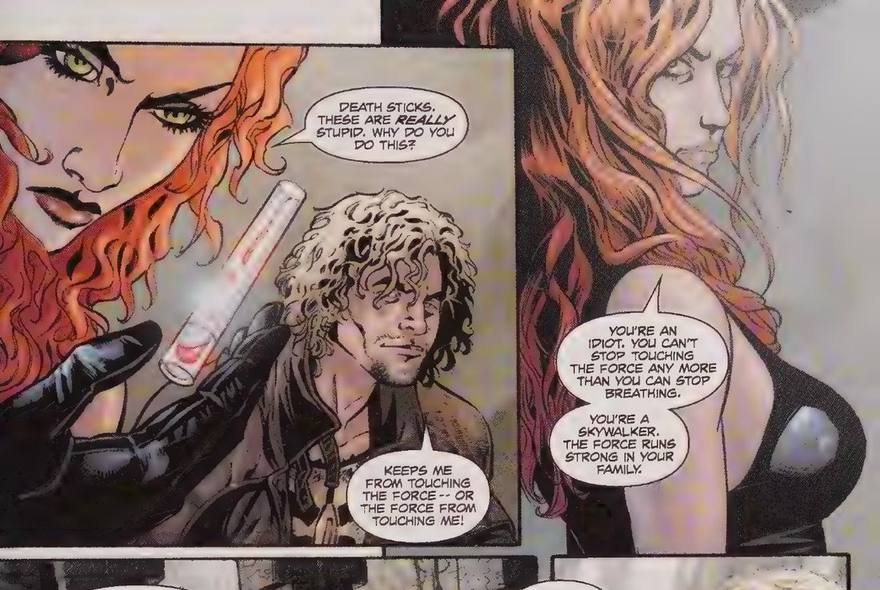
Our notes: `notes/materials/009-legacy-book-1.md:1021`

- Note (summary from our notes, not a quotation): 
  — Source: Legacy Book 1 (omnibus): power-scaling notes with panels.
(*Panel: p267 Mara vision — `p267-mara-cant-stop-touching-force.jpg`*)
Our notes: `notes/materials/009-legacy-book-1.md:1026`

- Note (summary from our notes, not a quotation): Visions as hype (Luke, Anakin/Vader, Mara).
  — Source: Legacy Book 1 (omnibus): power-scaling notes with panels.
Our notes: `notes/materials/009-legacy-book-1.md:1206`

> a talent… unlike any I've ever known *(p72)*
> [fragment — full passage not on file]
— Source: Legacy Book 1 (omnibus): power-scaling notes with panels.
Note (our notes, around the quote): The handbook (p472) casts doubt on whether they're real. Don't treat "a talent… unlike any I've ever known" (p72) as authoritative without that caveat.
Context: Visions as hype (Luke, Anakin/Vader, Mara).
Our notes: `notes/materials/009-legacy-book-1.md:1207`

## Star Wars: Legacy Volume 2, *Shards* (TPB): power-scaling notes with panels

- Note (summary from our notes, not a quotation): Visions (framing, not feats): Mara Jade, Anakin Skywalker / Darth Vader (p129–134) and Luke Skywalker (p168) appear to a drugged or meditating Cade.
  — Source: Legacy Volume 2, *Shards* (TPB): power-scaling notes with panels.
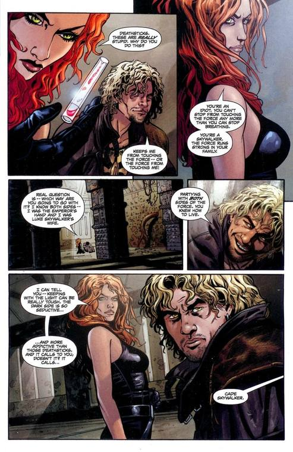
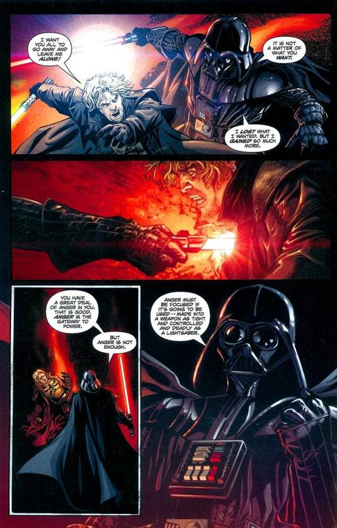
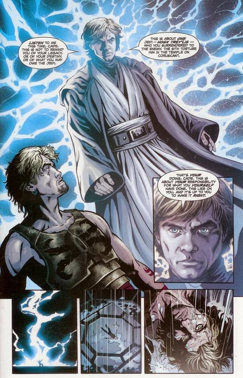
Our notes: `notes/materials/012-legacy-vol-2-shards.md:38`

- Note (summary from our notes, not a quotation): #11: On Ossus, Cade overdoses on death sticks and has visions of Mara Jade and of Anakin/Vader, who runs him through in the vision (p128–134). K'Kruhk, who is real, heals him (p135–137). Sazen and Shado arrive, and Cade asks to finish his training (p137–138). On Socorro, Rav sells Jariah and Deliah to the Empire. Jariah won't give up Cade (p139–142). Two weeks later, sparring shows Cade has "RAW POWER" but atrophied skills (p143). Sazen tells K'Kruhk of his vision of a Skywalker reuniting the Jedi; K'Kruhk fears "A NEW VADER" (p143–145). Cade hides from Shado's Force sense in the tunnels. They fall into a hidden chamber of Jedi artifacts, and Yuuzhan Vong warriors attack (p145–149).
  — Source: Legacy Volume 2, *Shards* (TPB): power-scaling notes with panels.
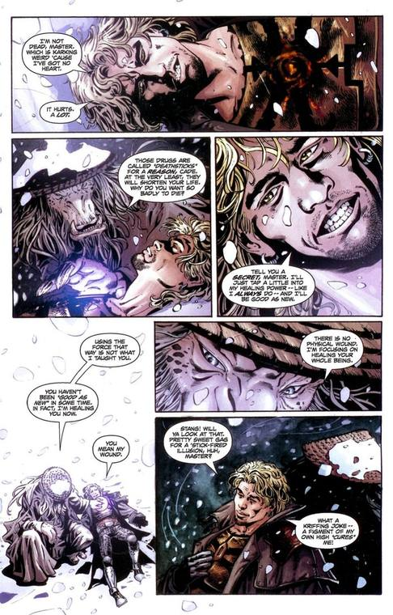
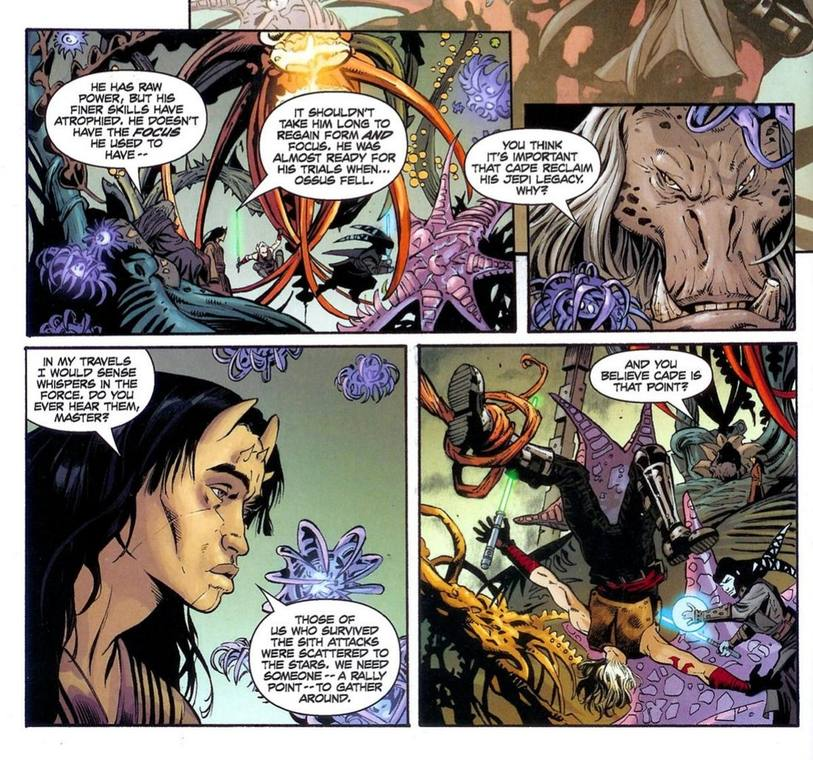
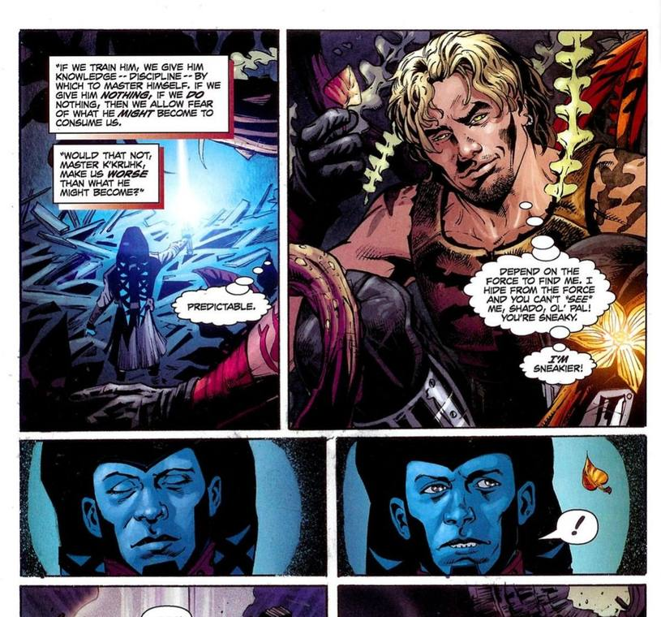
Our notes: `notes/materials/012-legacy-vol-2-shards.md:61`

> YOU'RE AN IDIOT. YOU CAN'T STOP FROM TOUCHING THE FORCE ANY MORE THAN YOU CAN STOP BREATHING.
>
> I KNOW BOTH SIDES -- I WAS THE EMPEROR'S HAND AND I WAS LUKE SKYWALKER'S WIFE.
>
> THE DARK SIDE IS SO SEDUCTIVE...
> [fragment — full passage not on file]
>
> ...AND MORE ADDICTIVE THAN THOSE DEATHSTICKS.
> [fragment — full passage not on file]
— Source: Legacy Volume 2, *Shards* (TPB): power-scaling notes with panels; Mara Jade (p129–130). POV: Mara Jade.
Label in our notes: Mara Jade (p129–130): · ·

Our notes: `notes/materials/012-legacy-vol-2-shards.md:395`

- Note (summary from our notes, not a quotation): 
  — Source: Legacy Volume 2, *Shards* (TPB): power-scaling notes with panels.
(*Panel: p130 — `p130-mara-deathsticks.jpg`*)
Our notes: `notes/materials/012-legacy-vol-2-shards.md:399`

> MAYBE THAT LAST DEATHSTICK WASN'T SUCH A GOOD IDEA...
> [fragment — full passage not on file]
— Source: Legacy Volume 2, *Shards* (TPB): power-scaling notes with panels.
Note (our notes, around the quote): Visions as hype. Vader's "ANGER IS THE GATEWAY TO POWER" (p133) and Mara's lines (p130) come from a death-stick overdose ("MAYBE THAT LAST DEATHSTICK WASN'T SUCH A GOOD IDEA...", p135). Luke's p168 vision is different: it carries true information, but it is still framing, not a feat.

Our notes: `notes/materials/012-legacy-vol-2-shards.md:495`

## https://starwars.fandom.com/wiki/Abeloth ; https://starwars.fandom.com/wiki/Abeloth/Legends

> one of the old ones
> [fragment — full passage not on file]
— Source: Abeloth research extraction (Wookieepedia / Star Wars Legends) — https://starwars.fandom.com/wiki/Abeloth ; https://starwars.fandom.com/wiki/Abeloth/Legends.
Note (our notes, around the quote): Beyond shadows, the dead Mara Jade warned Luke that Abeloth was “one of the old ones” and told him to leave her alone; this is a character statement/warning, not a measured feat [7].
Our notes: `external/mega-notes/abeloth-quotes.txt:36`

## https://starwars.fandom.com/wiki/Darth_Caedus

- Note (summary from our notes, not a quotation): [STATEMENT] Section: Powers and abilities — Lightsaber skills
  — Source: The New Jedi Order: Force Heretic II: Refugee [per Wookieepedia "Darth Caedus" rev 15733922, ref 82; exact text match; agrees with the entry's own ref marker]; per Wookieepedia "Darth Caedus" rev 15733922, ref 82; exact text match; agrees with the entry's own ref marker — Darth Caedus (Jacen Solo) — article extraction — https://starwars.fandom.com/wiki/Darth_Caedus.
(“The Jedi judged few but Luke and Mara Jade Skywalker to be on his level.” [82])
(Scaling: The article presents this as the Jedi’s judgment; it is a comparison statement, not a separate feat.)
(Source: The New Jedi Order: Force Heretic II: Refugee [per Wookieepedia "Darth Caedus" rev 15733922, ref 82; exact text match; agrees with the entry's own ref marker])
Our notes: `external/mega-notes/caedus-legends-quotes.txt:306`

## https://starwars.fandom.com/wiki/Darth_Krayt

> The leader of the Sith could hide his presence in the Force, even from other Sith and the Jedi Grandmaster, though when in the same room Luke Skywalker could sense his dark side affiliations, to the concern of the Jedi.
— Source: Legacy (2006) 48 ; Fate of the Jedi: Apocalypse ; Fate of the Jedi: Ascension [per Wookieepedia "Darth Krayt" rev 15688608, ref 52,29,28; exact text match]; per Wookieepedia "Darth Krayt" rev 15688608, ref 52,29,28; exact text match — Darth Krayt — feat/statement extraction from Wookieepedia — https://starwars.fandom.com/wiki/Darth_Krayt.
Note (our notes, around the quote): [Pre-rebirth / reborn concealment feat] Section: Force Powers. “The leader of the Sith could hide his presence in the Force, even from other Sith and the Jedi Grandmaster, though when in the same room Luke Skywalker could sense his dark side affiliations, to the concern of the Jedi.” Scaling/context: the article says Ben Skywalker and Vestara Khai, with her hounds, could not find him on Korriban; Luke and Mara Jade could learn little about him.
(Source: Legacy (2006) 48 ; Fate of the Jedi: Apocalypse ; Fate of the Jedi: Ascension [per Wookieepedia "Darth Krayt" rev 15688608, ref 52,29,28; exact text match])
Our notes: `external/mega-notes/krayt-legends-quotes.txt:310`

## https://starwars.fandom.com/wiki/Luke_Skywalker/Legends

> In the aftermath, Luke also used his Force skills to locate Mara Jade, who was floating in space after she had been forced to eject from her fighter.
— Source: Dark Force Rising [per Wookieepedia "Luke Skywalker/Legends" rev 15689902, ref 22; exact text match]; per Wookieepedia "Luke Skywalker/Legends" rev 15689902, ref 22; exact text match — Source: https://starwars.fandom.com/wiki/Luke_Skywalker/Legends — https://starwars.fandom.com/wiki/Luke_Skywalker/Legends.
(Source: Dark Force Rising [per Wookieepedia "Luke Skywalker/Legends" rev 15689902, ref 22; exact text match])
Our notes: `external/mega-notes/luke-legends-quotes.txt:65`

> In the end, Mara defeated the Gorog assassin, and Luke slew Welk with his own lightsaber, although Luke sustained a minor leg injury.
— Source: Dark Nest I: The Joiner King [per Wookieepedia "Luke Skywalker/Legends" rev 15689902, ref 15; exact text match]; per Wookieepedia "Luke Skywalker/Legends" rev 15689902, ref 15; exact text match — Source: https://starwars.fandom.com/wiki/Luke_Skywalker/Legends — https://starwars.fandom.com/wiki/Luke_Skywalker/Legends.
(Source: Dark Nest I: The Joiner King [per Wookieepedia "Luke Skywalker/Legends" rev 15689902, ref 15; exact text match])
Our notes: `external/mega-notes/luke-legends-quotes.txt:100`

> During the battle in the Fallanassi village, when Abeloth had Luke in a deadly embrace, Luke opened himself to the Force as much as possible, drawing on his love for his son Ben, his lost wife Mara, and the entire Jedi Order.
— Source: Fate of the Jedi: Vortex [per Wookieepedia "Luke Skywalker/Legends" rev 15689902, ref 19; exact text match]; per Wookieepedia "Luke Skywalker/Legends" rev 15689902, ref 19; exact text match — Source: https://starwars.fandom.com/wiki/Luke_Skywalker/Legends — https://starwars.fandom.com/wiki/Luke_Skywalker/Legends.
(Source: Fate of the Jedi: Vortex [per Wookieepedia "Luke Skywalker/Legends" rev 15689902, ref 19; exact text match])
Our notes: `external/mega-notes/luke-legends-quotes.txt:126`

> On Myrkr, after screaming like a Krayt Dragon, he cut a Vornskr in half after snatching his saber from Mara Jade's belt, though he surrendered his weapon when she pointed a gun a him, knowing he could not protect himself from her shots without the Force to guide his defence.
— Source: Heir to the Empire [per Wookieepedia "Luke Skywalker/Legends" rev 15689902, ref 122; exact text match]; per Wookieepedia "Luke Skywalker/Legends" rev 15689902, ref 122; exact text match — Source: https://starwars.fandom.com/wiki/Luke_Skywalker/Legends — https://starwars.fandom.com/wiki/Luke_Skywalker/Legends.
(Source: Heir to the Empire [per Wookieepedia "Luke Skywalker/Legends" rev 15689902, ref 122; exact text match])
Our notes: `external/mega-notes/luke-legends-quotes.txt:145`

## https://starwars.fandom.com/wiki/Mara_Jade_Skywalker

- Note (summary from our notes, not a quotation): Mara Jade Skywalker — research extraction
  — Source: Mara Jade Skywalker — research extraction — https://starwars.fandom.com/wiki/Mara_Jade_Skywalker.
Our notes: `external/mega-notes/mara-jade-quotes.txt:1`

- Note (summary from our notes, not a quotation): Requested page opened successfully; no fallback was needed.
  — Source: Mara Jade Skywalker — research extraction — https://starwars.fandom.com/wiki/Mara_Jade_Skywalker.
Our notes: `external/mega-notes/mara-jade-quotes.txt:4`

- Note (summary from our notes, not a quotation): Continuity/article context: Wookieepedia/Fandom Legends article. Page sections and the Notes and references list were reviewed.
  — Source: UNRESOLVED (sentence not found in current Wookieepedia article revision; primary source not identified) — Mara Jade Skywalker — research extraction — https://starwars.fandom.com/wiki/Mara_Jade_Skywalker; Citation convention below is the article's bracketed reference number, followed by the source title as listed in Notes and references..
(Source: UNRESOLVED (sentence not found in current Wookieepedia article revision; primary source not identified))
Our notes: `external/mega-notes/mara-jade-quotes.txt:6`

- Note (summary from our notes, not a quotation): POWER / CAPABILITY STATEMENTS (article statements; not automatically standalone feats)
  — Source: Mara Jade Skywalker — research extraction — https://starwars.fandom.com/wiki/Mara_Jade_Skywalker.
Our notes: `external/mega-notes/mara-jade-quotes.txt:10`

> high-level Force-using operative.
> [fragment — full passage not on file]
— Source: UNSOURCED on Wookieepedia (sentence found in "Mara Jade Skywalker" rev 15683787 but it has no inline citation in its paragraph; exact text match) — Mara Jade Skywalker — research extraction — https://starwars.fandom.com/wiki/Mara_Jade_Skywalker; The lead describes Mara as a.
Note (our notes, around the quote): The lead describes Mara as a “high-level Force-using operative.” It says Palpatine gave her top-notch training in multiple fields and Force training, later continued by Luke Skywalker. [4, 5]
(Source: UNSOURCED on Wookieepedia (sentence found in "Mara Jade Skywalker" rev 15683787 but it has no inline citation in its paragraph; exact text match))
Our notes: `external/mega-notes/mara-jade-quotes.txt:13`

- Note (summary from our notes, not a quotation): She was a skilled slicer, able to break into secure files “with relative ease,” but the article explicitly says she was not on the same level as Zakarisz Ghent. [21, 31]
  — Source: Children of the Jedi ; "Handoff" — Star Wars Gamer 10 ; Dark Force Rising [per Wookieepedia "Mara Jade Skywalker" rev 15683787, ref 21,31,15; approximate match 0.86, verify]; per Wookieepedia "Mara Jade Skywalker" rev 15683787, ref 21,31,15; approximate match 0.86, verify — Mara Jade Skywalker — research extraction — https://starwars.fandom.com/wiki/Mara_Jade_Skywalker.
(Source: Children of the Jedi ; "Handoff" — Star Wars Gamer 10 ; Dark Force Rising [per Wookieepedia "Mara Jade Skywalker" rev 15683787, ref 21,31,15; approximate match 0.86, verify])
Our notes: `external/mega-notes/mara-jade-quotes.txt:19`

- Note (summary from our notes, not a quotation): She infiltrated Thrawn's Star Destroyer Chimaera, hacked its computer, reached the detention block, and freed Talon Karrde. [15]
  — Source: Mara Jade Skywalker — research extraction — https://starwars.fandom.com/wiki/Mara_Jade_Skywalker.
Our notes: `external/mega-notes/mara-jade-quotes.txt:21`

- Note (summary from our notes, not a quotation): The article calls her well trained in unarmed combat, a skilled tactician able to analyze dangers/traps quickly, and capable of rewiring electronic devices. [16]
  — Source: Mara Jade Skywalker — research extraction — https://starwars.fandom.com/wiki/Mara_Jade_Skywalker.
Our notes: `external/mega-notes/mara-jade-quotes.txt:22`

- Note (summary from our notes, not a quotation): It calls her an experienced pilot; during the Second Battle of Borleias she became second-in-command of Blackmoon Squadron and provided cover for the Lusankya during Operation Emperor's Spear. [15, 64]
  — Source: Specter of the Past ; The New Jedi Order: Enemy Lines II: Rebel Stand [per Wookieepedia "Mara Jade Skywalker" rev 15683787, ref 42,64; approximate match 0.81, verify]; per Wookieepedia "Mara Jade Skywalker" rev 15683787, ref 42,64; approximate match 0.81, verify — Mara Jade Skywalker — research extraction — https://starwars.fandom.com/wiki/Mara_Jade_Skywalker.
(Source: Specter of the Past ; The New Jedi Order: Enemy Lines II: Rebel Stand [per Wookieepedia "Mara Jade Skywalker" rev 15683787, ref 42,64; approximate match 0.81, verify])
Our notes: `external/mega-notes/mara-jade-quotes.txt:23`

- Note (summary from our notes, not a quotation): Beginning with Palpatine's training and continuing to Jedi Master, the article calls her an accomplished lightsaber duelist. It says she used Ataru. [14, 88]
  — Source: Legacy of the Force: Sacrifice ; The Last Command [per Wookieepedia "Mara Jade Skywalker" rev 15683787, ref 2,14; approximate match 0.70, verify]; per Wookieepedia "Mara Jade Skywalker" rev 15683787, ref 2,14; approximate match 0.70, verify — Mara Jade Skywalker — research extraction — https://starwars.fandom.com/wiki/Mara_Jade_Skywalker.
(Source: Legacy of the Force: Sacrifice ; The Last Command [per Wookieepedia "Mara Jade Skywalker" rev 15683787, ref 2,14; approximate match 0.70, verify])
Our notes: `external/mega-notes/mara-jade-quotes.txt:25`

- Note (summary from our notes, not a quotation): By Jedi Master rank, the article calls her a powerful New Jedi Order member. It says she used the Force to keep her disease from attacking Ben in the womb, could imbue weapons with the Force to improve accuracy/damage, and could levitate herself on a bubble of Force energy while keeping surrounding air still and heat emissions minimal to avoid sensors. [73, 88, 89]
  — Source: The New Jedi Order Sourcebook ; Jedi Academy Training Manual ; Legacy of the Force: Betrayal [per Wookieepedia "Mara Jade Skywalker" rev 15683787, ref 89,88,73; approximate match 0.69, verify]; per Wookieepedia "Mara Jade Skywalker" rev 15683787, ref 89,88,73; approximate match 0.69, verify — Mara Jade Skywalker — research extraction — https://starwars.fandom.com/wiki/Mara_Jade_Skywalker.
(Source: The New Jedi Order Sourcebook ; Jedi Academy Training Manual ; Legacy of the Force: Betrayal [per Wookieepedia "Mara Jade Skywalker" rev 15683787, ref 89,88,73; approximate match 0.69, verify])
Our notes: `external/mega-notes/mara-jade-quotes.txt:27`

- Note (summary from our notes, not a quotation): As Emperor's Hand she could hear Palpatine's voice through the Force; shortly before marriage, she and Luke discovered a similar telepathic ability between them. [17, 43]
  — Source: Star Wars: Mara Jade – By the Emperor's Hand ; Vision of the Future [per Wookieepedia "Mara Jade Skywalker" rev 15683787, ref 17,43; approximate match 0.80, verify]; per Wookieepedia "Mara Jade Skywalker" rev 15683787, ref 17,43; approximate match 0.80, verify — Mara Jade Skywalker — research extraction — https://starwars.fandom.com/wiki/Mara_Jade_Skywalker.
(Source: Star Wars: Mara Jade – By the Emperor's Hand ; Vision of the Future [per Wookieepedia "Mara Jade Skywalker" rev 15683787, ref 17,43; approximate match 0.80, verify])
Our notes: `external/mega-notes/mara-jade-quotes.txt:29`

- Note (summary from our notes, not a quotation): Luke relied on Mara's danger sense more than his own, according to the article's relationship/powers discussion. This is a character-level assessment, not a measured feat. [42]
  — Source: Mara Jade Skywalker — research extraction — https://starwars.fandom.com/wiki/Mara_Jade_Skywalker.
Our notes: `external/mega-notes/mara-jade-quotes.txt:31`

- Note (summary from our notes, not a quotation): The article says she learned to hide in the Force in 40 ABY, useful in her pursuit of Jacen Solo/Darth Caedus. [2]
  — Source: Mara Jade Skywalker — research extraction — https://starwars.fandom.com/wiki/Mara_Jade_Skywalker.
Our notes: `external/mega-notes/mara-jade-quotes.txt:32`

- Note (summary from our notes, not a quotation): Force lightning: the article explicitly says she learned the skill and used it against Alema Rar in the Battle of Kr. [10]
  — Source: Mara Jade Skywalker — research extraction — https://starwars.fandom.com/wiki/Mara_Jade_Skywalker.
Our notes: `external/mega-notes/mara-jade-quotes.txt:33`

- Note (summary from our notes, not a quotation): The article says she was adept at covert espionage and assassination by age fourteen and became an Emperor's Hand after successfully breaking into Grand Moff Tarkin's private quarters. In the test she fought droid guards with blaster and lightsaber and knocked out the living guard rather than kill him. [2, 5, 19]
  — Source: Rebellion Era Sourcebook ; Legacy of the Force: Sacrifice ; Allegiance ; The New Essential Guide to Characters [per Wookieepedia "Mara Jade Skywalker" rev 15683787, ref 18,2,19,5; approximate match 0.61, verify]; per Wookieepedia "Mara Jade Skywalker" rev 15683787, ref 18,2,19,5; approximate match 0.61, verify — Mara Jade Skywalker — research extraction — https://starwars.fandom.com/wiki/Mara_Jade_Skywalker.
(Source: Rebellion Era Sourcebook ; Legacy of the Force: Sacrifice ; Allegiance ; The New Essential Guide to Characters [per Wookieepedia "Mara Jade Skywalker" rev 15683787, ref 18,2,19,5; approximate match 0.61, verify])
Our notes: `external/mega-notes/mara-jade-quotes.txt:38`

- Note (summary from our notes, not a quotation): She could hear Palpatine anywhere in the galaxy through a Force/telepathic link and carried out his missions against corrupt Imperial officials, traitors, and others he marked for death or judgment. [4, 17]
  — Source: Heir to the Empire [per Wookieepedia "Mara Jade Skywalker" rev 15683787, ref 4; approximate match 0.72, verify]; per Wookieepedia "Mara Jade Skywalker" rev 15683787, ref 4; approximate match 0.72, verify — Mara Jade Skywalker — research extraction — https://starwars.fandom.com/wiki/Mara_Jade_Skywalker.
(Source: Heir to the Empire [per Wookieepedia "Mara Jade Skywalker" rev 15683787, ref 4; approximate match 0.72, verify])
Our notes: `external/mega-notes/mara-jade-quotes.txt:40`

- Note (summary from our notes, not a quotation): After sensing a drug attempt, she subdued storage-facility owner Pirtonna and extracted the BloodScars lead. She stowed away on a pirate freighter, took over the ship, captured Tannis, and called for assistance. [19]
  — Source: Mara Jade Skywalker — research extraction — https://starwars.fandom.com/wiki/Mara_Jade_Skywalker.
Our notes: `external/mega-notes/mara-jade-quotes.txt:44`

- Note (summary from our notes, not a quotation): On Gepparin, she survived an attempted execution, escaped an orbital bombardment in a Z-10 Seeker, then took command of rogue stormtroopers. With them, she defeated an AT-ST; when Caaldra tried to shoot her, she redirected the bolt into him with her lightsaber. She arrested Governor Choard. [19]
  — Source: Mara Jade Skywalker — research extraction — https://starwars.fandom.com/wiki/Mara_Jade_Skywalker.
Our notes: `external/mega-notes/mara-jade-quotes.txt:45`

- Note (summary from our notes, not a quotation): She defeated two armed guards and executed corrupt judge Lamos Chatoor. She killed mercenaries holding the Hand of Judgment, infiltrated a heavily guarded palace, escaped detention, and confirmed Governor Ferrouz's treason situation. [16]
  — Source: Mara Jade Skywalker — research extraction — https://starwars.fandom.com/wiki/Mara_Jade_Skywalker.
Our notes: `external/mega-notes/mara-jade-quotes.txt:48`

- Note (summary from our notes, not a quotation): After eight alien assassins attacked, she killed all eight, although Pakrie escaped. She used an explosive passage as a distraction, deflected blaster fire with a lightsaber, and helped Luke Skywalker free Ferrouz's family. [16]
  — Source: Mara Jade Skywalker — research extraction — https://starwars.fandom.com/wiki/Mara_Jade_Skywalker.
Our notes: `external/mega-notes/mara-jade-quotes.txt:49`

- Note (summary from our notes, not a quotation): Disguised as Arica in Jabba's Palace, she captured Melina Carniss and used the Force to make Carniss shoot a Gamorrean guard. She fought through three rows of guards, used the Force to put two to sleep, and brought down six more with a force pike. [29]
  — Source: Mara Jade Skywalker — research extraction — https://starwars.fandom.com/wiki/Mara_Jade_Skywalker.
Our notes: `external/mega-notes/mara-jade-quotes.txt:52`

- Note (summary from our notes, not a quotation): Luke's later Force vision said Mara would have prevented his escape at the Great Pit of Carkoon. This is a hypothetical/vision statement, not an actually performed feat. [4]
  — Source: Mara Jade Skywalker — research extraction — https://starwars.fandom.com/wiki/Mara_Jade_Skywalker.
Our notes: `external/mega-notes/mara-jade-quotes.txt:53`

- Note (summary from our notes, not a quotation): After a failed assassination of a decoy, she tested the operation in simulations and succeeded only two of five times, correctly concluding that the target had been a decoy. This is evidence of her own caution/analysis, not a power scale. [17]
  — Source: Mara Jade Skywalker — research extraction — https://starwars.fandom.com/wiki/Mara_Jade_Skywalker.
Our notes: `external/mega-notes/mara-jade-quotes.txt:56`

- Note (summary from our notes, not a quotation): On Phorliss she fought the more numerous Black Nebula gang members, obtained her lightsaber, and killed the remaining members. Later she killed real Dequc and his guards with a lightsaber and small explosive, then escaped with his intelligence. [17]
  — Source: Mara Jade Skywalker — research extraction — https://starwars.fandom.com/wiki/Mara_Jade_Skywalker.
Our notes: `external/mega-notes/mara-jade-quotes.txt:57`

- Note (summary from our notes, not a quotation): With her Force abilities suppressed by ysalamiri, she survived several vornskr attacks while working with Luke. She later sensed an Imperial trap, activated the Wild Karrde in time, and piloted it out of the Interdictor's range into hyperspace. [4, 15]
  — Source: Dark Force Rising [per Wookieepedia "Mara Jade Skywalker" rev 15683787, ref 15; per-sentence approximate match (1/2 sentences matched, min 0.72), verify]; per Wookieepedia "Mara Jade Skywalker" rev 15683787, ref 15; per-sentence approximate match (1/2 sentences matched, min 0.72), verify — Mara Jade Skywalker — research extraction — https://starwars.fandom.com/wiki/Mara_Jade_Skywalker.
(Source: Dark Force Rising [per Wookieepedia "Mara Jade Skywalker" rev 15683787, ref 15; per-sentence approximate match (1/2 sentences matched, min 0.72), verify])
Our notes: `external/mega-notes/mara-jade-quotes.txt:60`

- Note (summary from our notes, not a quotation): She killed bounty hunter Gunner Groth. After turning herself over to Thrawn, she used her old access/passwords to slice into Chimaera and, with Luke, freed Karrde from the brig. [15]
  — Source: Mara Jade Skywalker — research extraction — https://starwars.fandom.com/wiki/Mara_Jade_Skywalker.
Our notes: `external/mega-notes/mara-jade-quotes.txt:62`

- Note (summary from our notes, not a quotation): In the Battle for the Katana fleet she flew a Z-95; after an ion-cannon hit left her drifting, Luke rescued her. [15]
  — Source: Mara Jade Skywalker — research extraction — https://starwars.fandom.com/wiki/Mara_Jade_Skywalker.
Our notes: `external/mega-notes/mara-jade-quotes.txt:63`

- Note (summary from our notes, not a quotation): While strengthened by Luke through the Force, she defeated the dark clone Luuke Skywalker. She then dodged Joruus C'baoth's Force lightning and stabbed C'baoth through the chest while he attacked with Force scream, lightning, and rocks. Luke's powers protected her from the dark-side energy released at C'baoth's death. [14]
  — Source: Mara Jade Skywalker — research extraction — https://starwars.fandom.com/wiki/Mara_Jade_Skywalker.
Our notes: `external/mega-notes/mara-jade-quotes.txt:66`

- Note (summary from our notes, not a quotation): The Powers and abilities section summarizes this as her defeating Luuke while Force-strengthened and dodging C'baoth's lightning before stabbing him. That scaling is conditional on Luke's aid; the article does not present it as a solo defeat of C'baoth. [14]
  — Source: Mara Jade Skywalker — research extraction — https://starwars.fandom.com/wiki/Mara_Jade_Skywalker.
Our notes: `external/mega-notes/mara-jade-quotes.txt:67`

- Note (summary from our notes, not a quotation): She later shot down TIE fighters to let the courier Messenger escape. [9]
  — Source: Mara Jade Skywalker — research extraction — https://starwars.fandom.com/wiki/Mara_Jade_Skywalker.
Our notes: `external/mega-notes/mara-jade-quotes.txt:68`

- Note (summary from our notes, not a quotation): She killed a rancor while stealing Ka'Pa's device, repelled pirate attackers, and recovered a stolen Jedi holocron by boarding a cargo crate to the pirates' base. [11]
  — Source: Mara Jade Skywalker — research extraction — https://starwars.fandom.com/wiki/Mara_Jade_Skywalker.
Our notes: `external/mega-notes/mara-jade-quotes.txt:71`

- Note (summary from our notes, not a quotation): On Dromund Kaas she defeated native creatures and her own doppelganger. While Kyle Katarn was immersed in the dark side, she fended him off in repeated encounters; in the final encounter she shut off her lightsaber and surrendered, prompting Katarn to turn back. This is not a clean “defeat” of Katarn. [11]
  — Source: Mara Jade Skywalker — research extraction — https://starwars.fandom.com/wiki/Mara_Jade_Skywalker.
Our notes: `external/mega-notes/mara-jade-quotes.txt:72`

- Note (summary from our notes, not a quotation): She resisted the deadly coomb-spore disease through the Force; the article says she was the only infected person at the Monor II ceremony who did not die. [56, 57, 58]
  — Source: The New Jedi Order: Balance Point ; The New Jedi Order: Vector Prime [per Wookieepedia "Mara Jade Skywalker" rev 15683787, ref 57,58; per-sentence approximate match (1/2 sentences matched, min 0.68), verify]; per Wookieepedia "Mara Jade Skywalker" rev 15683787, ref 57,58; per-sentence approximate match (1/2 sentences matched, min 0.68), verify — Mara Jade Skywalker — research extraction — https://starwars.fandom.com/wiki/Mara_Jade_Skywalker.
(Source: The New Jedi Order: Balance Point ; The New Jedi Order: Vector Prime [per Wookieepedia "Mara Jade Skywalker" rev 15683787, ref 57,58; per-sentence approximate match (1/2 sentences matched, min 0.68), verify])
Our notes: `external/mega-notes/mara-jade-quotes.txt:75`

- Note (summary from our notes, not a quotation): On Belkadan she became the first Jedi to engage Yuuzhan Vong and was “barely able” to defeat Yomin Carr. The Powers and abilities section says Carr was evenly matched with her in skill; his armor and weapon could resist a lightsaber and he had no Force presence, but she cut both legs off at the knees and stabbed him through the chest. [58]
  — Source: Mara Jade Skywalker — research extraction — https://starwars.fandom.com/wiki/Mara_Jade_Skywalker.
Our notes: `external/mega-notes/mara-jade-quotes.txt:77`

- Note (summary from our notes, not a quotation): During the Helska operation she continued to fly despite worsening disease, then collapsed in battle; her collapse damaged the Jade Sabre and Luke's last-minute maneuver saved her. This demonstrates determination/endurance, not a victory over an opponent. [58]
  — Source: Mara Jade Skywalker — research extraction — https://starwars.fandom.com/wiki/Mara_Jade_Skywalker.
Our notes: `external/mega-notes/mara-jade-quotes.txt:78`

- Note (summary from our notes, not a quotation): At Dantooine she sensed three Yuuzhan Vong infiltrators in ooglith masques, killed them quickly with Leia and Bolpuhr's aid, then found and killed a fourth warrior. [12]
  — Source: Mara Jade Skywalker — research extraction — https://starwars.fandom.com/wiki/Mara_Jade_Skywalker.
Our notes: `external/mega-notes/mara-jade-quotes.txt:81`

- Note (summary from our notes, not a quotation): At Ithor she fought Yuuzhan Vong troops while weakened, saved Anakin Solo, and acquitted herself well; Corran Horn, not Mara, killed commander Shedao Shai in single combat. [52]
  — Source: Mara Jade Skywalker — research extraction — https://starwars.fandom.com/wiki/Mara_Jade_Skywalker.
Our notes: `external/mega-notes/mara-jade-quotes.txt:82`

- Note (summary from our notes, not a quotation): With Anakin Solo, she identified a Yuuzhan Vong infiltrator by its absence from the Living Force, fought it, learned the amphistaff's vulnerability, knocked it out, and delivered it for study. The prisoner later killed itself. [57]
  — Source: Mara Jade Skywalker — research extraction — https://starwars.fandom.com/wiki/Mara_Jade_Skywalker.
Our notes: `external/mega-notes/mara-jade-quotes.txt:85`

- Note (summary from our notes, not a quotation): She sliced into a Duro computer while disguised, identified Nom Anor's old military code, and with Jaina Solo exposed Anor's disguise as Dassid Cree'Ar. When Anor triggered tunnel bombs, Mara and Jaina projected a Force bubble and escaped relatively unharmed. [57]
  — Source: Mara Jade Skywalker — research extraction — https://starwars.fandom.com/wiki/Mara_Jade_Skywalker.
Our notes: `external/mega-notes/mara-jade-quotes.txt:86`

- Note (summary from our notes, not a quotation): During Operation Safe Passage she devised a tactic using shadow bombs and coordinated fire that destroyed a Yuuzhan Vong cruiser and skip carrier; the Jedi also captured the yammosk war coordinator. [62]
  — Source: Mara Jade Skywalker — research extraction — https://starwars.fandom.com/wiki/Mara_Jade_Skywalker.
Our notes: `external/mega-notes/mara-jade-quotes.txt:89`

- Note (summary from our notes, not a quotation): During the fall of Coruscant her fighter was shot down and crashed into the cityscape, but she was not injured in the crash. [62]
  — Source: Mara Jade Skywalker — research extraction — https://starwars.fandom.com/wiki/Mara_Jade_Skywalker.
Our notes: `external/mega-notes/mara-jade-quotes.txt:90`

- Note (summary from our notes, not a quotation): With Luke and Tahiri Veila, she pursued Lord Nyax/Irek Ismaren, a Dark Jedi with six surgically implanted lightsaber blades. The article says Nyax's superior strength almost overwhelmed all three Jedi; Veila severely wounded him, and the group defeated him with relatively little injury. This is a team feat, not a solo win for Mara. [64]
  — Source: Mara Jade Skywalker — research extraction — https://starwars.fandom.com/wiki/Mara_Jade_Skywalker.
Our notes: `external/mega-notes/mara-jade-quotes.txt:93`

- Note (summary from our notes, not a quotation): As second-in-command of Blackmoon Squadron, she flew cover for the Lusankya's successful ram of a Yuuzhan Vong worldship during Operation Emperor's Spear. [64]
  — Source: Mara Jade Skywalker — research extraction — https://starwars.fandom.com/wiki/Mara_Jade_Skywalker.
Our notes: `external/mega-notes/mara-jade-quotes.txt:94`

- Note (summary from our notes, not a quotation): She followed disguised Yuuzhan Vong underwater and stopped an assassination attempt on Cal Omas and Triebakk by nearly ramming the attackers' craft and redirecting their torpedo back into it. [6]
  — Source: Mara Jade Skywalker — research extraction — https://starwars.fandom.com/wiki/Mara_Jade_Skywalker.
Our notes: `external/mega-notes/mara-jade-quotes.txt:95`

- Note (summary from our notes, not a quotation): During the Battle of Bastion she identified the location of a yammosk carrier for Gilad Pellaeon. In the Battle of Borosk she flew the Jade Shadow in a plan that freed prisoners from a Yuuzhan Vong slave carrier. She then saved Pellaeon from Moff Flennic's assassination attempt. [66]
  — Source: Mara Jade Skywalker — research extraction — https://starwars.fandom.com/wiki/Mara_Jade_Skywalker.
Our notes: `external/mega-notes/mara-jade-quotes.txt:98`

- Note (summary from our notes, not a quotation): On Csilla, she helped take down two Chiss attackers, commandeered an airspeeder, and flew cover for the ice barge. [67]
  — Source: Mara Jade Skywalker — research extraction — https://starwars.fandom.com/wiki/Mara_Jade_Skywalker.
Our notes: `external/mega-notes/mara-jade-quotes.txt:99`

- Note (summary from our notes, not a quotation): She and the expedition used a Force Meld to trace Zonama Sekot through hyperspace. [68]
  — Source: Mara Jade Skywalker — research extraction — https://starwars.fandom.com/wiki/Mara_Jade_Skywalker.
Our notes: `external/mega-notes/mara-jade-quotes.txt:100`

- Note (summary from our notes, not a quotation): On Coruscant, she and Veila fought through Yuuzhan Vong warriors, rescued Han, Leia, R2-D2, C-3PO, and a Noghri from capture, and penetrated the World Brain sanctum. [69]
  — Source: Mara Jade Skywalker — research extraction — https://starwars.fandom.com/wiki/Mara_Jade_Skywalker.
Our notes: `external/mega-notes/mara-jade-quotes.txt:103`

- Note (summary from our notes, not a quotation): She pursued Nom Anor through Imperial City ruins, deactivated her weapon, beat him down with unarmed combat, then spared him in exchange for entry to Shimrra's citadel. The article explicitly says she allowed him to live. [69]
  — Source: Mara Jade Skywalker — research extraction — https://starwars.fandom.com/wiki/Mara_Jade_Skywalker.
Our notes: `external/mega-notes/mara-jade-quotes.txt:104`

- Note (summary from our notes, not a quotation): She helped evacuate the wounded Luke after Shimrra was beheaded; Jacen later healed Luke with his tears. Mara did not defeat Shimrra—the article attributes his beheading to Luke. [69]
  — Source: Mara Jade Skywalker — research extraction — https://starwars.fandom.com/wiki/Mara_Jade_Skywalker.
Our notes: `external/mega-notes/mara-jade-quotes.txt:105`

- Note (summary from our notes, not a quotation): She discovered the Gorog assassin's plot to brainwash Ben. In the Battle of Kr she fought the Gorog assassin in single combat and quickly killed it; she was then gored in the gut by a Gorog larva and treated by Killik healers. [10]
  — Source: Mara Jade Skywalker — research extraction — https://starwars.fandom.com/wiki/Mara_Jade_Skywalker.
Our notes: `external/mega-notes/mara-jade-quotes.txt:108`

- Note (summary from our notes, not a quotation): The article says she had learned Force lightning and used it against Alema Rar during the Battle of Kr. [10]
  — Source: Mara Jade Skywalker — research extraction — https://starwars.fandom.com/wiki/Mara_Jade_Skywalker.
Our notes: `external/mega-notes/mara-jade-quotes.txt:109`

- Note (summary from our notes, not a quotation): In the Battle of Sarm she was first to reach an injured Jacen Solo and tried to rescue him from wreckage. She protected Luke's flanks while he fought Lomi Plo, but a shatter-gun pellet tore through her vac suit and destroyed one kidney. [72]
  — Source: Mara Jade Skywalker — research extraction — https://starwars.fandom.com/wiki/Mara_Jade_Skywalker.
Our notes: `external/mega-notes/mara-jade-quotes.txt:112`

- Note (summary from our notes, not a quotation): Luke, not Mara, killed Lomi Plo; Mara was still recovering at the end of the Swarm War. [72]
  — Source: Mara Jade Skywalker — research extraction — https://starwars.fandom.com/wiki/Mara_Jade_Skywalker.
Our notes: `external/mega-notes/mara-jade-quotes.txt:113`

- Note (summary from our notes, not a quotation): She rescued Tiu Zax from Thrackan Sal-Solo's mansion and conducted reconnaissance inside. Later, she caught Ben's physical Force projection off guard with a kick; the article clarifies it was not actually a ghost. [73]
  — Source: Mara Jade Skywalker — research extraction — https://starwars.fandom.com/wiki/Mara_Jade_Skywalker.
Our notes: `external/mega-notes/mara-jade-quotes.txt:116`

- Note (summary from our notes, not a quotation): She correctly concluded that Jacen was emotionally conflicted, but the article says she initially misread the cause and trusted him too long. This is an observation, not a combat feat. [74]
  — Source: Mara Jade Skywalker — research extraction — https://starwars.fandom.com/wiki/Mara_Jade_Skywalker.
Our notes: `external/mega-notes/mara-jade-quotes.txt:117`

- Note (summary from our notes, not a quotation): She built a shoto specifically to fight Lumiya's lightwhip. In the encounter at the Hapan rendezvous, Alema Rar nearly killed Mara with a dart, but Mara defeated Rar and knocked her unconscious; she noticed the bomb on Rar and prevented her death from triggering it. [75]
  — Source: Mara Jade Skywalker — research extraction — https://starwars.fandom.com/wiki/Mara_Jade_Skywalker.
Our notes: `external/mega-notes/mara-jade-quotes.txt:120`

- Note (summary from our notes, not a quotation): The article says Mara and Luke later fought Lumiya and Rar; Mara defeated Rar while Luke was severely injured fighting Lumiya. [75]
  — Source: Mara Jade Skywalker — research extraction — https://starwars.fandom.com/wiki/Mara_Jade_Skywalker.
Our notes: `external/mega-notes/mara-jade-quotes.txt:121`

- Note (summary from our notes, not a quotation): After learning Jacen had become too dangerous, Mara ambushed him in Hapan space. In the Kavan tunnels she collapsed rubble onto him and tried to shoot him; Jacen used a Force Wave strong enough to blow away the blaster bolt and cave stones and knock her backward. [2]
  — Source: Mara Jade Skywalker — research extraction — https://starwars.fandom.com/wiki/Mara_Jade_Skywalker.
Our notes: `external/mega-notes/mara-jade-quotes.txt:124`

- Note (summary from our notes, not a quotation): She continued fighting Jacen with a shoto and vibroblade despite a scalp injury and being thrown into a brick wall several times. The fight degraded into a brawl; the article says she was preparing to finish him when Jacen used a Force illusion of Ben's face to make her hesitate. [2]
  — Source: Mara Jade Skywalker — research extraction — https://starwars.fandom.com/wiki/Mara_Jade_Skywalker.
Our notes: `external/mega-notes/mara-jade-quotes.txt:125`

- Note (summary from our notes, not a quotation): Jacen then stabbed her thigh with a poisoned dart, causing a slow, paralyzing death. The article says she left her body as evidence and to give her family a goodbye. Jacen later confessed he had brawled with and killed Mara; the article identifies him as Darth Caedus. [2, 35, 78]
  — Source: Legacy of the Force: Sacrifice [per Wookieepedia "Mara Jade Skywalker" rev 15683787, ref 2; approximate match 0.61, verify]; per Wookieepedia "Mara Jade Skywalker" rev 15683787, ref 2; approximate match 0.61, verify — Mara Jade Skywalker — research extraction — https://starwars.fandom.com/wiki/Mara_Jade_Skywalker.
(Source: Legacy of the Force: Sacrifice [per Wookieepedia "Mara Jade Skywalker" rev 15683787, ref 2; approximate match 0.61, verify])
Our notes: `external/mega-notes/mara-jade-quotes.txt:126`

- Note (summary from our notes, not a quotation): STATEMENTS / HYPE / OPINIONS (not feats)
  — Source: Mara Jade Skywalker — research extraction — https://starwars.fandom.com/wiki/Mara_Jade_Skywalker.
Our notes: `external/mega-notes/mara-jade-quotes.txt:130`

- Note (summary from our notes, not a quotation): Palpatine calls her “an experiment.” This is his characterization, not a quantified power statement. [17]
  — Source: Mara Jade Skywalker — research extraction — https://starwars.fandom.com/wiki/Mara_Jade_Skywalker.
Our notes: `external/mega-notes/mara-jade-quotes.txt:131`

> I am the ultimate predator.
> [fragment — full passage not on file]
— Source: Mara Jade Skywalker — research extraction — https://starwars.fandom.com/wiki/Mara_Jade_Skywalker; Mara says.
Note (our notes, around the quote): Mara says, “I am the ultimate predator.” This is her own boast during the Dequc hunt, not proof of a power level. [17]
Our notes: `external/mega-notes/mara-jade-quotes.txt:132`

> Mara Jade will bow before me.
— Source: Mara Jade Skywalker — research extraction — https://starwars.fandom.com/wiki/Mara_Jade_Skywalker; C'baoth says he foresaw that.
Note (our notes, around the quote): C'baoth says he foresaw that “Mara Jade will bow before me.” This is a villain's prophecy; the actual event is that she stabbed him after evading his attacks. [14]
Our notes: `external/mega-notes/mara-jade-quotes.txt:133`

> As long as I'm fighting, I'm not dying,
— Source: Mara Jade Skywalker — research extraction — https://starwars.fandom.com/wiki/Mara_Jade_Skywalker; Mara's quote.
Note (our notes, around the quote): Mara's quote, “As long as I'm fighting, I'm not dying,” is a character statement; the article separately records her illness, collapse, and eventual recovery. [12]
Our notes: `external/mega-notes/mara-jade-quotes.txt:134`

- Note (summary from our notes, not a quotation): In her last words, Mara says Jacen had become worse, more vile and cruel than Palpatine and predicts Luke will defeat him. This is her opinion/prediction, not an established comparison or feat. [2]
  — Source: Mara Jade Skywalker — research extraction — https://starwars.fandom.com/wiki/Mara_Jade_Skywalker.
Our notes: `external/mega-notes/mara-jade-quotes.txt:135`

- Note (summary from our notes, not a quotation): Saba's funeral speech frames Mara's life and Jacen's life as moral opposites. It is an eulogy/character judgment, not combat scaling. [35]
  — Source: Mara Jade Skywalker — research extraction — https://starwars.fandom.com/wiki/Mara_Jade_Skywalker.
Our notes: `external/mega-notes/mara-jade-quotes.txt:136`

- Note (summary from our notes, not a quotation): Luuke defeat was performed while Luke strengthened Mara through the Force. [14]
  — Source: Mara Jade Skywalker — research extraction — https://starwars.fandom.com/wiki/Mara_Jade_Skywalker.
Our notes: `external/mega-notes/mara-jade-quotes.txt:139`

- Note (summary from our notes, not a quotation): C'baoth was not presented as a solo defeat: Mara received Luke's Force aid, and Luke's powers protected her from the death-energy afterward. [14]
  — Source: Mara Jade Skywalker — research extraction — https://starwars.fandom.com/wiki/Mara_Jade_Skywalker.
Our notes: `external/mega-notes/mara-jade-quotes.txt:140`

- Note (summary from our notes, not a quotation): Yomin Carr was explicitly “evenly matched” with Mara in skill; the article still says Mara defeated him. [58]
  — Source: Mara Jade Skywalker — research extraction — https://starwars.fandom.com/wiki/Mara_Jade_Skywalker.
Our notes: `external/mega-notes/mara-jade-quotes.txt:141`

- Note (summary from our notes, not a quotation): Nyax's superior strength nearly overwhelmed Luke, Mara, and Veila together; Veila's Force invisibility and severe wounding enabled the team victory. [64]
  — Source: Mara Jade Skywalker — research extraction — https://starwars.fandom.com/wiki/Mara_Jade_Skywalker.
Our notes: `external/mega-notes/mara-jade-quotes.txt:142`

- Note (summary from our notes, not a quotation): Mara was explicitly below Zakarisz Ghent as a slicer. [21, 31]
  — Source: UNRESOLVED (sentence not found in current Wookieepedia article revision; primary source not identified) — Mara Jade Skywalker — research extraction — https://starwars.fandom.com/wiki/Mara_Jade_Skywalker.
(Source: UNRESOLVED (sentence not found in current Wookieepedia article revision; primary source not identified))
Our notes: `external/mega-notes/mara-jade-quotes.txt:143`

- Note (summary from our notes, not a quotation): Her final encounter with Caedus ended in her death; the page gives no claim that she was stronger than him. [2]
  — Source: Mara Jade Skywalker — research extraction — https://starwars.fandom.com/wiki/Mara_Jade_Skywalker.
Our notes: `external/mega-notes/mara-jade-quotes.txt:145`

- Note (summary from our notes, not a quotation): [2] Legacy of the Force: Sacrifice
  — Source: Mara Jade Skywalker — research extraction — https://starwars.fandom.com/wiki/Mara_Jade_Skywalker.
Our notes: `external/mega-notes/mara-jade-quotes.txt:148`

- Note (summary from our notes, not a quotation): [5] The New Essential Guide to Characters
  — Source: Mara Jade Skywalker — research extraction — https://starwars.fandom.com/wiki/Mara_Jade_Skywalker.
Our notes: `external/mega-notes/mara-jade-quotes.txt:150`

- Note (summary from our notes, not a quotation): [6] The New Jedi Order: Destiny's Way
  — Source: Mara Jade Skywalker — research extraction — https://starwars.fandom.com/wiki/Mara_Jade_Skywalker.
Our notes: `external/mega-notes/mara-jade-quotes.txt:151`

- Note (summary from our notes, not a quotation): [9] "Retreat from Coruscant" — Star Wars Adventure Journal 7
  — Source: Mara Jade Skywalker — research extraction — https://starwars.fandom.com/wiki/Mara_Jade_Skywalker.
Our notes: `external/mega-notes/mara-jade-quotes.txt:152`

- Note (summary from our notes, not a quotation): [10] Dark Nest I: The Joiner King
  — Source: Mara Jade Skywalker — research extraction — https://starwars.fandom.com/wiki/Mara_Jade_Skywalker.
Our notes: `external/mega-notes/mara-jade-quotes.txt:153`

- Note (summary from our notes, not a quotation): [11] Star Wars: Jedi Knight: Mysteries of the Sith
  — Source: Mara Jade Skywalker — research extraction — https://starwars.fandom.com/wiki/Mara_Jade_Skywalker.
Our notes: `external/mega-notes/mara-jade-quotes.txt:154`

- Note (summary from our notes, not a quotation): [12] The New Jedi Order: Dark Tide I: Onslaught
  — Source: Mara Jade Skywalker — research extraction — https://starwars.fandom.com/wiki/Mara_Jade_Skywalker.
Our notes: `external/mega-notes/mara-jade-quotes.txt:155`

- Note (summary from our notes, not a quotation): [17] Star Wars: Mara Jade — By the Emperor's Hand
  — Source: Mara Jade Skywalker — research extraction — https://starwars.fandom.com/wiki/Mara_Jade_Skywalker.
Our notes: `external/mega-notes/mara-jade-quotes.txt:159`

- Note (summary from our notes, not a quotation): [21] Children of the Jedi
  — Source: Mara Jade Skywalker — research extraction — https://starwars.fandom.com/wiki/Mara_Jade_Skywalker.
Our notes: `external/mega-notes/mara-jade-quotes.txt:161`

- Note (summary from our notes, not a quotation): [29] “Sleight of Hand: The Tale of Mara Jade” — Tales from Jabba's Palace
  — Source: Mara Jade Skywalker — research extraction — https://starwars.fandom.com/wiki/Mara_Jade_Skywalker.
Our notes: `external/mega-notes/mara-jade-quotes.txt:162`

- Note (summary from our notes, not a quotation): [31] “Handoff” — Star Wars Gamer 10
  — Source: Mara Jade Skywalker — research extraction — https://starwars.fandom.com/wiki/Mara_Jade_Skywalker.
Our notes: `external/mega-notes/mara-jade-quotes.txt:163`

- Note (summary from our notes, not a quotation): [35] Legacy of the Force: Inferno
  — Source: Mara Jade Skywalker — research extraction — https://starwars.fandom.com/wiki/Mara_Jade_Skywalker.
Our notes: `external/mega-notes/mara-jade-quotes.txt:164`

- Note (summary from our notes, not a quotation): [42] Specter of the Past
  — Source: Mara Jade Skywalker — research extraction — https://starwars.fandom.com/wiki/Mara_Jade_Skywalker.
Our notes: `external/mega-notes/mara-jade-quotes.txt:165`

- Note (summary from our notes, not a quotation): [43] Vision of the Future
  — Source: Mara Jade Skywalker — research extraction — https://starwars.fandom.com/wiki/Mara_Jade_Skywalker.
Our notes: `external/mega-notes/mara-jade-quotes.txt:166`

- Note (summary from our notes, not a quotation): [52] The New Jedi Order: Dark Tide II: Ruin
  — Source: Mara Jade Skywalker — research extraction — https://starwars.fandom.com/wiki/Mara_Jade_Skywalker.
Our notes: `external/mega-notes/mara-jade-quotes.txt:167`

- Note (summary from our notes, not a quotation): [56] The New Jedi Order: Destiny's Way
  — Source: Mara Jade Skywalker — research extraction — https://starwars.fandom.com/wiki/Mara_Jade_Skywalker.
Our notes: `external/mega-notes/mara-jade-quotes.txt:168`

- Note (summary from our notes, not a quotation): [57] The New Jedi Order: Balance Point
  — Source: Mara Jade Skywalker — research extraction — https://starwars.fandom.com/wiki/Mara_Jade_Skywalker.
Our notes: `external/mega-notes/mara-jade-quotes.txt:169`

- Note (summary from our notes, not a quotation): [58] The New Jedi Order: Vector Prime
  — Source: Mara Jade Skywalker — research extraction — https://starwars.fandom.com/wiki/Mara_Jade_Skywalker.
Our notes: `external/mega-notes/mara-jade-quotes.txt:170`

- Note (summary from our notes, not a quotation): [62] The New Jedi Order: Star by Star
  — Source: Mara Jade Skywalker — research extraction — https://starwars.fandom.com/wiki/Mara_Jade_Skywalker.
Our notes: `external/mega-notes/mara-jade-quotes.txt:171`

- Note (summary from our notes, not a quotation): [64] The New Jedi Order: Enemy Lines II: Rebel Stand
  — Source: Mara Jade Skywalker — research extraction — https://starwars.fandom.com/wiki/Mara_Jade_Skywalker.
Our notes: `external/mega-notes/mara-jade-quotes.txt:172`

- Note (summary from our notes, not a quotation): [66] The New Jedi Order: Force Heretic I: Remnant
  — Source: Mara Jade Skywalker — research extraction — https://starwars.fandom.com/wiki/Mara_Jade_Skywalker.
Our notes: `external/mega-notes/mara-jade-quotes.txt:173`

- Note (summary from our notes, not a quotation): [67] The New Jedi Order: Force Heretic II: Refugee
  — Source: Mara Jade Skywalker — research extraction — https://starwars.fandom.com/wiki/Mara_Jade_Skywalker.
Our notes: `external/mega-notes/mara-jade-quotes.txt:174`

- Note (summary from our notes, not a quotation): [68] The New Jedi Order: Force Heretic III: Reunion
  — Source: Mara Jade Skywalker — research extraction — https://starwars.fandom.com/wiki/Mara_Jade_Skywalker.
Our notes: `external/mega-notes/mara-jade-quotes.txt:175`

- Note (summary from our notes, not a quotation): [69] The New Jedi Order: The Unifying Force
  — Source: Mara Jade Skywalker — research extraction — https://starwars.fandom.com/wiki/Mara_Jade_Skywalker.
Our notes: `external/mega-notes/mara-jade-quotes.txt:176`

- Note (summary from our notes, not a quotation): [71] Dark Nest II: The Unseen Queen
  — Source: Mara Jade Skywalker — research extraction — https://starwars.fandom.com/wiki/Mara_Jade_Skywalker.
Our notes: `external/mega-notes/mara-jade-quotes.txt:177`

- Note (summary from our notes, not a quotation): [72] Dark Nest III: The Swarm War
  — Source: Mara Jade Skywalker — research extraction — https://starwars.fandom.com/wiki/Mara_Jade_Skywalker.
Our notes: `external/mega-notes/mara-jade-quotes.txt:178`

- Note (summary from our notes, not a quotation): [73] Legacy of the Force: Betrayal
  — Source: Mara Jade Skywalker — research extraction — https://starwars.fandom.com/wiki/Mara_Jade_Skywalker.
Our notes: `external/mega-notes/mara-jade-quotes.txt:179`

- Note (summary from our notes, not a quotation): [74] Legacy of the Force: Bloodlines
  — Source: Mara Jade Skywalker — research extraction — https://starwars.fandom.com/wiki/Mara_Jade_Skywalker.
Our notes: `external/mega-notes/mara-jade-quotes.txt:180`

- Note (summary from our notes, not a quotation): [75] Legacy of the Force: Tempest
  — Source: Mara Jade Skywalker — research extraction — https://starwars.fandom.com/wiki/Mara_Jade_Skywalker.
Our notes: `external/mega-notes/mara-jade-quotes.txt:181`

- Note (summary from our notes, not a quotation): [78] Legacy of the Force: Revelation
  — Source: Mara Jade Skywalker — research extraction — https://starwars.fandom.com/wiki/Mara_Jade_Skywalker.
Our notes: `external/mega-notes/mara-jade-quotes.txt:182`

- Note (summary from our notes, not a quotation): [88] Jedi Academy Training Manual
  — Source: Mara Jade Skywalker — research extraction — https://starwars.fandom.com/wiki/Mara_Jade_Skywalker.
Our notes: `external/mega-notes/mara-jade-quotes.txt:183`

- Note (summary from our notes, not a quotation): [89] The New Jedi Order Sourcebook
  — Source: Mara Jade Skywalker — research extraction — https://starwars.fandom.com/wiki/Mara_Jade_Skywalker.
Our notes: `external/mega-notes/mara-jade-quotes.txt:184`

## Legends Feats & Quotes (Star Wars Legends / EU)

What it shows (our notes): Illusion fooled Grandmaster Luke into believing Mara had died (Dark Nest: The Swarm War) (debate #1)
> “Mara?” Now Luke’s voice was frightened. “What’s wrong?”
>
> “Good question,” Mara said.
>
> She turned to Jacen, but he only held a finger to his lips and moved his hoverchair closer to Luke. R2-D2 emitted a confused whistle and raised a hydraulic extension with a medical sensor at the end.
>
>
> "Mara!" Luke turned and hit the emergency summons button next to Mara's bed, but Jacen made a motion with his hands and the button did not depress. Luke did not seem to realize this. He turned back to Mara and placed his fingers to her throat, checking her pulse. "I can't feel a pulse. Artoo, call an EmDee droid. Tell her to hurry!"
>
> R2-D2 spun toward the data jack to obey, but Jacen used the Force to disable the power to the droid’s treads.
>
> Mara caught Jacen’s gaze. “All right, Jacen. This has gone far enough.”
>
> Not yet. The message reverberated without words inside Mara’s head. He must learn.
>
> Mara felt another wave of Force energy pass over her, and Luke cried out in horror and looked toward R2-D2.
>
> Mara felt another wave of Force energy pass over her, and Luke cried out in horror and looked toward R2-D2. "Artoo, what's taking you so long?"
>
> R2-D2 issued a frustrated whistle and spun an accusing photoreceptor toward Jacen. Luke could take it no longer. He raised a hand and began to fill it with life-giving Force energy.
>
> "Jacen, we can't wait. We have to revive her ourselves." He pointed at the emergency respirator hanging on the wall. "Get the respirator."
>
> Luke leaned over Mara and started to place his hand on her chest—until Jacen raised an arm and pushed him away.
>
> “Jacen!” Luke screamed. “What’s wrong with you?”
>
> “Nothing,” Jacen said calmly. “And there’s nothing wrong with Aunt Mara.”
>
> Luke’s gaze swung back to Mara, and she could not decide whether he looked more stunned or relieved. “You’re … you’re alive again!”
>
> “I was never dead,” Mara said. “I think Jacen is trying to make a point.”
>
> Luke turned back to Jacen, still too confused to be angry. “I don’t understand, Jacen. What’s she—”
>
> “You’re not ready to face Lomi Plo again,” Jacen interrupted. “And you just proved it.”
>
> Luke’s confusion started to fade, and his anger quickly began to build. “You did that to me?”
>
> — -Dark Nest: The Swarm War (cited by NevesYtneves (DC77) in debate #1)
> [fragment — full passage not on file]
— Source: (debate #1); (cited by NevesYtneves (DC77) — Legends Feats & Quotes (Star Wars Legends / EU).
(A fragment line was removed 2026-11-17: its words appear word for word inside the full excerpt in this entry.)
(Excerpt widened 2026-11-17 to the relevant passage, word for word from The Swarm War (Troy Denning) (text copy `MEGA_Legend_The_Dark_Nest_Trilogy_Star_Wars_Dark_Nest_03_The_Swarm_War_Troy_Denning_epub`).)
(Fragment completed 2026-11-17 with the full excerpt, word for word from The Swarm War (Troy Denning) (text copy `MEGA_Legend_The_Dark_Nest_Trilogy_Star_Wars_Dark_Nest_03_The_Swarm_War_Troy_Denning_epub`), which is not the work named in the citation above; check the citation.)
(Excerpt widened 2026-11-17 to the relevant passage, word for word from The Swarm War (Troy Denning) (text copy `MEGA_Legend_The_Dark_Nest_Trilogy_Star_Wars_Dark_Nest_03_The_Swarm_War_Troy_Denning_epub`).)
Our notes: `legends-feats.md:768`; `suspect-insight/debates/001-darth-caedus-vs-rotj-darth-vader.md:80`; `suspect-insight/debates/005-darth-caedus-vs-kyp-durron.md:122`; `suspect-insight/debates/069-darth-caedus-vs-revan.md:144`

What it shows (our notes): Sacrificial power-up after killing Mara (Essential Reader's Companion); growing stronger daily (Bloodlines); 'knows more about the Force than anybody' (Tempest) (debate #7)
> Lumiya senses this shift in power and decides a further sacrifice is needed to cement Jacen’s rule. She allows herself to be found on Terephon by a vengeful Luke Skywalker, who attacks the Dark Lady. Lumiya claims credit for killing Mara, and an enraged Luke, tipping toward the dark side, decapitates the Sith. It is a hollow victory, for Luke soon learns from Ben that it could not have been Lumiya who was responsible, as she was with Ben at the time of Mara’s death.
>
> Jacen consoles Ben about Mara’s death, coldly feigning innocence in the murder and suggesting that it was an unseen agent of Lumiya who was responsible. Jacen feels his power in the dark side swell, unlocking new powers, including an unparalleled ability to command and coordinate fighting forces as the former Emperor once did.
>
> Fully committed to the Sith path, Jacen assumes the title Darth Caedus.
>
> Fully committed to the Sith path, Jacen assumes the title Darth Caedus.
>
> Click to buy Legacy of the Force: Sacrifice THE WINNING ENTRY for Jacen’s Sith name, Darth Caedus, was submitted by Tawnia Poland, who is acknowledged at the front of the book.
>
> AUTHOR · Troy Denning COVER ARTIST · Jason Felix PUBLICATION HISTORY · Novel, Del Rey Books · Paperback, August 2007 TIME LINE PLACEMENT · 40 ABY WORLDS VISITED · Balmorra [M-10]; Coruscant [L-9]; Hapes [O-9]; Kashyyyk [P-9]; Korriban [R-5]; Kuat [M-10]; MZX32905 [N-4]; Ossus [R-6] MAIN CHARACTERS · Jacen Solo/Darth Caedus, Sith Lord (human male); Luke Skywalker, Grand Master of the Jedi Order (human male); Ben Skywalker, Galactic Alliance Guard member (human male); Tahiri Veila, Jedi Knight (human female); Tenel Ka, Hapan Queen Mother (human female); Cal Omas, former Chief of State (human male); Jagged Fel, bounty hunter (human male); Jaina Solo, Jedi Knight (human female); Zekk, Jedi Knight (human male); Alema Rar, fallen Jedi (Twi’lek female); Han Solo, captain of the Millennium Falcon (human male); Leia Organa Solo, Jedi Knight (human female); Saba Sebatyne, Jedi Master (Barabel female) SUMMARY · As acting Joint Chief of State, Jacen attends Mara Jade Skywalker’s funeral. The police state he has created on Coruscant has raised the security alerts so high that Han and Leia cannot attend, lest they be arrested.
>
> The duel between Jacen and Mara is an exhausting, no-limits display of acrobatics and Force power. Mara comes to truly comprehend how far Jacen has fallen to the dark side. Jacen uses the Force to distract Mara with a vision of Ben before closing in to stab her with a poison dart. The fast-acting toxin kills Mara, and her death reverberates through the Force, hitting Luke and Ben as if it were a physical blow. Using the echoes of Mara’s death as a distraction, Lumiya escapes to nearby Terephon.
>
> Jacen has reached a threshold in his Sith potential. He has sacrificed a loved one and the bond of trust between himself and Ben.
>
> Jacen has reached a threshold in his Sith potential. He has sacrificed a loved one and the bond of trust between himself and Ben. Lumiya senses this shift in power and decides a further sacrifice is needed to cement Jacen’s rule. She allows herself to be found on Terephon by a vengeful Luke Skywalker, who attacks the Dark Lady. Lumiya claims credit for killing Mara, and an enraged Luke, tipping toward the dark side, decapitates the Sith.
>
> — Essential Reader's Companion (cited by NevesYtneves (DC77) *(November 30th 2019, 9:35 pmMessage reputation : 100% in debate #7)*
> [fragment — full passage not on file]
>
> Ben returned the lightsaber to his utility belt, then added, “But I’m not going dark. Anger has no control over me—and neither does fear.”
>
> Luke nodded. “I can see that, Ben. I still want you to take a proper Master.”
>
> “Then make Jacen a Master,” Ben replied. “He knows more about the Force than anybody.”
>
> “That’s not going to happen, Ben,” Luke said.
>
> Ben considered this a moment, then spoke in a resigned voice.
>
> — Legacy Of The Force: Tempest (cited by NevesYtneves (DC77) *(November 30th 2019, 9:35 pmMessage reputation : 100% in debate #7)*
> [fragment — full passage not on file]
>
> It crossed Luke’s mind that Jacen should have been able to detect his and Mara’s presence in the Force, but it was an unkind thought. Perhaps part of shutting down his own presence was becoming insensitive to others. Luke realized Jacen’s Force skills seemed to be getting stronger and more subtle every day, and he felt uneasy.
>
> — Legacy Of The Force: Bloodlines (cited by NevesYtneves (DC77) *(November 30th 2019, 9:35 pmMessage reputation : 100% in debate #7)*
> [fragment — full passage not on file]
— Source: (debate #7); (cited by NevesYtneves (DC77) — Legends Feats & Quotes (Star Wars Legends / EU).
(Excerpt widened 2026-11-17 to the relevant passage, word for word from The Essential Reader’s Companion: Star Wars (Pablo Hidalgo) (text copy `primary_essential_guides_eg_readers_companion_2012_Star_Wars_The_Essential_Readers_Companion_Pablo_Hidalgo_8O9y2bib_epub_e20384df21`).)
(Excerpt widened 2026-11-17 to the relevant passage, word for word from Star Wars: Legacy of the Force: Tempest (Troy Denning) (text copy `MEGA_Legend_The_Legacy_of_the_Force_Series_Star_Wars_Legacy_of_the_Force_03_Tempest_Troy_Denning_epub`).)
(Excerpt widened 2026-11-17 to the relevant passage, word for word from The Essential Reader’s Companion: Star Wars (Pablo Hidalgo) (text copy `primary_essential_guides_eg_readers_companion_2012_Star_Wars_The_Essential_Readers_Companion_Pablo_Hidalgo_8O9y2bib_epub_e20384df21`).)
(Excerpt widened 2026-11-17 to the relevant passage, word for word from Star Wars: Legacy of the Force: Tempest (Troy Denning) (text copy `MEGA_Legend_The_Legacy_of_the_Force_Series_Star_Wars_Legacy_of_the_Force_03_Tempest_Troy_Denning_epub`).)
(Excerpt widened 2026-11-17 to the relevant passage, word for word from Bloodlines (Karen Traviss), Chapter Seven (text copy `MEGA_Legend_The_Legacy_of_the_Force_Series_Star_Wars_Legacy_of_the_Force_02_Bloodlines_Karen_Traviss_epub`).)
Our notes: `legends-feats.md:944`

- Note (summary from our notes, not a quotation): 'The Empire's deadliest agent' (New Essential Guide to Characters, 2002); killed Luuke in The Last Command (debate #20)
  — Source: (debate #20) — Legends Feats & Quotes (Star Wars Legends / EU).
Our notes: `legends-feats.md:1763`

- Note (summary from our notes, not a quotation): LotF Sacrifice: Caedus judges her Force skills crude next to his (debate #50)
  — Source: (debate #50) — Legends Feats & Quotes (Star Wars Legends / EU).
Our notes: `legends-feats.md:1767`

- Note (summary from our notes, not a quotation): The Last Command: kills Joruus C'baoth, catching and evading his lightning and closing the distance (debate #93)
  — Source: (debate #93) — Legends Feats & Quotes (Star Wars Legends / EU).
Our notes: `legends-feats.md:1771`

- Note (summary from our notes, not a quotation): LotF Sacrifice: nearly kills Caedus in a 'no-limits' duel, collapsing a tunnel on him (debate #111)
  — Source: (debate #111) — Legends Feats & Quotes (Star Wars Legends / EU).
Our notes: `legends-feats.md:1777`

## Essential Guide to Characters (1995)

> “For I have foreseen that Mara Jade will kneel before me,” C’baoth reminded her. “One Mara Jade … or another.”
>
— Source: The Essential Guide to Characters (Andy Mangels, Del Rey, 1995), printed p.29, scan p.038. The 1995 guide's telling, not a power feat..
(A fragment line was removed 2026-11-17: its words appear word for word inside the full excerpt in this entry.)
(Fragment completed 2026-11-17 with the full excerpt, word for word from The Last Command (Timothy Zahn) (text copy `MEGA_Legend_The_Thrawn_Trilogy_Star_Wars_Thrawn_Trilogy_03_The_Last_Command_Timothy_Zahn_epub`).)
(Excerpt widened 2026-11-17 to the relevant passage, word for word from The Last Command (Timothy Zahn) (text copy `MEGA_Legend_The_Thrawn_Trilogy_Star_Wars_Thrawn_Trilogy_03_The_Last_Command_Timothy_Zahn_epub`).)
(Fragment completed 2026-11-17: full sentence/passage matched word for word in the source text on file: `MEGA_Legend_The_Thrawn_Trilogy_Star_Wars_Thrawn_Trilogy_03_The_Last_Command_Timothy_Zahn_epub`.)
Note (our notes, around the quote): C’Baoth lost control, his dark-Force powers raging against the Jedi and Jedi-to-be. He attacked Luke and Mara using blue lightning and collapsed rubble from the ceiling, planning to replace the clone of Luke and grow another clone of Mara Jade. “I have foreseen that Mara Jade will kneel before me,” he said. “One Mara Jade . . . or another.” Mara freed herself first, charging C’Baoth with Leia’s lightsaber. She used it to deflect his corona of lightning, but was overcome by a blinding hail of rocks. Leia, who had accompanied them, linked her mind with Mara’s, allowing her to see where she was going. Exhausted and in pain, Luke used the Force to free the savage vornskrs that were leashed nearby. The growling creatures ran for Joruus, distracting the evil clone and his magics. Mara Jade charged and killed C’Baoth with a thrust of the lightsaber. Joruus C’Baoth was finally and truly dead.
Our notes: `notes/materials/147-essential-guide-to-characters-1995/egc-bodo-through-cbaoth.md`
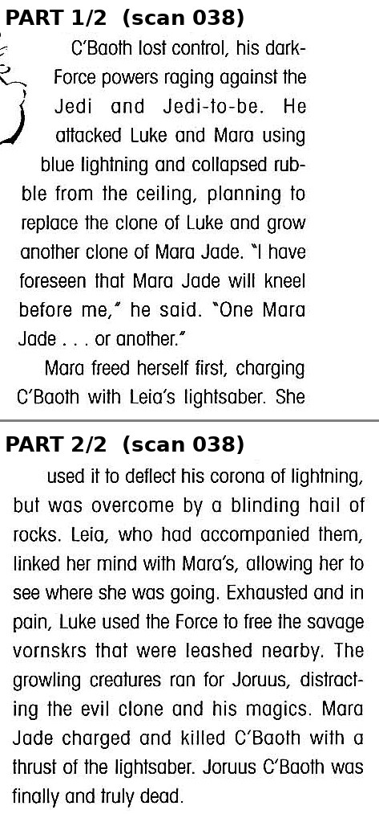

- Note (summary from our notes, not a quotation): Finally, Mara would face her destiny. During a mission that took them to Wayland to destroy the Emperor’s Spaarti cloning cylinders, Luke trained Mara in her slowly returning Force talents. Joruus C’Baoth called both Luke and Mara to him, intending to turn them to the dark side. When it became clear he couldn’t turn Luke, he unleashed his own clone of the hero, calling it Luuke Skywalker. In the battle to follow, Mara killed the Luuke clone, and with help from Luke and Leia Organa Solo, she slew C’Baoth, as well. She had done what the Emperor’s compulsion commanded her. She finally felt free.
  — Source: The Essential Guide to Characters (Andy Mangels, Del Rey, 1995), printed p.83, scan p.092. The 1995 guide's telling, not a power feat..
Our notes: `notes/materials/147-essential-guide-to-characters-1995/egc-greedo-through-mara.md`
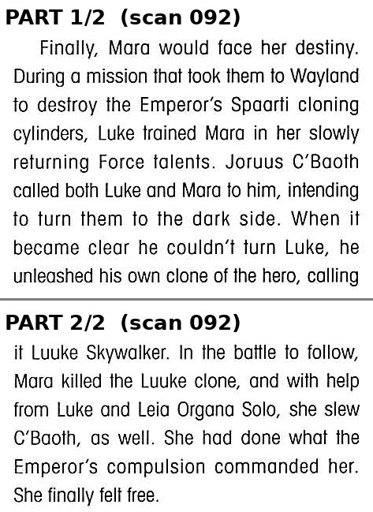

## Essential Guide to Vehicles and Vessels (1996)

- Note (summary from our notes, not a quotation): Mara Jade uses a modified Z-95 Headhunter which has been equipped with a hyperdrive. That ship was nearly destroyed at the battle for the Katana fleet, but Talon Karrde's technicians were able to completely refurbish it, and Mara still uses it as her personal (and well-armed) courier ship.
  — Source: The Essential Guide to Vehicles and Vessels (Bill Smith, Del Rey, 1996), printed p.200, scan p.119.
Our notes: `notes/materials/148-essential-guide-to-vehicles-vessels-1996/egvv-wildkarrde-through-z95.md`
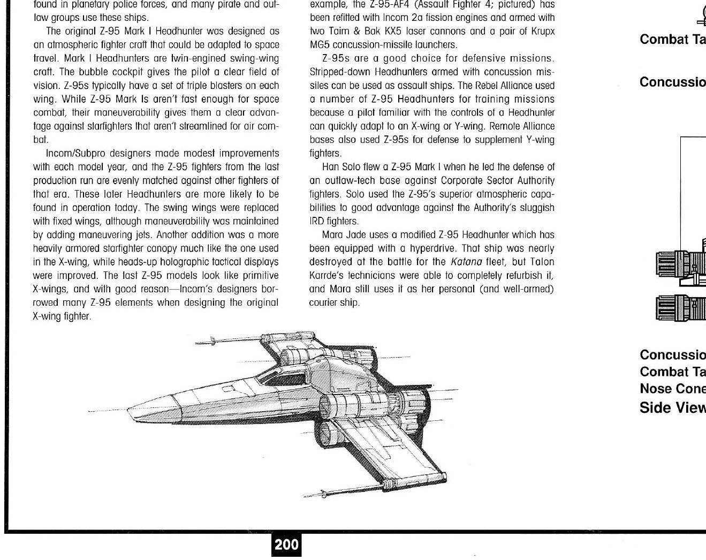

- Note (summary from our notes, not a quotation): As Grand Admiral Thrawn prepared for his campaign against the New Republic, he conducted a systematic upgrade of the Chariot and other aging repulsorcraft. The Chariot's laser cannon was replaced with a more powerful swivel gun. Thrawn used a command speeder to coordinate his search for Luke Skywalker and Mara Jade in the dense forests of Myrkr, at least until that command speeder was crushed in the town square of Hyllyard City when Luke Skywalker toppled a ten-meter-tall stone arch on top of it.
  — Source: The Essential Guide to Vehicles and Vessels (Bill Smith, Del Rey, 1996), printed p.18, scan p.028. The guide does not say Thrawn was aboard the speeder, and it does not mention an injury. This is the guide's telling, not a power feat..
Our notes: `notes/materials/148-essential-guide-to-vehicles-vessels-1996/egvv-chariot-through-enforcer.md`
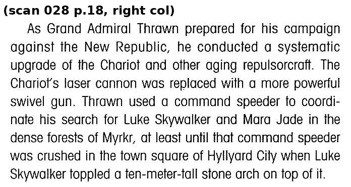

# CANON (Disney canon — kept separate)

## The New Essential Guide to Characters (2002)

> Lumiya committed herself to exterminating the Rebels who had destroyed what she believed was the galaxy's natural order.
— Source: scan pages 1–30.
Note (our notes, around the quote): Mara Jade Skywalker; Lumiya — entry/section: Le Mara Jade, Shira Brie was: "Lumiya committed herself to exterminating the Rebels who had destroyed what she believed was the galaxy's natural order." Source: The New Essential Guide to Characters, p.33
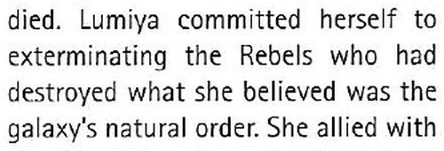
Our notes: `notes/materials/034-new-essential-guide-to-characters/00-negc-scan-001-030.md:195`

## https://starwars.fandom.com/wiki/Mara_Jade_Skywalker

- Note (summary from our notes, not a quotation): The lead says that, as Emperor's Hand, she killed Rebels and corrupt Imperials with “cold professionalism,” and that she was a good pilot and mechanic trained in blaster and hand-to-hand combat even without relying on the Force. [4, 5, 9]
  — Source: UNRESOLVED (sentence not found in current Wookieepedia article revision; primary source not identified) — Mara Jade Skywalker — research extraction — https://starwars.fandom.com/wiki/Mara_Jade_Skywalker.
(Source: UNRESOLVED (sentence not found in current Wookieepedia article revision; primary source not identified))
Our notes: `external/mega-notes/mara-jade-quotes.txt:15`

# Debate and forum claims (unverified)

Forum posts, Suspect Insight debates and Discord debates, respect threads, and verdicts. These are posters' arguments or quotations they typed; none is checked against the book here unless the entry says so.

## Legacy of the Force 1–9: novel notes from the other agent (reference copy)

- Note (summary from our notes, not a quotation): Lumiya is a skilled illusionist who beats a Knight on technique (D11), consistent with the existing Mara ≥ Lumiya entry.
  — Source: Legacy of the Force 1: Betrayal (novel): feats, scaling and story notes.
Posted by: not named in our notes (see thread/notes link).
Our notes: `notes/materials/021-legacy-of-the-force/lotf-1-betrayal-notes.md:213`

- Note (summary from our notes, not a quotation): Luke > Jacen (closing fast; best in the book at stealth and mind work) > Lumiya (illusion specialist) ≈ Mara (no feats; statement places Jacen above her) > Jaina > Leia > Ben. Fett is the top non-Force fighter, though dying.
  — Source: Legacy of the Force 2: Bloodlines (novel), feats and scaling notes.
Posted by: not named in our notes (see thread/notes link).
Our notes: `notes/materials/021-legacy-of-the-force/lotf-2-bloodlines-notes.md:174`

- Note (summary from our notes, not a quotation): No Mara, Alema, Kyp, Corran, or Tenel Ka combat data in this book.
  — Source: Legacy of the Force 2: Bloodlines (novel), feats and scaling notes.
Posted by: not named in our notes (see thread/notes link).
Our notes: `notes/materials/021-legacy-of-the-force/lotf-2-bloodlines-notes.md:183`

- Note (summary from our notes, not a quotation): Mara beats Alema decisively; her only scare came from overconfidence (L5834).
  — Source: L5834 — Legacy of the Force 3: Tempest (novel), feats and scaling notes.
Posted by: not named in our notes (see thread/notes link).
Our notes: `notes/materials/021-legacy-of-the-force/lotf-3-tempest-notes.md:164`

- Note (summary from our notes, not a quotation): Mara frames Jacen as beyond her alone (L4220, L5696). That supports Caedus > Mara before *Sacrifice*.
  — Source: Legacy of the Force 3: Tempest (novel), feats and scaling notes.
Posted by: L4220, L5696.
Our notes: `notes/materials/021-legacy-of-the-force/lotf-3-tempest-notes.md:166`

- Note (summary from our notes, not a quotation): Close-quarters lethality: Mara ≥ Jacen (pre-Caedus) on the page. Jacen > Mara in raw Force power (S5, and the explosion at L8471).
  — Source: Legacy of the Force 5: Sacrifice (novel, read in full): feats, scaling and story notes.
Posted by: not named in our notes (see thread/notes link).
Our notes: `notes/materials/021-legacy-of-the-force/lotf-5-sacrifice-notes.md:163`

- Note (summary from our notes, not a quotation): Lightsaber: Luke > Jacen (S1; stated, not shown). Luke > Lumiya (shown, though she was not trying to win). Mara ≥ Lumiya (shown, Duel A).
  — Source: Legacy of the Force 5: Sacrifice (novel, read in full): feats, scaling and story notes.
Posted by: not named in our notes (see thread/notes link).
Our notes: `notes/materials/021-legacy-of-the-force/lotf-5-sacrifice-notes.md:164`

- Note (summary from our notes, not a quotation): Stealth: Ben's camouflage beats Jacen (L6597). Mara with camouflage beats Jacen (L7430, L8072, L8392). Lumiya's stealth beats Luke (L4527, L8968).
  — Source: L6597 — Legacy of the Force 5: Sacrifice (novel, read in full): feats, scaling and story notes.
Posted by: not named in our notes (see thread/notes link).
Our notes: `notes/materials/021-legacy-of-the-force/lotf-5-sacrifice-notes.md:165`

- Note (summary from our notes, not a quotation): Caedus vs. Mara: the only on-page result is a Jacen win, but on conditions that favored Mara (her terrain, her ambush, his injuries). She was winning the physical fight. He was Jacen, not yet the full Sith Lord: his Sith battle-sight only arrives after her death (L9293), which by the book's own logic is a power-up. Both POVs agree that Jacen is the stronger Force user (S5, S7). Fair 1v1 at full power: Caedus wins most of the time. Mara with prep can kill pre-Caedus Jacen.
  — Source: L9293 — Legacy of the Force 5: Sacrifice (novel, read in full): feats, scaling and story notes.
Posted by: not named in our notes (see thread/notes link).
Our notes: `notes/materials/021-legacy-of-the-force/lotf-5-sacrifice-notes.md:235`

- Note (summary from our notes, not a quotation): Stealth matters a great deal at this tier. Camouflage let Ben, then Mara, get past Jacen's senses several times.
  — Source: Legacy of the Force 5: Sacrifice (novel, read in full): feats, scaling and story notes.
Posted by: not named in our notes (see thread/notes link).
Our notes: `notes/materials/021-legacy-of-the-force/lotf-5-sacrifice-notes.md:239`

- Note (summary from our notes, not a quotation): Caedus vs. Mara: no new fight. Ben's suspicion keeps Mara's death central. Mara evidence remains *Sacrifice* Duel C plus *Inferno* S7.
  — Source: Legacy of the Force 7: Fury (novel, read in full): feats, scaling and story notes.
Posted by: not named in our notes (see thread/notes link).
Our notes: `notes/materials/021-legacy-of-the-force/lotf-7-fury-notes.md:215`

- Note (summary from our notes, not a quotation): Caedus vs Mara: Caedus's recorded confession (S11) and private thought (S10) confirm she had him injured and the poison was a last resort. Fett: she «nearly succeeded» (S12). Keeps *Sacrifice* Duel C as "Mara nearly won".
  — Source: Legacy of the Force 8: Revelation (novel, read in full): feats, scaling and story notes.
Posted by: not named in our notes (see thread/notes link).
Our notes: `notes/materials/021-legacy-of-the-force/lotf-8-revelation-notes.md:181`

## "My Problems with Caedus Wank: Why I find Caedus = Maul more believable than Caedus = Yoda" (Master Azronger)

- Note (summary from our notes, not a quotation): Aurra Sing, Mara, Jaina, Katarn, Horn: below the Council or around Council level.
  — Source: Why I find Caedus = Maul more believable than Caedus = Yoda" (Master Azronger) — https://www.suspectinsightforums.com/t4493-my-problems-with-caedus-wank-why-i-find-caedus-maul-more-believable-than-caedus-yoda.
Posted by: not named in our notes (see thread/notes link).
Our notes: `notes/materials/008-caedus-wank-problems-caedus-maul-vs-yoda.md:142`

## "Dissecting Legacy #4: Darth Krayt vs Yoda" (Suspect Insight Forums)

> It was a voice that Luke felt rather than heard, a darkness that pulled at him from behind. And I will.
>
> Luke turned to find the form of a shadow-wrapped human approaching from the shore by which Luke had entered the water, the same shore by which all mortals came to the Lake of Apparitions. The silhouette was tall and broad-shouldered, with a head hooded in darkness and glowing eyes that never seemed to match colors, that went from brown to orange and yellow to blue, that sometimes grew dark as ebony and seemed to be not there at all. As the silhouette drew nearer, it began to resemble a man Luke had seen many years before, a man who had appeared only in his dreams—and always shortly before he awoke feeling uneasy and frightened.
>
> Luke glanced back at Mara, then said, “It’s him.”
>
> “Who?”
>
> “Who?”
>
> “The man I kept seeing in my dreams, before Jacen turned Sith.”
>
> "Who?"
> [fragment — full passage not on file]
>
> Mara looked confused. "But the man in your dreams was Jacen."
>
> Mara looked confused. “But the man in your dreams was Jacen.”
>
> Mara looked confused. “But the man in your dreams was Jacen.”
>
> “I thought so,” Luke replied. “Who else could it have been?”
>
> He turned back to the figure and saw that the cloaking shadows had coalesced into a suit of dark, spiked armor. The newcomer’s right arm seemed a mere ghost, as though he had only a holographic projection where there should have been a limb.
— Source: Darth Krayt vs Yoda" (Suspect Insight Forums) — https://www.suspectinsightforums.com/t4461-dissecting-legacy-4-darth-krayt-vs-yoda.
(Excerpt widened 2026-11-17 to the relevant passage, word for word from Star Wars: Fate of the Jedi: Apocalypse (Troy Denning) (text copy `MEGA_Legend_The_Fate_of_the_Jedi_Series_Star_Wars_Fate_of_the_Jedi_09_Apocalypse_Troy_Denning_epub`).)
(Excerpt widened 2026-11-17 to the relevant passage, word for word from Star Wars: Fate of the Jedi: Apocalypse (Troy Denning) (text copy `MEGA_Legend_The_Fate_of_the_Jedi_Series_Star_Wars_Fate_of_the_Jedi_09_Apocalypse_Troy_Denning_epub`).)
(Fragment completed 2026-11-17: full sentence/passage matched word for word in the source text on file: `MEGA_Legend_The_Fate_of_the_Jedi_Series_Star_Wars_Fate_of_the_Jedi_09_Apocalypse_Troy_Denning_epub`.)
Context: A28. Source as labelled by blogger: Fate of the Jedi - Apocalypse (raw thread.txt line 274)
Posted by: raw thread.txt line 274.
Our notes: `notes/materials/017-dissecting-legacy-4-krayt-vs-yoda.md:295`

## https://comicvine.gamespot.com/forums/gen-discussion-1/emperor-krayt-respect-thread-1684455/

> “Luke did not understand until an eternity later, when the stranger rolled up in his feet and jerked them all to a halt. The Sith seemed to be growing stronger as Abeloth grew weaker, and there were wisps of dark duke swirling off his shoulders and head. *(FotJ: Apocalypse)*
>
> Mara replies: **“'She wounded him, too.' Mara’s other hand rose out of the water and pointed past Luke’s head, toward the tattooed Sith who had helped Luke kill Abeloth. The stranger was on his feet, limping toward the far shore with both hands clutched to his chest. 'If he can do it, so can you.'”** *(same)*
— Source: CITED EXTRACTION: "Emperor Krayt Respect Thread" (Comic Vine, NewGuy12, 6/19/2015, marked INCOMPLETE) — https://comicvine.gamespot.com/forums/gen-discussion-1/emperor-krayt-respect-thread-1684455/; F: Force-drains Luke AND Abeloth.
(Full sentence/passage taken from the source text on file: `research_suspect_insight_raw_threads_028_txt`.)
Label in our notes: FotJ: Apocalypse). Endurance: Mara: (same
Posted by: not named in our notes (see thread/notes link).
Our notes: `external/mega-notes/krayt-comicvine-respect.txt:19`

## Legends feat notes

- Note (summary from our notes, not a quotation): URL: https://starwars.fandom.com/wiki/Mara_Jade_Skywalker
  — Source: Legends feat notes — https://starwars.fandom.com/wiki/Palpatine/Legends ; https://comicvine.gamespot.com/emperor-palpatine/4005-16164/ ; https://www.suspectinsightforums.com/t1921-darth-krayt-versus-darth-sidious.
Posted by: not named in our notes (see thread/notes link).
(Quote extraction is in [local path] (170 lines). Named fights, including Jacen/Caedus if the article states that fight, and the article's own scaling are in the file. Hype is marked as statements.)
Our notes: `external/mega-notes/legends-feats.md:373`

- Note (summary from our notes, not a quotation): Mara on Jacen's powers: «way beyond mine» (L837).
  — Source: L837 — Legends feat notes — https://starwars.fandom.com/wiki/Palpatine/Legends ; https://comicvine.gamespot.com/emperor-palpatine/4005-16164/ ; https://www.suspectinsightforums.com/t1921-darth-krayt-versus-darth-sidious. POV: Mara.
Posted by: not named in our notes (see thread/notes link).
Our notes: `external/mega-notes/legends-feats.md:548`

- Note (summary from our notes, not a quotation): Ladder: Luke > Jacen > Lumiya ≈ Mara > Jaina > Leia > Ben.
  — Source: Legends feat notes — https://starwars.fandom.com/wiki/Palpatine/Legends ; https://comicvine.gamespot.com/emperor-palpatine/4005-16164/ ; https://www.suspectinsightforums.com/t1921-darth-krayt-versus-darth-sidious.
Posted by: not named in our notes (see thread/notes link).
Our notes: `external/mega-notes/legends-feats.md:550`

> not much of a challenge *(L5832)*
> [fragment — full passage not on file]
— Source: L5718-5912; L5832; L5892 — Legends feat notes — https://starwars.fandom.com/wiki/Palpatine/Legends ; https://comicvine.gamespot.com/emperor-palpatine/4005-16164/ ; https://www.suspectinsightforums.com/t1921-darth-krayt-versus-darth-sidious.
Note (our notes, around the quote): Luke + Mara vs. Lumiya + Alema at Roqoo (L5718-5912). Alema's distraction costs Luke his hand. Mara beats Alema: «not much of a challenge» (L5832). Luke, dying, shoots Lumiya five times (L5892).
Posted by: not named in our notes (see thread/notes link).
Our notes: `external/mega-notes/legends-feats.md:559`

> It'll take both of us *(L4220)*
> [fragment — full passage not on file]
>
> Jacen is too powerful already *(L5696)*
> [fragment — full passage not on file]
— Source: L4220; L5696; L4638 — Legends feat notes — https://starwars.fandom.com/wiki/Palpatine/Legends ; https://comicvine.gamespot.com/emperor-palpatine/4005-16164/ ; https://www.suspectinsightforums.com/t1921-darth-krayt-versus-darth-sidious; Statements: Mara on Jacen.
Note (our notes, around the quote): Statements: Mara on Jacen, «It'll take both of us» (L4220) and «Jacen is too powerful already» (L5696). Lumiya expects to lose to Luke (L4638).
Posted by: not named in our notes (see thread/notes link).
Our notes: `external/mega-notes/legends-feats.md:560`

> She shouldn’t have been able to get near him. *(L8487)*
— Source: L8358-8545; L8487 — Legends feat notes — https://starwars.fandom.com/wiki/Palpatine/Legends ; https://comicvine.gamespot.com/emperor-palpatine/4005-16164/ ; https://www.suspectinsightforums.com/t1921-darth-krayt-versus-darth-sidious.
(Full sentence/passage taken from the source text on file: `novels_tmp_sacrifice_sacrifice_epub`.)
Note (our notes, around the quote): Mara vs. Jacen in the Kavan tunnels (L8358-8545): Jacen wins with an illusion of Ben's face and a poison dart. Mara was ahead on points and nearly killed him twice. Jacen: «shouldn't have been able to get near him» (L8487).
Posted by: not named in our notes (see thread/notes link).
Also cited as: L8392; L8471; L8501; L8507 — Legacy of the Force 5: Sacrifice (novel, read in full): feats, scaling and story notes.
Also noted as: | C | Mara vs. Jacen, Kavan tunnels | L8358–8545 | the book's longest fight: ambush, collapse, then a brawl | Jacen, by illusion plus a poison dart | Mara's prep: terrain choice, camouflage, ambush, trap. Jacen's prep: poison darts. Jacen's injuries: knee tendons ripped (L8392); crushed and bleeding (L8471); ankle-to-knee pain after the fall (L8501); shoto stab under the collarbone (L8501); cuts on cheek, chin, and jaw to hairline. Mara's injuries: scalp cut, slammed into a wall and a pillar. She is undamaged when the dart lands. No help on either side. | Mara out-fights Jacen at close quarters and nearly kills him twice (blaster to the eye, blade at his throat). He survives through a big Force burst (L8471) and wins through a mind trick (L8507). He says himself that she «shouldn't have been able to get near him» (L8487). This is pre-Caedus Jacen (he ascends after this fight, L9293–9299). |
Also cited as: L8487; L8143 — Legacy of the Force 5: Sacrifice (novel, read in full): feats, scaling and story notes.
Also noted as: Fights/results: beats Mara (Kavan), but only after a knee ripped open, a tunnel collapse and a shoto under the collarbone. His own POV admits «She shouldn't have been able to get near him.» (L8487). Fires eight torpedoes at Lumiya's sphere, which survives (L8143).
Our notes: `external/mega-notes/legends-feats.md:580`; `notes/materials/021-legacy-of-the-force/lotf-5-sacrifice-notes.md:150`; `notes/materials/021-legacy-of-the-force/lotf-5-sacrifice-notes.md:458`

- Note (summary from our notes, not a quotation): Mara vs. Lumiya on Hesperidium (L5242-5316): Mara ahead. Lumiya is a decoy helped by the sphere.
  — Source: L5242-5316 — Legends feat notes — https://starwars.fandom.com/wiki/Palpatine/Legends ; https://comicvine.gamespot.com/emperor-palpatine/4005-16164/ ; https://www.suspectinsightforums.com/t1921-darth-krayt-versus-darth-sidious.
Posted by: not named in our notes (see thread/notes link).
Our notes: `external/mega-notes/legends-feats.md:581`

- Note (summary from our notes, not a quotation): Jacen becomes Darth Caedus after Mara's death (L9584).
  — Source: L9584 — Legends feat notes — https://starwars.fandom.com/wiki/Palpatine/Legends ; https://comicvine.gamespot.com/emperor-palpatine/4005-16164/ ; https://www.suspectinsightforums.com/t1921-darth-krayt-versus-darth-sidious.
Posted by: not named in our notes (see thread/notes link).
Our notes: `external/mega-notes/legends-feats.md:583`

## https://starwars.fandom.com/wiki/Mace_Windu/Legends

- Note (summary from our notes, not a quotation): In “Legacy,” Sidious calls Windu a “mighty Jedi” and refers to a rumor about his purple lightsaber. This is Sidious’s statement used to persuade Mara Jade, not a demonstrated feat. [114]
  — Source: [Cross-link 2026-10-12] DEEP layer: mace-comicvine-respect.txt (ShootingNova + Erkan12 CV RTs, sourced) + debates-yoda-mace-sidious.md (SI). Verdicts in verdict — https://starwars.fandom.com/wiki/Mace_Windu/Legends.
Posted by: not named in our notes (see thread/notes link).
Our notes: `external/mega-notes/mace-legends-quotes.txt:111`

## https://starwars.fandom.com/wiki/Mara_Jade_Skywalker

- Note (summary from our notes, not a quotation): Result/scaling: this is a direct fight with Jacen/Caedus. The article does not say Mara defeated or stalemated him; it describes her as injured but still fighting, then killed by Caedus after his Force Wave and deception. [2]
  — Source: Mara Jade Skywalker — research extraction — https://starwars.fandom.com/wiki/Mara_Jade_Skywalker.
Posted by: not named in our notes (see thread/notes link).
Our notes: `external/mega-notes/mara-jade-quotes.txt:128`

