# Marasiah Fel

- **Aliases:** Marasiah
- **Era:** Legacy
- **Continuity:** default Legends; entries present for: Legends
- **Research tier:** MASTERY (Legacy-era version only)
- **Entries:** 92 (41 with quotations; 0 quotations extended to the full sentence/passage from the source text on file; 47 marked as fragments). Rebuilt 2026-11-17 from 114 old entries; old file: `characters/_bak/marasiah-fel.md.bak-20261117`.
- **How to read:** each entry is the quotation in full (block quote), then its source and point of view. "Note" lines are summaries from our notes, not quotations. `[fragment — full passage not on file]` means the source text is not on the box, so only the words in our notes are shown. Debate and forum material is in the last section and is unverified.

# LEGENDS (Legends / EU — main focus)

## The Complete Star Wars Encyclopedia, Vol. I (A–G)

- Note (summary from our notes, not a quotation): Page contents: 1226 words, 24 paragraphs | headings/entries: Fel, Marasiah; Fel, Soontir
  — Source: scan pages 241–280.
Our notes: `notes/materials/030-complete-star-wars-encyclopedia-vol-1/06-v1-scan-241-280.md:220`

## Sourcebooks/Legacy Era Campaign Guide.pdf [Star Wars Roleplaying Game Saga Edition (2007)] (scan pages 1–60)

- Note (summary from our notes, not a quotation): Page contents: Table of contents (species, heroic traits, Force-users in the Legacy era, Imperial Knights, Force-using traditions, vehicles and starships, campaign, planets, Galactic Alliance, Empire, Jedi remnants, Underworld, personalities incl. Cade Skywalker, Darth Krayt, Darth Talon, Darth Wyyrlok, Antares Draco, Marasiah Fel, Azlyn Rae). (hand-read)
  — Source: Sourcebooks/Legacy Era Campaign Guide.pdf [Star Wars Roleplaying Game Sag.
Our notes: `notes/materials/037-sw-d20-folder/719-legacy-era-campaign-guide-scan-001-060.md:25`

- Note (summary from our notes, not a quotation): Page contents: Caption "ANTARES DRACO, IMPERIAL KNIGHT"; Table 3-2 Imperial Knight; Examples of Imperial Knights in Star Wars: Sigel Dare, Antares Draco, Marasiah Fel, Mohrgan Fel, Roan Fel, Ganner Krieg, Azlyn Rae, Treis Sinde, Elke Vetter; requirements; game rule information. (hand-read)
  — Source: Sourcebooks/Legacy Era Campaign Guide.pdf [Star Wars Roleplaying Game Sag.
Our notes: `notes/materials/037-sw-d20-folder/719-legacy-era-campaign-guide-scan-001-060.md:322`

## Sourcebooks/Legacy Era Campaign Guide.pdf [Star Wars Roleplaying Game Saga Edition (2007)] (scan pages 121–180)

- Note (summary from our notes, not a quotation): Page contents: Skull Squadron (1st Imperial Center Core Defense Squadron; Predator-class starfighters; defense of Coruscant; invitation only; current commander Gunn Yage, the daughter of Moff Rulf Yage); Joker Squad (new breed of stormtrooper, specialists); Roan Fel's Empire-in-Exile (Bastion; daughter Marasiah). (hand-read)
  — Source: Sourcebooks/Legacy Era Campaign Guide.pdf [Star Wars Roleplaying Game Sag.
Our notes: `notes/materials/037-sw-d20-folder/719-legacy-era-campaign-guide-scan-121-180.md:310`

- Note (summary from our notes, not a quotation): Page contents: Darth Wyyrlok stat block CL 16 (Chagrian Jedi 5/noble 3/Sith apprentice 4/Sith Lord 4; Illusion talent). Antares Draco: highest-ranking member of the Imperial Knights; an ancestor was a member of the Inquisitorius under Palpatine; involved with Marasiah Fel. Stat block CL 15 (Jedi 7/Imperial Knight 8). (hand-read)
  — Source: Sourcebooks/Legacy Era Campaign Guide.pdf [Star Wars Roleplaying Game Sag.
Our notes: `notes/materials/037-sw-d20-folder/719-legacy-era-campaign-guide-scan-121-180.md:450`

- Note (summary from our notes, not a quotation): Page contents: Marasiah Fel ("Sia"): daughter of the deposed Emperor; diplomat with the Imperial Mission; full-fledged Imperial Knight; envoy to sympathetic worlds; romantically linked to Antares Draco. Stat block CL 10 (noble 5/Jedi 4/Imperial Knight 1). (hand-read)
  — Source: Sourcebooks/Legacy Era Campaign Guide.pdf [Star Wars Roleplaying Game Sag.
Our notes: `notes/materials/037-sw-d20-folder/719-legacy-era-campaign-guide-scan-121-180.md:472`

> THE JEDI HAVE NOTHING TO FEAR FROM MY FATHER. ROAN FEL IS NOT YOUR ENEMY. HE NEVER TRULY WAS.
— Source: Sourcebooks/Legacy Era Campaign Guide.pdf [Star Wars Roleplaying Game Sag; Marasiah Fel; Roan Fel — entry/section: Pull quote.
Note (our notes, around the quote): Marasiah Fel; Roan Fel — entry/section: Pull quote: ""THE JEDI HAVE NOTHING TO FEAR FROM MY FATHER. ROAN FEL IS NOT YOUR ENEMY. HE NEVER TRULY WAS." —MARASIAH FEL" Source: *Legacy Era Campaign Guide* (SWRPG Saga Edition), scan p.178
Our notes: `notes/materials/037-sw-d20-folder/719-legacy-era-campaign-guide-scan-121-180.md:487`

## Sourcebooks/Legacy Era Campaign Guide.pdf [Star Wars Roleplaying Game Saga Edition (2007)] (scan pages 181–225)

> ASTRAAL VAO AND KONRAD RUS.
> [fragment — full passage not on file]
— Source: Sourcebooks/Legacy Era Campaign Guide.pdf [Star Wars Roleplaying Game Sag; Page contents: Caption.
Note (our notes, around the quote): Page contents: Caption: "ASTRAAL VAO AND KONRAD RUS." Astraal Vao: sister of noted Jedi Shado Vao; Twi'lek missionary; trusted friend of Marasiah Fel; trusted confidant of Konrad Rus, unaware he confides in Darth Krayt; Force-sensitive, untrained. Stat block CL 5 (noble 5). Morlish Veed: Supreme Commander of the Imperial military and highest-ranking member of the Council of Moffs. (hand-read)
Our notes: `notes/materials/037-sw-d20-folder/719-legacy-era-campaign-guide-scan-181-225.md:10`

## Star Wars Insider #121 (2010)

- Note (summary from our notes, not a quotation): Page contents: Comics: Legacy—War #1 (Ostrander, Duursema) brings back Cade, Krayt, Marasiah Fel, Antares Draco, Wolf Sazen, Darth Talon; Ostrander: no guarantee anyone will be left. (hand-read)
  — Source: Star Wars Insider #121 (2010).
Our notes: `notes/materials/038-star-wars-insider/121-ins121.md:327`

## Star Wars: Legacy (Dark Horse, 2006–2010) single issues #20–#50, hand-read

> "MARASIAH FEL"
>
> "The Princess Marasiah Fel, known to those closest to her as Sia, is the only child of Roan Fel. She is next in line for the throne but there are some Moffs who openly question allowing an Empress."
>
> "Sia received training as an Imperial Knight, but has not been formally knighted."
— Source: Star Wars: Legacy #0 — "Welcome to the Future..." (Jun 2006; 25¢ preview/primer issue).
Context: — Star Wars: Legacy #0, p. 15
Our notes: `notes/materials/039-legacy-2006/legacy-00.md:135`

> — Marasiah Fel, Star Wars: Legacy #23, p. 12
> [fragment — full passage not on file]
>
> "UNWISE. LAST TIME YOU WERE NEARLY KILLED! AS LEADER OF THE IMPERIAL KNIGHTS, I WILL COUNSEL THE EMPEROR TO ASSIGN SOMEONE ELSE."
>
> — Antares Draco, Star Wars: Legacy #23, p. 12
> [fragment — full passage not on file]
>
> "ANTARES...I SENSE CONFLICTED FEELINGS WITHIN YOU." · "I KNOW YOU -- I KNOW THE FEELINGS YOU HAVE FOR ME -- AS WELL AS YOUR SENSE OF DUTY. AND THUS, YOU'RE CONFLICTED."
> [fragment — full passage not on file]
>
> — Marasiah Fel, Star Wars: Legacy #23, p. 12
> [fragment — full passage not on file]
— Source: Star Wars: Legacy #23 — "Loyalties" (Dark Horse, May 2008). POV: Marasiah Fel.
Context: > "I AM FULLY RECOVERED, MASTER DRACO, AND I HAVE COMPLETED BOTH MY TRAINING AND MY TRIALS. I AM AN IMPERIAL KNIGHT NOW, AND YOU WILL TREAT ME AS NO LESS."
Our notes: `notes/materials/039-legacy-2006/legacy-23.md:67`

- Note (summary from our notes, not a quotation): (Draco says on panel that he leads the Imperial Knights. Marasiah has passed her Knight trials. Ganner Krieg is with the Emperor.)
  — Source: Star Wars: Legacy #23 — "Loyalties" (Dark Horse, May 2008).
Our notes: `notes/materials/039-legacy-2006/legacy-23.md:76`

> "EVIDENTLY, THE JEDI HIGH COUNCIL SECRETLY ORDERED THE CREATION OF THIS HIDDEN TEMPLE WHEN THE SITH IMPERIAL WAR BEGAN -- JUST IN CASE. RAWK HELPED FIND A LOCATION FOR IT." · "HE'S TAKING SKYWALKER AND HIS CREW THERE AND I'VE BEEN ALLOWED TO JOIN." · "JAMDHAR OUT."
>
> — Azlyn Rae, Star Wars: Legacy #24, p. 24
> [fragment — full passage not on file]
>
> "POSSIBLE. AZLYN RAE WAS A JEDI APPRENTICE BEFORE SHE JOINED THE KNIGHTS TO COMPLETE HER TRAINING. CONFLICTED LOYALTIES WOULDN'T BE SURPRISING." (red-armored Knight, ponytail — likely Ganner Krieg) · "IF NOT, THE IMPERIAL KNIGHTS HAVE WAYS OF FINDING TRAITORS IN OUR MIDST -- AND DEALING WITH THEM." (Marasiah Fel)
> [fragment — full passage not on file]
>
> — Star Wars: Legacy #24, p. 24
> [fragment — full passage not on file]
— Source: Star Wars: Legacy #24 — "Loyalties, Part Two" (Dark Horse, May 2008). POV: Azlyn Rae, about Marasiah Fel.
Context: Twist: she is an Imperial Knight agent ("Jamdhar") reporting to Bastion. p24
Our notes: `notes/materials/039-legacy-2006/legacy-24.md:96`

> — Star Wars: Legacy #25, pp. 7–8
> [fragment — full passage not on file]
>
> "IT WAS DUTY. AZLYN RAE IS AN IMPERIAL KNIGHT, WORKING UNDERCOVER. HER MISSION WAS TO LOCATE YOU AND CONVINCE YOU TO RETURN TO BASTION." · "I AM HERE ON BEHALF OF MY FATHER, THE RIGHTFUL IMPERIAL EMPEROR, TO OPEN DISCUSSIONS REGARDING A POSSIBLE ALLIANCE BETWEEN OUR FORCES AND THE JEDI OF THIS TEMPLE."
>
> — Marasiah Fel, Star Wars: Legacy #25, p. 11
> [fragment — full passage not on file]
>
> "AFTER THE VONG BIOTECH DISASTER, MY FATHER MET WITH KOL SKYWALKER." · "IT WAS THE SITH, SECRETLY ALLIED WITH MEMBERS OF THE MOFF COUNCIL, WHO USURPED MY FATHER'S AUTHORITY AND ORDERED THE MASSACRE ON OSSUS." · "IT IS THE SITH WHO ARE OUR COMMON ENEMY!" · "ADMIRAL GAR STAZI OF THE GALACTIC ALLIANCE REMNANT HAS OPENED TALKS FOR AN ALLIANCE."
>
> — Marasiah Fel, Star Wars: Legacy #25, p. 15
> [fragment — full passage not on file]
>
> "WITH KRAYT DEAD, THE THRONE WOULD BE EMPTY. THERE IS NO ONE ELSE WITH A TRUE CLAIM ON IT OTHER THAN ROAN FEL." · "HIS PLAN HAS MERIT. WITH OR WITHOUT THE JEDI, WE MAY BE ABLE TO MAKE USE OF IT -- AND SKYWALKER'S KNOWLEDGE OF THE SITH." · "IF NOT FOR HONOR -- THEN, FOR SOMEONE LIKE HIM, THERE ARE ALWAYS CREDITS."
>
> — Marasiah Fel, Star Wars: Legacy #25, p. 22
> [fragment — full passage not on file]
— Source: Star Wars: Legacy #25 — "The Hidden Temple" (Dark Horse, June 2008). POV: Marasiah Fel.
Context: > "IN THE NAME OF THE TRUE EMPEROR, ROAN FEL, WE COME BEARING GREETINGS TO OUR JEDI COUSINS." (speaker unclear, one of the Imperial Knights) · "DEFEND HER IMPERIAL MAJESTY!" (p8)
Our notes: `notes/materials/039-legacy-2006/legacy-25.md:81`

> IF THE SITH DID FALL UPON THEMSELVES, AN ALLIANCE BETWEEN OUR EMPEROR, GAR STAZI'S FORCES, AND THE JEDI COULD END THE SITH
> [fragment — full passage not on file]
— Source: Star Wars: Legacy #25 — "The Hidden Temple" (Dark Horse, June 2008).
Note (our notes, around the quote): (p11: the Imperial Knights gave Bastion the temple's coordinates. Unnamed red-haired Knight, p22: "IF THE SITH DID FALL UPON THEMSELVES, AN ALLIANCE BETWEEN OUR EMPEROR, GAR STAZI'S FORCES, AND THE JEDI COULD END THE SITH".)
Our notes: `notes/materials/039-legacy-2006/legacy-25.md:93`

> — Marasiah Fel, Star Wars: Legacy #26, p. 16
> [fragment — full passage not on file]
>
> "THE EMPIRE TOOK ME IN TO FINISH MY TRAINING AND WHEN I BECAME A KNIGHT I SWORE THE OATHS...AND YET..." · "BUT HAS NO IMPERIAL KNIGHT EVER WALKED AWAY?"
> [fragment — full passage not on file]
>
> — Azlyn Rae, Star Wars: Legacy #26, p. 16
> [fragment — full passage not on file]
— Source: Star Wars: Legacy #26 — "The Hidden Temple, Part Two" (Dark Horse, July 2008). POV: Marasiah Fel.
Context: > "I'M SENSING SOME AMBIVALENCE IN YOU, AZLYN." · "THOSE OATHS WERE FOR LIFE, MASTER RAE. THERE IS NO WALKING AWAY FROM THAT." · "ONLY ONE. HIS OATHS WERE ALSO FOR LIFE AND HIS LIFE PROVED SHORT. ONE WAY OR ANOTHER, HIS OATHS WERE HONORED."
Our notes: `notes/materials/039-legacy-2006/legacy-26.md:89`

- Note (summary from our notes, not a quotation): New in roster: Darth Reave (added during the #30 read). Also present: an unnamed red-and-black horned Zabrak Sith (red lightsaber plus a spiked chain weapon). He isn't named in this issue. #30 p3 names him as Darth Reave (added to the roster). Also present: Roan Fel (by hologram) and his blonde bodyguard (unnamed here, sparring with Fel, p10). Named: Princess Sia (Marasiah Fel, p11) and Bastion.
  — Source: Star Wars: Legacy #29 — "Vector, Part 10 of 12" (Dark Horse, October 2008).
Our notes: `notes/materials/039-legacy-2006/legacy-29.md:5`

- Note (summary from our notes, not a quotation): Lore: Moff Yage is Gunn Yage's father; Skull Squadron (Predator fighters) subordinated to Sith Furies (red-skinned Sith pilots). Target: Roan Fel and Marasiah, implying the Agamar summit leaked.
  — Source: Star Wars: Legacy #44 — "Monster, Part Two" (Jan 2010).
Our notes: `notes/materials/039-legacy-2006/legacy-44.md:87`

- Note (summary from our notes, not a quotation): Event: Star Destroyer Dauntless destroyed holding the corridor; Challon dies. Marasiah Fel captured by the Sith. Fel senses her through the Force.
  — Source: Star Wars: Legacy #46 — "Monster, Part Four" (Mar 2010).
Our notes: `notes/materials/039-legacy-2006/legacy-46.md:120`

- Note (summary from our notes, not a quotation): New roster: Lieutenant Rimon (Skull Squadron pilot), Captain Basile (Dauntless officer). Event: Admiral Tohri Challon dies (p15); Zenoc Quah killed (p12); Marasiah Fel captured.
  — Source: Star Wars: Legacy #46 — "Monster, Part Four" (Mar 2010).
Our notes: `notes/materials/039-legacy-2006/legacy-46.md:176`

> CORUSCANT. ONE WEEK LATER. THE FIRST SITH IMPERIAL STRIKE FORCE, LED BY THE WAR HAMMER, HAS RETURNED FROM AGAMAR, BRINGING WITH IT A PRISONER. *(caption)*
— Source: Star Wars: Legacy #48 — "Extremes, Part One" (May 2010).
Label in our notes: > (caption
Our notes: `notes/materials/039-legacy-2006/legacy-48.md:50`

> "MOFF YAGE, I KNOW THAT ONCE YOU SERVED MY FATHER. I CAN SENSE YOUR DISTASTE FOR WHAT YOU HAVE BEEN FORCED TO DO. YOU KNOW WHAT WILL BECOME OF ME IN THE HANDS OF THE SITH."
>
> "I BEG OF YOU -- HELP ME ESCAPE. DEFECT!" (Marasiah Fel)
>
> "I CANNOT, PRINCESS. THE PUNISHMENT FOR MY DEFECTION WOULD RAIN DOWN ON MY DAUGHTER."
>
> "YOUR FATHER ESCAPED US. YOU ARE ALL I HAVE TO SHOW FOR THIS OTHERWISE BOTCHED MISSION." (Yage)
>
> "I MISJUDGED YOU, MOFF. YOU HAVE NEITHER THE HONOR NOR THE COURAGE I THOUGHT YOU POSSESSED." (Marasiah)
> [fragment — full passage not on file]
— Source: Star Wars: Legacy #48 — "Extremes, Part One" (May 2010). POV: Marasiah Fel.
Context: — Star Wars: Legacy #48, p. 7
Our notes: `notes/materials/039-legacy-2006/legacy-48.md:51`

> "MOFF YAGE. I AM DARTH HAVOK, AN INQUISITOR SERVING DARTH KRAYT. THE PRISONER IS TO COME WITH ME TO KORRIBAN FOR QUESTIONING." (Havok)
>
> "MY ORDERS, SITH, CAME FROM LORD REGENT VEED, AND IT IS INTO HIS HANDS I AM TO DELIVER THE PRISONER!" (Yage)
>
> "THE COMPETENCE AND LOYALTY OF THE MOFFS, INCLUDING THE REGENT, ARE IN QUESTION. SOMEONE OBVIOUSLY WARNED ROAN FEL AT THE LAST MOMENT AND UNTIL WE KNOW WHO THAT PERSON IS, EVERYONE IS UNDER SUSPICION."
>
> "HER IMPERIAL HIGHNESS COMES WITH ME." (Havok)
> [fragment — full passage not on file]
— Source: Star Wars: Legacy #48 — "Extremes, Part One" (May 2010). POV: Havok, about Marasiah Fel.
Context: — Star Wars: Legacy #48, p. 7
Our notes: `notes/materials/039-legacy-2006/legacy-48.md:54`

> "I DON'T THINK SO. MY ORDERS WERE THAT THE PRINCESS SHOULD BE BROUGHT TO ME."
>
> "I DON'T THINK THAT YOU HAVE THE AUTHORITY TO MAKE THAT DECISION, LORD REGENT VEED." (Veed
>
> Havok)
>
> "I AM THE REGENT AND, IN THE ABSENCE OF DARTH KRAYT OR DARTH WYYRLOK, I AM THE THRONE." (Veed)
>
> "MY ORDERS COME DIRECTLY FROM DARTH WYYRLOK. IF YOU HAVE A PROBLEM WITH HIS ORDERS, I SUGGEST YOU TAKE IT UP WITH HIM UPON HIS RETURN."
>
> "COME, PRINCESS." (Havok)
> [fragment — full passage not on file]
— Source: Star Wars: Legacy #48 — "Extremes, Part One" (May 2010).
Context: — Star Wars: Legacy #48, p. 8
Our notes: `notes/materials/039-legacy-2006/legacy-48.md:57`

> "BY THE EMPEROR'S BLACK BONES -- HOW DID YOU SCREW THIS UP?!" (Veed)
>
> "WE WERE BETRAYED! SOMEONE REACHED FEL AND WARNED HIM, GIVING HIM JUST ENOUGH TIME TO SLIP THROUGH OUR FINGERS! ONLY SHEER LUCK NETTED US THE PRINCESS!" (Yage)
> [fragment — full passage not on file]
— Source: Star Wars: Legacy #48 — "Extremes, Part One" (May 2010).
Context: — Star Wars: Legacy #48, p. 8
Our notes: `notes/materials/039-legacy-2006/legacy-48.md:60`

> "WE'VE LOST ANY CONTROL WE EVER HAD, VEED! THE SITH TWIST THOSE WHO SHOULD SERVE THE EMPIRE TO SERVE THEIR WILL! SOON WE WILL ALL CALL OURSELVES "SITH"! "ONE EMPIRE, ONE SITH."" (Yage)
>
> "BE WARY, RULF -- TO SOME THAT MIGHT SOUND LIKE TREASON." (Veed)
>
> "BE WARY YOURSELF, MORLISH -- OF A SITH SABER THROUGH YOUR BACK! THE MOMENT THEY DON'T NEED YOU, THEY WILL GUT YOU!" (Yage)
> [fragment — full passage not on file]
— Source: Star Wars: Legacy #48 — "Extremes, Part One" (May 2010).
Context: — Star Wars: Legacy #48, p. 9
Our notes: `notes/materials/039-legacy-2006/legacy-48.md:63`

> "I'LL TELL OUR DAUGHTER THAT YOU ASKED AFTER HER AND WERE PLEASED TO LEARN SHE SURVIVED THE MISSION. GUNNER WON'T BELIEVE IT, OF COURSE, BUT CIVIL LIES ARE ALL SHE HAS EVER HAD FROM US."
>
> "NOW, IF YOU'LL BOTH EXCUSE ME, I HAVE NEW ORDERS. I MUST READY THE FLEET TO DEPART IMMEDIATELY." (Yage, to Nyna Calixte)
> [fragment — full passage not on file]
— Source: Star Wars: Legacy #48 — "Extremes, Part One" (May 2010).
Context: — Star Wars: Legacy #48, p. 9
Our notes: `notes/materials/039-legacy-2006/legacy-48.md:66`

> "AND WHERE HAVE YOU BEEN? YOU'VE BEEN GONE A LONG TIME, AND NONE OF YOUR STAFF COULD TELL ME WHERE!" (Veed)
>
> "I WAS IN THE UNDERCITY, TRYING TO GAIN INTEL AS TO WHETHER OR NOT KRAYT WAS DEAD OR ALIVE -- AS YOU ORDERED." (Nyna Calixte)
>
> "NEW MISSION, NYNA. FIND OUT WHO THIS TRAITOR IS!" (Veed)
>
> "I'LL GIVE IT MY HIGHEST PRIORITY." (Nyna)
> [fragment — full passage not on file]
— Source: Star Wars: Legacy #48 — "Extremes, Part One" (May 2010).
Context: — Star Wars: Legacy #48, p. 9
Our notes: `notes/materials/039-legacy-2006/legacy-48.md:69`

- Note (summary from our notes, not a quotation): — Star Wars: Legacy #48, p. 9
  — Source: Star Wars: Legacy #48 — "Extremes, Part One" (May 2010).
Our notes: `notes/materials/039-legacy-2006/legacy-48.md:72`

- Note (summary from our notes, not a quotation): Notes: Rulf Yage and Nyna Calixte are Gunn Yage's parents ("OUR DAUGHTER"). Dramatic irony: Nyna (Morrigan Corde) is the likely leak who warned Fel (flag — not stated). New roster candidate: Darth Havok (Inquisitor; red-eyed, masked).
  — Source: Star Wars: Legacy #48 — "Extremes, Part One" (May 2010).
Our notes: `notes/materials/039-legacy-2006/legacy-48.md:74`

> Two planets and a moon
> [fragment — full passage not on file]
— Source: Star Wars: Legacy #49 — "Extremes, Part Two" (Jun 2010).
Note (our notes, around the quote): Note: crawl uses "Princess Sia Fel" (= Marasiah "Sia" Fel). "Two planets and a moon" = Dac, Da Soocha, Nap'du.
Our notes: `notes/materials/039-legacy-2006/legacy-49.md:16`

- Note (summary from our notes, not a quotation): Key: Fel's "contact on Coruscant" (implied Nyna Calixte, flag). Fel orders Marasiah rescued or killed ("STILLED"). Marasiah knows the Jedi hidden temple location (Taris).
  — Source: Star Wars: Legacy #49 — "Extremes, Part Two" (Jun 2010).
Our notes: `notes/materials/039-legacy-2006/legacy-49.md:65`

> KORRIBAN. THE CHAMBERS OF PERSUASION. *(caption)*
> [fragment — full passage not on file]
>
> YOU FIGHT A VALIANT BATTLE, PRINCESS, BUT I AM NOT FAR FROM WRENCHING INFORMATION FROM YOUR MIND. *(Havok)*
>
> I WILL NEVER TELL YOU ANYTHING! I WILL DIE FIRST! *(Marasiah)*
>
> NO, YOU WON'T, PRINCESS.
> [fragment — full passage not on file]
>
> I KNOW YOU TOO WELL -- AND FOR TOO LONG. LET US NOT HAVE SECRETS FROM ONE ANOTHER, SHALL WE? *(Havok)*
— Source: Star Wars: Legacy #49 — "Extremes, Part Two" (Jun 2010). POV: Marasiah.
Note (our notes, around the quote): > "KORRIBAN. THE CHAMBERS OF PERSUASION." (caption) / "YAAAAAAH!" (Marasiah, under Force lightning) / "YOU FIGHT A VALIANT BATTLE, PRINCESS, BUT I AM NOT FAR FROM WRENCHING INFORMATION FROM YOUR MIND." (Havok) / "I WILL NEVER TELL YOU ANYTHING! I WILL DIE FIRST!" (Marasiah) / "NO, YOU WON'T, PRINCESS." / "I KNOW YOU TOO WELL -- AND FOR TOO LONG. LET US NOT HAVE SECRETS FROM ONE ANOTHER, SHALL WE?" (Havok)
Our notes: `notes/materials/039-legacy-2006/legacy-49.md:123`

> "ESHKAR NIIN?! THAT'S IMPOSSIBLE! YOU'RE --" (Marasiah)
>
> "DEAD? THAT'S WHAT ANTARES TOLD YOU, WASN'T IT? IT APPEARS HE LIED."
>
> "AND WHAT DOES THAT TELL YOU ABOUT HIM, HMM?" (Havok)
> [fragment — full passage not on file]
— Source: Star Wars: Legacy #49 — "Extremes, Part Two" (Jun 2010). POV: Marasiah.
Context: — Star Wars: Legacy #49, p. 15
Our notes: `notes/materials/039-legacy-2006/legacy-49.md:124`

> "YOU ARE THE CREATURE OF LIES HERE, NIIN!" (Marasiah)
>
> "NIIN IS WHO I WAS -- DARTH HAVOK IS WHO I AM." (Havok)
>
> "FOOL IS WHO YOU ARE!"
>
> "I WILL NOT BREAK, I WILL NOT BEND, I WILL NOT SERVE. FAREWELL, TRAITOR!" (Marasiah)
> [fragment — full passage not on file]
— Source: Star Wars: Legacy #49 — "Extremes, Part Two" (Jun 2010). POV: Marasiah.
Context: — Star Wars: Legacy #49, p. 15
Our notes: `notes/materials/039-legacy-2006/legacy-49.md:127`

> MUCH STRONGER IN THE DARK SIDE THAN I EVER WAS IN THE LIGHT.
— Source: Star Wars: Legacy #49 — "Extremes, Part Two" (Jun 2010).
Note (our notes, around the quote): Reveal: Darth Havok = Eshkar Niin, former Imperial Knight and Antares Draco's master (p14–15). Feats: Havok's Force lightning torture; Marasiah Force-pulls Havok's lightsaber to attempt suicide; Havok Force-grips it away mid-pull; Havok hurls a fiery brazier/debris telekinetically (p16). Power statement: "MUCH STRONGER IN THE DARK SIDE THAN I EVER WAS IN THE LIGHT."
Our notes: `notes/materials/039-legacy-2006/legacy-49.md:135`

## Star Wars: Legacy Book 1 (omnibus): power-scaling notes with panels

- Note (summary from our notes, not a quotation): Roan Fel holds Bastion with his Knights (p65–68). Luke's ghost visits a death-stick-addled Cade (p71–74). Princess Marasiah Fel tries a mind trick on Cade and fails; she hires the *Mynock* (p75–80).
  — Source: Legacy Book 1 (omnibus): power-scaling notes with panels.
Context: #2–3 (137 ABY): Wolf, Shado, Hosk and others are ambushed by Sith on Daluuj (p37–41). Cade, now a bounty hunter with Jariah Syn and Deliah Blue, captures the Jedi healer Hosk Trey'lis on Lok and sells him to Rav on Socorro (p42–64). Krayt has Talon kill her master, Darth Ruyn, and names her a
Our notes: `notes/materials/009-legacy-book-1.md:46`

- Note (summary from our notes, not a quotation): #5: Krayt questions the Korriban holocrons of Bane, Andeddu and Nihilus. They call him a "PRETENDER", and he blasts them away (p81–84). On Vendaxa, Wolf and Shado meet Cade's crew. Talon fights Wolf and Shado and swats Marasiah aside. Cade instinctively stops a hurled wreck and Force-pushes Talon away (p85–99). Krayt sends Nihl (p101–102).
  — Source: Legacy Book 1 (omnibus): power-scaling notes with panels.
Our notes: `notes/materials/009-legacy-book-1.md:47`

- Note (summary from our notes, not a quotation): #6: Fel refuses a rescue mission, but Draco and Krieg come anyway (p103, p112–114). Nihl and Talon spring the trap. Marasiah is struck down saving Cade, and Cade takes up her lightsaber (p115–124).
  — Source: Legacy Book 1 (omnibus): power-scaling notes with panels.
Our notes: `notes/materials/009-legacy-book-1.md:48`

- Note (summary from our notes, not a quotation): #7: Cade fights Nihl with a lightsaber in one hand and a blaster in the other, with Syn's help, and is Force-blasted aside (p125–133). Everyone escapes on the *Mynock* (p134–135). Draco attacks Cade; Wolf and Cade argue about the dark side; Cade heals the dying Marasiah through the dark side (p137–142). Talon reports her failure. Krayt spares her and wants the Skywalker "ALIVE" (p146).
  — Source: Legacy Book 1 (omnibus): power-scaling notes with panels.
Our notes: `notes/materials/009-legacy-book-1.md:49`

> (p75) Marasiah: "NO. CREDITS DON'T MATTER. YOU WILL TAKE US." · (p79) Cade: "PLAYING A HUNCH, JARIAH. HUMAN THINKS I'M SOME WEAK-WILLED KOOCHU -- TRIED A JEDI 'MIND TRICK.' HER ARROGANCE SUGGESTS AN IMPERIAL." · (p61) Hosk, touching Cade: "THE FORCE ... IT'S VERY STRONG IN YOU! NOT SITH ... JEDI?"
> [fragment — full passage not on file]
— Source: Legacy Book 1 (omnibus): power-scaling notes with panels.
Context: 4. Resists Marasiah's mind trick; she senses he is strong. p75 (#3 Broken), p79 (#3 Broken), p61 (#3 Broken)
Our notes: `notes/materials/009-legacy-book-1.md:368`

> (p139) Wolf: "BECAUSE TO DO IT YOU MUST TOUCH THE DARK SIDE. YOU'RE NOT ACCEPTING THE WILL OF THE FORCE -- YOU'RE IMPOSING YOUR OWN!" · (p140) Cade: "AND HOW DO YOU KNOW I'M NOT MEANT TO TAKE LIFE BACK FROM DEATH BY TOUCHING THE DARK SIDE?" · "NO ONE DIES FOR ME! NEVER AGAIN!" · (p142) Astraal: "HER WOUND -- IT'S ALMOST HEALED!" · Wolf: "I KNOW HOW CLOSE YOU CAME TO THE DARK SIDE. I COULD FEEL IT." · "BUT NOW I CAN'T FEEL YOU. AT ALL." · "IT'S ALMOST AS IF YOU TOOK HER DEATH INTO YOU!"
> [fragment — full passage not on file]
— Source: Legacy Book 1 (omnibus): power-scaling notes with panels.
Context: 8. Heals the dying Marasiah through the dark side; "took her death into you". p139 (#7 Broken)–p142 (#7 Broken)
Our notes: `notes/materials/009-legacy-book-1.md:423`

> Elke: "KILL ME IF YOU WILL, SITH! THE PRINCESS HAS ESCAPED!" · Talon: "YES. SHE IS WITH ASTRAAL VAO, THE LOCAL MISSIONARY. THE PLAN WAS FOR THEM TO ESCAPE." · "BUT NOW I WILL DRIVE HER TO HER FATHER -- OR HE WILL COME TO SAVE HER. THEN I WILL KILL THEM BOTH." · "YOU ... HAVE NO FURTHER PURPOSE." · (p58) Marasiah: "I FELT HER DIE IN THE FORCE!" · "SHE WAS MY TEACHER!"
> [fragment — full passage not on file]
— Source: Legacy Book 1 (omnibus): power-scaling notes with panels.
Context: 2. Kills Imperial Knight Elke Vetter (Socorro). p56 (#2 Broken)–p57 (#2 Broken)
Our notes: `notes/materials/009-legacy-book-1.md:597`

> (p92) "I AM DARTH TALON." · "I AM MY MASTER'S HAND." · "I AM YOUR DEATH." · (p93) "YOU ARE THE ONE. THE EMPTY-SLEEVED JEDI. SAZEN." · "DARTH NIHL MARKED YOU, JEDI. HE TOOK YOUR ARM. I WILL TAKE YOUR LIFE!" · (p94) "I FEEL THE FORCE SURGE THROUGH YOU, PRINCESS. VETTER WAS ... YOUR MASTER!" · "BUT YOU ARE NOT A KNIGHT. NOT YET -- MERELY A STUDENT." · "DO WHAT YOU DO BEST, PRINCESS -- RUN!" · (p95) Wolf, under her lightning: "CADE! TAKE THE PRINCESS AND ASTRAAL AWAY ON YOUR SHIP!"
> [fragment — full passage not on file]
— Source: Legacy Book 1 (omnibus): power-scaling notes with panels.
Context: 3. Fights Wolf Sazen and Shado Vao at once; lightning on Wolf; disarms Marasiah. p91 (#5 Broken)–p96 (#5 Broken)
Our notes: `notes/materials/009-legacy-book-1.md:609`

> I FELT YOU KILL ELKE VETTER.
>
> ANTARES, YOU'RE AN IDIOT! COMING HERE HAS JUST GOTTEN US BOTH KILLED!
>
> NOT BY THESE THREE.
> [fragment — full passage not on file]
>
> TOLD YOU ... HAD TO MAKE IT RIGHT ... EVEN IF IT'S ONLY ... ONE ... LIFE...
> [fragment — full passage not on file]
>
> recently completed her training as an Imperial Knight
> [fragment — full passage not on file]
— Source: Legacy Book 1 (omnibus): power-scaling notes with panels.
Note (our notes, around the quote): Marasiah (Sia) Fel. p75 (#3 Broken), p94 (#5 Broken), p119 (#6 Broken)–p123 (#6 Broken): tries a mind trick on Cade and fails. Her sensing: "I FELT YOU KILL ELKE VETTER." Talon calls her "MERELY A STUDENT" (p94). She fights alongside Draco (p119): "ANTARES, YOU'RE AN IDIOT! COMING HERE HAS JUST GOTTEN US BOTH KILLED!" · Draco: "NOT BY THESE THREE." She is struck down saving Cade from a Sith (p121–123): "TOLD YOU ... HAD TO MAKE IT RIGHT ... EVEN IF IT'S ONLY ... ONE ... LIFE..." Handbook (p457): "recently completed her training as an Imperial Knight".
Our notes: `notes/materials/009-legacy-book-1.md:864`

- Note (summary from our notes, not a quotation): | 5 | Talon vs Wolf + Shado (+ Marasiah) | Vendaxa | p91–98 (#5) | Talon ahead; ended by Cade's Force push | Talon also driving beasts; crew firing blasters |
  — Source: Legacy Book 1 (omnibus): power-scaling notes with panels.
Context: | # | Fight | Where / when | Pages (issue) | Outcome | Conditions / outside help |
Our notes: `notes/materials/009-legacy-book-1.md:1049`

- Note (summary from our notes, not a quotation): | 9 | Draco + Krieg + Marasiah vs Sith warriors | Vendaxa | p119, p128 (#6–7) | Knights win vs rank-and-file | — |
  — Source: Legacy Book 1 (omnibus): power-scaling notes with panels.
Context: | # | Fight | Where / when | Pages (issue) | Outcome | Conditions / outside help |
Our notes: `notes/materials/009-legacy-book-1.md:1053`

> ...launching a successful assault on Bastion would leave the attacker so debilitated than [sic] none will even consider it.
> [fragment — full passage not on file]
>
> Roan is the third Emperor of the Fel dynasty to sit upon the Imperial Throne. He is a fully trained Imperial Knight.
>
> Even in exile, Fel has maintained a persistent campaign against the Sith.
>
> She has recently completed her training as an Imperial Knight, and has been formally knighted.
— Source: Legacy Book 1 (omnibus): power-scaling notes with panels; The "True" Empire / Bastion (p457).
Label in our notes: Roan Fel: · Marasiah Fel
Our notes: `notes/materials/009-legacy-book-1.md:1134`

- Note (summary from our notes, not a quotation): 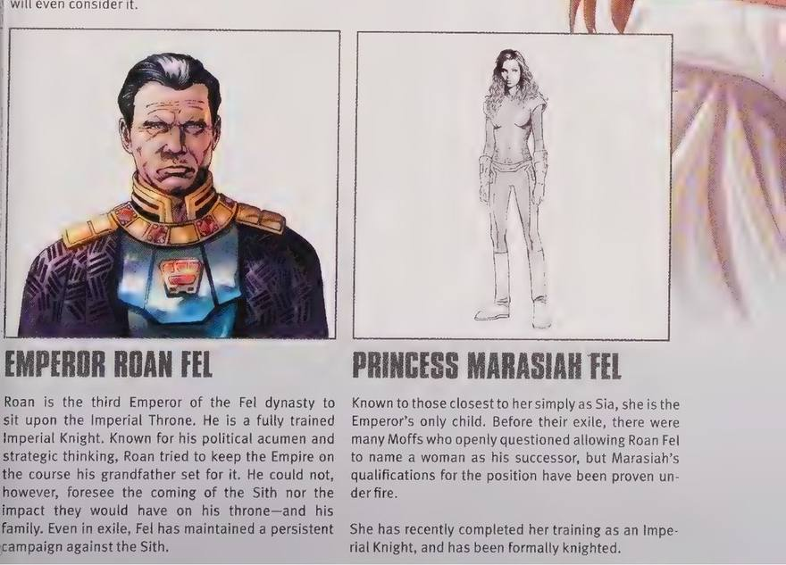
  — Source: Legacy Book 1 (omnibus): power-scaling notes with panels.
(*Panel: p457 handbook: Roan and Marasiah Fel — `p457-handbook-roan-marasiah-fel.jpg`*)
Our notes: `notes/materials/009-legacy-book-1.md:1156`

- Note (summary from our notes, not a quotation): Fel Empire: Roan Fel, Marasiah Fel, Antares Draco, Ganner Krieg, Mohrgan, Elke Vetter.
  — Source: Legacy Book 1 (omnibus): power-scaling notes with panels.
Our notes: `notes/materials/009-legacy-book-1.md:1217`

## Star Wars: Legacy—War #1–6 (2010–11): power-scaling notes with panels

- Note (summary from our notes, not a quotation): | #2 | 24–46 | WAR PART TWO | Falleen, Borosk, Bastion dungeons, Alliance flagship, Coruscant, Korriban | Cade and Sazen destroy the *Darklight*. Maladi, a prisoner, offers Omega Red and Fel refuses. Chalk tips Veed. Veed poisons and shoots Calixte. Havok breaks Draco with an illusion of Marasiah (Talon disguised) and Draco names Taivas. Krayt: "...YOU MUST DIE." |
  — Source: Legacy—War #1–6 (2010–11): power-scaling notes with panels.
Context: | Issue | PDF pages | Title on recap page | Setting | Main events |
Our notes: `notes/materials/010-legacy-war.md:37`

- Note (summary from our notes, not a quotation): Calixte, Bastion and Korriban (p11–14). Calixte with Veed (p11). Marasiah and Chalk (p12). Fel's remembrance ceremony for the Agamar dead and Draco (p13). Havok tortures Draco on Korriban (p14).
  — Source: Legacy—War #1–6 (2010–11): power-scaling notes with panels.
Our notes: `notes/materials/010-legacy-war.md:87`

- Note (summary from our notes, not a quotation): Draco broken (p44–45). Havok breaks Draco with a staged illusion: a false Marasiah who is Talon in disguise. Draco names "TAIVAS".
  — Source: Legacy—War #1–6 (2010–11): power-scaling notes with panels.
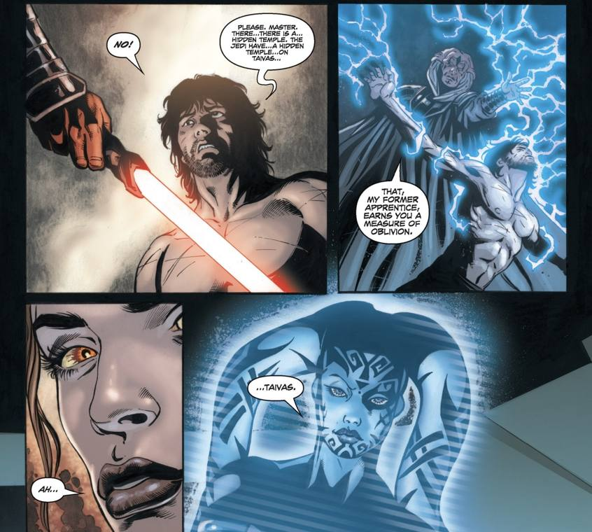
Our notes: `notes/materials/010-legacy-war.md:98`

> YOU DON'T WIN BY PLAYING SAFE.
— Source: Legacy—War #1–6 (2010–11): power-scaling notes with panels.
Note (our notes, around the quote): Taivas council (p61–63). Marasiah gives Draco a chance at redemption (p61). At the council Cade proposes the trap ("YOU DON'T WIN BY PLAYING SAFE.") and K'Kruhk sums up: "AGREED THEN." (p62–63).
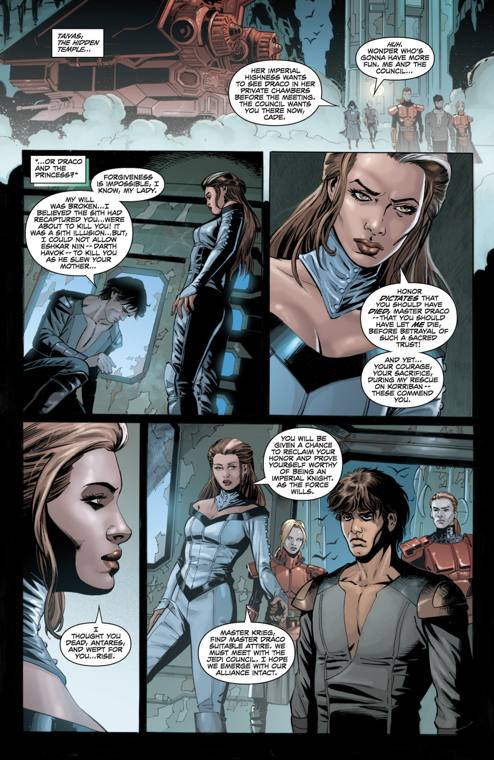
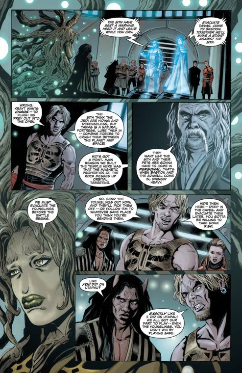
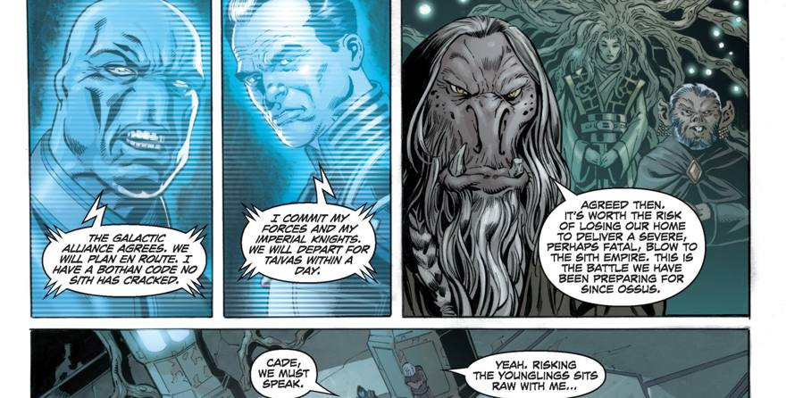
Our notes: `notes/materials/010-legacy-war.md:107`

- Note (summary from our notes, not a quotation): The *Jagged Fel* (p120–121). Fel moves to launch the toxin. He pushes Marasiah and Sinde through glass, and Draco invokes his oath.
  — Source: Legacy—War #1–6 (2010–11): power-scaling notes with panels.

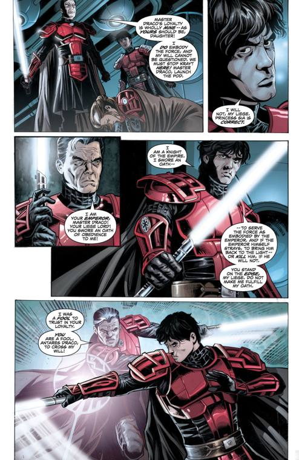
Our notes: `notes/materials/010-legacy-war.md:133`

- Note (summary from our notes, not a quotation): Released Krayt (p4), joins the Temple assault (p15–16), and plays the illusion "Marasiah" in Havok's breaking of Draco (p44–45, orange Sith eye).
  — Source: Legacy—War #1–6 (2010–11): power-scaling notes with panels.
Our notes: `notes/materials/010-legacy-war.md:546`

> (p120) "THE SITH ARE TOO STRONG -- THE BATTLE IS LOST! WE MUST USE A SITH TO KILL THE SITH! DARTH MALADI'S TOXIN WILL WIPE OUT DARTH KRAYT AND HIS SITH EMPIRE!" · "THERE ARE NO INNOCENTS ON CORUSCANT! THEY ARE ALL COLLABORATORS WITH THE SITH! OUR ALLIES WILL BE COLLATERAL DAMAGE. THERE IS NO WEAPON I WOULD NOT USE TO DEFEAT KRAYT!" · (pushing Marasiah and Sinde together through a transparisteel panel with a violet Force wave) "NO! BETTER TO SACRIFICE A PLANET THAN TURN OVER THE GALAXY TO THAT MONSTER!" · (p121) "MASTER DRACO'S LOYALTY IS WHOLLY MINE -- AS YOURS SHOULD BE, DAUGHTER!" · "I DO EMBODY THE FORCE, AND MY WILL CANNOT BE QUESTIONED. WE MUST STOP KRAYT HERE! MASTER DRACO, LAUNCH THE POD." · "I AM YOUR EMPEROR, MASTER DRACO! YOUR LIEGE LORD! YOU SWORE AN OATH OF OBEDIENCE TO ME!" · "I WAS A FOOL TO TRUST IN YOUR LOYALTY." · "YOU ARE A FOOL, ANTARES DRACO, TO CROSS MY WILL!" · (p126) "BY WHOSE HAND?! THAT DEGENERATE PIRATE SKYWALKER?! THE USELESS JEDI WHO HID IN A HOLE RATHER THAN FACE KRAYT?! STAZI AND HIS PATHETIC BAND?!" · "*MY* WILL SHALL SHAPE THE FORCE. I WILL DETERMINE THE FATE OF THE GALAXY! WHO ELSE CAN I TRUST?!" · Draco: "WAIT, MY LIEGE! WAIT! DID YOU FEEL IT?! A DARK SHUDDER IN THE FORCE!" "KRAYT IS DEAD!" · Fel: "SITH TRICKS! SITH *LIES*! KRAYT HAS '*DIED*' BEFORE. I WILL NOT BELIEVE IT!" · "THIS TIME HE DIES BY *MY* HAND! ALL SITH WILL DIE!"
> [fragment — full passage not on file]
— Source: Legacy—War #1–6 (2010–11): power-scaling notes with panels.
Context: 3. Fall: Force-pushes Marasiah and Sinde through glass; fights Draco; struck down. p120–126 (#6)
 *(p120)*
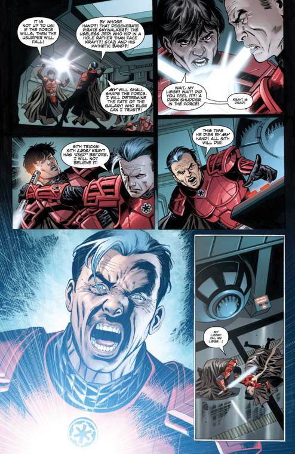 *(p126)*
Our notes: `notes/materials/010-legacy-war.md:673`

> THERE ARE NO INNOCENTS ON CORUSCANT!
— Source: Legacy—War #1–6 (2010–11): power-scaling notes with panels; 
(*Panel: p120 — `p120-fel-no-innocents-marasiah-become-krayt.jpg`*)
Our notes: `notes/materials/010-legacy-war.md:687`

- Note (summary from our notes, not a quotation): One push takes out Marasiah and Sinde (an Imperial Knight Master) together.
  — Source: Legacy—War #1–6 (2010–11): power-scaling notes with panels.
Context: Scaling (ANALYSIS):
Our notes: `notes/materials/010-legacy-war.md:694`

> AS IMPERIAL KNIGHTS WE CANNOT ALLOW THIS!
— Source: Legacy—War #1–6 (2010–11): power-scaling notes with panels; p12 (#1).
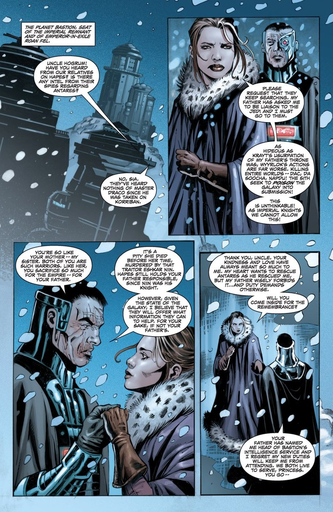 *(p12)*
Our notes: `notes/materials/010-legacy-war.md:702`

> HONOR DICTATES THAT YOU SHOULD HAVE DIED, MASTER DRACO -- THAT YOU SHOULD HAVE LET ME DIE, BEFORE BETRAYAL OF SUCH A SACRED TRUST!
>
> YOU WILL BE GIVEN A CHANCE TO RECLAIM YOUR HONOR AND PROVE YOURSELF WORTHY OF BEING AN IMPERIAL KNIGHT. AS THE FORCE WILLS.
— Source: Legacy—War #1–6 (2010–11): power-scaling notes with panels; p61 (#3), judging Draco.

Our notes: `notes/materials/010-legacy-war.md:704`

- Note (summary from our notes, not a quotation): p67, p72 (#3–4): fights Sith in the temple beside Draco.
  — Source: Legacy—War #1–6 (2010–11): power-scaling notes with panels.
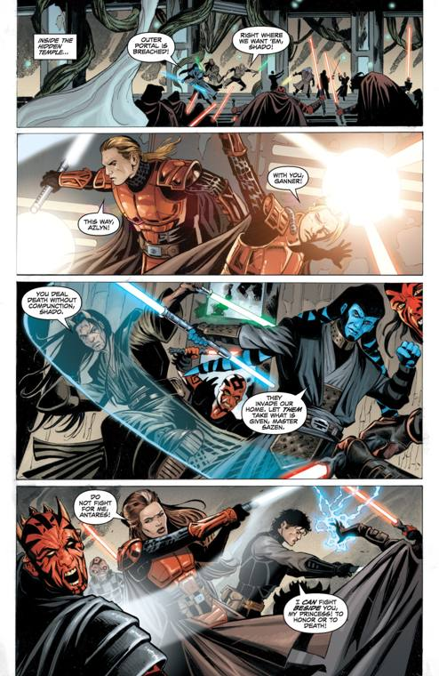
Our notes: `notes/materials/010-legacy-war.md:705`

> DO THIS AND YOU BECOME KRAYT! YOU ARE SUPPOSED TO EMBODY THE FORCE, FATHER! THIS IS WRONG! YOU MUST SEE THAT!
>
> ANTARES... YOU CAN'T LET HIM...
> [fragment — full passage not on file]
— Source: Legacy—War #1–6 (2010–11): power-scaling notes with panels; p120 (#6).

Our notes: `notes/materials/010-legacy-war.md:706`; `notes/materials/010-legacy-war.md:1185`

> You embody the Force
> [fragment — full passage not on file]
— Source: Legacy—War #1–6 (2010–11): power-scaling notes with panels; The intro had.
Note (our notes, around the quote): The intro had "You embody the Force"; the page reads "YOU ARE SUPPOSED TO EMBODY THE FORCE".
Context: p120 (#6): "DO THIS AND YOU BECOME KRAYT! YOU ARE SUPPOSED TO EMBODY THE FORCE, FATHER! THIS IS WRONG! YOU MUST SEE THAT!" · "ANTARES... YOU CAN'T LET HIM..."
Our notes: `notes/materials/010-legacy-war.md:707`

- Note (summary from our notes, not a quotation): p132 (#6): named "EMPRESS MARASIAH FEL" and Triumvir.
  — Source: Legacy—War #1–6 (2010–11): power-scaling notes with panels.

Our notes: `notes/materials/010-legacy-war.md:708`

> MASTER DRACO IS RIGHT -- THIS IS DARK SIDE. PLEASE. STEP AWAY, OLD FRIEND.
— Source: Legacy—War #1–6 (2010–11): power-scaling notes with panels; p120.
Note (our notes, around the quote): p120: "MASTER DRACO IS RIGHT -- THIS IS DARK SIDE. PLEASE. STEP AWAY, OLD FRIEND." He is then pushed through glass with Marasiah.
Context: Treis Sinde:
Our notes: `notes/materials/010-legacy-war.md:745`

- Note (summary from our notes, not a quotation): 
  — Source: Legacy—War #1–6 (2010–11): power-scaling notes with panels.
(*Panel: p132 — `p132-fel-funeral-triumvirate.jpg`*)
Our notes: `notes/materials/010-legacy-war.md:825`

- Note (summary from our notes, not a quotation): | 5 | Havok's illusion vs Draco | Korriban | p44–45 (#2) | Draco breaks, names Taivas | Talon plays "Marasiah" |
  — Source: Legacy—War #1–6 (2010–11): power-scaling notes with panels.
Context: | # | Fight | Where | Pages (issue) | Outcome | Conditions / outside help |
Our notes: `notes/materials/010-legacy-war.md:930`

- Note (summary from our notes, not a quotation): | 22 | Fel vs Marasiah + Sinde | *Jagged Fel* pod bay | p120 (#6) | One push through glass takes out both | They were pleading, not fighting |
  — Source: Legacy—War #1–6 (2010–11): power-scaling notes with panels.
Context: | # | Fight | Where | Pages (issue) | Outcome | Conditions / outside help |
Our notes: `notes/materials/010-legacy-war.md:947`

- Note (summary from our notes, not a quotation): After War (p132): the Galactic Federation Triumvirate of Stazi, "JEDI MASTER K'KRUHK" and Empress Marasiah Fel.
  — Source: Legacy—War #1–6 (2010–11): power-scaling notes with panels.

Our notes: `notes/materials/010-legacy-war.md:1018`

- Note (summary from our notes, not a quotation): Roan Fel, Marasiah, Draco, Krieg, Azlyn Rae, Sigel, Sinde and Chalk.
  — Source: Legacy—War #1–6 (2010–11): power-scaling notes with panels.
Context: Covers:
Our notes: `notes/materials/010-legacy-war.md:1142`

- Note (summary from our notes, not a quotation): | Triumvirate: Stazi, K'Kruhk, Marasiah | p132 | "JEDI MASTER K'KRUHK" |
  — Source: Legacy—War #1–6 (2010–11): power-scaling notes with panels.
Context: | Intro-tier item | Page | Note |
Our notes: `notes/materials/010-legacy-war.md:1190`

## Star Wars Saga Edition: *Legacy Era Campaign Guide* (WotC 2009): power-scaling notes with panels

> Roan Fel, the third Emperor of the Fel Dynasty
> [fragment — full passage not on file]
>
> the Empire-in-exile has managed to repel Darth Krayt's forces and foil attempts on the lives of both Roan Fel and his daughter, Marasiah *(p161)*
> [fragment — full passage not on file]
>
> The planet's defensive systems are nigh impenetrable. Bastion is as well defended as Coruscant, which is why Darth Krayt has not launched an attack on the planet *(p107)*
> [fragment — full passage not on file]
— Source: *Legacy Era Campaign Guide* (WotC 2009): power-scaling notes with panels.
Note (our notes, around the quote): Roan Fel's Empire-in-exile and the Imperial Knights (Bastion). "Roan Fel, the third Emperor of the Fel Dynasty"; "the Empire-in-exile has managed to repel Darth Krayt's forces and foil attempts on the lives of both Roan Fel and his daughter, Marasiah" (p161). Bastion: "The planet's defensive systems are nigh impenetrable. Bastion is as well defended as Coruscant, which is why Darth Krayt has not launched an attack on the planet" (p107).
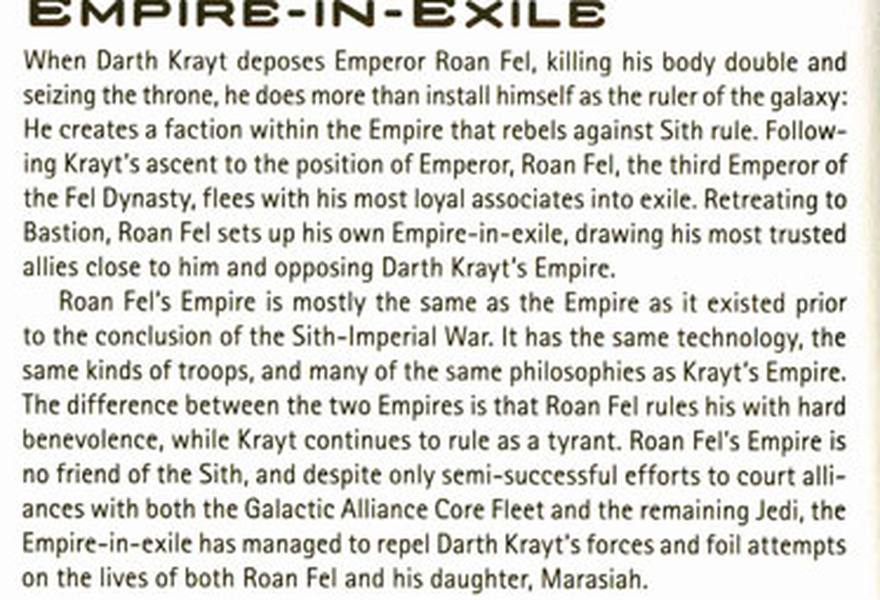
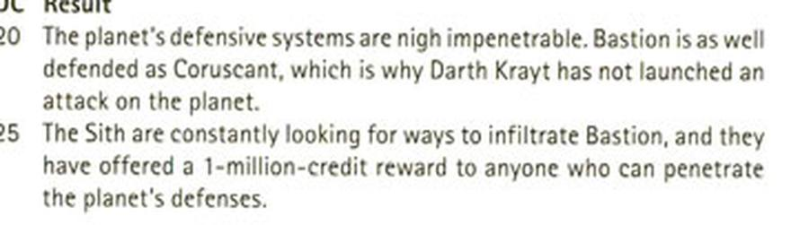
Our notes: `notes/materials/011-legacy-era-campaign-guide.md:89`

- Note (summary from our notes, not a quotation): | 15 | Marasiah Fel | p177 | 10 | noble 5 / Jedi 4 / IK 1 | +17 | 28 (ff 26) / 24 / 24 | 60 (24) | — | 1 / 5 | +14 (2d8+5) |
  — Source: *Legacy Era Campaign Guide* (WotC 2009): power-scaling notes with panels.
Context: | # | Character | Page | CL | Classes | UtF | Ref / Fort / Will | HP (Thr.) | DSS | Destiny / FP | Best lightsaber line |
Our notes: `notes/materials/011-legacy-era-campaign-guide.md:130`

> Draco has defied Roan Fel's wishes on a few occasions, such as the time he traveled to Vendaxa to rescue Marasiah.
— Source: *Legacy Era Campaign Guide* (WotC 2009): power-scaling notes with panels.
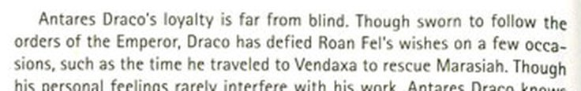
Our notes: `notes/materials/011-legacy-era-campaign-guide.md:471`

> she (like her father) is a full-fledged Imperial Knight
> [fragment — full passage not on file]
>
> Diplomat, liaison, soldier, and spy
> [fragment — full passage not on file]
— Source: *Legacy Era Campaign Guide* (WotC 2009): power-scaling notes with panels; Bio.
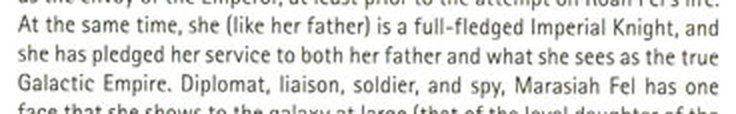
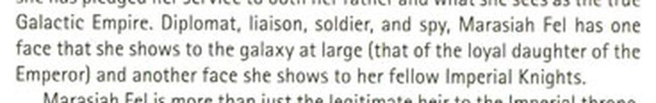
Our notes: `notes/materials/011-legacy-era-campaign-guide.md:501`

- Note (summary from our notes, not a quotation): CL 10; noble 5/Jedi 4/Imperial Knight 1. Destiny 1; Force 5.
  — Source: *Legacy Era Campaign Guide* (WotC 2009): power-scaling notes with panels.
Context: Stat:
Our notes: `notes/materials/011-legacy-era-campaign-guide.md:505`

- Note (summary from our notes, not a quotation): Ref 28 (ff 26), Fort 24, Will 24. hp 60.
  — Source: *Legacy Era Campaign Guide* (WotC 2009): power-scaling notes with panels.
Context: Stat:
Our notes: `notes/materials/011-legacy-era-campaign-guide.md:506`

- Note (summary from our notes, not a quotation): lightsaber +14 (2d8+5).
  — Source: *Legacy Era Campaign Guide* (WotC 2009): power-scaling notes with panels.
Context: Stat:
Our notes: `notes/materials/011-legacy-era-campaign-guide.md:507`

- Note (summary from our notes, not a quotation): Force Powers (UtF +17): battle strike, Force slam, mind trick, move object, rebuke, surge.
  — Source: *Legacy Era Campaign Guide* (WotC 2009): power-scaling notes with panels.
Context: Stat:
Our notes: `notes/materials/011-legacy-era-campaign-guide.md:508`

> I LOVE MY DAUGHTER, BUT THE FATE OF THE EMPIRE—OF THE GALAXY—IS AT STAKE!
— Source: *Legacy Era Campaign Guide* (WotC 2009): power-scaling notes with panels; Pull quote.
Label in our notes: EMPEROR ROAN FEL
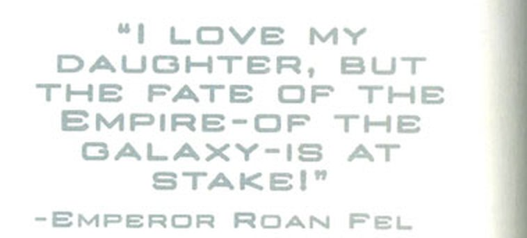
Also cited as: Sourcebooks/Legacy Era Campaign Guide.pdf [Star Wars Roleplaying Game Sag; Roan Fel; Marasiah Fel — entry/section: Pull quote.
Also noted as: Roan Fel; Marasiah Fel — entry/section: Pull quote: ""I LOVE MY DAUGHTER, BUT THE FATE OF THE EMPIRE—OF THE GALAXY—IS AT STAKE!" —EMPEROR ROAN FEL" Source: *Legacy Era Campaign Guide* (SWRPG Saga Edition), scan p.177
Our notes: `notes/materials/011-legacy-era-campaign-guide.md:509`; `notes/materials/037-sw-d20-folder/719-legacy-era-campaign-guide-scan-121-180.md:474`

- Note (summary from our notes, not a quotation): 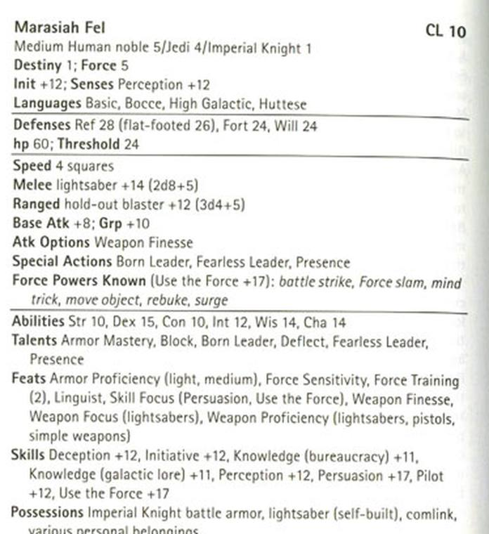
  — Source: *Legacy Era Campaign Guide* (WotC 2009): power-scaling notes with panels.
(*Panel: p177 Marasiah Fel CL 10 — `p177-marasiah-fel-stat.jpg`*)
Our notes: `notes/materials/011-legacy-era-campaign-guide.md:512`

- Note (summary from our notes, not a quotation): Fel Empire: Emperor Roan Fel (CL20), Antares Draco (CL15), Azlyn Rae (CL11), Marasiah Fel (CL10), the generic Imperial Knight (CL11), Knighthunter (CL7).
  — Source: *Legacy Era Campaign Guide* (WotC 2009): power-scaling notes with panels.
Our notes: `notes/materials/011-legacy-era-campaign-guide.md:1102`

- Note (summary from our notes, not a quotation): | p177 | `p177-marasiah-fel-stat.jpg` | Marasiah CL10 | yes |
  — Source: *Legacy Era Campaign Guide* (WotC 2009): power-scaling notes with panels.
Context: | PDF page | File | What it shows | Embedded above |
Our notes: `notes/materials/011-legacy-era-campaign-guide.md:1184`

## https://starwars.fandom.com/wiki/Cade_Skywalker

- Note (summary from our notes, not a quotation): After the Vendaxa fight, Cade healed Princess Marasiah Fel with the same lightning technique used to heal Wolf. [17]
  — Source: UNRESOLVED (sentence not found in current Wookieepedia article revision; primary source not identified) — Cade Skywalker — article extraction — https://starwars.fandom.com/wiki/Cade_Skywalker.
(Source: UNRESOLVED (sentence not found in current Wookieepedia article revision; primary source not identified))
Our notes: `external/mega-notes/cade-skywalker-quotes.txt:17`

## Legends Feats & Quotes (Star Wars Legends / EU)

> MASTER K'KRUHK AND THE SENIOR JEDI WILL FORM A BATTLE MEDITATION AND HAVE OVERALL COMMAND.
>
> Jedi Master
>
> Triumvir
>
> overall command at Coruscant
> [fragment — full passage not on file]
— Source: Legends Feats & Quotes (Star Wars Legends / EU).
Note (our notes, around the quote): Correction (2026-10-21, material 010 full read): the "Grand Master" part is not supported by *Legacy—War* #1–6. The title "Grand Master" appears nowhere in War, for K'Kruhk or anyone else. On the page he is "MASTER K'KRUHK" (Fel, p100: "MASTER K'KRUHK AND THE SENIOR JEDI WILL FORM A BATTLE MEDITATION AND HAVE OVERALL COMMAND.") and, at Fel's funeral, "JEDI MASTER K'KRUHK", one of the three heads of the Galactic Federation Triumvirate with Admiral Gar Stazi and Empress Marasiah Fel (p132). Use "Jedi Master / Triumvir / overall command at Coruscant", not "Grand Master (Legacy: War)". The Clone Wars half of the claim was not checked. See `notes/materials/010-legacy-war.md`.
Context: Becomes Grand Master after Kol Skywalker's death (Legacy: War); Clone Wars stats slightly above Ventress's (per thread) (debate #28)
Our notes: `legends-feats.md:1600`

> *MY* WILL SHALL SHAPE THE FORCE. I WILL DETERMINE THE FATE OF THE GALAXY! WHO ELSE CAN I TRUST?!
> [fragment — full passage not on file]
>
> — Roan Fel, Star Wars: Legacy—War #6, p126
> [fragment — full passage not on file]
— Source: Legends Feats & Quotes (Star Wars Legends / EU). POV: Roan Fel, about Marasiah Fel.
Context: One Force wave throws Marasiah and Imperial Knight Master Treis Sinde together through transparisteel; holds Draco in a blade-lock; struck down when he lunges for the toxin console (material 010; p120–126, Legacy—War #6)
Our notes: `legends-feats.md:2949`

# Debate and forum claims (unverified)

Forum posts, Suspect Insight debates and Discord debates, respect threads, and verdicts. These are posters' arguments or quotations they typed; none is checked against the book here unless the entry says so.

## Antares Draco Respect Thread — respect-thread notes

- Note (summary from our notes, not a quotation): Antares, Ganner Kreig and Shado Vao  successfully infiltrate the Sith Temple on Korriban, rescue Marasiah Fel, and fight through scores of Sith Guards on their way back to the ship.
  — Source: SI respect-thread directory: Antares Draco Respect Thread — https://comicvine.gamespot.com/profile/i_like_swords/blog/antares-draco-respect-thread/104728/.
Posted by: not named in our notes (see thread/notes link).
Our notes: `suspect-insight/respect-threads/antares-draco.md:109`; `suspect-insight/respect-threads/shado-vao.md:71`

- Note (summary from our notes, not a quotation): [image: http://static.comicvine.com/uploads/square_avatar/11111/111114474/4547711-battle+at+korriban.jpg]
  — Source: SI respect-thread directory: Antares Draco Respect Thread — https://comicvine.gamespot.com/profile/i_like_swords/blog/antares-draco-respect-thread/104728/.
Posted by: not named in our notes (see thread/notes link).
Context: Antares, Ganner Kreig and Shado Vao  successfully infiltrate the Sith Temple on Korriban, rescue Marasiah Fel, and fight through scores of Sith Guards on their way back to the ship.
Our notes: `suspect-insight/respect-threads/antares-draco.md:110`

- Note (summary from our notes, not a quotation): Antares senses Marasiah Fel's pain and despair through the dark side miasma of Korriban.
  — Source: SI respect-thread directory: Antares Draco Respect Thread — https://comicvine.gamespot.com/profile/i_like_swords/blog/antares-draco-respect-thread/104728/.
Posted by: not named in our notes (see thread/notes link).
Our notes: `suspect-insight/respect-threads/antares-draco.md:149`

- Note (summary from our notes, not a quotation): [image: data:image/gif;base64,R0lGODlhAQABAAAAACH5BAEKAAEALAAAAAABAAEAAAICTAEAOw==]
  — Source: SI respect-thread directory: Antares Draco Respect Thread — https://comicvine.gamespot.com/profile/i_like_swords/blog/antares-draco-respect-thread/104728/.
Posted by: not named in our notes (see thread/notes link).
Context: Antares senses Marasiah Fel's pain and despair through the dark side miasma of Korriban.
Our notes: `suspect-insight/respect-threads/antares-draco.md:150`; `suspect-insight/respect-threads/cade-skywalker.md:273`

## Cade Skywalker Respect Thread (Updated 2017) — respect-thread notes

- Note (summary from our notes, not a quotation): Cade Skywalker uses Dark Transfer to resurect Marasiah Felx:
  — Source: SI respect-thread directory: Cade Skywalker Respect Thread (Updated 2017) — https://web.archive.org/web/20190902075103/https://comicvine.gamespot.com/profile/darthant66/blog/cade-skywalker-respect-thread-updated-2017/97726/.
Posted by: not named in our notes (see thread/notes link).
Our notes: `suspect-insight/respect-threads/cade-skywalker.md:272`
