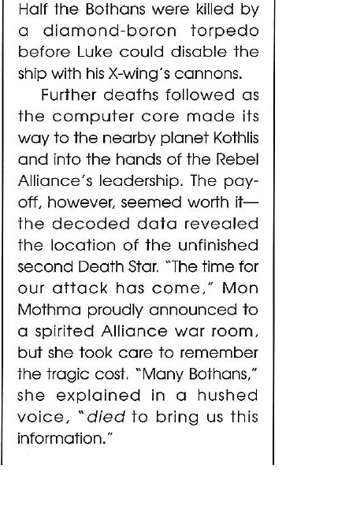
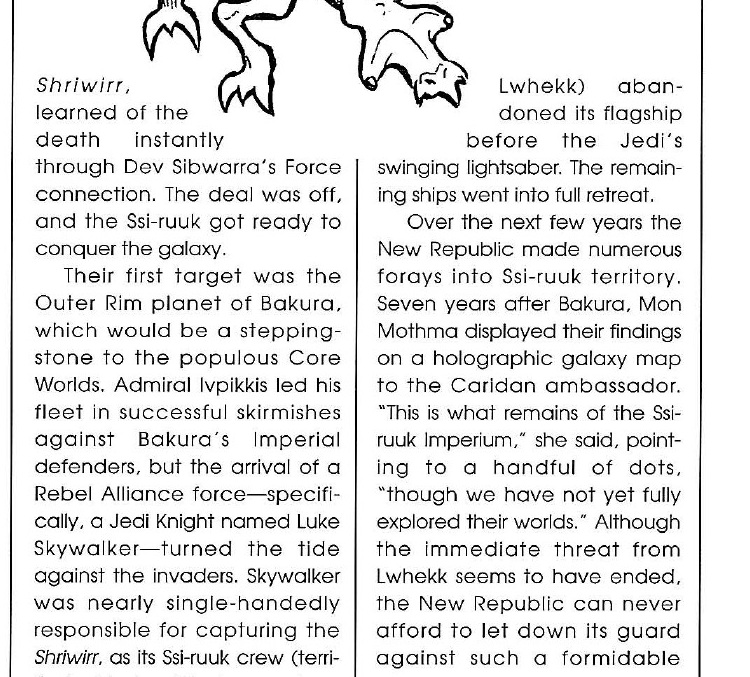
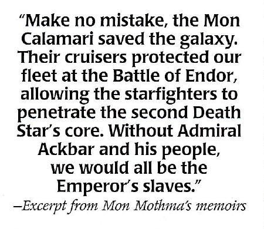

# Mon Mothma

- **Aliases:** Mothma
- **Era:** Rebellion
- **Continuity:** default Legends; entries present for: Canon, Legends
- **Research tier:** untiered (not listed as INTRO/DEEP/MASTERY in legends-feats.md)
- **Entries:** 187 (109 with quotations; 9 quotations extended to the full sentence/passage from the source text on file; 52 marked as fragments; 67 before the 2026-11-17 fragment fill). Rebuilt 2026-11-17 from 211 old entries; old file: `characters/_bak/mon-mothma.md.bak-20261117`.
- **How to read:** each entry is the quotation in full (block quote), then its source and point of view. "Note" lines are summaries from our notes, not quotations. `[fragment — full passage not on file]` means the source text is not on the box, so only the words in our notes are shown. Debate and forum material is in the last section and is unverified.

# LEGENDS (Legends / EU — main focus)

## Dark Lord trilogy (Labyrinth of Evil, Revenge of the Sith, Dark Lord): novel notes from the other agent (reference copy)

> We're too late. A dark time has begun. *(L5657)*
— Source: L5657 — Dark Lord: The Rise of Darth Vader: combat and Force feats (novel, read in full); Mon Mothma. POV: Mon Mothma.
Label in our notes: L5657
Our notes: `notes/materials/022-dark-lord-trilogy/dark-lord-novel-feats.md:701`

- Note (summary from our notes, not a quotation): Chapter (added 2026-10-11, from the L-numbers above and the chapter headings in the source text): Part IV, Ch51
  — Source: Dark Lord: The Rise of Darth Vader: combat and Force feats (novel, read in full).
Context: Mon Mothma: «We're too late. A dark time has begun.» (L5657)
Our notes: `notes/materials/022-dark-lord-trilogy/dark-lord-novel-feats.md:702`

> Anakin, she said to herself, as if she could reach him with a thought. *(L5133)*
— Source: L5133 — Labyrinth of Evil (novel, read in full): feats, scaling, quotes and story notes.
Note (our notes, around the quote): Arc: in the loyalist delegation stalled by Pestage (Ch10) → meets Palpatine (Ch13) → shares a near-telepathic bond with Anakin (Ch14) → is evacuated, hurt in the skimmer crash with Bail and Mon Mothma (Ch42, 46) → watches the abduction news in Nicandra Plaza and reaches for Anakin: «Anakin, she said to herself, as if she could reach him with a thought.» (L5133).
Our notes: `notes/materials/022-dark-lord-trilogy/labyrinth-of-evil-notes.md:1068`

- Note (summary from our notes, not a quotation): Relationships: Anakin (secret husband; he senses she has changed, L827); Palpatine (her old patron, whose teasing makes her blush); Bail and Mon Mothma (allies who are drifting toward opposition).
  — Source: Labyrinth of Evil (novel, read in full): feats, scaling, quotes and story notes.
Our notes: `notes/materials/022-dark-lord-trilogy/labyrinth-of-evil-notes.md:1069`

> Padme Amidala, of Naboo; Mon Mothma of Chandrila; human Senators Terr Taneel, Bana Breemu, and Fang Zar; and alien Senator Chi Eekway.
— Source: Labyrinth of Evil (novel, read in full): feats, scaling, quotes and story notes; Ch10 L619.
Context: Complete quote register (80 lines: every sentence that names Padme, verbatim, in book order):
Our notes: `notes/materials/022-dark-lord-trilogy/labyrinth-of-evil-notes.md:1077`; `notes/materials/022-dark-lord-trilogy/labyrinth-of-evil-notes.md:1249`; `notes/materials/022-dark-lord-trilogy/labyrinth-of-evil-notes.md:1274`

> The Jedi led Padme, C-3PO, Bail, and Mon Mothma to the open-roofed skimmer.
— Source: Labyrinth of Evil (novel, read in full): feats, scaling, quotes and story notes; Ch42 L4433.
Context: Complete quote register (80 lines: every sentence that names Padme, verbatim, in book order):
Our notes: `notes/materials/022-dark-lord-trilogy/labyrinth-of-evil-notes.md:1114`; `notes/materials/022-dark-lord-trilogy/labyrinth-of-evil-notes.md:1218`; `notes/materials/022-dark-lord-trilogy/labyrinth-of-evil-notes.md:1253`; `notes/materials/022-dark-lord-trilogy/labyrinth-of-evil-notes.md:1728`

> Bail looked at Padme and Mon Mothma.
— Source: Labyrinth of Evil (novel, read in full): feats, scaling, quotes and story notes; Ch46 L4731.
Context: Complete quote register (80 lines: every sentence that names Padme, verbatim, in book order):
Our notes: `notes/materials/022-dark-lord-trilogy/labyrinth-of-evil-notes.md:1129`; `notes/materials/022-dark-lord-trilogy/labyrinth-of-evil-notes.md:1233`; `notes/materials/022-dark-lord-trilogy/labyrinth-of-evil-notes.md:1263`

> Three among a crowd several hundred strong standing in the Nicandra Plaza, Padme, Bail, and Mon Mothma watched the late-breaking news report on the Embassy Mall's HoloNet monitor.
— Source: Labyrinth of Evil (novel, read in full): feats, scaling, quotes and story notes; Ch53 L5129.
Context: Complete quote register (80 lines: every sentence that names Padme, verbatim, in book order):
Our notes: `notes/materials/022-dark-lord-trilogy/labyrinth-of-evil-notes.md:1142`; `notes/materials/022-dark-lord-trilogy/labyrinth-of-evil-notes.md:1239`; `notes/materials/022-dark-lord-trilogy/labyrinth-of-evil-notes.md:1267`

- Note (summary from our notes, not a quotation): Relationships: friends with Obi-Wan, Yoda, Mace and Tiin (L599); Mon Mothma; Padmé.
  — Source: L599 — Labyrinth of Evil (novel, read in full): feats, scaling, quotes and story notes.
Our notes: `notes/materials/022-dark-lord-trilogy/labyrinth-of-evil-notes.md:1156`

> She heard her name called, and turned to see Bail Organa and Mon Mothma angling toward where she and C-3PO were momentarily hampered. With them were two female Jedi—Masters Shaak Ti and Stass Allie.
— Source: Labyrinth of Evil (novel, read in full): feats, scaling, quotes and story notes; Ch42 L4403.
(Excerpt widened 2026-11-17 to the relevant passage, word for word from Labyrinth of Evil (James Luceno) (text copy `MEGA_Legend_The_Episode_Novelizations_Star_Wars_Revenge_of_the_Sith_01_Labyrinth_of_Evil_James_Luceno_epub`).)
Context: Complete quote register (85 lines: every sentence that names Bail Organa, verbatim, in book order):
Our notes: `notes/materials/022-dark-lord-trilogy/labyrinth-of-evil-notes.md:1210`; `notes/materials/022-dark-lord-trilogy/labyrinth-of-evil-notes.md:1252`; `notes/materials/022-dark-lord-trilogy/labyrinth-of-evil-notes.md:1727`

> Mon Mothma hurried her away from the skimmer, to where Bail and C-3PO were hiding behind the blockish pedestal of a modernistic sculpture.
>
> “Master Allie doesn’t strike me as someone who will sue for damages,” the droid was saying.
— Source: Labyrinth of Evil (novel, read in full): feats, scaling, quotes and story notes; Ch46 L4697.
(Excerpt widened 2026-11-17 to the relevant passage, word for word from Labyrinth of Evil (James Luceno) (text copy `MEGA_Legend_The_Episode_Novelizations_Star_Wars_Revenge_of_the_Sith_01_Labyrinth_of_Evil_James_Luceno_epub`).)
(Excerpt widened 2026-11-17 to the relevant passage, word for word from Labyrinth of Evil (James Luceno) (text copy `MEGA_Legend_The_Episode_Novelizations_Star_Wars_Revenge_of_the_Sith_01_Labyrinth_of_Evil_James_Luceno_epub`).)
Context: Complete quote register (85 lines: every sentence that names Bail Organa, verbatim, in book order):
Our notes: `notes/materials/022-dark-lord-trilogy/labyrinth-of-evil-notes.md:1227`; `notes/materials/022-dark-lord-trilogy/labyrinth-of-evil-notes.md:1259`; `notes/materials/022-dark-lord-trilogy/labyrinth-of-evil-notes.md:1731`

> Crushed in among Nicandra Plaza’s suddenly silent multitude, Bail touched Mon Mothma’s arm in a gesture that promised his imminent return, and began to writhe his way to the edge of the crowd. Gazing around, he spied Padmé standing with C-3PO, arms cradled against her, elbows in the palms of her hands, her face raised to the light-splintered sky.
— Source: Labyrinth of Evil (novel, read in full): feats, scaling, quotes and story notes; Ch54 L5205.
(Excerpt widened 2026-11-17 to the relevant passage, word for word from Labyrinth of Evil (James Luceno) (text copy `MEGA_Legend_The_Episode_Novelizations_Star_Wars_Revenge_of_the_Sith_01_Labyrinth_of_Evil_James_Luceno_epub`).)
Context: Complete quote register (85 lines: every sentence that names Bail Organa, verbatim, in book order):
Our notes: `notes/materials/022-dark-lord-trilogy/labyrinth-of-evil-notes.md:1240`; `notes/materials/022-dark-lord-trilogy/labyrinth-of-evil-notes.md:1268`

What it shows (our notes): Role: the Chandrilan Senator of the delegation («Slender, short-haired Mon Mothma hurried to embrace Bail as he approached.», L619). She raises the constitutional amendments (L955), survives the skimmer crash (Ch46: «"Xi Char monstrosities," Mon Mothma said.», L4709) and is armed in the aftermath (L4743).
> Slender, short-haired Mon Mothma hurried to embrace Bail as he approached. “A momentous occasion, Bail,” she said into his left ear. “An audience with Palpatine.”
>
> “Xi Char monstrosities,” Mon Mothma said.
>
> Padmé remembered standing helplessly at the tall windows of Theed Palace, watching squadrons of Vulture fighters fill the sky, like cave creatures loosed on Naboo by darkness …
— Source: L955; L4743 — Labyrinth of Evil (novel, read in full): feats, scaling, quotes and story notes; Role: the Chandrilan Senator of the delegation (.
(Excerpt widened 2026-11-17 to the relevant passage, word for word from Labyrinth of Evil (James Luceno) (text copy `MEGA_Legend_The_Episode_Novelizations_Star_Wars_Revenge_of_the_Sith_01_Labyrinth_of_Evil_James_Luceno_epub`).)
(Excerpt widened 2026-11-17 to the relevant passage, word for word from Labyrinth of Evil (James Luceno) (text copy `MEGA_Legend_The_Episode_Novelizations_Star_Wars_Revenge_of_the_Sith_01_Labyrinth_of_Evil_James_Luceno_epub`).)
(Excerpt widened 2026-11-17 to the relevant passage, word for word from Labyrinth of Evil (James Luceno) (text copy `MEGA_Legend_The_Episode_Novelizations_Star_Wars_Revenge_of_the_Sith_01_Labyrinth_of_Evil_James_Luceno_epub`).)
Our notes: `notes/materials/022-dark-lord-trilogy/labyrinth-of-evil-notes.md:1246`; `notes/materials/022-dark-lord-trilogy/labyrinth-of-evil-notes.md:1178`; `notes/materials/022-dark-lord-trilogy/labyrinth-of-evil-notes.md:1250`; `notes/materials/022-dark-lord-trilogy/labyrinth-of-evil-notes.md:1260`

- Note (summary from our notes, not a quotation): Scaling implications: none.
  — Source: Labyrinth of Evil (novel, read in full): feats, scaling, quotes and story notes.
Our notes: `notes/materials/022-dark-lord-trilogy/labyrinth-of-evil-notes.md:1247`; `notes/materials/022-dark-lord-trilogy/rots-novel-notes.md:934`

- Note (summary from our notes, not a quotation): Complete quote register (20 lines: every sentence that names Mon Mothma, verbatim, in book order):
  — Source: Labyrinth of Evil (novel, read in full): feats, scaling, quotes and story notes.
Our notes: `notes/materials/022-dark-lord-trilogy/labyrinth-of-evil-notes.md:1248`; `notes/materials/022-dark-lord-trilogy/rots-novel-notes.md:935`

> “If we learn any news about Set or the talismans,” the princess promised, “you have my word that we will inform you right away.”
>
> “Thank you, Your Highness,” the Ithorian replied with a stiff bow, only now realizing how he had been outmaneuvered.
>
> “You have my word.”
>
> “And these amendments to the Constitution,” Mon Mothma started to say.
>
> “I view the Constitution as a living document,” Palpatine interrupted. “As such, it must be allowed to expand and contract according to circumstances. Otherwise, what do we have but stasis.”
— Source: Labyrinth of Evil (novel, read in full): feats, scaling, quotes and story notes; Ch13 L955.
(Excerpt widened 2026-11-17 to the relevant passage, word for word from Dynasty of Evil (Drew Karpyshyn) (text copy `MEGA_Legend_The_Darth_Bane_Trilogy_Star_Wars_Darth_Bane_03_Dynasty_of_Evil_Drew_Karpyshyn_epub`).)
(Excerpt widened 2026-11-17 to the relevant passage, word for word from Labyrinth of Evil (James Luceno) (text copy `MEGA_Legend_The_Episode_Novelizations_Star_Wars_Revenge_of_the_Sith_01_Labyrinth_of_Evil_James_Luceno_epub`).)
(Excerpt widened 2026-11-17 to the relevant passage, word for word from Labyrinth of Evil (James Luceno) (text copy `MEGA_Legend_The_Episode_Novelizations_Star_Wars_Revenge_of_the_Sith_01_Labyrinth_of_Evil_James_Luceno_epub`).)
Context: Complete quote register (20 lines: every sentence that names Mon Mothma, verbatim, in book order):
Our notes: `notes/materials/022-dark-lord-trilogy/labyrinth-of-evil-notes.md:1251`

> Into focus swam the faintly smiling face of Mon Mothma.
>
> “No sleeping on the job, Senator,” Mon Mothma said, as if from underwater. “We have to get you out of here.”
— Source: Labyrinth of Evil (novel, read in full): feats, scaling, quotes and story notes; Ch46 L4681.
(Excerpt widened 2026-11-17 to the relevant passage, word for word from Labyrinth of Evil (James Luceno) (text copy `MEGA_Legend_The_Episode_Novelizations_Star_Wars_Revenge_of_the_Sith_01_Labyrinth_of_Evil_James_Luceno_epub`).)
(Excerpt widened 2026-11-17 to the relevant passage, word for word from Labyrinth of Evil (James Luceno) (text copy `MEGA_Legend_The_Episode_Novelizations_Star_Wars_Revenge_of_the_Sith_01_Labyrinth_of_Evil_James_Luceno_epub`).)
Context: Complete quote register (20 lines: every sentence that names Mon Mothma, verbatim, in book order):
Our notes: `notes/materials/022-dark-lord-trilogy/labyrinth-of-evil-notes.md:1254`

> “No sleeping on the job, Senator,” Mon Mothma said, as if from underwater. “We have to get you out of here.”
— Source: Labyrinth of Evil (novel, read in full): feats, scaling, quotes and story notes; Ch46 L4683.
(Excerpt widened 2026-11-17 to the relevant passage, word for word from Labyrinth of Evil (James Luceno) (text copy `MEGA_Legend_The_Episode_Novelizations_Star_Wars_Revenge_of_the_Sith_01_Labyrinth_of_Evil_James_Luceno_epub`).)
Context: Complete quote register (20 lines: every sentence that names Mon Mothma, verbatim, in book order):
Our notes: `notes/materials/022-dark-lord-trilogy/labyrinth-of-evil-notes.md:1255`

> Padmé took stock of herself; realized that she was reclined in the rear seat of Stass Allie’s skimmer. Her head was pillowed on Mon Mothma’s left arm, and her ears felt as if they were plugged with cotton.
— Source: Labyrinth of Evil (novel, read in full): feats, scaling, quotes and story notes; Ch46 L4685.
(Excerpt widened 2026-11-17 to the relevant passage, word for word from Labyrinth of Evil (James Luceno) (text copy `MEGA_Legend_The_Episode_Novelizations_Star_Wars_Revenge_of_the_Sith_01_Labyrinth_of_Evil_James_Luceno_epub`).)
Context: Complete quote register (20 lines: every sentence that names Mon Mothma, verbatim, in book order):
Our notes: `notes/materials/022-dark-lord-trilogy/labyrinth-of-evil-notes.md:1256`

> “Just for a moment,” Mon Mothma said in the same watery tone. “I don’t think you struck your head. You were fine after the crash. Then you fainted. Can you move?”
— Source: Labyrinth of Evil (novel, read in full): feats, scaling, quotes and story notes; Ch46 L4689.
(Excerpt widened 2026-11-17 to the relevant passage, word for word from Labyrinth of Evil (James Luceno) (text copy `MEGA_Legend_The_Episode_Novelizations_Star_Wars_Revenge_of_the_Sith_01_Labyrinth_of_Evil_James_Luceno_epub`).)
Context: Complete quote register (20 lines: every sentence that names Mon Mothma, verbatim, in book order):
Our notes: `notes/materials/022-dark-lord-trilogy/labyrinth-of-evil-notes.md:1257`

> Mon Mothma regarded her in knowing silence, then extended a hand to help her climb from the craft. “Padmé, you have to be careful. Quickly, now.”
— Source: Labyrinth of Evil (novel, read in full): feats, scaling, quotes and story notes; Ch46 L4693.
(Excerpt widened 2026-11-17 to the relevant passage, word for word from Labyrinth of Evil (James Luceno) (text copy `MEGA_Legend_The_Episode_Novelizations_Star_Wars_Revenge_of_the_Sith_01_Labyrinth_of_Evil_James_Luceno_epub`).)
Context: Complete quote register (20 lines: every sentence that names Mon Mothma, verbatim, in book order):
Our notes: `notes/materials/022-dark-lord-trilogy/labyrinth-of-evil-notes.md:1258`

> “Palpatine will never live this down,” Mon Mothma was saying. “Committing so many of our ships and troopers to the Outer Rim sieges. As if this war he is so intent on winning could never come to Coruscant.”
— Source: Labyrinth of Evil (novel, read in full): feats, scaling, quotes and story notes; Ch46 L4715.
(Excerpt widened 2026-11-17 to the relevant passage, word for word from Labyrinth of Evil (James Luceno) (text copy `MEGA_Legend_The_Episode_Novelizations_Star_Wars_Revenge_of_the_Sith_01_Labyrinth_of_Evil_James_Luceno_epub`).)
Context: Complete quote register (20 lines: every sentence that names Mon Mothma, verbatim, in book order):
Our notes: `notes/materials/022-dark-lord-trilogy/labyrinth-of-evil-notes.md:1261`

> Mon Mothma nodded sadly. “The Jedi could have stopped this war. Now they’re Palpatine’s pawns.”
>
> Padmé squeezed her eyes shut. Even if she managed to summon the strength, how could she respond, when her own husband was one of them—a general? What had the Jedi gotten Anakin into—taking him from Tatooine, from his youth, his mother? And yet hadn’t she done as much as anyone to encourage him to remain a Jedi; to heed the tutelage of Obi-Wan, Mace, and the others; to perpetuate the lie that was their secret life as husband and wife?
— Source: Labyrinth of Evil (novel, read in full): feats, scaling, quotes and story notes; Ch46 L4723.
(Excerpt widened 2026-11-17 to the relevant passage, word for word from Labyrinth of Evil (James Luceno) (text copy `MEGA_Legend_The_Episode_Novelizations_Star_Wars_Revenge_of_the_Sith_01_Labyrinth_of_Evil_James_Luceno_epub`).)
(Excerpt widened 2026-11-17 to the relevant passage, word for word from Labyrinth of Evil (James Luceno) (text copy `MEGA_Legend_The_Episode_Novelizations_Star_Wars_Revenge_of_the_Sith_01_Labyrinth_of_Evil_James_Luceno_epub`).)
(Fragment completed 2026-11-17: full sentence/passage matched word for word in the source text on file: `MEGA_Legend_The_Episode_Novelizations_Star_Wars_Revenge_of_the_Sith_01_Labyrinth_of_Evil_James_Luceno_epub`.)
Context: Complete quote register (20 lines: every sentence that names Mon Mothma, verbatim, in book order):
Our notes: `notes/materials/022-dark-lord-trilogy/labyrinth-of-evil-notes.md:1262`

> Mon Mothma glanced at the overturned military craft. “I see a way to try.”
>
> The craft sat scarcely fifty meters from the base of the sculpture. Without further word, the three of them hurried for it.
— Source: Labyrinth of Evil (novel, read in full): feats, scaling, quotes and story notes; Ch46 L4733.
(Excerpt widened 2026-11-17 to the relevant passage, word for word from Labyrinth of Evil (James Luceno) (text copy `MEGA_Legend_The_Episode_Novelizations_Star_Wars_Revenge_of_the_Sith_01_Labyrinth_of_Evil_James_Luceno_epub`).)
(Excerpt widened 2026-11-17 to the relevant passage, word for word from Labyrinth of Evil (James Luceno) (text copy `MEGA_Legend_The_Episode_Novelizations_Star_Wars_Revenge_of_the_Sith_01_Labyrinth_of_Evil_James_Luceno_epub`).)
Context: Complete quote register (20 lines: every sentence that names Mon Mothma, verbatim, in book order):
Our notes: `notes/materials/022-dark-lord-trilogy/labyrinth-of-evil-notes.md:1264`

> Mon Mothma ejected the powerpack from hers. “Empty.”
>
> Bail nodded glumly. “We’ll have to make do.”
>
> Hunkering down behind the pedestal, he and Padmé took careful aim on the closest of the walking droids.
— Source: Labyrinth of Evil (novel, read in full): feats, scaling, quotes and story notes; Ch46 L4743.
(Excerpt widened 2026-11-17 to the relevant passage, word for word from Labyrinth of Evil (James Luceno) (text copy `MEGA_Legend_The_Episode_Novelizations_Star_Wars_Revenge_of_the_Sith_01_Labyrinth_of_Evil_James_Luceno_epub`).)
(Excerpt widened 2026-11-17 to the relevant passage, word for word from Labyrinth of Evil (James Luceno) (text copy `MEGA_Legend_The_Episode_Novelizations_Star_Wars_Revenge_of_the_Sith_01_Labyrinth_of_Evil_James_Luceno_epub`).)
Context: Complete quote register (20 lines: every sentence that names Mon Mothma, verbatim, in book order):
Our notes: `notes/materials/022-dark-lord-trilogy/labyrinth-of-evil-notes.md:1265`

- Note (summary from our notes, not a quotation): Ch46 L4757 «Mon Mothma said.»
  — Source: Labyrinth of Evil (novel, read in full): feats, scaling, quotes and story notes.
Context: Complete quote register (20 lines: every sentence that names Mon Mothma, verbatim, in book order):
Our notes: `notes/materials/022-dark-lord-trilogy/labyrinth-of-evil-notes.md:1266`

> "It can be hoped," Fang Zar said, "not counted on." *(L641)*
>
> "Why not consider ceding some of those worlds," Fang Zar suggested. *(L935)*
— Source: L619; L641; L935 — Labyrinth of Evil (novel, read in full): feats, scaling, quotes and story notes.
Note (our notes, around the quote): Role: the Senators who lobby Palpatine with Padmé, Bail and Mon Mothma (L619). Fang Zar is the spokesman: «"It can be hoped," Fang Zar said, "not counted on."» (L641); «"Why not consider ceding some of those worlds," Fang Zar suggested.» (L935).
Our notes: `notes/materials/022-dark-lord-trilogy/labyrinth-of-evil-notes.md:1271`

> She is intelligent, principled, extremely articulate, and she has the heart of a warrior.” *(L3889)*
>
> “Obi-Wan … there … is still good in him. *(L8721)*
— Source: L3889; L8721 — Revenge of the Sith (Matthew Stover novelization): Power-Scaling Research Notes; *Line-by-line additions:* Mon Mothma credits her with.
(Full sentence/passage taken from the source text on file: `quick_tmp_rots_stover_epub`.)
Note (our notes, around the quote): *Line-by-line additions:* Mon Mothma credits her with «the heart of a warrior» (L3889). Her Ch21 dying insistence: «there ... is still good in him» (L8721).
Our notes: `notes/materials/022-dark-lord-trilogy/rots-novel-notes.md:478`

- Note (summary from our notes, not a quotation): Arc: a loyalist Senator who co-founds the Delegation of 2,000 with Mon Mothma (Ch11, L4025) → eyewitness to Order 66 at the Temple (Ch18, L7115–7121) → rescuer of Yoda and Obi-Wan aboard *Tantive IV* (Ch18–19) → adoptive father of Leia (Ch21, L8789).
  — Source: Ch11, L4025; Ch18, L7115–7121; Ch21, L8789 — Revenge of the Sith (Matthew Stover novelization): Power-Scaling Research Notes.
Our notes: `notes/materials/022-dark-lord-trilogy/rots-novel-notes.md:487`

- Note (summary from our notes, not a quotation): Relationships: Padmé (political ally and confidante); Mon Mothma (co-conspirator); Captain Antilles (his officer, sent to steal Saesee Tiin's homing beacon, L7133); Yoda (he witnesses Yoda's pain after the Senate duel, L8491).
  — Source: Revenge of the Sith (Matthew Stover novelization): Power-Scaling Research Notes.
Our notes: `notes/materials/022-dark-lord-trilogy/rots-novel-notes.md:488`

> Bail Organa and Mon Mothma exchanged glances that whispered of some shared secret. Bail said slowly, “Let us see what we can accomplish in the Senate before we involve the Jedi.”
— Source: Revenge of the Sith (Matthew Stover novelization): Power-Scaling Research Notes; Ch13 The Will of the Force L4861.
(Excerpt widened 2026-11-17 to the relevant passage, word for word from Revenge of the Sith (Matthew Stover) (text copy `MEGA_Legend_The_Episode_Novelizations_Star_Wars_Revenge_of_the_Sith_02_Episode_III_Revenge_of_the_Sith_Matthew_Stover_epub`).)
Context: Complete quote register (70 lines: every sentence that names Bail Organa, verbatim, in book order):
Our notes: `notes/materials/022-dark-lord-trilogy/rots-novel-notes.md:511`; `notes/materials/022-dark-lord-trilogy/rots-novel-notes.md:944`

> Senator Mon Mothma replied serenely, "There's only one way to find out." *(L3893)*
— Source: L3893 — Revenge of the Sith (Matthew Stover novelization): Power-Scaling Research Notes; Personality: calm and resolute.
Label in our notes: Personality: calm and resolute: (L3893
Our notes: `notes/materials/022-dark-lord-trilogy/rots-novel-notes.md:931`; `notes/materials/022-dark-lord-trilogy/rots-novel-notes.md:936`

- Note (summary from our notes, not a quotation): Arc: co-founds the opposition with Bail (L4025) → leads the Delegation of 2,000 petition (L4827) → stays in the Senate as Palpatine purges the Delegation (L7761, L7769).
  — Source: L4025; L4827 — Revenge of the Sith (Matthew Stover novelization): Power-Scaling Research Notes.
Our notes: `notes/materials/022-dark-lord-trilogy/rots-novel-notes.md:932`

> "It has become increasingly clear," Mon Mothma said, "that Palpatine has become an enemy of democracy. *(L4015)*
>
> "That includes even those closest to you," Mon Mothma added. *(L4033)*
— Source: L4015; L4033 — Revenge of the Sith (Matthew Stover novelization): Power-Scaling Research Notes; Key quotes.
Label in our notes: L4015); (L4033
Our notes: `notes/materials/022-dark-lord-trilogy/rots-novel-notes.md:933`; `notes/materials/022-dark-lord-trilogy/rots-novel-notes.md:939`; `notes/materials/022-dark-lord-trilogy/rots-novel-notes.md:941`

- Note (summary from our notes, not a quotation): Ch11 Politics L3997 «Mon Mothma countered.»
  — Source: Revenge of the Sith (Matthew Stover novelization): Power-Scaling Research Notes.
Context: Complete quote register (10 lines: every sentence that names Mon Mothma, verbatim, in book order):
Our notes: `notes/materials/022-dark-lord-trilogy/rots-novel-notes.md:937`

> “That’s what we asked you here to discuss,” Mon Mothma told her calmly. “What we’re going to do about it.”
— Source: Revenge of the Sith (Matthew Stover novelization): Power-Scaling Research Notes; Ch11 Politics L4007.
(Excerpt widened 2026-11-17 to the relevant passage, word for word from Revenge of the Sith (Matthew Stover) (text copy `MEGA_Legend_The_Episode_Novelizations_Star_Wars_Revenge_of_the_Sith_02_Episode_III_Revenge_of_the_Sith_Matthew_Stover_epub`).)
Context: Complete quote register (10 lines: every sentence that names Mon Mothma, verbatim, in book order):
Our notes: `notes/materials/022-dark-lord-trilogy/rots-novel-notes.md:938`

> “You do that,” Bail said. “Make as much noise as you can—keep Palpatine watching what you’re doing in the Senate. That should provide some cover while Mon Mothma and I begin building our organization—”
— Source: Revenge of the Sith (Matthew Stover novelization): Power-Scaling Research Notes; Ch11 Politics L4025.
(Excerpt widened 2026-11-17 to the relevant passage, word for word from Revenge of the Sith (Matthew Stover) (text copy `MEGA_Legend_The_Episode_Novelizations_Star_Wars_Revenge_of_the_Sith_02_Episode_III_Revenge_of_the_Sith_Matthew_Stover_epub`).)
(Full sentence/passage taken from the source text on file: `quick_tmp_rots_stover_epub`.)
Context: Complete quote register (10 lines: every sentence that names Mon Mothma, verbatim, in book order):
Our notes: `notes/materials/022-dark-lord-trilogy/rots-novel-notes.md:940`

> "Which is the purpose of this petition," Mon Mothma said, laving her soft hand over Padme's.
— Source: Revenge of the Sith (Matthew Stover novelization): Power-Scaling Research Notes; Ch13 The Will of the Force L4827.
Context: Complete quote register (10 lines: every sentence that names Mon Mothma, verbatim, in book order):
Our notes: `notes/materials/022-dark-lord-trilogy/rots-novel-notes.md:942`

- Note (summary from our notes, not a quotation): Ch13 The Will of the Force L4835 «Mon Mothma nodded.»
  — Source: Revenge of the Sith (Matthew Stover novelization): Power-Scaling Research Notes.
Context: Complete quote register (10 lines: every sentence that names Mon Mothma, verbatim, in book order):
Our notes: `notes/materials/022-dark-lord-trilogy/rots-novel-notes.md:943`

> “Bail, it’s the only way. It’s the only hope you have of remaining in a position to do anyone any good. Vote for Palpatine. Vote for the Empire. Make Mon Mothma vote for him, too. Be good little Senators. Mind your manners and keep your heads down. And keep doing … all those things we can’t talk about. All those things I can’t know. Promise me, Bail.”
— Source: Revenge of the Sith (Matthew Stover novelization): Power-Scaling Research Notes; Ch19 The Face of the Sith L7769.
(Excerpt widened 2026-11-17 to the relevant passage, word for word from Revenge of the Sith (Matthew Stover) (text copy `MEGA_Legend_The_Episode_Novelizations_Star_Wars_Revenge_of_the_Sith_02_Episode_III_Revenge_of_the_Sith_Matthew_Stover_epub`).)
Context: Complete quote register (10 lines: every sentence that names Mon Mothma, verbatim, in book order):
Our notes: `notes/materials/022-dark-lord-trilogy/rots-novel-notes.md:945`

## Jedi Academy Trilogy (Kevin J. Anderson, 1994): Jedi Search, Dark Apprentice, Champions of the Force (power-scaling notes)

> The rest of the chamber fell into a deep hush as she began to talk. “Kyp Durron,” she said, “you have the blood of millions, perhaps billions, on your hands. We are a governing body here, not a judicial council. We have no right to decide your fate. You—” She gasped as if using most of her energy just to fill her lungs. “You must be judged by the Jedi Master. We are not qualified to judge your crimes.”
— Source: Champions of the Force, ch.21, PDF p.143 — Owner Material 026 — Jedi Academy Trilogy: Champions of the Force (Kevin J. Anderson); Mon Mothma’s verdict (also: Kyp Durron).
(Full sentence/passage taken from the source text on file: `research_primary_jedi_academy_trilogy_champions_of_the_force_pdf`.)
Note (our notes, around the quote): Mon Mothma’s verdict (also: Kyp Durron): "“Kyp Durron,” she said, “you have the blood of millions, perhaps billions, on your hands. We are a governing body here, not a judicial council. We have no right to decide your fate. You—” … “You must be judged by the Jedi Master. We are not qualified to judge your crimes.”" Source: Champions of the Force, ch.21, PDF p.143
Our notes: `notes/materials/026-jedi-academy-trilogy/champions-of-the-force.md:28`

> She found herself in a strange universe of rushing blood cells, electrically firing neurons, contracting muscle fibers, laboring organs that could no longer perform their functions. Cilghal couldn’t exactly comprehend what she saw, but somehow she understood instinctively which parts were healthy, which molecules were sustaining Mon Mothma, and which were the black scourge.
>
> With the Force, Cilghal could touch with fingers infinitely small, infinitely precise, to grasp one of the nano-destroyers and send it careening out of the dying body.
>
> Cilghal found other microscopic destroyers and nudged them, pushed them, herding the poison away from healthy cells, preventing further damage.
>
> The task was incomprehensibly large. The poison had spread and replicated, scattering itself through the billions and billions of cells in Mon Mothma’s body. Cilghal would have to search and remove every one of them.
— Source: Champions of the Force, ch.41, PDF p.242 — Owner Material 026 — Jedi Academy Trilogy: Champions of the Force (Kevin J. Anderson); Cilghal removes the nano-destroyers one by one.
(Excerpt widened 2026-11-17 to the relevant passage, word for word from Champions of the Force (Kevin Anderson) (text copy `MEGA_Legend_The_Jedi_Academy_Trilogy_Star_Wars_Jedi_Academy_03_Champions_of_the_Force_Kevin_J_Anderson_epub`).)
(Excerpt widened 2026-11-17 to the relevant passage, word for word from Champions of the Force (Kevin Anderson) (text copy `MEGA_Legend_The_Jedi_Academy_Trilogy_Star_Wars_Jedi_Academy_03_Champions_of_the_Force_Kevin_J_Anderson_epub`).)
(Full sentence/passage taken from the source text on file: `research_primary_jedi_academy_trilogy_champions_of_the_force_pdf`.)
Note (our notes, around the quote): Cilghal removes the nano-destroyers one by one: "With the Force, Cilghal could touch with fingers infinitely small, infinitely precise, to grasp one of the nano-destroyers and send it careening out of the dying body. … The task was incomprehensibly large. The poison had spread and replicated, scattering itself through the billions and billions of cells in Mon Mothma’s body. Cilghal would have to search and remove every one of them." Source: Champions of the Force, ch.41, PDF p.242
Our notes: `notes/materials/026-jedi-academy-trilogy/champions-of-the-force.md:240`

> But always in the back of her mind was a pressing concern for Mon Mothma. “No change,” Ackbar said in a tired voice. “I wish we understood what Cilghal is attempting to do.” The female Calamarian had not moved in nine hours, kneeling beside Mon Mothma’s bedside, flippered hands resting on the dying woman’s skin, deep in a trance. The medical droids had not expected Mon Mothma to live for this long, so the mere fact that she still had not succumbed to death meant something. From outside the door Leia peeked in to see that nothing had changed. The leader’s hand lay in a crystal dish as droplets of an oily grayish liquid emerged from the tip of her index finger. The process was too slow to watch, but over the course of half an hour a small droplet would gather at the tip of her finger, dangling, until gradually gravity pulled it off into the dish. Terpfen walked slowly down the tiled corridors dressed in a darkgreen close-fitting uniform that bore no insignia. Even after his full pardon Terpfen had refused to accept his rank again. He had sequestered himself in his rooms for much of the time since returning from Anoth. The scarred Calamarian stopped several meters away from them, reluctant to go closer to the room that held Mon Mothma. Leia knew that Terpfen still blamed himself for the dying woman’s condition, and he refused to let the guilt be assuaged. Though she understood his misery, she was getting impatient with his withdrawal and hoped he climbed back to his feet soon. Terpfen bowed ponderously, displaying the network of scars on his disfigured head. “Admiral, I have reached a decision.” He drew a deep breath. “I wish to return to Calamari and continue your work—if our people will have me. I wish to assist in rebuilding Reef Home. I fear …” He looked up to stare at the intricate mosaics on the walls of the Imperial Palace. “I fear that I will never be comfortable on Coruscant again.” “Believe me, Terpfen,” Ackbar answered, “I know exactly how you feel. I would not try to talk you out of your decision. It is a fair compromise between your need for healing and your desire to make amends.” Terpfen straightened, as if some measure of self-esteem had been returned to him. “I would like to depart as soon as possible,” he said. “I will arrange a ship,” Ackbar replied. Terpfen bowed again. “If I have your leave, Chief of State?” “Yes, Terpfen,” Leia answered. She turned once again to watch the motionless tableau inside the medical chamber. At a forgotten hour in the depths of Coruscant’s night, Cilghal emerged from the medical chambers. She staggered, cradling in her right hand a shallow crystal bowl half-filled with the deadly poison from the drink that Ambassador Furgan had thrown in Mon Mothma’s face. The two New Republic guards stationed at the door snapped to attention and rushed to help Cilghal. She was so exhausted she could hardly place one foot in front of another. She leaned against the stone doorway, drawing strength from the solidity of the rock. Her arm trembled as she extended the crystal dish to one of the guards. Cilghal barely had enough strength remaining to lift the small poison-filled container, but she did not dare drop it. She felt a deep, bone-melting relief when the guard took it from her. “Be careful,” she said in a husky, utterly exhausted voice. “Take this … and incinerate it.” The second guard scrambled to the intercom system and signaled for all Council members to come immediately. “Do you have news of Mon Mothma?” the first guard asked her. “She has been cleansed and she will heal.” The lids dropped over Cilghal’s glassy eyes. “But for now she must rest.” Her flowing robes whispered against the tiled walls as she slid down to collapse on the floor. “As must I,” she said, falling immediately into a Jedi recovery trance.
— Source: Champions of the Force, ch.41, PDF p.243-244 — Owner Material 026 — Jedi Academy Trilogy: Champions of the Force (Kevin J. Anderson); Cilghal’s healing lasts all night; Mon Mothma cleansed.
(Excerpt widened 2026-11-17 to the relevant passage, word for word from research primary jedi academy trilogy champions of the force (text copy `research_primary_jedi_academy_trilogy_champions_of_the_force_pdf_160ff6091b`).)
(Excerpt widened 2026-11-17 to the relevant passage, word for word from research primary jedi academy trilogy champions of the force (text copy `research_primary_jedi_academy_trilogy_champions_of_the_force_pdf_160ff6091b`).)
(Full sentence/passage taken from the source text on file: `research_primary_jedi_academy_trilogy_champions_of_the_force_pdf`.)
Note (our notes, around the quote): Cilghal’s healing lasts all night; Mon Mothma cleansed: "The female Calamarian had not moved in nine hours, kneeling beside Mon Mothma’s bedside … “She has been cleansed and she will heal.” … “As must I,” she said, falling immediately into a Jedi recovery trance." Source: Champions of the Force, ch.41, PDF p.243-244
Our notes: `notes/materials/026-jedi-academy-trilogy/champions-of-the-force.md:241`

> She jerked in sudden shock but did not interrupt him. “It is a slow, debilitating poison targeted specifically to your genetic structure.” “But how was I exposed to this poison?” She looked hard at him, not accusing, but insisting on answers. “Did you do it, Terpfen? Was this another of your programmed actions?” “No!” He reeled backward. “I have done many things—but this is not one of them. You were poisoned by Ambassador Furgan himself, as dozens of people watched. During the diplomatic reception at the Skydome Botanical Gardens. Furgan carried his own refreshment because he claimed you might try to poison him. He had two flasks, one on each side of his hip. In one flask he carried his true beverage, in the other he carried a poison specifically developed for you. He pretended to propose a toast and then tossed a glassful of the poison into your face. It seeped into your pores and has been multiplying and attacking your cells ever since.” Both Ackbar and Mon Mothma stared at him in astonishment. “Of course!” she said. “But it’s been months. Why did they choose such a slow-acting …” Terpfen closed his eyes, and the words came to him as if he were reciting a script. “They wanted a long, debilitating decline for you because of the damage it would do to the New Republic’s morale. If you were simply killed, you could become a martyr. Your death might have galvanized support from otherwise neutral systems. But with a slow, progressive weakening, it could be seen as the decay of the Rebellion.” “I see,” Mon Mothma said. “Very shrewd,” Ackbar said. “But what are we to do with this information? What else do you know of the poison, Terpfen? How can we treat it?” Terpfen heard the silence in his head like a scream. “This is not a true poison. It is a self-replicating swarm of nano-destroyers: microscopic, artificially created viruses dismantling Mon Mothma’s cells one nucleus at a time. They will not stop until her life ceases.”
— Source: Champions of the Force, ch.25, PDF p.162-163 — Owner Material 026 — Jedi Academy Trilogy: Champions of the Force (Kevin J. Anderson); Furgan poisoned Mon Mothma (also: Terpfen). POV: Furgan poisoned Mon Mothma.
(Full sentence/passage taken from the source text on file: `research_primary_jedi_academy_trilogy_champions_of_the_force_pdf`.)
Note (our notes, around the quote): Furgan poisoned Mon Mothma (also: Terpfen): "“It is a slow, debilitating poison targeted specifically to your genetic structure.” … “This is not a true poison. It is a self-replicating swarm of nano-destroyers: microscopic, artificially created viruses dismantling Mon Mothma’s cells one nucleus at a time. They will not stop until her life ceases.”" Source: Champions of the Force, ch.25, PDF p.162-163
Our notes: `notes/materials/026-jedi-academy-trilogy/champions-of-the-force.md:281`

> “Enough,” Mon Mothma said in a quavering voice. Her cheeks were flushed, which served to highlight the pallor of her skin. “We have debated this many times,” she said, “and my opinion stands unchanged. A weapon of such hideous destructive power is a brutal and inhuman device. The Emperor might have been monster enough to consider using it, but under no circumstances will the New Republic be party to such barbarism. We have no need for such a weapon, and its presence only serves to divide us. I shall veto any attempts to study the Sun Crusher further, and I will fight to my last breath any of you who suggest using it against any foe, Imperial or otherwise.”
— Source: Dark Apprentice, ch.8, PDF p.79 — Owner Material 026 — Jedi Academy Trilogy: Dark Apprentice (Kevin J. Anderson); Mon Mothma on the Sun Crusher (also: Palpatine (the Emperor)).
(Excerpt widened 2026-11-17 to the relevant passage, word for word from Dark Apprentice (Kevin Anderson), Chapter 8 (text copy `MEGA_Legend_The_Jedi_Academy_Trilogy_Star_Wars_Jedi_Academy_02_Dark_Apprentice_Kevin_J_Anderson_epub`).)
Note (our notes, around the quote): Mon Mothma on the Sun Crusher (also: Palpatine (the Emperor)): "“A weapon of such hideous destructive power is a brutal and inhuman device. The Emperor might have been monster enough to consider using it, but under no circumstances will the New Republic be party to such barbarism." Source: Dark Apprentice, ch.8, PDF p.79
Our notes: `notes/materials/026-jedi-academy-trilogy/dark-apprentice.md:210`

## Star Wars: The New Essential Chronology (Del Rey, 2005): power-scaling and lore notes

> You have the blood of billions on your hands, Jedi Knight, but I am not the one to judge you. Go to Yavin Four. Let the Jedi Master decide your punishment.
— Source: Part Eight: The Return of the Jedi Knights; Kyp Durron — Mon Mothma's verdict. POV: speaker not named in our notes.
Note (our notes, around the quote): Kyp Durron — Mon Mothma's verdict: ""You have the blood of billions on your hands, Jedi Knight, but I am not the one to judge you. Go to Yavin Four. Let the Jedi Master decide your punishment."" Source: The New Essential Chronology, p.166

Our notes: `notes/materials/027-new-essential-chronology/08-part-eight-return-of-the-jedi-knights.md:61`

> In an unlikely gambit, the Force-strong Mon Calamari ambassador Cilghal worked for hours at Mon Mothma's deathbed. Focusing her powers, Cilghal was able to remove the insidious poison one molecule at a time.
— Source: Part Eight: The Return of the Jedi Knights; Cilghal — Cilghal heals Mon Mothma. POV: speaker not named in our notes.
Note (our notes, around the quote): Cilghal — Cilghal heals Mon Mothma: "In an unlikely gambit, the Force-strong Mon Calamari ambassador Cilghal worked for hours at Mon Mothma's deathbed. Focusing her powers, Cilghal was able to remove the insidious poison one molecule at a time." Source: The New Essential Chronology, p.166

Our notes: `notes/materials/027-new-essential-chronology/08-part-eight-return-of-the-jedi-knights.md:67`

## Star Wars Saga Edition: Jedi Academy Training Manual (WotC, 2009): power-scaling and lore notes

> Skywalker's first students in his fledgling New Jedi Order. Starting out as a simple ambassador, Cilghal discovers her talent for healing while train- ing on Yavin 4. She proves instrumental in saving the life of New Republic Chief-of-State Mon Mothma, who is possessed by the dark side spirit of Exar Kun. Upon graduation from the Jedi Academy, Cilghal follows in her uncle's footsteps and drifts into politics, becoming the Mon Calamari Senator for the New Republic.
— Source: Chapter V: Instructors and Alumni; Cilghal; Exar Kun — Cilghal — saving Mon Mothma.
(Excerpt widened 2026-11-17 to the relevant passage, word for word from research primary jedi academy training manual jatm paged (text copy `research_primary_jedi_academy_training_manual_jatm_paged_txt_fea130719f`).)
(Excerpt widened 2026-11-17 to the relevant passage, word for word from research primary jedi academy training manual jatm paged (text copy `research_primary_jedi_academy_training_manual_jatm_paged_txt_fea130719f`).)
Note (our notes, around the quote): Cilghal; Exar Kun — Cilghal — saving Mon Mothma: "She proves instrumental in saving the life of New Republic Chief-of-State Mon Mothma, who is possessed by the dark side spirit of Exar Kun." Source: Jedi Academy Training Manual, p.97

Our notes: `notes/materials/028-jedi-academy-training-manual/05-ch5-instructors-and-alumni.md:27`

## The Jedi Academy Sourcebook (WEG, 1996): power-scaling and lore notes

> Cilghal soon lives up to Luke’s expectations, and reveals herself as a great healer. At his request, she sits down to combat the artificial virus destroying Mon Mothma’s body. After hours and hours of isolating and ejecting each molecule of the virus, she succeeds in restoring the great leader to health. ms Cilghal Type: Calamarian Ambassador DEXTERITY 3D+1 Blaster 4D+1 dodge 4D-2, lightsaber 3D+2 KNOWLEDGE 4D Alien species 5D+2, bureaucracy 5D, bureaucracy; Calamari 7D+2, bureaucracy: New Republic 6D-+2, busi- ness 5D, cultures 5D, languages 4D-+2, language:
>
> Calamarian Knowledge Bank 5D, planetary systems 5D+1, survival 4D+1, survival: Yavin Four 4D+2, willpower 6D MECHANICAL 2D Astrogation 3D, beast riding 3D, repulsorlift operation 2D+2, space transports 3D+2, starfighter piloting 3D, starship gunnery 2D+1, starship shields 2D+2 PERCEPTION 3D Bargain 5D+2, command 7D+1, hide 4D+ 1, persuasion 5D, persuasion: oration 7D+2, search 3D+2 STRENGTH 3D Brawling 3D+2, stamina 4D, swimming 6D TECHNICAL 2D+2 Computer programming/repair 4D, droid programming 3D, first aid 6D-+2, lightsaber repair 3D, security 4D+1 Special Abilities:
>
> Moist Environments: When in moist environments, Mon Calamari receive a +1D bonus to all Dexterity, Perception and Strength attribute and skill checks.
>
> Dry Environments: When in very dry environments, Mon Calamari seem depressed and withdrawn.
>
> He realizes, at the same time, that he himself cannot run away from his own duties and responsibilities. m Admiral Ackbar Type: Mon Calamari Admiral DEXTERITY 3D Blaster 5D+2, blaster artillery 4D+1, dodge 4D-1, melee combat 5D-+1, missile weapons 4D+1, missile weapons: power harpoon 5D-+1 KNOWLEDGE 3D Alien species 7D+1, bureaucracy 8D+1, bureaucracy:
>
> The Jedi Academy Sourcebook === sp10 Chapter One: The New Republic The Jedi Academy Sourcebook 9 === sp11 New Republic Senate 8D+2, cultures 5D, intimidation 5D+1, languages 6D, planetary systems 8D, scholar: Mon Calamari marine geology 4D+1, survival 4D, survival: ocean/undersea 6D+2, tactics: capital ships 9D+1, tac- tics: fleets 9D+2, tactics: starfighters 7D+1, value 5D+2, willpower 6D MECHANICAL 3D+1 Astrogation 8D, capital ship gunnery 7D+2, capital ship piloting 8D-+1, capital ship piloting: Mon Calamari battle cruiser 10D, capital ship shields 6D+1, repulsorlift opera- tion 5D+1, repulsorlift operation: submersible 4D- 1, sen- sors 5D+1, space transports 5D+2, starfighter piloting 7D PERCEPTION 2D+1 Bargain 7D, command 9D, command: Mon Calamari crew- men 12D, hide 4D+1, persuasion 6D, search 5D+1, sneak STRENGTH 3D Lifting 4D, stamina 6D, swimming 8D+2 TECHNICAL 3D+1 Capital ship repair 5D+1, capital ship weapon repair 4D+2, computer programming/repair 4D+1, droid pro- gramming 4D+1, first aid 4D+1, first aid: Mon Calamari 5D+1, repulsorlift repair 5D+1, security 7D+1 Special Abilities:
>
> Moist Environments: When in moist environments, Mon Calamari receive a +1D bonus to all Dexterity, Perception and Strength attribute and skill checks.
>
> Dry Environments: When in very dry environments, Mon Calamari seem depressed and withdrawn. They suffer a -1D penalty to all Dexterity, Perception and Strength at- tribute and skill checks.
— Source: Chapter Three: The Jedi Academy; Cilghal — Ambassador Cilghal — healing Mon Mothma.
(Excerpt widened 2026-11-17 to the relevant passage, word for word from research primary jedi academy sourcebook jas clean (text copy `research_primary_jedi_academy_sourcebook_jas_clean_txt_04b8ab0d44`).)
(Excerpt widened 2026-11-17 to the relevant passage, word for word from research primary jedi academy sourcebook jas clean (text copy `research_primary_jedi_academy_sourcebook_jas_clean_txt_04b8ab0d44`).)
(Excerpt widened 2026-11-17 to the relevant passage, word for word from research primary jedi academy sourcebook jas clean (text copy `research_primary_jedi_academy_sourcebook_jas_clean_txt_04b8ab0d44`).)
Note (our notes, around the quote): Cilghal — Ambassador Cilghal — healing Mon Mothma: "After hours and hours of isolating and ejecting each molecule of the virus, she succeeds in restoring the great leader to health." Source: The Jedi Academy Sourcebook, p.40

Our notes: `notes/materials/029-jedi-academy-sourcebook/03-ch3-the-jedi-academy.md:165`

> The arrival of Grand Admiral Thrawn exacerbated these fears, and it was very difficult for New Republic diplomats, led by Mon Mothma and Leia Organa Solo, to woo worlds into the New Republic fold even after his defeat at Bilbringi.
— Source: Chapter Five: Forces of the Empire.
Note (our notes, around the quote): Grand Admiral Thrawn; Leia Organa Solo — The Imperial Core Systems — Thrawn's legacy: "The arrival of Grand Admiral Thrawn exacerbated these fears, and it was very difficult for New Republic diplomats, led by Mon Mothma and Leia Organa Solo, to woo worlds into the New Republic fold even after his defeat at Bilbringi." Source: The Jedi Academy Sourcebook, p.52

Our notes: `notes/materials/029-jedi-academy-sourcebook/05-ch5-forces-of-the-empire.md:11`

> Furgan himself travels to Coruscant to inoculate Mothma with the nano virus by throwing a drink containing the contaminant into her face at a diplomatic function,
> [fragment — full passage not on file]
— Source: Chapter Five: Forces of the Empire; Ambassador Furgan — Ambassador Furgan — poisoning Mon Mothma.
Note (our notes, around the quote): Ambassador Furgan — Ambassador Furgan — poisoning Mon Mothma: "Furgan himself travels to Coruscant to inoculate Mothma with the nano virus by throwing a drink containing the contaminant into her face at a diplomatic function," Source: The Jedi Academy Sourcebook, p.53

Our notes: `notes/materials/029-jedi-academy-sourcebook/05-ch5-forces-of-the-empire.md:24`

## The Complete Star Wars Encyclopedia, Vol. I (A–G)

> She aided in the plan to defeat Kun, then departed Yavin 4 for her most difficult mission: healing the dying Mon Mothma.
— Source: scan pages 121–160; Cilghal — entry/section: Cilghal.
Note (our notes, around the quote): Cilghal — entry/section: Cilghal: "She aided in the plan to defeat Kun, then departed Yavin 4 for her most difficult mission: healing the dying Mon Mothma." Source: The Complete Star Wars Encyclopedia, Vol. I, p.127

Our notes: `notes/materials/030-complete-star-wars-encyclopedia-vol-1/03-v1-scan-121-160.md:181`

## The Complete Star Wars Encyclopedia, Vol. II (H–O)

- Note (summary from our notes, not a quotation): Page contents: 1050 words, 26 paragraphs | headings/entries: Mon Calamari Star Defender; Mon Casima; Monchar, Hath; Mondaran; Mondeo Modernist; Mondo-Mod; Mon Eron; Monevy, Tar; Money Lane; Mon Karren; Mon Mothma
  — Source: scan pages 321–360.
Our notes: `notes/materials/031-complete-star-wars-encyclopedia-vol-2/08-v2-scan-321-360.md:92`

- Note (summary from our notes, not a quotation): Page contents: 1247 words, 36 paragraphs | headings/entries: Mothma 5-0; Mothma Squadron; Motti, Admiral Conan Antonio
  — Source: scan pages 321–360.
Our notes: `notes/materials/031-complete-star-wars-encyclopedia-vol-2/08-v2-scan-321-360.md:149`

> Mothma, along with Crix Madine and the Mon Calamarian Ackbar, devised the plan to destroy the second Death Star at Endor, which eventually succeeded.
— Source: scan pages 321–360; Admiral Ackbar. POV: Admiral Ackbar, about Mon Mothma.
Note (our notes, around the quote): Admiral Ackbar: "Mothma, along with Crix Madine and the Mon Calamarian Ackbar, devised the plan to destroy the second Death Star at Endor, which eventually succeeded." Source: The Complete Star Wars Encyclopedia, Vol. II, p.336

Our notes: `notes/materials/031-complete-star-wars-encyclopedia-vol-2/08-v2-scan-321-360.md:151`

> Once they were discovered in Mothma's system, the Jedi healer Cilghal was able, cell by cell, to eradicate the nano-destroyers that had threatened the life of the onetime Chief of State.
— Source: scan pages 361–400; Cilghal. POV: Cilghal, about Mon Mothma.
Note (our notes, around the quote): Cilghal: "Once they were discovered in Mothma's system, the Jedi healer Cilghal was able, cell by cell, to eradicate the nano-destroyers that had threatened the life of the onetime Chief of State." Source: The Complete Star Wars Encyclopedia, Vol. II, p.359

Our notes: `notes/materials/031-complete-star-wars-encyclopedia-vol-2/09-v2-scan-361-400.md:50`

## Power of the Jedi Sourcebook (d20, 2002)

- Note (summary from our notes, not a quotation): Page contents: 977 words, 210 paragraphs | headings/entries: Kenzon, Ephaan 152, 153; Kerilt 64; Keto, Aleema 8; Keto, Satal 8; Khommite 67; Ki-Adi-Mundi 117, 119, 120; Kiffar 17, 123, 124; Kil'qiy, Surenit 32; Kirrek 7, 98; Koba system 112; Koon, Plo 113, 117, 124; Koros system 98, 99; Koros Major 103, 106; Korriban 102; Koth, Eeth 114; Krevaaki 68, 102; Kushiban 68, 129; Kut, Plovin 112; Lah, Tsavong 139; Lannik 69, 113, 117; Lowbacca 11; Madine, Crix 131; Malacia 13, 118; Malastare 113, 116, 117; Mandalore 102; Mar, Easal 132; Marspa, Master 33; Massassi 7, 8, 98, 138, 139; Maul, Darth 43; MedCorps worker 94; Meditative Canyon on Ambria 145-147; Mid Rim 76, 79, 132, 153; Miraluka 70, 107; Mirial 127, 128; Mon Calamari 130; Mon, Ephant 119; Morichro 16, 113; Mothma, Mon 11, 130, 131; Nadill, Memit 7, 99; Nam Chorios 78; Nam Priax 77; Nar Shaddaa 114, 123; Nautolan 71, 125; Nazzar 72; Nebulon Front 113, 114; Nebulon Ranger 59, 103, 104, 105; Neti
  — Source: Chapter Seven: Where the Force is strong; Index.
Our notes: `notes/materials/033-power-of-the-jedi-sourcebook/07-ch7-locations-index.md:181`

## The New Essential Guide to Characters (2002)

- Note (summary from our notes, not a quotation): Page contents: 480 words, 16 paragraphs | headings/entries: ENERAL JAN DODONNA,; Mon Mothma placed General
  — Source: scan pages 31–60.
Our notes: `notes/materials/034-new-essential-guide-to-characters/01-negc-scan-031-060.md:131`

> Not even a year into her term as Chief of State, Mon Mothma survived a second assassination attempt, this time by Ambassador Furgan of Carida.
— Source: scan pages 91–120; Ambassador Furgan. POV: Ambassador Furgan, about Mon Mothma.
Note (our notes, around the quote): Ambassador Furgan: "Not even a year into her term as Chief of State, Mon Mothma survived a second assassination attempt, this time by Ambassador Furgan of Carida." Source: The New Essential Guide to Characters, p.120

Our notes: `notes/materials/034-new-essential-guide-to-characters/03-negc-scan-091-120.md:174`

## Dark Side Sourcebook (d20, 2001)

> At his droid factory on Telti, he persuaded Brakiss, another failed student from the nmJedi academy, to install potent bombs in droids bound for the New Republic, and used one of these to attack the Senate Hall during an address by Leia Organa Solo, the New Republic Chief of State. Doing so attracted the attention of Luke Skywalker, who followed the trail of clues back to Almania, where he was forced to bail out of his sabotaged X-wing fighter, leaving him injured and easy prey for a lightsaber duel with Kueller. Kueller vowed to kill Skywalker if Leia Organa Solo did not step down from her position. The Chief of State resigned, leaving former Chief of State Mon Mothma in charge, to go to her brother's rescue. On Almania, Leia rescued Luke while Kueller's fleet of Victoryclass Star Destroyers and TIE fighters did battle with the New Republic forces Mon Mothma sent to help. Skywalker and Organa Solo were left to face KUelier. He should not have been a match for either of them, but powered by his rage and with Skywalker still wounded, Kueller got the better of them. Skywalker almost surrendered to death, but then a local creature called a thernbee stumbled onto the scene.
— Source: Chapter Five: Dark Side Traditions (Sith Empire, Set Harth, prophets, Brakiss…); Kueller; Leia Organa Solo; Luke Skywalker — entry/section: Kueller.
(Excerpt widened 2026-11-17 to the relevant passage, word for word from research primary dark side sourcebook dss (text copy `research_primary_dark_side_sourcebook_dss_pdf_9cd3453f4a`).)
(Excerpt widened 2026-11-17 to the relevant passage, word for word from research primary dark side sourcebook dss (text copy `research_primary_dark_side_sourcebook_dss_pdf_9cd3453f4a`).)
Note (our notes, around the quote): Kueller; Leia Organa Solo; Luke Skywalker — entry/section: Kueller: "On Almania, Leia rescued Luke while Kueller's fleet of Victoryclass Star Destroyers and TIE fighters did battle with the New Republic forces Mon Mothma sent to help." Source: Dark Side Sourcebook, p.107

Our notes: `notes/materials/035-dark-side-sourcebook/05-ch5-traditions.md:340`

## Sourcebooks/Rebellion Era Sourcebook.pdf [Star Wars Roleplaying Game (d20, 2000)] (scan pages 121–161)

- Note (summary from our notes, not a quotation): Page contents: New Republic declared one month after Endor; Provisional Council, Mon Mothma chief councilor (hand-read)
  — Source: Sourcebooks/Rebellion Era Sourcebook.pdf [Star Wars Roleplaying Game (d20.
Our notes: `notes/materials/037-sw-d20-folder/043-rebellion-era-sourcebook-scan-121-161.md:281`

## Star Wars Gamer/Star Wars Gamer 09.pdf [Star Wars Roleplaying Game (d20, 2000)] (scan pages 61–104)

- Note (summary from our notes, not a quotation): Page contents: Jedi Outcast: a 3D lightsaber that blocks sabers, with location-based kills; Kyle gave up the Force nine years after Mysteries of the Sith, where Mara Jade saved him from the dark side; he flies missions for Mon Mothma with Jan Ors; it opens at an Imperial listening post on Kejim, taken over by the Dark Jedi Desann (hand-read)
  — Source: Star Wars Gamer/Star Wars Gamer 09.pdf [Star Wars Roleplaying Game (d20,.
Our notes: `notes/materials/037-sw-d20-folder/058-star-wars-gamer-09-scan-061-104.md:242`

## Adventures/Rendezvous at Ord Mantell.pdf [Star Wars Roleplaying Game Revised Core (d20, 2002)]

- Note (summary from our notes, not a quotation): Page contents: Aftermath: Renci reveals she recruits for the Rebellion (doesn't know Leia or Mon Mothma); 2,000 XP (hand-read)
  — Source: Adventures/Rendezvous at Ord Mantell.pdf [Star Wars Roleplaying Game Revi.
Our notes: `notes/materials/037-sw-d20-folder/073-rendezvous-at-ord-mantell.md:62`

## Characters/The Dark Forces Saga/The Dark Forces Saga, Part 2.pdf [Star Wars Roleplaying Game Revised Core (d20, 2002)]

> Why Jan Ors left the extremist group for the Alliance is one of the operative's many mysteries, though it's suspected that the close relationship her parents shared with Mon Mothma years before had something to do with it. Jan had already infiltrated Imperial Intelligence under the name Jan Strange when she contacted the Alliance, providing priceless counter-intelligence. Within Intell, she and Imperial cadet Kyle Katarn had their first brief interactions, though the two remained largely oblivious to each other.
— Source: Characters/The Dark Forces Saga/The Dark Forces Saga, Part 2.pdf [Star Wa.
Note (our notes, around the quote): Jan Ors; Mon Mothma; Kyle Katarn — entry/section: Jan Ors infiltrates Imperial Intelligence: "Why Jan Ors left the extremist group for the Alliance is one of the operative's many mysteries, though it's suspected that the close relationship her parents shared with Mon Mothma years before had something to do with it. Jan had already infiltrated Imperial Intelligence under the name Jan Strange when she contacted the Alliance, providing priceless counter-intelligence. Within Intell, she and Imperial cadet Kyle Katarn had their first brief interactions, though the two remained largely oblivious to each other." Source: *The Dark Forces Saga, Part 2* (SWRPG d20 Revised Core), scan p.1

Our notes: `notes/materials/037-sw-d20-folder/129-the-dark-forces-saga-part-2.md:12`

- Note (summary from our notes, not a quotation): Jan Ors; Kyle Katarn; Mara Jade Skywalker; Mon Mothma; Admiral Hiram Drayson — entry/section: Jan and Kyle declare their love: "Her attitude changed, however, during the race for the Valley of the Jedi, during which Jan and Kyle declared their love. As freedom fighters, Jan and Kyle's relationship was far from ideal, particularly with Kyle's dark mood swings and the close bond he formed with the former Emperor's Hand Mara Jade, but the pair pulled through. On Mon Mothma's recommendation, Jan joined Admiral Hiram Drayson's secretive Alpha Blue intelligence agency, where she helped expose the Yevethan hypocrisy. She also kept a vigilant eye on ambiguous threats like the socialites of the Order of the Canted Circle and the Azurite Society of Lords, and the "retired" Grand Admiral Grant. In her new capacity, Jan was able to assign Kyle and accompany him on off-the-record missions against the Imperial Remnant." Source: *The Dark Forces Saga, Part 2* (SWRPG d20 Revised Core), scan p.1
  — Source: Characters/The Dark Forces Saga/The Dark Forces Saga, Part 2.pdf [Star Wa.

Our notes: `notes/materials/037-sw-d20-folder/129-the-dark-forces-saga-part-2.md:16`

## Jedi Counselling/Jedi Counseling 68.pdf [Star Wars Roleplaying Game Revised Core (d20, 2002)]

- Note (summary from our notes, not a quotation): Page contents: Mandalorian history, Defel, Besalisk, Troig traits; Mon Mothma reserves and commander effect (hand-read)
  — Source: Jedi Counselling/Jedi Counseling 68.pdf [Star Wars Roleplaying Game Revis.
Our notes: `notes/materials/037-sw-d20-folder/236-jedi-counseling-68.md:15`

- Note (summary from our notes, not a quotation): Mon Mothma — entry/section: Mon Mothma's Republic Reserves placement: "Q: I have some questions about Mon Mothma. First, regarding her Republic Reserves 20 ability, where are these reserves placed on the board if you roll the 20? Can they be placed anywhere? Do they have to come in near Mon Mothma or your original starting area?
  — Source: Jedi Counselling/Jedi Counseling 68.pdf [Star Wars Roleplaying Game Revis.
Our notes: `notes/materials/037-sw-d20-folder/236-jedi-counseling-68.md:24`

- Note (summary from our notes, not a quotation): Mon Mothma; Darth Vader (Anakin Skywalker); Luke Skywalker — entry/section: Mon Mothma's commander effect vs Impulsive Sweep/Shot: "Q: Second question: Mon Mothma's commander effect enables followers within 6 squares to make an immediate attack at +10 damage when they are defeated. However, I was under the impression that when you are defeated, you can't do anything at all, and that's the reason why Impulsive Sweep and Impulsive Shot don't get triggered when Anakin or Luke are defeated. Which one is right?
  — Source: Jedi Counselling/Jedi Counseling 68.pdf [Star Wars Roleplaying Game Revis.
Our notes: `notes/materials/037-sw-d20-folder/236-jedi-counseling-68.md:27`

- Note (summary from our notes, not a quotation): A: Both are correct: A character under Mon Mothma's commander effect gets to make an attack when it is defeated, but a character with Impulsive Sweep/Impulsive Shot doesn't get to use it when he is himself defeated. Impulsive Sweep/Impulsive Shot are meant to work when someone else is defeated." Source: *Jedi Counseling 68* (SWRPG d20 Revised Core), scan p.2
  — Source: Jedi Counselling/Jedi Counseling 68.pdf [Star Wars Roleplaying Game Revis.

Our notes: `notes/materials/037-sw-d20-folder/236-jedi-counseling-68.md:28`

## Sourcebooks/Coruscant and the Core Worlds.pdf [Star Wars Roleplaying Game Revised Core (d20, 2002)] (scan pages 1–60)

- Note (summary from our notes, not a quotation): Page contents: Alderaan History (Grand Moff Tarkin orders Alderaan as Death Star's first test; Bail Organa's tip saves Mon Mothma); People (hand-read)
  — Source: Sourcebooks/Coruscant and the Core Worlds.pdf [Star Wars Roleplaying Game.
Our notes: `notes/materials/037-sw-d20-folder/665-coruscant-and-the-core-worlds-scan-001-060.md:310`

> For instance, a tip from Bail Organa saved future Rebel leader Mon Mothma from Imperial capture.
— Source: Sourcebooks/Coruscant and the Core Worlds.pdf [Star Wars Roleplaying Game.
Note (our notes, around the quote): Bail Organa; Mon Mothma — entry/section: Bail Organa saves Mon Mothma: "For instance, a tip from Bail Organa saved future Rebel leader Mon Mothma from Imperial capture." Source: *Coruscant and the Core Worlds* (SWRPG d20 Revised Core), scan p.42

Our notes: `notes/materials/037-sw-d20-folder/665-coruscant-and-the-core-worlds-scan-001-060.md:314`

## Sourcebooks/Coruscant and the Core Worlds.pdf [Star Wars Roleplaying Game Revised Core (d20, 2002)] (scan pages 61–120)

- Note (summary from our notes, not a quotation): Page contents: Chandrila History (Mon Mothma, Bail Organa, Canna Omonda executed, Moff Seerdon blockade, Sate Pestage blockade, Ysanne Isard); People (Gerald Weizel) (hand-read)
  — Source: Sourcebooks/Coruscant and the Core Worlds.pdf [Star Wars Roleplaying Game.
Our notes: `notes/materials/037-sw-d20-folder/665-coruscant-and-the-core-worlds-scan-061-120.md:46`

## Sourcebooks/Hero's Guide.pdf [Star Wars Roleplaying Game Revised Core (d20, 2002)] (scan pages 61–120)

- Note (summary from our notes, not a quotation): Page contents: Rebel Alliance description and history (Mon Mothma, Bail Organa, Garm Bel Iblis, Ackbar, Crix Madine, Dodonna, Ghorman); Sympathy. (hand-read)
  — Source: Sourcebooks/Hero's Guide.pdf [Star Wars Roleplaying Game Revised Core (d2.
Our notes: `notes/materials/037-sw-d20-folder/668-heros-guide-scan-061-120.md:263`

> The recognized leader of the Alliance is Mon Mothma, the former Senator of Chandrila. Assisted initially by the Corellian military strategist Garm Bel Iblis and Senator Bail Organa of Alderaan, Mon Mothma carried on virtually alone after Bel Iblis went into hiding and Bail Organa died along with his homeworld. A strong, intelligent woman, Mon Mothma is also poised and graceful—a paragon of diplomacy and an inspiration to every member of the Alliance. She is aided by the Mon Calamari tactician Ackbar and the Imperial defector Crix Madine, the replacement for General Jan Dodonna (lost in the Battle of Yavin).
— Source: Sourcebooks/Hero's Guide.pdf [Star Wars Roleplaying Game Revised Core (d2.
Note (our notes, around the quote): Mon Mothma; Bail Organa; Admiral Ackbar — entry/section: Mon Mothma, recognized leader of the Alliance: "The recognized leader of the Alliance is Mon Mothma, the former Senator of Chandrila. Assisted initially by the Corellian military strategist Garm Bel Iblis and Senator Bail Organa of Alderaan, Mon Mothma carried on virtually alone after Bel Iblis went into hiding and Bail Organa died along with his homeworld. A strong, intelligent woman, Mon Mothma is also poised and graceful—a paragon of diplomacy and an inspiration to every member of the Alliance. She is aided by the Mon Calamari tactician Ackbar and the Imperial defector Crix Madine, the replacement for General Jan Dodonna (lost in the Battle of Yavin)." Source: *Hero's Guide* (SWRPG d20 Revised Core), scan p.108

Our notes: `notes/materials/037-sw-d20-folder/668-heros-guide-scan-061-120.md:265`

## Sourcebooks/Galaxy at War.pdf [Star Wars Roleplaying Game Saga Edition (2007)] (scan pages 61–120)

- Note (summary from our notes, not a quotation): Page contents: Katarn Commandos history: SpecForce 32nd under Bren Derlin; held at Hoth; General Crix Madine recommended them to protect High Command under Mon Mothma; part of General Han Solo's Endor strike team; Lt. Judder Page took over, refused promotion; "Page's Commandos"; Basilisk (Governor Nistola surrendered; General Garret took the capital); Kyle Katarn joined; name tribute to Katarn (or per Wookiee Frorral the predator); Page in the capture of Coruscant and the war against Thrawn; later captain. Methods; General Rieekan quote. (hand-read)
  — Source: Sourcebooks/Galaxy at War.pdf [Star Wars Roleplaying Game Saga Edition (2.
Our notes: `notes/materials/037-sw-d20-folder/715-galaxy-at-war-scan-061-120.md:336`

## Sourcebooks/Galaxy of Intrigue.pdf [Star Wars Roleplaying Game Saga Edition (2007)] (scan pages 181–226)

> MANY BOTHANS DIED TO BRING US THIS INFORMATION.
— Source: Sourcebooks/Galaxy of Intrigue.pdf [Star Wars Roleplaying Game Saga Editi; Mon Mothma — entry/section: Back cover pull quote.
Note (our notes, around the quote): Mon Mothma — entry/section: Back cover pull quote: ""MANY BOTHANS DIED TO BRING US THIS INFORMATION."" Source: *Galaxy of Intrigue* (SWRPG Saga Edition), scan p.226

Our notes: `notes/materials/037-sw-d20-folder/716-galaxy-of-intrigue-scan-181-226.md:303`

## Sourcebooks/Rebellion Era Campaign Guide.pdf [Star Wars Roleplaying Game Saga Edition (2007)] (scan pages 1–60)

- Note (summary from our notes, not a quotation): Page contents: A Time of Rebellion: Rebel Alliance (Alliance to Restore the Republic) in decentralized cells; era lasts about eight and a half years to the capture of Coruscant. The Corellian Treaty (Mon Mothma, Bail Organa, Garm Bel Iblis; brought together under false pretenses by agents of Darth Vader); Declaration to Restore the Republic. The Death Star Plans (stolen on Toprawa; to the Tantive IV carrying Leia Organa). The Battle of Yavin. The Battle of Derra IV. The Battle of Hoth (Lando Calrissian's assistance on Cloud City foils Darth Vader's plans). (hand-read)
  — Source: Sourcebooks/Rebellion Era Campaign Guide.pdf [Star Wars Roleplaying Game.
Our notes: `notes/materials/037-sw-d20-folder/722-rebellion-era-campaign-guide-scan-001-060.md:40`

## Sourcebooks/Rebellion Era Campaign Guide.pdf [Star Wars Roleplaying Game Saga Edition (2007)] (scan pages 61–120)

- Note (summary from our notes, not a quotation): Page contents: Chapter VI: The Rebel Alliance intro. A Brief History of the Rebellion: Early Resistance (Bail Organa and Mon Mothma meet at Cantham House on Coruscant; Garm Bel Iblis of Corellia). Unleashing Rebellion (two years before Yavin; Mothma flees Coruscant; Bel Iblis believed dead after an assassination attempt). (hand-read)
  — Source: Sourcebooks/Rebellion Era Campaign Guide.pdf [Star Wars Roleplaying Game.
Our notes: `notes/materials/037-sw-d20-folder/722-rebellion-era-campaign-guide-scan-061-120.md:157`

- Note (summary from our notes, not a quotation): Page contents: Imperial Pursuit (Vader leads the hunt; ISB and COMPNOR; Hoth; Luke trains with Yoda and duels Vader on Cloud City; death of Prince Xizor; Leia kills Jabba). The Battle of Endor and the Dawn of the New Republic (Vader turned back and throws the Emperor to his death; Alliance of Free Planets; Mon Mothma as Chief Councilor; Imperial warlords). (hand-read)
  — Source: Sourcebooks/Rebellion Era Campaign Guide.pdf [Star Wars Roleplaying Game.
Our notes: `notes/materials/037-sw-d20-folder/722-rebellion-era-campaign-guide-scan-061-120.md:181`

> essentially an elected dictator
> [fragment — full passage not on file]
— Source: Sourcebooks/Rebellion Era Campaign Guide.pdf [Star Wars Roleplaying Game.
Note (our notes, around the quote): Page contents: Organization (Corellian Treaty; Chief of State Mon Mothma). Alliance Civil Government (Chief of State "essentially an elected dictator"; Advisory Council of the seven governments that have given the most lives; Cabinet of six ministries: Finance, Education, State, Industry, Supply, War). Alliance Military (High Command; Fleet Command under Admiral Ackbar; Ordnance and Supply). (hand-read)
Our notes: `notes/materials/037-sw-d20-folder/722-rebellion-era-campaign-guide-scan-061-120.md:196`

> A Dauntless-class heavy cruiser under fire from Imperial assault gunboats.
— Source: Sourcebooks/Rebellion Era Campaign Guide.pdf [Star Wars Roleplaying Game.
Note (our notes, around the quote): Page contents: The Alliance Fleet (Admiral Ackbar commands; Mon Mothma forbids a formal large-scale battle; up to one-quarter of the fleet detached for raids). Caption "A Dauntless-class heavy cruiser under fire from Imperial assault gunboats." Mon Calamari star cruisers; refitted Dreadnaughts. The Alliance Navy: Element, Section, Squadron. (hand-read)
Our notes: `notes/materials/037-sw-d20-folder/722-rebellion-era-campaign-guide-scan-061-120.md:206`

- Note (summary from our notes, not a quotation): Page contents: Special Operations (mission groups of 5-10; autonomous Special Operations Teams). Alliance Personnel: Rebel Cell Member stat block (CL 1). Rebel Honor Guard (first Honor Guards are Alderaan survivors; Mon Mothma rotates them to prevent elitism). (hand-read)
  — Source: Sourcebooks/Rebellion Era Campaign Guide.pdf [Star Wars Roleplaying Game.
Our notes: `notes/materials/037-sw-d20-folder/722-rebellion-era-campaign-guide-scan-061-120.md:235`

- Note (summary from our notes, not a quotation): Page contents: SpecForce Officer stat block (CL 7). Alliance Personalities intro (Mon Mothma, Bail Organa, Garm Bel Iblis, Starkiller covered in The Force Unleashed Campaign Guide). Admiral Ackbar (Tarkin's slave; freed by a Rebel attack; Shantipole Project created the B-wing; acquisition of Mon Calamari star cruisers). Art "Admiral Ackbar." (hand-read)
  — Source: Sourcebooks/Rebellion Era Campaign Guide.pdf [Star Wars Roleplaying Game.
Our notes: `notes/materials/037-sw-d20-folder/722-rebellion-era-campaign-guide-scan-061-120.md:260`

## Sourcebooks/The Clone Wars Campaign Guide.pdf [Star Wars Roleplaying Game Saga Edition (2007)] (scan pages 121–180)

- Note (summary from our notes, not a quotation): Page contents: Senate Commando stat block (nonheroic 6/soldier 3; Draw Fire, Harm's Way). Influential Figures (Senate split: Bail Organa, Mon Mothma, Padmé Amidala vs. militarists; Jedi assign Anakin to report on Palpatine). Admiral Wullf Yularen (Senate Intelligence Bureau; retires; coaxed back by Palpatine; task force assigned to Obi-Wan Kenobi). Art caption: Admiral Wullf Yularen. (hand-read)
  — Source: Sourcebooks/The Clone Wars Campaign Guide.pdf [Star Wars Roleplaying Game.
Our notes: `notes/materials/037-sw-d20-folder/728-the-clone-wars-campaign-guide-scan-121-180.md:354`

> The Senate is united in its desire to bring the war to a swift ¢nd, but their differing views on how to accomplish this goal split the delegates into two camps: those led by Bail Organa, Mon Mothma, and Padmé Amidala, who seek a mutual peace with the Separatists to avoid any further compromise of liberty, and the militarists who want to see the Confederacy of Independent Systems crushed and brought back into the Republic by force.
— Source: Sourcebooks/The Clone Wars Campaign Guide.pdf [Star Wars Roleplaying Game; Padmé Amidala. POV: Padmé Amidala, about Mon Mothma.
Note (our notes, around the quote): Padmé Amidala: "The Senate is united in its desire to bring the war to a swift ¢nd, but their differing views on how to accomplish this goal split the delegates into two camps: those led by Bail Organa, Mon Mothma, and Padmé Amidala, who seek a mutual peace with the Separatists to avoid any further compromise of liberty, and the militarists who want to see the Confederacy of Independent Systems crushed and brought back into the Republic by force." Source: *The Clone Wars Campaign Guide* (SWRPG Saga Edition), scan p.156

Our notes: `notes/materials/037-sw-d20-folder/728-the-clone-wars-campaign-guide-scan-121-180.md:356`

## Sourcebooks/The Force Unleashed Campaign Guide.pdf [Star Wars Roleplaying Game Saga Edition (2007)] (scan pages 1–60)

- Note (summary from our notes, not a quotation): Page contents: Ascension cont. (later defections; Han Solo briefly serves the Empire). Growing Threat of the Dark Side (Inquisitorius; Emperor's Hands Mara Jade and Shira Brie; Prophets of the Dark Side of Dromund Kaas; Sith alchemy on Byss creates Imperial Sentinels; Royal Guards trained as Sovereign Protectors). Imperial Atrocities (Caamas razed; Ghorman Massacre; Duro and Centares used up; slavery of Mon Calamari and Wookiees; Corporate Sector Authority). A Less Civilized Age (Black Sun; Jorj Car'das's smuggling cartel). Corellian Treaty (Mon Mothma, Garm Bel Iblis, Bail Organa; meeting on Corellia, finalized on Kashyyyk). Sidebar: Unleashed Concepts (concept art from the game). (hand-read)
  — Source: Sourcebooks/The Force Unleashed Campaign Guide.pdf [Star Wars Roleplaying.
Our notes: `notes/materials/037-sw-d20-folder/729-the-force-unleashed-campaign-guide-scan-001-060.md:66`

- Note (summary from our notes, not a quotation): Page contents: Mistaken Suspicion cont.; Moral Conscience (Mon Mothma and Bail Organa examples). The Heroic Classes. Jedi in the Dark Times (~200 survived Order 66; hunted by the Empire, Darth Vader and Vader's apprentice; early Jedi band tried to destroy Vader and failed). Jedi scenarios: Order 66 Survivor, The Isolated Master, Self-Trained. (hand-read)
  — Source: Sourcebooks/The Force Unleashed Campaign Guide.pdf [Star Wars Roleplaying.
Our notes: `notes/materials/037-sw-d20-folder/729-the-force-unleashed-campaign-guide-scan-001-060.md:163`

- Note (summary from our notes, not a quotation): Page contents: Noble cont. (idealists may find Mon Mothma, Bail Organa, Garm Bel Iblis). New Noble Talents: Inspiration (Willpower); Ideologue tree (Instruction, Idealist, Know Your Enemy, Known Dissident, Lead by Example); Lineage (Influential Friends). Sidebar: Influential Friends (GM explanation). (hand-read)
  — Source: Sourcebooks/The Force Unleashed Campaign Guide.pdf [Star Wars Roleplaying.
Our notes: `notes/materials/037-sw-d20-folder/729-the-force-unleashed-campaign-guide-scan-001-060.md:183`

## Sourcebooks/The Force Unleashed Campaign Guide.pdf [Star Wars Roleplaying Game Saga Edition (2007)] (scan pages 61–120)

- Note (summary from our notes, not a quotation): Page contents: House Organa: type noble house; enemies and allies (Imperials suspect Bail; Mon Mothma and Garm Bel Iblis allies); scale 9; criteria (Bail's sisters Celly, Rouge, and Tia); criteria tables. (hand-read)
  — Source: Sourcebooks/The Force Unleashed Campaign Guide.pdf [Star Wars Roleplaying.
Our notes: `notes/materials/037-sw-d20-folder/729-the-force-unleashed-campaign-guide-scan-061-120.md:124`

## Sourcebooks/The Force Unleashed Campaign Guide.pdf [Star Wars Roleplaying Game Saga Edition (2007)] (scan pages 181–226)

- Note (summary from our notes, not a quotation): Page contents: Bail Organa cont. and stat block (CL 9). Mon Mothma begins. (hand-read)
  — Source: Sourcebooks/The Force Unleashed Campaign Guide.pdf [Star Wars Roleplaying.
Our notes: `notes/materials/037-sw-d20-folder/729-the-force-unleashed-campaign-guide-scan-181-226.md:292`

- Note (summary from our notes, not a quotation): Page contents: Mon Mothma cont. and stat block. Garm Bel Iblis begins. (hand-read)
  — Source: Sourcebooks/The Force Unleashed Campaign Guide.pdf [Star Wars Roleplaying.
Our notes: `notes/materials/037-sw-d20-folder/729-the-force-unleashed-campaign-guide-scan-181-226.md:304`

## Web Articles.pdf [Star Wars Roleplaying Game Saga Edition (2007)] (scan pages 61–120)

- Note (summary from our notes, not a quotation): Page contents: Jedi Counseling 102 cont.: bonus feat every even level (Skill Training and Skill Focus on every list); talent at 1st and every odd level; talent trees: Jedi (Jedi Guardian, Jedi Consular, Jedi Sentinel, Lightsaber Combat), Noble (Influence, Inspiration, Leadership, Lineage), Scoundrel (Fortune, Misfortune, Slicer, Spacer), Scout (Awareness, Camouflage, Fringer, Survivor), Soldier (Armor Specialist, Brawler, Commando, Weapon Specialist); Minis Twin Attack Q&A: stacks with Double/Triple/Quadruple Attack (pairs at one target); works with Extra Attack (Gonk Droid, General Windu), attacks of opportunity, immediate attacks (Imperial Officer); ISP Speeder under Mon Mothma's commander effect gets +10 Damage on only one of the two attacks; character-wide modifiers apply to both. (hand-read)
  — Source: Web Articles.pdf [Star Wars Roleplaying Game Saga Edition (2007)] (scan p.
Our notes: `notes/materials/037-sw-d20-folder/732-web-articles-scan-061-120.md:99`

- Note (summary from our notes, not a quotation): Page contents: Jedi Counseling 104 cont.: Princess Leia, Hoth Commander's commander effect (non-Unique ally that would be defeated returns with full Hit Points on save 16): no victory points scored, resolved at the Avoid Defeat step; "when defeated" effects such as Self-Destruct (with Nom Anor's commander effect) and Mon Mothma's immediate attack don't trigger (25% less often, but allies stay 33% longer); only Hit Points and location (setup area) change; activation, Force Points, E522 Assassin Droid's Programmed Target and Yoda of Dagobah's Light Tutor designations persist. (hand-read)
  — Source: Web Articles.pdf [Star Wars Roleplaying Game Saga Edition (2007)] (scan p.
Our notes: `notes/materials/037-sw-d20-folder/732-web-articles-scan-061-120.md:154`

## The Lucasfilm Fan Club Magazine #21 (1994)

- Note (summary from our notes, not a quotation): Page contents: Sue Seserman (LucasArts PR manager), "Rebel With a Cause", on Star Wars Rebel Assault for PC CD-ROM: Rookie One, a Tatooine farmhand and pilot, plays 15 chapters from Beggar's Canyon in a T-16 Skyhopper to the Death Star trench run, and if successful receives the Star of Alderaan from Mon Mothma; designer Vince Lee; released November 1993, went "Gold" its first week and eight weeks later had passed 200,000 units sold worldwide. Game product copy; S only. (hand-read)
  — Source: The Lucasfilm Fan Club Magazine #21 (1994).
Our notes: `notes/materials/038-star-wars-insider/021-lfc021.md:35`

## Star Wars Insider #30 (1996)

- Note (summary from our notes, not a quotation): Page contents: Anthony Daniels "New Wonder Column" No. 5 (pp13-16, printed 8-11): script secrecy on the films, sharing a script explanation with Mon Mothma actress Caroline Blakiston (printed "Blakestone"), Lucasfilm staff Gordon Arnell, Lynne Hale, Howard Roffman. Real-world, S only. (hand-read)
  — Source: Star Wars Insider #30 (1996).
Our notes: `notes/materials/038-star-wars-insider/030-ins030.md:70`

## Star Wars Insider #39 (1998)

> Many Bothans died to bring you this information.
— Source: Star Wars Insider #39 (1998).
Note (our notes, around the quote): Page contents: Scott Chernoff "Caroline Blakiston: Gypsy Mothma" (pp18-20, title crop-verified): had not seen the previous films; lines changed on set; timed her screen time at 27 and a half seconds; "Many Bothans died to bring you this information." Real-world. (hand-read)
Our notes: `notes/materials/038-star-wars-insider/039-ins039.md:95`

- Note (summary from our notes, not a quotation): Page contents: Blakiston concluded: secret peek at Jabba the Hutt; UN year; stage and screen career. Article notes Mothma's book-universe background as the only Senator to openly oppose Palpatine (T). Family and home details omitted. (hand-read)
  — Source: Star Wars Insider #39 (1998).
Our notes: `notes/materials/038-star-wars-insider/039-ins039.md:105`

## Star Wars Insider #41 (1998)

> formed a sort of supergroup of Alliance leaders
> [fragment — full passage not on file]
— Source: Star Wars Insider #41 (1998).
Note (our notes, around the quote): Page contents: Scott Chernoff, In the Star Wars Universe: Dermot Crowley (General Crix Madine), printed p.20 (crop-verified): fans told him of Madine's rich backstory and "eventual demise" in the books; Madine, Mon Mothma and Admiral Ackbar "formed a sort of supergroup of Alliance leaders". See T. (hand-read)
Our notes: `notes/materials/038-star-wars-insider/041-ins041.md:84`

> May the Force be with us
> [fragment — full passage not on file]
>
> see UNIVERSE p. 84 *(file P76)*
> [fragment — full passage not on file]
— Source: Star Wars Insider #41 (1998).
Note (our notes, around the quote): Page contents: Crowley interview, printed p.21 (crop-verified): Rebel Briefing Room set, Richard Marquand; filmed a cut sequence of Madine flying in the Endor battle ("May the Force be with us"); Caroline Blakiston (Mon Mothma); continues "see UNIVERSE p. 84" (file P76). Childhood illness details omitted. Real-world. (hand-read)
Our notes: `notes/materials/038-star-wars-insider/041-ins041.md:93`

## Star Wars Insider #54 (2001)

- Note (summary from our notes, not a quotation): Page contents: "Dear 2-1B" humorous advice column answered in character by the medical droid 2-1B (reader names omitted): baby-name letter; 2-1B mocks naming a child Darth, suggests Mon Mothma, lists Star Wars names, belittles Luke and R2-D2. Illustration by Stan Shaw. T below for 2-1B's in-character statements. (hand-read)
  — Source: Star Wars Insider #54 (2001). POV: Page contents, about Mon Mothma.
Our notes: `notes/materials/038-star-wars-insider/054-ins054.md:406`

## Star Wars Insider #57 (2001)

> What's in a Name? *(word origins - an article promised)*
> [fragment — full passage not on file]
— Source: Star Wars Insider #57 (2001); Page contents: Rebel Rumblings cont. (magazine p. 91).
Note (our notes, around the quote): Page contents: Rebel Rumblings cont. (magazine p. 91): "What's in a Name?" (word origins - an article promised); "Girl Power" (strong women in Zahn's novels - Mara Jade, Mon Mothma, Winter); "Allegorically Speaking" (Amidala and the Dalai Lama, Padme as Tibetan for lotus). Box "Top 10 Rejected Names for the Death Star" (#1 "I Can't Believe That's No Small Moon"). Letter-writer and contributor names omitted. (hand-read)
Our notes: `notes/materials/038-star-wars-insider/057-ins057.md:525`

## Star Wars Insider #59 (2002)

> Set Piece: Rebel Alliance Briefing Room - Take a seat, but keep an eye out for pigeons
> [fragment — full passage not on file]
— Source: Star Wars Insider #59 (2002); Page contents. POV: Page contents, about Mon Mothma.
Note (our notes, around the quote): Page contents: "Set Piece: Rebel Alliance Briefing Room - Take a seat, but keep an eye out for pigeons" by Chris Reiff & Chris Trevas (magazine p. 86): Elstree Stage 5 (Star Destroyer sets in Empire) became the Return of the Jedi briefing room and bridge of Admiral Ackbar's cruiser Home One; tin roof and rain noise; pigeons forced re-recording of the Mon Mothma, General Madine and Admiral Ackbar monologues nine months later; Richard Marquand and about 75 extras. Callouts (verified on crops): Ishi Tib aliens nicknamed Star Fish, also seen in Jabba's palace; puppeteer Tim Rose played Ackbar in the full-body suit and operated the separate close-up puppet; the 3D graphic of the forest moon and Death Star was one of ILM's earliest uses of computer animation on film. (hand-read)
Our notes: `notes/materials/038-star-wars-insider/059-ins059.md:628`

## Star Wars Insider #70 (2003)

- Note (summary from our notes, not a quotation): Page contents: Production notes: Nick Gillard's Jedi duel rehearsals with Hayden Christensen and sparring partner Michael Byrne; a quick no-frills test shoot; Mon Mothma casting. (hand-read)
  — Source: Star Wars Insider #70 (2003).
Our notes: `notes/materials/038-star-wars-insider/070-ins070.md:102`

## Star Wars Insider #71 (2003)

- Note (summary from our notes, not a quotation): Page contents: HoloNet News: the Senate ratifies Emergency Amendment 121b (the "reflex amendment"), Mon Mothma objects, Chandrilan fleet moved from Hiram Drayson; Senator Yarua of Kashyyyk refuses Confederacy secession offer; Kai Justiss assigned to Kashyyyk. (hand-read)
  — Source: Star Wars Insider #71 (2003).
Our notes: `notes/materials/038-star-wars-insider/071-ins071.md:294`

> I am quite disappointed by the short-sightedness of the Senate. I was hopeful that a more even-tempered solution could be found, one favoring equal cooperation between home defense forces and the Army of the Republic.
— Source: Star Wars Insider #71 (2003).
Note (our notes, around the quote): Mon Mothma — entry/section: HoloNet News: Mon Mothma on the reflex amendment: ""I am quite disappointed by the short-sightedness of the Senate. I was hopeful that a more even-tempered solution could be found, one favoring equal cooperation between home defense forces and the Army of the Republic." —Mon Mothma, Star Wars Insider 71, p. 57" Source: *Star Wars Insider #71* (2003), scan p.57

Our notes: `notes/materials/038-star-wars-insider/071-ins071.md:296`

## Star Wars Insider #73 (2004)

- Note (summary from our notes, not a quotation): Page contents: HoloNet News (illustrations by Joe Corroney): a new Mon Calamari accord overseen by Jedi Master Kit Fisto, signed by Quarren Senator Tundra Dowmeia, restructures the Council; the delayed Finis Valorum Memorial unveiled in Coruscant's Jrade District amid heavy security, with remarks by Mon Mothma and a dedication by Bail Organa. (hand-read)
  — Source: Star Wars Insider #73 (2004).
Our notes: `notes/materials/038-star-wars-insider/073-ins073.md:383`

- Note (summary from our notes, not a quotation): Page contents: Comics preview continued: Republic #61 by John Ostrander and Brandon Badeaux centers on Bail Organa, Mon Mothma and ex-chancellor Valorum amid a pirate attack and Palpatine's push for security measures; Republic #62 sends bounty hunters after Obi-Wan and clone trooper Alpha while Anakin, temporarily Ki-Adi-Mundi's Padawan, dreams of Obi-Wan in danger. (hand-read)
  — Source: Star Wars Insider #73 (2004).
Our notes: `notes/materials/038-star-wars-insider/073-ins073.md:433`

## Star Wars Insider #75 (2004)

- Note (summary from our notes, not a quotation): Page contents: Photos: Episode III senators Mon Mothma (Genevieve O'Reilly), Bail Organa (Jimmy Smits) and Fang Zar (Warren Owens). (hand-read)
  — Source: Star Wars Insider #75 (2004).
Our notes: `notes/materials/038-star-wars-insider/075-ins075.md:162`

> The lightsabers weren't real, and that annoyed me
> [fragment — full passage not on file]
— Source: Star Wars Insider #75 (2004).
Note (our notes, around the quote): Page contents: Knightley concluded: Guinevere in King Arthur, not returning to college, and mixed feelings about Star Wars ("The lightsabers weren't real, and that annoyed me"). Sidebar on Caroline Blakiston (Mon Mothma, Return of the Jedi): a rewritten speech on the day of filming and the name as "Moon Mother." (hand-read)
Our notes: `notes/materials/038-star-wars-insider/075-ins075.md:252`

> I took that as an image to hold on to – she needed to come from somewhere, and those words evoked someone cool and calm. She's an archetype, just as Darth Vader and Obi-Wan Kenobi are.
— Source: Star Wars Insider #75 (2004).
Note (our notes, around the quote): Mon Mothma; Darth Vader (Anakin Skywalker); Obi-Wan Kenobi — entry/section: Blakiston on Mon Mothma as archetype: "Blakiston saw the derivation of Mon Mothma's name as "Moon Mother." "I took that as an image to hold on to – she needed to come from somewhere, and those words evoked someone cool and calm. She's an archetype, just as Darth Vader and Obi-Wan Kenobi are." —Caroline Blakiston, Star Wars Insider 75, p. 40" Source: *Star Wars Insider #75* (2004), scan p.40

Our notes: `notes/materials/038-star-wars-insider/075-ins075.md:254`

## Star Wars Insider #82 (2005)

- Note (summary from our notes, not a quotation): Page contents: Ask the Master continued: Republic's main early-war starfighter (Torrent V-19, later ARC-170 and V-wing); Mon Mothma's daughter Lieda (Dark Empire Sourcebook; New Essential Guide to Characters; mother Tanith Mothma; brother Corporal Jobin per Visionaries); why Qui-Gon cut the blast door; Naboo after Episode III (Star Wars Galaxies, Queen Kylantha, ROTJ DVD coda); Iridonia's location (Mid Rim, near Ord Mantell); map art. Questioners omitted. (hand-read)
  — Source: Star Wars Insider #82 (2005).
Our notes: `notes/materials/038-star-wars-insider/082-ins082.md:300`

## Star Wars Insider #85 (2006)

- Note (summary from our notes, not a quotation): Page contents: Delegation: Mon Mothma, Fang Zar, Giddean Danu; Ghorman massacre under Wilhuff Tarkin (hand-read)
  — Source: Star Wars Insider #85 (2006).
Our notes: `notes/materials/038-star-wars-insider/085-ins085.md:345`

## Star Wars Insider #94 (2007)

- Note (summary from our notes, not a quotation): Page contents: Empire Strikes Fact items 10–21: Leia Outguns 'Em All, Something to Howl About (Peter Mayhew in Dragon Ball GT), Slippery When Oiled (Jon Bon Jovi on Christmas in the Stars), Wizards!, The Two Maces, Mothma Russia (Caroline Blakiston), Not So Far, Far Away (Tatooine planet HD 188753), Planet Popular, Lucas Digs the Droid, Outgunned (Terri Nunn), Samuel's Place in History, More Than They Bargained For; photos Christmas in the Stars album, Mace Windu (hand-read)
  — Source: Star Wars Insider #94 (2007).
Our notes: `notes/materials/038-star-wars-insider/094-ins094.md:580`

## Star Wars Insider #100 (2008)

- Note (summary from our notes, not a quotation): Page contents: Top 100: 20 Confederacy of Independent Systems (Grievous's flagship/droid image); 18 The Rebel Alliance; Mon Mothma and Bail Organa photos (illustrating #18) (hand-read)
  — Source: Star Wars Insider #100 (2008).
Our notes: `notes/materials/038-star-wars-insider/100-ins100.md:533`

## Star Wars Insider #109 (2009)

- Note (summary from our notes, not a quotation): Page contents: LEGO: Echo Base, Battle of Endor (12 minifigs), fan-choice Home One Mon Calamari Star Cruiser (Ackbar, Mon Mothma, Lando, Madine), top-10 LEGO sets. Out-of-universe. (hand-read)
  — Source: Star Wars Insider #109 (2009).
Our notes: `notes/materials/038-star-wars-insider/109-ins109.md:372`

## Star Wars Insider #122 (2011)

- Note (summary from our notes, not a quotation): Page contents: Interrogation Droid (Chris Spitale): Caroline Blakiston (Mon Mothma) and Dermot Crowley (Madine) answer joke hypotheticals (Ewoks vs. Duloks, Sith Holocrons, aiwha poaching, Kuat Drive Yards). Humor. (hand-read)
  — Source: Star Wars Insider #122 (2011).
Our notes: `notes/materials/038-star-wars-insider/122-ins122.md:84`

## Star Wars Insider #127 (2011)

- Note (summary from our notes, not a quotation): Page contents: Mon Mothma's Five Facts (1 Fake): little people as Luke and the Lars family; A New Hope film stock prone to fading. (hand-read)
  — Source: Star Wars Insider #127 (2011).
Our notes: `notes/materials/038-star-wars-insider/127-ins127.md:163`

## Star Wars Insider #128 (2011)

- Note (summary from our notes, not a quotation): Page contents: Five Facts (Mon Mothma): Miss Piggy on the Empire set; Peter Serafinowicz voiced five Phantom Menace characters. (hand-read)
  — Source: Star Wars Insider #128 (2011).
Our notes: `notes/materials/038-star-wars-insider/128-ins128.md:157`

## Star Wars Insider #129 (2011)

- Note (summary from our notes, not a quotation): Page contents: Mon Mothma's Five Facts (one false; answer on p. 82): Zuckuss's "two minds" schizophrenia claim; Greedo speaks Quechua. (hand-read)
  — Source: Star Wars Insider #129 (2011).
Our notes: `notes/materials/038-star-wars-insider/129-ins129.md:161`

## Star Wars Insider #130 (2012)

> In chapter 6, Han says to Rekkon the scholar: “I happen to like to shoot first, Rekkon. *(Brian Daley, Han Solo at Star's End)*
— Source: Star Wars Insider #130 (2012).
(Full sentence/passage taken from the source text on file: `primary_essential_guides_eg_readers_companion_2012_Star_Wars_The_Essential_Readers_Companion_Pablo_Hidalgo_8O9y2bib_epub`.)
Note (our notes, around the quote): Page contents: Five Facts (Mon Mothma): Lucas directed a 1991 pop music video (the artist's name is omitted as a non-staff person); Han's "I happen to like to shoot first" (Brian Daley, Han Solo at Star's End) vs. Fett in Karen Traviss's Bloodlines; Ewoks named after the Miwok. (hand-read)
Our notes: `notes/materials/038-star-wars-insider/130-ins130.md:179`

## Star Wars Insider #131 (2012)

- Note (summary from our notes, not a quotation): Page contents: Mon Mothma's Big Fake: five facts, one false (Dan Madsen's cameo as Dams Denna; "lightsaber" never said in TPM; Liam Neeson kept Qui-Gon's hand on Shmi's shoulder; Maul blinks only once, when cut in half by Obi-Wan). (hand-read)
  — Source: Star Wars Insider #131 (2012).
Our notes: `notes/materials/038-star-wars-insider/131-ins131.md:373`

## Star Wars Insider #134 (2012)

- Note (summary from our notes, not a quotation): Page contents: Launch Pad: The Complete Saga Blu-ray wins five Home Media Magazine awards; Boston Pops John Williams 80th-birthday concert (August 18). Mon Mothma's Facts: the fake is #2 (IG-88 in the cantina; a drinks dispenser was used as his head in the scene). Other facts: Bossk threw Zuckuss at Boba Fett; Aurra Sing was described as "Babe Fett"; Wuher made Greedo's body into a liqueur; Cad Bane's inmate number is 22. (hand-read)
  — Source: Star Wars Insider #134 (2012).
Our notes: `notes/materials/038-star-wars-insider/134-ins134.md:55`

## Star Wars Insider #135 (2012)

> it is nice to have Yoda by your side
> [fragment — full passage not on file]
— Source: Star Wars Insider #135 (2012).
Note (our notes, around the quote): Page contents: Launch Pad: Kathleen Kennedy to become Lucasfilm co-chair as Lucas prepares to retire ("it is nice to have Yoda by your side"); Tsuyoshi Nagano young Luke art; Shadow Conspiracy moved to January 2013. Mon Mothma's Facts: the fake is #5 (Ugnaught children are called Ugletts, not Uglings), verified with a rotated crop; others include Sharad Hett becoming a Tusken warlord. (hand-read)
Our notes: `notes/materials/038-star-wars-insider/135-ins135.md:55`

## Star Wars Insider #150 (2014)

- Note (summary from our notes, not a quotation): Page contents: Comics (words: Dan Wallace): Brian Wood's Star Wars #18 (art Stéphane Créty, cover Victor Manuel Leza, June 11): Leia's arranged marriage to Prince Kaspar of the Arrochar, Vader kept from the front lines by Palpatine, Imperial double-cross, Wedge and Rogue Squadron hold the line, Leia and Mon Mothma counterattack. (hand-read)
  — Source: Star Wars Insider #150 (2014).
Our notes: `notes/materials/038-star-wars-insider/150-ins150.md:424`

## Star Wars Insider #153 (2014)

- Note (summary from our notes, not a quotation): Page contents: Publishing: Star Wars: Imperial Handbook (becker&mayer!) — an in-universe Imperial military manual with Tarkin, Tagge, Yularen and Motti perspectives and rebel margin notes (Dodonna, Leia, Han, Luke, Madine, Rieekan, Wedge, Mon Mothma). (hand-read)
  — Source: Star Wars Insider #153 (2014).
Our notes: `notes/materials/038-star-wars-insider/153-ins153.md:349`

## Star Wars Insider Special Edition (2013)

- Note (summary from our notes, not a quotation): Page contents: Interrogation Droid: Caroline Blakiston (Mon Mothma) and Dermot Crowley (Crix Madine) humor Q&A (real-world, S only). (hand-read)
  — Source: Star Wars Insider Special Edition (2013).
Our notes: `notes/materials/038-star-wars-insider/159-insspecial2013.md:396`

## Star Wars: Dark Empire (1991–92), Dark Empire II (1994–95), Empire's End (1995), single issues, hand-read

> "Meanwhile, at a secret rebel base, Alliance leader Mon Mothma receives disturbing information: a Dark Side power has emerged from hiding, reunifying the feuding Imperials and gathering the technological might of the Empire for a major assault on the worlds of the Rebellion."
— Source: Star Wars: Dark Empire #2 — "Book 2: Devastator of Worlds" (Feb 1992).
Context: — Star Wars: Dark Empire #2, p. 3
Our notes: `notes/materials/041-dark-empire/de1-02.md:9`

> "THE ENERGY STORM THAT TOOK COMMANDER SKYWALKER--THIS IS NOT AN ISOLATED EVENT--"
>
> "--WE'VE JUST RECEIVED WORD OF A GREAT WAR FLEET EMERGING FROM THE VERY CORE OF THE GALAXY!"
>
> "WE HAVE REASON TO BELIEVE A DARK SIDE GENIUS IS AT WORK... CREATING NEW TECHNOLOGIES THAT GO BEYOND ALL PREVIOUS CONCEPTION..."
>
> "OUR SCOUT DROIDS REPORT THE APPEARANCE OF DIABOLICAL MACHINES..." (Mon Mothma)
> [fragment — full passage not on file]
— Source: Star Wars: Dark Empire #2 — "Book 2: Devastator of Worlds" (Feb 1992). POV: Mon Mothma.
Context: — Star Wars: Dark Empire #2, p. 7
Our notes: `notes/materials/041-dark-empire/de1-02.md:19`

> "\"...WORLD DEVASTATORS THAT CRUSH EVERYTHING IN THEIR PATH...\""
>
> "\"...EVEN AS WE SPEAK, THESE ENGINES OF DESTRUCTION ARE MARSHALING OVER THE WORLDS SYMPATHETIC TO THE REBELLION...\"" (captions, Mon Mothma)
> [fragment — full passage not on file]
— Source: Star Wars: Dark Empire #2 — "Book 2: Devastator of Worlds" (Feb 1992).
Context: — Star Wars: Dark Empire #2, p. 7
Our notes: `notes/materials/041-dark-empire/de1-02.md:22`

> "YOU DON'T UNDERSTAND. I CAN FIND HIM... THE FORCE WILL LEAD ME TO HIM..." (Leia)
>
> "LUKE IS PROBABLY THE LAST FULLY REALIZED JEDI, GENERAL SOLO. IF HE IS LOST-- IT MAY BE OVER FOR THE REBEL ALLIANCE... AND THE GALAXY." (Mon Mothma)
>
> "YEAH, WELL, IF HE'S SUCH A GREAT JEDI, HOW COME I HAVE TO KEEP RESCUING HIM?" (Han)
> [fragment — full passage not on file]
— Source: Star Wars: Dark Empire #3 — "Book 3: The Battle for Calamari" (Apr 1992). POV: Leia, about Mon Mothma.
Context: — Star Wars: Dark Empire #3, p. 15
Our notes: `notes/materials/041-dark-empire/de1-03.md:51`

> "GENERAL RIEEKAN, IT IS NOW CLEAR TO ME THAT THE FUTURE OF THE NEW REPUBLIC DEPENDS ON THE REVIVAL OF THE JEDI KNIGHTS..."
>
> "...IF LUKE IS LOST TO THE DARK SIDE, THE ALLIANCE IS FINISHED." (Mon Mothma)
> [fragment — full passage not on file]
— Source: Star Wars: Dark Empire #3 — "Book 3: The Battle for Calamari" (Apr 1992). POV: Mon Mothma.
Context: — Star Wars: Dark Empire #3, p. 16
Our notes: `notes/materials/041-dark-empire/de1-03.md:57`

> probably the last fully realized Jedi.
> [fragment — full passage not on file]
— Source: Star Wars: Dark Empire #3 — "Book 3: The Battle for Calamari" (Apr 1992); Statement: Mon Mothma calls Luke.
Our notes: `notes/materials/041-dark-empire/de1-03.md:62`

- Note (summary from our notes, not a quotation): | Mon Mothma | Luke is "PROBABLY THE LAST FULLY REALIZED JEDI" | DE #3 p15 | Character |
  — Source: Star Wars: Dark Empire (#1–6, Dec 1991–Oct 1992): series summary and scaling notes.
Context: | Speaker | Statement | Where | Weight |
Our notes: `notes/materials/041-dark-empire/de1-summary.md:44`

> probably the last fully realized Jedi *(DE #3)*
> [fragment — full passage not on file]
— Source: Star Wars: Dark Empire (#1–6, Dec 1991–Oct 1992): series summary and scaling notes.
Note (our notes, around the quote): Luke Skywalker: A wide toolkit: telekinesis on droid insides, bolt redirection, pushing a walker over, and above all projection (Byss to Da Soocha in #3, the *Falcon* doppelganger in #5). Mon Mothma calls him "probably the last fully realized Jedi" (DE #3). His record against the Emperor is 1–1 in saber duels (#5 loss, #6 win). In the series' own words his dark-side turn was a "BIG MISTAKE" of going it alone (DE #6 p22).
Our notes: `notes/materials/041-dark-empire/de1-summary.md:64`

- Note (summary from our notes, not a quotation): Statement: Pinnacle Moon's destruction (#5) did not kill the Alliance leaders. Mon Mothma and Ackbar evacuated in time (p25), which corrects Luke's "ALL THE LEADERS OF THE ALLIANCE ARE DEAD" (p6).
  — Source: Star Wars: Dark Empire II #6 (May 1995).
Our notes: `notes/materials/041-dark-empire/de2-06.md:212`

> "I'M ORDERING THE FLEET DIS-PERSED TO EVERY PART OF THE GALAXY. WE CAN NO LONGER MAKE A SINGLE TARGET FOR THE EMPEROR'S WEAPON." (Mon Mothma, by the following line "MON MOTHMA'S RIGHT!")
— Source: Star Wars: Empire's End #1 (Oct 1995). POV: Mon Mothma.
Context: — Star Wars: Empire's End #1, p. 21
Our notes: `notes/materials/041-dark-empire/ee-01.md:123`

- Note (summary from our notes, not a quotation): The Republic is "officially reborn" at the Kira fortress under Mon Mothma, with Leia as Minister of State (p28). Imperial remnants are "scattered", and admirals are fighting over command (p28).
  — Source: Star Wars: Empire's End #2 (Nov 1995).
Our notes: `notes/materials/041-dark-empire/ee-02.md:230`

## Dark Empire Sourcebook (West End Games, 1993), hand-read

What it shows (our notes): p. 24). Lore: (p. 24
> She can also see new resolve there as well. Realizing just how much her past policies may have cost the New Republic, Mon Mothma is now rethinking her priorities and assumptions. She is determined to avoid the mistakes of the past; it is time to revive the Republic and truly bring freedom to the galaxy. Mon Mothma Type: Chief Councilor DEXTERITY 3D Blaster 3D+1 *, dodge 4D+1* KNOWLEDGE 4D Alien species 9D+1, bureaucracy 12D, bureaucracy: New Republic Provisional Council 13D+2. cultures 11D, intimidation 7D, languages 8D, planetary systems 9D, survival 7D, value 6D. willpower 8D MECHANICAL 3D Astrogation 5D. beast riding 3D+2, communications 5D+ 2, repulsorlift operation 4D+1, space transports 4D, starfighter piloting 4D PERCEPTION 4D Bargain 11D, command 10D, command: New Republic bureaucrats 10D+1, command: New Republic soldiers 11D+1, con 9D. gambling 6D, hide 6D+ 2, persuasion 8D, persuasion: debate 10D+1, persuasion: oration 11D, search 7D, sneak 4D+2 STRENGTH 2D Stamina 4D*, swimming 3D* TECHNICAL 2D Computer programming/repair 6D, droid programming 5D, droid repair 4D, first aid 7D, security 5D+1, starfighter repair 2D+1 Force Points: 4 Character Points: 12 Move: 8* Equipment: Comlink,. datapad * Note: Some skills have been lowered to reflect aging and lack of use. General Jan Dodonna Jan Dodonna, the mastermind of the Yavin victory, has become something of an elder statesman in the New Republic.
>
> At the time, she was unaware that Palpatine used the Dark Side of the Force to sway the less conscientious Senators. *(p. 24)*
— Source: Dark Empire Sourcebook — chunk 2: Chapter One part B, Chapter Two part A (printed pp. 18–38); Mon Mothma. POV: Mon Mothma.
(Excerpt widened 2026-11-17 to the relevant passage, word for word from WEG40071 Star Wars Dark Empire Sourcebook pdf x.txt (text copy `MEGA_WEG40071_Star_Wars_Dark_Empire_Sourcebook_pdf_x`).)
(Excerpt widened 2026-11-17 to the relevant passage, word for word from WEG40071 Star Wars Dark Empire Sourcebook pdf x.txt (text copy `MEGA_WEG40071_Star_Wars_Dark_Empire_Sourcebook_pdf_x`).)
(Fragment completed 2026-11-17: full sentence/passage matched word for word in the source text on file: `MEGA_WEG40071_Star_Wars_Dark_Empire_Sourcebook_pdf_x`.)
Note text that was attached to the quote line: *(p. 24)*
Our notes: `notes/materials/043-dark-empire-sourcebook/02-new-republic-b-and-empire-reborn-a.md:10`

## The Thrawn Trilogy (Timothy Zahn): Heir to the Empire, Dark Force Rising, The Last Command, plus the Heir 20th Anniversary extras

What it shows (our notes): Mon Mothma: Fey'lya calls it
> light blue skin ... eyes that glowed red ... white uniform
> [fragment — full passage not on file]
>
> The silence hung thick in the air. Mon Mothma recovered first. “That’s impossible,” she said, sounding more like she wanted to believe it than that she really did. “We’ve accounted for all the Grand Admirals.”
>
> a self-granted promotion
> [fragment — full passage not on file]
— Source: Dark Force Rising — notes part 2: ch. 3–5; Han reveals the Grand Admiral (.
(Excerpt widened 2026-11-17 to the relevant passage, word for word from Dark Force Rising (Timothy Zahn), Chapter 3 (text copy `MEGA_Legend_The_Thrawn_Trilogy_Star_Wars_Thrawn_Trilogy_02_Dark_Force_Rising_Timothy_Zahn_epub`).)
Our notes: `notes/materials/044-thrawn-trilogy/dfr-02.md:5`

What it shows (our notes): Sena: "It was Senator Bel Iblis, not Mon Mothma, who convinced those three resistance groups to agree to a meeting" (the Corellian Treaty). After Bail Organa's death, Bel Iblis suspected Mon Mothma would "overthrow the Emperor only to set herself up in his place." He moved to Peregrine's Nest "just under three years ago", ran only materiel raids, and waited.
> “Yes,” Sena nodded. “It was Senator Bel Iblis, not Mon Mothma, who convinced those three resistance groups to agree to a meeting. And, furthermore, who guaranteed protection for them.”
>
> “Yes, it was,” Sena said. “But you have to understand that it wasn’t just pride that drove him to withdraw his support. Bail Organa had been a strong moderating influence on Mon Mothma—he was one of the few people whom she respected and trusted enough to pay serious attention to. After he was killed in the Death Star’s attack on Alderaan, there was really no one of equal status who could stand up to her. She began to take more and more power to herself; and the Senator began to suspect that she was going to overthrow the Emperor only to set herself up in his place.”
>
> “That’s it exactly,” Sena said. “We moved here to Peregrine’s Nest just under three years ago, suspended all operations except materiel raids, and started working up tactical contingency plans. And settled in to wait for the Senator’s triumphal vindication.” Her cheek twitched again. “And we’ve been waiting ever since.”
— Source: Dark Force Rising — notes part 6: ch. 15–17; Sena. POV: Sena, about Mon Mothma.
(Excerpt widened 2026-11-17 to the relevant passage, word for word from Dark Force Rising (Timothy Zahn), Chapter 16 (text copy `MEGA_Legend_The_Thrawn_Trilogy_Star_Wars_Thrawn_Trilogy_02_Dark_Force_Rising_Timothy_Zahn_epub`).)
(Fragment completed 2026-11-17: full sentence/passage matched word for word in the source text on file: `MEGA_Legend_The_Thrawn_Trilogy_Star_Wars_Thrawn_Trilogy_02_Dark_Force_Rising_Timothy_Zahn_epub`.)
Note text that was attached to the quote line: *(the Corellian Treaty)*
Our notes: `notes/materials/044-thrawn-trilogy/dfr-06.md:13`

> For a long moment Bel Iblis gazed at him. “I won’t go to Mon Mothma like a beggar pleading to be let in,” he said at last.
>
> He looked past Han, his eyes sweeping slowly across the buildings of Peregrine’s Nest. “I don’t have anything to bring, Solo,” he said, his voice tinged with something that sounded like regret. “Once I’d dreamed of having a fleet that would rival the best in the New Republic. A fleet, and a string of decisive and pivotal victories over the Empire. With that, perhaps I could have returned with dignity and respect.” He shook his head. “But what we have here barely qualifies as a strike force.”
>
> if you betray the Senator ... you will die.
> [fragment — full passage not on file]
— Source: Dark Force Rising — notes part 6: ch. 15–17; Bel Iblis. POV: Bel Iblis, about Mon Mothma.
(Excerpt widened 2026-11-17 to the relevant passage, word for word from Dark Force Rising (Timothy Zahn), Chapter 16 (text copy `MEGA_Legend_The_Thrawn_Trilogy_Star_Wars_Thrawn_Trilogy_02_Dark_Force_Rising_Timothy_Zahn_epub`).)
(Fragment completed 2026-11-17: full sentence/passage matched word for word in the source text on file: `MEGA_Legend_The_Thrawn_Trilogy_Star_Wars_Thrawn_Trilogy_02_Dark_Force_Rising_Timothy_Zahn_epub`.)
Label in our notes: Sena
Our notes: `notes/materials/044-thrawn-trilogy/dfr-06.md:16`

- Note (summary from our notes, not a quotation): Mon Mothma orders an Escort Frigate and two X-wing squadrons (via Admiral Drayson). Karrde holds back the coordinates until morning.
  — Source: Dark Force Rising — notes part 9: ch. 25–27.
Our notes: `notes/materials/044-thrawn-trilogy/dfr-09.md:15`

> with everything she does there are lives hanging in the balance … she's terrified of trusting anyone else with those lives.
> [fragment — full passage not on file]
— Source: The Last Command: notes part 6, ch. 14–16 (opening).
Note (our notes, around the quote): Bel Iblis takes command at Mon Mothma's request. His insight on Mon Mothma: "with everything she does there are lives hanging in the balance … she's terrified of trusting anyone else with those lives." The Dreadnaught Harrier carries Sena's sons Peter and Dayvid.
Our notes: `notes/materials/044-thrawn-trilogy/tlc-06.md:8`

> so very like the Emperor … Even after his death, it seems, his hand can move against us.
> [fragment — full passage not on file]
>
> An organic microphone … With no electronics anywhere in sight for a counterintelligence sweep to pick up.
> [fragment — full passage not on file]
— Source: The Last Command: notes part 7, ch. 16 (cont.) to ch. 18 (most); Mon Mothma. POV: Mon Mothma.
Label in our notes: Bel Iblis
Our notes: `notes/materials/044-thrawn-trilogy/tlc-07.md:19`

> “Appearances and perceptions are important to the New Republic,” Mon Mothma reminded him. “And properly so. The Empire rules by force and threat; we rule instead by inspiration and leadership. We cannot be perceived to be cowering here in fear of our lives.”
— Source: The Last Command: notes part 8, ch. 18 (end) to ch. 21 (Covell); Mon Mothma. POV: Mon Mothma.
(Excerpt widened 2026-11-17 to the relevant passage, word for word from The Last Command (Timothy Zahn), Chapter 20 (text copy `MEGA_Legend_The_Thrawn_Trilogy_Star_Wars_Thrawn_Trilogy_03_The_Last_Command_Timothy_Zahn_epub`).)
Our notes: `notes/materials/044-thrawn-trilogy/tlc-08.md:21`

## The Thrawn Trilogy Sourcebook (West End Games, 1996; WEG 40131)

> "This information was originally printed in Heir to the Empire Sourcebook, Dark Force Rising Sourcebook and The Last Command Sourcebook. These three books have been collected in one volume … updated to be compatible with Star Wars: The Roleplaying Game, Second Edition." — p. 7
> [fragment — full passage not on file]
— Source: The Thrawn Trilogy Sourcebook (WEG 40131, 1996), notes part 1: PDF pp. 1–24 (book pp. 4–27).
Context: Introduction "Field Work" (fiction): Polio Tipn, a Devaronian student, and Professor Voren Na'al (former head of NR Council Research; wife Rivoche) are asked by Mon Mothma to investigate "unusual reports" near the Minos Cluster, at Exocron ("wasn't even on the official star charts"). The frame for the book is Tipn reading Na'al's files.
Our notes: `notes/materials/045-thrawn-trilogy-sourcebook/tts-01.md:11`

> nearly three-quarters of the former Galactic Empire *(p. 18)*
> [fragment — full passage not on file]
— Source: The Thrawn Trilogy Sourcebook (WEG 40131, 1996), notes part 1: PDF pp. 1–24 (book pp. 4–27); The NR holds.
Note (our notes, around the quote): The NR holds "nearly three-quarters of the former Galactic Empire" (p. 18). Under the Corellian Treaty the Chief of State was "an elected dictatorship"; the Provisional Council has run for "nearly five years". The Inner Council: Mon Mothma, Ackbar, Fey'lya, Leia.
Our notes: `notes/materials/045-thrawn-trilogy-sourcebook/tts-01.md:40`

What it shows (our notes): Mon Mothma: the youngest Senator until Leia; "the last member of either the Old Republic or the Empire to earn" the title Senior Senator. Palpatine was elected "President". Stats: Bargain 10D, command 10D, bureaucracy 11D; Force Points 5. Some skills are lowered for "aging".
> He had been acompromise candidate, orat least that's what the warring Senatorial factions believed at the time. But there was an evil gleam in his eyes when the announcement was made. There was more, it seemed, to Palpatine than any of them had foreseen. Mon Mothma became the President's most outspoken opponent, strenuously opposing his New Order. She worked within the law as she strived to uphold the principals of the Old Republic. For her efforts, she gained the prestigious post of Senior Senator. She was the last member of either the Old Republic or the Empire to earn that title. When Palpatine declared himself Emperor and the atrocities against member worlds began to mount, Bail Organa — a colleague and friend of Mon Mothma — quietly reversed his position on supporting rebellion. While he valiantly struggled on in the Senate, hoping to use the rule of law to return the spirit of freedom to the peopleofthegalaxyandopposePalpatine,MonMothma was named an enemy of the state and went underground, organizing the resistance groups into cells and forming the Alliance to Restore the Republic. She spentyears on the run, securing allies, selecting importantleaders, andspreadinghopetotheoppressed peoplesofthegalaxy. MonMothmawasresponsiblefor the well being and direction of the Alliance, and she concluded that the only possible means of success would be to keep the Rebellion quiet and gather support amongthe influential.
— Source: The Thrawn Trilogy Sourcebook (WEG 40131, 1996), notes part 1: PDF pp. 1–24 (book pp. 4–27).
(Excerpt widened 2026-11-17 to the relevant passage, word for word from WEG40131 Star Wars The Thrawn Trilogy Sourcebook pdf x.txt (text copy `MEGA_WEG40131_Star_Wars_The_Thrawn_Trilogy_Sourcebook_pdf_x`).)
(Excerpt widened 2026-11-17 to the relevant passage, word for word from WEG40131 Star Wars The Thrawn Trilogy Sourcebook pdf x.txt (text copy `MEGA_WEG40131_Star_Wars_The_Thrawn_Trilogy_Sourcebook_pdf_x`).)
(Fragment completed 2026-11-17: full sentence/passage matched word for word in the source text on file: `MEGA_WEG40131_Star_Wars_The_Thrawn_Trilogy_Sourcebook_pdf_x`.)
Our notes: `notes/materials/045-thrawn-trilogy-sourcebook/tts-01.md:41`

What it shows (our notes): Admiral Drayson: Chandrilan barge-fleet businessman, then Chandrila Defense Fleet admiral; ran Mon Mothma's command-ship pickets ("no less than a dozen smaller ships"); now commands the Coruscant system fleet ("at least half … in orbit or system space at all times").
> She, in turn, was impressed with the job he was doing with the star system's defenses. She never realized how many holes existed in the protection network, from customs inspections to perimeter patrol ships. Drayson evaluated all of the various elements, demonstrated where the problems existed, then set out to restructure the entire network. Within months of his restructuring program, smuggling and piracy in the system dropped off dramatically. Years later, when the Alliance was formed, Mon Mothma asked Drayson to come aboard. She put him in charge of her command ship, and he set about designing the defenses needed to keep it safe. Whenever the command ship was in motion (and it was always in motion), no less than a dozen smaller ships were in picketlinepatrolsaroundthevessel. As before, Drayson did his job with quiet efficiency and dedication. He demonstrated no ambitions and did not push for rank or power. He just did his job, and for that Mon Mothma was grateful. When the New Republic was established, Drayson was granted the rank of admiral.
>
> at least half … in orbit or system space at all times
> [fragment — full passage not on file]
— Source: Thrawn Trilogy Sourcebook, notes part 2: PDF pp. 25–32 (book pp. 28–35), Ch. 2 The New Republic (cont.).
(Excerpt widened 2026-11-17 to the relevant passage, word for word from WEG40131 Star Wars The Thrawn Trilogy Sourcebook pdf x.txt (text copy `MEGA_WEG40131_Star_Wars_The_Thrawn_Trilogy_Sourcebook_pdf_x`).)
(Excerpt widened 2026-11-17 to the relevant passage, word for word from WEG40131 Star Wars The Thrawn Trilogy Sourcebook pdf x.txt (text copy `MEGA_WEG40131_Star_Wars_The_Thrawn_Trilogy_Sourcebook_pdf_x`).)
(Fragment completed 2026-11-17: full sentence/passage matched word for word in the source text on file: `MEGA_WEG40131_Star_Wars_The_Thrawn_Trilogy_Sourcebook_pdf_x`.)
Our notes: `notes/materials/045-thrawn-trilogy-sourcebook/tts-02.md:15`

What it shows (our notes): Mon Mothma "is terrified of trusting the lives under her command to anyone else". His leadership saved the Siege of Coruscant from "a complete rout".
What it shows (our notes): Garm Bel Iblis: Han calls him "sir". He met Han when Han was 11. Palpatine had "his wife, and his two children" executed in front of him; "commonly believed that Bel Iblis died on Anchoron".
> BelIblis'crowning achievement since forming his private army was the incident at Tangrene. They had been sniping at the Imperials for three years, hitting small bases and military supply shipments, but the Empire had not been paying much attention to them.AtTangrene,thewarriorsof Peregrine's Nest blasted a major Ubiqtorate center into fine dust, even though three Star Destroyers were in orbit guarding the facility. After that mission, mobility became a top priority. Bel Iblis participated in the battle for the Katana fleet,andwasofficiallyinvitedtoparticipateintheNew Republic. His relationship with Mon Mothma has improved considerably in the short time since he has arrived on Coruscant. Afteryears of believingthat Mon Mothma was interested in consolidating her power simplyforpower'ssake,hehasfinallyrealizedthatMon Mothma is terrified of trusting the lives under her command to anyone else. Mon Mothma, realizing that she could trust General Bel Iblis, requested his help in the Siege of Coruscant. It was under his leadership that a bad situation was prevented from becoming a complete rout. Bel Iblis is a cultured, handsome, older gentleman, and a shrewd, charismatic leader.
— Source: Thrawn Trilogy Sourcebook, notes part 8: PDF pp. 87–96 (book pp. 90–99), Ch. 5 The Fringe (cont.); Mon Mothma.
(Excerpt widened 2026-11-17 to the relevant passage, word for word from WEG40131 Star Wars The Thrawn Trilogy Sourcebook pdf x.txt (text copy `MEGA_WEG40131_Star_Wars_The_Thrawn_Trilogy_Sourcebook_pdf_x`).)
(Excerpt widened 2026-11-17 to the relevant passage, word for word from WEG40131 Star Wars The Thrawn Trilogy Sourcebook pdf x.txt (text copy `MEGA_WEG40131_Star_Wars_The_Thrawn_Trilogy_Sourcebook_pdf_x`).)
(Fragment completed 2026-11-17: full sentence/passage matched word for word in the source text on file: `MEGA_WEG40131_Star_Wars_The_Thrawn_Trilogy_Sourcebook_pdf_x`.)
Our notes: `notes/materials/045-thrawn-trilogy-sourcebook/tts-08.md:18`

What it shows (our notes): Sidebar "Differences of Opinion" (fiction): the Bel Iblis and Mon Mothma split over the attack on Milvayne (Gyrica system). He says it's "an Ubiqtorate base"; Mothma: "The Rebel Alliance will no longer require your services." Bail is dead (post-Alderaan).
> "Senator Bel Iblis," Mon Mothma said quietly, after a brief pause, "I sincerely hope that was not an ultimatum." Momentarily taken aback, Garm Bel Iblis bowed his head. "Yes," he said quietly. "I guess it is. This attack plan is fundamentally flawed, and you just don't have the expertise to know it." Mon Mothma stood abruptly and said, "I will not have ultimatums put to me, Senator. The Rebel Alliance will no longer require your services." Garm Bel Iblis met her gaze evenly. "As you wish." He turned to leave, and pausing, added, "I'm not your enemy ... the Empire will defeat us all if we cannot rely on each other." Storming away, he left the room behind, wondering if the Rebel leader inside the conference chamber would be able to live with the mistake she was making.
— Source: Thrawn Trilogy Sourcebook, notes part 8: PDF pp. 87–96 (book pp. 90–99), Ch. 5 The Fringe (cont.).
(Excerpt widened 2026-11-17 to the relevant passage, word for word from WEG40131 Star Wars The Thrawn Trilogy Sourcebook pdf x.txt (text copy `MEGA_WEG40131_Star_Wars_The_Thrawn_Trilogy_Sourcebook_pdf_x`).)
(Excerpt widened 2026-11-17 to the relevant passage, word for word from WEG40131 Star Wars The Thrawn Trilogy Sourcebook pdf x.txt (text copy `MEGA_WEG40131_Star_Wars_The_Thrawn_Trilogy_Sourcebook_pdf_x`).)
Our notes: `notes/materials/045-thrawn-trilogy-sourcebook/tts-08.md:20`

## Star Wars Handbook 3: Dark Empire (Dark Horse, 1998) + Star Wars Insider #157–159 "The Making of Dark Empire" (Titan, 2015)

> During the Emperor's absence, Imperial loyalists were able to maintain a deathlike grip on many galactic systems
> [fragment — full passage not on file]
>
> to keep the Rebel Alliance off balance until Palpatine could return
> [fragment — full passage not on file]
— Source: Star Wars Handbook 3: Dark Empire (Dark Horse, 1998), notes part 1: pp. 000–026 (complete handbook).
Note (our notes, around the quote): The Provisional Council (Mon Mothma, Ackbar, Leia). "During the Emperor's absence, Imperial loyalists were able to maintain a deathlike grip on many galactic systems". Warlords were a diversion "to keep the Rebel Alliance off balance until Palpatine could return".
Context: pp. 020–021: Rebel Alliance (art on p. 021 by Dusty Abell and Jim Royal: a Coruscant ground battle with an AT-AT, a Lambda shuttle, and stormtroopers vs. Rebel troops; color by Dave Nestelle):
Our notes: `notes/materials/046-dark-empire-handbook-3/hb3-01.md:102`

- Note (summary from our notes, not a quotation): Afterwards the Alliance officially became the New Republic: Mon Mothma chief of state, Leia "Minister of state".
  — Source: Star Wars Handbook 3: Dark Empire (Dark Horse, 1998), notes part 1: pp. 000–026 (complete handbook).
Context: pp. 020–021: Rebel Alliance (art on p. 021 by Dusty Abell and Jim Royal: a Coruscant ground battle with an AT-AT, a Lambda shuttle, and stormtroopers vs. Rebel troops; color by Dave Nestelle):
Our notes: `notes/materials/046-dark-empire-handbook-3/hb3-01.md:107`

## Star Wars Visual Dictionaries, Episodes I–VI (DK, 1998–2005) + The Phantom Menace Expanded Visual Dictionary (DK, 2012)

> most responsible for drawing up the Petition of the Two Thousand
> [fragment — full passage not on file]
>
> to security chief Armand Isard
> [fragment — full passage not on file]
>
> Until the election of Princess Leia Organa to the Imperial Senate, Mon Mothma is the youngest Senator ever to hold office
> [fragment — full passage not on file]
>
> pivotal roles in the formation of the Rebel Alliance.
> [fragment — full passage not on file]
— Source: Star Wars Revenge of the Sith: The Visual Dictionary (DK, 2005): hand-read notes; p33 Mon Mothma: Bail Organa and Mon Mothma.
Note (our notes, around the quote): p33 Mon Mothma: Bail Organa and Mon Mothma "most responsible for drawing up the Petition of the Two Thousand"; spy cam; hovercams relay recordings "to security chief Armand Isard"; Veedaaz Awmeth, Meena Tills, Gume Saam, Ask Aak, Solipo Yeb, Sweitt Concorkill; Heads of State (Outer Rim senators avoided Coruscant). DATA FILE: "Until the election of Princess Leia Organa to the Imperial Senate, Mon Mothma is the youngest Senator ever to hold office"; Mothma, Organa, Leia "pivotal roles in the formation of the Rebel Alliance."
Our notes: `notes/materials/047-visual-dictionaries/vd3-ep3.md:35`

## Star Wars: The Ultimate Visual Guide (Ryder Windham, DK 2005)

> The Tragedy of Darth Plagueis the Wise, the story of a Sith Lord who had the power to keep people safe from death.
>
> After a ferocious lightsaber duel and high-speed chase ... the Jedi finally destroys Grievous using the cyborg's own blaster.
> [fragment — full passage not on file]
>
> Palpatine surprises them by igniting his own lightsaber, quickly slaying all but Mace Windu, who learns too late that his opponent's greatest weapon is Anakin Skywalker.
>
> Palpatine uses Sith lightning to attack Mace Windu, but the Jedi Master uses his lightsaber to force the lethal energy bolts back upon the Sith Lord, deforming his features. Palpatine summons aid from Anakin, who betrays Mace Windu, disarming the Jedi and, unintentionally, allowing Palpatine to kill Windu.
>
> Chancellor Palpatine spent many years studying ancient Holocrons to learn the secrets of the Sith. The Holocrons enabled him to channel Sith spirits (right), who taught him how to harness dark-side energy and release lethal bolts of lightning. During the Clone Wars, Palpatine conducted Sith rituals on Coruscant that radiated unnerving ripples in the Force
> [fragment — full passage not on file]
>
> part of a plan to lure Darth Sidious into the open
> [fragment — full passage not on file]
— Source: Star Wars: The Ultimate Visual Guide (DK, 2005): The Clone Wars and The Dark Times (pp. 50–71), hand-read notes.
Note (our notes, around the quote): p56-57 Power of the Dark Side (19 BBY) [KEY]: Anakin as Palpatine's representative; Council asks him to spy. Loyalist Committee (Mothma, Amidala, Organa). A Night at the Opera: "The Tragedy of Darth Plagueis the Wise, the story of a Sith Lord who had the power to keep people safe from death." Battle on Utapau: "After a ferocious lightsaber duel and high-speed chase ... the Jedi finally destroys Grievous using the cyborg's own blaster." SHOWDOWN ON CORUSCANT: "Palpatine surprises them by igniting his own lightsaber, quickly slaying all but Mace Windu, who learns too late that his opponent's greatest weapon is Anakin Skywalker." Caption: "Palpatine uses Sith lightning to attack Mace Windu, but the Jedi Master uses his lightsaber to force the lethal energy bolts back upon the Sith Lord, deforming his features. Palpatine summons aid from Anakin, who betrays Mace Windu, disarming the Jedi and, unintentionally, allowing Palpatine to kill Windu." A New Name: Vader's first assignment to eliminate all Jedi at the Temple. SITH RITUALS: "Chancellor Palpatine spent many years studying ancient Holocrons to learn the secrets of the Sith. The Holocrons enabled him to channel Sith spirits (right), who taught him how to harness dark-side energy and release lethal bolts of lightning. During the Clone Wars, Palpatine conducted Sith rituals on Coruscant that radiated unnerving ripples in the Force". Defending Kashyyyk: Yoda's departure "part of a plan to lure Darth Sidious into the open".
Our notes: `notes/materials/048-ultimate-visual-guide/uvg-02-clone-wars-dark-times.md:9`

> shared whispers between individuals such as Senators Bail Organa and Mon Mothma
> [fragment — full passage not on file]
>
> so-called 'mercy missions'
> [fragment — full passage not on file]
>
> found himself in orbit above his despised homeworld.
> [fragment — full passage not on file]
— Source: Star Wars: The Ultimate Visual Guide (DK, 2005): The Civil War and A New Era (pp. 72–111), hand-read notes.
Note (our notes, around the quote): p72-73 Section opener The Civil War: Alliance to Restore the Republic born from "shared whispers between individuals such as Senators Bail Organa and Mon Mothma"; Leia's "so-called 'mercy missions'"; Vader "found himself in orbit above his despised homeworld." Art: Star Destroyer, thumbnails (exogorth, Palpatine lightning).
Our notes: `notes/materials/048-ultimate-visual-guide/uvg-03-civil-war-new-era.md:6`

## The Dark Nest Trilogy (Troy Denning, Del Rey 2005): FULL consecutive re-read (2026-11-16 CST)

> “I guess you’ll have to open fire, Gavin. This is too important.”
>
> A long silence followed in which even the comm crackles seemed to be growing sharper. Leia angled back toward the center of the Choke, placing the last pair of XJ3s between her and the Mon Mothma, and the Star Destroyer’s tractor beams flickered off. She felt a flash of approval from Mara and the StealthX pilots, then Darklighter’s voice came over the comm again.
>
> Saba nodded her approval. “Go-od! You have done this before.”
>
> “Only forty or fi-if-ty times.” Silently, Leia added, Just never without Han.
— Source: The Unseen Queen: notes part 2, ch. 10–.
(Excerpt widened 2026-11-17 to the relevant passage, word for word from The Unseen Queen (Troy Denning) (text copy `MEGA_Legend_The_Dark_Nest_Trilogy_Star_Wars_Dark_Nest_02_The_Unseen_Queen_Troy_Denning_epub`).)
(A fragment line was removed 2026-11-17: its words appear word for word inside the full excerpt in this entry.)
(Excerpt widened 2026-11-17 to the relevant passage, word for word from The Unseen Queen (Troy Denning) (text copy `MEGA_Legend_The_Dark_Nest_Trilogy_Star_Wars_Dark_Nest_02_The_Unseen_Queen_Troy_Denning_epub`).)
Note (our notes, around the quote): The *Mon Mothma* (Gavin Darklighter) interdicts with hidden gravity-well generators. Mara and three StealthX pilots shadow the XJ3s. The *Falcon*'s reversed tractor ("repulsor beam") now has a "supplemental fusion unit". Leia: "I guess you’ll have to open fire, Gavin. This is too important." The *Mothma* fires turbolasers; Leia uses the blue giant's EM glare to escape the firing line ("Only forty or fi-if-ty times." / "Just never without Han").
Our notes: `notes/materials/051-dark-nest-trilogy/uq-02.md:5`

What it shows (our notes): Bwua'tu orders the *Mothma* to withdraw ("The Ackbar is lost") and fires on "Bug One" (the Gorog ship) with Luke and Han aboard. He keeps some batteries firing: "We’ll make a fleet admiral of you yet, Princess."
> The Ackbar is lost
> [fragment — full passage not on file]
>
> Bwua’tu nodded. “We’ll make a fleet admiral of you yet, Princess.”
>
> They returned to the holodisplay. The tiny triangle of an unidentified vessel was just separating from Bug One and starting to accelerate toward the Ackbar.
— Source: The Unseen Queen: notes part 2, ch. 10–; Bwua'tu orders the *Mothma* to withdraw (.
(Excerpt widened 2026-11-17 to the relevant passage, word for word from The Unseen Queen (Troy Denning) (text copy `MEGA_Legend_The_Dark_Nest_Trilogy_Star_Wars_Dark_Nest_02_The_Unseen_Queen_Troy_Denning_epub`).)
(Excerpt widened 2026-11-17 to the relevant passage, word for word from The Unseen Queen (Troy Denning) (text copy `MEGA_Legend_The_Dark_Nest_Trilogy_Star_Wars_Dark_Nest_02_The_Unseen_Queen_Troy_Denning_epub`).)
Our notes: `notes/materials/051-dark-nest-trilogy/uq-02.md:53`

## The Making of Star Wars: Return of the Jedi (J. W. Rinzler, Del Rey 2013)

What it shows (our notes): Ackbar first appears, as "a pale blue non-human creature", and Mon Mothma gives a speech (p. 50). Vader to the Emperor: "It is for me to train my son"; he is choked: "The boy is mine to train. Your place is with the fleet." (p. 51). Yoda: "Evil one, this will be the last day of your existence." (p. 51).
What it shows (our notes): Revised rough draft sidebar (June 12, 1981; 95 pp.), pp. 47–53:
> VADER No one will be going with you, bureaucrat. I no longer wish to be annoyed by your simpering ways.
>
> JERJERROD The Emperor will destroy you for this …
>
> Vader snaps the man’s neck and he drops to the deck in a heap.
>
> VADER I think not; your importance has been greatly exaggerated.
>
> I no longer wish to be annoyed by your simpering ways.
>
> JERJERROD The Emperor will destroy you for this.
>
> Vader snaps the man’s neck and he drops to the floor in a heap.
>
> Another new scene occurs in the war room of the rebel frigate, with ADMIRAL ACKBAR, “a pale blue non-human creature,” giving a strategy debriefing. MON MOTHMA delivers an inspirational speech.
>
> Another new scene occurs in the war room of the rebel frigate, with ADMIRAL ACKBAR, “a pale blue non-human creature,” giving a strategy debriefing. MON MOTHMA delivers an inspirational speech. Within the Tombs Prison, Luke lies unconscious on a small island in the middle of a hot lava lake, but is woken by a shrouded figure, who turns out to be Ben Kenobi—in the flesh.
>
> The rebel fleet arrives as before, but Vader now descends to Had Abbadon and approaches the throne room; two guards barring the way are dispatched, and Vader confronts the Emperor.
>
> VADER Where is he?
>
> EMPEROR Safe … There is no need for you to worry, I will take good care of him …
>
> VADER It is for me to train my son … you—
>
> The Emperor raises his hand and Vader’s breathing suddenly stops. The dark Lord struggles at his controls, attempting to regain his air supply.
>
> The Emperor raises his hand and Vader’s breathing suddenly stops. The dark Lord struggles at his controls, attempting to regain his air supply. He chokes.
>
> EMPEROR You forget yourself … Lord Vader. I will tolerate no more discussion on the subject.
>
> Lord Vader. I will tolerate no more discussion on the subject.
>
> The boy is mine to train. Your place is with the fleet.
>
> Vader collapses on the floor and the Emperor lowers his hand. Vader starts breathing again and rises to a kneeling position.
>
> VADER Forgive me, Master.
>
> On the moon and in space the action is roughly the same, but on Had Abbadon, when the Emperor takes an elevator down to the tombs, Vader secretly follows.
>
> VADER Forgive me, Master.
>
> On the moon and in space the action is roughly the same, but on Had Abbadon, when the Emperor takes an elevator down to the tombs, Vader secretly follows.
>
> LUKE Do you feel that?
>
> BEN Yes, it’s the Emperor … he’s moving this way …
>
> LUKE … and so is my Father.
>
> BEN He is following the Emperor. Yoda!
>
> BEN He is following the Emperor. Yoda!
>
> YODA’S VOICE I am between them and the Force … cloud their minds I will.
>
> BEN Luke, you must take them on one at a time … together they will destroy you …
>
> The Emperor enters the cavern and looks across to the boiling lava lake.
>
> The Emperor enters the cavern and looks across to the boiling lava lake. He sees Ben and is surprised.
>
> The boy is mine to train. Your place is with the fleet. *(p. 51)*
>
> Evil one, this will be the last day of your existence. *(p. 51)*
— Source: Making of RotJ: notes part 2, ch. 2 (end) to the story-conference sidebar (pp. 43–70); Ackbar first appears, as.
(Excerpt widened 2026-11-17 to the relevant passage, word for word from The Making of Star Wars: Return of the Jedi (Enhanced Edition) (J. W. Rinzler) (text copy `MEGA_Star_Wars_Other_The_Making_of_Star_Wars_Return_of_the_Jedi_J_W_Rinzler_Enhanced_Edition_epub`).)
(Excerpt widened 2026-11-17 to the relevant passage, word for word from The Making of Star Wars: Return of the Jedi (Enhanced Edition) (J. W. Rinzler) (text copy `MEGA_Star_Wars_Other_The_Making_of_Star_Wars_Return_of_the_Jedi_J_W_Rinzler_Enhanced_Edition_epub`).)
(Excerpt widened 2026-11-17 to the relevant passage, word for word from The Making of Star Wars: Return of the Jedi (Enhanced Edition) (J. W. Rinzler) (text copy `MEGA_Star_Wars_Other_The_Making_of_Star_Wars_Return_of_the_Jedi_J_W_Rinzler_Enhanced_Edition_epub`).)
(Full sentence/passage taken from the source text on file: `novels_tmp_lucas_bts_kaminski_secret_history_pdf`.)
(Fragment completed 2026-11-17: full sentence/passage matched word for word in the source text on file: `MEGA_Star_Wars_Other_The_Making_of_Star_Wars_Return_of_the_Jedi_J_W_Rinzler_Enhanced_Edition_epub`.)
Our notes: `notes/materials/052-making-of-rotj/rotj-02.md:14`

## Prima Official Game Guide: *Star Wars: The Force Unleashed* (2008)

> Instead, as a threat to Leia’s father, he ordered that the princess be sent to Kashyyyk as a “senatorial observer,” essentially putting her directly in harm’s way. If Bail spoke out against the Emperor again, Princess Leia would meet an untimely end, allegedly killed by berserk Wookiee Slaves.... Mon Mothma An influential loyalist senator during the final days of the Galactic Republic, Mon Mothma was born on Chandrila and received her political training early in life. Her father was an arbiter-general for the Old Republic, trained to bring peace between clashing species, while her mother served as a planetary governor. The couple taught their daughter the importance of all living creatures and the essential doctrines of strong leadership. With surprising speed, Mon Mothma grasped her parents’ teachings and became the youngest person elected to the Republic Senate, an honor she held until the rise of Princess Leia Organa of Alderaan. On the eve of the Clone Wars, Mon Mothma began to realize that the Old Republic was crumbling. She was one of the first to be wary of Supreme Chancellor Palpatine’s policies and began quietly petitioning senators who opposed his rule. She found kindred spirits in Padmé Amidala, Bail Organa, the Corellian Garm Bel Iblis, and others. Together, they plotted to thwart Palpatine’s continued rise to power, but his plan to overthrow the Republic was already in motion.
— Source: Prima *Star Wars: The Force Unleashed* guide — part 1: front matter, lore primer, cast and bestiary, combat systems (printed pp. 1–35); Mon Mothma (p. 10).
(Excerpt widened 2026-11-17 to the relevant passage, word for word from Star Wars The Force Unleashed Prima Official eGuide pdf x.txt (text copy `MEGA_Star_Wars_The_Force_Unleashed_Prima_Official_eGuide_pdf_x`).)
(Excerpt widened 2026-11-17 to the relevant passage, word for word from Star Wars The Force Unleashed Prima Official eGuide pdf x.txt (text copy `MEGA_Star_Wars_The_Force_Unleashed_Prima_Official_eGuide_pdf_x`).)
(Fragment completed 2026-11-17: full sentence/passage matched word for word in the source text on file: `MEGA_Star_Wars_The_Force_Unleashed_Prima_Official_eGuide_pdf_x`.)
Our notes: `notes/materials/055-prima-force-unleashed/fu-01.md:39`

> He would often act as the cavalry, arriving just in time to rescue an overwhelmed Jedi or provide air cover for Republic commandos. During the Clone Wars, Bel Iblis proved himself a brilliant military tactician, but on the Senate floor, he continued to stand against Palpatine. When Palpatine ascended to Emperor, a frustrated Bel Iblis could no longer contain his anger. He continually lashed out against the Emperor’s policies, opposing the creation of the Imperial war machine, the subjugation of entire planets, and the Imperialization of major corporations. Unwilling to believe that the Jedi had betrayed the Republic, as Palpatine claimed, Bel Iblis frequently evoked the names of the most vaunted Jedi in his speeches. Angered by his constant challenges, Emperor Palpatine ordered Imperial forces to arrest the entire Bel Iblis family. Garm was forced to watch as his wife and children were executed, but he managed to escape the slaughter. The Empire scoured the galaxy for Bel Iblis, who disappeared along with his entire private fleet, but to no avail. His flight from the Empire had been secretly aided by his allies in the senate—Bail Organa and Mon Mothma. Inspired by the mysterious Starkiller, the three have begun to discuss taking more direct action against the Empire. Garm Bel Iblis Garm Bel Iblis , or re h his a and mpire.
— Source: Prima *Star Wars: The Force Unleashed* guide — part 1: front matter, lore primer, cast and bestiary, combat systems (printed pp. 1–35); Garm Bel Iblis (p. 11).
(Excerpt widened 2026-11-17 to the relevant passage, word for word from Star Wars The Force Unleashed Prima Official eGuide pdf x.txt (text copy `MEGA_Star_Wars_The_Force_Unleashed_Prima_Official_eGuide_pdf_x`).)
(Excerpt widened 2026-11-17 to the relevant passage, word for word from Star Wars The Force Unleashed Prima Official eGuide pdf x.txt (text copy `MEGA_Star_Wars_The_Force_Unleashed_Prima_Official_eGuide_pdf_x`).)
(Fragment completed 2026-11-17: full sentence/passage matched word for word in the source text on file: `MEGA_Star_Wars_The_Force_Unleashed_Prima_Official_eGuide_pdf_x`.)
Label in our notes: His escape was
Our notes: `notes/materials/055-prima-force-unleashed/fu-01.md:40`

> Go to Corellia and meet with them to plan a course of action. Enemies Encountered None The following is not a standard walkthrough, as there is no playercontrolled action during this chapter. “One day, the “One day, the galaxy will galaxy will indeed be free.” You’ve come a long way from that day on the beach of Kashyyyk years ago. Your journey began in Kashyyyk’s warm, lush jungles, and now you’re in the icy, snow-covered landscape of Corellia. You touch down on the planet and meet with your contacts. Standing around the table are Senator Organa, his daughter, Senator Bel Iblis, Kota, you, and Mon Mothma. Everything has fallen into place, and the Rebel Alliance is taking shape. Betrayal! Just as Organa makes an official declaration of rebellion, the room begins shaking as if it’s being bombarded with blaster fire. Everyone scatters when the meeting-room doors are blasted open and Darth Vader comes storming in. His men make short work of the Rebel soldiers guarding the senators.
— Source: Prima *The Force Unleashed* guide — part 3: PS3/360 walkthrough, Cloud City to the Death Star choice (printed pp. 65–92).
(Excerpt widened 2026-11-17 to the relevant passage, word for word from Star Wars The Force Unleashed Prima Official eGuide pdf x.txt (text copy `MEGA_Star_Wars_The_Force_Unleashed_Prima_Official_eGuide_pdf_x`).)
(Excerpt widened 2026-11-17 to the relevant passage, word for word from Star Wars The Force Unleashed Prima Official eGuide pdf x.txt (text copy `MEGA_Star_Wars_The_Force_Unleashed_Prima_Official_eGuide_pdf_x`).)
Our notes: `notes/materials/055-prima-force-unleashed/fu-03.md:46`; `notes/materials/055-prima-force-unleashed/fu-06.md:51`

What it shows (our notes): Corellia (Wii p. 85): "Standing around the table are Senator Organa, his daughter, Senator Bel Iblis, Kota, you, and Mon Mothma."
> Kota draws his lightsaber but is unable to do anything as Vader tosses him aside like a rag doll. It is up to you to save the Rebellion! You stand there, stunned at Vader’s betrayal. Before you can react, he uses the Force to hurl a table at you, knocking you out onto the snowy Corellian mountain peaks. Vader confirms your greatest fears: He’s been lying to you since the very beginning. He never planned to destroy the Emperor with you. You were just a tool to gather the Emperor’s enemies together to destroy them all at once. He picks you up and tosses you once more. This time you fall helplessly over the ridge but manage to hold on by your fingertips. Just when it seems you’re about to slip and fall to your doom, Vader is attacked! A Jedi with shaggy brown hair and a full beard comes leaping out of the Corellian meeting room.
— Source: Prima *The Force Unleashed* guide — part 6: the Wii guide, Vader's Flagship to the end, Duel mode and Sith Secrets (Wii pp. 50–112).
(Excerpt widened 2026-11-17 to the relevant passage, word for word from Star Wars The Force Unleashed Prima Official eGuide pdf x.txt (text copy `MEGA_Star_Wars_The_Force_Unleashed_Prima_Official_eGuide_pdf_x`).)
(Excerpt widened 2026-11-17 to the relevant passage, word for word from Star Wars The Force Unleashed Prima Official eGuide pdf x.txt (text copy `MEGA_Star_Wars_The_Force_Unleashed_Prima_Official_eGuide_pdf_x`).)
Our notes: `notes/materials/055-prima-force-unleashed/fu-06.md:52`

> Kenobi’s body disappears, revealing PROXY’s fallen form.
— Source: Prima *The Force Unleashed* guide — part 6: the Wii guide, Vader's Flagship to the end, Duel mode and Sith Secrets (Wii pp. 50–112).
Context: Corellia (Wii p. 85): "Standing around the table are Senator Organa, his daughter, Senator Bel Iblis, Kota, you, and Mon Mothma."
Our notes: `notes/materials/055-prima-force-unleashed/fu-06.md:53`

## *Dark Forces Official Player's Guide* (1995), filed in MEGA's "Prima Guides" folder but not a Prima book

- Note (summary from our notes, not a quotation): Voice cast: Kyle Katarn / Imperial V/O, Nick Jameson; Jan Ors, Julie Eccles; Rom Mohc, Jack Angel; Mon Mothma, Peggy Roberts-Hope; Darth Vader, Scott Lawrence; Stormtrooper, Dying Rebel and Narrator, Denny Delk.
  — Source: *Dark Forces Official Player's Guide* (1995): part 2, Chapter 3 "The Making of Dark Forces" (printed pp. 201–212, PDF pp. 223–234).
Our notes: `notes/materials/056-prima-dark-forces/df-02.md:58`

> The Death Star Plans, Operation Skyhook, Phase 2.
>
> Operation Skyhook will deliver the plans to Princess Leia, on the consular ship Tantive
> [fragment — full passage not on file]
— Source: *Dark Forces Official Player's Guide* (1995): part 3, Chapter 4 "Dark Forces Script & Conceptual Art" and the back matter (printed pp. 213–234, PDF pp. 235–259); **The Mission I briefing is titled.
Note (our notes, around the quote): The Mission I briefing is titled "The Death Star Plans, Operation Skyhook, Phase 2." Mon Mothma: "Operation Skyhook will deliver the plans to Princess Leia, on the consular ship Tantive" IV. The OCR reads "\V". (PDF p. 237)
Our notes: `notes/materials/056-prima-dark-forces/df-03.md:12`

> Five days ago the Empire attacked one of our secret bases in the city of Talay.
>
> This is Tak Base to anybody out there ... please ... we're under Imperial attack
> [fragment — full passage not on file]
>
> Tak Base was destroyed in minutes. *(PDF p. 240)*
— Source: *Dark Forces Official Player's Guide* (1995): part 3, Chapter 4 "Dark Forces Script & Conceptual Art" and the back matter (printed pp. 213–234, PDF pp. 235–259); Mon Mothma. POV: Mon Mothma.
Note (our notes, around the quote): Mon Mothma: "Five days ago the Empire attacked one of our secret bases in the city of Talay." The Rebel on the hologram: "This is Tak Base to anybody out there ... please ... we're under Imperial attack". Then: "Tak Base was destroyed in minutes." (PDF p. 240)
Our notes: `notes/materials/056-prima-dark-forces/df-03.md:18`

> This is an unfortunate setback. The Force is strong with Katarn.
>
> MON MOTHMA stands before KYLE and JAN. Mon Mothma hands them a MEDAL.
>
> What's next for our reluctant hero? *(PDF p. 256)*
— Source: *Dark Forces Official Player's Guide* (1995): part 3, Chapter 4 "Dark Forces Script & Conceptual Art" and the back matter (printed pp. 213–234, PDF pp. 235–259); Ending: Vader watches the Arc Hammer explode.
Note (our notes, around the quote): Ending: Vader watches the Arc Hammer explode: "This is an unfortunate setback. The Force is strong with Katarn." Then "MON MOTHMA stands before KYLE and JAN. Mon Mothma hands them a MEDAL." The last line is "What's next for our reluctant hero?" (PDF p. 256)
Our notes: `notes/materials/056-prima-dark-forces/df-03.md:50`

## The Force Unleashed II (Sean Williams, novel) — research notes

- Note (summary from our notes, not a quotation): Role/arc: Cautious Rebel leader who opposes Kota's raids (L685) and Juno's push to act (L727). Skimmed. Non-combatant.
  — Source: L685; L727 — The Force Unleashed II (Sean Williams, novel) — research notes.
Our notes: `external/mega-notes/tfu-2-notes.md:89`

## Essential Guide to Planets and Moons (1998)

> The time for our attack has come,
> [fragment — full passage not on file]
>
> died to bring us this information.
> [fragment — full passage not on file]
— Source: The Essential Guide to Planets and Moons (Daniel Wallace, Del Rey, 1998), printed p.51, scan p.065.
Note (our notes, around the quote): "The time for our attack has come," Mon Mothma proudly announced to a spirited Alliance war room, but she took care to remember the tragic cost. "Many Bothans," she explained in a hushed voice, "died to bring us this information."
Our notes: `notes/materials/150-essential-guide-to-planets-and-moons-1998/egpm-borleias-through-bothawui.md`

> This is what remains of the Ssi-ruuk Imperium,
> [fragment — full passage not on file]
>
> though we have not yet fully explored their worlds.
> [fragment — full passage not on file]
— Source: The Essential Guide to Planets and Moons (Daniel Wallace, Del Rey, 1998), printed p.119, scan p.133.
Note (our notes, around the quote): "This is what remains of the Ssi-ruuk Imperium," she said, pointing to a handful of dots, "though we have not yet fully explored their worlds."
Our notes: `notes/materials/150-essential-guide-to-planets-and-moons-1998/egpm-lwhekk-through-mhaeli.md`

## The New Essential Guide to Vehicles and Vessels (2003)

> Make no mistake, the Mon Calamari saved the galaxy. Their cruisers protected our fleet at the Battle of Endor, allowing the starfighters to penetrate the second Death Star's core. Without Admiral Ackbar and his people, we would all be the Emperor's slaves.
— Source: The New Essential Guide to Vehicles and Vessels (W. Haden Blackman, Del Rey, 2003), printed p.91, scan p.113..
Note (our notes, around the quote): "Make no mistake, the Mon Calamari saved the galaxy. Their cruisers protected our fleet at the Battle of Endor, allowing the starfighters to penetrate the second Death Star's core. Without Admiral Ackbar and his people, we would all be the Emperor's slaves." —Excerpt from Mon Mothma's memoirs.
Our notes: `notes/materials/154-new-essential-guide-to-vehicles-vessels-2003/quotes/QUOTES-INDEX.md`

# CANON (Disney canon — kept separate)

## Star Wars Insider #118 (2010)

> period of civil war
> [fragment — full passage not on file]
— Source: Star Wars Insider #118 (2010).
Note (our notes, around the quote): Page contents: TCW trivia: elongated Mandalorian helmets inspired by the Holiday Special Boba Fett model; turbolift teasing echo of AOTC; Jerec's "period of civil war" echoes the ANH crawl; Mon Mothma model; "Cat and Mouse" chronologically precedes all other episodes. (hand-read)
Our notes: `notes/materials/038-star-wars-insider/118-ins118.md:193`

## Star Wars Insider Best Buy Exclusive Collector's Issue (2004)

- Note (summary from our notes, not a quotation): Page contents: Rebels: Mon Mothma and Lando Calrissian entries (viewed). (hand-read)
  — Source: Star Wars Insider Best Buy Exclusive Collector's Issue.
Our notes: `notes/materials/038-star-wars-insider/154-insbestbuy2004.md:169`

## Star Wars Handbook 3: Dark Empire (Dark Horse, 1998) + Star Wars Insider #157–159 "The Making of Dark Empire" (Titan, 2015)

> from a steadfast foundation of justice, provided by the Jedi Knights
> [fragment — full passage not on file]
— Source: Star Wars Handbook 3: Dark Empire (Dark Horse, 1998), notes part 1: pp. 000–026 (complete handbook).
Note (our notes, around the quote): After Thrawn's defeat the "Emperor's Ruling Circle" retook Coruscant, then civil strife broke out and the Rebels retook it. Mon Mothma had failed to realize that the Old Republic's strength came "from a steadfast foundation of justice, provided by the Jedi Knights".
Context: pp. 020–021: Rebel Alliance (art on p. 021 by Dusty Abell and Jim Royal: a Coruscant ground battle with an AT-AT, a Lambda shuttle, and stormtroopers vs. Rebel troops; color by Dave Nestelle):
Our notes: `notes/materials/046-dark-empire-handbook-3/hb3-01.md:103`

## Star Wars Visual Dictionaries, Episodes I–VI (DK, 1998–2005) + The Phantom Menace Expanded Visual Dictionary (DK, 2012)

> Once a slave to Grand Moff Tarkin, Ackbar was rescued by Rebels
> [fragment — full passage not on file]
>
> the largest ships in the Rebel fleet
> [fragment — full passage not on file]
>
> highest leader of the Rebellion
> [fragment — full passage not on file]
>
> Bothan teams will endure heavy losses to accomplish their objectives
> [fragment — full passage not on file]
— Source: Star Wars: The Visual Dictionary (DK, 1998; Episodes IV–VI): hand-read notes.
Note (our notes, around the quote): p27 Admiral Ackbar: from Mon Calamari; "Once a slave to Grand Moff Tarkin, Ackbar was rescued by Rebels"; Mon Cal star cruisers "the largest ships in the Rebel fleet"; Headquarters Frigate. Mon Mothma ("highest leader of the Rebellion"; Chandrillian Freedom Medal). Rebel helmet of Red Leader Garven Dreis. DATA FILE: Bothan spynet ("Bothan teams will endure heavy losses to accomplish their objectives"); 300-meter Nebulon B escort as medical frigate.
Our notes: `notes/materials/047-visual-dictionaries/vd46-ep4-6.md:30`

# Debate and forum claims (unverified)

Forum posts, Suspect Insight debates and Discord debates, respect threads, and verdicts. These are posters' arguments or quotations they typed; none is checked against the book here unless the entry says so.

## https://comicvine.gamespot.com/forums/star-wars-universe-1943200/darth-sidioussheev-palpatine-super-respect-thread-1877280/

- Note (summary from our notes, not a quotation): [488] Type: feat
  — Source: Darth Sidious/Sheev Palpatine Super Respect Thread — cited-quote extraction — https://comicvine.gamespot.com/forums/star-wars-universe-1943200/darth-sidioussheev-palpatine-super-respect-thread-1877280/; Source named in post: Dark Empire Sourcebook.
Posted by: not named in our notes (see thread/notes link).
(Section context: Feats)
(Quote/source-associated text (verbatim):)
(Mon Mothma hasn’t much combat experience, but she is as much a fighter as any commodore or commando. The only difference is the battlefield she commands is one of diplomacy and etiquette. As a leading Senator, she fought the rise of Palpatine with every tool at her command. At the time, she was unaware that Palpatine used the Dark Side of the Force to sway the less conscientious Senators.)
(Scaling stated in quote (verbatim):)
(None stated explicitly in this quote block.)
Our notes: `external/mega-notes/sidious-comicvine-respect.txt:5375`; `suspect-insight/respect-threads/darth-sidious--palpatine-emperor-legends.md:2964`

- Note (summary from our notes, not a quotation): [771] Type: feat
  — Source: Darth Sidious/Sheev Palpatine Super Respect Thread — cited-quote extraction — https://comicvine.gamespot.com/forums/star-wars-universe-1943200/darth-sidioussheev-palpatine-super-respect-thread-1877280/; Source named in post: Mon Mothma, Dark Empire audio drama.
Posted by: not named in our notes (see thread/notes link).
(Section context: Feats)
(Quote/source-associated text (verbatim):)
((★) The Emperor Reborn unleashes multiple Force Storms on different worlds at the same time, from across the galaxy.)
("The energy storm that took Commander Skywalker, this is not an isolated event. Similar Storms have been detected in several systems.")
(Scaling stated in quote (verbatim):)
(None stated explicitly in this quote block.)
Our notes: `external/mega-notes/sidious-comicvine-respect.txt:9866`

- Note (summary from our notes, not a quotation): [772] Type: feat
  — Source: Darth Sidious/Sheev Palpatine Super Respect Thread — cited-quote extraction — https://comicvine.gamespot.com/forums/star-wars-universe-1943200/darth-sidioussheev-palpatine-super-respect-thread-1877280/; Source named in post: Dark Empire Audio Drama.
Posted by: not named in our notes (see thread/notes link).
(Section context: Feats)
(Quote/source-associated text (verbatim):)
(Note: These Storms were large enough to envelop and teleport entire starships to the other side of the galaxy. [panel: panels/sidious/sidious-these-storms-were-large-enough-envelop-teleport-1.png])
(ACKBAR: Glad to be in one piece, Mon Mothma, after what we've seen. We penetrated as far as we could into the star systems still controlled by the Empire. We got as far as the planet Byss. It was ringed with thousands of warships. Something of great consequence is happening there. We saw Imperial ships from both sides of the civil war vanishing into the farthest reaches of the Galactic Core.)
(MON MOTHMA: Our spies and probe droids report similar sightings in other sectors. Whole fleets of ships vanishing from our tracking screens. What can it mean?)
(Scaling stated in quote (verbatim):)
(None stated explicitly in this quote block.)
Our notes: `external/mega-notes/sidious-comicvine-respect.txt:9876`; `suspect-insight/respect-threads/darth-sidious--palpatine-emperor-legends.md:5975`

- Note (summary from our notes, not a quotation): [775] Type: feat
  — Source: Darth Sidious/Sheev Palpatine Super Respect Thread — cited-quote extraction — https://comicvine.gamespot.com/forums/star-wars-universe-1943200/darth-sidioussheev-palpatine-super-respect-thread-1877280/; Source named in post: Dark Empire audio drama.
Posted by: not named in our notes (see thread/notes link).
(Section context: Feats)
(Quote/source-associated text (verbatim):)
(Note: Mon Mothma notes how the Storm is taking over the entire moon (she erroneously referred to it as a planet), and Luke concluded that the Storm had the power to destroy entire worlds after seeing it in action, implying that Palpatine is a moon buster. The background visuals of the scene also support this, showing Palpatine’s Storm going around the entire moon.)
(Luke: He's created another energy storm.)
(Leia: It’s descending on Pinnacle Base, consuming all the ships in its path. (Sound of comlink activating.) Mon Mothma, can you hear me?)
(Mon Mothma: Princess Leia. There’s an energy storm. It’s suddenly taken over the planet! We have twelve ships lost already. All our hands are being lost. We’re being wiped out!)
(Han: Leia, Leia! (Sound of comlink deactivating.))
(Leia: You’re going to slaughter all those people.)
(Palpatine: Yes. Did I not warn you? I’ve played along with your Jedi dueling games long enough. Now, you will experience my full potency. I live as energy. I am the dark side!)
(Scaling stated in quote (verbatim):)
(None stated explicitly in this quote block.)
Our notes: `external/mega-notes/sidious-comicvine-respect.txt:9912`; `suspect-insight/respect-threads/darth-sidious--palpatine-emperor-legends.md:5999`

- Note (summary from our notes, not a quotation): [908] Type: feat
  — Source: Darth Sidious/Sheev Palpatine Super Respect Thread — cited-quote extraction — https://comicvine.gamespot.com/forums/star-wars-universe-1943200/darth-sidioussheev-palpatine-super-respect-thread-1877280/; Source named in post: Mon Mothma, Dark Empire audio drama.
Posted by: not named in our notes (see thread/notes link).
(Later-post cited quote (verbatim):)
("The energy storm that took Commander Skywalker, this is not an isolated event. Similar Storms have been detected in several systems.")
(Scaling stated in quote (verbatim):)
(None stated explicitly in this quote.)
Our notes: `external/mega-notes/sidious-comicvine-respect.txt:12892`

## https://comicvine.gamespot.com/profile/zapan871/blog/darth-vader-respect-thread-part-1/128786/

> Mon Mothma loosed a fatigued exhalation. "I've never understood any of this, about the Siths' involvement in the war."
>
> “You only need to understand that Vader is Palpatine’s executioner. He’s powerful almost beyond belief.” Bail studied his hands. “Fang Zar was not the first person to feel the wrath of Vader’s blade.”
— Source: Darth Vader Respect Thread (Part 1) — cited extraction — https://comicvine.gamespot.com/profile/zapan871/blog/darth-vader-respect-thread-part-1/128786/; Source named in post: Dark Lord: The Rise Of Darth Vader.
(Excerpt widened 2026-11-17 to the relevant passage, word for word from Dark Lord: The Rise of Darth Vader (James Luceno) (text copy `MEGA_Legend_The_Episode_Novelizations_Star_Wars_Revenge_of_the_Sith_03_Dark_Lord_The_Rise_of_Darth_Vader_James_Luceno_epub`).)
Context: Type: statement
Posted by: not named in our notes (see thread/notes link).
(Continuity: Legends)
(Scaling stated in quote: "I've never understood any of this, about the Siths' involvement in the war." "You only need to understand that Vader is Palpatine's executioner. He's powerful almost beyond belief.")
Our notes: `external/mega-notes/vader-comicvine-respect-part1.txt:609`

## Cilghal respect thread (in progress) — respect-thread notes

> "Cilghal opened her mental doors, freeing her thoughts, allowing currents of the force to flow into Mon Mothma's form. she let the nictitating membranes slide over her calamari eyes as she began to see with an inner vision ,traveling through the cellular pathways of Mon Mothma's body.... with the force ,Cilghal could touch with fingers infinitely small, infinitely precise, to grasp one of the nano-destroyers and send it careening out of the dying body. Cilghal found other microscopic destroyers and nudged them , pushed them , herding the poison away from healthy cells, preventing further damage. The task was incomprehensibly large. The poison had spread and replicated , scattering itself through the billions and billions of cells in Mon Mothma's body. After succeeding with the first one , cilghal sought out another. And another.And another.And another. "
> [fragment — full passage not on file]
>
> source: jedi academy 3: champions of the force
> [fragment — full passage not on file]
— Source: SI respect-thread directory: Cilghal respect thread (in progress) — https://www.suspectinsightforums.com/t356-cilghal-respect-thread-in-progress.
Context: at the end of the events in the jedi academy trilogy , with almost no training, she saves Mon Mothma from a virus made of nano-destroyers:
Posted by: not named in our notes (see thread/notes link).
Our notes: `suspect-insight/respect-threads/cilghal.md:62`

> ""As must i", she said, falling immediately into a jedi recovery trance."
>
> source: jedi academy 3: champions of the force
> [fragment — full passage not on file]
— Source: SI respect-thread directory: Cilghal respect thread (in progress) — https://www.suspectinsightforums.com/t356-cilghal-respect-thread-in-progress.
Context: She uses the ability after healing Mon Mothma, it should be noted that she had very little training at the time:
Posted by: not named in our notes (see thread/notes link).
Our notes: `suspect-insight/respect-threads/cilghal.md:112`

## Darth Sidious/Sheev Palpatine Super Respect Thread - Star Wars Universe - Comic Vine — respect-thread notes

- Note (summary from our notes, not a quotation): --Mon Mothma, Dark Empire audio drama
  — Source: SI respect-thread directory: Darth Sidious/Sheev Palpatine Super Respect Thread - Star Wars Universe - Comic Vine — https://comicvine.gamespot.com/star-wars-universe/4015-57038/forums/darth-sidioussheev-palpatine-super-respect-thread-1877280/.
Posted by: not named in our notes (see thread/notes link).
Our notes: `suspect-insight/respect-threads/darth-sidious--palpatine-emperor-legends.md:5972`

> (★) The Emperor Reborn unleashes multiple Force Storms on different worlds at the same time, from across the galaxy.
>
> "The energy storm that took Commander Skywalker, this is not an isolated event. Similar Storms have been detected in several systems."
>
> --Mon Mothma, Dark Empire audio drama
— Source: SI respect-thread directory: Darth Sidious/Sheev Palpatine Super Respect Thread - Star Wars Universe - Comic Vine — https://comicvine.gamespot.com/star-wars-universe/4015-57038/forums/darth-sidioussheev-palpatine-super-respect-thread-1877280/.
Context: Was this truly a retcon? I was wondering if maybe Sidious had overpowered the person's body with dark-side energy, and was subsequently forced to drift off without a host.
Posted by: not named in our notes (see thread/notes link).
Our notes: `suspect-insight/respect-threads/darth-sidious--palpatine-emperor-legends.md:7862`

> **Note:** Mon Mothma notes how the Storm is taking over the entire moon (she erroneously referred to it as a planet), and Luke concluded that the Storm had the power to destroy entire worlds after seeing it in action, implying that Palpatine is a moon buster. The background visuals of the scene also support this, showing Palpatine’s Storm going around the entire moon.
>
> (★) Sidious is at the highest level of lightsaber fighting, level nine, better than Yoda and the best duelist in the films.
— Source: SI respect-thread directory: Darth Sidious/Sheev Palpatine Super Respect Thread - Star Wars Universe - Comic Vine — https://comicvine.gamespot.com/star-wars-universe/4015-57038/forums/darth-sidioussheev-palpatine-super-respect-thread-1877280/.
Context: Is there a source that says they were simultaneous? I haven't heard the drama, so I wouldn't know if the timetable is just obvious or something along those lines.
Posted by: not named in our notes (see thread/notes link).
Our notes: `suspect-insight/respect-threads/darth-sidious--palpatine-emperor-legends.md:7867`
