# Morrigan Corde

- **Aliases:** —
- **Era:** —
- **Continuity:** default Legends; entries present for: Legends
- **Research tier:** untiered (not listed as INTRO/DEEP/MASTERY in legends-feats.md)
- **Entries:** 78 (38 with quotations; 0 quotations extended to the full sentence/passage from the source text on file; 27 marked as fragments). Rebuilt 2026-11-17 from 123 old entries; old file: `characters/_bak/morrigan-corde.md.bak-20261117`.
- **How to read:** each entry is the quotation in full (block quote), then its source and point of view. "Note" lines are summaries from our notes, not quotations. `[fragment — full passage not on file]` means the source text is not on the box, so only the words in our notes are shown. Debate and forum material is in the last section and is unverified.

# LEGENDS (Legends / EU — main focus)

## The Complete Star Wars Encyclopedia, Vol. III (P–Z)

> Raider Sith assassin Jor Torlin's starship during the time of Emperor Roan Fel, it was stolen by Morrigan Corde after she killed him.
— Source: scan pages 81–120; Roan Fel. POV: Roan Fel, about Morrigan Corde.
Note (our notes, around the quote): Roan Fel: "Raider Sith assassin Jor Torlin's starship during the time of Emperor Roan Fel, it was stolen by Morrigan Corde after she killed him." Source: The Complete Star Wars Encyclopedia, Vol. III, p.75
Our notes: `notes/materials/032-complete-star-wars-encyclopedia-vol-3/02-v3-scan-081-120.md:12`

## Sourcebooks/Legacy Era Campaign Guide.pdf [Star Wars Roleplaying Game Saga Edition (2007)] (scan pages 61–120)

> NICE TASTE IN WEAPONS, TORLIN. NICE SHIP TOO.
— Source: Sourcebooks/Legacy Era Campaign Guide.pdf [Star Wars Roleplaying Game Sag; Morrigan Corde; Jor Torlin — entry/section: Pull quote.
Note (our notes, around the quote): Morrigan Corde; Jor Torlin — entry/section: Pull quote: ""NICE TASTE IN WEAPONS, TORLIN. NICE SHIP TOO." —MORRIGAN CORDE" Source: *Legacy Era Campaign Guide* (SWRPG Saga Edition), scan p.87
Our notes: `notes/materials/037-sw-d20-folder/719-legacy-era-campaign-guide-scan-061-120.md:215`

## Sourcebooks/Legacy Era Campaign Guide.pdf [Star Wars Roleplaying Game Saga Edition (2007)] (scan pages 121–180)

> NYNA CALIXTE AND HER ALTER-EGO, MORRIGAN CORDE.
— Source: Sourcebooks/Legacy Era Campaign Guide.pdf [Star Wars Roleplaying Game Sag.
Note (our notes, around the quote): Page contents: Influential Personalities. Nyna Calixte (Morrigan Corde): member of the Council of Moffs and Director of Imperial Intelligence; romantically involved with Moff Morlish Veed; once married to Rulf Yage; mother of Gunn Yage; Imperial Intelligence HQ on Bothawui. Caption: "NYNA CALIXTE AND HER ALTER-EGO, MORRIGAN CORDE." Stat block CL 15 (scout 4/scoundrel 3/noble 7/gunslinger 1). (hand-read)
Our notes: `notes/materials/037-sw-d20-folder/719-legacy-era-campaign-guide-scan-121-180.md:360`

## Star Wars: Legacy (Dark Horse, 2006–2010) single issues #20–#50, hand-read

> "AND YOUR ASSIGNMENT IS TO DO SOMETHING ABOUT THESE PIRATE ATTACKS, ALONE?" (Gromia)
>
> "NO, MA'AM. I'M TO MEET AGENT CORDE HERE. HAS SHE REPORTED IN YET?" (Gunner)
>
> "CORDE? AGENT MORRIGAN CORDE? NO, SHE HAS NOT."
>
> "THIS IS THE FIRST I'VE HEARD OF HER IN REGARD TO THIS MISSION. IN FACT, THIS IS THE FIRST I'VE HEARD OF CORDE IN A LONG TIME. WELL, WELL. MORRIGAN CORDE." (Gromia)
> [fragment — full passage not on file]
— Source: Star Wars: Legacy #37 — "Tatooine, Part One of Four" (Jun 2009). POV: Gromia, about Morrigan Corde.
Context: (Note: p12 lettering reads "MORRISAN CORDE" as transcribed; p21 reads "MORRIGAN CORDE" — p12 likely my misread or a letterer variant; flag, recheck if scans re-fetched. Roster uses Morrigan Corde.)
Our notes: `notes/materials/039-legacy-2006/legacy-37.md:166`

> "CADE LEFT THE CANTINA WITH SOME BLOND CHEEKA -- REAL MUNA JA YUM YUM, SO I HEAR." (Jariah)
>
> "GUNNER."
>
> "THAT 'CHEEKA' IS AN IMPERIAL AGENT LOOKING INTO THE THEFT OF IMPERIAL SHIPMENTS. YOU AND CADE WOULDN'T KNOW ANYTHING ABOUT THAT, WOULD YOU?" (Corde)
>
> "GUILTY. SORTA, ANYWAYS. BLACK SUN WAS DOING THE STEALING AND WE JUST RIPPED OFF BLACK SUN. KINDA COMPLICATED." (Jariah)
>
> "YOU HAVE NO IDEA."
>
> "BLUE WITH CADE, TOO?" (Corde)
>
> "NO, SHE'S OFF RUNNING A SCAM. LIVING THE LIFE OF LUXURY RIGHT NOW, I EXPECT..." (Jariah)
> [fragment — full passage not on file]
— Source: Star Wars: Legacy #38 — "Tatooine, Part Two of Four" (Jul 2009). POV: Cade, about Morrigan Corde.
Context: (Note: "MORRISAN" lettering recurs here as in #37 p12 — letterer's G reads like S; same person, Morrigan Corde. Relationship: Corde asks after "MY SON" (Cade, p18) and laments "WHY DID I EVER HAVE CHILDREN?" re Gunner (p10) — consistent with Corde as mother of Cade and Gunner (half-siblings); not stated outright in-panel, flag.)
Our notes: `notes/materials/039-legacy-2006/legacy-38.md:125`

- Note (summary from our notes, not a quotation): Major reveal: Morrigan Corde = Nyna Calixte, mother of Gunner Yage and Cade.
  — Source: Star Wars: Legacy #40 — "Tatooine, Part Four of Four" (Sep 2009).
Our notes: `notes/materials/039-legacy-2006/legacy-40.md:7`

- Note (summary from our notes, not a quotation): (MAJOR REVEAL: Morrigan Corde = Nyna Calixte, mother of both Gunner Yage and Cade Skywalker (half-siblings). Gromia is shot point-blank in the struggle — flag whether Gunner fired or Gromia forced it; she dies on the floor (p18).)
  — Source: Star Wars: Legacy #40 — "Tatooine, Part Four of Four" (Sep 2009).
Our notes: `notes/materials/039-legacy-2006/legacy-40.md:168`

- Note (summary from our notes, not a quotation): Lore: Moff Yage learned a lesson "at Ossus" (cf. roster ranulf-yage "Butcher of Ossus" — this Moff Yage is Gunn's father; roster has both rulf-yage and ranulf-yage, possible duplicate — flag for owner). Gunn suspects Calixte = Morrigan Corde (#37–40 Tatooine intel).
  — Source: Star Wars: Legacy #45 — "Monster, Part Three" (Feb 2010).
Our notes: `notes/materials/039-legacy-2006/legacy-45.md:71`

- Note (summary from our notes, not a quotation): Notes: Rulf Yage and Nyna Calixte are Gunn Yage's parents ("OUR DAUGHTER"). Dramatic irony: Nyna (Morrigan Corde) is the likely leak who warned Fel (flag — not stated). New roster candidate: Darth Havok (Inquisitor; red-eyed, masked).
  — Source: Star Wars: Legacy #48 — "Extremes, Part One" (May 2010).
Our notes: `notes/materials/039-legacy-2006/legacy-48.md:74`

## Star Wars: Legacy Book 1 (omnibus): power-scaling notes with panels

- Note (summary from our notes, not a quotation): Maladi breaks Hosk with droids and her will (p197–200). Calixte reactivates "Morrigan Corde", her own alias (p201). Fel sends Draco and Krieg to escort Bovark to Admiral Stazi on the Wheel (p204–210). Corde brawls through thugs and captures Sith-trained agent Jor Torlin (p211–221). She uses C.O.L.D. limpet droids to sabotage the Imperial–GA talks. Draco and Krieg deflect fire, and Draco Force-pushes Admiral Stazi off Bovark (p225–231; corrected 2026-10-21: no guards are pushed). On Ossus, Corde kills Torlin with a nerve-toxin backup plan (p232–237). A flashback reveals she is Cade's mother (p238–240).
  — Source: Legacy Book 1 (omnibus): power-scaling notes with panels.
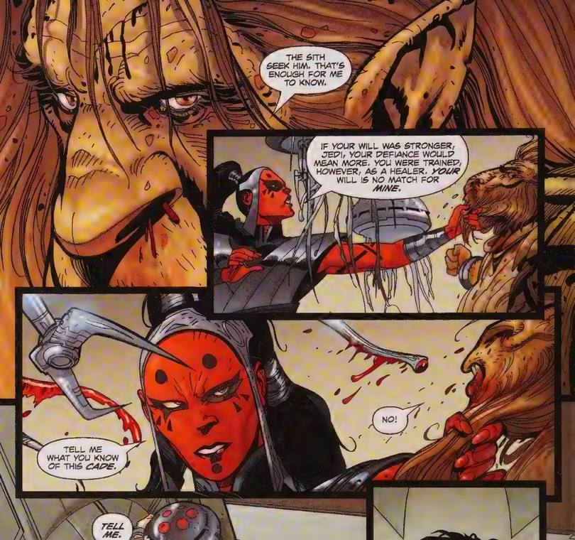
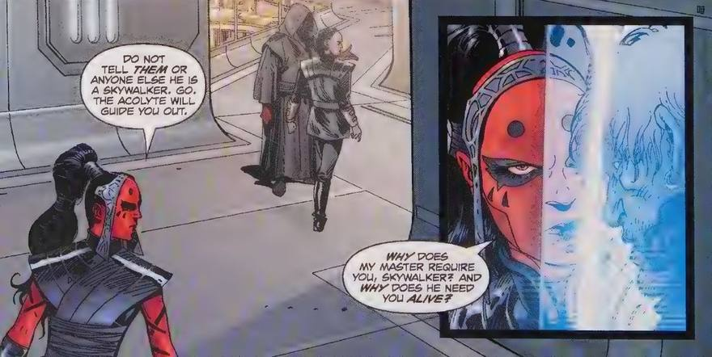
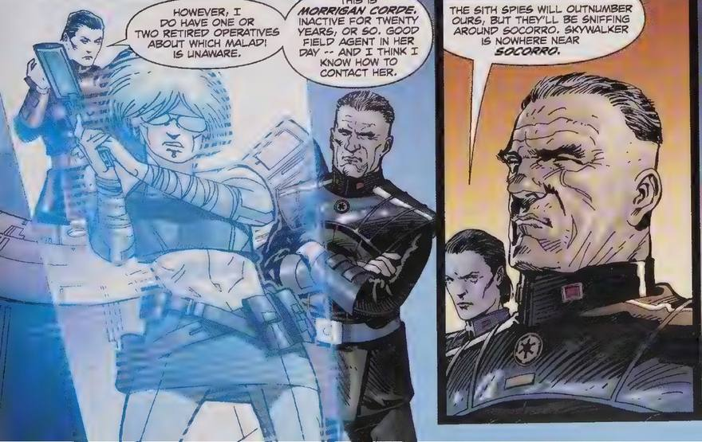
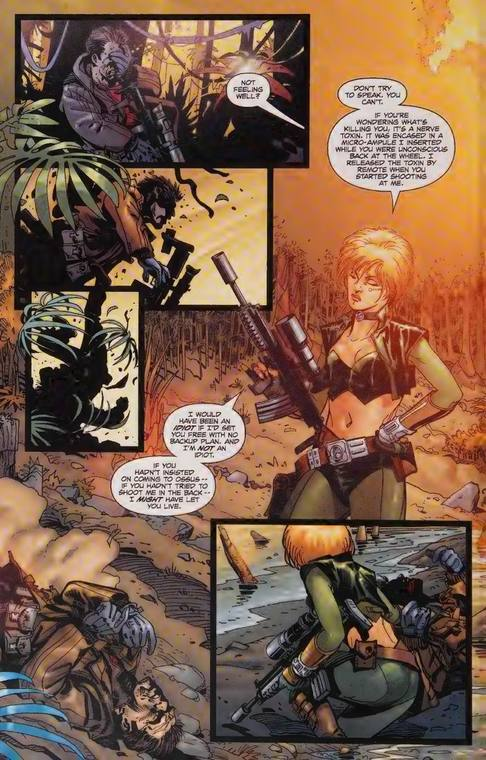
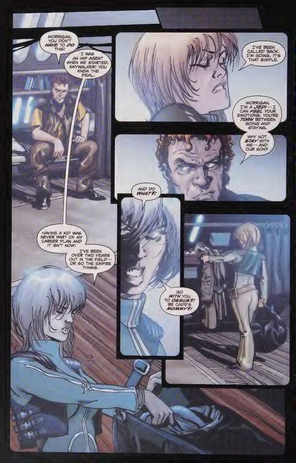
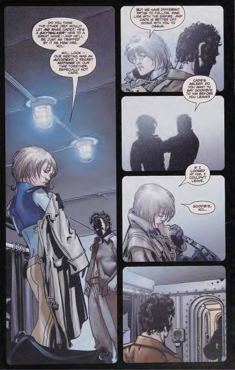
Our notes: `notes/materials/009-legacy-book-1.md:61`

> AND I'VE HAD SOME SUCCESS IN SHIELDING MY THOUGHTS FROM FORCE USERS.
— Source: Legacy Book 1 (omnibus): power-scaling notes with panels.
Note (our notes, around the quote): Shields her thoughts from Force-users, Fel included. p162 (#8 Allies): "AND I'VE HAD SOME SUCCESS IN SHIELDING MY THOUGHTS FROM FORCE USERS." · "YOU, FOR EXAMPLE."
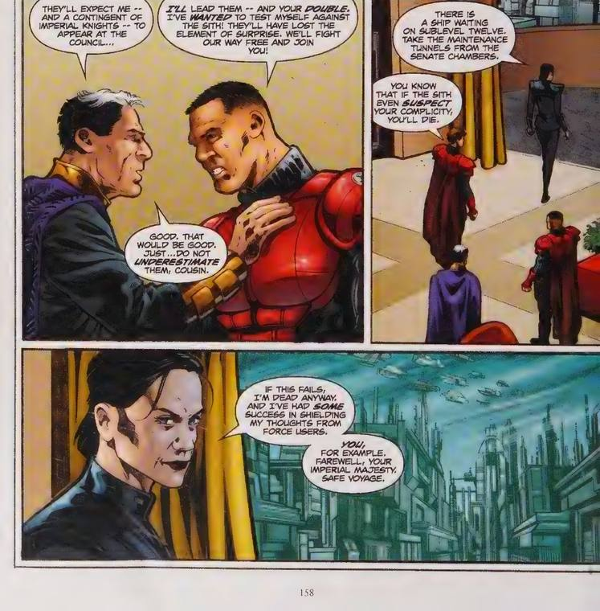
Our notes: `notes/materials/009-legacy-book-1.md:962`

> THIS IS MORRIGAN CORDE. INACTIVE FOR TWENTY YEARS, OR SO. GOOD FIELD AGENT IN HER DAY -- AND I THINK I KNOW HOW TO CONTACT HER.
— Source: Legacy Book 1 (omnibus): power-scaling notes with panels; Invents "Corde" as a separate agent. p201 (#9 Trust Issues).
Note (our notes, around the quote): Invents "Corde" as a separate agent. p201 (#9 Trust Issues): "THIS IS MORRIGAN CORDE. INACTIVE FOR TWENTY YEARS, OR SO. GOOD FIELD AGENT IN HER DAY -- AND I THINK I KNOW HOW TO CONTACT HER."
Our notes: `notes/materials/009-legacy-book-1.md:963`

> AND TO THINK I'D GIVEN ALL THIS UP.
>
> FORCE SENSITIVE. TRAINED ON KORRIBAN BY THE SITH -- THOUGH NOT STRONG ENOUGH IN THE FORCE TO BE TRULY SITH.
— Source: Legacy Book 1 (omnibus): power-scaling notes with panels.
Note (our notes, around the quote): Brawls through Wheel thugs bare-handed; subdues Sith-trained Jor Torlin. p211 (#9 Trust Issues)–p221 (#10 Trust Issues): "YOU WERE SAYING?" · "AND TO THINK I'D GIVEN ALL THIS UP." · (p220) "FORCE SENSITIVE. TRAINED ON KORRIBAN BY THE SITH -- THOUGH NOT STRONG ENOUGH IN THE FORCE TO BE TRULY SITH."
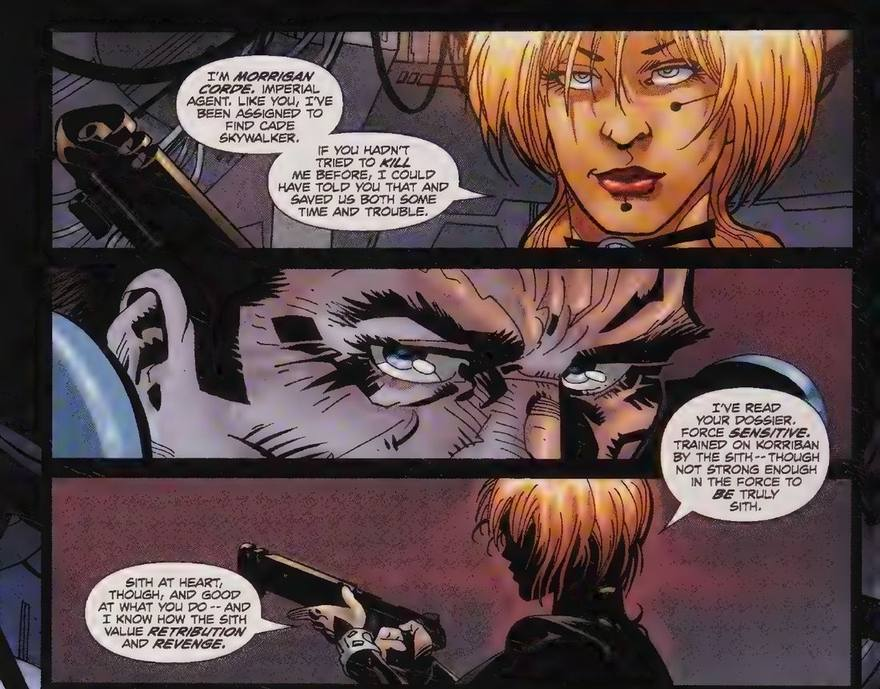
Our notes: `notes/materials/009-legacy-book-1.md:964`

> HE'S A SKYWALKER! HEIR TO A GREAT NAME -- AND HE'LL BE JUST AS TRAPPED BY IT AS YOU ARE, KOL!
>
> RIGHT. AND ROAN FEL'S MY DADDY.
— Source: Legacy Book 1 (omnibus): power-scaling notes with panels.
Note (our notes, around the quote): Cade's mother. p238 (#10 Trust Issues)–p240 (#10 Trust Issues), p360 (#16 Claws), p437 (#19 Claws): "HE'S A SKYWALKER! HEIR TO A GREAT NAME -- AND HE'LL BE JUST AS TRAPPED BY IT AS YOU ARE, KOL!" · (p360) "I'M HIS MOTHER." · Syn: "RIGHT. AND ROAN FEL'S MY DADDY."

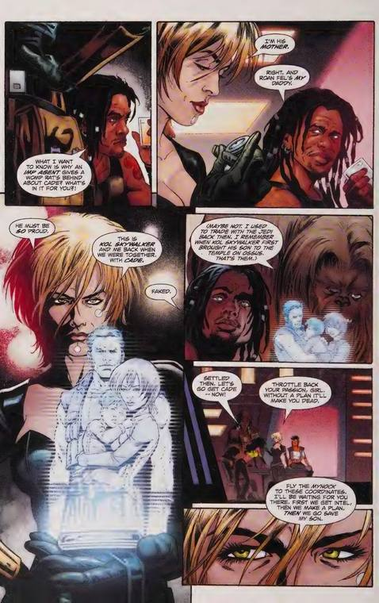
Our notes: `notes/materials/009-legacy-book-1.md:966`

> MORRIGAN CORDE -- IMPERIAL AND FREE AGENT -- ASSASSINATIONS A SPECIALTY...
> [fragment — full passage not on file]
— Source: Legacy Book 1 (omnibus): power-scaling notes with panels; Reputation. p358 (#16 Claws) Jool.
Label in our notes: Reputation. p358 (#16 Claws) Jool
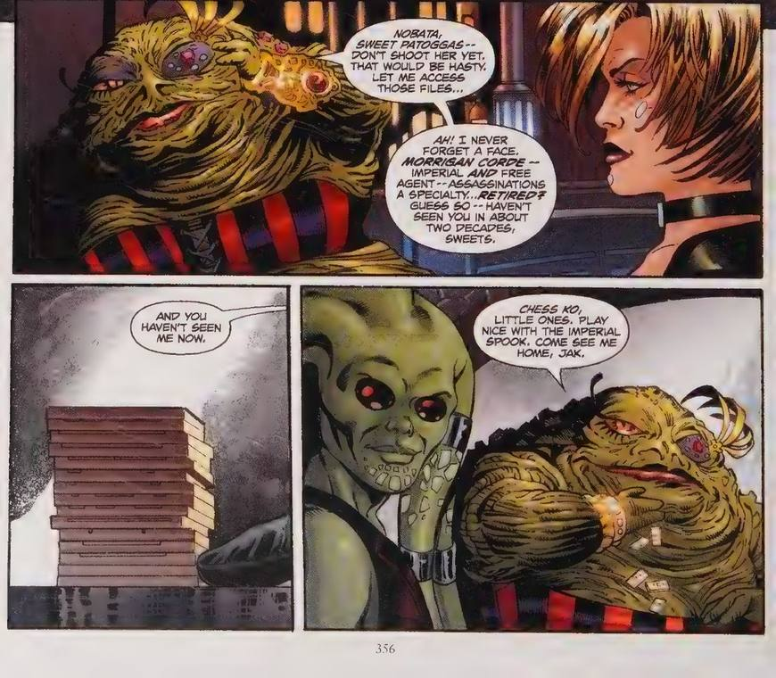
Our notes: `notes/materials/009-legacy-book-1.md:967`

> GET AWAY FROM MY SON!
> [fragment — full passage not on file]
— Source: Legacy Book 1 (omnibus): power-scaling notes with panels.
Note (our notes, around the quote): Shoots Darth Krayt in the back from a jetpack. p433 (#19 Claws): "GET AWAY FROM MY SON!" Later, as Calixte alone with the hologram: "RUN." (p442 (#19 Claws)).

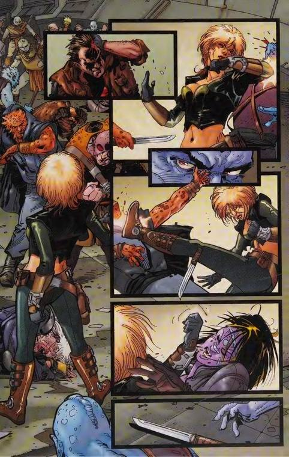
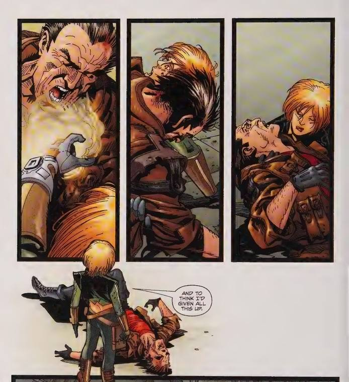

Our notes: `notes/materials/009-legacy-book-1.md:969`

- Note (summary from our notes, not a quotation): 
  — Source: Legacy Book 1 (omnibus): power-scaling notes with panels.
(*Panel: p201 — `p201-calixte-introduces-morrigan-corde.jpg`*)
Our notes: `notes/materials/009-legacy-book-1.md:971`

- Note (summary from our notes, not a quotation): 
  — Source: Legacy Book 1 (omnibus): power-scaling notes with panels.
(*Panel: p215 Corde's brawl on the Wheel — `p215-corde-brawl-wheel.jpg`*)
Our notes: `notes/materials/009-legacy-book-1.md:974`

- Note (summary from our notes, not a quotation): 
  — Source: Legacy Book 1 (omnibus): power-scaling notes with panels.
(*Panel: p218 — `p218-corde-subdues-torlin.jpg`*)
Our notes: `notes/materials/009-legacy-book-1.md:977`

- Note (summary from our notes, not a quotation): 
  — Source: Legacy Book 1 (omnibus): power-scaling notes with panels.
(*Panel: p220 — `p220-corde-torlin-not-strong-enough-to-be-sith.jpg`*)
Our notes: `notes/materials/009-legacy-book-1.md:980`

- Note (summary from our notes, not a quotation): 
  — Source: Legacy Book 1 (omnibus): power-scaling notes with panels.
(*Panel: p236 — `p236-corde-nerve-toxin-backup-plan.jpg`*)
Our notes: `notes/materials/009-legacy-book-1.md:983`

- Note (summary from our notes, not a quotation): 
  — Source: Legacy Book 1 (omnibus): power-scaling notes with panels.
(*Panel: p238 — `p238-kol-jedi-feel-emotions-our-son.jpg`*)
Our notes: `notes/materials/009-legacy-book-1.md:986`

- Note (summary from our notes, not a quotation): 
  — Source: Legacy Book 1 (omnibus): power-scaling notes with panels.
(*Panel: p239 — `p239-corde-cade-trapped-by-skywalker-name.jpg`*)
Our notes: `notes/materials/009-legacy-book-1.md:989`

- Note (summary from our notes, not a quotation): 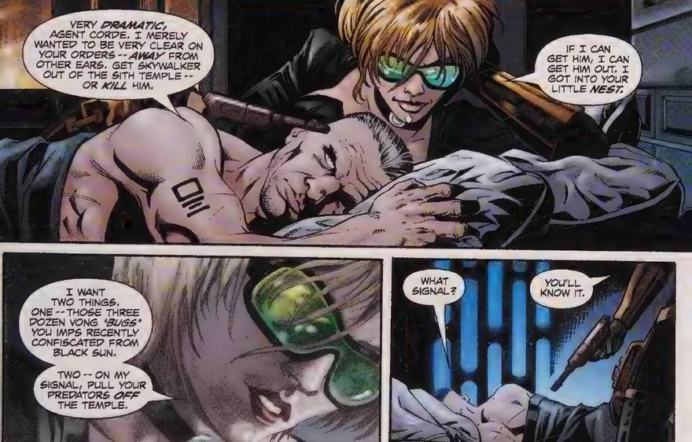
  — Source: Legacy Book 1 (omnibus): power-scaling notes with panels.
(*Panel: p355 — `p355-corde-veed-get-him-out-or-kill.jpg`*)
Our notes: `notes/materials/009-legacy-book-1.md:992`

- Note (summary from our notes, not a quotation): 
  — Source: Legacy Book 1 (omnibus): power-scaling notes with panels.
(*Panel: p358 — `p358-jool-ids-morrigan-corde.jpg`*)
Our notes: `notes/materials/009-legacy-book-1.md:995`

- Note (summary from our notes, not a quotation): 
  — Source: Legacy Book 1 (omnibus): power-scaling notes with panels.
(*Panel: p360 — `p360-corde-im-his-mother.jpg`*)
Our notes: `notes/materials/009-legacy-book-1.md:998`

- Note (summary from our notes, not a quotation): 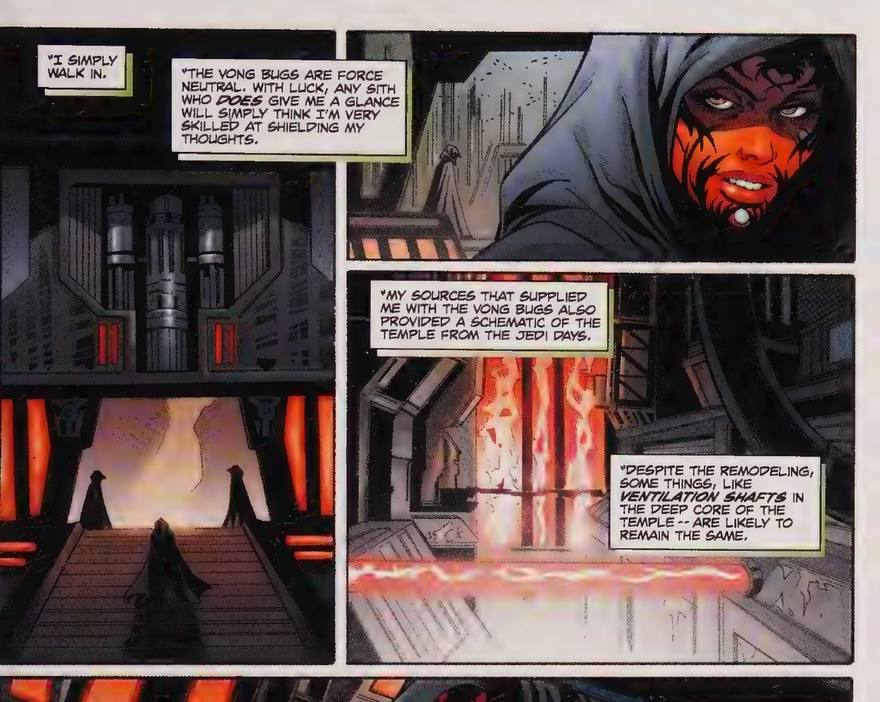
  — Source: Legacy Book 1 (omnibus): power-scaling notes with panels.
(*Panel: p387 — `p387-corde-vong-bugs-force-neutral-infiltration.jpg`*)
Our notes: `notes/materials/009-legacy-book-1.md:1001`

- Note (summary from our notes, not a quotation): 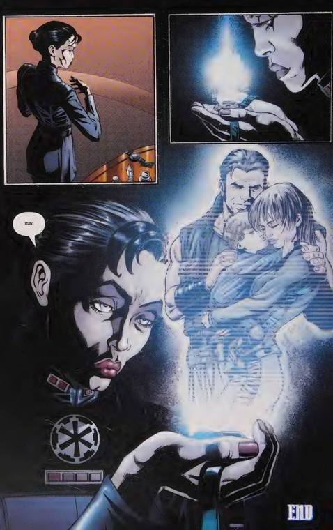
  — Source: Legacy Book 1 (omnibus): power-scaling notes with panels.
(*Panel: p442 — `p442-calixte-run-hologram.jpg`*)
Our notes: `notes/materials/009-legacy-book-1.md:1004`

- Note (summary from our notes, not a quotation): ANALYSIS: the best non-Force operative in the book. Her one "vs Krayt" moment is a surprise blaster hit while Krayt was focused on Cade. It staggers him and breaks the window; it isn't evidence a blaster threatens Krayt in a fair fight.
  — Source: Legacy Book 1 (omnibus): power-scaling notes with panels.
Our notes: `notes/materials/009-legacy-book-1.md:1008`

> Moff Nyna Calixte's top agent from the days before the Sith took power, and the only one that Calixte can still trust. While Corde can be counted on to complete the most dangerous missions, she has her own secrets and her own agenda: she was once secretly married to Kol Skywalker—then head of the Jedi Order—and the mother to his son. Though estranged from her child, she will do almost anything to protect him.
>
> In charge of Imperial Intelligence, Calixte is Morlish Veed's partner in every sense. When the Sith first approached the Empire, it was through Calixte.
>
> ...they seriously underestimate Calixte—a deadly mistake.
> [fragment — full passage not on file]
— Source: Legacy Book 1 (omnibus): power-scaling notes with panels; Morrigan Corde (p452).
Note (our notes, around the quote): Morrigan Corde (p452): "Moff Nyna Calixte's top agent from the days before the Sith took power, and the only one that Calixte can still trust. While Corde can be counted on to complete the most dangerous missions, she has her own secrets and her own agenda: she was once secretly married to Kol Skywalker—then head of the Jedi Order—and the mother to his son. Though estranged from her child, she will do almost anything to protect him." Nyna Calixte: "In charge of Imperial Intelligence, Calixte is Morlish Veed's partner in every sense. When the Sith first approached the Empire, it was through Calixte." "...they seriously underestimate Calixte—a deadly mistake." (The handbook keeps the Corde = Calixte secret; the story reveals it, p441–442.)

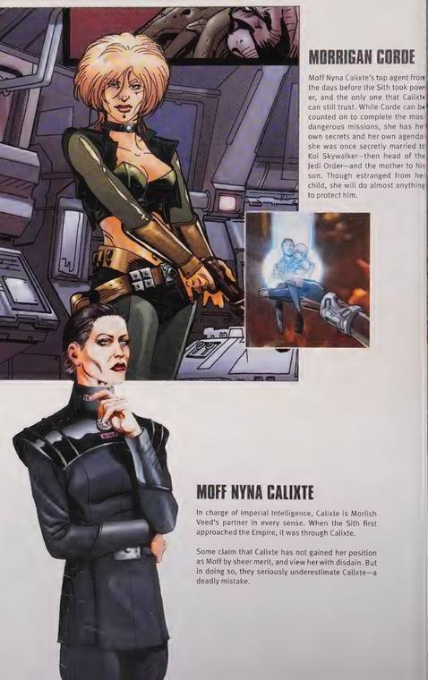
Our notes: `notes/materials/009-legacy-book-1.md:1130`

> Hated, but respected, by his enemies
> [fragment — full passage not on file]
>
> sabotaged by the Imperial spy Morrigan Corde
> [fragment — full passage not on file]
— Source: Legacy Book 1 (omnibus): power-scaling notes with panels; Galactic Alliance (p459–463): Admiral Gar Stazi.
Note (our notes, around the quote): Galactic Alliance (p459–463): Admiral Gar Stazi, "Hated, but respected, by his enemies"; the talks were "sabotaged by the Imperial spy Morrigan Corde". Ships: Scythe-class battle cruiser, Crossfire fighter, Sabertooth-class assault/rescue vessel, GA frigate. (The right edge of p459 is cropped in the scan: UNCLEAR fragments.)
Our notes: `notes/materials/009-legacy-book-1.md:1136`

> ...the Jedi scattered, leaderless and with few allies. Today they are hunted by the Sith Empire and its agents.
> [fragment — full passage not on file]
>
> Descendant of Anakin and Luke Skywalker. Honor bound and driven, Kol was one of the leaders of the Jedi Council.
>
> He was briefly married to Morrigan Corde, who left him shortly after she gave birth to their son Cade.
— Source: Legacy Book 1 (omnibus): power-scaling notes with panels; The Jedi (p464).
Label in our notes: Kol Skywalker: ·
Our notes: `notes/materials/009-legacy-book-1.md:1137`

## Star Wars: Legacy—War #1–6 (2010–11): power-scaling notes with panels

- Note (summary from our notes, not a quotation): Morrigan Corde / Moff Nyna Calixte.
  — Source: Legacy—War #1–6 (2010–11): power-scaling notes with panels.
Context: Others:
Our notes: `notes/materials/010-legacy-war.md:73`

> I'VE CLAWED MY WAY TO POWER. I'M A MOFF. BUT I WONDER AT TIMES IF LOSING LOVE WAS WORTH THE POWER I'VE GAINED.
— Source: Legacy—War #1–6 (2010–11): power-scaling notes with panels; p11 (#1).
Our notes: `notes/materials/010-legacy-war.md:875`

> YOU'RE A TOOL, MORLISH, BUT YOU'RE MOTIVATED. YOU'LL SNIFF MY DECEPTION OUT LIKE THE MUTANT RAT YOU ARE.
— Source: Legacy—War #1–6 (2010–11): power-scaling notes with panels; p26 (#2).
Our notes: `notes/materials/010-legacy-war.md:876`

> YES... 'DARLING.' I KNOW THAT YOU'RE ROAN FEL'S SPY. YOU'RE A TRAITOR TO THE EMPIRE --
> [fragment — full passage not on file]
— Source: Legacy—War #1–6 (2010–11): power-scaling notes with panels; p39–42 (#2): Veed poisons her drink ("POISON?!" /.
Note (our notes, around the quote): p39–42 (#2): Veed poisons her drink ("POISON?!" / "YES... 'DARLING.' I KNOW THAT YOU'RE ROAN FEL'S SPY. YOU'RE A TRAITOR TO THE EMPIRE --" "-- AND TO ME!"). He shoots her several times on the pad and she falls off it.
Our notes: `notes/materials/010-legacy-war.md:877`

> BAG REALLY...JETPACK. VEED...DIDN'T KNOW. DIDN'T SEE...MY ESCAPE. THINKS I'M...DEAD.
> [fragment — full passage not on file]
— Source: Legacy—War #1–6 (2010–11): power-scaling notes with panels; p52 (#3).
Our notes: `notes/materials/010-legacy-war.md:878`

> WON'T... APOLOGIZE FOR... WHO I AM...WHAT I'VE DONE. TOLD... TOO MANY LIES. LIVED...MORE. BUT... THERE ARE TWO TRUTHS...IN MY LIFE.
> [fragment — full passage not on file]
>
> I LOVED YOUR FATHER AND... WHATEVER YOU MAY THINK...HOWEVER IT SEEMS...I LOVE YOU. EXAMINE...YOUR FEELINGS. YOU KNOW...IT'S TRUE.
> [fragment — full passage not on file]
— Source: Legacy—War #1–6 (2010–11): power-scaling notes with panels; p53 (#3).
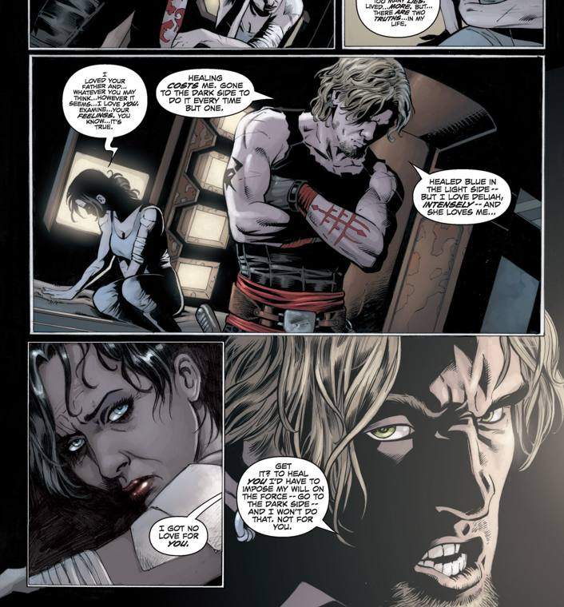
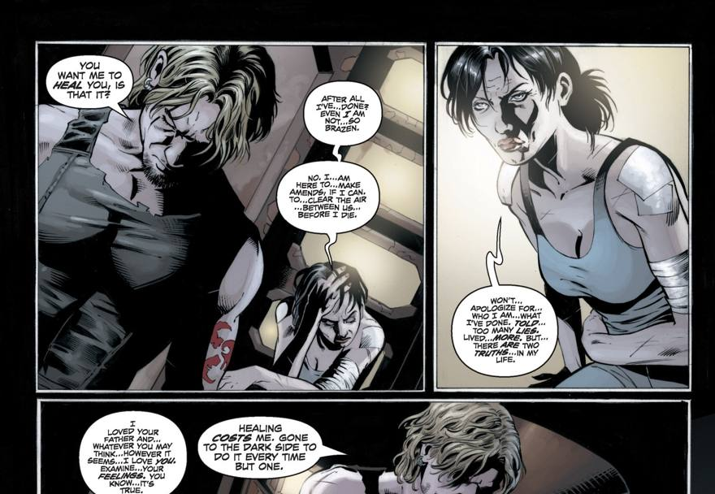
Our notes: `notes/materials/010-legacy-war.md:879`

> DON'T. WE NEED ONE ALIVE...
> [fragment — full passage not on file]
>
> helps knock it out
> [fragment — full passage not on file]
— Source: Legacy—War #1–6 (2010–11): power-scaling notes with panels; p90 (#4).
Note (our notes, around the quote): p90 (#4): "DON'T. WE NEED ONE ALIVE..." She keeps the trooper alive. The intro's "helps knock it out" is wrong: Cade's lightning drops it, and Corde fires at the troopers on p88–89.
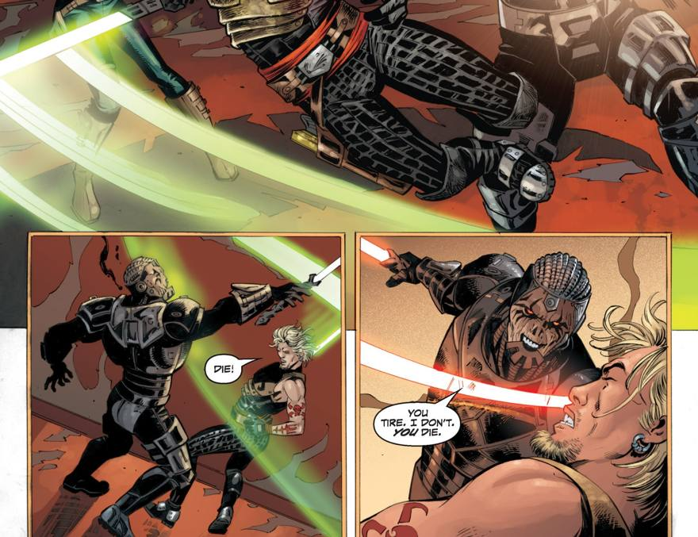
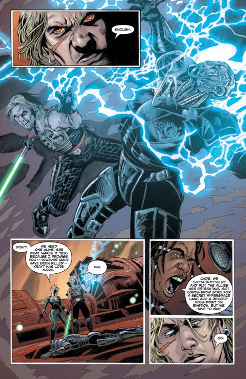
Our notes: `notes/materials/010-legacy-war.md:880`

> BEFORE WE WERE MARRIED, I WAS AN IMPERIAL AGENT AND THE WIFE OF JEDI MASTER KOL SKYWALKER. CADE SKYWALKER IS MY SON. NYNA CALIXTE WAS A FABRICATION -- MY REAL NAME IS MORRIGAN CORDE.
— Source: Legacy—War #1–6 (2010–11): power-scaling notes with panels; p97 (#5).
Our notes: `notes/materials/010-legacy-war.md:881`

- Note (summary from our notes, not a quotation): p99 (#5): the defence-computer briefing.
  — Source: Legacy—War #1–6 (2010–11): power-scaling notes with panels.
Our notes: `notes/materials/010-legacy-war.md:882`

> NYNA CALIXTE SENDS HER REGARDS.
> [fragment — full passage not on file]
— Source: Legacy—War #1–6 (2010–11): power-scaling notes with panels; p107 (#5), Veed's death: "YOU?!" / "ME." /.
Note (our notes, around the quote): p107 (#5), Veed's death: "YOU?!" / "ME." / "NYNA CALIXTE SENDS HER REGARDS." She shoots him point-blank.
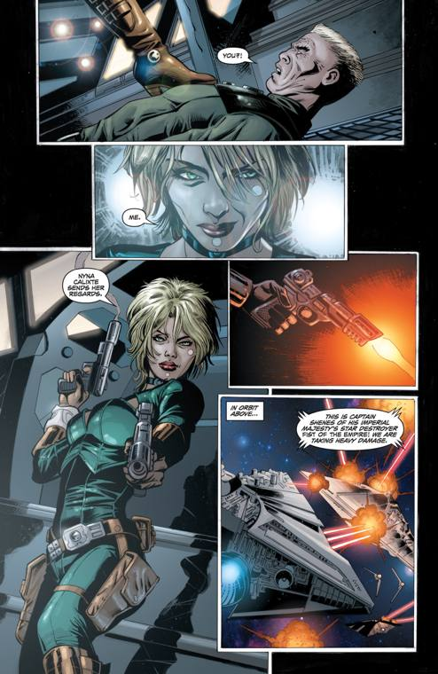
Our notes: `notes/materials/010-legacy-war.md:883`

> IT'S A HOLO OF YOU, ME, AND YOUR FATHER -- TOGETHER. I LOVE YOU, CADE...
> [fragment — full passage not on file]
>
> AND WHEN YOU SEE KOL, TELL HIM I WILL ALWAYS LOVE HIM.
>
> THE LOCKET I GAVE HIM HAS A TRACER IN IT.
>
> I'D HURRY IF I WERE YOU. DON'T THINK HE'S PLANNING A RETURN TRIP.
— Source: Legacy—War #1–6 (2010–11): power-scaling notes with panels; p128–129 (#6): gives Cade her ship and the locket (.
Note (our notes, around the quote): p128–129 (#6): gives Cade her ship and the locket ("IT'S A HOLO OF YOU, ME, AND YOUR FATHER -- TOGETHER. I LOVE YOU, CADE..."). "AND WHEN YOU SEE KOL, TELL HIM I WILL ALWAYS LOVE HIM." · "THE LOCKET I GAVE HIM HAS A TRACER IN IT." · "I'D HURRY IF I WERE YOU. DON'T THINK HE'S PLANNING A RETURN TRIP."
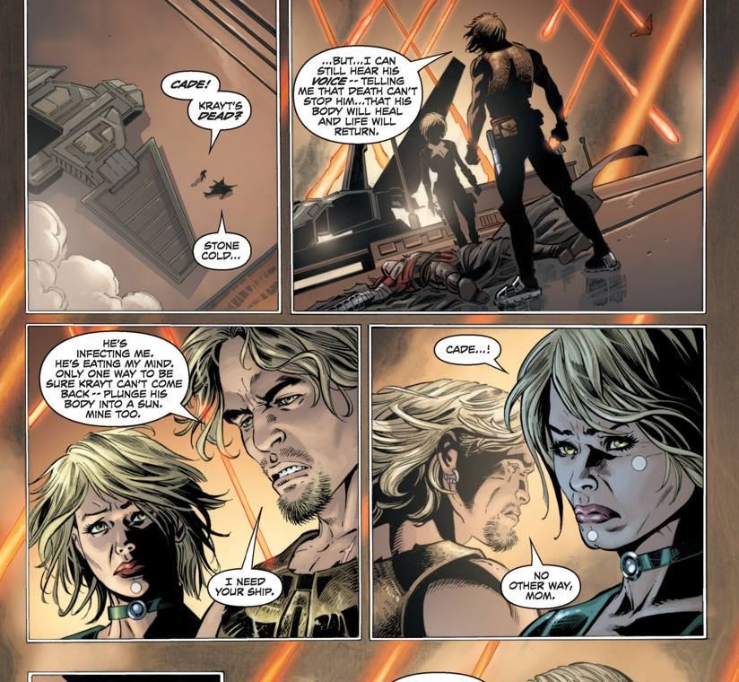
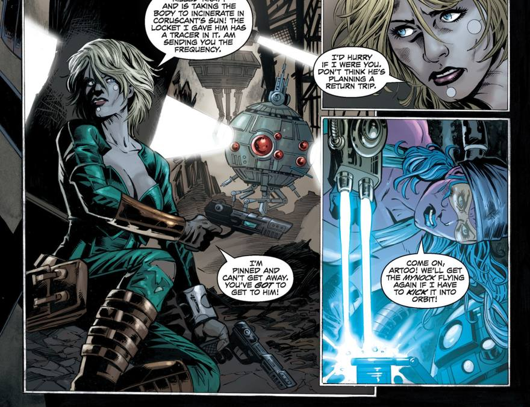
Our notes: `notes/materials/010-legacy-war.md:884`

> CADE INTENDS TO FLY KRAYT'S BODY INTO THE SUN. KRAYT WON'T RETURN.
>
> ...I DO NOT THINK SO.
> [fragment — full passage not on file]
— Source: Legacy—War #1–6 (2010–11): power-scaling notes with panels; p132–133 (#6).
Label in our notes: · On Cade: "I..."

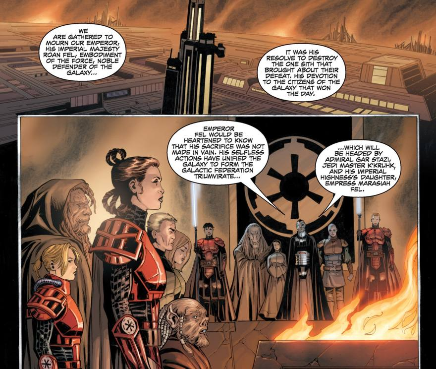
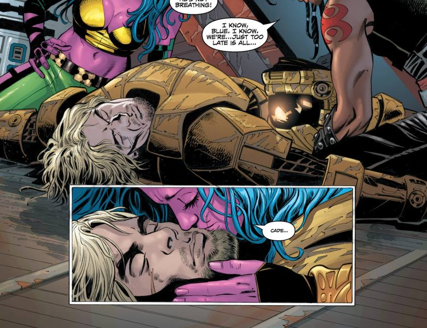
Our notes: `notes/materials/010-legacy-war.md:885`

- Note (summary from our notes, not a quotation): 
  — Source: Legacy—War #1–6 (2010–11): power-scaling notes with panels.
(*Panel: p53 — `p053-corde-two-truths.jpg`*)
Our notes: `notes/materials/010-legacy-war.md:887`

> NYNA CALIXTE SENDS HER REGARDS.
> [fragment — full passage not on file]
— Source: Legacy—War #1–6 (2010–11): power-scaling notes with panels; ![p107.
Note (our notes, around the quote): 
(*Panel: p107 — `p107-corde-nyna-calixte-sends-regards.jpg`*)
Our notes: `notes/materials/010-legacy-war.md:890`

> CADE KILLED KRAYT... THE LOCKET I GAVE HIM HAS A TRACER IN IT.
> [fragment — full passage not on file]
— Source: Legacy—War #1–6 (2010–11): power-scaling notes with panels; ![p129 Corde.
Note (our notes, around the quote): 
(*Panel: p129 — `p129-corde-cade-killed-krayt-tracer.jpg`*)
Our notes: `notes/materials/010-legacy-war.md:893`

## Star Wars Saga Edition: *Legacy Era Campaign Guide* (WotC 2009): power-scaling notes with panels

- Note (summary from our notes, not a quotation): | — | Nyna Calixte (Morrigan Corde) | p168 | 15 | scout 4 / scoundrel 3 / noble 7 / gunslinger 1 | — | 33 (ff 29) / 26 / 30 | 77 (26) | 8 | 3 / 7 | heavy assault blaster rifle +15 (3d10+7) |
  — Source: *Legacy Era Campaign Guide* (WotC 2009): power-scaling notes with panels.
Context: | # | Character | Page | CL | Classes | UtF | Ref / Fort / Will | HP (Thr.) | DSS | Destiny / FP | Best lightsaber line |
Our notes: `notes/materials/011-legacy-era-campaign-guide.md:133`

> in charge of the largest spy and information network in the galaxy
> [fragment — full passage not on file]
>
> has resurrected her alter ego to rescue her son from the clutches of Darth Krayt
> [fragment — full passage not on file]
— Source: *Legacy Era Campaign Guide* (WotC 2009): power-scaling notes with panels; Nyna Calixte / Morrigan Corde (p168).
Note (our notes, around the quote): Nyna Calixte / Morrigan Corde (p168): "in charge of the largest spy and information network in the galaxy"; she "has resurrected her alter ego to rescue her son from the clutches of Darth Krayt". CL 15; Ref 33; hp 77; Destiny 3; Force 7; DS 8. No Force stats.
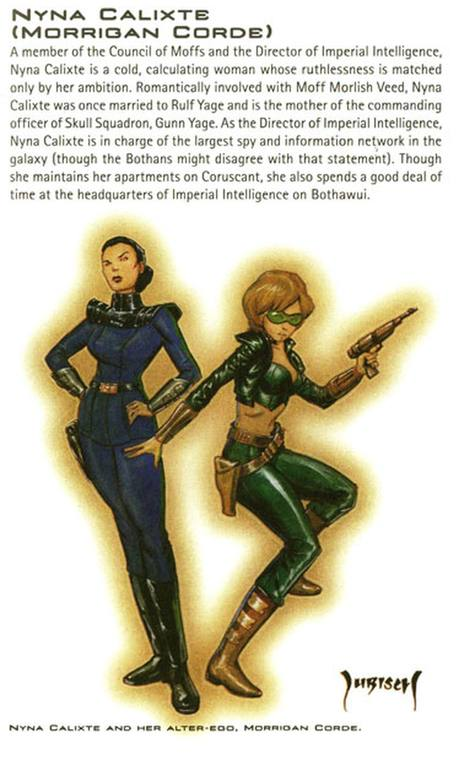
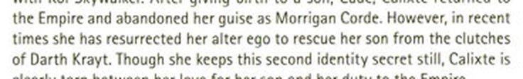
Our notes: `notes/materials/011-legacy-era-campaign-guide.md:711`

- Note (summary from our notes, not a quotation): 
  — Source: *Legacy Era Campaign Guide* (WotC 2009): power-scaling notes with panels.
(*Panel: p168 Nyna Calixte (Morrigan Corde) — `p168-calixte.jpg`*)
Our notes: `notes/materials/011-legacy-era-campaign-guide.md:721`

- Note (summary from our notes, not a quotation): Others: Nyna Calixte / Morrigan Corde (CL15), Gar Stazi (CL16), Morlish Veed (CL15), Rulf and Gunn Yage, "Bantha" Rawk (CL8), the Yuuzhan Vong NPCs, and all vehicles.
  — Source: *Legacy Era Campaign Guide* (WotC 2009): power-scaling notes with panels.
Our notes: `notes/materials/011-legacy-era-campaign-guide.md:1104`

## Star Wars: Legacy Volume 2, *Shards* (TPB): power-scaling notes with panels

- Note (summary from our notes, not a quotation): #9: Maladi breaks the Jedi healer Hosk Trey'lis with interrogator droids and her will (p58–60). Krayt wants Cade "ALIVE"; Maladi doesn't know why (p61). Calixte tells Veed that Maladi's top agent is "JOR TOLIN" (sic; Torlin elsewhere), Sith-raised but lacking "SUFFICIENT FORCE SENSITIVITY", and reactivates "Morrigan Corde" (p62). She spots Cade on the Wheel's security vids (p63–64). On Bastion, Fel punishes Draco and Krieg for their rescue mission with medals and the most dangerous assignments, and sends them to escort Capt. Bovark to GA Admiral Gar Stazi on the Wheel (p65–67). Talks begin (p68–70). The two Knights sense the GA guards' concealed blasters (p71). On the Wheel's lower levels, Torlin fights a gang that Corde set on him. Corde joins in, Torlin strangles her, and she shocks him unconscious (p72–79).
  — Source: Legacy Volume 2, *Shards* (TPB): power-scaling notes with panels.
Our notes: `notes/materials/012-legacy-vol-2-shards.md:52`

> LET'S JUST SKIP THE OPENING RITUAL. *(p73)*
>
> OF COURSE... I DID! NEEDED... TO MAKE CONTACT!
> [fragment — full passage not on file]
>
> DON'T BELIEVE YOU. CAN'T TAKE CHANCES.
>
> AND TO THINK I'D GIVEN ALL THIS UP. *(p79)*
— Source: Legacy Volume 2, *Shards* (TPB): power-scaling notes with panels.
Note (our notes, around the quote): 1. Corde vs Torlin and the Wheel gang. p72 (#9)–p79 (#9) [009 p211–218]. Torlin starts the brawl: "LET'S JUST SKIP THE OPENING RITUAL." (p73). Corde had set the gang on him: "OF COURSE... I DID! NEEDED... TO MAKE CONTACT!" Torlin strangles her: "DON'T BELIEVE YOU. CAN'T TAKE CHANCES." "GOOD-BYE." (p78). She shocks him unconscious with her gauntlet: "AND TO THINK I'D GIVEN ALL THIS UP." (p79).
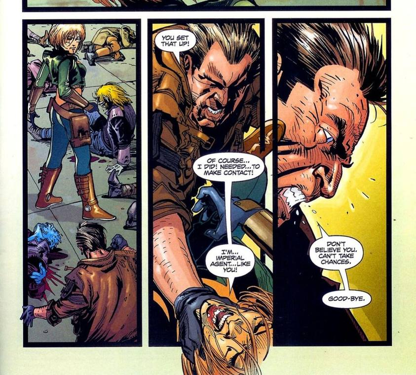
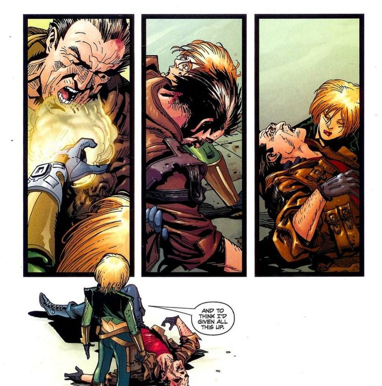
Our notes: `notes/materials/012-legacy-vol-2-shards.md:363`

- Note (summary from our notes, not a quotation): 
  — Source: Legacy Volume 2, *Shards* (TPB): power-scaling notes with panels.
(*Panel: p78 — `p078-torlin-strangles-corde.jpg`*)
Our notes: `notes/materials/012-legacy-vol-2-shards.md:365`

- Note (summary from our notes, not a quotation): 
  — Source: Legacy Volume 2, *Shards* (TPB): power-scaling notes with panels.
(*Panel: p79 — `p079-corde-shocks-torlin.jpg`*)
Our notes: `notes/materials/012-legacy-vol-2-shards.md:368`

> HER FOREMOST AGENT IS JOR TOLIN [sic]. HE WAS RAISED ON KORRIBAN AND TRAINED TO BE A SITH BUT LACKED SUFFICIENT FORCE SENSITIVITY.
>
> FORCE SENSITIVE. TRAINED ON KORRIBAN BY THE SITH -- THOUGH NOT STRONG ENOUGH IN THE FORCE TO BE TRULY SITH.
>
> SITH AT HEART, THOUGH, AND GOOD AT WHAT YOU DO
> [fragment — full passage not on file]
— Source: Legacy Volume 2, *Shards* (TPB): power-scaling notes with panels; 2. Torlin's Force status. p62 (#9), Calixte.
Note (our notes, around the quote): 2. Torlin's Force status. p62 (#9), Calixte: "HER FOREMOST AGENT IS JOR TOLIN [sic]. HE WAS RAISED ON KORRIBAN AND TRAINED TO BE A SITH BUT LACKED SUFFICIENT FORCE SENSITIVITY." · p81 (#10), Corde: "FORCE SENSITIVE. TRAINED ON KORRIBAN BY THE SITH -- THOUGH NOT STRONG ENOUGH IN THE FORCE TO BE TRULY SITH." · "SITH AT HEART, THOUGH, AND GOOD AT WHAT YOU DO".
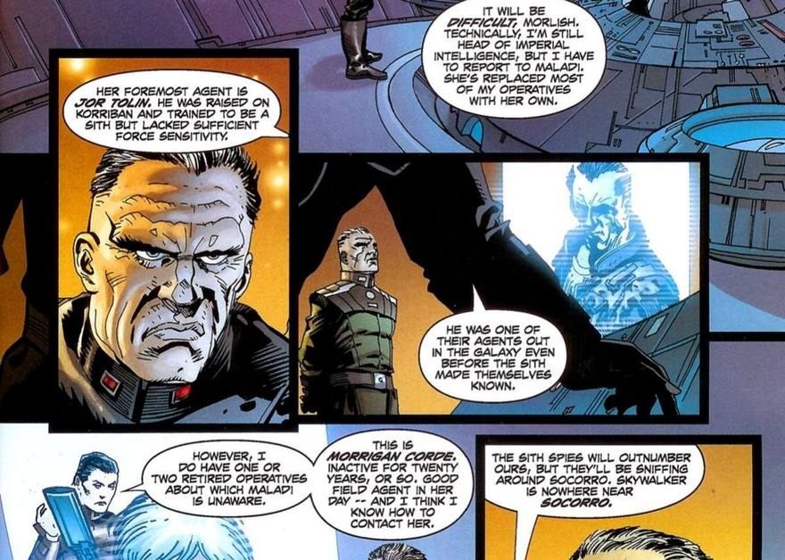
Our notes: `notes/materials/012-legacy-vol-2-shards.md:371`

- Note (summary from our notes, not a quotation): 
  — Source: Legacy Volume 2, *Shards* (TPB): power-scaling notes with panels.
(*Panel: p62 — `p062-jor-tolin-dossier.jpg`*)
Our notes: `notes/materials/012-legacy-vol-2-shards.md:373`

> (p94) **Torlin**: "-- THIS IS 'LATER.'" · **Corde**: "YOU SITH SON OF A MURGLAK! WE'RE ON THE SAME SIDE!" · **Torlin**: "MAYBE WE ARE. MAYBE WE AREN'T." "BEST NOT TO RISK IT. BETTER YOU'RE DEAD." · (p97) Corde: "IT WAS ENCASED IN A MICRO-AMPULE I INSERTED WHILE YOU WERE UNCONSCIOUS BACK AT THE WHEEL." · "I WOULD HAVE BEEN AN IDIOT IF I'D SET YOU FREE WITH NO BACKUP PLAN. AND I'M NOT AN IDIOT." · (p98) "STORY OF YOUR LIFE, TORLIN. GOOD, BUT NOT GOOD ENOUGH."
> [fragment — full passage not on file]
— Source: Legacy Volume 2, *Shards* (TPB): power-scaling notes with panels.
Context: 3. Corde kills Torlin with a pre-planted nerve toxin. p93 (#10)–p98 (#10) [009 p232–237]
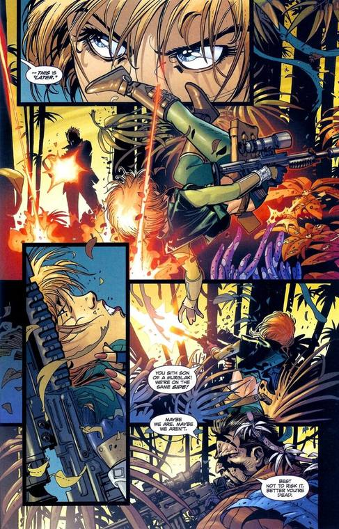
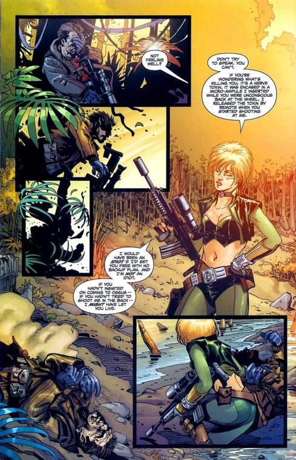
Our notes: `notes/materials/012-legacy-vol-2-shards.md:376`; `notes/materials/009-legacy-book-1.md:965`

- Note (summary from our notes, not a quotation): 
  — Source: Legacy Volume 2, *Shards* (TPB): power-scaling notes with panels.
(*Panel: p94 — `p094-murglak-sniper-duel.jpg`*)
Our notes: `notes/materials/012-legacy-vol-2-shards.md:379`

- Note (summary from our notes, not a quotation): 
  — Source: Legacy Volume 2, *Shards* (TPB): power-scaling notes with panels.
(*Panel: p97 — `p097-corde-nerve-toxin.jpg`*)
Our notes: `notes/materials/012-legacy-vol-2-shards.md:382`

> I'VE HAD SOME SUCCESS IN SHIELDING MY THOUGHTS FROM FORCE USERS.
— Source: Legacy Volume 2, *Shards* (TPB): power-scaling notes with panels; 4. Shields her thoughts (claim). p23 (#8).
Note (our notes, around the quote): 4. Shields her thoughts (claim). p23 (#8): "I'VE HAD SOME SUCCESS IN SHIELDING MY THOUGHTS FROM FORCE USERS." · "YOU, FOR EXAMPLE." (to Fel).
Our notes: `notes/materials/012-legacy-vol-2-shards.md:385`

## Star Wars: Legacy Volume 3, *Claws of the Dragon* (TPB): power-scaling notes with panels

> IF I CAN GET HIM, I CAN GET HIM OUT. I GOT INTO YOUR LITTLE NEST.
>
> TWO -- ON MY SIGNAL, PULL YOUR PREDATORS OFF THE TEMPLE.
— Source: Legacy Volume 3, *Claws of the Dragon* (TPB): power-scaling notes with panels.
Note (our notes, around the quote): 1. Bypasses a Grand Moff's security. p54 (#16) [009 p355]: wakes Veed at blaster-point inside his crackling security field. "IF I CAN GET HIM, I CAN GET HIM OUT. I GOT INTO YOUR LITTLE NEST." · "TWO -- ON MY SIGNAL, PULL YOUR PREDATORS OFF THE TEMPLE."
Our notes: `notes/materials/013-legacy-vol-3-claws-of-the-dragon.md:449`

> "I SIMPLY WALK IN." · "THE VONG BUGS ARE FORCE NEUTRAL. WITH LUCK, ANY SITH WHO DOES GIVE ME A GLANCE WILL SIMPLY THINK I'M VERY SKILLED AT SHIELDING MY THOUGHTS." · "MY SOURCES THAT SUPPLIED ME WITH THE VONG BUGS ALSO PROVIDED A SCHEMATIC OF THE TEMPLE FROM THE JEDI DAYS."
— Source: Legacy Volume 3, *Claws of the Dragon* (TPB): power-scaling notes with panels.
Context: 2. Walks into the Sith Temple disguised; releases Force-neutral Vong bugs. p86 (#17) [009 p387]
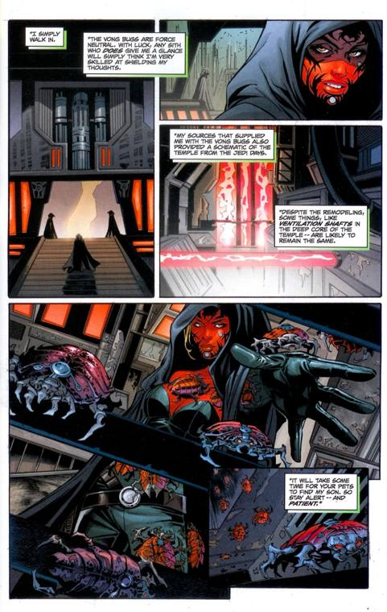
Our notes: `notes/materials/013-legacy-vol-3-claws-of-the-dragon.md:451`; `notes/materials/009-legacy-book-1.md:968`

- Note (summary from our notes, not a quotation): 
  — Source: Legacy Volume 3, *Claws of the Dragon* (TPB): power-scaling notes with panels.
(*Panel: p86 — `p086-corde-walks-into-temple-vong-bugs.jpg`*)
Our notes: `notes/materials/013-legacy-vol-3-claws-of-the-dragon.md:454`

> MINE INVOLVES A FAST RIDE AND A BIG BLASTER. *(p120)*
>
> GET AWAY FROM MY SON! *(p132)*
> [fragment — full passage not on file]
— Source: Legacy Volume 3, *Claws of the Dragon* (TPB): power-scaling notes with panels.
Note (our notes, around the quote): 3. Rocketpack assault; shoots Krayt off Cade through the window. p120–122, p132 (#19). "MINE INVOLVES A FAST RIDE AND A BIG BLASTER." (p120) · "GET AWAY FROM MY SON!" (p132). See Krayt 8.
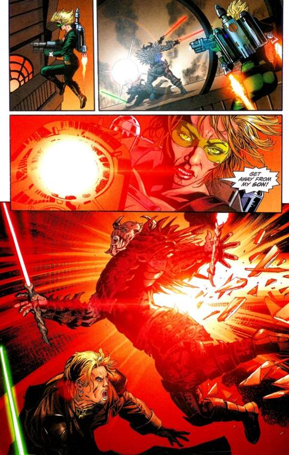
Our notes: `notes/materials/013-legacy-vol-3-claws-of-the-dragon.md:457`

> I REMEMBER WHEN KOL SKYWALKER FIRST BROUGHT HIS SON TO THE TEMPLE ON OSSUS. THAT'S THEM.
>
> CORDE'S AN OLD PRO -- DID HER JOB WELL.
— Source: Legacy Volume 3, *Claws of the Dragon* (TPB): power-scaling notes with panels.
Note (our notes, around the quote): 4. Reveal: Corde is Calixte. p56–59 (Corde to the crew: "I'M HIS MOTHER."; Chak: "I REMEMBER WHEN KOL SKYWALKER FIRST BROUGHT HIS SON TO THE TEMPLE ON OSSUS. THAT'S THEM."), p82 (codenames "HAZARD" and "LEGATE"), p136 (to Cade: "YOUR MOTHER." · "NO, YOU WON'T."), p138–141 (Calixte in the shower, a green garment hung outside; Veed: "CORDE'S AN OLD PRO -- DID HER JOB WELL."; alone with the Kol hologram: "RUN.").
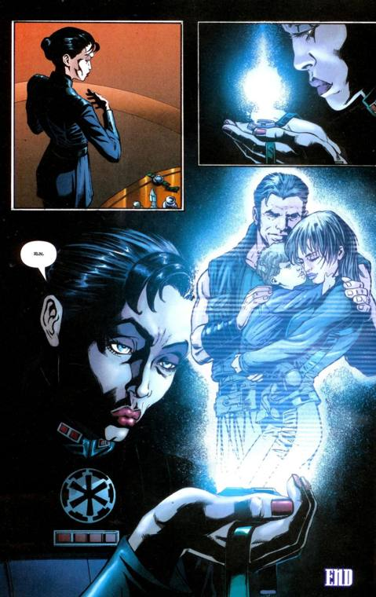
Our notes: `notes/materials/013-legacy-vol-3-claws-of-the-dragon.md:459`

- Note (summary from our notes, not a quotation): 
  — Source: Legacy Volume 3, *Claws of the Dragon* (TPB): power-scaling notes with panels.
(*Panel: p141 — `p141-calixte-run-hologram.jpg`*)
Our notes: `notes/materials/013-legacy-vol-3-claws-of-the-dragon.md:461`

> MORRIGAN CORDE -- IMPERIAL AND FREE AGENT -- ASSASSINATIONS A SPECIALTY...RETIRED?
> [fragment — full passage not on file]
— Source: Legacy Volume 3, *Claws of the Dragon* (TPB): power-scaling notes with panels; Jool's file (p57). POV: Jool's file, about Morrigan Corde.
Our notes: `notes/materials/013-legacy-vol-3-claws-of-the-dragon.md:464`

## https://starwars.fandom.com/wiki/Cade_Skywalker

- Note (summary from our notes, not a quotation): On the Wheel, Cade initially said he could not heal his dying mother because he had only healed Blue with the light side and that it worked because he loved her. After Kol urged him to forgive her, Cade successfully healed Morrigan Corde with the light side. [39]
  — Source: UNRESOLVED (sentence not found in current Wookieepedia article revision; primary source not identified) — Cade Skywalker — article extraction — https://starwars.fandom.com/wiki/Cade_Skywalker.
(Source: UNRESOLVED (sentence not found in current Wookieepedia article revision; primary source not identified))
Our notes: `external/mega-notes/cade-skywalker-quotes.txt:47`

- Note (summary from our notes, not a quotation): Krayt ordered Cade to heal Talon and later fought him in the Temple of the Sith. Cade held Krayt off in a lightsaber duel until Morrigan Corde's intervention enabled his escape. [5][22]
  — Source: Legacy (2006) 16 [per Wookieepedia "Cade Skywalker" rev 15549841, ref 5; per-sentence approximate match (1/2 sentences matched, min 0.68), verify; agrees with the entry's own ref marker]; per Wookieepedia "Cade Skywalker" rev 15549841, ref 5; per-sentence approximate match (1/2 sentences matched, min 0.68), verify; agrees with the entry's own ref marker — Cade Skywalker — article extraction — https://starwars.fandom.com/wiki/Cade_Skywalker.
(Source: Legacy (2006) 16 [per Wookieepedia "Cade Skywalker" rev 15549841, ref 5; per-sentence approximate match (1/2 sentences matched, min 0.68), verify; agrees with the entry's own ref marker])
Our notes: `external/mega-notes/cade-skywalker-quotes.txt:57`

## https://starwars.fandom.com/wiki/Darth_Krayt

> When Cade succeeded in cutting off Nihl's right arm, Krayt commanded him to kill the Sith Lord.
— Source: Legacy (2006) 19 [per Wookieepedia "Darth Krayt" rev 15688608, ref 41; exact text match]; per Wookieepedia "Darth Krayt" rev 15688608, ref 41; exact text match — Darth Krayt — feat/statement extraction from Wookieepedia — https://starwars.fandom.com/wiki/Darth_Krayt.
Note (our notes, around the quote): [Pre-rebirth combat feat] Section: Skywalker found. “When Cade succeeded in cutting off Nihl's right arm, Krayt commanded him to kill the Sith Lord.” Scaling/context: Cade refused and began a duel with Krayt; Krayt was almost defeating Cade before Morrigan Corde shot Krayt in the back.
(Source: Legacy (2006) 19 [per Wookieepedia "Darth Krayt" rev 15688608, ref 41; exact text match])
Our notes: `external/mega-notes/krayt-legends-quotes.txt:132`

# Debate and forum claims (unverified)

Forum posts, Suspect Insight debates and Discord debates, respect threads, and verdicts. These are posters' arguments or quotations they typed; none is checked against the book here unless the entry says so.

## "Dissecting Legacy #1: Cade Skywalker's Ending Growth" (Suspect Insight Forums)

> ONE OF THE GREATEST LESSONS OF THE LIGHT SIDE IS FORGIVENESS…
> [fragment — full passage not on file]
— Source: Cade Skywalker's Ending Growth" (Suspect Insight Forums) — https://www.suspectinsightforums.com/t4455-dissecting-legacy-1-cade-skywalker-s-ending-growth; War: forgiveness. At Kol's urging (.
Note (our notes, around the quote): War: forgiveness. At Kol's urging ("ONE OF THE GREATEST LESSONS OF THE LIGHT SIDE IS FORGIVENESS…"), Cade forgives and heals Morrigan Corde (War p53–55).
Posted by: not named in our notes (see thread/notes link).
Our notes: `notes/materials/014-dissecting-legacy-1-cade-skywalkers-ending-growth.md:29`

## Cade Skywalker Respect Thread (Updated 2017) — respect-thread notes

- Note (summary from our notes, not a quotation): Cade Skywalker chokes Morrigan Corde, his mother:
  — Source: SI respect-thread directory: Cade Skywalker Respect Thread (Updated 2017) — https://web.archive.org/web/20190902075103/https://comicvine.gamespot.com/profile/darthant66/blog/cade-skywalker-respect-thread-updated-2017/97726/.
Posted by: not named in our notes (see thread/notes link).
Our notes: `suspect-insight/respect-threads/cade-skywalker.md:233`

- Note (summary from our notes, not a quotation): [image: data:image/gif;base64,R0lGODlhAQABAAAAACH5BAEKAAEALAAAAAABAAEAAAICTAEAOw==]
  — Source: SI respect-thread directory: Cade Skywalker Respect Thread (Updated 2017) — https://web.archive.org/web/20190902075103/https://comicvine.gamespot.com/profile/darthant66/blog/cade-skywalker-respect-thread-updated-2017/97726/.
Posted by: not named in our notes (see thread/notes link).
Context: Cade Skywalker chokes Morrigan Corde, his mother:
Our notes: `suspect-insight/respect-threads/cade-skywalker.md:234`; `suspect-insight/respect-threads/cade-skywalker.md:276`; `suspect-insight/respect-threads/cade-skywalker.md:303`

- Note (summary from our notes, not a quotation): Cade Skywalker uses Dark Transfer to resurrect Morrigan Corde:
  — Source: SI respect-thread directory: Cade Skywalker Respect Thread (Updated 2017) — https://web.archive.org/web/20190902075103/https://comicvine.gamespot.com/profile/darthant66/blog/cade-skywalker-respect-thread-updated-2017/97726/.
Posted by: not named in our notes (see thread/notes link).
Our notes: `suspect-insight/respect-threads/cade-skywalker.md:275`

- Note (summary from our notes, not a quotation): Cade Skywalker uses Force Lightning to torture Morrigan Corde:
  — Source: SI respect-thread directory: Cade Skywalker Respect Thread (Updated 2017) — https://web.archive.org/web/20190902075103/https://comicvine.gamespot.com/profile/darthant66/blog/cade-skywalker-respect-thread-updated-2017/97726/.
Posted by: not named in our notes (see thread/notes link).
Our notes: `suspect-insight/respect-threads/cade-skywalker.md:302`

## Darth Wyyrlok III Respect Thread — respect-thread notes

- Note (summary from our notes, not a quotation): Cade Skywalker and Morrigan Corde, Star Wars: Legacy - War #4
  — Source: SI respect-thread directory: Darth Wyyrlok III Respect Thread — https://www.suspectinsightforums.com/t2805-darth-wyyrlok-iii-respect-thread.
Posted by: not named in our notes (see thread/notes link).
Our notes: `suspect-insight/respect-threads/darth-wyyrlok.md:1488`

## Darth Krayt's Sith Troopers: Overview — respect-thread notes

- Note (summary from our notes, not a quotation): A Sith Trooper who takes on a considerably fatigued Cade Skywalker not only shrugs off a direct lightsaber slash, but makes the point that while Cade was fatigued from the attack on the Jedi Temple, his endurance is limitless. He is also described as fighting too fast to shoot accurately by Morrigan Corde, an elite assassin and Imperial agent.
  — Source: SI respect-thread directory: Darth Krayt's Sith Troopers: Overview — https://comicvine.gamespot.com/profile/i_like_swords/blog/darth-krayt-s-sith-troopers-overview/105095/.
Posted by: not named in our notes (see thread/notes link).
Our notes: `suspect-insight/respect-threads/thread-darth-krayt-s-sith-troopers-overview.md:33`
