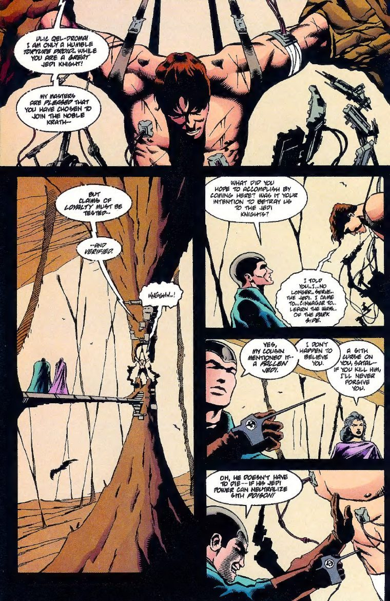
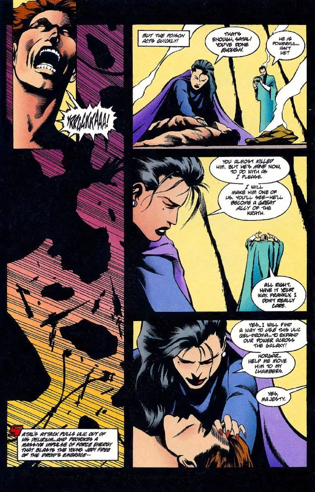
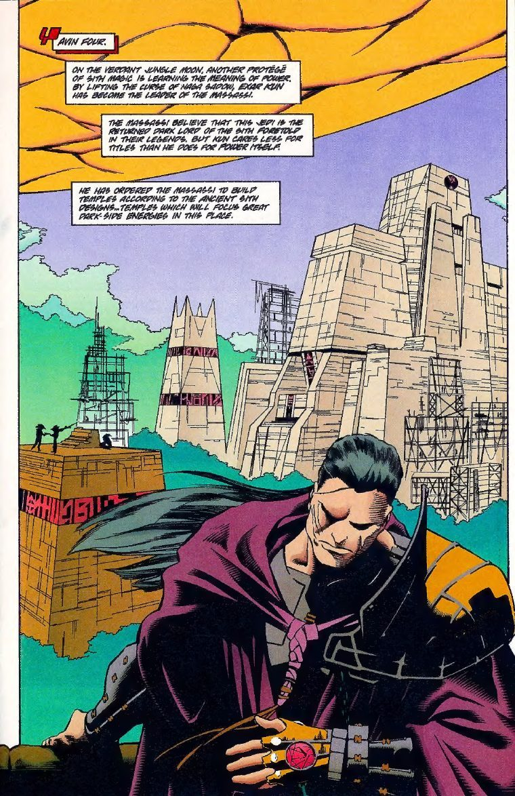
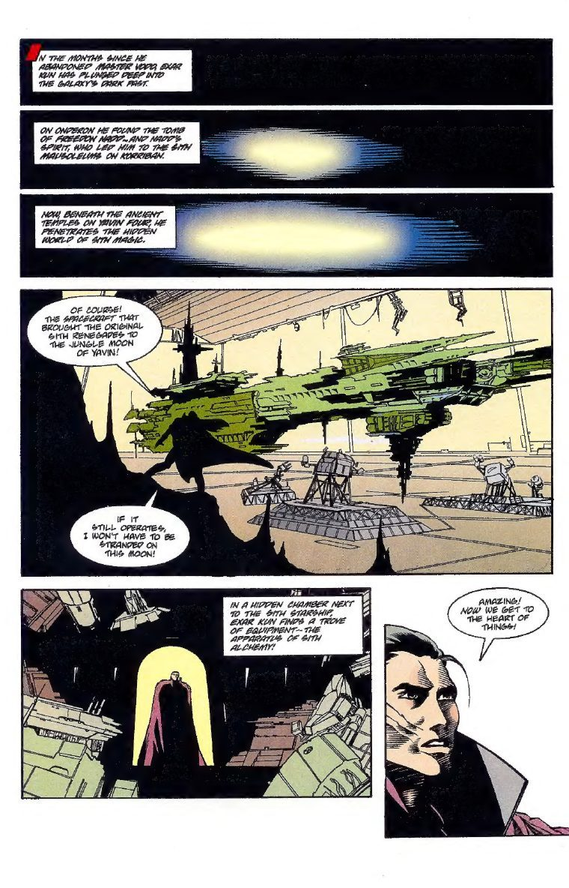
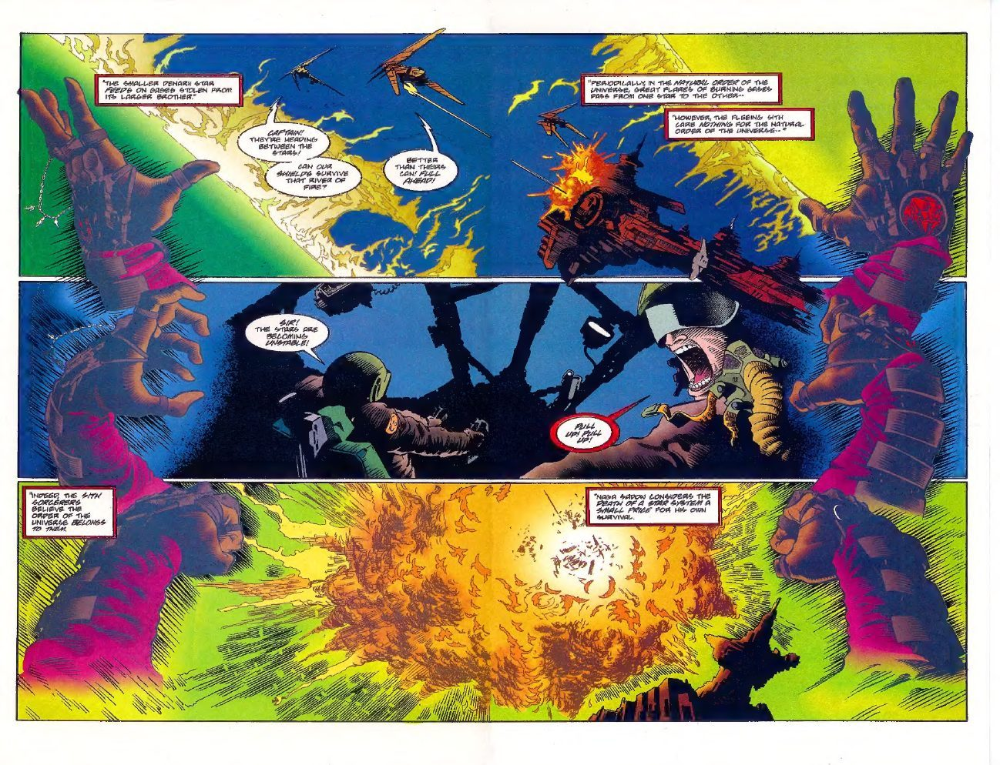
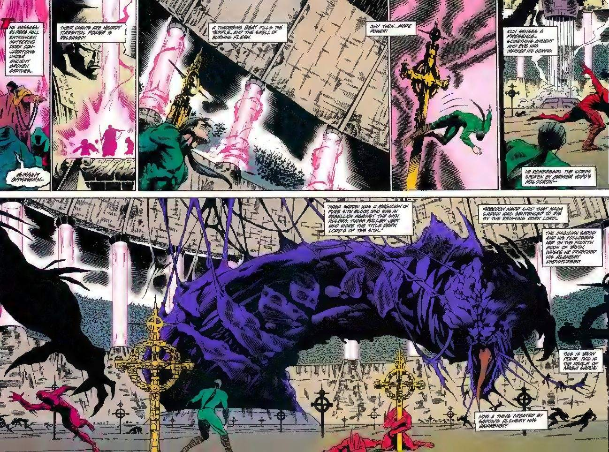
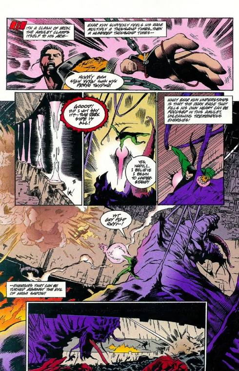
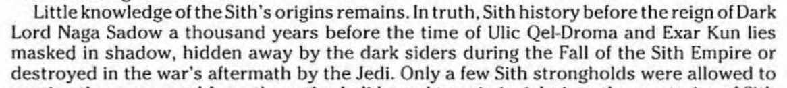
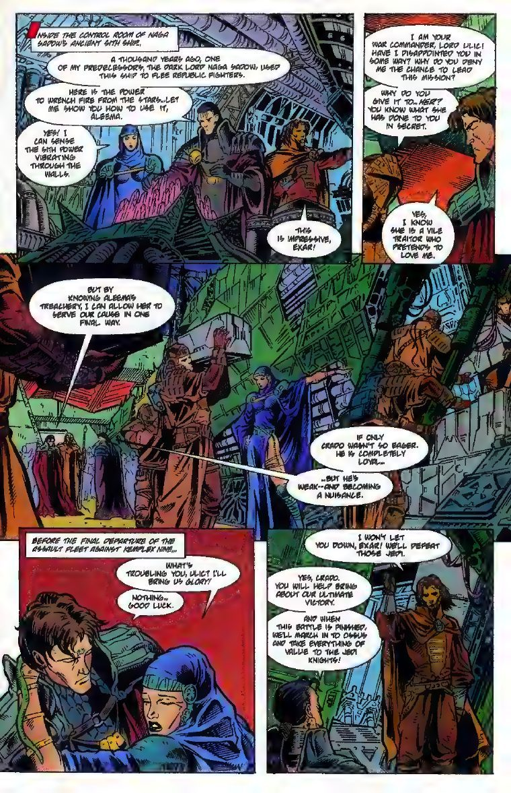

# Naga Sadow

- **Aliases:** Sadow
- **Era:** Golden Age of the Sith
- **Continuity:** default Legends; entries present for: Legends
- **Research tier:** DEEP
- **Entries:** 369 (203 with quotations; 13 quotations extended to the full sentence/passage from the source text on file; 98 marked as fragments; 102 before the 2026-11-17 fragment fill). Rebuilt 2026-11-17 from 473 old entries; old file: `characters/_bak/naga-sadow.md.bak-20261117`.
- **How to read:** each entry is the quotation in full (block quote), then its source and point of view. "Note" lines are summaries from our notes, not quotations. `[fragment — full passage not on file]` means the source text is not on the box, so only the words in our notes are shown. Debate and forum material is in the last section and is unverified.

# LEGENDS (Legends / EU — main focus)

## KOTOR I, KOTOR II and The Old Republic: Revan: notes from the other agent (reference copy, reviewed)

- Note (summary from our notes, not a quotation): Korriban: the Sith Academy under Uthar Wynn and Yuthura Ban. The final test is in the Tomb of Naga Sadow, where the player sides with one master. Other tombs: Ajunta Pall, Marka Ragnos, Tulak Hord.
  — Source: Star Wars: Knights of the Old Republic (KOTOR 1): power-scaling notes (Oct 19, 2026).
Context: Quest for the Star Forge: four Star Maps.
Our notes: `notes/materials/023-kotor-and-revan/kotor-1-notes.md:13`

> the greatest of Korriban's Sith Lords, in fact *(K1/Sith_Academy)*
> [fragment — full passage not on file]
— Source: Star Wars: Knights of the Old Republic (KOTOR 1): power-scaling notes (Oct 19, 2026); Uthar on Naga Sadow. POV: Uthar, about Naga Sadow.
Label in our notes: K1/Sith_Academy
Our notes: `notes/materials/023-kotor-and-revan/kotor-1-notes.md:40`; `notes/materials/023-kotor-and-revan/kotor-1-notes.md:139`

- Note (summary from our notes, not a quotation): Fight: the player kills one or both in the Tomb of Naga Sadow.
  — Source: Star Wars: Knights of the Old Republic (KOTOR 1): power-scaling notes (Oct 19, 2026).
Our notes: `notes/materials/023-kotor-and-revan/kotor-1-notes.md:140`

- Note (summary from our notes, not a quotation): Korriban. Dreshdae, then the academy: Uthar's tests and Yuthura's plot. Ajunta Pall's spirit, then the Tomb of Naga Sadow. The ending is light (Yuthura possibly redeemed) or dark (Uthar or Yuthura killed).
  — Source: Star Wars: Knights of the Old Republic (KOTOR 1): power-scaling notes (Oct 19, 2026).
Our notes: `notes/materials/023-kotor-and-revan/kotor-1-notes.md:177`

- Note (summary from our notes, not a quotation): Every named character with a real role in the book now has a profile. Characters with an existing Appendix Q section point to it for their complete quote register, instead of duplicating it. New characters (Larvit, the Imperial Guard, Clan Jendri, Igrol/Dark Council) get an auto-harvested register inline. Named with no real role (lore or one-line mentions, so no profile; their mentions are in Q · Other named): Marka Ragnos, Naga Sadow, Ludo Kressh, Mission, Zaalbar, Juhani, Jolee, Grizzer, Davik, Tegris, Ugroth, Ressa. Original summary, kept for reference:
  — Source: The Old Republic: Revan (novel, read in full): feats, scaling, quotes and story notes.
Our notes: `notes/materials/023-kotor-and-revan/revan-novel-notes.md:632`

> If the Emperor was really planning to attack the Republic again, he would be repeating the mistakes of Naga Sadow. He would start a war they couldn't possibly win, and this time the Jedi would not stop until they had wiped the Sith out completely.
— Source: Ch12 · L2621 — The Old Republic: Revan (novel, read in full): feats, scaling, quotes and story notes; Ch12 · L2621 · POV Scourge · NARRATION · POST-NATHEMA Emperor (base). POV: narrator (POV Scourge), about Naga Sadow.
Our notes: `notes/materials/023-kotor-and-revan/revan-novel-notes.md:2268`; `notes/materials/023-kotor-and-revan/revan-novel-notes.md:4986`

> "It is said that Naga Sadow had visions of the Sith crushing the Republic during the Great Hyperspace War," Scourge countered. "We both know that never came to pass."
— Source: Ch19 · L4029 — The Old Republic: Revan (novel, read in full): feats, scaling, quotes and story notes; Ch19 · L4029 · POV Revan · OWN LINE (attribution) · pre-immortality Scourge. POV: Naga Sadow.
Our notes: `notes/materials/023-kotor-and-revan/revan-novel-notes.md:2972`; `notes/materials/023-kotor-and-revan/revan-novel-notes.md:4991`

> "He stayed there for a hundred years. When Marka Ragnos fell, Lord Vitiate did not join in the mad rush to claim his position. He was not part of the Great Hyperspace War against the Republic. When Naga Sadow and Ludo Kressh fought for leadership of the Sith, he took no side. But in the aftermath of the war—after our defeat at the hands of the Republic and our flight to escape the massacre of our people by the Jedi—he emerged from his solitude to call a great council of all the Sith Lords who remained. He invited them to his palace on Nathema, built on the site of his childhood home, the place where he had killed his adopted father and tortured his mother to death. He invited them to participate in a ritual to unlock the full potential of the dark side; he promised they would unleash power beyond anything they had ever witnessed or imagined."
— Source: Ch15 · L3217 — The Old Republic: Revan (novel, read in full): feats, scaling, quotes and story notes; Ch15 · L3217 · POV Scourge · OWN LINE (continued speech). POV: Naga Sadow.
Our notes: `notes/materials/023-kotor-and-revan/revan-novel-notes.md:4026`; `notes/materials/023-kotor-and-revan/revan-novel-notes.md:4990`

> The Great Hyperspace War had been one of the darkest times in the history of the Sith. Under the leadership of Naga Sadow, they had invaded the newly discovered Republic, seeking to conquer it as they had conquered every other civilization they had encountered. But despite their early victories, they had quickly lost ground. The Republic hadn’t just defeated the Sith fleets; they had annihilated them. And then the Jedi had pursued the fleeing survivors across the galaxy, nearly hunting the Sith to extinction.
— Source: Ch12 · L2613 — The Old Republic: Revan (novel, read in full): feats, scaling, quotes and story notes; Ch12 · L2613 · POV Scourge · NARRATION. POV: narrator (POV Scourge), about Naga Sadow.
(Excerpt widened 2026-11-17 to the relevant passage, word for word from Revan (Drew Karpyshyn), Chapter Twelve (text copy `MEGA_Legend_The_Old_Republic_Series_Star_Wars_Old_Republic_03_Revan_Drew_Karpyshyn_epub`).)
Our notes: `notes/materials/023-kotor-and-revan/revan-novel-notes.md:4985`

## Tales of the Jedi: Freedon Nadd Uprising #1–2, Dark Lords of the Sith #1–6, The Sith War #1–6, plus the WEG Tales of the Jedi Companion (power-scaling notes)

- Note (summary from our notes, not a quotation): | #1 | 1–28 | (Book One #1) | Empress Teta system, Ossus, Onderon, Dantooine | Naga Sadow's Denarii Nova flashback. Krath coup on Koros Major; Aleema kills Korus. Exar Kun studies under Vodo-Siosk Baas; Sylvar scars Exar; Vodo defeats Exar in a staff-vs-saber duel. Nadd's spirit courts Ulic. |
  — Source: Owner Material 024b — Tales of the Jedi: Dark Lords of the Sith #1–6 (1994–95): power-scaling notes.
Context: | Issue | PDF pages | Title (intro page) | Setting | Main events |
Our notes: `notes/materials/024-tales-of-the-jedi/dark-lords-of-the-sith.md:15`

- Note (summary from our notes, not a quotation): | #5 | 1–27 | Sith Secrets | Cinnagar, Yavin 4 | Satal poisons Ulic with Sith poison. Exar enslaves the Massassi and finds Sadow's laboratory. Nomi's battle meditation; Ulic kills Satal and becomes Krath leader. |
  — Source: Owner Material 024b — Tales of the Jedi: Dark Lords of the Sith #1–6 (1994–95): power-scaling notes.
Context: | Issue | PDF pages | Title (intro page) | Setting | Main events |
Our notes: `notes/materials/024-tales-of-the-jedi/dark-lords-of-the-sith.md:19`

- Note (summary from our notes, not a quotation): Massassi seize Exar on Yavin 4 (p4–9). Ood Bnar and Odan-Urr warn Ulic (p10–12); Cay's farewell (p13). Ulic joins the Krath by "saving" Aleema (p17–21). The Sith amulet clamps to Exar's arm; he destroys Sadow's alchemical horrors (p22–24) and kills Nadd's spirit (p25–26).
  — Source: Owner Material 024b — Tales of the Jedi: Dark Lords of the Sith #1–6 (1994–95): power-scaling notes.
Our notes: `notes/materials/024-tales-of-the-jedi/dark-lords-of-the-sith.md:40`

- Note (summary from our notes, not a quotation): Satal tortures Ulic and injects Sith poison (p4–6). Exar enslaves the Massassi and finds Sadow's ship and laboratory (p7–10). Nomi lets herself be captured (p11–13); her battle meditation turns the guards on each other (p20–21). Ulic kills Satal's assassin and then Satal (p22–25) and becomes Krath leader (p27).
  — Source: Owner Material 024b — Tales of the Jedi: Dark Lords of the Sith #1–6 (1994–95): power-scaling notes.

Our notes: `notes/materials/024-tales-of-the-jedi/dark-lords-of-the-sith.md:43`

> EXAR KUN SUDDENLY FEELS HIS RAGE MULTIPLY A THOUSAND TIMES...THEN A HUNDRED THOUSAND TIMES-- *(narration, p23)*
> [fragment — full passage not on file]
— Source: Dark Lords of the Sith #4, p22–24 — Owner Material 024b — Tales of the Jedi: Dark Lords of the Sith #1–6 (1994–95): power-scaling notes; Sith amulet amplifies his rage. POV: Sith amulet amplifies his rage, about Naga Sadow.
Note (our notes, around the quote): Sith amulet amplifies his rage: "EXAR KUN SUDDENLY FEELS HIS RAGE MULTIPLY A THOUSAND TIMES...THEN A HUNDRED THOUSAND TIMES--" (narration, p23); each blast consumes one of Naga Sadow's alchemical horrors. Source: Dark Lords of the Sith #4, p22–24
Our notes: `notes/materials/024-tales-of-the-jedi/dark-lords-of-the-sith.md:65`

- Note (summary from our notes, not a quotation): Enslaves the Massassi, has them build temples, finds Sadow's ship and laboratory. Source: Dark Lords of the Sith #5, p7–10
  — Source: Owner Material 024b — Tales of the Jedi: Dark Lords of the Sith #1–6 (1994–95): power-scaling notes.

Our notes: `notes/materials/024-tales-of-the-jedi/dark-lords-of-the-sith.md:67`

- Note (summary from our notes, not a quotation): Narration flashback: Naga Sadow destroys the Denarii Nova. Source: Dark Lords of the Sith #1, p5–6
  — Source: Owner Material 024b — Tales of the Jedi: Dark Lords of the Sith #1–6 (1994–95): power-scaling notes.

Our notes: `notes/materials/024-tales-of-the-jedi/dark-lords-of-the-sith.md:263`

- Note (summary from our notes, not a quotation): His alchemical beast awakens in the Yavin 4 Temple of Fire after a Massassi sacrifice. Source: Dark Lords of the Sith #4, p15–16
  — Source: Owner Material 024b — Tales of the Jedi: Dark Lords of the Sith #1–6 (1994–95): power-scaling notes.

Our notes: `notes/materials/024-tales-of-the-jedi/dark-lords-of-the-sith.md:265`

- Note (summary from our notes, not a quotation): | 6 | Exar Kun vs Sadow's horrors | Yavin 4 | p22–24 (#4) | Exar wins | Sith amulet |
  — Source: Owner Material 024b — Tales of the Jedi: Dark Lords of the Sith #1–6 (1994–95): power-scaling notes.
Context: | # | Fight | Where | Pages (issue) | Outcome | Conditions |
Our notes: `notes/materials/024-tales-of-the-jedi/dark-lords-of-the-sith.md:277`

- Note (summary from our notes, not a quotation): 
  — Source: Owner Material 024b — Tales of the Jedi: Dark Lords of the Sith #1–6 (1994–95): power-scaling notes.
Our notes: `notes/materials/024-tales-of-the-jedi/dark-lords-of-the-sith.md:307`

- Note (summary from our notes, not a quotation): 
  — Source: Owner Material 024b — Tales of the Jedi: Dark Lords of the Sith #1–6 (1994–95): power-scaling notes.

Our notes: `notes/materials/024-tales-of-the-jedi/dark-lords-of-the-sith.md:309`

- Note (summary from our notes, not a quotation): Coverage: the book covers *Tales of the Jedi* up to *The Freedon Nadd Uprising* only. It came out before *Dark Lords of the Sith* and *The Sith War* were collected. So it has no stat block for Exar Kun, and he is named only once (p.78). There are also no stat blocks for Naga Sadow, Aleema, Satal or Mandalore.
  — Source: Owner Material 024d — Tales of the Jedi Companion (West End Games, 1996): power-scaling notes.
Our notes: `notes/materials/024-tales-of-the-jedi/tales-of-the-jedi-companion.md:12`

> But the distinction may bear more importance than most Jedi suspect - it could mean the difference between life and death. The Sith have existed for well over a hundred thousand years; the dark side has been a part of the universe since the beginning of time. Clearly, the Sith developed second in chronological progression, but did this wicked brotherhood grow out of the dark side, or did it share a common philosophy with the dark side and join forces to increase the chances of bringing their mutual goals to fruition? Little knowledge of the Sith's origins remains. In truth, Sith history before the reign of Dark Lord Naga Sadow a thousand years before the time of Ulic Qel-Droma and Exar Kun lies masked in shadow, hidden away by the dark siders during the Fall of the Sith Empire or destroyed in the war's aftermath by the Jedi. Only a few Sith strongholds were allowed to survive the purge, and from these the Jedi hoped to gain insight into the mysteries of Sith powers - they wished to discover the weaknesses of these dark magicks so that the Silh could never resurrect their fallen empire. One artifact recovered from a remaining Sith library was the Holocron created by Naga Sadow himself (DLOSl). [t detailed the nature of the Sith people, of their philosophies and teaching methods, and of their belief in the power of the dark side.
— Source: Owner Material 024d — Tales of the Jedi Companion (West End Games, 1996): power-scaling notes; The book's only mention of Exar Kun.
(Excerpt widened 2026-11-17 to the relevant passage, word for word from research primary tales of the jedi WEG40082 (text copy `research_primary_tales_of_the_jedi_WEG40082_pdf_afa57d0500`).)
(Excerpt widened 2026-11-17 to the relevant passage, word for word from research primary tales of the jedi WEG40082 (text copy `research_primary_tales_of_the_jedi_WEG40082_pdf_afa57d0500`).)
(Full sentence/passage taken from the source text on file: `research_primary_tales_of_the_jedi_weg_companion_txt`.)
Note (our notes, around the quote): The book's only mention of Exar Kun: "Sith history before the reign of Dark Lord Naga Sadow a thousand years before the time of Ulic Qel-Droma and Exar Kun lies masked in shadow". It has no stat block or Force dice for Exar Kun. Source: Tales of the Jedi Companion (WEG, 1996), p.78

Our notes: `notes/materials/024-tales-of-the-jedi/tales-of-the-jedi-companion.md:281`

- Note (summary from our notes, not a quotation): Sith essence: the first Dark Lords were fallen Jedi who dominated the Sith species. Naga Sadow's holocron is discussed. Source: Tales of the Jedi Companion (WEG, 1996), p.78-79
  — Source: Tales of the Jedi Companion (WEG, 1996), p.78-79 — Owner Material 024d — Tales of the Jedi Companion (West End Games, 1996): power-scaling notes.
Our notes: `notes/materials/024-tales-of-the-jedi/tales-of-the-jedi-companion.md:293`

- Note (summary from our notes, not a quotation): Shows Aleema how to use Naga Sadow's ship ("THE POWER TO WRENCH FIRE FROM THE STARS"); the plan uses her to trigger the Cron supernova. Source: The Sith War #4, p15–24
  — Source: Owner Material 024c — Tales of the Jedi: The Sith War #1–6 (1995–96): power-scaling notes.

Our notes: `notes/materials/024-tales-of-the-jedi/the-sith-war.md:60`

- Note (summary from our notes, not a quotation): Using Naga Sadow's ship, rips the core out of one of the ten Cron stars and hurls it at the pursuing Jedi, killing Dace Diath, Shoaneb Culu and Qrrrl Toq. Source: The Sith War #4, p17–22
  — Source: The Sith War #4, p17–22 — Owner Material 024c — Tales of the Jedi: The Sith War #1–6 (1995–96): power-scaling notes.
Our notes: `notes/materials/024-tales-of-the-jedi/the-sith-war.md:149`

- Note (summary from our notes, not a quotation): | 9 | Aleema vs Dace, Shoaneb, Qrrrl Toq | Cron Cluster | p17–22 (#4) | All three killed | Sadow's ship, stellar core |
  — Source: Owner Material 024c — Tales of the Jedi: The Sith War #1–6 (1995–96): power-scaling notes.
Context: | # | Fight | Where | Pages (issue) | Outcome | Conditions |
Our notes: `notes/materials/024-tales-of-the-jedi/the-sith-war.md:277`

## Star Wars: The Old Republic Encyclopedia (DK, 2012): power-scaling and lore notes

> As the Jedi reeled from the sudden crushing attack, the cunning Sith Lord Naga Sadow led the Imperial invasion and brought the Republic to its knees.
— Source: The Galactic Republic; Naga Sadow — Great Hyperspace War box.
Note (our notes, around the quote): Naga Sadow — Great Hyperspace War box: "As the Jedi reeled from the sudden crushing attack, the cunning Sith Lord Naga Sadow led the Imperial invasion and brought the Republic to its knees." Source: The Old Republic Encyclopedia, p.25
Our notes: `notes/materials/025-tor-encyclopedia/02-republic.md:25`

> Under the leadership of Marka Ragnos, the united Sith enjoyed strength and prosperity in a time known as the Golden Age of the Sith. But when Marka Ragnos died, the golden age came to a violent end. Two Sith Lords, Naga Sadow and Ludo Kressh, fought to fill the sudden power vacuum
> [fragment — full passage not on file]
— Source: The Sith Empire.
Note (our notes, around the quote): Marka Ragnos; Naga Sadow; Ludo Kressh — Golden Age of the Sith: "Under the leadership of Marka Ragnos, the united Sith enjoyed strength and prosperity in a time known as the Golden Age of the Sith. But when Marka Ragnos died, the golden age came to a violent end. Two Sith Lords, Naga Sadow and Ludo Kressh, fought to fill the sudden power vacuum" Source: The Old Republic Encyclopedia, p.109, sidebar
Our notes: `notes/materials/025-tor-encyclopedia/04-sith-empire.md:20`

> Strengthened by Naga Sadow's battle meditation, the Sith wage a fearsome battle against the Jedi for control of Coruscant.
— Source: The Sith Empire; Naga Sadow — caption (top-right).
Note (our notes, around the quote): Naga Sadow — caption (top-right): "Strengthened by Naga Sadow's battle meditation, the Sith wage a fearsome battle against the Jedi for control of Coruscant." Source: The Old Republic Encyclopedia, p.109, sidebar
Our notes: `notes/materials/025-tor-encyclopedia/04-sith-empire.md:22`

> His powerful battle meditation strengthened Imperial forces. Sadow also used the Force to create illusions, bolstering the Empire's fleets with imaginary numbers of unstoppable magnitude.
— Source: The Sith Empire; Naga Sadow — Great Hyperspace War.
Note (our notes, around the quote): Naga Sadow — Great Hyperspace War: "His powerful battle meditation strengthened Imperial forces. Sadow also used the Force to create illusions, bolstering the Empire's fleets with imaginary numbers of unstoppable magnitude." Source: The Old Republic Encyclopedia, p.109, sidebar
Our notes: `notes/materials/025-tor-encyclopedia/04-sith-empire.md:24`

> The two Sith fleets clashed over Korriban, and Naga Sadow defeated Ludo Kressh to emerge triumphant.
— Source: The Sith Empire; Naga Sadow; Ludo Kressh — The Empire Falls.
Note (our notes, around the quote): Naga Sadow; Ludo Kressh — The Empire Falls: "The two Sith fleets clashed over Korriban, and Naga Sadow defeated Ludo Kressh to emerge triumphant." Source: The Old Republic Encyclopedia, p.109, sidebar
Our notes: `notes/materials/025-tor-encyclopedia/04-sith-empire.md:28`

> Discovered ancient Sith temple belonging to the Sadow'een, the personal assassins of renowned Sith Lord Naga Sadow.
— Source: The Sith Empire; Naga Sadow — Hoth entry (top-right).
Note (our notes, around the quote): Naga Sadow — Hoth entry (top-right): "Discovered ancient Sith temple belonging to the Sadow'een, the personal assassins of renowned Sith Lord Naga Sadow." Source: The Old Republic Encyclopedia, p.125, sidebar
Our notes: `notes/materials/025-tor-encyclopedia/04-sith-empire.md:112`

> In Sith philosophy, that which goes unchallenged grows weak. Marka Ragnos did not lose his power—he died of old age—but his eventual successor, Naga Sadow, believed the Sith had stagnated without the chance to expand their borders or face new enemies.
— Source: The Sith; Marka Ragnos; Naga Sadow — Driven by Conquest.
Note (our notes, around the quote): Marka Ragnos; Naga Sadow — Driven by Conquest: "In Sith philosophy, that which goes unchallenged grows weak. Marka Ragnos did not lose his power—he died of old age—but his eventual successor, Naga Sadow, believed the Sith had stagnated without the chance to expand their borders or face new enemies." Source: The Old Republic Encyclopedia, p.147, sidebar
Our notes: `notes/materials/025-tor-encyclopedia/05-sith.md:26`

> Through their focus on these elements of the Force, the Sith have developed terrifying powers, such as the ability to drain a being of its life force, or unleash their hatred as crackling bolts of energy. The Sith Emperor, history's most powerful dark side master, performed a ritual of incredible scope to consume the life energy of every being on his homeworld. Ancient Sith were also masters of these arts—Lord Naga Sadow was able to affect the stars themselves, and caused the red supergiant Primus Goluud to go nova.
— Source: The Sith; Vitiate (the Sith Emperor); Naga Sadow — Sith: Masters of Darkness.
Note (our notes, around the quote): Vitiate (the Sith Emperor); Naga Sadow — Sith: Masters of Darkness: "Through their focus on these elements of the Force, the Sith have developed terrifying powers, such as the ability to drain a being of its life force, or unleash their hatred as crackling bolts of energy. The Sith Emperor, history's most powerful dark side master, performed a ritual of incredible scope to consume the life energy of every being on his homeworld. Ancient Sith were also masters of these arts—Lord Naga Sadow was able to affect the stars themselves, and caused the red supergiant Primus Goluud to go nova." Source: The Old Republic Encyclopedia, p.148
Also cited as: SI respect-thread directory: Marka Ragnos Respect Thread — https://www.suspectinsightforums.com/t4117-marka-ragnos-respect-thread.
Also noted as: The following quote expresses Ragnos’ capability of using force drain and lightning. While this is not exactly new information considering the previously established force mastery that Ragnos possesses, this quote does reveal that Ragnos had the knowledge (and the power) to affect stars as well as replicate Vitiate’s planet draining ritual:
Our notes: `notes/materials/025-tor-encyclopedia/05-sith.md:41`; `suspect-insight/respect-threads/marka-ragnos.md:89`; `suspect-insight/debates/123-exar-kun-vs-darth-sidious.md:1519`; `suspect-insight/debates/121-lord-hoth-vs-odan-urr.md:99`

> The Sith Lord Naga Sadow was a powerful sorcerer and a cunning strategist, who lived on Korriban before the rise of the Emperor more than a thousand years ago.
— Source: The Sith; Naga Sadow — Naga Sadow.
Note (our notes, around the quote): Naga Sadow — Naga Sadow: "The Sith Lord Naga Sadow was a powerful sorcerer and a cunning strategist, who lived on Korriban before the rise of the Emperor more than a thousand years ago." Source: The Old Republic Encyclopedia, p.155, sidebar
Our notes: `notes/materials/025-tor-encyclopedia/05-sith.md:106`

> He used a meditation sphere, a rare form of starship infused with Sith technology, to project illusions of terrifying monsters and endless armies into the minds of his enemies.
— Source: The Sith; Naga Sadow — Naga Sadow.
Note (our notes, around the quote): Naga Sadow — Naga Sadow: "He used a meditation sphere, a rare form of starship infused with Sith technology, to project illusions of terrifying monsters and endless armies into the minds of his enemies." Source: The Old Republic Encyclopedia, p.155, sidebar
Our notes: `notes/materials/025-tor-encyclopedia/05-sith.md:108`

> When Sadow was eventually defeated, he fled to the jungle planet of Yavin IV, where he used Sith alchemy and experimentation to mutate his servants, the primitive Massassi who once dwelled on Korriban, into deadly warriors.
— Source: The Sith; Naga Sadow — Naga Sadow.
Note (our notes, around the quote): Naga Sadow — Naga Sadow: "When Sadow was eventually defeated, he fled to the jungle planet of Yavin IV, where he used Sith alchemy and experimentation to mutate his servants, the primitive Massassi who once dwelled on Korriban, into deadly warriors." Source: The Old Republic Encyclopedia, p.155, sidebar
Our notes: `notes/materials/025-tor-encyclopedia/05-sith.md:110`

> United by a dominating and all-powerful new Emperor, the Sith fled Korriban as Republic strike squads reduced their homeworld to ruin.
— Source: The Sith; Vitiate (the Sith Emperor); Naga Sadow — Long Exile intro.
Note (our notes, around the quote): Vitiate (the Sith Emperor); Naga Sadow — Long Exile intro: "United by a dominating and all-powerful new Emperor, the Sith fled Korriban as Republic strike squads reduced their homeworld to ruin." Source: The Old Republic Encyclopedia, p.156
Our notes: `notes/materials/025-tor-encyclopedia/05-sith.md:119`

> To become Sith, an acolyte must face and conquer many trials. Each challenge tests combat prowess, talent with the dark side, and knowledge of the Sith Code. Such trials can occur anywhere on Korriban, from the dank cells of the Sith Academy jail to the deadly tomb of Naga Sadow.
— Source: The Sith; Trials of the Sith (top-right).
Note (our notes, around the quote): Trials of the Sith (top-right): "To become Sith, an acolyte must face and conquer many trials. Each challenge tests combat prowess, talent with the dark side, and knowledge of the Sith Code. Such trials can occur anywhere on Korriban, from the dank cells of the Sith Academy jail to the deadly tomb of Naga Sadow." Source: The Old Republic Encyclopedia, p.165, sidebar
Our notes: `notes/materials/025-tor-encyclopedia/05-sith.md:235`

> The first great Kressh, Ludo, had already won a Kaggath when he battled Naga Sadow for the Empire's throne after the Sith ruler Marka Ragnos died. Ludo perished in a decisive fleet engagement, but his proud bloodline lived on.
— Source: The Sith.
Note (our notes, around the quote): Ludo Kressh; Naga Sadow; Marka Ragnos — The Kressh Legacy (top-right): "The first great Kressh, Ludo, had already won a Kaggath when he battled Naga Sadow for the Empire's throne after the Sith ruler Marka Ragnos died. Ludo perished in a decisive fleet engagement, but his proud bloodline lived on." Source: The Old Republic Encyclopedia, p.171, sidebar
Our notes: `notes/materials/025-tor-encyclopedia/05-sith.md:324`

> DARK WEAPONS: Inquisitors unleash the dark side of the Force to destroy everything in their wake. … INFAMOUS RELICS OF DARK KNOWLEDGE: Phobis Devices—instruments of fear; Holocron of Exar Kun, which contains information on Force spirits; The interrogation blade of Yasoma; Holocron of Naga Sadow, which explores the secrets of Sith alchemy NOTABLE SITH INQUISITORS: Darth Jadus, Lord Vindican, Darth Baras, Naga Sadow
> [fragment — full passage not on file]
— Source: The Sith.
Note (our notes, around the quote): Exar Kun; Naga Sadow; Darth Jadus; Darth Baras — Profile: Sith Inquisitor: "DARK WEAPONS: Inquisitors unleash the dark side of the Force to destroy everything in their wake. … INFAMOUS RELICS OF DARK KNOWLEDGE: Phobis Devices—instruments of fear; Holocron of Exar Kun, which contains information on Force spirits; The interrogation blade of Yasoma; Holocron of Naga Sadow, which explores the secrets of Sith alchemy NOTABLE SITH INQUISITORS: Darth Jadus, Lord Vindican, Darth Baras, Naga Sadow" Source: The Old Republic Encyclopedia, p.183, sidebar
Our notes: `notes/materials/025-tor-encyclopedia/05-sith.md:474`; `suspect-insight/debates/109-ben-skywalker-vs-darth-baras.md:94`; `suspect-insight/debates/109-ben-skywalker-vs-darth-baras.md:46`

> Once the name of the warrior caste of the Sith species, the Massassi are now fearsome, red-skinned savages who haunt the jungles of worlds like Yavin IV. Occasionally the Massassi have been called to serve Sith Lords such as Exar Kun or Naga Sadow in war, and earned a reputation as ferocious warriors.
— Source: Species, technology, planets and the future; Exar Kun; Naga Sadow — Sith Pureblood.
Note (our notes, around the quote): Exar Kun; Naga Sadow — Sith Pureblood: "Once the name of the warrior caste of the Sith species, the Massassi are now fearsome, red-skinned savages who haunt the jungles of worlds like Yavin IV. Occasionally the Massassi have been called to serve Sith Lords such as Exar Kun or Naga Sadow in war, and earned a reputation as ferocious warriors." Source: The Old Republic Encyclopedia, p.256
Our notes: `notes/materials/025-tor-encyclopedia/07-species-planets-future.md:35`

- Note (summary from our notes, not a quotation): Naga Sadow; Darth Vowrawn; Darth Ikoral — Sith Pureblood data box: "BIOLOGICAL TRAITS: Often Force-sensitive; may show more or fewer "pureblooded" features depending on lineage NOTABLE SITH PUREBLOODS: Darth Ikoral, Naga Sadow, Darth Vowrawn" Source: The Old Republic Encyclopedia, p.256
  — Source: Species, technology, planets and the future.
Our notes: `notes/materials/025-tor-encyclopedia/07-species-planets-future.md:39`

> The vengeful, manipulative, and brilliant Naga Sadow led the Sith Empire's first clash against the Republic in the Great Hyperspace War. Though Naga Sadow died years later on Yavin IV, his tomb had already been carved into the Valley of the Dark Lords. To this day, Sith Lords vie to claim the artifacts sealed inside.
— Source: Species, technology, planets and the future; Naga Sadow — Tomb of Naga Sadow (sidebar, zoomed).
Note (our notes, around the quote): Naga Sadow — Tomb of Naga Sadow (sidebar, zoomed): "The vengeful, manipulative, and brilliant Naga Sadow led the Sith Empire's first clash against the Republic in the Great Hyperspace War. Though Naga Sadow died years later on Yavin IV, his tomb had already been carved into the Valley of the Dark Lords. To this day, Sith Lords vie to claim the artifacts sealed inside." Source: The Old Republic Encyclopedia, p.293, sidebar
Our notes: `notes/materials/025-tor-encyclopedia/07-species-planets-future.md:273`

## Star Wars: The New Essential Chronology (Del Rey, 2005): power-scaling and lore notes

> He flew his warship between a tight binary star, the Denarii Nova, and used Sith powers to manipulate solar flares that destroyed the Republic ships in his wake.
— Source: Part One: Tales of the Ancient Republic; Naga Sadow — Great Hyperspace War — Sadow's sorcery at Denarii Nova.
Note (our notes, around the quote): Naga Sadow — Great Hyperspace War — Sadow's sorcery at Denarii Nova: "He flew his warship between a tight binary star, the Denarii Nova, and used Sith powers to manipulate solar flares that destroyed the Republic ships in his wake." Source: The New Essential Chronology, p.9
Our notes: `notes/materials/027-new-essential-chronology/01-part-one-ancient-republic.md:60`

> Using Sith technology and sorcery, he cocooned himself in a suspended animation chamber
> [fragment — full passage not on file]
— Source: Part One: Tales of the Ancient Republic; Naga Sadow — Sadow's suspended animation on Yavin 4.
Note (our notes, around the quote): Naga Sadow — Sadow's suspended animation on Yavin 4: "Using Sith technology and sorcery, he cocooned himself in a suspended animation chamber" Source: The New Essential Chronology, p.9
Our notes: `notes/materials/027-new-essential-chronology/01-part-one-ancient-republic.md:62`

> Nadd awakened the ancient Sith Lord, and Sadow instructed the Jedi in the dark twistings of the Force. Freedon Nadd then killed his mentor
> [fragment — full passage not on file]
— Source: Part One: Tales of the Ancient Republic; Freedon Nadd; Naga Sadow — Freedon Nadd awakens and kills Sadow.
Note (our notes, around the quote): Freedon Nadd; Naga Sadow — Freedon Nadd awakens and kills Sadow: "Nadd awakened the ancient Sith Lord, and Sadow instructed the Jedi in the dark twistings of the Force. Freedon Nadd then killed his mentor" Source: The New Essential Chronology, p.12
Our notes: `notes/materials/027-new-essential-chronology/01-part-one-ancient-republic.md:76`

> From the Jedi library, Kun stole the original Sith Holocron used by Naga Sadow. Caretaker Odan-Urr was killed during the theft
> [fragment — full passage not on file]
— Source: Part One: Tales of the Ancient Republic.
Note (our notes, around the quote): Exar Kun; Odan-Urr — Kun steals the Sith Holocron, Odan-Urr killed: "From the Jedi library, Kun stole the original Sith Holocron used by Naga Sadow. Caretaker Odan-Urr was killed during the theft" Source: The New Essential Chronology, p.18
Our notes: `notes/materials/027-new-essential-chronology/01-part-one-ancient-republic.md:134`

## Star Wars Saga Edition: Jedi Academy Training Manual (WotC, 2009): power-scaling and lore notes

> After a long and arduous battle, Kanos slays Jax with his vibroblade.
>
> Carnor Jax Encounters For most of his career as a Royal Guard, Carnor Jax can be found either on Coruscant or with the Emperor. After Palpatine’s death, Jax is located some- where within the Core Worlds, usually on Coruscant. Given his status within the Empire, Jax proves hard to reach. Heroes who target Jax must contend with the legions of stormtroopers and other Imperial forces that surround him.
>
> CARNOR JAX AGNLAS AO Svseonva | === sp119 te AQGNLES AO SHPeONWVG) DARK SIDE SPIRIT (TEMPLATE) Whether through the influence of the dark side of the Force or just by sheer willpower, strong dark siders have been capable of influencing events long after their physical deaths. Naga Sadow, Freedon Nadd, and Exar Kun are just a few examples of former Sith Lords who have maintained a spiritual presence in the galaxy years and even centuries after they were thought to be dead.
>
> CARNOR JAX AGNLAS AO Svseonva | === sp119 te AQGNLES AO SHPeONWVG) DARK SIDE SPIRIT (TEMPLATE) Whether through the influence of the dark side of the Force or just by sheer willpower, strong dark siders have been capable of influencing events long after their physical deaths. Naga Sadow, Freedon Nadd, and Exar Kun are just a few examples of former Sith Lords who have maintained a spiritual presence in the galaxy years and even centuries after they were thought to be dead. Even Emperor Palpatine manages to avoid permanent death for a while through means unknown to the vast majority of the galaxy's populace.
>
> A dark side spirit is anchored to some point or object that allows it to remain connected to the physical realm. Usually, this site or object is closely related to the individual's death.
— Source: Chapter VI: Dangers of Study; Exar Kun; Palpatine (Darth Sidious) — Dark Side Spirit (template) — examples.
(Excerpt widened 2026-11-17 to the relevant passage, word for word from research primary jedi academy training manual jatm paged (text copy `research_primary_jedi_academy_training_manual_jatm_paged_txt_fea130719f`).)
(Excerpt widened 2026-11-17 to the relevant passage, word for word from research primary jedi academy training manual jatm paged (text copy `research_primary_jedi_academy_training_manual_jatm_paged_txt_fea130719f`).)
Note (our notes, around the quote): Exar Kun; Palpatine (Darth Sidious) — Dark Side Spirit (template) — examples: "Naga Sadow, Freedon Nadd, and Exar Kun are just a few examples of former Sith Lords who have maintained a spiritual presence in the galaxy years and even centuries after they were thought to be dead. Even Emperor Palpatine manages to avoid permanent death for a while through means unknown to the vast majority of the galaxy's populace." Source: Jedi Academy Training Manual, p.118
Our notes: `notes/materials/028-jedi-academy-training-manual/06-ch6-dangers-of-study.md:51`

> Within these chambers also lie Sith holocrons and other dark side relics recovered from those who used them for their own dark purposes. Access to these items is understandably restricted.
>
> GVOUSY BNIAGALS | WA SBStdvHoD === sp155 GVEUSY ONIAGALS |.) THE JED! ACADEMY ON YAVIN 4 The Jedi Academy on Yavin 4 The Jedi Academy on Yavin 4 stands out from the other sites mentioned above due to its proximity to a major source of the dark side of the Force. Yavin 4 is where the Sith Lord Naga Sadow created the Massassi people as merciless dark side warriors and Exar Kun corrupted several Jedi Knights and brought the wrath of the Republic down upon the moon. Luke Skywalker chooses the moon as the location of the New Jedi Order because of these dark side influences, as a means to test his students.
>
> The academy is housed inside the Great Temple of the Massassi, a large pyramid surrounded by smaller ziggurats. The temple, previously used by the Rebel Alliance as a base of operations, contains a multitude of rooms and chambers that were once used by the Sith for their dark rituals and ceremonies.
— Source: Chapter VII: Studying Abroad, and back cover.
(Excerpt widened 2026-11-17 to the relevant passage, word for word from research primary jedi academy training manual jatm paged (text copy `research_primary_jedi_academy_training_manual_jatm_paged_txt_fea130719f`).)
(Excerpt widened 2026-11-17 to the relevant passage, word for word from research primary jedi academy training manual jatm paged (text copy `research_primary_jedi_academy_training_manual_jatm_paged_txt_fea130719f`).)
Note (our notes, around the quote): Exar Kun; Luke Skywalker — Yavin 4 Jedi Academy — why Yavin 4: "Yavin 4 is where the Sith Lord Naga Sadow created the Massassi people as merciless dark side warriors and Exar Kun corrupted several Jedi Knights and brought the wrath of the Republic down upon the moon. Luke Skywalker chooses the moon as the location of the New Jedi Order because of these dark side influences, as a means to test his students." Source: Jedi Academy Training Manual, p.154
Our notes: `notes/materials/028-jedi-academy-training-manual/07-ch7-studying-abroad-back-cover.md:33`

## The Complete Star Wars Encyclopedia, Vol. I (A–G)

> After this incident, the Galactic Republic en­ acted strict legislation that prohibited the use of battle droid armies. The Trade Federation none­ theless continued to develop battle droids on distant foundry worlds, and added to the ranks ofthe B1 with the heavier B2 "superbattle droid:' This new generation of battle droids could operate independently of a central control system, giving them much more operational in­ dependence while avoiding a singular weakness in com­ mand like the one exploited at the Battle of Naboo. The battle droids nonetheless were still responsive to an overall command override, through which Emperor Palpatine ordered the Sepa­ ratist droid armies to stand down at the end of the Clone Wars. BattleHorn-class bulkcruiserA va­ rietyofbulk cruiser named for the BattleHorn, a famed New Republic Rendili StarDrive ship. battlehydraAlarge, two-headeddragon-like reptile with broad, leathery wings over 2 meters across and a trailing, hook-tipped tail. The battle hydra was an example of Exar Kun's alchemical mastery and Naga Sadow's dark legacy. BattleLegionnaire(BLseries)droid Produced in limited quantities bythe Separatists during the Clone Wars, these combat droids served the Mandalorian Protectors. A thousand BL units armed with AAP-ll blaster boxes fought in the front lines, and most were destroyed at Norval II.
— Source: scan pages 41–80; Exar Kun; Naga Sadow.
(Excerpt widened 2026-11-17 to the relevant passage, word for word from research primary cse vol1 (text copy `research_primary_cse_vol1_pdf_45a954be6d`).)
(Excerpt widened 2026-11-17 to the relevant passage, word for word from research primary cse vol1 (text copy `research_primary_cse_vol1_pdf_45a954be6d`).)
Note (our notes, around the quote): Exar Kun; Naga Sadow: "The battle hydra was an example of Exar Kun's alchemical mastery and Naga Sadow's dark legacy." Source: The Complete Star Wars Encyclopedia, Vol. I, p.64
Our notes: `notes/materials/030-complete-star-wars-encyclopedia-vol-1/01-v1-scan-041-080.md:310`

> In the conflict, Gav's former friend, Aarrba the Hutt, was killed and Gav realized that he had made a grave error in trusting Naga Sadow.
— Source: scan pages 161–200; Naga Sadow. POV: Naga Sadow.
Note (our notes, around the quote): Naga Sadow: "In the conflict, Gav's former friend, Aarrba the Hutt, was killed and Gav realized that he had made a grave error in trusting Naga Sadow." Source: The Complete Star Wars Encyclopedia, Vol. I, p.165
Our notes: `notes/materials/030-complete-star-wars-encyclopedia-vol-1/04-v1-scan-161-200.md:171`

> Gorrm was killed when Ssk Kahorr and the Starbreaker 12 were destroyed by Naga Sadow.
— Source: scan pages 361–398; Naga Sadow. POV: Naga Sadow.
Note (our notes, around the quote): Naga Sadow: "Gorrm was killed when Ssk Kahorr and the Starbreaker 12 were destroyed by Naga Sadow." Source: The Complete Star Wars Encyclopedia, Vol. I, p.354
Our notes: `notes/materials/030-complete-star-wars-encyclopedia-vol-1/09-v1-scan-361-398.md:78`

> Meanwhile, Sadow defeated Kressh in an epic interstellar war in the Sith Empire, but his forces were unable to defend themselves against the might of Empress Teta's forces.
— Source: scan pages 361–398; Naga Sadow. POV: Naga Sadow.
Note (our notes, around the quote): Naga Sadow: "Meanwhile, Sadow defeated Kressh in an epic interstellar war in the Sith Empire, but his forces were unable to defend themselves against the might of Empress Teta's forces." Source: The Complete Star Wars Encyclopedia, Vol. I, p.363
Our notes: `notes/materials/030-complete-star-wars-encyclopedia-vol-1/09-v1-scan-361-398.md:141`

## The Complete Star Wars Encyclopedia, Vol. II (H–O)

> The ship was targeted and destroyed by Sith Lord Naga Sadow, killing Kahorr.
— Source: scan pages 161–200; Naga Sadow. POV: Naga Sadow.
Note (our notes, around the quote): Naga Sadow: "The ship was targeted and destroyed by Sith Lord Naga Sadow, killing Kahorr." Source: The Complete Star Wars Encyclopedia, Vol. II, p.192
Our notes: `notes/materials/031-complete-star-wars-encyclopedia-vol-2/04-v2-scan-161-200.md:273`

> Kressh, Ludo An ancient Sith magician, he was Naga Sadow's contemporary and rival for the position of Dark Lord of the Sith.
— Source: scan pages 201–240; Ludo Kressh; Naga Sadow — entry/section: Kressh, Ludo.
Note (our notes, around the quote): Ludo Kressh; Naga Sadow — entry/section: Kressh, Ludo: "Kressh, Ludo An ancient Sith magician, he was Naga Sadow's contemporary and rival for the position of Dark Lord of the Sith." Source: The Complete Star Wars Encyclopedia, Vol. II, p.232
Our notes: `notes/materials/031-complete-star-wars-encyclopedia-vol-2/05-v2-scan-201-240.md:399`

> Kressh was believed to have been killed over Khar Delba, where Naga Sadow's fleet destroyed Kressh's forces.
— Source: scan pages 201–240; Naga Sadow. POV: Naga Sadow.
Note (our notes, around the quote): Naga Sadow: "Kressh was believed to have been killed over Khar Delba, where Naga Sadow's fleet destroyed Kressh's forces." Source: The Complete Star Wars Encyclopedia, Vol. II, p.232
Our notes: `notes/materials/031-complete-star-wars-encyclopedia-vol-2/05-v2-scan-201-240.md:401`

> In the end, though, Sadow was able to use the dark side of the Force to coerce one of his own starship captains to ram Kressh's flagship, destroying the ship and killing Kressh in the explosion.
— Source: scan pages 201–240; Naga Sadow. POV: Naga Sadow.
Note (our notes, around the quote): Naga Sadow: "In the end, though, Sadow was able to use the dark side of the Force to coerce one of his own starship captains to ram Kressh's flagship, destroying the ship and killing Kressh in the explosion." Source: The Complete Star Wars Encyclopedia, Vol. II, p.232
Our notes: `notes/materials/031-complete-star-wars-encyclopedia-vol-2/05-v2-scan-201-240.md:403`

> After his defeat, Sadow and his warriors fled to the far reaches of the galaxy, eventually landing on Yavin 4.
— Source: scan pages 281–320; Naga Sadow. POV: Naga Sadow.
Note (our notes, around the quote): Naga Sadow: "After his defeat, Sadow and his warriors fled to the far reaches of the galaxy, eventually landing on Yavin 4." Source: The Complete Star Wars Encyclopedia, Vol. II, p.292
Our notes: `notes/materials/031-complete-star-wars-encyclopedia-vol-2/07-v2-scan-281-320.md:153`

> The sphere was ultimately destroyed, although Sadow escaped unharmed.
— Source: scan pages 281–320; Naga Sadow. POV: Naga Sadow.
Note (our notes, around the quote): Naga Sadow: "The sphere was ultimately destroyed, although Sadow escaped unharmed." Source: The Complete Star Wars Encyclopedia, Vol. II, p.301
Our notes: `notes/materials/031-complete-star-wars-encyclopedia-vol-2/07-v2-scan-281-320.md:232`

> When he felt strong enough, Nadd destroyed Sadow's spirit and set out to become the next Sith Lord.
— Source: scan pages 361–400; Freedon Nadd; Naga Sadow — entry/section: Nadd, Freedon.
Note (our notes, around the quote): Freedon Nadd; Naga Sadow — entry/section: Nadd, Freedon: "When he felt strong enough, Nadd destroyed Sadow's spirit and set out to become the next Sith Lord." Source: The Complete Star Wars Encyclopedia, Vol. II, p.355
Our notes: `notes/materials/031-complete-star-wars-encyclopedia-vol-2/09-v2-scan-361-400.md:14`

## The Complete Star Wars Encyclopedia, Vol. III (P–Z)

> Soon after his demise, his ghostly visage appeared before Ludo Kressh and Naga Sadow, who were engaged in a duel to determine who would succeed Ragnos; the spirit urged the two aspiring Dark Lords to make peace in order to advance the Sith Empire.
— Source: scan pages 41–80; Marka Ragnos; Ludo Kressh; Naga Sadow — entry/section: Ragnos, Marka.
Note (our notes, around the quote): Marka Ragnos; Ludo Kressh; Naga Sadow — entry/section: Ragnos, Marka: "Soon after his demise, his ghostly visage appeared before Ludo Kressh and Naga Sadow, who were engaged in a duel to determine who would succeed Ragnos; the spirit urged the two aspiring Dark Lords to make peace in order to advance the Sith Empire." Source: The Complete Star Wars Encyclopedia, Vol. III, p.74
Our notes: `notes/materials/032-complete-star-wars-encyclopedia-vol-3/01-v3-scan-041-080.md:299`

- Note (summary from our notes, not a quotation): Page contents: 903 words, 25 paragraphs | headings/entries: Sabé; Sabodor; Sacul, Jorg; Sadeet, Sish; Sadow, Naga
  — Source: scan pages 121–160.
Our notes: `notes/materials/032-complete-star-wars-encyclopedia-vol-3/03-v3-scan-121-160.md:55`

> He was eventually betrayed by Naga Sadow, who crushed the Sith warlord's life-support crystal and killed the wizened magician instantly.
— Source: scan pages 121–160; Naga Sadow. POV: Naga Sadow.
Note (our notes, around the quote): Naga Sadow: "He was eventually betrayed by Naga Sadow, who crushed the Sith warlord's life-support crystal and killed the wizened magician instantly." Source: The Complete Star Wars Encyclopedia, Vol. III, p.152
Our notes: `notes/materials/032-complete-star-wars-encyclopedia-vol-3/03-v3-scan-121-160.md:335`

> By the time the Sith mobilized, Starbreaker 12 was under the ownership of the unscrupulous merchant Ssk Kahorr, who was killed when Sadow, in his first act of aggression after entering the Koros system, ordered the ship's total destruction.
— Source: scan pages 161–200; Naga Sadow. POV: Naga Sadow.
Note (our notes, around the quote): Naga Sadow: "By the time the Sith mobilized, Starbreaker 12 was under the ownership of the unscrupulous merchant Ssk Kahorr, who was killed when Sadow, in his first act of aggression after entering the Koros system, ordered the ship's total destruction." Source: The Complete Star Wars Encyclopedia, Vol. III, p.186
Our notes: `notes/materials/032-complete-star-wars-encyclopedia-vol-3/04-v3-scan-161-200.md:355`

## Power of the Jedi Sourcebook (d20, 2002)

> Approximately four thousand years before the fall of the Old Republic, Dark Lord of the Sith Naga Sadow and his followers fled to Yavin 4 to escape the Jedi, who had defeated him in battle.
— Source: Chapter Seven: Where the Force is strong; Index; Naga Sadow. POV: Naga Sadow.
Note (our notes, around the quote): Naga Sadow: "Approximately four thousand years before the fall of the Old Republic, Dark Lord of the Sith Naga Sadow and his followers fled to Yavin 4 to escape the Jedi, who had defeated him in battle." Source: Power of the Jedi Sourcebook, p.138
Our notes: `notes/materials/033-power-of-the-jedi-sourcebook/07-ch7-locations-index.md:54`

> When Sadow finally met his end, the Massassi devolved into a primitive species, although they were still capable of using the dark side as their ancestors had.
— Source: Chapter Seven: Where the Force is strong; Index; Naga Sadow. POV: Naga Sadow.
Note (our notes, around the quote): Naga Sadow: "When Sadow finally met his end, the Massassi devolved into a primitive species, although they were still capable of using the dark side as their ancestors had." Source: Power of the Jedi Sourcebook, p.138
Our notes: `notes/materials/033-power-of-the-jedi-sourcebook/07-ch7-locations-index.md:56`

## The New Essential Guide to Characters (2002)

> Sadow schemed to become the next Dark Lord by discrediting his rival Ludo Kressh, and the arrival of Republic explorers Jori and Gav Daragon provided the needed catalyst.
— Source: scan pages 121–150; Naga Sadow; Ludo Kressh.
Note (our notes, around the quote): Naga Sadow; Ludo Kressh: "Sadow schemed to become the next Dark Lord by discrediting his rival Ludo Kressh, and the arrival of Republic explorers Jori and Gav Daragon provided the needed catalyst." Source: The New Essential Guide to Characters, p.142
Our notes: `notes/materials/034-new-essential-guide-to-characters/04-negc-scan-121-150.md:90`

## Dark Side Sourcebook (d20, 2001)

> New alien species were encoun-tered for the first time. Colonies appeared every-where as the Republic's frontier stretched out farther and farther from the Core. Small conflicts arose throughout this period, but the Republic and the Jedi Knights worked hard to maintain peace and unify the galactic government. Meanwhile, the Sith Empire had grown powerful. Its members had developed Sith sorcery and a variety of dark Force powers, but they had reached a crisis of their own. The great Dark Lord Marka Ragnos had died, and the resulting power vacuum threatened to ignite a civil war that would tear the Empire apart. As rival leaders Naga Sadow and Ludo Kressh struggled for the Dark Lord's crown, a pair of Republic hyper-space mappers arrived in Sith territory in their ship, Starbreaker 12. Each of the two rivals used the news of the Republic in his own way, but Naga Sadow emerged triumphant, proclaiming himself the Dark Lord of the Sith. Following Starbreaker 12 back to Republic space, Naga Sadow and his Sith forces ignited the Great Hyperspace War. The surprise attack turned into a storm of conflict that spread across the Republic. The Sith were relentless and unpredictable.
— Source: Chapter One: The Dark Side (timeline); Naga Sadow; Ludo Kressh.
(Excerpt widened 2026-11-17 to the relevant passage, word for word from research primary dark side sourcebook dss (text copy `research_primary_dark_side_sourcebook_dss_pdf_9cd3453f4a`).)
(Excerpt widened 2026-11-17 to the relevant passage, word for word from research primary dark side sourcebook dss (text copy `research_primary_dark_side_sourcebook_dss_pdf_9cd3453f4a`).)
Note (our notes, around the quote): Naga Sadow; Ludo Kressh: "As rival leaders Naga Sadow and Ludo Kressh struggled for the Dark Lord's crown, a pair of Republic hyper-space mappers arrived in Sith territory in their ship, Starbreaker 12." Source: Dark Side Sourcebook, p.7
Our notes: `notes/materials/035-dark-side-sourcebook/01-ch1-the-dark-side.md:19`

> Former In addition to enough provisions to keep Maul (and Jedi Exar Kun, having turned to the dark side, arrived to up to six passengers-or captives) alive for a take possession of Sadow's long-forgotten refuge.
— Source: Chapter Four: Dark Side Equipment, vehicles and starships; Darth Maul; Exar Kun; Naga Sadow.
Note (our notes, around the quote): Darth Maul; Exar Kun; Naga Sadow: "Former In addition to enough provisions to keep Maul (and Jedi Exar Kun, having turned to the dark side, arrived to up to six passengers-or captives) alive for a take possession of Sadow's long-forgotten refuge." Source: Dark Side Sourcebook, p.63
Our notes: `notes/materials/035-dark-side-sourcebook/04-ch4-equipment.md:37`

- Note (summary from our notes, not a quotation): Page contents: 623 words, 21 paragraphs | headings/entries: Naga Sadow. Sith Lord; When Marka Ragnos, the Dark Lord of
  — Source: Chapter Five: Dark Side Traditions (Sith Empire, Set Harth, prophets, Brakiss…).
Our notes: `notes/materials/035-dark-side-sourcebook/05-ch5-traditions.md:17`

> Equipment: Sith sword, Sith amulet, Sith talisman, dark armor (damage reduction 5), Sith battleship, alchemical apparatus. Skills: Bluff +15, Computer Use +6, Diplomacy +13, Intimidate +16, Knowledge (Sith lore) +14, Listen +4, Read/Wdte Sith, Sense Motive +8, Speak Basic, Speak Massassi, Speak Sith, Spot +4, Survival +11. Force Skills: Affect Mind +9, Alchemy +12, Battlemind +12, Control Mind +17, Enhance Ability + 14, Force Defense + 12, Force Grip + 10, See Force +10. Feats: Armor Proficiency (light), Armor Proficiency (medium), Exotic Weapon Proficiency (Sith sword), Force-Sensitive, Infamy, Persuasive, Sith Sword Defense, Sith Sword Expertise, Trustworthy, Weapon Focus (Sith sword), Weapon Group Proficiency (primitive weapons), Weapon Group Proficiency (simple weapons). Force Feats: Alter, Control, Drain Force, Force Mind, Sense, Sith Sorcery. Ludo Hressh, Aspiring Sith Lord The most powerful of the Sith to oppose Naga Sadow's rise to power was Ludo Kressh, a conservative among the Sith Lords, who believed that the Sith Empire must grow strong within itself before looking for new foes to conquer. After the death of Marka Ragnos, Ludo Kressh was fully prepared to accept the reins of power. With the unexpected arrival of Gav and Jori Daragon, hyperspace explorers from the Republic, his plans were thrown into chaos. The safest plan, Kressh knew, would be to execute the brother and sister.
— Source: Chapter Five: Dark Side Traditions (Sith Empire, Set Harth, prophets, Brakiss…); Ludo Kressh; Naga Sadow.
(Excerpt widened 2026-11-17 to the relevant passage, word for word from research primary dark side sourcebook dss (text copy `research_primary_dark_side_sourcebook_dss_pdf_9cd3453f4a`).)
(Excerpt widened 2026-11-17 to the relevant passage, word for word from research primary dark side sourcebook dss (text copy `research_primary_dark_side_sourcebook_dss_pdf_9cd3453f4a`).)
Note (our notes, around the quote): Ludo Kressh; Naga Sadow: "Ludo Hressh, Aspiring Sith Lord The most powerful of the Sith to oppose Naga Sadow's rise to power was Ludo Kressh, a conservative among the Sith Lords, who believed that the Sith Empire must grow strong within itself before looking for new foes to conquer." Source: Dark Side Sourcebook, p.71
Our notes: `notes/materials/035-dark-side-sourcebook/05-ch5-traditions.md:26`

> Spirits of the dead have returned to their places of burial to control the living. Shambling monstrosities and insane spirits now guard their evil tombs. Witness the monsters of the dark side. The Physical World: Dark Creatures Battle Hydra Five thousand years before the Rebellion established a secret base on Yavin 4, Naga Sadow built temples there to focus the power of the dark side. Around the Massassi temples, the aura of the dark side mutated living creatures in the moon's lush jungle environment. When the tainted Jedi Exar Kun later commanded the Massassi to expand the temples, he altered many of these beasts even further as a test of his newfound Sith abilities. The battle hydra is an example of Exar Kun's alchemical mastery and Naga Sadow's dark legacy. While no two are identical, each fits the same general description: a large, dragon-like reptile with broad, leathery wings over 2 meters across and a trailing, hook-tipped tail. Most battle hydras have a pair of heads mounted on sinewy necks. (Variations on this theme are common: Luke Skywalker's Jedi academy students reported encounters with a three-headed variety with no forelegs.) The monster also wields a long, leathery tail like a whip, sinking its poisonous tip into foes and prey alike.
— Source: Chapter Six: Creatures and Archetypes; Exar Kun; Naga Sadow.
(Excerpt widened 2026-11-17 to the relevant passage, word for word from research primary dark side sourcebook dss (text copy `research_primary_dark_side_sourcebook_dss_pdf_9cd3453f4a`).)
(Excerpt widened 2026-11-17 to the relevant passage, word for word from research primary dark side sourcebook dss (text copy `research_primary_dark_side_sourcebook_dss_pdf_9cd3453f4a`).)
Note (our notes, around the quote): Exar Kun; Naga Sadow: "The battle hydra is an example of Exar Kun's alchemical mastery and Naga Sadow's dark legacy." Source: Dark Side Sourcebook, p.111
Our notes: `notes/materials/035-dark-side-sourcebook/06-ch6-creatures-archetypes.md:12`

> Unknown to either the Massassi or Exar Kun, the spirit of Freedon Nadd was engineering this conflict to turn Exar Kun to the dark side. Freedon Nadd knew that Kun could only defeat the wyrm by taking up an ancient Sith amulet and focusing the energy of the dark side in concentrated blasts. The wyrm soon fell to Kun, who used his newfound power to destroy the spirit of Freedou Nadd as well. By then, however, Exar Kun was so fully enslaved by the dark side that it dominated his destiny forever. The Sith wyrm was once a larval space slug that had attached itself to the hull of Naga Sadow's battleship en route to Yavin. Sadow, failing to tame the creature and seeing little other use for it, chose to mutate it into a colossal monster capable of swallowing a Jedi in one gulp. It is unknown whether Sadow was able to encourage the slug to reproduce asexually; if so, many more such beasts may exist deep underground on Yavin 4. By the time of the Rebellion, most scholars believe that the wyrm of legend was the only one to surface in thousands of years. Let us hope they were correct.
— Source: Chapter Six: Creatures and Archetypes; Naga Sadow. POV: Naga Sadow.
(Excerpt widened 2026-11-17 to the relevant passage, word for word from research primary dark side sourcebook dss (text copy `research_primary_dark_side_sourcebook_dss_pdf_9cd3453f4a`).)
(Excerpt widened 2026-11-17 to the relevant passage, word for word from research primary dark side sourcebook dss (text copy `research_primary_dark_side_sourcebook_dss_pdf_9cd3453f4a`).)
Note (our notes, around the quote): Naga Sadow: "Sadow, failing to tame the creature and seeing little other use for it, chose to mutate it into a colossal monster capable of swallowing a Jedi in one gulp." Source: Dark Side Sourcebook, p.121
Our notes: `notes/materials/035-dark-side-sourcebook/06-ch6-creatures-archetypes.md:90`

> Finally, there is the Sith Empire. At the start of this age, the Sith Empire has been cut off from Republic space for thousands of years. While the Sith Empire has grown powerful, and individual Sith Lords have unlocked untold secrets of the dark side, the evil government has reached a period of crisis. The Empire has been slowly starving for centuries, gripped by a fierce and terrible hunger for fresh land and new resources. There appear to be no new worlds to conquer, no new enemies to subjugate and exploit. Factions have arisen, and two powerful Sith Lords vie for control of the stagnating Empire. Naga Sadow and Ludo KreSSh, rivals for the coveted title of Dark Lord of the Sith, gather supporters and prepare to launch a civil war that could very well destroy the Empire. Soon, hyperspace explorers from the Republic will inadvertently wander into Sith space. Then a new goal will suggest itself, offering a new hope to the floundering Empire. The Republic, unaware, unsuspecting, makes a tempting target. To expand the Sith Empire, the Sith Lords plan to launch a war of conquest against the Republic and revitalize the Sith's Golden Age.
— Source: Chapter Seven: Dark Side Campaigns; back matter; Naga Sadow; Ludo Kressh.
(Excerpt widened 2026-11-17 to the relevant passage, word for word from research primary dark side sourcebook dss (text copy `research_primary_dark_side_sourcebook_dss_pdf_9cd3453f4a`).)
(Excerpt widened 2026-11-17 to the relevant passage, word for word from research primary dark side sourcebook dss (text copy `research_primary_dark_side_sourcebook_dss_pdf_9cd3453f4a`).)
Note (our notes, around the quote): Naga Sadow; Ludo Kressh: "Naga Sadow and Ludo KreSSh, rivals for the coveted title of Dark Lord of the Sith, gather supporters and prepare to launch a civil war that could very well destroy the Empire." Source: Dark Side Sourcebook, p.150
Our notes: `notes/materials/035-dark-side-sourcebook/07-ch7-campaigns.md:68`

> The ineffectiveness and overt corruption of the Rise of the Empire era are still many millennia away at this point in time. The Sith This period begins with the Sith Empire still cut off from the Republic. In fact, neither the Republic nor the Sith believes that the other still exists-both have been reduced to the status of legends in the other's region of space. After a century of iron rule, Dark Lord Marka Ragnos has died, leaving a power vacuum that threatens to erupt in civil war. The Sith Empire has grown stagnant and is in need of new worlds to conquer and exploit. Many powerful Sith seek to gain control of the Empire. The strongest of these are Ludo Kressh and Naga Sadow, who both command impressive bands of followers from among the Sith. As these two rivals attempt to win the Empire, a hyperspace mapping ship from the Republic accidentally stumbles into Sith space. The feuding Sith Lords have no interest in peaceful trade with the Republic, however. The conservative Kressh believes the intrusion to be the precursor of invasion, while the ambitious Sadow sees an opportunity for conquest and glory. The Sith command vast armies of followers, including creatures they have mutated using Sith alchemy and magic.
— Source: Chapter Seven: Dark Side Campaigns; back matter; Ludo Kressh; Naga Sadow.
(Excerpt widened 2026-11-17 to the relevant passage, word for word from research primary dark side sourcebook dss (text copy `research_primary_dark_side_sourcebook_dss_pdf_9cd3453f4a`).)
(Excerpt widened 2026-11-17 to the relevant passage, word for word from research primary dark side sourcebook dss (text copy `research_primary_dark_side_sourcebook_dss_pdf_9cd3453f4a`).)
Note (our notes, around the quote): Ludo Kressh; Naga Sadow: "The strongest of these are Ludo Kressh and Naga Sadow, who both command impressive bands of followers from among the Sith." Source: Dark Side Sourcebook, p.152
Our notes: `notes/materials/035-dark-side-sourcebook/07-ch7-campaigns.md:80`

> In Republic space, Sith heroes must deal with Republic agents of all types, corporate security forces, crime lords and their minions, pirates, raiders, and anyone else who considers them to be invaders. Eventually the focus will turn to the battle between light and dark as the war escalates, but save battles with Jedi for important adventures and climatic scenes. Adventure Hooks Here are a few story nuggets for a dark side campaign that you can develop into complete adventures. Each of these is set in the time of the Great Hyperspace War. Prove Your Loyalty Start up your dark side campaign by letting the Istlevel Sith heroes demonstrate their loyalty and devotion to the dark side and the Sith Lord they call master. Whether your heroes pledge allegiance to Naga Sadow or Ludo Kressh or some other rival Sith Lord, they need to prove themselves before earning the complete trust and respect of their leader. To accomplish this, the Sith Lord sends them on a mission to a distant part of the Sith Empire. On the planet Korriz, the Sith heroes must overtake the servants of Lord Garu before they reach the alchemy workshop of Tritos Nal. This ancient master of Sith magic has crafted a powerful Sith sword especially for Lord Garu. The Sith heroes are ordered to dispatch Garu's servants and "acquire" the weapon for their Patron.
— Source: Chapter Seven: Dark Side Campaigns; back matter; Naga Sadow; Ludo Kressh.
(Excerpt widened 2026-11-17 to the relevant passage, word for word from research primary dark side sourcebook dss (text copy `research_primary_dark_side_sourcebook_dss_pdf_9cd3453f4a`).)
(Excerpt widened 2026-11-17 to the relevant passage, word for word from research primary dark side sourcebook dss (text copy `research_primary_dark_side_sourcebook_dss_pdf_9cd3453f4a`).)
Note (our notes, around the quote): Naga Sadow; Ludo Kressh: "Whether your heroes pledge allegiance to Naga Sadow or Ludo Kressh or some other rival Sith Lord, they need to prove themselves before earning the complete trust and respect of their leader." Source: Dark Side Sourcebook, p.155
Our notes: `notes/materials/035-dark-side-sourcebook/07-ch7-campaigns.md:97`

## Star Wars Gamer/Star Wars Gamer 04.pdf [Star Wars Roleplaying Game (d20, 2000)] (scan pages 1–60)

> One of Kaan’s greatest underlings was the Sith Lord Seviss Vaa, a scholar who poured over ancient alchemical texts written by Naga Sadow himself, Vaa longed to revive the long-tost arts of Sith aleherny and create a store house of wicked creatures pulled from the chilling recesses of the dark side One of Vaa's test worlds was none other than Aduba-3, though the planet bore a dif ferent name at that time, It was the site of an early experiment.
— Source: Star Wars Gamer/Star Wars Gamer 04.pdf [Star Wars Roleplaying Game (d20,; Naga Sadow; Lord Kaan — entry/section: Star Wars Gamer 04.
Note (our notes, around the quote): Naga Sadow; Lord Kaan — entry/section: Star Wars Gamer 04: "One of Kaan’s greatest underlings was the Sith Lord Seviss Vaa, a scholar who poured over ancient alchemical texts written by Naga Sadow himself, Vaa longed to revive the long-tost arts of Sith aleherny and create a store house of wicked creatures pulled from the chilling recesses of the dark side One of Vaa's test worlds was none other than Aduba-3, though the planet bore a dif ferent name at that time, It was the site of an early experiment." Source: *Star Wars Gamer 04* (SWRPG d20), scan p.44
Our notes: `notes/materials/037-sw-d20-folder/053-star-wars-gamer-04-scan-001-060.md:256`

> One of Kaan’s greatest underlings was the Sith Lord Seviss Vaa, a scholar who poured over ancient alchemical texts written by Naga Sadow himself.
— Source: Star Wars Gamer/Star Wars Gamer 04.pdf [Star Wars Roleplaying Game (d20,; Seviss Vaa; Lord Kaan — entry/section: Onacra's Secret: Seviss Vaa.
Note (our notes, around the quote): Seviss Vaa; Lord Kaan — entry/section: Onacra's Secret: Seviss Vaa: "One of Kaan’s greatest underlings was the Sith Lord Seviss Vaa, a scholar who poured over ancient alchemical texts written by Naga Sadow himself." Source: *Star Wars Gamer 04* (SWRPG d20), scan p.44
Our notes: `notes/materials/037-sw-d20-folder/053-star-wars-gamer-04-scan-001-060.md:258`

## Star Wars Gamer/Star Wars Gamer 05.pdf [Star Wars Roleplaying Game (d20, 2000)] (scan pages 1–60)

- Note (summary from our notes, not a quotation): Page contents: The Sith Compendium (Michael Mikaelian): Great Hyperspace War Sith personnel carrier (six drop containers, 60 troops or a Sith slayer each), Sith escort gunship (Naga Sadow and Ludo Kressh each fielded hundreds), Sith starfighter; droids: Sith sentry, Sith elite warbot, 12 m Sith slayer war machine with alchemical armor plating (hand-read)
  — Source: Star Wars Gamer/Star Wars Gamer 05.pdf [Star Wars Roleplaying Game (d20,.
Our notes: `notes/materials/037-sw-d20-folder/054-star-wars-gamer-05-scan-001-060.md:324`

## Jedi Counselling/Jedi Counseling 12 - Ewok Jedi?.pdf [Star Wars Roleplaying Game Revised Core (d20, 2002)]

> Q: I've noticed there aren't many dark side Force powers used by dark Jedi that would make them particularly tough opponents if they were up against large numbers of characters. For example, in the Tales of the Jedi comics, Exar Kun held the entirety of the Republic senate immobile. And in another issue, Sith Lord Naga Sadow used the dark side to drag solar flares from a pair of binary suns, destroying a fleet that was pursuing him. Where are these powers?
— Source: Jedi Counselling/Jedi Counseling 12 - Ewok Jedi?.pdf [Star Wars Roleplayi.
Note (our notes, around the quote): Exar Kun; Naga Sadow — entry/section: Epic dark side powers (question): "Q: I've noticed there aren't many dark side Force powers used by dark Jedi that would make them particularly tough opponents if they were up against large numbers of characters. For example, in the Tales of the Jedi comics, Exar Kun held the entirety of the Republic senate immobile. And in another issue, Sith Lord Naga Sadow used the dark side to drag solar flares from a pair of binary suns, destroying a fleet that was pursuing him. Where are these powers?" Source: *Jedi Counseling 12 - Ewok Jedi?* (SWRPG d20 Revised Core), scan p.1
Our notes: `notes/materials/037-sw-d20-folder/175-jedi-counseling-12-ewok-jedi.md:12`

- Note (summary from our notes, not a quotation): Exar Kun; Naga Sadow — entry/section: Why epic dark side powers were left out: "A: We deliberately chose not to include such powers in the game. Were they to exist in the game, darksiders could destroy entire planets or defeat entire cities at a time. That makes for a great epic story, but in games, where some level of balance is necessary, even with severe limitations, a character could probably use this ability several times in the course of his career. And that means that little or nothing could stand against such a character.
  — Source: Jedi Counselling/Jedi Counseling 12 - Ewok Jedi?.pdf [Star Wars Roleplayi.
Our notes: `notes/materials/037-sw-d20-folder/175-jedi-counseling-12-ewok-jedi.md:14`

## Living Force Campaign/Articles/Year 2/04:25:02 - The Sith Fortress.pdf [Star Wars Roleplaying Game Revised Core (d20, 2002)]

> The first name, at the top of the hall, is that of Naga Sadow, and it is widely believed that this is Darth Rivan's Sith lineage, which he traced back several thousand years.
— Source: Living Force Campaign/Articles/Year 2/04:25:02 - The Sith Fortress.pdf [S; Darth Rivan — entry/section: Darth Rivan.
Note (our notes, around the quote): Darth Rivan — entry/section: Darth Rivan: "The first name, at the top of the hall, is that of Naga Sadow, and it is widely believed that this is Darth Rivan's Sith lineage, which he traced back several thousand years." Source: *04:25:02 - The Sith Fortress* (SWRPG d20 Revised Core), scan p.2
Also cited as: SI respect-thread directory: Respect The Draggulch Sith (2022) — https://www.suspectinsightforums.com/t4446-respect-the-draggulch-sith-2022.
Also noted as: Rivan might have written down his lineage, which goes back thousands of years and acknowledges Naga Sadow as his supposed ancestor:
Our notes: `notes/materials/037-sw-d20-folder/401-04-25-02-the-sith-fortress.md:29`; `suspect-insight/respect-threads/thread-respect-the-draggulch-sith-2022.md:404`

## Sourcebooks/Coruscant and the Core Worlds.pdf [Star Wars Roleplaying Game Revised Core (d20, 2002)] (scan pages 1–60)

- Note (summary from our notes, not a quotation): Page contents: Zesi Phinx stats; Ra-Zyrth (Naga Sadow's alchemically mutated Sith commander) stats; Reina March (Edge-9 anarchist) stats (hand-read)
  — Source: Sourcebooks/Coruscant and the Core Worlds.pdf [Star Wars Roleplaying Game.
Our notes: `notes/materials/037-sw-d20-folder/665-coruscant-and-the-core-worlds-scan-001-060.md:229`

> Before the Sith invasion, Naga Sadow summoned his top commanders, including Ra- Zyrth, and used dark side alchemy to transform them into muscular monstrosities.
— Source: Sourcebooks/Coruscant and the Core Worlds.pdf [Star Wars Roleplaying Game.
Note (our notes, around the quote): Ra-Zyrth; Naga Sadow — entry/section: Naga Sadow transforms his commanders: "Before the Sith invasion, Naga Sadow summoned his top commanders, including Ra- Zyrth, and used dark side alchemy to transform them into muscular monstrosities." Source: *Coruscant and the Core Worlds* (SWRPG d20 Revised Core), scan p.33
Our notes: `notes/materials/037-sw-d20-folder/665-coruscant-and-the-core-worlds-scan-001-060.md:233`

## Sourcebooks/Geonosis and the Outer Rim Worlds.pdf [Star Wars Roleplaying Game Revised Core (d20, 2002)] (scan pages 121–162)

- Note (summary from our notes, not a quotation): Page contents: Yavin 4: flora and fauna (Massassi trees, woolamanders, piranha beetles, runyips); history (Naga Sadow and the Massassi; Freedon Nadd; Exar Kun and the Sith War; Gordian Reach; Corusca rush; Bright Jewel sector under Governor-General Nox Vellam; Rebel base in the Great Temple; Luke Skywalker destroys the Death Star). (hand-read)
  — Source: Sourcebooks/Geonosis and the Outer Rim Worlds.pdf [Star Wars Roleplaying.
Our notes: `notes/materials/037-sw-d20-folder/667-geonosis-and-the-outer-rim-worlds-scan-121-162.md:246`

> Yavin 4 was first settled some five thousand years before the Battle of Yavin by the Sith Lord Naga Sadow and his minions, among them members of the Sith warrior species known as the Massassi. Sadow forced the Massassi to construct great temples and used Sith sorcery to place himself in suspended animation.
— Source: Sourcebooks/Geonosis and the Outer Rim Worlds.pdf [Star Wars Roleplaying; Naga Sadow — entry/section: Naga Sadow settles Yavin 4.
Note (our notes, around the quote): Naga Sadow — entry/section: Naga Sadow settles Yavin 4: "Yavin 4 was first settled some five thousand years before the Battle of Yavin by the Sith Lord Naga Sadow and his minions, among them members of the Sith warrior species known as the Massassi. Sadow forced the Massassi to construct great temples and used Sith sorcery to place himself in suspended animation." Source: *Geonosis and the Outer Rim Worlds* (SWRPG d20 Revised Core), scan p.153
Our notes: `notes/materials/037-sw-d20-folder/667-geonosis-and-the-outer-rim-worlds-scan-121-162.md:248`

> Six centuries later, the Jedi Knight Freedon Nadd discovered Sadow’s resting place, guarded by the Massassi's degenerate descendents, and learned the Sith arts on the jungle moon.
— Source: Sourcebooks/Geonosis and the Outer Rim Worlds.pdf [Star Wars Roleplaying.
Note (our notes, around the quote): Freedon Nadd; Naga Sadow — entry/section: Freedon Nadd on Yavin 4: "Six centuries later, the Jedi Knight Freedon Nadd discovered Sadow’s resting place, guarded by the Massassi's degenerate descendents, and learned the Sith arts on the jungle moon." Source: *Geonosis and the Outer Rim Worlds* (SWRPG d20 Revised Core), scan p.153
Our notes: `notes/materials/037-sw-d20-folder/667-geonosis-and-the-outer-rim-worlds-scan-121-162.md:250`

## Sourcebooks/Galaxy of Intrigue.pdf [Star Wars Roleplaying Game Saga Edition (2007)] (scan pages 181–226)

- Note (summary from our notes, not a quotation): Page contents: Back ad: Star Wars Miniatures Jedi Academy (Yoda and Naga Sadow). (hand-read)
  — Source: Sourcebooks/Galaxy of Intrigue.pdf [Star Wars Roleplaying Game Saga Editi.
Our notes: `notes/materials/037-sw-d20-folder/716-galaxy-of-intrigue-scan-181-226.md:296`

## Sourcebooks/Knights of the Old Rebuplic Campaign Guide.pdf [Star Wars Roleplaying Game Saga Edition (2007)] (scan pages 1–60)

- Note (summary from our notes, not a quotation): Page contents: Khil species traits; Kissai and Massassi (subspecies of original Sith of Korriban; Naga Sadow transforms the Massassi; Exar Kun consumes them on Yavin 4). (hand-read)
  — Source: Sourcebooks/Knights of the Old Rebuplic Campaign Guide.pdf [Star Wars Rol.
Our notes: `notes/materials/037-sw-d20-folder/718-knights-of-the-old-rebuplic-campaign-guide-scan-001-060.md:120`

## Sourcebooks/Knights of the Old Rebuplic Campaign Guide.pdf [Star Wars Roleplaying Game Saga Edition (2007)] (scan pages 121–180)

What it shows (our notes): Page contents: The Code of the Sith (epigraph: "Peace is a lie, there is only passion. Through passion, I gain strength. Through strength, I gain power. Through power, I gain victory. Through victory, my chains are broken. The Force shall free me." —The Code of the Sith); Sith history (King Adas, Rakatan invasion, Jen'jidai, Ajunta Pall, Naga Sadow, Freedon Nadd). (hand-read)
> The very name has haunted the Jedi Order for millennia. This cult of Force practitioners has known both absolute power and unconscionable self-destruction. Indeed, they are something of an enigma -- nightmares to all, but to themselves, a natural expression of the Force. It is no surprise that many players are drawn to the idea of exploring the dark side and creating Sith characters. Although Threats of the Galaxy examines the Sith as enemies, this series of articles will explore the different aspects involved in developing, portraying, and using compelling and unique Sith characters in five eras of the Star Wars saga. The Sith Code Peace is a lie, there is only passion. Through passion, I gain strength. Through strength, I gain power. Through power, I gain victory. Through victory, my chains are broken. The Force shall free me. The Sith are creatures of passion and lust. The dark side has its allure because it calls to the things we crave most in life, seducing those whose desires outstrip their sanity. Selflessness is not a concept inherent in the Sith way of being. Those who choose to serve the dark side out of devotion to a philosophical or religious ideal are rare.
— Source: Sourcebooks/Knights of the Old Rebuplic Campaign Guide.pdf [Star Wars Rol; Page contents: The Code of the Sith (epigraph. POV: speaker not named in our notes.
(Excerpt widened 2026-11-17 to the relevant passage, word for word from research primary sw d20 folder files Star Wars Roleplaying Game Saga Edition Web Articles (text copy `research_primary_sw_d20_folder_files_Star_Wars_Roleplaying_Game_Saga_Edition_Web_Articles_pdf_6187a774ab`).)
(Excerpt widened 2026-11-17 to the relevant passage, word for word from research primary sw d20 folder files Star Wars Roleplaying Game Saga Edition Web Articles (text copy `research_primary_sw_d20_folder_files_Star_Wars_Roleplaying_Game_Saga_Edition_Web_Articles_pdf_6187a774ab`).)
Our notes: `notes/materials/037-sw-d20-folder/718-knights-of-the-old-rebuplic-campaign-guide-scan-121-180.md:265`

> Though Sadow's ship, under Exar Kun's control, would eventually be destroyed at the conclusion of the war, knowledge of the ship's construction is handed down to a small number of Sith exiles who kept the secret of the ship's design.
— Source: Sourcebooks/Knights of the Old Rebuplic Campaign Guide.pdf [Star Wars Rol; Naga Sadow; Exar Kun. POV: Exar Kun; about Naga Sadow.
Note (our notes, around the quote): Naga Sadow; Exar Kun: "Though Sadow's ship, under Exar Kun's control, would eventually be destroyed at the conclusion of the war, knowledge of the ship's construction is handed down to a small number of Sith exiles who kept the secret of the ship's design." Source: *Knights of the Old Rebuplic Campaign Guide* (SWRPG Saga Edition), scan p.164
Our notes: `notes/materials/037-sw-d20-folder/718-knights-of-the-old-rebuplic-campaign-guide-scan-121-180.md:480`

## Sourcebooks/The Unknown Regions.pdf [Star Wars Roleplaying Game Saga Edition (2007)] (scan pages 181–226)

- Note (summary from our notes, not a quotation): Page contents: Advertisement: Star Wars Miniatures Jedi Academy set (40 characters; Yoda vs. Naga Sadow), © 2010 Lucasfilm. (hand-read)
  — Source: Sourcebooks/The Unknown Regions.pdf [Star Wars Roleplaying Game Saga Edit.
Our notes: `notes/materials/037-sw-d20-folder/730-the-unknown-regions-scan-181-226.md:266`

## Star Wars Insider #26 (1995)

> A Guide to the Star Wars: Tales of the Jedi Universe, Part 1 *(printed p. 12)*
> [fragment — full passage not on file]
— Source: Star Wars Insider #26 (1995); Page contents: Straight from the Horse's Mouth by Bob Cooper.
Note (our notes, around the quote): Page contents: Straight from the Horse's Mouth by Bob Cooper, "A Guide to the Star Wars: Tales of the Jedi Universe, Part 1" (printed p. 12): source key, timeline (Naga Sadow c. 5,000 BSW4 to Exar Kun 3,991 BSW4) and A–Ambria entries. (hand-read)
Our notes: `notes/materials/038-star-wars-insider/026-ins026.md:75`

## Star Wars Insider #28 (1996)

- Note (summary from our notes, not a quotation): Page contents: Shadows of the Empire N64 update and licensing roll-out (pp16-18; Dash Rendar, Leebo, Xizor, Guri named as product content; comics solicitations incl. Naga Sadow leading the Sith to Yavin 4). Product news, S only. (hand-read)
  — Source: Star Wars Insider #28 (1996).
Our notes: `notes/materials/038-star-wars-insider/028-ins028.md:85`

## Star Wars Insider #55 (2001)

- Note (summary from our notes, not a quotation): Page contents: Dark Side Sourcebook review cont. (magazine p. 79): Gamemaster advice and Sith equipment; pull quote; "Chapter-by-Chapter Summary" box (history from 25,000 years before Yavin, playing and gamemastering the dark side, equipment, traditions incl. Naga Sadow, Darth Maul and the Sorcerers of Tund, creatures, campaigns); large art spread. (hand-read)
  — Source: Star Wars Insider #55 (2001).
Our notes: `notes/materials/038-star-wars-insider/055-ins055.md:404`

## Star Wars Insider #88 (2006)

- Note (summary from our notes, not a quotation): Page contents: Heritage of the Sith: Hundred Year Darkness; Battle of Corbos (6,900 BBY); Korriban and the Sith species; The Great Hyperspace War (Naga Sadow, 5,000 BBY); illustrations Ashley Wood (hand-read)
  — Source: Star Wars Insider #88 (2006).
Our notes: `notes/materials/038-star-wars-insider/088-ins088.md:148`

- Note (summary from our notes, not a quotation): Page contents: Heritage of the Sith: Sadow and Ludo Kressh; The Old Sith Wars (Exar Kun, Ulic Qel-Droma, 3,997 BBY); Revan and Malak (3,956 BBY); illustration Iain McCaig (hand-read)
  — Source: Star Wars Insider #88 (2006).
Our notes: `notes/materials/038-star-wars-insider/088-ins088.md:157`

## Star Wars Insider #92 (2007)

- Note (summary from our notes, not a quotation): Page contents: Refresher Reading "20 Things You Didn't Know About the Massassi Temples" by Pablo Hidalgo (Expanded Universe facts 1-10; behind-the-scenes facts 11-20): Dr'uun Unnh, Wedge's firebee nest, Fernandin Scouting Expedition, Naga Sadow, Mas Amedda's piranha beetles, Yuuzhan Vong, recon towers, Corporal Osleo Prennert; Tikal Temple III, Tozzer Causeway, Naboo plate, Lorne Peterson/Dick Alexander/Richard Edlund crew, trash-can sentry post, light-meter prop, VistaVision camera, coral snake omen (hand-read)
  — Source: Star Wars Insider #92 (2007).
Our notes: `notes/materials/038-star-wars-insider/092-ins092.md:68`

## The Thrawn Trilogy (Timothy Zahn): Heir to the Empire, Dark Force Rising, The Last Command, plus the Heir 20th Anniversary extras

- Note (summary from our notes, not a quotation): Old Republic intro: the Republic formed ~25,000 years before ANH; Naga Sadow; Ruusan, 1,000 years before ANH; Bane's Rule of Two; Sidious.
  — Source: Heir to the Empire — notes part 11: Back matter (Del Rey Legends edition, lines 4023–5560).
Our notes: `notes/materials/044-thrawn-trilogy/heir-11.md:16`

## Star Wars: The Ultimate Visual Guide (Ryder Windham, DK 2005)

> fled to the far reaches of the galaxy, where they conquered a powerful but malleable species named the Sith ... proclaimed themselves the Lords of the Sith
> [fragment — full passage not on file]
>
> forced to land on the jungle moon called Yavin 4
> [fragment — full passage not on file]
>
> terminally cold, dark planet
> [fragment — full passage not on file]
>
> can be channeled and focused by Force-sensitive beings
> [fragment — full passage not on file]
>
> a frequent destination for ... Emperor Palpatine
> [fragment — full passage not on file]
>
> adepts can extract the Force and bind it into a shape primed for an explosion that will destroy everything in its path ... At the Battle of Ruusan, Lord Kaan and his Brotherhood of Darkness tried to create a bomb that would kill only Jedi, but the life-energy of Jedi and Sith alike were drained into the form of a dark ovoid.
> [fragment — full passage not on file]
>
> On Ruusan, Sith Lord Githany was destroyed by Kaan's bomb.
>
> In a remarkable demonstration of his formidable dark-side abilities, the Jedi-turned-Sith Lord Count Dooku (below) directs his powers toward the Jedi Quinlan Vos (far left). Levitating his adversary and choking him in a telekinetic stranglehold, Dooku simultaneously relieves Vos of his lightsaber.
>
> lore that dates back over a hundred thousand years
> [fragment — full passage not on file]
>
> later stolen ... by the Dark Jedi Exar Kun
> [fragment — full passage not on file]
— Source: Star Wars: The Ultimate Visual Guide (DK, 2005): A Galaxy Far, Far Away and The Old Republic (cover to p. 49), hand-read notes; p20-21 The Sith [KEY]: Dark Jedi exiles. POV: THOUGHT BOMB; Caption; SITH POWERS; about Naga Sadow.
Note (our notes, around the quote): p20-21 The Sith [KEY]: Dark Jedi exiles "fled to the far reaches of the galaxy, where they conquered a powerful but malleable species named the Sith ... proclaimed themselves the Lords of the Sith"; 5,000 years BBY Naga Sadow vs Ludo Kressh. Naga Sadow "forced to land on the jungle moon called Yavin 4". Ziost "terminally cold, dark planet". Korriban Valley of the Dark Lords: spirits "can be channeled and focused by Force-sensitive beings"; "a frequent destination for ... Emperor Palpatine". THOUGHT BOMB: "adepts can extract the Force and bind it into a shape primed for an explosion that will destroy everything in its path ... At the Battle of Ruusan, Lord Kaan and his Brotherhood of Darkness tried to create a bomb that would kill only Jedi, but the life-energy of Jedi and Sith alike were drained into the form of a dark ovoid." Caption: "On Ruusan, Sith Lord Githany was destroyed by Kaan's bomb." SITH POWERS: "only Sith Lords have ever demonstrated the ability to cast lethal energy charges. Called "Sith lightning," these charges cause excruciating pain and weaken life, and it is a challenge for even the most powerful Jedi Masters to deflect such bursts. Sith Lords also employ the Force to strangle and choke their opponents from a distance." Caption: "In a remarkable demonstration of his formidable dark-side abilities, the Jedi-turned-Sith Lord Count Dooku (below) directs his powers toward the Jedi Quinlan Vos (far left). Levitating his adversary and choking him in a telekinetic stranglehold, Dooku simultaneously relieves Vos of his lightsaber." Sith Holocron "lore that dates back over a hundred thousand years"; pyramidal holocron found by Odan-Urr, "later stolen ... by the Dark Jedi Exar Kun".
Our notes: `notes/materials/048-ultimate-visual-guide/uvg-01-galaxy-old-republic.md:18`

## Prima *Star Wars Knights of the Old Republic II: The Sith Lords* Official Game Guide (2004)

> Freedon Nadd trained with (and later destroyed) Naga Sadow's spirit *(p. 220)*
> [fragment — full passage not on file]
— Source: Prima *KOTOR II* guide, part 5: Appendices I–XII and "Paths of Destiny" (PDF pp. 213–304).
Label in our notes: p. 220
Context: Old Republic deep lore in the item notes:
Our notes: `notes/materials/058-prima-kotor2/kt-05.md:11`

> opposed fellow Sith lord Naga Sadow in the Great Hyperspace War *(p. 261)*
> [fragment — full passage not on file]
— Source: Prima *KOTOR II* guide, part 5: Appendices I–XII and "Paths of Destiny" (PDF pp. 213–304); The Ludo Kressh war sword (p. 215). Ludo Kressh.
Label in our notes: p. 261
Context: Old Republic deep lore in the item notes:
Our notes: `notes/materials/058-prima-kotor2/kt-05.md:13`

## https://starwars.fandom.com/wiki/Exar_Kun ; https://starwars.fandom.com/wiki/Exar_Kun/Legends

> By lifting the curse of Naga Sadow from the moon, Kun established himself as the leader of the Massassi on Yavin 4, with the tribesmen believing that he was the returned Dark Lord of the Sith spoken of in their legends.
— Source: Tales of the Jedi – Dark Lords of the Sith 5 [per Wookieepedia "Exar Kun/Legends" rev 15679816, ref 20; exact text match]; per Wookieepedia "Exar Kun/Legends" rev 15679816, ref 20; exact text match — Exar Kun — Legends article extraction — https://starwars.fandom.com/wiki/Exar_Kun ; https://starwars.fandom.com/wiki/Exar_Kun/Legends.
(Classification: Cited leadership statement; the “returned Dark Lord” wording is a Massassi belief, not an independently established feat.)
(Scaling: No direct power comparison; the sentence ties his authority to lifting Sadow’s curse and the Massassi belief.)
(Source: Tales of the Jedi – Dark Lords of the Sith 5 [per Wookieepedia "Exar Kun/Legends" rev 15679816, ref 20; exact text match])
Our notes: `external/mega-notes/exar-kun-legends-quotes.txt:82`

> Kun was a fair architect, at least able to manage projects of grand scale and organize the creation of hundreds of dark side temples that would last for thousands of years.
— Source: Tales of the Jedi – Dark Lords of the Sith 4 ; Tales of the Jedi – The Sith War 3 [per Wookieepedia "Exar Kun/Legends" rev 15679816, ref 19,30; exact text match]; per Wookieepedia "Exar Kun/Legends" rev 15679816, ref 19,30; exact text match — Exar Kun — Legends article extraction — https://starwars.fandom.com/wiki/Exar_Kun ; https://starwars.fandom.com/wiki/Exar_Kun/Legends.
(Classification: Concrete organizational/legacy feat.)
(Scaling: The article qualifies the achievement by noting Kun followed Naga Sadow’s plans and had very loyal builders.)
(Source: Tales of the Jedi – Dark Lords of the Sith 4 ; Tales of the Jedi – The Sith War 3 [per Wookieepedia "Exar Kun/Legends" rev 15679816, ref 19,30; exact text match])
Our notes: `external/mega-notes/exar-kun-legends-quotes.txt:358`

## https://starwars.fandom.com/wiki/Freedon_Nadd/Legends ; https://starwars.fandom.com/wiki/Freedon_Nadd

- Note (summary from our notes, not a quotation): Quest for the Sith — Naga Sadow
  — Source: FREEDON NADD — Wookieepedia extraction (Legends) — https://starwars.fandom.com/wiki/Freedon_Nadd/Legends ; https://starwars.fandom.com/wiki/Freedon_Nadd.
Our notes: `external/mega-notes/freedon-nadd-quotes.txt:22`

- Note (summary from our notes, not a quotation): Nadd fought off the Massassi on Yavin 4 long enough for them to deem him worthy of Naga Sadow’s consideration. Sadow accepted him as apprentice. [3]
  — Source: FREEDON NADD — Wookieepedia extraction (Legends) — https://starwars.fandom.com/wiki/Freedon_Nadd/Legends ; https://starwars.fandom.com/wiki/Freedon_Nadd.
Our notes: `external/mega-notes/freedon-nadd-quotes.txt:23`

- Note (summary from our notes, not a quotation): The article says Nadd learned all he could from Sadow and mastered Sadow’s teachings in Sith sorcery. When Nadd believed he had learned all Sadow could offer, he created his own holocron, killed Sadow, and declared himself Dark Lord of the Sith. The article’s “Behind the scenes” section notes older sources were unclear, but identifies the 2008 Complete Star Wars Encyclopedia as definitively stating that Nadd destroyed Sadow before leaving Yavin 4. [1][3][5][8]
  — Source: FREEDON NADD — Wookieepedia extraction (Legends) — https://starwars.fandom.com/wiki/Freedon_Nadd/Legends ; https://starwars.fandom.com/wiki/Freedon_Nadd.
Our notes: `external/mega-notes/freedon-nadd-quotes.txt:24`

- Note (summary from our notes, not a quotation): On Yavin 4, Nadd watched Kun seize Naga Sadow’s Sith amulet with the Force. The article says the amulet increased Kun’s power “exponentially”; Kun then obliterated the Sith wyrm and several Massassi, with the remaining Massassi bowing to him. Nadd judged Kun powerful enough to perform the alchemy needed to create Nadd a body. These are article-stated scaling observations about Kun and the amulet, not an unassisted Nadd showing. [4][10]
  — Source: FREEDON NADD — Wookieepedia extraction (Legends) — https://starwars.fandom.com/wiki/Freedon_Nadd/Legends ; https://starwars.fandom.com/wiki/Freedon_Nadd.
Our notes: `external/mega-notes/freedon-nadd-quotes.txt:44`

- Note (summary from our notes, not a quotation): Nadd studied King Adas’s and Darth Andeddu’s holocrons and became a master of Sith sorcery under Naga Sadow. He recorded his knowledge in his own holocron. [5][8][13]
  — Source: FREEDON NADD — Wookieepedia extraction (Legends) — https://starwars.fandom.com/wiki/Freedon_Nadd/Legends ; https://starwars.fandom.com/wiki/Freedon_Nadd.
Our notes: `external/mega-notes/freedon-nadd-quotes.txt:50`

- Note (summary from our notes, not a quotation): Nadd learned from Naga Sadow, killed/destroyed him according to the article’s definitive-source account, and became a Sith sorcery master. [3][5][8]
  — Source: FREEDON NADD — Wookieepedia extraction (Legends) — https://starwars.fandom.com/wiki/Freedon_Nadd/Legends ; https://starwars.fandom.com/wiki/Freedon_Nadd.
Our notes: `external/mega-notes/freedon-nadd-quotes.txt:59`

- Note (summary from our notes, not a quotation): [32] The Old Republic: Revan
  — Source: FREEDON NADD — Wookieepedia extraction (Legends) — https://starwars.fandom.com/wiki/Freedon_Nadd/Legends ; https://starwars.fandom.com/wiki/Freedon_Nadd.
(Note: The page also includes source/continuity caveats in “Behind the scenes,” including that some details about Matta Tremayne and Naga Sadow varied among sources; the latest cited encyclopedia source is the basis for the definitive Sadow-destruction wording above.)
Our notes: `external/mega-notes/freedon-nadd-quotes.txt:102`

## https://starwars.fandom.com/wiki/Ludo_Kressh

- Note (summary from our notes, not a quotation): Force combat against Naga Sadow (Tales of the Jedi – The Golden Age of the Sith 2, article ref. [9])
  — Source: Ludo Kressh — research extraction — https://starwars.fandom.com/wiki/Ludo_Kressh.
Our notes: `external/mega-notes/ludo-kressh-quotes.txt:11`

- Note (summary from our notes, not a quotation): During the dispute over the Dark Lord title at Marka Ragnos’s funeral on Korriban, Kressh attacked Sadow and initially drove him back in their duel.
  — Source: UNRESOLVED (sentence not found in current Wookieepedia article revision; primary source not identified) — Ludo Kressh — research extraction — https://starwars.fandom.com/wiki/Ludo_Kressh.
(Source: UNRESOLVED (sentence not found in current Wookieepedia article revision; primary source not identified))
Our notes: `external/mega-notes/ludo-kressh-quotes.txt:12`

- Note (summary from our notes, not a quotation): Sadow then stalled Kressh with telekinesis and gained the upper hand; Marka Ragnos’s spirit interrupted the fight.
  — Source: Tales of the Jedi – The Golden Age of the Sith 2 [per Wookieepedia "Ludo Kressh" rev 15718268, ref 9; approximate match 0.70, verify]; per Wookieepedia "Ludo Kressh" rev 15718268, ref 9; approximate match 0.70, verify — Ludo Kressh — research extraction — https://starwars.fandom.com/wiki/Ludo_Kressh.
(Source: Tales of the Jedi – The Golden Age of the Sith 2 [per Wookieepedia "Ludo Kressh" rev 15718268, ref 9; approximate match 0.70, verify])
Our notes: `external/mega-notes/ludo-kressh-quotes.txt:14`

- Note (summary from our notes, not a quotation): After Sadow staged a false Republic attack and arranged Simus’s murder to look like a Republic assault, Kressh initially believed the deception and advocated strengthening Sith defenses. He later found Sadow’s emblem among the Massassi dead and identified Sadow as responsible.
  — Source: Tales of the Jedi – The Golden Age of the Sith 4 [per Wookieepedia "Ludo Kressh" rev 15718268, ref 1; per-sentence approximate match (1/2 sentences matched, min 0.67), verify]; per Wookieepedia "Ludo Kressh" rev 15718268, ref 1; per-sentence approximate match (1/2 sentences matched, min 0.67), verify — Ludo Kressh — research extraction — https://starwars.fandom.com/wiki/Ludo_Kressh.
(Source: Tales of the Jedi – The Golden Age of the Sith 4 [per Wookieepedia "Ludo Kressh" rev 15718268, ref 1; per-sentence approximate match (1/2 sentences matched, min 0.67), verify])
Our notes: `external/mega-notes/ludo-kressh-quotes.txt:23`

- Note (summary from our notes, not a quotation): Kressh assembled forces with Horak-mul and Dor Gal-ram and attacked Sadow’s fortress on Khar Delba. He personally took his ship’s firing controls and landed some hits.
  — Source: Tales of the Jedi – The Golden Age of the Sith 4 [per Wookieepedia "Ludo Kressh" rev 15718268, ref 1; per-sentence approximate match (1/2 sentences matched, min 0.72), verify]; per Wookieepedia "Ludo Kressh" rev 15718268, ref 1; per-sentence approximate match (1/2 sentences matched, min 0.72), verify — Ludo Kressh — research extraction — https://starwars.fandom.com/wiki/Ludo_Kressh.
(Source: Tales of the Jedi – The Golden Age of the Sith 4 [per Wookieepedia "Ludo Kressh" rev 15718268, ref 1; per-sentence approximate match (1/2 sentences matched, min 0.72), verify])
Our notes: `external/mega-notes/ludo-kressh-quotes.txt:27`

- Note (summary from our notes, not a quotation): He ordered the fleet to attack/destroy Sadow. The attack failed because Sadow had hidden a fleet around Khar Shian, used the Khar Delba citadel as a decoy, and had Massassi crews loyal to him betray Horak-mul and Gal-ram.
  — Source: Tales of the Jedi – The Golden Age of the Sith 5 [per Wookieepedia "Ludo Kressh" rev 15718268, ref 11; per-sentence approximate match (1/2 sentences matched, min 0.80), verify]; per Wookieepedia "Ludo Kressh" rev 15718268, ref 11; per-sentence approximate match (1/2 sentences matched, min 0.80), verify — Ludo Kressh — research extraction — https://starwars.fandom.com/wiki/Ludo_Kressh.
(Source: Tales of the Jedi – The Golden Age of the Sith 5 [per Wookieepedia "Ludo Kressh" rev 15718268, ref 11; per-sentence approximate match (1/2 sentences matched, min 0.80), verify])
Our notes: `external/mega-notes/ludo-kressh-quotes.txt:29`

- Note (summary from our notes, not a quotation): Kressh sent an empty flagship to Sadow while transmitting that Sadow was leading the Sith toward destruction. Sadow ordered Gav Daragon to destroy the ship, making Kressh appear dead.
  — Source: Tales of the Jedi – The Fall of the Sith Empire 5 ; Tales of the Jedi – The Fall of the Sith Empire 1 [per Wookieepedia "Ludo Kressh" rev 15718268, ref 12,13; approximate match 0.65, verify]; per Wookieepedia "Ludo Kressh" rev 15718268, ref 12,13; approximate match 0.65, verify — Ludo Kressh — research extraction — https://starwars.fandom.com/wiki/Ludo_Kressh.
(Source: Tales of the Jedi – The Fall of the Sith Empire 5 ; Tales of the Jedi – The Fall of the Sith Empire 1 [per Wookieepedia "Ludo Kressh" rev 15718268, ref 12,13; approximate match 0.65, verify])
Our notes: `external/mega-notes/ludo-kressh-quotes.txt:35`

- Note (summary from our notes, not a quotation): Kressh actually survived, regrouped/rearmed, gathered a fleet during Sadow’s absence, and declared himself Dark Lord of the Sith.
  — Source: Tales of the Jedi – The Fall of the Sith Empire 5 ; Knight Errant [per Wookieepedia "Ludo Kressh" rev 15718268, ref 12,7; approximate match 0.62, verify]; per Wookieepedia "Ludo Kressh" rev 15718268, ref 12,7; approximate match 0.62, verify — Ludo Kressh — research extraction — https://starwars.fandom.com/wiki/Ludo_Kressh.
(Source: Tales of the Jedi – The Fall of the Sith Empire 5 ; Knight Errant [per Wookieepedia "Ludo Kressh" rev 15718268, ref 12,7; approximate match 0.62, verify])
Our notes: `external/mega-notes/ludo-kressh-quotes.txt:37`

> You are the greatest threat the Sith Empire has ever known, Naga Sadow—and you must be stopped! You are exiled from the Empire, forever! *(ref. [12])*
— Source: Ludo Kressh — research extraction — https://starwars.fandom.com/wiki/Ludo_Kressh.
Note (our notes, around the quote): After Sadow’s defeat by the Republic and return with a diminished fleet, Kressh revealed himself and banished Sadow from the Sith Empire. Kressh’s spoken claim: “You are the greatest threat the Sith Empire has ever known, Naga Sadow—and you must be stopped! You are exiled from the Empire, forever!” (ref. [12]).
Our notes: `external/mega-notes/ludo-kressh-quotes.txt:39`

- Note (summary from our notes, not a quotation): Kressh fought Sadow over Korriban after Sadow returned from the Great Hyperspace War. The article says Sadow’s already-diminished fleet was reduced further and Kressh appeared to have won.
  — Source: Tales of the Jedi – The Fall of the Sith Empire 5 [per Wookieepedia "Ludo Kressh" rev 15718268, ref 12; per-sentence approximate match (1/2 sentences matched, min 0.86), verify]; per Wookieepedia "Ludo Kressh" rev 15718268, ref 12; per-sentence approximate match (1/2 sentences matched, min 0.86), verify — Ludo Kressh — research extraction — https://starwars.fandom.com/wiki/Ludo_Kressh.
(Source: Tales of the Jedi – The Fall of the Sith Empire 5 [per Wookieepedia "Ludo Kressh" rev 15718268, ref 12; per-sentence approximate match (1/2 sentences matched, min 0.86), verify])
Our notes: `external/mega-notes/ludo-kressh-quotes.txt:42`

- Note (summary from our notes, not a quotation): Sadow ordered an already-damaged ship to make a suicide run into Kressh’s flagship. The collision killed Kressh.
  — Source: Tales of the Jedi – The Fall of the Sith Empire 5 [per Wookieepedia "Ludo Kressh" rev 15718268, ref 12; approximate match 0.80, verify]; per Wookieepedia "Ludo Kressh" rev 15718268, ref 12; approximate match 0.80, verify — Ludo Kressh — research extraction — https://starwars.fandom.com/wiki/Ludo_Kressh.
(Source: Tales of the Jedi – The Fall of the Sith Empire 5 [per Wookieepedia "Ludo Kressh" rev 15718268, ref 12; approximate match 0.80, verify])
Our notes: `external/mega-notes/ludo-kressh-quotes.txt:44`

- Note (summary from our notes, not a quotation): The page states Kressh’s assault had weakened Sadow’s forces enough that Republic forces subsequently defeated Sadow; this is a campaign-level consequence, not a claim that Kressh defeated Sadow personally.
  — Source: Tales of the Jedi – The Fall of the Sith Empire 5 [per Wookieepedia "Ludo Kressh" rev 15718268, ref 12; per-sentence approximate match (1/2 sentences matched, min 0.67), verify]; per Wookieepedia "Ludo Kressh" rev 15718268, ref 12; per-sentence approximate match (1/2 sentences matched, min 0.67), verify — Ludo Kressh — research extraction — https://starwars.fandom.com/wiki/Ludo_Kressh.
(Source: Tales of the Jedi – The Fall of the Sith Empire 5 [per Wookieepedia "Ludo Kressh" rev 15718268, ref 12; per-sentence approximate match (1/2 sentences matched, min 0.67), verify])
Our notes: `external/mega-notes/ludo-kressh-quotes.txt:46`

> an equal in combat
> [fragment — full passage not on file]
— Source: UNRESOLVED (sentence not found in current Wookieepedia article revision; primary source not identified) — Ludo Kressh — research extraction — https://starwars.fandom.com/wiki/Ludo_Kressh.
Note (our notes, around the quote): Kressh’s article lead calls Sadow his “greatest rival.” The powers section characterizes Kressh as “an equal in combat” with Sadow, but the underlying described duel is mutual/contested: Kressh initially drove Sadow back; Sadow later used telekinesis to gain the upper hand; Ragnos interrupted. Treat “equal” as the article’s evaluative claim, supported by the described exchange, not as a decisive win.
(Source: UNRESOLVED (sentence not found in current Wookieepedia article revision; primary source not identified))
Our notes: `external/mega-notes/ludo-kressh-quotes.txt:58`

> I fight for the Sith Empire, Naga Sadow… you fight for yourself! *(article infobox quotation, ref. [9])*
> [fragment — full passage not on file]
— Source: Ludo Kressh — research extraction — https://starwars.fandom.com/wiki/Ludo_Kressh; Kressh said. POV: Kressh said, about Naga Sadow.
Note (our notes, around the quote): Kressh said: “I fight for the Sith Empire, Naga Sadow… you fight for yourself!” (article infobox quotation, ref. [9]). This is Kressh’s characterization of their motives.
Our notes: `external/mega-notes/ludo-kressh-quotes.txt:60`

> the greatest threat the Sith Empire has ever known
> [fragment — full passage not on file]
— Source: Ludo Kressh — research extraction — https://starwars.fandom.com/wiki/Ludo_Kressh; Kressh called Sadow.
Note (our notes, around the quote): Kressh called Sadow “the greatest threat the Sith Empire has ever known” when he returned and exiled him (ref. [12]). This is Kressh’s rhetoric/hype; the concrete result of their subsequent fight was Sadow’s suicide-ship tactic killing Kressh.
Our notes: `external/mega-notes/ludo-kressh-quotes.txt:63`

> Ludo should be blindfolded so he can't see the changing universe around him. *(ref. [5])*
— Source: Ludo Kressh — research extraction — https://starwars.fandom.com/wiki/Ludo_Kressh; Sadow said. POV: Sadow said.
Note (our notes, around the quote): Sadow said: “Ludo should be blindfolded so he can't see the changing universe around him.” (ref. [5]). This is Sadow’s criticism of Kressh’s conservatism, not a power statement.
Our notes: `external/mega-notes/ludo-kressh-quotes.txt:64`

- Note (summary from our notes, not a quotation): Allied Sith claimed victory at Khar Delba was “inevitable,” while Kressh believed Sadow’s turrets were his only defenses; both were disproved when Sadow’s hidden fleet and loyal Massassi turned the battle (ref. [11]).
  — Source: Ludo Kressh — research extraction — https://starwars.fandom.com/wiki/Ludo_Kressh.
Our notes: `external/mega-notes/ludo-kressh-quotes.txt:65`

## https://starwars.fandom.com/wiki/Marka_Ragnos/Legends ; https://starwars.fandom.com/wiki/Marka_Ragnos

- Note (summary from our notes, not a quotation): At his funeral, his spirit appeared to Naga Sadow and Ludo Kressh while they were disputing succession. He spoke of the Sith Empire’s great past and uncertain future and proclaimed that only the most worthy would succeed him.[2]
  — Source: Marka Ragnos research extraction — https://starwars.fandom.com/wiki/Marka_Ragnos/Legends ; https://starwars.fandom.com/wiki/Marka_Ragnos.
Our notes: `external/mega-notes/marka-ragnos-quotes.txt:21`

- Note (summary from our notes, not a quotation): During the funeral succession dispute, Naga Sadow and Ludo Kressh engaged in a duel of Sith swords; Ragnos’s spirit oversaw/intervened in the succession, but this was not a duel involving Ragnos personally.[2]
  — Source: Marka Ragnos research extraction — https://starwars.fandom.com/wiki/Marka_Ragnos/Legends ; https://starwars.fandom.com/wiki/Marka_Ragnos.
Our notes: `external/mega-notes/marka-ragnos-quotes.txt:46`

## https://starwars.fandom.com/wiki/Naga_Sadow/Legends

- Note (summary from our notes, not a quotation): Requested URL opened successfully; no fallback was needed.
  — Source: NAGA SADOW — RESEARCH EXTRACTION — https://starwars.fandom.com/wiki/Naga_Sadow/Legends.
Our notes: `external/mega-notes/naga-sadow-quotes.txt:4`

- Note (summary from our notes, not a quotation): Page label: Legends (the page category line says “Legends articles”). This extraction is Legends-only; no separate canon page was consulted.
  — Source: UNRESOLVED (sentence not found in current Wookieepedia article revision; primary source not identified) — NAGA SADOW — RESEARCH EXTRACTION — https://starwars.fandom.com/wiki/Naga_Sadow/Legends.
(Source: UNRESOLVED (sentence not found in current Wookieepedia article revision; primary source not identified))
Our notes: `external/mega-notes/naga-sadow-quotes.txt:6`

- Note (summary from our notes, not a quotation): Article caveats: Wookieepedia says parts are out of date and identifies conflicting accounts in Tales of the Jedi – Dark Lords of the Sith 1 and The New Essential Guide to Characters; it also says Lucasfilm has not established a cohesive timeline for the subject.
  — Source: UNRESOLVED (sentence not found in current Wookieepedia article revision; primary source not identified) — NAGA SADOW — RESEARCH EXTRACTION — https://starwars.fandom.com/wiki/Naga_Sadow/Legends.
(Source: UNRESOLVED (sentence not found in current Wookieepedia article revision; primary source not identified))
Our notes: `external/mega-notes/naga-sadow-quotes.txt:8`

- Note (summary from our notes, not a quotation): I scrolled through the article’s “Notes and references” section. Bracketed numbers below are the article’s own footnote numbers and source mapping.
  — Source: UNRESOLVED (sentence not found in current Wookieepedia article revision; primary source not identified) — NAGA SADOW — RESEARCH EXTRACTION — https://starwars.fandom.com/wiki/Naga_Sadow/Legends.
(Source: UNRESOLVED (sentence not found in current Wookieepedia article revision; primary source not identified))
Our notes: `external/mega-notes/naga-sadow-quotes.txt:10`

- Note (summary from our notes, not a quotation): Overall historical / war result (article lead; Great Hyperspace War)
  — Source: UNRESOLVED (sentence not found in current Wookieepedia article revision; primary source not identified) — NAGA SADOW — RESEARCH EXTRACTION — https://starwars.fandom.com/wiki/Naga_Sadow/Legends.
(Source: UNRESOLVED (sentence not found in current Wookieepedia article revision; primary source not identified))
Our notes: `external/mega-notes/naga-sadow-quotes.txt:15`

> to the brink of galactic domination
> [fragment — full passage not on file]
>
> on the cusp of victory.
> [fragment — full passage not on file]
— Source: UNSOURCED on Wookieepedia (sentence found in "Naga Sadow/Legends" rev 15648803 but it has no inline citation in its paragraph; exact text match) — NAGA SADOW — RESEARCH EXTRACTION — https://starwars.fandom.com/wiki/Naga_Sadow/Legends.
Note (our notes, around the quote): The article says that in 5000 BBY Sadow took the Sith Empire “to the brink of galactic domination” in the Great Hyperspace War. It says his invasion initially met with “great success” and he was “on the cusp of victory.” [lead; refs. 3, 7, 20–22]
(Source: UNSOURCED on Wookieepedia (sentence found in "Naga Sadow/Legends" rev 15648803 but it has no inline citation in its paragraph; exact text match))
Our notes: `external/mega-notes/naga-sadow-quotes.txt:17`

- Note (summary from our notes, not a quotation): Concrete campaign: he assembled Sith Lords, fleets, ground troops, and war beasts; launched a surprise, many-pronged assault aimed at the Koros system and Republic capital Coruscant. [lead; “Sadow’s star war,” refs. 20–21]
  — Source: UNRESOLVED (sentence not found in current Wookieepedia article revision; primary source not identified) — NAGA SADOW — RESEARCH EXTRACTION — https://starwars.fandom.com/wiki/Naga_Sadow/Legends.
(Source: UNRESOLVED (sentence not found in current Wookieepedia article revision; primary source not identified))
Our notes: `external/mega-notes/naga-sadow-quotes.txt:19`

- Note (summary from our notes, not a quotation): The article says the Sith attack on Coruscant was led by Shar Dakhan and was augmented by Sadow’s illusions to appear tens of thousands of ships strong, while Gav Daragon’s force besieged the Koros system. [“Sadow’s star war,” ref. 20]
  — Source: Tales of the Jedi – The Fall of the Sith Empire 3 [per Wookieepedia "Naga Sadow/Legends" rev 15648803, ref 20; approximate match 0.82, verify; agrees with the entry's own ref marker]; per Wookieepedia "Naga Sadow/Legends" rev 15648803, ref 20; approximate match 0.82, verify; agrees with the entry's own ref marker — NAGA SADOW — RESEARCH EXTRACTION — https://starwars.fandom.com/wiki/Naga_Sadow/Legends.
(Source: Tales of the Jedi – The Fall of the Sith Empire 3 [per Wookieepedia "Naga Sadow/Legends" rev 15648803, ref 20; approximate match 0.82, verify; agrees with the entry's own ref marker])
Our notes: `external/mega-notes/naga-sadow-quotes.txt:21`

- Note (summary from our notes, not a quotation): Illusions / meditation sphere (lead; “Sadow’s star war”; “Powers and abilities”; “Equipment”)
  — Source: UNRESOLVED (sentence not found in current Wookieepedia article revision; primary source not identified) — NAGA SADOW — RESEARCH EXTRACTION — https://starwars.fandom.com/wiki/Naga_Sadow/Legends.
(Source: UNRESOLVED (sentence not found in current Wookieepedia article revision; primary source not identified))
Our notes: `external/mega-notes/naga-sadow-quotes.txt:25`

- Note (summary from our notes, not a quotation): The lead says that while isolated in his Sith meditation sphere, Sadow augmented his forces with illusory beasts and ships. Gav Daragon’s attack broke Sadow’s concentration and dissipated the illusions. [lead]
  — Source: UNRESOLVED (sentence not found in current Wookieepedia article revision; primary source not identified) — NAGA SADOW — RESEARCH EXTRACTION — https://starwars.fandom.com/wiki/Naga_Sadow/Legends.
(Source: UNRESOLVED (sentence not found in current Wookieepedia article revision; primary source not identified))
Our notes: `external/mega-notes/naga-sadow-quotes.txt:27`

- Note (summary from our notes, not a quotation): The article states his plan was to create illusions with Sith magic so his forces appeared much more formidable than they were. [“Sadow’s star war,” ref. 21]
  — Source: Tales of the Jedi – The Fall of the Sith Empire 2 [per Wookieepedia "Naga Sadow/Legends" rev 15648803, ref 21; approximate match 0.87, verify; agrees with the entry's own ref marker]; per Wookieepedia "Naga Sadow/Legends" rev 15648803, ref 21; approximate match 0.87, verify; agrees with the entry's own ref marker — NAGA SADOW — RESEARCH EXTRACTION — https://starwars.fandom.com/wiki/Naga_Sadow/Legends.
(Source: Tales of the Jedi – The Fall of the Sith Empire 2 [per Wookieepedia "Naga Sadow/Legends" rev 15648803, ref 21; approximate match 0.87, verify; agrees with the entry's own ref marker])
Our notes: `external/mega-notes/naga-sadow-quotes.txt:29`

- Note (summary from our notes, not a quotation): Concrete scale claimed by the article: in the meditation sphere he could conjure hundreds of illusions at once and manifest them light-years away. [“Powers and abilities,” ref. 20]
  — Source: Tales of the Jedi – The Fall of the Sith Empire 3 [per Wookieepedia "Naga Sadow/Legends" rev 15648803, ref 20; approximate match 0.80, verify; agrees with the entry's own ref marker]; per Wookieepedia "Naga Sadow/Legends" rev 15648803, ref 20; approximate match 0.80, verify; agrees with the entry's own ref marker — NAGA SADOW — RESEARCH EXTRACTION — https://starwars.fandom.com/wiki/Naga_Sadow/Legends.
(Source: Tales of the Jedi – The Fall of the Sith Empire 3 [per Wookieepedia "Naga Sadow/Legends" rev 15648803, ref 20; approximate match 0.80, verify; agrees with the entry's own ref marker])
Our notes: `external/mega-notes/naga-sadow-quotes.txt:31`

- Note (summary from our notes, not a quotation): Concrete application: on Coruscant the illusions made the invasion force appear tens of thousands of ships strong. [“Sadow’s star war,” ref. 20]
  — Source: Tales of the Jedi – The Fall of the Sith Empire 3 [per Wookieepedia "Naga Sadow/Legends" rev 15648803, ref 20; approximate match 0.82, verify; agrees with the entry's own ref marker]; per Wookieepedia "Naga Sadow/Legends" rev 15648803, ref 20; approximate match 0.82, verify; agrees with the entry's own ref marker — NAGA SADOW — RESEARCH EXTRACTION — https://starwars.fandom.com/wiki/Naga_Sadow/Legends.
(Source: Tales of the Jedi – The Fall of the Sith Empire 3 [per Wookieepedia "Naga Sadow/Legends" rev 15648803, ref 20; approximate match 0.82, verify; agrees with the entry's own ref marker])
Our notes: `external/mega-notes/naga-sadow-quotes.txt:33`

- Note (summary from our notes, not a quotation): Limitation demonstrated: the illusions could not be sustained when his concentration was even briefly broken; Daragon’s laser shot at Primus Goluud caused many apparitions across the galaxy to disappear. [“Sadow’s star war” and “Powers and abilities,” ref. 22]
  — Source: Tales of the Jedi – The Fall of the Sith Empire 4 [per Wookieepedia "Naga Sadow/Legends" rev 15648803, ref 22; per-sentence approximate match (2/2 sentences matched, min 0.62), verify; agrees with the entry's own ref marker]; per Wookieepedia "Naga Sadow/Legends" rev 15648803, ref 22; per-sentence approximate match (2/2 sentences matched, min 0.62), verify; agrees with the entry's own ref marker — NAGA SADOW — RESEARCH EXTRACTION — https://starwars.fandom.com/wiki/Naga_Sadow/Legends.
(Source: Tales of the Jedi – The Fall of the Sith Empire 4 [per Wookieepedia "Naga Sadow/Legends" rev 15648803, ref 22; per-sentence approximate match (2/2 sentences matched, min 0.62), verify; agrees with the entry's own ref marker])
Our notes: `external/mega-notes/naga-sadow-quotes.txt:35`

- Note (summary from our notes, not a quotation): Article-stated scaling: Sadow’s power of illusion was “so great” that it was a focal point of his Great Hyperspace War plan. [“Powers and abilities,” ref. 20]
  — Source: UNRESOLVED (sentence not found in current Wookieepedia article revision; primary source not identified) — NAGA SADOW — RESEARCH EXTRACTION — https://starwars.fandom.com/wiki/Naga_Sadow/Legends.
(Source: UNRESOLVED (sentence not found in current Wookieepedia article revision; primary source not identified))
Our notes: `external/mega-notes/naga-sadow-quotes.txt:37`

> Flight, exile and death
> [fragment — full passage not on file]
— Source: UNRESOLVED (sentence not found in current Wookieepedia article revision; primary source not identified) — NAGA SADOW — RESEARCH EXTRACTION — https://starwars.fandom.com/wiki/Naga_Sadow/Legends.
Note (our notes, around the quote): Stellar / large-scale Sith magic ("Sadow’s star war"; “Flight, exile and death”; “Powers and abilities”; “Equipment”)
(Source: UNRESOLVED (sentence not found in current Wookieepedia article revision; primary source not identified))
Our notes: `external/mega-notes/naga-sadow-quotes.txt:40`

- Note (summary from our notes, not a quotation): In the Corsair, Sadow used the Force to trigger a massive supernova in Primus Goluud, covering his retreat and consuming Gav Daragon in the meditation sphere. [“Sadow’s star war,” ref. 22]
  — Source: Tales of the Jedi – The Fall of the Sith Empire 4 [per Wookieepedia "Naga Sadow/Legends" rev 15648803, ref 22; approximate match 1.00, verify; agrees with the entry's own ref marker]; per Wookieepedia "Naga Sadow/Legends" rev 15648803, ref 22; approximate match 1.00, verify; agrees with the entry's own ref marker — NAGA SADOW — RESEARCH EXTRACTION — https://starwars.fandom.com/wiki/Naga_Sadow/Legends.
(Source: Tales of the Jedi – The Fall of the Sith Empire 4 [per Wookieepedia "Naga Sadow/Legends" rev 15648803, ref 22; approximate match 1.00, verify; agrees with the entry's own ref marker])
Our notes: `external/mega-notes/naga-sadow-quotes.txt:42`

> Flight, exile and death,
> [fragment — full passage not on file]
— Source: Tales of the Jedi – The Fall of the Sith Empire 5 [per Wookieepedia "Naga Sadow/Legends" rev 15648803, ref 25; per-sentence approximate match (1/2 sentences matched, min 0.68), verify; agrees with the entry's own ref marker]; per Wookieepedia "Naga Sadow/Legends" rev 15648803, ref 25; per-sentence approximate match (1/2 sentences matched, min 0.68), verify; agrees with the entry's own ref marker — NAGA SADOW — RESEARCH EXTRACTION — https://starwars.fandom.com/wiki/Naga_Sadow/Legends.
Note (our notes, around the quote): During the flight from Empress Teta, he used Sith magic to cause solar flares while passing between the twin stars of the Denarii Nova, covering his retreat; the lead summarizes the escape as destroying both stars along with the pursuing forces. [“Flight, exile and death,” ref. 25]
(Source: Tales of the Jedi – The Fall of the Sith Empire 5 [per Wookieepedia "Naga Sadow/Legends" rev 15648803, ref 25; per-sentence approximate match (1/2 sentences matched, min 0.68), verify; agrees with the entry's own ref marker])
Our notes: `external/mega-notes/naga-sadow-quotes.txt:44`

- Note (summary from our notes, not a quotation): The article describes his alchemical displays as including causing supernovas and solar flares. [“Powers and abilities,” refs. 22, 25]
  — Source: Tales of the Jedi – The Fall of the Sith Empire 4 ; Tales of the Jedi – The Fall of the Sith Empire 5 [per Wookieepedia "Naga Sadow/Legends" rev 15648803, ref 22,25; approximate match 0.86, verify]; per Wookieepedia "Naga Sadow/Legends" rev 15648803, ref 22,25; approximate match 0.86, verify — NAGA SADOW — RESEARCH EXTRACTION — https://starwars.fandom.com/wiki/Naga_Sadow/Legends.
(Source: Tales of the Jedi – The Fall of the Sith Empire 4 ; Tales of the Jedi – The Fall of the Sith Empire 5 [per Wookieepedia "Naga Sadow/Legends" rev 15648803, ref 22,25; approximate match 0.86, verify])
Our notes: `external/mega-notes/naga-sadow-quotes.txt:46`

- Note (summary from our notes, not a quotation): Equipment statement, not an unqualified feat: the Corsair’s bridge crystals let him summon “nigh-unlimited power,” including the ability to obliterate stars themselves. [“Equipment,” ref. 48]
  — Source: Knights of the Old Republic Campaign Guide ; Tales of the Jedi – The Fall of the Sith Empire 4 [per Wookieepedia "Naga Sadow/Legends" rev 15648803, ref 48,22; approximate match 0.74, verify; agrees with the entry's own ref marker]; per Wookieepedia "Naga Sadow/Legends" rev 15648803, ref 48,22; approximate match 0.74, verify; agrees with the entry's own ref marker — NAGA SADOW — RESEARCH EXTRACTION — https://starwars.fandom.com/wiki/Naga_Sadow/Legends.
(Source: Knights of the Old Republic Campaign Guide ; Tales of the Jedi – The Fall of the Sith Empire 4 [per Wookieepedia "Naga Sadow/Legends" rev 15648803, ref 48,22; approximate match 0.74, verify; agrees with the entry's own ref marker])
Our notes: `external/mega-notes/naga-sadow-quotes.txt:48`

> Flight, exile and death
> [fragment — full passage not on file]
— Source: UNRESOLVED (sentence not found in current Wookieepedia article revision; primary source not identified) — NAGA SADOW — RESEARCH EXTRACTION — https://starwars.fandom.com/wiki/Naga_Sadow/Legends; Alchemy / biological transformation (.
Label in our notes: “Powers and abilities”
(Source: UNRESOLVED (sentence not found in current Wookieepedia article revision; primary source not identified))
Our notes: `external/mega-notes/naga-sadow-quotes.txt:51`

> Flight, exile and death,
> [fragment — full passage not on file]
— Source: Tales of the Jedi – Dark Lords of the Sith 4 [per Wookieepedia "Naga Sadow/Legends" rev 15648803, ref 26; approximate match 0.69, verify; agrees with the entry's own ref marker]; per Wookieepedia "Naga Sadow/Legends" rev 15648803, ref 26; approximate match 0.69, verify; agrees with the entry's own ref marker — NAGA SADOW — RESEARCH EXTRACTION — https://starwars.fandom.com/wiki/Naga_Sadow/Legends.
Note (our notes, around the quote): On Yavin 4 Sadow practiced Sith alchemy for decades and used it to experiment on Massassi slaves, twisting/mutating them into powerful beings filled with violence and hate. [“Flight, exile and death,” ref. 26]
(Source: Tales of the Jedi – Dark Lords of the Sith 4 [per Wookieepedia "Naga Sadow/Legends" rev 15648803, ref 26; approximate match 0.69, verify; agrees with the entry's own ref marker])
Our notes: `external/mega-notes/naga-sadow-quotes.txt:53`

> Flight, exile and death,
> [fragment — full passage not on file]
— Source: The Dark Side Sourcebook ; Tales of the Jedi – Dark Lords of the Sith 4 [per Wookieepedia "Naga Sadow/Legends" rev 15648803, ref 29,26; approximate match 0.84, verify]; per Wookieepedia "Naga Sadow/Legends" rev 15648803, ref 29,26; approximate match 0.84, verify — NAGA SADOW — RESEARCH EXTRACTION — https://starwars.fandom.com/wiki/Naga_Sadow/Legends.
Note (our notes, around the quote): He mutated a larval space slug into the colossal Sith wyrm, a giant monster that could swallow a Jedi in one bite; the article says it remained for centuries as a guardian. [“Flight, exile and death,” refs. 26, 29]
(Source: The Dark Side Sourcebook ; Tales of the Jedi – Dark Lords of the Sith 4 [per Wookieepedia "Naga Sadow/Legends" rev 15648803, ref 29,26; approximate match 0.84, verify])
Our notes: `external/mega-notes/naga-sadow-quotes.txt:55`

- Note (summary from our notes, not a quotation): The powers section says his magic could transform living beings into monstrous servants and that it was said he could give flesh to spirits already departed. The latter is explicitly reported as a claim (“it was said”), not a directly demonstrated feat. [“Powers and abilities,” ref. 32]
  — Source: Tales of the Jedi – Dark Lords of the Sith 5 ; Tales of the Jedi – Dark Lords of the Sith 3 [per Wookieepedia "Naga Sadow/Legends" rev 15648803, ref 27,32; approximate match 0.67, verify; agrees with the entry's own ref marker]; per Wookieepedia "Naga Sadow/Legends" rev 15648803, ref 27,32; approximate match 0.67, verify; agrees with the entry's own ref marker — NAGA SADOW — RESEARCH EXTRACTION — https://starwars.fandom.com/wiki/Naga_Sadow/Legends.
(Source: Tales of the Jedi – Dark Lords of the Sith 5 ; Tales of the Jedi – Dark Lords of the Sith 3 [per Wookieepedia "Naga Sadow/Legends" rev 15648803, ref 27,32; approximate match 0.67, verify; agrees with the entry's own ref marker])
Our notes: `external/mega-notes/naga-sadow-quotes.txt:57`

- Note (summary from our notes, not a quotation): Combat, tactics, and named opponents (various biography sections)
  — Source: UNRESOLVED (sentence not found in current Wookieepedia article revision; primary source not identified) — NAGA SADOW — RESEARCH EXTRACTION — https://starwars.fandom.com/wiki/Naga_Sadow/Legends.
(Source: UNRESOLVED (sentence not found in current Wookieepedia article revision; primary source not identified))
Our notes: `external/mega-notes/naga-sadow-quotes.txt:60`

> Claimant to the Sith legacy
> [fragment — full passage not on file]
— Source: UNSOURCED on Wookieepedia (sentence found in "Naga Sadow/Legends" rev 15648803 but it has no inline citation in its paragraph; exact text match) — NAGA SADOW — RESEARCH EXTRACTION — https://starwars.fandom.com/wiki/Naga_Sadow/Legends.
Note (our notes, around the quote): Ludo Kressh: Sadow and Kressh dueled with Force-imbued blades at Marka Ragnos’s funeral. Later, at Khar Delba, Sadow used deception, hidden forces, and Sadow’een assassins posing as crew to turn Kressh’s allies Horak-mul and Dor Gal-ram against him; Kressh’s forces retreated. The article calls this a “tactical masterpiece” and says it cemented Sadow as undisputed ruler of the Sith Empire. [“Claimant to the Sith legacy” and “Consolidating power,” refs. 5, 14, 18–19]
(Source: UNSOURCED on Wookieepedia (sentence found in "Naga Sadow/Legends" rev 15648803 but it has no inline citation in its paragraph; exact text match))
Our notes: `external/mega-notes/naga-sadow-quotes.txt:62`

- Note (summary from our notes, not a quotation): Kressh’s later return: Sadow detonated Kressh’s flagship after having Daragon press a control-panel button; this removed Kressh from the immediate campaign, though Kressh later survived/staged his death. [“Consolidating power,” ref. 7]
  — Source: Tales of the Jedi – The Fall of the Sith Empire 1 [per Wookieepedia "Naga Sadow/Legends" rev 15648803, ref 7; per-sentence approximate match (1/2 sentences matched, min 0.74), verify; agrees with the entry's own ref marker]; per Wookieepedia "Naga Sadow/Legends" rev 15648803, ref 7; per-sentence approximate match (1/2 sentences matched, min 0.74), verify; agrees with the entry's own ref marker — NAGA SADOW — RESEARCH EXTRACTION — https://starwars.fandom.com/wiki/Naga_Sadow/Legends.
(Source: Tales of the Jedi – The Fall of the Sith Empire 1 [per Wookieepedia "Naga Sadow/Legends" rev 15648803, ref 7; per-sentence approximate match (1/2 sentences matched, min 0.74), verify; agrees with the entry's own ref marker])
Our notes: `external/mega-notes/naga-sadow-quotes.txt:64`

> Flight, exile and death,
> [fragment — full passage not on file]
— Source: Tales of the Jedi – The Fall of the Sith Empire 5 [per Wookieepedia "Naga Sadow/Legends" rev 15648803, ref 25; approximate match 0.72, verify; agrees with the entry's own ref marker]; per Wookieepedia "Naga Sadow/Legends" rev 15648803, ref 25; approximate match 0.72, verify; agrees with the entry's own ref marker — NAGA SADOW — RESEARCH EXTRACTION — https://starwars.fandom.com/wiki/Naga_Sadow/Legends.
Note (our notes, around the quote): Great Hyperspace War aftermath: Kressh nearly overwhelmed Sadow’s battered ships above Korriban; a Sadow pilot suicide-ran Kressh’s flagship, killing Kressh and breaking his remaining forces’ will to fight. [“Flight, exile and death,” ref. 25]
(Source: Tales of the Jedi – The Fall of the Sith Empire 5 [per Wookieepedia "Naga Sadow/Legends" rev 15648803, ref 25; approximate match 0.72, verify; agrees with the entry's own ref marker])
Our notes: `external/mega-notes/naga-sadow-quotes.txt:66`

> Claimant to the Sith legacy,
> [fragment — full passage not on file]
— Source: UNSOURCED on Wookieepedia (sentence found in "Naga Sadow/Legends" rev 15648803 but it has no inline citation in its paragraph; exact text match) — NAGA SADOW — RESEARCH EXTRACTION — https://starwars.fandom.com/wiki/Naga_Sadow/Legends.
Note (our notes, around the quote): Marka Ragnos: the article identifies Ragnos as Dark Lord during Sadow’s rise and says Sadow’s main rival for succession was Kressh; Ragnos’s spirit warned that the Golden Age was ending. This is context, not a Sadow victory over Ragnos. [“Claimant to the Sith legacy,” ref. 5]
(Source: UNSOURCED on Wookieepedia (sentence found in "Naga Sadow/Legends" rev 15648803 but it has no inline citation in its paragraph; exact text match))
Our notes: `external/mega-notes/naga-sadow-quotes.txt:68`

> Flight, exile and death,
> [fragment — full passage not on file]
— Source: Tales of the Jedi – The Fall of the Sith Empire 4 ; Tales of the Jedi – The Fall of the Sith Empire 5 [per Wookieepedia "Naga Sadow/Legends" rev 15648803, ref 22,25; per-sentence approximate match (2/3 sentences matched, min 0.61), verify; agrees with the entry's own ref marker]; per Wookieepedia "Naga Sadow/Legends" rev 15648803, ref 22,25; per-sentence approximate match (2/3 sentences matched, min 0.61), verify; agrees with the entry's own ref marker — NAGA SADOW — RESEARCH EXTRACTION — https://starwars.fandom.com/wiki/Naga_Sadow/Legends.
Note (our notes, around the quote): Republic/Jedi forces and Empress Teta: Sadow’s campaign initially succeeded, but Jedi and Republic soldiers counterattacked at Coruscant; reinforcements from Ronika defeated Sith forces on Kirrek; Empress Teta’s fleet ultimately pursued and defeated Sadow’s remaining forces. [“Sadow’s star war,” refs. 20, 22; “Flight, exile and death,” ref. 25]
(Source: Tales of the Jedi – The Fall of the Sith Empire 4 ; Tales of the Jedi – The Fall of the Sith Empire 5 [per Wookieepedia "Naga Sadow/Legends" rev 15648803, ref 22,25; per-sentence approximate match (2/3 sentences matched, min 0.61), verify; agrees with the entry's own ref marker])
Our notes: `external/mega-notes/naga-sadow-quotes.txt:70`

- Note (summary from our notes, not a quotation): Gav Daragon: Sadow trained Gav, an ex-Jedi initiate with strong but untrained Force talent, as an apprentice; later, after Daragon broke Sadow’s concentration, Sadow killed him / caused his death in the Primus Goluud retreat. [“Consolidating power,” ref. 14; “Sadow’s star war,” ref. 22]
  — Source: Tales of the Jedi – The Golden Age of the Sith 4 [per Wookieepedia "Naga Sadow/Legends" rev 15648803, ref 14; per-sentence approximate match (1/2 sentences matched, min 0.87), verify; agrees with the entry's own ref marker]; per Wookieepedia "Naga Sadow/Legends" rev 15648803, ref 14; per-sentence approximate match (1/2 sentences matched, min 0.87), verify; agrees with the entry's own ref marker — NAGA SADOW — RESEARCH EXTRACTION — https://starwars.fandom.com/wiki/Naga_Sadow/Legends.
(Source: Tales of the Jedi – The Golden Age of the Sith 4 [per Wookieepedia "Naga Sadow/Legends" rev 15648803, ref 14; per-sentence approximate match (1/2 sentences matched, min 0.87), verify; agrees with the entry's own ref marker])
Our notes: `external/mega-notes/naga-sadow-quotes.txt:72`

> Flight, exile and death,
> [fragment — full passage not on file]
— Source: The Dark Side Sourcebook ; The New Essential Chronology ; The Essential Chronology ; The New Essential Guide to Characters ; Star Wars: The Old Republic — Codex: "Galactic History 37: Freedon Nadd" [per Wookieepedia "Naga Sadow/Legends" rev 15648803, ref 29,3,17,1,8; approximate match 0.80, verify]; per Wookieepedia "Naga Sadow/Legends" rev 15648803, ref 29,3,17,1,8; approximate match 0.80, verify — NAGA SADOW — RESEARCH EXTRACTION — https://starwars.fandom.com/wiki/Naga_Sadow/Legends.
Note (our notes, around the quote): Freedon Nadd: Sadow awakened from suspended animation around 4400 BBY, taught Nadd his Sith secrets, and Nadd eventually turned on and killed him. [“Flight, exile and death,” refs. 1, 3, 8]
(Source: The Dark Side Sourcebook ; The New Essential Chronology ; The Essential Chronology ; The New Essential Guide to Characters ; Star Wars: The Old Republic — Codex: "Galactic History 37: Freedon Nadd" [per Wookieepedia "Naga Sadow/Legends" rev 15648803, ref 29,3,17,1,8; approximate match 0.80, verify])
Our notes: `external/mega-notes/naga-sadow-quotes.txt:74`

- Note (summary from our notes, not a quotation): Exar Kun: later, Kun destroyed the Sith wyrm created by Sadow and used Sadow’s buried Corsair; this is a later character’s feat against a creature, not a feat by Sadow. [“Legacy,” refs. 26–27]
  — Source: Tales of the Jedi – Dark Lords of the Sith 4 ; Tales of the Jedi – Dark Lords of the Sith 5 ; The New Essential Chronology [per Wookieepedia "Naga Sadow/Legends" rev 15648803, ref 26,27,3; per-sentence approximate match (1/2 sentences matched, min 0.74), verify]; per Wookieepedia "Naga Sadow/Legends" rev 15648803, ref 26,27,3; per-sentence approximate match (1/2 sentences matched, min 0.74), verify — NAGA SADOW — RESEARCH EXTRACTION — https://starwars.fandom.com/wiki/Naga_Sadow/Legends.
(Source: Tales of the Jedi – Dark Lords of the Sith 4 ; Tales of the Jedi – Dark Lords of the Sith 5 ; The New Essential Chronology [per Wookieepedia "Naga Sadow/Legends" rev 15648803, ref 26,27,3; per-sentence approximate match (1/2 sentences matched, min 0.74), verify])
Our notes: `external/mega-notes/naga-sadow-quotes.txt:76`

- Note (summary from our notes, not a quotation): Other concrete acts / capabilities
  — Source: NAGA SADOW — RESEARCH EXTRACTION — https://starwars.fandom.com/wiki/Naga_Sadow/Legends.
Our notes: `external/mega-notes/naga-sadow-quotes.txt:79`

> Flight, exile and death,
> [fragment — full passage not on file]
— Source: Tales of the Jedi – The Golden Age of the Sith 3 ; The New Essential Guide to Characters says that Naga Sadow "used dark arts to keep his body alive for centuries." [per Wookieepedia "Naga Sadow/Legends" rev 15648803, ref 6,2; approximate match 0.60, verify]; per Wookieepedia "Naga Sadow/Legends" rev 15648803, ref 6,2; approximate match 0.60, verify — NAGA SADOW — RESEARCH EXTRACTION — https://starwars.fandom.com/wiki/Naga_Sadow/Legends.
Note (our notes, around the quote): Used the dark side to extend his life for centuries and later placed himself in suspended animation. [“Early life” and “Flight, exile and death,” refs. 2–3]
(Source: Tales of the Jedi – The Golden Age of the Sith 3 ; The New Essential Guide to Characters says that Naga Sadow "used dark arts to keep his body alive for centuries." [per Wookieepedia "Naga Sadow/Legends" rev 15648803, ref 6,2; approximate match 0.60, verify])
Our notes: `external/mega-notes/naga-sadow-quotes.txt:80`

> Claimant to the Sith legacy
> [fragment — full passage not on file]
— Source: UNSOURCED on Wookieepedia (sentence found in "Naga Sadow/Legends" rev 15648803 but it has no inline citation in its paragraph; exact text match) — NAGA SADOW — RESEARCH EXTRACTION — https://starwars.fandom.com/wiki/Naga_Sadow/Legends.
Note (our notes, around the quote): Broke out Gav and Jori Daragon from imprisonment on Ziost, killing witnesses; the article notes he used a Republic blaster effectively despite never having seen that weapon before. [“Claimant to the Sith legacy” and “Consolidating power,” ref. 18]
(Source: UNSOURCED on Wookieepedia (sentence found in "Naga Sadow/Legends" rev 15648803 but it has no inline citation in its paragraph; exact text match))
Our notes: `external/mega-notes/naga-sadow-quotes.txt:82`

- Note (summary from our notes, not a quotation): Used a tracer on Jori’s Starbreaker 12 to locate Republic space. [“Consolidating power,” ref. 7]
  — Source: UNRESOLVED (sentence not found in current Wookieepedia article revision; primary source not identified) — NAGA SADOW — RESEARCH EXTRACTION — https://starwars.fandom.com/wiki/Naga_Sadow/Legends.
(Source: UNRESOLVED (sentence not found in current Wookieepedia article revision; primary source not identified))
Our notes: `external/mega-notes/naga-sadow-quotes.txt:84`

- Note (summary from our notes, not a quotation): In single combat, the article says he was a match for Ludo Kressh, employed telekinesis to pelt an opponent with stones between sword strikes, and was proficient with a Force-imbued Sith sword. [“Powers and abilities,” ref. 5]
  — Source: Tales of the Jedi – The Golden Age of the Sith 2 [per Wookieepedia "Naga Sadow/Legends" rev 15648803, ref 5; approximate match 0.85, verify; agrees with the entry's own ref marker]; per Wookieepedia "Naga Sadow/Legends" rev 15648803, ref 5; approximate match 0.85, verify; agrees with the entry's own ref marker — NAGA SADOW — RESEARCH EXTRACTION — https://starwars.fandom.com/wiki/Naga_Sadow/Legends.
(Source: Tales of the Jedi – The Golden Age of the Sith 2 [per Wookieepedia "Naga Sadow/Legends" rev 15648803, ref 5; approximate match 0.85, verify; agrees with the entry's own ref marker])
Our notes: `external/mega-notes/naga-sadow-quotes.txt:86`

> Flight, exile and death,
> [fragment — full passage not on file]
— Source: UNRESOLVED (sentence not found in current Wookieepedia article revision; primary source not identified) — NAGA SADOW — RESEARCH EXTRACTION — https://starwars.fandom.com/wiki/Naga_Sadow/Legends.
Note (our notes, around the quote): Built massive Yavin 4 temple complexes, concealed the Corsair in the Temple of Fire, and created alchemical guardians. [“Flight, exile and death,” refs. 25–29]
(Source: UNRESOLVED (sentence not found in current Wookieepedia article revision; primary source not identified))
Our notes: `external/mega-notes/naga-sadow-quotes.txt:88`

> one of the most powerful Sith sorcerers of his time.
> [fragment — full passage not on file]
— Source: Knights of the Old Republic Campaign Guide ; Tales of the Jedi – The Fall of the Sith Empire 4 [per Wookieepedia "Naga Sadow/Legends" rev 15648803, ref 48,22; article sentence itself uncited (lead/summary); citation taken from the closest cited body passage, approximate match 0.83, verify]; per Wookieepedia "Naga Sadow/Legends" rev 15648803, ref 48,22; article sentence itself uncited (lead/summary); citation taken from the closest cited body passage, approximate match 0.83, verify — NAGA SADOW — RESEARCH EXTRACTION — https://starwars.fandom.com/wiki/Naga_Sadow/Legends; Intro. POV: Intro, about Naga Sadow.
(Source: Knights of the Old Republic Campaign Guide ; Tales of the Jedi – The Fall of the Sith Empire 4 [per Wookieepedia "Naga Sadow/Legends" rev 15648803, ref 48,22; article sentence itself uncited (lead/summary); citation taken from the closest cited body passage, approximate match 0.83, verify])
Our notes: `external/mega-notes/naga-sadow-quotes.txt:92`

- Note (summary from our notes, not a quotation): Early life: his hybrid bloodline was described as one of the purest Jedi lineages in the Sith Empire.
  — Source: Tales of the Jedi – The Golden Age of the Sith 2 ; Tales of the Jedi – The Golden Age of the Sith 3 ; The New Essential Guide to Characters [per Wookieepedia "Naga Sadow/Legends" rev 15648803, ref 5,6,1; approximate match 0.80, verify]; per Wookieepedia "Naga Sadow/Legends" rev 15648803, ref 5,6,1; approximate match 0.80, verify — NAGA SADOW — RESEARCH EXTRACTION — https://starwars.fandom.com/wiki/Naga_Sadow/Legends.
(Source: Tales of the Jedi – The Golden Age of the Sith 2 ; Tales of the Jedi – The Golden Age of the Sith 3 ; The New Essential Guide to Characters [per Wookieepedia "Naga Sadow/Legends" rev 15648803, ref 5,6,1; approximate match 0.80, verify])
Our notes: `external/mega-notes/naga-sadow-quotes.txt:94`

> A powerful dark magician
> [fragment — full passage not on file]
>
> one of the most powerful alchemists and Sith sorcerers of all time.
> [fragment — full passage not on file]
— Source: Knights of the Old Republic Campaign Guide [per Wookieepedia "Naga Sadow/Legends" rev 15648803, ref 48; exact text match]; per Wookieepedia "Naga Sadow/Legends" rev 15648803, ref 48; exact text match — NAGA SADOW — RESEARCH EXTRACTION — https://starwars.fandom.com/wiki/Naga_Sadow/Legends; Powers. POV: Powers, about Naga Sadow.
(Source: Knights of the Old Republic Campaign Guide [per Wookieepedia "Naga Sadow/Legends" rev 15648803, ref 48; exact text match])
Our notes: `external/mega-notes/naga-sadow-quotes.txt:96`

- Note (summary from our notes, not a quotation): Powers: described as “incredibly potent” at creating illusions; the article says he could conjure hundreds at once and manifest them light-years away.
  — Source: Tales of the Jedi – The Fall of the Sith Empire 3 [per Wookieepedia "Naga Sadow/Legends" rev 15648803, ref 20; approximate match 0.97, verify]; per Wookieepedia "Naga Sadow/Legends" rev 15648803, ref 20; approximate match 0.97, verify — NAGA SADOW — RESEARCH EXTRACTION — https://starwars.fandom.com/wiki/Naga_Sadow/Legends.
(Source: Tales of the Jedi – The Fall of the Sith Empire 3 [per Wookieepedia "Naga Sadow/Legends" rev 15648803, ref 20; approximate match 0.97, verify])
Our notes: `external/mega-notes/naga-sadow-quotes.txt:98`

- Note (summary from our notes, not a quotation): Combat: “a brilliant strategist”; the article says his strength lay in finding where a foe was weakest and striking precisely and devastatingly.
  — Source: Star Wars: The Old Republic — Conversation with Lord Lokar ; Tales of the Jedi – The Golden Age of the Sith 2 [per Wookieepedia "Naga Sadow/Legends" rev 15648803, ref 46,5; approximate match 0.61, verify]; per Wookieepedia "Naga Sadow/Legends" rev 15648803, ref 46,5; approximate match 0.61, verify — NAGA SADOW — RESEARCH EXTRACTION — https://starwars.fandom.com/wiki/Naga_Sadow/Legends. POV: Combat, about Naga Sadow.
(Source: Star Wars: The Old Republic — Conversation with Lord Lokar ; Tales of the Jedi – The Golden Age of the Sith 2 [per Wookieepedia "Naga Sadow/Legends" rev 15648803, ref 46,5; approximate match 0.61, verify])
Our notes: `external/mega-notes/naga-sadow-quotes.txt:100`

- Note (summary from our notes, not a quotation): Equipment: the Corsair crystals are said to provide “nigh-unlimited power” and the ability to obliterate stars.
  — Source: Knights of the Old Republic Campaign Guide ; Tales of the Jedi – The Fall of the Sith Empire 4 [per Wookieepedia "Naga Sadow/Legends" rev 15648803, ref 48,22; approximate match 0.84, verify]; per Wookieepedia "Naga Sadow/Legends" rev 15648803, ref 48,22; approximate match 0.84, verify — NAGA SADOW — RESEARCH EXTRACTION — https://starwars.fandom.com/wiki/Naga_Sadow/Legends.
(Source: Knights of the Old Republic Campaign Guide ; Tales of the Jedi – The Fall of the Sith Empire 4 [per Wookieepedia "Naga Sadow/Legends" rev 15648803, ref 48,22; approximate match 0.84, verify])
Our notes: `external/mega-notes/naga-sadow-quotes.txt:102`

- Note (summary from our notes, not a quotation): These are the article’s descriptions/scaling statements; they should not be treated as additional independently shown feats.
  — Source: UNRESOLVED (sentence not found in current Wookieepedia article revision; primary source not identified) — NAGA SADOW — RESEARCH EXTRACTION — https://starwars.fandom.com/wiki/Naga_Sadow/Legends.
(Source: UNRESOLVED (sentence not found in current Wookieepedia article revision; primary source not identified))
Our notes: `external/mega-notes/naga-sadow-quotes.txt:104`

- Note (summary from our notes, not a quotation): [1–3] The New Essential Guide to Characters; The New Essential Chronology (including the “dark arts” longevity statement).
  — Source: UNRESOLVED (sentence not found in current Wookieepedia article revision; primary source not identified) — NAGA SADOW — RESEARCH EXTRACTION — https://starwars.fandom.com/wiki/Naga_Sadow/Legends.
(Source: UNRESOLVED (sentence not found in current Wookieepedia article revision; primary source not identified))
Our notes: `external/mega-notes/naga-sadow-quotes.txt:122`

- Note (summary from our notes, not a quotation): [5] Tales of the Jedi – The Golden Age of the Sith 2.
  — Source: NAGA SADOW — RESEARCH EXTRACTION — https://starwars.fandom.com/wiki/Naga_Sadow/Legends.
Our notes: `external/mega-notes/naga-sadow-quotes.txt:124`

- Note (summary from our notes, not a quotation): [6] Tales of the Jedi – The Golden Age of the Sith 3.
  — Source: NAGA SADOW — RESEARCH EXTRACTION — https://starwars.fandom.com/wiki/Naga_Sadow/Legends.
Our notes: `external/mega-notes/naga-sadow-quotes.txt:125`

- Note (summary from our notes, not a quotation): [7] Tales of the Jedi – The Fall of the Sith Empire 1.
  — Source: NAGA SADOW — RESEARCH EXTRACTION — https://starwars.fandom.com/wiki/Naga_Sadow/Legends.
Our notes: `external/mega-notes/naga-sadow-quotes.txt:126`

> Galactic History 37: Freedon Nadd.
> [fragment — full passage not on file]
— Source: NAGA SADOW — RESEARCH EXTRACTION — https://starwars.fandom.com/wiki/Naga_Sadow/Legends; [8] Star Wars: The Old Republic, Codex.
Our notes: `external/mega-notes/naga-sadow-quotes.txt:127`

- Note (summary from our notes, not a quotation): [14] Tales of the Jedi – The Golden Age of the Sith 4.
  — Source: NAGA SADOW — RESEARCH EXTRACTION — https://starwars.fandom.com/wiki/Naga_Sadow/Legends.
Our notes: `external/mega-notes/naga-sadow-quotes.txt:128`

- Note (summary from our notes, not a quotation): [18] Tales of the Jedi – The Golden Age of the Sith 5.
  — Source: NAGA SADOW — RESEARCH EXTRACTION — https://starwars.fandom.com/wiki/Naga_Sadow/Legends.
Our notes: `external/mega-notes/naga-sadow-quotes.txt:129`

- Note (summary from our notes, not a quotation): [20] Tales of the Jedi – The Fall of the Sith Empire 3.
  — Source: NAGA SADOW — RESEARCH EXTRACTION — https://starwars.fandom.com/wiki/Naga_Sadow/Legends.
Our notes: `external/mega-notes/naga-sadow-quotes.txt:130`

- Note (summary from our notes, not a quotation): [21] Tales of the Jedi – The Fall of the Sith Empire 2.
  — Source: NAGA SADOW — RESEARCH EXTRACTION — https://starwars.fandom.com/wiki/Naga_Sadow/Legends.
Our notes: `external/mega-notes/naga-sadow-quotes.txt:131`

- Note (summary from our notes, not a quotation): [22] Tales of the Jedi – The Fall of the Sith Empire 4.
  — Source: NAGA SADOW — RESEARCH EXTRACTION — https://starwars.fandom.com/wiki/Naga_Sadow/Legends.
Our notes: `external/mega-notes/naga-sadow-quotes.txt:132`

- Note (summary from our notes, not a quotation): [25] Tales of the Jedi – The Fall of the Sith Empire 5.
  — Source: NAGA SADOW — RESEARCH EXTRACTION — https://starwars.fandom.com/wiki/Naga_Sadow/Legends.
Our notes: `external/mega-notes/naga-sadow-quotes.txt:133`

- Note (summary from our notes, not a quotation): [26] Tales of the Jedi – Dark Lords of the Sith 4.
  — Source: NAGA SADOW — RESEARCH EXTRACTION — https://starwars.fandom.com/wiki/Naga_Sadow/Legends.
Our notes: `external/mega-notes/naga-sadow-quotes.txt:134`

- Note (summary from our notes, not a quotation): [27] Tales of the Jedi – Dark Lords of the Sith 5.
  — Source: NAGA SADOW — RESEARCH EXTRACTION — https://starwars.fandom.com/wiki/Naga_Sadow/Legends.
Our notes: `external/mega-notes/naga-sadow-quotes.txt:135`

- Note (summary from our notes, not a quotation): [29] The Dark Side Sourcebook.
  — Source: NAGA SADOW — RESEARCH EXTRACTION — https://starwars.fandom.com/wiki/Naga_Sadow/Legends.
Our notes: `external/mega-notes/naga-sadow-quotes.txt:136`

- Note (summary from our notes, not a quotation): [31–32] Tales of the Jedi – Dark Lords of the Sith 1 and 3.
  — Source: Tales of the Jedi – Dark Lords of the Sith 1 ; Tales of the Jedi – The Golden Age of the Sith 2 ; Tales of the Jedi – The Fall of the Sith Empire 1 [per Wookieepedia "Naga Sadow/Legends" rev 15648803, ref 31,5,7; article sentence itself uncited (lead/summary); citation taken from the closest cited b; per Wookieepedia "Naga Sadow/Legends" rev 15648803, ref 31,5,7; article sentence itself uncited (lead/summary); citation taken from the closest cited body passage, approximate match 0.97, verify — NAGA SADOW — RESEARCH EXTRACTION — https://starwars.fandom.com/wiki/Naga_Sadow/Legends.
(Source: Tales of the Jedi – Dark Lords of the Sith 1 ; Tales of the Jedi – The Golden Age of the Sith 2 ; Tales of the Jedi – The Fall of the Sith Empire 1 [per Wookieepedia "Naga Sadow/Legends" rev 15648803, ref 31,5,7; article sentence itself uncited (lead/summary); citation taken from the closest cited body passage, approximate match 0.97, verify])
Our notes: `external/mega-notes/naga-sadow-quotes.txt:137`

- Note (summary from our notes, not a quotation): [46] Star Wars: The Old Republic conversation with Lord Lokar.
  — Source: NAGA SADOW — RESEARCH EXTRACTION — https://starwars.fandom.com/wiki/Naga_Sadow/Legends.
Our notes: `external/mega-notes/naga-sadow-quotes.txt:139`

- Note (summary from our notes, not a quotation): [48] Knights of the Old Republic Campaign Guide.
  — Source: NAGA SADOW — RESEARCH EXTRACTION — https://starwars.fandom.com/wiki/Naga_Sadow/Legends.
Our notes: `external/mega-notes/naga-sadow-quotes.txt:140`

- Note (summary from our notes, not a quotation): The article’s references also include Crosscurrent, Lost Tribe of the Sith, The Essential Guide to Warfare, Jedi vs. Sith: The Essential Guide to the Force, The Old Republic supplementary material, and many other listed sources; the page notes continuity conflicts and inconsistencies, so claims should be read as article-reported Legends continuity rather than a single uncontested account.
  — Source: UNRESOLVED (sentence not found in current Wookieepedia article revision; primary source not identified) — NAGA SADOW — RESEARCH EXTRACTION — https://starwars.fandom.com/wiki/Naga_Sadow/Legends.
(Source: UNRESOLVED (sentence not found in current Wookieepedia article revision; primary source not identified))
Our notes: `external/mega-notes/naga-sadow-quotes.txt:141`

## https://starwars.fandom.com/wiki/Revan/Legends

> He later used the cold grenade to cross a pool of acid that blocked his path to the Star Map, and after fighting through several more wraids Revan finally reached his goal and recorded the data from the ancient device.[10]
> [fragment — full passage not on file]
— Source: Star Wars: Knights of the Old Republic [per Wookieepedia "Revan/Legends" rev 15723634, ref 10; exact text match; agrees with the entry's own ref marker]; per Wookieepedia "Revan/Legends" rev 15723634, ref 10; exact text match; agrees with the entry's own ref marker — REVAN (LEGENDS) — FEAT / CITED-STATEMENT EXTRACTION — https://starwars.fandom.com/wiki/Revan/Legends.
(Scaling/connection: Revan traverses Naga Sadow’s tomb, defeats/gets past its wraids and terentateks, and retrieves the final Star Map.)
(Source: Star Wars: Knights of the Old Republic [per Wookieepedia "Revan/Legends" rev 15723634, ref 10; exact text match; agrees with the entry's own ref marker])
Our notes: `external/mega-notes/revan-legends-quotes.txt:322`

## feat and cited-statement extraction

What it shows (our notes): “Following Naga Sadow's defeat in the Great Hyperspace War, Vitiate lured the remaining Sith Lords to Nathema and, in an elaborate ritual, drained their life essence and that of the entire planet, increasing his powers and prolonging his life.” FEAT; scaling/connection: the remaining Sith Lords and the entire planet of Nathema.
> Born in 5113 BBY as the illegitimate Sith son of Lord Dramath in the Old Sith Empire, Tenebrae carved a path of destruction across the planet Medriaas, torturing and massacring thousands by the age of ten. When Dramath confronted him, Tenebrae severed his father's power and imprisoned his spirit for millennia of torment. Eventually, the Dark Lord of the Sith Marka Ragnos recognized Tenebrae's power and christened him as Lord Vitiate—the new ruler of Medriaas. Later historians ascribed the title of Darth to Vitiate during this period, though he himself did not use the title during it. Vitiate renamed the world Nathema and ruled it for the next century, distancing himself from Sith power struggles. Following Naga Sadow's defeat in the Great Hyperspace War, Vitiate lured the remaining Sith Lords to Nathema and, in an elaborate ritual, drained their life essence and that of the entire planet, increasing his powers and prolonging his life.
— Source: UNSOURCED on Wookieepedia (sentence found in "Tenebrae" rev 15726991 but it has no inline citation in its paragraph; exact text match) — Tenebrae / Vitiate / Valkorion — feat and cited-statement extraction.
(Excerpt widened 2026-11-17 to the relevant passage, word for word from research primary swtor jedi knight raw wiki Vitiate (text copy `research_primary_swtor_jedi_knight_raw_wiki_Vitiate_txt_3b71edb18e`).)
(Source: UNSOURCED on Wookieepedia (sentence found in "Tenebrae" rev 15726991 but it has no inline citation in its paragraph; exact text match))
Our notes: `external/mega-notes/vitiate-legends-quotes.txt:15`

What it shows (our notes): “With Naga Sadow's spirit vanquished, the Emperor took Yavin 4 for his own, and established the Imperial Guard Academy there to guard the Temple of Sacrifice,” whose accompanying ritual “would allow the Emperor to absorb all life on the moon.” The absorption is stated as a failsafe plan, not a completed feat.
> With Naga Sadow's spirit vanquished, the Emperor took Yavin 4 for his own, and established the Imperial Guard Academy there to guard the Temple of Sacrifice, an ancient Sith edifice that held a powerful Sith artifact. With the accompanying ritual, the artifact would allow the Emperor to absorb all life on the moon, and thus it was kept as a failsafe plan in case the Voice was slain. One of the Imperial Guardsmen who underwent training at Yavin 4 was the hardened slave Iven, whose unchecked, murderous rage allowed him to resist the Emperor's indoctrination process longer than any other Guardsman&mdash;but his resistance caused his mind to snap. Now permanently in the Emperor's thrall, the insane Iven became the most ruthless and devoted of the Emperor's Guard.
— Source: Star Wars: The Old Republic: Shadow of Revan — Codex: "Imperial Guard Academy" ; Star Wars: The Old Republic: Shadow of Revan — Mission: "The Devoted Ones" on Yavin 4 [per Wookieepedia "Tenebrae" rev 15726991, ref 32,60; exact text match]; per Wookieepedia "Tenebrae" rev 15726991, ref 32,60; exact text match — Tenebrae / Vitiate / Valkorion — feat and cited-statement extraction.
(Excerpt widened 2026-11-17 to the relevant passage, word for word from research primary swtor jedi knight raw wiki Vitiate (text copy `research_primary_swtor_jedi_knight_raw_wiki_Vitiate_txt_3b71edb18e`).)
(Full sentence/passage taken from the source text on file: `research_primary_swtor_jedi_knight_raw_wiki_Vitiate_txt`.)
(Source: Star Wars: The Old Republic: Shadow of Revan — Codex: "Imperial Guard Academy" ; Star Wars: The Old Republic: Shadow of Revan — Mission: "The Devoted Ones" on Yavin 4 [per Wookieepedia "Tenebrae" rev 15726991, ref 32,60; exact text match])
Our notes: `external/mega-notes/vitiate-legends-quotes.txt:105`

## Legends Feats & Quotes (Star Wars Legends / EU)

- Note (summary from our notes, not a quotation): Darth Plagueis novel: Plagueis acknowledges that Sadow (pre-stasis) possessed power far beyond his own and Tenebrous's (per AncientPower) (debate #86)
  — Source: (debate #86) — Legends Feats & Quotes (Star Wars Legends / EU).
Our notes: `legends-feats.md:1799`

- Note (summary from our notes, not a quotation): Star Wars: The Clone Wars (video game) lore: defeats Naga Sadow's Dark Reaper superweapon with his own power and lightsaber (debate #96)
  — Source: (debate #96) — Legends Feats & Quotes (Star Wars Legends / EU).
Our notes: `legends-feats.md:1996`

> If Dooku restores the Dark Reaper, it will mean the end of the Republic.
— Source: Legends Feats & Quotes (Star Wars Legends / EU).
Note (our notes, around the quote): "If Dooku restores the Dark Reaper, it will mean the end of the Republic." — Mace Windu & Yoda, Star Wars: The Clone Wars video game (quoted by AncientPower)
Context: Star Wars: The Clone Wars (video game) lore: defeats Naga Sadow's Dark Reaper superweapon with his own power and lightsaber (debate #96)
Our notes: `legends-feats.md:1998`

# Debate and forum claims (unverified)

Forum posts, Suspect Insight debates and Discord debates, respect threads, and verdicts. These are posters' arguments or quotations they typed; none is checked against the book here unless the entry says so.

## https://comicvine.gamespot.com/profile/sithrevenant/blog/exar-kun-the-chronological-respect-thread-2019/134756/ ; https://comicvine.gamespot.com/profile/deactivated-5e8a1f5fafc4e/blog/exar-kun-respect-thread-updated-2014/101338/ ; https://comicvine.gamespot.com/profile/silver2467/blog/exar-kun-respect-thread/67101/

> This leads him to the tomb of a long-deceased Dark Lord named Freedon Nadd, a spirit who is destroyed by Kun after all of his magical knowledge is absorbed.
>
> I sense one great power has fallen and another has risen in its place.
>
> In reverent tribute, shamanistic dark side priests manipulated the residual energies of Sadow's temples. Prophecies told of one who would come and release the Massassi people from their centuries of bondage and isolation on the jungle moon. A thousand years after Sadow's arrival, the Jedi Exar Kun-still trying to convince himself that he was simply searching for ways to combat the dark side, not embrace it-arrived on the jungle moon seeking the secrets of the ancient Sith Lords. He was immediately attacked by the primitive Massassi, who took him to their Temple of Fire as a blood sacrifice to a creature they treated as a dark god-Naga Sadow's Sith wyrm. Neither Exar Kun nor the Massassi realized that this was just another of Freedon Nadd's tests for Exar Kun, a means to force him to embrace the dark side. When Kun destroyed the creature with an ancient Sith amulet, he won the approval of Nadd, the full strength of the dark side, and the worship of the Massassi. Kun set the Massassi to work, expanding the remaining temples. The Sith disciple also continued the fiendish work of the alchemist Naga Sadow. Using Sadow's ancient apparatus, he began to further mutate the Massassi into armored monsters bred for pure violence.
— Source: Exar Kun: Comic Vine respect threads, read 2026-10-18 (DEEP-layer pass) — https://comicvine.gamespot.com/profile/sithrevenant/blog/exar-kun-the-chronological-respect-thread-2019/134756/ ; https://comicvine.gamespot.com/profile/deactivated-5e8a1f5fafc4e/blog/exar-kun-respect-thread-updated-2014/101338/ ; https://comicvine.gamespot.com/profile/silver2467/blog/exar-kun-respect-thread/67101/.
(Excerpt widened 2026-11-17 to the relevant passage, word for word from research primary dark side sourcebook dss (text copy `research_primary_dark_side_sourcebook_dss_pdf_9cd3453f4a`).)
(Excerpt widened 2026-11-17 to the relevant passage, word for word from research primary dark side sourcebook dss (text copy `research_primary_dark_side_sourcebook_dss_pdf_9cd3453f4a`).)
(Full sentence/passage taken from the source text on file: `research_suspect_insight_respect_threads_raw_053_exar_kun_ancient_power_txt`.)
Note (our notes, around the quote): Freedon Nadd's spirit destroyed (DLotS #4 [issue via Wookieepedia], amulet-boosted). Star Wars Galactic Files: "a spirit who is destroyed by Kun after all of his magical knowledge is absorbed." TotJ audio drama CD 2: "I sense one great power has fallen and another has risen in its place." Dark Side Sourcebook: won "the full strength of the dark side" when he killed the Sith wyrm. Book of Sith (Sidious): great amulets require overcoming their "seductive song" (thread uses this to say Kun overcame Sadow's amulet; that link is the poster's inference).
Posted by: Sidious.
Our notes: `external/mega-notes/exar-kun-comicvine-respect.txt:20`

> During the Great Sith War, Exar Kun would raise the ship from the planet and put it back to service, similar to the way Darth Nihilus would raise the Ravager from the ruined surface of Malachor V.
— Source: Exar Kun: Comic Vine respect threads, read 2026-10-18 (DEEP-layer pass) — https://comicvine.gamespot.com/profile/sithrevenant/blog/exar-kun-the-chronological-respect-thread-2019/134756/ ; https://comicvine.gamespot.com/profile/deactivated-5e8a1f5fafc4e/blog/exar-kun-respect-thread-updated-2014/101338/ ; https://comicvine.gamespot.com/profile/silver2467/blog/exar-kun-respect-thread/67101/.
(Fragment completed 2026-11-17 from the forum thread text on file, not from the book itself: `research_suspect_insight_respect_threads_raw_053_exar_kun_ancient_power_txt_52edd8ea9f`.)
Note (our notes, around the quote): Raising the Corsair. KOTOR Campaign Guide: Exar Kun raised Sadow's buried battleship "similar to the way Darth Nihilus would raise the Ravager from the ruined surface of Malachor V." Author Abel G. Peña (Q&A quoted in thread A) agreed it was a direct analogy, i.e. a Force lift. Out-of-universe author clarification (medium weight).
Posted by: not named in our notes (see thread/notes link).
Our notes: `external/mega-notes/exar-kun-comicvine-respect.txt:21`

> accessible only to a Dark Lord of the Sith, are the forgotten histories and lore, dating back a hundred thousand years and more.
> [fragment — full passage not on file]
>
> Exar Kun has learned all there is to know of the teachings of Naga Sadow.
>
> "The dark knowledge of the Sith teachings died with Kun, it is extremely unlikely that any records survive, either on Yavin IV or elsewhere."
— Source: Exar Kun: Comic Vine respect threads, read 2026-10-18 (DEEP-layer pass) — https://comicvine.gamespot.com/profile/sithrevenant/blog/exar-kun-the-chronological-respect-thread-2019/134756/ ; https://comicvine.gamespot.com/profile/deactivated-5e8a1f5fafc4e/blog/exar-kun-respect-thread-updated-2014/101338/ ; https://comicvine.gamespot.com/profile/silver2467/blog/exar-kun-respect-thread/67101/; Holocron knowledge: Odan-Urr (Sith War #1).
(Full sentence/passage taken from the source text on file: `research_suspect_insight_respect_threads_raw_053_exar_kun_ancient_power_txt`.)
Label in our notes: Jedi Academy Sourcebook
Posted by: not named in our notes (see thread/notes link).
Our notes: `external/mega-notes/exar-kun-comicvine-respect.txt:28`; `suspect-insight/respect-threads/exar-kun--exar-kun-i-like-swords.md:259`

- Note (summary from our notes, not a quotation): Kun senses a source of power within Naga Sadow's temple on Yavin IV (issue unknown (source not named in thread)) [panel: panels/exar-kun/exar-kun-kun-senses-source-power-within-naga-sadows-1.png]
  — Source: Exar Kun: Comic Vine respect threads, read 2026-10-18 (DEEP-layer pass) — https://comicvine.gamespot.com/profile/sithrevenant/blog/exar-kun-the-chronological-respect-thread-2019/134756/ ; https://comicvine.gamespot.com/profile/deactivated-5e8a1f5fafc4e/blog/exar-kun-respect-thread-updated-2014/101338/ ; https://comicvine.gamespot.com/profile/silver2467/blog/exar-kun-respect-thread/67101/.
Posted by: not named in our notes (see thread/notes link).
Our notes: `external/mega-notes/exar-kun-comicvine-respect.txt:97`; `suspect-insight/respect-threads/exar-kun--exar-kun-i-like-swords.md:272`

- Note (summary from our notes, not a quotation): After dawning Naga Sadow's Gauntlets, Exar Kun was able to produce blasts capable of killing a gargantuan Sith Wyrm as well as destroy large portions of the Mas (issue unknown (source not named in thread)) [panel: panels/exar-kun/exar-kun-after-dawning-naga-sadows-gauntlets-exar-kun-1.png; panels/exar-kun/exar-kun-after-dawning-naga-sadows-gauntlets-exar-kun-2.png; panels/exar-kun/exar-kun-after-dawning-naga-sadows-gauntlets-exar-kun-3.png; panels/exar-kun/exar-kun-after-dawning-naga-sadows-gauntlets-exar-kun-4.png]
  — Source: Exar Kun: Comic Vine respect threads, read 2026-10-18 (DEEP-layer pass) — https://comicvine.gamespot.com/profile/sithrevenant/blog/exar-kun-the-chronological-respect-thread-2019/134756/ ; https://comicvine.gamespot.com/profile/deactivated-5e8a1f5fafc4e/blog/exar-kun-respect-thread-updated-2014/101338/ ; https://comicvine.gamespot.com/profile/silver2467/blog/exar-kun-respect-thread/67101/.
Posted by: not named in our notes (see thread/notes link).
Our notes: `external/mega-notes/exar-kun-comicvine-respect.txt:107`

## Legends feat notes

- Note (summary from our notes, not a quotation): URL: https://starwars.fandom.com/wiki/Naga_Sadow/Legends
  — Source: Legends feat notes — https://starwars.fandom.com/wiki/Palpatine/Legends ; https://comicvine.gamespot.com/emperor-palpatine/4005-16164/ ; https://www.suspectinsightforums.com/t1921-darth-krayt-versus-darth-sidious.
Posted by: not named in our notes (see thread/notes link).
(Quote extraction is in [local path] (89 lines). The page is labeled Legends. Illusions, the Great Hyperspace War, and named opponents are in the file when the article states them. Hype is marked as statements.)
Our notes: `external/mega-notes/legends-feats.md:391`

- Note (summary from our notes, not a quotation): URL: https://starwars.fandom.com/wiki/Ludo_Kressh
  — Source: Legends feat notes — https://starwars.fandom.com/wiki/Palpatine/Legends ; https://comicvine.gamespot.com/emperor-palpatine/4005-16164/ ; https://www.suspectinsightforums.com/t1921-darth-krayt-versus-darth-sidious.
Posted by: not named in our notes (see thread/notes link).
(The page is labeled Legends. Extraction is in [local path] (76 lines). The Naga Sadow conflict and the article's own scaling are in the file. Character claims and hype are marked separately from demonstrated feats.)
Our notes: `external/mega-notes/legends-feats.md:425`

## https://starwars.fandom.com/wiki/Naga_Sadow/Legends

> Flight, exile and death,
> [fragment — full passage not on file]
— Source: NAGA SADOW — RESEARCH EXTRACTION — https://starwars.fandom.com/wiki/Naga_Sadow/Legends.
Note (our notes, around the quote): Result/counterpoint: the campaign was decisively repelled at Coruscant, Koros Major, and Primus Goluud; Sadow escaped with only a few ships. [“Flight, exile and death,” ref. 25]
Posted by: not named in our notes (see thread/notes link).
Our notes: `external/mega-notes/naga-sadow-quotes.txt:23`

> The Sith Empire will burn brightly, like a supernova, dwarfing the complacent Republic. We shall hold the entire galaxy in our grasp.
— Source: Tales of the Jedi – The Fall of the Sith Empire 1 [per Wookieepedia "Naga Sadow/Legends" rev 15648803, ref 7; exact text match; agrees with the entry's own ref marker]; per Wookieepedia "Naga Sadow/Legends" rev 15648803, ref 7; exact text match; agrees with the entry's own ref marker — NAGA SADOW — RESEARCH EXTRACTION — https://starwars.fandom.com/wiki/Naga_Sadow/Legends; Sadow’s quote. POV: Sadow’s quote.
Label in our notes: [lead, ref. 7]
Posted by: not named in our notes (see thread/notes link).
(Source: Tales of the Jedi – The Fall of the Sith Empire 1 [per Wookieepedia "Naga Sadow/Legends" rev 15648803, ref 7; exact text match; agrees with the entry's own ref marker])
Our notes: `external/mega-notes/naga-sadow-quotes.txt:108`

> We can dominate Coruscant in an eyeblink!
— Source: Tales of the Jedi – The Fall of the Sith Empire 3 [per Wookieepedia "Naga Sadow/Legends" rev 15648803, ref 20; exact text match; agrees with the entry's own ref marker]; per Wookieepedia "Naga Sadow/Legends" rev 15648803, ref 20; exact text match; agrees with the entry's own ref marker — NAGA SADOW — RESEARCH EXTRACTION — https://starwars.fandom.com/wiki/Naga_Sadow/Legends; His boast. POV: His boast, about Naga Sadow.
Label in our notes: [“Sadow’s star war,” ref. 20]
Posted by: not named in our notes (see thread/notes link).
(Source: Tales of the Jedi – The Fall of the Sith Empire 3 [per Wookieepedia "Naga Sadow/Legends" rev 15648803, ref 20; exact text match; agrees with the entry's own ref marker])
Our notes: `external/mega-notes/naga-sadow-quotes.txt:110`

- Note (summary from our notes, not a quotation): He claimed the Sith Empire’s natural order belonged to him and could be twisted to serve him; this is characterization. [“Personality and traits,” ref. 27]
  — Source: Tales of the Jedi – Dark Lords of the Sith 5 [per Wookieepedia "Naga Sadow/Legends" rev 15648803, ref 27; approximate match 0.75, verify; agrees with the entry's own ref marker]; per Wookieepedia "Naga Sadow/Legends" rev 15648803, ref 27; approximate match 0.75, verify; agrees with the entry's own ref marker — NAGA SADOW — RESEARCH EXTRACTION — https://starwars.fandom.com/wiki/Naga_Sadow/Legends.
Posted by: not named in our notes (see thread/notes link).
(Source: Tales of the Jedi – Dark Lords of the Sith 5 [per Wookieepedia "Naga Sadow/Legends" rev 15648803, ref 27; approximate match 0.75, verify; agrees with the entry's own ref marker])
Our notes: `external/mega-notes/naga-sadow-quotes.txt:112`

> Claimant to the Sith legacy,
> [fragment — full passage not on file]
— Source: UNSOURCED on Wookieepedia (sentence found in "Naga Sadow/Legends" rev 15648803 but it has no inline citation in its paragraph; exact text match) — NAGA SADOW — RESEARCH EXTRACTION — https://starwars.fandom.com/wiki/Naga_Sadow/Legends.
Note (our notes, around the quote): Marka Ragnos’s warning that the Sith would be destroyed if they fought the wrong battles is a character’s warning, not a power feat. [“Claimant to the Sith legacy,” ref. 5]
Posted by: not named in our notes (see thread/notes link).
(Source: UNSOURCED on Wookieepedia (sentence found in "Naga Sadow/Legends" rev 15648803 but it has no inline citation in its paragraph; exact text match))
Our notes: `external/mega-notes/naga-sadow-quotes.txt:114`

> To set foot in the tomb of Naga Sadow is to breathe in death itself,
> [fragment — full passage not on file]
— Source: Star Wars: The Old Republic — Sith Warrior Mission: "The Final Trial" on Korriban [per Wookieepedia "Naga Sadow/Legends" rev 15648803, ref 38; exact text match; agrees with the entry's own ref marker]; per Wookieepedia "Naga Sadow/Legends" rev 15648803, ref 38; exact text match; agrees with the entry's own ref marker — NAGA SADOW — RESEARCH EXTRACTION — https://starwars.fandom.com/wiki/Naga_Sadow/Legends; Darth Baras’s line.
Note (our notes, around the quote): Darth Baras’s line, “To set foot in the tomb of Naga Sadow is to breathe in death itself,” is an opinion/atmospheric statement. [“Sadow’s tomb,” ref. 38]
Posted by: not named in our notes (see thread/notes link).
(Source: Star Wars: The Old Republic — Sith Warrior Mission: "The Final Trial" on Korriban [per Wookieepedia "Naga Sadow/Legends" rev 15648803, ref 38; exact text match; agrees with the entry's own ref marker])
Our notes: `external/mega-notes/naga-sadow-quotes.txt:116`

- Note (summary from our notes, not a quotation): The article reports it was “said” Sadow could give flesh to departed spirits; that wording marks it as a claim, not a directly narrated feat. [“Powers and abilities,” ref. 32]
  — Source: Tales of the Jedi – Dark Lords of the Sith 5 ; Tales of the Jedi – Dark Lords of the Sith 3 [per Wookieepedia "Naga Sadow/Legends" rev 15648803, ref 27,32; per-sentence approximate match (1/2 sentences matched, min 0.80), verify; agrees with the entry's own ref marker]; per Wookieepedia "Naga Sadow/Legends" rev 15648803, ref 27,32; per-sentence approximate match (1/2 sentences matched, min 0.80), verify; agrees with the entry's own ref marker — NAGA SADOW — RESEARCH EXTRACTION — https://starwars.fandom.com/wiki/Naga_Sadow/Legends.
Posted by: not named in our notes (see thread/notes link).
(Source: Tales of the Jedi – Dark Lords of the Sith 5 ; Tales of the Jedi – Dark Lords of the Sith 3 [per Wookieepedia "Naga Sadow/Legends" rev 15648803, ref 27,32; per-sentence approximate match (1/2 sentences matched, min 0.80), verify; agrees with the entry's own ref marker])
Our notes: `external/mega-notes/naga-sadow-quotes.txt:118`

## https://comicvine.gamespot.com/profile/zapan871/blog/darth-vader-respect-thread-part-1/128786/

> For a thousand generations, the Jedi worked hard to ensure that peace flourished throughout the galaxy. During that time, a number of repositories of Jedi knowledge developed, whose scope and sheer magnitude have become legendary. Of these, the library on the planet Ossus is perhaps the most infamous. Tragically, it was obliterated when the stars of the nearby Cron cluster were exploded by the weapon of the ancient Sith High Priest, Naga Sadow. What vast knowledge and wisdom was lost in the ensuing conflagration is now a matter for myths and stories to imagine. In more recent times, the Archives at the Jedi Temple on Coruscant were similarly vast.
— Source: Darth Vader Respect Thread (Part 1) — cited extraction — https://comicvine.gamespot.com/profile/zapan871/blog/darth-vader-respect-thread-part-1/128786/; Source named in post: Star Wars Fact File 46.
Context: Type: statement
Posted by: not named in our notes (see thread/notes link).
(Continuity: Legends)
(Scaling stated in quote: Of these, the library on the planet Ossus is perhaps the most infamous. In more recent times, the Archives at the Jedi Temple on Coruscant were similarly vast.)
Our notes: `external/mega-notes/vader-comicvine-respect-part1.txt:795`

## https://comicvine.gamespot.com/profile/s_w_legend/blog/tenebraevitiatevalkorion-character-overview-and-re/97466/ ; https://comicvine.gamespot.com/profile/s_w_legend/blog/tenebraevitiatevalkorion-character-overview-and-re/154767/ ; https://starwars.fandom.com/wiki/Tenebrae

- Note (summary from our notes, not a quotation): [30]
  — Source: CITED EXTRACTION: "Tenebrae/Vitiate/Valkorion - Character Overview and Respect Thread - PART 1" — https://comicvine.gamespot.com/profile/s_w_legend/blog/tenebraevitiatevalkorion-character-overview-and-re/97466/ ; https://comicvine.gamespot.com/profile/s_w_legend/blog/tenebraevitiatevalkorion-character-overview-and-re/154767/ ; https://starwars.fandom.com/wiki/Tenebrae; Source named in post: none (poster's scaling chain; footnotes * and  and * cite sources below).
Posted by: not named in our notes (see thread/notes link).
(Section heading: 2.1. STRONGER than all SITH in history by now)
(Type: poster opinion)
(Verbatim quote (poster's text): "Tenebrae [The Sith Emperor] circa 4999 BBY >>>>> Marka Ragnos (prime years)* = Tenebrae [Original] circa 5000 BBY >>>> Naga Sadow (prime years)* >> Darth Plagueis circa 67 BBY**** > Darth Bane (implied peak) >>>> The Brotherhood of Darkness Sith Master(s)" [panel: panels/vitiate/vitiate-tenebrae-sith-emperor-circa-4999-bby-marka-1.png])
(Label: n/a (opinion))
(Scaling stated by poster: chain as written above)
Our notes: `external/mega-notes/vitiate-comicvine-respect-part1.txt:290`

> "Ragnos's body had only been interred on the tomb-world of Korriban for a few minutes when the two began to fight over leadership" -- and the following passage: "Their combat was fierce but short for the spirit of Marka Ragnos appeared to them, telling them of their ancient ties to the Republic and the Jedi Knights and warning them to make their decisions for the future wisely."
— Source: CITED EXTRACTION: "Tenebrae/Vitiate/Valkorion - Character Overview and Respect Thread - PART 1" — https://comicvine.gamespot.com/profile/s_w_legend/blog/tenebraevitiatevalkorion-character-overview-and-re/97466/ ; https://comicvine.gamespot.com/profile/s_w_legend/blog/tenebraevitiatevalkorion-character-overview-and-re/154767/ ; https://starwars.fandom.com/wiki/Tenebrae; Source named in post: Star Wars - D20 - The Dark Side Sourcebook.
Context: [38]
Posted by: not named in our notes (see thread/notes link).
(Section heading: 2.1. STRONGER than all SITH in history by now (Naga Sadow, Ludo Kressh))
(Type: statement)
(Label: Legends)
(Scaling stated by quote: none)
Our notes: `external/mega-notes/vitiate-comicvine-respect-part1.txt:354`

> Meanwhile, the Sith Empire had grown powerful. Its members had developed Sith sorcery and a variety of dark Force powers, but they had reached a crisis of their own. The great Dark Lord Marka Ragnos had died, and the resulting power vacuum threatened to ignite a civil war that would tear the Empire apart. As rival leaders Naga Sadow and Ludo Kressh struggled for the Dark Lord's crown, a pair of Republic hyper-space mappers arrived in Sith territory in their ship, Starbreaker 12. Each of the two rivals used the news of the Republic in his own way, but Naga Sadow emerged triumphant, proclaiming himself the Dark Lord of the Sith. Following Starbreaker 12 back to Republic space, Naga Sadow and his Sith forces ignited the Great Hyperspace War. The surprise attack turned into a storm of conflict that spread across the Republic. The Sith were relentless and unpredictable. The early tide of the war was definitely in their favor, but victories at Primus Goluud, Kirrek, arid COTUscant eventually gave the Republic the upper hand. After a long and bloody conflict, the Republic rallied its forces and repelled the invaders. Sadow and his battered ships retreated back to Sith space-and fled right into an ambush. Ludo Kressh and his loyalists had survived the earlier struggles, and they had waited to crush Sadow's returning fleet.
>
> After a long and bloody conflict, the Republic rallied its forces and repelled the invaders. Sadow and his battered ships retreated back to Sith space-and fled right into an ambush. Ludo Kressh and his loyalists had survived the earlier struggles, and they had waited to crush Sadow's returning fleet. Both sides were devastated in a wild, no-quarter-given battle. Then the pursuing Republic forces arrived, vanquishing the Sith threat in a decimating hail of blaster fire.
>
> Ludo Kressh and his loyalists had survived the earlier struggles, and they had waited to crush Sadow's returning fleet. Both sides were devastated in a wild, no-quarter-given battle. Then the pursuing Republic forces arrived, vanquishing the Sith threat in a decimating hail of blaster fire. Naga Sadow escaped destruction, however. He went into hiding on the jungle moon of Yavin, where his loyal Massassi built great temples in his honor. Sadow used Sith technology and sorcery to place himself in suspended animation. Someday he would usher in a new Sith golden age, just as Dark Lord Marka Ragnos had foretold. 4.400 Years before the Battle of Yavin Six centuries later, an ambitious Jedi Knight named Freedon Nadd set off for Yavin 4 to investigate rumors of dark powers on the jungle moon. After a brief struggle with the primitive Massassi guarding the area, Nadd discovered the focusing chamber of the primary temple.
— Source: CITED EXTRACTION: "Tenebrae/Vitiate/Valkorion - Character Overview and Respect Thread - PART 1" — https://comicvine.gamespot.com/profile/s_w_legend/blog/tenebraevitiatevalkorion-character-overview-and-re/97466/ ; https://comicvine.gamespot.com/profile/s_w_legend/blog/tenebraevitiatevalkorion-character-overview-and-re/154767/ ; https://starwars.fandom.com/wiki/Tenebrae; Source named in post: Star Wars - D20 - The Dark Side Sourcebook.
(Excerpt widened 2026-11-17 to the relevant passage, word for word from research primary dark side sourcebook dss (text copy `research_primary_dark_side_sourcebook_dss_pdf_9cd3453f4a`).)
(Excerpt widened 2026-11-17 to the relevant passage, word for word from research primary dark side sourcebook dss (text copy `research_primary_dark_side_sourcebook_dss_pdf_9cd3453f4a`).)
Context: [39]
Posted by: not named in our notes (see thread/notes link).
(Section heading: 2.1. STRONGER than all SITH in history by now (Naga Sadow, Great Hyperspace War))
(Type: statement)
(Label: Legends)
(Scaling stated by quote: none)
Our notes: `external/mega-notes/vitiate-comicvine-respect-part1.txt:362`

> ""Information on Yavin 4 has not been easy to come by, but I have scoured the libraries of Tython and what I have discovered is fascinating.
>
> "The first corruption of Yavin's fourth moon by the dark side that we know of corresponds with the arrival of Dark Lord Naga Sadow some fourteen hundred years ago. I'm not entirely sure whether Sadow was drawn here by the dark side or if he himself planted the first seed of its presence. That's one of the many things I hope to learn while I'm here.
>
> "Sadow was a gifted alchemist who turned his Massassi followers into powerful, violent animals who worshipped and served Sadow. The Massassi built massive temples for Sadow where they sacrificed their own in his honor. Sadow was even powerful enough to stave off the inevitable. He placed himself in a near-death slumber, which he remained in for hundreds of years, waiting until someone would come to take his place....""
> [fragment — full passage not on file]
— Source: CITED EXTRACTION: "Tenebrae/Vitiate/Valkorion - Character Overview and Respect Thread - PART 1" — https://comicvine.gamespot.com/profile/s_w_legend/blog/tenebraevitiatevalkorion-character-overview-and-re/97466/ ; https://comicvine.gamespot.com/profile/s_w_legend/blog/tenebraevitiatevalkorion-character-overview-and-re/154767/ ; https://starwars.fandom.com/wiki/Tenebrae; Source named in post: From the journal of Jedi Master Arlo Grennen; Star Wars: The Old Republic: Shadow of Revan, codex entry titled "The Dark Legacy of Yavin 4: Part I.".
Context: [40]
Posted by: not named in our notes (see thread/notes link).
(Section heading: 2.1. STRONGER than all SITH in history by now (Naga Sadow))
(Type: statement (journal, Arlo Grennen))
(Label: Legends)
(Scaling stated by quote: "Sadow was even powerful enough to stave off the inevitable" (no comparator))
Our notes: `external/mega-notes/vitiate-comicvine-respect-part1.txt:374`

> "Naga Sadow was ruled by ambition: ambition for power, for dominance and for the expansion of the Sith Empire. Marka Ragnos’s body was still warm when Naga Sadow clashed with Sith Lord Ludo Kressh over their late ruler’s title. The spirit of Marka Ragnos interrupted their duel and told the two Sith Lords of a greater enemy: the Republic and its Jedi defenders. Naga Sadow saw opportunity in this revelation and launched an attack on Republic space, a move that would see Sadow named the Empire’s ruler and spark the Great Hyperspace War. Naga Sadow’s ambition and overconfidence soon became his greatest weaknesses. Even with his mastery of Force illusions, the Republic outmatched the Sith. Sadow’s invasion failed, and the Republic fleet pursued him back to Sith space. He fled Korriban with his warriors as the Sith Empire crumbled around him. Sadow sought refuge on the remote moon Yavin Four, where he died after spending years trying to rebuild the Empire he had inadvertently helped to destroy. Naga Sadow’s spirit, however, survived to pass on Sith teachings, planting the seed of corruption among his Jedi enemies."
— Source: CITED EXTRACTION: "Tenebrae/Vitiate/Valkorion - Character Overview and Respect Thread - PART 1" — https://comicvine.gamespot.com/profile/s_w_legend/blog/tenebraevitiatevalkorion-character-overview-and-re/97466/ ; https://comicvine.gamespot.com/profile/s_w_legend/blog/tenebraevitiatevalkorion-character-overview-and-re/154767/ ; https://starwars.fandom.com/wiki/Tenebrae; Source named in post: Star Wars: The Old Republic: Codex entry "Tomb of Naga Sadow.".
Context: [41]
Posted by: not named in our notes (see thread/notes link).
(Section heading: 2.1. STRONGER than all SITH in history by now (Naga Sadow))
(Type: statement (codex))
(Label: Legends)
(Scaling stated by quote: none)
Our notes: `external/mega-notes/vitiate-comicvine-respect-part1.txt:386`

> "As impossible as it may sound, we also have evidence to suggest that the leader of the Sith, the mysterious Emperor, was alive at the time of the Hyperspace War. Thus, even though it may contradict the findings of our predecessors, we must at least consider the possibility that the Emperor is none other than Naga Sadow himself. This is the recommendation I will be making to the Council when I present this report."
— Source: CITED EXTRACTION: "Tenebrae/Vitiate/Valkorion - Character Overview and Respect Thread - PART 1" — https://comicvine.gamespot.com/profile/s_w_legend/blog/tenebraevitiatevalkorion-character-overview-and-re/97466/ ; https://comicvine.gamespot.com/profile/s_w_legend/blog/tenebraevitiatevalkorion-character-overview-and-re/154767/ ; https://starwars.fandom.com/wiki/Tenebrae; Source named in post: Star Wars: The Old Republic: The Journal of Master Gnost-Dural [panel: panels/vitiate/vitiate-relevant-pages-star-wars-old-republic-journal-1.png; panels/vitiate/vitiate-relevant-pages-star-wars-old-republic-journal-2.png].
Context: [42]
Posted by: not named in our notes (see thread/notes link).
(Section heading: 2.1. STRONGER than all SITH in history by now (Naga Sadow, Gnost-Dural))
(Type: statement (journal))
(Label: Legends)
(Scaling stated by quote: none)
Our notes: `external/mega-notes/vitiate-comicvine-respect-part1.txt:394`

- Note (summary from our notes, not a quotation): [46]
  — Source: CITED EXTRACTION: "Tenebrae/Vitiate/Valkorion - Character Overview and Respect Thread - PART 1" — https://comicvine.gamespot.com/profile/s_w_legend/blog/tenebraevitiatevalkorion-character-overview-and-re/97466/ ; https://comicvine.gamespot.com/profile/s_w_legend/blog/tenebraevitiatevalkorion-character-overview-and-re/154767/ ; https://starwars.fandom.com/wiki/Tenebrae; Source named in post: none (poster gloss on [45]).
Posted by: not named in our notes (see thread/notes link).
(Section heading: 2.1. STRONGER than all SITH in history by now (Darth Plagueis confession #1, poster's gloss))
(Type: poster opinion)
(Verbatim quote (poster's text): "Emphasis mine. Darth Plagueis conceded inferiority to Naga Sadow and Exar Kun circa 67 BBY. He was also of the view that Sith Sorcery was uncommon application to extend LIFE.")
(Label: n/a (opinion). Note: the quoted passage in [45] asks a question and does not itself state "inferiority"; the gloss is the poster's reading.)
(Scaling stated by poster: Plagueis "conceded inferiority" to Naga Sadow and Exar Kun)
Our notes: `external/mega-notes/vitiate-comicvine-respect-part1.txt:430`

- Note (summary from our notes, not a quotation): *** Marka Ragnos made both Naga Sadow and Ludo Kreesh submit even in death: (issue unknown (source not named in thread)) [panel: panels/vitiate/vitiate-marka-ragnos-made-both-naga-sadow-ludo-1.png]
  — Source: CITED EXTRACTION: "Tenebrae/Vitiate/Valkorion - Character Overview and Respect Thread - PART 1" — https://comicvine.gamespot.com/profile/s_w_legend/blog/tenebraevitiatevalkorion-character-overview-and-re/97466/ ; https://comicvine.gamespot.com/profile/s_w_legend/blog/tenebraevitiatevalkorion-character-overview-and-re/154767/ ; https://starwars.fandom.com/wiki/Tenebrae.
Posted by: not named in our notes (see thread/notes link).
Our notes: `external/mega-notes/vitiate-comicvine-respect-part1.txt:1711`

- Note (summary from our notes, not a quotation): A glimpse of Naga Sadow in near-death slumber on YAVIN 4 : (issue unknown (source not named in thread)) [panel: panels/vitiate/vitiate-glimpse-naga-sadow-near-death-slumber-yavin-1.png]
  — Source: CITED EXTRACTION: "Tenebrae/Vitiate/Valkorion - Character Overview and Respect Thread - PART 1" — https://comicvine.gamespot.com/profile/s_w_legend/blog/tenebraevitiatevalkorion-character-overview-and-re/97466/ ; https://comicvine.gamespot.com/profile/s_w_legend/blog/tenebraevitiatevalkorion-character-overview-and-re/154767/ ; https://starwars.fandom.com/wiki/Tenebrae.
Posted by: not named in our notes (see thread/notes link).
Our notes: `external/mega-notes/vitiate-comicvine-respect-part1.txt:1713`

- Note (summary from our notes, not a quotation): Naga Sadow is counted among the most powerful and legendary Sith Lords in history: (issue unknown (source not named in thread)) [panel: panels/vitiate/vitiate-naga-sadow-counted-among-powerful-legendary-sith-1.png]
  — Source: CITED EXTRACTION: "Tenebrae/Vitiate/Valkorion - Character Overview and Respect Thread - PART 1" — https://comicvine.gamespot.com/profile/s_w_legend/blog/tenebraevitiatevalkorion-character-overview-and-re/97466/ ; https://comicvine.gamespot.com/profile/s_w_legend/blog/tenebraevitiatevalkorion-character-overview-and-re/154767/ ; https://starwars.fandom.com/wiki/Tenebrae.
Posted by: not named in our notes (see thread/notes link).
Our notes: `external/mega-notes/vitiate-comicvine-respect-part1.txt:1714`

## Darth Angral (Darth Plagueis the Wise) vs K’Kruhk (AaylaSecuraFan)

> (Krayt asking Maladi for her knowledge on Sith Alchemy)
>
> Extremly skilled in both Sith alchemy and the manipulation of Yuuzhan Vong bioengineering, Darth Maladi is very much a student of science as well as mysticism.
>
> -- Legacy Campaign Guide
> [fragment — full passage not on file]
>
> Exar Kun was especially fond of the creatures and personally brought them to the Massassi temples of Yavin 4. The ancient Sith Lords alchemically altered the already brutal canines of their world, adding horns, increasing their size, and doubling their brain mass. Some have hypothesized that if Sith hounds had the physical capability and the inclination, they could even speak sentient languages. Sith hounds are unswervingly loyal to darksiders, to whom their senses are especially attuned. They were left on Korriban because the ancient Dark Lords of the Sith wanted trustworthy guardians to protect their remains. A Sith hound's most notable The most powerful Sith Lords possess a talent for the dark alchemy of the Sith. The Emperor, like Naga Sadow and Exar Kun long before him, became a master of manipulating the genetic building blocks of living creatures through the dark side. Over the millennia, many creatures have been broken, twisted, and rebuilt by this evil power. Massassi Abomination Although the Massassi pledged their loyalty to Exar Kun after he defeated the Sith wyrm, the Dark Jedi was still not satisfied. Filled with bitterness and spite, he swore to himself that he would make an example out of the warriors who had put him through his ordeal in the Temple of Fire. Furthermore, he realized that Naga Sadow had not gone far enough when he altered the Massassi.
>
> -- Dark Side Sourcebook
> [fragment — full passage not on file]
— Source: Darth Angral (Darth Plagueis the Wise) vs K’Kruhk (AaylaSecuraFan) — https://www.suspectinsightforums.com/t4395-stomper-showdown-r4-2-darth-angral-darth-plagueis-the-wise-vs-k-kruhk-aaylasecurafan.
(Excerpt widened 2026-11-17 to the relevant passage, word for word from research primary dark side sourcebook dss (text copy `research_primary_dark_side_sourcebook_dss_pdf_9cd3453f4a`).)
(Excerpt widened 2026-11-17 to the relevant passage, word for word from research primary dark side sourcebook dss (text copy `research_primary_dark_side_sourcebook_dss_pdf_9cd3453f4a`).)
Context: Q71 — Source: Quotes
Posted by: not named in our notes (see thread/notes link).
> [IMG: https://media.discordapp.net/attachments/686903902201053184/865721832278458388/5016136-8955917842-11bb4.png]
Our notes: `suspect-insight/debates/028-darth-angral-vs-k-kruhk.md:468`

## FNU Ulic Qel-Droma (Vaelias) vs TUF Jacen Solo (RNGesus)

> Equipment: Armor, arm-mounted vibro-ax, armmounted blaster rifle. Skills: Intimidate +6. Feats: Improved Initiative, Weapon Focus (blaster rifle). Sith Wyrm When Exar Kun journeyed to Yavin 4 to delve into Sith secrets, the primitive Massassi guarding temples on the moon's surface decided to test him. Unable to use the light side of the Force, but unpracticed with the dark side, Exar Kun fell to the hunter-warriors and was taken to their Temple of Fire. There, a Massassi shaman named Zythmnr offered Kun to a creature they thought of as a god: a Sith wyrm. The monster was an absolutely enormous reptile/insect hybrid Naga Sadow had created centuries earlier. The Sith Wyrm prepared to devour Exar Kun. Unknown to either the Massassi or Exar Kun, the spirit of Freedon Nadd was engineering this conflict to turn Exar Kun to the dark side. Freedon Nadd knew that Kun could only defeat the wyrm by taking up an ancient Sith amulet and focusing the energy of the dark side in concentrated blasts. The wyrm soon fell to Kun, who used his newfound power to destroy the spirit of Freedou Nadd as well.
— Source: FNU Ulic Qel-Droma (Vaelias) vs TUF Jacen Solo (RNGesus) — https://www.suspectinsightforums.com/t4394-stomper-showdown-r4-1-freedon-nadd-uprising-ulic-qel-droma-vaelias-vs-tuf-jacen-solo-rngesus4.
(Excerpt widened 2026-11-17 to the relevant passage, word for word from research primary dark side sourcebook dss (text copy `research_primary_dark_side_sourcebook_dss_pdf_9cd3453f4a`).)
(Excerpt widened 2026-11-17 to the relevant passage, word for word from research primary dark side sourcebook dss (text copy `research_primary_dark_side_sourcebook_dss_pdf_9cd3453f4a`).)
Context: Q48 — Source: Dark Side Sourcebook
Posted by: not named in our notes (see thread/notes link).
Our notes: `suspect-insight/debates/029-fnu-ulic-qel-droma-vs-tuf-jacen-solo.md:384`

## Kyp Durron (RNGesus) vs Darth Thanaton (Darth Plagueis the Wise)

> could easily make anyone the Dark Lord of the Sith of Horak-Mul's era *(that era includes Naga Sadow and Marka Ragnos)*
> [fragment — full passage not on file]
— Source: Kyp Durron (RNGesus) vs Darth Thanaton (Darth Plagueis the Wise) — https://www.suspectinsightforums.com/t4418-stomper-showdown-finale-kyp-durron-rng-vs-darth-thanaton-darth-plagueis-the-wise.
Note (our notes, around the quote): Horak-Mul was Ludo Kressh's right hand. As Nox's bound spirit he declares his entire era inferior to Nox's servant Khem Val, who "could easily make anyone the Dark Lord of the Sith of Horak-Mul's era" (that era includes Naga Sadow and Marka Ragnos).
Posted by: not named in our notes (see thread/notes link).
Context: Horak-Mul:
Our notes: `suspect-insight/debates/030-kyp-durron-vs-darth-thanaton.md:31`

> Naga Sadow < Hoth Khem << Beginning of Act 2 Nox << 2 spirits Nox < Nox + Khem <<< Darth Thanaton.
— Source: Kyp Durron (RNGesus) vs Darth Thanaton (Darth Plagueis the Wise) — https://www.suspectinsightforums.com/t4418-stomper-showdown-finale-kyp-durron-rng-vs-darth-thanaton-darth-plagueis-the-wise; Chain: **.
Label in our notes: ** [As written.]
Posted by: not named in our notes (see thread/notes link).
Context: Horak-Mul:
Our notes: `suspect-insight/debates/030-kyp-durron-vs-darth-thanaton.md:33`

- Note (summary from our notes, not a quotation): The stats hold Naga Sadow well above Kyp.
  — Source: Kyp Durron (RNGesus) vs Darth Thanaton (Darth Plagueis the Wise) — https://www.suspectinsightforums.com/t4418-stomper-showdown-finale-kyp-durron-rng-vs-darth-thanaton-darth-plagueis-the-wise.
Posted by: not named in our notes (see thread/notes link).
Context: Stats:
Our notes: `suspect-insight/debates/030-kyp-durron-vs-darth-thanaton.md:35`

- Note (summary from our notes, not a quotation): Lords who kneel to him hold all of Naga Sadow's collection.
  — Source: Kyp Durron (RNGesus) vs Darth Thanaton (Darth Plagueis the Wise) — https://www.suspectinsightforums.com/t4418-stomper-showdown-finale-kyp-durron-rng-vs-darth-thanaton-darth-plagueis-the-wise.
Posted by: not named in our notes (see thread/notes link).
Context: Knowledge:
Our notes: `suspect-insight/debates/030-kyp-durron-vs-darth-thanaton.md:39`

- Note (summary from our notes, not a quotation): Sadow's spirit was weakened. Vitiate considered ancient Sith spirits a threat.
  — Source: Kyp Durron (RNGesus) vs Darth Thanaton (Darth Plagueis the Wise) — https://www.suspectinsightforums.com/t4418-stomper-showdown-finale-kyp-durron-rng-vs-darth-thanaton-darth-plagueis-the-wise.
Posted by: not named in our notes (see thread/notes link).
Context: Counters:
Our notes: `suspect-insight/debates/030-kyp-durron-vs-darth-thanaton.md:52`

> Likewise, this is not the first time SWTOR has cucked Naga Sadow.
— Source: Kyp Durron (RNGesus) vs Darth Thanaton (Darth Plagueis the Wise) — https://www.suspectinsightforums.com/t4418-stomper-showdown-finale-kyp-durron-rng-vs-darth-thanaton-darth-plagueis-the-wise.
Context: Q29 — Source: Darth Rymrgand
Posted by: not named in our notes (see thread/notes link).
Our notes: `suspect-insight/debates/030-kyp-durron-vs-darth-thanaton.md:224`

## Thon (Darthor) vs Yarael Poof (XanNotZan)

> Poof > Naga Sadow in the very same book (see above)
> [fragment — full passage not on file]
— Source: Thon (Darthor) vs Yarael Poof (XanNotZan) — https://www.suspectinsightforums.com/t4518-ss-arena-of-the-unknowns-thon-darthor-vs-yarael-poof-xannotzan.
Note (our notes, around the quote): Unclear: the forum thread has no opener from Xan. Darthor posted his opener on 18 Nov 2023. Xan's P10 (2 Dec) answers it and also cites Xan's own earlier claims, e.g. "Poof > Naga Sadow in the very same book (see above)", so Xan's Poof case may have been posted on Discord.
Posted by: not named in our notes (see thread/notes link).
Our notes: `suspect-insight/debates/051-thon-vs-yarael-poof.md:16`

> Poof's supremacy to Sadow doesn't mean he's above a Sadow who's powers are amplified "a thousand fold in every direction", which includes illusions.
— Source: Thon (Darthor) vs Yarael Poof (XanNotZan) — https://www.suspectinsightforums.com/t4518-ss-arena-of-the-unknowns-thon-darthor-vs-yarael-poof-xannotzan.
(Full sentence/passage taken from the source text on file: `research_suspect_insight_raw_threads_051_txt`.)
Note (our notes, around the quote): Poof's illusions are not above Sadow/Keto, and Poof doesn't scale to meditation-sphere Sadow, "who's powers are amplified a thousand fold".
Posted by: not named in our notes (see thread/notes link).
Context: TL;DR claims include:
Our notes: `suspect-insight/debates/051-thon-vs-yarael-poof.md:69`

> After much blood had been spilled, we realized that our enemy had been using illusions conjured by Naga Sadow to make themselves appear innumerable, which they were not. The battle turned in our favor, and the Sith retreated whence they came.
— Source: Thon (Darthor) vs Yarael Poof (XanNotZan) — https://www.suspectinsightforums.com/t4518-ss-arena-of-the-unknowns-thon-darthor-vs-yarael-poof-xannotzan.
Context: Q17 — Source: Jedi vs Sith: Essential Guide to the Force
Posted by: not named in our notes (see thread/notes link).
Our notes: `suspect-insight/debates/051-thon-vs-yarael-poof.md:156`

> Xan said:
> [fragment — full passage not on file]
>
> Naga Sadow's illusions are literally taking on the Jedi Order. And Poof is put > Naga Sadow in the very same book (see above). That is further proof that affect mind works on Force Users, btw. Importantly, I am extremely dubious of any claim that would attempt to put Aleema Keto above a Dark Lord of the Sith. Note that the very scan Darthor provides says Keto's illusions are "little help". Contrary to this, Sadow's illusions are the deciding factor in the battle between the Sith and the Jedi Order.
— Source: Thon (Darthor) vs Yarael Poof (XanNotZan) — https://www.suspectinsightforums.com/t4518-ss-arena-of-the-unknowns-thon-darthor-vs-yarael-poof-xannotzan.
Context: Q65 — Source: [source not stated adjacent] (preceding line: "This is the only connection made to Thon. Let's debunk it.")
Posted by: not named in our notes (see thread/notes link).
Our notes: `suspect-insight/debates/051-thon-vs-yarael-poof.md:406`; `suspect-insight/debates/051-thon-vs-yarael-poof.md:47`

> Xan said:
> [fragment — full passage not on file]
>
> Note that the very scan Darthor provides says Keto's illusions are "little help". Contrary to this, Sadow's illusions are the deciding factor in the battle between the Sith and the Jedi Order.
— Source: Thon (Darthor) vs Yarael Poof (XanNotZan) — https://www.suspectinsightforums.com/t4518-ss-arena-of-the-unknowns-thon-darthor-vs-yarael-poof-xannotzan.
Context: Q66 — Source: [source not stated adjacent] (preceding line: "--- --- ---")
Posted by: not named in our notes (see thread/notes link).
Our notes: `suspect-insight/debates/051-thon-vs-yarael-poof.md:410`

> Xan said:
> [fragment — full passage not on file]
>
> There is little doubt in my mind that Poof's abilities would work on the likes of Thon. In fact, there is no precedent for Poof's illusions to ever fail, unlike Naga Sadow and Aleema Keto.
— Source: Thon (Darthor) vs Yarael Poof (XanNotZan) — https://www.suspectinsightforums.com/t4518-ss-arena-of-the-unknowns-thon-darthor-vs-yarael-poof-xannotzan.
(Full sentence/passage taken from the source text on file: `research_suspect_insight_raw_threads_051_txt`.)
Context: Q67 — Source: [source not stated adjacent] (preceding line: "-")
Posted by: not named in our notes (see thread/notes link).
Our notes: `suspect-insight/debates/051-thon-vs-yarael-poof.md:414`

> You can't use Poof's lack of failures to substantiate anything because he was **never in the situations** in which Sadow and Keto failed in.
>
> But if you are willing to accept that methodology:
>
> 1. Technically Bogga the Hutt has never failed to telepathically dominate anybody either. He never tried, but Poof never tried doing illusions while being bombed or doing illusions against Sunrider's battle meditation either.
>
> The spirits screamed against Than's cunning tactic as the Jedi escaped onto the land, leaving the 5ith trapped in Lake Natth forever. Master Than set up a small training compound not far from the lake, bringing several species of animals from neighboring planets to begin the rebirth of Ambria. More than a decade after his defeat of the 51th spirits, Than brought his first apprentice, Oss Wilum, to the com- 32" -- -r" L..L I J-,.ALES OF THE JEDJ <lON,lPANJON " , , : , " _ I . ~.:! l?(jr pound. Several other students followed over the ensuing years, the most recent of whom, Nomi Sunrider, eventually traveled to Onderon to help quell the Freedon Nadd uprising. THON Type: Wharl Jedi Master DEXTERITY 2D Brawling parry 90, dodge 70T I. melee combat IODT2. running 80 KNOWLEDGE 3D+2 Alien species 50+2, intimidation 70. planetary systems: Stenness system 90.1. scholar: Jedi lore 100, survival 60. willpower llD·l MECHANICAL 2D PERCEPTION 30+1 Command 80---1. con 7D. persuasion 90·2. search 60+1 STRENGTH 5D Brawling lID. stamina 90·1 TECHNICAL 2D First aid 40-2 Special Abilities: Force Sldlls: Control JOD+2, sense 12D.. /, alter JJD.2 Thon has access toallJedipowel:<; Iis/ed in this book, pIllS marlyo/lters as yet undiscovered. This character is Force-sensitive Force Points: 18 Dark Side Points: 2 Character Points: 29 l\tove: 14 Equipment: Lightsaber (50) TOTT DONEETA From birth, Toll Doneeta seemed somehow different from the rest of his species, for he did not possess the sly, cunning nature so praised among his people.
> [fragment — full passage not on file]
— Source: Thon (Darthor) vs Yarael Poof (XanNotZan) — https://www.suspectinsightforums.com/t4518-ss-arena-of-the-unknowns-thon-darthor-vs-yarael-poof-xannotzan.
(Full sentence/passage taken from the source text on file: `research_suspect_insight_raw_threads_051_txt`.)
(Fragment completed 2026-11-17 with the full excerpt, word for word from research primary tales of the jedi WEG40082 (text copy `research_primary_tales_of_the_jedi_WEG40082_pdf_afa57d0500`).)
(Fragment completed 2026-11-17 with the full excerpt, word for word from research primary tales of the jedi WEG40082 (text copy `research_primary_tales_of_the_jedi_WEG40082_pdf_afa57d0500`).)
(Fragment completed 2026-11-17 with the full excerpt, word for word from research primary tales of the jedi WEG40082 (text copy `research_primary_tales_of_the_jedi_WEG40082_pdf_afa57d0500`).)
(Fragment completed 2026-11-17: full sentence/passage matched word for word in the source text on file: `research_primary_tales_of_the_jedi_WEG40082_pdf_afa57d0500`.)
Context: Q68 — Source: (inline bold passage)
Posted by: not named in our notes (see thread/notes link).
Our notes: `suspect-insight/debates/051-thon-vs-yarael-poof.md:418`

> Xan said:
> [fragment — full passage not on file]
>
> What we DO know is that Poof can use his abilities on his fellow Jedi and colleagues (again, more than likely this includes fellow council members), that he is > Naga Sadow who can make his forces appear "innumerable" to take on the Jedi Order, and that he is the consummate master of the ability that bridges the three aspects of force powers.
— Source: Thon (Darthor) vs Yarael Poof (XanNotZan) — https://www.suspectinsightforums.com/t4518-ss-arena-of-the-unknowns-thon-darthor-vs-yarael-poof-xannotzan.
Context: Q70 — Source: [source not stated adjacent] (preceding line: "-")
Posted by: not named in our notes (see thread/notes link).
Our notes: `suspect-insight/debates/051-thon-vs-yarael-poof.md:430`

> You have not proven any of this at all. You didn't prove that Poof is > A Naga Sadow whose illusions are amplified a thousand fold by the meditation sphere. You didn't prove that he is above Aleema Keto because consummate doesn't preclude the existence of superiors.
>
> None of what you said engaged with the fact that **both Keto and Sadow has combative illusions feat that shits on what Poof has actually displayed.
— Source: Thon (Darthor) vs Yarael Poof (XanNotZan) — https://www.suspectinsightforums.com/t4518-ss-arena-of-the-unknowns-thon-darthor-vs-yarael-poof-xannotzan.
(Full sentence/passage taken from the source text on file: `research_suspect_insight_raw_threads_051_txt`.)
Context: Q71 — Source: (inline bold passage)
Posted by: not named in our notes (see thread/notes link).
Our notes: `suspect-insight/debates/051-thon-vs-yarael-poof.md:434`

## Darth Caedus (DC77) vs Exar Kun (AncientPower)

> Sadow used Sith technology and sorcery to place himself in suspended animation. Someday he would usher in a new Sith golden age, just as Dark Lord Marka Ragnos had foretold. 4.400 Years before the Battle of Yavin Six centuries later, an ambitious Jedi Knight named Freedon Nadd set off for Yavin 4 to investigate rumors of dark powers on the jungle moon. After a brief struggle with the primitive Massassi guarding the area, Nadd discovered the focusing chamber of the primary temple. After awakening the spirit of Naga Sadow, he asked the Dark Lord to teach him his sorcerous ways. Sadow showed him the dark side of the Force and taught him skills the other Jedi Knights had not seen in centuries. With these new powers and weapons, Nadd left Yavin 4 and traveled to the primi-tive planet of Onderon. Using Sith magic and the dark side, Nadd made himself the leader of Onderon. He was a tyrannical ruler, and eventually his subjects rebelled. For centuries, Nadd and his descendants worked to crush this rebellion, but to no avail. Even using the powers provided by Nadd's sarcophagus-a focus of dark side energy-his descendants could not put an end to the bloody civil war. the Empress Teta system from their relatives.
— Source: Darth Caedus (DC77) vs Exar Kun (AncientPower) — https://www.suspectinsightforums.com/t568-ss-darth-caedus-dc77-vs-exar-kun-ladykulvax.
(Excerpt widened 2026-11-17 to the relevant passage, word for word from research primary dark side sourcebook dss (text copy `research_primary_dark_side_sourcebook_dss_pdf_9cd3453f4a`).)
(Excerpt widened 2026-11-17 to the relevant passage, word for word from research primary dark side sourcebook dss (text copy `research_primary_dark_side_sourcebook_dss_pdf_9cd3453f4a`).)
Context: Q33 — Source: The Dark Side Sourcebook
Posted by: not named in our notes (see thread/notes link).
Our notes: `suspect-insight/debates/059-darth-caedus-vs-exar-kun.md:265`

> The other one was mastered by Naga Sadow, who could intuit where his foe was weakest and then strike precisely with devastating effect.
— Source: Darth Caedus (DC77) vs Exar Kun (AncientPower) — https://www.suspectinsightforums.com/t568-ss-darth-caedus-dc77-vs-exar-kun-ladykulvax.
Context: Q34 — Source: Star Wars the Old Republic
Posted by: not named in our notes (see thread/notes link).
Our notes: `suspect-insight/debates/059-darth-caedus-vs-exar-kun.md:268`

## Exar Kun (IdrisianGraecus) vs the Outlander (Praxis)

- Note (summary from our notes, not a quotation): Kun destroys Freedon Nadd with a full-power Force blast. Nadd had grown beyond Naga Sadow, and spirit Sadow ragdolls a post-SoR Darth Nox.
  — Source: Exar Kun (IdrisianGraecus) vs the Outlander (Praxis) — https://www.suspectinsightforums.com/t1117p25-ss-exar-kun-idrisiangraecus-vs-the-outlander-praxis.
Posted by: not named in our notes (see thread/notes link).
Context: Force and skill:
Our notes: `suspect-insight/debates/064-exar-kun-vs-the-outlander.md:31`

- Note (summary from our notes, not a quotation): Kun raised Naga Sadow's Derriphan-class battleship on Yavin 4 (Essential Guide), comparable to Nihilus raising the Ravager. Dooku threw this class of ship on Korriban (novel excerpt quoted).
  — Source: Exar Kun (IdrisianGraecus) vs the Outlander (Praxis) — https://www.suspectinsightforums.com/t1117p25-ss-exar-kun-idrisiangraecus-vs-the-outlander-praxis.
Posted by: not named in our notes (see thread/notes link).
Context: Force and skill:
Our notes: `suspect-insight/debates/064-exar-kun-vs-the-outlander.md:32`

- Note (summary from our notes, not a quotation): "Kun >>>>> Nadd >>>>> Sadow >>> SoR Nox"
  — Source: Exar Kun (IdrisianGraecus) vs the Outlander (Praxis) — https://www.suspectinsightforums.com/t1117p25-ss-exar-kun-idrisiangraecus-vs-the-outlander-praxis.
Posted by: not named in our notes (see thread/notes link).
Context: Scalings (as later quoted by Praxis):
Our notes: `suspect-insight/debates/064-exar-kun-vs-the-outlander.md:40`

> I am hungry to reacquire flesh and life and power
> [fragment — full passage not on file]
— Source: Exar Kun (IdrisianGraecus) vs the Outlander (Praxis) — https://www.suspectinsightforums.com/t1117p25-ss-exar-kun-idrisiangraecus-vs-the-outlander-praxis; Nadd/Sadow: spirit Nadd says.
Note (our notes, around the quote): Nadd/Sadow: spirit Nadd says "I am hungry to reacquire flesh and life and power", so the spirit ≠ his corporeal power.
Posted by: not named in our notes (see thread/notes link).
Our notes: `suspect-insight/debates/064-exar-kun-vs-the-outlander.md:53`

> After turning to the dark side, Kun betrays his master, Freedon Nadd & destroys him with a full powered Force Blast.
>
> And this is impressive because at this point, Kun is worthy of the "legacy of the Sith", whereas Nadd was not. Nadd's own powers were also extraordinary, given that he had grown far more powerful than his master, Naga Sadow, before killing him, and then proceeded to grow for another 100 years.
>
> But the orbalisk research was only the beginning. Freedon Nadd had been a Jedi who turned to the dark side as the apprentice of Naga Sadow, the former ruler of the ancient Sith Empire. Sadow’s power had been so great, it had allowed him to survive for six centuries, fueled by the energies of the dark side. As his apprentice, Nadd had absorbed all his knowledge and teachings, transferring them into the Holocron before murdering Sadow and taking his place.
>
> Source: Rule Of Two
> [fragment — full passage not on file]
>
> Eventually, the apprentice became far more powerful than the teacher...
>
> Source: Official Fact File 90
> [fragment — full passage not on file]
>
> And Sadow was no slouch either, as when he was just a spirit, he was capable of telekinetically ragdolling the likes of a post SoR Darth Nox, one of the few characters that may have been the Outlander.
— Source: Exar Kun (IdrisianGraecus) vs the Outlander (Praxis) — https://www.suspectinsightforums.com/t1117p25-ss-exar-kun-idrisiangraecus-vs-the-outlander-praxis.
(Excerpt widened 2026-11-17 to the relevant passage, word for word from Rule of Two (Drew Karpyshyn), Chapter 8 (text copy `MEGA_Legend_The_Darth_Bane_Trilogy_Star_Wars_Darth_Bane_02_Rule_of_Two_Drew_Karpyshyn_epub`).)
Context: Q9 — Source: IdrisianGraecus
Posted by: not named in our notes (see thread/notes link).
>  [IMG: https://static.comicvine.com/uploads/original/11111/111114474/4292511-kun%20banishes%20nadd.png]
>  [IMG: https://static.comicvine.com/uploads/original/12/124590/4412737-4215696458-vb0qx.gif]
Our notes: `suspect-insight/debates/064-exar-kun-vs-the-outlander.md:144`

> And Kun's TK is also great, given that he was able to lift Derriphan-class Battleships out of the depths of a massive temple, and deems it an unworthy display of his new powers.
>
> Though all of the Derriphan-class battleships were thought to be destroyed in the Great Hyperspace War, at least one survived. The ship, belonging to Naga Sadow, was buried on Yavin 4. During the Great Sith War, Exar Kun would raise the ship from the planet and put it back to service, similar to the way Darth Nihilus would raise the Ravager from the ruined surface of Malachor V.
>
> Source: Knights of the Old Republic Campaign Guide
> [fragment — full passage not on file]
>
> As the guide says, this feat is rather similar to Nihilus raising the Ravager, which is also one of the more impressive TK feats in the mythos, given Nihilus ripped the Ravager from miles beneath Malachor.
>
> Also, Dooku had thrown this class of ship when fighting Kenobi and Skywalker upon Korriban
> [fragment — full passage not on file]
>
> “Don’t be so confident,” Obi-Wan answered. “You probably won’t be.”
>
> They were nearing the end of the hangar. He sensed it rather than saw it. The corroded vehicles were more numerous now, lined up like dark, giant phantoms.
>
> Like phantoms…
>
> Phantoms that move…
>
> Like phantoms..
> [fragment — full passage not on file]
>
> Like phantoms…
>
> Obi-Wan wrenched his gaze away. He could have sworn the ancient ships were moving.
>
> Obi-Wan wrenched his gaze away. He could have sworn the ancient ships were moving.
>
> Obi-Wan wrenched his gaze away. He could have sworn the ancient ships were moving.
>
> Obi-Wan wrenched his gaze away. He could have sworn the ancient ships were moving.
>
> Then he knew.
>
> “This way!” he yelled, as the first vehicle suddenly flipped over. It would have crushed them if Obi-Wan hadn’t dashed to the side with Anakin on his heels.
>
> "This way!" he yelled, as the first vehicle suddenly flipped over. It would have crushed them if Obi-Wan hadn't dashed to the side with Anakin on his heels. He flattened himself against the wall as another vehicle moved, its jagged wing a lethal weapon, capable of slicing them to ribbons. A cruiser suddenly zoomed toward the wall, straight at them.
>
> He flattened himself against the wall as another vehicle moved, its jagged wing a lethal weapon, capable of slicing them to ribbons. A cruiser suddenly zoomed toward the wall, straight at them.
>
> “Drop!” Anakin and Obi-Wan hit the floor, hugging the stones as the cruiser passed over them and smashed into the wall.
>
> Vehicle parts began to fall like rain. The crashes were deafening.
>
> They leaped, twisted, and dived to avoid them, using the Force to deflect them when they could. Finally they came to rest in the shadow of one of the giant statues. Obi-Wan leaned against a clawed foot and squinted into the darkness.
>
> Finally they came to rest in the shadow of one of the giant statues. Obi-Wan leaned against a clawed foot and squinted into the darkness.
>
> He could not see the Sith, but he felt the Sith’s amusement, his triumph.
>
> The vehicles now smashed into one another, creating a solid mass of screaming metal, effectively blocking them from the front of the hangar.
>
> Anakin ran to the mountain of metal and tried to climb over it.
>
> Source: Jedi Quest: The Final Showdown
— Source: Jedi Quest: The Final Showdown — Exar Kun (IdrisianGraecus) vs the Outlander (Praxis) — https://www.suspectinsightforums.com/t1117p25-ss-exar-kun-idrisiangraecus-vs-the-outlander-praxis.
(Excerpt widened 2026-11-17 to the relevant passage, word for word from Jedi Quest #10 (Jude Watson) (text copy `MEGA_Jedi_Quest_Series_Star_Wars_Jedi_Quest_10_The_Final_Showdown_Jude_Watson_epub`).)
(Fragment completed 2026-11-17 with the full excerpt, word for word from Jedi Quest #10 (Jude Watson) (text copy `MEGA_Jedi_Quest_Series_Star_Wars_Jedi_Quest_10_The_Final_Showdown_Jude_Watson_epub`).)
Context: Q11 — Source: IdrisianGraecus
Posted by: not named in our notes (see thread/notes link).
Our notes: `suspect-insight/debates/064-exar-kun-vs-the-outlander.md:165`

> Which is especially impressive because Sylvar is able to move so fast that Nomi Sunrider, who's superior to a meditation sphere amped Aleema Keto, can't even react her.
>
> Kun also has amazing durability, while not at the level of some of the giants in this category, he's able to survive his bones being broken in hundreds of locations.
>
> **2. Force Powers & Fighting Skill**
> [fragment — full passage not on file]
>
> Exar Kun's command of the force in second to none in his era, and he is one of the most powerful force wielders to ever have lived.
>
> After turning to the dark side, Kun betrays his master, Freedon Nadd & destroys him with a full powered Force Blast.
>
> And this is impressive because at this point, Kun is worthy of the "legacy of the Sith", whereas Nadd was not. Nadd's own powers were also extraordinary, given that he had grown far more powerful than his master, Naga Sadow, before killing him, and then proceeded to grow for another 100 years.
>
> But the orbalisk research was only the beginning. Freedon Nadd had been a Jedi who turned to the dark side as the apprentice of Naga Sadow, the former ruler of the ancient Sith Empire. Sadow’s power had been so great, it had allowed him to survive for six centuries, fueled by the energies of the dark side. As his apprentice, Nadd had absorbed all his knowledge and teachings, transferring them into the Holocron before murdering Sadow and taking his place.
— Source: Exar Kun (IdrisianGraecus) vs the Outlander (Praxis) — https://www.suspectinsightforums.com/t1117p25-ss-exar-kun-idrisiangraecus-vs-the-outlander-praxis.
(Excerpt widened 2026-11-17 to the relevant passage, word for word from Rule of Two (Drew Karpyshyn), Chapter 8 (text copy `MEGA_Legend_The_Darth_Bane_Trilogy_Star_Wars_Darth_Bane_02_Rule_of_Two_Drew_Karpyshyn_epub`).)
Context: I2 — Source line: Source: Rule Of Two
Posted by: not named in our notes (see thread/notes link).
> [IMG: file:///C:/Users/rsing/AppData/Local/Temp/msohtmlclip1/01/clip_image007.jpg]
> [IMG: file:///C:/Users/rsing/AppData/Local/Temp/msohtmlclip1/01/clip_image009.jpg]
> [IMG: https://static.comicvine.com/uploads/original/11111/111114474/4292511-kun%20banishes%20nadd.png]
Our notes: `suspect-insight/debates/064-exar-kun-vs-the-outlander.md:377`

## Darth Malak (IdrisianGraecus) vs Darth Vader (Lobenzo)

> Thus stating Malak >> Kun > Ragnos > Cinnigar Kun >> Nadd >> Sadow > Kressh > Nihilus >>> Traya
— Source: Darth Malak (IdrisianGraecus) vs Darth Vader (Lobenzo) — https://www.suspectinsightforums.com/t2056-ss-darth-malak-idrisiangraecus-vs-darth-vader-lorenzo-r-2nd.
(Full sentence/passage taken from the source text on file: `research_suspect_insight_raw_threads_072_txt`.)
Posted by: not named in our notes (see thread/notes link).
Our notes: `suspect-insight/debates/072-darth-malak-vs-darth-vader.md:43`

## Dooku (DarthAnt66) vs Exar Kun (AncientPower)

- Note (summary from our notes, not a quotation): Naga Sadow, before his six centuries of stasis, was more powerful than Tenebrous and 67 BBY Plagueis (Darth Plagueis novel). The gap is "enormous" by Plagueis's own admission.
  — Source: Dooku (DarthAnt66) vs Exar Kun (AncientPower) — https://www.suspectinsightforums.com/t3516-ss-dooku-darthant66-vs-exar-kun-ladykulvax.
Posted by: not named in our notes (see thread/notes link).
Our notes: `suspect-insight/debates/086-dooku-vs-exar-kun.md:24`

- Note (summary from our notes, not a quotation): Sadow kept growing in stasis. Nadd surpassed him, then grew for a century.
  — Source: Dooku (DarthAnt66) vs Exar Kun (AncientPower) — https://www.suspectinsightforums.com/t3516-ss-dooku-darthant66-vs-exar-kun-ladykulvax.
Posted by: not named in our notes (see thread/notes link).
Our notes: `suspect-insight/debates/086-dooku-vs-exar-kun.md:25`

> [Prime Exar Kun >>>> GSW Exar Kun > Dark Lord Exar Kun >> Yavin IV!Exar Kun >> 4300BBY Freedon Nadd >> 4400BBY Freedon Nadd >> 4400BBY Naga Sadow >> 5000BBY Naga Sadow >> 67BBY Darth Plagueis]
> [fragment — full passage not on file]
— Source: Dooku (DarthAnt66) vs Exar Kun (AncientPower) — https://www.suspectinsightforums.com/t3516-ss-dooku-darthant66-vs-exar-kun-ladykulvax.
Posted by: not named in our notes (see thread/notes link).
Context: Chains (verbatim):
Our notes: `suspect-insight/debates/086-dooku-vs-exar-kun.md:28`

> [Prime Exar Kun >>>> GSW Exar Kun > Dark Lord Exar Kun >> Master Odan-Urr > Master Thon >> Spirits of Ambria > Obelisk-amped Sorceress > Corsair/Meditation Sphere-amped Sadow >>>>> Naga Sadow >>> 67BBY Darth Plagueis]
> [fragment — full passage not on file]
— Source: Dooku (DarthAnt66) vs Exar Kun (AncientPower) — https://www.suspectinsightforums.com/t3516-ss-dooku-darthant66-vs-exar-kun-ladykulvax.
Posted by: not named in our notes (see thread/notes link).
Context: Chains (verbatim):
Our notes: `suspect-insight/debates/086-dooku-vs-exar-kun.md:29`

> Using his Sith magic and alchemy, Sadow created the mutated Massassi warriors…
> [fragment — full passage not on file]
— Source: Dooku (DarthAnt66) vs Exar Kun (AncientPower) — https://www.suspectinsightforums.com/t3516-ss-dooku-darthant66-vs-exar-kun-ladykulvax; Star Wars Databank on Sadow. POV: Star Wars Databank, about Naga Sadow.
Posted by: not named in our notes (see thread/notes link).
Our notes: `suspect-insight/debates/086-dooku-vs-exar-kun.md:30`

- Note (summary from our notes, not a quotation): AP's chain avoids supremacy quotes. It relies on the Plagueis novel's Sadow comparison and on Windu ≈ Sidious ≈ Plagueis, which together place Kun above Dooku.
  — Source: Dooku (DarthAnt66) vs Exar Kun (AncientPower) — https://www.suspectinsightforums.com/t3516-ss-dooku-darthant66-vs-exar-kun-ladykulvax.
Posted by: not named in our notes (see thread/notes link).
Our notes: `suspect-insight/debates/086-dooku-vs-exar-kun.md:46`

> "Sadow used Sith technology and sorcery to cocoon himself in a suspended animation chamber."
— Source: Dooku (DarthAnt66) vs Exar Kun (AncientPower) — https://www.suspectinsightforums.com/t3516-ss-dooku-darthant66-vs-exar-kun-ladykulvax.
Context: Q3 — Source: New Essential Chronology
Posted by: not named in our notes (see thread/notes link).
Our notes: `suspect-insight/debates/086-dooku-vs-exar-kun.md:65`

> Sadow was even powerful enough to stave off the inevitable. He placed himself in a near-death slumber, which he remained in for hundreds of years, waiting until someone would come to take his place….
> [fragment — full passage not on file]
— Source: Dooku (DarthAnt66) vs Exar Kun (AncientPower) — https://www.suspectinsightforums.com/t3516-ss-dooku-darthant66-vs-exar-kun-ladykulvax.
Context: Q5 — Source: The Dark Legacy of Yavin Four Part I Codex Entry
Posted by: not named in our notes (see thread/notes link).
Our notes: `suspect-insight/debates/086-dooku-vs-exar-kun.md:71`

> Here on YAVIN 4, Sadow drew on Sith technology and sorcery to cocoon himself in suspended animation until awakened at a future Golden Age.
— Source: Dooku (DarthAnt66) vs Exar Kun (AncientPower) — https://www.suspectinsightforums.com/t3516-ss-dooku-darthant66-vs-exar-kun-ladykulvax.
Context: Q6 — Source: Chronicles of the Old Republic
Posted by: not named in our notes (see thread/notes link).
Our notes: `suspect-insight/debates/086-dooku-vs-exar-kun.md:74`

> Eventually, the apprentice [Freedon Nadd] became far more powerful than the teacher [Naga Sadow]...
> [fragment — full passage not on file]
— Source: Dooku (DarthAnt66) vs Exar Kun (AncientPower) — https://www.suspectinsightforums.com/t3516-ss-dooku-darthant66-vs-exar-kun-ladykulvax.
Context: Q8 — Source: The Official Fact File 90
Posted by: not named in our notes (see thread/notes link).
Our notes: `suspect-insight/debates/086-dooku-vs-exar-kun.md:80`; `suspect-insight/debates/102-darth-tyranus-vs-marka-ragnos.md:45`

> Using his Sith magic and alchemy, Sadow created the mutated Massassi warriors from descendents of his Sith crew. These Massassi guarded the new Sith temples they erected. As Sadow passed on, the Massassi continued, developing into a proud tribal culture that used the dark side of the Force to augment their archaic weapons.
— Source: Dooku (DarthAnt66) vs Exar Kun (AncientPower) — https://www.suspectinsightforums.com/t3516-ss-dooku-darthant66-vs-exar-kun-ladykulvax.
Context: Q16 — Source: Naga Sadow, Star Wars Databank | <<QUOTE Star Wars Databank wrote:>>
Posted by: not named in our notes (see thread/notes link).
Our notes: `suspect-insight/debates/086-dooku-vs-exar-kun.md:104`

> Having fled the Great Hyperspace War, the Sith Lord Naga Sadow hid in the jungles of Yavin 4 alongside mutated Sith warriors called the Massassi. Sith alchemical experimentations further mutated the Massassi, turning them into dark side-wielding savages.
— Source: Dooku (DarthAnt66) vs Exar Kun (AncientPower) — https://www.suspectinsightforums.com/t3516-ss-dooku-darthant66-vs-exar-kun-ladykulvax.
Context: Q17 — Source: Star Wars Databank
Posted by: not named in our notes (see thread/notes link).
Our notes: `suspect-insight/debates/086-dooku-vs-exar-kun.md:107`

> The Massassi originated as a Sith sub-species, forming the backbone of the earliest Sith armies. But Naga Sadow subjected his Massassi followers to heinous experiments – turning them into dark Force-wielding monsters.
— Source: Dooku (DarthAnt66) vs Exar Kun (AncientPower) — https://www.suspectinsightforums.com/t3516-ss-dooku-darthant66-vs-exar-kun-ladykulvax.
Context: Q18 — Source: Timeline 7: Peace for the Republic | <<QUOTE The Dark Legacy of Yavin Four Part I Codex Entry wrote:>>
Posted by: not named in our notes (see thread/notes link).
Our notes: `suspect-insight/debates/086-dooku-vs-exar-kun.md:110`

> Sadow was a gifted alchemist who turned his Massassi followers into powerful, violent animals who worshipped and served Sadow.
— Source: Dooku (DarthAnt66) vs Exar Kun (AncientPower) — https://www.suspectinsightforums.com/t3516-ss-dooku-darthant66-vs-exar-kun-ladykulvax.
Context: Q19 — Source: The Dark Legacy of Yavin Four Part I Codex Entry | <<QUOTE The Dark Legacy of Yavin Four Part III Codex Entry wrote:>>
Posted by: not named in our notes (see thread/notes link).
Our notes: `suspect-insight/debates/086-dooku-vs-exar-kun.md:113`

## Ulic Qel-Droma (AncientPower) vs Darth Maul (Lobenzo)

> using nothing but his own power and his lightsaber
> [fragment — full passage not on file]
— Source: Ulic Qel-Droma (AncientPower) vs Darth Maul (Lobenzo) — https://www.suspectinsightforums.com/t4407-ss-ulic-qel-droma-ladykulvax-vs-darth-maul-lorenzo; Ulic stopped Naga Sadow's superweapon.
Posted by: not named in our notes (see thread/notes link).
Context: Dark Reaper (Star Wars: The Clone Wars video game):
Our notes: `suspect-insight/debates/096-ulic-qel-droma-vs-darth-maul.md:29`

> the first two quotes u posted for this don't support your comment at all
> [fragment — full passage not on file]
— Source: Ulic Qel-Droma (AncientPower) vs Darth Maul (Lobenzo) — https://www.suspectinsightforums.com/t4407-ss-ulic-qel-droma-ladykulvax-vs-darth-maul-lorenzo; Disputes AP's Nadd and Sadow sources (.
Posted by: not named in our notes (see thread/notes link).
Our notes: `suspect-insight/debates/096-ulic-qel-droma-vs-darth-maul.md:46`

## Exar Kun (AncientPower) vs Darth Krayt (Rembeezy)

> the apprentice [Nadd] became far more powerful than the teacher
> [fragment — full passage not on file]
— Source: Exar Kun (AncientPower) vs Darth Krayt (Rembeezy) — https://www.suspectinsightforums.com/t4431-exar-kun-ladykulvax-ap-vs-lord-krayt-rembeezy.
Note (our notes, around the quote): Naga Sadow is the product of thousands of years of Exile breeding. "the apprentice [Nadd] became far more powerful than the teacher".
Posted by: not named in our notes (see thread/notes link).
Our notes: `suspect-insight/debates/108-exar-kun-vs-darth-krayt.md:38`

## Jaden Korr (Fated Xtasy) vs Kam Solusar (RNGesus)

> Jaden swallowed through a throat gone dry. When he spoke, his voice sounded as mechanical as that of a protocol droid. “The Battle of Kirrek was fought more than five thousand years ago. Naga Sadow has been dead for centuries. If what you’ve told us is correct, your misjump didn’t just move you through space.” He let the moment hang there for a moment, allowing Relin to brace himself, before he said, “It moved you through time.”
>
> **-Crosscurrent**
> [fragment — full passage not on file]
— Source: Jaden Korr (Fated Xtasy) vs Kam Solusar (RNGesus) — https://www.suspectinsightforums.com/t4437-jaden-korr-fatedxtasy-vs-kam-solusar-chris-cortosis-rng.
(Excerpt widened 2026-11-17 to the relevant passage, word for word from Crosscurrent (Paul Kemp) (text copy `MEGA_Legend_Standalones_Star_Wars_Crosscurrent_Paul_S_Kemp_epub`).)
(Fragment completed 2026-11-17: full sentence/passage matched word for word in the source text on file: `MEGA_Legend_Standalones_Star_Wars_Crosscurrent_Paul_S_Kemp_epub`.)
Context: Q170 — Source: [source not stated adjacent] (preceding line: "Oops:")
Posted by: not named in our notes (see thread/notes link).
Our notes: `suspect-insight/debates/110-jaden-korr-vs-kam-solusar.md:1067`

## Lord Hoth (Vaelias) vs Odan-Urr (Darthor)

> To annihilate his pursuers and cover his escape, Naga Sadow set in motion a chain of events that imploded the star of Primus Goluud. *(Timeline 12; TOR codex)*
— Source: Lord Hoth (Vaelias) vs Odan-Urr (Darthor) — https://www.suspectinsightforums.com/t4487-ss-lord-hoth-vaelias-vs-odan-urr-darthor.
(Full sentence/passage taken from the source text on file: `research_suspect_insight_raw_threads_121_txt`.)
Note (our notes, around the quote): Comparable recorded dark-side releases: Ku'ar Danar could "move a planet", and Naga Sadow "imploded the star of Primus Goluud" (Timeline 12; TOR codex).
Posted by: not named in our notes (see thread/notes link).
Also cited as: The Sith Empire; Naga Sadow — The Tide Turns.
Also noted as: Naga Sadow — The Tide Turns: "To annihilate his pursuers and cover his escape, Naga Sadow set in motion a chain of events that imploded the star of Primus Goluud." Source: The Old Republic Encyclopedia, p.109, sidebar
Our notes: `suspect-insight/debates/121-lord-hoth-vs-odan-urr.md:35`; `notes/materials/025-tor-encyclopedia/04-sith-empire.md:26`

> Urr > Freedon Nadd >> Naga Sadow > Tenebrous >>>>>>>>>>> Darth Bane >> Lord Hoth (there will be more links).
— Source: Lord Hoth (Vaelias) vs Odan-Urr (Darthor) — https://www.suspectinsightforums.com/t4487-ss-lord-hoth-vaelias-vs-odan-urr-darthor.
Posted by: not named in our notes (see thread/notes link).
Our notes: `suspect-insight/debates/121-lord-hoth-vs-odan-urr.md:39`

> Odan Urr ~ Naga Sadow > 67BBY!Plagueis ~ Darth Tenebrous ~ Darth Bane >>> Lord Hoth
— Source: Lord Hoth (Vaelias) vs Odan-Urr (Darthor) — https://www.suspectinsightforums.com/t4487-ss-lord-hoth-vaelias-vs-odan-urr-darthor; Final post (conservative): **.
Posted by: not named in our notes (see thread/notes link).
Our notes: `suspect-insight/debates/121-lord-hoth-vs-odan-urr.md:41`

> To annihilate his pursuers and cover his escape, Naga Sadow set in motion a chain of events that imploded the star of Primus Goluud. His apprentice died in the destruction as Naga Sadow fled back to Korriban.
>
> Source: The Old Republic Encyclopedia
> [fragment — full passage not on file]
— Source: The Old Republic Encyclopedia — Lord Hoth (Vaelias) vs Odan-Urr (Darthor) — https://www.suspectinsightforums.com/t4487-ss-lord-hoth-vaelias-vs-odan-urr-darthor.
Context: Q3 — Source: [source not stated adjacent]
Posted by: not named in our notes (see thread/notes link).
Our notes: `suspect-insight/debates/121-lord-hoth-vs-odan-urr.md:95`

> Gav Daragon, who had been fooled into becoming Naga Sadow’s servant, led the assault on his homeworld, Koros Major. When one of his friends was killed, Gav realized Sadow had been manipulating him, and defected to the Republic. Alongside Empress Teta’s forces, he joined the battle at Primus Goluud. Trapped, Sadow used a superweapon to explode the red giant. Sadow’s forces escaped into hyperspace before the shockwave hit; Gav Daragon was killed, but not before he had transmitted Korriban’s coordinates to Empress Teta and the Republic fleet.
>
> Source: The Old Republic: Codex Entry: Galactic History 28: The Battle of Primus Goluud
> [fragment — full passage not on file]
— Source: The Old Republic: Codex Entry: Galactic History 28: The Battle of Primus Goluud — Lord Hoth (Vaelias) vs Odan-Urr (Darthor) — https://www.suspectinsightforums.com/t4487-ss-lord-hoth-vaelias-vs-odan-urr-darthor.
Context: Q5 — Source: [source not stated adjacent]
Posted by: not named in our notes (see thread/notes link).
Our notes: `suspect-insight/debates/121-lord-hoth-vs-odan-urr.md:103`

> Naga Sadow, Exar Kun, Darth Revan**: each had been powerful. Each had drawn disciples in, teaching them the ways of the dark side. Each had assembled an army of followers and unleashed them against the Jedi. Yet **in each and every case the servants of light had prevailed**. -Path of Destruction
— Source: Lord Hoth (Vaelias) vs Odan-Urr (Darthor) — https://www.suspectinsightforums.com/t4487-ss-lord-hoth-vaelias-vs-odan-urr-darthor.
Context: Q96 — Source: [source not stated adjacent]
Posted by: not named in our notes (see thread/notes link).
Our notes: `suspect-insight/debates/121-lord-hoth-vs-odan-urr.md:455`

> the key take-away here is that while 1-40 roll can all damage characters and DS spirits, it takes 41 or higher roll to even AFFECT a DS site, and it's "extremely difficult" to go from extreme to minor to not tainted
>
> Let's look at some of the release of DS power that was recorded by the Jedi shall we?
>
> Firstly: Ku'ar Danar:
> [fragment — full passage not on file]
>
> - The power of the DS gave Ku'ar Danar the ability to "move a planet" (which he did in a ritual that created a monolith). This feat was recorded by a Jedi named Dace and logically on the Jedi archive.
> [fragment — full passage not on file]
>
> Secondly Naga Sadow:
> [fragment — full passage not on file]
>
> He was capable of causing a supernova and destroy a star system:
— Source: Lord Hoth (Vaelias) vs Odan-Urr (Darthor) — https://www.suspectinsightforums.com/t4487-ss-lord-hoth-vaelias-vs-odan-urr-darthor.
Context: Q119 — Source: Darthor
Posted by: not named in our notes (see thread/notes link).
Our notes: `suspect-insight/debates/121-lord-hoth-vs-odan-urr.md:531`

> 1. Urr's scaling above Thon's containing of the Ambria nexus is far better than anything Hoth ever did in his life. Mostly because:
>
> -containing DS nexus itself is extremely hard, far more difficult than using force light on people or spirits
>
> -Ambria is a nexus more powerful than the power needed to cause supernovas, move planets, or destroy star systems
>
> 2. Urr's beginning would likely be a sever force technique, followed by other similar techniques, and THEN lightsaber combat. This is bad for Hoth because
>
> -Urr effectively used Sever force against Sith FAR MORE POWERFUL than the brotherhood Sith Hoth was dealing against
>
> -Hoth is a brute who has next to no knowledge on basic force principals, never mind elite powers like sever force
>
> -Urr is one of the top dogs in knowledge and telepathy, but giving him edges in combat
>
> 3. Urr directly scale above Hoth:
>
> Urr > Prime Nadd >> Sadow's death Nadd >> Sadow > Tenebrous >>>> Prime Bane >>> Lord Hoth
>
> Urr is simply better than Hoth in every conceivable way, with me doubting he doesn't one-shot with sever force
— Source: Lord Hoth (Vaelias) vs Odan-Urr (Darthor) — https://www.suspectinsightforums.com/t4487-ss-lord-hoth-vaelias-vs-odan-urr-darthor.
Context: Q136 — Source: Darthor
Posted by: not named in our notes (see thread/notes link).
Our notes: `suspect-insight/debates/121-lord-hoth-vs-odan-urr.md:610`

> Darth Plagueis, Plagueis wrote:If one accepted the tales handed down in accounts and holocrons, the ancient Sith had known how to accomplish this. But had Sith like Naga Sadow and Exar Kun genuinely been more powerful, or had they benefited from the fact that the dark side had been more prominent in those bygone eras?
— Source: Lord Hoth (Vaelias) vs Odan-Urr (Darthor) — https://www.suspectinsightforums.com/t4487-ss-lord-hoth-vaelias-vs-odan-urr-darthor.
Context: Q186 — Source: [source not stated adjacent]
Posted by: not named in our notes (see thread/notes link).
Our notes: `suspect-insight/debates/121-lord-hoth-vs-odan-urr.md:931`

> -Darth Plagueis wrote:
> [fragment — full passage not on file]
>
> While midi-chlorians appeared to resist manipulation of a sort that might imperil the balance of the Force, they remained passive, even compliant, in the case of a weak-willed being manipulated by one who was strong in the Force. Perhaps that explained why it was often easier to call on the Force to heal someone other than oneself. Extending life, then, could hinge on something as simple as being able to induce midi-chlorians to create new cells; to subdivide at will, increasing their numbers into the tens of thousands to heal or replace damaged, aging, or metastatic cells. Midi-chlorians had to be compelled to serve the needs of the body; to bestow strength when needed; to overcome physical insult, or prevent cells from reaching senescence.
>
> If one accepted the tales handed down in accounts and holocrons, the ancient Sith had known how to accomplish this. But had Sith like Naga Sadow and Exar Kun genuinely been more powerful, or had they benefited from the fact that the dark side had been more prominent in those bygone eras? **Some commentators claimed that the ability to survive death had been limited to those with a talent for sorcery and alchemy, and that the use of such practices actually predated the arrival of the Dark Jedi exiles on Korriban.** But sorcery had been employed less to extend life than to create illusions, fashion beasts, and resurrect the dead. Powerful adepts were said to have been able to saturate the atmosphere of planets with dark side energy, compel stars to explode, or induce paralysis in crowds, as Exar Kun apparently did to select members of the Republic Senate. Other adepts used sorcery merely as a means to better understand ancient Sith spells and sigils.
>
> Darth Bane had referred to sorcery as one of the purest expressions of the dark side of the Force, and yet he hadn’t been able to harness those energies with near the skill as had his onetime apprentice Zannah. Bane’s disciples, however, believed that he had experimented with a technique of even greater significance: that of essence transfer, which he had learned after acquiring and plundering the holocron of Darth Andeddu, and which involved the relocation of an individual’s consciousness into another body or, in some cases, a talisman, temple, or sarcophagus. Thus had the most powerful of the ancient Sith Lords survived death to haunt and harass those who would infiltrate their tombs.
— Source: Lord Hoth (Vaelias) vs Odan-Urr (Darthor) — https://www.suspectinsightforums.com/t4487-ss-lord-hoth-vaelias-vs-odan-urr-darthor.
Context: Q192 — Source: [source not stated adjacent]
Posted by: not named in our notes (see thread/notes link).
Our notes: `suspect-insight/debates/121-lord-hoth-vs-odan-urr.md:994`; `suspect-insight/debates/121-lord-hoth-vs-odan-urr.md:577`; `external/mega-notes/vitiate-comicvine-respect-part1.txt:418`; `suspect-insight/debates/086-dooku-vs-exar-kun.md:57`; `suspect-insight/respect-threads/marka-ragnos.md:177`; `external/mega-notes/vitiate-comicvine-respect-part1.txt:1114`; `suspect-insight/debates/113-darth-vader-vs-darth-malgus.md:183`

> Vaelias said:
> [fragment — full passage not on file]
>
> Ah Dark Side powers Thon doesn't scale above SS - Lord Hoth (Vaelias) vs Odan Urr (Darthor) 1668617588 . two things
>
> 1- These comparisons aren't an accurate way to decipher power levels in Star Wars because these feats are manifestations of the medium less than the actual power of the characters, stuff like Kun destroying Yavin is put below Maul's scuffle with Jinn and shit like Nihilus draining planet below Palpatine jumping around. It's just not a solid basis in which to determine ones power level
>
> 2 -There is no link between Thon and these feats from Sadow and Danar now that we picked apart the above, Hoth scales above this anyways though scaling above the power Jerec gained from the Valley
— Source: Lord Hoth (Vaelias) vs Odan-Urr (Darthor) — https://www.suspectinsightforums.com/t4487-ss-lord-hoth-vaelias-vs-odan-urr-darthor.
Context: Q204 — Source: [source not stated adjacent]
Posted by: not named in our notes (see thread/notes link).
Our notes: `suspect-insight/debates/121-lord-hoth-vs-odan-urr.md:1095`

> The strength of numbers was a trap … one that had snared all the great Sith Lords who had come before. Naga Sadow, Exar Kun, Darth Revan: each had been powerful. Each had drawn disciples in, teaching them the ways of the dark side. Each had assembled an army of followers and unleashed them against the Jedi. Yet in each and every case the servants of light had prevailed.
>
> "I’m sorry for abandoning you," he said softly. "I was blinded by dreams of past glory. Naga Sadow, Exar Kun, Darth Revan-I lusted after the power of the great Dark Lords of the past."
>
> To Bane it seemed the teachings contained within the single Holocron surpassed those of the Academy’s entire archives. Revan had discovered many of the rituals of the ancient Sith, and as the Holocron’s avatar explained their nature and purpose, Bane could barely wrap his mind around their awesome potential. Some of the rituals were so terrible—so dangerous to attempt, even for a true Sith Master—that he doubted he would ever dare to use them. Yet he dutifully copied them down on sheaves of flimsi, preserving them so he could study them in greater depth later.
>
> Path of Destruction
> [fragment — full passage not on file]
— Source: Lord Hoth (Vaelias) vs Odan-Urr (Darthor) — https://www.suspectinsightforums.com/t4487-ss-lord-hoth-vaelias-vs-odan-urr-darthor.
(Fragment completed 2026-11-17 with the full excerpt, word for word from Path of Destruction (Drew Karpyshyn) (text copy `MEGA_Legend_The_Darth_Bane_Trilogy_Star_Wars_Darth_Bane_01_Path_of_Destruction_Drew_Karpyshyn_epub`).)
(Excerpt widened 2026-11-17 to the relevant passage, word for word from Path of Destruction (Drew Karpyshyn) (text copy `MEGA_Legend_The_Darth_Bane_Trilogy_Star_Wars_Darth_Bane_01_Path_of_Destruction_Drew_Karpyshyn_epub`).)
(Excerpt widened 2026-11-17 to the relevant passage, word for word from Path of Destruction (Drew Karpyshyn) (text copy `MEGA_Legend_The_Darth_Bane_Trilogy_Star_Wars_Darth_Bane_01_Path_of_Destruction_Drew_Karpyshyn_epub`).)
(Fragment completed 2026-11-17: full sentence/passage matched word for word in the source text on file: `MEGA_Legend_The_Darth_Bane_Trilogy_Star_Wars_Darth_Bane_01_Path_of_Destruction_Drew_Karpyshyn_epub`.)
Context: Q220 — Source: [source not stated adjacent]
Posted by: not named in our notes (see thread/notes link).
Our notes: `suspect-insight/debates/121-lord-hoth-vs-odan-urr.md:1192`; `suspect-insight/debates/121-lord-hoth-vs-odan-urr.md:145`

> quote]**Bane’s **disciples, however, believed that** he** had experimented with a technique of **even greater significance**: that of **essence transfer**, which he had learned after acquiring and plundering the holocron of Darth Andeddu, and which involved the relocation of an individual’s consciousness into another body or, in some cases, a talisman, temple, or sarcophagus.** Thus had the most powerful of the ancient Sith Lords survived death** to haunt and harass those who would infiltrate their tombs. -Darth Plagueis
— Source: Lord Hoth (Vaelias) vs Odan-Urr (Darthor) — https://www.suspectinsightforums.com/t4487-ss-lord-hoth-vaelias-vs-odan-urr-darthor.
Context: Q405 — Source: [source not stated adjacent] (preceding line: "Doesnt seem like he is talking about Sadow or Kun lol, I mean... look")
Posted by: not named in our notes (see thread/notes link).
Our notes: `suspect-insight/debates/121-lord-hoth-vs-odan-urr.md:1865`

> Oh and when Plagueis said "the most powerful of the Ancient Sith Lords" he isn't talking about Bane, he's talking about Sadow and Kun.
— Source: Lord Hoth (Vaelias) vs Odan-Urr (Darthor) — https://www.suspectinsightforums.com/t4487-ss-lord-hoth-vaelias-vs-odan-urr-darthor.
Context: Q410 — Source: Darthor
Posted by: not named in our notes (see thread/notes link).
Our notes: `suspect-insight/debates/121-lord-hoth-vs-odan-urr.md:1880`

> Vaelias wrote:
> [fragment — full passage not on file]
>
> A little chain summary of this would be [/size]**Hoth** > Kaan(the source of BoD power) >>>>>BoD Member >>> Kyle > Valley Jerec >>>> Normal Jerec ~ ROTJ Vader >>>> TFU Vader >> Galen Marek > Desolous ~ combined ancient council >>>> **Odan Urr** <<<<<< Exar Kun <<<<< Vader <<<<<< Valley Jerec < Kyle <<<<< LaToR and rest of BoD survivors who made the thought bomb <<<<<<< Kaan(the source of their power) < **Hoth** As you can see Odan Urr is trapped and is not getting out.
>
> "It is time to end this foolish quest, Bane. The old ways have failed. The Jedi defeated those who followed them: Exar Kun, Darth Revan . . . they all lost! We have to find a new philosophy if we want to defeat them." -Path of Destruction, Kas'im
> [fragment — full passage not on file]
>
> - Naga Sadow, Exar Kun, Darth Revan: each had been powerful. Each had drawn disciples in, teaching them the ways of the dark side. Each had assembled an army of followers and unleashed them against the Jedi. Yet in each and every case the servants of light had prevailed. -Path of Destruction
>
> BEN (cont'd) This is the weapon of a Jedi Knight... not as clumsy or random as a blaster. An elegant weapon... for a more civilized time. (He begins to remember) For over a thousand generations Jedi Knights were the most powerful, most respected force in the galaxy... the guardians of peace and justice in the old republic. That was when the galactic senate ruled the galaxy before the dark times, before the empire. - Adventures of Luke Skywalker as taken from The Journal of the Whills
>
> - For over a thousand generations, Luke the Jedi Knights were the most powerful, most respected force in the galaxy. -A New Hope Novelisation
> [fragment — full passage not on file]
>
> - Again, Lucas does not tell the audience whether the story is set in the past, present or future. We learn that the Jedi Bendu knights have known the force of others for a hundred thousand years, and that they were the most powerful warriors in the Universe until “the tragic Holy Rebellion of “06””.66 However, it is not revealed whether “06” refers to a specific period of time. -Star Wars, The Rough Draft, May 1974
— Source: Lord Hoth (Vaelias) vs Odan-Urr (Darthor) — https://www.suspectinsightforums.com/t4487-ss-lord-hoth-vaelias-vs-odan-urr-darthor.
(Full sentence/passage taken from the source text on file: `research_suspect_insight_raw_threads_121_txt`.)
(Fragment completed 2026-11-17 from the forum thread text on file, not from the book itself: `research_suspect_insight_raw_threads_121_txt_320613aa35`.)
Note text that was attached to the quote line: **Hoth** > Kaan(the source of BoD power) >>>>>BoD Member >>> Kyle > Valley Jerec >>>> Normal Jerec ~ ROTJ Vader >>>> TFU Vader >> Galen Marek > Desolous ~ combined ancient council >>>> **Odan Urr** <<<<<< Exar Kun <<<<< Vader <<<<<< Valley Jerec < Kyle <<<<< LaToR and rest of BoD survivors who made the thought bomb <<<<<<< Kaan(the source of their power) < **Hoth** As you can see Odan Urr is trapped and is not getting out. Now we explained how Hoth and Kaan function the same, are essentially the opposites, Yoda and Palpatine of their time, and it seems we might have got a similar confrontation if Kaan hadnt have kamikaze'd the both of them, but as if this wasnt enough, lets touch on why I think Hoth is actually better than Kaan, and that is simply because the Jedi were beating the Sith, the Jedi were better, have always been better per Lucas and other EU works, Hoth's forces of light were greater, the Sith near defeated, heres a few quotes for that before we get into what makes Hoth stand out as a warrior
Context: Q540 — Source: [source not stated adjacent] (preceding line: "Moreover, you yourself asserted in your first post that Hoth is above Kaan because the Jedi are always above the Sith, so Hoth is superior to his Sith counterpart in Kaan:")
Posted by: not named in our notes (see thread/notes link).
Our notes: `suspect-insight/debates/121-lord-hoth-vs-odan-urr.md:2504`

> If you think the Sadow that is written in TOTJ (living in the TOTJ era) beats the Plagueis in early novel (who's equals to Tenebrous living during his era), then Sadow > Plagueis from a power level perspective.
— Source: Lord Hoth (Vaelias) vs Odan-Urr (Darthor) — https://www.suspectinsightforums.com/t4487-ss-lord-hoth-vaelias-vs-odan-urr-darthor.
Context: Q544 — Source: (inline bold passage)
Posted by: not named in our notes (see thread/notes link).
Our notes: `suspect-insight/debates/121-lord-hoth-vs-odan-urr.md:2537`

> Vaelias wrote:
> [fragment — full passage not on file]
>
> Doesnt seem like he is talking about Sadow or Kun lol, I mean... look quote]Bane’s disciples, however, believed that he had experimented with a technique of even greater significance: that of essence transfer, which he had learned after acquiring and plundering the holocron of Darth Andeddu, and which involved the relocation of an individual’s consciousness into another body or, in some cases, a talisman, temple, or sarcophagus. Thus had the most powerful of the ancient Sith Lords survived death to haunt and harass those who would infiltrate their tombs. -Darth Plagueis
>
>  Bane learned essence transfer which is a technique of GREATER Significance than what those other guys did, so the most powerful Sith survived death with it.
>
> The use of the word "thus" in the passage indicates a logical conclusion or outcome based on the preceding information, (that Bane was a user of essence transfer) It suggests that Darth Bane's experimentation with essence transfer leads to a particular result or consequence, It implies a cause-and-effect relationship and signifies that essence transfer led to the stated outcome, that outcome being that the most powerful Sith survived to haunt their tombs with it.
>
> Bane's rediscovery of essence transfer, and subsequent passing of the knowledge of the ability to the Sith proceeding him allows for the most powerful Sith, that being Bane and those proceeding him to haunt their tombs
— Source: Lord Hoth (Vaelias) vs Odan-Urr (Darthor) — https://www.suspectinsightforums.com/t4487-ss-lord-hoth-vaelias-vs-odan-urr-darthor.
Context: Q549 — Source: [source not stated adjacent]
Posted by: not named in our notes (see thread/notes link).
Our notes: `suspect-insight/debates/121-lord-hoth-vs-odan-urr.md:2561`

## Exar Kun (AncientPower) vs Darth Sidious (Darth Durin's Baneling)

> From the journal of Jedi Master Arlo Grennen during his investigation into the dark side’s influence on Yavin 4:
> [fragment — full passage not on file]
>
> “Just as Naga Sadow trained his eventual replacement, so did Freedon Nadd’s spirit find a powerful apprentice in Exar Kun. And just as Nadd killed his lord Sadow, Kun destroyed Nadd’s spirit here on Yavin 4. These notable deaths likely served to further imbue the moon’s temples with dark power, further fueling the barbaric Massassi–as well as the succession of Dark Lords who would later reside here.
>
> “I think Kun saw what Naga Sadow had accomplished here with Sith alchemy and architecture and decided he could do better. **He forced the Massassi to build new temples, but this time with a focus on complementing and augmenting the dark side. Kun even went so far as to use various technologies to manipulate the Force in ways that I can’t say I understand.** I can’t, but I would like to….”
— Source: Exar Kun (AncientPower) vs Darth Sidious (Darth Durin's Baneling) — https://www.suspectinsightforums.com/t4488-ss-exar-kun-ancientpower-vs-darth-sidious-durin.
Context: Q120 — Source: The Old Republic Codex: The Dark Legacy of Yavin Part III (2014) | <<QUOTE The Old Republic Codex: The Dark Legacy of Yavin Part V (2014) wrote:>>
Posted by: not named in our notes (see thread/notes link).
Our notes: `suspect-insight/debates/123-exar-kun-vs-darth-sidious.md:835`; `suspect-insight/debates/096-ulic-qel-droma-vs-darth-maul.md:101`; `suspect-insight/debates/123-exar-kun-vs-darth-sidious.md:1466`; `suspect-insight/debates/108-exar-kun-vs-darth-krayt.md:81`

> Once freed from exile, Exar Kun went on a rampage with his Massassi warriors, leading them into battle against the Jedi througout the galaxy. Kun's Massassi even walked the surface of the Jedi center of learning, Ossuss, when Kun triggered a cosmological disaster (and the destruction of the Jedi library) in a bid to acquire ancient Sith artifacts. Ultimately, Kun fulfilled the Massassi Prophecyfrom a certain point of view-when the primitive Massassi all gave their lives for their new master. Cornered by the combined might of the entire Jedi battle fleet, Kun ordered every Massassi on Yavin 4 (except one; see the sidebar on Kalgrath) into the Temple of Fire. There, where he first won their loyalty by slaying the wyrm, Kun used Sadow's ancient techniques and the life energy of every Massassi to leave his body and become one with the dark side. In the end, the Massassi died exactly as they lived, in absolute and unquestioning service to evil. The primitive Massassi presented here is one of the tribe's many hunter-warriors. Primitive Massassi priests conform more or less to the generic dark side adept template presented later in this chapter (with a few simple modifications).
— Source: Exar Kun (AncientPower) vs Darth Sidious (Darth Durin's Baneling) — https://www.suspectinsightforums.com/t4488-ss-exar-kun-ancientpower-vs-darth-sidious-durin.
(Excerpt widened 2026-11-17 to the relevant passage, word for word from research primary dark side sourcebook dss (text copy `research_primary_dark_side_sourcebook_dss_pdf_9cd3453f4a`).)
(Excerpt widened 2026-11-17 to the relevant passage, word for word from research primary dark side sourcebook dss (text copy `research_primary_dark_side_sourcebook_dss_pdf_9cd3453f4a`).)
Context: Q226 — Source: Dark Side Sourcebook
Posted by: not named in our notes (see thread/notes link).
Our notes: `suspect-insight/debates/123-exar-kun-vs-darth-sidious.md:1501`

> One of the most powerful Sith alchemists was Naga Sadow, who left detailed records of his work within a Sith Holocron I came across some years ago.
— Source: Exar Kun (AncientPower) vs Darth Sidious (Darth Durin's Baneling) — https://www.suspectinsightforums.com/t4488-ss-exar-kun-ancientpower-vs-darth-sidious-durin.
Context: Q227 — Source: Darth Sidious, The Essential Guide to the Force
Posted by: not named in our notes (see thread/notes link).
Our notes: `suspect-insight/debates/123-exar-kun-vs-darth-sidious.md:1504`; `suspect-insight/debates/087-exar-kun-vs-darth-sidious.md:312`; `suspect-insight/debates/102-darth-tyranus-vs-marka-ragnos.md:383`

> Kun notably does not even understand exactly how his ritual would work.
>
> Do we think that the idea is that Vitiate is just doing a massively more inefficient ritual than Kun, both in terms of resources used and time taken? Is that meant to show that Vitiate is less knowledgeable than Kun or the ancient Sith who designed the ritual? That seems unlikely. That he’s afraid of opening those doorways? The idea behind Nathema seems to be that it’s more a perversion than other ancient Sith rituals, and we know that he cares for Sith politics and tradition even less than the likes of Sadow. Why, then, would Vitiate need more fuel and more time to accomplish a weaker ritual?
>
> Even if we were to come up with a logical explanation for how it could be logical for Kun’s ritual to be more efficient than Vitiate’s, the scale of the “wrongness” resulting from Vitiate’s ritual is clearly meant to inform the audience on the power that’s going into Vitiate. I struggle to envision any writer looking at the two rituals side-by-side and saying that somehow Kun came away from his with more power.
>
> There’s also the inescapable fact that, as the ritual was discovered by another Sith, at a time where powerful Sith Lords would have had more than their fair share relative to Kun of Dark Side artifacts and Massassi slaves, there was at least one past Sith who either:
— Source: Exar Kun (AncientPower) vs Darth Sidious (Darth Durin's Baneling) — https://www.suspectinsightforums.com/t4488-ss-exar-kun-ancientpower-vs-darth-sidious-durin.
Context: I9 — Source line: - Used that same ritual to achieve great power and eternal life (Ragnos, perhaps?)
Posted by: not named in our notes (see thread/notes link).
Our notes: `suspect-insight/debates/123-exar-kun-vs-darth-sidious.md:1758`

## Revan (chum) vs Yoda (Darth Durin's Baneling)

> “Sadow taught Nadd dark twistings of the Force, offering him Sith weapons and abilities no other Jedi Knight could withstand.”
>
> - Chronicles of the Old Republic
— Source: Revan (chum) vs Yoda (Darth Durin's Baneling) — https://www.suspectinsightforums.com/t4495-ss-revan-chum-vs-yoda-darth-durin-s-baneling.
Context: Q31 — Source: [source not stated adjacent] (preceding line: "<<END QUOTE>>")
Posted by: not named in our notes (see thread/notes link).
Our notes: `suspect-insight/debates/129-revan-vs-yoda.md:195`

## Aleema Keto Respect Thread — respect-thread notes

- Note (summary from our notes, not a quotation): Using Naga Sadow's ancient capital ship imbued with Force power, Aleema wrenches the core from a star within the Cron Cluster, causing cataclysmic damage.
  — Source: SI respect-thread directory: Aleema Keto Respect Thread — https://comicvine.gamespot.com/profile/i_like_swords/blog/aleema-keto-respect-thread/102921/.
Posted by: not named in our notes (see thread/notes link).
Our notes: `suspect-insight/respect-threads/aleema-keto.md:64`

## Brakiss(Legends) respect thread — respect-thread notes

> Closing his eyes, the Master of the Shadow Academy began to move his hands. Zekk watched through the observation port, his green eyes widening.
>
> The ocean of rarefied incandescent gases between the dying stars started to swirl like arms of fire... writhing, changing shape, dancing in time with the hand motions Brakiss made. The dark teacher was manipulating the starfire itself!
> [fragment — full passage not on file]
>
> He whispered to Zekk without opening his eyes, without observing the effect of his work. "The Force is in all things," Brakiss said, "from the smallest pebble to the largest star. This is just a glimmer of how Naga Sadow reached out to the stars and delivered a mortal wound five thousand years ago. "
>
> - Taken from Young Jedi Knights: Lightsabers
> [fragment — full passage not on file]
— Source: SI respect-thread directory: Brakiss(Legends) respect thread — https://www.suspectinsightforums.com/t1647-brakisslegends-respect-thread.
Context: Here he manipulates and morphs fire into a dragon and then into Zekk.
Posted by: not named in our notes (see thread/notes link).
Our notes: `suspect-insight/respect-threads/brakiss.md:42`

## Darth Bane Respect Thread: Part 1 — respect-thread notes

What it shows (our notes): Darth Bane acquired the holocron of Freedon Nadd.
> For the next four days and nights he lost himself in the secrets of the ancient artifact. As he suspected, it had been created by Freedon Nadd. Bane delved into the Holocron's secrets with the aid of the gatekeeper: a miniature hologrammic projection of the long-dead Sith Master responsible for its creation. The gatekeeper guided and directed his studies, serving as a virtual mentor to those who sought out Nadd's lost secrets inside the sinister pyramid. Though Nadd had been human, his avatar was the image of a man who had succumbed to the physical corruption that sometimes affected those who delved too deeply into the power of the dark side. His skin was pallid, the flesh withered and sunken, and his eyes were glowing yellow orbs devoid of iris or pupil. Despite this, he still appeared as a formidable warrior: broad-shouldered, clad in heavy battle armor and the helm that had doubled as his crown when he had proclaimed himself king over the nearby world of Onderon.
>
> But the orbalisk research was only the beginning. Freedon Nadd had been a Jedi who turned to the dark side as the apprentice of Naga Sadow, the former ruler of the ancient Sith Empire. Sadow’s power had been so great, it had allowed him to survive for six centuries, fueled by the energies of the dark side. As his apprentice, Nadd had absorbed all his knowledge and teachings, transferring them into the Holocron before murdering Sadow and taking his place.
>
> Not surprisingly, most of the information inside the Holocron was hidden, locked away in the depths of its crystalline structure where it could be accessed only through time, meditation, and careful study. It would take many months, maybe even years, before Bane could lay claim to its greatest secrets. And right now there were more immediate concerns he needed to deal with.
— Source: SI respect-thread directory: Darth Bane Respect Thread: Part 1 — https://comicvine.gamespot.com/profile/emperordmb/blog/darth-bane-respect-thread-part-1/116776/.
(Excerpt widened 2026-11-17 to the relevant passage, word for word from Rule of Two (Drew Karpyshyn), Chapter 8 (text copy `MEGA_Legend_The_Darth_Bane_Trilogy_Star_Wars_Darth_Bane_02_Rule_of_Two_Drew_Karpyshyn_epub`).)
Posted by: not named in our notes (see thread/notes link).
(Source (as named in the post's quote header): Darth Bane: Rule of Two)
Our notes: `suspect-insight/respect-threads/darth-bane--bane-darth-part-1.md:190`; `suspect-insight/debates/096-ulic-qel-droma-vs-darth-maul.md:98`; `suspect-insight/debates/086-dooku-vs-exar-kun.md:68`

## Darth Nox Respect Thread (2020) — respect-thread notes

> You have been given your final trial. You must venture into the tomb of Naga Sadow and retrieve an ancient map for Lord Zash. Unfortunately, to get to the map, you have to awaken an ancient creature known as the Dashade.
— Source: SI respect-thread directory: Darth Nox Respect Thread (2020) — https://www.suspectinsightforums.com/t290-darth-nox-respect-thread-2020.
Context: Kallig's final trial is to enter the depths of the tomb of Naga Sadow:
Posted by: not named in our notes (see thread/notes link).
(Source (as named in the post's quote header): Star Wars the Old Republic wrote:)
Our notes: `suspect-insight/respect-threads/darth-nox.md:59`

> Once a loyal servant of the Sith Lord Tulak Hord, Khem Val was placed in a stasis chamber in the tomb of Naga Sadow centuries ago by his master for safekeeping. Tulak Hord is long dead, but Khem Val lives on; a terrifying nightmare from the ancient past.
>
> Powerful, cunning and ruthless enough to slay even the strongest Force users, Khem Val was trained as an elite assassin. After emerging from his long slumber, the Dashade is the very embodiment of death and destruction; a reminder that there are things even Sith and Jedi must fear.
>
> Although once pledged to a life of service, with his original master gone, it is uncertain where Khem Val's true loyalties now lie. A near-perfect killing machine, he could prove a valuable weapon for anyone willing to take him on... though he is a weapon that can cut both ways.
> [fragment — full passage not on file]
— Source: SI respect-thread directory: Darth Nox Respect Thread (2020) — https://www.suspectinsightforums.com/t290-darth-nox-respect-thread-2020.
Context: Kallig defeats Khem Val, who has only ever lost to Tulak Hord in his thousands of combats:
Posted by: not named in our notes (see thread/notes link).
(Source (as named in the post's quote header): Khem Val Codex Entry wrote:)
Our notes: `suspect-insight/respect-threads/darth-nox.md:63`

- Note (summary from our notes, not a quotation): Deeper inside Naga Sadow's tomb, Kallig kills a Terentatek bloated on the power of a Star Map with Force Lightning:
  — Source: SI respect-thread directory: Darth Nox Respect Thread (2020) — https://www.suspectinsightforums.com/t290-darth-nox-respect-thread-2020.
Posted by: not named in our notes (see thread/notes link).
Our notes: `suspect-insight/respect-threads/darth-nox.md:70`

- Note (summary from our notes, not a quotation): [image: https://static.comicvine.com/uploads/original/11122/111222381/4540692-8528670090-TrYQi.gif]
  — Source: SI respect-thread directory: Darth Nox Respect Thread (2020) — https://www.suspectinsightforums.com/t290-darth-nox-respect-thread-2020.
Posted by: not named in our notes (see thread/notes link).
Context: Deeper inside Naga Sadow's tomb, Kallig kills a Terentatek bloated on the power of a Star Map with Force Lightning:
Our notes: `suspect-insight/respect-threads/darth-nox.md:71`

- Note (summary from our notes, not a quotation): [image: https://i.servimg.com/u/f21/20/06/49/72/screen56.jpg]
  — Source: SI respect-thread directory: Darth Nox Respect Thread (2020) — https://www.suspectinsightforums.com/t290-darth-nox-respect-thread-2020.
Posted by: not named in our notes (see thread/notes link).
Context: Deeper inside Naga Sadow's tomb, Kallig kills a Terentatek bloated on the power of a Star Map with Force Lightning:
Our notes: `suspect-insight/respect-threads/darth-nox.md:72`

- Note (summary from our notes, not a quotation): [image: https://i.servimg.com/u/f21/20/06/49/72/planet11.png]
  — Source: SI respect-thread directory: Darth Nox Respect Thread (2020) — https://www.suspectinsightforums.com/t290-darth-nox-respect-thread-2020.
Posted by: not named in our notes (see thread/notes link).
Context: Deeper inside Naga Sadow's tomb, Kallig kills a Terentatek bloated on the power of a Star Map with Force Lightning:
Our notes: `suspect-insight/respect-threads/darth-nox.md:73`

## Darth Tenebrous Respect Thread - Updated — respect-thread notes

What it shows (our notes): Abilities described within the Banite Archives included Alter Environment, Force Flight, Invisibility, Teleportation, Time Manipulation, planetary devastation, Pyrokinesis, Stasis Field, Resurrect Dead, Force Illusions, Summon Demon, among others.
> It was an uncomfortable line of speculation, but it was one Bane forced himself to consider. He had read the histories of the great Sith Lords; many were filled with feats almost too incredible to be believed. Yet even if these accounts were true, even if some of his predecessors had had the ability to use the dark side to destroy entire worlds or make a sun go nova, Bane still felt that his power measured up to the described abilities of many of those who had successfully created Holocrons of their own.
>
> If one accepted the tales handed down in accounts and holocrons, the ancient Sith had known how to accomplish this. But had Sith like Naga Sadow and Exar Kun genuinely been more powerful, or had they benefited from the fact that the dark side had been more prominent in those bygone eras? Some commentators claimed that the ability to survive death had been limited to those with a talent for sorcery and alchemy, and that the use of such practices actually predated the arrival of the Dark Jedi exiles on Korriban. But sorcery had been employed less to extend life than to create illusions, fashion beasts, and resurrect the dead. Powerful adepts were said to have been able to saturate the atmosphere of planets with dark side energy, compel stars to explode, or induce paralysis in crowds, as Exar Kun apparently did to select members of the Republic Senate. Other adepts used sorcery merely as a means to better understand ancient Sith spells and sigils.
>
> Time is short.
>
> Still in safekeeping on Aborah were texts and holocrons that recounted the deeds and abilities of Sith Masters who, so it was said and written, had been able to summon wind or rain or fracture the skies with conjured lightning. In their own words or those of their disciples, a few Dark Lords claimed to have had the ability to fly, become invisible, or transport themselves through space and time. But Plagueis had never succeeded in duplicating any of those phenomena.
— Source: SI respect-thread directory: Darth Tenebrous Respect Thread - Updated — https://comicvine.gamespot.com/profile/azronger/blog/darth-tenebrous-respect-thread-updated/133232/.
(Excerpt widened 2026-11-17 to the relevant passage, word for word from Rule of Two (Drew Karpyshyn), Chapter 15 (text copy `MEGA_Legend_The_Darth_Bane_Trilogy_Star_Wars_Darth_Bane_02_Rule_of_Two_Drew_Karpyshyn_epub`).)
(Excerpt widened 2026-11-17 to the relevant passage, word for word from Darth Plagueis (James Luceno) (text copy `MEGA_Legend_Standalones_Star_Wars_Darth_Plagueis_James_Luceno_epub`).)
Posted by: not named in our notes (see thread/notes link).
(Source (as named in the post's quote header): Darth Bane: Rule of Two)
(Source (as named in the post's quote header): Darth Plagueis)
Our notes: `suspect-insight/respect-threads/darth-tenebrous.md:147`

## Exar Kun Supreme Respect Thread (NEW UPDATE 8/28/2022) — respect-thread notes

- Note (summary from our notes, not a quotation): Exar Kun using Force Blast kills a gargantuan Sith Wyrm; a beast enhanced by Naga Sadow, and ashes countless Massassi:
  — Source: SI respect-thread directory: Exar Kun Supreme Respect Thread (NEW UPDATE 8/28/2022) — https://www.suspectinsightforums.com/t822-exar-kun-supreme-respect-thread-new-update-8-28-2022.
Posted by: not named in our notes (see thread/notes link).
Our notes: `suspect-insight/respect-threads/exar-kun--exar-kun-ancient-power.md:146`

- Note (summary from our notes, not a quotation): [image: https://i.servimg.com/u/f21/20/06/49/72/j9ez3e10.jpg]
  — Source: SI respect-thread directory: Exar Kun Supreme Respect Thread (NEW UPDATE 8/28/2022) — https://www.suspectinsightforums.com/t822-exar-kun-supreme-respect-thread-new-update-8-28-2022.
Posted by: not named in our notes (see thread/notes link).
Context: Exar Kun using Force Blast kills a gargantuan Sith Wyrm; a beast enhanced by Naga Sadow, and ashes countless Massassi:
Our notes: `suspect-insight/respect-threads/exar-kun--exar-kun-ancient-power.md:147`

- Note (summary from our notes, not a quotation): [image: https://i.servimg.com/u/f21/20/06/49/72/16629010.jpg]
  — Source: SI respect-thread directory: Exar Kun Supreme Respect Thread (NEW UPDATE 8/28/2022) — https://www.suspectinsightforums.com/t822-exar-kun-supreme-respect-thread-new-update-8-28-2022.
Posted by: not named in our notes (see thread/notes link).
Context: Exar Kun using Force Blast kills a gargantuan Sith Wyrm; a beast enhanced by Naga Sadow, and ashes countless Massassi:
Our notes: `suspect-insight/respect-threads/exar-kun--exar-kun-ancient-power.md:148`

- Note (summary from our notes, not a quotation): [image: https://i.servimg.com/u/f21/20/06/49/72/nrf9it10.jpg]
  — Source: SI respect-thread directory: Exar Kun Supreme Respect Thread (NEW UPDATE 8/28/2022) — https://www.suspectinsightforums.com/t822-exar-kun-supreme-respect-thread-new-update-8-28-2022.
Posted by: not named in our notes (see thread/notes link).
Context: Exar Kun using Force Blast kills a gargantuan Sith Wyrm; a beast enhanced by Naga Sadow, and ashes countless Massassi:
Our notes: `suspect-insight/respect-threads/exar-kun--exar-kun-ancient-power.md:149`

> "If you're wasting my time, I'll use this amulet to turn you to ashes!"
— Source: SI respect-thread directory: Exar Kun Supreme Respect Thread (NEW UPDATE 8/28/2022) — https://www.suspectinsightforums.com/t822-exar-kun-supreme-respect-thread-new-update-8-28-2022.
Context: [image: https://i.servimg.com/u/f21/20/06/49/72/16629011.jpg]
Posted by: not named in our notes (see thread/notes link).
Context: Exar Kun using Force Blast kills a gargantuan Sith Wyrm; a beast enhanced by Naga Sadow, and ashes countless Massassi:
(Source (as named in the post's quote header): Exar Kun, Tales of the Jedi: Dark Lords of the Sith Audiobook wrote:)
Our notes: `suspect-insight/respect-threads/exar-kun--exar-kun-ancient-power.md:150`

- Note (summary from our notes, not a quotation): Exar Kun inherited Naga Sadow's power:
  — Source: SI respect-thread directory: Exar Kun Supreme Respect Thread (NEW UPDATE 8/28/2022) — https://www.suspectinsightforums.com/t822-exar-kun-supreme-respect-thread-new-update-8-28-2022.
Posted by: not named in our notes (see thread/notes link).
Our notes: `suspect-insight/respect-threads/exar-kun--exar-kun-ancient-power.md:206`

- Note (summary from our notes, not a quotation): [image: https://cdn.discordapp.com/attachments/820874318540046357/827414652387459082/Screenshot_20210402-132724_Discord.jpg]
  — Source: SI respect-thread directory: Exar Kun Supreme Respect Thread (NEW UPDATE 8/28/2022) — https://www.suspectinsightforums.com/t822-exar-kun-supreme-respect-thread-new-update-8-28-2022.
Posted by: not named in our notes (see thread/notes link).
Context: Exar Kun inherited Naga Sadow's power:
Our notes: `suspect-insight/respect-threads/exar-kun--exar-kun-ancient-power.md:207`

- Note (summary from our notes, not a quotation): Naga Sadow's knowledge and power was considered very dangerous by Darth Sidious:
  — Source: SI respect-thread directory: Exar Kun Supreme Respect Thread (NEW UPDATE 8/28/2022) — https://www.suspectinsightforums.com/t822-exar-kun-supreme-respect-thread-new-update-8-28-2022.
Posted by: not named in our notes (see thread/notes link).
Our notes: `suspect-insight/respect-threads/exar-kun--exar-kun-ancient-power.md:215`

- Note (summary from our notes, not a quotation): [image: https://cdn.discordapp.com/attachments/639557770701570079/719123010052948029/Screenshot_20200607-173415_Google_Play_Books.jpg]
  — Source: SI respect-thread directory: Exar Kun Supreme Respect Thread (NEW UPDATE 8/28/2022) — https://www.suspectinsightforums.com/t822-exar-kun-supreme-respect-thread-new-update-8-28-2022.
Posted by: not named in our notes (see thread/notes link).
Context: Naga Sadow's knowledge and power was considered very dangerous by Darth Sidious:
Our notes: `suspect-insight/respect-threads/exar-kun--exar-kun-ancient-power.md:216`

What it shows (our notes): Exar Kun is among the great masters of Sith alchemy, thus he's already among the most powerful Sith Lords in history:
> The ancient Sith Lords alchemically altered the already brutal canines of their world, adding horns, increasing their size, and doubling their brain mass. Some have hypothesized that if Sith hounds had the physical capability and the inclination, they could even speak sentient languages. Sith hounds are unswervingly loyal to darksiders, to whom their senses are especially attuned. They were left on Korriban because the ancient Dark Lords of the Sith wanted trustworthy guardians to protect their remains. A Sith hound's most notable The most powerful Sith Lords possess a talent for the dark alchemy of the Sith. The Emperor, like Naga Sadow and Exar Kun long before him, became a master of manipulating the genetic building blocks of living creatures through the dark side. Over the millennia, many creatures have been broken, twisted, and rebuilt by this evil power. Massassi Abomination Although the Massassi pledged their loyalty to Exar Kun after he defeated the Sith wyrm, the Dark Jedi was still not satisfied. Filled with bitterness and spite, he swore to himself that he would make an example out of the warriors who had put him through his ordeal in the Temple of Fire. Furthermore, he realized that Naga Sadow had not gone far enough when he altered the Massassi.
— Source: SI respect-thread directory: Exar Kun Supreme Respect Thread (NEW UPDATE 8/28/2022) — https://www.suspectinsightforums.com/t822-exar-kun-supreme-respect-thread-new-update-8-28-2022.
(Excerpt widened 2026-11-17 to the relevant passage, word for word from research primary dark side sourcebook dss (text copy `research_primary_dark_side_sourcebook_dss_pdf_9cd3453f4a`).)
(Excerpt widened 2026-11-17 to the relevant passage, word for word from research primary dark side sourcebook dss (text copy `research_primary_dark_side_sourcebook_dss_pdf_9cd3453f4a`).)
Posted by: not named in our notes (see thread/notes link).
(Source (as named in the post's quote header): Dark Side Sourcebook wrote:)
Our notes: `suspect-insight/respect-threads/exar-kun--exar-kun-ancient-power.md:230`; `suspect-insight/respect-threads/exar-kun--exar-kun-i-like-swords.md:169`

What it shows (our notes): He also created Battle Hydras as an example of his mastery, resistant to lightsaber blades and armed with incredibly potent venom:
> Spirits of the dead have returned to their places of burial to control the living. Shambling monstrosities and insane spirits now guard their evil tombs. Witness the monsters of the dark side. The Physical World: Dark Creatures Battle Hydra Five thousand years before the Rebellion established a secret base on Yavin 4, Naga Sadow built temples there to focus the power of the dark side. Around the Massassi temples, the aura of the dark side mutated living creatures in the moon's lush jungle environment. When the tainted Jedi Exar Kun later commanded the Massassi to expand the temples, he altered many of these beasts even further as a test of his newfound Sith abilities. The battle hydra is an example of Exar Kun's alchemical mastery and Naga Sadow's dark legacy. While no two are identical, each fits the same general description: a large, dragon-like reptile with broad, leathery wings over 2 meters across and a trailing, hook-tipped tail. Most battle hydras have a pair of heads mounted on sinewy necks. (Variations on this theme are common: Luke Skywalker's Jedi academy students reported encounters with a three-headed variety with no forelegs.) The monster also wields a long, leathery tail like a whip, sinking its poisonous tip into foes and prey alike.
>
> After this initial attack staggers its prey, the beast circles, whipping with its poisonous tail as a ranged attack (with a maximum range of 4 meters). When attacking in groups, hydras use their wings to keep out of striking distance, swooping down and hitting their foe with long envenomed tails until it falls helpless. In the wild, this only happens when the hydras are defending a nest against a larger opponent. Once the prey has been incapacitated (either through poison or the dive attack), the battle hydra carries off its prize (if the opponent is Large or smaller) or lands on the fallen body, clawing and biting until it has eaten its fill. Exar Kun's Sith alchemy forever altered these creatures' physiology, giving them many unusual traits. For example, Kun introduced ancient Sith armor alloys into their basic physiology at the molecular level, reducing damage against attacks-even lightsaber attacks. They are also especially susceptible to manipulation through the Force. A trained dark side Force-sensitive may use the Affect Mind skill to command battle hydras in combat. The creature presented here is the two-headed, fourlegged variety of battle hydra. GMs may wish to add a head or two and drop the claw attack to represent further natural mutations.
>
> Challenge Code: E. Skills: Intimidate +12, Listen +9, Spot +10. Feats: Alertness, Flyby Attack, Toughness. Special Qualities: Poison-Exar Kun combined the natural venom from many different creatures when he mutated his original hydras. When the battle hydra hits with its stinging tail whip, a hooklike stinger injects acidic poison into the victim. This foul toxin is capable of destroying most of the victim's nervous system from the inside out within a matter of minutes. This poison requires a Fortitude save in the round after the attack hits and a second save 10 rounds later; otherwise, it conforms to the paralytic poison described in the Star Wars Roleplaying Game, Chapter 12: Gamemastering Star Wars. Stinging Tail Whip-Although the battle hydra's name is derived from its most notable featuremultiple heads-its envenomed tail is certainly its most dangerous trait. The battle hydra can strike an opponent within 4 meters as a ranged attack, dealing both normal and poison damage.
— Source: SI respect-thread directory: Exar Kun Supreme Respect Thread (NEW UPDATE 8/28/2022) — https://www.suspectinsightforums.com/t822-exar-kun-supreme-respect-thread-new-update-8-28-2022.
(Excerpt widened 2026-11-17 to the relevant passage, word for word from research primary dark side sourcebook dss (text copy `research_primary_dark_side_sourcebook_dss_pdf_9cd3453f4a`).)
(Excerpt widened 2026-11-17 to the relevant passage, word for word from research primary dark side sourcebook dss (text copy `research_primary_dark_side_sourcebook_dss_pdf_9cd3453f4a`).)
Posted by: not named in our notes (see thread/notes link).
(Source (as named in the post's quote header): The Dark Side Sourcebook wrote:)
Our notes: `suspect-insight/respect-threads/exar-kun--exar-kun-ancient-power.md:257`

What it shows (our notes): Exar Kun telekinetically lifts a Derriphan-class Battleship out of the depths of a massive temple, but doesn't deem this to be a good enough first display of his new powers:
> Though all of the Derriphan-class battleships were thought to be destroyed in the Great Hyperspace War, at least one survived. The ship, belonging to Naga Sadow, was buried on Yavin 4. During the Great Sith War, Exar Kun would raise the ship from the planet and put it back to service, similar to the way Darth Nihilus would raise the Ravager from the ruined surface of Malachor V.
>
> Sadow commanded his crew to erect massive temples to serve as focal points for his Sith magic. Sadow, a skilled alchemist, hid his vessel deep underneath the newly built Sith Temple of Fire.
>
> Equipment: Massassi battle armor, polearm, sword, cloak. Skills: Intimidate +2, Listen +2, Speak Sith, Spot +3. Feats: Exotic Weapon Proficiency (Sith lanvarok), Improved Initiative, Weapon Group Proficiency (simple weapons). Special Qualities: Warrior Culture-Massassi are trained from birth to be ruthless, efficient soldiers for the glory of the Sith empire. This violent upbringing gives Massassi a +2 species bonus on Intimidate, Listen and Spot checks. Primitive Massassi When the renegade Sith Lord Naga Sadow failed in his bid to rule the Sith Empire, he fled to the fourth moon of a yellow-orange gas giant called Yavin. There, his Massassi crew helped build stone temples to focus the energies of the dark side (conveniently hiding Sadow's Sith battleship). For decades, Sadow practiced his Sith alchemy undisturbed. He created monstrous creatures, such as the gargantuan Sith wyrm, and twisted his Massassi into primitive, bestial guardians for his dark spirit. Sadow intended to return to the physical realm after death and continue indulging his lust for power. The Massassi warriors were left to adapt as best they could to life on Yavin 4, devolving even further into a primitive tribal society devoted to the protection of the temples and their sinister occupant.
— Source: SI respect-thread directory: Exar Kun Supreme Respect Thread (NEW UPDATE 8/28/2022) — https://www.suspectinsightforums.com/t822-exar-kun-supreme-respect-thread-new-update-8-28-2022.
(Excerpt widened 2026-11-17 to the relevant passage, word for word from research primary dark side sourcebook dss (text copy `research_primary_dark_side_sourcebook_dss_pdf_9cd3453f4a`).)
(Excerpt widened 2026-11-17 to the relevant passage, word for word from research primary dark side sourcebook dss (text copy `research_primary_dark_side_sourcebook_dss_pdf_9cd3453f4a`).)
Posted by: not named in our notes (see thread/notes link).
(Source (as named in the post's quote header): Knights of the Old Republic Campaign Guide wrote:)
(Source (as named in the post's quote header): Yavin IV, Star Wars Databank wrote:)
(Source (as named in the post's quote header): The Dark Side Sourcebook wrote:)
Our notes: `suspect-insight/respect-threads/exar-kun--exar-kun-ancient-power.md:274`

- Note (summary from our notes, not a quotation): Thus Thon is single-handedly stronger than Naga Sadow amplified by the Corsair summoning dark side energy to cause a sun to go supernova, which is recorded in Jedi holocrons:
  — Source: SI respect-thread directory: Exar Kun Supreme Respect Thread (NEW UPDATE 8/28/2022) — https://www.suspectinsightforums.com/t822-exar-kun-supreme-respect-thread-new-update-8-28-2022.
Posted by: not named in our notes (see thread/notes link).
Our notes: `suspect-insight/respect-threads/exar-kun--exar-kun-ancient-power.md:542`

- Note (summary from our notes, not a quotation): [image: https://i.servimg.com/u/f21/20/06/49/72/images84.jpg]
  — Source: SI respect-thread directory: Exar Kun Supreme Respect Thread (NEW UPDATE 8/28/2022) — https://www.suspectinsightforums.com/t822-exar-kun-supreme-respect-thread-new-update-8-28-2022.
Posted by: not named in our notes (see thread/notes link).
Context: Thus Thon is single-handedly stronger than Naga Sadow amplified by the Corsair summoning dark side energy to cause a sun to go supernova, which is recorded in Jedi holocrons:
Our notes: `suspect-insight/respect-threads/exar-kun--exar-kun-ancient-power.md:543`

> Long-forgotten Sith spirits have awakened on Yavin 4. This convergence of dark side energies could give rise to a powerful and ancient threat within the moon's already-treacherous jungles.
— Source: SI respect-thread directory: Exar Kun Supreme Respect Thread (NEW UPDATE 8/28/2022) — https://www.suspectinsightforums.com/t822-exar-kun-supreme-respect-thread-new-update-8-28-2022.
Context: The convergence of the spirits of Exar Kun, Naga Sadow, Tulak Hord and Marka Ragnos give rise to the being known as the Ancient Threat:
Posted by: not named in our notes (see thread/notes link).
(Source (as named in the post's quote header): Star Wars The Old Republic website wrote:)
Our notes: `suspect-insight/respect-threads/exar-kun--exar-kun-ancient-power.md:631`

- Note (summary from our notes, not a quotation): Even after the Wall of Light was unleashed on Yavin IV, the dark side nexus of Yavin IV was an entire level above Oricon, which is considered even stronger than Great Galactic War era Korriban, due to the likes of Naga Sadow, Freedon Nadd and Exar Kun:
  — Source: SI respect-thread directory: Exar Kun Supreme Respect Thread (NEW UPDATE 8/28/2022) — https://www.suspectinsightforums.com/t822-exar-kun-supreme-respect-thread-new-update-8-28-2022.
Posted by: not named in our notes (see thread/notes link).
Our notes: `suspect-insight/respect-threads/exar-kun--exar-kun-ancient-power.md:638`

> Just as Naga Sadow trained his eventual replacement, so did Freedon Nadd's spirit find a powerful apprentice in Exar Kun. And just as Nadd killed his lord Sadow, Kun destroyed Nadd's spirit here on Yavin 4. These notable deaths likely served to further imbue the moon's temples with dark power, further fueling the barbaric Massassi--as well as the succession of Dark Lords who would later reside here.
>
> Yavin 4 also holds a great deal of interest to the Jedi and the Sith. For well over a thousand years now, the dark side of the Force has flowed through Yavin 4 in an ever-increasing magnitude. But those who visit the moon's deadly rainforests and swamps in search of an explanation for the phenomenon rarely return, and never with any answers.
>
> A few hundred years ago, the Jedi Order thought they could cleanse Yavin 4 of its dark influence. They were more aggressive then. I’m actually impressed. The Jedi bombarded the world from orbit with a destructive manifestation of light side power in the hopes it would free the moon from its dark embrace. “The attacking Jedi destroyed much of the life on Yavin 4, which they later worked to restore to its previous state. They thought they’d won, that they’d removed the influence of the dark side. How wrong they were.
— Source: SI respect-thread directory: Exar Kun Supreme Respect Thread (NEW UPDATE 8/28/2022) — https://www.suspectinsightforums.com/t822-exar-kun-supreme-respect-thread-new-update-8-28-2022.
Context: [image: https://i.servimg.com/u/f21/20/06/49/72/screen14.png]
Posted by: not named in our notes (see thread/notes link).
Context: Even after the Wall of Light was unleashed on Yavin IV, the dark side nexus of Yavin IV was an entire level above Oricon, which is considered even stronger than Great Galactic War era Korriban, due to the likes of Naga Sadow, Freedon Nadd and Exar Kun:
(Source (as named in the post's quote header): The Dark Legacy of Yavin Four Part III Codex Entry wrote:)
(Source (as named in the post's quote header): Yavin Four Codex Entry wrote:)
(Source (as named in the post's quote header): The Dark Legacy of Yavin Four Part IV wrote:)
Our notes: `suspect-insight/respect-threads/exar-kun--exar-kun-ancient-power.md:639`; `suspect-insight/debates/086-dooku-vs-exar-kun.md:77`

What it shows (our notes): Exar Kun is known to have made 'abominations' by using his own physical template to imbue Massassi with a fraction of his power:
> The Emperor, like Naga Sadow and Exar Kun long before him, became a master of manipulating the genetic building blocks of living creatures through the dark side. Over the millennia, many creatures have been broken, twisted, and rebuilt by this evil power. Massassi Abomination Although the Massassi pledged their loyalty to Exar Kun after he defeated the Sith wyrm, the Dark Jedi was still not satisfied. Filled with bitterness and spite, he swore to himself that he would make an example out of the warriors who had put him through his ordeal in the Temple of Fire. Furthermore, he realized that Naga Sadow had not gone far enough when he altered the Massassi. While they made excellent forest warriors, they were not prepared for the highpowered ordnance they would have to face when fighting the forces of the Republic. Exar Kun rejoiced when he discovered the giant alchemical machine that had belonged to Naga Sadow. At last, he had the means to shape his Massassi servants as he needed them, and he knew just the Massassi on whom he could experiment: Zythmnr, the priest who had ordered Kun to be sacrificed. The Sith disciple first altered Zythmnr physically, fusing the old priest's skin with metallic bioarmor and enhancing the Massassi's skeletal structure and musculature accordingly. Vicious claws became razored gauntlets, thick hide became hardened plating, and Zythmnr's head was encased in a shelled Sith Mutants helmet.
>
> The Sith disciple first altered Zythmnr physically, fusing the old priest's skin with metallic bioarmor and enhancing the Massassi's skeletal structure and musculature accordingly. Vicious claws became razored gauntlets, thick hide became hardened plating, and Zythmnr's head was encased in a shelled helmet. The process was excruciating for the Massassi. He not only survived, but also continued to worship Kun, willfully insisting the experiments continue.
>
> Exar Kun was more than happy to comply. He took his next step: infusing his new warrior with the dark side using some of his own physical makeup as a template. When Zythmnr readily took to the treatment-and even showed potential with Force skills-Kun chose several more "volunteers" to continue his work. Before long, he had several dozen living weapons that exuded the raw power and energy of the dark side. Upon feeling their power firsthand, the Jedi called them "abominations." Kun would take many of these bestial servants on his quests for Sith knowledge. In a few cases, he even left a handful of his favorite warriors behind to terrorize any that might oppose him. While the Jedi believed that all of the Massassi abominations died with their people, there may yet be descendants of this hideous species stranded on some remote, forgotten world.
— Source: SI respect-thread directory: Exar Kun Supreme Respect Thread (NEW UPDATE 8/28/2022) — https://www.suspectinsightforums.com/t822-exar-kun-supreme-respect-thread-new-update-8-28-2022.
(Excerpt widened 2026-11-17 to the relevant passage, word for word from research primary dark side sourcebook dss (text copy `research_primary_dark_side_sourcebook_dss_pdf_9cd3453f4a`).)
(Excerpt widened 2026-11-17 to the relevant passage, word for word from research primary dark side sourcebook dss (text copy `research_primary_dark_side_sourcebook_dss_pdf_9cd3453f4a`).)
Posted by: not named in our notes (see thread/notes link).
(Source (as named in the post's quote header): The Dark Side Sourcebook wrote:)
Our notes: `suspect-insight/respect-threads/exar-kun--exar-kun-ancient-power.md:1378`; `suspect-insight/respect-threads/exar-kun--exar-kun-i-like-swords.md:387`

> Exar Kun is the most powerful dark-sider of the new order prepared by Naga Sadow and established by Freedon Nadd per historians of the New Republic which by the unbound nature of this quote, logically extends through Kun's Sith Empire and the resurrection of this empire by Revan and Malak, through to the Sith Triumvirate.
— Source: SI respect-thread directory: Exar Kun Supreme Respect Thread (NEW UPDATE 8/28/2022) — https://www.suspectinsightforums.com/t822-exar-kun-supreme-respect-thread-new-update-8-28-2022.
Posted by: not named in our notes (see thread/notes link).
Our notes: `suspect-insight/respect-threads/exar-kun--exar-kun-ancient-power.md:1667`

- Note (summary from our notes, not a quotation): Given all of this, the ancient Sith such as Ludo Kressh; by extension Naga Sadow, and Freedon Nadd, are both more powerful than Darth Nihilus. Freedon Nadd's known superiority over Naga Sadow is repeated in KOTOR 2, which states he 'destroyed' him:
  — Source: SI respect-thread directory: Exar Kun Supreme Respect Thread (NEW UPDATE 8/28/2022) — https://www.suspectinsightforums.com/t822-exar-kun-supreme-respect-thread-new-update-8-28-2022.
Posted by: not named in our notes (see thread/notes link).
Our notes: `suspect-insight/respect-threads/exar-kun--exar-kun-ancient-power.md:2537`

- Note (summary from our notes, not a quotation): [image: https://comicvine1.cbsistatic.com/uploads/original/11124/111242954/4714189-nadd2.png]
  — Source: SI respect-thread directory: Exar Kun Supreme Respect Thread (NEW UPDATE 8/28/2022) — https://www.suspectinsightforums.com/t822-exar-kun-supreme-respect-thread-new-update-8-28-2022.
Posted by: not named in our notes (see thread/notes link).
Context: Given all of this, the ancient Sith such as Ludo Kressh; by extension Naga Sadow, and Freedon Nadd, are both more powerful than Darth Nihilus. Freedon Nadd's known superiority over Naga Sadow is repeated in KOTOR 2, which states he 'destroyed' him:
Our notes: `suspect-insight/respect-threads/exar-kun--exar-kun-ancient-power.md:2538`

> Nadd's specter appears one final time to claim Kun as his own, but Kun embraces the power of the dark side for himself, and eradicates Nadd for ever. Exar Kun proclaims himself the new Dark Lord of the Sith, enslaves the Massassi into building structures focused in dark force energy, and locates the buried battleship of Naga Sadow. Exar Kun's power is in the ascendance.
— Source: SI respect-thread directory: Exar Kun Supreme Respect Thread (NEW UPDATE 8/28/2022) — https://www.suspectinsightforums.com/t822-exar-kun-supreme-respect-thread-new-update-8-28-2022.
Context: Freedon Nadd being surpassed by Exar Kun, is also within the scope of KOTOR 2 via its primer, COTOR:
Posted by: not named in our notes (see thread/notes link).
(Source (as named in the post's quote header): Chronicles of the Old Republic wrote:)
Our notes: `suspect-insight/respect-threads/exar-kun--exar-kun-ancient-power.md:2540`

## Exar Kun Respect Thread - Updated 2014 — respect-thread notes

> Minor amulets can create protective shields, knit injured flesh, sharpen battle focus, or energize weakened muscles. However, great amulets are priceless and often unique. Users must first overcome the amulet's seductive song. For if they can't, they will be forever lost to dark side insanity. I have acquired many of these prizes for myself, but I remain restless knowing that many more lie locked in the tombs of Korriban.
— Source: SI respect-thread directory: Exar Kun Respect Thread - Updated 2014 — https://comicvine.gamespot.com/profile/i_like_swords/blog/exar-kun-respect-thread-updated-2014/101338/.
Context: Exar Kun as just a Sith adept overcame the powerful Dark Side song of Naga Sadow's focus, resisting it's corruption.
Posted by: not named in our notes (see thread/notes link).
Our notes: `suspect-insight/respect-threads/exar-kun--exar-kun-i-like-swords.md:149`

> Exar Kun has unearthed a trove of Sith alchemical lore left behind by the original group who fled here to the fourth moon of Yavin.
— Source: SI respect-thread directory: Exar Kun Respect Thread - Updated 2014 — https://comicvine.gamespot.com/profile/i_like_swords/blog/exar-kun-respect-thread-updated-2014/101338/.
Context: Exar Kun has the full knowledge of Naga Sadow, who in turn has a vast knowledge of every power detailed in the Jedi Academy Sourcebook, as well as of the Sith.
Posted by: not named in our notes (see thread/notes link).
Our notes: `suspect-insight/respect-threads/exar-kun--exar-kun-i-like-swords.md:254`

- Note (summary from our notes, not a quotation): [image: data:image/gif;base64,R0lGODlhAQABAAAAACH5BAEKAAEALAAAAAABAAEAAAICTAEAOw==]
  — Source: SI respect-thread directory: Exar Kun Respect Thread - Updated 2014 — https://comicvine.gamespot.com/profile/i_like_swords/blog/exar-kun-respect-thread-updated-2014/101338/.
Posted by: not named in our notes (see thread/notes link).
Context: Kun senses a source of power within Naga Sadow's temple on Yavin IV
Our notes: `suspect-insight/respect-threads/exar-kun--exar-kun-i-like-swords.md:273`

- Note (summary from our notes, not a quotation): After dawning Naga Sadow's Gauntlets, Exar Kun was able to produce blasts capable of killing a gargantuan Sith Wyrm as well as destroy large portions of the Massassi temple.
  — Source: SI respect-thread directory: Exar Kun Respect Thread - Updated 2014 — https://comicvine.gamespot.com/profile/i_like_swords/blog/exar-kun-respect-thread-updated-2014/101338/.
Posted by: not named in our notes (see thread/notes link).
Our notes: `suspect-insight/respect-threads/exar-kun--exar-kun-i-like-swords.md:307`

- Note (summary from our notes, not a quotation): [image: https://static.comicvine.com/uploads/square_avatar/11111/111114474/4249293-kun%20gauntlets.jpg]
  — Source: SI respect-thread directory: Exar Kun Respect Thread - Updated 2014 — https://comicvine.gamespot.com/profile/i_like_swords/blog/exar-kun-respect-thread-updated-2014/101338/.
Posted by: not named in our notes (see thread/notes link).
Context: After dawning Naga Sadow's Gauntlets, Exar Kun was able to produce blasts capable of killing a gargantuan Sith Wyrm as well as destroy large portions of the Massassi temple.
Our notes: `suspect-insight/respect-threads/exar-kun--exar-kun-i-like-swords.md:308`

- Note (summary from our notes, not a quotation): Kun softens his landing, presumably through gravity manipulation or some other method of fall-softening, after taking a tremendous fall underground to the depths of Naga Sadow's temple. For a gauge of how large the fall was, the hole was previously inhabited by the massive Sith Wyrm , which was hundreds of feet tall.
  — Source: SI respect-thread directory: Exar Kun Respect Thread - Updated 2014 — https://comicvine.gamespot.com/profile/i_like_swords/blog/exar-kun-respect-thread-updated-2014/101338/.
Posted by: not named in our notes (see thread/notes link).
Our notes: `suspect-insight/respect-threads/exar-kun--exar-kun-i-like-swords.md:342`

> The Physical World: Dark Creatures Battle Hydra Five thousand years before the Rebellion established a secret base on Yavin 4, Naga Sadow built temples there to focus the power of the dark side. Around the Massassi temples, the aura of the dark side mutated living creatures in the moon's lush jungle environment. When the tainted Jedi Exar Kun later commanded the Massassi to expand the temples, he altered many of these beasts even further as a test of his newfound Sith abilities. The battle hydra is an example of Exar Kun's alchemical mastery and Naga Sadow's dark legacy. While no two are identical, each fits the same general description: a large, dragon-like reptile with broad, leathery wings over 2 meters across and a trailing, hook-tipped tail. Most battle hydras have a pair of heads mounted on sinewy necks. (Variations on this theme are common: Luke Skywalker's Jedi academy students reported encounters with a three-headed variety with no forelegs.) The monster also wields a long, leathery tail like a whip, sinking its poisonous tip into foes and prey alike. Four powerful legs tipped in hooked claws easily rip flesh from the hydra's victims. Battle hydras usually only attack with their claws after landing and beginning to feed. In the four thousand years since Exar Kun's spirit was entombed in the very temples he fortified, the battle hydras regressed into typical predator behavior. A small population survived by lurking in mountain caves and emerging only to hunt.
>
> In the four thousand years since Exar Kun's spirit was entombed in the very temples he fortified, the battle hydras regressed into typical predator behavior. A small population survived by lurking in mountain caves and emerging only to hunt. Despite their fearsome appearance, the creatures are actually quite shy and generally hunt alone, only attacking in numbers when commanded.
— Source: SI respect-thread directory: Exar Kun Respect Thread - Updated 2014 — https://comicvine.gamespot.com/profile/i_like_swords/blog/exar-kun-respect-thread-updated-2014/101338/.
(Excerpt widened 2026-11-17 to the relevant passage, word for word from research primary dark side sourcebook dss (text copy `research_primary_dark_side_sourcebook_dss_pdf_9cd3453f4a`).)
(Excerpt widened 2026-11-17 to the relevant passage, word for word from research primary dark side sourcebook dss (text copy `research_primary_dark_side_sourcebook_dss_pdf_9cd3453f4a`).)
Context: (quoted passage)
Posted by: not named in our notes (see thread/notes link).
Our notes: `suspect-insight/respect-threads/exar-kun--exar-kun-i-like-swords.md:396`

## Kam Solusar respect thread — respect-thread notes

- Note (summary from our notes, not a quotation): Kam Solusar > Naga Sadow
  — Source: SI respect-thread directory: Kam Solusar respect thread — https://www.suspectinsightforums.com/t2330-kam-solusar-respect-thread.
Posted by: not named in our notes (see thread/notes link).
Our notes: `suspect-insight/respect-threads/kam-solusar.md:304`

## Marka Ragnos Respect Thread — respect-thread notes

> Marka Ragnos ruled the galaxy with an iron fist. He was the Dark Lord of the Sith — the most powerful of the most powerful. But now he is dead.
— Source: SI respect-thread directory: Marka Ragnos Respect Thread — https://www.suspectinsightforums.com/t4117-marka-ragnos-respect-thread.
Context: Marka Ragnos is stated to be the most powerful of the Ancient Sith up until (and including) his time. This includes, but is not limited to Sith such as Naga Sadow, Ludo Kressh, Ajunta Pall and Karness Muur:
Posted by: not named in our notes (see thread/notes link).
(Source (as named in the post's quote header): Tales of the Jedi: The Golden Age of the Sith 2: Funeral for a Dark Lord wrote:)
Our notes: `suspect-insight/respect-threads/marka-ragnos.md:20`

- Note (summary from our notes, not a quotation): Ragnos also holds additional evidence to justify his superiority over Sadow and Kressh as can be seen when Ragnos’ spirit is enough to make the duo kneel:
  — Source: SI respect-thread directory: Marka Ragnos Respect Thread — https://www.suspectinsightforums.com/t4117-marka-ragnos-respect-thread.
Posted by: not named in our notes (see thread/notes link).
Our notes: `suspect-insight/respect-threads/marka-ragnos.md:28`

- Note (summary from our notes, not a quotation): [image: https://comicvine1.cbsistatic.com/uploads/original/12/124590/4511177-8260256482-QCwGv.png]
  — Source: SI respect-thread directory: Marka Ragnos Respect Thread — https://www.suspectinsightforums.com/t4117-marka-ragnos-respect-thread.
Posted by: not named in our notes (see thread/notes link).
Context: Ragnos also holds additional evidence to justify his superiority over Sadow and Kressh as can be seen when Ragnos’ spirit is enough to make the duo kneel:
Our notes: `suspect-insight/respect-threads/marka-ragnos.md:29`

> "I am vindicated! The great Dark Lord has come to crush you for your sacrilege, Naga Sadow."
— Source: SI respect-thread directory: Marka Ragnos Respect Thread — https://www.suspectinsightforums.com/t4117-marka-ragnos-respect-thread.
Context: Ludo Kressh verifies Sadow’s inferiority even further:
Posted by: not named in our notes (see thread/notes link).
(Source (as named in the post's quote header): Tales of the Jedi: The Golden Age of the Sith 2: Funeral for a Dark Lord wrote:)
Our notes: `suspect-insight/respect-threads/marka-ragnos.md:31`

What it shows (our notes): Marka Ragnos had the capability to offer clear insight into future events similar to Traya. This is seen with the prediction that Ragnos makes in relation to Naga Sadow and his life/legacy:
> Ludo Kressh and his loyalists had survived the earlier struggles, and they had waited to crush Sadow's returning fleet. Both sides were devastated in a wild, no-quarter-given battle. Then the pursuing Republic forces arrived, vanquishing the Sith threat in a decimating hail of blaster fire. Naga Sadow escaped destruction, however. He went into hiding on the jungle moon of Yavin, where his loyal Massassi built great temples in his honor. Sadow used Sith technology and sorcery to place himself in suspended animation. Someday he would usher in a new Sith golden age, just as Dark Lord Marka Ragnos had foretold. 4.400 Years before the Battle of Yavin Six centuries later, an ambitious Jedi Knight named Freedon Nadd set off for Yavin 4 to investigate rumors of dark powers on the jungle moon. After a brief struggle with the primitive Massassi guarding the area, Nadd discovered the focusing chamber of the primary temple. After awakening the spirit of Naga Sadow, he asked the Dark Lord to teach him his sorcerous ways. Sadow showed him the dark side of the Force and taught him skills the other Jedi Knights had not seen in centuries.
— Source: SI respect-thread directory: Marka Ragnos Respect Thread — https://www.suspectinsightforums.com/t4117-marka-ragnos-respect-thread.
(Excerpt widened 2026-11-17 to the relevant passage, word for word from research primary dark side sourcebook dss (text copy `research_primary_dark_side_sourcebook_dss_pdf_9cd3453f4a`).)
(Excerpt widened 2026-11-17 to the relevant passage, word for word from research primary dark side sourcebook dss (text copy `research_primary_dark_side_sourcebook_dss_pdf_9cd3453f4a`).)
Posted by: not named in our notes (see thread/notes link).
(Source (as named in the post's quote header): The Dark Side Sourcebook wrote:)
Our notes: `suspect-insight/respect-threads/marka-ragnos.md:93`

- Note (summary from our notes, not a quotation): What is especially impressive about these accolades is that in Kreia’s assessment of Nihilus’ capabilities, she note that she fears he may be rivaling Ancient Sith. Firstly, this does not even necessarily place Nihilus equal to any Ancient Sith. Secondly, she does not list Sith by name so we can conclude that she is referring to the average Ancient Sith. So at best, Nihilus can rival the nameless masses of Ancient Sith that lived within the era of Ragnos. The very same ones who Ragnos was able to thwart on a consistent basis to protect his empire and the ones who scale below Sadow and most certainly scale below Ragnos. This means that some of Nihilus’ incredible feats such as his mass draining and his telekinetic manipulation of his flagship could very easily be replicated by Ragnos.
  — Source: SI respect-thread directory: Marka Ragnos Respect Thread — https://www.suspectinsightforums.com/t4117-marka-ragnos-respect-thread.
Posted by: not named in our notes (see thread/notes link).
Our notes: `suspect-insight/respect-threads/marka-ragnos.md:173`

- Note (summary from our notes, not a quotation): Considering that Plagueis formed his assessment based on multiple accounts and information from holocrons and them all leading to the same conclusion, we can conclude that this assessment has been thoroughly examined and confirmed. Regardless of whether beings like Kun, Sadow, and Ragnos gained their power through natural power or as a direct result of the era of knowledge and power they emerged from, their superiority is established regardless.
  — Source: SI respect-thread directory: Marka Ragnos Respect Thread — https://www.suspectinsightforums.com/t4117-marka-ragnos-respect-thread.
Posted by: not named in our notes (see thread/notes link).
Our notes: `suspect-insight/respect-threads/marka-ragnos.md:181`

- Note (summary from our notes, not a quotation): Based on this interaction, we can conclude that Ragnos himself did not deem Plagueis as worthy of the Sith title for obvious reasons when you consider how Plagueis is inferior to beings like Sadow. It is highly unlikely that Ragnos would be pleased with an inferior being leading the Sith legacy, especially with a grasp of the force that would be more limited than those within the era of Ancient Sith.
  — Source: SI respect-thread directory: Marka Ragnos Respect Thread — https://www.suspectinsightforums.com/t4117-marka-ragnos-respect-thread.
Posted by: not named in our notes (see thread/notes link).
Our notes: `suspect-insight/respect-threads/marka-ragnos.md:187`

- Note (summary from our notes, not a quotation): So Korriban has progressed from being the most powerful dark side nexus in the galaxy to a shadow of its former self. The metaphorical (and possibly literal) screams have transformed into whispers. Korriban objectively cannot empower dark siders as well as it could in its prime. As such, it stands to reason that spirits of Korriban are less potent overall. So Sidious was utterly defeated by Sith spirits who have declined by thousands of years. What makes this even worse for Sidious is that the Sith spirits are nameless so we have no obligation to assume that Sidious was attacked by a prominent figure like Kressh, Sadow, etc.
  — Source: SI respect-thread directory: Marka Ragnos Respect Thread — https://www.suspectinsightforums.com/t4117-marka-ragnos-respect-thread.
Posted by: not named in our notes (see thread/notes link).
Our notes: `suspect-insight/respect-threads/marka-ragnos.md:211`

- Note (summary from our notes, not a quotation): Ragnos>>Sadow>other assorted living Ancient Sith>assorted Sith spirits during the reign of Ragnos>Assorted Sith spirits during 0ABY
  — Source: SI respect-thread directory: Marka Ragnos Respect Thread — https://www.suspectinsightforums.com/t4117-marka-ragnos-respect-thread.
Posted by: not named in our notes (see thread/notes link).
Our notes: `suspect-insight/respect-threads/marka-ragnos.md:215`

- Note (summary from our notes, not a quotation): -Ragnos’ superiority confirmed by accolades placing him higher as well as Sadow bending the knee at the mere spirit of Ragnos
  — Source: SI respect-thread directory: Marka Ragnos Respect Thread — https://www.suspectinsightforums.com/t4117-marka-ragnos-respect-thread.
Posted by: not named in our notes (see thread/notes link).
Our notes: `suspect-insight/respect-threads/marka-ragnos.md:219`

- Note (summary from our notes, not a quotation): The idea of Sidious being taken down by dozens or hundreds of Ancient Sith isn't exactly supported. Considering how minimally Ancient Sith interact with others as a whole, it's pretty unlikely that a being like Sidious would have a large group of spirits meeting him, especially given that they are deemed evasive in their speech which would also logically translate to their overall approachability. Even if we were to assume that it was more than one spirit, the spirits as of 0ABY would scale well under prime Ancient spirits who scale below Sadow who scale below Ragnos. The sheer disparity between 0ABY Korriban spirits and Ragnos means that even a large group would pale in comparison.
  — Source: SI respect-thread directory: Marka Ragnos Respect Thread — https://www.suspectinsightforums.com/t4117-marka-ragnos-respect-thread.
Posted by: not named in our notes (see thread/notes link).
Our notes: `suspect-insight/respect-threads/marka-ragnos.md:281`

- Note (summary from our notes, not a quotation): Naga Sadow's spirit corrupted and possessed a promising Jedi Padawan Eison Gynt, using him to attack his Jedi Master Barel Oviar*.
  — Source: SI respect-thread directory: Marka Ragnos Respect Thread — https://www.suspectinsightforums.com/t4117-marka-ragnos-respect-thread.
Posted by: not named in our notes (see thread/notes link).
Our notes: `suspect-insight/respect-threads/marka-ragnos.md:327`

> Possessed by the dark spirit of Naga Sadow, Gynt attacked his former master in broad daylight. The brutal battle between the two was staged with all of the Republic watching. Gynt's borrowed powers were formidable, but Master Ovair won the day.
— Source: SI respect-thread directory: Marka Ragnos Respect Thread — https://www.suspectinsightforums.com/t4117-marka-ragnos-respect-thread; *More information.
Label in our notes: Jedi Master Gnost-Dural
Posted by: not named in our notes (see thread/notes link).
Our notes: `suspect-insight/respect-threads/marka-ragnos.md:331`

> @Trayus Marauder
> [fragment — full passage not on file]
>
> Do you believe that, based on the good work you published recently, Naga Sadow surpassed Ragnos's power at some point in time?
— Source: SI respect-thread directory: Marka Ragnos Respect Thread — https://www.suspectinsightforums.com/t4117-marka-ragnos-respect-thread.
Context: (quoted passage)
Posted by: not named in our notes (see thread/notes link).
(Source (as named in the post's quote header): VictreebelVictr wrote:)
Our notes: `suspect-insight/respect-threads/marka-ragnos.md:363`; `suspect-insight/respect-threads/marka-ragnos.md:359`

- Note (summary from our notes, not a quotation): Kun was more than willing to obey the will of Ragnos. Meanwhile, he killed Nadd when Nadd tried to make Kun follow his will. (Nadd scaling above Sadow being key here)
  — Source: SI respect-thread directory: Marka Ragnos Respect Thread — https://www.suspectinsightforums.com/t4117-marka-ragnos-respect-thread.
Posted by: not named in our notes (see thread/notes link).
Our notes: `suspect-insight/respect-threads/marka-ragnos.md:372`

- Note (summary from our notes, not a quotation): Marka Ragnos was accommodating to Tenebrae (Sith Pureblood) for his accomplishments on Medriaas by sanctioning his governorship of the planet and granted him the title of Lord Vitiate - the latter was just 13 years old at the time. Tenebrae (Sith Pureblood) was a popular figure back in the old days with numerous Sith reaching out to him and seeking his guidance through the years. This make sense in view of the fact that thousands of Sith answered his call and reached Medriaas in the aftermath of the Great Hyperspace War and Naga Sadow fell from significance at the same time.
  — Source: SI respect-thread directory: Marka Ragnos Respect Thread — https://www.suspectinsightforums.com/t4117-marka-ragnos-respect-thread.
Posted by: not named in our notes (see thread/notes link).
Our notes: `suspect-insight/respect-threads/marka-ragnos.md:435`

> 2. Citation for Dromund Kaas spirits being equal or even comparable to notable Ancient Sith like Sadow, Kressh or Ragnos himself?
— Source: SI respect-thread directory: Marka Ragnos Respect Thread — https://www.suspectinsightforums.com/t4117-marka-ragnos-respect-thread.
Context: It is up to you to connect the dots and figure things out - the maximum I can do is help you connect these dots with relevant pieces of information on hand.
Posted by: not named in our notes (see thread/notes link).
(Source (as named in the post's quote header): Trayus Marauder wrote:)
Our notes: `suspect-insight/respect-threads/marka-ragnos.md:499`; `suspect-insight/respect-threads/marka-ragnos.md:465`

> 3. Traya may be powerful but being above Traya doesn't even remotely qualify you to be above Ragnos (or any ancient sith for that matter)
> [fragment — full passage not on file]
— Source: SI respect-thread directory: Marka Ragnos Respect Thread — https://www.suspectinsightforums.com/t4117-marka-ragnos-respect-thread.
Context: Therefore, WE already have a CASE STUDY in Lord Kallig that can help draw conclusions in regards to how Tenebrae (The Sith Emperor) treated Sith spirits of the once incredibly powerful Sith when he stumbled upon any. Perhaps he would do the same to Sith spirits of Naga Sadow and Marka Ragnos.
Posted by: not named in our notes (see thread/notes link).
(Source (as named in the post's quote header): Trayus Marauder wrote:)
Our notes: `suspect-insight/respect-threads/marka-ragnos.md:508`

> If we watch the full report, Gnost-Dural's conclusion is pretty logical. Vitiate sends an infiltrator to stop Sadow and to prevent a threat to his power. If Sadow were not a threat to his personal power, then why send an underling to take care of Sadow as a strike to prevent his return. Considering the time period, Sadow wouldn't have been able to call in enough support to have a sizeable empire given most Sith and Sith supporters belonged to Vitiate. The only logical explanation is that a resurrected Sadow would be able to threaten his personal power at that point in time.
— Source: SI respect-thread directory: Marka Ragnos Respect Thread — https://www.suspectinsightforums.com/t4117-marka-ragnos-respect-thread.
Context: Regardless of the scaling being true or not, Vitiate even as of the Revan novel gets most of that scaling and more if we operate under your scaling.
Posted by: not named in our notes (see thread/notes link).
(Source (as named in the post's quote header): Trayus Marauder wrote:)
Our notes: `suspect-insight/respect-threads/marka-ragnos.md:572`; `suspect-insight/respect-threads/marka-ragnos.md:475`

- Note (summary from our notes, not a quotation): You'll have to elaborate on your Kallig argument. All you've said is that because Vitiate handled Kallig, he could do the same to Sadow and Ragnos despite the fact that Kallig is not comparable to them whatsoever.
  — Source: SI respect-thread directory: Marka Ragnos Respect Thread — https://www.suspectinsightforums.com/t4117-marka-ragnos-respect-thread.
Posted by: not named in our notes (see thread/notes link).
Our notes: `suspect-insight/respect-threads/marka-ragnos.md:600`

> If the Malak quote is your only line of defence on that front then I'm afraid your argument will come up short given that quote is questionable at best. (can elaborate on this if you wish)
> [fragment — full passage not on file]
— Source: SI respect-thread directory: Marka Ragnos Respect Thread — https://www.suspectinsightforums.com/t4117-marka-ragnos-respect-thread.
Context: Everyone that you scaled below Naga Sadow would also be scaled below Vitiate.
Posted by: not named in our notes (see thread/notes link).
(Source (as named in the post's quote header): Trayus Marauder wrote:)
Our notes: `suspect-insight/respect-threads/marka-ragnos.md:649`

> Gnost-dural's report being dissected in the way I have makes sense given that a threat on any other level doesn't line up. For example, Sadow couldn't have become a military threat due to a shortage of overall supply in terms of resources that would align with a known and notorious Sith.
— Source: SI respect-thread directory: Marka Ragnos Respect Thread — https://www.suspectinsightforums.com/t4117-marka-ragnos-respect-thread.
Context: Please do. You would be the first to debunk it.
Posted by: not named in our notes (see thread/notes link).
(Source (as named in the post's quote header): Trayus Marauder wrote:)
Our notes: `suspect-insight/respect-threads/marka-ragnos.md:653`; `suspect-insight/respect-threads/marka-ragnos.md:610`

- Note (summary from our notes, not a quotation): Or Sadow could just form a cult to infiltrate and destabilize the Empire like Revan did with his Revanites? Or possess someone as he did with Gynt and then destabilize the Empire from within? Terrorists are still threats to countries that have far more power and resources than them. Luke and the Rebel Alliance are a good example of this, and so are the Outlander and the Eternal Alliance.
  — Source: SI respect-thread directory: Marka Ragnos Respect Thread — https://www.suspectinsightforums.com/t4117-marka-ragnos-respect-thread.
Posted by: not named in our notes (see thread/notes link).
Our notes: `suspect-insight/respect-threads/marka-ragnos.md:657`

> My quotes concerning Ragnos' supremacy are era-specific which are not the type of quote that Chee debunks. Chee is against supremacy quotes that stretch across many eras. There are Ragnos quotes that come in this form but I have not added any of those so that my RT aligns with Chee's word on a consistent basis.
— Source: SI respect-thread directory: Marka Ragnos Respect Thread — https://www.suspectinsightforums.com/t4117-marka-ragnos-respect-thread.
Context: If you take Gnost's words  as true, then what Vitiate wanted was to not have to deal with both the Republic and ancient Sith when he returned. That's different than Vitiate fearing the ancient Sith as a stand-alone threat. Having to deal with multiple enemies at once is undoubtedly going to be more difficult than just having to focus on one enemy, and makes both enemies a greater threat than they would be on their own. Sadow or any other ancient wouldn't need the resources to fight a conventional war against Vitiate's empire or possess the Force power to rival Vitiate's to still be a threat, they merely have to be a big enough nuisance to jeopardize Vitiate's war against the Republic.
Posted by: not named in our notes (see thread/notes link).
(Source (as named in the post's quote header): Trayus Marauder wrote:)
Our notes: `suspect-insight/respect-threads/marka-ragnos.md:659`

> "First to debunk it" Hilarious Praxis, did you and the others have a chuckle about that? SWTOR:E has contradicted it, 2014 FF has contradicted it, Power Beyond Belief may have capped the whole era beneath Sadow.
>
> Kun isn't sub Vader 2.0 and he never was. I know TOR scaling, per your own admission, falls apart as soon as you lose said quote. But facts are facts.
— Source: SI respect-thread directory: Marka Ragnos Respect Thread — https://www.suspectinsightforums.com/t4117-marka-ragnos-respect-thread.
Context: (quoted passage)
Posted by: not named in our notes (see thread/notes link).
(Source (as named in the post's quote header): LadyKulvax wrote:)
Our notes: `suspect-insight/respect-threads/marka-ragnos.md:689`; `suspect-insight/respect-threads/marka-ragnos.md:667`

What it shows (our notes): Kun's objectively stronger than Naga Sadow, at the very least, so there's one reason. Let's keep going, shall we?
> This time, however, instead of being one Sith and a group of Dark Jedi (or troopers), your group consists only of Sith characters. A Jedi conclave has been striking out against the forces of Emperor Fel and Darth Krayt from a secret hiding place, which your characters have been tasked with finding. Once they have been located, the Jedi are to be wiped out. Of course, things are rarely what they seem -- the Jedi are setting a trap. 25 Power Beyond Belief: Using Ultra- Powerful Sith Lords in Saga Edition By Sterling Hershey Amazingly dark and devastating powers are the purview of some of the greatest Sith Lords of the Knights of the Old Republic era. They cheat death repeatedly. They devastate and consume entire worlds with a thought. They bend and twist the Force to their needs and desires as the dark side warps them into tools of its own. Average beings stand no chance of stopping these ultra-powerful monsters of the dark side. Only the greatest heroes may ultimately defeat them. In the Star Wars Roleplaying Game Saga Edition, using such powerful characters presents many challenges to the Gamemaster and game system itself. This is especially true when balancing story issues with game mechanics. As a GM, how do you handle characters with powers that are far beyond those that the heroes possess?
— Source: SI respect-thread directory: Marka Ragnos Respect Thread — https://www.suspectinsightforums.com/t4117-marka-ragnos-respect-thread.
(Excerpt widened 2026-11-17 to the relevant passage, word for word from research primary sw d20 folder files Star Wars Roleplaying Game Saga Edition Web Articles (text copy `research_primary_sw_d20_folder_files_Star_Wars_Roleplaying_Game_Saga_Edition_Web_Articles_pdf_6187a774ab`).)
(Excerpt widened 2026-11-17 to the relevant passage, word for word from research primary sw d20 folder files Star Wars Roleplaying Game Saga Edition Web Articles (text copy `research_primary_sw_d20_folder_files_Star_Wars_Roleplaying_Game_Saga_Edition_Web_Articles_pdf_6187a774ab`).)
Posted by: not named in our notes (see thread/notes link).
(Source (as named in the post's quote header): Power Beyond Belief: Using Ultra-Powerful Sith Lords In Saga Edition wrote:)
Our notes: `suspect-insight/respect-threads/marka-ragnos.md:702`

- Note (summary from our notes, not a quotation): That's Wizards of the Coast stating that the Triumvirate weilded power that Darth Revan and Darth Malak did not, which at the very least puts them on par with the two of them when coupled with the rest of the KotOR source material. As soon as that happens, we have the numerous statements that put the Triumvirate beneath Naga Sadow as confirmed by Chris Avellone like three times, and then the supporting evidence for that from the Prima Guide which states an almost prime K2 Exile is completely overwhelmed by, and stands no chance against, the mere remnant life energies of Ludo Kressh's tomb.
  — Source: SI respect-thread directory: Marka Ragnos Respect Thread — https://www.suspectinsightforums.com/t4117-marka-ragnos-respect-thread.
Posted by: not named in our notes (see thread/notes link).
Our notes: `suspect-insight/respect-threads/marka-ragnos.md:706`

> Yes, Kun is canonically superior to Sadow, but your interpretation of that quote just means it’s a quote that puts Sadow over Kun. And over Nadd, too. And, again, you’re applying a hyper-literal all-restrictive interpretation to a run-of-the-mill, not necessarily semantically restrictive accolade, so I see no reason to arbitrarily exempt existing Sith Lords. So, ancient Sith > Vitiate/Malak > Kun/Nadd is what you’d get. It’s fitting for a respect thread like this but not for your arguments.
— Source: SI respect-thread directory: Marka Ragnos Respect Thread — https://www.suspectinsightforums.com/t4117-marka-ragnos-respect-thread.
Context: (quoted passage)
Posted by: not named in our notes (see thread/notes link).
(Source (as named in the post's quote header): DarthAnt66 wrote:)
Our notes: `suspect-insight/respect-threads/marka-ragnos.md:767`; `suspect-insight/respect-threads/marka-ragnos.md:750`

## How Powerful is Revan? | Revan Respect Thread (2020) — respect-thread notes

> "The strength of numbers was a trap, one that snared all the great Dark Lords who had come before. Naga Sadow, Exar Kun, Darth Revan, each had been powerful."
— Source: SI respect-thread directory: How Powerful is Revan? | Revan Respect Thread (2020) — https://www.suspectinsightforums.com/t4463-how-powerful-is-revan-revan-respect-thread-2020.
Context: (JCW) Revan was one of the most powerful ancient Sith, according to Darth Bane.
Posted by: not named in our notes (see thread/notes link).
(Source (as named in the post's quote header): Darth Bane, Star Wars Darth Bane - Path of Destruction wrote:)
Our notes: `suspect-insight/respect-threads/revan.md:119`

## Tulak Hord Respect Thread (Updated 2017) — respect-thread notes

> "This was the tomb of Tulak Hord, known as the greatest lightsaber duelist of the Sith Lords. His skill was considered remarkable even in his time, when many true lightsaber masters lived. If you were to face an ancient Sith Lord in combat, you would learn that we are as children playing with toys compared to the prowess of the old Masters."
>
> ―Kreia *(Star Wars: Knights of the Old Republic 2: The Sith Lords)*
> [fragment — full passage not on file]
>
> "Kreia is setting the stage for what we imagined KOTOR3 to be, and as we had a sense for the power that we wanted those Sith Lords to reveal, her predictions are accurate. And yes, she had a number of Sith holocrons that she had read (the ones on Telos)."
>
> ―Chris Avellone *(Knights of the Old Republic 2 Head Writer)*
> [fragment — full passage not on file]
— Source: SI respect-thread directory: Tulak Hord Respect Thread (Updated 2017) — https://web.archive.org/web/20210308081714/https://comicvine.gamespot.com/profile/darthant66/blog/tulak-hord-respect-thread-updated-2017/103379/. POV: Kreia, about Naga Sadow.
Context: Tulak Hord was the greatest lightsaber duelist of all the ancient Sith Lords - even greater than the likes of Marka Ragnos, Freedon Nadd, and Naga Sadow. It was said that many of these Sith were exceptional masters in comba, and that for a Jedi during the "prime of the Jedi" to fight one in combat would be an hilariously humiliating experience for them. Chris Avellone confirmed the validity of these statements.
Posted by: not named in our notes (see thread/notes link).
Our notes: `suspect-insight/respect-threads/tulak-hord--tulak-hord-darthant66.md:43`

> "The sarcophagus that holds Tulak Hord's bones is trapped with the same dark energies that bound me in Naga Sadow's tomb. I feel them."
>
> ―Khem Val (Star Wars: The Old Republic)
> [fragment — full passage not on file]
>
> "I was only with him a very short time before he put me to sleep."
>
> ―Khem Val (Star Wars: The Old Republic)
> [fragment — full passage not on file]
>
> "The Dashade have all but disappeared from the galaxy, and the details of Khem Val’s legend have faded to formless, creeping fear. Deep in the tomb of Naga Sadow on Korriban, Khem Val sleeps, suspended in a stasis field guarded by crackling electric energy. No one knows how he got there, or how to wake him. Even the greatest Sith Lords do not dare try. For when he wakes, he is sure to be hungry…."
> [fragment — full passage not on file]
>
> ―Star Wars: The Old Republic Official Website
> [fragment — full passage not on file]
— Source: SI respect-thread directory: Tulak Hord Respect Thread (Updated 2017) — https://web.archive.org/web/20210308081714/https://comicvine.gamespot.com/profile/darthant66/blog/tulak-hord-respect-thread-updated-2017/103379/. POV: Khem Val, about Naga Sadow.
Context: Tulak Hord used the Force to put the highly Force-resistant Dashade Khem Val to sleep, then put him in stasis for thousands of years with the aid of technological equipment until the arrival of Darth Nox.
Posted by: not named in our notes (see thread/notes link).
Our notes: `suspect-insight/respect-threads/tulak-hord--tulak-hord-darthant66.md:142`; `suspect-insight/debates/030-kyp-durron-vs-darth-thanaton.md:131`

## Warb Null: The Ultimate Respect Thread — respect-thread notes

- Note (summary from our notes, not a quotation): Nadd inherits all of Naga Sadow's knowledge, which Null in turn inherited
  — Source: SI respect-thread directory: Warb Null: The Ultimate Respect Thread — https://www.suspectinsightforums.com/t4398-warb-null-the-ultimate-respect-thread.
Posted by: not named in our notes (see thread/notes link).
Our notes: `suspect-insight/respect-threads/warb-null.md:91`

- Note (summary from our notes, not a quotation): [image: https://i.servimg.com/u/f87/20/24/89/12/7cebfd11.png]
  — Source: SI respect-thread directory: Warb Null: The Ultimate Respect Thread — https://www.suspectinsightforums.com/t4398-warb-null-the-ultimate-respect-thread.
Posted by: not named in our notes (see thread/notes link).
Context: Nadd inherits all of Naga Sadow's knowledge, which Null in turn inherited
Our notes: `suspect-insight/respect-threads/warb-null.md:92`

## Matchup Verdicts — Research Log

What it shows (our notes): Key reasoning: Darthor: era parity (TOTJ 'in their prime'), Thon's Ambria/Hssiss/TK feats, and battle meditation counters Poof's illusions; Poof has no combat showings. Xan: CC officiality gives PT supremacy over TOTJ; Poof's affect mind works on councilors; Poof > Naga Sadow in illusions.
> “True Jedi can see in the dark, barúm,” Beldorion had rumbled to her once a day or two ago, when he’d asked her to join him for lunch and a bask on the terrace—she no longer even remembered how the subject of Jedi powers had arisen. “They see not with their eyes—they see with their noses, with their ears, with the hairs of their head, and with their skins. You have neglected your training, little princess.” He’d shaken a tiny bejeweled finger at her. “They used to have us run races in the Caves of Masposhani, miles below the ground. Used to drop us on the dark sun worlds of Af’El and Y’nybeth, where there is no spectrum of visible light. But the great Jedi, the Masters—Yoda and Thon and Nomi Sunrider—they could summon light, could make metal glow so that their puny little friends wouldn’t stumble either. They’d hold a pin—so …” He’d reached one slimy hand to pluck a hairpin from her head, Leia flinching but too dazed with the drug to pull back.
>
> "Hssiss are enough to humble even an arrogant one such as you. Test yourself if you must, but try not to die." — Kreia, KOTOR II (quoted by Darthor)
> [fragment — full passage not on file]
>
> "Officiality: The final nail in the coffin for TotJ supremacy, the very thing that makes G-canon, G-canon." — XanNotZan
> [fragment — full passage not on file]
— Source: Matchup Verdicts — Research Log.
(Fragment completed 2026-11-17 with the full excerpt, word for word from Planet of Twilight (Barbara Hambly) (text copy `MEGA_Legend_The_Callista_Trilogy_Star_Wars_Callista_Trilogy_03_Planet_of_Twilight_Barbara_Hambley_epub`), which is not the work named in the citation above; check the citation.)
(Excerpt widened 2026-11-17 to the relevant passage, word for word from Planet of Twilight (Barbara Hambly) (text copy `MEGA_Legend_The_Callista_Trilogy_Star_Wars_Callista_Trilogy_03_Planet_of_Twilight_Barbara_Hambley_epub`).)
(Fragment completed 2026-11-17: full sentence/passage matched word for word in `MEGA_Legend_The_Callista_Trilogy_Star_Wars_Callista_Trilogy_03_Planet_of_Twilight_Barbara_Hambley_epub`.)
Note text that was attached to the quote line: — (quoted by Darthor)
Posted by: verdict file (verdicts.md).
Our notes: `verdicts.md:1143`

- Note (summary from our notes, not a quotation): What could flip it: An Ant rebuttal on the Sadow > Plagueis inference; none was posted.
  — Source: Matchup Verdicts — Research Log.
Posted by: verdict file (verdicts.md).
Our notes: `verdicts.md:1629`
