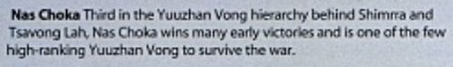

# Nas Choka

- **Aliases:** —
- **Era:** NJO
- **Continuity:** default Legends; entries present for: Legends
- **Research tier:** untiered (not listed as INTRO/DEEP/MASTERY in legends-feats.md)
- **Entries:** 54 (14 with quotations; 0 quotations extended to the full sentence/passage from the source text on file; 0 marked as fragments; 13 before the 2026-11-17 fragment fill). Rebuilt 2026-11-17 from 17 old entries; old file: `characters/_bak/nas-choka.md.bak-20261117`.
- **How to read:** each entry is the quotation in full (block quote), then its source and point of view. "Note" lines are summaries from our notes, not quotations. `[fragment — full passage not on file]` means the source text is not on the box, so only the words in our notes are shown. Debate and forum material is in the last section and is unverified.

# LEGENDS (Legends / EU — main focus)

## Sourcebooks/The New Jedi Order Sourcebook.pdf [Star Wars Roleplaying Game (d20, 2000)] (scan pages 61–120)

- Note (summary from our notes, not a quotation): Page contents: 402 words, 14 paragraphs | headings/entries: AsUO Ue .o1; Nas Choka, Yuuzhan Vong Supreme Commander
  — Source: Sourcebooks/The New Jedi Order Sourcebook.pdf [Star Wars Roleplaying Game.
Our notes: `notes/materials/037-sw-d20-folder/049-the-new-jedi-order-sourcebook-scan-061-120.md:186`

## Star Wars Gamer/Star Wars Gamer 08.pdf [Star Wars Roleplaying Game (d20, 2000)] (scan pages 1–60)

- Note (summary from our notes, not a quotation): Page contents: Being Yuuzhan Vong NJO timeline: the Praetorite Vong disgraced at Helska; Tsavong Lah's decree after Duro that the Jedi be surrendered empowers the Peace Brigade; Supreme Commander Nas Choka punishes Hutt Space; after Coruscant falls, 'Few enemies are more dangerous than an enemy with nothing to lose' (hand-read)
  — Source: Star Wars Gamer/Star Wars Gamer 08.pdf [Star Wars Roleplaying Game (d20,.
Our notes: `notes/materials/037-sw-d20-folder/057-star-wars-gamer-08-scan-001-060.md:323`

## Star Wars Insider #74 (2004)

> Nas Choka Thied in the Yuuzhan Vong hierarchy behind Shimrra and Tsavong Lah, Nas Choka wins many early victories and is one of the few high-ranking Yuuzhan Vong to survive the war.
— Source: Star Wars Insider #74 (2004); Tsavong Lah — entry/section: Star Wars Insider 074 (2004).
Note (our notes, around the quote): Tsavong Lah — entry/section: Star Wars Insider 074 (2004): "Nas Choka Thied in the Yuuzhan Vong hierarchy behind Shimrra and Tsavong Lah, Nas Choka wins many early victories and is one of the few high-ranking Yuuzhan Vong to survive the war." Source: *Star Wars Insider #74* (2004), scan p.27

Our notes: `notes/materials/038-star-wars-insider/074-ins074.md:172`

## NJO 5, *Agents of Chaos II: Jedi Eclipse* (James Luceno, Del Rey 2000): FULL consecutive re-read (2026-11-16 CST)

What it shows (our notes): the welcome for Supreme Commander Nas Choka; the spiral-arm worldship; Runaway Prince remade; two hundred purified captives from Gyndine
> The tempo of the rousing march that welcomed Supreme Commander Nas Choka aboard the Yuuzhan Vong warship Yammka was kept by warriors with drums, but the theme itself was supplied by a menagerie of bioengineered insects and avians, droning, trumpeting, and whistling from within cages and atop perches situated throughout the great hold.
>
> Enormous villip-choir transparencies broke the obsidian monotony of the starboard bulkhead, providing a star-strewn panorama of the anchored fleet, as well as a distant view of the Hutt space world known as Runaway Prince, remade for the sowing of yorik coral, villip shrubs, and other necessities of war. To the ships that resembled asteroids, marine behemoths, and tumbled and faceted cabochons had been added an even more massive and sinister specimen: a flattened lapidary orb of glossy black, from the dense center of which spiraled half a dozen arms, as if in dark imitation of the galaxy the Yuuzhan Vong were determined to conquer.
>
> Supreme Commander Choka, along with his commanders and foremost subalterns, moved on levitated dovin basal cushions in tiered heights above the deck. In advance of them floated four smaller cushions, their diminutive riders screened by flutters—living creatures that resembled squares of patterned cloth. Arrayed on either side of the arriving group stood five thousand warriors dressed in battle tunics and armed with amphistaffs and coufees.
>
> Confined to a small space among the starboard-side group cowered two hundred prisoners taken from Gyndine and already purified for sacrifice. Bony growths affixed to voice boxes and jaws prevented them from giving voice to their fear.
>
> Behind Choka marched troops of his own command, their precision footfalls crushing an ankle-deep carpet of maroon flowers, whose aroma—wafted about by the rhythmic beating of wings—had aroused the insects to song. Their stridulations intensifying and diminishing, the insects sustained notes lifted from an otherworldly scale. One moment the march was fiery and inspiring; the next it was a somber dirge.
>
> Opposite the arrival bay, at the far end of the cloyingly perfumed parade corridor, waited Commander Malik Carr and his chief subalterns, a coven of priests, and off to one side, Executor Nom Anor, all revealed in tattooed and modified splendor.
>
> As the train of elite warriors neared the dais, the drumbeats and insect voices ceased and Malik Carr stepped to the lip of the raised platform.
>
> “Welcome, Supreme Commander Choka,” he crowed, his augmented voice resounding from the arching ceiling and tympanic bulkheads. “The Yammka and all here gathered are yours to command.”
>
> A wrathful droning filled the hold. Simultaneously, ten thousand fists snapped crisply to their opposite shoulders in salute.
— Source: The New Jedi Order: Agents of Chaos II: Jedi Eclipse (James Luceno, Del Rey 2000), JE ch. 15 — 118 Jedi Eclipse notes (re-read 2026-11-16).
(Excerpt widened 2026-11-17 to the relevant passage, word for word from Jedi Eclipse (James Luceno) (text copy `MEGA_Legend_The_New_Jedi_Order_Series_Star_Wars_New_Jedi_Order_05_Agents_of_Chaos_02_Jedi_Eclipse_James_Luceno_epub`).)
(Excerpt widened 2026-11-17 to the relevant passage, word for word from Jedi Eclipse (James Luceno) (text copy `MEGA_Legend_The_New_Jedi_Order_Series_Star_Wars_New_Jedi_Order_05_Agents_of_Chaos_02_Jedi_Eclipse_James_Luceno_epub`).)
(Fragment completed 2026-11-17: full sentence/passage matched word for word in the source text on file: `MEGA_Legend_The_New_Jedi_Order_Series_Star_Wars_New_Jedi_Order_05_Agents_of_Chaos_02_Jedi_Eclipse_James_Luceno_epub`.)
Note text that was attached to the quote line: (JE ch. 15) — **the welcome for Supreme Commander Nas Choka; the spiral-arm worldship; Runaway Prince remade; two hundred purified captives from Gyndine**
Our notes: `notes/materials/118-njo-05-jedi-eclipse/je-03.md:4`

What it shows (our notes): Choka to Nom Anor: "I would be more inclined to demote than promote you"; the Praetorite Vong and the imperfect yammosk; "Only from a certain point of view."
> Choka watched the promoted warriors step down from the dais, then turned slightly in the direction of Malik Carr. “One more matter before we proceed, Commander.” He looked past Malik Carr to where Nom Anor was seated. “Come forward, Executor.”
>
> More flamboyantly attired than anyone in the hold, Nom Anor rose and walked slowly across the platform. Opposite Nas Choka he inclined his head in a nod. As a member of the intendant caste—though of the lowest rank—he was not obliged to offer salute.
>
> “Since you and I do not hail from the same order, I am not entitled to escalate you. But know this, Executor: Were I so entitled, I would be more inclined to demote than promote you.”
>
> Clearly surprised, Nom Anor did not respond, though his mouth twitched several times in rapid succession.
>
> “Your actions, Executor, have been closely monitored and widely discussed, and it is the opinion of many in Shimrra’s court that you have strayed from your assigned course. First you chose to ally yourself with the Praetorite Vong, who believed they could spearhead an invasion of this magnitude without suffering tragic consequences.”
>
> “I was not allied with them,” Nom Anor said when he could. “My assignment was to destabilize the New Republic in ways I saw fit. That is what I did among the Imperial Moffs, as well as in the Osarian system, and have since done—under different guises—in a half-dozen other systems.”
>
> Choka shot him a gimlet stare. “Who helped the Praetorite Vong obtain a yammosk—and an imperfect one at that?”
>
> Nom Anor swallowed hard. “I may have mentioned something—”
>
> “You facilitated them.”
>
> “Only from a certain point of view.”
— Source: The New Jedi Order: Agents of Chaos II: Jedi Eclipse (James Luceno, Del Rey 2000), JE ch. 15 — 118 Jedi Eclipse notes (re-read 2026-11-16).
(Excerpt widened 2026-11-17 to the relevant passage, word for word from Jedi Eclipse (James Luceno) (text copy `MEGA_Legend_The_New_Jedi_Order_Series_Star_Wars_New_Jedi_Order_05_Agents_of_Chaos_02_Jedi_Eclipse_James_Luceno_epub`).)
(Excerpt widened 2026-11-17 to the relevant passage, word for word from Jedi Eclipse (James Luceno) (text copy `MEGA_Legend_The_New_Jedi_Order_Series_Star_Wars_New_Jedi_Order_05_Agents_of_Chaos_02_Jedi_Eclipse_James_Luceno_epub`).)
(Fragment completed 2026-11-17: full sentence/passage matched word for word in the source text on file: `MEGA_Legend_The_New_Jedi_Order_Series_Star_Wars_New_Jedi_Order_05_Agents_of_Chaos_02_Jedi_Eclipse_James_Luceno_epub`.)
Note text that was attached to the quote line: (JE ch. 15) — **Choka to Nom Anor: "I would be more inclined to demote than promote you"; the Praetorite Vong and the imperfect yammosk; "Only from a certain point of view."**
Our notes: `notes/materials/118-njo-05-jedi-eclipse/je-03.md:7`

What it shows (our notes): Elan's death and Jakan's displeasure; Nom Anor: "It is not the Jedi who pose a threat, so much as the Force"; Choka: "The Force is nothing more than an idea … the best way to extinguish an idea is by replacing it with a better one"
> “Don’t try your doublespeak on me, Executor. You may have managed to distance yourself from Prefect Da’Gara and the rest by escaping the price they paid for their miscalculation, but you cannot deny engineering the plan that ended in the death of the priestess Elan, daughter of high priest Jakan—who, I might add, is most displeased with you.”
>
> “There is no proof that Elan or her mascot Vergere are dead. Even so, I can scarcely be held accountable for what happened to them.”
>
> “You take no blame for employing agents who act without orders from their handler?”
>
> Nom Anor added force to his voice. “My agents were endeavoring to please me—us—by returning Elan. I had no knowledge of their designs until it was too late.”
>
> “Is it true that Elan was to have assassinated a number of Jeedai Knights?”
>
> “It is.”
>
> Choka tempered his voice with curiosity. “Why this fascination with the Jeedai, Executor? I, for one, am not convinced they pose a serious threat to our conquest.”
>
> “It is not the Jedi who pose a threat, so much as the Force—the mystical power they embody.”
>
> “The Force is nothing more than an idea,” Choka said loudly, “and the best way to extinguish an idea is by replacing it with a better one, such as we bring.”
>
> Nom Anor risked a patronizing sniff. “As you say, Supreme Commander.”
>
> Choka glowered. “Now I learn from Commander Malik Carr that you were instrumental in gaining the allegiance of the creatures that occupy this space—these Hutts.”
— Source: The New Jedi Order: Agents of Chaos II: Jedi Eclipse (James Luceno, Del Rey 2000), JE ch. 15 — 118 Jedi Eclipse notes (re-read 2026-11-16).
(Excerpt widened 2026-11-17 to the relevant passage, word for word from Jedi Eclipse (James Luceno) (text copy `MEGA_Legend_The_New_Jedi_Order_Series_Star_Wars_New_Jedi_Order_05_Agents_of_Chaos_02_Jedi_Eclipse_James_Luceno_epub`).)
(Fragment completed 2026-11-17 with the full excerpt, word for word from Jedi Eclipse (James Luceno) (text copy `MEGA_Legend_The_New_Jedi_Order_Series_Star_Wars_New_Jedi_Order_05_Agents_of_Chaos_02_Jedi_Eclipse_James_Luceno_epub`).)
(Fragment completed 2026-11-17 with the full excerpt, word for word from Jedi Eclipse (James Luceno) (text copy `MEGA_Legend_The_New_Jedi_Order_Series_Star_Wars_New_Jedi_Order_05_Agents_of_Chaos_02_Jedi_Eclipse_James_Luceno_epub`).)
(Excerpt widened 2026-11-17 to the relevant passage, word for word from Jedi Eclipse (James Luceno) (text copy `MEGA_Legend_The_New_Jedi_Order_Series_Star_Wars_New_Jedi_Order_05_Agents_of_Chaos_02_Jedi_Eclipse_James_Luceno_epub`).)
(Fragment completed 2026-11-17: full sentence/passage matched word for word in the source text on file: `MEGA_Legend_The_New_Jedi_Order_Series_Star_Wars_New_Jedi_Order_05_Agents_of_Chaos_02_Jedi_Eclipse_James_Luceno_epub`.)
Note text that was attached to the quote line: (JE ch. 15) — **Elan's death and Jakan's displeasure; Nom Anor: "It is not the Jedi who pose a threat, so much as the Force"; Choka: "The Force is nothing more than an idea … the best way to extinguish an idea is by replacing it with a better one"**
Our notes: `notes/materials/118-njo-05-jedi-eclipse/je-03.md:8`

What it shows (our notes): Choka will accompany the attack; "there are no shortcuts to the rank of consul, to say nothing of prefect … Look to Yun-Shuno for counsel"; the sacrifices ordered
> Choka glowered. “Now I learn from Commander Malik Carr that you were instrumental in gaining the allegiance of the creatures that occupy this space—these Hutts.”
>
> Nom Anor’s genuine eye narrowed. “The Hutts are critical to a plan devised by Commander Malik Carr and myself to force a significant defeat on the New Republic. In fact”—he tilted his head to one side—“you arrive at an auspicious moment, because part of that plan is shortly to be put into effect. If you would care to accompany us into battle, you could observe firsthand our strategy for conquering the Core Worlds in advance of the arrival of Warmaster Tsavong Lah.”
>
> Choka took a moment to weigh the consequences of such an action, then grunted an affirmative. “I will go. But let me caution you, Executor, about the perils of ambition. It’s obvious that you are hungry for escalation, but there are no shortcuts to the rank of consul, to say nothing of prefect.” He gestured over his shoulder. “Look to Yun-Shuno for counsel, Executor. Escalation is awarded only to those who have discharged their obligations in service to the gods. You appear to act in your own behalf, as if possessed of a personal stake in the results.” He leaned slightly forward. “Or is it this galaxy, Executor, and the heathen beliefs of those who populate it that have corrupted you?”
>
> Nom Anor held his gaze, wishing he had filled his empty eye socket with a venom-spitting plaeryin bol. “I care only for what this galaxy is capable of providing the Yuuzhan Vong.” He cast a glance at Malik Carr. “With all due respect, Commander, our target awaits.”
>
> Malik Carr nodded to Choka. “He speaks the truth.”
>
> The supreme commander folded his arms. “Let us enact the sacrifices and see what Commander Malik Carr and Executor Nom Anor have masterminded.” He pointed to the knot of prisoners. “Bring the captives forward. In sacrificing them, perhaps we can help ensure Executor Nom Anor a much-needed victory.”
— Source: The New Jedi Order: Agents of Chaos II: Jedi Eclipse (James Luceno, Del Rey 2000), JE ch. 15 — 118 Jedi Eclipse notes (re-read 2026-11-16).
(Excerpt widened 2026-11-17 to the relevant passage, word for word from Jedi Eclipse (James Luceno) (text copy `MEGA_Legend_The_New_Jedi_Order_Series_Star_Wars_New_Jedi_Order_05_Agents_of_Chaos_02_Jedi_Eclipse_James_Luceno_epub`).)
(Excerpt widened 2026-11-17 to the relevant passage, word for word from Jedi Eclipse (James Luceno) (text copy `MEGA_Legend_The_New_Jedi_Order_Series_Star_Wars_New_Jedi_Order_05_Agents_of_Chaos_02_Jedi_Eclipse_James_Luceno_epub`).)
(Fragment completed 2026-11-17: full sentence/passage matched word for word in the source text on file: `MEGA_Legend_The_New_Jedi_Order_Series_Star_Wars_New_Jedi_Order_05_Agents_of_Chaos_02_Jedi_Eclipse_James_Luceno_epub`.)
Note text that was attached to the quote line: (JE ch. 15) — **Choka will accompany the attack; "there are no shortcuts to the rank of consul, to say nothing of prefect … Look to Yun-Shuno for counsel"; the sacrifices ordered**
Our notes: `notes/materials/118-njo-05-jedi-eclipse/je-03.md:9`

What it shows (our notes): Malik Carr: Tynna's waters will grow dovin basals "of the size needed to remove the shields that guard Coruscant"; the spice-trail disinformation: "Tynna was deliberately won as a means of fortifying the disinformation"; Choka spotted the stealth craft
> The eyes of the facsimile fixed on Nas Choka. “Inform me of recent events, Supreme Commander.”
>
> “We occupy the world called Tynna, Potent One, which fell to us with so meager a fight we might have deemed it unworthy were it not so well suited to our needs and our campaign.”
>
> The eyes moved to Malik Carr. “I would hear more of this.”
>
> “Tynna’s clement waters will one day furnish dovin basals of the size needed to remove the shields that guard Coruscant and other worlds of the Core. It is our conviction that the indigenous species—furred bipeds of diminutive size—can be reeducated and trained, and will make for able and affable tenders of our creations.”
>
> “And as to Tynna’s importance to the conquest?”
>
> “Potent One, the world will also serve as a staging area for eventual incursions into the Corellian and Bothan sectors.”
>
> “Eventual, you say.”
>
> “Tynna is but the first stage of a strategy that will speed us to the Core. To guarantee this, we entered into an agreement with the Hutts, the terms of which require that we apprise them of planetary systems to avoid in their dispersal of a ludicrous product called spice. We did so in complete expectation that they would either alert the New Republic, or that New Republic analysts would discover that spice was moving freely in some sectors and not at all in others, and leap to the conclusion that the latter provided a glimpse of our battle plan. Tynna was one of the worlds we cautioned the Hutts to avoid, along with Corellia and Bothawui. Tynna was deliberately won as a means of fortifying the disinformation.”
>
> The villip was silent for a long moment. “The meager battle you waged suggests that the New Republic failed to behave as predicted. Otherwise, their fleet would have been lying in wait.”
>
> “Testimony to the New Republic’s notion of cleverness, Warmaster,” Nas Choka answered. “Through the whole of the battle and its aftermath we observed spies observing us from a stealthy craft I’m certain they believe went undetected. To have met us in force might have saved the day for Tynna, but the New Republic is well aware that we have targets of greater significance in mind, so they purposely gave Tynna away.
>
> “With tribute to Commander Malik Carr,” Choka continued, “I am now convinced that the same tactic will work for the planned assault. Many coralskipper pilots are readying themselves for the sacrifice the attack will require. And we will soon begin positioning autonomous dovin basals along the routes New Republic ships will use in jumping to the target once they learn the truth.”
>
> “Then these Hutts alerted the New Republic?”
>
> “I deem it of little consequence either way, Potent One. As a bonus, the Hutts will make for bountiful sacrifices when we’re finished with them.”
— Source: The New Jedi Order: Agents of Chaos II: Jedi Eclipse (James Luceno, Del Rey 2000), JE ch. 16 — 118 Jedi Eclipse notes (re-read 2026-11-16).
(Excerpt widened 2026-11-17 to the relevant passage, word for word from Jedi Eclipse (James Luceno) (text copy `MEGA_Legend_The_New_Jedi_Order_Series_Star_Wars_New_Jedi_Order_05_Agents_of_Chaos_02_Jedi_Eclipse_James_Luceno_epub`).)
(Excerpt widened 2026-11-17 to the relevant passage, word for word from Jedi Eclipse (James Luceno) (text copy `MEGA_Legend_The_New_Jedi_Order_Series_Star_Wars_New_Jedi_Order_05_Agents_of_Chaos_02_Jedi_Eclipse_James_Luceno_epub`).)
(Fragment completed 2026-11-17: full sentence/passage matched word for word in the source text on file: `MEGA_Legend_The_New_Jedi_Order_Series_Star_Wars_New_Jedi_Order_05_Agents_of_Chaos_02_Jedi_Eclipse_James_Luceno_epub`.)
Note text that was attached to the quote line: (JE ch. 16) — **Malik Carr: Tynna's waters will grow dovin basals "of the size needed to remove the shields that guard Coruscant"; the spice-trail disinformation: "Tynna was deliberately won as a means of fortifying the disinformation"; Choka spotted the stealth craft**
Our notes: `notes/materials/118-njo-05-jedi-eclipse/je-03.md:17`

What it shows (our notes): Choka refuses the Hutt captive-transport offer but frees spice deliveries to Bothawui; the threat; "sportive circumlocution"
> Choka nodded, apparently satisfied. “I’m not one to mince words, Borga. With respect to your gracious offer to oversee the transport of captives in exchange for information regarding imperiled star systems, I have determined that such services are unwarranted at this stage of our campaign. As a gesture of good faith, however, we will continue, from time to time and as we see fit, to furnish you with some advance notice of our activities.” He paused momentarily. “For example, you may resume delivery of your euphoric spice to the Bothawui system, without fear of inadvertent entanglement.”
>
> Borga licked her lips. “We thank you—and I’m sure the Bothans will do likewise.”
>
> Choka studied her for a moment. “For the spice, you mean.”
>
> “Precisely. For the spice.”
>
> Choka’s expression didn’t change. “I trust, Borga, that you’re not sharing this privileged information with any third parties.”
>
> Borga spread her smallish hands, palms outward. “With whom would I share? Our primary concern is to maintain trade—and, of course, to avoid complicating your business, whatever that may be.”
>
> “That’s comforting to hear,” Choka said. “Be advised that should evidence ever come to light that you have been violating our confidence … Well, I don’t think I need to enumerate the horrors that would befall Hutt space, do I?”
>
> Borga shook her head. “We are also renowned for our vivid imaginations.”
>
> “Splendid.” Choka gestured toward Malik Carr. “My second in command informs me, as well, that you expressed a desire to commence apportioning the galaxy, in anticipation of our complete and utter conquest.”
>
> Borga swallowed audibly. “I may have been premature, Excellency.”
>
> Choka’s invidious grin returned. “Nothing pleases me more than a well-reasoned response. We will lay siege to whichever worlds we require or crave, including this ‘glorious jewel’ of yours—not that we have any such designs—for the moment, that is—although one never knows—save for Warmaster Tsavong Lah, who could decide tomorrow that Nal Hutta needs to be razed. Do we understand each other?”
>
> “As well as can be expected,” Borga replied, “given the limitations of Basic—and, of course, the relative youth of our association—notwithstanding the depths it has already achieved—despite our many differences.”
— Source: The New Jedi Order: Agents of Chaos II: Jedi Eclipse (James Luceno, Del Rey 2000), JE ch. 19 — 118 Jedi Eclipse notes (re-read 2026-11-16).
(Excerpt widened 2026-11-17 to the relevant passage, word for word from Jedi Eclipse (James Luceno) (text copy `MEGA_Legend_The_New_Jedi_Order_Series_Star_Wars_New_Jedi_Order_05_Agents_of_Chaos_02_Jedi_Eclipse_James_Luceno_epub`).)
(Excerpt widened 2026-11-17 to the relevant passage, word for word from Jedi Eclipse (James Luceno) (text copy `MEGA_Legend_The_New_Jedi_Order_Series_Star_Wars_New_Jedi_Order_05_Agents_of_Chaos_02_Jedi_Eclipse_James_Luceno_epub`).)
(Fragment completed 2026-11-17: full sentence/passage matched word for word in the source text on file: `MEGA_Legend_The_New_Jedi_Order_Series_Star_Wars_New_Jedi_Order_05_Agents_of_Chaos_02_Jedi_Eclipse_James_Luceno_epub`.)
Note text that was attached to the quote line: (JE ch. 19) — **Choka refuses the Hutt captive-transport offer but frees spice deliveries to Bothawui; the threat; "sportive circumlocution"**
Our notes: `notes/materials/118-njo-05-jedi-eclipse/je-03.md:39`

What it shows (our notes): Choka on the Jedi: "We've had a few Jedi in our grip, but they have all managed to slip through our fingers"; Borga reveals Randa's report of a Jedi aboard the Crèche
> Choka smiled with sincerity. “Very good. We prize sportive circumlocution above almost anything but valor. Speaking of valor, Borga, have the Hutts had many dealings with this gang of ruffians that calls itself the Jedi Knights?”
>
> Borga adopted a look of distaste. “Some, Excellency. In fact, before you deigned to grace this galaxy with your presence, the Jedi were making things rather irksome for us by interfering with our myriad operations.”
>
> “Yes,” Choka mused, “they have proved troublesome for us, as well. We’ve had a few Jedi in our grip, but they have all managed to slip through our fingers.” He regarded Borga for a long moment. “You would profit by assisting us in separating one from the pack.”
>
> Borga fell silent, wondering if she was being tested, but ultimately deciding that Choka’s offer was genuine. “But, Excellency, you have one in your possession even now,” she said cautiously.
>
> It was Choka’s turn to fall silent. He turned to glance at Malik Carr, then Nom Anor, both of whom returned nescient shrugs.
>
> “Explain yourself, Borga.”
>
> “The vessel aboard which my son Randa is currently a guest,” Borga supplied. “Randa sent word that a Jedi had been discovered among the ship’s complement of captives.”
>
> Once more Choka looked to Malik Carr, who said, “I know nothing of this.”
>
> “To which ship does the Hutt refer?” Choka demanded of his advisers in Yuuzhan Vong.
>
> “The Crèche, Supreme Commander,” a bare-headed Yuuzhan Vong answered. “The yammosk vessel under the command of Chine-kal.”
>
> Choka muttered angrily. “Can we communicate with the ship?”
>
> “Provided that it is not in superluminal transit, Supreme Commander.”
>
> “Then have Chine-kal’s villip prepared and brought to me at once!”
— Source: The New Jedi Order: Agents of Chaos II: Jedi Eclipse (James Luceno, Del Rey 2000), JE ch. 19 — 118 Jedi Eclipse notes (re-read 2026-11-16).
(Excerpt widened 2026-11-17 to the relevant passage, word for word from Jedi Eclipse (James Luceno) (text copy `MEGA_Legend_The_New_Jedi_Order_Series_Star_Wars_New_Jedi_Order_05_Agents_of_Chaos_02_Jedi_Eclipse_James_Luceno_epub`).)
(Excerpt widened 2026-11-17 to the relevant passage, word for word from Jedi Eclipse (James Luceno) (text copy `MEGA_Legend_The_New_Jedi_Order_Series_Star_Wars_New_Jedi_Order_05_Agents_of_Chaos_02_Jedi_Eclipse_James_Luceno_epub`).)
(Fragment completed 2026-11-17: full sentence/passage matched word for word in the source text on file: `MEGA_Legend_The_New_Jedi_Order_Series_Star_Wars_New_Jedi_Order_05_Agents_of_Chaos_02_Jedi_Eclipse_James_Luceno_epub`.)
Note text that was attached to the quote line: (JE ch. 19) — **Choka on the Jedi: "We've had a few Jedi in our grip, but they have all managed to slip through our fingers"; Borga reveals Randa's report of a Jedi aboard the Crèche**
Our notes: `notes/materials/118-njo-05-jedi-eclipse/je-03.md:40`

What it shows (our notes): Choka orders Chine-kal to hold at Kalarba and hand over the Jedi; "Nal Hutta will remain yours to command for as long as I live and breathe"
> “Yes, Supreme Commander. Our rapidly maturing yammosk has the distinction of having exposed him. I thought I might keep him as a prize for Warmaster Tsavong Lah.”
>
> Choka glowered. “I will determine the best use for this Jedi. What is the present position of your vessel?”
>
> “We are nearing a world called Kalarba, Supreme Commander. In fact, we have been awaiting word from you regarding the attack on—”
>
> “Silence!” Choka’s eyes became angry slits. “You will remain at Kalarba and relinquish the Jedi Knight to bearers I am dispatching to rendezvous with the Crèche. Is that clear?”
>
> “Abundantly clear,” Chine-kal’s villip replied deferentially.
>
> Choka cast a glance at Borga. “For your part in this, you have my word that Nal Hutta will remain yours to command for as long as I live and breathe. Unless, of course, you are fool enough to betray me.”
>
> Borga forced a smile. “Then may perfect health shadow you wherever you tread, Excellency.”
>
> “I warned you,” Pazda was telling Borga shortly after the Yuuzhan Vong had left the court. The gray-bearded Desilijic Hutt brought his hoversled closer to Borga’s levitated pallet. “Any dealings with these heathens will come to a dreadful end.”
— Source: The New Jedi Order: Agents of Chaos II: Jedi Eclipse (James Luceno, Del Rey 2000), JE ch. 19 — 118 Jedi Eclipse notes (re-read 2026-11-16).
(Excerpt widened 2026-11-17 to the relevant passage, word for word from Jedi Eclipse (James Luceno) (text copy `MEGA_Legend_The_New_Jedi_Order_Series_Star_Wars_New_Jedi_Order_05_Agents_of_Chaos_02_Jedi_Eclipse_James_Luceno_epub`).)
(Excerpt widened 2026-11-17 to the relevant passage, word for word from Jedi Eclipse (James Luceno) (text copy `MEGA_Legend_The_New_Jedi_Order_Series_Star_Wars_New_Jedi_Order_05_Agents_of_Chaos_02_Jedi_Eclipse_James_Luceno_epub`).)
(Fragment completed 2026-11-17: full sentence/passage matched word for word in the source text on file: `MEGA_Legend_The_New_Jedi_Order_Series_Star_Wars_New_Jedi_Order_05_Agents_of_Chaos_02_Jedi_Eclipse_James_Luceno_epub`.)
Note text that was attached to the quote line: (JE ch. 19) — **Choka orders Chine-kal to hold at Kalarba and hand over the Jedi; "Nal Hutta will remain yours to command for as long as I live and breathe"**
Our notes: `notes/materials/118-njo-05-jedi-eclipse/je-03.md:42`

What it shows (our notes): Kyp's pilots plot the vanishing vector: "Fondor," five voices said in unison; Choka learns that the Crèche "fled … To the target, Supreme Commander. To Fondor."
> Close to Hosk, Kyp Durron urged his X-wing on, even though he knew that he would not be able to overtake the accelerating Yuuzhan Vong clustership.
>
> “It’s going to jump,” Ganner told him over the net.
>
> “My droid’s telling me the same thing,” Kyp responded. He opened the net to the rest of the Dozen. “Listen up, everyone. Set your navicomputers to record vanishing bearings and calculate possible course projections. Deak, see if you can’t tag that ship with a hyperspace beacon before it gets away.”
>
> “I’m on it, Kyp.”
>
> Not a moment later the enemy vessel vanished. Kyp fixed his eyes on the cockpit display screen while the craft’s astromech unit went to work on plotting the vessel’s possible destinations. Shortly, a list of star systems resolved on-screen, the most probable one highlighted in blue and flashing.
>
> “I’ve got a high-confidence objective,” Ganner reported.
>
> “Likewise,” Deak and a couple of the others added.
>
> “Let’s hear it,” Kyp told them.
>
> “Fondor,” five voices said in unison.
>
> In Hutt space, Nas Choka, Malik Carr, and Nom Anor stood on the bridge of the supreme commander’s helix battleship watching a villip-choir feed of the fleet mobilization.
>
> A subaltern interrupted their captivation.
>
> “Supreme Commander,” he began, saluting, “a message from the commander of the craft sent to collect the captured Jedi. Coralskipper pilots encountered at Kalarba report that the Crèche fell under attack by a battle group of New Republic starfighters. Endangered, Commander Chine-kal’s vessel fled the fray.”
>
> Nas Choka stared at him uncomprehendingly. “Fled to where?”
>
> “To the target, Supreme Commander. To Fondor.”
>
> Nas Choka whirled in alarm to Malik Carr. “How soon before our advance elements reach Fondor?”
— Source: The New Jedi Order: Agents of Chaos II: Jedi Eclipse (James Luceno, Del Rey 2000), JE ch. 24 — 118 Jedi Eclipse notes (re-read 2026-11-16).
(Excerpt widened 2026-11-17 to the relevant passage, word for word from Jedi Eclipse (James Luceno) (text copy `MEGA_Legend_The_New_Jedi_Order_Series_Star_Wars_New_Jedi_Order_05_Agents_of_Chaos_02_Jedi_Eclipse_James_Luceno_epub`).)
(Excerpt widened 2026-11-17 to the relevant passage, word for word from Jedi Eclipse (James Luceno) (text copy `MEGA_Legend_The_New_Jedi_Order_Series_Star_Wars_New_Jedi_Order_05_Agents_of_Chaos_02_Jedi_Eclipse_James_Luceno_epub`).)
(Fragment completed 2026-11-17: full sentence/passage matched word for word in the source text on file: `MEGA_Legend_The_New_Jedi_Order_Series_Star_Wars_New_Jedi_Order_05_Agents_of_Chaos_02_Jedi_Eclipse_James_Luceno_epub`.)
Note text that was attached to the quote line: (JE ch. 24) — **Kyp's pilots plot the vanishing vector: "Fondor," five voices said in unison; Choka learns that the Crèche "fled … To the target, Supreme Commander. To Fondor."**
Our notes: `notes/materials/118-njo-05-jedi-eclipse/je-04.md:35`

What it shows (our notes): Choka: the Bothawui–Fondor routes are "Sown with obstacles"; "It appears that you have been successful in persuading them that we plan to attack Corellia"; the attack on Fondor moved up
> Nas Choka whirled in alarm to Malik Carr. “How soon before our advance elements reach Fondor?”
>
> “Soon,” the commander said, letting it go at that.
>
> “The yammosk won’t be adequately protected until we arrive,” Nas Choka remarked, mostly to himself. “What is the status of the New Republic fleet?”
>
> “Massed at the worlds Commenor, Kuat, and Bothawui.”
>
> “And the hyperspace routes linking Bothawui to Fondor?”
>
> “Sown with obstacles.”
>
> Nas Choka turned slightly to favor Nom Anor with a faint smile. “It appears that you have been successful in persuading them that we plan to attack Corellia.”
>
> Nom Anor inclined his head in a nod.
>
> “Then it shouldn’t matter if we advance the attack.” Nas Choka swung to his subaltern. “Apprise all commanders that we launch for Fondor as soon as the final coralskippers are docked.”
— Source: The New Jedi Order: Agents of Chaos II: Jedi Eclipse (James Luceno, Del Rey 2000), JE ch. 24 — 118 Jedi Eclipse notes (re-read 2026-11-16).
(Excerpt widened 2026-11-17 to the relevant passage, word for word from Jedi Eclipse (James Luceno) (text copy `MEGA_Legend_The_New_Jedi_Order_Series_Star_Wars_New_Jedi_Order_05_Agents_of_Chaos_02_Jedi_Eclipse_James_Luceno_epub`).)
(Excerpt widened 2026-11-17 to the relevant passage, word for word from Jedi Eclipse (James Luceno) (text copy `MEGA_Legend_The_New_Jedi_Order_Series_Star_Wars_New_Jedi_Order_05_Agents_of_Chaos_02_Jedi_Eclipse_James_Luceno_epub`).)
(Fragment completed 2026-11-17: full sentence/passage matched word for word in the source text on file: `MEGA_Legend_The_New_Jedi_Order_Series_Star_Wars_New_Jedi_Order_05_Agents_of_Chaos_02_Jedi_Eclipse_James_Luceno_epub`.)
Note text that was attached to the quote line: (JE ch. 24) — **Choka: the Bothawui–Fondor routes are "Sown with obstacles"; "It appears that you have been successful in persuading them that we plan to attack Corellia"; the attack on Fondor moved up**
Our notes: `notes/materials/118-njo-05-jedi-eclipse/je-04.md:36`

What it shows (our notes): Choka: "They killed most of their reinforcements to eliminate half of our force … Is such savagery commonplace?"; Nom Anor: "Their reverence for life has always been their weakness"; Chine-kal's last report: "The Jedi captured on Gyndine will die with us"; "Now we have a score to settle with the Hutts."
> On his helix flagship, Nas Choka recaptured enough of his self-control to keep some of the dismay out of the incredulous look he showed Malik Carr and Nom Anor. Against the backdrop of a razed moon, the villip-choir field showed the blackened skeletons and husks of untold numbers of Yuuzhan Vong and enemy ships.
>
> “They killed most of their reinforcements to eliminate half of our force,” the supreme commander said. “Is such savagery commonplace?”
>
> Nom Anor shook his head, as much in response as to clear it. “A mistake. It has to be a mistake. Their reverence for life has always been their weakness.”
>
> “Then perhaps we’ve managed to bring out the primitive in them,” Malik Carr said in a stunned voice.
>
> A herald appeared. The villip in his trembling hands bore the strained features of Chine-kal.
>
> “The yammosk has been killed,” Chine-kal gasped through his communicator, “and the ship is dying. The Hutts betrayed our location to the Jedi. The Jedi captured on Gyndine will die with us, but two of his confederates and Randa Besadii Diori—the murderers of the yammosk—escaped. We—”
>
> The villip fell silent suddenly, then everted to its featureless form. Chine-kal was dead.
>
> Nas Choka turned away in disgust. “Recall all operational coralskippers,” he instructed his subaltern. “Order the rest to commit what destruction they can. All warship commanders will prepare their ships for departure. We have accomplished what we set out to do. Now we have a score to settle with the Hutts.”
— Source: The New Jedi Order: Agents of Chaos II: Jedi Eclipse (James Luceno, Del Rey 2000), JE ch. 27 — 118 Jedi Eclipse notes (re-read 2026-11-16).
(Excerpt widened 2026-11-17 to the relevant passage, word for word from Jedi Eclipse (James Luceno) (text copy `MEGA_Legend_The_New_Jedi_Order_Series_Star_Wars_New_Jedi_Order_05_Agents_of_Chaos_02_Jedi_Eclipse_James_Luceno_epub`).)
(Excerpt widened 2026-11-17 to the relevant passage, word for word from Jedi Eclipse (James Luceno) (text copy `MEGA_Legend_The_New_Jedi_Order_Series_Star_Wars_New_Jedi_Order_05_Agents_of_Chaos_02_Jedi_Eclipse_James_Luceno_epub`).)
(Fragment completed 2026-11-17: full sentence/passage matched word for word in the source text on file: `MEGA_Legend_The_New_Jedi_Order_Series_Star_Wars_New_Jedi_Order_05_Agents_of_Chaos_02_Jedi_Eclipse_James_Luceno_epub`.)
Note text that was attached to the quote line: (JE ch. 27) — **Choka: "They killed most of their reinforcements to eliminate half of our force … Is such savagery commonplace?"; Nom Anor: "Their reverence for life has always been their weakness"; Chine-kal's last report: "The Jedi captured on Gyndine will die with us"; "Now we have a score to settle with the Hutts."**
Our notes: `notes/materials/118-njo-05-jedi-eclipse/je-04.md:74`

What it shows (our notes): Nom Anor: the threat is "the Force"; Choka: "The Force is nothing more than an idea"
> “It is not the Jedi who pose a threat, so much as the Force—the mystical power they embody.”
>
> “The Force is nothing more than an idea,” Choka said loudly, “and the best way to extinguish an idea is by replacing it with a better one, such as we bring.”
— Source: The New Jedi Order: Agents of Chaos II: Jedi Eclipse (James Luceno, Del Rey 2000), JE ch. 15 — 118 Jedi Eclipse notes (re-read 2026-11-16).
(Excerpt widened 2026-11-17 to the relevant passage, word for word from Jedi Eclipse (James Luceno) (text copy `MEGA_Legend_The_New_Jedi_Order_Series_Star_Wars_New_Jedi_Order_05_Agents_of_Chaos_02_Jedi_Eclipse_James_Luceno_epub`).)
(Excerpt widened 2026-11-17 to the relevant passage, word for word from Jedi Eclipse (James Luceno) (text copy `MEGA_Legend_The_New_Jedi_Order_Series_Star_Wars_New_Jedi_Order_05_Agents_of_Chaos_02_Jedi_Eclipse_James_Luceno_epub`).)
(Fragment completed 2026-11-17: full sentence/passage matched word for word in the source text on file: `MEGA_Legend_The_New_Jedi_Order_Series_Star_Wars_New_Jedi_Order_05_Agents_of_Chaos_02_Jedi_Eclipse_James_Luceno_epub`.)
Note text that was attached to the quote line: (JE ch. 15) — **Nom Anor: the threat is "the Force"; Choka: "The Force is nothing more than an idea"**
Our notes: `notes/materials/118-njo-05-jedi-eclipse/summary.md:34`

> “They killed most of their reinforcements to eliminate half of our force,” the supreme commander said. “Is such savagery commonplace?”
>
> Nom Anor shook his head, as much in response as to clear it. “A mistake. It has to be a mistake. Their reverence for life has always been their weakness.”
— Source: The New Jedi Order: Agents of Chaos II: Jedi Eclipse (James Luceno, Del Rey 2000), JE ch. 27 — 118 Jedi Eclipse notes (re-read 2026-11-16).
(Fragment completed 2026-11-17: full sentence/passage matched word for word in the source text on file: `MEGA_Legend_The_New_Jedi_Order_Series_Star_Wars_New_Jedi_Order_05_Agents_of_Chaos_02_Jedi_Eclipse_James_Luceno_epub`.)
Note text that was attached to the quote line: (JE ch. 27) — **Choka: "Is such savagery commonplace?"; Nom Anor: "Their reverence for life has always been their weakness"**
Context: Choka: "Is such savagery commonplace?"; Nom Anor: "Their reverence for life has always been their weakness"
Our notes: `notes/materials/118-njo-05-jedi-eclipse/summary.md:58`

# Debate and forum claims (unverified)

Forum posts, Suspect Insight debates and Discord debates, respect threads, and verdicts. These are posters' arguments or quotations they typed; none is checked against the book here unless the entry says so.

_None in our notes._

# NJO FULL re-read additions (2026-11-17)
Verbatim excerpts from the full consecutive re-read of the New Jedi Order novels (Dark Journey through The Unifying Force), each shown with the text around it and its source chapter.

## *The Final Prophecy*
Nas Choka says the Yuuzhan Vong have spread too thin and must change.

> “We have spread ourselves too much, over too many star systems,” Nas Choka said. “We have lost too many ships because too many commanders have no more sense of strategy than to fight to the death.”
>
> He clasped his hand behind him and regarded Lah. “We have the late leader of your domain to thank for this situation.”
>
> “Warmaster Lah conquered most of this galaxy,” Zhat Lah protested. “He gave us their capital, now our Yuuzhan’tar.”
>
> “Yes, and he spent warriors like so much vlekin doing so, and gave little thought as to how we would hold such vast territories.” He waved his hand. “Things are changing, Zhat Lah. Things must change. The infidels have adapted. They have undermined many of our strengths, but we have undermined ourselves even more. The pride of our warriors weakens us.”

— Source: *The Final Prophecy* (Greg Keyes, Del Rey 2003), chapter 6 (FP).

Nas Choka tells Zhat Lah he did the right thing and the war is more important than honor.

> “Listen to me,” Nas Choka said. “We are the Yuuzhan Vong. We have been entrusted with the true way, the true knowledge of the gods. Our duty is to bring every infidel in this galaxy to heel and either send them screaming to the gods or bring them to the true path. There is no middle ground, there is no faltering. And there can be no failure. Our mission is more important than you or me, Commander, and it is more important than your honor or mine. Lord Shimrra himself has said it. And so, feel no stain. To win this war, we must set aside much we cherish. The gods ordain the sacrifice. We are blameless. We are those who do what must be done. And so I tell you again—you did the right thing.”

— Source: *The Final Prophecy* (Greg Keyes, Del Rey 2003), chapter 6 (FP).

Nas Choka makes destruction of the HoloNet a priority.

> “The destruction of the HoloNet has never been a priority before,” Nas Choka said. “Now it is. And the gods have given the shapers a new weapon, one that should perfectly suit our needs.”
>
> “That is well, Warlord.”
>
> “It is.” He paced a moment.
>
> “I’m giving you a new battle group. You will remain here, at Yuuzhan’tar, on alert to strike quickly. The infidels are growing confident; they will attack again, soon. I can feel it. And when they do, we will have something new to show them. Something quite new.”

— Source: *The Final Prophecy* (Greg Keyes, Del Rey 2003), chapter 6 (FP).

## *The Unifying Force*
Nas Choka is warned to learn from the mistakes of his precursors.

> Shimrra paid no attention to the bitter grumblings from some of the warriors, all of whom wore ceremonial vonduun crab armor. Instead his piercing gaze fell on Warmaster Nas Choka, noble in appearance despite his modest stature, with fine black hair combed straight back from his face, and a wispy beard. Choka had been escalated in the wake of Tsavong Lah’s death, but was not yet universally revered, despite his numerous victories in Hutt space.
>
> “Learn from the mistakes of your precursors, Warmaster, and all will go well for you. Fail me as Domain Lah did and I will personally make an example of you that future warmasters will be forced to consider before they accept escalation.”
>
> Nas Choka inclined his head in a crisp bow and struck the points of his shoulders with the opposite fists.

— Source: *The Unifying Force* (James Luceno, Del Rey 2004), chapter 6 (UF).

Nas Choka promotes Malik Carr for his actions at Selvaris.

> “Our warriors acquitted themselves well by destroying many enemy fighters and reclaiming two of the ships that might have escaped with the rest. One warrior in particular is noted for having saved our own escort vessels from destruction, in addition to other acts of bravery.”
>
> “Bring this one forward,” Shimrra said, “so I might cast my benevolent gaze on him.”
>
> “Commander Malik Carr,” Nas Choka called.
>
> Nom Anor couldn’t believe his ears. After the calamity at Fondor, Malik Carr had been demoted and removed from battle. Now here he was, standing in Shimrra’s gaze, a hero! Would everything reverse itself in due time?
>
> Carr genuflected to Shimrra, then Nas Choka, and remained on one knee. At a motion from the warmaster, a subaltern hurried forward with a command cloak, which Nas Choka draped over the horns implanted in Carr’s shoulders.
>
> “Rise as Supreme Commander Malik Carr,” Nas Choka intoned, “reinstated because of his courageous actions at Selvaris. We will soon assign him to a command more worthy of his station.”

— Source: *The Unifying Force* (James Luceno, Del Rey 2004), chapter 11 (UF).

Nas Choka proposes doubling the effort to take Caluula for captives.

> “We are presently engaged in a campaign to occupy a world known as Caluula. If you would permit our efforts to be doubled there, the planet will fall and many captives will be available to enrich our supply. Why not let the brave defenders of the orbital complex serve to compensate for our dearth of illustrious sacrifices?”
>
> “Caluula, you say.”
>
> “Distant from Yuuzhan’tar, Great Lord, but vital to our ultimate designs.”

— Source: *The Unifying Force* (James Luceno, Del Rey 2004), chapter 11 (UF).

Nas Choka cannot name a world under surface contest until pressed and names Corulag.

> “On which worlds are we currently engaged in surface contest?” Shimrra asked Nas Choka.
>
> The warmaster thought before speaking. “I could name twenty, Great Lord. Fifty.”
>
> Shimrra grew angry. “Name one, Warmaster.”
>
> “Corulag, then.”
>
> Shimrra nodded. “Corulag it shall be. See to it that the Peace Brigaders are implanted with surge-coral and sent to the front to join the ranks of our human thrall. In battle, perhaps they will redeem themselves.”
>
> Nas Choka saluted. “Your will be done.”

— Source: *The Unifying Force* (James Luceno, Del Rey 2004), chapter 11 (UF).

Nas Choka asks Shimrra to reconsider the timing of the Mon Calamari attack.

> Nas Choka knelt before him, the Scepter of Entreaty curled around the arm that normally would have propped the warmaster’s domain tsaisi.
>
> “Most Gracious Lord,” Nas Choka was saying, “I take it upon myself, in the names of the priests, seers, and others of my domain, to implore that additional thought be given to the holy task you have set before your warriors, to proceed with haste to Mon Calamari, and there lay waste to the ships of our enemy’s fleet, so that we might end this struggle at last, and see to the greater duty of bringing the truth to those whose homes we have conquered, lest we be forced to crush them underfoot like so many gricha. I ask this in the name of Yun-Yammka, to whom I am foresworn, and in all respect, since it is you who have Yun-Yammka’s ear, and upon you that the burden of existence rests.”
>
> Shimrra leaned forward, with his pointed chin resting on the palm of his huge hand, and Onimi left the steps below the throne to sit cross-legged by the warmaster, studying him with his lopsided head tilted to the heavy side, but without giving voice to rhyme or insult.
>
> “Pray, just what is it that your priests and seers have been telling you, Warmaster, since your words are the first I’ve heard of such matters?” Shimrra asked. “Surely you harbor no doubts that your mighty armada can prevail.”
>
> “No, Great Lord, of that I have no doubts. It is instinct that compels me to ask: at what cost to us?”

— Source: *The Unifying Force* (James Luceno, Del Rey 2004), chapter 18 (UF).

Nas Choka argues for consolidating conquered worlds before attacking.

> “Some of the enemy, Gracious Lord, but not all. Pockets of strong resistance remain. To subdue the Hutts fully required years, and it may take as many to subjugate the Hapes Consortium, the Chiss empire, the Corporate Sector. In all those places, to name but a few, the enemy is strong. I won’t argue that many of their fleets are now united at Mon Calamari. But our campaigns in the Remnant, at Esfandia, and Bilbringi yet again, have cost us dearly. War vessels need to be grown and nurtured—weapons, craft, and coralskippers alike. Our armada is weakest in the very vessels needed to move it. More, we need to be better equipped for surface contests—unless it is our design to poison more worlds than we already have, and risk having the gods misunderstand our intentions, and pronounce us callous toward life.”

— Source: *The Unifying Force* (James Luceno, Del Rey 2004), chapter 18 (UF).

Nas Choka warns his seer and criticizes Tsavong Lah's obsession with the Jeedai.

> Nas Choka looked at his blood-smeared subordinate. “You are safe herein, seer, but were I you, I would exercise caution about what words fly from my mouth. Shimrra has ears throughout the Citadel, and in more places than you can imagine. And who, seer, would you bid go to staffs with one of the Supreme Overlord’s newly enhanced warriors should you be challenged?”
>
> The seer bowed at the waist. “Your forgiveness, Warmaster.”
>
> “There is no swaying Shimrra. What matters now is that we do not fail him.” Nas Choka turned to face his cardinal subalterns. “None of you need fear expressing your opinions here. But take care elsewhere—both on and distant from Yuuzhan’tar.” He returned his attention to the blaze bug display. “The enemy fleet remains, augmented now by ships from star systems far removed from the war.”
>
> The tactician, attired in high turban and long cloak, nodded. “As I feared, they are allying against us. We were wrong to move quickly in the Remnant and in the Koornacht Cluster. We might well have been able to make use of the so-called Imperials and the barbaric Yevetha. We might have at least led them by their noses long enough to consider that there was greater profit in allying with us.”
>
> Nas Choka snorted in agreement. “Had I to do it over again, I might even have kept the Hutts on our side.”

— Source: *The Unifying Force* (James Luceno, Del Rey 2004), chapter 18 (UF).

Nas Choka predicts the Alliance will scatter and plans for the contingency of a Coruscant attack.

> Again the warmaster scrutinized the blaze bug display. “It intrigues me that they remain at Mon Calamari. By installing yammosks at Toong’l and Caluula, we have made clear as rainwater our intent to assault Mon Calamari. Sovv, Kre’fey, and the rest of the Alliance commanders must be blind not to see what is coming. But obviously I misconstrue them. My purpose was to persuade them to disband their battle groups, and thus subvert the possibility of a final battle of this nature, for I suspected that Shimrra was pursuing such thinking. And yet the enemy does nothing to suggest that they received our message. Either they have misconstrued me, or they have devised a way to counter us.”
>
> “Even so, Warmaster,” the tactician said, “it makes little sense for them to make a stand at Mon Calamari. They are vastly outnumbered, and it is unlikely they would wish to visit destruction on the world they have chosen as their new capital.”
>
> Nas Choka considered it. “Yes, I fear that, in the end, they will scatter.”
>
> The tactician was puzzled. “Was that not your original wish, Warmaster?”
>
> “To have them disband without our having to travel clear across the galaxy to prompt them. Now we are committed. We will arrive, they will disperse, and we will be left with no choice but to chase them into the galactic arms and back—because Shimrra will not have it otherwise.”
>
> “Such actions will require many years, and consume many resources.”

— Source: *The Unifying Force* (James Luceno, Del Rey 2004), chapter 18 (UF).

Nas Choka orders agents to observe but not interfere to let the Alliance hang itself.

> “Shimrra will see through you,” Nas Choka cautioned. “Especially in light of the appeal I attempted today. Regardless, he will suffer your lies as an accommodation to me, just as he suffers you and your cohorts as an accommodation to the elite. Refrain from attempting to grant us too much delay.” He paused, then said, “In the meantime, we should awaken our masqued spies and infiltrators on all occupied and contested worlds, and instruct them to report on any unusual activity involving the movements of ships, matériel, and couriers.”
>
> “Kre’fey will expect as much,” the tactician thought to point out. “Bear in mind, Warmaster, that enemy disinformation was at least partially responsible for drawing Tsavong Lah to his death.”
>
> Nas Choka touched him on the shoulder in appreciation. “Trust nothing from our network of agents on Mon Calamari. They live only because the Alliance feels there may be some further use for them. Also instruct our masqued spies that while they should keep their noses lifted to the winds, they are to refrain from taking any actions or interfering in any way. I want nothing more than information. I will separate the truth from the deceptions. Above all, I want to give the Alliance just enough vine to hang itself.”

— Source: *The Unifying Force* (James Luceno, Del Rey 2004), chapter 18 (UF).

Nas Choka distrusts reports of enemy deception and the lost ability to eavesdrop after the HoloNet attack.

> Nas Choka rose from the bench to regard what now amounted to an entire wall of blaze bug displays. “My long tenure in Hutt space was well spent,” he said after a long moment. “I was forced to acquaint myself with all make and manner of deception and duplicity. Fabrication comes as easily to the inhabitants of this galaxy as invention comes to our shapers. So I am wary of all these reports.”
>
> He turned to his Supreme Commanders. “Sovv and Kre’fey grasp that our patrols and reconnaissance vessels are too widely dispersed to keep watch over every planetary sector. They attempt to overwhelm us with activity, in the hope of screening a few missions of genuine purpose.” His expression grew dour. “Our actions in sabotaging the HoloNet may come back to plague us. We no longer have the luxury of being able to eavesdrop on enemy communications. Yes, the courier ships require additional time to reach their destinations, but the messages they carry come and go only to those who need to be apprised of the content. Even now this war takes unexpected twists and turns.” His hooded eyes fell on the tactician. “What of the yammosks at Toong’l and Caluula?”

— Source: *The Unifying Force* (James Luceno, Del Rey 2004), chapter 20 (UF).

Nas Choka grows suspicious of Caluula's surrender without contest.

> For several moments Nas Choka paced in silence. “This interests me,” he said finally. “Much of the enemy fleet remains at Mon Calamari. Elsewhere ships scurry about in seeming abandon. And following weeks of noble fighting by the defenders of its orbital facility, Caluula surrenders without contest.” He let his statements hang in the air, then turned to the tactician. “Tell Eminence Jakan that I wish a word with him before he renders any judgment on the petition.”
>
> The tactician bowed. “Anything else, Fearsome One?”
>
> “Who commands the yammosk emplacement at Caluula?”
>
> “I can provide the answer momentarily, Warmaster.”
>
> Nas Choka paced to his bench. “Return not only with the name, but also with the commander’s dedicated villip. I need to speak with him, as well.”

— Source: *The Unifying Force* (James Luceno, Del Rey 2004), chapter 20 (UF).

Nas Choka announces the armada will launch in three days and takes the burden.

> “Our course is now set,” he announced to his own subalterns and tacticians. “Supreme Overlord Shimrra will abide no further delay. We are enjoined to launch the armada in three local days, when the auguries are favorable for victory.”
>
> “Three days, Fearsome One,” the tactician said when Nas Choka had dropped cross-legged onto his yorik coral bench.
>
> “The burden is mine,” Nas Choka replied abruptly. “Don’t add to it by echoing my words. Tender your report.”

— Source: *The Unifying Force* (James Luceno, Del Rey 2004), chapter 20 (UF).

Nas Choka dismisses Loiric Kaan's praise of the enemy's machines.

> “Casualty assessment of the first engagement, Warmaster,” Supreme Commander Loiric Kaan said, gesturing to a wall niche in the command chamber of Yammka’s Mount.
>
> Nas Choka turned from the observation transparency to study the commotion of blaze bugs. “Acceptable,” he pronounced after a moment.
>
> “A clever use of machines,” Loiric Kaan remarked.
>
> The warmaster’s finely haired upper lip curled and he glowered at his Supreme Commander. “Another act of cowardice. Stop thinking in terms of the weapons our enemy employ, and concentrate on how they fight. Think of the machines as living beings if it will help you view the matter with more clarity.”
>
> Loiric Kaan bowed his head. “Warmaster.”
>
> Nas Choka moved to the blaze bug niche that displayed the disposition of the enemy battle groups.
>
> “They seek to spare the new capital,” Loiric Kaan said, “but they cannot save it now.”
>
> Nas Choka beckoned to one of his subalterns. “Escort Supreme Commander Loiric Kaan from the command chamber. If this war could be won by words of confidence, we would have already vanquished them.”

— Source: *The Unifying Force* (James Luceno, Del Rey 2004), chapter 24 (UF).

Nas Choka orders the armada's counterstrikes.

> Nas Choka sniffed. “Like a swarm of insects that can’t be outdistanced or repelled. The pests can, however, be eradicated.” He turned to the female stationed at the villip-choir. “Order Domains Vang and Pekeen to spray the contaminated areas. Then command the yammosks to spruce up our formations with auxiliary coralskippers.”
>
> The warmaster and the chief tactician swung to the transparency to see brilliant plumes of plasma discharge omnidirectionally from the core. Dozens of the small fighters disappeared, and as many others were shocked into submission.
>
> “Again,” Nas Choka ordered.
>
> A second torrent of molten death poured from the war vessels, obliterating yet more starfighters.
>
> “Now, assign yorik-akaga and yorik-vec to the rear. Let mataloks serve as our spearhead.”

— Source: *The Unifying Force* (James Luceno, Del Rey 2004), chapter 24 (UF).

Nas Choka promises Shimrra victory or death.

> Nas Choka turned to the array and genuflected in front of Shimrra’s dedicated villip. Everyone else in the command chamber kneeled, with foreheads pressed to the deck.
>
> “It bodes well, Dread Lord,” Nas Choka began. “We will deliver victory to you this day, or die in the attempt.”
>
> “Better for you, Warmaster, that you die delivering victory.”
>
> “Understood, Lord.”

— Source: *The Unifying Force* (James Luceno, Del Rey 2004), chapter 24 (UF).

Nas Choka compares Sovv and Kre'fey to the smaller fighter who plans carefully.

> “Sovv and Kre’fey are fighting with their minds, not their bodies,” he said to the chief tactician. “They are the smaller individual who engages a larger one. Even if he is swift enough to get inside his opponent’s defenses, his hands are too small to cause severe damage, and his muscles lack the power to bring his opponent to his knees. So he plans more carefully. Perhaps he goads the bigger warrior to swing first and miss, hoping then to unbalance him with a precisely timed shove or kick to the knee. Or perhaps he brings his equally small friends to stand at his back, and he strikes first, confident that his cohorts will be ready to find openings. He offers them as a distraction, so that when the larger warrior risks a glance to the right, a blow arrives from the left.”

— Source: *The Unifying Force* (James Luceno, Del Rey 2004), chapter 24 (UF).

Nas Choka identifies the battle at Mon Calamari as a feint and sends groups toward Contruum.

> Nas Choka’s expression hardened. “This battle is not the last stand. It has nothing to do with honor or a willingness to meet death. This is a feint. Fortunately, I have my suspicions about where the would-be surprise blow is coming from.”
>
> The tactician nodded knowingly.
>
> Nas Choka turned to the villip-choir mistress. “Alert domain groups Shen’g, Paasar, Eklut, and Taav. On my command they will separate from the armada and prepare to go to darkspace.”
>
> She bowed. “To Toong’l and Caluula, and from there to Yuuzhan’tar.”
>
> Nas Choka sneered. “Play with your villips, Mistress. Leave strategy to those who live to fight.” He summoned the chief tactician forward. “Command her, tactician.”
>
> “To the Perlemian Trade Route,” the slight Yuuzhan Vong told the villip mistress, “and from there to Contruum!”

— Source: *The Unifying Force* (James Luceno, Del Rey 2004), chapter 24 (UF).

Nas Choka recalls his role in Shimrra's usurpation and the rumors of a living world.

> He had ordered Yammka’s Mount to revert from darkspace in the Mid Rim, so that he could receive a follow-up report from the Supreme Commander on the events that had transpired at Yuuzhan’tar some time earlier. The warmaster had ordered everyone but the chief tactician from Yammka’s Mount’s command chamber, and Nas Choka turned to him now.
>
> “There have been rumors,” the tactician said carefully, “of a world capable of moving through darkspace.”
>
> “The world encountered by Commander Krazhmir’s reconnaissance force, during the reign of Quoreal,” Nas Choka said.
>
> “Yes, Warmaster. I feared broaching the subject with you, because—”
>
> Nas Choka silenced him with a motion of his hand.
>
> He had been a mere commander at the time, but loyal to Domain Jamaane—Shimrra’s domain—and one of a group of high-ranking warriors who had helped Shimrra wrest power from his predecessor, putting to death many of Quoreal’s warriors and intendant supporters. Regardless, rumors of a living planet had persisted. It was rumored further that the planet, known as Zonama Sekot, not only had warded off Zho Krazhmir’s forces, but also had been pronounced an omen of ill tidings by Quoreal’s coven of high priests.

— Source: *The Unifying Force* (James Luceno, Del Rey 2004), chapter 28 (UF).

Nas Choka weighs Zonama Sekot as a weapon and insists no intruder can prevail.

> All well and good. But now a living world had suddenly reappeared. Nas Choka was too much of a realist to give credence to the idea of the planet being an omen of defeat, but as a strategist he had to wonder: if it was the same world that had defended itself successfully against Zho Krazhmir, then Zonama Sekot had had an additional fifty standard years during which to become a weapon unlike any the Yuuzhan Vong had ever faced.
>
> “Warmaster,” the tactician said, “could this alleged living planet be nothing more than a fabrication of the Alliance—or, more accurately, the Jeedai?”
>
> Nas Choka considered it. “I would hear more of this.”
>
> “Fearsome One, perhaps this world, this fabrication, is the secret strategy the Alliance was engineering while we readied the armada for the battle at Mon Calamari. All the rushing about, all the diversion observed at Contruum and Caluula and other worlds … Perhaps all that was executed in an attempt to divert our eye from what was being fabricated and prepared for launch?”
>
> “Only a fool would reject the possibility out of hand, tactician,” Nas Choka said. “But suppose for a moment that it is not a fabrication but an actual living world—the source of the rumors that have endured since before the invasion began.”
>
> The tactician frowned. “If that proves to be true, and if indeed the infidels have coaxed it to enter the war on their side, then they have perpetrated their greatest transgression yet.”

— Source: *The Unifying Force* (James Luceno, Del Rey 2004), chapter 28 (UF).

Nas Choka distrusts Yun-Harla as the armada prepares to attack Muscave.

> Warmaster Nas Choka gave Yuuzhan’tar a final glance as Yammka’s Mount’s powerful dovin basals prepared to tug the vessel into darkspace for the short journey to the outersystem world known as Muscave. Aswirl with clouds, the green hemisphere that was Yuuzhan’tar had changed dramatically in the short time since the armada had launched for Mon Calamari. Smoke was chimneying from volcanic vents, it was absent one of its moons, and the bridge of the gods had collapsed—all but force-fed rock by rock to the orbiting dovin basals tasked with shielding the world from attack. And no grand ceremony on this occasion. No farewell blessings from Shimrra; no fresh coats of sacrificial blood for warriors and war vessels.
>
> Yuuzhan’tar appeared exposed, ill prepared to defend itself. But Nas Choka trusted that Supreme Overlord Shimrra would attend to that. More important, Yuuzhan’tar would fall to the enemy only if the armada failed in its mission to destroy Zonama Sekot. In that case, Nas Choka wouldn’t be alive to see the planet reclaimed. Judged unworthy by the gods, the Yuuzhan Vong would die, individually and as a species, and the gods would be forced once more to fashion beings worthy of nurture, as they had done three times before the Yuuzhan Vong had been brought into being.

— Source: *The Unifying Force* (James Luceno, Del Rey 2004), chapter 34 (UF).

Nas Choka arranges for the poisoned ship to be carried to Zonama Sekot.

> “Speak to the health of yourself and your crew, shaper,” Nas Choka said. “Do you have the vigor to carry out what has been commanded of you?”
>
> The villip’s thick lips formed words. “Four slayers have died; six remain—a sufficient number to pilot this ailing vessel. I am alive only by dint of chemical compounds I managed to mix and ingest at the onset of my paralysis, but my time is short, Warmaster.”
>
> “If need be I will send hale warriors and youthful villips to assist you, shaper. But only you can keep the vessel itself alive. If it dies before we reach Zonama Sekot, then all is lost.”
>
> “I fear it is incapable of going to darkspace, Warmaster.”
>
> Nas Choka ground his filed teeth and swung to his chief tactician. “Advise me of our options.”
>
> “Allow it to be ingested by a larger vessel, Warmaster,” the tactician said. “A sacrifice of yet another vessel and its crew, but essential to our task.”
>
> Nas Choka nodded and turned back to the transmitting villip. “Shaper, command the vessel’s dovin basals, villips, and weapons to rest. I will dispatch a vessel of sufficient size to engulf yours and carry it through darkspace to Zonama Sekot. Once there, the slayers will pilot your vessel from its carapace. Then, under whatever escort I deem necessary, you will consign yourself and your vessel to the living world.”
>
> “An honor that finds me undeserving, Warmaster.”
>
> “Succeed, and undreamed-of rewards await you, shaper. Fail, and suffer the disgrace of having sentenced our entire species to oblivion.”

— Source: *The Unifying Force* (James Luceno, Del Rey 2004), chapter 34 (UF).

Nas Choka looks forward to meeting well-matched warriors a second time.

> “The Alliance commanders have already sundered the fleet they assembled at Contruum,” the tactician said. “We suspect that the vanished battle groups have jumped to darkspace and will emerge in our absence, to all sides of Yuuzhan’tar, and from unfamiliar vectors. A study of villip memories of the battle at Ebaq Nine has revealed worthwhile comparisons. There, too, the enemy made use of darkspace corridors of which we had no knowledge. But the comparison ends there. After our spear has been thrust into Zonama Sekot’s flesh, there will be no need for a ground assault, or an ill-conceived hunt for Jeedai. Satisfied that we have overcome the trial, the gods will add their might to our armada and we will be able to wipe the Jeedai from existence.”
>
> Nas Choka smiled lightly. “It is a rare occasion when well-matched warriors have an opportunity to face each other a second time, in a different arena.” He paused for a moment, then said: “As yet no communication from Domains Muyel and Lacap?”
>
> “No,” the tactician said. “Their war vessels remain in the star systems awarded to them by Supreme Overlord Shimrra.”
>
> Nas Choka’s tattooed upper lip curled in anger. “Their punishment, too, will be swift and lethal.”

— Source: *The Unifying Force* (James Luceno, Del Rey 2004), chapter 34 (UF).

Nas Choka commands the feigned retreat at Muscave and says the risk is acceptable.

> Near the outer-system world of Muscave the battle was still raging. Hundreds of coralskippers and fighter craft, and dozens of war vessels had been sacrificed to an engagement that had degenerated into a shameless brawl. Local space was a constantly shifting web of fire and light, harnessed to ill purpose.
>
> Warmaster Nas Choka couldn’t have been more pleased.
>
> He stood in the most forward area of the command chamber’s blister transparency as if a bowsprit figurehead, his folded arms resting on his slightly protruding belly and his finely whiskered jaw raised in defiance.
>
> “The enemy commanders continue to trade blows with us not because they are valorous, but because they believe that by feigning honor they hold us from returning to Yuuzhan’tar. They rely on the fact that we would never be the first to quit a contest of such magnitude.” He turned slightly to face his chief tactician. “We will encourage their blunder. Order our Supreme Commanders to allow their vessels to fall back and begin to disperse. Let the Alliance admirals think they have us on the run.”
>
> The command chamber shook as a burst of turbolaser fire evaded the vessel’s shielding singularities and blasted pieces of yorik coral from the starboard hull. Thick fluid poured from an already damaged area of bulkhead, and strips of the luminescent lichen died, increasing the gloom.
>
> “How much more can Yammka endure?” Nas Choka asked of the vessel’s shaper.

— Source: *The Unifying Force* (James Luceno, Del Rey 2004), chapter 38 (UF).

Nas Choka asks about Yuuzhan'tar and diverts domains to Zonama Sekot.

> Nas Choka’s gaze remained fixed on the battle. “Tell me of Yuuzhan’tar, tactician.”
>
> “Enemy fighter craft have broken through our dovin basal shields, and war parties are on the surface. Some one thousand ground warriors battle ours in the sacred precinct. Others have gone to the aid of the heretics. Fortunately, the dhuryam has taken steps to confuse matters.”
>
> “How so?”
>
> “With fires, and by loosing some of our beasts. Nevertheless, the territory surrounding the Citadel is in great turmoil.”
>
> Nas Choka waved his hand in unconcern. “Structures can be remade. Where is Shimrra?”
>
> “The Supreme Overlord is in his coffer.”
>
> “Then that, too, is as it should be.”
>
> “He wishes it relayed to you, Warmaster, that you do honor to your elite rank. The Supreme Overlord proclaims that your name will live on as an inspiration to others. You will be the zenith all those who follow you will seek to attain.”
>
> “That means little unless we are successful at Zonama Sekot.”
>
> The tactician nodded. “Hapan warships are still arrayed in a blockade, preventing our vessels from escorting the poisoned one to the surface.”
>
> Nas Choka frowned. “I thought the Hapans had settled their score with us at Obroa-skai. But, no matter. It is the nature of vendettas that they continue to escalate, until one or the other party is wiped out.”

— Source: *The Unifying Force* (James Luceno, Del Rey 2004), chapter 38 (UF).

Nas Choka orders the poison ship escorted to the surface and the others withdrawn.

> The Yuuzhan Vong armada had suffered grievous losses at Muscave, but not nearly to the extent the Alliance had suffered. Molten blobs that had been starfighters and frigates drifted aimlessly against the distant backdrop of stars. The hulks of Alliance warships, nimbused by escape pods, languished. The battle would go down in history as second only to the epic confrontation that ended the Cremlevian War. And the name Nas Choka would join the revered ranks of Yo’gand and other legendary warriors.
>
> The warmaster left the command chamber’s blister transparency to stand before the villip visages of the six Supreme Commanders he had tasked with defeating Zonama Sekot.
>
> “The surface-based weapons have fallen silent,” Supreme Commander Tivvik reported. “The living ships it threw into its sky have lost their wings and are going to ground like a flock of exhausted birds. Fearsome One, the planet is beaten.”
>
> Nas Choka’s expression betrayed neither satisfaction nor doubt. “Press the attack,” he said evenly. “The mataloks of Domains Tivvik and Tsun will escort the dying craft to the surface. All other vessels will withdraw to avoid contagion. The pilots of any coralskippers remaining in the atmosphere of the living world after the poison has been delivered are commanded to drive themselves into the planet and destroy themselves. No vessel that has had close contact with the dying craft can be permitted to survive.”
>
> “Your will be done, Warmaster.”

— Source: *The Unifying Force* (James Luceno, Del Rey 2004), chapter 40 (UF).

Nas Choka salutes his commanders with Die well, brave warrior.

> “May our deaths serve to harden your victory,” Supreme Commander Sla Tsun added.
>
> Nas Choka nodded his head in salute. “Rrush’hok ichnar vinim’hok! Die well, brave warrior!” Then he turned to his tactician, whose restlessness bespoke an uncommon urgency.

— Source: *The Unifying Force* (James Luceno, Del Rey 2004), chapter 40 (UF).

Nas Choka says Shimrra cannot be captured and puts Kre'fey in his sights.

> Nas Choka folded his arms across his chest. “Give no thought to Shimrra’s capture or death. The gods would never permit it—especially on bearing witness to our victory at Zonama Sekot. Our mettle has been tested, and we have prevailed.” He regarded the tactician for a long moment, then said, “My words provide so little consolation?”
>
> The tactician frowned. “Warmaster, Yuuzhan’tar has grown as serene as Zonama Sekot. Our weapons are silent, our beasts slumber, the fires are contained. Shamed Ones and renegade warriors hold sway over much of the sacred precinct. Supreme Overlord Shimrra would not have permitted this. Our fear is that the World Brain has been killed.”
>
> “Then it will be the duty of the shapers to train a new dhuryam. With the enemy defeated, we need be in no rush to give Yuuzhan’tar proper shape.” Again, Nas Choka appraised his subordinate. “The last of it, tactician.”
>
> “Ralroost and other warships speed for Yuuzhan’tar. I realize that you had hoped to witness the death of Zonama Sekot, but—”
>
> Nas Choka waved him silent. “Zonama Sekot’s death does not depend on my presence.”
>
> “On Kre’fey’s heels, then?”
>
> The warmaster nodded. “Place his vessel in our sights.”

— Source: *The Unifying Force* (James Luceno, Del Rey 2004), chapter 40 (UF).

Nas Choka disbelieves Shimrra is dead and calls it a lie by renegades.

> “Impossible,” Nas Choka told his tactician. “The Supreme Overlord is a ward of the gods. Should we fail in our task, he will be the last of us to die—and our success is assured.” He gestured toward Coruscant, readily visible through the blister transparency. “Zonama Sekot will die, and the battle here will turn as soon as I recall the rest of our forces from Muscave. We will chase the Alliance back to the Outer Rim, where they will spend the next ten years licking their wounds and dreaming of the day they will be strong enough to mount a second counteroffensive.”
>
> The tactician inclined his head in respect. “But the announcement was made by Eminence Harrar himself.”
>
> “Harrar!” the warmaster said in surprise. “I thought he was in the Outer Rim.”
>
> “No, Fearsome One. Crossed over to the side of the enemy—at Zonama Sekot, when it was in the Unknown Regions. Prefect Nom Anor, as well, now revealed to be leader of the heretics.”
>
> Nas Choka extended his hand to the bulkhead to steady himself. Harrar, a traitor? Nom Anor, an insurgent … Though painful to endure, those were reversals he could accept. But surely he would know if the Yuuzhan Vong had suddenly lost their conduit to the gods. He glanced around the command chamber at his commander and subaltern, his villip mistress and priest. Not one of them was distracted or apprehensive; all of them were attending to their duties.
>
> “A lie by renegades,” he said to the tactician at last. “A cowardly attempt to throw us into confusion.”

— Source: *The Unifying Force* (James Luceno, Del Rey 2004), chapter 42 (UF).

Nas Choka sees Shimrra's vessel and orders ships to converge on Ralroost.

> “Warmaster,” Yammka’s Mount’s Supreme Commander interrupted, with a brisk salute. “Lord Shimrra’s personal vessel has launched from the Citadel, and even now emerges from the atmosphere to join us in battle.”
>
> “Show me!” Nas Choka said, whirling to the transparency.
>
> The commander pointed to a section of the blister, which showed an enhanced view of the Supreme Overlord’s projectile-shaped coffer, its powerful dovin basal tugging it swiftly from the gravitational grip of the planet. Alongside the vessel, though not yet engaging it in battle, flew two Alliance starfighters and a battered, saucer-shaped freighter.
>
> Nas Choka showed the tactician a brief nod of acquittal. “You see, a trick by renegades. Not only does the Supreme Overlord live, he seeks to reinvigorate us personally.” He looked at the commander. “We will demonstrate our gratitude to Shimrra by immolating the flagship in his honor. Order all vessels to converge on Ralroost.”

— Source: *The Unifying Force* (James Luceno, Del Rey 2004), chapter 42 (UF).

Nas Choka watches Shimrra's vessel explode and declares the war ended.

> Nas Choka paced back and forth in front of Yammka’s transparency, his troubled gaze fixed on Shimrra’s vessel as it climbed out of Yuuzhan’tar’s reach in fits and starts.
>
> “Ralroost wallows in our sights,” the tactician reported.
>
> “Shimrra approaches,” the Supreme Commander said from beneath his cognition hood, “though he still refrains from communicating with us.”
>
> Nas Choka traded glances with the tactician before replying. “Give him time.”
>
> He had no sooner swung back to the transparency to track the vessel’s course than it began to stutter in flight and enter into an end-over-end roll.
>
> “The dovin basal has failed!” the commander shouted. “The vessel is dismembering!”
>
> Nas Choka wanted to tear his eyes away but couldn’t. Atmosphere and other gases were beginning to puff and stream from fractures in the vessel’s hull. Fluids leaked from the dovin basal blastulas, trailing behind like frozen streamers. Vital components shut down and went spinning off into space. Broadening and deepening, the fissures joined, creating a network of cracks, from which hunks of yorik coral began to tumble. Then, just at the leading edge of the planetary flotilla, Shimrra’s coffer exploded, sundering like a disintegrated planet and loosing a shock wave that crippled countless war vessels before it dispersed.

— Source: *The Unifying Force* (James Luceno, Del Rey 2004), chapter 42 (UF).

Nas Choka submits to searches and brings only his baton of rank.

> Nas Choka sat stoically on the acceleration couch of the Alliance shuttle that was conveying him and five of his Supreme Commanders toward the gaping docking bay of Ralroost. He wore an unadorned tunic, trousers, headcloth, and pectoral. Only the command cloak that hung from his shoulder horns distinguished him from his subordinates; and, like them, his frame was thinner after long days of fasting, and his cheeks, lips, and arms bore fresh bloodletting cuts.
>
> The world again known as Coruscant dominated the view through the shuttle’s starboard transparency, and between the planet and Ralroost floated hundreds of warships, dispersed to protect Coruscant against a surprise attack by the warriors who had once taken and occupied it. Nas Choka considered how easy it might have been to launch a final onslaught and perish in the blaze of glory the Alliance certainly expected. But what glory could be derived from a battle the gods had no interest in supporting?

— Source: *The Unifying Force* (James Luceno, Del Rey 2004), chapter 43 (UF).

Nas Choka surrenders his baton and asks to die.

> When the captives had been positioned in front of their rigid chairs, Nas Choka waved for his commanders to be seated and stepped forward. The dread moment had arrived. Proffering his baton of rank, he dropped to one knee.
>
> “In surrendering this,” he said in Basic, “we surrender ourselves.”
>
> It was a historic utterance, and every Yuuzhan Vong in the docking bay—loyal and heretic alike—inhaled sharply and with purpose.
>
> “I ask only that I be allowed to be the first to die—by my own coufee.”
>
> “Rise, Warmaster,” Sovv said. “We understand that honor attends such actions, but that cannot be permitted here.”
>
> Still kneeling, Nas Choka regarded him in confusion. “Then appoint any warrior you see fit to kill me.”
>
> Sovv shook his tiny head. “There will be no executions, Warmaster.”
>
> Nas Choka gritted his teeth and came to his feet. “So you mean to enslave us, as we did the Chazrach. In place of coral seeds, you will implant us with devices that will control—”

— Source: *The Unifying Force* (James Luceno, Del Rey 2004), chapter 43 (UF).

Nas Choka asks what the Jedi will do without war.

> Nas Choka made a chopping motion with his right hand. “I no longer wear that title, priest. If we are neither to be executed nor enslaved, what would the Alliance do with us? This bold new order holds no place for the warrior caste.” He turned to Skywalker. “The Jeedai are warriors. What will you do without war?”
>
> Skywalker rose from his chair. “From the start you’ve mistaken us for warriors, when we are nothing more than the guardians of peace and justice. You could be that, as well, Nas Choka. Though it would require that you adapt your battle traditions to a new form.” He held up his lightsaber and ignited the blade. “This was once a weapon.”
>
> Nas Choka laughed ruefully. “Thousands of my warriors would willingly attest to the fact that it is a weapon still.”
>
> Skywalker acknowledged the remark with a nod. “In peaceful times it is only a symbol of the fight we wage with ourselves—to keep us from taking the wrong path.”
>
> Nas Choka lifted his chin. “We have always acted in accord with the warrior decree.”
>
> “We accept that,” Skywalker said. “But you’re going to have to learn to do without many of the biots that defined you as warriors.”
>
> “Name them, Jeedai.”
>
> “Your amphistaffs and coufees, your blorash and firejelly, your thud bugs, razor bugs, and plasma eels, your vessels and war coordinators …”
>
> “In exchange for what—digging implements and plows?”
>
> “That remains to be decided by your custodian.”
>
> Nas Choka scanned the officers and officials. “Who is that to be?”
>
> “Zonama Sekot,” Skywalker said.

— Source: *The Unifying Force* (James Luceno, Del Rey 2004), chapter 43 (UF).

Nas Choka says then we are truly defeated.

> Nas Choka threw his head back and bellowed at the ceiling. “Then we are truly defeated!” He looked at Harrar again. “Was all this due to Shimrra, priest? Were our wanderings nothing more than a ruse to return us to the world from which we were cast?”

— Source: *The Unifying Force* (James Luceno, Del Rey 2004), chapter 43 (UF).

Nas Choka accepts the surrender terms.

> Nas Choka snorted in disdain. “I thought as much. You’ve been deceived, priest. The Shamed Ones proclaimed that the Jeedai incorporated all aspects of the gods, and clearly they are not gods.” He allowed his words to trail off, then said in a more controlled voice, “On these matters, I speak only for myself. We are the defeated. Do with us what you will. But tell me, Jeedai, is our imprisonment to endure in the shadow of your Coruscant, as a constant reminder of our failure?”
>
> Skywalker shook his head. “Zonama Sekot has no desire to remain in known space, risking reverence, exploitation, or both. Zonama Sekot will return to the Unknown Regions, where it has knowledge of a star system that, over time, could be colonized by the Yuuzhan Vong—that is, once Zonama Sekot and the Yuuzhan Vong have become reacquainted.”
>
> “What of our childbearers and offspring?”
>
> “They will also find a new home on Zonama Sekot.”
>
> “And the Shamed Ones? The heretics?”
>
> “They will need little persuading,” Harrar answered. “On Zonama Sekot our society will be able to redefine itself, without the need to abandon completely its core beliefs.”
>
> Nas Choka’s broad forehead wrinkled. His gaze lingered on Sovv and Kre’fey, on Cal Omas and Luke Skywalker. “This seems a curious leniency.”
>
> “We haven’t yet stated all our terms,” Kre’fey said sharply.
>
> Nas Choka folded his arms across his chest. “Then do so.”

— Source: *The Unifying Force* (James Luceno, Del Rey 2004), chapter 43 (UF).

