# Nom Anor

- **Aliases:** —
- **Era:** NJO
- **Continuity:** default Legends; entries present for: Legends
- **Research tier:** untiered (not listed as INTRO/DEEP/MASTERY in legends-feats.md)
- **Entries:** 364 (129 with quotations; 17 quotations extended to the full sentence/passage from the source text on file; 40 marked as fragments; 102 before the 2026-11-17 fragment fill). Rebuilt 2026-11-17 from 221 old entries; old file: `characters/_bak/nom-anor.md.bak-20261117`.
- **How to read:** each entry is the quotation in full (block quote), then its source and point of view. "Note" lines are summaries from our notes, not quotations. `[fragment — full passage not on file]` means the source text is not on the box, so only the words in our notes are shown. Debate and forum material is in the last section and is unverified.

# LEGENDS (Legends / EU — main focus)

## Star Wars: The New Essential Chronology (Del Rey, 2005): power-scaling and lore notes

> He created a beetle swarm that chewed up the refugee shelters before Mara Jade and Jaina Solo uncovered his identity.
— Source: Part Twelve: The New Jedi Order; Mara Jade Skywalker; Jaina Solo — Nom Anor unmasked.
Note (our notes, around the quote): Mara Jade Skywalker; Jaina Solo — Nom Anor unmasked: "He created a beetle swarm that chewed up the refugee shelters before Mara Jade and Jaina Solo uncovered his identity." Source: The New Essential Chronology, p.211
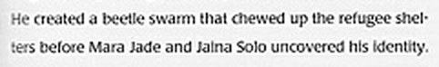
Our notes: `notes/materials/027-new-essential-chronology/12-part-twelve-new-jedi-order.md:85`

> Nom Anor, as Yu'shaa the Prophet, overlooks the greening of Coruscant.
— Source: Part Twelve: The New Jedi Order; art caption.
Note (our notes, around the quote): art caption: "Nom Anor, as Yu'shaa the Prophet, overlooks the greening of Coruscant." Source: The New Essential Chronology, p.223, caption
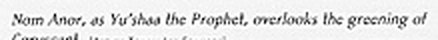
Our notes: `notes/materials/027-new-essential-chronology/12-part-twelve-new-jedi-order.md:195`

## The Complete Star Wars Encyclopedia, Vol. II (H–O)

> After Tahiri Veila revealed that it had been Nom Anor who killed Nen Yim, Harrar swore to kill the former executor.
— Source: scan pages 1–40; Tahiri Veila. POV: Tahiri Veila, about Nom Anor.
Note (our notes, around the quote): Tahiri Veila: "After Tahiri Veila revealed that it had been Nom Anor who killed Nen Yim, Harrar swore to kill the former executor." Source: The Complete Star Wars Encyclopedia, Vol. II, p.21
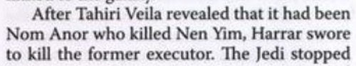
Our notes: `notes/materials/031-complete-star-wars-encyclopedia-vol-2/00-v2-scan-001-040.md:186`

## Sourcebooks/The New Jedi Order Sourcebook.pdf [Star Wars Roleplaying Game (d20, 2000)] (scan pages 1–60)

> The most successful of these advance agents, Nom Anor, destroyed a number of visionary leaders who could have rallied beings to fight against the invasion fleet.
— Source: Sourcebooks/The New Jedi Order Sourcebook.pdf [Star Wars Roleplaying Game.
Note (our notes, around the quote): Nom Anor — entry/section: Yuuzhan Vong advance agents (The New Jedi Order Sourcebook, Ch1): "The most successful of these advance agents, Nom Anor, destroyed a number of visionary leaders who could have rallied beings to fight against the invasion fleet." Source: *The New Jedi Order Sourcebook* (SWRPG d20), scan p.10
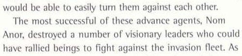
Our notes: `notes/materials/037-sw-d20-folder/049-the-new-jedi-order-sourcebook-scan-001-060.md:63`

## Sourcebooks/The New Jedi Order Sourcebook.pdf [Star Wars Roleplaying Game (d20, 2000)] (scan pages 121–162)

- Note (summary from our notes, not a quotation): Page contents: Anakin Solo vs Executor (Nom Anor turns down the duel, p.127); Corran's lightsaber cuts the ship hull; p.123 Jacen offers to duel Tsavong Lah. p.112-116 Anakin alone on Yavin 4 with grenade fungi and the Force; repairs lightsaber with lambent crystal. (hand-read)
  — Source: Sourcebooks/The New Jedi Order Sourcebook.pdf [Star Wars Roleplaying Game.
Our notes: `notes/materials/037-sw-d20-folder/049-the-new-jedi-order-sourcebook-scan-121-162.md:41`

> With Vergere’s help, Jacen slays the voxyn queen—but the battle is long and terrible and leaves Jacen too weak to escape.
— Source: Sourcebooks/The New Jedi Order Sourcebook.pdf [Star Wars Roleplaying Game.
Note (our notes, around the quote): Jacen Solo (Darth Caedus); Vergere; Nom Anor — entry/section: Star by Star (The New Jedi Order Sourcebook, Ch7): "With Vergere’s help, Jacen slays the voxyn queen—but the battle is long and terrible and leaves Jacen too weak to escape." Source: *The New Jedi Order Sourcebook* (SWRPG d20), scan p.157
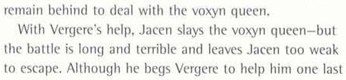
Our notes: `notes/materials/037-sw-d20-folder/049-the-new-jedi-order-sourcebook-scan-121-162.md:258`

## Star Wars Gamer/Star Wars Gamer 05.pdf [Star Wars Roleplaying Game (d20, 2000)] (scan pages 1–60)

- Note (summary from our notes, not a quotation): Page contents: Lumiya: Shira Brie born on Imperial Center, trained for Imperial Intelligence at Vader's direction, Echani and Noghri stava; shot down by Luke, rebuilt with cybernetics by Vader who offered her to Palpatine as a Hand; on Ziost built a lightwhip from Vader's Kaiburr crystal shard and Mandalorian iron; allied with Flint vs the Nagai; trained Carnor Jax; seed: Nom Anor approached Jax about a Sith alliance (hand-read)
  — Source: Star Wars Gamer/Star Wars Gamer 05.pdf [Star Wars Roleplaying Game (d20,.
Our notes: `notes/materials/037-sw-d20-folder/054-star-wars-gamer-05-scan-001-060.md:237`

## Jedi Counselling/Jedi Counseling 78.pdf [Star Wars Roleplaying Game Revised Core (d20, 2002)]

- Note (summary from our notes, not a quotation): Page contents: Column tank (Obi-Wan), Nom Anor, Sniper; author bio (hand-read)
  — Source: Jedi Counselling/Jedi Counseling 78.pdf [Star Wars Roleplaying Game Revis.
Our notes: `notes/materials/037-sw-d20-folder/247-jedi-counseling-78.md:37`

- Note (summary from our notes, not a quotation): Nom Anor — entry/section: Column formation with Nom Anor: "A: The column formation can be very effective if the characters in it also have Stealth, particularly if the "tank" can find cover as well -- it makes them completely immune to nonmelee attacks from opponents in front of the column unless the attacker has Accurate Shot. Furthermore, Nom Anor's commander effect is one of the few things that can keep a character safe from an attacker with Accurate Shot, which makes it exceedingly difficult to attack any of the characters in this column.
  — Source: Jedi Counselling/Jedi Counseling 78.pdf [Star Wars Roleplaying Game Revis.
Our notes: `notes/materials/037-sw-d20-folder/247-jedi-counseling-78.md:41`

- Note (summary from our notes, not a quotation): Including Nom Anor does have a drawback, though. The different characters are so close to one another that if Self-Destruct is triggered, it could literally destroy the entire column." Source: *Jedi Counseling 78* (SWRPG d20 Revised Core), scan p.4
  — Source: Jedi Counselling/Jedi Counseling 78.pdf [Star Wars Roleplaying Game Revis.
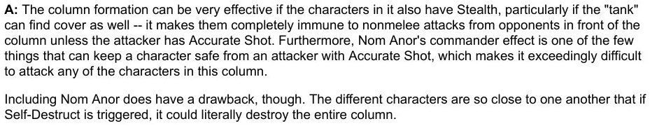
Our notes: `notes/materials/037-sw-d20-folder/247-jedi-counseling-78.md:42`

## Jedi Counselling/Jedi Counseling 83.pdf [Star Wars Roleplaying Game Revised Core (d20, 2002)]

- Note (summary from our notes, not a quotation): Page contents: Wat Tambor Droid Reinforcements; Nom Anor no crab armor; author bio (hand-read)
  — Source: Jedi Counselling/Jedi Counseling 83.pdf [Star Wars Roleplaying Game Revis.
Our notes: `notes/materials/037-sw-d20-folder/253-jedi-counseling-83.md:57`

> Q: Why doesn't Nom Anor have Vonduun Crab Armor? A: Nom Anor isn't really a dedicated warrior, per se, but more of an infiltrator. When the Yuuzhan Vong invasion began, his cover was as the leader of an anti­Jedi, anti­technology cult called the Red Knights of Life. In reality, of course, he was an agitator trying to disrupt the cohesion of the New Republic prior to the Yuuzhan Vong invasion. As such, he was in disguise for quite some time ­­ wearing obviously alien Yuuzhan Vong biotechnology (such as Vonduun Crab Armor) would have made people question his origin and apparently Human appearance.
— Source: Jedi Counselling/Jedi Counseling 83.pdf [Star Wars Roleplaying Game Revis.
(Excerpt widened 2026-11-17 to the relevant passage, word for word from research primary sw d20 folder files Star Wars Roleplaying Game Revised Core Jedi Counselling Jedi Counseling 83 (text copy `research_primary_sw_d20_folder_files_Star_Wars_Roleplaying_Game_Revised_Core_Jedi_Counselling_Jedi_Counseling_83_pdf_2ab93e9433`).)
Note (our notes, around the quote): Nom Anor — entry/section: Why doesn't Nom Anor have Vonduun Crab Armor?: "A: Nom Anor isn't really a dedicated warrior, per se, but more of an infiltrator. When the Yuuzhan Vong invasion began, his cover was as the leader of an anti-Jedi, anti-technology cult called the Red Knights of Life. In reality, of course, he was an agitator trying to disrupt the cohesion of the New Republic prior to the Yuuzhan Vong invasion. As such, he was in disguise for quite some time -- wearing obviously alien Yuuzhan Vong biotechnology (such as Vonduun Crab Armor) would have made people question his origin and apparently Human appearance." Source: *Jedi Counseling 83* (SWRPG d20 Revised Core), scan p.5
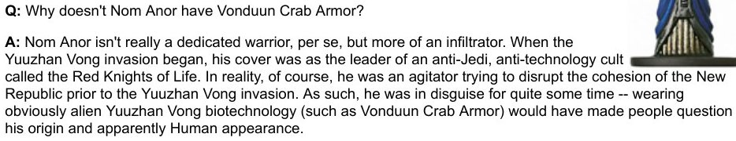
Our notes: `notes/materials/037-sw-d20-folder/253-jedi-counseling-83.md:61`

## Jedi Counselling/Jedi Counseling 88.pdf [Star Wars Roleplaying Game Revised Core (d20, 2002)]

- Note (summary from our notes, not a quotation): Page contents: Luke answer; Lightsaber Sweep vs Ysalamiri; walls; Xizor/B'omarr; Nom Anor; Yoda x2; author bio (hand-read)
  — Source: Jedi Counselling/Jedi Counseling 88.pdf [Star Wars Roleplaying Game Revis.
Our notes: `notes/materials/037-sw-d20-folder/258-jedi-counseling-88.md:32`

> Dominate is not an attack: It’s a "replaces turn" ability. Q: Can a B'omarr Monk use Dominate on another B'omarr Monk and, if the target fails the save, then use the target's Dominate special ability on yet another target? Sounds odd, I know, but this might be useful for attempting to dominate a character that is not in line of sight for the first B'omarr Monk but is in line of sight for the other B'omarr Monk. A: Yes, this is perfectly legal. The only thing a Dominated character can't do during its immediate turn is move. Q: Can Nom Anor use his commander effect to give Self­Destruct 20 to himself? A: Yes. Nothing in the rules prevents a commander effect from affecting the commander, and nothing in this commander effect indicates that it would not work on Nom Anor. In fact, the first half of Nom Anor's commander effect does point out that Nom Anor himself is affected. The second half has the same wording ("Characters in your squad with Stealth . . ."), so it works the same way. Q: Can Yoda, Jedi Master use Force Defense only against Force powers targeted at him, or can he use it against Force powers targeting allies, too? A: Yoda's Force Defense will work against any Force power used by a character within 6 squares. The target (if any) doesn't matter at all.
— Source: Jedi Counselling/Jedi Counseling 88.pdf [Star Wars Roleplaying Game Revis.
(Excerpt widened 2026-11-17 to the relevant passage, word for word from research primary sw d20 folder files Star Wars Roleplaying Game Revised Core Jedi Counselling Jedi Counseling 88 (text copy `research_primary_sw_d20_folder_files_Star_Wars_Roleplaying_Game_Revised_Core_Jedi_Counselling_Jedi_Counseling_88_pdf_5cb6850e70`).)
(Excerpt widened 2026-11-17 to the relevant passage, word for word from research primary sw d20 folder files Star Wars Roleplaying Game Revised Core Jedi Counselling Jedi Counseling 88 (text copy `research_primary_sw_d20_folder_files_Star_Wars_Roleplaying_Game_Revised_Core_Jedi_Counselling_Jedi_Counseling_88_pdf_5cb6850e70`).)
Note (our notes, around the quote): Nom Anor — entry/section: Nom Anor gives Self-Destruct 20 to himself: "A: Yes. Nothing in the rules prevents a commander effect from affecting the commander, and nothing in this commander effect indicates that it would not work on Nom Anor. In fact, the first half of Nom Anor's commander effect does point out that Nom Anor himself is affected." Source: *Jedi Counseling 88* (SWRPG d20 Revised Core), scan p.3
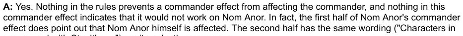
Our notes: `notes/materials/037-sw-d20-folder/258-jedi-counseling-88.md:39`

## Jedi Counselling/Jedi Counseling 96.pdf [Star Wars Roleplaying Game Revised Core (d20, 2002)]

- Note (summary from our notes, not a quotation): Naturally, all of the above applies to Nom Anor's commander effect as well." Source: *Jedi Counseling 96* (SWRPG d20 Revised Core), scan p.3
  — Source: Jedi Counselling/Jedi Counseling 96.pdf [Star Wars Roleplaying Game Revis.
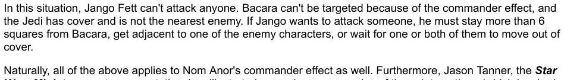
Our notes: `notes/materials/037-sw-d20-folder/267-jedi-counseling-96.md:53`

## Sourcebooks/Hero's Guide.pdf [Star Wars Roleplaying Game Revised Core (d20, 2002)] (scan pages 61–120)

- Note (summary from our notes, not a quotation): Page contents: Peace Brigade Sympathy (Nom Anor), Joining, Leaving; feats Biotech Familiarity, Jedi Hunter. (hand-read)
  — Source: Sourcebooks/Hero's Guide.pdf [Star Wars Roleplaying Game Revised Core (d2.
Our notes: `notes/materials/037-sw-d20-folder/668-heros-guide-scan-061-120.md:258`

## Sourcebooks/Revised Core Rulebook.pdf [Star Wars Roleplaying Game Revised Core (d20, 2002)] (scan pages 241–300)

> Nom Anor, an advance agent for the Yuuzhan Vong, sows additional seeds of discord throughout the galaxy.
— Source: Sourcebooks/Revised Core Rulebook.pdf [Star Wars Roleplaying Game Revised.
Note (our notes, around the quote): Nom Anor — entry/section: The New Jedi Order era (Revised Core Rulebook, Ch13): "Nom Anor, an advance agent for the Yuuzhan Vong, sows additional seeds of discord throughout the galaxy." Source: *Revised Core Rulebook* (SWRPG d20 Revised Core), scan p.297
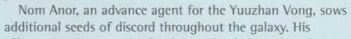
Our notes: `notes/materials/037-sw-d20-folder/671-revised-core-rulebook-scan-241-300.md:300`

## Sourcebooks/Revised Core Rulebook.pdf [Star Wars Roleplaying Game Revised Core (d20, 2002)] (scan pages 301–360)

> Although she keeps its worst effects at bay using the Force, a pregnant Mara fears for her life and the future of their son.
— Source: Sourcebooks/Revised Core Rulebook.pdf [Star Wars Roleplaying Game Revised.
Note (our notes, around the quote): Mara Jade Skywalker; Nom Anor — entry/section: Mara Jade (Revised Core Rulebook, Ch13): "Although she keeps its worst effects at bay using the Force, a pregnant Mara fears for her life and the future of their son." Source: *Revised Core Rulebook* (SWRPG d20 Revised Core), scan p.311
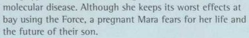
Our notes: `notes/materials/037-sw-d20-folder/671-revised-core-rulebook-scan-301-360.md:134`

## Sourcebooks/Ultimate Alien Anthology.pdf [Star Wars Roleplaying Game Revised Core (d20, 2002)] (scan pages 181–225)

- Note (summary from our notes, not a quotation): Page contents: Yuuzhan Vong gods (example names incl. Nom Anor, Tsavong Lah, Shedao Shai, Nen Yim) traits; glistaweb. (hand-read)
  — Source: Sourcebooks/Ultimate Alien Anthology.pdf [Star Wars Roleplaying Game Revi.
Our notes: `notes/materials/037-sw-d20-folder/673-ultimate-alien-anthology-scan-181-225.md:78`

## Sourcebooks/Galaxy of Intrigue.pdf [Star Wars Roleplaying Game Saga Edition (2007)] (scan pages 61–120)

- Note (summary from our notes, not a quotation): Page contents: Praetorite Vong Notable Members: Da'Gara, E'thinaa, Nom Anor, Yomin Carr; Using the Praetorite Vong. (hand-read)
  — Source: Sourcebooks/Galaxy of Intrigue.pdf [Star Wars Roleplaying Game Saga Editi.
Our notes: `notes/materials/037-sw-d20-folder/716-galaxy-of-intrigue-scan-061-120.md:453`

## Sourcebooks/Saga Edition Core Rulebook.pdf [Star Wars Roleplaying Game Saga Edition (2007)] (scan pages 241–295)

> They are also 28
> [fragment — full passage not on file]
— Source: Sourcebooks/Saga Edition Core Rulebook.pdf [Star Wars Roleplaying Game Sa.
Note (our notes, around the quote): Tsavong Lah; Nom Anor — entry/section: Yuuzhan Vong species traits (Saga Edition Core Rulebook, Ch16): "They are also 28" Source: *Saga Edition Core Rulebook* (SWRPG Saga Edition), scan p.293
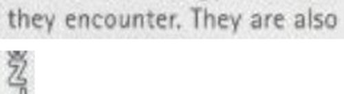
Our notes: `notes/materials/037-sw-d20-folder/723-saga-edition-core-rulebook-scan-241-295.md:349`

## Web Articles.pdf [Star Wars Roleplaying Game Saga Edition (2007)] (scan pages 61–120)

- Note (summary from our notes, not a quotation): Page contents: Jedi Counseling 104 cont.: Princess Leia, Hoth Commander's commander effect (non-Unique ally that would be defeated returns with full Hit Points on save 16): no victory points scored, resolved at the Avoid Defeat step; "when defeated" effects such as Self-Destruct (with Nom Anor's commander effect) and Mon Mothma's immediate attack don't trigger (25% less often, but allies stay 33% longer); only Hit Points and location (setup area) change; activation, Force Points, E522 Assassin Droid's Programmed Target and Yoda of Dagobah's Light Tutor designations persist. (hand-read)
  — Source: Web Articles.pdf [Star Wars Roleplaying Game Saga Edition (2007)] (scan p.
Our notes: `notes/materials/037-sw-d20-folder/732-web-articles-scan-061-120.md:154`

## Web Articles.pdf [Star Wars Roleplaying Game Saga Edition (2007)] (scan pages 241–300)

- Note (summary from our notes, not a quotation): Page contents: Advance Agent, Officer: Yuuzhan Vong advance agents background and Nom Anor (T records); miniatures tactics ("a//" = "all" in text layer); stat card (Yuuzhan Vong; cost 11; HP 30; Def 14; Atk +5; Dmg 10; Force Immunity, Melee Attack, Stealth, Thud Bug; commander effect Cunning Attack); Saga stats Advance Agent, Officer CL 4 Medium Yuuzhan Vong nonheroic 6/noble 1/officer 1 (Dark Side 12; Perception +10; 9 languages; Ref 14, Fort 13, Will 17; hp 31; Force immunity; amphistaff spear/quarterstaff/whip/spit, thud bug +5 (2d6 plus special); technophobic; Born Leader, Deployment Tactics; continues p261). (hand-read)
  — Source: Web Articles.pdf [Star Wars Roleplaying Game Saga Edition (2007)] (scan p.
Our notes: `notes/materials/037-sw-d20-folder/732-web-articles-scan-241-300.md:220`

## Star Wars Insider #45 (1999)

- Note (summary from our notes, not a quotation): Page contents: "Seeds Planted": R.A. Salvatore Vector Prime excerpt (ch. 4). Intro: ~25 ABY, Leia/Jaina/Mara mission to Rhommamool; Nom Anor (Yuuzhan Vong executor) and coomb spores. (hand-read)
  — Source: Star Wars Insider #45 (1999). POV: Page contents, about Nom Anor.
Our notes: `notes/materials/038-star-wars-insider/045-ins045.md:327`

> Nor is her daughter you.
> [fragment — full passage not on file]
>
> But Mara Jade is counted among the strongest of the Jedi Knights,” Shok Tinoktin pointed ovt “Mara lade bas her own problems to consider,
> [fragment — full passage not on file]
>
> She should be long dead,” he dared to say.
— Source: Star Wars Insider #45 (1999).
Note (our notes, around the quote): Mara Jade Skywalker; Nom Anor — entry/section: Star Wars Insider 045 (1999): "“Nor is her daughter you.” 4 proven Jedi,* "But Mara Jade is counted among the strongest of the Jedi Knights,” Shok Tinoktin pointed ovt “Mara lade bas her own problems to consider," Nom Anor reminded Shok Tinektin didn't take comfort in that; in fact, the reminder of Mara's disease only heightened his trepidation about letting her see Nom Anor at this time "She should be long dead,” he dared to say." Source: *Star Wars Insider #45* (1999), scan p.64
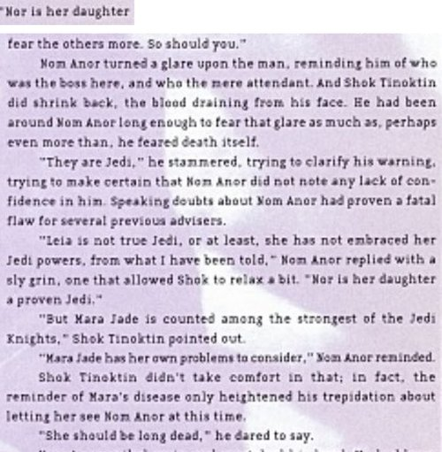
Our notes: `notes/materials/038-star-wars-insider/045-ins045.md:329`

> The spores—coomb, brollup, tegnest, and a dozen other varieties—were but a hobby, one that he had been able to insert into his official duties in attempting to develop some method for easily killing the super-creatures, the Jedi Knights. Also, such alchemical work, if successful, could prove critical in Nom Anor's ascension to the rank of high prefect. But in those endeavors and aspirations, to date at least, it appeared as if he had failed, for Mara Jade Skywalker had somehow defeated the spores, or at least had held them at bay.
— Source: Star Wars Insider #45 (1999); Mara Jade Skywalker; Nom Anor — entry/section: Vector Prime excerpt.
Note (our notes, around the quote): Mara Jade Skywalker; Nom Anor — entry/section: Vector Prime excerpt: "The spores—coomb, brollup, tegnest, and a dozen other varieties—were but a hobby, one that he had been able to insert into his official duties in attempting to develop some method for easily killing the super-creatures, the Jedi Knights. Also, such alchemical work, if successful, could prove critical in Nom Anor's ascension to the rank of high prefect. But in those endeavors and aspirations, to date at least, it appeared as if he had failed, for Mara Jade Skywalker had somehow defeated the spores, or at least had held them at bay." Source: *Star Wars Insider #45* (1999), scan p.64
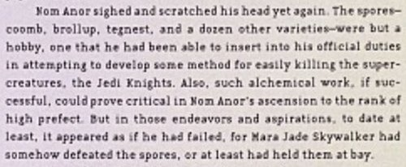
Our notes: `notes/materials/038-star-wars-insider/045-ins045.md:333`

- Note (summary from our notes, not a quotation): Page contents: Vector Prime excerpt cont.: Nom Anor's aims (weaken Leia/Jaina), Noghri Bolpuhr, dresses like Vader; avoids letting Jedi into his quarters because of their "sensory powers" (not imaged-checked, noted only). (hand-read)
  — Source: Star Wars Insider #45 (1999).
Our notes: `notes/materials/038-star-wars-insider/045-ins045.md:338`

> Nom Anor noticed on one of his many security holocams then that Shok Tinoktin was returning, with Tamaktis Breetha, the former mayor of Redhaven and now a member of Nom Anor’s independent senate, and Leia, Jaina, and Mara. He noted the movements of two others, as well: a golden droid—and he would have to remember to punish Shok Tinoktin for allowing a droid into his complex!—and a ghostly gray creature seeming almost to float behind the others, hanging close to Leia, as if it was nothing more substantial than the woman’s shadow. The expected Noghri bodyguard, Nom Anor knew. He nodded at the sight and made a mental note to keep careful watch on that one. In many ways, Nom Anor held much more respect for the Noghri, those deadly warriors, than for any humans, even Jedi.
— Source: Star Wars Insider #45 (1999); Nom Anor — entry/section: Vector Prime excerpt.
(Excerpt widened 2026-11-17 to the relevant passage, word for word from Vector Prime (R.A. Salvatore) (text copy `MEGA_Legend_The_New_Jedi_Order_Series_Star_Wars_New_Jedi_Order_01_Vector_Prime_R_A_Salvatore_epub`).)
Note (our notes, around the quote): Nom Anor — entry/section: Vector Prime excerpt: "The expected Noghri bodyguard, Nom Anor knew. He nodded at the sight and made a mental note to keep careful watch on that one. In many ways, Nom Anor held much more respect for the Noghri, those deadly warriors, than for any humans, even Jedi." Source: *Star Wars Insider #45* (1999), scan p.65
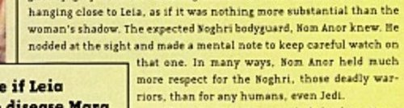
Our notes: `notes/materials/038-star-wars-insider/045-ins045.md:340`

- Note (summary from our notes, not a quotation): Page contents: Vector Prime excerpt cont.: hallway confrontation; Leia recognizes Vader-like look; Nom Anor rejects mediation. Dialogue, no power statements. (hand-read)
  — Source: Star Wars Insider #45 (1999).
Our notes: `notes/materials/038-star-wars-insider/045-ins045.md:345`

> she wasn't as strong
> [fragment — full passage not on file]
— Source: Star Wars Insider #45 (1999).
Note (our notes, around the quote): Page contents: Vector Prime excerpt cont.: Nom Anor threatens C-3PO; newt confirms spores on Mara's breath, "she wasn't as strong"; yammosk mention; party leaves. (hand-read)
Our notes: `notes/materials/038-star-wars-insider/045-ins045.md:350`

- Note (summary from our notes, not a quotation): Page contents: Vector Prime excerpt cont.: Mara and Jaina sense nothing of Nom Anor through the Force; Falcon repair scene with Han, Anakin Solo, Chewie (cont. p74 of magazine). (hand-read)
  — Source: Star Wars Insider #45 (1999).
Our notes: `notes/materials/038-star-wars-insider/045-ins045.md:355`

> “He is about as infuriating as any being I’ve ever met,” Leia agreed.
>
> “And once again, my sensitivity to the Force revealed nothing about him,” Mara added. “Nothing. I even tried to silently call to him, just to get a reaction, but he didn’t respond at all—I don’t even know that he heard it—and so completely did he ignore me that there was little I could learn about him.”
>
> It's like he was totally devoid of the Force.
— Source: Star Wars Insider #45 (1999).
(Excerpt widened 2026-11-17 to the relevant passage, word for word from Vector Prime (R.A. Salvatore) (text copy `MEGA_Legend_The_New_Jedi_Order_Series_Star_Wars_New_Jedi_Order_01_Vector_Prime_R_A_Salvatore_epub`).)
(Excerpt widened 2026-11-17 to the relevant passage, word for word from Vector Prime (R.A. Salvatore) (text copy `MEGA_Legend_The_New_Jedi_Order_Series_Star_Wars_New_Jedi_Order_01_Vector_Prime_R_A_Salvatore_epub`).)
(Full sentence/passage taken from the source text on file: `njo_vp_epub`.)
Note (our notes, around the quote): Mara Jade Skywalker; Jaina Solo; Nom Anor — entry/section: Vector Prime excerpt: ""And once again, my sensitivity to the Force revealed nothing about him," Mara added. "Nothing. I even tried to silently call to him, just to get a reaction, but he didn't respond at all—I don't even know that he heard it—and so completely did he ignore me that there was little I could learn about him." "Same with me," Jaina admitted. "It's like he was totally devoid of the Force." Source: *Star Wars Insider #45* (1999), scan p.68
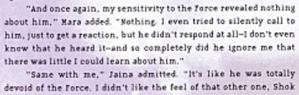
Our notes: `notes/materials/038-star-wars-insider/045-ins045.md:357`

## Star Wars Insider #59 (2002)

- Note (summary from our notes, not a quotation): Page contents: Making of NEGC cont. (magazine p. 61), illustrations by Michael Sutfin (Qui-Gon and Obi-Wan art): 102 full entries plus 50 appendix thumbnails; cuts (Het Nkik, Davin Felth) and additions (Qui-Gon Jinn, Nom Anor, Jango Fett); Sutfin on the deadline, researching EU characters, redoing the Episode II Anakin, the Obi-Wan lightsaber layer; bonus entries for Wes Janson and Poggle the Lesser. (hand-read)
  — Source: Star Wars Insider #59 (2002).
Our notes: `notes/materials/038-star-wars-insider/059-ins059.md:465`

## Star Wars Insider #71 (2003)

- Note (summary from our notes, not a quotation): Page contents: Greg Keyes profile opens: his Chosen of the Changeling, Age of Unreason and Kingdoms of Thorn and Bone series; The Final Prophecy (Nen Yim, Harrar, Yu'shaa with Corran Horn and Tahiri seeking Zonama Sekot; Wedge at Bilbringi; Yu'shaa really Nom Anor). (hand-read)
  — Source: Star Wars Insider #71 (2003).
Our notes: `notes/materials/038-star-wars-insider/071-ins071.md:338`

## Star Wars Insider #74 (2004)

- Note (summary from our notes, not a quotation): Page contents: NJO: Destiny's Way synopsis; fallen heroes: Chewbacca, Anakin Solo, Ganner Rhysode, Vergere, Elegos A'Kla, Borsk Fey'lya, Ikrit and Admiral Ackbar; Force Heretic I: Remnant synopsis (Nom Anor as the Prophet Yu'shaa). (hand-read)
  — Source: Star Wars Insider #74 (2004).
Our notes: `notes/materials/038-star-wars-insider/074-ins074.md:188`

## Star Wars Insider #79 (2005)

- Note (summary from our notes, not a quotation): Page contents: Ask the Master concludes: Lorne Peterson's Episode I Podrace cameo; a Rebel in scout trooper armor outside the Endor bunker; reflected lights in an Empire shot (a controller, not Rieekan); Mara Jade's coomb spore infection by Nom Anor on Monor II; the Antilles surname; contact box. (hand-read)
  — Source: Star Wars Insider #79 (2005).
Our notes: `notes/materials/038-star-wars-insider/079-ins079.md:408`

## Star Wars Insider #129 (2011)

- Note (summary from our notes, not a quotation): Page contents: Comics (Daniel Wallace): Crimson Empire III, Kir Kanos's revenge; Randy Stradley on its origins (Nom Anor in Crimson Empire II led to the Yuuzhan Vong and NJO; the abandoned plan became the Invasion series); Dave Dorman art. (hand-read)
  — Source: Star Wars Insider #129 (2011).
Our notes: `notes/materials/038-star-wars-insider/129-ins129.md:361`

## Star Wars Insider #135 (2012)

- Note (summary from our notes, not a quotation): Page contents: Comics: The Crimson Empire Saga hardcover (Kir Kanos; Nom Anor's first appearance); Omnibus: Clone Wars Volume 1 (Ventress, Dooku, Durge). Ask Lobot (questioner omitted): Mon Calamari usually have first and last names; Ackbar's first name was recently revealed as Gial. (hand-read)
  — Source: Star Wars Insider #135 (2012).
Our notes: `notes/materials/038-star-wars-insider/135-ins135.md:356`

## Star Wars Insider #140 (2013)

- Note (summary from our notes, not a quotation): Page contents: Hasbro The Vintage Collection re-issues of "fan favorites" (voted favorite collectible in the first Insider Awards); the US list (Maul, Nom Anor, Starkiller, Shae Vizla, etc.); $7.99/$8.99. (hand-read)
  — Source: Star Wars Insider #140 (2013).
Our notes: `notes/materials/038-star-wars-insider/140-ins140.md:440`

## The Thrawn Trilogy (Timothy Zahn): Heir to the Empire, Dark Force Rising, The Last Command, plus the Heir 20th Anniversary extras

What it shows (our notes): *Vector Prime* (Salvatore), ch. 1: Nom Anor "crushing the stone in his grasp" with "tremendous power". Mara: "Even when I tried to use the Force to gain a better perspective on him, I drew . . . A blank". Mara's illness requires "hours and tremendous Force energy merely holding it in check."
> When the hooting and cheering died down, Nom Anor opened his hands, revealing a single small stone. Then he clenched his fist again, squeezing with tremendous power, crushing the stone in his grasp so that dust and flecks of rock splinters slipped out the sides.
>
> “Not in Nom Anor’s eyes,” Jaina said.
>
> And Mara reiterated her warning to Leia not to take the man lightly. “He’s the strangest man I ever met,” she explained, and given her past exploits with notorious sorts like Jabba the Hutt and Talon Karrde, that was quite a statement. “Even when I tried to use the Force to gain a better perspective on him, I drew …” Mara paused, as if looking for some way to properly express the feeling. “A blank,” she decided. “As if the Force had nothing to do with him.”
>
> Of course, Leia understood it to be much more than that, an internal churning that required Mara to spend hours and tremendous Force energy merely holding it in check. But that was Mara’s business.
— Source: Heir to the Empire — notes part 11: Back matter (Del Rey Legends edition, lines 4023–5560); *Vector Prime* (Salvatore), ch. 1: Nom Anor.
(Excerpt widened 2026-11-17 to the relevant passage, word for word from The Empire Strikes Back (Donald F. Glut) (text copy `MEGA_Legend_The_Episode_Novelizations_Star_Wars_Episode_V_The_Empire_Strikes_Back_Donald_F_Glut_epub`).)
(Excerpt widened 2026-11-17 to the relevant passage, word for word from The Empire Strikes Back (Donald F. Glut) (text copy `MEGA_Legend_The_Episode_Novelizations_Star_Wars_Episode_V_The_Empire_Strikes_Back_Donald_F_Glut_epub`).)
(Full sentence/passage taken from the source text on file: `cw_novels_tmp_cestus_deception_epub`.)
(Fragment completed 2026-11-17: full sentence/passage matched word for word in the source text on file: `MEGA_Legend_The_Episode_Novelizations_Star_Wars_Episode_V_The_Empire_Strikes_Back_Donald_F_Glut_epub`.)
Our notes: `notes/materials/044-thrawn-trilogy/heir-11.md:25`

## The Dark Nest Trilogy (Troy Denning, Del Rey 2005): FULL consecutive re-read (2026-11-16 CST)

What it shows (our notes): Shimrra lies on "a dais of pulsing red hau polyps". Onimi is "the Shamed One". Yoog Skell: "Never think to lie to the Supreme One".
> Nom Anor, distaste prickling, pushed past the Shamed One and entered. The rounded resinous walls of the chamber shone with a faint luminescence, and the air bore the metallic scent of blood. In the dim light Nom Anor made out the magnificently scarred and mutilated form of Supreme Overlord Shimrra, reclining on a dais of pulsing red hau polyps. Onimi, the Supreme One’s familiar, sank into the shadows at Shimrra’s feet. Nom Anor prostrated himself, all too aware of the scrutiny of Shimrra’s rainbow eyes.
>
> Never think to lie to the Supreme One, Yoog Skell had warned.
>
> Nom Anor would not. He probably could not. Fortunately he was well prepared with the latest news of the infidels’ efforts against the Yuuzhan Vong.
— Source: Bundled e-book: *Star Wars: The New Jedi Order: Ylesia* (Walter Jon Williams, 2002), as included in the Joiner King epub; Shimrra lies on.
(Excerpt widened 2026-11-17 to the relevant passage, word for word from The Joiner King (Troy Denning) (text copy `MEGA_Legend_The_Dark_Nest_Trilogy_Star_Wars_Dark_Nest_01_The_Joiner_King_Troy_Denning_epub`).)
(Excerpt widened 2026-11-17 to the relevant passage, word for word from The Joiner King (Troy Denning) (text copy `MEGA_Legend_The_Dark_Nest_Trilogy_Star_Wars_Dark_Nest_01_The_Joiner_King_Troy_Denning_epub`).)
(Full sentence/passage taken from the source text on file: `novels_tmp_ylesia_ylesia_epub`.)
Our notes: `notes/materials/051-dark-nest-trilogy/jk-05-ylesia.md:6`

What it shows (our notes): The Peace Brigade government on Ylesia is split into factions. Nom Anor: "infidels so disposed as to join an organization called the 'Peace Brigade' may not be temperamentally inclined toward war." Shimrra: "No wonder a galaxy that spawned such as these was given by the gods to us."
> “Perhaps it should be admitted that infidels so disposed as to join an organization called the ‘Peace Brigade’ may not be temperamentally inclined toward war,” Nom Anor said.
>
> “They need a leader to exact obedience,” Shimrra concluded.
>
> No wonder a galaxy that spawned such as these was given by the gods to us.
— Source: Bundled e-book: *Star Wars: The New Jedi Order: Ylesia* (Walter Jon Williams, 2002), as included in the Joiner King epub.
(Excerpt widened 2026-11-17 to the relevant passage, word for word from The Joiner King (Troy Denning) (text copy `MEGA_Legend_The_Dark_Nest_Trilogy_Star_Wars_Dark_Nest_01_The_Joiner_King_Troy_Denning_epub`).)
(Excerpt widened 2026-11-17 to the relevant passage, word for word from The Joiner King (Troy Denning) (text copy `MEGA_Legend_The_Dark_Nest_Trilogy_Star_Wars_Dark_Nest_01_The_Joiner_King_Troy_Denning_epub`).)
(Full sentence/passage taken from the source text on file: `novels_tmp_ylesia_ylesia_epub`.)
Our notes: `notes/materials/051-dark-nest-trilogy/jk-05-ylesia.md:7`

> And—also according to Darjeelai Swan—it was Sal-Solo himself who fired the Centerpoint weapon at our fleet at Fondor.”
— Source: Bundled e-book: *Star Wars: The New Jedi Order: Ylesia* (Walter Jon Williams, 2002), as included in the Joiner King epub.
(Full sentence/passage taken from the source text on file: `novels_tmp_ylesia_ylesia_epub`.)
Note (our notes, around the quote): Thrackan Sal-Solo offers Corellia's neutrality and Centerpoint. His companion Darjeelai Swan reveals under interrogation that Centerpoint is non-functional and that "it was Sal-Solo himself who fired the Centerpoint weapon at our fleet at Fondor."
Our notes: `notes/materials/051-dark-nest-trilogy/jk-05-ylesia.md:8`

> “Fetch him to our presence, Lord, And bring us all into concord.
>
> I wish it known and made a rule
>
> That I am not the only fool.”
>
> Shimrra’s vast frame heaved with what might have been laughter.
>
> “Yes,” he said. “By all means. Let us meet the master of Corellia.”
— Source: Bundled e-book: *Star Wars: The New Jedi Order: Ylesia* (Walter Jon Williams, 2002), as included in the Joiner King epub; Onimi's rhyme. POV: Onimi's rhyme, about Nom Anor.
(Excerpt widened 2026-11-17 to the relevant passage, word for word from The Joiner King (Troy Denning) (text copy `MEGA_Legend_The_Dark_Nest_Trilogy_Star_Wars_Dark_Nest_01_The_Joiner_King_Troy_Denning_epub`).)
(Excerpt widened 2026-11-17 to the relevant passage, word for word from The Joiner King (Troy Denning) (text copy `MEGA_Legend_The_Dark_Nest_Trilogy_Star_Wars_Dark_Nest_01_The_Joiner_King_Troy_Denning_epub`).)
Our notes: `notes/materials/051-dark-nest-trilogy/jk-05-ylesia.md:9`

> Sal-Solo’s eyes widened as he listened to Nom Anor’s lengthy translation. The executor did not bother to state the fact that, in the Yuuzhan Vong language, peace was the same word as submission.
— Source: Bundled e-book: *Star Wars: The New Jedi Order: Ylesia* (Walter Jon Williams, 2002), as included in the Joiner King epub.
(Excerpt widened 2026-11-17 to the relevant passage, word for word from The Joiner King (Troy Denning) (text copy `MEGA_Legend_The_Dark_Nest_Trilogy_Star_Wars_Dark_Nest_01_The_Joiner_King_Troy_Denning_epub`).)
(Full sentence/passage taken from the source text on file: `dn_tmp_jk_epub`.)
Our notes: `notes/materials/051-dark-nest-trilogy/jk-05-ylesia.md:10`

What it shows (our notes): Vengeance: "I have just appointed him President ofYlesia [sic] and Commander in Chief of the Peace Brigade." (Shimrra). Onimi's batron to the kidney: "Your resignation is declined, infidel." Darjeelai Swan dies under interrogation.
> I have just appointed him President ofYlesia [sic] and Commander in Chief of the Peace Brigade. *(Shimrra)*
>
> “Your resignation is declined, infidel,” he said. “We shall see you are transported immediately to Ylesia, where you may take your place as head of the government. In the meantime, you will give us the names of your associates on Corellia, so they, too, may be given their instructions.”
— Source: Bundled e-book: *Star Wars: The New Jedi Order: Ylesia* (Walter Jon Williams, 2002), as included in the Joiner King epub; Vengeance. POV: Shimrra, about Nom Anor.
(Excerpt widened 2026-11-17 to the relevant passage, word for word from The Joiner King (Troy Denning) (text copy `MEGA_Legend_The_Dark_Nest_Trilogy_Star_Wars_Dark_Nest_01_The_Joiner_King_Troy_Denning_epub`).)
(Full sentence/passage taken from the source text on file: `novels_tmp_ylesia_ylesia_epub`.)
Our notes: `notes/materials/051-dark-nest-trilogy/jk-05-ylesia.md:11`

What it shows (our notes): Maal Lah ("architect of the Yuuzhan Vong capture of Coruscant") arrives. Nom Anor has a new "plaeryin bol". The New Republic "Chief of State" is coming to sign a treaty; this turns out to be Pwoe.
> Followed by his real bodyguard, Dagga Marl, Thrackan marched to the frigate analog and waited. Eventually a part of the hull withdrew somehow, and an object like a giant, wart-encrusted tongue flopped down to touch the landing field. Down this ramp came a double file of Yuuzhan Vong armored warriors with amphistaffs—which these warriors looked as if they knew how to use. Once formed on the pavement, they were followed by Supreme Commander Maal Lah, architect of the Yuuzhan Vong capture of Coruscant.
— Source: Bundled e-book: *Star Wars: The New Jedi Order: Ylesia* (Walter Jon Williams, 2002), as included in the Joiner King epub; Maal Lah (.
(Excerpt widened 2026-11-17 to the relevant passage, word for word from The Joiner King (Troy Denning) (text copy `MEGA_Legend_The_Dark_Nest_Trilogy_Star_Wars_Dark_Nest_01_The_Joiner_King_Troy_Denning_epub`).)
(Full sentence/passage taken from the source text on file: `novels_tmp_ylesia_ylesia_epub`.)
Our notes: `notes/materials/051-dark-nest-trilogy/jk-05-ylesia.md:21`

## NJO 1, *Vector Prime* (R. A. Salvatore, Del Rey 1999): FULL consecutive re-read (2026-11-16 CST)

> When the hooting and cheering died down, Nom Anor opened his hands, revealing a single small stone. Then he clenched his fist again, squeezing with tremendous power, crushing the stone in his grasp so that dust and flecks of rock splinters slipped out the sides.
— Source: Vector Prime (R. A. Salvatore, Del Rey 1999), VP ch. 1 — 113 NJO 1 Vector Prime notes (re-read 2026-11-16).
(Fragment completed 2026-11-17: full sentence/passage matched word for word in the source text on file: `MEGA_Legend_The_New_Jedi_Order_Series_Star_Wars_New_Jedi_Order_01_Vector_Prime_R_A_Salvatore_epub`.)
Note text that was attached to the quote line: (VP ch. 1) — **Nom Anor crushes a stone in his fist**
Context: Nom Anor crushes a stone in his fist
Our notes: `notes/materials/113-njo-01-vector-prime/summary.md:14`

What it shows (our notes): Nom Anor: "but a fraction"
> At first, Nom Anor feared that his people might have underestimated their enemies, but then, as more complete reports of the truth of the disaster had rolled in, he came to understand that ill fate alone had ruined the day.
>
> But it was not over, Nom Anor knew. Not at all. The Praetorite Vong was but a fraction of what his people could throw this way.
— Source: Vector Prime (R. A. Salvatore, Del Rey 1999), VP ch. 25 — 113 NJO 1 Vector Prime notes (re-read 2026-11-16).
(Excerpt widened 2026-11-17 to the relevant passage, word for word from Vector Prime (R.A. Salvatore) (text copy `MEGA_Legend_The_New_Jedi_Order_Series_Star_Wars_New_Jedi_Order_01_Vector_Prime_R_A_Salvatore_epub`).)
(Fragment completed 2026-11-17: full sentence/passage matched word for word in the source text on file: `MEGA_Legend_The_New_Jedi_Order_Series_Star_Wars_New_Jedi_Order_01_Vector_Prime_R_A_Salvatore_epub`.)
Note text that was attached to the quote line: (VP ch. 25) — **Nom Anor: "but a fraction"**
Our notes: `notes/materials/113-njo-01-vector-prime/summary.md:45`

What it shows (our notes): KEY: Mara on Nom Anor: "Even when I tried to use the Force to gain a better perspective on him, I drew … A blank … As if the Force had nothing to do with him." / "More like he had nothing to do with the Force."
> “Don’t take him lightly,” Mara warned yet again. “His religious cry to abandon technology and machines, to look for truth in the natural elements and life of the universe, and to resist the joining of planets in false confederations resonates deeply in many people, particularly those who have been the victims of such planetary alliances, like the miners of Rhommamool.”
>
> Leia didn’t disagree. She had spent many hours before and during the journey here reading the history of the two planets, and she knew that the situation on Rhommamool was much more complicated than that. While many of the miners had traveled to the inhospitable red planet voluntarily, there were quite a number who were the descendants of the original “colonists”—involuntary immigrants sent there to work the mines because of high crimes they had committed.
>
> Whatever the truth of the situation, though, Leia couldn’t deny that Rhommamool was the perfect breeding ground for zealots like Nom Anor. Life there was tough—even basics like water could be hard to come by—while the prosperous Osarians lived in comfort on white sandy beaches and crystal-clear lakes.
>
> “I still don’t understand how any of that concerns the Jedi,” Jaina remarked.
>
> “Nom Anor was stirring up anger against the Jedi long before he ever came to Rhommamool,” Mara explained. “Here, he’s just found a convenient receptacle for his wrath.”
>
> “And with the Jedi Knights scattered throughout the galaxy, and so many of them following their own agendas, Nom Anor might just find plenty of ammunition to add to his arguments,” Leia added grimly. “I’m glad that my brother is thinking of reestablishing the Jedi Council.”
>
> Mara nodded, but Jaina seemed less convinced. “Jacen doesn’t think that’s such a good idea,” she reminded her mother.
>
> Leia shrugged. Her oldest son, Jaina’s twin, had indeed expressed serious doubts about the course of the Jedi Knights.
>
> “If we can’t bring some sense of order to the galaxy, particularly to isolated planets like Osarian and Rhommamool, then we’re no better than the Empire,” Mara remarked.
>
> “We’re better than the Empire,” Leia insisted.
>
> “Not in Nom Anor’s eyes,” Jaina said.
>
> And Mara reiterated her warning to Leia not to take the man lightly. “He’s the strangest man I ever met,” she explained, and given her past exploits with notorious sorts like Jabba the Hutt and Talon Karrde, that was quite a statement. “Even when I tried to use the Force to gain a better perspective on him, I drew …” Mara paused, as if looking for some way to properly express the feeling. “A blank,” she decided. “As if the Force had nothing to do with him.”
>
> Leia and Jaina looked at her curiously.
>
> “No,” Mara corrected. “More like he had nothing to do with the Force.”
— Source: Vector Prime (R. A. Salvatore, Del Rey 1999), VP ch. 1 — 113 NJO 1 Vector Prime notes (re-read 2026-11-16).
(Excerpt widened 2026-11-17 to the relevant passage, word for word from Vector Prime (R.A. Salvatore) (text copy `MEGA_Legend_The_New_Jedi_Order_Series_Star_Wars_New_Jedi_Order_01_Vector_Prime_R_A_Salvatore_epub`).)
(Excerpt widened 2026-11-17 to the relevant passage, word for word from Vector Prime (R.A. Salvatore) (text copy `MEGA_Legend_The_New_Jedi_Order_Series_Star_Wars_New_Jedi_Order_01_Vector_Prime_R_A_Salvatore_epub`).)
(Fragment completed 2026-11-17: full sentence/passage matched word for word in the source text on file: `MEGA_Legend_The_New_Jedi_Order_Series_Star_Wars_New_Jedi_Order_01_Vector_Prime_R_A_Salvatore_epub`.)
Note text that was attached to the quote line: (VP ch. 1) — **KEY: Mara on Nom Anor: "Even when I tried to use the Force to gain a better perspective on him, I drew … A blank … As if the Force had nothing to do with him."
Our notes: `notes/materials/113-njo-01-vector-prime/vp-01.md:16`

What it shows (our notes): Nom Anor's plaeryin bol ("could spit a venomous glob accurately across ten meters"); the coomb spores that caused Mara's disease; "I am impressed with Mara Jade's ability to resist the spores"
> Nom Anor smiled again and scratched his head. He had been wearing his ooglith masquer for a long while and was literally itching to take the thing off. But he hadn’t the time, of course, and in truth, he didn’t want even the trusted stooge Tinoktin to see his true, self-disfigured face, with its strange eye, a reflection of Nom Anor’s highest show of devotion on the day he was awarded the position of executor among the Yuuzhan Vong, and first advance scout for the Praetorite Vong invasion force.
>
> He had taken the eye out with the sharpened end of a burning stick. Of course, he had filled that hole in his face with yet another marvelous organic innovation, a plaeryin bol, a creature that looked much like a normal Yuuzhan Vong eyeball, but its pupil was really a mouth, and one that could spit a venomous glob accurately across ten meters at the command of its host, by a simple twitch of Nom Anor’s eyelid.
>
> “I am impressed with Mara Jade’s ability to resist the spores,” he admitted.
>
> “Everyone else you tested them on was dead or dying within a few weeks,” Shok Tinoktin replied. “Most within a few days.”
>
> Nom Anor nodded. His coomb-spore formula had indeed proven wonderfully effective, breaking down the victim’s molecular structure and causing horrible death in short order. If only he could find a way to make the not-so-subtle shift from simple poison to disease, where the spores could become self-propagating, spreading on their own from being to being and thus infecting large populations.
>
> Nom Anor sighed and scratched his head yet again. The spores—coomb, brollup, tegnest, and a dozen other varieties—were but a hobby, one that he had been able to insert into his official duties in attempting to develop some method for easily killing the supercreatures, the Jedi Knights. Also, such alchemical work, if successful, could prove critical in Nom Anor’s ascension to the rank of high prefect. But in those endeavors and aspirations, to date at least, it appeared as if he had failed, for Mara Jade Skywalker had somehow defeated the spores, or at least had held them at bay.
>
> “Do you have the shlecho newt?” he asked.
>
> Shok Tinoktin nodded and reached into his pocket, producing a small brown-orange lizard.
>
> “Make certain that it gets near to Mara Jade’s mouth,” Nom Anor explained, and Shok Tinoktin, who had heard the explicit instructions several times already, nodded. The coomb spores Nom Anor had used in his lethal blend were the favored delicacy of the shlecho newt, and if there was any trace of them at all on Mara Jade’s breath, the little creature would surely detect it.
— Source: Vector Prime (R. A. Salvatore, Del Rey 1999), VP ch. 4 — 113 NJO 1 Vector Prime notes (re-read 2026-11-16).
(Excerpt widened 2026-11-17 to the relevant passage, word for word from Vector Prime (R.A. Salvatore) (text copy `MEGA_Legend_The_New_Jedi_Order_Series_Star_Wars_New_Jedi_Order_01_Vector_Prime_R_A_Salvatore_epub`).)
(Excerpt widened 2026-11-17 to the relevant passage, word for word from Vector Prime (R.A. Salvatore) (text copy `MEGA_Legend_The_New_Jedi_Order_Series_Star_Wars_New_Jedi_Order_01_Vector_Prime_R_A_Salvatore_epub`).)
(Fragment completed 2026-11-17: full sentence/passage matched word for word in the source text on file: `MEGA_Legend_The_New_Jedi_Order_Series_Star_Wars_New_Jedi_Order_01_Vector_Prime_R_A_Salvatore_epub`.)
Note text that was attached to the quote line: (VP ch. 4) — **Nom Anor's plaeryin bol ("could spit a venomous glob accurately across ten meters"); the coomb spores that caused Mara's disease; "I am impressed with Mara Jade's ability to resist the spores"**
Our notes: `notes/materials/113-njo-01-vector-prime/vp-01.md:36`

What it shows (our notes): Nom Anor's nuclear capsule destroys the Mediator's docking bays ("Boom"); he fakes his death
> A moment later, the capsule abruptly halted its roll, and despite the fact that its engines were still firing and it was pointed at an angle that ought to have taken it far from the Mediator, it began drifting in toward the great ship.
>
> “Tractor beam,” Shok Tinoktin explained. “Those engines on the capsule will do nothing to hinder it. They’ll pull her in and hold her until they can shut her down.”
>
> Nom Anor smiled and watched, not even bothering to answer Ackdool’s continuing calls to him, as the capsule, flanked by starfighters, approached the Mediator.
>
> The A-wing jolted, and the shell started to turn.
>
> “We’re bouncing along the atmosphere,” Shok Tinoktin explained.
>
> Nom Anor glanced at him, and poor Shok worked doubly hard to keep the Mediator in view, fearing the consequences if the executor did not witness this moment of glory.
>
> The capsule disappeared into the Mediator’s lower docking bay. Shok Tinoktin reopened the visual channel.
>
> “Boom,” Nom Anor said, smiling at Shok.
>
> “Boom,” Nom Anor’s villip echoed to Commander Ackdool.
>
> The nuclear fission explosives packed into the shuttle detonated, vaporizing the entire section of docking bays, blowing out a huge section of the lower floor of the great battle cruiser, issuing a shock wave and a rain of white-glowing metal shards that folded many of the nearest buzzing starfighters in on themselves and lifted the tail of the battle cruiser, uprighting it ninety degrees before any stabilizing jets could halt the roll.
>
> Nom Anor and Shok Tinoktin drifted away in their shell, caught by Rhommamool’s gravity and pulled along the planet’s rim. When they were far enough from the Mediator so that they wouldn’t be detected, Shok blew the shell apart with laser cannons, and off they streaked in the modified A-wing, around the other side of the planet, confident that Commander Ackdool and his crew had too much to handle in just securing the rest of their ship to even notice their departure.
>
> They made the jump to lightspeed soon after, leaving Rhommamool far behind. Nom Anor had pushed the conflict past the breaking point, beyond any hopes of peaceful resolution, and so his duty there was finished. Let them think he had died in the explosion on the Mediator, a martyr to the cause. Let the roused rabble he had left behind on Rhommamool die eagerly.
— Source: Vector Prime (R. A. Salvatore, Del Rey 1999), VP ch. 11 — 113 NJO 1 Vector Prime notes (re-read 2026-11-16).
(Excerpt widened 2026-11-17 to the relevant passage, word for word from Vector Prime (R.A. Salvatore) (text copy `MEGA_Legend_The_New_Jedi_Order_Series_Star_Wars_New_Jedi_Order_01_Vector_Prime_R_A_Salvatore_epub`).)
(Excerpt widened 2026-11-17 to the relevant passage, word for word from Vector Prime (R.A. Salvatore) (text copy `MEGA_Legend_The_New_Jedi_Order_Series_Star_Wars_New_Jedi_Order_01_Vector_Prime_R_A_Salvatore_epub`).)
(Fragment completed 2026-11-17: full sentence/passage matched word for word in the source text on file: `MEGA_Legend_The_New_Jedi_Order_Series_Star_Wars_New_Jedi_Order_01_Vector_Prime_R_A_Salvatore_epub`.)
Note text that was attached to the quote line: (VP ch. 11) — **Nom Anor's nuclear capsule destroys the Mediator's docking bays ("Boom"); he fakes his death**
Our notes: `notes/materials/113-njo-01-vector-prime/vp-03.md:25`

What it shows (our notes): the "breaking" of the Jedi; Nom Anor's "test of the Jedi's physical abilities with the disease he had inflicted upon Mara"
> “Your new prisoner,” Nom Anor prompted. “You believe him to be Jedi.”
>
> Now Da’Gara fully relaxed, pleased to relay this grand information. “He is, Executor.”
>
> “Take care with that one,” Nom Anor warned.
>
> “He is with the woman,” Da’Gara replied. “There is no escape.”
>
> “You have begun the breaking?”
>
> “We use the woman against him,” Da’Gara confirmed. “We have told her that he is unworthy, as we have told him. We will execute him a thousand times in his mind, if that is what we must do. And when he is within the grasp of the war coordinator, pulled toward the great maw and expecting death, his willpower will ebb.”
>
> Nom Anor’s villip echoed his chuckle. Da’Gara knew exactly how the executor felt. The breaking was a common procedure used against captured enemies of the Yuuzhan Vong, mental torture over physical torment, a shaving away of the sensibilities and determination until the unfortunate prisoner was left broken on the floor, sobbing like a baby, his mind snapped from a succession of expected horrors, of promised, terrible deaths.
>
> “We will measure his willpower carefully, Executor,” Da’Gara assured him. “Then we will know the limits of the Jedi, and know how to exceed those limits.”
>
> The villip’s look was purely contented now, and Da’Gara knew the expression to be an accurate reflection. What luck that they had, so early on, been able to capture a Jedi! Now, while Nom Anor continued his test of the Jedi’s physical abilities with the disease he had inflicted upon Mara, Da’Gara and the yammosk could learn so much more about the mental prowess of these supposed supercreatures.
>
> “Above all else, denigrate him,” Nom Anor suggested. “He is not worthy—that is your litany, that is the message we will use to infiltrate his willpower and crack the barriers apart. And all the better that you still have the woman Yomin Carr told you about to use as a measuring rod against him. She is worthy, he is not. That should effect some weakening.”
— Source: Vector Prime (R. A. Salvatore, Del Rey 1999), VP ch. 14 — 113 NJO 1 Vector Prime notes (re-read 2026-11-16).
(Excerpt widened 2026-11-17 to the relevant passage, word for word from Vector Prime (R.A. Salvatore) (text copy `MEGA_Legend_The_New_Jedi_Order_Series_Star_Wars_New_Jedi_Order_01_Vector_Prime_R_A_Salvatore_epub`).)
(Excerpt widened 2026-11-17 to the relevant passage, word for word from Vector Prime (R.A. Salvatore) (text copy `MEGA_Legend_The_New_Jedi_Order_Series_Star_Wars_New_Jedi_Order_01_Vector_Prime_R_A_Salvatore_epub`).)
(Fragment completed 2026-11-17: full sentence/passage matched word for word in the source text on file: `MEGA_Legend_The_New_Jedi_Order_Series_Star_Wars_New_Jedi_Order_01_Vector_Prime_R_A_Salvatore_epub`.)
Note text that was attached to the quote line: (VP ch. 14) — **the "breaking" of the Jedi; Nom Anor's "test of the Jedi's physical abilities with the disease he had inflicted upon Mara"**
Our notes: `notes/materials/113-njo-01-vector-prime/vp-04.md:21`

What it shows (our notes): Nom Anor: "The Praetorite Vong was but a fraction of what his people could throw this way"
> Halfway across the galaxy, another representative set about his latest task.
>
> Nom Anor knew of the disaster of the Praetorite Vong. He heard the stories coming in from the Outer Rim, and that, combined with his inability to contact either Yomin Carr or Da’Gara, confirmed to him that the invasion force had been battered and scattered.
>
> Now there were Yuuzhan Vong warriors running throughout the galaxy, and he had no way to control them. He had done his part for Da’Gara and the yammosk, had kept the main bulk of enemy warships paralyzed here at the Core and hardly turning their eyes to events at the Outer Rim. And still, the war coordinator, the Praetorite Vong, had failed.
>
> At first, Nom Anor feared that his people might have underestimated their enemies, but then, as more complete reports of the truth of the disaster had rolled in, he came to understand that ill fate alone had ruined the day.
>
> But it was not over, Nom Anor knew. Not at all. The Praetorite Vong was but a fraction of what his people could throw this way.
>
> But it was not over, Nom Anor knew. Not at all. The Praetorite Vong was but a fraction of what his people could throw this way.
>
> But it was not over, Nom Anor knew. Not at all. The Praetorite Vong was but a fraction of what his people could throw this way.
>
> Now the Yuuzhan Vong executor went back to his work. He was on a small planet, a relatively unknown piece of real estate, but one with a brewing civil war and a mounting hatred for the New Republic.
>
> He’d stir that brew.
>
> The Millennium Falcon glided in quietly and slowly, the dead ball that had been Sernpidal wobbling before them, off balance, off its orbit.
— Source: Vector Prime (R. A. Salvatore, Del Rey 1999), VP ch. 25 — 113 NJO 1 Vector Prime notes (re-read 2026-11-16).
(Excerpt widened 2026-11-17 to the relevant passage, word for word from Vector Prime (R.A. Salvatore) (text copy `MEGA_Legend_The_New_Jedi_Order_Series_Star_Wars_New_Jedi_Order_01_Vector_Prime_R_A_Salvatore_epub`).)
(Excerpt widened 2026-11-17 to the relevant passage, word for word from Vector Prime (R.A. Salvatore) (text copy `MEGA_Legend_The_New_Jedi_Order_Series_Star_Wars_New_Jedi_Order_01_Vector_Prime_R_A_Salvatore_epub`).)
(Fragment completed 2026-11-17: full sentence/passage matched word for word in the source text on file: `MEGA_Legend_The_New_Jedi_Order_Series_Star_Wars_New_Jedi_Order_01_Vector_Prime_R_A_Salvatore_epub`.)
Note text that was attached to the quote line: (VP ch. 25) — **Nom Anor: "The Praetorite Vong was but a fraction of what his people could throw this way"**
Our notes: `notes/materials/113-njo-01-vector-prime/vp-07.md:22`

## NJO companion, *Boba Fett: A Practical Man* (Karen Traviss, Del Rey e-book 2006): FULL consecutive re-read (2026-11-16 CST)

What it shows (our notes): Nom Anor's monologue: "I'm Nom Anor, executor, and my task is infiltration and destabilization"; "Vergere says a group of warriors called the Mandalorians are the most resistant enemy the Jedi have ever faced, other than the Sith"; "I have just one more year to endure before the fleet arrives"
> Bar Jaraniz, Nar Shaaddaa: Hutt space, 24 A.B.Y.
>
> The infidels call it preparing the battlefield.
>
> This is the careful, patient work before an attack to ease the path for the army of the faithful that follows. I prepare well: I leave nothing to chance. I’m Nom Anor, executor, and my task is infiltration and destabilization.
>
> The infidels call it preparing the battlefield.
>
> This is the careful, patient work before an attack to ease the path for the army of the faithful that follows. I prepare well: I leave nothing to chance. I’m Nom Anor, executor, and my task is infiltration and destabilization.
>
> And I seek allies in this filthy place.
>
> Do Yuuzhan Vong need allies in this abomination of a galaxy? No. We will, sooner or later, glorify the Great Ones by cleansing these worlds of their machines and the corrupt creatures who willingly enslave themselves to them. But I’m a pragmatist, and pragmatists never waste an advantage, nor leave a powerful army for our enemy to enlist.
>
> Vergere says a group of warriors called the Mandalorians are the most resistant enemy the Jedi have ever faced, other than the Sith. So being a pragmatist, I would rather have them at my side than at my back. And, in the way of all abominations, these Mandalorians sell their act of faith, sacred warfare, for credits. They fight not for gods—they don’t seem any more devout than I am—but for wealth.
>
> What do they find to buy that’s more important than honor, though? Why do I even sully myself by contacting them?
>
> It needs to be done, and it’s more pain I gladly bear.
>
> As the Mandalorians’ skill comes so cheaply, as they have no honor, I can buy them and use them.
>
> So this is a tapcaf. This is where I pretend to be an infidel and speak reasonably to abominations. I can look like them, and I can talk like them: but I must never become like them, and I’ve been hiding among them for so many years now that I fear I might. As a precaution I entreat Yun-Harla, just in case she does exist, to guide me so that my life of deception doesn’t finally deceive me.
>
> Under the table, where no infidel can see, I pass my knife through my palm and use the pain both as worship and focus. I have just one more year to endure before the fleet arrives.
>
> I have no faith in the Great Ones, but I might be wrong: and I’m a pragmatist, so I keep my options open.
>
> So I shall order … an ale. And I shall sit, and wait.
>
> So I shall order…an ale. And I shall sit, and wait. (PM l.88 Nar Shaddaa) — **Nom Anor's monologue: "I'm Nom Anor, executor, and my task is infiltration and destabilization"; "Vergere says a group of warriors called the Mandalorians are the most resistant enemy the Jedi have ever faced, other than the Sith"; "I have just one more year to endure before the fleet arrives"**
> [fragment — full passage not on file]
— Source: Boba Fett: A Practical Man (Karen Traviss, Del Rey 2006), PM l.88 Nar Shaddaa — 114 Practical Man notes (re-read 2026-11-16).
(Excerpt widened 2026-11-17 to the relevant passage, word for word from Boba Fett (Karen Traviss) (text copy `MEGA_Legend_The_New_Jedi_Order_Series_Star_Wars_Boba_Fett_A_Practical_Man_Karen_Traviss_epub`).)
(Excerpt widened 2026-11-17 to the relevant passage, word for word from Sacrifice (Karen Traviss) (text copy `MEGA_Legend_The_Legacy_of_the_Force_Series_Star_Wars_Legacy_of_the_Force_05_Sacrifice_Karen_Traviss_epub`).)
(Fragment completed 2026-11-17 with the full excerpt, word for word from Sacrifice (Karen Traviss) (text copy `MEGA_Legend_The_Legacy_of_the_Force_Series_Star_Wars_Legacy_of_the_Force_05_Sacrifice_Karen_Traviss_epub`).)
(Excerpt widened 2026-11-17 to the relevant passage, word for word from Boba Fett (Karen Traviss) (text copy `MEGA_Legend_The_New_Jedi_Order_Series_Star_Wars_Boba_Fett_A_Practical_Man_Karen_Traviss_epub`).)
(Excerpt widened 2026-11-17 to the relevant passage, word for word from Sacrifice (Karen Traviss) (text copy `MEGA_Legend_The_Legacy_of_the_Force_Series_Star_Wars_Legacy_of_the_Force_05_Sacrifice_Karen_Traviss_epub`).)
Our notes: `notes/materials/114-njo-00-practical-man/pm-01.md:15`

What it shows (our notes): Beviin's reflex draw ("It was pure reflex, the kind honed by years of war and assassination"); Briika's backup ("It was the Mando way"); "Udelen" (Nom Anor) studies her tattoos
> “There’s only one thing that scares a Mando man,” said Beviin, “and that’s a Mando woman. Just make sure you don’t forget their napkins.”
>
> They were still howling with laughter as he made his way across the bar to the booths. He heard the word verd’goten. So the girl had finally completed her training as a warrior: she’d turned thirteen, then, a grown woman by Mando reckoning, trained to fight just the same as a boy. They were celebrating her coming of age. He should have put an ale on the table at the very least, or joined in the oya manda, but he had business to take care of first. Maybe later. The girl—and she looked such a young kid, she really did, even with that unidentifiable dried scalp hanging from one shoulder plate—made him think it was high time he had a son or daughter to train.
>
> Maybe later.
>
> The man in the black suit watched Beviin’s approach, unblinking: the crowd parted to let him through without a word or a glance. Even the gangster clientele here wouldn’t risk offending a Mandalorian. Beviin slid into the booth across the table from his prospective client, lifting his holster clear of the seat. He caught a faint metallic whiff of blood in his environment sensor. There must have been a brawl in the bar earlier.
>
> “I hear you people are very good at solving problems,” said the man. He had watery blue eyes and a face that looked as if it were a sculptor’s first effort at hacking out features from a lump of granite. Not scarred: just crude, brutal, and devoid of any living warmth. He placed both gloved hands flat on the tabletop, one on each side of a glass of colorless liquid. “I have a problem that needs solving.”
>
> “I’m Goran Beviin. And you are …?”
>
> “I thought bounty hunters were discreet.”
>
> “Discreet, yes. Stupid, no.” Protecting client confidentiality was one thing; not knowing who you were dealing with was another entirely. “Once you’ve taken the risk of telling me what you want, it’s either full payment up front or enough information to check that you can pay.”
>
> “That’s ironic coming from a man who hides behind a helmet.”
>
> “I’m Mandalorian.” Beviin was aware of movement behind him, and his helmet’s wide-angle view picked up the red-armored woman walking past the booths in the direction of the refreshers. “That’s usually good enough references for most customers.”
>
> Beviin couldn’t place his accent. He was forty, maybe forty-five, and he was clearly dissatisfied at not being able to see Beviin’s eyes. People always searched for meaning—gaze darting over the visor, up-down, left-right—looking instinctively for facial expressions that just weren’t there. Sometimes it was harder doing business with humanoids than with other species, because they just had to see a face. Where was this guy from? Not somewhere used to Mandos, that was for sure.
>
> Shab, he was a grim-looking piece of meat.
>
> And then the man made the mistake of reaching below table level.
>
> Beviin tasted the spike of adrenaline drying his mouth and instantly his hold-out blaster was in the man’s face, its indicator red with a full charge. It was pure reflex, the kind honed by years of war and assassination and just trying to stay alive. He hadn’t even thought about it. His hand just did it.
>
> The man blinked and looked to one side, but he didn’t seem too worried that Beviin’s blaster wasn’t the only one leveled at him. The woman in red armor had drawn hers, too, and was standing frozen as if waiting for an order to open fire. The bar was—as usual at moments like this—carefully silent and totally, studiously, self-preservingly uninterested.
>
> “Copaani gaan, burc’ya?” she asked. Need a hand, pal?
>
> For all the revelry at her table, she was rigidly sober now: brown hair in a tight braid, hazel eyes that should have had a sparkle in them but were predator-cold. The knuckles of her right hand showed white under an intricate lacework of blue tattoos. Her target stared at them in an oddly absorbed way, as if they held some meaning for him.
>
> Beviin shook his head. “Naysh a’vor’e, vod.” Thanks, sister, but no. “I’m just a little tense these days.”
>
> She waited two beats before holstering the blaster and going on her way. She’d backed up a brother, even if he was a total stranger. It was the Mando way. Beviin lowered his weapon and leaned back against the wall of the booth, waiting for a response.
>
> “My name is Udelen,” said the man. Voice level, he seemed more curious about the woman, watching her until she was out of sight: no, he didn’t scare easily. His gaze fell back on Beviin again. “I need to focus someone’s attention.” (PM l.138 Bar Jaraniz) — **Beviin's reflex draw ("It was pure reflex, the kind honed by years of war and assassination"); Briika's backup ("It was the Mando way"); "Udelen" (Nom Anor) studies her tattoos**
> [fragment — full passage not on file]
— Source: Boba Fett: A Practical Man (Karen Traviss, Del Rey 2006), PM l.138 Bar Jaraniz — 114 Practical Man notes (re-read 2026-11-16).
(Excerpt widened 2026-11-17 to the relevant passage, word for word from Sacrifice (Karen Traviss) (text copy `MEGA_Legend_The_Legacy_of_the_Force_Series_Star_Wars_Legacy_of_the_Force_05_Sacrifice_Karen_Traviss_epub`).)
(Fragment completed 2026-11-17 with the full excerpt, word for word from Sacrifice (Karen Traviss) (text copy `MEGA_Legend_The_Legacy_of_the_Force_Series_Star_Wars_Legacy_of_the_Force_05_Sacrifice_Karen_Traviss_epub`).)
(Excerpt widened 2026-11-17 to the relevant passage, word for word from Sacrifice (Karen Traviss) (text copy `MEGA_Legend_The_Legacy_of_the_Force_Series_Star_Wars_Legacy_of_the_Force_05_Sacrifice_Karen_Traviss_epub`).)
(Fragment completed 2026-11-17: full sentence/passage matched word for word in the source text on file: `MEGA_Legend_The_Legacy_of_the_Force_Series_Star_Wars_Legacy_of_the_Force_05_Sacrifice_Karen_Traviss_epub`.)
Our notes: `notes/materials/114-njo-00-practical-man/pm-01.md:17`

What it shows (our notes): Nom Anor on Mandalorian culture ("They fight other nations' wars for money")
> Nom Anor: daily report.
>
> Nearly eighteen years; I’ve been away from my own people for too long. But we make home wherever we are, because we have no homeworld now. I hear the Mandalorians have been wanderers, too, and that they were conquerors like us, and their god was war itself. And now—now they are not, and their worship of war itself has vanished because one of their leaders wanted things to be more civilized. They fight other nations’ wars for money, if they fight at all.
>
> When I saw the tattoos on that female’s hand, I thought for a moment that there might be a vestige of the true warrior left in the Mandalorians and that they might be like us in valuing their own pain and death. But no—this is vanity, decoration, nothing more. They have no castes, no order, no aspiration to improve the universe or save it. They care only about surviving day to day. Their culture’s borrowed, and they no longer impose it on others. They can have no faith in it, then.
>
> What you value and respect, you must make others respect, too. But no matter. They’ll still be useful. (PM l.246 Nom Anor report) — **Nom Anor on Mandalorian culture ("They fight other nations' wars for money")**
> [fragment — full passage not on file]
— Source: Boba Fett: A Practical Man (Karen Traviss, Del Rey 2006), PM l.246 Nom Anor report — 114 Practical Man notes (re-read 2026-11-16).
(Excerpt widened 2026-11-17 to the relevant passage, word for word from Sacrifice (Karen Traviss) (text copy `MEGA_Legend_The_Legacy_of_the_Force_Series_Star_Wars_Legacy_of_the_Force_05_Sacrifice_Karen_Traviss_epub`).)
(Fragment completed 2026-11-17 with the full excerpt, word for word from Sacrifice (Karen Traviss) (text copy `MEGA_Legend_The_Legacy_of_the_Force_Series_Star_Wars_Legacy_of_the_Force_05_Sacrifice_Karen_Traviss_epub`).)
(Excerpt widened 2026-11-17 to the relevant passage, word for word from Sacrifice (Karen Traviss) (text copy `MEGA_Legend_The_Legacy_of_the_Force_Series_Star_Wars_Legacy_of_the_Force_05_Sacrifice_Karen_Traviss_epub`).)
(Fragment completed 2026-11-17: full sentence/passage matched word for word in the source text on file: `MEGA_Legend_The_Legacy_of_the_Force_Series_Star_Wars_Legacy_of_the_Force_05_Sacrifice_Karen_Traviss_epub`.)
Our notes: `notes/materials/114-njo-00-practical-man/pm-01.md:19`

> Nom Anor: intelligence report to Prefect Da'Gara, Yuuzhan Vong fleet. Time to invasion: eight standard weeks, 25 A.B.Y. in the infidel calendar.
>
> The Mandalorians appear to be best suited for infiltration, retrieval, assassination, and sabotage. In the year I’ve been using them, they’ve proved reliable. Their small numbers make them worthless as an army, although they might make an excellent enslaved division at a future date.
>
> Goran Beviin did an efficient job of removing B’Leph, and a civil war is still in progress. He recruits equally efficient comrades: even their children are savage fighters.
>
> When I spoke to their leader, the one they call Mandalore—Boba Fett—I feared for a while that he might want more answers than I could give him. But the kind of destabilization and execution they excel at is a normal, everyday occurrence within this corrupt galaxy; he has no reason to wonder why I ask what I do of his people.
>
> He’s seen and fought wars before. Like me, he’s a realist. A practical man. I almost look forward to meeting him.
>
> Mandalore is already on my list as a world that will be harder to subdue. (PM l.332 Nom Anor report, 25 ABY) — **Nom Anor: "even their children are savage fighters"; Fett "A practical man"; "Mandalore is already on my list as a world that will be harder to subdue"**
> [fragment — full passage not on file]
— Source: Boba Fett: A Practical Man (Karen Traviss, Del Rey 2006), PM l.332 Nom Anor report, 25 ABY — 114 Practical Man notes (re-read 2026-11-16).
Context: Nom Anor: "even their children are savage fighters"; Fett "A practical man"; "Mandalore is already on my list as a world that will be harder to subdue"
Our notes: `notes/materials/114-njo-00-practical-man/pm-01.md:22`

What it shows (our notes): Fett meets Udelen/Nom Anor: "A war is coming" / "There's always a war going on somewhere … It's why Mandalorians have never gone out of business"; "I know blackmail when I hear it"; the Kamino-sea smell
> He stood in front of the vessel at a sensible distance and waited for his potential client to come down the ramp.
>
> “I hadn’t expected Mandalore to be so … unspoiled,” said Udelen. “Somehow I thought it would be more industrialized. You even have some dwellings set in trees.”
>
> “We have all kinds of housing,” Fett said. What is he, a tourist? “Some locals still prefer trees to ground level.”
>
> “Who runs your government? Who are the administrators?”
>
> Why do you care? “Mandalorians like things informal and friendly. What did you want to discuss?”
>
> Udelen stopped for a fraction of a heartbeat so barely noticeable that even Fett nearly missed it. Maybe he didn’t like his questions being dismissed. He recovered instantly. “I came to tell you that your people can expect to be busy in the next few months. A war is coming.”
>
> “You must be new in this galaxy,” Fett said, totally unsurprised. “There’s always a war going on somewhere, always has been, always will be. It’s why Mandalorians have never gone out of business.”
>
> “It could escalate.”
>
> “Will it affect the Mandalore sector?”
>
> Udelen paused, and Fett didn’t care for his suddenly satisfied expression. “We can hope that it won’t.”
>
> Don’t play mind-games with me. I know blackmail when I hear it. “Whoever might be thinking of fighting here better hope so, too.”
>
> Fett didn’t think Udelen was quite as ugly as Beviin had described; there was a faint but distinctive smell about him, though. It reminded Fett of the sea spray churned up by the storms on Kamino in his childhood. Smells could always take you back.
>
> “I assume our arrangement extends to mercenary work, then,” Udelen said. “Usual rates.”
>
> “Not all Mandalorians are mercs. They choose the work they take.”
>
> “Then I’ll be asking you and a few troops of your choosing to stand by for rendezvous in two weeks’ time.”
>
> “Better tell me what to expect, so we bring the right tools for the job.” I’m not your army, chum. I’m my own boss. “We reserve the right to decline your offer, as always.”
>
> “You haven’t asked who the combatants will be.”
>
> “You weren’t going to tell me.”
>
> “True.”
>
> “So I’ll assume the worst.”
>
> Udelen almost smiled. Fett didn’t like that, either. Even while the credits kept coming, he decided he’d keep an open mind about his client’s largesse.
>
> The core of Mandalorian bounty hunters and troops Udelen seemed to like to have on call were doing okay financially. That was fine—as long as Udelen understood that the legendary Mandalorian discipline wasn’t dumb obedience. Even a Mandalore had to understand that.
>
> Fett watched the airspeeder lift off and disarmed Slave I’s cannon via his helmet link.
>
> But he knew the spaceport control tower would be tracking it until it left Mandalore’s orbit. Just in case.
>
> But he knew the spaceport control tower would be tracking it until it left Mandalore’s orbit. Just in case. (PM l.376 Keldabe) — **Fett meets Udelen/Nom Anor: "A war is coming"
>
> "There's always a war going on somewhere … It's why Mandalorians have never gone out of business"; "I know blackmail when I hear it"; the Kamino-sea smell**
> [fragment — full passage not on file]
— Source: Boba Fett: A Practical Man (Karen Traviss, Del Rey 2006), PM l.376 Keldabe — 114 Practical Man notes (re-read 2026-11-16).
(Excerpt widened 2026-11-17 to the relevant passage, word for word from Sacrifice (Karen Traviss) (text copy `MEGA_Legend_The_Legacy_of_the_Force_Series_Star_Wars_Legacy_of_the_Force_05_Sacrifice_Karen_Traviss_epub`).)
(Fragment completed 2026-11-17 with the full excerpt, word for word from Sacrifice (Karen Traviss) (text copy `MEGA_Legend_The_Legacy_of_the_Force_Series_Star_Wars_Legacy_of_the_Force_05_Sacrifice_Karen_Traviss_epub`).)
(Excerpt widened 2026-11-17 to the relevant passage, word for word from Sacrifice (Karen Traviss) (text copy `MEGA_Legend_The_Legacy_of_the_Force_Series_Star_Wars_Legacy_of_the_Force_05_Sacrifice_Karen_Traviss_epub`).)
(Fragment completed 2026-11-17: full sentence/passage matched word for word in the source text on file: `MEGA_Legend_The_Legacy_of_the_Force_Series_Star_Wars_Legacy_of_the_Force_05_Sacrifice_Karen_Traviss_epub`.)
Our notes: `notes/materials/114-njo-00-practical-man/pm-01.md:28`

What it shows (our notes): KEY: "I am Nom Anor, executor, and what you see is the vanguard of the Yuuzhan Vong fleet"; "Fett's slight intake of breath. Coming from him, that was a yelp of surprise"; Fett and Beviin enter the warship ("We rally to the Mandalore. This is how we survive.")
> “Mandalorians,” said a familiar voice over the comlink. “We come to free you and your entire galaxy from the heresy of technology and teach you respect for the Great Ones.”
>
> “Udelen…” Beviin said.
>
> “I am Nom Anor, executor, and what you see is the vanguard of the Yuuzhan Vong fleet. It has taken decades to reach here, and now your galaxy will be reformed. Transformed.”
>
> Beviin heard Fett’s slight intake of breath. Coming from him, that was a yelp of surprise.
>
> “I think some people might want to discuss that first.” Fett’s weapons were still locked on. “Depending on what you mean by reformed.”
>
> “You would call this an invasion. And you have the privilege of being among the first infidels to witness our arrival.”
>
> Beviin hung on a frozen second, unsure whether to open fire or wait for Fett’s orders. Yes. It really was a new galaxy that had come to visit. He struggled to take it in. On the open comlink, everyone’s breathing was audible, and it sounded urgent, shallow—afraid.
>
> “Fett, follow these coordinates and enter my ship. We’ll show you the future of your galaxy, and how you’ll play your part in achieving this much-needed transformation.”
>
> Fett’s response would normally have been a well-aimed ion-cannon round and a fast escape. Nothing changed or charged up on the shared HUD display. Beviin heard him swallow before responding.
>
> “I’ll leave my troops to await my safe return, then.”
>
> “No need for you all to enter, I agree. And you’ll vouch for them.”
>
> “Given the size of your fleet, what could a few small ships do anyway?”
>
> “Mand’alor, I’ll escort you,” Beviin interrupted. Planning and thought never came into it. He heard himself react. We rally to the Mandalore. This is how we survive. “I’ll follow you in.”
>
> “When I find out what in means,” said Fett, “then do it.”
>
> Beviin powered down his weapons and swung the Gladiator in behind Slave I as the vessel edged forward toward the giant scarred rock of a warship. “Ke’pare,” he whispered down the comlink. Fett didn’t speak Mando’a, but neither would these Yuuzhan-whoever-they-were. Almost no aruetii did. “Ke baslana meh mhi Kyrayc.”
>
> Stand by, and get out if we don’t make it.
>
> They’d know what to do, and when to do it. It was hardwired and hard-trained into all of them.
>
> They’d know what to do, and when to do it. It was hard-wired and hard-trained into all of them.
>
> The gray asteroid became a mountain range that filled his field of view as he trailed behind Slave I’s thrusters at a safe distance into a mouth-like opening of the warship.
>
> “Oya,” Suvar responded. Go get ’em. And stay alive.
>
> Funny word, oya. It adapted to any situation. Oya. Beviin seized it for courage.
>
> He had the feeling he had seen nothing yet. (PM l.514 rendezvous) — **KEY: "I am Nom Anor, executor, and what you see is the vanguard of the Yuuzhan Vong fleet"; "Fett's slight intake of breath. Coming from him, that was a yelp of surprise"; Fett and Beviin enter the warship ("We rally to the Mandalore. This is how we survive.")**
> [fragment — full passage not on file]
— Source: Boba Fett: A Practical Man (Karen Traviss, Del Rey 2006), PM l.514 rendezvous — 114 Practical Man notes (re-read 2026-11-16).
(Excerpt widened 2026-11-17 to the relevant passage, word for word from Sacrifice (Karen Traviss) (text copy `MEGA_Legend_The_Legacy_of_the_Force_Series_Star_Wars_Legacy_of_the_Force_05_Sacrifice_Karen_Traviss_epub`).)
(Excerpt widened 2026-11-17 to the relevant passage, word for word from Sacrifice (Karen Traviss) (text copy `MEGA_Legend_The_Legacy_of_the_Force_Series_Star_Wars_Legacy_of_the_Force_05_Sacrifice_Karen_Traviss_epub`).)
Our notes: `notes/materials/114-njo-00-practical-man/pm-01.md:34`

What it shows (our notes): Nom Anor: intendant caste; vonduun crab armor ("Blasters won't penetrate the shell … they kill anyone but the warrior for whom they were grown"); "We've come to claim this galaxy and colonize it"
> Nom Anor, stripped of his human disguise and black business suit, strode along pointing out organic technology with a pride bordering on arrogance and then stepping clean across that line.
>
> “I’ve been among you infidels eighteen years,” he said. “Not once have I found a pure culture with fully organic technology.”
>
> Beviin muttered, audible only to Fett. “Aruetii. We’re not his best buddies any longer, then.”
>
> “We do our best,” Fett said to Nom Anor. “You’ll have to teach us how to do things right.”
>
> As they ambled through the ship, Beviin appeared to trip and steady himself against a wall from time to time, or pick up something of no consequence from the deck. Good man.
>
> “We will,” said Nom Anor. The warriors were giving him a wide berth.
>
> “So you’re a senior officer.” Investigate, record, understand. Intelligence saves your life sooner or later.
>
> “So you’re a senior officer.” Investigate, record, understand. Intelligence saves your life sooner or later. “Commander?”
>
> “I’m intendent caste,” said Nom Anor. “An executor. My caste are administrators. That makes me superior in the hierarchy to a warrior.”
>
> It was almost as if the Yuuzhan Vong had set out to compile a list of things that Mandalorians found repellent and then ram them down their throats to make a point of how alien they were. A bureaucrat and spy, lording it over a soldier, looking down his nose—
>
> Fierfek, the barve didn’t even have a nose.
>
> Fett stared at the warriors he passed. They were covered in the most impractical armor he’d ever seen, literally encased from head to foot, with huge, savage, claw-like projections on shoulders and knees, wrists, and even the backs of their legs. They never sat down on duty, that was for sure. As one soldier passed, what Fett thought was a brilliantly-varnished scarlet decoration on his chest suddenly moved. It was a beetle, a huge beetle.
>
> Fett switched to voice projection. Now wasn’t the time to get prissy about cultural differences. “What’s that armor made from?”
>
> “Not made,” said Nom Anor. “Bioengineered. A living vonduun crab, and technology is a poor second to it. Blasters won’t penetrate the shell.”
>
> Go ahead, tell me all your trade secrets. If I make it out alive—“They’d fetch a good price.”
>
> “And they kill anyone but the warrior for whom they were grown.”
>
> “You’ve not come on a sales mission, then.”
>
> Nom Anor might have smiled as he turned his head to glance at Fett, but with a mutilated face like that it was hard to tell. His mouth was set in a permanent rictus of a humorless grin, devoid of lips.
>
> “We’ve come to claim this galaxy and colonize it. I did say invasion, did I not?” (PM l.604 miit ro'ik) — **Nom Anor: intendant caste; vonduun crab armor ("Blasters won't penetrate the shell … they kill anyone but the warrior for whom they were grown"); "We've come to claim this galaxy and colonize it"**
> [fragment — full passage not on file]
— Source: Boba Fett: A Practical Man (Karen Traviss, Del Rey 2006), PM l.604 miit ro'ik — 114 Practical Man notes (re-read 2026-11-16).
(Excerpt widened 2026-11-17 to the relevant passage, word for word from Sacrifice (Karen Traviss) (text copy `MEGA_Legend_The_Legacy_of_the_Force_Series_Star_Wars_Legacy_of_the_Force_05_Sacrifice_Karen_Traviss_epub`).)
(Fragment completed 2026-11-17 with the full excerpt, word for word from Sacrifice (Karen Traviss) (text copy `MEGA_Legend_The_Legacy_of_the_Force_Series_Star_Wars_Legacy_of_the_Force_05_Sacrifice_Karen_Traviss_epub`).)
(Excerpt widened 2026-11-17 to the relevant passage, word for word from Sacrifice (Karen Traviss) (text copy `MEGA_Legend_The_Legacy_of_the_Force_Series_Star_Wars_Legacy_of_the_Force_05_Sacrifice_Karen_Traviss_epub`).)
(Fragment completed 2026-11-17: full sentence/passage matched word for word in the source text on file: `MEGA_Legend_The_Legacy_of_the_Force_Series_Star_Wars_Legacy_of_the_Force_05_Sacrifice_Karen_Traviss_epub`.)
Our notes: `notes/materials/114-njo-00-practical-man/pm-01.md:39`

What it shows (our notes): Fett bargains ("it's easier to do it with us than without us"); Nom Anor: "Surrender and obedience … No machines"
> There were millions of planets in the galaxy and someone was always invading and colonizing someone else. It was inevitable. But Fett hadn’t come across anyone with ideas about taking over the whole galaxy before, unless he counted Palpatine. “And you think we’ll help you do it.”
>
> “You have little choice.”
>
> “And you’re going to have to fight your way across this galaxy, a world at a time, and you know it. Why did you recruit us if you thought you could do it alone?”
>
> “Are you asking for more credits?”
>
> Fat lot of good the creds would do us if these things succeed. “Maybe.”
>
> “You attempt to blackmail me?”
>
> “I’m telling you that it’s easier to do it with us than without us.”
>
> “You’re being paid.”
>
> “It’s not enough.”
>
> “You’re in no position to bargain.”
>
> “I think I am.”
>
> Beviin sounded as if he was holding his breath. Fett could see him, arms slightly away from his sides, and he could also see where he was directing his visual scan from the shared icon in his own HUD. Beviin was checking out the deckhead of the ship. Fett reverted to the closed comlink. “Don’t even think about it.”
>
> “It’s not enough.”
>
> “Just checking.”
>
> “Just recce.”
>
> There was a time for shooting your way out of trouble and a time for reasoning an escape. Survival depended on finding out as much about the enemy as you could.
>
> Besides, were these creatures any more of an enemy than a Sith empire or a Jedi republic? He’d done business with a lot worse. Right now, they were still customers—but only just. He could get something out of them.
>
> “I want to know exactly what you want from us,” Fett said, moving his gaze slowly left to right and back again as he walked. The sensors in his helmet range finder and the penetrating radar built up a more detailed three-dimensional plan with each sweep. A med scanner and a mining probe might have done the job better, though. “And what do you want from the galaxy?”
>
> Nom Anor stopped at a ragged opening in the bulkhead and gestured them inside. “I thought I’d made this clear. Surrender and obedience.”
>
> Dream on, barve. “Be specific.”
>
> “We’ll cleanse your galaxy of technology and replace it with ours. Organic technology. Living technology. No machines, no artificial combustion, no artifacts. These are, you’ll come to understand, an abomination and an insult to the Great Ones. To the gods themselves.”
>
> “We’ll cleanse your galaxy of technology and replace it with ours. Organic technology. Living technology. No machines, no artificial combustion, no artifacts. These are, you’ll come to understand, an abomination and an insult to the Great Ones. To the gods themselves.” (PM l.640 miit ro'ik) — **Fett bargains ("it's easier to do it with us than without us"); Nom Anor: "Surrender and obedience … No machines"**
> [fragment — full passage not on file]
— Source: Boba Fett: A Practical Man (Karen Traviss, Del Rey 2006), PM l.640 miit ro'ik — 114 Practical Man notes (re-read 2026-11-16).
(Excerpt widened 2026-11-17 to the relevant passage, word for word from Sacrifice (Karen Traviss) (text copy `MEGA_Legend_The_Legacy_of_the_Force_Series_Star_Wars_Legacy_of_the_Force_05_Sacrifice_Karen_Traviss_epub`).)
(Fragment completed 2026-11-17 with the full excerpt, word for word from Sacrifice (Karen Traviss) (text copy `MEGA_Legend_The_Legacy_of_the_Force_Series_Star_Wars_Legacy_of_the_Force_05_Sacrifice_Karen_Traviss_epub`).)
(Excerpt widened 2026-11-17 to the relevant passage, word for word from Sacrifice (Karen Traviss) (text copy `MEGA_Legend_The_Legacy_of_the_Force_Series_Star_Wars_Legacy_of_the_Force_05_Sacrifice_Karen_Traviss_epub`).)
(Fragment completed 2026-11-17: full sentence/passage matched word for word in the source text on file: `MEGA_Legend_The_Legacy_of_the_Force_Series_Star_Wars_Legacy_of_the_Force_05_Sacrifice_Karen_Traviss_epub`.)
Our notes: `notes/materials/114-njo-00-practical-man/pm-01.md:40`

What it shows (our notes): Nom Anor: "Their reputation for savagery has been exaggerated … Armor. Iron armor. Lifeless shells. How… weak."
> Nom Anor: observations.
>
> The Mandalorians are just like any other infidel, it seems. They are as weak and corrupt; they traded their entire galaxy for a few years of immunity for their wretched little sector. In a way, I’m … disappointed. I had higher hopes of them.
>
> A few years? Perhaps less than that. Perhaps a few months.
>
> I had expected them to be better warriors, I admit. Their reputation for savagery has been exaggerated from what I’ve seen of them in this war. But they still remain very useful for intelligence gathering and sabotage, and I shall keep them very much undercover even from our own warriors. They think their culture is eternal, but they’ll be erased when I have no further use for them. The more I look at them, the more weakness I see.
>
> Armor. Iron armor. Lifeless shells.
>
> How… weak. (PM l.1218 Nom Anor observations) — **Nom Anor: "Their reputation for savagery has been exaggerated … Armor. Iron armor. Lifeless shells. How… weak."**
> [fragment — full passage not on file]
— Source: Boba Fett: A Practical Man (Karen Traviss, Del Rey 2006), PM l.1218 Nom Anor observations — 114 Practical Man notes (re-read 2026-11-16).
(Excerpt widened 2026-11-17 to the relevant passage, word for word from Sacrifice (Karen Traviss) (text copy `MEGA_Legend_The_Legacy_of_the_Force_Series_Star_Wars_Legacy_of_the_Force_05_Sacrifice_Karen_Traviss_epub`).)
(Fragment completed 2026-11-17 with the full excerpt, word for word from Sacrifice (Karen Traviss) (text copy `MEGA_Legend_The_Legacy_of_the_Force_Series_Star_Wars_Legacy_of_the_Force_05_Sacrifice_Karen_Traviss_epub`).)
(Excerpt widened 2026-11-17 to the relevant passage, word for word from Sacrifice (Karen Traviss) (text copy `MEGA_Legend_The_Legacy_of_the_Force_Series_Star_Wars_Legacy_of_the_Force_05_Sacrifice_Karen_Traviss_epub`).)
(Fragment completed 2026-11-17: full sentence/passage matched word for word in the source text on file: `MEGA_Legend_The_Legacy_of_the_Force_Series_Star_Wars_Legacy_of_the_Force_05_Sacrifice_Karen_Traviss_epub`.)
Our notes: `notes/materials/114-njo-00-practical-man/pm-02.md:22`

> Vergere says a group of warriors called the Mandalorians are the most resistant enemy the Jedi have ever faced, other than the Sith. So being a pragmatist, I would rather have them at my side than at my back. And, in the way of all abominations, these Mandalorians sell their act of faith, sacred warfare, for credits. They fight not for gods—they don’t seem any more devout than I am—but for wealth. (PM l.98 Nom Anor) — **Vergere's assessment as reported by Nom Anor**
> [fragment — full passage not on file]
— Source: Boba Fett: A Practical Man (Karen Traviss, Del Rey 2006), PM l.98 Nom Anor — 114 Practical Man notes (re-read 2026-11-16).
Context: Vergere's assessment as reported by Nom Anor
Our notes: `notes/materials/114-njo-00-practical-man/summary.md:7`

> The Mandalorians appear to be best suited for infiltration, retrieval, assassination, and sabotage. In the year I’ve been using them, they’ve proved reliable. Their small numbers make them worthless as an army, although they might make an excellent enslaved division at a future date.
>
> Goran Beviin did an efficient job of removing B’Leph, and a civil war is still in progress. He recruits equally efficient comrades: even their children are savage fighters.
>
> When I spoke to their leader, the one they call Mandalore—Boba Fett—I feared for a while that he might want more answers than I could give him. But the kind of destabilization and execution they excel at is a normal, everyday occurrence within this corrupt galaxy; he has no reason to wonder why I ask what I do of his people.
>
> He’s seen and fought wars before. Like me, he’s a realist. A practical man. I almost look forward to meeting him.
>
> Mandalore is already on my list as a world that will be harder to subdue. (PM l.334 Nom Anor report) — **Nom Anor's assessment of the Mandalorians and Fett**
> [fragment — full passage not on file]
— Source: Boba Fett: A Practical Man (Karen Traviss, Del Rey 2006), PM l.334 Nom Anor report — 114 Practical Man notes (re-read 2026-11-16).
Context: Nom Anor's assessment of the Mandalorians and Fett
Our notes: `notes/materials/114-njo-00-practical-man/summary.md:9`

> I had expected them to be better warriors, I admit. Their reputation for savagery has been exaggerated from what I’ve seen of them in this war. But they still remain very useful for intelligence gathering and sabotage, and I shall keep them very much undercover even from our own warriors. They think their culture is eternal, but they’ll be erased when I have no further use for them. The more I look at them, the more weakness I see.
>
> Armor. Iron armor. Lifeless shells.
>
> How… weak. (PM l.1224 Nom Anor) — **Nom Anor's later dismissal ("Lifeless shells")**
> [fragment — full passage not on file]
— Source: Boba Fett: A Practical Man (Karen Traviss, Del Rey 2006), PM l.1224 Nom Anor — 114 Practical Man notes (re-read 2026-11-16).
(Fragment completed 2026-11-17 with the full excerpt, word for word from Sacrifice (Karen Traviss), Chapter Twenty-Four (text copy `MEGA_Legend_The_Legacy_of_the_Force_Series_Star_Wars_Legacy_of_the_Force_05_Sacrifice_Karen_Traviss_epub`).)
(Fragment completed 2026-11-17: full sentence/passage matched word for word in the source text on file: `MEGA_Legend_The_Legacy_of_the_Force_Series_Star_Wars_Legacy_of_the_Force_05_Sacrifice_Karen_Traviss_epub`.)
Context: Nom Anor's later dismissal ("Lifeless shells")
Our notes: `notes/materials/114-njo-00-practical-man/summary.md:10`

What it shows (our notes): Fett's demand to Nom Anor
> This was the point at which Nom Anor ceased to be simply unpleasant business and became something Fett hadn’t really seen before: a threat he might not be able to handle.
>
> It was as if the executor changed before his eyes, shifting subtly from just a hideously disfigured face made worse by its few vestiges of normality into something totally alien he had to be able to kill. It felt personal for a moment, and that was anathema. The trick was to understand the enemy without identifying with him. Now he’d name his higher price. He knew exactly what he had to demand.
>
> “As long as we work for you,” Fett said, “you leave the Mandalore sector alone.”
>
> Nom Anor stared into Fett’s visor and Fett stared back, his helmet cam recording, even if the executor couldn’t tell that. The creature’s face was a nightmare, a corpse from a battlefield: nose and lips missing, leaving a hole in the center of his face set above teeth that were every bit as human as his own. His skin was a mass of puckered but regular scars and intricate tattoos. A thick ridge of bone or scar tissue—Fett wasn’t sure which—ran from under his sunken eye sockets to the back of his hairless, scarred, tattooed scalp.
>
> It was just the eyes and the teeth.
>
> They were utterly human, as if someone were trapped in a monstrous suit and trying to get out. The image clicked into place almost like an overlay on a holochart. Fett suddenly imagined what Nom Anor might have looked like with a nose, and a mouth, and regular skin. He imagined what the warriors would look like: because these invaders all had the same terrible faces. They mutilated themselves deliberately.
>
> Fierfek. If that’s what they do to themselves …
>
> “You still try to bargain with me,” said Nom Anor.
>
> “That’s my price. It goes up when I find clients haven’t been totally open with me.” Like not mentioning a galactic invasion. Fett was the one doing the buying now, though: he was buying time. “You’re going to have to fight for every meter of ground here. Thousands of sentient species, countless worlds, and every one will put up a fight. You need us. If only to deal with the Jedi.”
>
> “And I could kill you now, of course.”
>
> “I’m one man. The clans will find a new Mandalore right away, and then they’ll fight. Your call.”
>
> “I’m one man. The clans will find a new Mandalore right away, and then they’ll fight. Your call.” (PM l.724 miit ro'ik) — **Fett's demand to Nom Anor**
> [fragment — full passage not on file]
— Source: Boba Fett: A Practical Man (Karen Traviss, Del Rey 2006), PM l.724 miit ro'ik — 114 Practical Man notes (re-read 2026-11-16).
(Excerpt widened 2026-11-17 to the relevant passage, word for word from Sacrifice (Karen Traviss) (text copy `MEGA_Legend_The_Legacy_of_the_Force_Series_Star_Wars_Legacy_of_the_Force_05_Sacrifice_Karen_Traviss_epub`).)
(Fragment completed 2026-11-17 with the full excerpt, word for word from Sacrifice (Karen Traviss) (text copy `MEGA_Legend_The_Legacy_of_the_Force_Series_Star_Wars_Legacy_of_the_Force_05_Sacrifice_Karen_Traviss_epub`).)
(Excerpt widened 2026-11-17 to the relevant passage, word for word from Sacrifice (Karen Traviss) (text copy `MEGA_Legend_The_Legacy_of_the_Force_Series_Star_Wars_Legacy_of_the_Force_05_Sacrifice_Karen_Traviss_epub`).)
(Fragment completed 2026-11-17: full sentence/passage matched word for word in the source text on file: `MEGA_Legend_The_Legacy_of_the_Force_Series_Star_Wars_Legacy_of_the_Force_05_Sacrifice_Karen_Traviss_epub`.)
Our notes: `notes/materials/114-njo-00-practical-man/summary.md:28`

## NJO 4, *Agents of Chaos I: Hero's Trial* (James Luceno, Del Rey 2000): FULL consecutive re-read (2026-11-16 CST)

What it shows (our notes): Nom Anor introduced (the plaeryin bol); his coomb spores killed about a hundred, "save for one—a human female Jedi Knight"; the plan to "Assassinate them"; Elan, "a priestess of the deception sect"
> Harrar indicated the stranger at the foot of the stairs. “Elan, this is one of our field agents, Executor Nom Anor. Aside from being instrumental in helping secure a foothold in the Outer Rim, Nom Anor has managed to recruit agents from among the native populations and carry out many acts of sabotage and subversion. He is taking time out from his usual duties to oversee a project he and I have planned.”
>
> Elan leveled an appraising gaze at Nom Anor as he climbed the stairs to stand before her. Slender and of medium height, he was ordinary-looking, even with the facial markings and broken facial bones that attested to more than the usual sacrifices. Somewhere along the way, he had either lost or purposely surrendered an eye. Though the socket was a black aperture just now, Elan could discern that the bones had been reconfigured to house a plaeryin bol—the venom-spitting organ that resembled an eyeball.
>
> “Dressed in an ooglith masquer, this one could easily pass for a human,” she whispered to Vergere.
>
> “He’s an ambitious one, Mistress,” Vergere whispered back. “Take care.”
>
> Nom Anor bowed to Harrar, though not as deeply as he might have.
>
> “Before the invasion commenced, and as a means of testing what we were up against,” Nom Anor said, “I seeded several worlds with a variety of illness-producing spores of my own design. One class of spores—a coomb variant—met with success, causing some one hundred individuals to fall ill and die, save for one—a human female Jedi Knight. Neither self-propagating nor contagious, the malady has not spread to the other Jedi.”
>
> Nom Anor scrutinized Elan. “By all accounts the human remains gravely ill, but she has thus far managed to survive, I assume by drawing on the Force. Her resistance, however, is a blessing in disguise, for I feel certain that we can make use of it to get close to the Jedi.”
>
> “Infiltrate them, you mean?” Elan said.
>
> “Assassinate them,” Harrar answered from his cushion. “Or at least, as many as possible.”
>
> Nom Anor nodded. “Such an event would prove demoralizing to countless populations. If even the Jedi could be brought down, what hope could there be for the rest? Confidence in the Jedi and the Force would be dealt an irreversible blow. Worlds would begin to capitulate without a fight. Supreme Overlord Shimrra could be apprised that our mission has been executed ahead of schedule, and that we await his coming.”
>
> Elan looked from Harrar to Nom Anor and back again. “What part am I to play in all this?”
>
> The priest moved forward, until he was hovering before her. “One for which a priestess of the deception sect is uniquely suited.”
— Source: The New Jedi Order: Agents of Chaos I: Hero’s Trial (James Luceno, Del Rey 2000), HT ch. 3 — 117 Hero’s Trial notes (re-read 2026-11-16).
(Excerpt widened 2026-11-17 to the relevant passage, word for word from Hero's Trial: Agents of Chaos I (James Luceno) (text copy `MEGA_Legend_The_New_Jedi_Order_Series_Star_Wars_New_Jedi_Order_04_Agents_of_Chaos_01_Hero_s_Trial_James_Luceno_epub`).)
(Excerpt widened 2026-11-17 to the relevant passage, word for word from Hero's Trial: Agents of Chaos I (James Luceno) (text copy `MEGA_Legend_The_New_Jedi_Order_Series_Star_Wars_New_Jedi_Order_04_Agents_of_Chaos_01_Hero_s_Trial_James_Luceno_epub`).)
(Fragment completed 2026-11-17: full sentence/passage matched word for word in the source text on file: `MEGA_Legend_The_New_Jedi_Order_Series_Star_Wars_New_Jedi_Order_04_Agents_of_Chaos_01_Hero_s_Trial_James_Luceno_epub`.)
Note text that was attached to the quote line: (HT ch. 3) — **Nom Anor introduced (the plaeryin bol); his coomb spores killed about a hundred, "save for one—a human female Jedi Knight"; the plan to "Assassinate them"; Elan, "a priestess of the deception sect"**
Our notes: `notes/materials/117-njo-04-heros-trial/ht-01.md:30`

What it shows (our notes): Nom Anor's standing after Da'Gara's failure at Helska; Harrar: "it's often necessary to sacrifice the bait to ensnare the quarry"
> In the command center of Harrar’s faceted ship, a bio-engineered quadruped the size of an Ewok was meandering about the confines of the inhibition field, employing its long snout as a vacuum to rid the area of the carcasses of the carriers birthed by the assassin’s toxic exhalation. The dead captives—along with the body of their assassin—had yet to be removed.
>
> Harrar and Nom Anor stood at the perimeter of the field, watching the creature at work. Elan and Vergere had left the compartment.
>
> “Much hinges on the success of this plan,” Harrar remarked.
>
> “More than you know,” Nom Anor agreed. “Ever since Prefect Da’Gara’s failure at Helska, I am not held in the esteem I once was.”
>
> “I have faith in you, Executor.”
>
> Nom Anor inclined his head in thanks. “Do you think Elan will elect to die with the Jedi, or take her chances that the New Republic will spare her life?”
>
> “I suspect she will die with the Jedi.”
>
> “And that doesn’t trouble you? After all, her domain is very powerful. Her father has the ear of Supreme Overlord Shimrra, does he not?”
>
> “He is a high priest,” Harrar said, then sighed with purpose. “Only Elan can carry this task to fruition. I will lament her death. But it’s often necessary to sacrifice the bait to ensnare the quarry.”
— Source: The New Jedi Order: Agents of Chaos I: Hero’s Trial (James Luceno, Del Rey 2000), HT ch. 4 — 117 Hero’s Trial notes (re-read 2026-11-16).
(Excerpt widened 2026-11-17 to the relevant passage, word for word from Hero's Trial: Agents of Chaos I (James Luceno) (text copy `MEGA_Legend_The_New_Jedi_Order_Series_Star_Wars_New_Jedi_Order_04_Agents_of_Chaos_01_Hero_s_Trial_James_Luceno_epub`).)
(Excerpt widened 2026-11-17 to the relevant passage, word for word from Hero's Trial: Agents of Chaos I (James Luceno) (text copy `MEGA_Legend_The_New_Jedi_Order_Series_Star_Wars_New_Jedi_Order_04_Agents_of_Chaos_01_Hero_s_Trial_James_Luceno_epub`).)
(Fragment completed 2026-11-17: full sentence/passage matched word for word in the source text on file: `MEGA_Legend_The_New_Jedi_Order_Series_Star_Wars_New_Jedi_Order_04_Agents_of_Chaos_01_Hero_s_Trial_James_Luceno_epub`.)
Note text that was attached to the quote line: (HT ch. 4) — **Nom Anor's standing after Da'Gara's failure at Helska; Harrar: "it's often necessary to sacrifice the bait to ensnare the quarry"**
Our notes: `notes/materials/117-njo-04-heros-trial/ht-01.md:39`

> Gracelessly, Kalenda somersaulted, and was bellying forward to help Elan when the hut was rocked by a powerful explosion. Showolter’s comlink chimed, and he fumbled it out of his pocket.
>
> “Yuuzhan Vong coralskippers,” someone reported over the link. “Maybe half a dozen, executing strafing runs over New Nystao. Soothfast has been alerted. Starfighters are on their way.”
>
> Showolter clamped his hand around Kalenda’s forearm. “Move her into the hardened area,” he rasped, coughing up blood. “Now!”
>
> At the cold edge of the star system in which Wayland orbited, a solitary Yuuzhan Vong gunboat lurked. On the bridge, Nom Anor stood before a visual field fashioned by distant signal villips, observing coralskippers and New Republic starfighters exchanging fire in the skies over New Nystao.
>
> “Don’t try too hard,” he said aloud to the pilots who manned the coralskippers. “Just enough to convince them.”
— Source: The New Jedi Order: Agents of Chaos I: Hero’s Trial (James Luceno, Del Rey 2000), HT ch. 10 — 117 Hero’s Trial notes (re-read 2026-11-16).
(Fragment completed 2026-11-17: full sentence/passage matched word for word in the source text on file: `MEGA_Legend_The_New_Jedi_Order_Series_Star_Wars_New_Jedi_Order_04_Agents_of_Chaos_01_Hero_s_Trial_James_Luceno_epub`.)
Note text that was attached to the quote line: (HT ch. 10) — **coralskippers strafe New Nystao; Nom Anor: "Don't try too hard … Just enough to convince them."**
Context: coralskippers strafe New Nystao; Nom Anor: "Don't try too hard … Just enough to convince them."
Our notes: `notes/materials/117-njo-04-heros-trial/ht-02.md:19`

What it shows (our notes): C-3PO after the attack; Nom Anor on Rhommamool: "Your existence offends me"; C-3PO on deactivation: "It's the lot of all sentient beings, metal and otherwise, to suffer."
> Warbling sirens signaled an all-clear as C-3PO hurried past the open-air launch pads of Ord Mantell’s primary spaceport. Defense shields had protected the city from aerial bombardment, but to the north—in the direction of the planet’s renowned junkyards—thick columns of oily black smoke climbed into a smudged sky.
>
> “Thank the maker,” C-3PO muttered as he walked. “Thank the maker.”
>
> Secreted with her vigilant Noghri bodyguard, Mistress Leia had tasked C-3PO with assuring that their spacecraft hadn’t suffered damage during the Yuuzhan Vong attack, and indeed that had proved to be the case. But several ships had been caught unawares, and the sight of their scorched and punctured hulls had given C-3PO an unshakable flutter.
>
> He shuddered to think what might have been his fate had the New Republic task force failed to foil the enemy attack. Why, he might well have ended up in a scrap heap or, worse yet, at the bottom of a pit filled with incinerated droids, such as he had witnessed on Rhommamool, after a brief but disquieting encounter with the late Nom Anor.
>
> “Your existence offends me,” the political troublemaker had told him, with a minatory look that was permanently burned into C-3PO’s memory core.
>
> It was one thing to be shunned by Gotals, whose impressionable sensory organs tended to become overloaded by the energy output of droids, but it was quite another to be singled out for deactivation or annihilation. Of course, there had been cases where a droid was actually responsible for instigating antidroid sentiment, such as when a MerenData EV supervisor droid serving under Lando Calrissian on Bespin had destroyed one-quarter of Cloud City’s droid population. But EV-9D9’s ignominious acts were hardly typical of droid behavior.
>
> More to the point, what could droids, or a single droid, have possibly done to fill Nom Anor with such hatred? In searching for precedents, C-3PO could recall instances of droid enmity coming from humans forced to wear artificial parts. But many humans were perfectly comfortable with harboring nonliving parts. C-3PO couldn’t recall a single instance of Master Luke railing against his replacement hand.
>
> It was all so baffling!
>
> C-3PO had had more than his share of personal brushes with annihilation. An arm torn off by Tusken Raiders, traumatic dismemberment by Imperials on Cloud City and rioters on Bothawui, an eye yanked out by Jabba the Hutt’s Kowakian monkey-lizard … But only to be reassembled after each calamity, defragged and degaussed, bathed in oil—a droid’s bacta tank—and polished back to his auric splendor.
>
> Those periodic resurrections made actual deactivation inconceivable, or at the very least, challenging to contemplate. In effect, ceasing-to-be was shutting down permanently—eternally. But how could that be? And how torturous it must be to suffer forced deactivation at the hands of adversaries!
>
> “We’re all doomed,” C-3PO muttered aloud. “It’s the lot of all sentient beings, metal and otherwise, to suffer.”
>
> But exactly why was deactivation such a frightening prospect to ponder?
— Source: The New Jedi Order: Agents of Chaos I: Hero’s Trial (James Luceno, Del Rey 2000), HT ch. 17 — 117 Hero’s Trial notes (re-read 2026-11-16).
(Excerpt widened 2026-11-17 to the relevant passage, word for word from Hero's Trial: Agents of Chaos I (James Luceno) (text copy `MEGA_Legend_The_New_Jedi_Order_Series_Star_Wars_New_Jedi_Order_04_Agents_of_Chaos_01_Hero_s_Trial_James_Luceno_epub`).)
(Excerpt widened 2026-11-17 to the relevant passage, word for word from Hero's Trial: Agents of Chaos I (James Luceno) (text copy `MEGA_Legend_The_New_Jedi_Order_Series_Star_Wars_New_Jedi_Order_04_Agents_of_Chaos_01_Hero_s_Trial_James_Luceno_epub`).)
(Fragment completed 2026-11-17: full sentence/passage matched word for word in the source text on file: `MEGA_Legend_The_New_Jedi_Order_Series_Star_Wars_New_Jedi_Order_04_Agents_of_Chaos_01_Hero_s_Trial_James_Luceno_epub`.)
Note text that was attached to the quote line: (HT ch. 17) — **C-3PO after the attack; Nom Anor on Rhommamool: "Your existence offends me"; C-3PO on deactivation: "It's the lot of all sentient beings, metal and otherwise, to suffer."**
Our notes: `notes/materials/117-njo-04-heros-trial/ht-03.md:16`

What it shows (our notes): Nom Anor's talks with Borga: the Hutts "more interested in reaching an accord than in going to war"; Harrar: the Jedi's "days may be numbered"; the staged victories
> Nom Anor advanced a step. “I have had several meetings with Borga the Hutt—in my guise as intercessor, of course—and am delighted to report that the Hutts are more interested in reaching an accord than in going to war, even in defense of their territory. Their sector of space is extensive, and includes numerous worlds that can easily be remade to provide us with yorik coral and other resources, one of which they have already placed at our disposal. Thus, a brief detour into Hutt space would not be unwarranted. I have also tasked some of my agents to sow disinformation in advance of your arrival.”
>
> “Duly noted,” the battleship commander said. “And what of the Jedi?”
>
> Harrar vouchsafed a thin smile. “Their days may be numbered, as well. We have taken steps to provide the Jedi with a crisis, by infiltrating one of our own among them—Priestess Elan.”
>
> “We have even gone so far as to provide the New Republic with minor victories in the Meridian sector and at Ord Mantell to substantiate the peerless value of our operative,” Commander Tla added.
>
> Harrar intruded eagerly. “It is our belief that Elan is en route to a meeting with the Jedi even now.”
— Source: The New Jedi Order: Agents of Chaos I: Hero’s Trial (James Luceno, Del Rey 2000), HT ch. 21 — 117 Hero’s Trial notes (re-read 2026-11-16).
(Excerpt widened 2026-11-17 to the relevant passage, word for word from Hero's Trial: Agents of Chaos I (James Luceno) (text copy `MEGA_Legend_The_New_Jedi_Order_Series_Star_Wars_New_Jedi_Order_04_Agents_of_Chaos_01_Hero_s_Trial_James_Luceno_epub`).)
(Excerpt widened 2026-11-17 to the relevant passage, word for word from Hero's Trial: Agents of Chaos I (James Luceno) (text copy `MEGA_Legend_The_New_Jedi_Order_Series_Star_Wars_New_Jedi_Order_04_Agents_of_Chaos_01_Hero_s_Trial_James_Luceno_epub`).)
(Fragment completed 2026-11-17: full sentence/passage matched word for word in the source text on file: `MEGA_Legend_The_New_Jedi_Order_Series_Star_Wars_New_Jedi_Order_04_Agents_of_Chaos_01_Hero_s_Trial_James_Luceno_epub`.)
Note text that was attached to the quote line: (HT ch. 21) — **Nom Anor's talks with Borga: the Hutts "more interested in reaching an accord than in going to war"; Harrar: the Jedi's "days may be numbered"; the staged victories**
Our notes: `notes/materials/117-njo-04-heros-trial/ht-03.md:45`

What it shows (our notes): the Peace Brigade has gone after Elan on its own: "they have a dovin basal in their possession"; Harrar: "prevented from interfering … At any cost"; Nom Anor asks for "your swiftest frigate"
> The priest stopped himself when he saw a herald appear at the entry to the command center, bearing a villip in his folded arms. Approaching Nom Anor, the herald stroked the villip’s ridge, inducing it to evert. Nom Anor gestured for one of his own dedicated villips to be brought forth, and watched as the transforming villip took on the aspect of one of his Yuuzhan Vong underlings.
>
> “Executor,” the subaltern’s facsimile began, “a group of your agents—those enlisted in the Peace Brigade—have apparently taken it upon themselves to return something seemingly lost to us.”
>
> Nom Anor’s eyes grew wide. “Not Elan,” he said in false hope.
>
> “She, Executor.”
>
> “What?” Harrar said in alarm. “What’s this?”
>
> “How is this possible?” Nom Anor asked. “The Peace Brigade was never made aware of Elan’s feigned defection. What’s more, you yourself informed me that the Peace Brigade was occupied in Hutt space.”
>
> “As they were, Executor—at least until they learned of Elan’s defection and capture.”
>
> Nom Anor’s face contorted in mortification. “From whom?”
>
> “I have not been able to ascertain.”
>
> “This is ludicrous,” Harrar shouted. “How do they plan to retrieve her?”
>
> “Apparently they have been apprised of the means by which she is to be relocated to Coruscant.”
>
> Nom Anor’s villip mirrored his rancorous expression. “Impossible. Even I had difficulty sorting through the New Republic’s subterfuges. Even within the Intelligence division the route is a closely guarded secret.”
>
> “I know only that the Peace Brigade is planning to move against a passenger ship bound for Bilbringi,” the subaltern said. “They have persuaded at least one of their immediate controllers to assist them. And they have a dovin basal in their possession.”
>
> “We must see to it that they are prevented from interfering.” Harrar became angrier as he spoke. “At any cost.”
>
> Nom Anor induced his own villip to return to normal and dismissed the herald. Commanders Tla and Malik Carr were watching him and the priest closely.
>
> “Is anything wrong, Executor?” Malik Carr asked at last, raising a faint eyebrow.
>
> Nom Anor traded quick glances with Harrar. “A possible setback involving our operative,” he conceded. Regaining control of his indignation, he gestured negatively and fixed his gaze on Malik Carr. “Nothing we can’t handle. Though I may have need of your swiftest frigate, Commander.”
— Source: The New Jedi Order: Agents of Chaos I: Hero’s Trial (James Luceno, Del Rey 2000), HT ch. 21 — 117 Hero’s Trial notes (re-read 2026-11-16).
(Excerpt widened 2026-11-17 to the relevant passage, word for word from Hero's Trial: Agents of Chaos I (James Luceno) (text copy `MEGA_Legend_The_New_Jedi_Order_Series_Star_Wars_New_Jedi_Order_04_Agents_of_Chaos_01_Hero_s_Trial_James_Luceno_epub`).)
(A fragment line was removed 2026-11-17: its words appear word for word inside the full excerpt in this entry.)
(Fragment completed 2026-11-17 with the full excerpt, word for word from Hero's Trial: Agents of Chaos I (James Luceno) (text copy `MEGA_Legend_The_New_Jedi_Order_Series_Star_Wars_New_Jedi_Order_04_Agents_of_Chaos_01_Hero_s_Trial_James_Luceno_epub`).)
(Excerpt widened 2026-11-17 to the relevant passage, word for word from Hero's Trial: Agents of Chaos I (James Luceno) (text copy `MEGA_Legend_The_New_Jedi_Order_Series_Star_Wars_New_Jedi_Order_04_Agents_of_Chaos_01_Hero_s_Trial_James_Luceno_epub`).)
(Fragment completed 2026-11-17: full sentence/passage matched word for word in the source text on file: `MEGA_Legend_The_New_Jedi_Order_Series_Star_Wars_New_Jedi_Order_04_Agents_of_Chaos_01_Hero_s_Trial_James_Luceno_epub`.)
Note text that was attached to the quote line: (HT ch. 21) — **the Peace Brigade has gone after Elan on its own: "they have a dovin basal in their possession"; Harrar: "prevented from interfering … At any cost"; Nom Anor asks for "your swiftest frigate"**
Our notes: `notes/materials/117-njo-04-heros-trial/ht-03.md:46`

What it shows (our notes): Nom Anor on Malik Carr's swift ship neutralizes the Peace Brigade's dovin basal and pins the corvette; the cruiser-carrier arrives; the subaltern must "make it appear as if you were chased off"
> An ovoid of yorik coral, nubbed with cone-shaped projectile launchers and propelled by a dovin basal of the highest caliber, Commander Malik Carr’s personal ship was the swiftest vessel in his flotilla. From the bridge, Nom Anor addressed villips consciousness-joined to the commander and Harrar. His view through the crystalline viewport took in not only the Peace Brigade’s gunship and the Queen, but also several cratered planetoids and the distant sun beyond them, all in near syzygy.
>
> “I have my agents under surveillance,” Nom Anor updated. “The capabilities of the dovin basal aboard the gunship have been neutralized, and I have commanded our own dovin basal to prevent the gunship from separating from the starliner. Should the Peace Brigade succeed in locating Elan, any attempt at embarkation will fail.”
>
> “That corvette may carry fighters that will be able to launch,” Harrar’s villip relayed with a grimace.
>
> “Three vessels have already done so and have docked aboard the liner. I will utilize our dovin basal to thwart their return to the gunship.”
>
> “House a dovin basal in a remote to accomplish both tasks and prepare to withdraw,” Commander Malik Carr’s villip relayed. “By the time your agents discover what has happened, New Republic ships will have come to the liner’s rescue.”
>
> Harrar’s villip spoke. “No doubt your misguided operatives are aware of our presence. When they realize that they are unable to launch, they will wonder why you aren’t coming to their assistance and they may attempt contact.”
>
> “Let them wonder,” Nom Anor snapped. “I’m only interested in persuading the New Republic to conclude that the actions of the Peace Brigade are simply another attempt on our part to retrieve Elan.”
>
> He was interrupted by his second on the bridge, fists snapped to opposite shoulders in apology for the intrusion.
>
> “A ship emerging from hyperspace, Executor.” The subaltern pointed out the viewport in the direction of the nearby primary. “Our signal villip identifies it as a New Republic cruiser-carrier.”
>
> Nom Anor addressed the villips. “The arrival of that vessel should simplify matters. As suggested, I will position the dovin basal in a remote. The Peace Brigade will attempt to flee and be apprehended, and Elan will remain in custody.”
>
> He swung to the bridge officer. “Make ready to engage the enemy’s starfighters, as well. You may disapprove of this, Subaltern, but you’re going to have to make it appear as if you were chased off. You have my word that your losses will not be held against you.”
— Source: The New Jedi Order: Agents of Chaos I: Hero’s Trial (James Luceno, Del Rey 2000), HT ch. 23 — 117 Hero’s Trial notes (re-read 2026-11-16).
(Excerpt widened 2026-11-17 to the relevant passage, word for word from Hero's Trial: Agents of Chaos I (James Luceno) (text copy `MEGA_Legend_The_New_Jedi_Order_Series_Star_Wars_New_Jedi_Order_04_Agents_of_Chaos_01_Hero_s_Trial_James_Luceno_epub`).)
(Excerpt widened 2026-11-17 to the relevant passage, word for word from Hero's Trial: Agents of Chaos I (James Luceno) (text copy `MEGA_Legend_The_New_Jedi_Order_Series_Star_Wars_New_Jedi_Order_04_Agents_of_Chaos_01_Hero_s_Trial_James_Luceno_epub`).)
(Fragment completed 2026-11-17: full sentence/passage matched word for word in the source text on file: `MEGA_Legend_The_New_Jedi_Order_Series_Star_Wars_New_Jedi_Order_04_Agents_of_Chaos_01_Hero_s_Trial_James_Luceno_epub`.)
Note text that was attached to the quote line: (HT ch. 23) — **Nom Anor on Malik Carr's swift ship neutralizes the Peace Brigade's dovin basal and pins the corvette; the cruiser-carrier arrives; the subaltern must "make it appear as if you were chased off"**
Our notes: `notes/materials/117-njo-04-heros-trial/ht-04.md:10`

What it shows (our notes): the Falcon attacks the remote dovin basal, which "reacts as if dazed"; Raff identifies the ship from Helska; Nom Anor: "do nothing to protect the remote dovin basal"; it is destroyed
> From somewhere outside the confines of the visual field, the subaltern in command of the frigate bridge spoke. “Executor, an enemy ship has targeted the dovin basal we housed in a keeper. Thus far the dovin basal has been unsuccessful at repelling the attack. It reacts as if dazed.”
>
> “Show us that ship,” Nom Anor ordered.
>
> The receiving villip on Harrar’s vessel relayed an image of a gray-white saucer-shaped vessel with protruding mandibles and armaments of extraordinary firepower.
>
> Nom Anor’s villip looked to the tactician. “You’ve studied the villip images of our previous battles with New Republic forces. Do you recognize this ship?”
>
> Raff’s enhanced brain went to work on it. Finally, he nodded. “The ship was present at Helska,” he announced to those in the command center as well as to those aboard the frigate. “It was remembered by the villip beacons left in place by Prefect Da’gara.”
>
> “At Helska,” Malik Carr said in surprise. “Jedi?” he asked Nom Anor. “Could they have grasped your intent?”
>
> Nom Anor shook his head firmly. “Unlikely. And if in fact they are Jedi pilots, they’re too focused on confusing the dovin basal and prevailing in this insignificant contest to realize what they’re doing.
>
> “Subaltern,” he continued, “do nothing to protect the remote dovin basal. Should that ship succeed in destroying it, you will instruct our coralskipper pilots to behave as if thrown into sudden disarray.”
>
> Tactician Raff spoke up. “I would point out that the destruction of the dovin basal will allow the smaller ships that boarded the starliner to launch—”
>
> “The dovin basal has been destroyed,” the subaltern updated.
>
> The villip field showed those aboard Harrar’s ship the saucer-shaped ship up on its side, streaking away from the annihilated remote.
— Source: The New Jedi Order: Agents of Chaos I: Hero’s Trial (James Luceno, Del Rey 2000), HT ch. 25 — 117 Hero’s Trial notes (re-read 2026-11-16).
(Excerpt widened 2026-11-17 to the relevant passage, word for word from Hero's Trial: Agents of Chaos I (James Luceno) (text copy `MEGA_Legend_The_New_Jedi_Order_Series_Star_Wars_New_Jedi_Order_04_Agents_of_Chaos_01_Hero_s_Trial_James_Luceno_epub`).)
(Excerpt widened 2026-11-17 to the relevant passage, word for word from Hero's Trial: Agents of Chaos I (James Luceno) (text copy `MEGA_Legend_The_New_Jedi_Order_Series_Star_Wars_New_Jedi_Order_04_Agents_of_Chaos_01_Hero_s_Trial_James_Luceno_epub`).)
(Fragment completed 2026-11-17: full sentence/passage matched word for word in the source text on file: `MEGA_Legend_The_New_Jedi_Order_Series_Star_Wars_New_Jedi_Order_04_Agents_of_Chaos_01_Hero_s_Trial_James_Luceno_epub`.)
Note text that was attached to the quote line: (HT ch. 25) — **the Falcon attacks the remote dovin basal, which "reacts as if dazed"; Raff identifies the ship from Helska; Nom Anor: "do nothing to protect the remote dovin basal"; it is destroyed**
Our notes: `notes/materials/117-njo-04-heros-trial/ht-04.md:30`

> On the bridge of the Yuuzhan Vong frigate, Nom Anor studied the villip’s enhanced view of the droop-winged shuttle the onboard dovin basal had repulsed and evidently traumatized. The same saucer-shaped ship that had destroyed the remote dovin basal had linked itself to the drifting shuttle, and those aboard—whether or not Jedi—were surely in the process of reclaiming the priestess the Peace Brigade had reclaimed earlier.
>
> With the decimation the coralskippers were undergoing and the pounding Commander Malik Carr’s personal ship was taking, Nom Anor found it challenging to fix his attention on a single aspect of the battle. But as Harrar had made abundantly clear, there was no more significant aspect than the recapture of Elan.
>
> To the subaltern, he said, “Allow the New Republic ship a few moments with the shuttle before giving chase. We must convince them without overtaking them. By then, our coralskippers will have been all but annihilated and our final jump from this farce will at least appear credible.”
>
> He glanced out the viewport at the maelstrom. “All glory to you warriors,” he sent quietly to the coralskipper pilots.
— Source: The New Jedi Order: Agents of Chaos I: Hero’s Trial (James Luceno, Del Rey 2000), HT ch. 25 — 117 Hero’s Trial notes (re-read 2026-11-16).
(Fragment completed 2026-11-17: full sentence/passage matched word for word in the source text on file: `MEGA_Legend_The_New_Jedi_Order_Series_Star_Wars_New_Jedi_Order_04_Agents_of_Chaos_01_Hero_s_Trial_James_Luceno_epub`.)
Note text that was attached to the quote line: (HT ch. 25) — **Nom Anor: "We must convince them without overtaking them"; "All glory to you warriors"**
Context: Nom Anor: "We must convince them without overtaking them"; "All glory to you warriors"
Our notes: `notes/materials/117-njo-04-heros-trial/ht-04.md:39`

What it shows (our notes): Harrar reports to Jakan (Elan's father), Supreme Commander Nas Choka and Prefect Drathul; Nom Anor tried to retrieve the pod "Even in the knowledge that by doing so you would have doomed Harrar's plan to failure"
> Harrar rued the day he had been sent to Obroa-skai. Still recovering from the pummeling Yuuzhan Vong warships had inflicted weeks earlier, the planet sat framed in the command center hull transparency of the priest’s black jewel of a ship, enshrouded by gray clouds, as if too traumatized to so much as rotate. Harrar was constrained to suffer the view while he sought to offer explanation for the probable failure of his and Nom Anor’s plan.
>
> “At this point, Excellency, we do not know for certain whether Elan and Vergere are in captivity or missing in action.”
>
> “Or dead,” Commander Tla said from behind him.
>
> Harrar was left to wonder how accurately his dedicated villip rendered his pained grimace for those at the receiving end of the communiqué—namely the high priest Jakan, father of Elan, chief of their domain, and adviser to Supreme Overlord Shimrra; Nas Choka, supreme commander of the flagship of the Yuuzhan Vong fleet; and Prefect Drathul, administrator of the worldship Harla. Consciousness-linked villips of the three rested in outsize eggcuplike holders positioned between Harrar and the view he found so abhorrent. It was Jakan who responded to Tla’s utterance.
>
> “Why do you include death in Harrar’s list of possible outcomes, Commander?” While spectacular to behold, the villip scarcely did justice to the high priest’s fully reshaped and transfigured visage, with its nub of nose and deeply set eyes.
>
> Tla turned to one of the transmitting villips. “Despite our firing on it, the New Republic ship carrying Elan and Vergere was racing toward our vessel, clearly intent on returning the priestess. The infidels in command must have divined that we had restrained the shuttle, and as well that Elan had exterminated the crew. At the last moment before it altered course and fled, the ship jettisoned an escape pod, but Nom Anor failed to retrieve it.”
>
> Nom Anor worked his jaw but offered no apology.
>
> “Then you did attempt to retrieve it?” Jakan asked.
>
> “I did, Excellency,” Nom Anor allowed.
>
> “Even in the knowledge that by doing so you would have doomed Harrar’s plan to failure?”
>
> Nom Anor glanced briefly at the priest, then nodded.
>
> Supreme Commander Choka’s villip spoke, summoning Commander Tla and his scrawny tactician forward. Choka’s facial tattoos lent him gravity; his trace of mustache and merest wisp of beard, a noble demeanor.
— Source: The New Jedi Order: Agents of Chaos I: Hero’s Trial (James Luceno, Del Rey 2000), HT ch. 29 — 117 Hero’s Trial notes (re-read 2026-11-16).
(Excerpt widened 2026-11-17 to the relevant passage, word for word from Hero's Trial: Agents of Chaos I (James Luceno) (text copy `MEGA_Legend_The_New_Jedi_Order_Series_Star_Wars_New_Jedi_Order_04_Agents_of_Chaos_01_Hero_s_Trial_James_Luceno_epub`).)
(Excerpt widened 2026-11-17 to the relevant passage, word for word from Hero's Trial: Agents of Chaos I (James Luceno) (text copy `MEGA_Legend_The_New_Jedi_Order_Series_Star_Wars_New_Jedi_Order_04_Agents_of_Chaos_01_Hero_s_Trial_James_Luceno_epub`).)
(Fragment completed 2026-11-17: full sentence/passage matched word for word in the source text on file: `MEGA_Legend_The_New_Jedi_Order_Series_Star_Wars_New_Jedi_Order_04_Agents_of_Chaos_01_Hero_s_Trial_James_Luceno_epub`.)
Note text that was attached to the quote line: (HT ch. 29) — **Harrar reports to Jakan (Elan's father), Supreme Commander Nas Choka and Prefect Drathul; Nom Anor tried to retrieve the pod "Even in the knowledge that by doing so you would have doomed Harrar's plan to failure"**
Our notes: `notes/materials/117-njo-04-heros-trial/ht-04.md:68`

What it shows (our notes): Drathul and Nom Anor: "Warmaster Tsavong Lah will brook no further failures"; "a potential ally on Coruscant … highly placed"; "Have we underestimated these infidels?" "Only their blind good fortune."
> Attention turned to the third villip, consciousness-joined to Prefect Drathul. “I would speak privately with Executor Nom Anor,” Drathul said.
>
> When everyone else had filed from the command center, the prefect’s wide and broad-browed face took on a minatory look. “Precisely what occurred, Executor?”
>
> Nom Anor gestured in dismissal. “The blame lies with Harrar and Elan. They had no knack for improvisation.”
>
> “Were the Jedi involved in thwarting us?”
>
> “They may have had a hand in it.”
>
> Drathul’s villip nodded. “Word has reached my ear that some of your agents were responsible.”
>
> “They were trying to protect our interests, nothing more.”
>
> Drathul considered it. “For your sake, Executor, I hope so. After the Praetorite’s disaster in the Helska system, Warmaster Tsavong Lah will brook no further failures on your part.”
>
> Nom Anor nodded. “I understand, Prefect. I have a new plan in mind, which I intend to launch once the fleet has been relocated to Hutt space.”
>
> “Do not disappoint me.”
>
> “You have my word. What’s more, we may have found a potential ally on Coruscant. Someone as yet unknown—though highly placed in the New Republic military or intelligence divisions—reached out to us through my agents.”
>
> “Interesting,” Prefect Drathul allowed. “Learn the identity of this one.”
>
> “I will do so.”
>
> “One final question, Executor. Have we underestimated these infidels?”
>
> Nom Anor scoffed. “Only their blind good fortune.”
— Source: The New Jedi Order: Agents of Chaos I: Hero’s Trial (James Luceno, Del Rey 2000), HT ch. 29 — 117 Hero’s Trial notes (re-read 2026-11-16).
(Excerpt widened 2026-11-17 to the relevant passage, word for word from Hero's Trial: Agents of Chaos I (James Luceno) (text copy `MEGA_Legend_The_New_Jedi_Order_Series_Star_Wars_New_Jedi_Order_04_Agents_of_Chaos_01_Hero_s_Trial_James_Luceno_epub`).)
(Excerpt widened 2026-11-17 to the relevant passage, word for word from Hero's Trial: Agents of Chaos I (James Luceno) (text copy `MEGA_Legend_The_New_Jedi_Order_Series_Star_Wars_New_Jedi_Order_04_Agents_of_Chaos_01_Hero_s_Trial_James_Luceno_epub`).)
(Fragment completed 2026-11-17: full sentence/passage matched word for word in the source text on file: `MEGA_Legend_The_New_Jedi_Order_Series_Star_Wars_New_Jedi_Order_04_Agents_of_Chaos_01_Hero_s_Trial_James_Luceno_epub`.)
Note text that was attached to the quote line: (HT ch. 29) — **Drathul and Nom Anor: "Warmaster Tsavong Lah will brook no further failures"; "a potential ally on Coruscant … highly placed"; "Have we underestimated these infidels?" "Only their blind good fortune."**
Our notes: `notes/materials/117-njo-04-heros-trial/ht-04.md:70`

## NJO 5, *Agents of Chaos II: Jedi Eclipse* (James Luceno, Del Rey 2000): FULL consecutive re-read (2026-11-16 CST)

What it shows (our notes): Nom Anor's dovin basal drags Borga's antigravity couch to the floor; the bioengineered delicacies
> The vaulted ceiling of the opulent court was even higher than that of the antechamber, and floating midway to the ceiling on a bolstered antigravity couch was an outsize, bulbous-headed slug whose disproportionately short arms might have been vestigial were the small hands they ended in not beckoning imperiously to Malik Carr and Nom Anor.
>
> Atmosphere exchangers were working overtime, but there was enough residual rankness in the air to make the commander’s eyes water. Sybaritic toadies sprawled about on couches and carpets—musicians, gunsels, and scantily attired dancers, all of diverse species. Chained to one wall, though obviously a pet, was a ferocious-looking beast Nom Anor knew to be a Kintan strider.
>
> Borga favored Nom Anor with a look. “How pleasant to see you again,” her deep voice boomed. “Come and sit beneath me.”
>
> Nom Anor—whom Borga knew as Pedric Cuf, and who claimed to be nothing more than an intercessor between the Yuuzhan Vong and the Hutts—smiled without showing his teeth and remained where he was, a good distance from the repulsor platform. At his hand signal the attendants conveyed to the center of the room several ornate boxes of the sort that might contain tribute. Nom Anor went to the closest box and opened the lid. Almost immediately the levitated couch gave a shudder and crashed loudly to the stone floor, nearly spilling Borga the Almighty into her coterie of shocked sycophants.
>
> “I’m terribly sorry,” Nom Anor said, as the chagrined Hutt struggled to regain her former composure. “I didn’t realize that the Yuuzhan Vong had brought along a finely tuned dovin basal for your amusement. The creature was apparently offended by your couch’s attempt to outwit gravity and decided to rectify the imbalance by catching hold of it.”
>
> Nom Anor was proficient at mimicking the subharmonics that furnished the Hutt language with nuance. Even so, Borga had difficulty establishing the sincerity of the apology. Her oblique, heavy-lidded eyes blinked in confusion, then she quickly propped herself up, putting a curl in her muscular purple-patched tail, and gestured for two of her attendants to bring chairs for her guests.
>
> The commander and the executor seated themselves with decorum, careful not to demonstrate too much smugness over their small victory, though a fleeting smile did escape Malik Carr.
>
> “The Yuuzhan Vong have brought other wonders, as well,” Nom Anor said finally.
>
> Once more at his signal two attendants placed an aquarium well within Borga’s limited reach, its murky waters hosting a variety of fist-sized life-forms, the likes of which the Hutt had never seen. Borga whispered something to Leenik, and the majordomo fished one of the creatures from the tank, sniffed at it, and took a cautious bite.
>
> At the Rodian’s mildly enthusiastic nod, Borga snatched the thing from Leenik’s long-fingered hands, swallowed it whole, and loosed a resonant and lengthy belch of satisfaction.
>
> “Another,” she ordered.
>
> This time Borga opened her jaws so wide that Nom Anor could almost hear the living morsel plop into her enormous stomach cavity. She belched again and ran her powerful tongue over her lips and nostrils.
>
> “A bit like a Carnovian eel-pup, but with just a hint of the resistance one expects from the finest nala-tree frogs supplied by Fhnark and Company,” she said, as only a gourmand could. “All in all, on a par with some of the classic droch appetizers fashioned by Zubindi Ebsuk.” She turned her gaze on Nom Anor. “How did you come by these, Pedric Cuf? On which world can they be found?”
>
> “None in this galaxy.” Nom Anor smiled pleasantly. “They are bioengineered.”
>
> The Hutt glanced at Malik Carr. “He created them?”
>
> “Not personally. A Yuuzhan Vong shaper did so.”
>
> “And this … this shaper could replicate the product?”
>
> “I’m certain he could.” Nom Anor stood and gestured respectfully to Malik Carr. “Borga, permit me to introduce Commander Malik Carr, who will be overseeing this sector of space.”
— Source: The New Jedi Order: Agents of Chaos II: Jedi Eclipse (James Luceno, Del Rey 2000), JE ch. 4 — 118 Jedi Eclipse notes (re-read 2026-11-16).
(Excerpt widened 2026-11-17 to the relevant passage, word for word from Jedi Eclipse (James Luceno) (text copy `MEGA_Legend_The_New_Jedi_Order_Series_Star_Wars_New_Jedi_Order_05_Agents_of_Chaos_02_Jedi_Eclipse_James_Luceno_epub`).)
(Excerpt widened 2026-11-17 to the relevant passage, word for word from Jedi Eclipse (James Luceno) (text copy `MEGA_Legend_The_New_Jedi_Order_Series_Star_Wars_New_Jedi_Order_05_Agents_of_Chaos_02_Jedi_Eclipse_James_Luceno_epub`).)
(Fragment completed 2026-11-17: full sentence/passage matched word for word in the source text on file: `MEGA_Legend_The_New_Jedi_Order_Series_Star_Wars_New_Jedi_Order_05_Agents_of_Chaos_02_Jedi_Eclipse_James_Luceno_epub`.)
Note text that was attached to the quote line: (JE ch. 4) — **Nom Anor's dovin basal drags Borga's antigravity couch to the floor; the bioengineered delicacies**
Our notes: `notes/materials/118-njo-05-jedi-eclipse/je-01.md:39`

What it shows (our notes): Choka to Nom Anor: "I would be more inclined to demote than promote you"; the Praetorite Vong and the imperfect yammosk; "Only from a certain point of view."
> Choka watched the promoted warriors step down from the dais, then turned slightly in the direction of Malik Carr. “One more matter before we proceed, Commander.” He looked past Malik Carr to where Nom Anor was seated. “Come forward, Executor.”
>
> More flamboyantly attired than anyone in the hold, Nom Anor rose and walked slowly across the platform. Opposite Nas Choka he inclined his head in a nod. As a member of the intendant caste—though of the lowest rank—he was not obliged to offer salute.
>
> “Since you and I do not hail from the same order, I am not entitled to escalate you. But know this, Executor: Were I so entitled, I would be more inclined to demote than promote you.”
>
> Clearly surprised, Nom Anor did not respond, though his mouth twitched several times in rapid succession.
>
> “Your actions, Executor, have been closely monitored and widely discussed, and it is the opinion of many in Shimrra’s court that you have strayed from your assigned course. First you chose to ally yourself with the Praetorite Vong, who believed they could spearhead an invasion of this magnitude without suffering tragic consequences.”
>
> “I was not allied with them,” Nom Anor said when he could. “My assignment was to destabilize the New Republic in ways I saw fit. That is what I did among the Imperial Moffs, as well as in the Osarian system, and have since done—under different guises—in a half-dozen other systems.”
>
> Choka shot him a gimlet stare. “Who helped the Praetorite Vong obtain a yammosk—and an imperfect one at that?”
>
> Nom Anor swallowed hard. “I may have mentioned something—”
>
> “You facilitated them.”
>
> “Only from a certain point of view.”
— Source: The New Jedi Order: Agents of Chaos II: Jedi Eclipse (James Luceno, Del Rey 2000), JE ch. 15 — 118 Jedi Eclipse notes (re-read 2026-11-16).
(Excerpt widened 2026-11-17 to the relevant passage, word for word from Jedi Eclipse (James Luceno) (text copy `MEGA_Legend_The_New_Jedi_Order_Series_Star_Wars_New_Jedi_Order_05_Agents_of_Chaos_02_Jedi_Eclipse_James_Luceno_epub`).)
(Excerpt widened 2026-11-17 to the relevant passage, word for word from Jedi Eclipse (James Luceno) (text copy `MEGA_Legend_The_New_Jedi_Order_Series_Star_Wars_New_Jedi_Order_05_Agents_of_Chaos_02_Jedi_Eclipse_James_Luceno_epub`).)
(Fragment completed 2026-11-17: full sentence/passage matched word for word in the source text on file: `MEGA_Legend_The_New_Jedi_Order_Series_Star_Wars_New_Jedi_Order_05_Agents_of_Chaos_02_Jedi_Eclipse_James_Luceno_epub`.)
Note text that was attached to the quote line: (JE ch. 15) — **Choka to Nom Anor: "I would be more inclined to demote than promote you"; the Praetorite Vong and the imperfect yammosk; "Only from a certain point of view."**
Our notes: `notes/materials/118-njo-05-jedi-eclipse/je-03.md:7`

What it shows (our notes): Elan's death and Jakan's displeasure; Nom Anor: "It is not the Jedi who pose a threat, so much as the Force"; Choka: "The Force is nothing more than an idea … the best way to extinguish an idea is by replacing it with a better one"
> “Don’t try your doublespeak on me, Executor. You may have managed to distance yourself from Prefect Da’Gara and the rest by escaping the price they paid for their miscalculation, but you cannot deny engineering the plan that ended in the death of the priestess Elan, daughter of high priest Jakan—who, I might add, is most displeased with you.”
>
> “There is no proof that Elan or her mascot Vergere are dead. Even so, I can scarcely be held accountable for what happened to them.”
>
> “You take no blame for employing agents who act without orders from their handler?”
>
> Nom Anor added force to his voice. “My agents were endeavoring to please me—us—by returning Elan. I had no knowledge of their designs until it was too late.”
>
> “Is it true that Elan was to have assassinated a number of Jeedai Knights?”
>
> “It is.”
>
> Choka tempered his voice with curiosity. “Why this fascination with the Jeedai, Executor? I, for one, am not convinced they pose a serious threat to our conquest.”
>
> “It is not the Jedi who pose a threat, so much as the Force—the mystical power they embody.”
>
> “The Force is nothing more than an idea,” Choka said loudly, “and the best way to extinguish an idea is by replacing it with a better one, such as we bring.”
>
> Nom Anor risked a patronizing sniff. “As you say, Supreme Commander.”
>
> Choka glowered. “Now I learn from Commander Malik Carr that you were instrumental in gaining the allegiance of the creatures that occupy this space—these Hutts.”
— Source: The New Jedi Order: Agents of Chaos II: Jedi Eclipse (James Luceno, Del Rey 2000), JE ch. 15 — 118 Jedi Eclipse notes (re-read 2026-11-16).
(Excerpt widened 2026-11-17 to the relevant passage, word for word from Jedi Eclipse (James Luceno) (text copy `MEGA_Legend_The_New_Jedi_Order_Series_Star_Wars_New_Jedi_Order_05_Agents_of_Chaos_02_Jedi_Eclipse_James_Luceno_epub`).)
(Fragment completed 2026-11-17 with the full excerpt, word for word from Jedi Eclipse (James Luceno) (text copy `MEGA_Legend_The_New_Jedi_Order_Series_Star_Wars_New_Jedi_Order_05_Agents_of_Chaos_02_Jedi_Eclipse_James_Luceno_epub`).)
(Fragment completed 2026-11-17 with the full excerpt, word for word from Jedi Eclipse (James Luceno) (text copy `MEGA_Legend_The_New_Jedi_Order_Series_Star_Wars_New_Jedi_Order_05_Agents_of_Chaos_02_Jedi_Eclipse_James_Luceno_epub`).)
(Excerpt widened 2026-11-17 to the relevant passage, word for word from Jedi Eclipse (James Luceno) (text copy `MEGA_Legend_The_New_Jedi_Order_Series_Star_Wars_New_Jedi_Order_05_Agents_of_Chaos_02_Jedi_Eclipse_James_Luceno_epub`).)
(Fragment completed 2026-11-17: full sentence/passage matched word for word in the source text on file: `MEGA_Legend_The_New_Jedi_Order_Series_Star_Wars_New_Jedi_Order_05_Agents_of_Chaos_02_Jedi_Eclipse_James_Luceno_epub`.)
Note text that was attached to the quote line: (JE ch. 15) — **Elan's death and Jakan's displeasure; Nom Anor: "It is not the Jedi who pose a threat, so much as the Force"; Choka: "The Force is nothing more than an idea … the best way to extinguish an idea is by replacing it with a better one"**
Our notes: `notes/materials/118-njo-05-jedi-eclipse/je-03.md:8`

What it shows (our notes): Choka: "They killed most of their reinforcements to eliminate half of our force … Is such savagery commonplace?"; Nom Anor: "Their reverence for life has always been their weakness"; Chine-kal's last report: "The Jedi captured on Gyndine will die with us"; "Now we have a score to settle with the Hutts."
> On his helix flagship, Nas Choka recaptured enough of his self-control to keep some of the dismay out of the incredulous look he showed Malik Carr and Nom Anor. Against the backdrop of a razed moon, the villip-choir field showed the blackened skeletons and husks of untold numbers of Yuuzhan Vong and enemy ships.
>
> “They killed most of their reinforcements to eliminate half of our force,” the supreme commander said. “Is such savagery commonplace?”
>
> Nom Anor shook his head, as much in response as to clear it. “A mistake. It has to be a mistake. Their reverence for life has always been their weakness.”
>
> “Then perhaps we’ve managed to bring out the primitive in them,” Malik Carr said in a stunned voice.
>
> A herald appeared. The villip in his trembling hands bore the strained features of Chine-kal.
>
> “The yammosk has been killed,” Chine-kal gasped through his communicator, “and the ship is dying. The Hutts betrayed our location to the Jedi. The Jedi captured on Gyndine will die with us, but two of his confederates and Randa Besadii Diori—the murderers of the yammosk—escaped. We—”
>
> The villip fell silent suddenly, then everted to its featureless form. Chine-kal was dead.
>
> Nas Choka turned away in disgust. “Recall all operational coralskippers,” he instructed his subaltern. “Order the rest to commit what destruction they can. All warship commanders will prepare their ships for departure. We have accomplished what we set out to do. Now we have a score to settle with the Hutts.”
— Source: The New Jedi Order: Agents of Chaos II: Jedi Eclipse (James Luceno, Del Rey 2000), JE ch. 27 — 118 Jedi Eclipse notes (re-read 2026-11-16).
(Excerpt widened 2026-11-17 to the relevant passage, word for word from Jedi Eclipse (James Luceno) (text copy `MEGA_Legend_The_New_Jedi_Order_Series_Star_Wars_New_Jedi_Order_05_Agents_of_Chaos_02_Jedi_Eclipse_James_Luceno_epub`).)
(Excerpt widened 2026-11-17 to the relevant passage, word for word from Jedi Eclipse (James Luceno) (text copy `MEGA_Legend_The_New_Jedi_Order_Series_Star_Wars_New_Jedi_Order_05_Agents_of_Chaos_02_Jedi_Eclipse_James_Luceno_epub`).)
(Fragment completed 2026-11-17: full sentence/passage matched word for word in the source text on file: `MEGA_Legend_The_New_Jedi_Order_Series_Star_Wars_New_Jedi_Order_05_Agents_of_Chaos_02_Jedi_Eclipse_James_Luceno_epub`.)
Note text that was attached to the quote line: (JE ch. 27) — **Choka: "They killed most of their reinforcements to eliminate half of our force … Is such savagery commonplace?"; Nom Anor: "Their reverence for life has always been their weakness"; Chine-kal's last report: "The Jedi captured on Gyndine will die with us"; "Now we have a score to settle with the Hutts."**
Our notes: `notes/materials/118-njo-05-jedi-eclipse/je-04.md:74`

What it shows (our notes): Nom Anor (as Pedric Cuf) visits Shesh: thanks for returning "missing property" (Elan); the masquer "suit … from a company that's simply out of this world"; Shesh: "I've always been more interested in business than I have in politics."
> In her new office, Viqi Shesh watched a full-color 3-D recording of herself being interviewed by reporters as she had emerged from the closed-session inquest into the command staff’s monumental blunder regarding Corellia and Fondor. Although she had been compelled to answer “No comment” to most of the reporters’ questions, she decided that she had carried herself well and had surely succeeded in stealing the limelight from Senator Ta’laam Ranth and others.
>
> The holorecording was about to recycle when the intercom built into her greel-wood desk sounded a tone.
>
> “Senator Shesh,” her human secretary said, “there’s a Pedric Cuf here to see you. He admits to not having an appointment, but he claims that you have been trying to contact him for the past few months.”
>
> Shesh zeroed the holoprojector and leaned back in her swivel chair. “I’ve been trying to contact him?”
>
> “That’s what he says.”
>
> When Shesh glanced at the holo display for the reception room, she saw a very tall and gaunt human smiling for the cam. “Send him in,” she told her secretary.
>
> Cuf entered the office a moment later, tendering a brief but dignified bow before settling into the armchair to which she waved him.
>
> “I have long anticipated this meeting,” he began in Core-accented Basic. “I had hoped to speak with you sooner, but I’ve been preoccupied with business matters in the Outer Rim and in Hutt space.”
>
> Shesh brought her interlaced hands to her lips and studied Cuf over the tops of her extended forefingers. “I trust that matters concluded to your satisfaction.”
>
> Cuf smiled without showing his teeth. “To be perfectly honest, my associates and I were recently taken somewhat by surprise by a hostile bid for power by a Corellian firm. But, otherwise, yes, everything has been working out to our satisfaction.”
>
> Shesh could feel the blood racing through her veins, but she managed to keep her composure. “Why have you come to see me now?”
>
> “My superiors thought it a good idea that we become acquainted. To begin with, they wanted to thank you for your efforts of some months past, in seeing to it that some missing property was returned to us.”
>
> Cuf let the statement hang in the air. Shesh guessed that he was referring to Elan, the phony defector the Yuuzhan Vong had attempted to foist on the Jedi Knights, but she couldn’t be certain that he wasn’t a New Republic Intelligence agent, hoping to trick her into revealing her part in that affair or the Fondor calamity.
>
> “I don’t recall helping return any property to you,” she said after a moment. “And to be frank, I don’t recall attempting to contact you. Perhaps you have me confused with someone else.”
>
> “And to be frank, I don’t recall attempting to contact you. Perhaps you have me confused with someone else.”
>
> Pedric Cuf stared at her. “I see. Well, perhaps I have made a mistake. It wouldn’t be the first time a Hutt has led me astray.”
>
> “A Hutt,” Shesh said.
>
> Cuf laughed shortly.
>
> Cuf laughed shortly. “And here I was, all set to launch into a discussion regarding the eventual disposition of”—he gestured broadly to the windows at Shesh’s back—“all this.” He stood up. “A pity we can’t do business, Senator. I suspect we would have made a good team.”
>
> “A pity we can’t do business, Senator. I suspect we would have made a good team.”
>
> She watched him head for the door, then said, “Did I mention that I like your suit?”
>
> He stopped and turned to her, his smile back in place. “Yes, it fits me like a glove, don’t you think?
>
> He stopped and turned to her, his smile back in place. “Yes, it fits me like a glove, don’t you think? Masks all my imperfections, truly allows me to blend in. I had it specially made by a company that’s simply out of this world.”
>
> Masks all my imperfections, truly allows me to blend in. I had it specially made by a company that’s simply out of this world.”
>
> “Does the company produce a line of women’s wear?”
>
> “They offer an exquisite line. In fact, I’m certain they could supply you with outfits perfectly tailored to your needs.”
>
> “They offer an exquisite line. In fact, I’m certain they could supply you with outfits perfectly tailored to your needs.” Cuf paused briefly. “That is, of course, if you might, on occasion, be willing to put business before politics.”
>
> Shesh waved Cuf back to the chair. “Politics is a practical profession,” she said. “If someone has what you need, then you do business with him or you go without. And personally, I’ve always been more interested in business than I have in politics.”
> [fragment — full passage not on file]
— Source: The New Jedi Order: Agents of Chaos II: Jedi Eclipse (James Luceno, Del Rey 2000), JE ch. 28 — 118 Jedi Eclipse notes (re-read 2026-11-16).
(Fragment completed 2026-11-17 with the full excerpt, word for word from Jedi Eclipse (James Luceno) (text copy `MEGA_Legend_The_New_Jedi_Order_Series_Star_Wars_New_Jedi_Order_05_Agents_of_Chaos_02_Jedi_Eclipse_James_Luceno_epub`).)
(Excerpt widened 2026-11-17 to the relevant passage, word for word from Jedi Eclipse (James Luceno) (text copy `MEGA_Legend_The_New_Jedi_Order_Series_Star_Wars_New_Jedi_Order_05_Agents_of_Chaos_02_Jedi_Eclipse_James_Luceno_epub`).)
(Fragment completed 2026-11-17 with the full excerpt, word for word from Jedi Eclipse (James Luceno) (text copy `MEGA_Legend_The_New_Jedi_Order_Series_Star_Wars_New_Jedi_Order_05_Agents_of_Chaos_02_Jedi_Eclipse_James_Luceno_epub`).)
Note text that was attached to the quote line: (JE ch. 28) — **Nom Anor (as Pedric Cuf) visits Shesh: thanks for returning "missing property" (Elan); the masquer "suit … from a company that's simply out of this world"; Shesh: "I've always been more interested in business than I have in politics."**
Our notes: `notes/materials/118-njo-05-jedi-eclipse/je-04.md:86`

What it shows (our notes): Nom Anor: the threat is "the Force"; Choka: "The Force is nothing more than an idea"
> “It is not the Jedi who pose a threat, so much as the Force—the mystical power they embody.”
>
> “The Force is nothing more than an idea,” Choka said loudly, “and the best way to extinguish an idea is by replacing it with a better one, such as we bring.”
— Source: The New Jedi Order: Agents of Chaos II: Jedi Eclipse (James Luceno, Del Rey 2000), JE ch. 15 — 118 Jedi Eclipse notes (re-read 2026-11-16).
(Excerpt widened 2026-11-17 to the relevant passage, word for word from Jedi Eclipse (James Luceno) (text copy `MEGA_Legend_The_New_Jedi_Order_Series_Star_Wars_New_Jedi_Order_05_Agents_of_Chaos_02_Jedi_Eclipse_James_Luceno_epub`).)
(Excerpt widened 2026-11-17 to the relevant passage, word for word from Jedi Eclipse (James Luceno) (text copy `MEGA_Legend_The_New_Jedi_Order_Series_Star_Wars_New_Jedi_Order_05_Agents_of_Chaos_02_Jedi_Eclipse_James_Luceno_epub`).)
(Fragment completed 2026-11-17: full sentence/passage matched word for word in the source text on file: `MEGA_Legend_The_New_Jedi_Order_Series_Star_Wars_New_Jedi_Order_05_Agents_of_Chaos_02_Jedi_Eclipse_James_Luceno_epub`.)
Note text that was attached to the quote line: (JE ch. 15) — **Nom Anor: the threat is "the Force"; Choka: "The Force is nothing more than an idea"**
Our notes: `notes/materials/118-njo-05-jedi-eclipse/summary.md:34`

> “They killed most of their reinforcements to eliminate half of our force,” the supreme commander said. “Is such savagery commonplace?”
>
> Nom Anor shook his head, as much in response as to clear it. “A mistake. It has to be a mistake. Their reverence for life has always been their weakness.”
— Source: The New Jedi Order: Agents of Chaos II: Jedi Eclipse (James Luceno, Del Rey 2000), JE ch. 27 — 118 Jedi Eclipse notes (re-read 2026-11-16).
(Fragment completed 2026-11-17: full sentence/passage matched word for word in the source text on file: `MEGA_Legend_The_New_Jedi_Order_Series_Star_Wars_New_Jedi_Order_05_Agents_of_Chaos_02_Jedi_Eclipse_James_Luceno_epub`.)
Note text that was attached to the quote line: (JE ch. 27) — **Choka: "Is such savagery commonplace?"; Nom Anor: "Their reverence for life has always been their weakness"**
Context: Choka: "Is such savagery commonplace?"; Nom Anor: "Their reverence for life has always been their weakness"
Our notes: `notes/materials/118-njo-05-jedi-eclipse/summary.md:58`

> Shesh waved Cuf back to the chair. “Politics is a practical profession,” she said. “If someone has what you need, then you do business with him or you go without. And personally, I’ve always been more interested in business than I have in politics.”
— Source: The New Jedi Order: Agents of Chaos II: Jedi Eclipse (James Luceno, Del Rey 2000), JE ch. 28 — 118 Jedi Eclipse notes (re-read 2026-11-16).
(Fragment completed 2026-11-17 with the full excerpt, word for word from Jedi Eclipse (James Luceno) (text copy `MEGA_Legend_The_New_Jedi_Order_Series_Star_Wars_New_Jedi_Order_05_Agents_of_Chaos_02_Jedi_Eclipse_James_Luceno_epub`).)
Note text that was attached to the quote line: (JE ch. 28) — **Shesh signs on with Nom Anor**
Context: Shesh signs on with Nom Anor
Our notes: `notes/materials/118-njo-05-jedi-eclipse/summary.md:70`

## NJO 6, *Balance Point* (Kathy Tyers, Del Rey 2000): FULL consecutive re-read (2026-11-16 CST)

What it shows (our notes): Nom Anor on Duro ("Six thousand four hundred since we spoke"); the Centerpoint torrent; a Coreward staging point; "Coruscant."
> Few of Nom Anor’s contacts had ever suspected his true identity, not even his succession of duped human servants. His long-term mission included finding and neutralizing their people’s most dangerous enemies. Ironically, after his major assignment at Rhommamool, a few residents of the New Republic honored him as a fallen hero—slain, they thought, in a war he had actually incited.
>
> Yun-Harla, the Trickster goddess, seemed to smile on Nom Anor.
>
> “Warmaster.” The villip gave a good imitation of Nom Anor’s voice. Its bass undertones suggested deference and submission.
>
> “How many have they added to your herd?” Tsavong asked.
>
> “Six thousand four hundred since we spoke. Many came from Fondor. Another dome is under construction.”
>
> “Abominable, but temporary. Be careful not to tip your hand.” Tsavong’s fringed lips, slit many times in devotion to Yun-Yammka, curled in a smile. Fondor had resisted one of his supreme commanders, Nas Choka, less than a klekket ago—two months by the infidels’ calendar. In the process of destroying its ghastly mechanized shipyards, Choka had taken only a few hundred captives.
>
> Then a torrent of starfire wiped out half of Choka’s flotilla and three-fourths of the enemy’s own ships. Tsavong’s tacticians still were trying to decide whether that had been a deliberate sacrifice on the enemy’s part. The infidels’ usual urge to preserve life had been their greatest weakness, their most heinous spiritual perfidy. Were they learning? Had they discovered that sacrifice was the key to victory?
>
> According to spies, the torrent originated in the system the infidels called Corellia, at a monstrous mechanical installation they named Centerpoint. Until Tsavong Lah’s strategists could explain the weapon’s hideous power, they advised him to find a Coreward staging point that lay behind multiple gravity wells from Centerpoint’s direct line of fire.
>
> By happy coincidence, the disgraced executor had been sent to just such a world.
>
> “Watch for worthy ones,” Tsavong reminded him.“With better sacrifices, we might be cleansing the inner worlds now.”
>
> Nom Anor ducked his head. “And Jedi,” he promised, pronouncing the difficult word well. He’d lived among these people for years. “Difficult to catch, but some seem worthy.”
>
> Tsavong Lah nodded and touched the ridge crest of Nom Anor’s villip. The face faded and smoothed out. The villip retracted, sucking itself back through its mouth hole.
>
> On his distant world, Nom Anor would be putting his new masquer back on—not an ooglith, but a newly bred type that imitated a nonhuman species. Anor’s human contact, on the enemy’s capital world, had agreed to deliver shiploads of captives to his current system.
>
> As soon as Tsavong arrived there, he would have the glad task of sorting the worthy from the unworthy. A reverent mass sacrifice might convince mighty Yun-Yammka to let Tsavong reach the Galactic Core, where fertile gardens—tended by fecund slave races—were promised by the supreme overlord.
>
> Six thousand more infidels would enhance the sacrifice, bringing him that much closer to the world he truly wanted to offer his gods.
>
> Coruscant. (BP ch. 3) — **Nom Anor on Duro ("Six thousand four hundred since we spoke"); the Centerpoint torrent; a Coreward staging point; "Coruscant."**
> [fragment — full passage not on file]
— Source: The New Jedi Order: Balance Point (Kathy Tyers, Del Rey 2000), BP ch. 3 — 119 Balance Point notes (re-read 2026-11-16).
(Excerpt widened 2026-11-17 to the relevant passage, word for word from Balance Point (Kathy Tyers) (text copy `MEGA_Legend_The_New_Jedi_Order_Series_Star_Wars_New_Jedi_Order_06_Balance_Point_Kathy_Tyers_epub`).)
(Excerpt widened 2026-11-17 to the relevant passage, word for word from Balance Point (Kathy Tyers) (text copy `MEGA_Legend_The_New_Jedi_Order_Series_Star_Wars_New_Jedi_Order_06_Balance_Point_Kathy_Tyers_epub`).)
Our notes: `notes/materials/119-njo-06-balance-point/bp-01.md:32`

What it shows (our notes): Nom Anor reports "Not one Jeedai, but three"; "Is this family in blood feud?"; "Name me no coward"; Nom Anor's new organism for the Thirty-two dome; the gablith masquer; "do not encounter her in person"; Duro as an example
> Tsavong Lah was not pleased to be called away, but the executor’s report was worth hearing. Seated in the coral-lined privacy chamber, he glared at the villip’s rendition of Nom Anor’s dumbfounded face. “Not one Jeedai, but three?”
>
> Nom Anor’s eyes widened even farther. It was unusual for a warmaster to repeat information. “Yes, Warmaster. Three have been spotted now.”
>
> The warmaster drew up to his formidable height, squaring his spiked shoulders. “Not by you.”
>
> “By my agents. I scrupulously avoid their presence.”
>
> “Their names,” Tsavong ordered, relaxing.
>
> “Leia Organa Solo remains supervisor of this dome. My assistants alert me whenever she approaches the laboratory.”
>
> “Your assistants approach worthiness.”
>
> “I wish I could convey your compliments.”
>
> “When Duro is liberated, you may offer them yourself.”
>
> The villip showed Nom Anor’s head nod in gratitude. “You honor us all. The other two Jedi came to my attention only this morning. My agents on Bburru have monitored a number of outsystem calls from Settlement Thirty-two. They finally identified a passenger who arrived by medical evacuation ship as Organa Solo’s daughter, Jaina. CorDuro Shipping reports dealing with another, at Thirty-two—Jaina’s brother, the cowardly Jedi who went missing from Coruscant—”
>
> Perplexed, Tsavong Lah interrupted, “Is this family in blood feud? Avoiding one another, to prevent embarrassment?”
>
> “I find no evidence of either. It seems possible, though almost unbelievable—even for this godless race—that the offspring have no idea of the mother’s location, nor she of theirs. The coward’s name—”
>
> “Name me no coward. He is not worthy to be known.”
>
> “Then may I offer a suggestion?”
>
> Tsavong Lah nodded.
>
> Tsavong Lah nodded and touched the ridge crest of Nom Anor’s villip. The face faded and smoothed out. The villip retracted, sucking itself back through its mouth hole.
>
> “I have developed a new organism.”
>
> Tsavong Lah frowned. Nom Anor fancied himself a shaper, dabbling in others’ sanctified specialties.
>
> “When we need to break down these abominable domes and let in living atmosphere,” Anor continued, “it should be useful. Meanwhile, I would like to test it in the two younger Jedis’ dome. Bruk tukken nom canbintu.” He quoted the adage: to weaken the hinges of the enemy’s fort.
>
> “Why not your own?” It would be an honorable self-immolation.
>
> “Belek tiu, Warmaster.” Nom Anor apologized, and the warmaster let him continue. “This research complex serves our long-term purposes, and Jedi Organa Solo helps other workers make maximum use of resources. For that reason, this dome’s destruction should be delayed.”
>
> Tsavong Lah could not fault the executor’s reasoning. “Only so long as she remains ignorant of your presence. Somehow, these Jeedai recognize us through ooglith masquers. I have little faith that your new gablith masquer would deceive her.” Jedi magic worked without sacrifices to the Yuuzhan Vong gods, which made it almost as abominable as the infidels’ technology. “The priests,” he added dryly, “change their minds daily, whether the portents identify these Jeedai as abominations too evil to even sacrifice, or worthy enough to offer individually. But do not encounter her in person.”
>
> “I serve you with my life and death,” Nom Anor answered.
>
> Tsavong Lah touched his villip. Nom Anor’s face faded, shrank, and was sucked back into the villip’s interior.
>
> Tsavong Lah sat for another minute, stroking his frayed lip with a finger claw. Destroying Duro’s ship-crafting facility would deny his enemies warships and matériel. Cutting their trade routes again would wreak economic havoc.
>
> Tsavong Lah sat for another minute, stroking his frayed lip with a finger claw. Destroying Duro’s ship-crafting facility would deny his enemies warships and matériel. Cutting their trade routes again would wreak economic havoc.
>
> And at Duro, he would make an example that the galaxy’s surviving inhabitants would not dare to ignore.
> [fragment — full passage not on file]
— Source: The New Jedi Order: Balance Point (Kathy Tyers, Del Rey 2000), BP ch. 8 — 119 Balance Point notes (re-read 2026-11-16).
(Fragment completed 2026-11-17 with the full excerpt, word for word from Balance Point (Kathy Tyers) (text copy `MEGA_Legend_The_New_Jedi_Order_Series_Star_Wars_New_Jedi_Order_06_Balance_Point_Kathy_Tyers_epub`).)
(Excerpt widened 2026-11-17 to the relevant passage, word for word from Balance Point (Kathy Tyers) (text copy `MEGA_Legend_The_New_Jedi_Order_Series_Star_Wars_New_Jedi_Order_06_Balance_Point_Kathy_Tyers_epub`).)
(Excerpt widened 2026-11-17 to the relevant passage, word for word from Balance Point (Kathy Tyers) (text copy `MEGA_Legend_The_New_Jedi_Order_Series_Star_Wars_New_Jedi_Order_06_Balance_Point_Kathy_Tyers_epub`).)
(Fragment completed 2026-11-17 with the full excerpt, word for word from Balance Point (Kathy Tyers) (text copy `MEGA_Legend_The_New_Jedi_Order_Series_Star_Wars_New_Jedi_Order_06_Balance_Point_Kathy_Tyers_epub`).)
(Fragment completed 2026-11-17 with the full excerpt, word for word from Balance Point (Kathy Tyers) (text copy `MEGA_Legend_The_New_Jedi_Order_Series_Star_Wars_New_Jedi_Order_06_Balance_Point_Kathy_Tyers_epub`).)
(Excerpt widened 2026-11-17 to the relevant passage, word for word from Balance Point (Kathy Tyers) (text copy `MEGA_Legend_The_New_Jedi_Order_Series_Star_Wars_New_Jedi_Order_06_Balance_Point_Kathy_Tyers_epub`).)
(Excerpt widened 2026-11-17 to the relevant passage, word for word from Balance Point (Kathy Tyers) (text copy `MEGA_Legend_The_New_Jedi_Order_Series_Star_Wars_New_Jedi_Order_06_Balance_Point_Kathy_Tyers_epub`).)
(Fragment completed 2026-11-17: full sentence/passage matched word for word in the source text on file: `MEGA_Legend_The_New_Jedi_Order_Series_Star_Wars_New_Jedi_Order_06_Balance_Point_Kathy_Tyers_epub`.)
Note text that was attached to the quote line: (BP ch. 8) — **Nom Anor reports "Not one Jeedai, but three"; "Is this family in blood feud?"; "Name me no coward"; Nom Anor's new organism for the Thirty-two dome; the gablith masquer; "do not encounter her in person"; Duro as an example**
Our notes: `notes/materials/119-njo-06-balance-point/bp-02.md:9`

What it shows (our notes): Nom Anor's tunnel office below Gateway; the gablith masquer; "Nom Anor served only himself"; he seeds the ceiling with wedge creatures
> Down a stone tunnel between Gateway’s laboratory building and the toxic marshes, Nom Anor had set up an underground office. Leia Organa Solo’s people had dug out the long tunnel; he’d created a side passage, using small organisms that fed on soft rock. As they bloated and died, he disposed of them by the thousands, deep in the marshes. There they decomposed, their gut bacteria working the “miracles” that delighted Organa Solo’s people.
>
> He marched through his outer chamber, fingering the disengagement spot on his gablith masquer. Pore by pore, it pulled out of his body. He gritted his teeth. Unlike Warmaster Tsavong Lah and the rest of them, he did not believe that his pain fed the gods. He claimed to serve Yun-Harla, the Trickster—and if she did exist, she probably loved the deception—but Nom Anor served only himself, and his chance of promotion. He had told the warmaster the truth, by one definition. Leia Organa Solo was not true Jedi, and her daughter still was not proven—but if Tsavong Lah thought of them that way, he would be all the more impressed when Nom Anor destroyed them.
>
> As soon as Thirty-two collapsed, Organa Solo would probably put him to work analyzing the catastrophe. He wished he didn’t have to avoid her. He would love to see her face when they brought word that her children had been caught in the disaster.
>
> He shook off the semisolid mass of masquer around his ankles, then stretched languorously, relishing the sensation of free, living air on his own skin. He had an hour to spare. To relax.
>
> He plucked one of his tiny pets off the wall and hefted it one-handed. It didn’t feel quite fully grown, which made it perfect for another purpose. Stretching up, he pressed its wriggling cilia deep into a ceiling crack. He’d weakened several sections of ceiling this way, then stationed other kinds of creatures down in the fracture zones. On his command, they could inflate themselves like woodcutters’ wedges, bringing down long or deep stretches of ceiling.
>
> It was simply one more precaution.
>
> Jacen crouched at the edge of a hut, scraping wormlike creatures off the underside of its synthplas eaves.
— Source: The New Jedi Order: Balance Point (Kathy Tyers, Del Rey 2000), BP ch. 10 — 119 Balance Point notes (re-read 2026-11-16).
(Excerpt widened 2026-11-17 to the relevant passage, word for word from Balance Point (Kathy Tyers) (text copy `MEGA_Legend_The_New_Jedi_Order_Series_Star_Wars_New_Jedi_Order_06_Balance_Point_Kathy_Tyers_epub`).)
(Excerpt widened 2026-11-17 to the relevant passage, word for word from Balance Point (Kathy Tyers) (text copy `MEGA_Legend_The_New_Jedi_Order_Series_Star_Wars_New_Jedi_Order_06_Balance_Point_Kathy_Tyers_epub`).)
(Fragment completed 2026-11-17: full sentence/passage matched word for word in the source text on file: `MEGA_Legend_The_New_Jedi_Order_Series_Star_Wars_New_Jedi_Order_06_Balance_Point_Kathy_Tyers_epub`.)
Note text that was attached to the quote line: (BP ch. 10) — **Nom Anor's tunnel office below Gateway; the gablith masquer; "Nom Anor served only himself"; he seeds the ceiling with wedge creatures**
Our notes: `notes/materials/119-njo-06-balance-point/bp-02.md:24`

What it shows (our notes): the hostel; Mara on Nom Anor at Rhommamool and Monor II; R2-D2 reports Thirty-two evacuated; "Jacen has to find his own path"
> Anakin hadn’t gone far. R2-D2 couldn’t roll sideways in a crowd, so when Mara caught Anakin’s attention and flicked a gloved finger, he nodded and backed away from the podium in a straight line. R2-D2 rolled beside him, wearing a new coat of copper-hued glaze.
>
> The avenue inbound from Duggan Station was lined with planters that served the obvious dual purpose of aesthetics and air-scrubbing. Most local traffic seemed to travel on one- or two-passenger hoverbikes or enclosed hoverpods.
>
> They found an inexpensive hostel, where Luke took a two-room unit. It had three basic cot-over-storage units and a refresher. One wall was programmable to several flatscreen images, including—according to its instruction panel—an exterior view of Bburru City, hanging majestically in space over the dull-brown planet below; Coruscant’s night side, with or without an overlay of auroral displays; or shipping traffic entering and exiting hyperspace near Yag’Dhul, at the intersection of the Corellian Trade Spine and the Rimma Trade Route. Mara left it blank.
>
> R2-D2 rolled straight to a data station and plugged himself in. Mara peeled out of her goggles, mask, gloves, and dark robe, emerging in a comfortable flight suit.
>
> By then, Anakin’s disguise lay strewn all over his cot. He sat down, stretching and flexing his fingers. “After all the New Republic has done for them, how could they think that way?”
>
> “That’s just one troublemaker,” Mara said. “But sometimes, it only takes one. Remember Rhommamool, and that firebrand Nom Anor.”
>
> “Fortunately,” Anakin said, “I didn’t meet him.”
>
> For Mara, Rhommamool had been a second encounter. Serving as a minor diplomat’s bodyguard to festivities on Monor II, she’d endured Anor’s rhetoric until even the gentle native Sunesi couldn’t tolerate him. They’d asked him to leave.
>
> “Anor fanned an intrasystem resentment into open warfare at Rhommamool. Got most of his own people killed … and himself, too. But one troublemaker can sometimes be reached.”
>
> Luke nodded. “Reasoned with. I hope that’s what we’ve got here—”
>
> R2-D2 bleeped urgently.
>
> Luke paused halfway through pulling off one boot. “What is it, Artoo?”
>
> Mara couldn’t follow the stream of toots and whistles.
>
> Evidently Luke couldn’t either. “Hold on, hold on.” He pushed up off his cot and crossed to the readout over R2-D2’s data port. Mara felt a sudden, somber change in his mood.
>
> “Nothing serious,” he told her, “everyone’s all right. But Han and Jacen’s dome just got evacuated into Leia’s. Some kind of infestation.”
>
> “Jacen’s probably collecting again,” Anakin said.
>
> “Not funny,” Mara muttered. “I don’t think Duro supports much life.”
>
> Luke’s eyes unfocused for a moment. “They’re all fine,” he said. “And Jacen just arrived up here on Bburru.”
>
> “Great,” Anakin muttered.
>
> “Anakin,” Luke said softly, “Jacen has to find his own path. It’s part of hitting maturity. Sometimes that takes a while.”
>
> Anakin sniffed. Mara wondered if she’d ever had a sibling, and if they would’ve gotten along.
>
> “All right,” she said. “We’ll bump into him sooner or later. But for now, our priorities are to find Tresina’s missing apprentice and figure out Duro’s political situation. Number one’s probably dependent on number two.”
>
> “Right,” Luke said. “I’ll talk to CorDuro Shipping. Unless I’m wrong, that’s where Jacen has headed.”
>
> “Do that.” An idea was forming at the back of Mara’s mind. She’d brought along other disguises. Other people could have come to Duro fishing for well-formulated reasons not to open their worlds to refugees. The Kuati senator Viqi Shesh certainly hadn’t established SELCORE’s main camp anywhere near Kuat. Maybe Mara could scare up some information on who else here had antirefugee leanings.
— Source: The New Jedi Order: Balance Point (Kathy Tyers, Del Rey 2000), BP ch. 15 — 119 Balance Point notes (re-read 2026-11-16).
(Excerpt widened 2026-11-17 to the relevant passage, word for word from Balance Point (Kathy Tyers) (text copy `MEGA_Legend_The_New_Jedi_Order_Series_Star_Wars_New_Jedi_Order_06_Balance_Point_Kathy_Tyers_epub`).)
(Excerpt widened 2026-11-17 to the relevant passage, word for word from Balance Point (Kathy Tyers) (text copy `MEGA_Legend_The_New_Jedi_Order_Series_Star_Wars_New_Jedi_Order_06_Balance_Point_Kathy_Tyers_epub`).)
(Fragment completed 2026-11-17: full sentence/passage matched word for word in the source text on file: `MEGA_Legend_The_New_Jedi_Order_Series_Star_Wars_New_Jedi_Order_06_Balance_Point_Kathy_Tyers_epub`.)
Note text that was attached to the quote line: (BP ch. 15) — **the hostel; Mara on Nom Anor at Rhommamool and Monor II; R2-D2 reports Thirty-two evacuated; "Jacen has to find his own path"**
Our notes: `notes/materials/119-njo-06-balance-point/bp-03.md:7`

What it shows (our notes): the coded report uses Nom Anor's Rhommamool phrases—"exact phrases that Duros orator had used"; Mara leaves Luke a message
> Mara remembered the passionate, even illogical antagonism of the Rhommamoolians’ slain spiritual leader, Nom Anor. Toward the end of this text, she even spotted some of the exact phrases that Duros orator had used at Duggan Station.
>
> She pushed away, tilting her chin to let the hair tail settle behind her head. Someone down at Gateway—a Duros, or someone else with reason to make trouble in the Duro system—had connections to Rhommamool, where she’d already heard this kind of rhetoric.
>
> The Jade Shadow had belonged to a spice merchant before Lando’s refit droids installed its camouflaged armament. It would pass as a noblewoman’s runner. As Kuati nobility, she ought to have at least one servant, but she couldn’t always get what she wanted.
>
> She left Luke a message with R2-D2.
>
> Han’s head and shoulders glimmered over a holoprojector in one of the Gateway admin building’s offices. “Sounds exactly like Randa, crashing the comm office that way,” he said. “Threaten him if you have to. He respects you.”
— Source: The New Jedi Order: Balance Point (Kathy Tyers, Del Rey 2000), BP ch. 16 — 119 Balance Point notes (re-read 2026-11-16).
(Excerpt widened 2026-11-17 to the relevant passage, word for word from Balance Point (Kathy Tyers) (text copy `MEGA_Legend_The_New_Jedi_Order_Series_Star_Wars_New_Jedi_Order_06_Balance_Point_Kathy_Tyers_epub`).)
(Excerpt widened 2026-11-17 to the relevant passage, word for word from Balance Point (Kathy Tyers) (text copy `MEGA_Legend_The_New_Jedi_Order_Series_Star_Wars_New_Jedi_Order_06_Balance_Point_Kathy_Tyers_epub`).)
(Fragment completed 2026-11-17: full sentence/passage matched word for word in the source text on file: `MEGA_Legend_The_New_Jedi_Order_Series_Star_Wars_New_Jedi_Order_06_Balance_Point_Kathy_Tyers_epub`.)
Note text that was attached to the quote line: (BP ch. 16) — **the coded report uses Nom Anor's Rhommamool phrases—"exact phrases that Duros orator had used"; Mara leaves Luke a message**
Our notes: `notes/materials/119-njo-06-balance-point/bp-03.md:17`

What it shows (our notes): the gablith peels; "Mara Jade Skywalker, is it? Why aren't you dead?"; "I've nearly killed you."; Jaina: "You're Nom Anor!"; "Shok Tinoktin was well rewarded"
> Mara sat stiff-backed on Cree’Ar’s shipping crate, as if it were a baronial throne. Dr. Cree’Ar had finally consented to explain some of his philosophy.
>
> “… undermine local jurisdictions, and … ai!”
>
> He flung up both knobby hands, but not before Mara saw something horribly familiar. Just below one of the dark folds that crossed his face, his gray hide rippled. A corner peeled back, exposing pale skin and the edge of a black tattoo.
>
> She sprang to her feet, seized her lightsaber out of her amethyst-colored tunic’s folds, and activated it. Instantly, Jaina jumped back, whipping her own lightsaber from her dark, heavy sleeve.
>
> Blue-gray skin kept shrinking, revealing a skeletal face with bluish eye sacs. As if his hide had turned to liquid, the loose flap melted down inside his laboratory coat.
>
> Cree’Ar stood his ground, laughing. For all Mara could see, he was unarmed.
>
> “Don’t move,” she warned him. “You’re not wearing armor, and you’re vulnerable.”
>
> Cree’Ar’s laughter died, and his pale lip curled. “Mara Jade Skywalker, is it? Why aren’t you dead?”
>
> Caught off guard, Mara demanded, “Have we met?”
>
> The Yuuzhan Vong tossed back his hideous head. “No wonder the New Republic can’t hold on to a galaxy. Even its so-called heroes are stupid. Yes, we have met. I’ve nearly killed you.”
>
> Jaina took one step closer. “I know that voice,” she muttered.
>
> “You should,” the alien growled. “Let me give you a hint—”
>
> “Rhommamool.” Jaina held her lightsaber low. “You’re Nom Anor! You tricked people into believing you were human, then you tricked them into thinking you were killed.”
>
> He inclined his head. “You, at least, approach worthiness. But you are not worthy yet.”
>
> Mara gripped her lightsaber, thinking back to another meeting with Nom Anor, at Monor II. The native Sunesi had invited several hundred diplomats to the accession of their tenth priest-prince, Agapos the Tenth. Some trigger-poppy splinter group had threatened a minor diplomat from Coruscant, so Mara went along as a bodyguard. She’d also wanted to see Monor II’s glittering, cirrifog-laden atmosphere.
>
> “You wore a black mask and black robes,” Jaina said. “What happened to your slave, that mousy little man?”
>
> The creature’s lips peeled back in a sneer. “Shok Tinoktin was well rewarded for faithful service.”
>
> Mara glanced around the laboratory. Even if Anor had biological weapons in plain sight, she might not recognize them—but she would love to catch him alive. She’d made a science of stomping on massive egos, of throwing people off guard and probing for their weaknesses.
— Source: The New Jedi Order: Balance Point (Kathy Tyers, Del Rey 2000), BP ch. 17 — 119 Balance Point notes (re-read 2026-11-16).
(Excerpt widened 2026-11-17 to the relevant passage, word for word from Balance Point (Kathy Tyers) (text copy `MEGA_Legend_The_New_Jedi_Order_Series_Star_Wars_New_Jedi_Order_06_Balance_Point_Kathy_Tyers_epub`).)
(Excerpt widened 2026-11-17 to the relevant passage, word for word from Balance Point (Kathy Tyers) (text copy `MEGA_Legend_The_New_Jedi_Order_Series_Star_Wars_New_Jedi_Order_06_Balance_Point_Kathy_Tyers_epub`).)
(Fragment completed 2026-11-17: full sentence/passage matched word for word in the source text on file: `MEGA_Legend_The_New_Jedi_Order_Series_Star_Wars_New_Jedi_Order_06_Balance_Point_Kathy_Tyers_epub`.)
Note text that was attached to the quote line: (BP ch. 17) — **the gablith peels; "Mara Jade Skywalker, is it? Why aren't you dead?"; "I've nearly killed you."; Jaina: "You're Nom Anor!"; "Shok Tinoktin was well rewarded"**
Our notes: `notes/materials/119-njo-06-balance-point/bp-03.md:27`

What it shows (our notes): Nom Anor's report: naotebe winglings; Jacen held; Mara and Jaina "sent … to the gods"; the priests: sacrificing Jeedai personally improves the portents; riots; the planetary shields; Randa "for the nutrient staff"
> As Sunulok’s crew prepared her to depart Rodia, Tsavong Lah’s aides called him out of a briefing. In his communication chamber, his Nom Anor villip sat on a stand, waiting. The moment he slipped into the chamber, the villip spoke.
>
> “Warmaster, I have excellent news. My naotebe wingling organisms successfully brought down Settlement Thirty-two, and now, the young Jedi coward has been detained by one of my contacts, on board the abomination they call Bburru City.”
>
> Tsavong Lah did not speak. That news was not worth interrupting his briefing. He knew full well that the master shapers who provided Nom Anor with detoxification organisms had also created the winglings.
>
> “Even better,” Anor continued, “I have just sent two other Jedi, members of his family, to the gods. His sister, and their aunt—the notorious Mara Jade Skywalker.”
>
> Tsavong Lah crossed his arms, irked. His shipboard coven of priests had finally decreed that the portents for his ultimate success would improve with every Jeedai that he, personally, sacrificed.
>
> “You saw them die?”
>
> The executor hesitated. “They tripped a stone-fall trap they cannot escape. Without vonduun crab armor, even our bodies would not survive that.”
>
> Tsavong Lah’s fighting nails twitched. “We have seen Jeedai call on supernatural abilities.”
>
> “I set this trap with Jedi in mind—set it, actually, for Ambassador Organa Solo, in case she intruded in my private place. Even if they survived the initial crushing, they will die slowly now. I am confident that such mass cannot be cleared aside. Organa Solo and her investigators still have no clue that the stone-fall is anything but a natural collapse.”
>
> And Nom Anor, the Trickster’s disciple, remained under orders not to tip his hand. If the women were dead, the gods would not be displeased. Tsavong Lah nodded.
>
> “Can your Bburru agent’s Jeedai prisoner be sedated for breaking and study? We still must develop ways to kill them easily.” He would not insult Yun-Yammka by offering a known coward in sacrifice.
>
> “I have suggested that my contact hold him, pending your arrival. Meanwhile …” Nom Anor’s cheek pouches crinkled with pleasure. “I have arranged for riots.”
>
> Nom Anor’s field of expertise. “Those will focus the Duro system’s attention on Bburru until we bypass them.”
>
> “You repeat my thoughts. I will time the outbreak to honor your approach.”
>
> Tsavong clicked his finger claws against each other. Riots would create new martyrs for Nom Anor’s latest imitation religion, sending the gods another round of sacrifices. No wonder Yun-Harla, the Trickster goddess, favored Nom Anor. Even mighty Yun-Yammka sometimes bowed to her pranks.
>
> “Are your agents prepared to deal with the planetary shields?”
>
> “Whenever you order it.”
>
> Yes, maybe this interruption was worthwhile after all. “And the young Hutt?” the warmaster demanded. “Have you disciplined him?”
>
> “Again, I await your order.”
>
> “Again, I await your order.”
>
> “Again, I await your order.”
>
> “Again, do not insult the Great Ones by offering him. Hutts are beasts and gluttons. Save him for the nutrient staff. Our new slaves will commemorate our arrival with a rich feast.”
>
> Anor’s villip head inclined.
>
> “You promised the Duros we will leave them their abominable habitats, if they lay down their weapons?”
>
> “As ordered.”
>
> Tsavong Lah smiled slowly. Nom Anor’s promises weren’t worth the breath that delivered them.
>
> Yun-Harla surely loved that.
>
> Creeping forward over gouged stone, Mara breathed shallowly through her borrowed mask. The Force bubble overhead lost precious millimeters with each group of stones she conveyed over the top. She felt Luke’s distant touch again, and a pulse of strength with it. Thanks, Skywalker, she shot back at him, feeling a little limp. There was a time for gratitude.
— Source: The New Jedi Order: Balance Point (Kathy Tyers, Del Rey 2000), BP ch. 18 — 119 Balance Point notes (re-read 2026-11-16).
(Excerpt widened 2026-11-17 to the relevant passage, word for word from Balance Point (Kathy Tyers) (text copy `MEGA_Legend_The_New_Jedi_Order_Series_Star_Wars_New_Jedi_Order_06_Balance_Point_Kathy_Tyers_epub`).)
(A fragment line was removed 2026-11-17: its words appear word for word inside the full excerpt in this entry.)
(Fragment completed 2026-11-17 with the full excerpt, word for word from Balance Point (Kathy Tyers) (text copy `MEGA_Legend_The_New_Jedi_Order_Series_Star_Wars_New_Jedi_Order_06_Balance_Point_Kathy_Tyers_epub`).)
(Excerpt widened 2026-11-17 to the relevant passage, word for word from Balance Point (Kathy Tyers) (text copy `MEGA_Legend_The_New_Jedi_Order_Series_Star_Wars_New_Jedi_Order_06_Balance_Point_Kathy_Tyers_epub`).)
(Fragment completed 2026-11-17: full sentence/passage matched word for word in the source text on file: `MEGA_Legend_The_New_Jedi_Order_Series_Star_Wars_New_Jedi_Order_06_Balance_Point_Kathy_Tyers_epub`.)
Note text that was attached to the quote line: (BP ch. 18) — **Nom Anor's report: naotebe winglings; Jacen held; Mara and Jaina "sent … to the gods"; the priests: sacrificing Jeedai personally improves the portents; riots; the planetary shields; Randa "for the nutrient staff"**
Our notes: `notes/materials/119-njo-06-balance-point/bp-03.md:40`

What it shows (our notes): Tu-Scart and Sgauru, "the huge Beater and Biter"; "Dig the pit here"; Nom Anor's coworkers; "amnesty … mercy"; "It is not possible to escape destiny."; Vaecta's crimson tkun; "Bring the first researcher"
> Nom Anor led Tsavong Lah toward the laboratory built-thing, taking such obvious pleasure in walking unmasked that the warmaster briefly wondered what it would be like to live most of his life in an infidel’s guise, and pitied him.
>
> They strode up the sandy main road between hideously ugly constructs, past a three-sided built-thing filled with monstrous machinery. Sgauru and Tu-Scart, the huge Beater and Biter creatures he’d ordered released, attacked the nearest wall. This symbiotic pair could destroy artificial constructs within minutes. As soon as his own energy-creating creatures nested down and started to feed, he would put Tu-Scart and Sgauru to work on whatever abomination the infidels used to fuel the overhead lamps.
>
> Tsavong Lah turned to an aide. “Dig the pit here,” he ordered.
>
> A contingent of warrior escorts fell out of the group.
>
> Near the dome’s north edge, Nom Anor led him into a construct shaped like one of their ugly bricks. In the main hall, he heard sloshing and clanking noises.
>
> “My coworkers,” Nom Anor said proudly. “When I unmasked, I told them that those whom you found at work, helping remove poisons from the planet, would be specially honored.”
>
> “All accepted?”
>
> Nom Anor blinked his genuine eye. “Two refused to work any further,” he admitted. “Even when I offered them full honor, and … amnesty.”
>
> “Amnesty.” The tizowyrm in Tsavong Lah’s ear didn’t translate anything he could comprehend. “What is this?”
>
> Anor smiled. “A word like peace, with two meanings. They define it in a way we do not. Something like … mercy.”
>
> The tizowyrm didn’t translate that, either. “Explain mercy.”
>
> Nom Anor paused at the entry to a room built around a long table. Tsavong Lah saw two infidels seated inside, wearing spotted white gowns.
>
> “To the infidels,” Nom Anor answered, “it seems generous to let them escape destiny.”
>
> “It is not possible to escape destiny. Death is inevitable. How it is faced … that is all-important.”
>
> “Incredible though that may seem, they do not understand.”
>
> Tsavong Lah shook his head. “Then we will give your coworkers better than they deserve, as thanks for their tireless efforts.”
>
> “You speak my thoughts,” Nom Anor said.
>
> “Perhaps some will volunteer to assist with our research?” There were never enough volunteers for that noble work, but his staff had brought the requisite planters and coral seeds.
>
> “I offered that option. Sadly, all declined. Perhaps having directed research makes them reluctant to contribute as participants.”
>
> Tsavong Lah shrugged. “Then we shall consecrate this built-thing for your future use.” He turned to his black-robed priestess. “Vaecta?”
>
> The hunched, older woman had followed them, leading her ritual musicians. She stepped forward, carrying a translucent bivalve shell against her robes.
>
> Tsavong Lah reached inside, wriggling his fingers, calling one of the tkun creatures to his hand. He felt the delicate touch of a furless nose, then the warmth of furry coils wrapping around his wrist.
>
> He drew out his arm with the crimson tkun coiled around it. Master shapers had recently created the species, responding to the need for quick, efficient—but spiritually significant—individual sacrifices.
>
> From another aide, the priestess took a wad of tishwii leaves. She arranged them in a water basin, then held a flint spark against them and dropped them into the basin to smolder.
>
> From another aide, the priestess took a wad of tishwii leaves. She arranged them in a water basin, then held a flint spark against them and dropped them into the basin to smolder.
>
> “Bring the first researcher,” Tsavong Lah said.
> [fragment — full passage not on file]
— Source: The New Jedi Order: Balance Point (Kathy Tyers, Del Rey 2000), BP ch. 22 — 119 Balance Point notes (re-read 2026-11-16).
(Fragment completed 2026-11-17 with the full excerpt, word for word from Balance Point (Kathy Tyers) (text copy `MEGA_Legend_The_New_Jedi_Order_Series_Star_Wars_New_Jedi_Order_06_Balance_Point_Kathy_Tyers_epub`).)
(Excerpt widened 2026-11-17 to the relevant passage, word for word from Balance Point (Kathy Tyers) (text copy `MEGA_Legend_The_New_Jedi_Order_Series_Star_Wars_New_Jedi_Order_06_Balance_Point_Kathy_Tyers_epub`).)
(Fragment completed 2026-11-17 with the full excerpt, word for word from Balance Point (Kathy Tyers) (text copy `MEGA_Legend_The_New_Jedi_Order_Series_Star_Wars_New_Jedi_Order_06_Balance_Point_Kathy_Tyers_epub`).)
(Fragment completed 2026-11-17 with the full excerpt, word for word from Balance Point (Kathy Tyers) (text copy `MEGA_Legend_The_New_Jedi_Order_Series_Star_Wars_New_Jedi_Order_06_Balance_Point_Kathy_Tyers_epub`).)
(Excerpt widened 2026-11-17 to the relevant passage, word for word from Balance Point (Kathy Tyers) (text copy `MEGA_Legend_The_New_Jedi_Order_Series_Star_Wars_New_Jedi_Order_06_Balance_Point_Kathy_Tyers_epub`).)
(Fragment completed 2026-11-17: full sentence/passage matched word for word in the source text on file: `MEGA_Legend_The_New_Jedi_Order_Series_Star_Wars_New_Jedi_Order_06_Balance_Point_Kathy_Tyers_epub`.)
Note text that was attached to the quote line: (BP ch. 22) — **Tu-Scart and Sgauru, "the huge Beater and Biter"; "Dig the pit here"; Nom Anor's coworkers; "amnesty … mercy"; "It is not possible to escape destiny."; Vaecta's crimson tkun; "Bring the first researcher"**
Our notes: `notes/materials/119-njo-06-balance-point/bp-04.md:12`

What it shows (our notes): Leia wakes; Nom Anor unmasked ("Dr. Cree'Ar, I presume"); "You made Mara sick. But here, you were only stalling."; "Chewie, Elegos, Abbela, and now Olmahk."
> In the distance, there was a throbbing head.
>
> Leia didn’t want to get anywhere near it, but something kept pushing her closer, until finally she went inside.
>
> Then she realized she was lying on her back, eyes tightly closed.
>
> Memory returned in pieces. She didn’t move, barely dared to breathe, waiting for some hint, some clue, of where she lay. She didn’t feel any bonds, any shock cuffs, any binders—anything amiss except that horrible headache, centered behind her left ear.
>
> She did know enough about using the Force to turn that down a few notches.
>
> Then she listened hard.
>
> “Get up, Administrator Organa Solo.”
>
> The voice seemed to echo, and she recognized it. She lay still a moment longer, reaching out with her other senses. All other humans must have fled the building. Most vitally, she couldn’t feel Jacen or Jaina close by. Either they’d escaped, or …
>
> No. The Yuuzhan Vong had not killed them.
>
> “We are aware,” the familiar voice said, “of when you regained consciousness. Get up. Show the courage that proves you worthy.”
>
> Then she knew the voice. She’d heard it over her comlink, but never in person.
>
> She opened her eyes. They showed a gray, weirdly slanted duracrete ceiling.
>
> Stairwell. She’d been felled outside the storeroom. At the edge of her vision, duracrete spiraled up into the distance.
>
> A Yuuzhan Vong stood between her and the nearest gray wall. He was smaller than many, with most of his head covered by tattoos. What little hair he had grew in a black tuft at the back. He wore a khaki-colored tunic over a thinner-looking version of the black body armor. But his face …
>
> The nose was barely present, like two dark holes opening directly into his skull. The right eye was pale blue, with the eerie stripe of a feline pupil. The thing in his left socket was no eye. It looked leathery, except at the center, where a vertical slit split it like another pupil.
>
> The creature held her lightsaber in one hand.
>
> “Dr. Cree’Ar, I presume,” she said. “Or should I say, Nom Anor?”
>
> “We have met,” he said, stretching his lips in a parody of a smile.
>
> She sat up, rested her back against a rough wall, and straightened her head wrap. Now she saw three more of the alien warriors, one standing guard on the next landing up, two more behind her ersatz researcher.
>
> “So you solved our problems,” she said, “using Yuuzhan Vong biotechnology.”
>
> “In part,” he said. “I have dabbled in the kind of alchemy that can change your more useless microbes into powerful tools.”
>
> “You made Mara sick. But here, you were only stalling. Distracting us.”
>
> “You learn wisdom.”
>
> “I suppose,” she said, also stalling—in the hope that her children would be far away before the aliens realized she hadn’t come alone.
>
> Alone? What about Olmahk?
>
> For her to be here, they must have killed him.
>
> Chewie, Elegos, Abbela, and now Olmahk. Again, they made this war personal.
>
> “I suppose,” she went on, “you actually have everything you’ll need to clean up Duro yourselves.”
>
> “That is nothing to you. If the warmaster chooses to do so, he will.”
>
> Warmaster? “Who is that?”
>
> The alien’s lips drew back, exposing even more of his teeth. “Get up,” he said, “and I’ll show you.”
— Source: The New Jedi Order: Balance Point (Kathy Tyers, Del Rey 2000), BP ch. 24 — 119 Balance Point notes (re-read 2026-11-16).
(Excerpt widened 2026-11-17 to the relevant passage, word for word from Balance Point (Kathy Tyers) (text copy `MEGA_Legend_The_New_Jedi_Order_Series_Star_Wars_New_Jedi_Order_06_Balance_Point_Kathy_Tyers_epub`).)
(Excerpt widened 2026-11-17 to the relevant passage, word for word from Balance Point (Kathy Tyers) (text copy `MEGA_Legend_The_New_Jedi_Order_Series_Star_Wars_New_Jedi_Order_06_Balance_Point_Kathy_Tyers_epub`).)
(Fragment completed 2026-11-17: full sentence/passage matched word for word in the source text on file: `MEGA_Legend_The_New_Jedi_Order_Series_Star_Wars_New_Jedi_Order_06_Balance_Point_Kathy_Tyers_epub`.)
Note text that was attached to the quote line: (BP ch. 24) — **Leia wakes; Nom Anor unmasked ("Dr. Cree'Ar, I presume"); "You made Mara sick. But here, you were only stalling."; "Chewie, Elegos, Abbela, and now Olmahk."**
Our notes: `notes/materials/119-njo-06-balance-point/bp-04.md:30`

What it shows (our notes): Randa's tail lashes the warmaster: "Run, Ambassador! I have my wish, after all!"; the garrote creature; "Betrayed you … it's … my nature … I'm … sorry …"; "Take it to the kitchens."; Nom Anor will study Leia's lightsaber
> A massive tan object lashed at him. Randa’s powerful tail, unrestrained by the guards or their creatures, whipped the amphistaffs out of two guards’ hands, then lashed again toward the warmaster.
>
> “Run, Ambassador!” he thundered. “I have my wish, after all!”
>
> The gaunt priestess plucked the ropy red creature off her wrist and swung it over her head. Leia rushed Nom Anor, scrabbling with her fingertips for her lightsaber, still tucked in his belt. She wouldn’t get far without that.
>
> The priestess launched her rope. In flight, it stretched out to twice its former length. It struck the Hutt’s neck and wrapped around like a whip. Randa lashed at the warmaster’s guards with his mighty tail. They ducked out of range.
>
> Leia drove Nom Anor against a wall, wrestling to unhook her lightsaber with her claw-contained hands. His nails raked her arms. She hit the activation stud, extending the ruby-red blade. It barely missed the Yuuzhan Vong’s foot, burning a hole in the duracrete flooring.
>
> Powerful hands wrenched her away, piercing her arms with knifelike claws. The warmaster’s guards dragged her off her treacherous researcher.
>
> In the middle of her office floor, Randa lashed and quivered, fighting the tightening cord with his neck muscles. “Leia,” he gasped. “Betrayed you … it’s … my nature … I’m … sorry …”
>
> The priestess’s drummer beat a crescendo. The garrote creature tightened again. Randa’s huge eyes bulged.
>
> Leia struggled uselessly against her guards. Those close to Randa now had dented and gouged battle armor.
>
> The warmaster stepped around her massive desk, kicked the Hutt’s motionless tail, then ordered his guards, “Take it to the kitchens.”
>
> Four of them dragged the huge body away. If Randa had been older and heftier, they probably couldn’t have budged him, but their physical prowess was staggering.
>
> Nom Anor fiddled with the handgrip of her deactivated lightsaber. “We will study this abomination,” he told her, brandishing it. “We will take it down to small pieces and improve our defenses against it.”
>
> He thrust it back into his belt.
>
> The remaining guard, the priestess, and her musicians formed a circle around Leia.
>
> Get away, get away, get away. She thought it at the Yuuzhan Vong, at Jacen, at Jaina—at Han, hopefully in the Falcon by now. Warn the Duros, warn the fleets. Get away.
> [fragment — full passage not on file]
— Source: The New Jedi Order: Balance Point (Kathy Tyers, Del Rey 2000), BP ch. 26 — 119 Balance Point notes (re-read 2026-11-16).
(Fragment completed 2026-11-17 with the full excerpt, word for word from Balance Point (Kathy Tyers) (text copy `MEGA_Legend_The_New_Jedi_Order_Series_Star_Wars_New_Jedi_Order_06_Balance_Point_Kathy_Tyers_epub`).)
(Excerpt widened 2026-11-17 to the relevant passage, word for word from Balance Point (Kathy Tyers) (text copy `MEGA_Legend_The_New_Jedi_Order_Series_Star_Wars_New_Jedi_Order_06_Balance_Point_Kathy_Tyers_epub`).)
(Fragment completed 2026-11-17 with the full excerpt, word for word from Balance Point (Kathy Tyers) (text copy `MEGA_Legend_The_New_Jedi_Order_Series_Star_Wars_New_Jedi_Order_06_Balance_Point_Kathy_Tyers_epub`).)
(Fragment completed 2026-11-17 with the full excerpt, word for word from Balance Point (Kathy Tyers) (text copy `MEGA_Legend_The_New_Jedi_Order_Series_Star_Wars_New_Jedi_Order_06_Balance_Point_Kathy_Tyers_epub`).)
(Excerpt widened 2026-11-17 to the relevant passage, word for word from Balance Point (Kathy Tyers) (text copy `MEGA_Legend_The_New_Jedi_Order_Series_Star_Wars_New_Jedi_Order_06_Balance_Point_Kathy_Tyers_epub`).)
(Fragment completed 2026-11-17: full sentence/passage matched word for word in the source text on file: `MEGA_Legend_The_New_Jedi_Order_Series_Star_Wars_New_Jedi_Order_06_Balance_Point_Kathy_Tyers_epub`.)
Note text that was attached to the quote line: (BP ch. 26) — **Randa's tail lashes the warmaster: "Run, Ambassador! I have my wish, after all!"; the garrote creature; "Betrayed you … it's … my nature … I'm … sorry …"; "Take it to the kitchens."; Nom Anor will study Leia's lightsaber**
Our notes: `notes/materials/119-njo-06-balance-point/bp-04.md:56`

What it shows (our notes): Tsavong Lah's crushed scales and ruined foot; he kills the warrior who offers his life; "Bring Tu-Scart and Sgauru … Flood the tunnels."; Nom Anor accused of fleeing; the admin building torn down
> Tsavong Lah struggled to his feet, then tumbled sideways. Besides the crushed armor scales along his side, his left foot would not hold his weight.
>
> He made it up onto his knees.
>
> Three warriors, on guard outside this built-thing, rushed up to him. Two averted their eyes, afraid to observe his humiliation. The third glanced up at the window, tightening his lips.
>
> “You were attacked, Warmaster? We will avenge you. Take my life as offering, and make it certain.”
>
> Nodding at the perfectly appropriate offer, Tsavong swept out his baton. The warrior knelt, bowing his head. Tsavong swung, putting all of his fury into the gesture.
>
> The underling collapsed lifeless.
>
> “All glory to you, warrior.” Tsavong wiped spittle from his fringed lips, then motioned for the two others to remove the fallen one’s body to the burning pit.
>
> Four more warriors arrived on the run. Deep, grinding pain jabbed up from Tsavong’s wounded foot as they steadied him in a standing position.
>
> “Bring Tu-Scart and Sgauru,” he ordered, “and take down this built-thing.” He ordered another, “Divert the outflow from the deep well underneath it. Flood the tunnels.”
>
> Nom Anor hurried up to his side. “They will not escape,” he assured the warmaster.
>
> Tsavong Lah glared at the executor, who had fled while the others fought. “Hope that Yun-Harla favors you today,” he said through clenched teeth. “Your—”
>
> “I was forced to retreat.” Nom Anor interrupted before Tsavong Lah could lay the charge of cowardice. “The watchers still indicated another Jedi’s approach.”
>
> Two massive shapes slithered up the street, driven by handlers with heavy amphistaffs, and Tsavong brushed Nom Anor aside. Serpentlike Tu-Scart looped the built-thing with his coils. Chitinous Sgauru attached herself to him, raised up, then let her powerful head fall against the windowless lower story.
>
> Duracrete blocks crumpled like pveiz twigs. Sgauru’s maw closed on a cascade of them, feeding with delirious joy. Then she took a second swing.
— Source: The New Jedi Order: Balance Point (Kathy Tyers, Del Rey 2000), BP ch. 27 — 119 Balance Point notes (re-read 2026-11-16).
(Excerpt widened 2026-11-17 to the relevant passage, word for word from Balance Point (Kathy Tyers) (text copy `MEGA_Legend_The_New_Jedi_Order_Series_Star_Wars_New_Jedi_Order_06_Balance_Point_Kathy_Tyers_epub`).)
(Excerpt widened 2026-11-17 to the relevant passage, word for word from Balance Point (Kathy Tyers) (text copy `MEGA_Legend_The_New_Jedi_Order_Series_Star_Wars_New_Jedi_Order_06_Balance_Point_Kathy_Tyers_epub`).)
(Fragment completed 2026-11-17: full sentence/passage matched word for word in the source text on file: `MEGA_Legend_The_New_Jedi_Order_Series_Star_Wars_New_Jedi_Order_06_Balance_Point_Kathy_Tyers_epub`.)
Note text that was attached to the quote line: (BP ch. 27) — **Tsavong Lah's crushed scales and ruined foot; he kills the warrior who offers his life; "Bring Tu-Scart and Sgauru … Flood the tunnels."; Nom Anor accused of fleeing; the admin building torn down**
Our notes: `notes/materials/119-njo-06-balance-point/bp-04.md:66`

What it shows (our notes): Nom Anor's "penance" declared complete; the giant villip with a deep-space stalk-partner (suggested by his Coruscant contact); CorDuro officials for the Biter; he lights Leia's lightsaber
> Tsavong signaled the dovin basal that lay buried nearby. A glimmering containment field quenched the unworthy one’s voice.
>
> Then he addressed the executor, who stood nearby. “Your penance here has ended, Nom Anor,” he said. “Are the new slaves ready to transmit? Is the villip choir in place?”
>
> Nom Anor dropped to one knee, visibly gloating—but his hands trembled. Plainly, he expected to receive his next promotion. “I will call the villip mistress.”
>
> Tsavong waited until Seef approached, leading a beast of burden that carried the largest villip they’d bred to date, still moist-skinned and larval white. At the suggestion of his human contact on Coruscant, the master shapers who had bred and nurtured it to this size had also delivered its stalk-partner to a deep-space beacon, protecting it from vacuum with additional dovin basals.
>
> For this message, he would even use the abhorrent visual technology he found here, though only his new slaves would soil themselves by touching it. They were already defiled beyond cleansing.
>
> The CorDuro officials, who would soon be digesting in Biter’s belly, had proved again how easily his enemies could be turned on each other. They would destroy their own finest warriors, a tactic that should make Yun-Harla smile on him, too.
>
> He assembled his victorious forces in a circle near the burning pit, where a savory aroma honored Yun-Yammka. Without activating the villip, he made a short speech to his on-site forces and slaves, declaring Nom Anor’s penance complete—and that now, he would be sent elsewhere.
>
> The executor folded his arms across his chest. One cheek twitched, betraying his confusion.
>
> “Give me the woman’s foul weapon,” Tsavong ordered.
>
> Nom Anor did not dare disobey. He took the light-cleaver from his belt and handed it over.
>
> Tsavong Lah handled it firmly, knowing how thoroughly he would have to cleanse himself afterwards. After several attempts, he managed to make light shoot from one end—false light, a red mockery of natural luminescence.
>
> Now Seef uncovered the giant villip and began stroking, using both arms. She also handed Tsavong Lah a tizowyrm. He slipped it into place. He would not have this speech mocked by infidels. Seef signaled the slaves with their sending apparatus. (BP epil.) — **Nom Anor's "penance" declared complete; the giant villip with a deep-space stalk-partner (suggested by his Coruscant contact); CorDuro officials for the Biter; he lights Leia's lightsaber**
> [fragment — full passage not on file]
— Source: The New Jedi Order: Balance Point (Kathy Tyers, Del Rey 2000), BP epil. — 119 Balance Point notes (re-read 2026-11-16).
(Excerpt widened 2026-11-17 to the relevant passage, word for word from Balance Point (Kathy Tyers) (text copy `MEGA_Legend_The_New_Jedi_Order_Series_Star_Wars_New_Jedi_Order_06_Balance_Point_Kathy_Tyers_epub`).)
(Excerpt widened 2026-11-17 to the relevant passage, word for word from Balance Point (Kathy Tyers) (text copy `MEGA_Legend_The_New_Jedi_Order_Series_Star_Wars_New_Jedi_Order_06_Balance_Point_Kathy_Tyers_epub`).)
Our notes: `notes/materials/119-njo-06-balance-point/bp-04.md:81`

> “Belek tiu, Warmaster.” Nom Anor apologized, and the warmaster let him continue. “This research complex serves our long-term purposes, and Jedi Organa Solo helps other workers make maximum use of resources. For that reason, this dome’s destruction should be delayed.”
>
> Tsavong Lah could not fault the executor’s reasoning. “Only so long as she remains ignorant of your presence. Somehow, these Jeedai recognize us through ooglith masquers. I have little faith that your new gablith masquer would deceive her.” Jedi magic worked without sacrifices to the Yuuzhan Vong gods, which made it almost as abominable as the infidels’ technology. “The priests,” he added dryly, “change their minds daily, whether the portents identify these Jeedai as abominations too evil to even sacrifice, or worthy enough to offer individually. But do not encounter her in person.”
— Source: The New Jedi Order: Balance Point (Kathy Tyers, Del Rey 2000), BP ch. 8 — 119 Balance Point notes (re-read 2026-11-16).
(Fragment completed 2026-11-17: full sentence/passage matched word for word in the source text on file: `MEGA_Legend_The_New_Jedi_Order_Series_Star_Wars_New_Jedi_Order_06_Balance_Point_Kathy_Tyers_epub`.)
Note text that was attached to the quote line: (BP ch. 8) — **Nom Anor's dome must not be destroyed yet; "do not encounter her in person"**
Context: Nom Anor's dome must not be destroyed yet; "do not encounter her in person"
Our notes: `notes/materials/119-njo-06-balance-point/summary.md:38`

> He marched through his outer chamber, fingering the disengagement spot on his gablith masquer. Pore by pore, it pulled out of his body. He gritted his teeth. Unlike Warmaster Tsavong Lah and the rest of them, he did not believe that his pain fed the gods. He claimed to serve Yun-Harla, the Trickster—and if she did exist, she probably loved the deception—but Nom Anor served only himself, and his chance of promotion. He had told the warmaster the truth, by one definition. Leia Organa Solo was not true Jedi, and her daughter still was not proven—but if Tsavong Lah thought of them that way, he would be all the more impressed when Nom Anor destroyed them.
— Source: The New Jedi Order: Balance Point (Kathy Tyers, Del Rey 2000), BP ch. 10 — 119 Balance Point notes (re-read 2026-11-16).
(Fragment completed 2026-11-17: full sentence/passage matched word for word in the source text on file: `MEGA_Legend_The_New_Jedi_Order_Series_Star_Wars_New_Jedi_Order_06_Balance_Point_Kathy_Tyers_epub`.)
Note text that was attached to the quote line: (BP ch. 10) — **"Nom Anor served only himself, and his chance of promotion"**
Context: "Nom Anor served only himself, and his chance of promotion"
Our notes: `notes/materials/119-njo-06-balance-point/summary.md:39`

## *Edge of Victory II: Rebirth* (Greg Keyes, Del Rey 2001): FULL consecutive re-read (2026-11-16 CST)

What it shows (our notes): Qurang Lah and Nom Anor; "The hinges of their fortress are weakened, Warmaster"; "why have you been unable to bring me the one Jeedai I desire above all others—Jacen Solo?"; "a plan unfolds regarding Skywalker and his mate Mara"
> His aide immediately took her place at the red-flanged receiving portal. “Qurang Lah has arrived, Warmaster,” he said. “And the executor, Nom Anor.”
>
> “They will see me, now,” Tsavong Lah pronounced.
>
> Qurang Lah was his crèche-brother, a less elevated version of himself. His face was cut in deep hatch marks, and the gash of Domain Lah, while not as deep as the war-master’s ear-to-ear cut, was still a clear marker of his lineage.
>
> “Belek tiu, Warmaster.” Qurang Lah saluted with crossed arms, as did the much slighter executor by his side. “Command me.”
>
> Tsavong Lah nodded at his crèche-brother, but fixed his gaze on Nom Anor. The executor’s one real eye and the venomous plaeryin bol that occupied his other socket stared unblinking back at him.
>
> “Executor,” Tsavong Lah rumbled. “I have taken your latest suggestions under advisement. You are certain they are ripe for conquest?”
>
> “The hinges of their fortress are weakened, Warmaster,” Nom Anor replied. “I have seen to it personally. The battle will be a quick one, the victory easily secured.”
>
> “I have heard this from you before,” the warmaster said. He turned his attention to the warrior. “Qurang Lah. You have been briefed in the matter. Have you anything to say?”
>
> Qurang Lah revealed his sharpened teeth. “Conquest is always desirable,” he said. “However, this seems a foolish time to move. The infidels tremble before us; they fear to counterattack; they dare dream our bloody path ended with Duro and that we might be satisfied to live in the same galaxy with abomination-using vermin. This is to our advantage; the shipwomb produces their doom, but it must be given time. At this moment, our fleet is thinly scattered, more thinly than the infidels know. One misstep now, before the shipwomb again swells our fleet, could be costly indeed.”
>
> “There will be no cost,” Nom Anor asserted. “And the moment to strike is now. If we wait longer, the Jeedai will have more time to act.”
>
> “The Jeedai.” Tsavong Lah snarled. “Tell me, Nom Anor. With all of your infidel contacts and all your self-proclaimed expertise in manipulating them, why have you been unable to bring me the one Jeedai I desire above all others—Jacen Solo?”
>
> Nom Anor did not flinch. “That is a most difficult task, as you know, Warmaster,” he admitted. “Certain elements among the Jeedai and their allies have gone rogue. They no longer answer to the senate, or any other body where we have allies. That is my point; when you told the infidels that we would cease our conquest if the Jeedai were delivered up to us, it was a brilliant strategy. It gave us time to build our force and secure our territories. It gave us many Jeedai. But Jacen is kin to Skywalker, the master of them all. He is the son of Leia Organa Solo and Han Solo, both worthy opponents who have managed to vanish for the time being. I have strategies that will uncover them; even now, a plan unfolds regarding Skywalker and his mate Mara and that will bring the others running, Jacen included.”
>
> “And this place you wish to feel the talons of our might? This involves the Jeedai?”
>
> “It does not, Warmaster. But it will throw their senate into desperate confusion. It will give us the leverage we need to end the Jeedai threat forever. As of now, the government of the New Republic still refuses to make it policy to outlaw the Jeedai. In one stroke I can change that, as well as build us a new fortress overlooking the Core. But the time is now; if we wait, we will lose our opportunity.”
>
> “It does not, Warmaster. But it will throw their senate into desperate confusion. It will give us the leverage we need to end the Jeedai threat forever. As of now, the government of the New Republic still refuses to make it policy to outlaw the Jeedai. In one stroke I can change that, as well as build us a new fortress overlooking the Core. But the time is now; if we wait, we will lose our opportunity.” (RB prol.) — **Qurang Lah and Nom Anor; "The hinges of their fortress are weakened, Warmaster"; "why have you been unable to bring me the one Jeedai I desire above all others—Jacen Solo?"; "a plan unfolds regarding Skywalker and his mate Mara"**
> [fragment — full passage not on file]
— Source: The New Jedi Order: Edge of Victory II: Rebirth (Greg Keyes, Del Rey 2001), RB prol. — 123 notes (re-read 2026-11-16).
(Excerpt widened 2026-11-17 to the relevant passage, word for word from Star Wars: The New Jedi Order: Edge of Victory II: Rebirth (Greg Keyes) (text copy `MEGA_Legend_The_New_Jedi_Order_Series_Star_Wars_New_Jedi_Order_09_Edge_of_Victory_02_Rebirth_Greg_Keyes_epub`).)
(Excerpt widened 2026-11-17 to the relevant passage, word for word from Star Wars: The New Jedi Order: Edge of Victory II: Rebirth (Greg Keyes) (text copy `MEGA_Legend_The_New_Jedi_Order_Series_Star_Wars_New_Jedi_Order_09_Edge_of_Victory_02_Rebirth_Greg_Keyes_epub`).)
Our notes: `notes/materials/123-njo-09-rebirth/rb-01.md:10`

What it shows (our notes): Nom Anor peels off his gablith masquer of a Givin; the Givin speak in "phrases that more resembled calculus than grammar"; "Nom Anor could count only on Nom Anor."
> Nom Anor, alone in his sleeping chamber, prodded the gablith masquer that gave him the appearance of a Givin, and it peeled off. A little more reluctantly, he coaxed the communication gnullith-villip hybrid from his throat. The sleeping quarters were always pressurized, no matter what, so he ought to be safe. Even Givin could not stand exposure to hard vacuum indefinitely.
>
> Posing as a Givin had more unique challenges than any role he had assumed before, their language not the least. When speaking to one another, they expressed themselves in phrases that more resembled calculus than grammar, though of course the two had much in common. Even with the tizowyrm to translate for him, Nom Anor still often tripped on the language. For that reason alone, many of the Givin knew who and what he really was—it was only with the help of his local agents that he managed to remain disguised to the rest.
>
> This he disliked. Long experience had taught him that Nom Anor could count only on Nom Anor. And if he were discovered by the wrong people …
>
> He put the gnullith-villip back on. Why take chances?
>
> Noting the time on the ridiculously complex Givin chronometer, he withdrew the box that housed his villip and prepared to stroke it to life. He found it already pulsing for attention, and in a few moments he regarded a facsimile of Commander Qurang Lah’s face.
— Source: The New Jedi Order: Edge of Victory II: Rebirth (Greg Keyes, Del Rey 2001), RB ch. 28 — 123 notes (re-read 2026-11-16).
(Excerpt widened 2026-11-17 to the relevant passage, word for word from Star Wars: The New Jedi Order: Edge of Victory II: Rebirth (Greg Keyes) (text copy `MEGA_Legend_The_New_Jedi_Order_Series_Star_Wars_New_Jedi_Order_09_Edge_of_Victory_02_Rebirth_Greg_Keyes_epub`).)
(Excerpt widened 2026-11-17 to the relevant passage, word for word from Star Wars: The New Jedi Order: Edge of Victory II: Rebirth (Greg Keyes) (text copy `MEGA_Legend_The_New_Jedi_Order_Series_Star_Wars_New_Jedi_Order_09_Edge_of_Victory_02_Rebirth_Greg_Keyes_epub`).)
(Fragment completed 2026-11-17: full sentence/passage matched word for word in the source text on file: `MEGA_Legend_The_New_Jedi_Order_Series_Star_Wars_New_Jedi_Order_09_Edge_of_Victory_02_Rebirth_Greg_Keyes_epub`.)
Note text that was attached to the quote line: (RB ch. 28) — **Nom Anor peels off his gablith masquer of a Givin; the Givin speak in "phrases that more resembled calculus than grammar"; "Nom Anor could count only on Nom Anor."**
Our notes: `notes/materials/123-njo-09-rebirth/rb-03.md:40`

What it shows (our notes): his Givin allies' "act of sabotage"; "he smelled Jedi in this"; the Rodian "had identified Nom Anor as Yuuzhan Vong when visiting Yag'Dhul Station"; "the Jedi had the power to send thought without words"; another jewel for Tsavong Lah
> “We have some hours, yet,” Nom Anor assured the warleader. “I shall discover what troubles, if any, the Stalking Moon is having and report promptly back to you.”
>
> “See you do,” Qurang Lah snapped.
>
> Non Anor’s expression soured as the villip calmed. If something had happened to the advance ship, could he still convince his Givin allies to perform their act of sabotage?
>
> Of course he could.
>
> But he smelled Jedi in this somewhere, beyond the lone Rodian who had identified Nom Anor as Yuuzhan Vong when visiting Yag’Dhul Station. It had been easy enough to have him tracked and murdered, and his Peace Brigade contacts on Eriadu assured him that the Rodian had never had a chance to communicate to anyone else.
>
> But then the Peace Brigade had been known to lie before, when they thought it made for better groveling, and the Jedi had the power to send thought without words.
>
> Nom Anor sat and composed his ideas carefully. If there were Jedi here, what would they do?
>
> He had to be ready for them when they came. He would be. And perhaps, added to the conquest of Yag’Dhul, Givin slaves, and the threat to the source of bacta in the nearby Thyferra system, he would have another jewel or two to hand Tsavong Lah.
— Source: The New Jedi Order: Edge of Victory II: Rebirth (Greg Keyes, Del Rey 2001), RB ch. 28 — 123 notes (re-read 2026-11-16).
(Excerpt widened 2026-11-17 to the relevant passage, word for word from Star Wars: The New Jedi Order: Edge of Victory II: Rebirth (Greg Keyes) (text copy `MEGA_Legend_The_New_Jedi_Order_Series_Star_Wars_New_Jedi_Order_09_Edge_of_Victory_02_Rebirth_Greg_Keyes_epub`).)
(Excerpt widened 2026-11-17 to the relevant passage, word for word from Star Wars: The New Jedi Order: Edge of Victory II: Rebirth (Greg Keyes) (text copy `MEGA_Legend_The_New_Jedi_Order_Series_Star_Wars_New_Jedi_Order_09_Edge_of_Victory_02_Rebirth_Greg_Keyes_epub`).)
(Fragment completed 2026-11-17: full sentence/passage matched word for word in the source text on file: `MEGA_Legend_The_New_Jedi_Order_Series_Star_Wars_New_Jedi_Order_09_Edge_of_Victory_02_Rebirth_Greg_Keyes_epub`.)
Note text that was attached to the quote line: (RB ch. 28) — **his Givin allies' "act of sabotage"; "he smelled Jedi in this"; the Rodian "had identified Nom Anor as Yuuzhan Vong when visiting Yag'Dhul Station"; "the Jedi had the power to send thought without words"; another jewel for Tsavong Lah**
Our notes: `notes/materials/123-njo-09-rebirth/rb-03.md:42`

What it shows (our notes): "I am Nom Anor, and you may consider yourself my captive."; "You must not know much about Corellians"; "If you were not infidels, I might even call you warriors."; Corran challenges him "man to man" / "my duty to my people forces me to decline your offer"
> “I don’t know you,” Anakin said.
>
> “No. But your mother and I have met. I am Nom Anor, and you may consider yourself my captive.”
>
> “We’d rather not jump to that conclusion, if you don’t mind,” Corran said.
>
> “The odds are against you.”
>
> “You must not know much about Corellians,” Corran said.
>
> “Don’t be tiresome. You three have earned respect. If you were not infidels, I might even call you warriors.”
>
> “I can’t say the same for you,” Corran said. “What about it, Nom Anor? Me and you, man to man.”
>
> “Duel you as you dueled Shedao Shai? And if I win, the rest of you would surrender?”
>
> “No. But you could prove you aren’t afraid to face me.”
>
> “Sadly, my duty to my people forces me to decline your offer,” Nom Anor said.
>
> Tahiri suddenly began shouting in Yuuzhan Vong. The warriors looked at her, first puzzled, then angry. One turned and spat something at Nom Anor.
— Source: The New Jedi Order: Edge of Victory II: Rebirth (Greg Keyes, Del Rey 2001), RB ch. 39 — 123 notes (re-read 2026-11-16).
(Excerpt widened 2026-11-17 to the relevant passage, word for word from Star Wars: The New Jedi Order: Edge of Victory II: Rebirth (Greg Keyes) (text copy `MEGA_Legend_The_New_Jedi_Order_Series_Star_Wars_New_Jedi_Order_09_Edge_of_Victory_02_Rebirth_Greg_Keyes_epub`).)
(Excerpt widened 2026-11-17 to the relevant passage, word for word from Star Wars: The New Jedi Order: Edge of Victory II: Rebirth (Greg Keyes) (text copy `MEGA_Legend_The_New_Jedi_Order_Series_Star_Wars_New_Jedi_Order_09_Edge_of_Victory_02_Rebirth_Greg_Keyes_epub`).)
(Fragment completed 2026-11-17: full sentence/passage matched word for word in the source text on file: `MEGA_Legend_The_New_Jedi_Order_Series_Star_Wars_New_Jedi_Order_09_Edge_of_Victory_02_Rebirth_Greg_Keyes_epub`.)
Note text that was attached to the quote line: (RB ch. 39) — **"I am Nom Anor, and you may consider yourself my captive."; "You must not know much about Corellians"; "If you were not infidels, I might even call you warriors."; Corran challenges him "man to man"
Our notes: `notes/materials/123-njo-09-rebirth/rb-04.md:29`

What it shows (our notes): Tahiri tells the warriors in their tongue that Nom Anor refused a challenge from "the slayer of Shedao Shai"; Shok Choka takes it up; Anakin: "Tell him I fought with Vua Rapuung. Tell him I demand my right to combat, or I will carry their names as cowards to the gods."; the warriors form a ring
> Tahiri suddenly began shouting in Yuuzhan Vong. The warriors looked at her, first puzzled, then angry. One turned and spat something at Nom Anor.
>
> “What did you say?” Anakin asked.
>
> “The warriors with him don’t speak Basic, and they don’t have tizowyrms. They didn’t realize that Nom Anor was turning down a challenge. I told them you were the slayer of Shedao Shai.”
>
> “Good going, Tahiri. Now what?” Corran asked.
>
> “The head warrior of this bunch—Shok Choka—wants to take up the challenge.”
>
> “Tell him I accept,” Corran said.
>
> “No,” Anakin said. “Tell him I accept. Tell him I slew many warriors on Yavin Four. Tell him I fought with Vua Rapuung. Tell him I demand my right to combat, or I will carry their names as cowards to the gods.”
>
> Nom Anor was shouting himself hoarse in Yuuzhan Vong, but the warriors seemed to have almost forgotten he existed. It would have been funny if the situation hadn’t been so deadly.
>
> As Tahiri translated, Anakin stepped out, lightsaber blazing. The other warriors fell back, forming a ring. Shok Choka stepped into it.
— Source: The New Jedi Order: Edge of Victory II: Rebirth (Greg Keyes, Del Rey 2001), RB ch. 39 — 123 notes (re-read 2026-11-16).
(Excerpt widened 2026-11-17 to the relevant passage, word for word from Star Wars: The New Jedi Order: Edge of Victory II: Rebirth (Greg Keyes) (text copy `MEGA_Legend_The_New_Jedi_Order_Series_Star_Wars_New_Jedi_Order_09_Edge_of_Victory_02_Rebirth_Greg_Keyes_epub`).)
(Excerpt widened 2026-11-17 to the relevant passage, word for word from Star Wars: The New Jedi Order: Edge of Victory II: Rebirth (Greg Keyes) (text copy `MEGA_Legend_The_New_Jedi_Order_Series_Star_Wars_New_Jedi_Order_09_Edge_of_Victory_02_Rebirth_Greg_Keyes_epub`).)
(Fragment completed 2026-11-17: full sentence/passage matched word for word in the source text on file: `MEGA_Legend_The_New_Jedi_Order_Series_Star_Wars_New_Jedi_Order_09_Edge_of_Victory_02_Rebirth_Greg_Keyes_epub`.)
Note text that was attached to the quote line: (RB ch. 39) — **Tahiri tells the warriors in their tongue that Nom Anor refused a challenge from "the slayer of Shedao Shai"; Shok Choka takes it up; Anakin: "Tell him I fought with Vua Rapuung. Tell him I demand my right to combat, or I will carry their names as cowards to the gods."; the warriors form a ring**
Our notes: `notes/materials/123-njo-09-rebirth/rb-04.md:30`

What it shows (our notes): Nom Anor berates the warriors; Qau Lah: "it is the Yuuzhan Vong who does not accept challenge from a worthy opponent who disgraces his people"; Nom Anor shoots three of them with a hidden infidel blaster and hunts the rest who saw him, so none can report to Qurang Lah
> “You fools,” Nom Anor hissed at the three warriors. “First you let them slip from your claws, now you cannot find them again? You are a disgrace to the Yuuzhan Vong.”
>
> He stood next to where the ship the warriors had come on was connected to the infidel space station by an oqa membrane, speaking through the gnullith-villip hybrid in his throat. He disliked having to command through the thing, for it distorted his voice somewhat, lessening its effectiveness.
>
> The new leader of the warriors, Qau Lah, threw a withering glare his way. “The infidels opened their station to space. We were forced to obtain ooglith cloakers, as you know, since you wear one yourself. We will find them.” He lifted his chin and bared his teeth. “Besides, it is the Yuuzhan Vong who does not accept challenge from a worthy opponent who disgraces his people.”
>
> Nom Anor narrowed his eyes, then chopped his hand in a gesture of command. “Go. Find them.”
>
> As they turned, he lifted the infidel blaster he had secreted in his sash. It made him feel vaguely sick to handle it, but he had learned to do all sorts of distasteful things lately.
>
> He shot Qau Lah in the back of the head from a meter away, then the warrior next to him. The third managed to raise his amphistaff before the blaster burned a hole through his face.
>
> That was three. Cursing to himself, Nom Anor started off to find the rest of the warriors who had seen him with the Jedi, to make certain none of them would carry report of what they had seen back to Qurang Lah.
— Source: The New Jedi Order: Edge of Victory II: Rebirth (Greg Keyes, Del Rey 2001), RB ch. 41 — 123 notes (re-read 2026-11-16).
(Excerpt widened 2026-11-17 to the relevant passage, word for word from Star Wars: The New Jedi Order: Edge of Victory II: Rebirth (Greg Keyes) (text copy `MEGA_Legend_The_New_Jedi_Order_Series_Star_Wars_New_Jedi_Order_09_Edge_of_Victory_02_Rebirth_Greg_Keyes_epub`).)
(Excerpt widened 2026-11-17 to the relevant passage, word for word from Star Wars: The New Jedi Order: Edge of Victory II: Rebirth (Greg Keyes) (text copy `MEGA_Legend_The_New_Jedi_Order_Series_Star_Wars_New_Jedi_Order_09_Edge_of_Victory_02_Rebirth_Greg_Keyes_epub`).)
(Fragment completed 2026-11-17: full sentence/passage matched word for word in the source text on file: `MEGA_Legend_The_New_Jedi_Order_Series_Star_Wars_New_Jedi_Order_09_Edge_of_Victory_02_Rebirth_Greg_Keyes_epub`.)
Note text that was attached to the quote line: (RB ch. 41) — **Nom Anor berates the warriors; Qau Lah: "it is the Yuuzhan Vong who does not accept challenge from a worthy opponent who disgraces his people"; Nom Anor shoots three of them with a hidden infidel blaster and hunts the rest who saw him, so none can report to Qurang Lah**
Our notes: `notes/materials/123-njo-09-rebirth/rb-04.md:50`

What it shows (our notes): Qurang Lah recalls the fleet: "an infidel fleet desecrates and obliterates our primary shipwomb"; "Yun-Harla has abandoned you … They set a trap, and you led us into it for them."; the reserves were committed here; Nom Anor: "unless we finish here, we will have nothing to show"
> “Recalled?” Nom Anor spat, staring incredulously down at the villip and its portrait of Qurang Lah. “But we are near victory! Their defenses crumble.”
>
> “Meanwhile, an infidel fleet desecrates and obliterates our primary shipwomb.”
>
> “Impossible,” Nom Anor said. “Their ridiculous senate could not possibly have approved of such a strike without my knowing. Even if the military launched such a campaign without senate approval, my sources would have informed me.”
>
> The commander snarled a sort of smile. “It would appear, Executor, that Yun-Harla has abandoned you. Opinion is that you are perhaps not as clever and useful as you make yourself out to be. You have been outmaneuvered by the infidels. They set a trap, and you led us into it for them.”
>
> “Absurd. If there is an attack on the shipwomb, it is unrelated to this mission.”
>
> “Not unrelated at all, since you had us commit our reserves for this battle. Had they remained at the shipwomb, they would have been sufficient to repel the infidels. As it is, we have only a narrow chance of reaching the battle in time to salvage anything.”
>
> “Then let us remain here. We have now demonstrated to the infidels that we intend to continue our conquest of their galaxy—unless we finish here, we will have nothing to show for that tactical loss.”
— Source: The New Jedi Order: Edge of Victory II: Rebirth (Greg Keyes, Del Rey 2001), RB ch. 44 — 123 notes (re-read 2026-11-16).
(Excerpt widened 2026-11-17 to the relevant passage, word for word from Star Wars: The New Jedi Order: Edge of Victory II: Rebirth (Greg Keyes) (text copy `MEGA_Legend_The_New_Jedi_Order_Series_Star_Wars_New_Jedi_Order_09_Edge_of_Victory_02_Rebirth_Greg_Keyes_epub`).)
(Excerpt widened 2026-11-17 to the relevant passage, word for word from Star Wars: The New Jedi Order: Edge of Victory II: Rebirth (Greg Keyes) (text copy `MEGA_Legend_The_New_Jedi_Order_Series_Star_Wars_New_Jedi_Order_09_Edge_of_Victory_02_Rebirth_Greg_Keyes_epub`).)
(Fragment completed 2026-11-17: full sentence/passage matched word for word in the source text on file: `MEGA_Legend_The_New_Jedi_Order_Series_Star_Wars_New_Jedi_Order_09_Edge_of_Victory_02_Rebirth_Greg_Keyes_epub`.)
Note text that was attached to the quote line: (RB ch. 44) — **Qurang Lah recalls the fleet: "an infidel fleet desecrates and obliterates our primary shipwomb"; "Yun-Harla has abandoned you … They set a trap, and you led us into it for them."; the reserves were committed here; Nom Anor: "unless we finish here, we will have nothing to show"**
Our notes: `notes/materials/123-njo-09-rebirth/rb-04.md:69`

> “A good effort, for infidels,” he said, taking an amphistaff proffered by one of the newcomers. He looked squarely at Anakin. “Not the Solo the warmaster wishes most, though after Yavin Four your worth has risen immeasurably.”
— Source: The New Jedi Order: Edge of Victory II: Rebirth (Greg Keyes, Del Rey 2001), RB ch. 39 — 123 notes (re-read 2026-11-16).
(Fragment completed 2026-11-17: full sentence/passage matched word for word in the source text on file: `MEGA_Legend_The_New_Jedi_Order_Series_Star_Wars_New_Jedi_Order_09_Edge_of_Victory_02_Rebirth_Greg_Keyes_epub`.)
Note text that was attached to the quote line: (RB ch. 39) — **Nom Anor: "Not the Solo the warmaster wishes most"**
Context: Nom Anor: "Not the Solo the warmaster wishes most"
Our notes: `notes/materials/123-njo-09-rebirth/summary.md:32`

## *Star by Star* (Troy Denning, Del Rey 2001): FULL consecutive re-read (2026-11-16 CST)

What it shows (our notes): the emissary with a villip-like hololight creature; the Noghri Adarakh and Meewalh inspect it; "we have met before, on the planet Rhommamool"; "Cree'Ar? … Nom Anor!"; "There's nothing I'd enjoy more than vaccing you."; "We are, of course, watching Bilbringi"
> C-3PO announced the emissary’s arrival, then a dozen guards entered the interrogation chamber with their charge. The Yuuzhan Vong had been afforded few diplomatic courtesies; something that looked like an artificial eye had been confiscated and now rested in a security officer’s hand, and in place of his own clothes, he wore a thin fleet watchcloak with the hood up. In his hands he carried a spongelike creature that resembled the villips Yuuzhan Vong used to communicate over long distances, though this one was larger and more gelatinous. The shipyard science officers had screened the creature for every known form of Yuuzhan Vong attack and confirmed it to be an organic communication device, but Leia’s Noghri bodyguards, Adarakh and Meewalh, insisted on performing their own inspection, sniffing, prodding, and squeezing the thing until Han thought it would burst. He put his hand over the void button anyway; until someone could tell him how an overgrown protozoan could send messages across the galaxy as efficiently as the HoloNet, he wasn’t taking anyone’s word for anything.
>
> Once everyone was satisfied, the escorts pushed the emissary into the room’s single chair, then left and locked the door.
>
> Leia stepped to the transparisteel. “I am Leia Organa Solo.”
>
> “Yes, we have met before, on the planet Rhommamool.” The emissary’s voice was throaty and arrogant, and it instantly caused Leia’s face to go white. He set his creature on the table and peeled back his hood, revealing a smashed Yuuzhan Vong face with one empty eye socket. “And at Duro, we even worked together for a time.”
>
> “Cree’Ar?” Leia’s hand dropped instinctively to her lightsaber—the one Luke had made for her years ago. Tsavong Lah had destroyed her other lightsaber on Duro. “Nom Anor!”
>
> “You have an excellent memory.” The Yuuzhan Vong glared at Leia coldly. “How is your son Jacen? And Mara, is she still in remission? As you know, I have a special interest in your sister-in-law’s condition.”
>
> Han felt the void button tickle his palm and realized he was dangerously close to pressing it. “Keep talking, fella.” During the fall of Duro, Nom Anor had attempted to kill Mara and Jaina, tried to orchestrate the deaths of Leia and Jacen, and before that he had infected Mara with a deadly disease that had required more than two years to overcome. “There’s nothing I’d enjoy more than vaccing you.”
>
> Nom Anor’s smile remained snide. “Before you hear what I came to say? Besides, I do not think Leia Organa Solo the type to break a promise of safe passage.”
>
> “My promise, not Han’s,” Leia said. “And his self-control isn’t what it used to be. How did you know I was here?”
>
> “With the Vray evacuating, where else would you look for a convoy escort?” Nom Anor gestured at the creature on the desk. “If I may?”
>
> “The Vray have been evacuating for weeks,” Leia said, continuing to press for an answer. Han doubted Nom Anor would tell them if there was a spy inside Bilbringi, but what was left unsaid would prove just as useful to General Muun. “We’ve only been here a few hours.”
>
> “We are, of course, watching Bilbringi—and that is really all I am going to say on the matter.” Without asking permission this time, Nom Anor coaxed his creature awake with a brief stroke. “Tsavong Lah wishes you to see this.”
— Source: The New Jedi Order: Star by Star (Troy Denning, Del Rey 2001), SBS ch. 2 — 124 notes (re-read 2026-11-16).
(Excerpt widened 2026-11-17 to the relevant passage, word for word from Star by Star (Troy Denning) (text copy `MEGA_Legend_The_New_Jedi_Order_Series_Star_Wars_New_Jedi_Order_10_Star_by_Star_Troy_Denning_epub`).)
(Excerpt widened 2026-11-17 to the relevant passage, word for word from Star by Star (Troy Denning) (text copy `MEGA_Legend_The_New_Jedi_Order_Series_Star_Wars_New_Jedi_Order_10_Star_by_Star_Troy_Denning_epub`).)
(Fragment completed 2026-11-17: full sentence/passage matched word for word in the source text on file: `MEGA_Legend_The_New_Jedi_Order_Series_Star_Wars_New_Jedi_Order_10_Star_by_Star_Troy_Denning_epub`.)
Note text that was attached to the quote line: (SBS ch. 2) — **the emissary with a villip-like hololight creature; the Noghri Adarakh and Meewalh inspect it; "we have met before, on the planet Rhommamool"; "Cree'Ar? … Nom Anor!"; "There's nothing I'd enjoy more than vaccing you."; "We are, of course, watching Bilbringi"**
Our notes: `notes/materials/124-njo-10-star-by-star/sbs-02.md:23`

What it shows (our notes): the Museum of Applied Photonics on Obroa-skai; Tsavong Lah studies a hologram of an X-wing: "We cannot defeat what we do not understand."; the vua'sa claw in place of the foot Jacen took; the chilab grub leaves Nom Anor's skull through his nose
> One of a thousand pagan blasphemies excluded from the redemption of Obroa-skai, the Museum of Applied Photonics rose above the surrounding bugyards in a glittering massif of transparisteel towers and crystalplas galleries. Though Nom Anor had spent too much time among the infidels to find the sight offensive, he knew better than to let his comfort with the place show. He paused at the threshold to cast a yearning glance out over the droning black plain, then put on a sneer of disgust and followed his escorts into the lobby, where a hundred Verpine captives stood watching their Yuuzhan Vong guards with unfathomable insectoid eyes. After a brief conversation with the subaltern of the detachment, Nom Anor’s escorts led him through a maze of corridors profanely lit by wandering balls of pure light.
>
> They found Tsavong Lah in a chamber surrounded by what looked like a hundred kilometers of snarled translucent threads. A fully tattooed warrior with fringed lips and bone-implanted armor, the warmaster was holding a small holopad in his hand, gazing at its projector disk with a look most others would reserve for cowards and slaves.
>
> “Now,” he said into the instrument.
>
> Tsavong Lah had barely spoken before an instantaneous flash lit the whole thread tangle, then leapt through the empty air into the holopad. A millisecond later, the full-sized image of an infidel X-wing appeared over his hand, obscuring the warmaster’s upper body and much of the room. The starfighter turned slowly toward the door and opened fire; only Nom Anor did not duck for cover.
>
> “Do you know what I would do with this, were I the infidels?” Tsavong Lah asked, speaking from inside the hologram.
>
> “Destroy it, I am certain,” Nom Anor answered. “Such lifeless things are an abomination to the gods. I cannot tell you how it disgusted me to abide them while I prepared the way for our invasion.”
>
> “We all do what is necessary, Executor, and you have already been commended for enduring the enemy’s filth.” Tsavong Lah’s tone was irritated, and perhaps a little distracted. “We cannot defeat what we do not understand. For instance, our coralskipper pilots could easily be misled by an image such as this. Were I the enemy, the galaxy would be littered with these devices.”
>
> “The galaxy is littered with them,” Nom Anor answered, bristling. “They are not really much to admire, Great One. They are as limited in their capacities as are our enemies.”
>
> The X-wing vanished, then Tsavong Lah dropped the holopad to the floor and crushed it beneath the armored vua’sa claw that he now stood upon in place of the foot taken by Jacen Solo.
>
> “The enemy has proven challenging enough to thwart you several times.” The warmaster’s voice was full of loathing; a true believer in the supremacy of the Yuuzhan Vong gods, he disavowed the influence of chance and viewed any failure as a sign of the instrument’s spiritual decadence. “I trust that was not the case this time?”
>
> “The chilab worked beautifully.” Nom Anor tipped his head to one side, then covered his nostrils and blew air into his sinuses. Though he lacked the faith to truly enjoy the pain of the neural grub’s detachment, he feigned a smile of satisfaction as the thing tore its dendrites from his optic chiasma and exited through his nasal cavity. He let it drop into his palm, then presented it to Tsavong Lah. “I had a good view on the way in. I am certain the chilab’s memories will prove useful in planning your attack.”
>
> “No doubt.” Tsavong Lah slipped the grub into the pocket of the sharp-clawed cape clinging to his shoulders. “I will view them later. Your meeting with Leia Solo went well?”
— Source: The New Jedi Order: Star by Star (Troy Denning, Del Rey 2001), SBS ch. 3 — 124 notes (re-read 2026-11-16).
(Excerpt widened 2026-11-17 to the relevant passage, word for word from Star by Star (Troy Denning) (text copy `MEGA_Legend_The_New_Jedi_Order_Series_Star_Wars_New_Jedi_Order_10_Star_by_Star_Troy_Denning_epub`).)
(Excerpt widened 2026-11-17 to the relevant passage, word for word from Star by Star (Troy Denning) (text copy `MEGA_Legend_The_New_Jedi_Order_Series_Star_Wars_New_Jedi_Order_10_Star_by_Star_Troy_Denning_epub`).)
(Fragment completed 2026-11-17: full sentence/passage matched word for word in the source text on file: `MEGA_Legend_The_New_Jedi_Order_Series_Star_Wars_New_Jedi_Order_10_Star_by_Star_Troy_Denning_epub`.)
Note text that was attached to the quote line: (SBS ch. 3) — **the Museum of Applied Photonics on Obroa-skai; Tsavong Lah studies a hologram of an X-wing: "We cannot defeat what we do not understand."; the vua'sa claw in place of the foot Jacen took; the chilab grub leaves Nom Anor's skull through his nose**
Our notes: `notes/materials/124-njo-10-star-by-star/sbs-02.md:31`

What it shows (our notes): Vergere, "a motley featherball": "The Jedi will smell our trap and be wary."; "Vergere knows them better than I"; Nom Anor's rival; "lure a tana into the spatter pit"; "the Gift of Anguish"; "she refused to accept blame"; "Have I not said the Jedi will prove worthy foes?"; "the refugees … will become the wedge that drives the New Republic away from the Jeedai."
> “Very well.” It would have been unthinkable to answer anything else. “I have no doubt that the Jedi will respond to our challenge.”
>
> “You are more confident than I would be in your place,” a wispy voice said, low and behind him. “The Jedi will smell our trap and be wary.”
>
> Nom Anor turned and saw a motley featherball hopping past the guards on thin, reverse-jointed legs. Her willowy ears and corkscrew antennae bestowed on her a vaguely mothlike aspect, though Nom Anor considered her a pest more on the magnitude of a radank.
>
> “Vergere,” he fumed. “I was not aware you knew the ways of the Jedi.”
>
> “Vergere knows them better than I,” Tsavong Lah said. “She was the one who said the Jeedai would let you live. I believed they would kill you outright.”
>
> “You were perhaps closer to the truth than your pet.” Nom Anor refused to call Vergere an aide, for the peculiar little creature was no more than the familiar of an agent who had perished during an ill-fated attempt to disease the Jedi. She had become an adviser to Tsavong Lah after a brief captivity in the hands of New Republic Intelligence, where she managed to learn as much about the enemy in a few weeks as had Nom Anor in all his years as an agent provocateur. Questions had been raised about her loyalties, but once the reliability of her information had been established, she had quickly become Nom Anor’s greatest rival.
>
> “Leia Solo and her consort did attempt to kill me as you expected,” Nom Anor continued, “but I was able to play on her human emotions to save my life.”
>
> “So now you can control the emotions of the Jedi?” Vergere mocked. “Then perhaps you should make them surrender.”
>
> “One can lure a tana into the spatter pit with a smile and soft words.” Nom Anor spread his hands and turned to Tsavong Lah. “Even I cannot persuade it to lay its neck in the cleaving yoke.”
>
> The warmaster rewarded him with a curt nod. “I am more interested in what Leia Solo said than why you are still alive. How did she respond when the Gift of Anguish destroyed the infidels?”
>
> “She wanted to kill me.”
>
> “But she did not,” the warmaster observed. “What did she do instead?”
>
> “I convinced her she would also be killing millions of refugees.” Even Nom Anor realized he was clinging to the claim a little too closely—perhaps because of the shame he had already suffered at Leia’s hands on Duro. “She yielded.”
>
> “Not yielded—she refused to accept blame.” Vergere stated her rebuttal as fact, not supposition. She hopped over to Tsavong Lah. “She’s been a diplomat all her life. For her to fall into such a trap would be akin to you flying into an ambush.”
>
> Tsavong Lah considered her argument for only an instant. “It may appear so, but something else is happening.” He looked over Vergere’s feathery back at Nom Anor. “She let you live for a reason. What is it?”
>
> The answer, of course, was because she had given her word, but Nom Anor knew better than to say so. Such an answer would contradict the opinion the warmaster had expressed earlier, and while a Yuuzhan Vong subordinate could insinuate, thwart, even subvert and still hope to live, he could never contradict. Sometimes Nom Anor wondered if the infidels’ way was not better, and he supposed the fact that he did not immediately cower in fear of the gods’ retribution was in itself a sign that he had spent too long away from his people. Leaving aside for the moment the question of why he had been forced to endure the painful introduction of the chilab if the warmaster had not expected him to return, Nom Anor shrugged.
>
> “Before she released me, she gave me a warning. She said to tell you that the Jedi accept no responsibility for the hostages, and that any emissary you send with a similar threat will not be returned.”
>
> If Tsavong Lah noticed the slight contradiction of Nom Anor’s contention that he had been the one controlling Leia, he showed no sign. He simply looked to Vergere.
>
> “Right again, my servant.”
>
> She smiled up at him. “Have I not said the Jedi will prove worthy foes?”
>
> “You have indeed,” the warmaster said. “But the refugees will be their undoing yet. They will become the wedge that drives the New Republic away from the Jeedai.”
— Source: The New Jedi Order: Star by Star (Troy Denning, Del Rey 2001), SBS ch. 3 — 124 notes (re-read 2026-11-16).
(Excerpt widened 2026-11-17 to the relevant passage, word for word from Star by Star (Troy Denning) (text copy `MEGA_Legend_The_New_Jedi_Order_Series_Star_Wars_New_Jedi_Order_10_Star_by_Star_Troy_Denning_epub`).)
(Excerpt widened 2026-11-17 to the relevant passage, word for word from Star by Star (Troy Denning) (text copy `MEGA_Legend_The_New_Jedi_Order_Series_Star_Wars_New_Jedi_Order_10_Star_by_Star_Troy_Denning_epub`).)
(Fragment completed 2026-11-17: full sentence/passage matched word for word in the source text on file: `MEGA_Legend_The_New_Jedi_Order_Series_Star_Wars_New_Jedi_Order_10_Star_by_Star_Troy_Denning_epub`.)
Note text that was attached to the quote line: (SBS ch. 3) — **Vergere, "a motley featherball": "The Jedi will smell our trap and be wary."; "Vergere knows them better than I"; Nom Anor's rival; "lure a tana into the spatter pit"; "the Gift of Anguish"; "she refused to accept blame"; "Have I not said the Jedi will prove worthy foes?"; "the refugees … will become the wedge that drives the New Republic away from the Jeedai."**
Our notes: `notes/materials/124-njo-10-star-by-star/sbs-02.md:32`

What it shows (our notes): Nom Anor, bleeding from his devotions, summoned to the warmaster's warren on the Sunulok; Shesh on a master villip: "Your voxyn are proving most effective."; "Voxyn? How do you know their names?"; Vergere touches the warmaster's arm; the hungry thorn seat; "Pedric Cuf"
> Blood still streaming from a network of hastily inflicted slashes, Nom Anor presented himself to the sentry outside Tsavong Lah’s private warren aboard the Sunulok.
>
> “I have been summoned.” Nom Anor struggled to mask his excitement, for the warmaster rarely called subordinates to his private refuge—and never during the sleep cycle. “I was told not to concern myself with appearance.”
>
> The sentry nodded curtly and pressed a palm to the receptor pores in the door valve. The portal took a moment to recognize the warrior’s scent, then puckered open to reveal a small contemplation chamber lit softly by bioluminescent wall lichen. Tsavong Lah sat on the far side of the room, absorbed in conversation with a master villip. Nom Anor stomped a foot politely, then waited for permission to enter.
>
> Vergere came out from behind a table and waved him over. “He wants you to see this.”
>
> Irritated to find his rival there, Nom Anor rounded the table to look over the warmaster’s shoulder. The villip had assumed the visage of a human female with high cheeks and sharp features. Nom Anor’s annoyance immediately vanished, for he knew the woman well. He had been the one who turned her to the Yuuzhan Vong cause.
>
> “… see you have put the vornskrs I sent to good use,” Viqi Shesh was saying. “Four Jedi have died already. Your voxyn are proving most effective.”
>
> “Voxyn? How do you know their names?”
>
> Shesh’s eyes widened slightly, though subtly enough that the warmaster might not have noticed her surprise. “That’s what the Jedi call them. I don’t know how they came by the name—they’re becoming very tight-lipped about the matter.”
>
> “Are they?” Tsavong Lah turned thoughtful. “Interesting.”
>
> Vergere astonished Nom Anor by touching the warmaster’s arm. “Your agent is here.”
>
> Tsavong Lah did not strike her or chastise her in any manner. He merely told Shesh to wait and turned to “his agent,” as Vergere had so dismissively called Nom Anor, and studied the bloodstains seeping through his websilk tunic.
>
> “My summons interrupted your devotions.” His tone was apologetic and sincere. “Perhaps something can be done about that.”
>
> Tsavong Lah surprised Nom Anor yet again by rising and fetching—himself—a thorn seat from the far corner. He put it in front of Shesh’s villip and motioned his guest to sit. The lack of a blood crust suggested the chair’s last feeding had been less than sating, but it would have been an insult to hesitate. Nom Anor sat down and, as the hungry thorns sank into his back and buttocks, consoled himself with the thought that the warmaster believed he enjoyed such indulgences.
>
> “I am honored.”
>
> Tsavong Lah was already returning to the villip. “Viqi, I have an old friend of yours here.”
>
> “Really?” Shesh replied. She would not have seen Nom Anor enter the room. Her villip would be of the type linked directly to the warmaster and able to relay only his image and words. “Who’s there?”
>
> “I am certain you recall Pedric Cuf,” Tsavong Lah said, using the alias by which Shesh knew Nom Anor.
>
> The smile that came to the villip’s lips was less than sincere, for Viqi had seized the first opportunity to bypass Nom Anor and offer her services directly to the warmaster. “What a delight.”
— Source: The New Jedi Order: Star by Star (Troy Denning, Del Rey 2001), SBS ch. 7 — 124 notes (re-read 2026-11-16).
(Excerpt widened 2026-11-17 to the relevant passage, word for word from Star by Star (Troy Denning) (text copy `MEGA_Legend_The_New_Jedi_Order_Series_Star_Wars_New_Jedi_Order_10_Star_by_Star_Troy_Denning_epub`).)
(A fragment line was removed 2026-11-17: its words appear word for word inside the full excerpt in this entry.)
(Fragment completed 2026-11-17 with the full excerpt, word for word from Star by Star (Troy Denning) (text copy `MEGA_Legend_The_New_Jedi_Order_Series_Star_Wars_New_Jedi_Order_10_Star_by_Star_Troy_Denning_epub`).)
(Excerpt widened 2026-11-17 to the relevant passage, word for word from Star by Star (Troy Denning) (text copy `MEGA_Legend_The_New_Jedi_Order_Series_Star_Wars_New_Jedi_Order_10_Star_by_Star_Troy_Denning_epub`).)
(Fragment completed 2026-11-17: full sentence/passage matched word for word in the source text on file: `MEGA_Legend_The_New_Jedi_Order_Series_Star_Wars_New_Jedi_Order_10_Star_by_Star_Troy_Denning_epub`.)
Note text that was attached to the quote line: (SBS ch. 7) — **Nom Anor, bleeding from his devotions, summoned to the warmaster's warren on the Sunulok; Shesh on a master villip: "Your voxyn are proving most effective."; "Voxyn? How do you know their names?"; Vergere touches the warmaster's arm; the hungry thorn seat; "Pedric Cuf"**
Our notes: `notes/materials/124-njo-10-star-by-star/sbs-02.md:64`

What it shows (our notes): "Borsk Fey'lya wants to talk, and Viqi Shesh fears he has something to make us listen."; Nom Anor is to return as envoy; Vergere: "The senate would vote him out of office."; "Take that with you, my servant. Consider it a gift."
> Nom Anor sat forward, stifling a cry as the chair’s thorns tore free of his back. “Me, Warmaster?”
>
> Tsavong Lah nodded. “Tell me, do you believe what she says about the Bothan? That he has no interest in talking to us?”
>
> “No more than I believe she persuaded him to ask for an envoy,” Nom Anor said. “Borsk Fey’lya wants to talk, and Viqi Shesh fears he has something to make us listen. She hopes to protect her own position.”
>
> “Our thinking is the same on this, Nom Anor,” the warmaster said. “All the more reason I must command you to return to the infidels.”
>
> “Him?” Vergere asked.
>
> Nom Anor glared fire at the feathery pet. “Who else? Perhaps you were thinking of yourself?”
>
> Vergere lowered her arms. “My objection praises you, Nom Anor. You have caused the New Republic too much damage. Borsk Fey’lya could not talk to you if he wanted to. The senate would vote him out of office.”
>
> “Truly?” Tsavong Lah smiled slyly, then turned to Nom Anor and gestured at the thorn chair. “Take that with you, my servant. Consider it a gift.”
— Source: The New Jedi Order: Star by Star (Troy Denning, Del Rey 2001), SBS ch. 7 — 124 notes (re-read 2026-11-16).
(Excerpt widened 2026-11-17 to the relevant passage, word for word from Star by Star (Troy Denning) (text copy `MEGA_Legend_The_New_Jedi_Order_Series_Star_Wars_New_Jedi_Order_10_Star_by_Star_Troy_Denning_epub`).)
(Excerpt widened 2026-11-17 to the relevant passage, word for word from Star by Star (Troy Denning) (text copy `MEGA_Legend_The_New_Jedi_Order_Series_Star_Wars_New_Jedi_Order_10_Star_by_Star_Troy_Denning_epub`).)
(Fragment completed 2026-11-17: full sentence/passage matched word for word in the source text on file: `MEGA_Legend_The_New_Jedi_Order_Series_Star_Wars_New_Jedi_Order_10_Star_by_Star_Troy_Denning_epub`.)
Note text that was attached to the quote line: (SBS ch. 7) — **"Borsk Fey'lya wants to talk, and Viqi Shesh fears he has something to make us listen."; Nom Anor is to return as envoy; Vergere: "The senate would vote him out of office."; "Take that with you, my servant. Consider it a gift."**
Our notes: `notes/materials/124-njo-10-star-by-star/sbs-02.md:66`

What it shows (our notes): "I am Borsk Fey'lya."; the envoy is Nom Anor with a new false eye; "Leia Solo is no longer a representative of this government"; "What a pity the courage of your Jedi does not match that of your bureaucrats."; Borsk on intimidation politics: "they were playing this game against a master"
> “I am Borsk Fey’lya. I have invited you here to discuss the Talfaglion hostages.”
>
> “What is there to discuss?” The envoy reached up and pulled his hood back, revealing the usual wreck of a Yuuzhan Vong face. “My words to Leia Solo were clear enough.”
>
> The uproar in the chamber faded to an electric drone as consular aides scoured data banks for facemap fits and voiceprint matches. Borsk needed no such help. Though he had not stood toe to toe with many invaders—none, actually—he had watched the hologram of Leia’s Bilbringi meeting a hundred times. Nom Anor’s gnarled visage was almost as familiar to him as his own—even with a new false eye fitted in what had been an empty socket on the holo.
>
> “Leia Solo is no longer a representative of this government,” Borsk said. Though his fur was standing on end, his tone was dismissive. “If you have something to say to the New Republic, you must say it to me.”
>
> The envoy glared out of his one good eye, clearly surprised by Borsk’s impudence. “You do not know of our terms?”
>
> An indignant murmur built in the chamber as the consular aides began to inform their masters of the envoy’s identity, and Borsk knew he had to work quickly. Nom Anor’s role in both the Rhommamool-Osarian conflict and the fall of Duro were well documented, and selecting him as an envoy was an open insult.
>
> “I know you have threatened to kill millions of New Republic citizens,” Borsk said. “I summoned you here to provide an explanation.”
>
> The murmur in the chamber rose to a near-din, and the Wookiees whooped in approval. Borsk did nothing to quell the noise, which the Talfaglions correctly interpreted as encouragement and attempted to rebut by urging their allies to shout down the Wookiees. This drew a deafening counterroar from the Jedi-supporters, and it occurred to Borsk that he might have found the way to shore up his support. He locked gazes with Nom Anor and allowed the uproar to continue, until Viqi Shesh finally returned to the Advisory Council’s dais and used the gallery address to plead for quiet. Borsk was not as troubled by the betrayal of his patronage as by how quickly her efforts were rewarded.
>
> When the uproar had died, Nom Anor turned from Borsk and looked directly into the galleries. “What a pity the courage of your Jedi does not match that of your bureaucrats.”
>
> The chorus of jeers was not nearly so loud as Borsk would have liked, and for a moment he worried he was making a mistake. While many of the systems supporting the Jedi were almost fanatical in their loyalties, they tended to be already conquered or separated from the rest of the New Republic by the invasion route. On the other hand, the worlds that favored appeasing the Yuuzhan Vong were mostly rich Core systems, with resources vital to the war effort and political power bases critical to Borsk’s continued tenure as chief of state. The Yuuzhan Vong knew all that, which was why they had sent a notorious spy to represent them in the first place. They were trying to divide the senate between those they could intimidate and those they could not—and Borsk had been in politics long enough to know what happened to those who were easily intimidated.
>
> He waited while Nom Anor’s gaze circled the gallery, passing over those who taunted him with a confident sneer, lingering on the ones who remained quiet until they grew uncomfortable and looked away. Borsk had to admire the envoy’s technique. It was classic intimidation politics, rendered all the more effective by the fact that the Yuuzhan Vong had proven time and again they would not hesitate to carry through even the most unthinkable threat. Fortunately for the New Republic—in the humble opinion of its chief of state, at least—they were playing this game against a master.
— Source: The New Jedi Order: Star by Star (Troy Denning, Del Rey 2001), SBS ch. 10 — 124 notes (re-read 2026-11-16).
(Excerpt widened 2026-11-17 to the relevant passage, word for word from Star by Star (Troy Denning) (text copy `MEGA_Legend_The_New_Jedi_Order_Series_Star_Wars_New_Jedi_Order_10_Star_by_Star_Troy_Denning_epub`).)
(Excerpt widened 2026-11-17 to the relevant passage, word for word from Star by Star (Troy Denning) (text copy `MEGA_Legend_The_New_Jedi_Order_Series_Star_Wars_New_Jedi_Order_10_Star_by_Star_Troy_Denning_epub`).)
(Fragment completed 2026-11-17: full sentence/passage matched word for word in the source text on file: `MEGA_Legend_The_New_Jedi_Order_Series_Star_Wars_New_Jedi_Order_10_Star_by_Star_Troy_Denning_epub`.)
Note text that was attached to the quote line: (SBS ch. 10) — **"I am Borsk Fey'lya."; the envoy is Nom Anor with a new false eye; "Leia Solo is no longer a representative of this government"; "What a pity the courage of your Jedi does not match that of your bureaucrats."; Borsk on intimidation politics: "they were playing this game against a master"**
Our notes: `notes/materials/124-njo-10-star-by-star/sbs-03.md:5`

What it shows (our notes): "A pity for the invasion."; Vergere: "Then destroy the Talfaglion convoys … That will draw them out." / "And sacrifice Nom Anor?" / "It would not be such a sacrifice."; the priestess Vaecta, "beholden to Lord Shimrra himself"; "But the decision is mine."; a halfhearted feint at Arkania for twenty thousand sacrifices; "You, I must watch. It will amuse me, if nothing else."
> “A pity for the invasion.” Vergere’s tone was that of a thwarted child. “The priests are sure to take a dim view of that.”
>
> Tsavong Lah glanced down to find her feathers hanging flat in disappointment. Sometimes she seemed more a Yuuzhan Vong to him than his own warriors.
>
> “It was a Jeedai squadron that intercepted the invasion of Arkania,” he said, returning to her earlier remark. “And it was only two Jeedai who forced us to sacrifice New Plympto.”
>
> “Then destroy the Talfaglion convoys,” Vergere said. “That will draw them out.”
>
> Tsavong Lah raised his brow. “And sacrifice Nom Anor?”
>
> “It would not be such a sacrifice.”
>
> Tsavong Lah smiled faintly. “You have high ambitions for such an unassuming creature.”
>
> Vaecta stepped over to their side of the spatter pit and looked up. A stoop-shouldered female with an aged and wrinkled face, she did not bow to Tsavong Lah or cross her blood-streaked arms in salute. During a ritual, the priestess was beholden to Lord Shimrra himself and would die—gladly—before offering deference to any other.
>
> “The slave’s silence will not please the Slayer. You should not go through with the attack.”
>
> Tsavong Lah looked away from her. “The decision is mine.”
>
> “Lord Shimrra has made that clear,” she agreed. “I was given to believe Lord Shimrra also made clear you should consider the will of the gods in all things.”
>
> Tsavong Lah continued to look away. “But the decision is mine.”
>
> Vaecta did not disagree.
>
> “Good.” Tsavong Lah looked back to the priestess. “You will ask Yun-Yammka to punish the commanders who allowed the Jeedai squadron to escape. I will order their replacements to make a halfhearted assault on the planet and withdraw.”
>
> “If you tease Yun-Yammka, he will want lives,” Vaecta warned. “Many lives.”
>
> “Of course.” Though Tsavong Lah felt certain the god of war would understand the value of a good feint, it was better to be safe about these things. “He shall have eight thousand.”
>
> “Twenty thousand would be better,” Vaecta retorted.
>
> “Twenty, then.”
>
> Tsavong Lah turned and left the sanctum, already adjusting his plans to accommodate the ritual. The extra sacrifices would require a full escort instead of a single ship, putting an unnecessary strain on his already overextended logistics train.
>
> Vergere waddled up to his side. “Why take that from Vaecta? Even with reinforcements, the New Republic can’t hold Arkania. Capture it and make a fool of her.”
>
> Tsavong Lah whirled on Vergere. “You question my judgment?” He raised his foot as though to kick her. “You think you know better than I how to win battles?”
>
> Vergere gave his leg a contemptuous glance, then bristled her feathers and moved a step closer. “If you have a better idea, all you need do is say so.”
>
> It was all Tsavong Lah could do not to burst out laughing. “Around you? I think not.” Supreme commanders and high prefects trembled at his slightest frown, yet Vergere, this ugly little bird, dismissed his fury as though it were nothing. “You, I must watch. It will amuse me, if nothing else.”
>
> “It would not be such a sacrifice.”
>
> Tsavong Lah smiled faintly. “You have high ambitions for such an unassuming creature.”
> [fragment — full passage not on file]
— Source: The New Jedi Order: Star by Star (Troy Denning, Del Rey 2001), SBS ch. 16 — 124 notes (re-read 2026-11-16).
(Fragment completed 2026-11-17 with the full excerpt, word for word from Star by Star (Troy Denning) (text copy `MEGA_Legend_The_New_Jedi_Order_Series_Star_Wars_New_Jedi_Order_10_Star_by_Star_Troy_Denning_epub`).)
Note text that was attached to the quote line: the priestess Vaecta, "beholden to Lord Shimrra himself"; "But the decision is mine."; a halfhearted feint at Arkania for twenty thousand sacrifices; "You, I must watch. It will amuse me, if nothing else."**
(Excerpt widened 2026-11-17 to the relevant passage, word for word from Star by Star (Troy Denning) (text copy `MEGA_Legend_The_New_Jedi_Order_Series_Star_Wars_New_Jedi_Order_10_Star_by_Star_Troy_Denning_epub`).)
(Fragment completed 2026-11-17 with the full excerpt, word for word from Star by Star (Troy Denning) (text copy `MEGA_Legend_The_New_Jedi_Order_Series_Star_Wars_New_Jedi_Order_10_Star_by_Star_Troy_Denning_epub`).)
(Excerpt widened 2026-11-17 to the relevant passage, word for word from Star by Star (Troy Denning) (text copy `MEGA_Legend_The_New_Jedi_Order_Series_Star_Wars_New_Jedi_Order_10_Star_by_Star_Troy_Denning_epub`).)
(Fragment completed 2026-11-17: full sentence/passage matched word for word in the source text on file: `MEGA_Legend_The_New_Jedi_Order_Series_Star_Wars_New_Jedi_Order_10_Star_by_Star_Troy_Denning_epub`.)
Note text that was attached to the quote line: (SBS ch. 16) — **"A pity for the invasion."; Vergere: "Then destroy the Talfaglion convoys … That will draw them out."
Our notes: `notes/materials/124-njo-10-star-by-star/sbs-03.md:50`

> To Viqi Shesh’s eye, Nom Anor looked too certain of himself. Though Fey’lya had denied him the privilege of appearing in warrior’s garb, the executor carried himself tall and haughtily, all but deaf to the taunts of the jeering senators, his one eye fixed on the high councilors’ dais. He wore a shimmering robe of living glistaweb, nearly as proof against blaster bolts as vonduun crab armor, but far more innocuous—at least to those who did not know the secret of its charge-neutralizing fibers.
— Source: The New Jedi Order: Star by Star (Troy Denning, Del Rey 2001), SBS ch. 18 — 124 notes (re-read 2026-11-16).
(Fragment completed 2026-11-17: full sentence/passage matched word for word in the source text on file: `MEGA_Legend_The_New_Jedi_Order_Series_Star_Wars_New_Jedi_Order_10_Star_by_Star_Troy_Denning_epub`.)
Note text that was attached to the quote line: (SBS ch. 18) — **Viqi Shesh watches Nom Anor, "too certain of himself", in a glistaweb robe proof against blasters**
Context: Viqi Shesh watches Nom Anor, "too certain of himself", in a glistaweb robe proof against blasters
Our notes: `notes/materials/124-njo-10-star-by-star/sbs-03.md:65`

What it shows (our notes): C-3PO on twins ("good and evil, light and dark … When the twins are in harmony, there is balance"); Nom Anor tears off his own finger and a black miasma fills the chamber; "Silence yourself before I decide you need a memory wipe."; Han trips Threepio's breaker; "He wiped out the entire senate!" / "Knocked out"; "Got away clean"
> “Oh my,” C-3PO said to no one in particular. “Did you notice the interest Nom Anor showed when he discovered that Jaina and Jacen were twins?”
>
> Neither Luke nor anyone else answered the droid, for their attention remained riveted on the holopad, where Borsk Fey’lya was gleefully informing Nom Anor of his arrest. It troubled Luke that the Yuuzhan Vong did not bother protesting his innocence. He merely glared at the Bothan as though they both knew the truth.
>
> “Of course, it’s impossible to know the significance of twins to the Yuuzhan Vong,” C-3PO babbled on. “But in approximately ninety-eight point seven percent of the cultures in our own galaxy, they represent the dualistic nature of the universe: good and evil, light and dark, male and female. When the twins are in harmony, there is balance to the universe …”
>
> In the hologram, Mif Kumas fluttered forward with a pair of stun cuffs, his three protection droids arrayed in a triangle around the Yuuzhan Vong. To Luke’s great surprise, the Yuuzhan Vong extended his arms and brought his wrists together—then grabbed his own little finger and tore it off. A string of black vapor sprayed out of the base, billowing up around Nom Anor and Mif Kumas in cloud of inky miasma.
>
> The event seemed to lie outside the parameters of the protection droids’ programming, for they did not open fire until the Yuuzhan Vong thrust the stump of his finger into the Calibop’s startled face. Luke saw the first bolts strike Nom Anor’s shimmering robe and blink out without causing him harm, then both figures vanished inside the expanding cloud of darkness.
>
> Paying no attention at all to what was happening in the hologram, C-3PO continued, “But whatever the significance of twins to our enemies, I fear it will only make Jacen and Jaina’s captors all the more vigilant. Nom Anor’s reaction suggests—”
>
> “See-Threepio!” Leia barked, returning to the room with Ben still quiet in her arms.
>
> “Yes, Mistress Leia?”
>
> “Silence yourself before I decide you need a memory wipe.”
>
> “A memory wipe?” C-3PO echoed. “Why in the world would I need a memory wipe?”
>
> R2-D2 tweedled a suggestion.
>
> “Well, I didn’t mean to alarm Mistress Leia,” C-3PO objected. “I only thought—”
>
> Han reached behind the droid’s head and tripped the primary circuit breaker.
>
> “Thank you,” Luke said, though he knew Han had silenced the droid for Leia and himself.
>
> The scene in the hologram was confused, dark, and rapidly growing more so. Nom Anor’s cloud quickly filled the holocam’s view, and the protector droids stopped firing as they lost contact with their target. The operator pulled back to a wider view of the chamber, but the black fumes continued to expand, and even that view was obscured within a few seconds. The audio was filled with panicked screams and the sound of coughing and the thunder of running feet.
>
> There was a moment of static as the chamber’s ventilation and fire suppression systems activated, then the image began to clear rapidly. As the stairs and galleries grew visible again, they saw prone bodies lying everywhere—on the stairs, slumped over conferencing consoles, sprawled on communications ramps.
>
> “Sith spawn!” Corran gasped. “He wiped out the entire senate!”
>
> “Knocked out,” Luke corrected. He was still trying to puzzle out Nom Anor’s strange reaction to Fey’lya’s accusation. Luke knew for himself that the attempt on the chief’s life had occurred, since both Han and Leia had been at the proving trials when the assassins struck. Yet the Yuuzhan Vong had reacted as though it were political fiction. “This wasn’t about destroying the senate. That kind of outrage would draw the New Republic together, and so far the Yuuzhan Vong have been trying to split it apart.”
>
> It grew apparent that Luke was correct as the image zoomed back to the chamber floor. Even there, where the cloud had been thickest, the bodies were beginning to stir, hoarse throats to rasp for air. Kumas’s wings began to flutter again, while Fey’lya and the other councilors dragged themselves up and punched at their consoles, barking orders that made sense only to their confused minds.
>
> The three protection droids lay inert on the floor, the last swaddled in the still-shimmering robe Nom Anor had been wearing. Of the Yuuzhan Vong himself, there was no sign.
>
> “Got away clean,” Han observed. “Probably had one of those masquer things around his waist.”
>
> “Maybe palace security will pick him up.” Leia turned to Corran, who, as an ex-member of Corellian Security, had more experience in such matters than anyone else. “What do you think?”
>
> "Knocked out"; "Got away clean"**
> [fragment — full passage not on file]
— Source: The New Jedi Order: Star by Star (Troy Denning, Del Rey 2001), SBS ch. 18 — 124 notes (re-read 2026-11-16).
(Excerpt widened 2026-11-17 to the relevant passage, word for word from Star by Star (Troy Denning) (text copy `MEGA_Legend_The_New_Jedi_Order_Series_Star_Wars_New_Jedi_Order_10_Star_by_Star_Troy_Denning_epub`).)
(Fragment completed 2026-11-17 with the full excerpt, word for word from Star by Star (Troy Denning) (text copy `MEGA_Legend_The_New_Jedi_Order_Series_Star_Wars_New_Jedi_Order_10_Star_by_Star_Troy_Denning_epub`).)
(Excerpt widened 2026-11-17 to the relevant passage, word for word from Star by Star (Troy Denning) (text copy `MEGA_Legend_The_New_Jedi_Order_Series_Star_Wars_New_Jedi_Order_10_Star_by_Star_Troy_Denning_epub`).)
(Fragment completed 2026-11-17: full sentence/passage matched word for word in the source text on file: `MEGA_Legend_The_New_Jedi_Order_Series_Star_Wars_New_Jedi_Order_10_Star_by_Star_Troy_Denning_epub`.)
Note text that was attached to the quote line: (SBS ch. 18) — **C-3PO on twins ("good and evil, light and dark … When the twins are in harmony, there is balance"); Nom Anor tears off his own finger and a black miasma fills the chamber; "Silence yourself before I decide you need a memory wipe."; Han trips Threepio's breaker; "He wiped out the entire senate!"
Our notes: `notes/materials/124-njo-10-star-by-star/sbs-03.md:70`

> Nom Anor’s mouth went dry. No words of welcome, no hint of praise. “I am sorry that it took me this long to rejoin the fleet. My journey was delayed by the difficulties of leaving Coruscant.”
>
> “Not an easy thing to do with all of Planetary Defense hunting you, I am sure,” Vergere’s thin voice said. She pushed through the crowd and peered up from between two readers. “You are to be congratulated on your escape. It was most ingenious.”
>
> “Yes, planning is everything.” Nom Anor had difficulty keeping the rage out of his voice, for he was convinced that Vergere lay behind the attempt on Fey’lya’s life. He had considered the matter from every angle, and she had more to gain from it than anyone. “I’m only sorry it was necessary to disappoint you.”
>
> “Why would I be disappointed in your escape?” Vergere spread her arms. “Your value to our cause is well known to all.”
>
> As accustomed as Nom Anor was to the gamesmanship of politics, the subtle mockery of this half-pagan creature was too much. Not only had she interfered with his mission and nearly gotten him imprisoned, now she was ridiculing him before his master and peers.
>
> “There is no need to play the shy bunish, Vergere.” Nom Anor had to struggle to keep his voice icy, and even then his fury was tangible enough to draw a quiet murmur. “You are to be applauded on your ingenuity. I had not thought a mere pet capable of so much cunning—or daring.”
>
> Had Vergere been a Yuuzhan Vong, Nom Anor’s words would have been enough to draw a blood challenge. As it was, the little creature only pricked her antennae. “Do you accuse me of what happened in the senate?”
>
> “A bold attempt to remove a rival,” Nom Anor confirmed. “Whether or not the assassination succeeds, I am blamed by the infidels and the warmaster both.” He shifted his attention to Tsavong Lah. “The fact of my return stands as proof both of my worth to the Great Doctrine and of my faith in the warmaster’s ability to see beyond such primitive ruses.”
>
> Vergere’s beakish mouth opened as though she might hiss, then she caught herself and seemed to calm. “Do not blame me for your failures on Coruscant. It only makes you look more the—”
>
> “Enough.”
>
> Though the warmaster spoke quietly, the mere sound of his voice was enough to silence Vergere—and save her life. Had she uttered the fateful fool, Nom Anor would have been not only within his rights, but expected to kill her on the spot.
>
> “The assassination of Borsk Fey’lya—or the attempt—holds little interest for me.” The shadow of a smile came to Tsavong Lah’s lips. He manipulated something in an arm sack, and the throne’s legs folded, lowering the warmaster to a more comfortable speaking level. “Before you arrived, Nom Anor, we were discussing General Bel Iblis’s pathetic scheme to undermine the morale of our warriors with this nonsense about Jeedai twins. How did he think of such an idea?”
> [fragment — full passage not on file]
— Source: The New Jedi Order: Star by Star (Troy Denning, Del Rey 2001), SBS ch. 20 — 124 notes (re-read 2026-11-16).
(Fragment completed 2026-11-17 with the full excerpt, word for word from Star by Star (Troy Denning) (text copy `MEGA_Legend_The_New_Jedi_Order_Series_Star_Wars_New_Jedi_Order_10_Star_by_Star_Troy_Denning_epub`).)
(Fragment completed 2026-11-17 with the full excerpt, word for word from Star by Star (Troy Denning) (text copy `MEGA_Legend_The_New_Jedi_Order_Series_Star_Wars_New_Jedi_Order_10_Star_by_Star_Troy_Denning_epub`).)
(Fragment completed 2026-11-17 with the full excerpt, word for word from Star by Star (Troy Denning) (text copy `MEGA_Legend_The_New_Jedi_Order_Series_Star_Wars_New_Jedi_Order_10_Star_by_Star_Troy_Denning_epub`).)
(Fragment completed 2026-11-17: full sentence/passage matched word for word in the source text on file: `MEGA_Legend_The_New_Jedi_Order_Series_Star_Wars_New_Jedi_Order_10_Star_by_Star_Troy_Denning_epub`.)
Note text that was attached to the quote line: (SBS ch. 20) — **Nom Anor accuses Vergere of the attempt on Fey'lya: "I had not thought a mere pet capable of so much cunning—or daring."; "Enough." stops her before she says "fool"; "this nonsense about Jeedai twins"**
Context: Nom Anor accuses Vergere of the attempt on Fey'lya: "I had not thought a mere pet capable of so much cunning—or daring."; "Enough." stops her before she says "fool"; "this nonsense about Jeedai twins"
Our notes: `notes/materials/124-njo-10-star-by-star/sbs-04.md:10`

> Nom Anor knew what Tsavong Lah wanted to hear, but he was not foolish enough to lie in the warmaster’s presence—not with Vergere waiting to pounce on his every word. “I have no knowledge of how Bel Iblis prepares his plans.”
>
> “Then guess,” Tsavong Lah said. “I command it.”
>
> Nom Anor’s throat grew scratchy. The blaze bugs, temporarily released from their station by the idleness of the throne, began to descend on the group. The touch of their hot abdomens stung more than the stab of their proboscises, but such was the price of service. No one did more than shoo the ravenous creatures away from their eyes, and the readers did not do that much.
>
> “My master, humans are not like Yuuzhan Vong. Twins are not an infrequent occurrence,” Nom Anor said. In all of Yuuzhan Vong history, there had been only a few twin births—and these only when the gods wished it so. In each instance, one had murdered the other in childhood, then matured to lead the empire through a time of grave crisis. Lord Shimrra himself had murdered his twin brother before growing up to have the dream that foretold the finding of this new galaxy. “Their birth suggests no special favor of the gods.”
>
> “Then you are saying the Solo children are twins?” The reader who asked this was Kol Yabu of the Undying Flame, a “half-and-half” whose burn-melded body had been carefully shaped to appear male from one profile and female from the other. As an apostle of the Undying Flame, Kol Yabu worshiped the twins Yun-Txiin and Yun-Q’aah, brother and sister gods of love and hate and all things opposite. “You admit that Jacen and Jaina Solo are twin Jeedai brother and sister?”
>
> Nom Anor tried to wet his throat, but found his swallow as dry as bone dust. “I admit nothing, Reader.” He looked toward Tsavong Lah and decided it was probably well that the warmaster’s face remained hidden behind a glowing mask of blaze bugs. “Our spy, Viqi Shesh, claims the two Solos are twins, and that their mother and uncle are also twins. Perhaps she is the one we should ask about Bel Iblis’s plan.”
>
> Tsavong Lah avoided the half-and-half’s gaze by glaring at Nom Anor. “Viqi is either a traitor to her own people, or an infidel double agent. I have no faith in her.”
>
> “In this matter, we can trust only the opinion of a Yuuzhan Vong,” Vergere agreed. Unlike the others, she was not limned in scintillating blaze bug light—perhaps because she kept ruffling her feathers to keep the hungry creatures at bay. “And Nom Anor was on Coruscant. Surely he took time to investigate a matter of such importance before fleeing?”
>
> Nom would have liked to claim there had been no time, but he knew better than to think he could defeat Vergere’s trap so easily. Deciding his only hope lay in the unexpected, he took a deep breath, then looked the warmaster in the eye and told the truth.
>
> “There were many records to support Shesh’s claim, my master, and I doubt they were planted. Even in obscure sources, I found nothing to contradict her.” When the blaze bugs began to leave the warmaster’s angry face and take wing, Nom Anor decided his only hope of redemption lay in a risky strategy. “Clearly, fortune was smiling on us when the one named Jacen escaped you at Duro.”
>
> The cognition throne trembled and hopped forward—no doubt in response to the clenched fists inside its arm sacks.
>
> “Tell me how.” The warmaster’s voice was low and harsh, for he did not enjoy being reminded of how Jacen had used the Jedi sorcery a year earlier to rob him of a foot and prevent the sacrifice of Leia Organa Solo.
>
> Nom Anor took a deep breath, then turned to Kol Yabu. “How would Yun-Txiin and Yun-Q’aah view the sacrifice of only one twin?”
>
> The half-and-half considered this for a moment, then said, “The Twins do not demand sacrifices, but the Balance is all.”
>
> “That is not what the executor asked,” Tsavong Lah said, glowering at the priest. “Answer clearly, or I will ask for a reader who does.”
>
> Kol Yabu’s eyesacks paled; he—or she, Nom Anor had never checked to see which—answered to Vaecta, but such a request from the warmaster would not be ignored. “Offended is not the word, Warmaster. The Great Dance would grow unstable.”
>
> Tsavong Lah considered this and nodded. “I thought as much.”
>
> “If I may make a suggestion,” Nom Anor said, determined to exploit his gains. “Perhaps Lord Shimrra would look favorably on a sacrifice of twin Jedi? You could have them fight each other, as Lord Shimrra fought his brother, just as the gods have ordained that twins must do since the beginning of Yuuzhan Vong history.”
>
> Tsavong Lah sat back in the cognition throne, considering. “It would make a great gift to Yun-Yuuzhan, would it not?”
>
> There was no reader to answer, for only Lord Shimrra himself communed with Yun-Yuuzhan, the Cosmic Lord.
>
> “They will never fight each other,” Vergere said, always eager to undermine Nom Anor. “They are as close as a pilot and his coralskipper, these two.”
>
> Nom Anor was spared the necessity of countering her argument by the warmaster himself.
>
> “We will have to break them first, that is all,” Tsavong Lah said. “And Nom Anor should arrange to netcast the combat for the New Republic, I think.”
>
> “As you wish, Great Warmaster.” Nom Anor allowed himself a quick smirk in Vergere’s direction, then said, “Nothing could dishearten the Jedi more, I am sure.”
— Source: The New Jedi Order: Star by Star (Troy Denning, Del Rey 2001), SBS ch. 20 — 124 notes (re-read 2026-11-16).
(Excerpt widened 2026-11-17 to the relevant passage, word for word from Star by Star (Troy Denning) (text copy `MEGA_Legend_The_New_Jedi_Order_Series_Star_Wars_New_Jedi_Order_10_Star_by_Star_Troy_Denning_epub`).)
(Excerpt widened 2026-11-17 to the relevant passage, word for word from Star by Star (Troy Denning) (text copy `MEGA_Legend_The_New_Jedi_Order_Series_Star_Wars_New_Jedi_Order_10_Star_by_Star_Troy_Denning_epub`).)
(Fragment completed 2026-11-17: full sentence/passage matched word for word in the source text on file: `MEGA_Legend_The_New_Jedi_Order_Series_Star_Wars_New_Jedi_Order_10_Star_by_Star_Troy_Denning_epub`.)
Note text that was attached to the quote line: (SBS ch. 20) — **Yuuzhan Vong twins: one always kills the other, and Shimrra murdered his twin brother; Kol Yabu the "half-and-half" of the Undying Flame (Yun-Txiin and Yun-Q'aah): "the Balance is all … The Great Dance would grow unstable."; Nom Anor: "You could have them fight each other, as Lord Shimrra fought his brother"; "a great gift to Yun-Yuuzhan"; Vergere: "They will never fight each other"; "We will have to break them first, that is all … netcast the combat"**
Context: Yuuzhan Vong twins: one always kills the other, and Shimrra murdered his twin brother; Kol Yabu the "half-and-half" of the Undying Flame (Yun-Txiin and Yun-Q'aah): "the Balance is all … The Great Dance would grow unstable."; Nom Anor: "You could have them fight each other, as Lord Shimrra fought his brother"; "a great gift to Yun-Yuuzhan"; Vergere: "They will never fight each other"; "We will have to break them first, that is all … netcast the combat"
Our notes: `notes/materials/124-njo-10-star-by-star/sbs-04.md:11`

What it shows (our notes): Nom Anor to take the Ksstarr to Baanu Rass, the dying worldship over Myrkr that houses the cloning program; "the Solo twins have been promised to Lord Shimrra. Those you must bring back alive."; Vergere: "would it not be wiser to send someone with a more certain touch?"; Elan, Mara
> “I suppose it would be wise to assume the worst.” He turned to Nom Anor. “You will take the Ksstarr and start for Baanu Rass at once.”
>
> Nom Anor nodded, needing no explanation. Currently orbiting the planet Myrkr, Baanu Rass was the largest of the world-ships to enter the galaxy so far. With a dying brain that could no longer control its spin—the shapers there now used dovin basals to give it gravity—Baanu Rass was also three-quarters abandoned, a perfect home for the voxyn cloning program that was proving so effective against the Jedi.
>
> “And the Jeedai?”
>
> “Do what is necessary, but the Solo twins have been promised to Lord Shimrra. Those you must bring back alive.”
>
> “As you command.”
>
> The feeling that filled Nom Anor’s heart was closer to triumph than joy. While the warmaster had proven surprisingly tolerant of events on Coruscant, neither had he chastened Vergere for interfering with his mission. Nom Anor crossed his fists over his breast and backed toward the door, already planning how he would convert this assignment into a sector prefecture.
>
> “Warmaster, I believe this to be a mistake.” Vergere spoke quietly, so that Nom Anor would be forced to admit that he was eavesdropping if he wished to challenge her words. “Given that your reputation with Lord Shimrra is at stake, would it not be wiser to send someone with a more certain touch?”
>
> Nom Anor held his tongue—just barely—and continued to back toward the door, ears straining for the warmaster’s reply.
>
> “If you are referring to events on Coruscant, I know what happened,” Tsavong Lah said. “Nom Anor is not to blame. He did well to return to us at all.”
>
> More to Nom Anor’s astonishment than his anger, Vergere continued to press. “We must also consider the debacle with Elan and the Peace Brigade, and his failures against Mara Jade Skywalker. Nom Anor has faced Jedi many times and done poorly.”
>
> The door valve opened behind Nom Anor, but he remained where he was, not so certain of his position that he could bring himself to depart.
>
> Tsavong Lah turned to face him. “You understand what is at risk, Nom Anor? Vergere’s words are rooted in rivalry, but there is substance to what she says. If you are not confident of success, say so now and let us find a better solution together.”
>
— Source: The New Jedi Order: Star by Star (Troy Denning, Del Rey 2001), SBS ch. 24 — 124 notes (re-read 2026-11-16).
(A fragment line was removed 2026-11-17: its words appear word for word inside the full excerpt in this entry.)
(Excerpt widened 2026-11-17 to the relevant passage, word for word from Star by Star (Troy Denning) (text copy `MEGA_Legend_The_New_Jedi_Order_Series_Star_Wars_New_Jedi_Order_10_Star_by_Star_Troy_Denning_epub`).)
(Fragment completed 2026-11-17 with the full excerpt, word for word from Star by Star (Troy Denning) (text copy `MEGA_Legend_The_New_Jedi_Order_Series_Star_Wars_New_Jedi_Order_10_Star_by_Star_Troy_Denning_epub`).)
(Fragment completed 2026-11-17 with the full excerpt, word for word from Star by Star (Troy Denning) (text copy `MEGA_Legend_The_New_Jedi_Order_Series_Star_Wars_New_Jedi_Order_10_Star_by_Star_Troy_Denning_epub`).)
(Excerpt widened 2026-11-17 to the relevant passage, word for word from Star by Star (Troy Denning) (text copy `MEGA_Legend_The_New_Jedi_Order_Series_Star_Wars_New_Jedi_Order_10_Star_by_Star_Troy_Denning_epub`).)
(Fragment completed 2026-11-17: full sentence/passage matched word for word in the source text on file: `MEGA_Legend_The_New_Jedi_Order_Series_Star_Wars_New_Jedi_Order_10_Star_by_Star_Troy_Denning_epub`.)
Note text that was attached to the quote line: (SBS ch. 24) — **Nom Anor to take the Ksstarr to Baanu Rass, the dying worldship over Myrkr that houses the cloning program; "the Solo twins have been promised to Lord Shimrra. Those you must bring back alive."; Vergere: "would it not be wiser to send someone with a more certain touch?"; Elan, Mara**
Our notes: `notes/materials/124-njo-10-star-by-star/sbs-04.md:48`

What it shows (our notes): Nom Anor: "the chip-cards change identities before their eyes"; Vergere: "There is more to me than you know."; "Her insights have saved thousands of vessels"; "Only that I lack the judgment to tell if she were."; "What concerns me is that you are foolish enough to think I do not see through you."; "One does not advise k'lor'slugs." / "From this moment on, you succeed—or fail—together."
> Tsavong Lah turned to face him. “You understand what is at risk, Nom Anor? Vergere’s words are rooted in rivalry, but there is substance to what she says. If you are not confident of success, say so now and let us find a better solution together.”
>
> “There is no cause for concern, Warmaster.” Nom Anor understood perfectly well what was at risk: his prefecture and perhaps his life. “Now that I know you see through Vergere’s intrigues, I have no doubts at all.”
>
> Tsavong Lah’s face darkened. “And you did before?”
>
> “My master, I did not mean to say I doubted you, only my own understanding of your methods.”
>
> Tsavong Lah motioned him back into the chamber. “And what, exactly, did you not understand?” The warmaster’s tone was sharp. “And do not insult me again by lying.”
>
> Nom Anor took a deep breath and returned to the dejarik mat. “My master, the sentients of this galaxy also play another game called sabacc, where the chip-cards change identities before their eyes.” He cast a pointed glance at his rival. “Vergere was the infidels’ prisoner for many weeks, and she has yet to provide a satisfactory explanation of her escape.”
>
> “The readers were satisfied,” Vergere replied. “As were all of Yun-Harla’s priests.”
>
> “They have not met Han Solo.” Nom Anor kept his eyes fixed on Tsavong Lah. “He is not the type to let an enemy escape.”
>
> “He did not let me do anything,” Vergere replied. “There is more to me than you know.”
>
> “And they were in the middle of a battle caused by the ineptitude of your hirelings,” Tsavong Lah added. “More importantly, Vergere learned more during her captivity than how to play dejarik. Her insights have saved thousands of vessels, and we have destroyed three New Republic fleets when she guessed correctly about their intentions.”
>
> “A small price for your favor.” The retort was out of Nom Anor’s mouth almost before he realized it was in his mind. “I certainly don’t mean that Vergere is a traitor—”
>
> “Of course not,” Tsavong Lah said. “Only that I lack the judgment to tell if she were.”
>
> Nom Anor closed his eyes. “I would never disparage—”
>
> “You just did,” Tsavong Lah said. “But that is not what concerns me.”
>
> The warmaster fell silent and remained so until Nom Anor dared to open his eyes.
>
> “What concerns me is that you are foolish enough to think I do not see through you.” Tsavong Lah studied Nom Anor for a long time, then said, “This assignment is more important than any other I have given you. I think it would be wise for you to take an advisor along.”
>
> Having disparaged the warmaster’s judgment once that day, Nom Anor knew better than to do so again. “If the warmaster thinks it wise.”
>
> “The warmaster does.” Tsavong Lah turned to Vergere and, in a voice as stern as he had been using with Nom Anor, said, “You will accompany Nom Anor.”
>
> Vergere’s feathers bristled. “As his advisor?” she gasped. “One does not advise k’lor’slugs. This will never work.”
>
> “It had better.” Tsavong Lah gave them both a hard smile. “I have had enough of this jealousy between you two. From this moment on, you succeed—or fail—together.”
>
> “It had better.” Tsavong Lah gave them both a hard smile. “I have had enough of this jealousy between you two. From this moment on, you succeed—or fail—together.” (SBS ch. 24) — **Nom Anor: "the chip-cards change identities before their eyes"; Vergere: "There is more to me than you know."; "Her insights have saved thousands of vessels"; "Only that I lack the judgment to tell if she were."; "What concerns me is that you are foolish enough to think I do not see through you."; "One does not advise k'lor'slugs."
— Source: The New Jedi Order: Star by Star (Troy Denning, Del Rey 2001), SBS ch. 24 — 124 notes (re-read 2026-11-16).
(Excerpt widened 2026-11-17 to the relevant passage, word for word from Star by Star (Troy Denning) (text copy `MEGA_Legend_The_New_Jedi_Order_Series_Star_Wars_New_Jedi_Order_10_Star_by_Star_Troy_Denning_epub`).)
(Excerpt widened 2026-11-17 to the relevant passage, word for word from Star by Star (Troy Denning) (text copy `MEGA_Legend_The_New_Jedi_Order_Series_Star_Wars_New_Jedi_Order_10_Star_by_Star_Troy_Denning_epub`).)
(Fragment completed 2026-11-17: full sentence/passage matched word for word in the source text on file: `MEGA_Legend_The_New_Jedi_Order_Series_Star_Wars_New_Jedi_Order_10_Star_by_Star_Troy_Denning_epub`.)
Our notes: `notes/materials/124-njo-10-star-by-star/sbs-04.md:49`

What it shows (our notes): Zekk: "Spoken like a true Nightsister … Hello, Welk." / "Hello, traitor."; Tamith Kai's student, Vilas, "the Darkest Knight"; Tesar: "We risked our lives to save Dark Jedi? … Blaster boltz!"; "We are Jedi … We were the ones you sensed"; "My name, by the way, is Lomi Plo."; "And who would be the dark one then, Anakin?"; "It looks like Nom Anor!"
> “Spoken like a true Nightsister,” Zekk said, stepping into the chamber. He glanced from the dark woman to the young man, who was still hanging on the wall behind her. “Hello, Welk.”
>
> Welk, a blond-haired human a year or two older than Anakin, narrowed his eyes at Zekk. “Hello, traitor.”
>
> “You two know each other?” Anakin asked.
>
> Zekk nodded. “From the Shadow Academy. Welk here was Tamith Kai’s best student—after Vilas died, of course.”
>
> “After you killed him,” Welk corrected, glaring at Zekk. “And Zekk was the Darkest Knight—our leader, until he betrayed the Second Imperium at Yavin Four.”
>
> Anakin frowned at this. Though he had been too young to participate in the defense of the Jedi academy when Tamith Kai’s Dark Jedi attacked, many of the Jedi Knights on his strike team—including both of his siblings, Lowbacca, Tenel Ka, and Raynar—had fought valiantly in the battle. They would not be happy to learn that they had just risked their lives to save one of the attackers.
>
> Tesar, who had never even been to Yavin 4, was the first to object. “We risked our lives to save Dark Jedi?” The Barabel trained his minicannon on the pair. “Blaster boltz!”
>
> “Check that, Tesar.” Anakin pushed the minicannon down, then turned to the dark woman. “Are there any Jedi—”
>
> “We are Jedi,” she replied. Though she was oozing blood from a hundred different wounds, the pain seemed to trouble the woman no more than it would a Yuuzhan Vong. “But in answer to your question: not alive. We were the ones you sensed when you entered the system.”
>
> “All the same, there’s no harm in looking around.” Anakin nodded to Tesar and his hatchmates. “Be careful.”
>
> “Do as you wish, young Solo.” The woman smiled. “But there is no need to doubt us. We will be happy to help destroy the voxyn.”
>
> Leia raised her brow in surprise. “I had a hint from the Force—but how do you know what happened there?”
>
> “You are certainly not here to rescue us.” Leaving Welk pinned on the wall behind her, she started for the door. “My name, by the way, is Lomi Plo. Perhaps I should start by telling you what we know of this place.”
>
> Anakin raised his brow. “You aren’t holding that to bargain? What makes you think we won’t leave you?”
>
> Lomi regarded him coldly. “And who would be the dark one then, Anakin?”
>
> Anakin was still trying to figure out how she knew his identity when his earpiece activated again.
>
> “We’ve got trouble, Little Brother.” This time it was Ganner on the other end. “That shuttle? You won’t believe who’s on it.”
>
> “I don’t,” Jacen added. “It looks like Nom Anor!”
>
> "Hello, traitor."; Tamith Kai's student, Vilas, "the Darkest Knight"; Tesar: "We risked our lives to save Dark Jedi? … Blaster boltz!"; "We are Jedi … We were the ones you sensed"; "My name, by the way, is Lomi Plo."; "And who would be the dark one then, Anakin?"; "It looks like Nom Anor!"**
> [fragment — full passage not on file]
— Source: The New Jedi Order: Star by Star (Troy Denning, Del Rey 2001), SBS ch. 27 — 124 notes (re-read 2026-11-16).
(Excerpt widened 2026-11-17 to the relevant passage, word for word from Star by Star (Troy Denning) (text copy `MEGA_Legend_The_New_Jedi_Order_Series_Star_Wars_New_Jedi_Order_10_Star_by_Star_Troy_Denning_epub`).)
(Fragment completed 2026-11-17 with the full excerpt, word for word from Star by Star (Troy Denning) (text copy `MEGA_Legend_The_New_Jedi_Order_Series_Star_Wars_New_Jedi_Order_10_Star_by_Star_Troy_Denning_epub`).)
(Excerpt widened 2026-11-17 to the relevant passage, word for word from Star by Star (Troy Denning) (text copy `MEGA_Legend_The_New_Jedi_Order_Series_Star_Wars_New_Jedi_Order_10_Star_by_Star_Troy_Denning_epub`).)
(Excerpt widened 2026-11-17 to the relevant passage, word for word from Tatooine Ghost (Troy Denning) (text copy `MEGA_Legend_Tatooine_Ghost_Star_Wars_Tatooine_Ghost_Troy_Denning_epub`).)
(Fragment completed 2026-11-17: full sentence/passage matched word for word in the source text on file: `MEGA_Legend_The_New_Jedi_Order_Series_Star_Wars_New_Jedi_Order_10_Star_by_Star_Troy_Denning_epub`.)
(Fragment completed 2026-11-17: full sentence/passage matched word for word in the source text on file: `MEGA_Legend_Tatooine_Ghost_Star_Wars_Tatooine_Ghost_Troy_Denning_epub`.)
Note text that was attached to the quote line: (SBS ch. 27) — **Zekk: "Spoken like a true Nightsister … Hello, Welk."
Our notes: `notes/materials/124-njo-10-star-by-star/sbs-04.md:78`

What it shows (our notes): Nom Anor and a feathery creature (Vergere) that looks straight at Jacen through two membranes: "It felt us … More than that, it felt our apprehension." (through the Force)
> Gaunt and thin-lipped, with a much-broken nose and a black-pithed plaeryin bol glaring out of a restructured ocular orbit, Nom Anor was the most recognizable Yuuzhan Vong in the galaxy—at least to a Jedi Knight. The feathery creature hopping along beside him was another matter. Standing a little over waist-high on reverse-jointed knees, it had willowy ears, corkscrew antennae, and delicate whiskers fringing a broad simian mouth. Jacen had never seen a creature quite like this one, and yet he had the uncanny feeling he should know it.
>
> Halfway to its destination—the ramp where Ganner had inadvertently insulted the Yuuzhan Vong at the rescue ship—the thing stopped and turned its head in his direction. Though it was gazing through two layers of window membrane and across a hundred meters of landing pit, it looked straight at him. It let its gaze linger long enough to send a cold shiver down his spine, then smiled slyly and fluttered forward to rejoin Nom Anor.
>
> Beside Jacen, Ganner whispered, “It couldn’t have seen us!” Despite his assertion, he retreated deeper into the shadows. “It glanced over by chance.”
>
> “It felt us,” Jacen said, lowering the electrobinoculars. “More than that, it felt our apprehension.”
>
> He did not add that the creature had done so through the Force. The shock radiating from Ganner suggested he had already reached the same conclusion.
— Source: The New Jedi Order: Star by Star (Troy Denning, Del Rey 2001), SBS ch. 30 — 124 notes (re-read 2026-11-16).
(Excerpt widened 2026-11-17 to the relevant passage, word for word from Star by Star (Troy Denning) (text copy `MEGA_Legend_The_New_Jedi_Order_Series_Star_Wars_New_Jedi_Order_10_Star_by_Star_Troy_Denning_epub`).)
(Excerpt widened 2026-11-17 to the relevant passage, word for word from Star by Star (Troy Denning) (text copy `MEGA_Legend_The_New_Jedi_Order_Series_Star_Wars_New_Jedi_Order_10_Star_by_Star_Troy_Denning_epub`).)
(Fragment completed 2026-11-17: full sentence/passage matched word for word in the source text on file: `MEGA_Legend_The_New_Jedi_Order_Series_Star_Wars_New_Jedi_Order_10_Star_by_Star_Troy_Denning_epub`.)
Note text that was attached to the quote line: (SBS ch. 30) — **Nom Anor and a feathery creature (Vergere) that looks straight at Jacen through two membranes: "It felt us … More than that, it felt our apprehension." (through the Force)**
Our notes: `notes/materials/124-njo-10-star-by-star/sbs-05.md:21`

What it shows (our notes): half a dozen more voxyn upstream; Nom Anor with about a hundred warriors; "Can anything else go wrong?"; Zekk's fatalism weighs on the meld; "This is no problem"; Em Teedee: "Master Lowbacca wishes to inquire if you have lost your mind."; Jaina: "Ambush."; the killing zone
> “Perhaps, but it would be wise to be sure,” Tenel Ka said, glancing in Jacen’s direction. “Do you feel any more?”
>
> Jacen reached out to see if he could locate any other creatures. It took a moment, but he finally located a large group of presences several hundred meters up the canyon.
>
> “There are more,” he reported. “A half a dozen, at least. They seem kind of stunned and wary.”
>
> “Good,” Tenel Ka said. “Then that will give us plenty of time to go the other way.”
>
> Anakin nodded, and the strike team turned to go. Twenty meters from the intersection, they found Tahiri and the others rushing back toward them.
>
> “No! Go that way!” Tahiri pointed up the canyon toward the voxyn. “Nom Anor and his bird are coming this way with about a hundred Yuuzhan Vong!”
>
> “What next?” Raynar complained. He slapped a hand to his forehead and ran it over his blond hair. “Can anything else go wrong?”
>
> Zekk glanced at Lomi, then turned away shaking his head as if to say this was what came of consorting with Dark Jedi. Jacen realized that he needed to speak with Zekk at the first opportunity about his impact on the battle meld, but Anakin seemed oblivious to the strike team’s growing sense of fatalism.
>
> Not seeming to hear Raynar, Anakin clapped a hand on Tahiri’s shoulder and flashed a brash Solo smile. “This is no problem,” he said.
>
> Lowbacca growled a question, which Em Teedee translated almost accurately as, “Master Lowbacca wishes to inquire if you have lost your mind.”
>
> “That was a long time ago,” Jaina answered, not quite laughing. “And if he’s thinking what I’m thinking, it’s just crazy enough to work.”
>
> Hoping to share with the others the positive emotional spark from which Jaina’s words sprang, Jacen reached out to his sister—and found only the same battle numbness as before. Trying not to let his concern show, he asked, “What are you thinking?”
>
> “Ambush,” Jaina said.
>
> Anakin nodded and pointed to four trees. “That will be our killing zone. We’ll close the Yuuzhan Vong off from behind and fire from adjacent sides, with high in the back covering low on the side.”
>
> The battle meld remained tight enough so that was all he needed to say. The firing teams rushed to their assigned places, the humans spreading out in the water along the canyon wall, while Lowbacca took Jovan Drark and the Barabels high into the trees and spread out across the channel. Tekli used the Force to lift Alema and Welk into the trees well outside the ambush area. Jacen placed himself at the corner of the angle, where he would be as close as possible to everyone in the battle meld.
— Source: The New Jedi Order: Star by Star (Troy Denning, Del Rey 2001), SBS ch. 30 — 124 notes (re-read 2026-11-16).
(Excerpt widened 2026-11-17 to the relevant passage, word for word from Star by Star (Troy Denning) (text copy `MEGA_Legend_The_New_Jedi_Order_Series_Star_Wars_New_Jedi_Order_10_Star_by_Star_Troy_Denning_epub`).)
(Excerpt widened 2026-11-17 to the relevant passage, word for word from Star by Star (Troy Denning) (text copy `MEGA_Legend_The_New_Jedi_Order_Series_Star_Wars_New_Jedi_Order_10_Star_by_Star_Troy_Denning_epub`).)
(Fragment completed 2026-11-17: full sentence/passage matched word for word in the source text on file: `MEGA_Legend_The_New_Jedi_Order_Series_Star_Wars_New_Jedi_Order_10_Star_by_Star_Troy_Denning_epub`.)
Note text that was attached to the quote line: (SBS ch. 30) — **half a dozen more voxyn upstream; Nom Anor with about a hundred warriors; "Can anything else go wrong?"; Zekk's fatalism weighs on the meld; "This is no problem"; Em Teedee: "Master Lowbacca wishes to inquire if you have lost your mind."; Jaina: "Ambush."; the killing zone**
Our notes: `notes/materials/124-njo-10-star-by-star/sbs-05.md:28`

> Finally, the faint sloshing of wading Yuuzhan Vong came to his ears underwater, and an eruption of glee from the Barabels let everyone know it was time to attack. Jacen rose quietly out of the swamp and saw a mass of enemy warriors moving through the trees with far too much confidence—convinced, apparently, that even Jedi would not attack at an odds disadvantage in excess of five to one.
>
> Obviously, they had not done their research on the Solo family. Jacen armed the fragmentation grenade in his hand and threw it into the midst of the still-oblivious Yuuzhan Vong, then raised his T-21 repeating blaster and opened fire.
>
> The Yuuzhan Vong reacted like the well-trained warriors they were. Even with the swamp exploding into shrapnel and blaster bolts all around them, they did not panic or fall into helpless confusion. Their officers immediately began to shout orders—and were promptly picked off by Jovan Drark’s deadly sharpshooter blaster rifle—the “longblaster.” Jacen caught a glimpse of Nom Anor yelling into a shoulder villip near the back of the company and swung his G-9 power blaster in the executor’s direction, but could not bring himself to fire—at least not instantly. It was one thing to attack an impersonal foe in the necessity of battle, quite another to murder a much-despised enemy. Jacen had learned on Duro, when he had been forced to act to prevent Tsavong Lah from killing his mother, that a Jedi was free—no, obligated—to protect others from evil. But targeting a specific person out of anger still felt like murder—and using a battle as an excuse to commit such a sinister act still seemed like the way to the dark side.
>
> Before he could work the matter out, Vergere stepped out from behind a tree, inadvertently placing herself between Jacen and his target. Jacen raised his weapon, training his aim on Nom Anor’s head. Vergere glanced at him with her slanted eyes and briefly locked gazes, then grabbed the executor and pulled him to safety behind a tree. Jacen squeezed his trigger and watched the bolt flash harmlessly across the swamp, then swung his weapon back toward the battle.
— Source: The New Jedi Order: Star by Star (Troy Denning, Del Rey 2001), SBS ch. 30 — 124 notes (re-read 2026-11-16).
(Fragment completed 2026-11-17: full sentence/passage matched word for word in the source text on file: `MEGA_Legend_The_New_Jedi_Order_Series_Star_Wars_New_Jedi_Order_10_Star_by_Star_Troy_Denning_epub`.)
Note text that was attached to the quote line: (SBS ch. 30) — **"Obviously, they had not done their research on the Solo family."; Jovan's longblaster; Jacen hesitates over Nom Anor: "targeting a specific person out of anger still felt like murder"; Vergere locks eyes and pulls Nom Anor to safety**
Context: "Obviously, they had not done their research on the Solo family."; Jovan's longblaster; Jacen hesitates over Nom Anor: "targeting a specific person out of anger still felt like murder"; Vergere locks eyes and pulls Nom Anor to safety
Our notes: `notes/materials/124-njo-10-star-by-star/sbs-05.md:30`

What it shows (our notes): Nom Anor harries them through the lambent; Anakin blames himself for Eryl and Jovan ("like some dustkicker straight off a moisture farm"); Jaina thumps him: "Stop that … You need to stop blaming yourself."; "The war … If people die, people die." / "That's a little cold." / "I'll cry at home."; the feral voxyn warrens
> Anakin’s anguished body was screaming for a stop, a trance, any kind of escape. But that was not possible, not with Nom Anor and his company coming up the passage. The Yuuzhan Vong were hanging behind now, just far enough so even the Barabels had lost their sound, but Anakin could still feel the enemy through the lambent, a cold aura of anger and malice pressing the strike team onward, always pushing, always threatening.
>
> The Yuuzhan Vong had been back there since the slave city, harrying the Jedi whenever their pace lagged, assailing them with bug attacks and provoking them into firing their weapons. Though the assaults had escalated, Nom Anor had not changed tactics. He was still beleaguering the strike team, still wearing it down, still trying to take a few prizes alive.
>
> And Anakin had given the one-eyed spy no reason to try anything else. He had avoided the trap at the AT-AT, only to wander into the ambush in the slave city like some dustkicker straight off a moisture farm. Distressed by the plight of the inhabitants, he had allowed Nom Anor’s impostors to sneak up on the strike team. Now Eryl and Jovan were dead. Anakin should have remembered Nom Anor’s predilection for subterfuge and foreseen the attack, should have at least kept the crowd away from his Jedi. He should have been more careful. He—
>
> Jaina thumped him behind the ear. “Stop that.”
>
> “What?” Anakin rubbed his ear, then his concentration slipped and pain roared through him in waves of fire. “And thanks for caring.”
>
> “You can feel sorry for yourself,” Jaina said. A thin line stretched diagonally across her forehead where Tekli had sealed the gash over her eye with synthflesh. “You were reckless, Anakin, and you paid the price—and that’s not the point. You need to stop blaming yourself.”
>
> The distant rustle of Yuuzhan Vong feet came up the passage. Anakin tried not to let it weaken his concentration and asked, “Who should I blame?”
>
> “The war,” Jaina said. “Do you think Uncle Luke sent us here to train? This is important. If people die, people die.”
>
> “That’s a little cold.”
>
> “I’ll cry at home.” Jaina hazarded a glance over her shoulder, then said, “Maybe you made a mistake, maybe you didn’t. But start focusing on the mission, or more people will die.”
>
> Jaina held his eye for a moment, then the distant rustle of feet grew louder, and they concentrated on running. The strike team passed one of the waist-high tunnels that descended into the warrens of the “feral” voxyn. According to Lomi and Welk, the ferals were creatures the trainers simply lost. Eventually, the beasts found their way to the slave city—the only consistent source of prey in the training maze—and laired in these caves. With an irregular shape, acid-pocked walls, and an overpowering stench of decay, the tunnel certainly seemed like something the creatures might have excavated. Everyone except the Barabels donned their breath masks.
>
> “I’ll cry at home.” Jaina hazarded a glance over her shoulder, then said, “Maybe you made a mistake, maybe you didn’t. But start focusing on the mission, or more people will die.”
> [fragment — full passage not on file]
— Source: The New Jedi Order: Star by Star (Troy Denning, Del Rey 2001), SBS ch. 38 — 124 notes (re-read 2026-11-16).
(Fragment completed 2026-11-17 with the full excerpt, word for word from Star by Star (Troy Denning) (text copy `MEGA_Legend_The_New_Jedi_Order_Series_Star_Wars_New_Jedi_Order_10_Star_by_Star_Troy_Denning_epub`).)
Note text that was attached to the quote line: the feral voxyn warrens**
(Excerpt widened 2026-11-17 to the relevant passage, word for word from Star by Star (Troy Denning) (text copy `MEGA_Legend_The_New_Jedi_Order_Series_Star_Wars_New_Jedi_Order_10_Star_by_Star_Troy_Denning_epub`).)
(Fragment completed 2026-11-17 with the full excerpt, word for word from Star by Star (Troy Denning) (text copy `MEGA_Legend_The_New_Jedi_Order_Series_Star_Wars_New_Jedi_Order_10_Star_by_Star_Troy_Denning_epub`).)
(Excerpt widened 2026-11-17 to the relevant passage, word for word from Star by Star (Troy Denning) (text copy `MEGA_Legend_The_New_Jedi_Order_Series_Star_Wars_New_Jedi_Order_10_Star_by_Star_Troy_Denning_epub`).)
(Fragment completed 2026-11-17: full sentence/passage matched word for word in the source text on file: `MEGA_Legend_The_New_Jedi_Order_Series_Star_Wars_New_Jedi_Order_10_Star_by_Star_Troy_Denning_epub`.)
Note text that was attached to the quote line: (SBS ch. 38) — **Nom Anor harries them through the lambent; Anakin blames himself for Eryl and Jovan ("like some dustkicker straight off a moisture farm"); Jaina thumps him: "Stop that … You need to stop blaming yourself."; "The war … If people die, people die."
Our notes: `notes/materials/124-njo-10-star-by-star/sbs-06.md:17`

What it shows (our notes): "No … Not again. It was my wound. I forced us to stop."; "No more Jedi were going to die because of him. Not even Dark Jedi."; Nom Anor "soaking up munitions with his warriors' bodies"
> Nom Anor’s muted voice shouted an order somewhere on the other side of the rubble heap, and a muffled clatter rolled up the passage as warriors began to clamber over the bodies of their fallen comrades.
>
> Jacen took Anakin’s arm. “Let Tahiri lift—”
>
> “No.” Anakin jerked free. “Not again. It was my wound. I forced us to stop.”
>
> Lowbacca triggered a second set of mines, and again the rubble pile quieted. By now, the strike team was around the corner, out of sight of their pursuers and opening a substantial lead. Anakin drew heavily on the Force and made himself keep pace. He was weakening—and he knew by his friends’ anxious glances how obvious it was—but he would not let Tahiri tire herself for him. Not anyone. No more Jedi were going to die because of him. Not even Dark Jedi.
>
> It was not even a minute before Anakin felt the Yuuzhan Vong gaining ground again. There was no ambush, no trap that would delay them. Nom Anor just kept coming, forcing the Jedi onward, soaking up munitions with his warriors’ bodies and drawing down power packs with their lives. And the Jedi could do nothing to slow him, could only keep running.
— Source: The New Jedi Order: Star by Star (Troy Denning, Del Rey 2001), SBS ch. 38 — 124 notes (re-read 2026-11-16).
(Excerpt widened 2026-11-17 to the relevant passage, word for word from Star by Star (Troy Denning) (text copy `MEGA_Legend_The_New_Jedi_Order_Series_Star_Wars_New_Jedi_Order_10_Star_by_Star_Troy_Denning_epub`).)
(Excerpt widened 2026-11-17 to the relevant passage, word for word from Star by Star (Troy Denning) (text copy `MEGA_Legend_The_New_Jedi_Order_Series_Star_Wars_New_Jedi_Order_10_Star_by_Star_Troy_Denning_epub`).)
(Fragment completed 2026-11-17: full sentence/passage matched word for word in the source text on file: `MEGA_Legend_The_New_Jedi_Order_Series_Star_Wars_New_Jedi_Order_10_Star_by_Star_Troy_Denning_epub`.)
Note text that was attached to the quote line: (SBS ch. 38) — **"No … Not again. It was my wound. I forced us to stop."; "No more Jedi were going to die because of him. Not even Dark Jedi."; Nom Anor "soaking up munitions with his warriors' bodies"**
Our notes: `notes/materials/124-njo-10-star-by-star/sbs-06.md:24`

What it shows (our notes): if the alteration spreads he becomes a Shamed One; Coruscant waits on the twins; Nom Anor: "Even as we speak, I am leading the Ksstarr's Two Scourge in pursuit … There is no escape this time."; "You will not harm the twin Solos"; "My plan is an excellent one." / "That would be healthy for you"; Viqi Shesh, "a simple thirst for vengeance … Such weapons tended to be very explosive"
> If the alteration stopped at his shoulder, he would be accorded the respect of one who had sacrificed much and risked more in his devotion to the gods. If it continued onto his torso proper, or he lost the arm itself, he would be excused from his duties and shunned by his caste as a Shamed One, disfigured by the gods as a sign of their displeasure. Tsavong Lah suspected that where the alteration stopped would depend on how long he allowed the loss of his Reecee fleet to delay the capture of Coruscant—and that, in turn, depended on how long it required Nom Anor and Vergere to capture the Solo twins. With half his assault force now gone, and the possibility—no, likelihood—that the Jeedai had captured a live yammosk, he did not dare attack until he had secured the blessing of the gods.
>
> His mind made up, the warmaster grasped a villip resting beside him and began to tickle it awake. Though he was sitting naked in the purifying steams of his private cleansing cell, Tsavong Lah did not bother to cover himself. The villip in his servant’s possession would show only a head.
>
> After an irritating wait of nearly a minute, the villip everted into the likeness of a huffing Nom Anor. Giving the executor no opportunity to apologize for making him wait, Tsavong Lah scowled.
>
> “I trust you are chasing the Jeedai, Nom Anor, and not fleeing them.”
>
> “Never,” the executor assured him. “Even as we speak, I am leading the Ksstarr’s Two Scourge in pursuit.”
>
> “Will you catch them?”
>
> “Yes,” Nom Anor said. “We are taking casualties, but Three Scourge is waiting in ambush at the end of this transit. There is no escape this time.”
>
> The casualties did not interest Tsavong Lah. He had already heard how many vessels the Jeedai had destroyed above Myrkr and how they had slain the Ksstarr’s first company—One Scourge—to a warrior, and he would have considered twice the losses insignificant.
>
> “You will not harm the twin Solos.” It had to be the fourth or fifth time Tsavong Lah had given the order, but, now more than ever, he wanted Nom Anor to understand. “Your warriors understand the fate awaiting the one who kills either of them?”
>
> “As do I, Warmaster,” Nom Anor said. “The twins are forbidden targets. I have also commanded Yal Phaath to have his own troops stand off—though he bristles at my authority. It would be wise of you to underscore the order.”
>
> “As you suggest,” Tsavong Lah agreed, ignoring for the moment his servant’s audacity in telling him what to do. “I need those sacrifices, Nom Anor. Our situation is deteriorating while I wait for you.”
>
> “You will not need to wait much longer, Warmaster,” Nom Anor promised. “My plan is an excellent one.”
>
> “That would be healthy for you,” Tsavong Lah warned. “I expect to hear from you soon.”
>
> He pressed his thumb into the villip’s cheek, causing it to break contact and invert. The warmaster set this one aside and picked up Viqi Shesh’s, considering whether the time had come to expend this particular asset. Since her removal from the New Republic’s military oversight committee, she had been working doubly hard to prove her usefulness to the Yuuzhan Vong—less out of greed or power lust, Tsavong Lah thought, than a simple thirst for vengeance. Such weapons tended to be very explosive—which could be good or bad, depending on when they were detonated.
>
> “That would be healthy for you,” Tsavong Lah warned. “I expect to hear from you soon.”
>
> He pressed his thumb into the villip’s cheek, causing it to break contact and invert. The warmaster set this one aside and picked up Viqi Shesh’s, considering whether the time had come to expend this particular asset. Since her removal from the New Republic’s military oversight committee, she had been working doubly hard to prove her usefulness to the Yuuzhan Vong—less out of greed or power lust, Tsavong Lah thought, than a simple thirst for vengeance. Such weapons tended to be very explosive—which could be good or bad, depending on when they were detonated.
> [fragment — full passage not on file]
— Source: The New Jedi Order: Star by Star (Troy Denning, Del Rey 2001), SBS ch. 39 — 124 notes (re-read 2026-11-16).
(Fragment completed 2026-11-17 with the full excerpt, word for word from Star by Star (Troy Denning) (text copy `MEGA_Legend_The_New_Jedi_Order_Series_Star_Wars_New_Jedi_Order_10_Star_by_Star_Troy_Denning_epub`).)
Note text that was attached to the quote line: Viqi Shesh, "a simple thirst for vengeance … Such weapons tended to be very explosive"**
(Excerpt widened 2026-11-17 to the relevant passage, word for word from Star by Star (Troy Denning) (text copy `MEGA_Legend_The_New_Jedi_Order_Series_Star_Wars_New_Jedi_Order_10_Star_by_Star_Troy_Denning_epub`).)
(Fragment completed 2026-11-17 with the full excerpt, word for word from Star by Star (Troy Denning) (text copy `MEGA_Legend_The_New_Jedi_Order_Series_Star_Wars_New_Jedi_Order_10_Star_by_Star_Troy_Denning_epub`).)
(Excerpt widened 2026-11-17 to the relevant passage, word for word from Star by Star (Troy Denning) (text copy `MEGA_Legend_The_New_Jedi_Order_Series_Star_Wars_New_Jedi_Order_10_Star_by_Star_Troy_Denning_epub`).)
(Fragment completed 2026-11-17: full sentence/passage matched word for word in the source text on file: `MEGA_Legend_The_New_Jedi_Order_Series_Star_Wars_New_Jedi_Order_10_Star_by_Star_Troy_Denning_epub`.)
Note text that was attached to the quote line: (SBS ch. 39) — **if the alteration spreads he becomes a Shamed One; Coruscant waits on the twins; Nom Anor: "Even as we speak, I am leading the Ksstarr's Two Scourge in pursuit … There is no escape this time."; "You will not harm the twin Solos"; "My plan is an excellent one."
Our notes: `notes/materials/124-njo-10-star-by-star/sbs-06.md:30`

What it shows (our notes): skips and Nom Anor's frigate chase the Flier; Alema: "I hope they dump 'em in a voxyn pen." / Tenel Ka: "Our friend Raynar is still aboard."; Lowie's comlink silent: "if he had been killed, I'm pretty sure we would have felt him die."; "In war, people sometimes just disappeared."; "Now might be nice."
> The blue dot of the Tachyon Flier’s ion drives blinked completely out of sight, then a flight of coralskippers streaked across a patching membrane and shot into space. A moment after that, the dark shape of Nom Anor’s frigate floated over the horizon, also pursuing the YV-888.
>
> “I hope the scarheads catch them,” Alema Rar said, her voice full of bitterness. “I hope they dump ’em in a voxyn pen.”
>
> “I do not.” Tenel Ka displayed her comlink, which was already pulsing static as the first plasma balls battered the Flier’s shields. “Our friend Raynar is still aboard.”
>
> The sinking feeling in Anakin’s chest was all too familiar. He activated Lowbacca’s comlink remotely and found it completely silent.
>
> “But not Lowie,” he said. “And if he had been killed, I’m pretty sure we would have felt him die.”
>
> “But not Lowie,” he said. “And if he had been killed, I’m pretty sure we would have felt him die.”
>
> “But not Lowie,” he said. “And if he had been killed, I’m pretty sure we would have felt him die.”
>
> When no one said anything, he looked up from his comlink and found everyone else studying him. There were tears welling in Jacen’s and Jaina’s eyes, and Tahiri was wiping her cheeks with the cuff of her sleeve.
>
> “We’d better do this now,” Anakin said, not wanting to lose focus. He disengaged from Tekli, then took Raynar’s G-9 power blaster off his shoulder and raised the long-range sight. “Jaina, keep a channel open to Raynar. Maybe we’ll hear what becomes of him.”
>
> And maybe they wouldn’t, Anakin knew. In war, people sometimes just disappeared. No one ever found out what had happened to them, leaving friends and family with lifetimes of longing and uncertainty.
>
> When no one moved to ready themselves, Anakin said, “Now might be nice.” (SBS ch. 43) — **skips and Nom Anor's frigate chase the Flier; Alema: "I hope they dump 'em in a voxyn pen."
>
> “I do not.” Tenel Ka displayed her comlink, which was already pulsing static as the first plasma balls battered the Flier’s shields. “Our friend Raynar is still aboard.”
— Source: The New Jedi Order: Star by Star (Troy Denning, Del Rey 2001), SBS ch. 43 — 124 notes (re-read 2026-11-16).
(Fragment completed 2026-11-17 with the full excerpt, word for word from Star by Star (Troy Denning) (text copy `MEGA_Legend_The_New_Jedi_Order_Series_Star_Wars_New_Jedi_Order_10_Star_by_Star_Troy_Denning_epub`).)
Note text that was attached to the quote line: Tenel Ka: Lowie's comlink silent: "if he had been killed, I'm pretty sure we would have felt him die."; "In war, people sometimes just disappeared."; "Now might be nice."**
(Excerpt widened 2026-11-17 to the relevant passage, word for word from Star by Star (Troy Denning) (text copy `MEGA_Legend_The_New_Jedi_Order_Series_Star_Wars_New_Jedi_Order_10_Star_by_Star_Troy_Denning_epub`).)
(Excerpt widened 2026-11-17 to the relevant passage, word for word from Star by Star (Troy Denning) (text copy `MEGA_Legend_The_New_Jedi_Order_Series_Star_Wars_New_Jedi_Order_10_Star_by_Star_Troy_Denning_epub`).)
Our notes: `notes/materials/124-njo-10-star-by-star/sbs-06.md:70`

What it shows (our notes): DEATH: the detonator hits Nom Anor in the head; Anakin nudges it away from him and, with his last reach, rolls it to the cargo pod; Nom Anor runs; "By then, Anakin was gone."
> With the charging warriors almost on him again, Anakin threw the detonator across the grashal. He wasn’t conscious of using the Force to guide it, but he must have, because it hit the impostor in the head.
>
> Anakin was too busy parrying to see what happened for the next few seconds, but when he finally managed to spring away from his attackers—he was no longer strong enough to flip or cartwheel—the impostor was gathering himself up, rubbing his head and searching for what had struck him. Even from thirty meters, his broken nose and misshapen eye orbit identified him clearly as Nom Anor.
>
> When the executor’s gaze fell on the silver sphere, his real eye grew as large as his plaeryin bol. He reached down.
>
> Anakin used the Force to nudge the sphere away, then caught an amphistaff in the ribs and went down hard, letting his lightsaber fall from his hand. His aura was only a faint glow, flickering between dim and nonexistent. The maelstrom inside was dying away now, flowing back into the Force.
>
> Nom Anor rushed for the detonator again. Anakin waited, waited until the executor was almost on it, then reached out with the Force one last time, rolling the sphere toward the cargo pod.
>
> He did not hear the angry curse that followed, nor did he see Nom Anor fleeing at a dead run.
>
> By then, Anakin was gone.
— Source: The New Jedi Order: Star by Star (Troy Denning, Del Rey 2001), SBS ch. 43 — 124 notes (re-read 2026-11-16).
(Excerpt widened 2026-11-17 to the relevant passage, word for word from Star by Star (Troy Denning) (text copy `MEGA_Legend_The_New_Jedi_Order_Series_Star_Wars_New_Jedi_Order_10_Star_by_Star_Troy_Denning_epub`).)
(Excerpt widened 2026-11-17 to the relevant passage, word for word from Star by Star (Troy Denning) (text copy `MEGA_Legend_The_New_Jedi_Order_Series_Star_Wars_New_Jedi_Order_10_Star_by_Star_Troy_Denning_epub`).)
(Fragment completed 2026-11-17: full sentence/passage matched word for word in the source text on file: `MEGA_Legend_The_New_Jedi_Order_Series_Star_Wars_New_Jedi_Order_10_Star_by_Star_Troy_Denning_epub`.)
Note text that was attached to the quote line: (SBS ch. 43) — **DEATH: the detonator hits Nom Anor in the head; Anakin nudges it away from him and, with his last reach, rolls it to the cargo pod; Nom Anor runs; "By then, Anakin was gone."**
Our notes: `notes/materials/124-njo-10-star-by-star/sbs-06.md:81`

What it shows (our notes): "Tesar! … Wait!"; Ganner "had the danger sense of a mynock"; Jacen fears losing "Saba's last student"; heavy thumps; Tenel Ka: "Perhaps the time has come to withdraw, my friend."; "if it's a trap, why give themselves away?"; Nom Anor's frigate lands; "Its shuttle is missing."
> “Tesar!” Jacen hissed. He did not want to reach out with the Force; they had already learned that doing so would alert the queen to their presence. “Wait!”
>
> “Wait?” Ganner asked, disbelieving. “What for?”
>
> “Be quiet,” Tekli whispered. Ganner had the danger sense of a mynock; he had nearly walked into Yuuzhan Vong search parties twice. “It feels wrong.”
>
> When the Barabel did not immediately return, Jacen began to have visions of losing Saba’s last student. Taking care to remain in the shadows, he slipped along the wall, then nearly cried out when a deep thump shook the passage. Tesar hissed in shock and retracted his claws, almost taking Jacen’s head off as he dropped along the wall. They retreated deeper into the tunnel, their eyes on the dimly shining colony ceiling.
>
> “Something landing?” Ganner asked.
>
> Tesar nodded. “Something big.”
>
> “Ah. Aha. They were trying to lure us into a trap.” Tenel Ka bumped her shoulder into Jacen’s. “Perhaps the time has come to withdraw, my friend.”
>
> “Perhaps.” Jacen did not turn back. There was still something wrong here, something yet to be revealed. “But if it’s a trap, why give themselves away?”
>
> Another thump, this one smaller, rumbled down through the yorik coral.
>
> “This one could go look,” Tesar suggested.
>
> Jacen passed over the electrobinoculars, and the Barabel bounded up the passage on all fours. This area of the worldship seemed devoted to producing foodstuffs and other necessities, and every kilometer or so, there were large air locks opening onto the surface access routes. Jacen had traveled enough of the worldship to know that the surface network would be a more efficient system for moving freight than the sometimes cramped, always meandering passages inside.
>
> A minute later, Tesar reported, “Frigate analog—perhapz the one that brought Nom Anor. Its shuttle is missing.”
— Source: The New Jedi Order: Star by Star (Troy Denning, Del Rey 2001), SBS ch. 50 — 124 notes (re-read 2026-11-16).
(Excerpt widened 2026-11-17 to the relevant passage, word for word from Star by Star (Troy Denning) (text copy `MEGA_Legend_The_New_Jedi_Order_Series_Star_Wars_New_Jedi_Order_10_Star_by_Star_Troy_Denning_epub`).)
(Excerpt widened 2026-11-17 to the relevant passage, word for word from Star by Star (Troy Denning) (text copy `MEGA_Legend_The_New_Jedi_Order_Series_Star_Wars_New_Jedi_Order_10_Star_by_Star_Troy_Denning_epub`).)
(Fragment completed 2026-11-17: full sentence/passage matched word for word in the source text on file: `MEGA_Legend_The_New_Jedi_Order_Series_Star_Wars_New_Jedi_Order_10_Star_by_Star_Troy_Denning_epub`.)
Note text that was attached to the quote line: (SBS ch. 50) — **"Tesar! … Wait!"; Ganner "had the danger sense of a mynock"; Jacen fears losing "Saba's last student"; heavy thumps; Tenel Ka: "Perhaps the time has come to withdraw, my friend."; "if it's a trap, why give themselves away?"; Nom Anor's frigate lands; "Its shuttle is missing."**
Our notes: `notes/materials/124-njo-10-star-by-star/sbs-07.md:35`

What it shows (our notes): Nom Anor and a shaper; Vergere wearing Anakin's equipment belt as a bandolier; Jacen's self-reproach: "How come his grief was not driving him mad?"; Vergere opens the comlink on purpose; he feels no urge to kill her, nor even the queen: "None of it was going to bring Anakin back."; "Looks like Jaina has been busy"; "Not if I know my sister."
> A few minutes later, Tenel Ka said, “Perhaps the Force brought the frigate to us, after all.”
>
> She pointed into the hive colony, where several dozen Yuuzhan Vong silhouettes had emerged from hiding places near the voxyn. The unarmored leader appeared from inside a spire and stomped down the detritus mound, circling toward a passage about seventy meters around the pit from that of the Jedi. He was met just inside the colony by an eight-fingered shaper whose cage of glow bugs revealed the leader’s face to be that of Nom Anor.
>
> The two immediately began to speak and gesture harshly. A moment later, Vergere came waddling out of the tunnel, Anakin’s equipment belt strapped around her body like a bandolier, lightsaber and utility pouches still hanging in place, his comlink set dangling in the empty blaster holster.
>
> The sight of his brother’s captured equipment filled Jacen with sorrow and self-reproach. Jaina’s angry accusations had compelled him to rethink nearly everything he had done since his blunder aboard the Exquisite Death, and he could not help believing that had he been less worried about making amends and more concerned with tempering his brother’s rashness, Anakin might still be alive. Jacen was troubled, as well, by the refuge he had taken in Anakin’s calm response to the theft of the Tachyon Flier. If Jaina, who remained collected under even the most heated attack, could not bear their brother’s death, how could he still be worrying about the mission? How come his grief was not driving him mad?
>
> Vergere glanced in the direction of the Jedi. Her hand brushed Anakin’s comlink, and suddenly two angry Yuuzhan Vong voices were coming over the comm net.
>
> Jacen barely noticed. His gaze remained fixed on Vergere. As much as it hurt to see her wearing Anakin’s gear as a war trophy, he felt no urge to attack her, nor even Nom Anor. Truth be told, though he was determined to destroy the queen, he really did not want to kill her either. None of it was going to bring Anakin back.
>
> Tenel Ka squeezed the back of his arm, then quietly reached over and killed his comlink mike. “I do not know what game she is playing at, but it would be better if they could not hear us, as well.”
>
> “Thanks,” Jacen said.
>
> Though he could not understand the conversation coming over his comlink, he did hear two familiar words—Jeedai and Anakin. Nom Anor gestured angrily toward the voxyn’s hiding place. Vergere spread her hands, then pointed up the passage from which she and the shaper had come. She rattled off something that included the word Jaina, which prompted the eight-fingered shaper to turn and gesture into the hives, repeating the word voxyn time and again.
>
> Nom Anor snapped at him, then he and Vergere began to yell at Nom Anor, and soon all three were shouting at once.
>
> “Looks like Jaina has been busy,” Ganner observed.
>
> “Why am I not surprised?” Tenel Ka asked. “But it is going to be difficult to destroy the queen now. That frigate will complicate matters.”
>
> “Not for long,” Jacen said. He could feel something in the Jaina-place inside him, something angry and dark coming their way. “Not if I know my sister.”
> [fragment — full passage not on file]
— Source: The New Jedi Order: Star by Star (Troy Denning, Del Rey 2001), SBS ch. 50 — 124 notes (re-read 2026-11-16).
(Fragment completed 2026-11-17 with the full excerpt, word for word from Star by Star (Troy Denning) (text copy `MEGA_Legend_The_New_Jedi_Order_Series_Star_Wars_New_Jedi_Order_10_Star_by_Star_Troy_Denning_epub`).)
(Excerpt widened 2026-11-17 to the relevant passage, word for word from Star by Star (Troy Denning) (text copy `MEGA_Legend_The_New_Jedi_Order_Series_Star_Wars_New_Jedi_Order_10_Star_by_Star_Troy_Denning_epub`).)
(Fragment completed 2026-11-17 with the full excerpt, word for word from Star by Star (Troy Denning) (text copy `MEGA_Legend_The_New_Jedi_Order_Series_Star_Wars_New_Jedi_Order_10_Star_by_Star_Troy_Denning_epub`).)
(Fragment completed 2026-11-17 with the full excerpt, word for word from Star by Star (Troy Denning) (text copy `MEGA_Legend_The_New_Jedi_Order_Series_Star_Wars_New_Jedi_Order_10_Star_by_Star_Troy_Denning_epub`).)
(Excerpt widened 2026-11-17 to the relevant passage, word for word from Star by Star (Troy Denning) (text copy `MEGA_Legend_The_New_Jedi_Order_Series_Star_Wars_New_Jedi_Order_10_Star_by_Star_Troy_Denning_epub`).)
(Fragment completed 2026-11-17: full sentence/passage matched word for word in the source text on file: `MEGA_Legend_The_New_Jedi_Order_Series_Star_Wars_New_Jedi_Order_10_Star_by_Star_Troy_Denning_epub`.)
Note text that was attached to the quote line: (SBS ch. 50) — **Nom Anor and a shaper; Vergere wearing Anakin's equipment belt as a bandolier; Jacen's self-reproach: "How come his grief was not driving him mad?"; Vergere opens the comlink on purpose; he feels no urge to kill her, nor even the queen: "None of it was going to bring Anakin back."; "Looks like Jaina has been busy"; "Not if I know my sister."**
Our notes: `notes/materials/124-njo-10-star-by-star/sbs-07.md:37`

What it shows (our notes): Nom Anor heads back to the frigate; the shaper chases the queen; Vergere: "It is safe to come out now, young Jedi. You have nothing to fear from me … Your quarry is escaping."
> Out in the bug pit, the dust had settled enough to see the Yuuzhan Vong clearing rubble. Although pieces of ceiling continued to fall at increasing frequency, it soon grew apparent that the collapse had so far caused few casualties. Nom Anor was already standing at the edge of a fallen hive, glaring down with a sour expression as a pair of assistants pulled the shaper from beneath the debris.
>
> Once the shaper regained his feet and a little of his dignity, he brushed himself off and began to speak sharply to Nom Anor. Jacen thought for a moment they would continue their argument, but after a while Nom Anor only nodded and pointed up the tunnel leading to the surface and their frigate. The shaper nodded back, then took the warriors and started across the colony in pursuit of the voxyn queen. The executor shook his head wearily and started up the tunnel toward the frigate.
>
> He had barely departed before a squeaky voice came over their comlinks. “It is safe to come out now, young Jedi. You have nothing to fear from me.”
>
> Jacen motioned the others to ready their weapons, then activated his comlink microphone. “Who is this?”
>
> “There is no time to explain that now.” As she spoke, Vergere came around the colony on the side opposite the one she had departed, then pointed in the direction the voxyn queen had fled. “Your quarry is escaping.”
— Source: The New Jedi Order: Star by Star (Troy Denning, Del Rey 2001), SBS ch. 50 — 124 notes (re-read 2026-11-16).
(Excerpt widened 2026-11-17 to the relevant passage, word for word from Star by Star (Troy Denning) (text copy `MEGA_Legend_The_New_Jedi_Order_Series_Star_Wars_New_Jedi_Order_10_Star_by_Star_Troy_Denning_epub`).)
(Excerpt widened 2026-11-17 to the relevant passage, word for word from Star by Star (Troy Denning) (text copy `MEGA_Legend_The_New_Jedi_Order_Series_Star_Wars_New_Jedi_Order_10_Star_by_Star_Troy_Denning_epub`).)
(Fragment completed 2026-11-17: full sentence/passage matched word for word in the source text on file: `MEGA_Legend_The_New_Jedi_Order_Series_Star_Wars_New_Jedi_Order_10_Star_by_Star_Troy_Denning_epub`.)
Note text that was attached to the quote line: (SBS ch. 50) — **Nom Anor heads back to the frigate; the shaper chases the queen; Vergere: "It is safe to come out now, young Jedi. You have nothing to fear from me … Your quarry is escaping."**
Our notes: `notes/materials/124-njo-10-star-by-star/sbs-07.md:41`

What it shows (our notes): the crash; Tahiri, one arm broken, talking to Anakin's husk; concussed Lowie lobbing plasma from a salvaged launcher; "Nom Anor is trying to capture us alive." / "Let him try … I'm going to enjoy this."
> Gritting her teeth against the pain, Jaina sat up and looked around. The inside of the shuttle was a listing mass of clutter, with a long crack running the length of the hull and a fluid-smeared tangle of cognition hoods and burst villips strewn across the flight deck. Jaina flashed on a garbled memory of struggling with those controls to keep the nose up, of skimming a crater rim and coming down like the rock the shuttle was, of skipping across the basin floor and rolling sideways and decelerating sharply as the nose caught … then there was nothing, only a vague feeling of pitching forward and the sound of screaming voices and a sudden darkness.
>
> Across from Jaina, Tahiri lay on a litter next to Anakin, one obviously broken arm resting across the husk in which his body was encased. Barely half lucid, she was still talking to him, describing how they had tracked him down in the Yuuzhan Vong mortuary.
>
> In the back of the vessel, Lowbacca let out a low groan as he moved something heavy into place. He rumbled softly to himself in the half-slurred voice of a Wookiee with a concussion, then let what sounded like a rock plop into a pool of viscous liquid. A sodden bang followed, and an instant after that, the distant crackle of an erupting plasma ball.
>
> “A little short,” Alema called from the forward door. “Raise it one degree, and you’ll burn them crisp.”
>
> “I take it we’re under attack,” Jaina said to Zekk.
>
> “Not exactly under attack, but they’re coming,” Zekk confirmed. “Nom Anor is trying to capture us alive.”
>
> A sneer came to Jaina’s lips. “Let him try.” She swung her legs off her makeshift litter and reached for her power blaster. “I’m going to enjoy this.” (SBS ch. 52) — **the crash; Tahiri, one arm broken, talking to Anakin's husk; concussed Lowie lobbing plasma from a salvaged launcher; "Nom Anor is trying to capture us alive."
>
> "Let him try … I'm going to enjoy this."**
> [fragment — full passage not on file]
— Source: The New Jedi Order: Star by Star (Troy Denning, Del Rey 2001), SBS ch. 52 — 124 notes (re-read 2026-11-16).
(Excerpt widened 2026-11-17 to the relevant passage, word for word from Star by Star (Troy Denning) (text copy `MEGA_Legend_The_New_Jedi_Order_Series_Star_Wars_New_Jedi_Order_10_Star_by_Star_Troy_Denning_epub`).)
(Fragment completed 2026-11-17 with the full excerpt, word for word from Star by Star (Troy Denning) (text copy `MEGA_Legend_The_New_Jedi_Order_Series_Star_Wars_New_Jedi_Order_10_Star_by_Star_Troy_Denning_epub`).)
(Excerpt widened 2026-11-17 to the relevant passage, word for word from Star by Star (Troy Denning) (text copy `MEGA_Legend_The_New_Jedi_Order_Series_Star_Wars_New_Jedi_Order_10_Star_by_Star_Troy_Denning_epub`).)
(Fragment completed 2026-11-17: full sentence/passage matched word for word in the source text on file: `MEGA_Legend_The_New_Jedi_Order_Series_Star_Wars_New_Jedi_Order_10_Star_by_Star_Troy_Denning_epub`.)
Our notes: `notes/materials/124-njo-10-star-by-star/sbs-07.md:68`

> They found themselves standing on the inside rim of what looked like an enormous impact crater, save that the slope was surprisingly featureless and the crest unnaturally even. There was no covering overhead, but the atmosphere was as thick and warm as inside the worldship. In the bottom of the basin lay what resembled a giant honeycomb, save that each cell was a meter across and held a single dovin basal.
>
> Jacen could not sense the emotions of the dovin basals—creatures with no connection to the Force remained as unreadable to him as the Yuuzhan Vong themselves—but he could see by their labored pulsing and flaking hides that the things were in distress. There were even large tracts where the cells contained nothing but shriveled husks. Whether this stemmed from old age, exhaustion, or disease he did not know, but it did suggest another reason the Yuuzhan Vong were deserting the dilapidated worldship.
>
> The shaper and his escorts were already on the floor of the basin, moving along the edge of the basal-comb toward Nom Anor’s frigate, which lay about a fifth of the way around the circle. The executor himself and perhaps fifty Yuuzhan Vong were half a kilometer out on the structure itself, crawling along the narrow walls between the cells and being careful to avoid the dovin basals themselves. From the group’s different dress—many of them wore armor only over their torsos—it was apparent the executor had stripped the ship’s crew to supplement his company.
>
> Nom Anor and his followers were making their way toward the center of the basal-comb, where a huge sweep of cells contained either shriveled husks or nothing at all. In the heart of this dead area rested Jaina’s stolen shuttle, cracked and overturned, but still in one piece. The sporadic stream of blaster bolts and magma missiles arcing out of the wreckage suggested that at least a few Jedi had survived the crash.
— Source: The New Jedi Order: Star by Star (Troy Denning, Del Rey 2001), SBS ch. 54 — 124 notes (re-read 2026-11-16).
(Fragment completed 2026-11-17: full sentence/passage matched word for word in the source text on file: `MEGA_Legend_The_New_Jedi_Order_Series_Star_Wars_New_Jedi_Order_10_Star_by_Star_Troy_Denning_epub`.)
Note text that was attached to the quote line: (SBS ch. 54) — **the dovin basal comb crater with dying basals; Nom Anor crawling with fifty warriors toward Jaina's overturned shuttle; blaster bolts from the wreck show some survived**
Context: the dovin basal comb crater with dying basals; Nom Anor crawling with fifty warriors toward Jaina's overturned shuttle; blaster bolts from the wreck show some survived
Our notes: `notes/materials/124-njo-10-star-by-star/sbs-07.md:93`

What it shows (our notes): Jaina on the comlink, sounding alien: "Jacen, answer me!"; Vergere: "You can do nothing for Jacen now … Save yourselves." / "I want to talk to my brother—" (clicked silent); the frigate fighting through corvettes; Nom Anor approaching; Vergere takes both lightsabers: "You have won your battles. Now you pay."
> There came a terrible thunder overhead, a firestorm so bright it lit the darkness behind Jacen’s closed eyelids. He heard a voice calling—a voice he had known all his life, yet one that now seemed as alien as that of any Yuuzhan Vong.
>
> “Jacen?” A pause, cold and demanding. “Jacen, answer me!”
>
> A delicate hand brushed back Jacen’s hair, took the comlink from his head. “You can do nothing for Jacen now,” a second voice said—also familiar. “Save yourselves.”
>
> “Vergere?” the first voice demanded. “Is that you? I want to talk to my brother—”
>
> The demand was clicked silent. Jacen opened his eyes and saw a delicate, four-fingered hand flinging his headset into the air. In the sky far above raged a battle, a Yuuzhan Vong frigate trying to blast through a screen of Yuuzhan Vong corvettes.
>
> Jacen was confused, but only for a moment. The frigate was Nom Anor’s, stolen by his friends, now trying to reach him. He struggled upright and saw a one-eyed Yuuzhan Vong leading several dozen warriors through a rain of plasma balls and magma missiles. Toward him. He tried to roll, found himself restrained by a four-fingered hand.
>
> “No.” Despite the apparent frailty of the hand, its strength was irresistible—at least in Jacen’s condition. It took his lightsaber from his grasp, then unclipped Anakin’s from his equipment harness and took that one as well. “You have won your battles. Now you pay.”
>
> "I want to talk to my brother—" (clicked silent); the frigate fighting through corvettes; Nom Anor approaching; Vergere takes both lightsabers: "You have won your battles. Now you pay."**
> [fragment — full passage not on file]
— Source: The New Jedi Order: Star by Star (Troy Denning, Del Rey 2001), SBS ch. 54 — 124 notes (re-read 2026-11-16).
(Excerpt widened 2026-11-17 to the relevant passage, word for word from Star by Star (Troy Denning) (text copy `MEGA_Legend_The_New_Jedi_Order_Series_Star_Wars_New_Jedi_Order_10_Star_by_Star_Troy_Denning_epub`).)
(Fragment completed 2026-11-17 with the full excerpt, word for word from Star by Star (Troy Denning) (text copy `MEGA_Legend_The_New_Jedi_Order_Series_Star_Wars_New_Jedi_Order_10_Star_by_Star_Troy_Denning_epub`).)
(Excerpt widened 2026-11-17 to the relevant passage, word for word from Star by Star (Troy Denning) (text copy `MEGA_Legend_The_New_Jedi_Order_Series_Star_Wars_New_Jedi_Order_10_Star_by_Star_Troy_Denning_epub`).)
(Fragment completed 2026-11-17: full sentence/passage matched word for word in the source text on file: `MEGA_Legend_The_New_Jedi_Order_Series_Star_Wars_New_Jedi_Order_10_Star_by_Star_Troy_Denning_epub`.)
Note text that was attached to the quote line: (SBS ch. 54) — **Jaina on the comlink, sounding alien: "Jacen, answer me!"; Vergere: "You can do nothing for Jacen now … Save yourselves."
Our notes: `notes/materials/124-njo-10-star-by-star/sbs-07.md:106`

What it shows (our notes): Tsavong Lah's rotting shoulder: "It is better to die in the service of a victorious end than suffer the disgrace of a Shamed One."; "The gods have given me Coruscant. Now I must give them their Jeedai twins."; "Vergere's ruse was successful. She reports that Jacen Solo is her prisoner even now."; Nom Anor's short reach; "Glory to the gods, Eminence. All Coruscant awaits your return."
> “I am not so certain the gods will be all that pleased with my survival, Eminence Harrar.” Tsavong Lah glanced down at the scales and spines protruding from the still-rotting flesh at his shoulder, then said, “It is better to die in the service of a victorious end than suffer the disgrace of a Shamed One.”
>
> “Then the corruption is advancing again?” Harrar asked.
>
> “It has not abated,” Tsavong Lah corrected. “The gods have given me Coruscant. Now I must give them their Jeedai twins.”
>
> “You will, Mighty One.” It was a mark of their friendship that Harrar addressed him so, for priests rarely afforded warriors such respect. “Vergere’s ruse was successful. She reports that Jacen Solo is her prisoner even now.”
>
> “Then you are saying the Solo children are twins?” The reader who asked this was Kol Yabu of the Undying Flame, a “half-and-half” whose burn-melded body had been carefully shaped to appear male from one profile and female from the other. As an apostle of the Undying Flame, Kol Yabu worshiped the twins Yun-Txiin and Yun-Q’aah, brother and sister gods of love and hate and all things opposite. “You admit that Jacen and Jaina Solo are twin Jeedai brother and sister?”
>
> “And Jaina Solo?”
>
> “When last we spoke, Nom Anor assured me she was within his reach.”
>
> Seef exhaled in relief, but the warmaster’s stomach grew queasy. Yal Phaath had already contacted him to complain about the destruction of the cloning grashal and the loss of the voxyn primary, so he knew just how short Nom Anor’s reach truly was. He folded his hand and radank claw together before his chest and bowed to Harrar’s villip.
>
> “Glory to the gods, Eminence. All Coruscant awaits your return.”
>
> They brought the Ksstarr around again. The targeting mask on Jaina’s face showed three yorik coral corvettes coming straight at them. Behind the trio, the worldship was silhouetted against Myrkr, a huge gray disk overlapping an even larger green disk. The basin where she had last seen Jacen was smaller than the last time they had come around, about the size of a fefze’s compound eye.
— Source: The New Jedi Order: Star by Star (Troy Denning, Del Rey 2001), SBS ch. 55 — 124 notes (re-read 2026-11-16).
(Excerpt widened 2026-11-17 to the relevant passage, word for word from Star by Star (Troy Denning) (text copy `MEGA_Legend_The_New_Jedi_Order_Series_Star_Wars_New_Jedi_Order_10_Star_by_Star_Troy_Denning_epub`).)
(Fragment completed 2026-11-17 with the full excerpt, word for word from Star by Star (Troy Denning) (text copy `MEGA_Legend_The_New_Jedi_Order_Series_Star_Wars_New_Jedi_Order_10_Star_by_Star_Troy_Denning_epub`).)
(Fragment completed 2026-11-17 with the full excerpt, word for word from Star by Star (Troy Denning) (text copy `MEGA_Legend_The_New_Jedi_Order_Series_Star_Wars_New_Jedi_Order_10_Star_by_Star_Troy_Denning_epub`).)
(Excerpt widened 2026-11-17 to the relevant passage, word for word from Star by Star (Troy Denning) (text copy `MEGA_Legend_The_New_Jedi_Order_Series_Star_Wars_New_Jedi_Order_10_Star_by_Star_Troy_Denning_epub`).)
(Fragment completed 2026-11-17: full sentence/passage matched word for word in the source text on file: `MEGA_Legend_The_New_Jedi_Order_Series_Star_Wars_New_Jedi_Order_10_Star_by_Star_Troy_Denning_epub`.)
Note text that was attached to the quote line: (SBS ch. 55) — **Tsavong Lah's rotting shoulder: "It is better to die in the service of a victorious end than suffer the disgrace of a Shamed One."; "The gods have given me Coruscant. Now I must give them their Jeedai twins."; "Vergere's ruse was successful. She reports that Jacen Solo is her prisoner even now."; Nom Anor's short reach; "Glory to the gods, Eminence. All Coruscant awaits your return."**
Our notes: `notes/materials/124-njo-10-star-by-star/sbs-07.md:124`

## NJO 11: Dark Journey (Elaine Cunningham) — DONE

- Note (summary from our notes, not a quotation): FEAT: Harrar (Yun-Harla priest) + Khalee Lah pursue stolen frigate Ksstarr (Nom Anor’s ship) after Myrkr/worldship raid survivors flee with Anakin’s body.
  — Source: Dark Journey — Notes batch 01 (front → Ch.13 partial) — 125-njo-11-dark-journey/dj-01-front-ch1-13.md.
Our notes: `notes/materials/125-njo-11-dark-journey/dj-01-front-ch1-13.md:14`

- Note (summary from our notes, not a quotation): Jaina: Lowbacca/Danni yammosk override knowledge; finds commander villip → contacts Tsavong Lah thinking Nom Anor’s ship (l.3854–3906). Learns twin sacrifice = twins forced to fight each other; Shadow Academy echo.
  — Source: Dark Journey — Notes batch 01 (front → Ch.13 partial) — locator l.3854 — 125-njo-11-dark-journey/dj-01-front-ch1-13.md.
Our notes: `notes/materials/125-njo-11-dark-journey/dj-01-front-ch1-13.md:40`

## NJO 12: Enemy Lines I: Rebel Dream (Aaron Allston) — DONE

- Note (summary from our notes, not a quotation): Ground push: Twin Suns jungle shadow-bomb rakamats; controlled fall-back; Emperor’s Hammer — Lusankya rains turbolasers around kill zone, annihilates Vong advance. Czulkang recalls (blames Nom Anor for twin/tactic intel gaps).
  — Source: Rebel Dream — Notes batch 03 (Ch.11 mid → Ch.17 / novel end) — 127-njo-12-rebel-dream/rd-03-ch11-17-end.md.
Our notes: `notes/materials/127-njo-12-rebel-dream/rd-03-ch11-17-end.md:22`

## NJO 14: Traitor (Matthew Woodring Stover) — DONE

> Well begun is half done.
> [fragment — full passage not on file]
— Source: Traitor — Notes batch 01 (front → Ch.SIX open) — 129-njo-14-traitor/tr-01-front-prologue-ch1-6.md.
Note (our notes, around the quote): Nom Anor + Vergere partners on Solo Project: convert Jacen fully human → True Way → Twin Sacrifice (Jacen capture/kill Jaina as Yun-Yammka/Yun-Harla). Tsavong Lah: fail = nameless sacrifice for all who know. Vergere: “Well begun is half done.”
Our notes: `notes/materials/129-njo-14-traitor/tr-01-front-prologue-ch1-6.md:15`

> gardeners choose flowers/weeds
> [fragment — full passage not on file]
>
> There are no weeds here
— Source: Traitor — Notes batch 01 (front → Ch.SIX open) — 129-njo-14-traitor/tr-01-front-prologue-ch1-6.md.
Note (our notes, around the quote): Jacen as Nursery medic (clip beetles, amphistaff grove, robeskins); bonds with one dhuryam via slave seed empathy. Vergere tears cure his infection but refuses slaves (“gardeners choose flowers/weeds”). Jacen: “There are no weeds here” then after Devaronian murder by warrior: chooses warriors as weeds. Nom Anor plants masqued warriors; preps coralcraft.
Our notes: `notes/materials/129-njo-14-traitor/tr-01-front-prologue-ch1-6.md:21`

- Note (summary from our notes, not a quotation): Coruscant remade toward Yuuzhan’tar (moons/rings/orbit/rain). tizo’pil Yun’tchilat: shreeyam’tiz severs dhuryam control; slaves driven to coraltree basals for disposal. Jacen stands in amphistaff grove immune to polyps; flips warrior into grove; wears amphistaff armor; attacks. Vergere warns Nom Anor Jacen can destroy seedship.
  — Source: Traitor — Notes batch 01 (front → Ch.SIX open) — 129-njo-14-traitor/tr-01-front-prologue-ch1-6.md.
Our notes: `notes/materials/129-njo-14-traitor/tr-01-front-prologue-ch1-6.md:24`

- Note (summary from our notes, not a quotation): Ch’Gang Hool (master shaper) horrified Jacen is loose; Nom Anor orders apprehension.
  — Source: Traitor — Notes batch 02 (Ch.SIX mid → Ch.NINE mid) — 129-njo-14-traitor/tr-02-ch6-9.md.
Our notes: `notes/materials/129-njo-14-traitor/tr-02-ch6-9.md:11`

> A scamper of footsteps to his right; Jacen moved toward them silently.
>
> “But the game does have a name,” she said from the opposite side of the room. “We are playing the same game we have been playing ever since Myrkr: we are playing ‘Who is Jacen Solo?’ ”
>
> “No. What you feel is the Force.” Slowly, painfully, she lifted herself onto her elbows, and she met his blankly astonished stare. “This is the shameful secret of the Jedi: There is no dark side.”
>
> How could she lie here with smoke still rising from the shreds of her clothing, and expect him to believe this? “Vergere, I know better. What do you think just happened here?”
>
> “The Force is one, Jacen Solo. The Force is everything, and everything is the Force. I’ve told you already: the Force does not take sides. The Force does not even have sides.”
>
> “That’s not true! It isn’t—” The red tide surged into his chest, reaching for his heart. Everything I tell you is a lie. This was only another of her lies. It had to be. If it wasn’t—
>
> He couldn’t let himself think it. He shook his head hard enough to make his ears ring. “It’s a lie—”
>
> “No. Search your feelings. You know this to be true. The Force is one.”
>
> But he could feel the dark side: he was drowning in it.
>
> “Light and dark are no more than nomenclature: words that describe how little we understand.” She seemed to draw strength from his weakness, slowly managing to sit up. “What you call the dark side is the raw, unrestrained Force itself: you call the dark side what you find when you give yourself over wholly to the Force. To be a Jedi is to control your passion … but Jedi control limits your power. Greatness—true greatness of any kind—requires the surrender of control. Passion that is guided, not walled away. Leave your limits behind.”
>
> “But—but the dark side—”
>
> She rose, her smoldering garments wreathing her in coils of smoke. “If your surrender leads to slaughter, that is not because the Force has darkness in it. It is because you do.”
— Source: Traitor — Notes batch 02 (Ch.SIX mid → Ch.NINE mid) — 129-njo-14-traitor/tr-02-ch6-9.md; Ruins = former Jedi Temple. Vergere: not Jedi, not Sith; game.
(Excerpt widened 2026-11-17 to the relevant passage, word for word from Traitor (Matthew Stover) (text copy `MEGA_Legend_The_New_Jedi_Order_Series_Star_Wars_New_Jedi_Order_14_Traitor_Matthew_Woodring_Stover_epub`).)
(Excerpt widened 2026-11-17 to the relevant passage, word for word from Traitor (Matthew Stover) (text copy `MEGA_Legend_The_New_Jedi_Order_Series_Star_Wars_New_Jedi_Order_14_Traitor_Matthew_Woodring_Stover_epub`).)
(Full sentence/passage taken from the source text on file: `novels_tmp_traitor_traitor_epub`.)
Note (our notes, around the quote): Ruins = former Jedi Temple. Vergere: not Jedi, not Sith; game “Who is Jacen Solo?” — he says “I’m a Jedi” → “you lose.” Room lights → Nom Anor + warriors. Jacen Force-lightning Vergere (palms burn); Force-storm buries warriors; pulls down ceiling. Vergere: “There is no dark side… The Force is one… If your surrender leads to slaughter… it is because you do.” Jacen flees. Nom Anor/Vergere: unlearn lies before learning truth.
Our notes: `notes/materials/129-njo-14-traitor/tr-02-ch6-9.md:17`

- Note (summary from our notes, not a quotation): Jacen recenters: Force + Vonglife both present; Nom Anor + 12 warriors enter; Nom Anor offers Anakin’s living-crystal lightsaber; Jacen Force-tosses it to Vergere, refuses warrior path, accepts “Truth” surface (7129–7260).
  — Source: Traitor — Notes batch 03 (FULL.txt l.6301–8010) — 129-njo-14-traitor/tr-03-ch9-11.md.
Our notes: `notes/materials/129-njo-14-traitor/tr-03-ch9-11.md:14`

- Note (summary from our notes, not a quotation): Ganner’s alkaloid dream-loop: Nom Anor doubts conversion; Jacen proposes “dry run” sacrifice as Jaina rehearsal in Well of the World Brain (8047–8117).
  — Source: Traitor — Notes batch 04 (FULL.txt l.8011–10480) — 129-njo-14-traitor/tr-04-ch12-14-epilogue.md.
Our notes: `notes/materials/129-njo-14-traitor/tr-04-ch12-14-epilogue.md:5`

- Note (summary from our notes, not a quotation): Jacen Force-opens Great Door, seals Nom Anor/priests out (9070–9099).
  — Source: Traitor — Notes batch 04 (FULL.txt l.8011–10480) — 129-njo-14-traitor/tr-04-ch12-14-epilogue.md.
Our notes: `notes/materials/129-njo-14-traitor/tr-04-ch12-14-epilogue.md:13`

- Note (summary from our notes, not a quotation): Ganner’s last stand: single → pairs → groups; fortress of dead; Nom Anor blocked by honor + Brain safety (9495–9542).
  — Source: Traitor — Notes batch 04 (FULL.txt l.8011–10480) — 129-njo-14-traitor/tr-04-ch12-14-epilogue.md.
Our notes: `notes/materials/129-njo-14-traitor/tr-04-ch12-14-epilogue.md:17`

- Note (summary from our notes, not a quotation): Vergere forces Nom Anor toward secret coralcraft under Well (former Chancellor offices) (9562–9616).
  — Source: Traitor — Notes batch 04 (FULL.txt l.8011–10480) — 129-njo-14-traitor/tr-04-ch12-14-epilogue.md.
Our notes: `notes/materials/129-njo-14-traitor/tr-04-ch12-14-epilogue.md:18`

> Vergere had answered cheerfully, “And what did you expect? How was I to teach treason, had I not learned it already myself?”
>
> teach treason, had I not learned it already myself?” *(10243–10258)*
— Source: Traitor — Notes batch 04 (FULL.txt l.8011–10480) — 129-njo-14-traitor/tr-04-ch12-14-epilogue.md; Coralcraft hyperspace; Nom Anor left bound (“Blessed Release”); Vergere.
(Excerpt widened 2026-11-17 to the relevant passage, word for word from Traitor (Matthew Stover) (text copy `MEGA_Legend_The_New_Jedi_Order_Series_Star_Wars_New_Jedi_Order_14_Traitor_Matthew_Woodring_Stover_epub`).)
(Full sentence/passage taken from the source text on file: `novels_tmp_traitor_FULL_txt`.)
Label in our notes: 10243–10258
Our notes: `notes/materials/129-njo-14-traitor/tr-04-ch12-14-epilogue.md:24`

## NJO 15: Destiny’s Way (Walter Jon Williams) — DONE

> We have come to the turning point!
— Source: Destiny’s Way — Notes batch 01 (FULL.txt l.1–~3684) — 130-njo-15-destinys-way/dw-01-front-ch1-9.md.
Note (our notes, around the quote): Mass caste ceremony; rainbow dovin-basal wings; palace cradle links to World Brain; Nom Anor’s itch amid ritual; Shimrra + Onimi silhouette; “We have come to the turning point!”
Our notes: `notes/materials/130-njo-15-destinys-way/dw-01-front-ch1-9.md:42`

- Note (summary from our notes, not a quotation): Jacen + Vergere dock under heavy guard; Jacen scarred/adult; Vergere confirms Nom Anor coomb spore + her tears healed Mara; Luke to notify Han/Leia/Jaina; heading to Admiral Sovv.
  — Source: Destiny’s Way — Notes batch 01 (FULL.txt l.1–~3684) — 130-njo-15-destinys-way/dw-01-front-ch1-9.md.
Our notes: `notes/materials/130-njo-15-destinys-way/dw-01-front-ch1-9.md:56`

- Note (summary from our notes, not a quotation): Nom Anor infiltrates Jedi-heretic cell (Ganner/Yun-Shuno prayers); imagines Prophet weaponizing doctrine.
  — Source: Destiny’s Way — Notes batch 02 (FULL.txt l.4901–~9100+) — 130-njo-15-destinys-way/dw-02-ch11-18.md.
Our notes: `notes/materials/130-njo-15-destinys-way/dw-02-ch11-18.md:18`

- Note (summary from our notes, not a quotation): Jakan’s anti-heresy sermon accidentally teaches heretics doctrine; Nom Anor learns eighth cortex is empty/fraud → Yuuzhan Vong knowledge exhausted; vows win fast + personal advantage.
  — Source: Destiny’s Way — Notes batch 02 (FULL.txt l.4901–~9100+) — 130-njo-15-destinys-way/dw-02-ch11-18.md.
Our notes: `notes/materials/130-njo-15-destinys-way/dw-02-ch11-18.md:35`

- Note (summary from our notes, not a quotation): Square of Sacrifice spoiled by World Brain sewage regurgitation (Jacen sabotage echo); Shimrra kills captives; blames shapers; Tsavong Lah denied offensive until Nom Anor intel + Shimrra OK — two bound together.
  — Source: Destiny’s Way — Notes batch 02 (FULL.txt l.4901–~9100+) — 130-njo-15-destinys-way/dw-02-ch11-18.md.
Our notes: `notes/materials/130-njo-15-destinys-way/dw-02-ch11-18.md:46`

- Note (summary from our notes, not a quotation): Nom Anor sells Deep Core redoubt + Jedi twins to Shimrra; Tsavong Lah commits five battle groups.
  — Source: Destiny’s Way — Notes batch 03 (FULL.txt l.9801–~17126 novel+About; into back matter through ~17500) — 130-njo-15-destinys-way/dw-03-ch18-27.md.
Our notes: `notes/materials/130-njo-15-destinys-way/dw-03-ch18-27.md:33`

- Note (summary from our notes, not a quotation): Tsavong Lah dives on Ebaq 9 for Jedi sacrifice; Nom Anor clubs Yoog Skell and vanishes into worker disguise.
  — Source: Destiny’s Way — Notes batch 03 (FULL.txt l.9801–~17126 novel+About; into back matter through ~17500) — 130-njo-15-destinys-way/dw-03-ch18-27.md.
Our notes: `notes/materials/130-njo-15-destinys-way/dw-03-ch18-27.md:35`

- Note (summary from our notes, not a quotation): Shimrra/Onimi: double stakes, hunt Nom Anor, hope Nen Yim fills eighth cortex; laughter in Hall of Confluence.
  — Source: Destiny’s Way — Notes batch 03 (FULL.txt l.9801–~17126 novel+About; into back matter through ~17500) — 130-njo-15-destinys-way/dw-03-ch18-27.md.
Our notes: `notes/materials/130-njo-15-destinys-way/dw-03-ch18-27.md:47`

## NJO 16: Ylesia (Walter Jon Williams) — DONE

- Note (summary from our notes, not a quotation): l.34–100: Nom Anor before Shimrra (Onimi present); reports NR raids with local latitude under Cal Omas; Peace Brigade on Ylesia factional; Viqi Shesh unavailable as leader.
  — Source: Ylesia — Full hand-read notes (FULL.txt 1–4267 EOF) — 131-njo-16-ylesia/yl-01-full.md.
Our notes: `notes/materials/131-njo-16-ylesia/yl-01-full.md:8`

## NJO 17: Force Heretic I: Remnant (Sean Williams & Shane Dix) — DONE

What it shows (our notes): I’pan leads to Shamed den (minshals, chuk’a); Niiriit Esh + Kunra; Nom Anor begs stay; they worship Jedi — heresy on Yuuzhan’tar. “Tell me about the Jedi…”
> “Tell me about the Jedi,” he said. “I am keen to know more …”
>
> This is going to change everything, Jacen Solo thought as he stood beneath Jade Shadow’s tapered nose, watching from off to one side as his friends and family made their farewells to one another. This is the beginning of something new.
— Source: Force Heretic I: Remnant — Notes batch 01 (FULL.txt 1–3988) — 132-njo-17-force-heretic-remnant/fh1-01-front-part1.md.
(Excerpt widened 2026-11-17 to the relevant passage, word for word from Remnant: Force Heretic I (Sean Williams) (text copy `MEGA_Legend_The_New_Jedi_Order_Series_Star_Wars_New_Jedi_Order_17_Force_Heretic_01_Remnant_Sean_Williams_Shane_Dix_epub`).)
(Excerpt widened 2026-11-17 to the relevant passage, word for word from Remnant: Force Heretic I (Sean Williams) (text copy `MEGA_Legend_The_New_Jedi_Order_Series_Star_Wars_New_Jedi_Order_17_Force_Heretic_01_Remnant_Sean_Williams_Shane_Dix_epub`).)
(Full sentence/passage taken from the source text on file: `novels_tmp_force_heretic_remnant_FULL_txt`.)
Our notes: `notes/materials/132-njo-17-force-heretic-remnant/fh1-01-front-part1.md:39`

- Note (summary from our notes, not a quotation): Nom Anor hears full Vua Rapuung / Anakin Solo heresy myth (Yavin 4); Niiriit mediates Kunra challenge; Nom Anor schemes to use heresy for reinstatement.
  — Source: Force Heretic I: Remnant — Notes batch 02 (FULL.txt 3989–8797) — 132-njo-17-force-heretic-remnant/fh1-02-part2-destination.md.
Our notes: `notes/materials/132-njo-17-force-heretic-remnant/fh1-02-part2-destination.md:11`

- Note (summary from our notes, not a quotation): Nom Anor (as “Amorrn”) meets Shoon-mi/Aarn/T’less; rival Rapuung versions; seeks heresy source; dhuryam chaos on surface.
  — Source: Force Heretic I: Remnant — Notes batch 02 (FULL.txt 3989–8797) — 132-njo-17-force-heretic-remnant/fh1-02-part2-destination.md.
Our notes: `notes/materials/132-njo-17-force-heretic-remnant/fh1-02-part2-destination.md:22`

- Note (summary from our notes, not a quotation): Saba senses full slaveship; plan: Braxant Bonecrusher (Katana Dreadnaught + SD brains) fake-dies → swallowed → liberate. Mara/Danni/Saba; Jacen SD brain. Nom Anor’s Shamed nest raided; Niiriit dies; he + Kunra escape via chuk’a; Nom Anor heals/coerces Kunra, keeps “Amorrn.”
  — Source: Force Heretic I: Remnant — Notes batch 03 (FULL.txt 8798–12899) — 132-njo-17-force-heretic-remnant/fh1-03-part3-intervention.md.
Our notes: `notes/materials/132-njo-17-force-heretic-remnant/fh1-03-part3-intervention.md:10`

- Note (summary from our notes, not a quotation): Nom Anor (Shoon-mi/Kunra): raid was anti-theft not heresy; rebrands as Yu’Shaa the Prophet; plans organized heresy among Shamed Ones.
  — Source: Force Heretic I: Remnant — Notes batch 04 (FULL.txt 12900–20209) — 132-njo-17-force-heretic-remnant/fh1-04-part4-epilogue-backmatter.md.
Our notes: `notes/materials/132-njo-17-force-heretic-remnant/fh1-04-part4-epilogue-backmatter.md:6`

## NJO 18: Force Heretic II: Refugee (Sean Williams & Shane Dix) — DONE

- Note (summary from our notes, not a quotation): Cast highlights: Keeramak; Lwothin (P’w’eck); Malinza Thanas; Cundertol; Goure (Ryn); Irolia (Chiss); Soontir/Wyn Fel; Nom Anor/Kunra/Shoon-mi.
  — Source: Force Heretic II: Refugee — Notes batch 01 (FULL.txt 1–3015) — 133-njo-18-force-heretic-refugee/fh2-01-front-part1.md.
Our notes: `notes/materials/133-njo-18-force-heretic-refugee/fh2-01-front-part1.md:7`

- Note (summary from our notes, not a quotation): Spy At’raoth (Shamed One, hollowed k’snell+villip) into Shimrra antechamber; challenged; cries “Jeedai! Ganner!” → dies (irksh false tooth). Voices: Drathul, Jakan, Onimi. Nom Anor demands another volunteer; heresy still weak for purge.
  — Source: Force Heretic II: Refugee — Notes batch 02 (FULL.txt 3016–5969) — 133-njo-18-force-heretic-refugee/fh2-02-part2.md.
Our notes: `notes/materials/133-njo-18-force-heretic-refugee/fh2-02-part2.md:18`

- Note (summary from our notes, not a quotation): Challenging “penitent” (ooglith masquer) → Ngaaluh, priestess of deception sect (Harrar’s circle); recognizes Nom Anor; offers unrik (votive living tissue) not weapon. Nom Anor’s plaeryin bol nearly kills her; antidote; best care; potential Shimrra-circle spy. Crowd spun as “survived attack.”
  — Source: Force Heretic II: Refugee — Notes batch 03 (FULL.txt 5970–8969) — 133-njo-18-force-heretic-refugee/fh2-03-part3a.md.
Our notes: `notes/materials/133-njo-18-force-heretic-refugee/fh2-03-part3a.md:23`

- Note (summary from our notes, not a quotation): Nom Anor via Ngaaluh villip: Shimrra rage (Karsh hand; heresy Yu’shaa; destabilization still “good plan”).
  — Source: Force Heretic II: Refugee — Notes batch 04 (FULL.txt 8970–20457) — 133-njo-18-force-heretic-refugee/fh2-04-part3b-epilogue-back.md.
Our notes: `notes/materials/133-njo-18-force-heretic-refugee/fh2-04-part3b-epilogue-back.md:18`

## NJO 19 Force Heretic III: Reunion (Sean Williams & Shane Dix)

- Note (summary from our notes, not a quotation): Shimrra subplot: Shamed heretic to yargh’un pit; Ngaaluh trusted; Nom Anor via villip; Kunra/Shoon-mi; Nom wants real power.
  — Source: Reunion — fh3-01 Front + PART ONE Infiltration (FULL.txt 1–3120) — 135-njo-19-force-heretic-reunion/fh3-01-front-part1.md.
Our notes: `notes/materials/135-njo-19-force-heretic-reunion/fh3-01-front-part1.md:19`

- Note (summary from our notes, not a quotation): Nom Anor/Ngaaluh: Ash’ett domain executed on suspicion; heresy strikes shipyard; Nom gloats.
  — Source: Force Heretic III: Reunion — notes fh3-03 — 135-njo-19-force-heretic-reunion/fh3-03-part2b-part3.md.
Our notes: `notes/materials/135-njo-19-force-heretic-reunion/fh3-03-part2b-part3.md:9`

## NJO 21 The Unifying Force (James Luceno)

- Note (summary from our notes, not a quotation): | 25593–26473 | NEW JEDI ORDER (25–40 ABY) | *Vector Prime* — Jade Sabre / Rhommamool–Osarian; Nom Anor Force-blank; Jaina flying; Wurth Skidder; Red Knights / droid stoning |
  — Source: Unifying Force — uf-06 Backmatter (FULL.txt 21725–27853 EOF) — 137-njo-21-unifying-force/uf-06-backmatter.md.
Our notes: `notes/materials/137-njo-21-unifying-force/uf-06-backmatter.md:22`

## Hero's Trial — Part 2 (ch.9–16)

What it shows (our notes): NRI: Showolter/Kalenda/Eicroth/Yintal debrief Elan on Wayland (New Nystao); assassin in ooglith masquer attacks — "Do-ro'ik vong pratte!"; Yintal killed; Showolter wounds assassin; skips strafe (staged) (l.2054–2249). Nom Anor: "Don't try too hard."
> Do-ro'ik vong pratte!
>
> “Don’t try too hard,” he said aloud to the pilots who manned the coralskippers. “Just enough to convince them.”
— Source: Hero's Trial — Part 2 (ch.9–16) — locator l.2054 — 117-njo-04-heros-trial/ht-02.md.
(Excerpt widened 2026-11-17 to the relevant passage, word for word from Hero's Trial: Agents of Chaos I (James Luceno) (text copy `novels_tmp_heros_trial_book_epub_5da92cfef5`).)
(Full sentence/passage taken from the source text on file: `novels_tmp_heros_trial_book_epub`.)
(Restore note (charfix 2026-11-16): cites summary-only notes that were moved to `notes/_superseded/` by the 2026-11-16 re-read; the Notes path was repointed there.)
Our notes: `notes/_superseded/117-njo-04-heros-trial-2026-11-09/ht-02.md:7`

## Hero's Trial — Part 3 (ch.17–22)

- Note (summary from our notes, not a quotation): Harrar/Malik Carr/Nom Anor: Peace Brigade tipped to grab Elan — threatens plan; Nom Anor needs swift frigate (l.4384–4445).
  — Source: Hero's Trial — Part 3 (ch.17–22) — locator l.4384 — 117-njo-04-heros-trial/ht-03.md.
(Restore note (charfix 2026-11-16): cites summary-only notes that were moved to `notes/_superseded/` by the 2026-11-16 re-read; the Notes path was repointed there.)
Our notes: `notes/_superseded/117-njo-04-heros-trial-2026-11-09/ht-03.md:12`

## Hero's Trial — Part 4 (ch.23–29 + About)

- Note (summary from our notes, not a quotation): Peace Brigade boards; Reck PA demand for Elan; Nom Anor holds Brigade ship with dovin basal so NR "rescues" Elan (l.5016–5015+ / 4952–5015).
  — Source: Hero's Trial — Part 4 (ch.23–29 + About) — 117-njo-04-heros-trial/ht-04.md.
(Restore note (charfix 2026-11-16): cites summary-only notes that were moved to `notes/_superseded/` by the 2026-11-16 re-read; the Notes path was repointed there.)
Our notes: `notes/_superseded/117-njo-04-heros-trial-2026-11-09/ht-04.md:6`

- Note (summary from our notes, not a quotation): Harrar/Tla recalled Outer Rim; fleet to Hutt space under Malik Carr; Nom Anor new plan; potential Coruscant ally via Peace Brigade contact (l.6244–6316).
  — Source: Hero's Trial — Part 4 (ch.23–29 + About) — locator l.6244 — 117-njo-04-heros-trial/ht-04.md.
(Restore note (charfix 2026-11-16): cites summary-only notes that were moved to `notes/_superseded/` by the 2026-11-16 re-read; the Notes path was repointed there.)
Our notes: `notes/_superseded/117-njo-04-heros-trial-2026-11-09/ht-04.md:19`

## Balance Point — Duro refugee arc & Jacen vision (approx l.191–3200)

- Note (summary from our notes, not a quotation): Sunulok aging; Tsavong Lah warmaster transformation complete (armor scales grown into bone). Nom Anor on Duro in nonhuman gablith masquer; reporting refugee herd growth; Centerpoint deterrent shapes staging; Coruscant as prize.
  — Source: Balance Point — Duro refugee arc & Jacen vision (approx l.191–3200) — locator l.731 — 119-njo-06-balance-point/bp-02-duuro-refugees.md.
(Restore note (charfix 2026-11-16): cites summary-only notes that were moved to `notes/_superseded/` by the 2026-11-16 re-read; the Notes path was repointed there.)
Our notes: `notes/_superseded/119-njo-06-balance-point-2026-11-09/bp-02-duuro-refugees.md:16`

- Note (summary from our notes, not a quotation): Naotebe winglings → Thirty-two infestation (white-eyes eat synthplas); Nom Anor wants Gateway preserved while testing organism on 32.
  — Source: Balance Point — Duro refugee arc & Jacen vision (approx l.191–3200) — locator l.731 — 119-njo-06-balance-point/bp-02-duuro-refugees.md.
(Restore note (charfix 2026-11-16): cites summary-only notes that were moved to `notes/_superseded/` by the 2026-11-16 re-read; the Notes path was repointed there.)
Our notes: `notes/_superseded/119-njo-06-balance-point-2026-11-09/bp-02-duuro-refugees.md:17`

## Balance Point — Conspiracy, invasion, climax (approx l.3200–7219)

- Note (summary from our notes, not a quotation): Mara (Kuati Baroness) + Jaina find Force-blank Duros geneticist. Jaina Force-strokes masquer; Nom Anor admits Monor II coomb-spore infection of Mara; ceiling stone-fall trap; Mara+Jaina Force-bubble crawl free. Explains Rhommamool rhetoric pipeline into Duros “independence” oratory (Ducilla Brarun).
  — Source: Balance Point — Conspiracy, invasion, climax (approx l.3200–7219) — locator l.3779 — 119-njo-06-balance-point/bp-03-conspiracy-invasion.md.
(Restore note (charfix 2026-11-16): cites summary-only notes that were moved to `notes/_superseded/` by the 2026-11-16 re-read; the Notes path was repointed there.)
Our notes: `notes/_superseded/119-njo-06-balance-point-2026-11-09/bp-03-conspiracy-invasion.md:13`

- Note (summary from our notes, not a quotation): Tsavong Lah villip broadcast: suspend hostilities if New Republic gives all Jedi, especially Jacen Solo alive for sacrifice. Light-cleaver plunged into dirt then burned. Nom Anor penance “complete,” reassigned. CorDuro traitors to Biter. Peace Brigade/Appeasement seed planted.
  — Source: Balance Point — Conspiracy, invasion, climax (approx l.3200–7219) — 119-njo-06-balance-point/bp-03-conspiracy-invasion.md.
(Restore note (charfix 2026-11-16): cites summary-only notes that were moved to `notes/_superseded/` by the 2026-11-16 re-read; the Notes path was repointed there.)
Our notes: `notes/_superseded/119-njo-06-balance-point-2026-11-09/bp-03-conspiracy-invasion.md:24`

## Balance Point — FEAT / ANTI-FEAT / SCALING digest

- Note (summary from our notes, not a quotation): Nom Anor unmask + coomb spore confession; Force-bubble stone crawl (l.3885–4271).
  — Source: Balance Point — FEAT / ANTI-FEAT / SCALING digest — locator l.3885 — 119-njo-06-balance-point/bp-05-feats-scaling.md.
(Restore note (charfix 2026-11-16): cites summary-only notes that were moved to `notes/_superseded/` by the 2026-11-16 re-read; the Notes path was repointed there.)
Our notes: `notes/_superseded/119-njo-06-balance-point-2026-11-09/bp-05-feats-scaling.md:7`

- Note (summary from our notes, not a quotation): Mara’s disease = Nom Anor bioweapon (Monor II); remission via Vergere; pregnancy risk.
  — Source: Balance Point — FEAT / ANTI-FEAT / SCALING digest — 119-njo-06-balance-point/bp-05-feats-scaling.md.
(Restore note (charfix 2026-11-16): cites summary-only notes that were moved to `notes/_superseded/` by the 2026-11-16 re-read; the Notes path was repointed there.)
Our notes: `notes/_superseded/119-njo-06-balance-point-2026-11-09/bp-05-feats-scaling.md:23`

## Rebirth — Front + Prologue + Part One: Threshold (Ch.1–11)

- Note (summary from our notes, not a quotation): Jacen adrift in Falcon, blood beads; Tsavong Lah’s vua’sa foot (homage to warmaster office); Vergere returns via Ngaaluh; Nom Anor + Qurang Lah greenlit for strike (Yag’Dhul window)
  — Source: Rebirth — Front + Prologue + Part One: Threshold (Ch.1–11) — 123-njo-09-rebirth/rb-01.md.
Our notes: `notes/_superseded/123-njo-09-rebirth-2026-11-09/rb-01.md:12`

## Rebirth — Part Two: Passage (Ch.12–23)

> He said, ‘Welcome. We’ve been expecting you.’
— Source: Rebirth — Part Two: Passage (Ch.12–23) — 123-njo-09-rebirth/rb-02.md; Arrive Yag’Dhul; Givin collaborators.
(Full sentence/passage taken from the source text on file: `novels_tmp_rebirth_rebirth_epub`.)
Label in our notes: Nom Anor as Givin
Our notes: `notes/_superseded/123-njo-09-rebirth-2026-11-09/rb-02.md:10`

## Rebirth — Part Three: Descent (Ch.24–35)

- Note (summary from our notes, not a quotation): Anakin senses Mara dying; Nom Anor masquer as Givin on station
  — Source: Rebirth — Part Three: Descent (Ch.24–35) — 123-njo-09-rebirth/rb-03.md.
Our notes: `notes/_superseded/123-njo-09-rebirth-2026-11-09/rb-03.md:13`

## Rebirth — Part Four: Rebirth (Ch.36–47) + Epilogue

- Note (summary from our notes, not a quotation): Yag’Dhul Station: Nom Anor capture attempt; Anakin kills Shok Choka; Corran seals Anakin/Tahiri in locker + vac suits; repressurizes; Nom Anor murders witnesses who saw him refuse duel
  — Source: Rebirth — Part Four: Rebirth (Ch.36–47) + Epilogue — 123-njo-09-rebirth/rb-04.md.
Our notes: `notes/_superseded/123-njo-09-rebirth-2026-11-09/rb-04.md:8`

## Star by Star — Ch.1–12 (main novel)

- Note (summary from our notes, not a quotation): Numa dies (acid mucus); Alema escapes escape pod; Pollux+crew executed; Nebula Chaser later destroyed on Nom Anor hologram
  — Source: Star by Star — Ch.1–12 (main novel) — 124-njo-10-star-by-star/sbs-02.md.
Our notes: `notes/_superseded/124-njo-10-star-by-star-2026-11-09/sbs-02.md:8`

- Note (summary from our notes, not a quotation): Bilbringi: Nom Anor demands Jedi base; Talfaglio refugees held hostage; week deadline for Jedi surrender
  — Source: Star by Star — Ch.1–12 (main novel) — 124-njo-10-star-by-star/sbs-02.md.
Our notes: `notes/_superseded/124-njo-10-star-by-star-2026-11-09/sbs-02.md:9`

- Note (summary from our notes, not a quotation): Nom Anor in Senate vs Fey’lya: Bothan publicly backs Jedi; Shesh proposes Borsk assassination; Tsavong Lah: *Viqi* must do it; she refuses; Bjork Umi assassin assigned
  — Source: Star by Star — Ch.1–12 (main novel) — 124-njo-10-star-by-star/sbs-02.md.
Our notes: `notes/_superseded/124-njo-10-star-by-star-2026-11-09/sbs-02.md:23`

- Note (summary from our notes, not a quotation): Viqi Shesh = YV agent (Pedric Cuf / Nom Anor recruiter)
  — Source: Star by Star — Ch.1–12 (main novel) — 124-njo-10-star-by-star/sbs-02.md.
Our notes: `notes/_superseded/124-njo-10-star-by-star-2026-11-09/sbs-02.md:31`

## Star by Star — Ch.13–21 (partial) — INCOMPLETE BATCH

- Note (summary from our notes, not a quotation): Errant Venture: Nom Anor senate address — 17 Jedi “turned over”; extends hostage deadline for more Jedi every 10 days; Fey’lya arrests him; Nom Anor poison-finger escape (glistaweb); twins interest noted; Luke recruits Corran to train Jedi pilots; Booster → Reecee with Kre’fey
  — Source: Star by Star — Ch.13–21 (partial) — INCOMPLETE BATCH — 124-njo-10-star-by-star/sbs-03.md.
Our notes: `notes/_superseded/124-njo-10-star-by-star-2026-11-09/sbs-03.md:18`

- Note (summary from our notes, not a quotation): Glory Room: Nom Anor vs Vergere; twins = divine omen; plan Jacen/Jaina fight each other as sacrifice to Yun-Yuuzhan after breaking; netcast to NR
  — Source: Star by Star — Ch.13–21 (partial) — INCOMPLETE BATCH — 124-njo-10-star-by-star/sbs-03.md.
Our notes: `notes/_superseded/124-njo-10-star-by-star-2026-11-09/sbs-03.md:22`

## Star by Star — notes 04 (FULL.txt l.5601–8400 approx.)

- Note (summary from our notes, not a quotation): ~5601– mid-Ch.21 continuation: Myrkr strike team / ysalamiri Force-null; Jaina chooses Anakin path; Ulaha Koruh kills voxyn then later musical sacrifice; YVH/coma-gas ship takeover; Exquisite Death → Myrkr worldship Baanu Rass; baradium vs cruiser; Ulaha stays with Death & dies; cargo-pod drop; Dark Jedi Lomi Plo / Welk rescued; Nom Anor + Vergere arrive.
  — Source: Star by Star — notes 04 (FULL.txt l.5601–8400 approx.) — 124-njo-10-star-by-star/sbs-04.md.
Our notes: `notes/_superseded/124-njo-10-star-by-star-2026-11-09/sbs-04.md:6`

- Note (summary from our notes, not a quotation): ANTI-FEAT: Anakin guilt spiral after slave-city ambush; Nom Anor harrying for live prizes.
  — Source: Star by Star — notes 04 (FULL.txt l.5601–8400 approx.) — 124-njo-10-star-by-star/sbs-04.md.
Our notes: `notes/_superseded/124-njo-10-star-by-star-2026-11-09/sbs-04.md:15`

## Star by Star — notes 05 (FULL.txt ~l.8401–9800)

- Note (summary from our notes, not a quotation): Anakin’s death (~9625–9685): opens fully to Force/love; glowing aura; holds door vs Yuuzhan Vong; thermal detonator destroys Nom Anor’s tissue cargo / cloning stock; dies as Force returns him. Luke feels Anakin gone (9711); Leia collapses (9753–9789).
  — Source: Star by Star — notes 05 (FULL.txt ~l.8401–9800) — 124-njo-10-star-by-star/sbs-05.md.
Our notes: `notes/_superseded/124-njo-10-star-by-star-2026-11-09/sbs-05.md:17`

## Star by Star — notes 06 (FULL.txt ~l.9801–12236) — novel climax & close

- Note (summary from our notes, not a quotation): Queen hunted in bug hives; Vergere aids; Jaina crashes stolen shuttle after attacking Nom Anor’s frigate (10719–10743).
  — Source: Star by Star — notes 06 (FULL.txt ~l.9801–12236) — novel climax & close — 124-njo-10-star-by-star/sbs-06.md.
Our notes: `notes/_superseded/124-njo-10-star-by-star-2026-11-09/sbs-06.md:14`

What it shows (our notes): Vergere takes both lightsabers; tears for Jacen; Nom Anor takes him prisoner; Jaina abandons return under corvette screen (12047–12053): “We’ll be back, Jacen.”
> “We’ll be back, Jacen,” she said, finding the strength to speak. “You hold on. We’ll come for you.”
— Source: Star by Star — notes 06 (FULL.txt ~l.9801–12236) — novel climax & close — 124-njo-10-star-by-star/sbs-06.md.
(Excerpt widened 2026-11-17 to the relevant passage, word for word from Star by Star (Troy Denning) (text copy `MEGA_Legend_The_New_Jedi_Order_Series_Star_Wars_New_Jedi_Order_10_Star_by_Star_Troy_Denning_epub`).)
(Full sentence/passage taken from the source text on file: `novels_tmp_star_by_star_FULL_txt`.)
Our notes: `notes/_superseded/124-njo-10-star-by-star-2026-11-09/sbs-06.md:24`

## Star by Star — notes 07 (FULL.txt l.12237–15136) — all back matter

- Note (summary from our notes, not a quotation): 12288–12541: Excerpt — Dark Journey (Elaine Cunningham): Harrar + Khalee Lah pursue; Nom Anor admits Anakin slain / Jacen captive / Jaina flees on Ksstarr; Jaina’s POV post-escape, Zekk/Tenel Ka/Ganner, dark-side memory, hyperdrive crisis cut mid-sentence into era block.
  — Source: Star by Star — notes 07 (FULL.txt l.12237–15136) — all back matter — 124-njo-10-star-by-star/sbs-07.md.
Our notes: `notes/_superseded/124-njo-10-star-by-star-2026-11-09/sbs-07.md:8`

## "My Problems with Caedus Wank: Why I find Caedus = Maul more believable than Caedus = Yoda" (Master Azronger)

> Nom Anor hurled his sacworm across the chamber. It splattered against the wall, then slid to the floor, where it gave out a tiny whistling sigh, and died. Instantly Nom Anor mastered himself again, wiping his lipless mouth with the back of his wrist.
>
> “So it is over,” he muttered darkly. “We have failed. You have failed,” he amended, wondering if he could get far enough away in his coralcraft to escape Tsavong Lah’s anger at this new disaster, wondering if he could give himself up to the New Republic, if there was any way he could persuade the surviving Jedi not to slay him on sight. He still [… truncated here for length; full passage in raw thread.txt from line 3250]
> [fragment — full passage not on file]
— Source: Why I find Caedus = Maul more believable than Caedus = Yoda" (Master Azronger) — https://www.suspectinsightforums.com/t4493-my-problems-with-caedus-wank-why-i-find-caedus-maul-more-believable-than-caedus-yoda.
Context: A79. Source as labelled by blogger: Star Wars: The New Jedi Order - Traitor (raw thread.txt line 3250)
Our notes: `notes/materials/008-caedus-wank-problems-caedus-maul-vs-yoda.md:769`

> "Vergere told Nom Anor that you are the most dangerous Jeedai of all," Onimi said. "And well you should be, since you carry Yun-Shuno within you-the betrayer of all I have sought to create. But soon, when I have killed you, you will be my passage to godhood. All you hold dear will have been destroyed. The species that gave you its blood and died to bring you worshipers. Most of all, the living world you returned from the Unknown Regions. Even now it anticipates its own death. It gasps for breath. Can you feel it? Our vessels are plunging through the shields you tried to create, coming closer [… truncated here for length; full passage in raw thread.txt from line 3292]
> [fragment — full passage not on file]
— Source: Why I find Caedus = Maul more believable than Caedus = Yoda" (Master Azronger) — https://www.suspectinsightforums.com/t4493-my-problems-with-caedus-wank-why-i-find-caedus-maul-more-believable-than-caedus-yoda.
Context: A80. Source as labelled by blogger: Star Wars: The New Jedi Order - The Unifying Force (raw thread.txt line 3292)
Our notes: `notes/materials/008-caedus-wank-problems-caedus-maul-vs-yoda.md:775`

> Neither Jaina nor Jacen had answered Leia’s calls as Nom Anor had led the search for them, but the reason for their silence became clear the moment she entered the bridge of the accelerating alien vessel.
>
> She was last to arrive in the cavernous chamber. Nom Anor and Han, blaster in hand, had raced in ahead of her, only to be transfixed by the spectacle unfolding before their eyes—a sight Leia knew she would carry to her grave, and all the more spellbinding for the backdrop of familiar stars, hyphens of coherent light, roiling plasma missiles. She felt as if she were wedged between a dream [… truncated here for length; full passage in raw thread.txt from line 7084]
> [fragment — full passage not on file]
— Source: Why I find Caedus = Maul more believable than Caedus = Yoda" (Master Azronger) — https://www.suspectinsightforums.com/t4493-my-problems-with-caedus-wank-why-i-find-caedus-maul-more-believable-than-caedus-yoda.
Context: A160. Source as labelled by blogger: Star Wars: The New Jedi Order - The Unifying Force (raw thread.txt line 7084)
Our notes: `notes/materials/008-caedus-wank-problems-caedus-maul-vs-yoda.md:1445`

## https://starwars.fandom.com/wiki/Mara_Jade_Skywalker

- Note (summary from our notes, not a quotation): She sliced into a Duro computer while disguised, identified Nom Anor's old military code, and with Jaina Solo exposed Anor's disguise as Dassid Cree'Ar. When Anor triggered tunnel bombs, Mara and Jaina projected a Force bubble and escaped relatively unharmed. [57]
  — Source: Mara Jade Skywalker — research extraction — https://starwars.fandom.com/wiki/Mara_Jade_Skywalker.
Our notes: `external/mega-notes/mara-jade-quotes.txt:86`

- Note (summary from our notes, not a quotation): She pursued Nom Anor through Imperial City ruins, deactivated her weapon, beat him down with unarmed combat, then spared him in exchange for entry to Shimrra's citadel. The article explicitly says she allowed him to live. [69]
  — Source: Mara Jade Skywalker — research extraction — https://starwars.fandom.com/wiki/Mara_Jade_Skywalker.
Our notes: `external/mega-notes/mara-jade-quotes.txt:104`

## The Essential Chronology (2000)

- Note (summary from our notes, not a quotation): A few inter-species rivalries have been simmering ever since the Hand of Thrawn incident, and professional firebrand Nom Anor—the mysterious figure involved with Carnor Jax's Interim Council—has resurfaced to stir up trouble on the planets of Rhommamool and Osarian.
  — Source: The Essential Chronology (Kevin J. Anderson and Daniel Wallace, Del Rey, 2000), printed p.165, scan p.180. Secondary chronology, not the primary scene and not a power feat. The left column of this crop stops mid-sentence; those fragments are not quoted..
Our notes: `notes/materials/152-essential-chronology-2000/body/11-afterword-map-timeline-index.md`
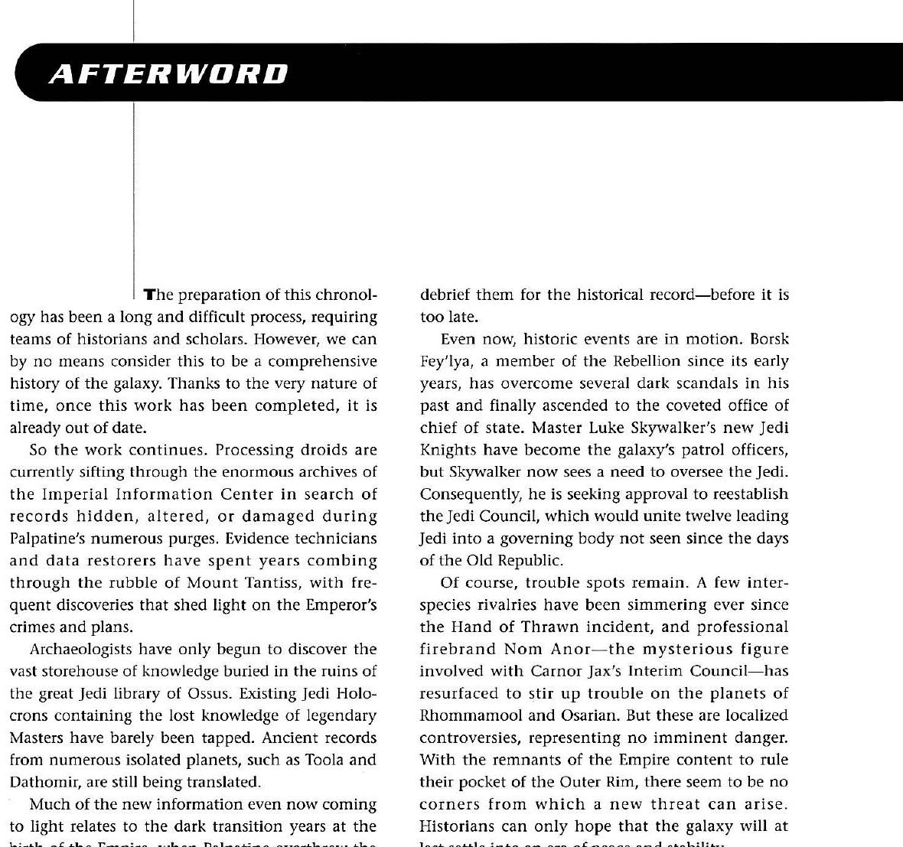

# Debate and forum claims (unverified)

Forum posts, Suspect Insight debates and Discord debates, respect threads, and verdicts. These are posters' arguments or quotations they typed; none is checked against the book here unless the entry says so.

## FNU Ulic Qel-Droma (Vaelias) vs TUF Jacen Solo (RNGesus)

> Poison spewed from the plaeryin bol. Han was too encumbered to twist himself or Jaina out of its path. In a blur, Jacen interposed himself between Nom Anor and his father, and took the lethal gush full in the face.
>
> Even better than hoped for! Nom Anor thought. With Jacen out of the way, he could easily incapacitate the others. With his right hand, he reached for the little finger of his left. At the same time, he steeled himself for a dash across the grotto. It would take a moment for the knockout gas released by the false digit to reach full effect, and that moment constituted all the time he had to reach the escape craft lock and seal it behind him. In the instant his hands met, he heard the snap-hiss of a lightsaber.
>
> And in the interminable instant that followed, he watched Leia's energy blade sever his left hand at the wrist, and watched himself falling to his knees in shock and searing pain. Worse, it was Jacen who came to his side, weakened by the plaeryin bol's venom, but very much alive.
>
> **-TUF**
> [fragment — full passage not on file]
— Source: FNU Ulic Qel-Droma (Vaelias) vs TUF Jacen Solo (RNGesus) — https://www.suspectinsightforums.com/t4394-stomper-showdown-r4-1-freedon-nadd-uprising-ulic-qel-droma-vaelias-vs-tuf-jacen-solo-rngesus4.
Context: Q101 — Source: [source not stated adjacent] (preceding line: "He also has knowledge on the art of the small. He's so potent with it that he's able to tank a point blank blast of lethal poison and only be somewhat weakened:")
Posted by: not named in our notes (see thread/notes link).
Our notes: `suspect-insight/debates/029-fnu-ulic-qel-droma-vs-tuf-jacen-solo.md:688`

## Cilghal respect thread (in progress) — respect-thread notes

> "After Mara Jade Skywalker became infected with deadly coomb spores planted by the Yuuzhan Vong agent Nom Anor, she was eventually cured by an antidote from a most unusual source: a vial of tears from the former jedi Vergere. Cilghal learned that Vergere produced natural antitoxins through a force technique that Vergere referred to as "making himself small". through this technique, a force user can manipulate and alter things at a molecular level.[...] Vergere died shortly after this recording, but Cilghal was eventually able to master the art of making himself small. Many beings have been healed by the technique, and thus far Cilghal has suffered no ill effects from its use."
> [fragment — full passage not on file]
>
> source: jedi vs sith: the essential guide to the force
— Source: SI respect-thread directory: Cilghal respect thread (in progress) — https://www.suspectinsightforums.com/t356-cilghal-respect-thread-in-progress.
Context: She can use a rare power, known as art of the small, which allows her to render her force essence infinitely small and manipulate things on a molecular scale, a technique she learned from Vergere during the Vong war:
Posted by: not named in our notes (see thread/notes link).
Our notes: `suspect-insight/respect-threads/cilghal.md:104`

## Mara Jade Skywalker Respect Thread (2022) — respect-thread notes

- Note (summary from our notes, not a quotation): In 24ABY, Mara Jade is infected with fatal coomb spores by Nom Anor:
  — Source: SI respect-thread directory: Mara Jade Skywalker Respect Thread (2022) — https://www.suspectinsightforums.com/t4439-mara-jade-skywalker-respect-thread-2022.
Posted by: not named in our notes (see thread/notes link).
Our notes: `suspect-insight/respect-threads/mara-jade.md:237`

- Note (summary from our notes, not a quotation): [image: https://i.servimg.com/u/f21/20/06/49/72/scree125.jpg]
  — Source: SI respect-thread directory: Mara Jade Skywalker Respect Thread (2022) — https://www.suspectinsightforums.com/t4439-mara-jade-skywalker-respect-thread-2022.
Posted by: not named in our notes (see thread/notes link).
Context: In 24ABY, Mara Jade is infected with fatal coomb spores by Nom Anor:
Our notes: `suspect-insight/respect-threads/mara-jade.md:238`

- Note (summary from our notes, not a quotation): [image: https://i.servimg.com/u/f21/20/06/49/72/scree126.jpg]
  — Source: SI respect-thread directory: Mara Jade Skywalker Respect Thread (2022) — https://www.suspectinsightforums.com/t4439-mara-jade-skywalker-respect-thread-2022.
Posted by: not named in our notes (see thread/notes link).
Context: In 24ABY, Mara Jade is infected with fatal coomb spores by Nom Anor:
Our notes: `suspect-insight/respect-threads/mara-jade.md:239`

What it shows (our notes): As of 25ABY, a deathly ill Mara Jade, alongside Luke Skywalker, is still considered the most dangerous foe of the Yuuzhan Vong:
> No, Nom Anor was looking forward to this meeting simply so that he could gauge the effect of his infection upon Mara Jade, and so that he might learn more of the Jedi in general, including Leia, a woman he knew would prove pivotal in the upcoming events, and Jaina, who might prove to be a weak link to get to Leia Solo, perhaps even to Luke Skywalker and Mara Jade. That was one of his missions here, to identify those most dangerous foes and to find some way to minimize their effectiveness. Occasions such as the Osarian-Rhommamool conflict, where Nom Anor could also further the effects of the internal squabbles among the humans and their allies, could bruk tukken nom canbin-tu, or “weaken the hinges of the enemy’s fort,” as went the common saying in his native tongue, were then all the better. There were other agents doing that very same thing, after all, though in Nom Anor’s estimation, it wasn’t even a critical component of the Yuuzhan Vong’s overall plan. These humans and their pitiful allies would propagate their own problems by their very nature, he knew. They had no sense of structure and order, not in terms of the regimen and hierarchical code to which his own people adhered, at least.
— Source: SI respect-thread directory: Mara Jade Skywalker Respect Thread (2022) — https://www.suspectinsightforums.com/t4439-mara-jade-skywalker-respect-thread-2022.
(Excerpt widened 2026-11-17 to the relevant passage, word for word from Vector Prime (R.A. Salvatore) (text copy `MEGA_Legend_The_New_Jedi_Order_Series_Star_Wars_New_Jedi_Order_01_Vector_Prime_R_A_Salvatore_epub`).)
(Excerpt widened 2026-11-17 to the relevant passage, word for word from Vector Prime (R.A. Salvatore) (text copy `MEGA_Legend_The_New_Jedi_Order_Series_Star_Wars_New_Jedi_Order_01_Vector_Prime_R_A_Salvatore_epub`).)
Posted by: not named in our notes (see thread/notes link).
(Source (as named in the post's quote header): Star Wars: The New Jedi Order: Vector Prime wrote:)
Our notes: `suspect-insight/respect-threads/mara-jade.md:246`

What it shows (our notes): Nom Anor is joint second-in-command of the Yuuzhan Vong after Shimrra himself:
> A smile twisted across Shimrra’s features. “It seems that the two of you are bound together once again. The fate of one will depend entirely on the fate of the other. If success comes to one, it will come to both. But if one fails …” He left the thought unfinished.
— Source: SI respect-thread directory: Mara Jade Skywalker Respect Thread (2022) — https://www.suspectinsightforums.com/t4439-mara-jade-skywalker-respect-thread-2022.
(Excerpt widened 2026-11-17 to the relevant passage, word for word from Destiny's Way (Walter Jon Williams) (text copy `MEGA_Legend_The_New_Jedi_Order_Series_Star_Wars_New_Jedi_Order_15_Destiny_s_Way_Walter_Jon_Williams_epub`).)
Posted by: not named in our notes (see thread/notes link).
(Source (as named in the post's quote header): Supreme Overlord Shimrra, New Jedi Order: Destiny's Way wrote:)
Our notes: `suspect-insight/respect-threads/mara-jade.md:288`

# NJO FULL re-read additions (2026-11-17)
Verbatim excerpts from the full consecutive re-read of the New Jedi Order novels (Dark Journey through The Unifying Force), each shown with the text around it and its source chapter.

## *Traitor*
Nom Anor tells Tsavong Lah that Jacen thrives on torment and will inevitably turn to the True Way.

> As if there were a difference. Nom Anor shrugged and smiled amiably: gestures he had learned from his impersonations of the human species. He exchanged one quick glance with the other occcupant of the chamber—his partner in the Solo Project—then directed his gaze back to the villip. “The import of the Embrace chamber’s data is exactly this: Jacen Solo has become capable of not only accepting torment, but thriving on it. As the warmaster will recall, I predicted such a result. He has discovered resources within himself of the sort that we find only in our greatest warriors.”
>
> “And?” The warmaster glared. “Make your point.”
>
> “It will work,” Nom Anor said simply. “That is the point. The only point. Based on our current figures, Jacen Solo will inevitably—provided he lives—turn to the True Way with his whole heart.”

— Source: *Traitor* (Matthew Stover, Del Rey 2002), chapter 1 (TR).

Nom Anor says Jacen will become one half of the Twin Gods.

> “You are certain that you can make Jacen Solo submit to the Truth?”
>
> “Warmaster,” Nom Anor said intensely, “it is already happening. Jacen and Jaina Solo are twins, yet male and female, complementary opposites. Don’t you see it? Yun-Yammka and Yun-Harla. Warrior and Trickster. Jacen Solo will become one half of the Twin Gods—to fight in service of the God he is! He will be proof no creature of the New Republic could ever refute.”

— Source: *Traitor* (Matthew Stover, Del Rey 2002), chapter 1 (TR).

## *Destiny's Way*
Nom Anor realizes that a prophet could turn the Shamed Ones' and workers' heresy into an army.

> The workers’ heresy was an incoherent muddle, he thought. And yet, if the heretics had a leader, a prophet—no, a Prophet—someone who knew how to adapt this doctrine into a weapon, then they would become something to reckon with.
>
> Obedience, yes, but not obedience to the ruling castes; obedience to the Prophet. Outward passivity and humility to those they considered their oppressors, but inside the keenest resentment and hatred, and an arrogance that demanded a galaxy. Someone—yes, someone like Nom Anor who had spread a religious doctrine on Rhommamool that had caused the inhabitants to destroy themselves in an interplanetary war—someone like Nom Anor could make out of these heretics something very dangerous. All that was necessary was to create a tipping point, a point at which the arrogance and hatred could be brought to overwhelm passivity and caution, and then the heretics would become an army.
>
> Yes, it was lucky these heretics were being suppressed.

— Source: *Destiny's Way* (Walter Jon Williams, Del Rey 2002), chapter 13 (DW).

Nom Anor deduces that the eighth cortex does not exist and that if the gods have not delivered the knowledge then Shimrra is a fraud.

> The eighth cortex, the supreme knowledge possessed only by Shimrra and the gods, did not exist. The cortex project, headquartered just beyond the city and guarded by a corps of warriors, was intended to create the knowledge, which Shimrra would then deliver to his people.
>
> The Yuuzhan Vong were in a war of indefinite length, and they had run out of the knowledge that would enable them to win it. If the New Republic continued to learn and innovate while the eighth cortex of the Yuuzhan Vong remained empty, then the Yuuzhan Vong were finished. Doomed. About to be wiped from history.
>
> His mind whirled. Nom Anor put a hand against a wall in order to steady himself. And if the gods, he thought in terror, have not delivered the knowledge to Shimrra, then Shimrra is a fraud, and so are the gods.
>
> Nom Anor wanted to laugh and shriek and wail all at the same time. The greatest pillars of faith, obedience, and hierarchy, the pillars that held up the great edifice that was the Yuuzhan Vong, were nothing but a swindle. Nom Anor had always suspected this—but he had never expected to have it proved!

— Source: *Destiny's Way* (Walter Jon Williams, Del Rey 2002), chapter 17 (DW).

Nom Anor presents Shimrra with correlated evidence that the Final Redoubt guarded by the Solo twins is real and stakes his life on it.

> Nom Anor ignored Tsavong Lah and turned to face Shimrra. “My spies inform me that the New Republic government has fled Mon Calamari and is hiding in the Deep Core. The warmaster and his forces may trap them there and crush them. Without a central government, the enemy will fall apart.” He deigned to glance at Tsavong Lah. “The warmaster may then be able to take Corellia without fighting.”
>
> Tsavong Lah’s expression hesitated between triumph and scorn. “What spies?” he demanded finally. “What evidence? How do we know this isn’t a trap?”
>
> Nom Anor turned once again to Shimrra. “I have correlated the evidence from different independent networks operating on Mon Calamari. The plans for what the enemy calls the ‘Final Redoubt’ came from one source. Its location came from another agent. News of an emergency appropriation to pay for it came from a third. The government’s absence from Mon Calamari is public knowledge, though it is presented as a kind of tour of the military.” He smiled. “And the fact that the Final Redoubt is guarded by Jedi—in fact by the Solo twins—came from my most reliable agent.”
>
> He sensed Tsavong Lah straightening at the mention of the Solo twins. Nom Anor swept one hand triumphantly across his chest. “After this one battle, the warmaster may sacrifice Cal Omas, the heads of the Senate councils, the Solo twins, and many other Jedi. My life in payment if I am wrong, Supreme One.”

— Source: *Destiny's Way* (Walter Jon Williams, Del Rey 2002), chapter 24 (DW).

Nom Anor flings blorash jelly at Yoog Skell's feet to give Shimrra an itch, strikes him down and decides to vanish.

> “You have betrayed us,” Yoog Skell said. “You must pay with your life.”
>
> Nom Anor calmly reached into his pocket for the blorash jelly that he then flung at Yoog Skell’s feet.
>
> The high prefect waved his arms, trying not to topple, as the jelly pinned his feet to the floor. He gave Nom Anor a wild look. “What are you doing, Executor?” he demanded.
>
> “Giving Shimrra an itch.” Nom Anor surprised himself with how calmly he was behaving.
>
> He slashed his amphistaff down on Yoog Skell’s head. The high prefect folded into unconsciousness, his feet still pinned by the semisentient jelly tendrils.
>
> Nom Anor looked at the sprawled body of his superior and hoped he wasn’t dead. He’d always rather liked Yoog Skell.
>
> Nom Anor knew, of course, what had happened. His spies had been identified and fed false information designed to lead the Yuuzhan Vong fleet into this trap. Whoever had done this had been brilliant, setting out a series of clues and letting Nom Anor himself draw the conclusions.

— Source: *Destiny's Way* (Walter Jon Williams, Del Rey 2002), chapter 25 (DW).

## *Force Heretic I: Remnant*
Nom Anor flies into a rage and beats Vuurok I'pan after being asked if he is a Shamed One.

> Nom Anor struck I’pan so hard that blood from his gashed fingers splashed in a wide arc across the metallic floor between them. I’pan bounced off a nearby wall and collapsed to the ground with a pained grunt. Before he had a chance to collect himself, Nom Anor picked him up again and hurled him into the opposite wall. This time I’pan could not hold on to the lamp, and it went flying down the corridor, its pale light reflecting briefly off abandoned machinery buried in the walls.
>
> The moaning of the Shamed One as he again tried to pick himself up only incensed Nom Anor further, and the former executor’s vision dissolved into spinning blotches as a torrent of rage exploded behind his eyes. He heard himself screaming words that even he couldn’t understand as he pummeled I’pan again and again, the Shamed One curling around himself to protect his face from the assault, whimpering helplessly as blows and kicks were rained down upon him.

— Source: *Force Heretic I: Remnant* (Sean Williams and Shane Dix, Del Rey 2003), Part One (FHR).

Nom Anor ambushes the Shamed One Vuurok I'pan in the Yuuzhan'tar underworld.

> Nom Anor waited until the Shamed One came abreast of his hiding place, then stepped out in front of it, quickly and with menace. His sudden appearance had the desired effect: the Shamed One—a middle-aged male—reared back, flapping his robes in terror before collapsing to the ground, squealing as he begged for mercy.
>
> “This place is forbidden to all of Yun-Yuuzhan’s children!” Nom Anor boomed down to the prostrate figure. “Explain your presence here!”
>
> “Have mercy, Master! I am nothing—not worthy even of your contempt! The gods have spurned me and I crawl like a worm through the belly of the world!”
>
> “I know what you’re doing,” Nom Anor spat. “I’m not blind, fool! But you still haven’t told me why you are doing it. Stand up and address my face!” The plaeryin bol in his left eye socket tensed, ready to spit venom should the Shamed One show any sign of recognizing him.

— Source: *Force Heretic I: Remnant* (Sean Williams and Shane Dix, Del Rey 2003), Part One (FHR).

Nom Anor refuses to die in the underworld: any goal is better than giving in.

> No! He quickly reined in his thoughts. He would not die here like some worthless vermin, in some hole where even the gods could not find him, if they had ever existed. No matter how deep I’pan went, he would live. He had to. That he currently had no plan and no resources beyond his mind didn’t bother him: any goal at all was better than just giving in—and the power of his mind wasn’t to be scoffed at.

— Source: *Force Heretic I: Remnant* (Sean Williams and Shane Dix, Del Rey 2003), Part One (FHR).

Nom Anor tells the Shamed Ones the sun has not set on his fortune and promises to restore their honor.

> That was harder to answer. “The sun has not yet set on the fortune of Nom Anor,” he said. “It will rise again, given time.”
>
> “And will we rise with it?” called out one of the Shamed Ones off to his left.
>
> “Yes,” he said, looking vaguely in their direction. “I give you my word that, should I return to my former position, I will restore your honor.”

— Source: *Force Heretic I: Remnant* (Sean Williams and Shane Dix, Del Rey 2003), Part One (FHR).

Nom Anor swallows his pride and swears he will not betray Niiriit.

> The former executor swallowed his pride, and it tasted of bile. Everything Niiriit said was true. They could trust him, because here in the depths of this offensive world, these Shamed Ones were all he had left. Yes, he had told them he would give them back their status if he were returned to his former position, and it was an offer he would happily keep his word on. For the chance to restore his own honor, Nom Anor would make any sacrifice necessary.
>
> “We are allies, Niiriit Esh,” he said, giving her full name in return. “I shall not betray you.”

— Source: *Force Heretic I: Remnant* (Sean Williams and Shane Dix, Del Rey 2003), Part One (FHR).

Nom Anor plays the peacemaker toward Kunra and admits he is a good actor.

> Nom Anor bowed his head to her, partly to hide a smile of triumph. No, he hadn’t misjudged Niiriit at all. “I apologize,” he said to her. He then turned to his challenger and did the same. Playing the part of peacemaker was a new experience for him, but it was no different from any other role he had played in the past. He was a good actor. “It appears to be your right to mistrust me, Kunra. Instead of fighting you, I shall do all in my power to convince you that you are mistaken in your mistrust. Is that enough to at least allow peace between us?”

— Source: *Force Heretic I: Remnant* (Sean Williams and Shane Dix, Del Rey 2003), Part Two (FHR).

Nom Anor sees the Jedi heresy among the Shamed Ones as the way to regain his standing.

> Nom Anor waved the lights out and lay on the bed, still clothed in the ragged remains of the cloak and uniform he’d been wearing when he had arrived. He hadn’t been lying when he’d said that he had much to think about. The story of Vua Rapuung and the Jedi was an opportunity he had never dreamed of finding in the depths of Yuuzhan’tar. The strange, forbidden notions passing from mouth to ear offered him hope in the most unlikely of places. The whispers circulating through the Yuuzhan Vong underground did so like an asteroid orbiting a black hole, gaining momentum with each revolution, propelled by nothing more than the need to have something to believe in. The Shamed Ones might have brought this whisper into existence spontaneously, with nothing to back it up, simply to satisfy their terrible need for direction. But he knew the events of the Vua Rapuung story were based broadly in truth, and that made them so much stronger.
>
> The Jedi aren’t necessarily abominations. They can redeem as easily as they could kill.
>
> He would never have heard such whispers from his usual vantage point, far above the forlorn creatures he currently associated with. Shimrra had no idea just how close to his heart the heresy was stabbing. If Nom Anor could follow the whispers to their source, if he could expose the heresy and bring to justice the person or persons responsible for spreading the word about Yavin 4, maybe then he could regain his previous standing—and perhaps be stronger than ever.

— Source: *Force Heretic I: Remnant* (Sean Williams and Shane Dix, Del Rey 2003), Part Two (FHR).

Nom Anor admits Kunra was right that he would sell out the Shamed Ones in less than a second.

> Nom Anor smiled into the darkness as he thought about Kunra’s accusation that he would sell out his fellow Shamed Ones and all they stood for in a second if he thought it would help him achieve his goals. The ex-warrior was right, of course—except, perhaps, that he wouldn’t need an entire second to do it.

— Source: *Force Heretic I: Remnant* (Sean Williams and Shane Dix, Del Rey 2003), Part Two (FHR).

Nom Anor gives the false name Amorrn to avoid word of his survival reaching Shimrra.

> “His name is—” I’pan started, but was stopped as Nom Anor stepped forward, pushing his companion aside.
>
> “I am Amorrn,” he said. The false name was intended ostensibly to avoid alarm over his former existence, but mainly to reduce the chances that word of his survival would reach Shimrra.

— Source: *Force Heretic I: Remnant* (Sean Williams and Shane Dix, Del Rey 2003), Part Two (FHR).

Nom Anor notes he once declined a duel with Anakin Solo and killed a squad of warriors to keep that secret.

> Nom Anor nodded, absorbing what he’d been told. This story of Vua Rapuung’s death rang closer to his memories. There was no mass uprising in the records, no clash between warriors with different ideologies, as I’pan had related it. But Shoon-mi had not mentioned the slaughter of the Shamed Ones on Yavin 4, either. In the mythic sense, clearly the deaths of a thousand Shamed Ones were irrelevant compared to the death of a single significant one.
>
> The fact that Nom Anor had once turned down an invitation to duel with the great Anakin Solo would never be known. The executor had killed an entire squad of warriors with an infidel’s blaster in order to keep that particular secret from getting out.

— Source: *Force Heretic I: Remnant* (Sean Williams and Shane Dix, Del Rey 2003), Part Two (FHR).

Nom Anor concludes the Shamed Ones' claim that the Jedi know more about the gods than the priests is true heresy.

> And there it was, stated boldly: the true heresy that had the potential to bring the Yuuzhan Vong species to its knees. Once the workers stopped listening to the priests, what would fill the vacuum? The warriors? The intendants? The Jedi?

— Source: *Force Heretic I: Remnant* (Sean Williams and Shane Dix, Del Rey 2003), Part Two (FHR).

Nom Anor resolves to use the Jedi heresy to regain Shimrra's favor or destabilize his rule.

> The latter truly would be an abomination, Nom Anor knew. He would never allow himself to be dictated to by an infidel. But he would use them to get what he wanted: either news of the heresy could regain his favor with Shimrra, or the heresy itself could destabilize the Supreme Overlord’s rule. That seemed a simple enough progression. It wasn’t the normal way an ambitious Yuuzhan Vong climbed the ranks—but since the ladder one would normally ascend to further one’s status in the Yuuzhan Vong hierarchy had effectively been kicked out from under him, he was forced to resort to other methods. It wasn’t something he was particularly proud of, but it was necessary.

— Source: *Force Heretic I: Remnant* (Sean Williams and Shane Dix, Del Rey 2003), Part Two (FHR).

Nom Anor hears Niiriit scream and concludes she would have sacrificed herself to save her friends as the Jedi did.

> With that in mind, he pulled a lambent from the wall and headed off down the gentle, curving slope in the direction I’pan had taken. Before he’d even taken a dozen steps, though, a high-pitched shriek brought him to a halt. He stood still for a moment, looking back in the direction of the scream, and knowing in his heart that it had come from Niiriit Esh. He hesitated for what seemed like an eternity, his newfound sense of responsibility causing within him a tremendous conflict. Niiriit might have been Shamed, but she was still a warrior, and she would never have run away from a battle. She would have fought to the death, for honor, for Yun-Yammka, for—
>
> He shook his head vigorously. This was all wrong, he told himself. He was still thinking of her in terms he knew from the world above. But she was no longer a warrior; she was a Shamed One. She wouldn’t have given her life to Yun-Yammka, the Slayer; she would have sacrificed herself to save her friends, as the Jedi did. Her memory deserved the truth, even if it still felt wrong to him.

— Source: *Force Heretic I: Remnant* (Sean Williams and Shane Dix, Del Rey 2003), Part Three (FHR).

Nom Anor realizes his own inquiries may have led the warriors to the Shamed Ones.

> Nom Anor admitted to himself that the idea made sense. The priests would tolerate the Jedi sect as much as Shimrra would the Jedi themselves, perhaps even less. The Shamed Ones preaching it would be the enemy within, and rooting them out would be a priority. But if that was the case, then why had he never heard of such cleansing raids through the underworld of Yuuzhan’tar before his fall from grace? He assumed the answer to that lay in the nebulous way the message spread: even if Shimrra captured a convert, that one would only lead him to two or three others, who would in turn lead him nowhere, or in circles. There was no clear trail—as Nom Anor himself could attest. He had tried to find it, and failed.
>
> Perhaps his own inquiries had, for the first time, established a clear trail to follow. He might have brought premature death down upon his fellow Shamed Ones by trying to find a way to use their beliefs to his own end. If so, the irony wasn’t lost on him. Without them—and without a way out of the bottom of the shaft—he might very well find himself caught in a trap he had inadvertently laid for himself.

— Source: *Force Heretic I: Remnant* (Sean Williams and Shane Dix, Del Rey 2003), Part Three (FHR).

Nom Anor presses Kunra over leaving his friends to die and makes him admit he didn't care enough to die with Niiriit.

> “You left your friends to die,” Nom Anor said. “Do you think you deserve to live?”
>
> “Do you?” It was clear from Kunra’s expression that just talking was causing him a lot of discomfort.
>
> “They weren’t my friends.”
>
> “Niiriit—” Kunra stopped, wincing from a pain that was both physical and mental.
>
> Nom Anor crouched down beside the ex-warrior. “That’s been bothering you since I came along—hasn’t it, Kunra?” he said, grinning despite the terrible throbbing of his own injuries. “Once I arrived, she had no interest in you anymore. You were no one.”
>
> Kunra winced and sucked air through clenched teeth. “You ruined everything,” he managed to hiss out.
>
> Nom Anor shook his head. “And you weren’t even there for her at the end, were you?” he said. “If you had really cared—”
>
> “All right!” Kunra gasped. The blue sacks under his eyes were growing as white as his scars. “I didn’t care enough to die with her. Is that what you want to hear? I didn’t care enough. Just help me. Please! I’ll do anything. Don’t let me die!”

— Source: *Force Heretic I: Remnant* (Sean Williams and Shane Dix, Del Rey 2003), Part Three (FHR).

Nom Anor holds his coufee to Kunra's throat and offers him help or death.

> “Understand this,” Nom Anor said. “I could have let you die. But do not allow the fact that you are alive deceive you into believing that I won’t kill you out of hand, now or in the future.”
>
> Kunra didn’t appear frightened; he was probably too weak from his injuries to feel anything much apart from shock.
>
> “I’m not fool enough to think that, Nom Anor,” Kunra said. Fluid rattled in his lungs as he spoke; he coughed once to clear it, spitting the gray-green mucus into the dust at his side. Then, fixing his wavering eyes on Nom Anor again, he said “I am too aware of your reputation. You do nothing that doesn’t benefit your own cause.”
>
> “And what is my cause now, Kunra?” Nom Anor emphasized the question by applying increased pressure with the blade.
>
> “You tell me,” Kunra gasped.
>
> “I want many things, and in time I intend to get all of them. Your time, on the other hand, is decidedly limited. You can either agree to help me achieve these things, or I will kill you now. There is no other option.”

— Source: *Force Heretic I: Remnant* (Sean Williams and Shane Dix, Del Rey 2003), Part Three (FHR).

Nom Anor sets Kunra's terms: never question orders, never use his true name, call him Amorrn for now.

> “Good.” He was satisfied that the answer was truthful. Kunra was a coward; he would do anything to save his life, even if it meant betraying himself. Such desperation would make of him a fine bodyguard, for a time. They would understand each other on that score, at least. “There are just two more things you need to know,” he said, withdrawing his blade from Kunra’s throat and sheathing it under his belt. “The first is that you will never question my instructions. Not more than once, anyway, for there will be never a second time.”
>
> He paused to let the point sink in.
>
> Kunra nodded. “And the second?”
>
> “You will never use my true name again,” he said. “If it was my name that led Niiriit and the others to their deaths, then I would avoid something similar happening in the future.”
>
> “What should I call you, then?”
>
> “I haven’t decided upon a name yet,” he said. “Amorrn will do for now—the name I used in the upper levels when I visited with I’pan. But I fear that even this might be recognized now. I shall let you know when I have chosen another.”

— Source: *Force Heretic I: Remnant* (Sean Williams and Shane Dix, Del Rey 2003), Part Three (FHR).

Nom Anor holds a coufee to Shoon-mi's throat and demands to know who betrayed the Shamed Ones.

> The coufee came up so quickly that Shoon-mi didn’t even have a chance to see it. With the blade across his throat, he was dragged back into the crack leading from the anonymous sub-basement to the access tunnel that led deeper into the underground.
>
> “Who has betrayed us?” hissed a voice in his ear. “Who sent the warriors to kill I’pan and Niiriit?”
>
> Shoon-mi flailed wildly but was unable to break free. The blade of the coufee was so sharp he didn’t even realize it had cut him until he felt the blood trickling down his chest. He stopped wriggling, then, panting heavily and fearfully.
>
> “Kunra!” he called out, but the word came out as barely more than a gasp.
>
> The shamed warrior stood nearby in the center of the basement, unmoved by Shoon-mi’s plea for assistance. Instead of coming to his help, Kunra merely folded his arms across his chest to watch coldly.
>
> “Who has betrayed us?” Shoon-mi’s attacker repeated, allowing the coufee to bite a little deeper into the flesh.
>
> “It wasn’t me!” Shoon-mi cried desperately, realizing that no one would be coming to his aid. “I swear it wasn’t!”
>
> In an instant the coufee was gone, and a knee in his back pushed him sprawling to the ground. He pressed at the cut on his throat with his hand, fearful that his lifeblood was flowing away.
>
> “You’ll live,” growled the one who had cut him. The figure stepped from the shadows to loom over him. The coufee was held menacingly by his side, its blade darkened with Shoon-mi’s blood. “And you will tell me what you know.”

— Source: *Force Heretic I: Remnant* (Sean Williams and Shane Dix, Del Rey 2003), Part Four (FHR).

Nom Anor admits it was he who brought death to Niiriit and the others through his thefts.

> He almost chuckled aloud at the irony. The warriors might not have been hunting him specifically, but it was still he who had brought death to Niiriit and the others. He and I’pan had been stealing with some regularity from the upper levels, using access codes he remembered from his years as an executor. The thefts, clearly, had not gone unnoticed, and the killing party had been sent in to the underground to mop up anyone likely to be responsible. He had brought death down upon those who had saved his life just as surely as the warriors who had actually wielded the amphistaffs.

— Source: *Force Heretic I: Remnant* (Sean Williams and Shane Dix, Del Rey 2003), Part Four (FHR).

Nom Anor tells Shoon-mi the Shamed Ones must stop preaching to the converted and spread the message to gain everything by risking everything.

> “Perhaps we are too careful,” he said, thinking aloud and testing their responses as he spoke. “We hold our revelations close to our chests, much like the priests guard their secrets. We hide the light under cloaks of fear and timidity so that no one else may see it. As long as we continue preaching to the converted, we will never grow, never be strong like the Jedi are strong. The millions like us who deserve to know that there is a better way to live, a freedom that counters everything we have ever been taught—they will remain forever in the darkness. Perhaps the time has come, my friends, to shine our light into the darkness.”
>
> Shoon-mi looked even more nervous than before. “But if we speak openly about the Jeedai, we will be killed!”

— Source: *Force Heretic I: Remnant* (Sean Williams and Shane Dix, Del Rey 2003), Part Four (FHR).

Nom Anor takes the name Yu'Shaa, the Prophet, as a stab at Shimrra.

> He smiled, then, at a thought. There was a word from an ancient tongue, rarely spoken except in the older worldships. It had connotations for all castes, no matter which god they worshiped. Its meaning was an unmistakable stab at Shimrra, and would be recognized as such by the Shamed Ones he would have to rely on to make the dream possible.
>
> “From now on,” he said to his first two disciples, “you shall call me Yu’Shaa.”
>
> There was a moment’s silence; then Shoon-mi stepped forward a pace, his face creased in consternation.
>
> “Yu’Shaa?” he echoed. “The prophet?”
>
> Nom Anor smiled, nodding. “The Prophet.”

— Source: *Force Heretic I: Remnant* (Sean Williams and Shane Dix, Del Rey 2003), Part Four (FHR).

## *Force Heretic II: Refugee*
Nom Anor, as Yu'shaa, opens a ceremony of the Shamed Ones behind a mask and announces a vision.

> The Prophet nodded, satisfied by the formal response. Warders outside the hall had carefully instructed the audience on how and when to speak. The being on the inside of the mask smiled to himself, knowing that these conventions were nothing more than a sham to encourage obedience to him and, ultimately, rebellion against his enemies.
>
> Nom Anor rose from his seat on the throne and removed the mask. The hideous creation was meant to represent Shimrra and the gods, while its removal symbolized the casting off of the old ways. He had devised every detail of the ceremony with the help of Shoon-mi and Kunra, his chief acolytes, but no matter how many times he did it, it still felt clumsy. Only the reactions of the converts convinced him that it was working.
>
> The acolytes looked wonderingly up at Nom Anor’s “real” face—not aware that this was just another mask, an ooglith masquer designed to make him look like a member of the Shamed caste.
>
> “The gods have granted me a vision,” he announced. “It is a vision of a galaxy of beautiful worlds—worlds in which all Yuuzhan Vong can live in peace as well as in glory, free of shame, and with everything their hearts and souls desire.”

— Source: *Force Heretic II: Refugee* (Sean Williams and Shane Dix, Del Rey 2003), Part One (FHF).

Nom Anor adopts I'pan's storytelling techniques to hold his audience spellbound.

> In recent weeks, Nom Anor had learned to become more animated and expressive when addressing the groups that came to hear him speak. At first he had just sat there and spoken, but he soon found the attention of the Shamed Ones would drift beneath his dull monotones. So he’d adopted some of the techniques he had observed in Vuurok I’pan—a storyteller from the group of Shamed Ones that had first taken him in during his initial exile to Yuuzhan’tar’s underworld. Nom Anor clearly recalled how I’pan had told the story of Vua Rapuung, and how those gathered had listened intently, hanging from his every word—even though they had heard the tale so many times before.
>
> “But as I gazed upon this vision,” Nom Anor went on with dramatic flair, “a dark shadow came between my hungry eyes and the sight of the worlds that should be ours. The huge, black shadow had rainbows that shined from its eyes; its mighty hands were darkened from bloodstains.”
>
> The congregation listened spellbound, just as I’pan’s audience had once listened to him. Nom Anor raised a hand to demand silence—an unnecessary gesture since the silence was already profound, but one that served to reinforce his command over the gathering.

— Source: *Force Heretic II: Refugee* (Sean Williams and Shane Dix, Del Rey 2003), Part One (FHF).

Nom Anor sees the Shamed Ones as his ride back to the surface and tells the grass parable.

> He smiled inwardly. It was all too easy to work his will over the loose-knit congregations of heretics that infested the capital. Their members were weak and desperate, while he was strong and resourceful.
>
> “No indeed,” he said. “Even as despair overcame me at the defeat of the Jeedai, even as it seemed as though the Rainbow-Eyed One would never be stopped, the gods gave me hope. For just when all was dark, I saw the grasses of the field turn against the Shadow. I saw them rise and wrap around the feet of the Rainbow-Eyed One. The Enemy stumbled and fell—and then the grasses rose to bind the Shadow’s mighty limbs! The grasses held this Foe of the gods to the ground, wrapping themselves around his throat and squeezing the very life from him, removing the influence of his black heart from the land!
>
> “By themselves, each blade of grass was weak; but together they were mighty!”
>
> The congregation sighed with relief and joy at the exclamation.
>
> “Let us be as the grass and twine about the feet of our adversary to bring him crashing down. For individually we may be weak, but like the grass, together we can be strong.”
>
> The congregation hissed its appreciation, and Nom Anor basked in their approval. In all the years he’d served as an executor, he had never had such an audience. It had been impossible to speak honestly or openly for fear of offending the warmaster or the priests—or, through them, the gods. Now he had the attention of hundreds, and they would listen to anything he said.

— Source: *Force Heretic II: Refugee* (Sean Williams and Shane Dix, Del Rey 2003), Part One (FHF).

Nom Anor teaches that the Jeedai are mortal beings, not gods, with flaws like theirs.

> “But in essence, they are beings like us. They are not themselves gods, any more than Shimrra is. They are mortal; they can be killed. I know this because I have seen them die with my own eyes. There are even stories of Jeedai who wreak destruction instead of good, so we know that they have flaws like us. It is their teaching we must follow so we can be strong like them, so we can be accepted as equals again.”

— Source: *Force Heretic II: Refugee* (Sean Williams and Shane Dix, Del Rey 2003), Part One (FHF).

Nom Anor tells the Shamed Ones the Force may be what remains of Yun-Yuuzhan's soul.

> “The Force is an aspect of creation, the same as matter and energy. It may even be an aspect of the creation, the primordial sacrifice that brought forth all things from Yun-Yuuzhan. We are taught that Yun-Yuuzhan is the source of all life, the Overlord who, through great pain to himself, created the lesser gods and thus, by connection, the Yuuzhan Vong. We assume that his sacrifice was of his body—as his followers might sacrifice an arm or a thousand captives in his honor. But why should that be so? Why do we limit Yun-Yuuzhan’s generosity only to that which we can see and touch? Just as the wind is invisible to our eyes, there are many more things in the universe than we can sense with our corporeal bodies, and all these things spring ultimately from Yun-Yuuzhan. The Force is part of that, too.
>
> “But what is it exactly?” Nom Anor shook his head. “I cannot address that question, my friends, because I simply do not have the answer. On this matter, I am as ignorant as all of you. The Force is a mystery—one that may haunt us forever. All we can do is grope in the darkness for that thing we know is missing, in the hope that we might somehow stumble across it by chance.”

— Source: *Force Heretic II: Refugee* (Sean Williams and Shane Dix, Del Rey 2003), Part One (FHF).

Nom Anor tells his story of origins while concealing that he helped found the Peace Brigade.

> It was the truth, of course, just not the whole truth. Nom Anor had acted as an advance scout, arriving many years before the main body of the migration. His mission had been to gather information about the governments and species occupying the worlds ahead. He had prepared the way for later agents, exploring pressure points and sowing seeds of dissent. Those seeds had flowered into rebellions and counter-rebellions, destabilizing the New Republic and widening the cracks that had ultimately led to its downfall. During the war, he had helped found the Peace Brigade that had so jeopardized the Jedi cause, and set many other schemes into motion. But there was no way he was going to let them know that.

— Source: *Force Heretic II: Refugee* (Sean Williams and Shane Dix, Del Rey 2003), Part One (FHF).

Nom Anor concludes the Vong are losing and plans to change the war from beneath by muddying the waters.

> The trouble was, Nom Anor suspected that the Yuuzhan Vong were now losing the war. He had no confidence in Shimrra’s ability to restore the situation. He understood the bankruptcy of the Supreme Overlord’s regime—he knew of the lies, the betrayals, the desperate search for an antidote in the form of the eighth cortex. Without a radical change in direction or fortune, the Galactic Alliance was going to win.
>
> For the worshipers of Yun-Yammka, the god of carnage, there was no such thing as losing. There was only winning or dying. A failure to defeat the Galactic Alliance would inevitably mean a fight to the end, and the destruction of all that Nom Anor held dear. His only hope, therefore, was to change the direction of the war from beneath, by muddying the waters for the enemy. Would the Jedi be so keen to attack when they had supporters in the Yuuzhan Vong ranks? He suspected not. They were warriors, but they were also guilty of compassion.

— Source: *Force Heretic II: Refugee* (Sean Williams and Shane Dix, Del Rey 2003), Part One (FHF).

Nom Anor learns that when fear is a way of life the only incentive left is reward.

> Nom Anor stood and opened his arms, as though to embrace them all. At the signal, the doors at the back of the cellar opened, allowing the newly recruited acolytes to file out. He smiled beneficently as they left, radiating goodwill and trust. It was very different from how he had once dealt with underlings. There was a time when he would have sent them off with curses and threats, trusting in fear to keep them loyal. But this wouldn’t work on the Shamed Ones; threatening them with punishment would only demonstrate that he was no different from the rest of their masters. If he had learned one thing from his disguise, it was that when fear was a way of life and there was nothing left to lose, the only incentive remaining was reward.

— Source: *Force Heretic II: Refugee* (Sean Williams and Shane Dix, Del Rey 2003), Part One (FHF).

Nom Anor orders Kunra to find who holds the master villip and then kill the captured woman.

> Nom Anor nodded his approval. It made things much simpler.
>
> “I want the name of the person holding her master villip,” he said coldly. “Find out how much she knows about us while you’re at it—get the information any way you have to. Then kill her.”

— Source: *Force Heretic II: Refugee* (Sean Williams and Shane Dix, Del Rey 2003), Part One (FHF).

Nom Anor vows to crack Shimrra's security before Shimrra cracks his, declaring it is that or perish.

> “We have to try again,” he said shortly. “We need access to those chambers.” Frustration boiled inside him like a magnetic storm. He missed his old networks, his chain of informers, the many spies who had fed him information. Bloated on data, he had not known how fortunate he’d been before his fall. Starved, weakened by ignorance, he longed for a return to those glory days. “If we can’t get a villip inside, then we will need an informer.”
>
> “But who?” Shoon-mi asked. “And how?”
>
> “Our numbers are increasing,” Kunra said by way of reply. “Word is rising up the ranks. It’s only a matter of time before we infiltrate the upper echelons.”
>
> “I cannot wait that long!” Nom Anor snapped. “The closer we get to the top, the riskier it becomes for us. Without knowing what Shimrra knows, we are like one of his sacrifices: on our knees with a coufee at our throats, waiting for the killing blow to finish us off.” He shrugged under his robes. Lately in his dreams he found himself fleeing a band of warriors bent on his destruction. He never saw them, but he could always sense them close behind, and could always hear them. In his dreams, he was nothing more than an animal being hunted.
>
> He shook his head; the waking hours were no time to waste on nightmares.
>
> “I will not die down here,” he said. “I will not become like the corridor ghouls: blind and vulnerable to anyone with light.”
>
> “It will not happen, Master,” Shoon-mi said lamely. “We would let no such thing happen to you.”

— Source: *Force Heretic II: Refugee* (Sean Williams and Shane Dix, Del Rey 2003), Part Two (FHF).

Nom Anor tells his acolyte the Shamed will be free only when the un-Shamed accept them and those who reject the truth must be sacrificed.

> Nom Anor replied: “We will only be free when the un-Shamed accept us as their equals, as we are in the eyes of the gods. Our Message—the philosophy of the Jeedai—will persuade them if we spread it far enough. If it doesn’t convince them we then will make them accept it, and us with it. Only then will we achieve our goal.” He paused significantly. “It is a hard road, I know—but it is one that must be walked.”
>
> “But if we do Yun-Yuuzhan’s work, then his will must become clear to the enemy, too. Surely they would come to see the truths the Jeedai bring?”
>
> “You can show a blind person something a thousand times and he will never see it; you can speak a message to a deaf person until the universe turns cold and she will never hear it. So, too, it is with our enemies. Only those who are open to the truth will accept the truth that the Jeedai bring. Moreover, those who do not, those who continue to espouse a perverted philosophy of pain and pointless sacrifice, these are the ones who must in turn be sacrificed. Redemption can only be achieved by those with the capacity to be redeemed.”

— Source: *Force Heretic II: Refugee* (Sean Williams and Shane Dix, Del Rey 2003), Part Three (FHF).

Nom Anor hopes the penitent could be the spy in Shimrra's inner circle he has been waiting for.

> Could this be the one? Nom Anor wondered. Could this be the link to Shimrra I’ve been waiting for? He wasn’t so naive as to hope for a high-ranking warrior or intendant. They were all thoroughly brainwashed. A simple servant would be enough—someone who had access to the private places he could no longer see; someone who could overhear the meetings at which policies were decided. With a spy right in the heart of the Supreme Overlord’s inner circle, he could indeed eat away at his enemy from within, just as the penitent had said, using the knowledge gained from such a source to direct his campaign—and all the while recruiting others to reduce his reliance on that one person.

— Source: *Force Heretic II: Refugee* (Sean Williams and Shane Dix, Del Rey 2003), Part Three (FHF).

Nom Anor reacts with his plaeryin bol when the penitent names him and unmasks Ngaaluh.

> Blood rushed to the muscles around his left eye socket. Pressure peaked where the eyeball had once been. He felt a short, sharp pain as his plaeryin bol exploded, spitting poisoned darts into the face of the penitent.
>
> With a harsh cry, his attacker fell backward onto the ground.
>
> The audience erupted. Nom Anor fell back against his throne, his muscles turned to jelly. He heard screaming, confusion, cries for order. Inside he felt only emptiness. He had come so close to death. The plaeryin bol where his left eye had once been had saved him, as he had always known it would, one day. But he also knew that the respite was only temporary. An assassin had been sent to destroy him, and he had come so close. Others would follow; he would never be safe again!
>
> He forced himself up, to think, to act. Kunra and Shoon-mi were getting the crowd in order, looking to him for instructions. At his feet, the penitent writhed as the paralyzing poison seared through her system. Nom Anor knelt beside her and pressed his claws on either side of the penitent’s nose, looking for the pressure point that would cause the ooglith masquer to release itself. He didn’t care if the creature took off half the spy’s face. He had to know who it was that Shimrra had sent; he had to look at the face of his would-be assassin.

— Source: *Force Heretic II: Refugee* (Sean Williams and Shane Dix, Del Rey 2003), Part Three (FHF).

Nom Anor revives Ngaaluh with the antivenin after discovering her unrik offering.

> “You fool!” He knelt over Ngaaluh as the priestess’s body began to shake. There was an antidote to the plaeryin bol poison, but he had never expected to use it. The neural pathways were rusty, and he had to concentrate to stir the buried bioconstruct to life. The knuckle of his right thumb snapped straight with a click. He bit down on a gasp as a searing pain burned in the joint. A hair-thin needle extruded from under the claw. He slid it into Ngaaluh’s neck where the vein still throbbed. There was more pain as the antivenin shot into the priestess’s bloodstream, but it was nothing compared to that suffered by the female before him. Nom Anor held Ngaaluh down as every muscle went into spasm, burning energy in one final paroxysm of agony. A keening, hissing sound escaped the priestess’s clenched jaw, growing louder with each spasm.
>
> Then, suddenly, the priestess went limp. Fearing the worst, Nom Anor bent over her.
>
> “Yu’shaa …”
>
> The word was little more than a sigh, and with that, Ngaaluh’s eyes closed. Nom Anor pressed his hand to the spot on the priestess’s throat where he’d injected the antidote. Despite appearances to the contrary, the faint, lingering pulse was testimony to the priestess’s continuing existence in the world.

— Source: *Force Heretic II: Refugee* (Sean Williams and Shane Dix, Del Rey 2003), Part Three (FHF).

Nom Anor decides against killing the audience and turns the attack into an auspicious day.

> “No.” Nom Anor knew that Kunra would happily kill all the penitents to ensure their safety, but that wasn’t an optimal solution. Ngaaluh would wonder what had happened to them, and so would Shoon-mi. “We can’t afford to waste resources, or to provide fuel for rumors. If they all disappear, some will be missed. Better to find out if my secret is safe and let them go. Who knows? Maybe it will work in our favor.”
>
> “Feeding the legend,” Kunra mused, then nodded once. “It shall be done.”
>
> Nom Anor stood to address the crowd. “This is an auspicious day!” he said dramatically, knowing that the truth was too dangerous to reveal. “I have survived an attack and am stronger for it. Go, now, and tell everyone! It will take more than this to keep us from the respect we deserve!”

— Source: *Force Heretic II: Refugee* (Sean Williams and Shane Dix, Del Rey 2003), Part Three (FHF).

Nom Anor watches Shimrra's rage through a villip beacon hidden in Ngaaluh's robes.

> The look of rage on Shimrra’s face was the most satisfying thing Nom Anor had ever seen. Even from a distance and viewed through a villip beacon concealed in Ngaaluh’s robes, it thrilled him to the core of his black heart.

— Source: *Force Heretic II: Refugee* (Sean Williams and Shane Dix, Del Rey 2003), Epilogue (FHF).

Nom Anor has an ear to Shimrra's inner sanctuary and sees the dissent his efforts caused.

> Karsh walked stiffly to the exit. The view was perfectly clear in the villip. At last, Nom Anor had exactly what he needed: an insight into Shimrra’s inner sanctuary, an ear to the Yuuzhan Vong leader’s words and thoughts.
>
> Things were clearly not going well for the Supreme Overlord. The lack of advancement since taking Yuuzhan’tar seemed to have afflicted the entire Yuuzhan Vong force. Resistance had formed where previously there was none, supply lines had been sabotaged, terra-forming of the capital world was at a standstill, and the priests warned incessantly of the tightening hold of heresy on the lower ranks. This last part pleased Nom Anor the most. His efforts had sent a tide of dissent lapping at the walls of Shimrra’s stronghold.

— Source: *Force Heretic II: Refugee* (Sean Williams and Shane Dix, Del Rey 2003), Epilogue (FHF).

Nom Anor exploits Ngaaluh's debt to him.

> Nom Anor recognized an opportunity when he saw one, and he had no reservations in exploiting one when it came his way.
>
> “I have given you back your life,” he had said to the priestess. “With what are you prepared to repay me?”

— Source: *Force Heretic II: Refugee* (Sean Williams and Shane Dix, Del Rey 2003), Epilogue (FHF).

Shimrra swears to flay Nom Anor's skin while Nom Anor feels hurt at being called a certain former executor.

> “Do not speak that name in my presence!” Shimrra interrupted sharply, standing. Then, with more composure but no humor at all, he smiled. “Not until I have his severed head before me and I wear his flayed skin as a cloak will I hear the traitor’s name again.” The Supreme Overlord’s mqaaq’it implants burned like miniature suns. “You will do well to remember that. Otherwise it will be your head I shall have before me.”
>
> The aide backed away. “Yes, Most Potent and Powerful One. I simply wished to point out that the fact that this program is the work of—of a certain former executor might explain its failure. It was flawed to begin with, My Lord, and perhaps therefore should be abandoned.”
>
> “No,” Shimrra said thoughtfully, descending the steps of his throne. “It was a good plan when it was proposed, and it is still a good plan. We will continue with the program for the time being. It is an effective use of resources in a region far from the main front. Any temporary alliances formed as a result of the incompetence of our agents will be corrected when the rest of the galaxy has fallen.”
>
> As the subaltern retreated into anonymity, Nom Anor told himself that he should be feeling satisfaction, not hurt. Shimrra’s acknowledgment of his destabilization plan was the highest praise he had ever received from the Supreme Overlord. It was nice to know that, reviled as he was, his skills were at least appreciated. But to hear himself dismissed as a “certain former executor” was galling.

— Source: *Force Heretic II: Refugee* (Sean Williams and Shane Dix, Del Rey 2003), Epilogue (FHF).

Nom Anor imagines standing before Shimrra as the un-Shamed leader of a rising tide.

> On the glorious day when Nom Anor walked into the Supreme Overlord’s throne room as the un-Shamed leader of a rising tide of resentment, he would look in Shimrra’s eyes and stand before him as an equal. Only then would Shimrra know just how thoroughly he had lost and how triumphant Nom Anor had been.
>
> That a “certain former executor” could tunnel into the heart of the Supreme Overlord’s ziggurat from its deepest basement would show everyone that he was someone to be reckoned with. His name would be accursed no longer.

— Source: *Force Heretic II: Refugee* (Sean Williams and Shane Dix, Del Rey 2003), Epilogue (FHF).

Nom Anor gloats that things are going to get worse for Shimrra.

> “Indeed,” Shimrra said, scowling around the room at those attending. His thoughts, again, were obvious: on top of the shapers, intendants, and priests who were having increasing difficulties maintaining his realm, Hreven Karsh had failed him, a perfectly good plan set in place by a fugitive was beginning to fall apart, and a priestess had just delivered his death sentence. And these were the people who were supposed to protect him?
>
> No, things most certainly were not going well for the Supreme Overlord.
>
> Indeed, Nom Anor echoed with growing elation. And if I have my way, Shimrra, things are going to get a whole lot worse for you yet!

— Source: *Force Heretic II: Refugee* (Sean Williams and Shane Dix, Del Rey 2003), Epilogue (FHF).

## *Force Heretic III: Reunion*
Nom Anor dismisses Eckla's death as noble while privately losing interest in her.

> “Not only does Shimrra find a traitor close to his throne, but then he fails to extricate a confession from her! Did you see the look on his face? He is frightened of us!”
>
> “I find it difficult to watch.” Shoon-mi appeared from the shadows beside the Prophet’s stately chair with a bowl of water Nom Anor had requested. The Shamed One was dressed in a faded priest’s robe and wore his scarless face with something akin to pride. His expression, however, was forever glum, and seemed to become increasingly so with each passing day.
>
> Nom Anor understood his religious adviser’s concern perfectly. “In all of us lurks a residual loyalty to the old ways, Shoon-mi. Sometimes even the truth finds it difficult to erase the programming of a lifetime.”
>
> “That’s not what I meant, Master.” Shoon-mi looked almost sullen. “I’m referring to Eckla of Domain Shoolb.”
>
> Nom Anor stared blankly at Shoon-mi for a few moments before comprehension dawned: Eckla was the Shamed One who had just been sentenced to death in Shimrra’s chamber.
>
> “Yes, of course,” he said. “Her sacrifice was a noble one, and did not go unnoticed.” The words flowed smoothly, covering the fact that Eckla of Domain Shoolb had ceased being of interest to Nom Anor as soon as the risk of her betraying him was no longer an issue. “She will be remembered as a martyr to our cause.”
>
> “One of many, now.”

— Source: *Force Heretic III: Reunion* (Sean Williams and Shane Dix, Del Rey 2003), Part One (FHU).

Nom Anor explains the demands of spreading the heresy without being traced.

> Nom Anor nodded, satisfied. There were many conflicting demands made of an organization such as his. The first was finding ways to spread the heresy through conduits that had never been designed to act efficiently or reliably. The Shamed Ones had always gossiped, but did so with no concern for accuracy and were safe only under the assumption that no one higher up cared to listen. For the heresy to be effective, distortions had to be kept to a minimum. And now that higher ranks were listening, precautions had to be taken to ensure that the message couldn’t be traced. These two objectives were frequently contradictory, and Nom Anor relied on his two assistants to balance them, with or without each other’s knowledge.

— Source: *Force Heretic III: Reunion* (Sean Williams and Shane Dix, Del Rey 2003), Part One (FHU).

Nom Anor questions what power he really holds as king of a dungeon and decides to exercise real power.

> Kunra strode from the room, shutting the door behind him. Tiredly, Nom Anor leaned over to the bowl of water at his side so that he could wash his face. Things were going well, yes: the heresy was spreading, and a constant moving from place to place ensured that Shimrra was still no closer to catching him. That wasn’t enough, though, and it never would be. The heresy had been from its conception a means of restoring himself to power. Every step he took had to advance that cause, or it was a step backward. The question that ever nagged at him, though, was: power over whom? Was being the leader of a scruffy army of Shamed Ones and misfits sufficient?
>
> He froze, staring down at the reflection in the bowl of water. It was haggard and grimy as a consequence of living in the foul subterranean dwellings of Yuuzhan’tar, and its eyes were full of doubt. It looked like a stranger.
>
> With a frustrated snarl he dashed the bowl of water to the floor.
>
> Kunra was wrong. Shimrra wasn’t frightened at all. Not once had he shown a flicker of fear. Anger, yes, but not fear. The heresy was a hindrance, not a threat. And the Prophet? The king of a dungeon might be a king, but he was still living in a dungeon.
>
> It was well beyond time, Nom Anor told himself, feeling better even as he came to the conclusion, that he started exercising some real power …

— Source: *Force Heretic III: Reunion* (Sean Williams and Shane Dix, Del Rey 2003), Part One (FHU).

Nom Anor endures a guard's blow and vows to return every indignity.

> That was true enough. Working up the ranks of executors had been a long and painful process; he had received as many beatings as he’d given. Working closely with the pain-loving Shimrra and his coterie of sadomasochistic warlords had kept him treading a tightrope between influence and agony, never knowing when he might find himself tipping onto the wrong side.
>
> The thought warmed him that he would one day return every single one of those indignities on those who had administered them. None would be spared. Every slight along that path to revenge only fueled his determination, from the lowliest guard to the high prefect himself …

— Source: *Force Heretic III: Reunion* (Sean Williams and Shane Dix, Del Rey 2003), Part Two (FHU).

Nom Anor admits he uses the Jedi heresy to hurt those who hurt him and wonders whether he'll be lost behind the Prophet's mask.

> Nom Anor was wearying of such questions, but he knew that in them lay his only chance of survival, let alone advancement. Spurned by Shimrra, he had no other way to attain power than through the tenets of the Jedi Heresy. That he didn’t believe in them himself didn’t matter in the slightest. That those below him did—with the assistance of the subordinate Prophets—was all that mattered, wherever those beliefs took them.
>
> He wasn’t certain if the work he ordered would result in freedom for the Shamed Ones, even as a sideline. He was simply using the movement to hurt those who had hurt him, via terrorism, political assassination, theft, and other means. He had been trained in covert activism; although his skills had mainly been used to attack the infidels, they could just as easily be turned against those of his own kind.
>
> Sometimes, late at night, he wondered what the future held for him. What lay in store for the skulking yet all-pervasive figure of Nom Anor? Would the Jedi Heresy succeed in returning him to an honored place in society, along with the Shamed Ones? Would he become lost behind the mask of Yu’shaa the Prophet, trapped by the very robes he had adopted as a means of escape?

— Source: *Force Heretic III: Reunion* (Sean Williams and Shane Dix, Del Rey 2003), Part Two (FHU).

Nom Anor targets his old rival Ash'ett and names the next unworthy.

> “Excellent.” He nodded sagely, inwardly crowing with delight. Prefect Ash’ett was an old rival, someone who had shown no compunction when it came to squashing those around him in order to advance himself—Nom Anor among them. Like many of his old rivals, Ash’ett had risen to power on Yuuzhan’tar, taking territory and glory as the opportunities arose during the fall of the infidel empire. Such power should have been Nom Anor’s. Ash’ett’s time of reckoning was long overdue, and would come with interest.
>
> “I have identified another unworthy,” Nom Anor said. “When we are done here, we will move to Gileng, where a certain Drosh Khalii has grown fat on the profits of war for too long.”
>
> Ngaaluh nodded again, her eyes gleaming in the yellow lichen torch. If she was daunted by the thought of having another target to consider before this one had been eliminated, she didn’t say.
>
> “The hard work of revolution goes ever on,” Nom Anor said.

— Source: *Force Heretic III: Reunion* (Sean Williams and Shane Dix, Del Rey 2003), Part Two (FHU).

Ngaaluh reports Ekh'm Val claimed to find Zonama Sekot and Nom Anor dismisses it.

> “The commander, one Ekh’m Val, sought an audience with the Supreme Overlord himself. He boasted of finding the lost world of Zonama Sekot.”
>
> “Zonama Sekot?” Nom Anor frowned. “But the living planet is nothing more than a legend.”
>
> “Not if this Ekh’m Val is to be believed.”
>
> “What happened when he spoke to Shimrra?”
>
> “I don’t know,” Ngaaluh said, leaning in close, her eyes glittering. “That I haven’t heard. Commander Val appears to have disappeared.”

— Source: *Force Heretic III: Reunion* (Sean Williams and Shane Dix, Del Rey 2003), Part Two (FHU).

Nom Anor dreams of a scarred face with Shimrra's eyes that turns out to be his own reflection.

> Exhaustion carried him quickly into sleep, and once there he dreamed of a man with a face more scarred than any he’d seen before, flayed and salted and left to fester. The nose was an open wound, and the mouth a jagged and lipless mess. Incongruously, two red mqaaq’it implants stared out at him from where eyes should have been, giving the visage an air of authority.
>
> The image snarled at him—and Nom Anor awoke to the realization that the face was his own reflection, but the eyes belonged to Shimrra. He shuddered on his narrow bed and pulled the covers tighter around him. Sleep, however, had fled, and he lay huddled in silence until dawn broke, far above, and duty once more called.

— Source: *Force Heretic III: Reunion* (Sean Williams and Shane Dix, Del Rey 2003), Part Two (FHU).

Nom Anor delights that his betrayal of Ash'ett reaps rewards.

> Nom Anor was delighted. His betrayal of Ash’ett had reaped unexpected rewards. Shimrra was obviously hoping to send a clear warning to all caste members while at the same time weeding out suspicious domains. From now on, suspicion alone was enough, and failure to fight the heretics couldn’t be blamed on underlings. What that meant for the heretics, though, wasn’t disaster. It gave Nom Anor an even more potent weapon. With just a word from Ngaaluh, Shimrra could be made to destroy whole swaths of his loyal supporters. It was perfect!

— Source: *Force Heretic III: Reunion* (Sean Williams and Shane Dix, Del Rey 2003), Part Two (FHU).

Nom Anor takes credit for the third major heretic strike in a week.

> Meanwhile, two thousand kilometers away, a cell of heretics had successfully infiltrated a coralskipper farming crew and slipped parasites into the feeding lines. Half-grown pods had exploded all over the shipyard, setting off others and creating a chain reaction that undid an entire year’s work. The damage couldn’t be hidden; even from orbit the destruction was obvious. It was the pro-Jedi movement’s third major strike in a week. Nom Anor rubbed his hands together. While he wasn’t responsible for the disruption of the World Brain, that didn’t stop him taking credit for it. Word was quickly spreading: anywhere could be next. His power was growing by the day. Nothing could stop him now …

— Source: *Force Heretic III: Reunion* (Sean Williams and Shane Dix, Del Rey 2003), Part Two (FHU).

Nom Anor tells Shoon-mi the question is how he will escape his own death.

> There was only a hair’s breadth of skin between Nom Anor’s artery and the coufee. A simple push was all that separated him from death. Nevertheless, he didn’t allow alarm to show on his face.
>
> “The question is not whether I will escape my death,” he said slowly, carefully, “but rather how you will escape yours.”

— Source: *Force Heretic III: Reunion* (Sean Williams and Shane Dix, Del Rey 2003), Part Three (FHU).

Nom Anor tells Shoon-mi he'll never get Shimrra to give back freedom and honor.

> “Not me, you idiot: Shimrra. You’re never going to convince him to give your freedom and honor back. Why would he listen to you? Why would he care the slightest atom about what you want? You can’t see what’s going on under your misshapen nose, let alone in the court of a ruler a million times more powerful than the Prophet will ever be—irrespective of who wears the mask. Whatever power you gain tonight will vanish upon your death, and the death of everyone tainted by your foul stench. Your life was forfeit from the moment you entered this room. My only sadness is that I won’t be there to see it happen.”

— Source: *Force Heretic III: Reunion* (Sean Williams and Shane Dix, Del Rey 2003), Part Three (FHU).

Nom Anor tells Shoon-mi he spurns the gods as readily as him and kills him.

> “No, Shoon-mi,” he said. “You were right the first time. I’m not one of the gods. I spurn them as readily as I spurn you. I prefer the company of the living.”
>
> With that he reached down and took the Shamed One’s throat in his hands and crushed the remaining life out of him. The terror of death in Shoon-mi’s eyes lasted no more than thirty seconds before being replaced by an almost serene emptiness.

— Source: *Force Heretic III: Reunion* (Sean Williams and Shane Dix, Del Rey 2003), Part Three (FHU).

Nom Anor says he doesn't mind treacherous thoughts as long as the result is loyalty.

> Nom Anor studied the ex-warrior. “Of course you did. You thought about letting Shoon-mi kill me. Then you could have killed him at a later date and taken over as Prophet yourself, right?”
>
> “Perhaps.” Kunra placed his weapon beneath his robes. There was no sign of an apology, but Nom Anor didn’t want one. He didn’t mind treacherous thoughts, as long as the end result was loyalty.

— Source: *Force Heretic III: Reunion* (Sean Williams and Shane Dix, Del Rey 2003), Part Three (FHU).

Nom Anor shows the gash and says Shoon-mi didn't have the brains to organize a coup alone.

> Nom Anor lowered the collar he had worn high all day, revealing the gash the traitor had put in his throat. “It happened,” he said. His tone remained calm, belying the rage still burning in his gut and the dark suspicion that was rising to take its place. “The fool dared raise his hand against me, and has paid for it. But I wonder if this is not the end of it.”
>
> “I have asked around,” Kunra said, his expression grim. “Shoon-mi was not alone in his discontent. There is a feeling growing that we are not moving quickly or decisively enough.”
>
> “And I wonder at Shoon-mi’s boldness,” Nom Anor added. “He simply didn’t have the brains to organize such a coup on his own. There has to be someone else behind it.”
>
> Ngaaluh glanced at Kunra, then back at her Prophet. Her eyes were full of confusion and uncertainty. “Who would that be, Master?”
>
> “At this point,” Nom Anor said, “your guess is as good as mine. But we will find them, and eliminate them.”

— Source: *Force Heretic III: Reunion* (Sean Williams and Shane Dix, Del Rey 2003), Part Four (FHU).

Nom Anor says it is in everyone's nature to betray and heresy is just a means to power.

> “That they would consider it is what makes them such good emissaries.” Nom Anor examined her alarm at the thought and found it sincere but puzzling. “Why does this surprise you? You are an expert at deception. You know that it is in everyone’s nature to betray—if not Shimmra, then me, or both of us.”
>
> “But no—” She swallowed. “To attack you would undermine everything we have worked for. It is not something the Jeedai would sanction.”
>
> Ah. The words of a true fanatic to whom the movement was as pure and incorruptible as its ideals. To Nom Anor, a realist, the heresy was something quite different, and it behaved as such. To him it was a means of attaining power, and there was nothing stopping others within the movement from trying to use it toward exactly the same end.

— Source: *Force Heretic III: Reunion* (Sean Williams and Shane Dix, Del Rey 2003), Part Four (FHU).

Nom Anor refuses a premature attack on Shimrra and notes the Jedi set a bad example by pointless deaths.

> “And what good would such a tale do anyway?” Nom Anor asked. “It would fill our masses with anger and the need for revenge. They would demand that we attack Shimrra directly, to make it known that we cannot be intimidated. We cannot do that. It would be death for us all to make a move on the Supreme Overlord before we are ready.”
>
> “If we were ready soon—”
>
> “We won’t be, Ngaaluh. Our undertaking is massive and the risk great. Small acts of terrorism are one thing; we can afford to lose a cell or two if the perpetrators are discovered. But to throw everything into an ill-prepared confrontation with Shimrra?” He shook his head. “It would be less a case of doing than dying.”
>
> She nodded slowly, as though faintly disappointed. What was it with fanatics? Nom Anor asked himself. Why were they ever willing to throw their lives away on doomed quests? This was one instance when the Jedi were setting a very bad example. After Ganner and Anakin Solo, pointless death seemed to have garnered a powerful glamour.
>
> But not for Nom Anor, he swore. If he was going to fall, it wasn’t to be with some scruffy rabble on a misguided quest that had no hope of succeeding.

— Source: *Force Heretic III: Reunion* (Sean Williams and Shane Dix, Del Rey 2003), Part Four (FHU).

Nom Anor knows killing Shimrra would be disastrous for the heresy and for him.

> It was time to stop the conversation in its tracks. Killing Shimrra, Nom Anor knew, would have disastrous consequences for the heretics. Chaos would reign for as long as it took a new Supreme Overlord to take power—and how much harder would it be to curry favor from Warmaster Nas Choka or High Prefect Drathul, both of whom were relatively unknown quantities? Nom Anor needed Shimrra exactly where he was. If Shimrra fell and the war effort failed, he doubted that Mara Jade Skywalker and the Galactic Alliance would show much mercy when they found out who was really behind the Jedi Heresy …

— Source: *Force Heretic III: Reunion* (Sean Williams and Shane Dix, Del Rey 2003), Part Four (FHU).

Nom Anor doubts Ngaaluh and Kunra and resolves to teach Kunra humility.

> “She remains useful,” he said, coming to a similar conclusion about Kunra even as he spoke the words. “While she remains so, I can live with my doubt. And I can take precautions. It takes more than a coufee in the dark to kill me, now more than ever.”
>
> “That is eminently so.”
>
> Nom Anor ignored the smugness in Kunra’s tone, just as he had ignored the sarcasm. “And our work continues. When is my first congregation here due?”
>
> “Whenever you feel up to it.”
>
> “Why wouldn’t I be up to it? Tell—” He hesitated, then quickly chose Shoon-mi’s replacement. “Tell Chreev he’s now the chief acolyte. He will make arrangements immediately in the morning. I see no reason to pause and give people reason to worry.”
>
> The former warrior smiled. “I agree. Now would be the wrong time to lose momentum.”
>
> That’s enough, Nom Anor thought. Saving my life doesn’t automatically give you a premium on my ear.
>
> Nom Anor pointed at the door, but bit his tongue on harsh words. The time would come to teach his strong arm a lesson in humility. “Go. You have done enough for one day.”

— Source: *Force Heretic III: Reunion* (Sean Williams and Shane Dix, Del Rey 2003), Part Four (FHU).

Nom Anor watches Ngaaluh's report with relish through the villip.

> Nom Anor watched with keen interest as the court of the Supreme Overlord heard of the latest supposed threat to the status quo. The villip hidden in Ngaaluh’s robes caught the scene with perfect clarity as she presented her report. He listened with relish, feeling the need for some uncomplicated revenge in order to wash the taste of Shoon-mi’s betrayal from his throat.
>
> Shimrra was seated atop his yorik throne, one elbow resting on the throne’s arm as he gazed down reflectively upon those gathered before him. The baleful red eyes swept the attentive crowd. There was no sound apart from the shuffling of feet and the soft, creaking contractions of shifting armor, and Ngaaluh’s voice, tolling the doom of the former executor Zareb. The planted heretics had been interrogated; their testimony was plain.
>
> “It is with regret that I must deliver this news, Supreme One, but the conclusion is inescapable: you have been yet again betrayed by someone in whom you put your trust.”

— Source: *Force Heretic III: Reunion* (Sean Williams and Shane Dix, Del Rey 2003), Part Four (FHU).

Nom Anor anticipates Drathul's fall and sees Ngaaluh seized.

> The roar echoed through the chamber. Drathul visibly flinched at the bile in the words. Guards appeared from behind the hau polyp dais, and Nom Anor felt a keen sense of victory sweep through him. Drathul in the yargh’un pit? So soon?
>
> But instead of closing in on the high prefect, it was Ngaaluh whom the warriors surrounded. Staring dumbly at the villip choir, Nom Anor saw the blunt, scarred faces closing in, and it took him a long moment to realize what was happening. It took Ngaaluh just as long, for the guards were almost upon her before she proclaimed her innocence.
>
> “My Lord? What is this?”
>
> “This is treachery,” Shimrra said, turning to face her. His burning red eyes seemed to stare right into Nom Anor’s frozen heart. “You should know that well enough.”

— Source: *Force Heretic III: Reunion* (Sean Williams and Shane Dix, Del Rey 2003), Part Four (FHU).

Nom Anor reflects on losing Ngaaluh and his chance for revenge.

> “Be quiet,” Nom Anor growled. He wasn’t in the mood for a conversation. Ngaaluh was gone, and with her he had lost his best means of enacting his will on Yuuzhan’tar. Without her, he could no longer observe Shimrra and his court; nor could he tell what plans the Supreme Overlord was concocting against him. The chance to revenge himself on his enemies had slipped through his fingers, just when he had felt that he had been on the verge of success.

— Source: *Force Heretic III: Reunion* (Sean Williams and Shane Dix, Del Rey 2003), Part Four (FHU).

Nom Anor watches the charnel pit and wonders how long until the Prophet joins them.

> Ngaaluh and the villip came to rest atop the charnel pit, tilted slightly to one side. Nom Anor had a perfect view of rotting bodies piled up in their hundreds. Somewhere in there were the pseudo-heretics he had sent to their deaths, along with Prefect Ash’ett, Drosh Khalii, and all the faithful who had been betrayed by Shimrra’s new regime of terror. The boastful Commander Ekh’m Val was in there, too, faceless and nameless, his dreams of glory shattered.
>
> How long, Nom Anor wondered, until the Prophet himself joined them?
>
> “Nom Anor—”
>
> “I said, be quiet, Kunra.” He heard a worried crack to his voice, but couldn’t hide it. “There is nothing to say.”
>
> Together, in silence, they watched the bodies rot. When darkness fell, the view in the villip choir faded to black, but still Nom Anor watched. Hypnotized, he could only stare and think.
>
> How long?
>
> He barely heard Kunra leave to attend to the work of the heresy.
>
> How long? …

— Source: *Force Heretic III: Reunion* (Sean Williams and Shane Dix, Del Rey 2003), Part Four (FHU).

## *The Final Prophecy*
Nom Anor tells the Shamed Ones his vision of the living planet.

> “I have fasted,” he said. “I have meditated. Last night I sat here, beneath the stars, waiting for I knew not what. And in the darkest hours, a great light fell about me, a cleansing light, the light of redemption. I looked up and there, where the stars gaze down upon us, was an orb—a world, a planet in the skies above us. Its beauty made me tremble, and its power pressed down on me. I felt love and terror at once. And then those emotions subsided, and I felt—belonging. I knew that the planet itself was alive, welcoming me. It is the planet of the source, the planet of the Jeedai, their secret temple and fount of their knowledge and wisdom—and I saw us, the Shamed, walking with the Jeedai upon its surface, one with them, one with the planet.”
>
> He dropped his tone from singsong to a near growl. “And in the distance, I heard Shimrra’s wail of despair, for he knows this planet—this living planet—is our salvation and his doom. And he knows it will come for him, one day, because it will come for us.”
>
> He lowered his hands, and for a moment the silence prevailed. Then a great roar went up, keen and joyful, and Nom Anor heard what he most wanted to hear—the sound of hope, the cry of the zealot—his name on the lips of a multitude.

— Source: *The Final Prophecy* (Greg Keyes, Del Rey 2003), Prologue (FP).

Nom Anor admits he built his prophecy from rumors to give his people hope.

> What matter that he had put the story together from a few conversations and rumors he had collected from Shimrra’s palace before his informant died? There was a planet, rumored to be alive in some unusual way. Shimrra was terrified of it, and had had the commander who brought the news of it slaughtered out of hand, along with all his crew. His story would give his people hope. It would encourage them to fight. And when they were captured, and told the prophecy to their punishers, it would get back to Shimrra, and bring his fear back home.

— Source: *The Final Prophecy* (Greg Keyes, Del Rey 2003), Prologue (FP).

Nom Anor ponders Nen Yim's message and whether it came from her.

> That was undoubtedly true. What little Nom Anor knew of Nen Yim suggested that her role was one that Shimrra was not eager to have widely known. He had lent her for a time to Tsavong Lah, but since her return from that liaison, she had been little seen or heard from. Indeed, Nom Anor had wondered if she had been quietly disposed of.
>
> And perhaps she had. There was no knowing whether this message actually came from her. Since he’d lost Ngaaluh, his spy in Shimrra’s court, much was uncertain.

— Source: *The Final Prophecy* (Greg Keyes, Del Rey 2003), chapter 8 (FP).

Nom Anor decides the Jedi will be with him in his prophecy.

> “Quiet,” Nom Anor said, his mind whirling furiously. Zonama Sekot was, indeed, important—if only because Shimrra feared it so much. He knew, too, that the shaper had been given what remained of the Sekotan ship to study, and it would seem she had discovered something quite important. This message suggested one of two possibilities. Either she was telling the truth, and she needed help from outside the system to escape Shimrra and find the planet, or—more likely—they thought Nom Anor knew where the planet was. They couldn’t know that he had learned of the planet by eavesdropping on Shimrra and Ekh’m Val, that what he had learned there was all he knew.
>
> Well, not quite all. He had heard rumors that the Jedi had found the world.
>
> Which struck him suddenly as a very fortuitous piece of information.
>
> “The prophecy is indeed nearing fulfillment,” Nom Anor told his followers. “But something remains. A piece is missing. When I set foot upon the new world, I shall not be alone. Jeedai will be with me.”

— Source: *The Final Prophecy* (Greg Keyes, Del Rey 2003), chapter 8 (FP).

Nom Anor decides to let the Jedi do the work and take the risk of freeing Nen Yim.

> “The time has come,” Nom Anor said, solemnly. “As Vua Rapuung fought with Anakin Solo, so shall I and the Jeedai free this shaper and find our world.”
>
> Cheers, of course.
>
> Let the Jedi do the work and take the risk of freeing Nen Yim. If they failed, they would be blamed, rather than him. If they succeeded—then perhaps he would indeed bring his own prophecy to fruition. At the moment, he had little to lose.

— Source: *The Final Prophecy* (Greg Keyes, Del Rey 2003), chapter 8 (FP).

Nom Anor leaves the Jedi planning to survive because he doesn't intend to be in the battle.

> Nom Anor continued grinning as he left the two Jedi. While nothing was certain, he did expect to survive the coming battle, because he did not intend to be in it. His followers would fight, and they would die, and he would leave by the way he had come in and make his way to the shrine. If the Jedi and the shaper died as well, then he would vanish back underground and try to think of something new.
>
> He wasn’t particularly happy that Corran Horn had been chosen to come. While it looked good to his followers, for him it would be a continual danger. Horn was not the sort to be lulled easily out of suspicion. If he discovered the “Prophet’s” true identity, Nom Anor suspected that the appearance of present good intentions would not overshadow his actions against the Jedi in the past.
>
> Of course, Tahiri was a problem, too. Her knowledge of Yuuzhan Vong ways made her another potential threat. She’d seemed less than entirely convinced by his explanation for the masquer.
>
> He paused in the darkened tunnel, considering. Perhaps he shouldn’t go through with this, after all.

— Source: *The Final Prophecy* (Greg Keyes, Del Rey 2003), chapter 12 (FP).

Nom Anor decides he cannot flinch and will play the compassionate holy man for the Jedi.

> But, no, he had to. Since Ngaaluh’s death, Nom Anor’s influence had begun to wane. Shimrra was now extremely vigilant against spies at his court, even at the highest levels. Sweeps of the lower levels had increased, and Shamed Ones removed farther from where they might do harm. Worse, while his following hadn’t dropped off, it hadn’t grown, either, partly because too many of them were getting killed without any apparent movement toward the ultimate goal of “redemption.” The potential for an uprising that might catapult Nom Anor to power was farther away than it had ever been. He needed a new catalyst, a new source of strength. He needed, in short, new allies.
>
> Still … He patted the pouch-creature fastened to the flesh beneath his arm. It contained the one piece of his past as a respected executor. He wasn’t even sure why he’d risked bringing it, but … if he were to deliver two Jedi, a rogue shaper, and the planet Zonama Sekot into Shimrra’s hands, it might be enough to …
>
> No it wouldn’t. Not if even a suspicion of his role as Yu’shaa were to enter Shimrra’s mind.
>
> No, he would have to work with what he had. It was far too late to flinch. Nor could he panic at the prospect of the trip he faced.
>
> He did not, like his superstitious followers, believe in an ordained destiny—destiny was something created by sheer force of will, and that was something he had in abundance. So he would play the role of compassionate holy man for the Jedi. He would win them or they would die.

— Source: *The Final Prophecy* (Greg Keyes, Del Rey 2003), chapter 12 (FP).

Nom Anor reflects that Zonama Sekot is real and he may govern only a state of Shamed Ones.

> One thing had come clear, though—Shimrra was right to fear this planet. He had seen the faces of his Yuuzhan Vong companions, knew they felt the same affinity for this world that he did. When he’d made his prophecy, he’d been mining a few scraps of intelligence and some very old—and strongly forbidden—legends. He hadn’t believed it himself, of course. He’d been trying to give his followers a ray of hope in otherwise dark times. Give them something specific to fight for—a homeworld, and redemption.
>
> Now he had to revise all of that. Zonama Sekot was real, and it seemed not at all impossible that it could be the planet of legend.
>
> Of course, in the legends it was taboo. The legends forbade even entering the galaxy where such a planet was found. What did that mean? Had the Yuuzhan Vong battled with Zonama Sekot in the past, and lost? Had Shimrra known about the planet’s presence here even before the invasion began? There had been rumors that Quoreal had balked at invading. Then Quoreal was dead, and Shimrra ascended to the throne. Had the Supreme Overlord gone against prophecy, against the gods themselves?
>
> Or was the legend somehow wrong? Zonama Sekot certainly did not feel taboo.
>
> It didn’t matter. This was his moment. With his prophecy proven true, more and more Shamed Ones would flock to him. His army would grow, unstoppable, until Shimrra fell, and Nom Anor rose—
>
> Yes. Rose to govern not the glorious Yuuzhan Vong, but a state of Shamed Ones.

— Source: *The Final Prophecy* (Greg Keyes, Del Rey 2003), chapter 20 (FP).

Nom Anor flatters Nen Yim and offers to learn her work.

> Nom Anor smiled. “But I must say it is enjoyable to hear you talk like this. Your passion is obvious. You are a credit to our people, Nen Yim. You will find the right path for us.”
>
> That got a smile from her. “I thought that was your job.”
>
> “I had the vision, but you are the one realizing it. I am little more than a passenger on this trip.”
>
> “Your insight has been interesting, however.”
>
> “I wish I understood enough about your work to be of real aid.”
>
> “You can be, if you’re willing to learn.”
>
> “I’m eager to,” he said.

— Source: *The Final Prophecy* (Greg Keyes, Del Rey 2003), chapter 20 (FP).

Nom Anor concludes the prophecy is a lie and Harrar could take the throne himself.

> What in the world was going on here? Were they actually starting to believe his prophecy? Was he?
>
> No, because he knew the source, and the source was a lie. Yes, the planet was a curiosity, but many planets in this galaxy were curiosities. And everything the others saw here was informed by his crèche-tale of a planet of redemption. That filter was causing them to see things in a very strange light.
>
> Would they turn against Shimrra? They might. If Harrar did, he might be able to muster a great deal of support from the priesthood, and with this shaper …
>
> But no. If Harrar turned against Shimrra, it would be to put not the Prophet of the Shamed Ones on the polyp throne, but himself. And he was in a better position to do it than Yu’shaa.
>
> Especially if Yu’shaa never left Zonama Sekot.

— Source: *The Final Prophecy* (Greg Keyes, Del Rey 2003), chapter 23 (FP).

Nom Anor recognizes the hyperdrive field guides and sees how destroying the planet would please Shimrra.

> What she didn’t know was that he had done quite a bit of shaping himself. As she was no ordinary shaper, he was no ordinary executor. He was certain he could understand and use the information if he had to. Though why he would want to destroy the planet, he couldn’t say, except that it would please Shimrra.
>
> That stopped him in his tracks.
>
> It would please Shimrra a lot.
>
> If into that bargain was included the deaths of Corran Horn, who had so embarrassed the Yuuzhan Vong at Ithor, and Tahiri Veila, who had used her dual nature to betray them more than once, and a rogue priest and master shaper even now plotting against not only Shimrra but the very nature of everything Yuuzhan Vong …
>
> Shimrra might be so pleased he wouldn’t have the one who delivered him these things executed, no matter what he was wanted for. So pleased that such a one might actually be elevated to a higher station than he had held before his disgrace.
>
> Musing on that, he continued up the hill. Harrar had mentioned something strange on the horizon.
>
> He stopped when he reached the summit, staring at the enormous made-objects climbing into the sky, and was suddenly shaken to his very core.
>
> Harrar had not spent enough time with the infidels, unlike Nom Anor, who had flown on their lifeless ships and lived in their lifeless stations. Harrar would naturally not understand what he was seeing.
>
> But Nom Anor knew hyperdrive field guides when he saw them, even if they were a thousand times larger than they should be.

— Source: *The Final Prophecy* (Greg Keyes, Del Rey 2003), chapter 23 (FP).

Nom Anor tells Phaa Anor to bring his message to Shimrra.

> “You might as well be dead,” Phaa Anor told him. “Shimrra has called for your skin. I will have to report this conversation, of course.”
>
> “Of course. I want you to. In fact, I want you to see that your villip comes before Shimrra himself.”
>
> “Before Shimrra?” Phaa sounded incredulous.
>
> “Yes. Send him the message that you have heard from me. Tell him I am on Zonama Sekot, and that I have found his missing shaper. He will listen to you then. When you gain an audience, present him with your villip.”

— Source: *The Final Prophecy* (Greg Keyes, Del Rey 2003), chapter 23 (FP).

Nom Anor accepts that Phaa Anor will die for his plan.

> He had probably just doomed Phaa Anor, he knew. Shimrra would have him killed simply for knowing the planet existed and was in this galaxy.
>
> Sacrifices had to be made, however, for the good of all. And for the good of Nom Anor.

— Source: *The Final Prophecy* (Greg Keyes, Del Rey 2003), chapter 23 (FP).

Nom Anor decides to speak to Shimrra through Onimi.

> “Nom Anor,” the jester burbled. “Nom Anor, Nom Anor, your reputation we deplore, the bumbling failed executor—”
>
> “I must speak with Shimrra,” Nom Anor whispered fiercely. “Quickly, before our enemies discover us.”
>
> “Our enemies?” Onimi burbled. “What fortress will we ever stand in together, ever, whether, sever again?”
>
> “Tell him it concerns Zonama Sekot. Tell him—” The face suddenly melted, and a new, infinitely more terrifying one took its place. Nom Anor shivered, and for an instant he wanted to crush the villip, throw it in a deep pool, and return to his role as Prophet.

— Source: *The Final Prophecy* (Greg Keyes, Del Rey 2003), chapter 25 (FP).

Nom Anor lies that he was a Jeedai captive and tells Shimrra Zonama Sekot is alive.

> “Nom Anor,” the villip growled, unable to actually convey the profound, bone-shivering bass of Shimrra’s voice but suggesting it well enough. “Most unworthy and perverse of my servants. What could you possibly want?”
>
> “Only to serve you, Lord.”
>
> “You would have served me best to have given yourself over to sacrifice after the disaster you caused on Ebaq Nine.”
>
> “I could not, Great Lord,” he said. “I was captured, captured by the Jeedai. I have been their captive since that time.”
>
> “Indeed. It was very considerate of them to allow you the use of a villip.”
>
> “I secreted it upon my person. It went undiscovered.”
>
> “Then why did you not use it earlier?” the Supreme Overlord rumbled.
>
> “I was observed, always observed. But I have won their confidence now.”
>
> “Enough,” Shimrra snapped. “You mention Zonama Sekot. That world has been destroyed.”
>
> “It has not, Dread Lord. I am upon it, along with the shaper Nen Yim and the priest Harrar. They have allied with the Jeedai, Lord Shimrra. Against you. Against us.”

— Source: *The Final Prophecy* (Greg Keyes, Del Rey 2003), chapter 25 (FP).

Nom Anor tells Shimrra Luke is on Zonama Sekot and promises to sabotage the planet.

> “With me are also two Jeedai—Corran Horn, who slew Shedao Shai, and Tahiri, the one-who-was-shaped.” He took a deep breath. “Lord, Luke Skywalker is also here, the chief of them all, and Mara Jade Skywalker.”
>
> “On Zonama Sekot.” The Supreme Overlord’s tone carried an almost unimaginable tinge of fear.
>
> It almost stopped Nom Anor from going on. But he tightened his resolve and plunged ahead. “Yes, Dread Lord. They have come to persuade the planet to join them against us.”
>
> “So. So.” Shimrra’s voice rumbled away. It returned a moment later. “You know how to reach this planet?”
>
> “My villip can be made to serve as a tracer. You may use Phaa Anor’s villip to find me. A shaper can make the necessary modifications.”
>
> “Lead me to Zonama Sekot, Nom Anor, and you will find the gods smile on you again. I will smile on you again.”
>
> “That is my only wish, Dread Lord. To serve you as I once did.”
>
> “I should hope you will serve me better.” Shimrra paused. “Based on our past experiences, it will require overwhelming force to destroy this cursed planet. Much of our fleet is presently engaged. Indeed, I consider it possible, Nom Anor, that you may yet be a traitor trying to lure my fleet there so the infidels can take Yuuzhan’tar.”
>
> “No fleet is necessary, Dread Lord. There is an Imperial frigate above this planet, and doubtless Skywalker has a ship. Send one ship to deal with them, and a landing craft to find me. That is all that is required.”

— Source: *The Final Prophecy* (Greg Keyes, Del Rey 2003), chapter 25 (FP).

Nom Anor removes his masquer and reveals himself to Nen Yim.

> “If this is the day of revelation, let us all stand before Zonama Sekot as we truly are. But you’ve interrupted me. I was speaking of truth. My truths, for instance, were all carefully crafted lies.”
>
> His voice had harshened as the masquer unpeeled from his face. “What?” she asked. But then the masquer dropped away to reveal, not the face of a Shamed One, but the perfectly normal face of an executor, except that one of his eyes—
>
> She gasped, and flung up her shaper’s hand. In an instant, the whip-sting hissed from her finger toward the face, but he was faster, much faster, bringing his arm up so that the sting drilled through it. He gasped, snarled, and quickly rotated his arm, wrapping the whip-sting around it so she could not withdraw for another strike.

— Source: *The Final Prophecy* (Greg Keyes, Del Rey 2003), chapter 28 (FP).

Nom Anor poisons Nen Yim and beats her with a rock.

> Then he set his feet and yanked her toward him. She saw the pupil of his eye dilate impossibly wide, and then it spit at her.
>
> Plaeryin bol, she had time to think, before the poison struck her.
>
> Her muscles contracted instantly, and she felt her heartbeat roaring in her ears as she thudded to the ground in what seemed like slow motion. The sounds of the forest seemed, conversely, to rise in pitch, and she saw everything as through a distorted sheet of mica. Her body flopped until she was on her back, and she found the executor standing over her. She could no longer make out the features of his face.
>
> “Know you …” she managed.
>
> “I’m flattered,” he replied. “We met only once, I think.”
>
> “Why?” Her lips were numb, the words torture to form, but she knew if she could keep him talking, the reagent implants in her body would manufacture an antidote to the toxin. She noticed he had released the sting from his arm.
>
> “Why?” he repeated, moving away, apparently searching for something on the ground. “You don’t have long enough for me to explain it, my dear.”
>
> “But Zonama Sekot. I … the answer.”
>
> “I really couldn’t care less,” the false Prophet said. “You’ve gone mad, you and Harrar. Whatever future you would launch from here, I don’t think it would be one I care for. There is only so much a people can change before they lose themselves.”
>
> “Already … lost.” She needed to make him understand. The Yuuzhan Vong had lost their way long before coming to this galaxy.

— Source: *The Final Prophecy* (Greg Keyes, Del Rey 2003), chapter 28 (FP).

Nom Anor says there is only so much a people can change before they lose themselves.

> “I really couldn’t care less,” the false Prophet said. “You’ve gone mad, you and Harrar. Whatever future you would launch from here, I don’t think it would be one I care for. There is only so much a people can change before they lose themselves.”

— Source: *The Final Prophecy* (Greg Keyes, Del Rey 2003), chapter 28 (FP).

Nom Anor reflects on killing Nen Yim and his plan to cripple Zonama Sekot.

> He hit her a third time and fell back, pulling at the thing in him, wondering if she had managed to kill him, too. He’d been stupid—he should have killed her more quickly. He was lucky the plaeryin bol venom worked at all, upon reflection. He was never more grateful that he had chosen to replace his lost implant.
>
> He was relieved to discover the sting had gone through the meat of his side. She had missed any organs, and he didn’t think the sting was poisoned. Still, it hurt, as did the hole she had made in his arm. He’d been lucky—if he hadn’t surprised her, things might well have gone very differently.
>
> Ignoring his oozing wounds, he reached down and picked up the qahsa, examining it with a critical eye. Was this her original qahsa, or the thing she had used to contact the memories of Zonama Sekot? He fervently hoped it was the former, and that she had brought it along to record her new discovery. If it was the other one, he would have to go back to the cave and face Tahiri. That was a very risky proposition—he would have to take her from behind. He had only a partly depleted plaeryin bol and a rock, no match for her Jedi powers and a lightsaber. She could take his rock from him and club him to death with it from ten meters away.

— Source: *The Final Prophecy* (Greg Keyes, Del Rey 2003), chapter 28 (FP).

Nom Anor plants the soldier virus incubator in the neural knob.

> To Nom Anor’s delight, the search was not nearly as long as he feared it would be. In fact, the object of his search was so large and obvious that he overlooked it at first.
>
> In the center of the chamber was a knob about twice as tall as he was, and about the same in diameter. At first glance, it seemed to be wrapped in some sort of rough fabric, but a closer inspection showed that it was heavily wound in very fine threads. At the base of the thing, the threads spread out like fine roots and dug into the damp, exposed stone of the floor.
>
> He’d found it, as easily as that. The threads were precisely like the filaments of the neural net on the ship. There were just more of them—many more.

— Source: *The Final Prophecy* (Greg Keyes, Del Rey 2003), chapter 29 (FP).

Nom Anor calls Ushk Choka for a lander in seven hours.

> He removed his disguise, produced his villip, and stroked it. A moment later, the fierce visage of a warrior appeared.
>
> “I am Ushk Choka,” the villip informed him. “You are the one I have come for?”
>
> “Yes,” Nom Anor replied. “What is your present position?”
>
> “In high orbit around the planet your signal emanates from. We seem to be undetected.”
>
> “Send a lander for me,” Nom Anor said. “You may follow the villip’s signal.”
>
> “Yes, I have your position,” Choka confirmed. “All you have promised Shimrra is done?” He sounded skeptical.
>
> “Yes, Commander.”
>
> “Nothing seems to have changed. The planet is there, and very much covered in life.”
>
> “Things will change soon,” Nom Anor said, “but I assure you we do not want to be here when they do.”
>
> “I risk much, to send a lander now,” Choka grunted. “I have been informed of the planet’s defensive potential. You promised it would be negated.”
>
> “And it will be,” Nom Anor insisted. “It will not be able to prevent our escape.”
>
> “But it might prevent the landing.”
>
> “By the time the lander arrives,” Nom Anor said, “the planet will be thoroughly preoccupied.” Or so he hoped. But he had been unable to concoct another scheme that would both destroy Zonama Sekot and allow him to escape with his life. The window would be narrow, but it should be there.
>
> “In any event,” he continued, “what is risk to the mighty Ushk Choka? Only a chance to show your bravery.”
>
> The warrior grunted angrily, and Nom Anor knew he had hit the right nerve.

— Source: *The Final Prophecy* (Greg Keyes, Del Rey 2003), chapter 29 (FP).

Nom Anor taunts that he wouldn't fight the Solo brat at Yag'Dhul.

> Only then did he look up to see how close his pursuer was. Corran Horn was just rounding a bank of equipment, his lightsaber blazing. He was coming fast, but not fast enough.
>
> “Nom Anor!” he shouted. “Fight me!”
>
> Nom Anor actually laughed at that. “I wouldn’t fight the Solo brat at Yag’Dhul,” he shouted, as the door closed. “Why in the galaxy would I fight you?”

— Source: *The Final Prophecy* (Greg Keyes, Del Rey 2003), chapter 29 (FP).

Nom Anor kicks Tahiri over the rail and beats Harrar.

> Part of Nom Anor was amazed it had been so easy to deal with Tahiri. He turned on Harrar, and found the priest coming for him again, a snarl on his face.
>
> Nom Anor hit him with a q’urh kick, then spun and snapped his fist against the back of the priest’s head. Harrar faded with the blow, however, dropping and sweeping. He caught one of Nom Anor’s feet, putting him off balance long enough to launch a powerful thrusting punch.
>
> More by luck than from any design on Nom Anor’s part, the punch missed. Nom Anor brought his fist up under Harrar’s jaw with such force that the priest left the ground. Bits of shattered teeth sprinkled the floor as Harrar thudded to it, slid up to the wall, and lay still.
>
> Nom Anor took quick stock of his situation and saw that his day was getting even better. The Jedi had dropped her weapon. Quickly he picked it up. He had experimented with them before, and so found it easy to ignite. Then, remembering Horn, he severed the power conduits to the lifts, starting with the one in motion. He heard it drag to a stop someplace not far below.

— Source: *The Final Prophecy* (Greg Keyes, Del Rey 2003), chapter 31 (FP).

Nom Anor crosses the ridge in the storm and decides Zonama Sekot is an abomination.

> Nom Anor went carefully up the narrow path, choosing his steps in the freeze-frame moments that the lightning created as it limned the world white and blue, then left it again in darkness. The rain was a steady drum, and the wind gusted like the laughter of an insane god. His route was a broken spine of stone with yawning pits of darkness on either side. He came to particularly narrow footing and stopped for a moment, realizing that he was actually afraid. It was as if the planet itself was trying to do what the Jedi had been unable to.
>
> As perhaps it was. If Nen Yim was correct, and the planet was sentient, perhaps it had witnessed his act of sabotage. Perhaps it sought revenge.
>
> “Do your worst,” he snarled into the wind. “I am Nom Anor. Know my name, for I have killed you.”
>
> As he said it, he finally knew with absolute conviction that he had done the right thing. Zonama Sekot was like a tonqu flower—attracting insects with its sweet scent, tempting them to alight upon it—where they found themselves cloyed, watching the long petal roll up. Part living, part machine, and somehow part Jedi, it was an abomination—more so than Coruscant, more so than anything in the galaxy of abominations.
>
> Quoreal had been right. They should never have come here.
>
> But Nom Anor had set that to rights.

— Source: *The Final Prophecy* (Greg Keyes, Del Rey 2003), chapter 31 (FP).

Nom Anor takes Harrar's challenge on the cliff and Harrar falls.

> Someone crashed into him, chopping viciously at the side of his neck. The force of the blow knocked him sprawling, and his chin grated against stone. With a roar he kicked back and rolled. A foot caught him under his savaged chin, but he managed to catch it and twist. His attacker fell heavily. Nom Anor scrambled back, trying to regain his footing, but found himself teetering on the edge of a cliff. Lighting ripped the sky, and he saw a silhouette rising against it. Another flash came, this one behind him, and he made out Harrar’s face, terrifying, as if the very gods had put their light of vengeance in him.
>
> “Nom Anor,” the priest shouted through the rain. “Prepare to die, perfidious one.”
>
> “This planet has driven you mad, Harrar,” Nom Anor snapped. “You side with Jedi against me?”
>
> “I side with Zonama Sekot,” Harrar said. “And you—you are accursed by Shimrra, you honorless qorih. I would have killed you anyway.”
>
> “Zonama Sekot is a lie, you fool—a tale I told my followers so that they would obey me.”
>
> “You know nothing,” Harrar said. “You know less than nothing. Do you think you know the secrets of the priesthood? Do you think we share all we know? It is Shimrra who has lied to us. Zonama Sekot is the truth. If you would be of service to your people, you will tell me what you have done.”

— Source: *The Final Prophecy* (Greg Keyes, Del Rey 2003), chapter 31 (FP).

Nom Anor flees from Corran into a copse.

> The grass off to his left rustled, and from the corner of his eye, Nom Anor glimpsed unnatural color. Turning as if in a dream, he beheld Corran Horn stepping into the clearing, his eyes full of death.
>
> Nom Anor glanced up at the approaching ship. It was only moments away, but that was longer than it would take for the Jedi to kill him. He touched his hand to the stolen lightsaber—

— Source: *The Final Prophecy* (Greg Keyes, Del Rey 2003), chapter 31 (FP).

Nom Anor wonders if he failed as the core fires engines.

> Something was wrong. The core was supposed to explode, not fire the engines. Had he failed? Was there something about Nen Yim’s protocol he hadn’t understood, or had he underestimated Sekot? Perhaps Skywalker and the other Jedi had managed to somehow reverse the damage he had caused.

— Source: *The Final Prophecy* (Greg Keyes, Del Rey 2003), chapter 33 (FP).

Nom Anor sees the planet vanish and feels relief.

> Suddenly all the stars fell toward Zonama Sekot. The frigate quivered and twisted, stretched into a streak of light, and vanished with the stars. Nom Anor snarled, braced himself—
>
> And the stars were back. In the distance, the orange gas giant rotated as always. Where Zonama Sekot had been was only empty space.
>
> Not what I expected, Nom Anor thought as his body went light from relief. Not what I expected, but it will serve.
>
> Still, for long moments he gazed at where the planet had been, blinking away the blood even though there was nothing to see.

— Source: *The Final Prophecy* (Greg Keyes, Del Rey 2003), chapter 33 (FP).

Nom Anor expects to return to Shimrra to be elevated or executed.

> He willed his muscles to relax. The truly dangerous part of his journey was yet to come. Ushk Choka and his men were surely doomed. Shimrra would probably execute them the instant they landed. Nom Anor would live longer, at least until he had told the Supreme Overlord everything he knew. Then the true test of his gamble would come. Would he join Choka and his crew in feeding the gods, or would he be forgiven and perhaps even elevated?
>
> Only time would tell. But the risk was worth it. One way or another, he was at last going back where he belonged.

— Source: *The Final Prophecy* (Greg Keyes, Del Rey 2003), chapter 33 (FP).

## *The Unifying Force*
Nom Anor tells Shimrra few hearts show goodness.

> Shimrra’s eyes bored into Nom Anor’s single orb. “Are you suggesting, Prefect, that our priests are not acting out of the goodness of their hearts?”
>
> “Lord, I have seen many hearts, and few showed evidence of goodness.”
>
> “Clever,” Shimrra said slowly. “That’s the word everyone who knows you or who has had dealings with you uses— clever.”

— Source: *The Unifying Force* (James Luceno, Del Rey 2004), chapter 6 (UF).

Nom Anor flatters Shimrra's usurpation of Quoreal.

> “I would answer that many of the high caste fail to grasp that the actions you took were a tribute to the gods; actions no less bold than those taken by Yun-Yuuzhan when he gave of himself to bring the universe into being.”
>
> Shimrra leaned forward. “You impress me, Prefect. Continue.”
>
> Nom Anor grew more confident. “Many of us had accepted as fact that the generations of wandering through the intergalactic void had been a test of faith—which, as you yourself pointed out, we failed miserably, by quarreling among ourselves and worshiping false gods, weakening the hinges of our own gates.”
>
> Shimrra nodded sagely. “Any group without opposition falls inexorably into decay and tyranny—or both.”
>
> “But you, Dread Lord, saw the arduous journey for what it was: a consequence of our previous failures. You understood that our shapers were fast approaching the limits of traditional knowledge—that they were essentially powerless to repair our deteriorating worldships; that our priests were likewise unable to rescue our society from the depths to which it had sunk; that our warriors, left without a war, had nowhere to turn but upon one another. We were dying in the void, Lord, and were it not for your toppling of Quoreal and his cautious followers, the Yuuzhan Vong might have ended there.”

— Source: *The Unifying Force* (James Luceno, Del Rey 2004), chapter 6 (UF).

Nom Anor fears Shimrra will kill him as he killed Nen Yim and Harrar.

> In the days since, his dreams of power and glory had been fulfilled, but what if Shimrra should decide to safeguard the secret of Zonama Sekot by having Nom Anor killed—just as Nom Anor had killed Nen Yim and the priest Harrar to safeguard his secret?

— Source: *The Unifying Force* (James Luceno, Del Rey 2004), chapter 6 (UF).

Nom Anor tells Shimrra Zonama Sekot is probably dead.

> “As you yourself demonstrated at Zonama Sekot.” Shimrra’s mood became dark. “I am eager to deliver an end to our enemy before that planetary nemesis undoes us.” He sharpened his gaze on Nom Anor. “Are we safe, Prefect?”
>
> Nom Anor mustered his courage. “With any luck, Dread Lord, Zonama Sekot is a dead world. If not, it certainly has no sense of where it is, let alone where we are.”

— Source: *The Unifying Force* (James Luceno, Del Rey 2004), chapter 6 (UF).

Nom Anor defends himself that treachery is only as successful as the traitors.

> Nom Anor walked several paces behind the skull-adorned palanquin, in a group that included High Priest Jakan, Master Shaper Qelah Kwaad, Warmaster Nas Choka, High Prefect Drathul, and other elites. He had been worried about receiving blame for the Peace Brigade’s failure—the back-stabbing group was essentially his creation—but thus far no one had been inclined to hold him responsible. His defense would have remained unchanged, in any event: that acts of treachery were only as successful as the traitors who perpetrated them.

— Source: *The Unifying Force* (James Luceno, Del Rey 2004), chapter 11 (UF).

Nom Anor deflects Drathul's catalogue of his failures.

> “I took the Supreme Overlord’s admonition to heart,” Nom Anor said from the exquisitely woven vurruk floor mat to which he had been shown by Drathul’s attendants. The high prefect himself spoke from a pillowed recess in his dais.
>
> “Then you’ll be interested to know it has reached my attention that a coalition of Shamed Ones is intent on disturbing the ceremony.” Drathul fixed Nom Anor with a gimlet stare. “I think you are not entirely untutored in the tactics of the heretics, Prefect.”
>
> “I profess to know something of them.”
>
> Drathul was clearly entertained by the response.
>
> “You give yourself too little credit. Such self-effacement is not becoming to one who has managed to escalate himself from mere executor to prefect of Yuuzhan’tar in so short a time. Who, on at least two occasions now, has enjoyed private audience with the Supreme Overlord; who, I would risk saying, even has Shimrra’s ear.”
>
> Nom Anor feigned a short laugh. “Hardly his ear, High Prefect.”

— Source: *The Unifying Force* (James Luceno, Del Rey 2004), chapter 12 (UF).

Nom Anor tells Drathul the bright side of his failures and that he tricks no one but himself.

> “You misunderstand, High Prefect.” Nom Anor touched the artificial orb that substituted for an eye. “Just a particle of sand, lodged in the corner. In fact, you have succeeded brilliantly in disparaging me. But you neglect to add that there has been a bright side to all those events. Or else—” He grinned faintly. “—how is it I have come to wear the green robes of high office?”
>
> Drathul was infuriated. “The sole reason I tolerate your presence and your escalation is that you are known to have been in the company of my predecessor, Yoog Skell, when he died. I know in my heart that you had something to do with his death, and were it not for his death, I would probably not be sitting here, delighting in rebuking you.”
>
> Nom Anor inclined his head. “I exist but to serve, High Prefect.”
>
> “Precisely. Which is why I command you to root out this coalition of Shamed Ones, and either talk some sense into them or have them killed. I would prefer the former, since I suspect that additional killings at this point will only incite them further. But know that I plan to hold you personally responsible for any interference at the sacrifice, just as Shimrra will me. Do you trust that I speak from the heart, or do I need to bolster my words with threats of what will befall you should you fail me?”
>
> “I will do my best, High Prefect.”
>
> “Your tricks bear watching, Nom Anor. This has always been so.”
>
> “I trick no one but myself, High Prefect, by imagining myself more than I am.”

— Source: *The Unifying Force* (James Luceno, Del Rey 2004), chapter 12 (UF).

Nom Anor reflects on the heresy he created and what Zonama Sekot cost him.

> Tucked away in his residence was the original ooglith cloaker Nom Anor had worn when exhorting his followers to rise up against the system that had doomed them to become outsiders; a system that perpetuated a belief in gods who would deliberately shun their creations. It would be a different matter if every Shamed One was guilty of overreaching or pride, but in fact no one could explain—the shapers least of all—why implants were rejected. As a result, however, countless individuals were left wondering for the rest of their miserable lives where they had erred, when they had displayed pride or if they were paying for the transgressions of other crèche or domain members. The elite pretended sympathy, when in fact they fairly luxuriated in witnessing their competitors fall from grace. How grievous what befell Consul Shal Tor at the last escalation—but how happy I am that it wasn’t me.
>
> Only a short time ago—before his life-turning decision on Zonama Sekot—Nom Anor, sufficiently inflamed by the inequity, had wished to see his entire culture tumbled down; to see Shimrra shaken from his polyp throne by the debased members of Yuuzhan Vong society. And he had very nearly succeeded. What might have come from that was unclear. If the war were lost, what would it mean for Nom Anor, since—save for the Jedi—the inhabitants of the galaxy the Yuuzhan Vong had invaded were not above barbarity?
>
> Flight, imprisonment, execution … he couldn’t take the chance.

— Source: *The Unifying Force* (James Luceno, Del Rey 2004), chapter 12 (UF).

Nom Anor warns the Shamed Ones and tries to disown messianic hopes.

> “Yes, I promised to lift you,” he said to Kunra. “But we must wait a while longer. This time I come only to warn you. Shimrra knows what you’re planning to do at the sacrifice, and you must trust me when I tell you that he will respond wrathfully.”
>
> Kunra spread his arms and raised them over the crowd. “Yu’shaa says that we must restage our plan—that we must attack in greater numbers.”
>
> “No, no,” Nom Anor said while the crowd cheered. “You must rethink the plan entirely, or Shimrra will eradicate you!”
>
> Kunra raised his arms again. “Shimrra plans to eradicate us! We must make the first move!”
>
> Nom Anor bellowed to the Shamed Ones, “You can’t look to me, the Jeedai, or anyone else to deliver you from your lowly stations! None of us can repair your disfigurements or modify your rejected enhancements!”

— Source: *The Unifying Force* (James Luceno, Del Rey 2004), chapter 13 (UF).

Nom Anor is out-maneuvered by Kunra who threatens him with a coufee.

> “Yu’shaa calls on us to accept that our blemishes are only surface imperfections, and that we must look past them to see our true selves,” Kunra said. “He tells us to follow the authority of our inner selves; to steer by our inner rudders for all important decisions, rather than pray to the gods, consult with the priests, or fear what actions the warriors and intendants might take against us!
>
> “Individualism is the greatest threat to the hierarchy supported by Shimrra’s elite. Shimrra relies on the elite, in order to preserve a system that perpetuates inequity. He wishes to keep us anchored to ritual and domain, so that he and the elite may prosper. But the Prophet tells us that we are individuals first, and citizens last!”
>
> A chill passed through Nom Anor. He finally understood what Kunra was doing. Kunra—who had saved his life after an assassination attempt by Shoon-mi Esh, and who burned with a warrior’s fire—was not about to let Nom Anor shrink from the promise he had made.
>
> What was supposed to have been a final sermon had become a contest of wills.
>
> Nom Anor tried once more to persuade the crowd.
>
> “You err by looking to me or my disciples for signs!”
>
> Kunra showed him a covert grin. “The Prophet tells us to look to nature, to the sky, and to the stars—to the planet of redemption, whose coming he foretold!”

— Source: *The Unifying Force* (James Luceno, Del Rey 2004), chapter 13 (UF).

Nom Anor marches in the procession consumed by apprehension.

> And yet, for all the grandeur and spectacle, Nom Anor was too consumed by apprehension to appreciate a moment of it. He marched in step with the procession, but the expression on his face would have been better suited to someone on his way to be executed.

— Source: *The Unifying Force* (James Luceno, Del Rey 2004), chapter 16 (UF).

Nom Anor realizes the heretics came for the prisoners, not Shimrra.

> The first of the captives had reached the circular platform when a howl rose from below. With nearly half the audience of elites rising to their feet, Nom Anor couldn’t see what was going on. It sounded as if a battle had broken out among some of the guards stationed at the base of the spire—perhaps a domain dispute. He pitied those who lacked the self-control to delay their contest until after the sacrifice. But at least he wouldn’t be blamed.
>
> Then he realized what was actually happening.
>
> As if detonating, carefully camouflaged chuk’a caps were popping from the quadrangle’s hexagonal paving stones. The shells of an aquatic creature, the caps concealed the entrances to shafts that must have descended into the maze of canyons below the Place of Sacrifice—down to the wide thoroughfares that had once separated the tall edifices of Coruscant, down into the dusky underworld of scrub growth and meandering pathways the Shamed Ones had claimed as their own.
>
> Out of the shafts were emerging hundreds of Shamed Ones—Yu’shaa’s flock of heretics—armed with amphistaffs, coufees, an array of homemade weapons, even a few blasters! Momentarily taken off their guard, the warriors—many in ceremonial armor only—were slow to react, and dozens were felled in an instant. As the Shamed Ones spread out into the crowd, the commoners began to panic, surging down into the quadrangle.

— Source: *The Unifying Force* (James Luceno, Del Rey 2004), chapter 16 (UF).

Nom Anor prepares to fight Drathul and sees Onimi slip away disguised as a slayer.

> Nom Anor wasn’t sure if he should flee, throw himself on one of the slayers’ coufees, or crawl to Shimrra on his belly and beg forgiveness while there was still a chance. He glanced over his shoulder to see Drathul skewering him with a look of unmitigated hatred. The high prefect had said that he would hold Nom Anor accountable for any interference, and now Drathul was intent on making good his threat.
>
> Pressed among the crowd, Nom Anor readied his venom-spitting eyeball. Drathul was already shouldering his way through the throng, brandishing his baton. Was Nom Anor going to have to kill another high prefect just to save his own neck?
>
> Shimrra would have expected no less of him.
>
> Drathul was almost within arm’s reach of Nom Anor when the Supreme Overlord’s voice rang out above the melee of droning thud bugs, snapping amphistaffs, and sizzling blaster-bolts, his huge head rising above those slayers that made up his living fence.
>
> “High Prefect Drathul! No more of this shall we brook! At this place is our patience and goodwill sundered!” Shimrra stood to his full and imposing height, towering over everyone. “I demand the heart of every Yuuzhan Vong who has aided and abetted the Prophet!”

— Source: *The Unifying Force* (James Luceno, Del Rey 2004), chapter 16 (UF).

Nom Anor believes mass arrests will inflame the heresy.

> It was three local days after the abortive sacrifice ceremony, and on orders passed down from Shimrra to High Prefect Drathul, and then on to Nom Anor, three thousand Shamed Ones had been gathered up—ten for every captive who had been liberated from the ceremony. What percentage of them were heretics made no difference, for this was an attempt to put an end to further enrollment—though Nom Anor felt that it might have precisely the opposite effect. Shimrra had sent warriors to purge Yuuzhan’tar’s underworld of heretics on previous occasions, but this was the first time he had done so openly, and had turned the mass arrests into a macabre entertainment.

— Source: *The Unifying Force* (James Luceno, Del Rey 2004), chapter 17 (UF).

Nom Anor sees Shimrra laughing at the executions.

> Others knew better than to question Shimrra, and their wisdom allowed them to live. Domains like Shai, which had lost a great warrior during an early confrontation with the inhabitants of the galaxy. And the Praetorite Vong—though their fealty to Shimrra had been nothing more than a ruse to keep secret Prefect Da’Gara’s own invasion plans. Plans that Nom Anor himself had been drawn into, to the point of assisting the Praetorite in acquiring a yammosk—even if it was a faulty one that would have been condemned to death had Nom Anor not persuaded the shapers in charge of the biot to allow him to have it, in exchange for certain favors.
>
> If Shimrra knew, Nom Anor might even now be among the ossuary’s dying, rather than mere witness to the event.
>
> All around him, warriors were using their amphistaffs and batons to prod greater enthusiasm from the spectators, but they roused little more than ritual cheers, because, in the arena below, things weren’t going quite as planned.
>
> If innocent had been arrested with guilty, there would certainly have been much beseeching of forgiveness from Shimrra. Instead, the Shamed Ones were going to their deaths—being torn limb from limb, clawed and gutted, gobbled like succulent fruits, tossed about like playthings—cursing Shimrra and the elites, and crying, “Yu’shaa lives! Long live Yu’shaa!”

— Source: *The Unifying Force* (James Luceno, Del Rey 2004), chapter 17 (UF).

Nom Anor admires Nas Choka's argument and Shimrra's game.

> Nom Anor was impressed, and wished he had the courage to support Nas Choka openly, but he couldn’t chance adding his voice to the warmaster’s—not without jeopardizing his special relationship with Shimrra. But if the truth could be told, Nom Anor would have confessed that he wanted only to protect the world with which he had been entrusted. Having struggled for so long to attain a rank of authority, he had no desire to see the privileges that came with his station disappear because of some blunder by Shimrra.
>
> The Supreme Overlord himself was too keen a strategist to take issue with all that Nas Choka was saying. But the warmaster was ignorant about the one unknown quantity that was compelling Shimrra to move quickly—and in seeming defiance of the belief that he was being shortsighted.
>
> That one unknown was Zonama Sekot.
>
> “I appreciate your concerns, Warmaster,” Shimrra said, “and indeed, if anyone is worthy of the honorific it is you, for your insight is sharp as a honed coufee.” He paused just long enough for Nas Choka to regain his confidence before adding: “But you are in error. I assure you that Yun-Yuuzhan was greatly pleased by the deaths of so many heretics at the Place of Bones. Trust to him, to Yun-Yuuzhan, to allay the concerns of the Slayer and the other gods. You will be rewarded with victory, Warmaster, and praises will be sung to you and your commanders, now and for generations to come.”
>
> Nom Anor smiled inwardly.

— Source: *The Unifying Force* (James Luceno, Del Rey 2004), chapter 18 (UF).

Nom Anor realizes Shimrra overlooked the real enemy that surrounds him.

> Shimrra had told Nom Anor that his war was with the gods. But Shimrra had overlooked the real enemy—the enemy that surrounded him and on whose shoulders he stood. Even Quoreal in his final days had not been the object of such suspicion and loathing. If it were left to the Shamed Ones, Nas Choka’s mighty force would be routed at Mon Calamari, and Shimrra would be dragged from the throne by Yun-Shuno himself, to be devoured in public by packs of starved bissop hounds …

— Source: *The Unifying Force* (James Luceno, Del Rey 2004), chapter 21 (UF).

Nom Anor senses growing hatred among the dispossessed.

> The consuls under Nom Anor’s command, and the executors under their commands, had brought to his attention rumors of grave apprehension and doubt among the high caste. And beneath those vague rumblings, Nom Anor could feel the more sinister roiling of hatred among the dispossessed.
>
> From beneath the bridge, from the dark underworld of Yuuzhan’tar, he could hear the clamor of angry voices, the words of the heretics growing louder and more forceful, venomous in the aftermath of the executions, the dissent spreading through the ranks, among not only the Shamed Ones but also others who had lost or were beginning to lose the faith in Supreme Overlord Shimrra. A vast wave, building and building, threatening to break against the Yuuzhan Vong’s every shore, to wipe the armada from the sky, and to pull into the depths the holy yacht and everyone aboard.

— Source: *The Unifying Force* (James Luceno, Del Rey 2004), chapter 21 (UF).

Nom Anor sees Zonama Sekot arrive and the rainbow bridge vanish.

> Kneeling, Nom Anor shielded his eyes and gazed toward the sun. But it wasn’t Yuuzhan’tar’s primary that had everyone in a panic. It was the crescent of planet that took up an enormous portion of the lower sky. Even as he watched, the green arc thinned as it advanced visibly on the star. It was impossible to judge the planet’s distance or true size, but it was twice as large as the shining orb it seemed intent on driving from the sky.
>
> And it suddenly struck Nom Anor that the rainbow bridge had vanished!

— Source: *The Unifying Force* (James Luceno, Del Rey 2004), chapter 28 (UF).

Nom Anor accepts that Zonama Sekot has made Yuuzhan'tar its target.

> Weakly, fatalistically, Nom Anor accepted the truth.
>
> Zonama Sekot had not only returned to known space; it had made Yuuzhan’tar its destination and target!
>
> An updraft carried the voices of the Shamed Ones to Nom Anor’s ears: “The prophecy has come to pass! Our salvation is at hand!”
>
> He hung his head in defeat. Everything he had predicted was coming true.

— Source: *The Unifying Force* (James Luceno, Del Rey 2004), chapter 28 (UF).

Nom Anor tells Drathul portents serve only weak rulers and he tried to prevent its return.

> “Portents serve weak rulers and superstitious fools,” Nom Anor said with his last remaining breath.
>
> Abruptly, Drathul released his choke hold and spun Anor around. Grabbing a handful of Nom Anor’s tunic, he pulled him close and pressed the coufee into the front of his throat.
>
> The landquake had ended, but Nom Anor was hardly out of danger.
>
> “Speak the truth, or lose your ability to speak!” Drathul’s breath was foul with fright. “The heretics who bow in jubilation beneath this very perch while everyone else runs in panic … They know it is the living world—the primordial homeworld promised to them by the Prophet. Not this travesty we have created of Coruscant. Do you deny it?”
>
> Nom Anor was beginning to tire of the prick of coufees. Shoon-mi’s, months earlier; Kunra’s, just weeks ago; and now Drathul’s.
>
> “It is a living world,” he admitted, “but only that. Neither portent nor fulfilled prophecy. Merely another surprise in a war filled to overflowing with surprises.” Pushing the coufee aside, he brought his right hand to his neck to staunch the flow of blood. “The living world whose return I tried to prevent,” he added, glaring at his superior.

— Source: *The Unifying Force* (James Luceno, Del Rey 2004), chapter 28 (UF).

Nom Anor tells Drathul he wears the green robe through treachery and deceit.

> “On Shimrra’s command,” Nom Anor said through his clenched jaws. He grabbed at his green robe. “How else do you think I come to wear this? Through merit? Through domain privilege?” He spat on the floor. “Through acts of treachery and deceit!”
>
> Drathul sank to the floor in weary confusion. The room was growing darker by the moment, as Zonama Sekot cast its immense shadow across the face of Yuuzhan’tar. Hailstones the size of ngdins were striking the balcony, bouncing into the room and skittering across the floor.
>
> The high prefect looked up at Nom Anor. “What should I do?”
>
> Nom Anor took a moment to languish in his small victory. “Pray to the gods, Drathul, that Zonama Sekot has come in peace.”

— Source: *The Unifying Force* (James Luceno, Del Rey 2004), chapter 28 (UF).

Nom Anor reflects that Coruscant could never truly belong to the Yuuzhan Vong.

> Seated atop the shaded litter Shimrra had sent to carry him to the Citadel, Nom Anor lowered his head by reflex, then resumed his upright posture. Though within earshot of the gathering, he was far enough removed not to have to worry about being identified, should Kunra or one of the other heretical leaders be lurking about. Besides, it would be only a matter of minutes before warriors arrived to disperse the crowd.
>
> Despite the fact that Zonama Sekot had jumped into orbit between the system’s sixth and seventh planets, aftershocks and tremors were continuing to rock Coruscant, and the living world remained visible as first to rise and brightest in the altered night sky. With one of Coruscant’s moons whipped from orbit and the rainbow bridge collapsed, Shimrra’s shapers were already positing that the celestial intruder would return to tug Coruscant gently away from its primary, reversing what dovin basals had done to raise the planet’s surface temperature.
>
> It was as if Zonama Sekot had proclaimed: Look at what I am capable of doing, and fear my return!
>
> Eager to launch an attack on the newly arrived enemy, Warmaster Nas Choka’s armada and other battle groups had returned to Coruscant, only to be leashed by Shimrra himself.
>
> Coruscant, Nom Anor thought ruefully.

— Source: *The Unifying Force* (James Luceno, Del Rey 2004), chapter 30 (UF).

Nom Anor tells Shimrra he warrants death for his failures.

> “Because I have failed you again, Lord. About Ebaq Nine I was duped; at Zonama Sekot I evidently did less than I should have. The living world is here, and now Yuuzhan’tar itself is threatened. Death, and nothing less, is all I warrant.”

— Source: *The Unifying Force* (James Luceno, Del Rey 2004), chapter 30 (UF).

Nom Anor concludes Shimrra is deranged and decides to think only of survival.

> Nom Anor nodded, trying hard to keep uncertainty from the gesture. Onimi was regarding Shimrra with what might have been incredulity, but looked more like misgiving. For one brief instant Onimi’s eyes met Nom Anor’s, and that sense of apprehension was communicated. If it hadn’t been obvious before, it was obvious now that Shimrra was beyond control—deranged. Events had conspired to make a believer out of one who had long prided himself on being the master of his own destiny.
>
> Nom Anor had never experienced a sadder moment, and he knew suddenly that all was lost.
>
> Kunra and Drathul were already breathing down his neck, and now Shimrra had added his breath to the mix. He would carry out Shimrra’s ridiculous edict, even though there was little point in doing so. But he no longer trusted that Shimrra would come up with a final surprise to spring on the Alliance.
>
> Nom Anor’s only option was to return to the sensibility he had shucked at Zonama Sekot. He needed to think only of himself. Survival was in his own hands. He had come full circle to the very place he had found himself in after Ebaq 9. It was Nom Anor against everyone: Shimrra, Drathul, Kunra, the Jedi, Zonama Sekot, the universe.
>
> His fight was with all of them, and yet with none of them.
>
> He wanted nothing more than simply to disappear.

— Source: *The Unifying Force* (James Luceno, Del Rey 2004), chapter 30 (UF).

Nom Anor weighs the demands of Kunra, Drathul and Shimrra and decides survival comes first.

> You did whatever you had to do to survive.
>
> The sound of running feet echoed from the tumbled walls, and a moment later several dozen warriors rushed onto the scene. Without preamble they moved against the gathering of heretics, launching thud bugs and lashing out with amphistaffs, sending a fortunate few scurrying back into the crevasses from which they had crawled, and leaving the paving stones spattered with blood.
>
> Struck by no fewer than four amphistaffs, the female orator was dragged roughly from her perch to the base of the rubble mound, where ultimately she collapsed in a spasming heap.
>
> Everyone was willing to be martyred now, Nom Anor thought as he signaled his litter bearers to hurry him on his way. Word had reached the prefectory that a few bands of heretics had even forged tenuous alliances with resistance fighters. It was the duty of the intendant caste to quell the riots and put the populace at rest, but with the heretics emboldened to turn every public space into a gathering, the task had become near impossible.
>
> As had become Nom Anor’s personal tasks.

— Source: *The Unifying Force* (James Luceno, Del Rey 2004), chapter 30 (UF).

Nom Anor doubts Shimrra's story and wonders if he underestimated him.

> Nom Anor was beginning to feel like a gnullith: inflated by Shimrra one moment, only to be deflated the next. A toxic chemical agent capable of poisoning Zonama Sekot? Anyone familiar with Commander Zho Krazhmir’s reconnaissance mission to the living world knew that Krazhmir had attempted and failed to poison Zonama Sekot. And if a Yuuzhan Vong-created toxin had failed, how could an enemy-produced toxin be expected to succeed? More important, if such a bioweapon existed, surely Nom Anor’s former network of spies among the Peace Brigade, or those still in place on Mon Calamari, would have learned of it by now.
>
> Had Shimrra concocted the story only to rally the warriors and priests, and ensure that the Yuuzhan Vong die in a blaze of glory? Or had Nom Anor underestimated the Supreme Overlord yet again? Was he even more brilliant than he had first seemed on usurping the throne?

— Source: *The Unifying Force* (James Luceno, Del Rey 2004), chapter 32 (UF).

Nom Anor blames Jeedai mind tricks when Shimrra tests him.

> “Supreme One, I—I know only what I hear from spies among the heretics. But I—I suspect that there are no living ships.” He grew emboldened as he continued. “Instead, I propose that our coralskipper pilots have fallen victim to Jeedai mind tricks.”
>
> Drathul gestured angrily to the villip-image of the living ship. “You dismiss that as a Jeedai mind trick?”
>
> Shimrra grinned maniacally. “Answer your superior, Prefect Nom Anor.”
>
> Nom Anor straightened his shoulders. “Why not? We know that they are capable of projecting false images and putting words in the mouths of those they would manipulate. We also know that they have successfully confused our yammosks in the past.”

— Source: *The Unifying Force* (James Luceno, Del Rey 2004), chapter 35 (UF).

Nom Anor tells Drathul he serves himself.

> “We know that Commander Ekh’m Val brought a Sekotan ship to Yuuzhan’tar,” he hissed. “You had the opportunity to say as much for everyone to hear, and to put an end to Shimrra’s charade. Whose service do you do by concealing the truth now, with our future hanging in the balance?”
>
> “I serve myself,” Nom Anor said evenly.
>
> Drathul shoved him back. “As ever. I would kill you now but for your new legion of bodyguards. But you will die before this day is through, Nom Anor. If not by my hand, then by another’s.”
>
> Nom Anor glanced at Jakan, then at Qelah Kwaad, and finally at Onimi, who appeared to be watching him closely. “Stand in line, High Prefect,” he said at last. “I’ve no lack of enemies.”

— Source: *The Unifying Force* (James Luceno, Del Rey 2004), chapter 35 (UF).

Nom Anor is caught in the middle of the butchery he is responsible for.

> Gazing down on the Place of Hierarchy, Nom Anor was struck dumb by the butchery for which he was responsible—thanks to Shimrra—and yet was powerless to thwart. He could no more command the warriors to desist than he could convince the Shamed Ones to flee. He was, as ever, caught in the middle, though placed there by his own schemes, lies, and masquerades.
>
> The realization made him desperate. The insatiable warrior pack had worked its way south from the Citadel, through Vistu and Numesh, across bridges and down alleyways, slaughtering wherever they fared, until they had entered the public place that of late had become the heretics’ hallowed ground, owing to the many who already died there during demonstrations and riots.

— Source: *The Unifying Force* (James Luceno, Del Rey 2004), chapter 36 (UF).

Nom Anor realizes Shimrra ordered Coruscant burned and kills warriors on the way to the rubble pile.

> There were too few starfighters in the sky to account for so many fires, and no evidence of orbital bombardment, turbolaser bolts, or proton torpedoes. Then he understood, and his heart filled with such anguish that he dropped to his knees and remained there until he had caught his breath and regained his senses.
>
> Shimrra was responsible!
>
> Beyond reason, beyond madness, the Supreme Overlord had struck a deal with the dhuryam to destroy Coruscant—Nom Anor’s Coruscant! With the same ruthlessness that had allowed him to dispatch Warmaster Nas Choka’s armada on a suicide mission to poison Zonama Sekot, Shimrra had decided to eradicate all things Yuuzhan Vong. He had become the Yuuzhan Vong-specific poison he had fabricated for the elite—if only to spite gods he had once professed not to believe in!
>
> Nom Anor railed and shook his fists at the smoke- and ember-filled sky.
>
> I should have killed you when I had the chance!
>
> He struggled to his feet, his expression growing more grave with every centimeter of elevation. His fists were balled, and his one eye blazed. His near-lipless mouth was drawn back, and his muscles were bunched under his thin garments. His sloped forehead was as inflamed as the city itself.

— Source: *The Unifying Force* (James Luceno, Del Rey 2004), chapter 36 (UF).

Nom Anor declares himself Yu'shaa the Prophet and calls the Shamed Ones to victory.

> With bodies falling all around him, he scrambled up the pile. There, alone at the summit, he loosed a bloodcurdling scream and raised the arm around which the living weapon was curled.
>
> “I am Yu’shaa, the Prophet!” he yelled at the top of his lungs. “Our hour is at hand! I will lead you to victory!”
>
> A long moment of stunned silence fell over the Place of Hierarchy. Then a roar went up from the oppressed, and they surged against the warriors, crude weapons cleaving, black blood streaming and misting into the air, fiery embers cycloning about them like a sacrament from the gods!

— Source: *The Unifying Force* (James Luceno, Del Rey 2004), chapter 36 (UF).

Nom Anor fights as the Prophet and sees reinforcements.

> Despite the impetus that the Prophet’s rallying cry had given the heretics, the counteroffensive was not going well. Caught in a violent storm, the Shamed Ones and their newfound allies were being sliced to pieces by coufees, knocked unconscious by thud bugs, slashed and split by amphistaffs. Nom Anor himself was bloodied, slipping on hailstones and his own black flow as he fought with coufee in one hand, amphistaff in the other. The now-drenched throng of would-be insurgents had managed to fight their way out of the Place of Hierarchy, but Shimrra’s avengers were attempting to herd them toward the Place of Bones. If the warriors succeeded in trapping them in the sunken amphitheater, there would be no escape, no hope.
>
> Nom Anor was trading strikes and stabs with a warrior a head taller than himself when he heard the clamor of running feet and raised voices. When the warrior turned in the direction of the commotion, Nom Anor availed himself of the moment of distraction to send the point of his amphistaff through his opponent’s right eye. All around him other warriors were beginning to add their voices to the tumult and to press the attack.
>
> Reinforcements, Nom Anor told himself bitterly.
>
> The heretics would be lucky now if they even made it to the Place of Bones. Unexpectedly, though, the war cries of the Citadel guard began to fade, and the crowd was pushed back toward the Place of Hierarchy. It was the heretics who were being reinforced!
>
> Nom Anor was suddenly inflamed.

— Source: *The Unifying Force* (James Luceno, Del Rey 2004), chapter 37 (UF).

Nom Anor is recognized by Tahiri in the melee.

> He risked a sideways glance to discover three Jedi, parrying and slashing with their lightsabers. Worse, one of them was Mara Jade Skywalker. The very Jedi who had fallen victim to Nom Anor’s coomb spores so long ago, now fighting all but alongside of him. Not far away from the red-golden-haired Skywalker was Tahiri Veila, the Jedi who had almost been shaped into a Yuuzhan Vong, and with whom Nom Anor had fought and escaped from on Zonama Sekot. And beside Tahiri, a tall, older male Jedi whom Nom Anor didn’t recognize.
>
> He tried to conceal himself by wading deeper into the battle, but the conflict was too frenzied for him to make any headway. He began to angle toward the northwest entrance to the Place of Hierarchy, but there, too, he was rapidly hemmed in by clashing warriors and heretics. No matter which direction he attempted to move, he wound up being pushed inexorably closer to the two Jedi women.
>
> Whirling, he slit the throat of a Shamed One and placed himself where the gushing blood could wash over his face. He found a sodden turban on the ground and pulled it down over his forehead, only to have it unwind and flop uselessly over his shoulders. He cursed himself for not having thought to carry an ooglith masquer with him.

— Source: *The Unifying Force* (James Luceno, Del Rey 2004), chapter 37 (UF).

Nom Anor slashes Tahiri's grip and escapes.

> Summoning his strength, Nom Anor slashed upward with his coufee, missing Tahiri by a blade but succeeding in cutting the handful of robe she had gripped. Momentum propelled him backward through a splashing somersault, and while Tahiri’s attention was momentarily diverted, he shoved a wounded Shamed One at her feet. Crawling a sinuous and puddled path between the legs of warriors and heretics, he ultimately reached the northern edge of the Place of Hierarchy. There, where the crowd was thinner, he elbowed his way through a cluster of warriors and broke fast for the stairs and freedom.

— Source: *The Unifying Force* (James Luceno, Del Rey 2004), chapter 37 (UF).

Nom Anor smirks across the chasm at Mara.

> Closing the gap between them, she saw him grab hold of a fall of vines and swing himself across a wide chasm. Securing the vines on his side of the abyss, he stopped to smirk at her, confident that his escape was secure. She came to a brief standstill opposite him—just long enough to answer his sneering grin with a glare—then dashed for a narrower place in the chasm and leapt to the far side.

— Source: *The Unifying Force* (James Luceno, Del Rey 2004), chapter 38 (UF).

Nom Anor begs for mercy and promises to help end the war.

> “You’ve defeated me, Mara Jade Skywalker,” he said without lifting his head. “I beg for mercy.” When she made no immediate reply, he risked raising his face to her, and when he saw that she hadn’t moved forward he continued. “What would killing me accomplish now? Yes, it will satisfy you, but will it put an end to the war?”
>
> “For the moment, I’ll content myself with satisfaction,” she told him.
>
> He gulped, then found his voice. “I am a dissembler and a killer. I have brought woe to you and many others. But were you any less when you were in service to the Emperor? To Darth Vader? An executor, you did what you were trained to do. We all serve a master, Mara Skywalker. But I was given to believe that you now served the Force.”
>
> As Mara stepped forward, his pleas became more frenzied.
>
> “You’re a mother now! What if your son were watching you? Is this what you would want him to learn—the art of murdering in cold blood?”
>
> Mara’s nostril’s quivered. “You almost robbed me of any chance of having a child.”
>
> “I know that,” he said, holding her gaze. “But am I not part of life as your infant is—part of the Force?” He gestured to himself. “I am helpless!”
>
> Mara took another step, raising her lightsaber.

— Source: *The Unifying Force* (James Luceno, Del Rey 2004), chapter 38 (UF).

Nom Anor says a Yuuzhan Vong warrior would have killed him.

> The expression on Nom Anor’s face was unreadable. Clearly he hadn’t expected leniency. He recognized that his words hadn’t caused her to stay her hand—they had spilled from his mouth by rote. Something else had influenced her decision; something beyond his comprehension. For a long moment he regarded her in perplexity.
>
> “A Yuuzhan Vong warrior would have been disgusted by my actions,” he said at last. “He would have killed me as easily as if I were a droid. And yet you didn’t find my cowardice contemptible. You let me live.”

— Source: *The Unifying Force* (James Luceno, Del Rey 2004), chapter 38 (UF).

Nom Anor tells Mara of the poison from Caluula.

> “I was only trying to spare the planet,” Nom Anor said. “Even now Shimrra is out to destroy it. He believes it was given to the Jedi by the gods, as a means of testing our worthiness. He claims to have a poison capable of killing Zonama Sekot.”
>
> A chill laddered up Mara’s spine. “What poison?”
>
> Nom Anor heaved his shoulders in a shrug of indifference. “Something concocted by the Alliance and deployed on a world called Caluula.”

— Source: *The Unifying Force* (James Luceno, Del Rey 2004), chapter 38 (UF).

Nom Anor and the heretics face Drathul's reinforcements.

> “Stay your hand when it comes to dispatching Prefect Nom Anor, his subalterns, and the three Jedi,” the high prefect said. “We’ll want to add them to our offering to the World Brain.”
>
> The commander snapped his fists to his shoulders in salute.
>
> When Drathul had returned to a safe position behind his warriors, the commander issued an order, and as one entity the reinforcements performed a synchronous about-face, uttered a battle cry, and attacked, turning their amphistaffs and thud bugs against Drathul’s forces. It took a moment for the Shamed Ones to realize what was happening; then they pealed in triumph and rushed forward to lend their meager arms to the fray.

— Source: *The Unifying Force* (James Luceno, Del Rey 2004), chapter 39 (UF).

Nom Anor is shoved forward to explain the poison.

> The shaper sniffed in derision. “This war will take care of itself. We prove our worth by destroying Zonama Sekot.” She held Harrar’s gaze. “It is not long for this galaxy, Eminence. The Supreme Overlord discovered a way to poison it.”
>
> “Shimrra lies,” Harrar said.
>
> Mara shoved Nom Anor forward. “The shaper’s right,” she said in a grim voice. “Nom Anor can explain.”

— Source: *The Unifying Force* (James Luceno, Del Rey 2004), chapter 39 (UF).

Nom Anor is filled with despair as he surveys the ruined Hall of Confluence.

> When he had been stirring the Shamed Ones to rebel, fighting shoulder to shoulder with them in the streets, he had felt exhilarated by the prospect of bringing down the existing order, of spearheading something grand for his people, something revolutionary—and, better still, with Nom Anor at the top of the heap. Now, separated from his impassioned followers and in the full knowledge that the war was lost, the sight of so many dead warriors in the Hall of Confluence filled him with despair and self-loathing. Just there was where he had sat beside High Prefect Drathul and other high-caste intendants; and over there had kneeled Nas Choka’s warriors. The pews dedicated to the priests and to the shapers stood empty, as did the special platform that had been grown for the seers. At the center, Shimrra’s spike-backed throne was tipped to the cold floor, and the dovin basal responsible for bringing subjects to their bellies was dead. Every surface was slicked black with spilled blood and piled high with the bodies of those who had fought to the end. And across the great hall, a hundred or more defeated warriors, deprived of their weapons and held fast by nets or encased by adhesive foam, were being denied the dignity of honorable death.
>
> Otherwise the hall was filled with armed soldiers and Yuuzhan Vong hunter-killer droids.
>
> Droids inside the Citadel!
>
> What had he done?

— Source: *The Unifying Force* (James Luceno, Del Rey 2004), chapter 41 (UF).

Nom Anor offers to lead them to Shimrra's bunker.

> “We think he’s somewhere up top. Some Shamed Ones Luke talked to said something about a ‘coffer.’ ”
>
> Han swung to Nom Anor. “You know anything about this?”
>
> “The Shamed One must have been referring to Shimrra’s private chambers—his … bunker in the summit.” Thinking fast, he added: “I’ve been there. I can lead you to it.”

— Source: *The Unifying Force* (James Luceno, Del Rey 2004), chapter 41 (UF).

Nom Anor stares at Shimrra's head and cannot accept he is dead.

> The first thing he saw on entering the circular space was Shimrra’s head, burned clean from his body as only a light-saber could do, the menacing glow gone out of his implanted eyes.
>
> Nom Anor stared in disbelief.
>
> Shimrra was dead.
>
> He kept repeating it to himself, but his mind refused to accept the truth of it. In their long history, the Yuuzhan Vong had never been without a Supreme Overlord, and yet that was now the case, the evidence there on the floor for one and all to see.

— Source: *The Unifying Force* (James Luceno, Del Rey 2004), chapter 41 (UF).

Nom Anor says Luke was envenomated and there is no antidote.

> Mara Jade Skywalker was already at her husband’s side, holding his face between her hands and calling his name.
>
> “He’s been envenomated by Shimrra’s amphistaff,” Nom Anor said. “There is no antidote. If the Force can’t heal him, he will die.”

— Source: *The Unifying Force* (James Luceno, Del Rey 2004), chapter 41 (UF).

Nom Anor realizes Onimi escaped and sees himself as liaison.

> Nom Anor’s jaw dropped. He pivoted through a circle, scanning the scattered and heaped bodies once more. Onimi had escaped! Instead of giving his life for Shimrra, the Shamed One had fled!
>
> “Can the minion launch this ship?” Han asked.
>
> Nom Anor considered his response. With Shimrra dead, someone would have to serve as liaison between the Alliance and the Yuuzhan Vong, and that someone might as well be Nom Anor.
>
> “It responds only to the Supreme Overlord.” He glanced around. “Onimi—Shimrra’s familiar—must be in hiding.”

— Source: *The Unifying Force* (James Luceno, Del Rey 2004), chapter 41 (UF).

Nom Anor says the Supreme Overlord is dead then wonders if he is.

> Nom Anor nodded. “Onimi must have found a way to deceive the controls.”
>
> Han pointed to Shimrra’s head. “You’re sure that’s the Supreme Overlord, and not a lookalike?”
>
> “The Supreme Overlord is dead,” Nom Anor said evenly; then thought: Or is he?

— Source: *The Unifying Force* (James Luceno, Del Rey 2004), chapter 41 (UF).

Nom Anor reflects on Onimi's death and plots to escape.

> Nom Anor watched in awe as Onimi disappeared into the deck of the bridge, his body dissolved by whatever corrosive poisons he had fabricated to use against Jacen Solo. Death had come to the Shamed One who had brought shaper Nen Yim to Coruscant; the Shamed One whom Nom Anor had once followed to a secret shaper grashal; the Shamed One who had sat at the feet of Shimrra, and whose rhymes had been a constant irritant to the elite.
>
> The Shamed One who had tricked everyone into believing that Shimrra was the Supreme Overlord.
>
> The Supreme Overlord who was now dead.
>
> Nom Anor stared at the discoloration that had been Onimi. Even if he lived to tell it, would anyone believe his tale? Would the Jedi be willing to corroborate it?
>
> A prolonged paroxysm from the vessel snapped him back into awareness of his perilous dilemma. His real eye darted from the Jedi twins to their parents. There was still time to render them unconscious where they stood, then pilot Onimi’s vessel to rendezvous with whatever was left of Nas Choka’s mighty armada—
>
> But perhaps not.
>
> Jacen Solo was as dangerous a foe as could be imagined. What’s more, Onimi’s vessel, though roused from stasis, might not respond to Nom Anor. If he was to escape with his life, he needed a more foolproof plan.
>
> The solution presented itself when the vessel lurched again, and the controls began to surrender their suppleness.
>
> “Onimi was wedded to this ship,” he said in a rush. “With his death, it has begun to die, and we will perish with it.”

— Source: *The Unifying Force* (James Luceno, Del Rey 2004), chapter 42 (UF).

Nom Anor is caught in his lock deception.

> Jacen regarded Nom Anor. “Once you had sealed us inside, you would have been able to pilot the landing craft to safety.” Disappointment tugged at his features. “And yet despite your attempt at treachery we owe you our lives, because I doubt I would have been able to find my way to this grotto.”
>
> Nom Anor glanced from the first lock to the second, then forced a relieved sigh. “Thank you for catching my error, Jacen Solo. What with leading the Shamed Ones in rebellion and witnessing Onimi’s death, I was momentarily confused—”

— Source: *The Unifying Force* (James Luceno, Del Rey 2004), chapter 42 (UF).

Nom Anor lunges and fires the plaeryin bol at Han.

> Nom Anor lunged forward.
>
> “His eye!” Jaina yelled.
>
> Poison spewed from the plaeryin bol. Han was too encumbered to twist himself or Jaina out of its path. In a blur, Jacen interposed himself between Nom Anor and his father, and took the lethal gush full in the face.
>
> Even better than hoped for! Nom Anor thought. With Jacen out of the way, he could easily incapacitate the others. With his right hand, he reached for the little finger of his left. At the same time, he steeled himself for a dash across the grotto. It would take a moment for the knockout gas released by the false digit to reach full effect, and that moment constituted all the time he had to reach the escape craft lock and seal it behind him.

— Source: *The Unifying Force* (James Luceno, Del Rey 2004), chapter 42 (UF).

Nom Anor says his atheism and contempt for the Force make him unfit to live anywhere.

> Nom Anor clasped his stump of forearm in his right hand. “Didn’t it, Jeedai?” He smirked. “Even if words from you kept me from execution or life imprisonment, what course was left to me? Just as my atheism renders me unfit for Yuuzhan Vong society, my utter contempt for the Force makes me unfit to live among any species that recognize it. I’ve been a stranger to all worlds. Even Yu’shaa, leader of the Shamed Ones, was just another role for me—another lie.” A rueful laugh escaped him. “Ooglith masquers can’t hide everything, Jeedai.”

— Source: *The Unifying Force* (James Luceno, Del Rey 2004), chapter 42 (UF).

Nom Anor refuses to board and shoves Han through the lock.

> Instead, Nom Anor took a backward step and shook his head. “If I’m clear on one point, it’s this: I want no part of whatever new order is in the making. I will die here with Onimi, for we have been two of a kind from the start.”
>
> With that, he shoved Han back through the lock and pressed his right hand to the bulkhead, launching the craft into space.

— Source: *The Unifying Force* (James Luceno, Del Rey 2004), chapter 42 (UF).

