# Nomi Sunrider

Evidence file for Nomi Sunrider, Jedi of the Great Sith War and master of battle meditation, **Star Wars Legends** continuity.

**How to read this file**

- Quotes are word for word from the source texts, with whitespace and curly quotes normalized. `[…]` marks an omission inside a quote; quotes are extended to the full paragraph.
- The source is the last line inside each code block, so one copy grabs both. Novels carry a chapter number; novellas, short stories and journals have no chapters and are cited by title only.
- **†** after a source means the quote comes from a published source we could not check against the original. Treat those as secondhand.
- Entries about the same fight are split: what she does well is under the feat sections, what goes wrong is under Limitations.
- Sources read for this rebuild: the repo's primary notes on Tales of the Jedi (The Freedon Nadd Uprising #1–2, Dark Lords of the Sith #1–6, The Sith War #1–6, Tales of the Jedi Companion); Dark Apprentice and I, Jedi (checked against the text on file); the guide and sourcebook quotes collected in the old version of this file. The Saga of Nomi Sunrider and Redemption arcs are not in the repo notes, so they appear only through guide summaries.
- Comic quotes keep the capital lettering of the page. Comic page numbers are the PDF page inside each issue file (cover = p. 1), as in the repo's Tales of the Jedi notes.
- Narration about Nomi is under the feat sections it describes; guide and sourcebook text is under Author and Guide Statements unless it describes a feat or a limitation; what characters say to or about her is under Statements from Other Characters.
- Forum and debate material from the old file is not carried over. Canon material is not covered.
- Backfill 2026-11-20 (Young Jedi Knights): added 1 entries from Lightsabers (Kevin J. Anderson and Rebecca Moesta, 1996), read in full from the archive.org OCR e-book of the 1996 Boulevard paperback, checked against the print scan; OCR glitches corrected. Notes: `notes/materials/176-yjk-04-lightsabers/`.
- This file has 46 entries and 46 quotes (42 marked †).

## Contents

- [Growth and Evolution](#growth-and-evolution) (4)
- [Force Knowledge and Training](#force-knowledge-and-training) (3)
- [Force Sense and Precognition](#force-sense-and-precognition) (3)
- [Telepathy and Mind Control](#telepathy-and-mind-control) (4)
- [Illusions, Concealment and Stealth](#illusions-concealment-and-stealth) (2)
- [Battle Meditation and Command](#battle-meditation-and-command) (6)
- [Fights and Combat Feats](#fights-and-combat-feats) (3)
- [Statements from Other Characters](#statements-from-other-characters) (9)
- [Author and Guide Statements](#author-and-guide-statements) (3)
- [Limitations](#limitations) (9)
- [Comic Panels Without a Matching Entry](#comic-panels-without-a-matching-entry) (0)

## Growth and Evolution

### 1. In the weeks after she arrives on Ossus, the narration says Nomi advances rapidly in the Jedi way.

```
DURING THE WEEKS THAT FOLLOW, NOMI ADVANCES RAPIDLY IN THE JEDI WAY...UNTIL ONE DAY A FATEFUL ASSEMBLY IS CALLED--

— Narration, Tales of the Jedi: The Freedon Nadd Uprising #1, p. 22 (Dark Horse Comics, 1994) †
```

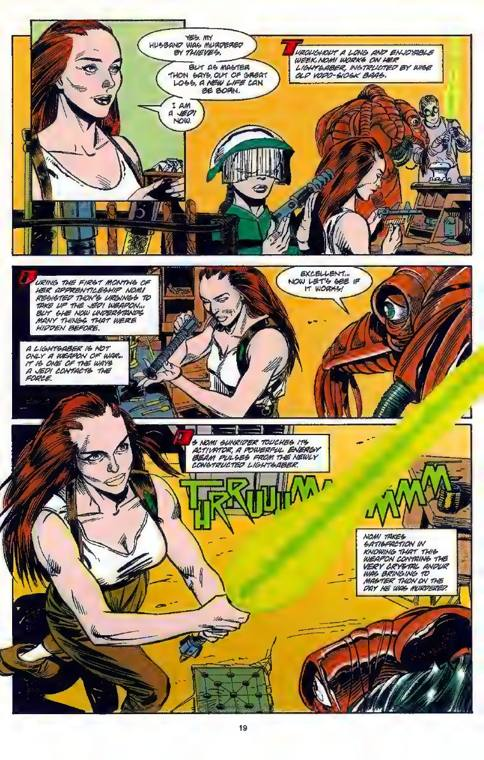
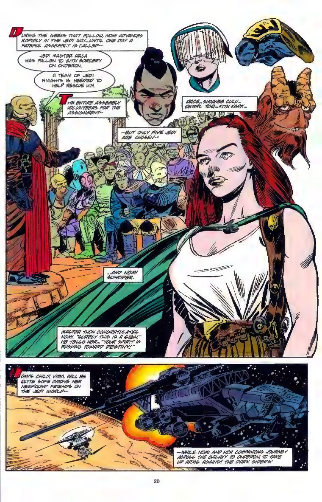

### 2. A Jedi of only a few months, Nomi is already adept in the battle skills she learned on Ossus; her greatest talent is the internal visualization she used on Ambria.

```
AND NOMI SUNRIDER--A JEDI ONLY A FEW SHORT MONTHS--IS ALREADY ADEPT IN BATTLE SKILLS SHE LEARNED ON OSSUS.
BUT NOMI'S GREATEST TALENT, IS THE INTERNAL VISUALIZATION SHE USED TO DEFEAT MASTER THON'S ENEMIES ON AMBRIA!

— Narration, Tales of the Jedi: The Freedon Nadd Uprising #2, p. 5 (Dark Horse Comics, 1994) †
```

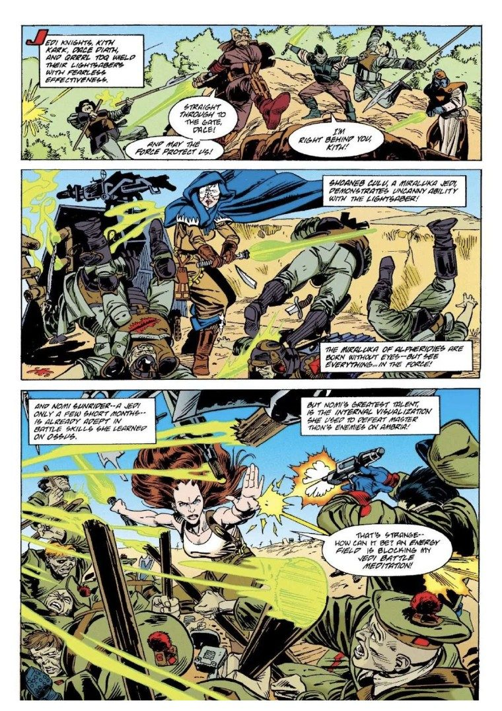

### 3. The Complete Star Wars Encyclopedia says Nomi trained with Arca Jeth in battle meditation, gaining physical strength and self-confidence.

```
Nomi stayed to train with Arca in the Force mind technique known as Jedi battle meditation, gaining in both physical strength and self-confidence.

— The Complete Star Wars Encyclopedia (Stephen J. Sansweet and Pablo Hidalgo, 2008) †
```

### 4. The New Essential Chronology says Nomi became a master of battle meditation.

```
Nomi Sunrider became a master in the technique of battle meditation.

— The New Essential Chronology (Daniel Wallace and Kevin J. Anderson, 2005) †
```

## Force Knowledge and Training

### 5. Nomi builds her first lightsaber under Vodo-Siosk Baas; when she touches the activator a powerful beam pulses from it.

```
AS NOMI SUNRIDER TOUCHES ITS ACTIVATOR, A POWERFUL ENERGY BEAM PULSES FROM THE NEWLY CONSTRUCTED LIGHTSABER.

— Narration, Tales of the Jedi: The Freedon Nadd Uprising #1, p. 21 (Dark Horse Comics, 1994) †
```

### 6. Nomi tells Tott Doneeta that Odan-Urr taught her the Force-blocking technique she used on Ulic, and that she never thought it would be so strong and complete.

```
SOMETHING MASTER ODAN-URR TAUGHT ME, A FORCE-BLOCKING TECHNIQUE TO NEUTRALIZE AN ENEMY WITHOUT VIOLENCE...
...BUT I NEVER THOUGHT IT WOULD BE SO STRONG...SO COMPLETE.

— Nomi Sunrider to Tott Doneeta, Tales of the Jedi: The Sith War #6, p. 5 (Dark Horse Comics, 1995–96) †
```


### 7. Odan-Urr explains the technique to Nomi: a wall of light that blinds an enemy to the Force, permanently if she chooses, "the most devastating attack possible using the powers of the light side."

```
THIS TECHNIQUE BLINDS YOUR ENEMY TO THE FORCE WITH A WALL OF LIGHT, A PERMANENT BLOCKAGE IF YOU SO CHOOSE...RENDERING HIM UNABLE TO USE JEDI POWERS.
AND IT IS THE MOST DEVASTATING ATTACK POSSIBLE USING THE POWERS OF THE LIGHT SIDE. TO BLOCK A JEDI FROM THE FORCE--EVEN A DARK JEDI--IS A TERRIBLE THING.

— Odan-Urr to Nomi Sunrider, Tales of the Jedi: The Sith War #1, p. 17 (Dark Horse Comics, 1995–96) †
```

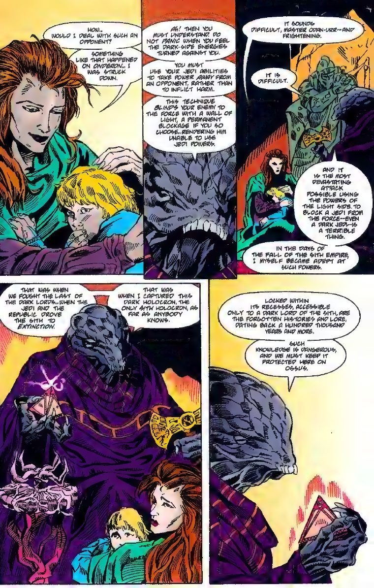

## Force Sense and Precognition

### 8. With her growing sensitivity to the Force, Nomi sees Ommin through it; the narration says it is almost more than she can handle.

```
WITH HER GROWING SENSITIVITY TO THE INNER WORKING OF THE FORCE, IT IS ALMOST MORE THAN SHE CAN HANDLE.
I...SEE YOU...I KNOW... WHAT YOU ARE...

— Narration and Nomi Sunrider, Tales of the Jedi: The Freedon Nadd Uprising #2, p. 8 (Dark Horse Comics, 1994) †
```

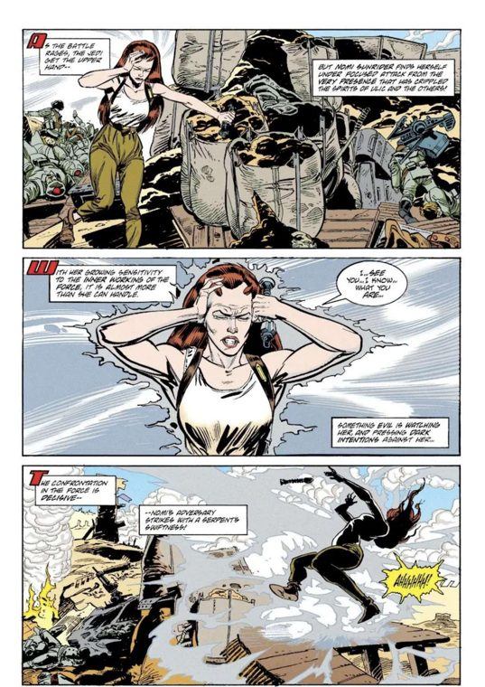

### 9. Nomi senses that Ommin is still watching them after his troops are beaten.

```
IT'S NOT OVER, OSS--OMMIN STILL HAS HIS EYE ON US!

— Nomi Sunrider to Oss Wilum, Tales of the Jedi: The Freedon Nadd Uprising #2, p. 15 (Dark Horse Comics, 1994) †
```

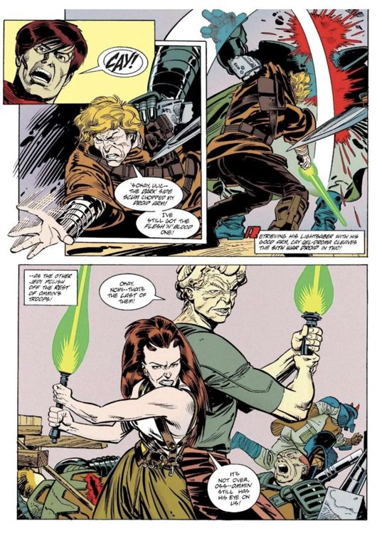
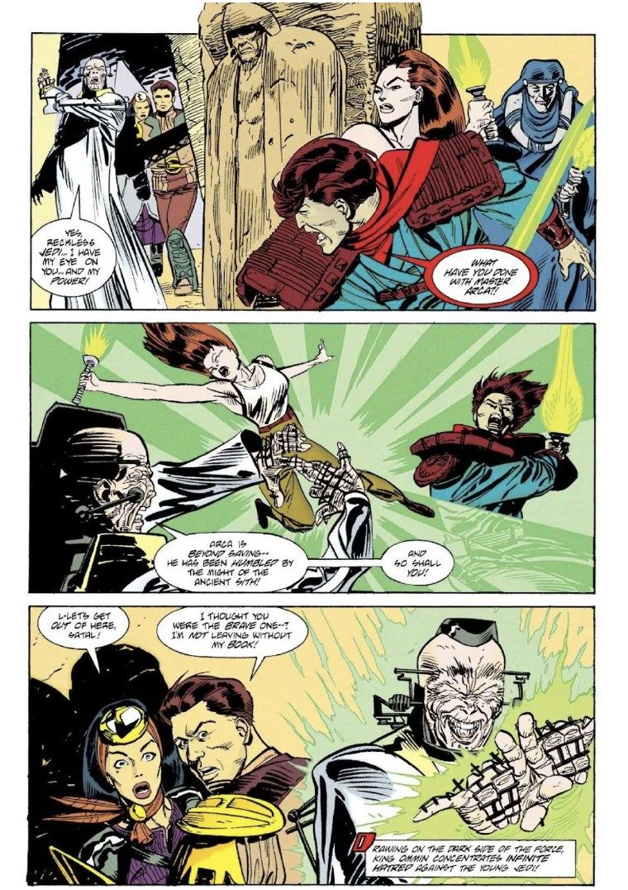

### 10. Nomi tells Ulic that someone very powerful lunged at her through the Force when she tried to meditate the fight, and describes Ommin on his armature.

```
SOMEONE VERY POWERFUL... LUNGED AT ME THROUGH THE FORCE, WHEN I TRIED TO MEDITATE THE FIGHT.
I SAW HIM... AN EMACIATED MAN ON A METAL ARMATURE.

— Nomi Sunrider to Ulic Qel-Droma, Tales of the Jedi: The Freedon Nadd Uprising #2, p. 8–9 (Dark Horse Comics, 1994) †
```

## Telepathy and Mind Control

### 11. Nomi imprisons Ulic in a wall of light that blinds him to his Jedi powers.

```
ULIC--I LOVED YOU, BUT THIS... THIS!
I IMPRISON YOU IN A WALL OF LIGHT, A FORTRESS TO BLOCK YOU FROM THE FORCE...
...BLIND YOU TO YOUR JEDI POWERS!

— Nomi Sunrider to Ulic Qel-Droma, Tales of the Jedi: The Sith War #6, p. 5 (Dark Horse Comics, 1995–96) †
```

### 12. The Complete Star Wars Encyclopedia says Nomi's attack on Ulic was so powerful that it severed his connection to the Force.

```
But after Ulic murdered his brother, Cay, Nomi lashed out with her Force abilities in an attack so powerful that she severed his connection to the Force.

— The Complete Star Wars Encyclopedia (Stephen J. Sansweet and Pablo Hidalgo, 2008) †
```

### 13. The Power of the Jedi Sourcebook says Nomi avenged Cay by severing Ulic's connection to the Force.

```
Moments later, Nomi Sunrider avenged Cay by severing Ulic's connection to the Force.

— Power of the Jedi Sourcebook (Wizards of the Coast, 2002) †
```

### 14. Star Wars Insider cites Nomi's ability to sever a Jedi's connection to the Force as a notable example of a rare technique.

```
Nomi Sunrider's ability to sever a Jedi's connection to the Force and the prohibited art of Morichro are two notable examples.

— Star Wars Insider #61 (2002) †
```

## Illusions, Concealment and Stealth

### 15. In Cinnagar, Nomi expands as the light to fill the room and dissolve Aleema's illusions, then begs Ulic to leave with her.

```
I REST IN THE LIGHTSIDE OF THE FORCE...THAT IS MY POWER...
AS THE LIGHT, I EXPAND FILLING THIS ROOM...DISSOLVING THESE DREADFUL ILLUSIONS!
WHY--? BECAUSE I LOVE YOU!
NOW...COME WITH US! LEAVE THIS PLACE!

— Nomi Sunrider, Tales of the Jedi: Dark Lords of the Sith #6, p. 16 (Dark Horse Comics, 1994–95) †
```


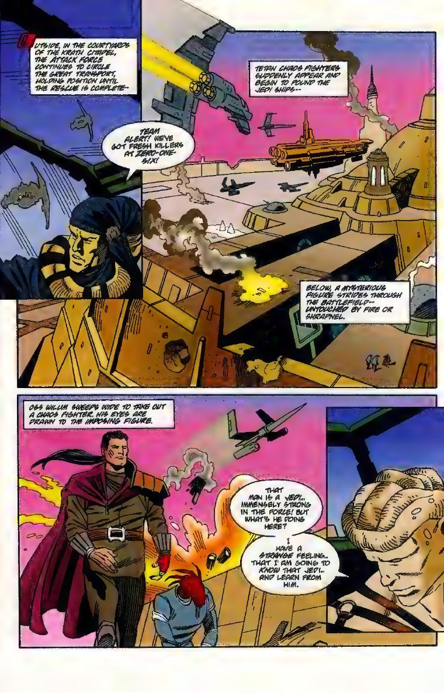

### 16. Nomi tears apart Aleema's illusion with "fingers of bright Force."

```
FINGERS OF BRIGHT FORCE

— Narration, Tales of the Jedi: Dark Lords of the Sith #2, p. 24–25 (Dark Horse Comics, 1994–95) †
```

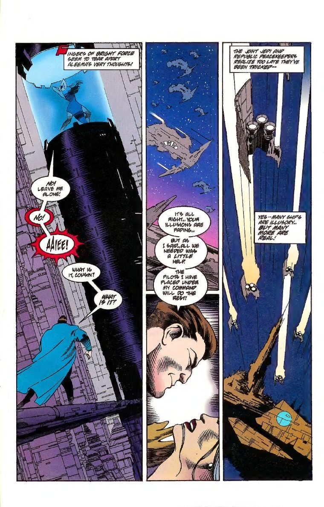
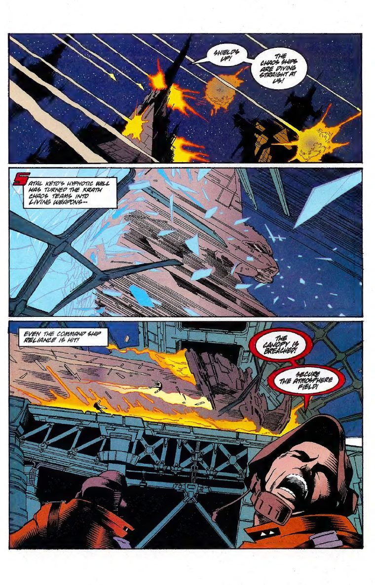

## Battle Meditation and Command

### 17. Fighting the Krath warriors, the narration says their power is immense, but they do not know her battle meditation would be enough to defeat them.

```
UNEXPECTEDLY, THE POWER OF THE KRATH WARRIORS IS IMMENSE! SHE MUST DEFEND HERSELF OR DIE.
HER OPPONENTS ARE UNAWARE THAT HER JEDI BATTLE MEDITATION WOULD BE ENOUGH TO DEFEAT THEM.

— Narration, Tales of the Jedi: Dark Lords of the Sith #5, p. 13 (Dark Horse Comics, 1994–95) †
```

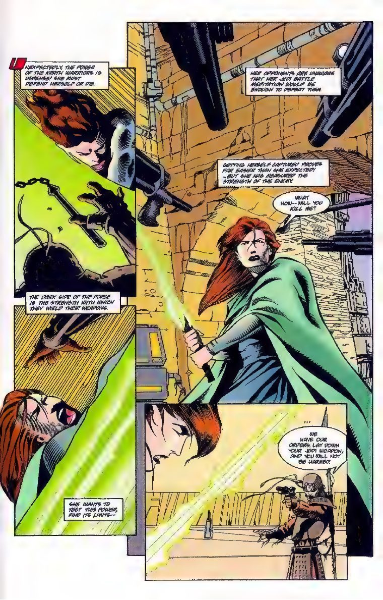

### 18. The Companion's summary of Nomi's saga: she uses battle meditation to make Bogga's attackers turn on each other over the Adegan crystals.

```
Upon seeing Master Thon surrender to the pirates, Nomi uses her battle meditation to cause the attackers to turn on each other in a struggle over the Adegan crystals. Amidst the confusion, Nomi frees MasterThon, and the two confront the viilains, who flee after several of their number fall beneath the Jedi onslaught.

— Tales of the Jedi Companion (West End Games, 1996), p. 13 †
```

### 19. The Complete Star Wars Encyclopedia says Nomi used battle meditation to force Stonebone's pirates to turn on one another.

```
When Stonebone's men tried to murder Jedi Master Thon and Nomi Sunrider, Nomi used the Jedi battle meditation technique to force the pirates to turn on one another.

— The Complete Star Wars Encyclopedia (Stephen J. Sansweet and Pablo Hidalgo, 2008) †
```

### 20. The Power of the Jedi Sourcebook says Nomi found her talent for battle meditation when she used it unconsciously to save her daughter from a dark side dragon.

```
Nomi discovered she had a natural talent for the art of Jedi battle meditation when she unconsciously used the technique to save her daughter from a dark side dragon.

— Power of the Jedi Sourcebook (Wizards of the Coast, 2002) †
```

### 21. The Power of the Jedi Sourcebook says Nomi used battle meditation to influence the outcome of Great Bogga's last attempt on the Adegan crystals.

```
When a Hutt crime lord named Great Bogga made a final attempt to steal the Adegan crystals, Nomi responded by using an application of Jedi battle meditation to influence the outcome of the battle.

— Power of the Jedi Sourcebook (Wizards of the Coast, 2002) †
```

### 22. Star Wars Insider names Nomi, with Arca Jeth, as a skilled user of battle meditation.

```
Skilled users of this technique include Master Arca and Nomi Sunrider.

— Star Wars Insider #27 (1995) †
```

## Fights and Combat Feats

### 23. Nomi fights back to back with Oss Wilum as the Jedi finish off Ommin's troops.

```
--AS THE OTHER JEDI POLISH OFF THE REST OF OMMIN'S TROOPS!
OKAY, NOMI--THAT'S THE LAST OF THEM!

— Narration and Oss Wilum, Tales of the Jedi: The Freedon Nadd Uprising #2, p. 15 (Dark Horse Comics, 1994) †
```

### 24. The Complete Star Wars Encyclopedia says Nomi killed Quanto with Andur's lightsaber in self-defense.

```
Andur's wife, Nomi, then killed Quanto with Andur's lightsaber in self-defense.

— The Complete Star Wars Encyclopedia (Stephen J. Sansweet and Pablo Hidalgo, 2008) †
```

### 25. Nomi, fresh from her training, tells her fellow Jedi that her husband was murdered, "I am a Jedi now."

```
YES. MY HUSBAND WAS MURDERED BY THIEVES.
BUT AS MASTER THON SAYS, OUT OF GREAT LOSS, A NEW LIFE CAN BE BORN.
I AM A JEDI NOW.

— Nomi Sunrider, Tales of the Jedi: The Freedon Nadd Uprising #1, p. 21 (Dark Horse Comics, 1994) †
```

## Statements from Other Characters

### 26. Vodo-Siosk Baas says the Force tells him Nomi can be a great Jedi, if she listens to it.

```
THE FORCE TELLS ME THAT NOMI SUNRIDER CAN BE A GREAT JEDI... ...IF SHE LISTENS TO THE FORCE.
AND SO THE LITTLE ONE...ALSO A GREAT JEDI.

— Vodo-Siosk Baas, about Nomi Sunrider, Tales of the Jedi: The Freedon Nadd Uprising #1, p. 19 (Dark Horse Comics, 1994) †
```

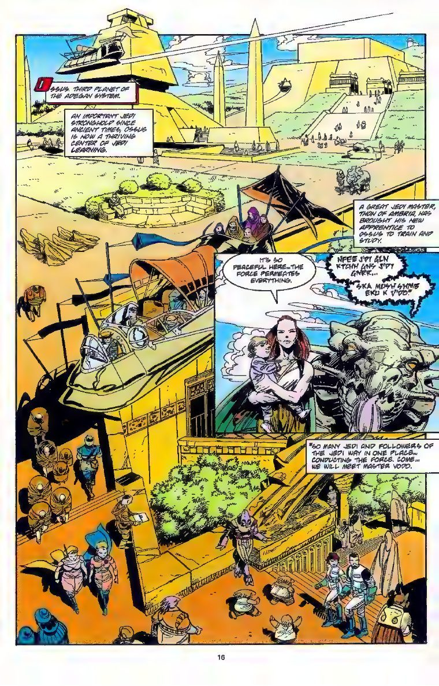
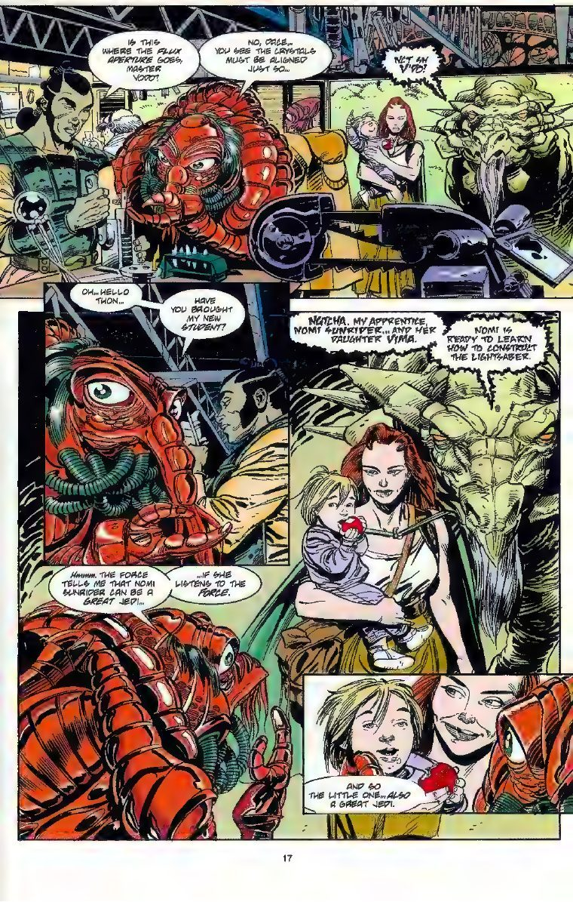

### 27. Master Thon tells Nomi: "Your spirit is rushing toward destiny!"

```
YOUR SPIRIT IS RUSHING TOWARD DESTINY!

— Thon to Nomi Sunrider, Tales of the Jedi: The Freedon Nadd Uprising #1, p. 22 (Dark Horse Comics, 1994) †
```

### 28. Ood Bnar foretells that Nomi will play an important part in the battles to come: "a luminous being she is."

```
This Jedi will play an important part in the battles to come. Truly, she will be strong - a luminous being she is.

— Ood Bnar, about Nomi Sunrider, Tales of the Jedi Companion (West End Games, 1996), p. 26 †
```

### 29. Odan-Urr tells Nomi that he became adept at such powers in the days of the fall of the Sith Empire.

```
IN THE DAYS OF THE FALL OF THE SITH EMPIRE, I MYSELF BECAME ADEPT AT SUCH POWERS.
THAT WAS WHEN WE FOUGHT THE LAST OF THE DARK LORDS...WHEN THE JEDI AND THE REPUBLIC DROVE THE SITH TO EXTINCTION.
THAT WAS WHEN I CAPTURED THIS DARK HOLOCRON, THE ONLY SITH HOLOCRON, AS FAR AS ANYBODY KNOWS.

— Odan-Urr to Nomi Sunrider, Tales of the Jedi: The Sith War #1, p. 17 (Dark Horse Comics, 1995–96) †
```

### 30. Ulic tells Nomi that now she is here they have the strength to strike at the source of the evil.

```
THAT'LL BE KING OMMIN.
BUT NOW THAT YOU ARE HERE, WE HAVE THE STRENGTH TO STRIKE TOGETHER AT THE SOURCE OF THIS EVIL!

— Ulic Qel-Droma to Nomi Sunrider, Tales of the Jedi: The Freedon Nadd Uprising #2, p. 9 (Dark Horse Comics, 1994) †
```

### 31. Tionne's ballad, as Luke hears it: Nomi took up the Jedi training meant for her murdered husband and became a pivotal figure in the Sith War.

```
Luke closed his eyes and heard her tale about young Nomi Sunrider, who, after her husband’s murder, attended the Jedi training that had been meant for him. Nomi had become a pivotal character in the devastating Sith War that pitted Jedi against Jedi in the ancient days of the Old Republic.

— Dark Apprentice (Kevin J. Anderson, 1994), ch. 23
```

### 32. Kyp interrupts the ballad: Nomi was a victim who fought without understanding the battles and listened blindly to her Masters.

```
“I wish you wouldn’t perpetuate that ridiculous story,” Kyp said. “Nomi Sunrider was a victim. She fought in the Sith Wars without ever understanding what the battles were about. She listened blindly to her Jedi Masters, who were afraid because Exar Kun had discovered a way for the Jedi to increase their power.”

— Dark Apprentice (Kevin J. Anderson, 1994), ch. 23
```

### 33. Corran Horn describes the ballad: Nomi took her husband's place in a training cadre and became an acclaimed Jedi with a key role in the Sith War.

```
Nomi Sunrider’s ballad came from the era of Exar Kun and the Sith War. She was a woman whose husband had been slain, so she took his place in a Jedi training cadre. She went on to become an acclaimed Jedi who played a key role in the Sith War. Singing about her might have been considered sacrilege in the Great Temple of Yavin 4, but I didn’t think anyone would protest the fact after four thousand years.

— I, Jedi (Michael A. Stackpole, 1998), ch. 17
```

### 34. Tionne's telling of Nomi Sunrider's story to the young Jedi Knights.

```
"Thousands of years ago, in a time of great evil and great good," Tionne began in her rich musical voice, "there lived a woman named Nomi Sunrider with her husband Andur, who was training to be a Jedi Knight.

"When Nomi and her husband traveled to take a gift of precious Adegan crystals to Andur's new Jedi Master, they were stopped by a group of greedy bandits, who killed Nomi's husband and tried to steal the crystals. But when Nomi saw her husband lying dead, she snatched up his lightsaber and took a deadly revenge on his murderers. Afterward, seeing what she had done, Nomi was so filled with revulsion that she vowed never to touch a lightsaber again.

"To fulfill the dying wish of her husband, Nomi carried the crystals to his Jedi Master, Thon. There she stayed with her baby daughter Vima and began her own training to become a Jedi. She learned and grew in wisdom and the Force, but still she refused to touch a lightsaber, although it was the weapon of the Jedi.

"Eventually, however, there came a day when she discovered that her power with the Force alone could not protect the ones she loved. To save her beloved Jedi Master and to guard her daughter, Nomi once again took up a lightsaber and fought for what she knew was right.

"But by this time Nomi understood the purpose and meaning of the lightsaber—and from that day forward she fought with all the power of the light side of the Force. She was never eager to use her lightsaber, but she knew it was occasionally necessary. By learning to accept this, she became a great Jedi Master and a great warrior."

— Lightsabers (Kevin J. Anderson and Rebecca Moesta, 1996), ch. 9
```

## Author and Guide Statements

### 35. A Legacy Era Campaign Guide talent calls Nomi "a powerful Jedi from the days of the Old Republic."

```
Sunrider Legacy You are a descendant of Nomi Sunrider, a powerful Jedi from the days of the Old Republic who fought in the Great Sith War.

— Legacy Era Campaign Guide (Wizards of the Coast, 2009) †
```

### 36. The Complete Star Wars Encyclopedia says Andur was killed by Great Bogga's henchmen while Nomi accompanied him with the Adegan crystals for Master Thon.

```
She was accompanying her husband on a mission to take some Adegan crystals, used to construct lightsabers, to Jedi Master Thon in the Ambria system when Andur was cut down by several henchmen of Great Bogga the Hutt.

— The Complete Star Wars Encyclopedia (Stephen J. Sansweet and Pablo Hidalgo, 2008) †
```

### 37. The Complete Star Wars Encyclopedia says Nomi escaped Satal's imprisonment hours before Ulic had agreed to kill her to prove his loyalty.

```
He survived an assassination attempt by Satal and saw Nomi escape imprisonment by Satal just hours before Ulic had agreed to kill her to prove his loyalty to the Krath.

— The Complete Star Wars Encyclopedia (Stephen J. Sansweet and Pablo Hidalgo, 2008) †
```

## Limitations

*These are anti-feats, limits and caveats, each followed by the evidence behind it.*

### 38. FLEES THE PIRATES: The Companion's summary of Nomi's saga: Thon deflects the pirates' laser cannon blasts with the Force while trying to make Nomi take up the lightsaber; she refuses and flees with her daughter, leaving him to face them alone.

```
Nomi and Virna climb onto Thon's back, and they charge back toward his hut. Thon deflects the laser cannon blasts of the pirates with the Force as he tries to get Nomi to take up the Iightsaber. Again, Nomi refuses. Thon then rushes toward the attackers in an attempt to force Nomi to use her battle meditation to end the conflict. Nomi instead flees with her daughter, leaving Thon to confront the pirates on his own.

— Tales of the Jedi Companion (West End Games, 1996), p. 13 †
```

### 39. MEDITATION BLOCKED BY OMMIN: On Onderon, an energy field blocks Nomi's battle meditation.

```
THAT'S STRANGE-- HOW CAN IT BE? AN ENERGY FIELD IS BLOCKING MY JEDI BATTLE MEDITATION!

— Nomi Sunrider, Tales of the Jedi: The Freedon Nadd Uprising #2, p. 5 (Dark Horse Comics, 1994) †
```

### 40. STRUCK DOWN BY OMMIN: In the Force duel with Ommin, he strikes with a serpent's swiftness and hurls her through the air; she is unhurt.

```
--NOMI'S ADVERSARY STRIKES WITH A SERPENT'S SWIFTNESS! *(she is hurled through the air)*
I SEE NO WOUNDS...
I...I'M ALL RIGHT...

— Narration, Ulic Qel-Droma and Nomi Sunrider, Tales of the Jedi: The Freedon Nadd Uprising #2, p. 8–9 (Dark Horse Comics, 1994) †
```

### 41. STRUCK DOWN BY OMMIN (COMPANION): The Companion's summary of the same moment: "Nomi crumples under a powerful Force-blow."

```
Nomi crumples under a powerful Force-blow.

— Tales of the Jedi Companion (West End Games, 1996), p. 15 †
```

### 42. BATTERED BY OMMIN'S HATRED: Ommin concentrates "infinite hatred" against Nomi and Ulic and hurls them back.

```
DRAWING ON THE DARK SIDE OF THE FORCE, KING OMMIN CONCENTRATES INFINITE HATRED AGAINST THE YOUNG JEDI!

— Narration, Tales of the Jedi: The Freedon Nadd Uprising #2, p. 16 (Dark Horse Comics, 1994) †
```

### 43. CANNOT UNDO THE BLOCK: Nomi says she has no idea how to undo what she did to Ulic, right after the line under Force Knowledge.

```
AND I HAVE NO IDEA HOW TO UNDO WHAT I HAVE DONE!

— Nomi Sunrider to Tott Doneeta, Tales of the Jedi: The Sith War #6, p. 5 (Dark Horse Comics, 1995–96) †
```

### 44. COUNTERED BY ALEEMA: The New Essential Chronology says Aleema countered Nomi and Ulic's Jedi abilities with her own powerful Sith illusions.

```
Ulic and Nomi assisted by using their Jedi abilities—but Aleema countered with her own powerful Sith illusions.

— The New Essential Chronology (Daniel Wallace and Kevin J. Anderson, 2005) †
```

### 45. A COSTLY VICTORY: After Exar Kun's defeat, Nomi says they have beaten him, but asks at what cost.

```
LOOKS LIKE WE'VE DEFEATED EXAR KUN...
...BUT AT WHAT COST?

— Nomi Sunrider, Tales of the Jedi: The Sith War #6, p. 23 (Dark Horse Comics, 1995–96) †
```

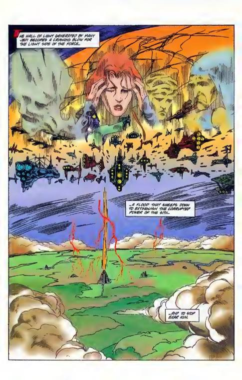

### 46. REFUSES THE LIGHTSABER: The Companion says Ood Bnar's words were hard for Nomi to accept, because the lightsaber remained a symbol of death to her.

```
But Nomi found it difficult to accept Ood Bnar's words. In her mind, the Iightsaber remained a symbol of death - a symbol she was trying desperately to separate herself from.

— Tales of the Jedi Companion (West End Games, 1996), p. 26 †
```

## Comic Panels Without a Matching Entry

*Panels from the old version of this file, or from the same comics, that no quoted entry above covers yet.*


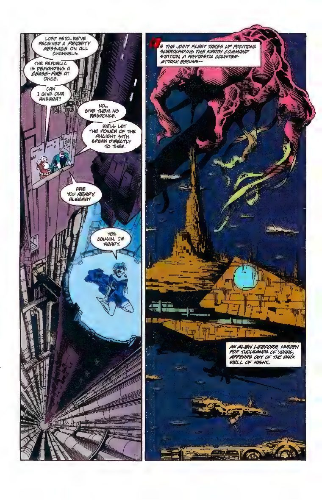
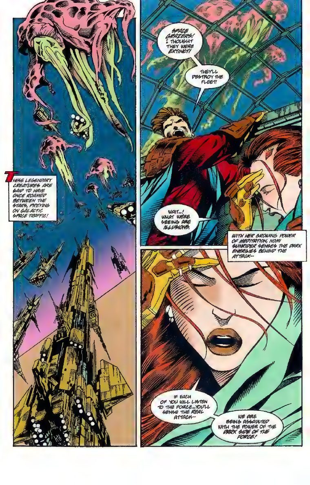


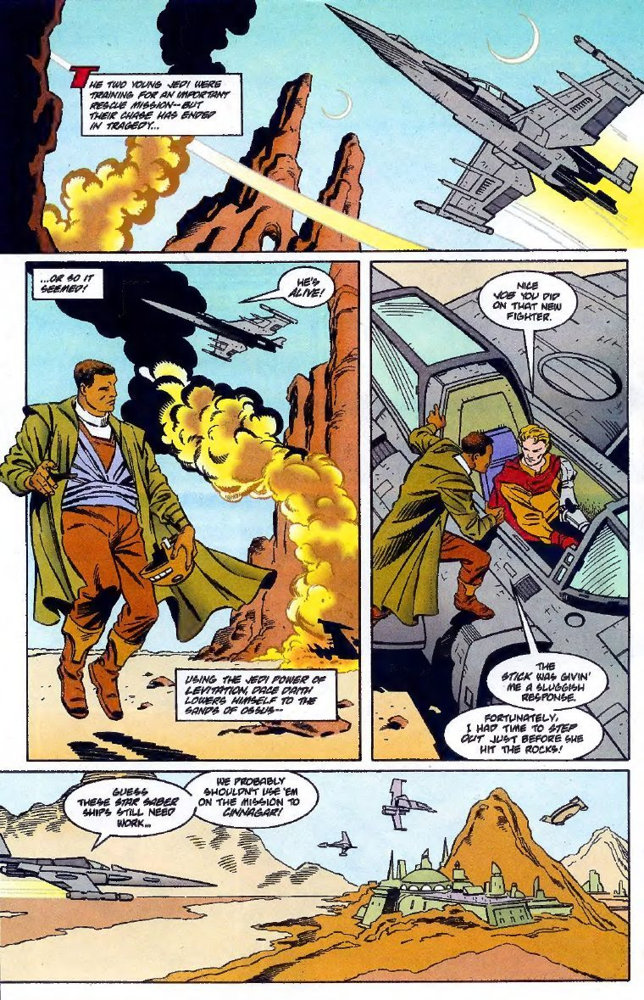


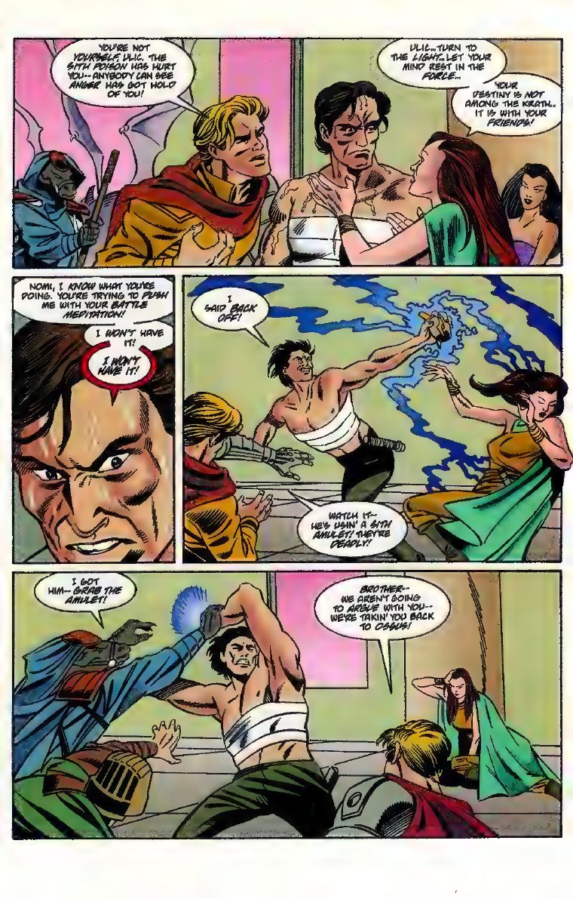


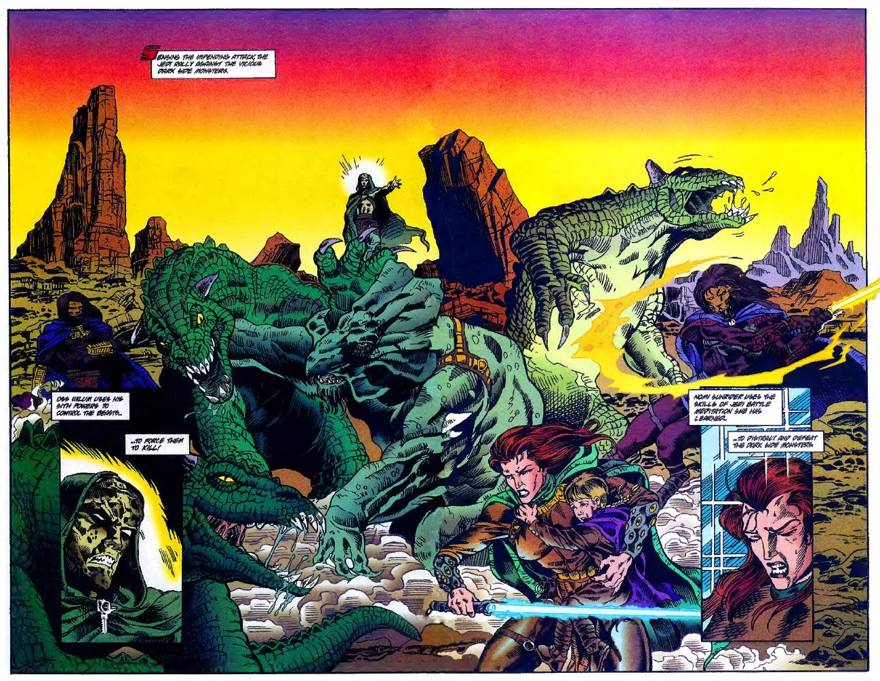


