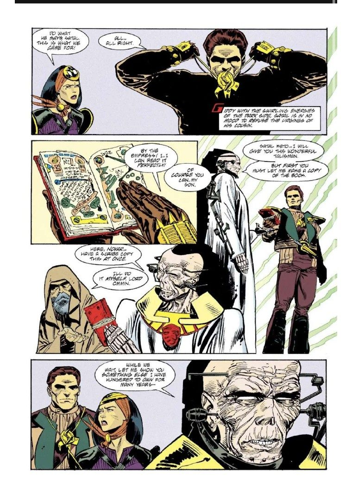

# Novar

- **Aliases:** —
- **Era:** Great Sith War
- **Continuity:** default Legends; entries present for: Legends
- **Research tier:** untiered (not listed as INTRO/DEEP/MASTERY in legends-feats.md)
- **Entries:** 9 (4 with quotations; 0 quotations extended to the full sentence/passage from the source text on file; 2 marked as fragments). Rebuilt 2026-11-17 from 12 old entries; old file: `characters/_bak/novar.md.bak-20261117`.
- **How to read:** each entry is the quotation in full (block quote), then its source and point of view. "Note" lines are summaries from our notes, not quotations. `[fragment — full passage not on file]` means the source text is not on the box, so only the words in our notes are shown. Debate and forum material is in the last section and is unverified.

# LEGENDS (Legends / EU — main focus)

## Tales of the Jedi: Freedon Nadd Uprising #1–2, Dark Lords of the Sith #1–6, The Sith War #1–6, plus the WEG Tales of the Jedi Companion (power-scaling notes)

> GIDDY WITH THE SWIRLING ENERGIES OF THE DARK SIDE, SATAL IS IN NO MOOD TO REFUSE THE URGINGS OF HIS COUSIN.
>
> BY THE EMPRESS! I...I CAN READ IT PERFECTLY!
> [fragment — full passage not on file]
>
> OF COURSE YOU CAN, MY SON.
— Source: Owner Material 024a — Tales of the Jedi: The Freedon Nadd Uprising #1–2 (1994): power-scaling notes; Reads the Sith book with Ommin's amulet.
Note (our notes, around the quote): Reads the Sith book with Ommin's amulet: "GIDDY WITH THE SWIRLING ENERGIES OF THE DARK SIDE, SATAL IS IN NO MOOD TO REFUSE THE URGINGS OF HIS COUSIN." Satal: "BY THE EMPRESS! I...I CAN READ IT PERFECTLY!" Ommin: "OF COURSE YOU CAN, MY SON." Source: Freedon Nadd Uprising #2, p12

Our notes: `notes/materials/024-tales-of-the-jedi/freedon-nadd-uprising.md:223`

> HERE, NOVAR... HAVE A SCRIBE COPY THIS AT ONCE.
> [fragment — full passage not on file]
>
> I'LL DO IT MYSELF, LORD OMMIN.
— Source: Owner Material 024a — Tales of the Jedi: The Freedon Nadd Uprising #1–2 (1994): power-scaling notes; Ommin's servant copies the Sith book himself: Ommin.
Note (our notes, around the quote): Ommin's servant copies the Sith book himself: Ommin: "HERE, NOVAR... HAVE A SCRIBE COPY THIS AT ONCE." Novar: "I'LL DO IT MYSELF, LORD OMMIN." Source: Freedon Nadd Uprising #2, p12

Our notes: `notes/materials/024-tales-of-the-jedi/freedon-nadd-uprising.md:260`

- Note (summary from our notes, not a quotation): | 66–76 | The Sith | Bios + stat blocks: Queen Amanoa, Freedon Nadd, King Ommin, Novar, Warb Null; Sith fiction |
  — Source: Owner Material 024d — Tales of the Jedi Companion (West End Games, 1996): power-scaling notes.
Context: | Printed pages | Chapter | What is in it |
Our notes: `notes/materials/024-tales-of-the-jedi/tales-of-the-jedi-companion.md:28`

- Note (summary from our notes, not a quotation): RPG MECHANICS: Novar, Sith Initiate (Ommin's court). Force skills Control 3D+2, Sense 3D, Alter 2D+2. Powers include bolt of hatred, sense path, hibernation trance. Source: Tales of the Jedi Companion (WEG, 1996), p.72
  — Source: Tales of the Jedi Companion (WEG, 1996), p.72 — Owner Material 024d — Tales of the Jedi Companion (West End Games, 1996): power-scaling notes.
Our notes: `notes/materials/024-tales-of-the-jedi/tales-of-the-jedi-companion.md:253`

- Note (summary from our notes, not a quotation): | Novar (Sith Initiate) | 3D+2 | 3D | 2D+2 | — | p.72 |
  — Source: Owner Material 024d — Tales of the Jedi Companion (West End Games, 1996): power-scaling notes.
Context: | Character | Control | Sense | Alter | Lightsaber | Page |
Our notes: `notes/materials/024-tales-of-the-jedi/tales-of-the-jedi-companion.md:342`

## The Complete Star Wars Encyclopedia, Vol. II (H–O)

- Note (summary from our notes, not a quotation): Page contents: 1109 words, 32 paragraphs | headings/entries: Nova Crystal; Nova Demons; Nova Force; Nova Level; Novar; Novarr, Fiana; Nova Squadron; Novastar; Novastar Corporation; Nova Station; Nova Viper; Novus; NR-S5; NRI; NR-N99 Persuader; Nrogu; Nrross; Ne-s6; NT 600
  — Source: scan pages 361–400.
Our notes: `notes/materials/031-complete-star-wars-encyclopedia-vol-2/09-v2-scan-361-400.md:305`

> The king, in a great fit of rage, destroyed Kad with Sith magic and promoted Novar in his place.
— Source: scan pages 361–400; Novar — entry/section: Novar.
Note (our notes, around the quote): Novar — entry/section: Novar: "The king, in a great fit of rage, destroyed Kad with Sith magic and promoted Novar in his place." Source: The Complete Star Wars Encyclopedia, Vol. II, p.392
Our notes: `notes/materials/031-complete-star-wars-encyclopedia-vol-2/09-v2-scan-361-400.md:307`

## Sourcebooks/Galaxy of Intrigue.pdf [Star Wars Roleplaying Game Saga Edition (2007)] (scan pages 61–120)

- Note (summary from our notes, not a quotation): Page contents: House Korden: 14,000-year Corulag merchant house (Haddius Korden; Korden Outfitting and Surveying; principality on Novar); voices of moderation; quiet support of the Rebel Alliance. Caption: "HOUSE KORDEN" (art credit Gonzalo Flores). (hand-read)
  — Source: Sourcebooks/Galaxy of Intrigue.pdf [Star Wars Roleplaying Game Saga Editi.
Our notes: `notes/materials/037-sw-d20-folder/716-galaxy-of-intrigue-scan-061-120.md:339`

# Debate and forum claims (unverified)

Forum posts, Suspect Insight debates and Discord debates, respect threads, and verdicts. These are posters' arguments or quotations they typed; none is checked against the book here unless the entry says so.

## King Ommin Respect Thread — respect-thread notes

What it shows (our notes): Ommin obliterates Kad with a wave of dark energy.
> True to his courtier's instincts, however, Kad did not allow anyone else to learn of Novar's ability, instead keeping all the credit for himself. On one occasion, after Kad had bragged about an upcoming state dinner he had "personally" planned and arranged, Novar initiated the final step in his scheme. When the guests arrived to the palace's grand ballroom, they found it in complete disarray. Nothing had been prepared. Not even a single attendant or guard was on hand. In the end, the dinner, which would have been attended by the king and queen and various wealthy and politically strong individuals, had to be postponed. An infuriated King Ommin, though frail from the onset of a strange wasting disease, obliterated Kad in a wave of dark side energy as Novar watched in horror and fascination. Novarwas immediately promoted to minister of state and aide to the king. But although his plan had succeeded, he now had another obsession: to command the power King Ommin had used to destroy Kad. Over the next decade Novar manipulated the king until Ommin eventually agreed to take his underling on as an apprentice. After less than two years of teaching, however, King Ommin became too iii to continue, and Novar had to seek training elsewhere.
— Source: SI respect-thread directory: King Ommin Respect Thread — https://comicvine.gamespot.com/profile/i_like_swords/blog/king-ommin-respect-thread/101298/.
(Excerpt widened 2026-11-17 to the relevant passage, word for word from research primary tales of the jedi WEG40082 (text copy `research_primary_tales_of_the_jedi_WEG40082_pdf_afa57d0500`).)
(Excerpt widened 2026-11-17 to the relevant passage, word for word from research primary tales of the jedi WEG40082 (text copy `research_primary_tales_of_the_jedi_WEG40082_pdf_afa57d0500`).)
Posted by: not named in our notes (see thread/notes link).
Our notes: `suspect-insight/respect-threads/ommin.md:67`
