# Nyna Calixte

- **Aliases:** —
- **Era:** —
- **Continuity:** default Legends; entries present for: Legends
- **Research tier:** untiered (not listed as INTRO/DEEP/MASTERY in legends-feats.md)
- **Entries:** 86 (49 with quotations; 0 quotations extended to the full sentence/passage from the source text on file; 34 marked as fragments). Rebuilt 2026-11-17 from 139 old entries; old file: `characters/_bak/nyna-calixte.md.bak-20261117`.
- **How to read:** each entry is the quotation in full (block quote), then its source and point of view. "Note" lines are summaries from our notes, not quotations. `[fragment — full passage not on file]` means the source text is not on the box, so only the words in our notes are shown. Debate and forum material is in the last section and is unverified.

# LEGENDS (Legends / EU — main focus)

## Sourcebooks/Legacy Era Campaign Guide.pdf [Star Wars Roleplaying Game Saga Edition (2007)] (scan pages 121–180)

- Note (summary from our notes, not a quotation): Page contents: Chapter introduction; Darth Krayt's Empire: continuation of Palpatine's Empire; history from the Yuuzhan Vong invasion through the Ossus Project and the Sith proposal brought by Moff Nyna Calixte to the Council of Moffs, who pressure Emperor Roan Fel into accepting the Sith proposal, just as they had pressured him into the war in the first place. (hand-read)
  — Source: Sourcebooks/Legacy Era Campaign Guide.pdf [Star Wars Roleplaying Game Sag.
Our notes: `notes/materials/037-sw-d20-folder/719-legacy-era-campaign-guide-scan-121-180.md:275`

> NYNA CALIXTE AND HER ALTER-EGO, MORRIGAN CORDE.
— Source: Sourcebooks/Legacy Era Campaign Guide.pdf [Star Wars Roleplaying Game Sag.
Note (our notes, around the quote): Page contents: Influential Personalities. Nyna Calixte (Morrigan Corde): member of the Council of Moffs and Director of Imperial Intelligence; romantically involved with Moff Morlish Veed; once married to Rulf Yage; mother of Gunn Yage; Imperial Intelligence HQ on Bothawui. Caption: "NYNA CALIXTE AND HER ALTER-EGO, MORRIGAN CORDE." Stat block CL 15 (scout 4/scoundrel 3/noble 7/gunslinger 1). (hand-read)
Our notes: `notes/materials/037-sw-d20-folder/719-legacy-era-campaign-guide-scan-121-180.md:360`

## Sourcebooks/Legacy Era Campaign Guide.pdf [Star Wars Roleplaying Game Saga Edition (2007)] (scan pages 181–225)

- Note (summary from our notes, not a quotation): Page contents: Morlish Veed stat block CL 15 (soldier 4/noble 6/officer 5). Gunn Yage: leader of Skull Squadron; daughter of Moff Rulf Yage and Nyna Calixte (making her Cade Skywalker's half-sister); formerly 181st Imperial Fighter Wing. Stat block CL 9 (soldier 7/ace pilot 2). Rulf Yage introduction: most decorated Grand Admiral; Navy representative on the Council of Moffs; formerly Skull Squadron commander when assigned to Bastion; Star Destroyer Ephin Sarreti, Imperial Second Outer Rim Fleet. (hand-read)
  — Source: Sourcebooks/Legacy Era Campaign Guide.pdf [Star Wars Roleplaying Game Sag.
Our notes: `notes/materials/037-sw-d20-folder/719-legacy-era-campaign-guide-scan-181-225.md:20`

## Star Wars Insider #114 (2010)

> This is a promise—or a threat!
— Source: Star Wars Insider #114 (2010).
Note (our notes, around the quote): Page contents: Wyyrlok is reigning Sith Lord after Krayt's demise; Moff Nyna Calixte seeks absolute power; Legacy cosplay (Darth Talon, Imperial Knights); Ostrander: "This is a promise—or a threat!" Sidebar: Star Wars: The Thrawn Trilogy hardcover (December 23, Dark Horse; Mike Baron, Olivier Vatine, Terry Dodson, Edvin Biukovic; 420 pages, $34.99). (hand-read)
Our notes: `notes/materials/038-star-wars-insider/114-ins114.md:328`

> Two Sith in a room always equals trouble. Put Nyna Calixte into that room and war is likely. Krayt's death has caused internal strife within the Sith Empire as factions see opportunities arising.
— Source: Star Wars Insider #114 (2010).
Note (our notes, around the quote): Darth Wyyrlok III; Nyna Calixte — entry/section: Duursema: Sith infighting after Krayt's death: ""Two Sith in a room always equals trouble. Put Nyna Calixte into that room and war is likely. Krayt's death has caused internal strife within the Sith Empire as factions see opportunities arising." —Jan Duursema, Star Wars Insider 114, p. 59" Source: *Star Wars Insider #114* (2010), scan p.59
Our notes: `notes/materials/038-star-wars-insider/114-ins114.md:330`

## Star Wars: Legacy (Dark Horse, 2006–2010) single issues #20–#50, hand-read

> "MY CONTACTS INFORM ME THAT THE MISSION ON HAD ABBADON DID NOT GO WELL. LORD KRAYT IS CURRENTLY IN HEALING STASIS ON KORRIBAN."
>
> "THAT SOMETHING ELSE IS GOING ON." (Nyna Calixte)
> [fragment — full passage not on file]
— Source: Star Wars: Legacy #35 — "Storms, Part 2 of 2" (Apr 2009). POV: Nyna Calixte.
Context: — Star Wars: Legacy #35, p. 3
Our notes: `notes/materials/039-legacy-2006/legacy-35.md:11`

> "FINDING THE PARTIES RESPONSIBLE ISN'T AS SIMPLE AS IT SEEMS. MY PEOPLE HAVE TRIED, BUT THIS PIRATE IS ELUSIVE..." (Gromia)
>
> "IT IS THAT SIMPLE, NIEVE -- YOU JUST NEED TO WORK WITH THE RIGHT PEOPLE." (Nyna Calixte)
> [fragment — full passage not on file]
— Source: Star Wars: Legacy #37 — "Tatooine, Part One of Four" (Jun 2009). POV: Gromia, about Nyna Calixte.
Context: — Star Wars: Legacy #37, p. 10
Our notes: `notes/materials/039-legacy-2006/legacy-37.md:68`

- Note (summary from our notes, not a quotation): New roster entries: none (Lun Rask, Ethan Adare, Konrad Rus, Astraal Vao, Nyna Calixte already present; added alias "Moff Rus" to Konrad Rus). Deaths: Ku Vrat, Sint, Moff Gromia, Lun Rask.
  — Source: Star Wars: Legacy #40 — "Tatooine, Part Four of Four" (Sep 2009).
Our notes: `notes/materials/039-legacy-2006/legacy-40.md:6`

- Note (summary from our notes, not a quotation): Major reveal: Morrigan Corde = Nyna Calixte, mother of Gunner Yage and Cade.
  — Source: Star Wars: Legacy #40 — "Tatooine, Part Four of Four" (Sep 2009).
Our notes: `notes/materials/039-legacy-2006/legacy-40.md:7`

> "I HAVE PROOF THAT YOUR MOTHER AND MORRIGAN CORDE ARE THE SAME PERSON. IN MY FILES ARE BOTH THEIR RECORDS OF SERVICE FOR THE EMPIRE-- WHEN ONE VANISHES, THE OTHER APPEARS!"
>
> "ANYONE WHO WANTS AGENT CORDE'S SERVICES MUST CONTACT HER THROUGH NYNA CALIXTE! BUT THE MOST RUINOUS SECRET..."
>
> "...IS THAT CORDE WAS ONCE SECRETLY THE WIFE OF KOL SKYWALKER... A JEDI!"
>
> "...AND THE MOTHER OF HIS SON, CADE! IF THIS CAME OUT, NYNA CALIXTE WOULD BE RUINED... A DISGRACE TO THE EMPIRE!" (Gromia)
>
> "LIES!" (Gunner)
>
> "GYAAAH!" (Gromia — flag)
> [fragment — full passage not on file]
— Source: Star Wars: Legacy #40 — "Tatooine, Part Four of Four" (Sep 2009). POV: Gromia, about Nyna Calixte.
Context: (Feat: Gromia kicks Gunner down in her garden and draws a blaster; Gunner tackles her and they grapple, shot fired (p17). Lore: Gunner's mother is Nyna Calixte.)
Our notes: `notes/materials/039-legacy-2006/legacy-40.md:160`

- Note (summary from our notes, not a quotation): (MAJOR REVEAL: Morrigan Corde = Nyna Calixte, mother of both Gunner Yage and Cade Skywalker (half-siblings). Gromia is shot point-blank in the struggle — flag whether Gunner fired or Gromia forced it; she dies on the floor (p18).)
  — Source: Star Wars: Legacy #40 — "Tatooine, Part Four of Four" (Sep 2009).
Our notes: `notes/materials/039-legacy-2006/legacy-40.md:168`

> "WHERE ARE YOU GETTING YOUR INFORMATION ON THIS, CALIXTE?" (Chiss Moff — unnamed, flag)
>
> "IT'S NOT FROM ME, AND THAT WORRIES ME. HOW DO WE KNOW WE'RE NOT FLYING INTO A TRAP?" (Nyna Calixte)
>
> "I DON'T FEEL THE NEED TO REVEAL THE SOURCE OF MY INFORMATION AT THIS TIME. TRUST IT TO BE RELIABLE." (Veed)
> [fragment — full passage not on file]
— Source: Star Wars: Legacy #43 — "Monster, Part One" (Dec 2009). POV: Nyna Calixte.
Context: — Star Wars: Legacy #43, p. 18
Our notes: `notes/materials/039-legacy-2006/legacy-43.md:126`

> "YOU ARE FORTUNATE, MASTER JEDI, THAT WE WERE ON MANEUVERS IN THE AREA." (Imperial woman — unnamed, resembles Nyna Calixte; flag)
>
> "YES, THE FORCE WAS WITH US." (Kol)
>
> "THE FORCE OR JUST YOUR SEEMING ENDLESS LUCK, KOL SKYWALKER." (Imperial woman)
>
> "THEY KNOW EACH OTHER. WHAT DO I SENSE BETWEEN THEM? WHO...? HOW...?" (caption, young Cade's thoughts)
>
> "DID I NOT TELL YOU, APPRENTICE?"
>
> "TRUST IN THE FORCE." (Wolf)
>
> "I WILL FIND YOU." (present-day Wolf)
> [fragment — full passage not on file]
— Source: Star Wars: Legacy #43 — "Monster, Part One" (Dec 2009). POV: Kol, about Nyna Calixte.
Context: — Star Wars: Legacy #43, p. 22
Our notes: `notes/materials/039-legacy-2006/legacy-43.md:159`

> "ADD THIS TO THE REQUESTED EQUIPMENT DROP ORDERED FOR WAYLAND, AJ-921."
>
> "ACKNOWLEDGED."
>
> "GOOD." (Imperial officer woman, resembles Nyna Calixte — flag)
> [fragment — full passage not on file]
— Source: Star Wars: Legacy #44 — "Monster, Part Two" (Jan 2010).
Context: — Star Wars: Legacy #44, p. 11
Our notes: `notes/materials/039-legacy-2006/legacy-44.md:82`

> HIGH OVER WAYLAND, THE WAR HAMMER DROPS ITS CARGO. *(caption)*
>
> WAYLAND. BEEN SO LONG I'D ALMOST FORGOTTEN. NO JEDI TO RESCUE TODAY, I SUPPOSE. *(Calixte, piloting — identified by p22 narration/p23 face)*
— Source: Star Wars: Legacy #44 — "Monster, Part Two" (Jan 2010).
Note (our notes, around the quote): > "HIGH OVER WAYLAND, THE WAR HAMMER DROPS ITS CARGO." (caption) / "WAYLAND. BEEN SO LONG I'D ALMOST FORGOTTEN. NO JEDI TO RESCUE TODAY, I SUPPOSE." (Calixte, piloting — identified by p22 narration/p23 face)
Our notes: `notes/materials/039-legacy-2006/legacy-44.md:165`

> "FIRST TIME I'D SEEN KOL... OR CADE... IN ALMOST SEVEN YEARS..." (caption, Calixte)
>
> "YOU ARE FORTUNATE, MASTER JEDI, THAT WE WERE ON MANEUVERS IN THE AREA." (Morrigan/Calixte)
>
> "YES, THE FORCE WAS WITH US." (Kol)
>
> "THE FORCE OR JUST YOUR SEEMINGLY ENDLESS LUCK, KOL SKYWALKER?"
> [fragment — full passage not on file]
— Source: Star Wars: Legacy #44 — "Monster, Part Two" (Jan 2010). POV: Kol, about Nyna Calixte.
Context: — Star Wars: Legacy #44, p. 21
Our notes: `notes/materials/039-legacy-2006/legacy-44.md:166`

> "IS THIS WHO YOU FLED ME TO BECOME, MORRIGAN? OR IS IT WHO YOU ALWAYS WERE?" (Kol)
>
> "THIS IS WHO I AM NOW, KOL. PLEASE-- DON'T BETRAY ME."
>
> "I WOULD NEVER DO THAT." (Kol)
>
> "YOUR SON MISSES YOU. WOULD YOU LIKE TO SPEAK WITH HIM?" (Kol)
> [fragment — full passage not on file]
— Source: Star Wars: Legacy #44 — "Monster, Part Two" (Jan 2010). POV: Kol, about Nyna Calixte.
Context: — Star Wars: Legacy #44, p. 22
Our notes: `notes/materials/039-legacy-2006/legacy-44.md:169`

> "YOUR SON. MORRIGAN'S SON. NOT MINE. I AM NYNA CALIXTE." (Calixte)
>
> "YOU'VE MADE A NEW LIFE FOR YOURSELF, MY LOVE. BUT YOU CAN NEVER FULLY ESCAPE WHO YOU WERE. NO ONE CAN."
>
> "SOMEDAY YOU WILL HAVE TO FACE CADE AND TELL HIM THE TRUTH." (Kol)
> [fragment — full passage not on file]
— Source: Star Wars: Legacy #44 — "Monster, Part Two" (Jan 2010).
Context: — Star Wars: Legacy #44, p. 22
Our notes: `notes/materials/039-legacy-2006/legacy-44.md:172`

> "AND THAT MEETING TURNED OUT SO WELL, KOL. IT ISN'T EVERY DAY A BOY TRIES TO KILL HIS MOTHER WITH FORCE LIGHTNING..." (Calixte)
> [fragment — full passage not on file]
— Source: Star Wars: Legacy #44 — "Monster, Part Two" (Jan 2010).
Context: — Star Wars: Legacy #44, p. 22
Our notes: `notes/materials/039-legacy-2006/legacy-44.md:175`

> "...HMMM. VT-211, WHAT IS THAT STRUCTURE DOWN THERE?" (Calixte)
>
> "UNKNOWN, MISTRESS. IT IS THE DESIGNATED DROP SITE FOR THE CARGO." (VT-211)
>
> "WAYLAND IS OFF LIMITS. WHO IS THE SITE REGISTERED TO?"
>
> "UNKNOWN. SITE IS NOT REGISTERED TO ANYONE. TECHNICALLY, IT DOES NOT EXIST."
>
> "BUT MY EYES TELL ME IT DOES. RECORD. THIS INFORMATION MAY HAVE USE TO ME LATER."
>
> "TELL ME, VTEE, IS THERE ANY CHANCE OF GETTING A MESSAGE TO ROAN FEL FROM HERE WITHOUT IT BEING PICKED UP BY YAGE'S FLEET?"
>
> "NONE."
>
> "PULL UP THE SMUGGLER CHARTS AND FIND US A SHORTCUT TO THE USUAL HYPERSPACE LANES."
>
> "WE HAVE AN EMPEROR TO SAVE." *(Calixte / VT-211)*
> [fragment — full passage not on file]
— Source: Star Wars: Legacy #44 — "Monster, Part Two" (Jan 2010).
Context: — Star Wars: Legacy #44, p. 23
Our notes: `notes/materials/039-legacy-2006/legacy-44.md:178`

- Note (summary from our notes, not a quotation): — Star Wars: Legacy #44, p. 23
  — Source: Star Wars: Legacy #44 — "Monster, Part Two" (Jan 2010).
Our notes: `notes/materials/039-legacy-2006/legacy-44.md:181`

- Note (summary from our notes, not a quotation): Major lore: Nyna Calixte = Morrigan, Cade's mother and Kol's love; Kol knew her new identity ~7 years before the present (flashback during the Wayland failure). Cade once attacked her with Force lightning (reference to earlier arc). Calixte secretly works to warn Roan Fel. This confirms p11 hangar officer as Calixte (still flag p11 as by appearance).
  — Source: Star Wars: Legacy #44 — "Monster, Part Two" (Jan 2010).
Our notes: `notes/materials/039-legacy-2006/legacy-44.md:183`

- Note (summary from our notes, not a quotation): New roster: Zenoc Quah, Moff Yage, Moff Fehlaaur, Fionah Ti, Tev "Crasher" (surname not given), Storm, Cannon (Skull Squadron pilots), VT-211, Heartstriker (amphistaff). Morrigan = alias of Nyna Calixte.
  — Source: Star Wars: Legacy #44 — "Monster, Part Two" (Jan 2010).
Our notes: `notes/materials/039-legacy-2006/legacy-44.md:195`

> The Galactic Alliance, the Jedi, and Roan Fel's Imperials are meeting in secret to form a pact. But the Sith Imperials have learned of the meeting and plan to attack. Fel loyalist Moff Nyna Calixte races to warn the allies.
— Source: Star Wars: Legacy #45 — "Monster, Part Three" (Feb 2010).
Our notes: `notes/materials/039-legacy-2006/legacy-45.md:7`

> On Agamar, Roan Fel, his Imperial Knights, and the Jedi prepare for their first fight as allies against the Sith Empire after a last-moment warning of the coming attack from a Fel loyalist, Moff Nyna Calixte.
— Source: Star Wars: Legacy #46 — "Monster, Part Four" (Mar 2010).
Our notes: `notes/materials/039-legacy-2006/legacy-46.md:7`

> "I'LL TELL OUR DAUGHTER THAT YOU ASKED AFTER HER AND WERE PLEASED TO LEARN SHE SURVIVED THE MISSION. GUNNER WON'T BELIEVE IT, OF COURSE, BUT CIVIL LIES ARE ALL SHE HAS EVER HAD FROM US."
>
> "NOW, IF YOU'LL BOTH EXCUSE ME, I HAVE NEW ORDERS. I MUST READY THE FLEET TO DEPART IMMEDIATELY." (Yage, to Nyna Calixte)
> [fragment — full passage not on file]
— Source: Star Wars: Legacy #48 — "Extremes, Part One" (May 2010).
Context: — Star Wars: Legacy #48, p. 9
Our notes: `notes/materials/039-legacy-2006/legacy-48.md:66`

> "AND WHERE HAVE YOU BEEN? YOU'VE BEEN GONE A LONG TIME, AND NONE OF YOUR STAFF COULD TELL ME WHERE!" (Veed)
>
> "I WAS IN THE UNDERCITY, TRYING TO GAIN INTEL AS TO WHETHER OR NOT KRAYT WAS DEAD OR ALIVE -- AS YOU ORDERED." (Nyna Calixte)
>
> "NEW MISSION, NYNA. FIND OUT WHO THIS TRAITOR IS!" (Veed)
>
> "I'LL GIVE IT MY HIGHEST PRIORITY." (Nyna)
> [fragment — full passage not on file]
— Source: Star Wars: Legacy #48 — "Extremes, Part One" (May 2010).
Context: — Star Wars: Legacy #48, p. 9
Our notes: `notes/materials/039-legacy-2006/legacy-48.md:69`

- Note (summary from our notes, not a quotation): Notes: Rulf Yage and Nyna Calixte are Gunn Yage's parents ("OUR DAUGHTER"). Dramatic irony: Nyna (Morrigan Corde) is the likely leak who warned Fel (flag — not stated). New roster candidate: Darth Havok (Inquisitor; red-eyed, masked).
  — Source: Star Wars: Legacy #48 — "Extremes, Part One" (May 2010).
Our notes: `notes/materials/039-legacy-2006/legacy-48.md:74`

- Note (summary from our notes, not a quotation): Key: Fel's "contact on Coruscant" (implied Nyna Calixte, flag). Fel orders Marasiah rescued or killed ("STILLED"). Marasiah knows the Jedi hidden temple location (Taris).
  — Source: Star Wars: Legacy #49 — "Extremes, Part Two" (Jun 2010).
Our notes: `notes/materials/039-legacy-2006/legacy-49.md:65`

## Star Wars: Legacy Book 1 (omnibus): power-scaling notes with panels

- Note (summary from our notes, not a quotation): Roan Fel confronts Moff Nyna Calixte: the Sith framed the Vong, and she and Veed helped plan it (p149–152). Fel ordered that the Jedi be allowed to withdraw to Ossus (p154). After the massacre, Maladi tells Calixte that Krayt will take the throne (p155–156). Calixte warns Fel. An Imperial Knight Force-chokes and throws her, and she claims she can shield her thoughts from Fel (p160–162). Mohrgan and the Knights decoy for Fel's double; Krayt kills them all in a wordless sequence (p163–166). Fel feels them die and escapes (p167). Maladi makes Calixte report to her (p169–170).
  — Source: Legacy Book 1 (omnibus): power-scaling notes with panels.
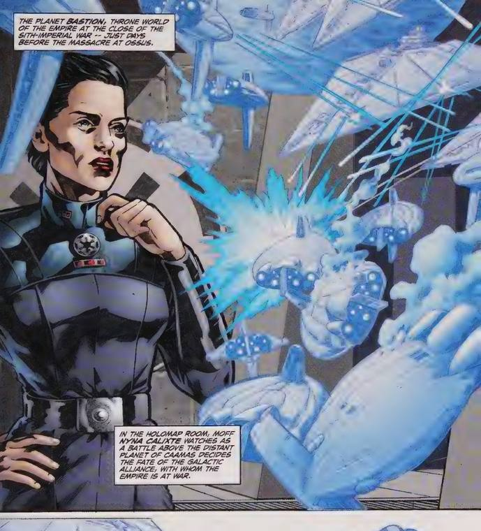
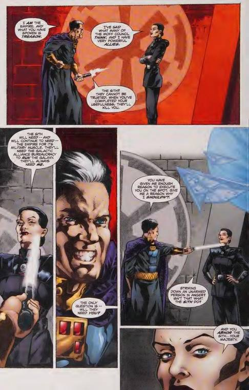
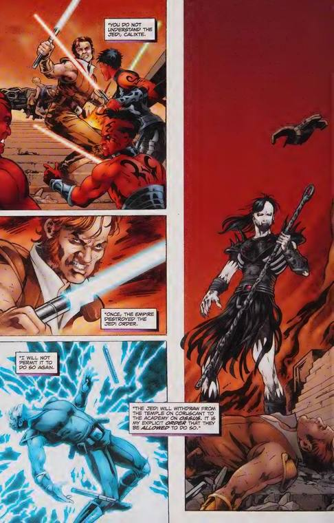
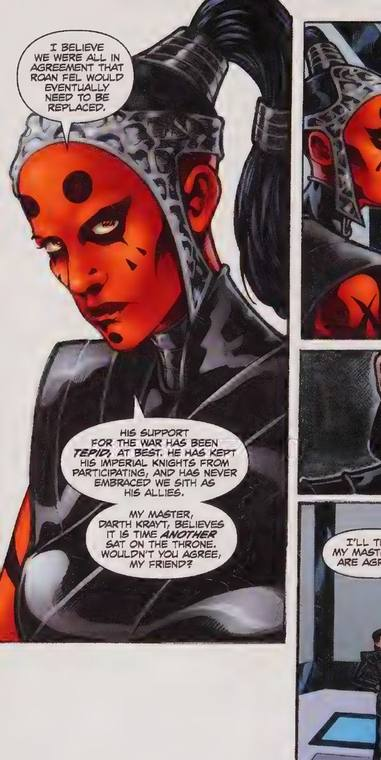
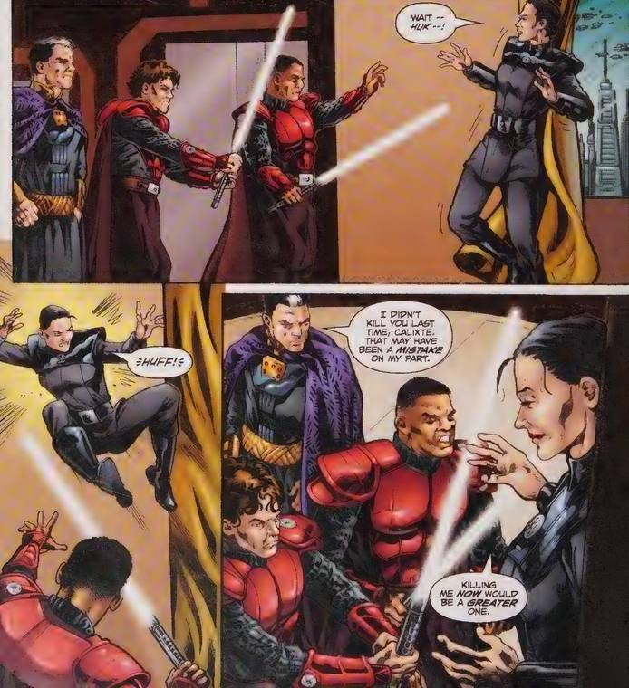
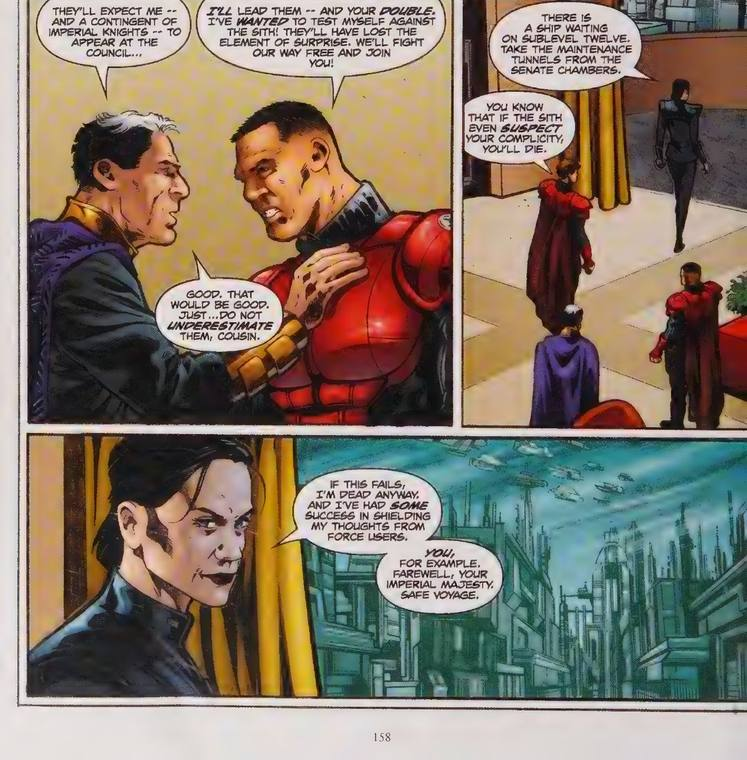
Our notes: `notes/materials/009-legacy-book-1.md:53`

> AND I'VE HAD SOME SUCCESS IN SHIELDING MY THOUGHTS FROM FORCE USERS.
— Source: Legacy Book 1 (omnibus): power-scaling notes with panels.
Note (our notes, around the quote): Shields her thoughts from Force-users, Fel included. p162 (#8 Allies): "AND I'VE HAD SOME SUCCESS IN SHIELDING MY THOUGHTS FROM FORCE USERS." · "YOU, FOR EXAMPLE."

Our notes: `notes/materials/009-legacy-book-1.md:962`

> THIS IS MORRIGAN CORDE. INACTIVE FOR TWENTY YEARS, OR SO. GOOD FIELD AGENT IN HER DAY -- AND I THINK I KNOW HOW TO CONTACT HER.
— Source: Legacy Book 1 (omnibus): power-scaling notes with panels; Invents "Corde" as a separate agent. p201 (#9 Trust Issues).
Note (our notes, around the quote): Invents "Corde" as a separate agent. p201 (#9 Trust Issues): "THIS IS MORRIGAN CORDE. INACTIVE FOR TWENTY YEARS, OR SO. GOOD FIELD AGENT IN HER DAY -- AND I THINK I KNOW HOW TO CONTACT HER."
Our notes: `notes/materials/009-legacy-book-1.md:963`

> AND TO THINK I'D GIVEN ALL THIS UP.
>
> FORCE SENSITIVE. TRAINED ON KORRIBAN BY THE SITH -- THOUGH NOT STRONG ENOUGH IN THE FORCE TO BE TRULY SITH.
— Source: Legacy Book 1 (omnibus): power-scaling notes with panels.
Note (our notes, around the quote): Brawls through Wheel thugs bare-handed; subdues Sith-trained Jor Torlin. p211 (#9 Trust Issues)–p221 (#10 Trust Issues): "YOU WERE SAYING?" · "AND TO THINK I'D GIVEN ALL THIS UP." · (p220) "FORCE SENSITIVE. TRAINED ON KORRIBAN BY THE SITH -- THOUGH NOT STRONG ENOUGH IN THE FORCE TO BE TRULY SITH."
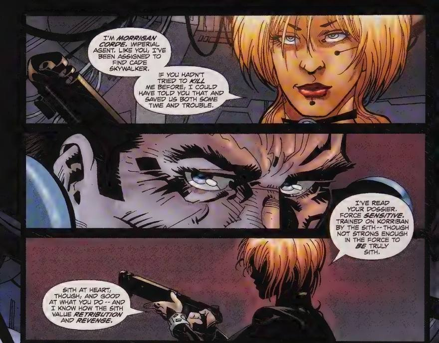
Our notes: `notes/materials/009-legacy-book-1.md:964`

> HE'S A SKYWALKER! HEIR TO A GREAT NAME -- AND HE'LL BE JUST AS TRAPPED BY IT AS YOU ARE, KOL!
>
> RIGHT. AND ROAN FEL'S MY DADDY.
— Source: Legacy Book 1 (omnibus): power-scaling notes with panels.
Note (our notes, around the quote): Cade's mother. p238 (#10 Trust Issues)–p240 (#10 Trust Issues), p360 (#16 Claws), p437 (#19 Claws): "HE'S A SKYWALKER! HEIR TO A GREAT NAME -- AND HE'LL BE JUST AS TRAPPED BY IT AS YOU ARE, KOL!" · (p360) "I'M HIS MOTHER." · Syn: "RIGHT. AND ROAN FEL'S MY DADDY."
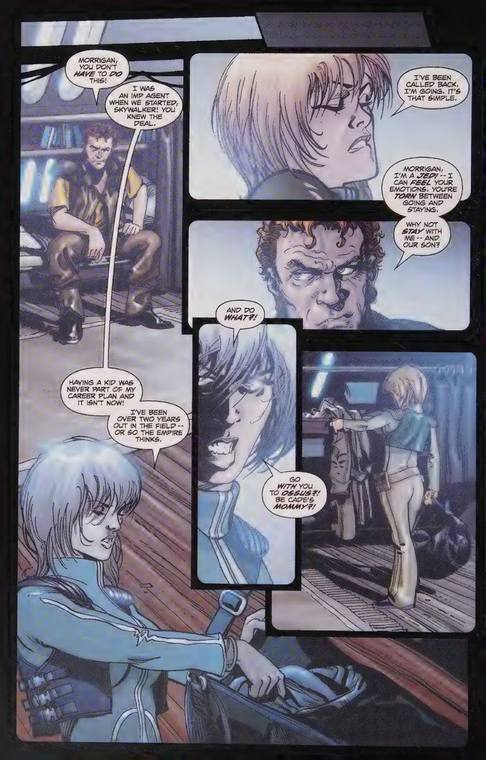
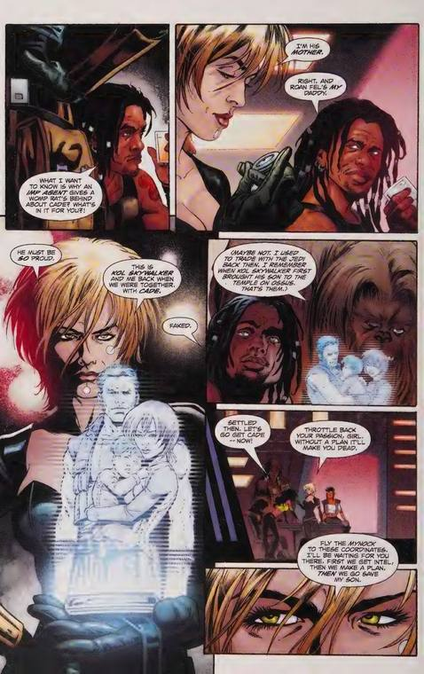
Our notes: `notes/materials/009-legacy-book-1.md:966`

> MORRIGAN CORDE -- IMPERIAL AND FREE AGENT -- ASSASSINATIONS A SPECIALTY...
> [fragment — full passage not on file]
— Source: Legacy Book 1 (omnibus): power-scaling notes with panels; Reputation. p358 (#16 Claws) Jool.
Label in our notes: Reputation. p358 (#16 Claws) Jool
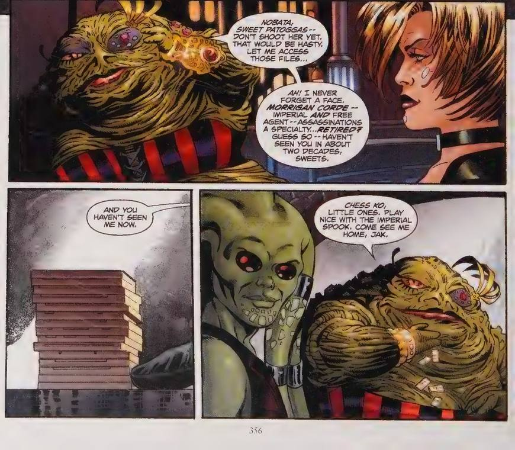
Our notes: `notes/materials/009-legacy-book-1.md:967`

> GET AWAY FROM MY SON!
> [fragment — full passage not on file]
— Source: Legacy Book 1 (omnibus): power-scaling notes with panels.
Note (our notes, around the quote): Shoots Darth Krayt in the back from a jetpack. p433 (#19 Claws): "GET AWAY FROM MY SON!" Later, as Calixte alone with the hologram: "RUN." (p442 (#19 Claws)).
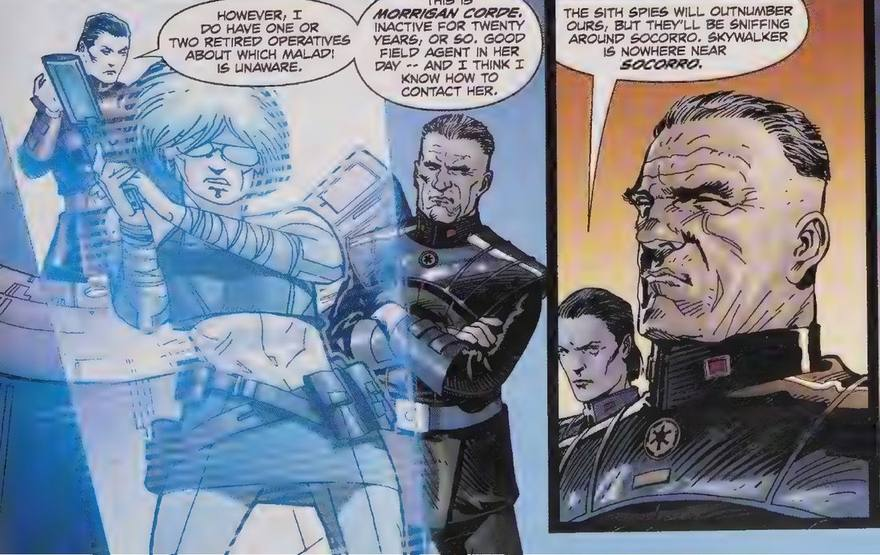
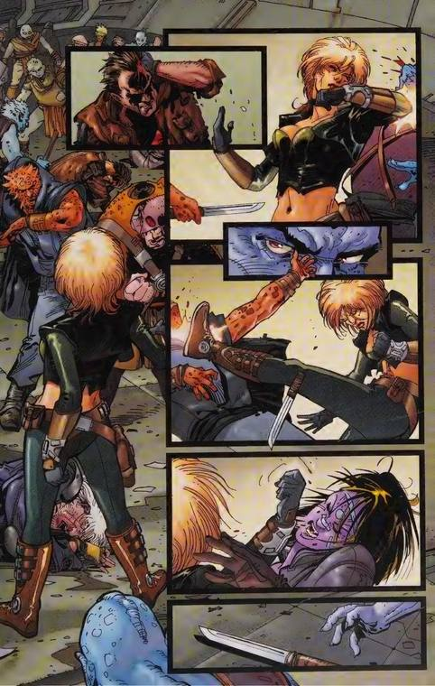
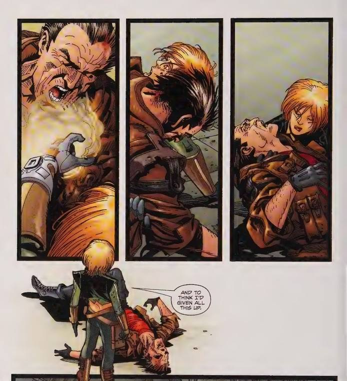

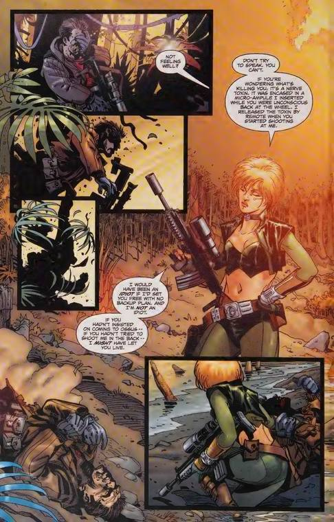

Our notes: `notes/materials/009-legacy-book-1.md:969`

- Note (summary from our notes, not a quotation): 
  — Source: Legacy Book 1 (omnibus): power-scaling notes with panels.
(*Panel: p201 — `p201-calixte-introduces-morrigan-corde.jpg`*)
Our notes: `notes/materials/009-legacy-book-1.md:971`

- Note (summary from our notes, not a quotation): 
  — Source: Legacy Book 1 (omnibus): power-scaling notes with panels.
(*Panel: p215 Corde's brawl on the Wheel — `p215-corde-brawl-wheel.jpg`*)
Our notes: `notes/materials/009-legacy-book-1.md:974`

- Note (summary from our notes, not a quotation): 
  — Source: Legacy Book 1 (omnibus): power-scaling notes with panels.
(*Panel: p218 — `p218-corde-subdues-torlin.jpg`*)
Our notes: `notes/materials/009-legacy-book-1.md:977`

- Note (summary from our notes, not a quotation): 
  — Source: Legacy Book 1 (omnibus): power-scaling notes with panels.
(*Panel: p220 — `p220-corde-torlin-not-strong-enough-to-be-sith.jpg`*)
Our notes: `notes/materials/009-legacy-book-1.md:980`

- Note (summary from our notes, not a quotation): 
  — Source: Legacy Book 1 (omnibus): power-scaling notes with panels.
(*Panel: p236 — `p236-corde-nerve-toxin-backup-plan.jpg`*)
Our notes: `notes/materials/009-legacy-book-1.md:983`

- Note (summary from our notes, not a quotation): 
  — Source: Legacy Book 1 (omnibus): power-scaling notes with panels.
(*Panel: p238 — `p238-kol-jedi-feel-emotions-our-son.jpg`*)
Our notes: `notes/materials/009-legacy-book-1.md:986`

- Note (summary from our notes, not a quotation): 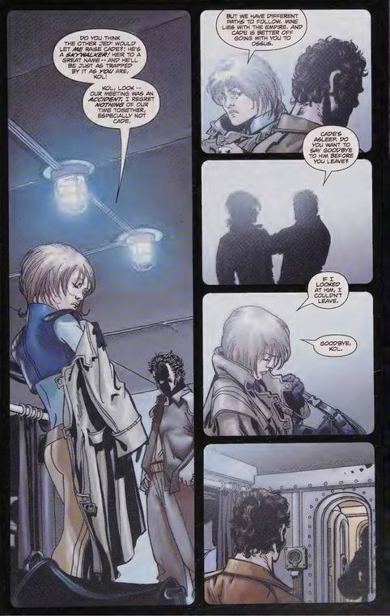
  — Source: Legacy Book 1 (omnibus): power-scaling notes with panels.
(*Panel: p239 — `p239-corde-cade-trapped-by-skywalker-name.jpg`*)
Our notes: `notes/materials/009-legacy-book-1.md:989`

- Note (summary from our notes, not a quotation): 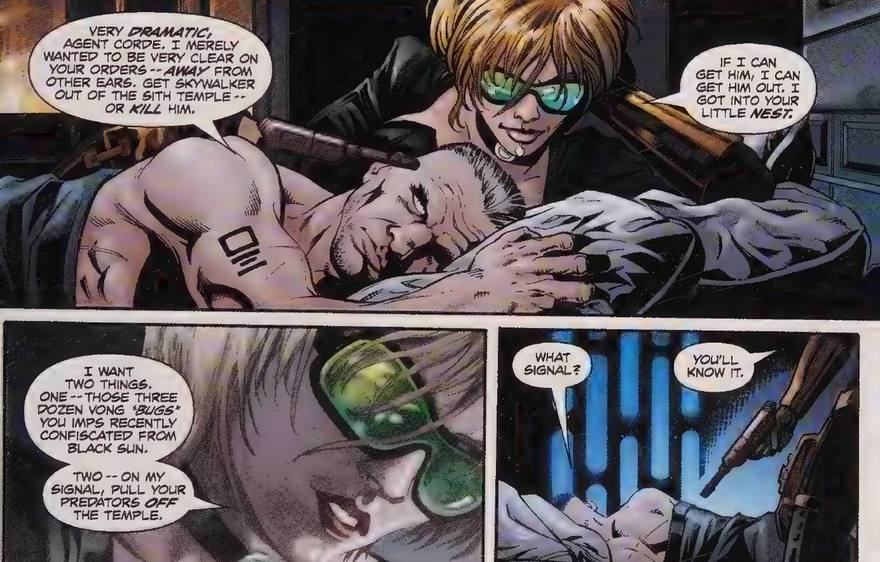
  — Source: Legacy Book 1 (omnibus): power-scaling notes with panels.
(*Panel: p355 — `p355-corde-veed-get-him-out-or-kill.jpg`*)
Our notes: `notes/materials/009-legacy-book-1.md:992`

- Note (summary from our notes, not a quotation): 
  — Source: Legacy Book 1 (omnibus): power-scaling notes with panels.
(*Panel: p358 — `p358-jool-ids-morrigan-corde.jpg`*)
Our notes: `notes/materials/009-legacy-book-1.md:995`

- Note (summary from our notes, not a quotation): 
  — Source: Legacy Book 1 (omnibus): power-scaling notes with panels.
(*Panel: p360 — `p360-corde-im-his-mother.jpg`*)
Our notes: `notes/materials/009-legacy-book-1.md:998`

- Note (summary from our notes, not a quotation): 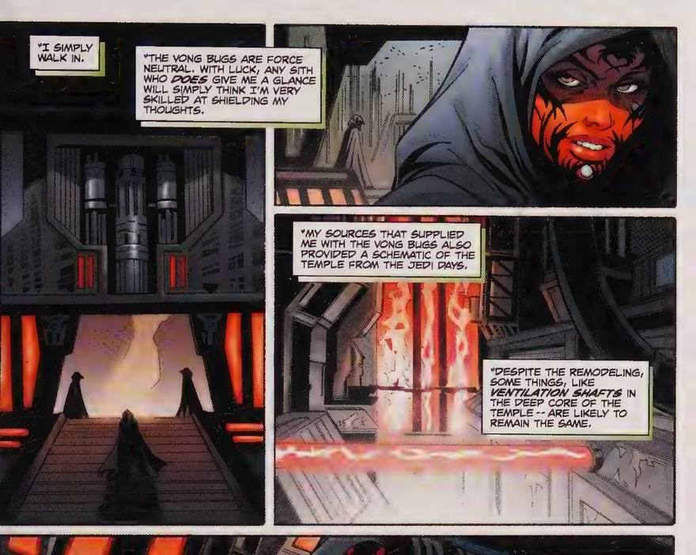
  — Source: Legacy Book 1 (omnibus): power-scaling notes with panels.
(*Panel: p387 — `p387-corde-vong-bugs-force-neutral-infiltration.jpg`*)
Our notes: `notes/materials/009-legacy-book-1.md:1001`

- Note (summary from our notes, not a quotation): 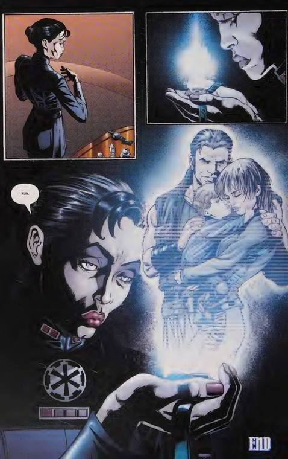
  — Source: Legacy Book 1 (omnibus): power-scaling notes with panels.
(*Panel: p442 — `p442-calixte-run-hologram.jpg`*)
Our notes: `notes/materials/009-legacy-book-1.md:1004`

- Note (summary from our notes, not a quotation): ANALYSIS: the best non-Force operative in the book. Her one "vs Krayt" moment is a surprise blaster hit while Krayt was focused on Cade. It staggers him and breaks the window; it isn't evidence a blaster threatens Krayt in a fair fight.
  — Source: Legacy Book 1 (omnibus): power-scaling notes with panels.
Our notes: `notes/materials/009-legacy-book-1.md:1008`

> Moff Nyna Calixte's top agent from the days before the Sith took power, and the only one that Calixte can still trust. While Corde can be counted on to complete the most dangerous missions, she has her own secrets and her own agenda: she was once secretly married to Kol Skywalker—then head of the Jedi Order—and the mother to his son. Though estranged from her child, she will do almost anything to protect him.
>
> In charge of Imperial Intelligence, Calixte is Morlish Veed's partner in every sense. When the Sith first approached the Empire, it was through Calixte.
>
> ...they seriously underestimate Calixte—a deadly mistake.
> [fragment — full passage not on file]
— Source: Legacy Book 1 (omnibus): power-scaling notes with panels; Morrigan Corde (p452).
Note (our notes, around the quote): Morrigan Corde (p452): "Moff Nyna Calixte's top agent from the days before the Sith took power, and the only one that Calixte can still trust. While Corde can be counted on to complete the most dangerous missions, she has her own secrets and her own agenda: she was once secretly married to Kol Skywalker—then head of the Jedi Order—and the mother to his son. Though estranged from her child, she will do almost anything to protect him." Nyna Calixte: "In charge of Imperial Intelligence, Calixte is Morlish Veed's partner in every sense. When the Sith first approached the Empire, it was through Calixte." "...they seriously underestimate Calixte—a deadly mistake." (The handbook keeps the Corde = Calixte secret; the story reveals it, p441–442.)

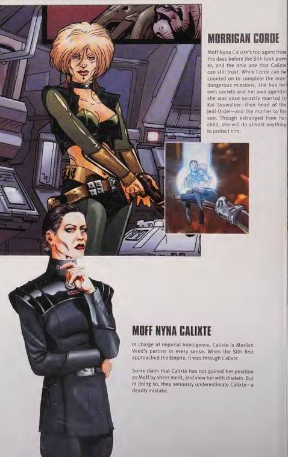
Our notes: `notes/materials/009-legacy-book-1.md:1130`

## Star Wars: Legacy—War #1–6 (2010–11): power-scaling notes with panels

- Note (summary from our notes, not a quotation): Morrigan Corde / Moff Nyna Calixte.
  — Source: Legacy—War #1–6 (2010–11): power-scaling notes with panels.
Context: Others:
Our notes: `notes/materials/010-legacy-war.md:73`

> I'VE CLAWED MY WAY TO POWER. I'M A MOFF. BUT I WONDER AT TIMES IF LOSING LOVE WAS WORTH THE POWER I'VE GAINED.
— Source: Legacy—War #1–6 (2010–11): power-scaling notes with panels; p11 (#1).
Our notes: `notes/materials/010-legacy-war.md:875`

> YOU'RE A TOOL, MORLISH, BUT YOU'RE MOTIVATED. YOU'LL SNIFF MY DECEPTION OUT LIKE THE MUTANT RAT YOU ARE.
— Source: Legacy—War #1–6 (2010–11): power-scaling notes with panels; p26 (#2).
Our notes: `notes/materials/010-legacy-war.md:876`

> YES... 'DARLING.' I KNOW THAT YOU'RE ROAN FEL'S SPY. YOU'RE A TRAITOR TO THE EMPIRE --
> [fragment — full passage not on file]
— Source: Legacy—War #1–6 (2010–11): power-scaling notes with panels; p39–42 (#2): Veed poisons her drink ("POISON?!" /.
Note (our notes, around the quote): p39–42 (#2): Veed poisons her drink ("POISON?!" / "YES... 'DARLING.' I KNOW THAT YOU'RE ROAN FEL'S SPY. YOU'RE A TRAITOR TO THE EMPIRE --" "-- AND TO ME!"). He shoots her several times on the pad and she falls off it.
Our notes: `notes/materials/010-legacy-war.md:877`

> BAG REALLY...JETPACK. VEED...DIDN'T KNOW. DIDN'T SEE...MY ESCAPE. THINKS I'M...DEAD.
> [fragment — full passage not on file]
— Source: Legacy—War #1–6 (2010–11): power-scaling notes with panels; p52 (#3).
Our notes: `notes/materials/010-legacy-war.md:878`

> WON'T... APOLOGIZE FOR... WHO I AM...WHAT I'VE DONE. TOLD... TOO MANY LIES. LIVED...MORE. BUT... THERE ARE TWO TRUTHS...IN MY LIFE.
> [fragment — full passage not on file]
>
> I LOVED YOUR FATHER AND... WHATEVER YOU MAY THINK...HOWEVER IT SEEMS...I LOVE YOU. EXAMINE...YOUR FEELINGS. YOU KNOW...IT'S TRUE.
> [fragment — full passage not on file]
— Source: Legacy—War #1–6 (2010–11): power-scaling notes with panels; p53 (#3).
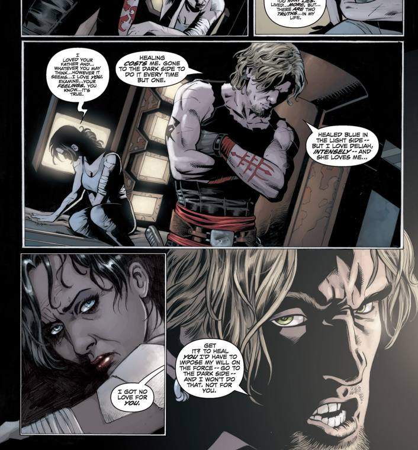
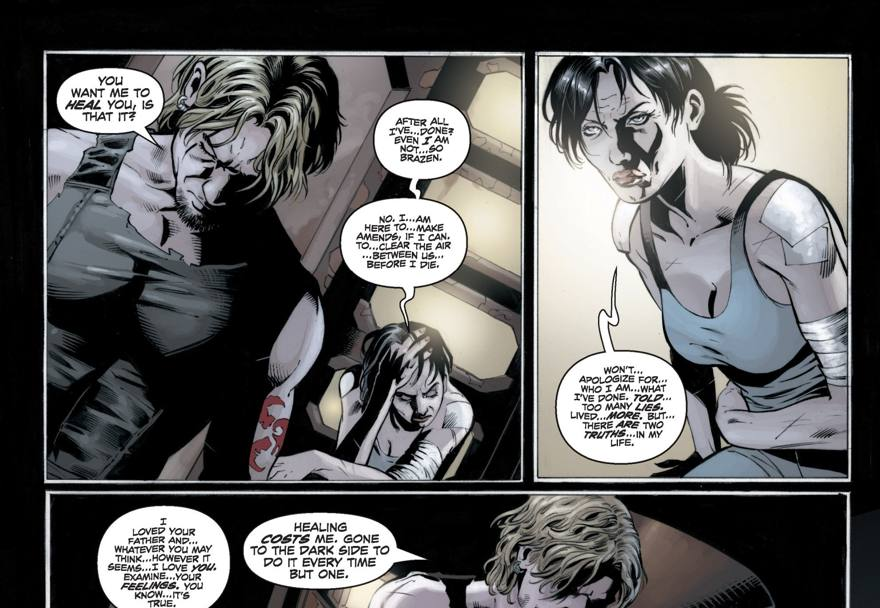
Our notes: `notes/materials/010-legacy-war.md:879`

> DON'T. WE NEED ONE ALIVE...
> [fragment — full passage not on file]
>
> helps knock it out
> [fragment — full passage not on file]
— Source: Legacy—War #1–6 (2010–11): power-scaling notes with panels; p90 (#4).
Note (our notes, around the quote): p90 (#4): "DON'T. WE NEED ONE ALIVE..." She keeps the trooper alive. The intro's "helps knock it out" is wrong: Cade's lightning drops it, and Corde fires at the troopers on p88–89.
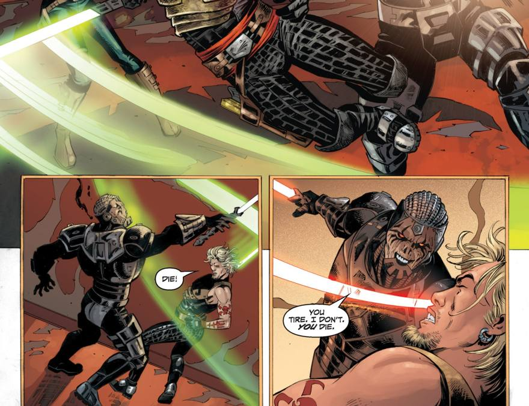
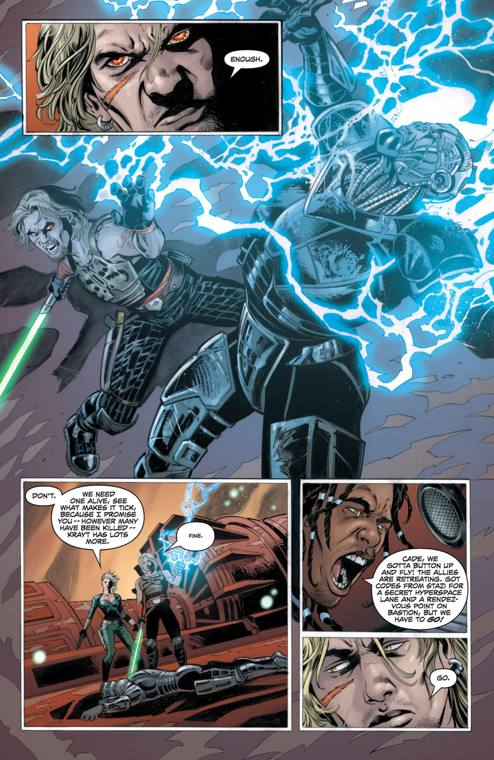
Our notes: `notes/materials/010-legacy-war.md:880`

> BEFORE WE WERE MARRIED, I WAS AN IMPERIAL AGENT AND THE WIFE OF JEDI MASTER KOL SKYWALKER. CADE SKYWALKER IS MY SON. NYNA CALIXTE WAS A FABRICATION -- MY REAL NAME IS MORRIGAN CORDE.
— Source: Legacy—War #1–6 (2010–11): power-scaling notes with panels; p97 (#5).
Our notes: `notes/materials/010-legacy-war.md:881`

- Note (summary from our notes, not a quotation): p99 (#5): the defence-computer briefing.
  — Source: Legacy—War #1–6 (2010–11): power-scaling notes with panels.
Our notes: `notes/materials/010-legacy-war.md:882`

> NYNA CALIXTE SENDS HER REGARDS.
> [fragment — full passage not on file]
— Source: Legacy—War #1–6 (2010–11): power-scaling notes with panels; p107 (#5), Veed's death: "YOU?!" / "ME." /.
Note (our notes, around the quote): p107 (#5), Veed's death: "YOU?!" / "ME." / "NYNA CALIXTE SENDS HER REGARDS." She shoots him point-blank.
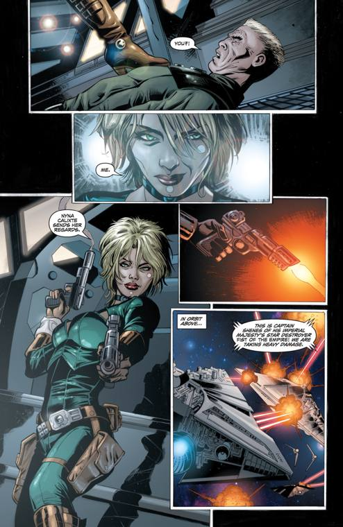
Our notes: `notes/materials/010-legacy-war.md:883`

> IT'S A HOLO OF YOU, ME, AND YOUR FATHER -- TOGETHER. I LOVE YOU, CADE...
> [fragment — full passage not on file]
>
> AND WHEN YOU SEE KOL, TELL HIM I WILL ALWAYS LOVE HIM.
>
> THE LOCKET I GAVE HIM HAS A TRACER IN IT.
>
> I'D HURRY IF I WERE YOU. DON'T THINK HE'S PLANNING A RETURN TRIP.
— Source: Legacy—War #1–6 (2010–11): power-scaling notes with panels; p128–129 (#6): gives Cade her ship and the locket (.
Note (our notes, around the quote): p128–129 (#6): gives Cade her ship and the locket ("IT'S A HOLO OF YOU, ME, AND YOUR FATHER -- TOGETHER. I LOVE YOU, CADE..."). "AND WHEN YOU SEE KOL, TELL HIM I WILL ALWAYS LOVE HIM." · "THE LOCKET I GAVE HIM HAS A TRACER IN IT." · "I'D HURRY IF I WERE YOU. DON'T THINK HE'S PLANNING A RETURN TRIP."
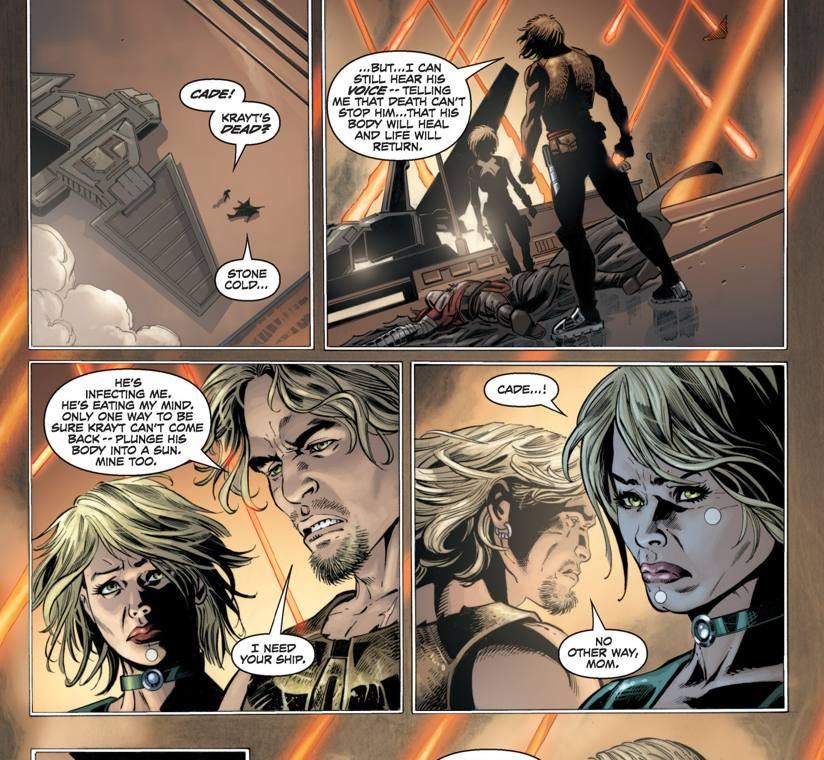
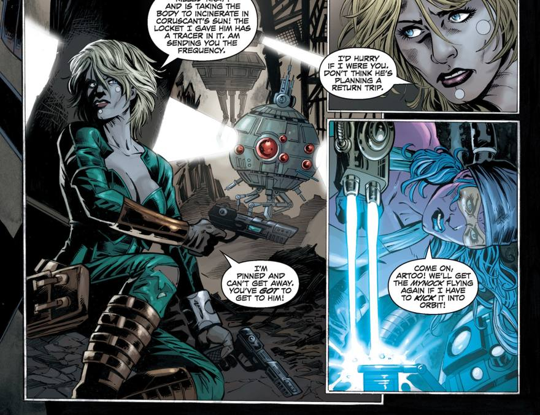
Our notes: `notes/materials/010-legacy-war.md:884`

> CADE INTENDS TO FLY KRAYT'S BODY INTO THE SUN. KRAYT WON'T RETURN.
>
> ...I DO NOT THINK SO.
> [fragment — full passage not on file]
— Source: Legacy—War #1–6 (2010–11): power-scaling notes with panels; p132–133 (#6).
Label in our notes: · On Cade: "I..."

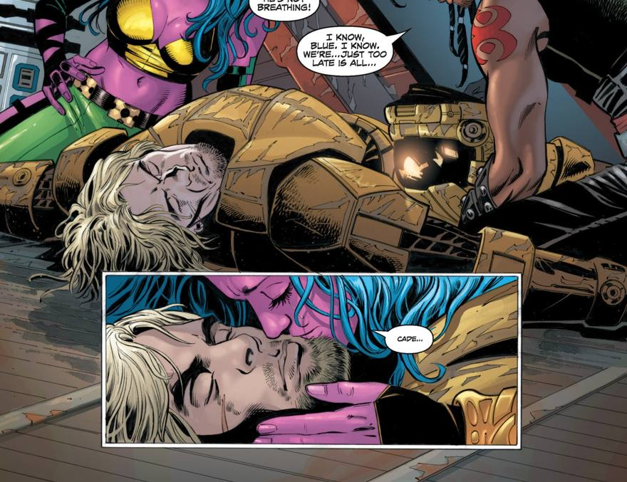
Our notes: `notes/materials/010-legacy-war.md:885`

- Note (summary from our notes, not a quotation): 
  — Source: Legacy—War #1–6 (2010–11): power-scaling notes with panels.
(*Panel: p53 — `p053-corde-two-truths.jpg`*)
Our notes: `notes/materials/010-legacy-war.md:887`

> NYNA CALIXTE SENDS HER REGARDS.
> [fragment — full passage not on file]
— Source: Legacy—War #1–6 (2010–11): power-scaling notes with panels; ![p107.
Note (our notes, around the quote): 
(*Panel: p107 — `p107-corde-nyna-calixte-sends-regards.jpg`*)
Our notes: `notes/materials/010-legacy-war.md:890`

> CADE KILLED KRAYT... THE LOCKET I GAVE HIM HAS A TRACER IN IT.
> [fragment — full passage not on file]
— Source: Legacy—War #1–6 (2010–11): power-scaling notes with panels; ![p129 Corde.
Note (our notes, around the quote): 
(*Panel: p129 — `p129-corde-cade-killed-krayt-tracer.jpg`*)
Our notes: `notes/materials/010-legacy-war.md:893`

## Star Wars Saga Edition: *Legacy Era Campaign Guide* (WotC 2009): power-scaling notes with panels

- Note (summary from our notes, not a quotation): | — | Nyna Calixte (Morrigan Corde) | p168 | 15 | scout 4 / scoundrel 3 / noble 7 / gunslinger 1 | — | 33 (ff 29) / 26 / 30 | 77 (26) | 8 | 3 / 7 | heavy assault blaster rifle +15 (3d10+7) |
  — Source: *Legacy Era Campaign Guide* (WotC 2009): power-scaling notes with panels.
Context: | # | Character | Page | CL | Classes | UtF | Ref / Fort / Will | HP (Thr.) | DSS | Destiny / FP | Best lightsaber line |
Our notes: `notes/materials/011-legacy-era-campaign-guide.md:133`

> in charge of the largest spy and information network in the galaxy
> [fragment — full passage not on file]
>
> has resurrected her alter ego to rescue her son from the clutches of Darth Krayt
> [fragment — full passage not on file]
— Source: *Legacy Era Campaign Guide* (WotC 2009): power-scaling notes with panels; Nyna Calixte / Morrigan Corde (p168).
Note (our notes, around the quote): Nyna Calixte / Morrigan Corde (p168): "in charge of the largest spy and information network in the galaxy"; she "has resurrected her alter ego to rescue her son from the clutches of Darth Krayt". CL 15; Ref 33; hp 77; Destiny 3; Force 7; DS 8. No Force stats.
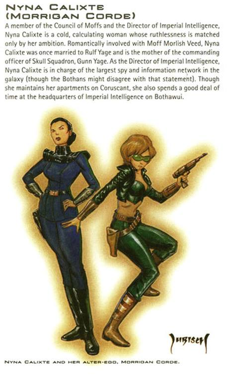
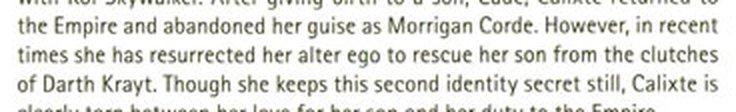
Our notes: `notes/materials/011-legacy-era-campaign-guide.md:711`

- Note (summary from our notes, not a quotation): 
  — Source: *Legacy Era Campaign Guide* (WotC 2009): power-scaling notes with panels.
(*Panel: p168 Nyna Calixte (Morrigan Corde) — `p168-calixte.jpg`*)
Our notes: `notes/materials/011-legacy-era-campaign-guide.md:721`

- Note (summary from our notes, not a quotation): Others: Nyna Calixte / Morrigan Corde (CL15), Gar Stazi (CL16), Morlish Veed (CL15), Rulf and Gunn Yage, "Bantha" Rawk (CL8), the Yuuzhan Vong NPCs, and all vehicles.
  — Source: *Legacy Era Campaign Guide* (WotC 2009): power-scaling notes with panels.
Our notes: `notes/materials/011-legacy-era-campaign-guide.md:1104`

## Star Wars: Legacy Volume 2, *Shards* (TPB): power-scaling notes with panels

> HAD SOME SUCCESS IN SHIELDING MY THOUGHTS FROM FORCE USERS. YOU, FOR EXAMPLE. *(p21–23)*
— Source: Legacy Volume 2, *Shards* (TPB): power-scaling notes with panels.
Note (our notes, around the quote): On Bastion, Roan Fel accuses Moff Nyna Calixte: the Sith sabotaged the Vong terraforming and framed the Vong, and she and Veed helped plan it (p10–13). Fel orders that the Jedi be allowed to withdraw to Ossus (p15). Three hours after Ossus falls, Maladi tells Veed and Calixte that Krayt wants Fel replaced (p16–17). Calixte warns Fel that the Sith will assassinate him at the Moff Council. A Knight Force-chokes and throws her. She says she has "HAD SOME SUCCESS IN SHIELDING MY THOUGHTS FROM FORCE USERS. YOU, FOR EXAMPLE." (p21–23). Mohrgan leads the Knights escorting Fel's double into the throne room. Krayt asks the "Emperor" for "YOUR LIFE" (p25) and, in a wordless page, cuts down the Knight squad alone, running Mohrgan through (p27). In the tunnels, Fel feels them die (p28). Krayt kills the double and takes the throne (p29). Maladi makes Calixte report to her and orders her to find Fel (p30–31).
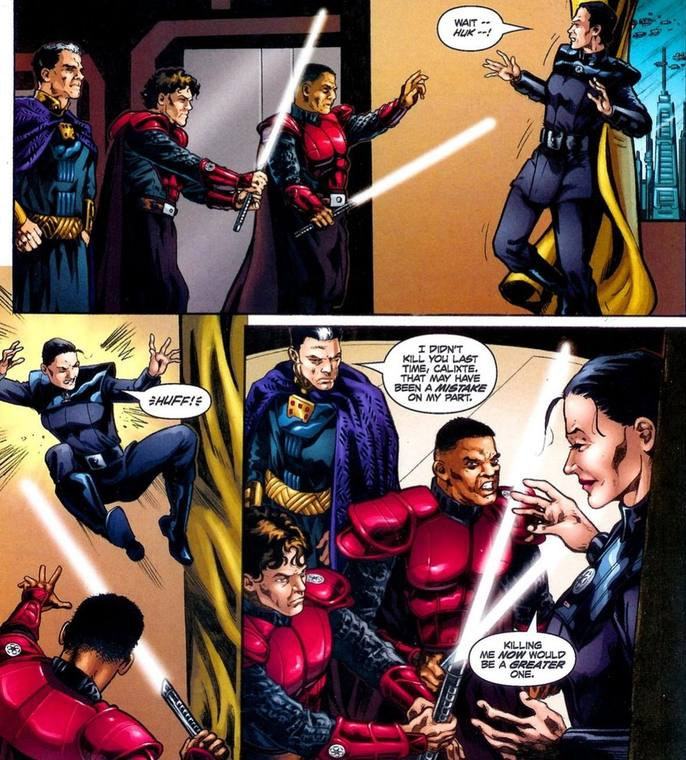
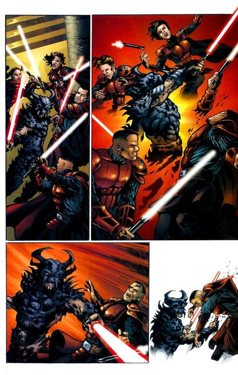
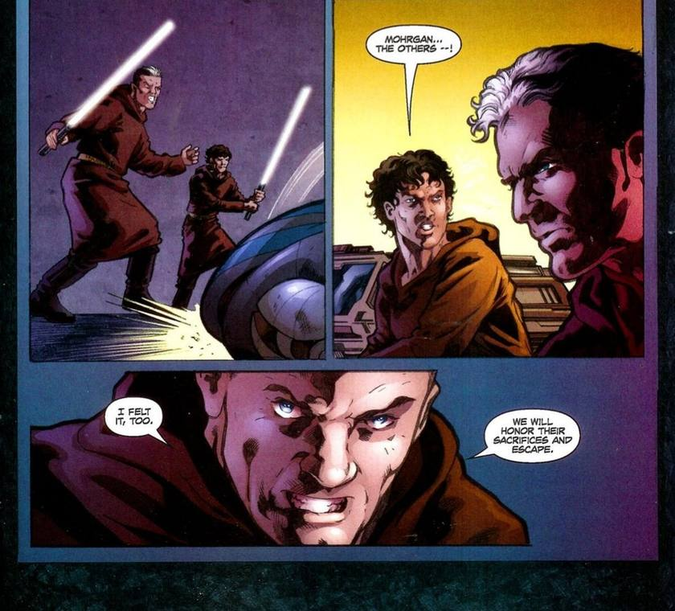
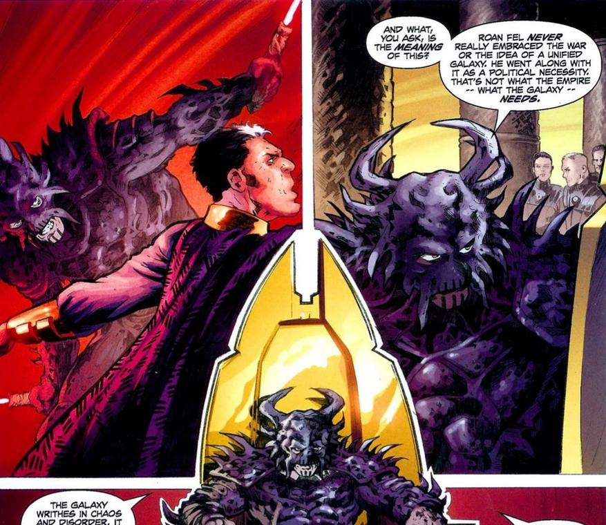
Our notes: `notes/materials/012-legacy-vol-2-shards.md:44`

> LET'S JUST SKIP THE OPENING RITUAL. *(p73)*
>
> OF COURSE... I DID! NEEDED... TO MAKE CONTACT!
> [fragment — full passage not on file]
>
> DON'T BELIEVE YOU. CAN'T TAKE CHANCES.
>
> AND TO THINK I'D GIVEN ALL THIS UP. *(p79)*
— Source: Legacy Volume 2, *Shards* (TPB): power-scaling notes with panels.
Note (our notes, around the quote): 1. Corde vs Torlin and the Wheel gang. p72 (#9)–p79 (#9) [009 p211–218]. Torlin starts the brawl: "LET'S JUST SKIP THE OPENING RITUAL." (p73). Corde had set the gang on him: "OF COURSE... I DID! NEEDED... TO MAKE CONTACT!" Torlin strangles her: "DON'T BELIEVE YOU. CAN'T TAKE CHANCES." "GOOD-BYE." (p78). She shocks him unconscious with her gauntlet: "AND TO THINK I'D GIVEN ALL THIS UP." (p79).
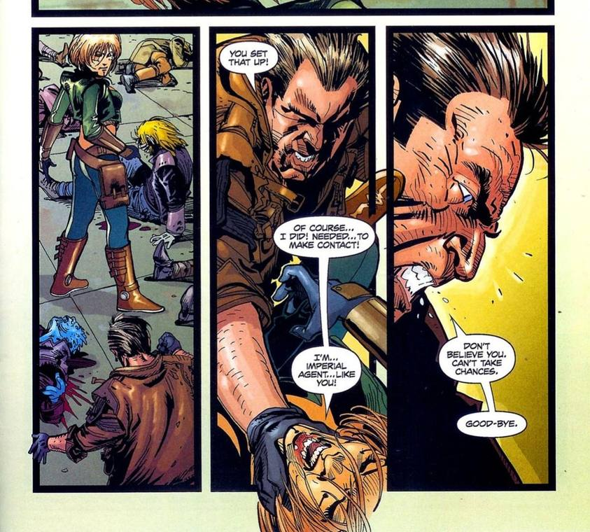
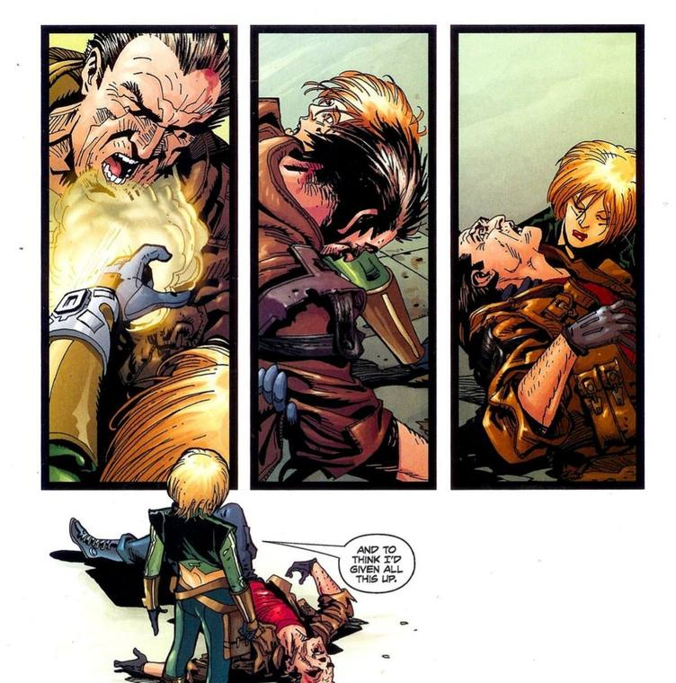
Our notes: `notes/materials/012-legacy-vol-2-shards.md:363`

- Note (summary from our notes, not a quotation): 
  — Source: Legacy Volume 2, *Shards* (TPB): power-scaling notes with panels.
(*Panel: p78 — `p078-torlin-strangles-corde.jpg`*)
Our notes: `notes/materials/012-legacy-vol-2-shards.md:365`

- Note (summary from our notes, not a quotation): 
  — Source: Legacy Volume 2, *Shards* (TPB): power-scaling notes with panels.
(*Panel: p79 — `p079-corde-shocks-torlin.jpg`*)
Our notes: `notes/materials/012-legacy-vol-2-shards.md:368`

> HER FOREMOST AGENT IS JOR TOLIN [sic]. HE WAS RAISED ON KORRIBAN AND TRAINED TO BE A SITH BUT LACKED SUFFICIENT FORCE SENSITIVITY.
>
> FORCE SENSITIVE. TRAINED ON KORRIBAN BY THE SITH -- THOUGH NOT STRONG ENOUGH IN THE FORCE TO BE TRULY SITH.
>
> SITH AT HEART, THOUGH, AND GOOD AT WHAT YOU DO
> [fragment — full passage not on file]
— Source: Legacy Volume 2, *Shards* (TPB): power-scaling notes with panels; 2. Torlin's Force status. p62 (#9), Calixte.
Note (our notes, around the quote): 2. Torlin's Force status. p62 (#9), Calixte: "HER FOREMOST AGENT IS JOR TOLIN [sic]. HE WAS RAISED ON KORRIBAN AND TRAINED TO BE A SITH BUT LACKED SUFFICIENT FORCE SENSITIVITY." · p81 (#10), Corde: "FORCE SENSITIVE. TRAINED ON KORRIBAN BY THE SITH -- THOUGH NOT STRONG ENOUGH IN THE FORCE TO BE TRULY SITH." · "SITH AT HEART, THOUGH, AND GOOD AT WHAT YOU DO".
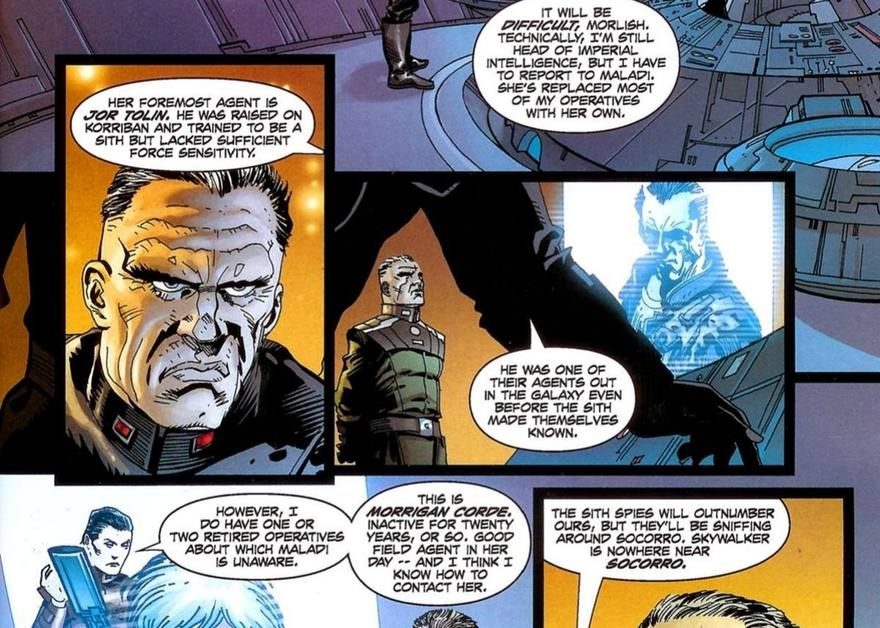
Our notes: `notes/materials/012-legacy-vol-2-shards.md:371`

- Note (summary from our notes, not a quotation): 
  — Source: Legacy Volume 2, *Shards* (TPB): power-scaling notes with panels.
(*Panel: p62 — `p062-jor-tolin-dossier.jpg`*)
Our notes: `notes/materials/012-legacy-vol-2-shards.md:373`

> (p94) **Torlin**: "-- THIS IS 'LATER.'" · **Corde**: "YOU SITH SON OF A MURGLAK! WE'RE ON THE SAME SIDE!" · **Torlin**: "MAYBE WE ARE. MAYBE WE AREN'T." "BEST NOT TO RISK IT. BETTER YOU'RE DEAD." · (p97) Corde: "IT WAS ENCASED IN A MICRO-AMPULE I INSERTED WHILE YOU WERE UNCONSCIOUS BACK AT THE WHEEL." · "I WOULD HAVE BEEN AN IDIOT IF I'D SET YOU FREE WITH NO BACKUP PLAN. AND I'M NOT AN IDIOT." · (p98) "STORY OF YOUR LIFE, TORLIN. GOOD, BUT NOT GOOD ENOUGH."
> [fragment — full passage not on file]
— Source: Legacy Volume 2, *Shards* (TPB): power-scaling notes with panels.
Context: 3. Corde kills Torlin with a pre-planted nerve toxin. p93 (#10)–p98 (#10) [009 p232–237]
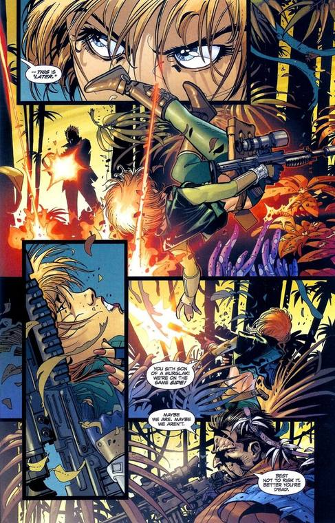
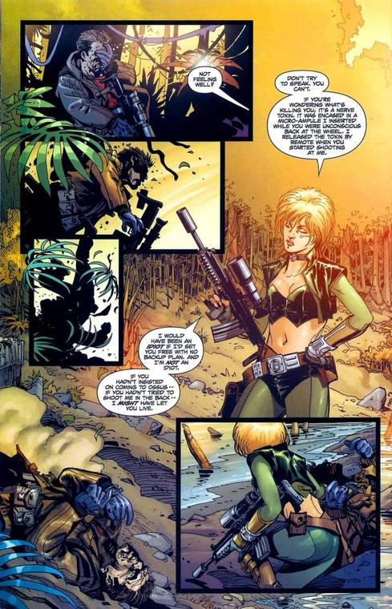
Our notes: `notes/materials/012-legacy-vol-2-shards.md:376`; `notes/materials/009-legacy-book-1.md:965`

- Note (summary from our notes, not a quotation): 
  — Source: Legacy Volume 2, *Shards* (TPB): power-scaling notes with panels.
(*Panel: p94 — `p094-murglak-sniper-duel.jpg`*)
Our notes: `notes/materials/012-legacy-vol-2-shards.md:379`

- Note (summary from our notes, not a quotation): 
  — Source: Legacy Volume 2, *Shards* (TPB): power-scaling notes with panels.
(*Panel: p97 — `p097-corde-nerve-toxin.jpg`*)
Our notes: `notes/materials/012-legacy-vol-2-shards.md:382`

> I'VE HAD SOME SUCCESS IN SHIELDING MY THOUGHTS FROM FORCE USERS.
— Source: Legacy Volume 2, *Shards* (TPB): power-scaling notes with panels; 4. Shields her thoughts (claim). p23 (#8).
Note (our notes, around the quote): 4. Shields her thoughts (claim). p23 (#8): "I'VE HAD SOME SUCCESS IN SHIELDING MY THOUGHTS FROM FORCE USERS." · "YOU, FOR EXAMPLE." (to Fel).
Our notes: `notes/materials/012-legacy-vol-2-shards.md:385`

## Star Wars: Legacy Volume 3, *Claws of the Dragon* (TPB): power-scaling notes with panels

> IF I CAN GET HIM, I CAN GET HIM OUT. I GOT INTO YOUR LITTLE NEST.
>
> TWO -- ON MY SIGNAL, PULL YOUR PREDATORS OFF THE TEMPLE.
— Source: Legacy Volume 3, *Claws of the Dragon* (TPB): power-scaling notes with panels.
Note (our notes, around the quote): 1. Bypasses a Grand Moff's security. p54 (#16) [009 p355]: wakes Veed at blaster-point inside his crackling security field. "IF I CAN GET HIM, I CAN GET HIM OUT. I GOT INTO YOUR LITTLE NEST." · "TWO -- ON MY SIGNAL, PULL YOUR PREDATORS OFF THE TEMPLE."
Our notes: `notes/materials/013-legacy-vol-3-claws-of-the-dragon.md:449`

> "I SIMPLY WALK IN." · "THE VONG BUGS ARE FORCE NEUTRAL. WITH LUCK, ANY SITH WHO DOES GIVE ME A GLANCE WILL SIMPLY THINK I'M VERY SKILLED AT SHIELDING MY THOUGHTS." · "MY SOURCES THAT SUPPLIED ME WITH THE VONG BUGS ALSO PROVIDED A SCHEMATIC OF THE TEMPLE FROM THE JEDI DAYS."
— Source: Legacy Volume 3, *Claws of the Dragon* (TPB): power-scaling notes with panels.
Context: 2. Walks into the Sith Temple disguised; releases Force-neutral Vong bugs. p86 (#17) [009 p387]
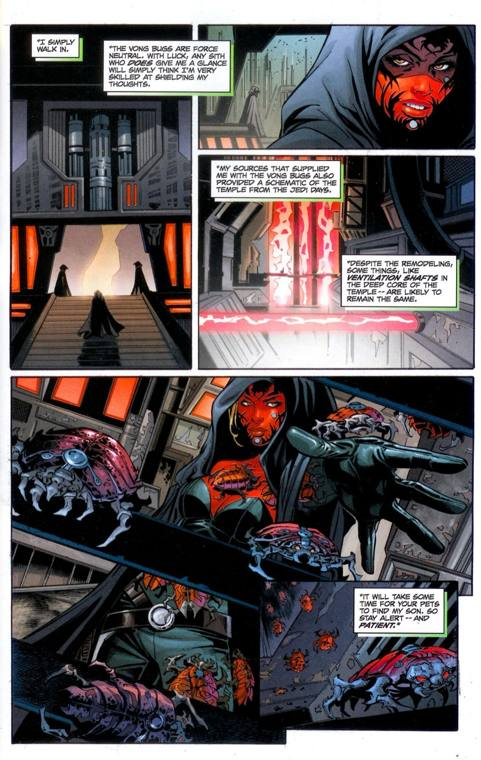
Our notes: `notes/materials/013-legacy-vol-3-claws-of-the-dragon.md:451`; `notes/materials/009-legacy-book-1.md:968`

- Note (summary from our notes, not a quotation): 
  — Source: Legacy Volume 3, *Claws of the Dragon* (TPB): power-scaling notes with panels.
(*Panel: p86 — `p086-corde-walks-into-temple-vong-bugs.jpg`*)
Our notes: `notes/materials/013-legacy-vol-3-claws-of-the-dragon.md:454`

> MINE INVOLVES A FAST RIDE AND A BIG BLASTER. *(p120)*
>
> GET AWAY FROM MY SON! *(p132)*
> [fragment — full passage not on file]
— Source: Legacy Volume 3, *Claws of the Dragon* (TPB): power-scaling notes with panels.
Note (our notes, around the quote): 3. Rocketpack assault; shoots Krayt off Cade through the window. p120–122, p132 (#19). "MINE INVOLVES A FAST RIDE AND A BIG BLASTER." (p120) · "GET AWAY FROM MY SON!" (p132). See Krayt 8.
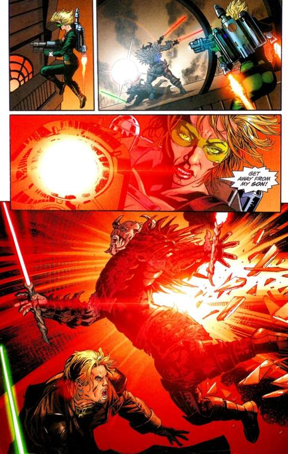
Our notes: `notes/materials/013-legacy-vol-3-claws-of-the-dragon.md:457`

> I REMEMBER WHEN KOL SKYWALKER FIRST BROUGHT HIS SON TO THE TEMPLE ON OSSUS. THAT'S THEM.
>
> CORDE'S AN OLD PRO -- DID HER JOB WELL.
— Source: Legacy Volume 3, *Claws of the Dragon* (TPB): power-scaling notes with panels.
Note (our notes, around the quote): 4. Reveal: Corde is Calixte. p56–59 (Corde to the crew: "I'M HIS MOTHER."; Chak: "I REMEMBER WHEN KOL SKYWALKER FIRST BROUGHT HIS SON TO THE TEMPLE ON OSSUS. THAT'S THEM."), p82 (codenames "HAZARD" and "LEGATE"), p136 (to Cade: "YOUR MOTHER." · "NO, YOU WON'T."), p138–141 (Calixte in the shower, a green garment hung outside; Veed: "CORDE'S AN OLD PRO -- DID HER JOB WELL."; alone with the Kol hologram: "RUN.").
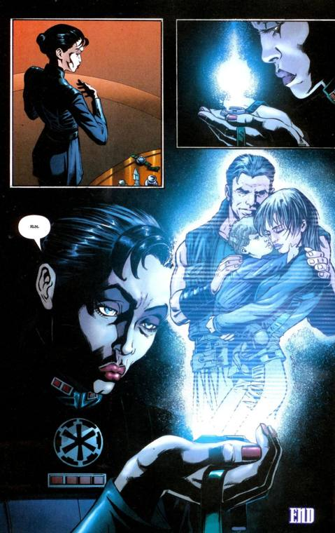
Our notes: `notes/materials/013-legacy-vol-3-claws-of-the-dragon.md:459`

- Note (summary from our notes, not a quotation): 
  — Source: Legacy Volume 3, *Claws of the Dragon* (TPB): power-scaling notes with panels.
(*Panel: p141 — `p141-calixte-run-hologram.jpg`*)
Our notes: `notes/materials/013-legacy-vol-3-claws-of-the-dragon.md:461`

> MORRIGAN CORDE -- IMPERIAL AND FREE AGENT -- ASSASSINATIONS A SPECIALTY...RETIRED?
> [fragment — full passage not on file]
— Source: Legacy Volume 3, *Claws of the Dragon* (TPB): power-scaling notes with panels; Jool's file (p57). POV: Jool's file, about Nyna Calixte.
Our notes: `notes/materials/013-legacy-vol-3-claws-of-the-dragon.md:464`

# Debate and forum claims (unverified)

Forum posts, Suspect Insight debates and Discord debates, respect threads, and verdicts. These are posters' arguments or quotations they typed; none is checked against the book here unless the entry says so.

_None in our notes._
