# Odan-Urr

- **Aliases:** Odan Urr
- **Era:** Great Sith War
- **Continuity:** default Legends; entries present for: Canon, Legends
- **Research tier:** MASTERY (Tales of the Jedi 024 version only: Freedon Nadd Uprising #1–2, Dark Lords of the Sith #1–6, The Sith War #1–6; primary read 2026-10-27)
- **Entries:** 150 (96 with quotations; 21 quotations extended to the full sentence/passage from the source text on file; 56 marked as fragments; 58 before the 2026-11-17 fragment fill). Rebuilt 2026-11-17 from 165 old entries; old file: `characters/_bak/odan-urr.md.bak-20261117`.
- **How to read:** each entry is the quotation in full (block quote), then its source and point of view. "Note" lines are summaries from our notes, not quotations. `[fragment — full passage not on file]` means the source text is not on the box, so only the words in our notes are shown. Debate and forum material is in the last section and is unverified.

# LEGENDS (Legends / EU — main focus)

## Tales of the Jedi: Freedon Nadd Uprising #1–2, Dark Lords of the Sith #1–6, The Sith War #1–6, plus the WEG Tales of the Jedi Companion (power-scaling notes)

- Note (summary from our notes, not a quotation): The Jedi assembly on Deneba (Odan-Urr presiding). Nadd's spirit collapses the Korriban crystal mausoleum on Exar (p12–13); Exar accepts the dark side to live (p16–17). Krath war droids attack Deneba; Arca is killed from behind (p21–22). Exar reads Sith glyphs and kills the tomb guardians in anger (p23–26). Ulic decides to destroy the Krath from within (p27).
  — Source: Owner Material 024b — Tales of the Jedi: Dark Lords of the Sith #1–6 (1994–95): power-scaling notes.
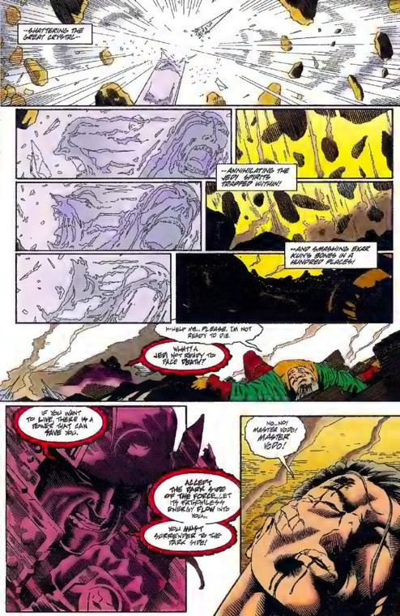
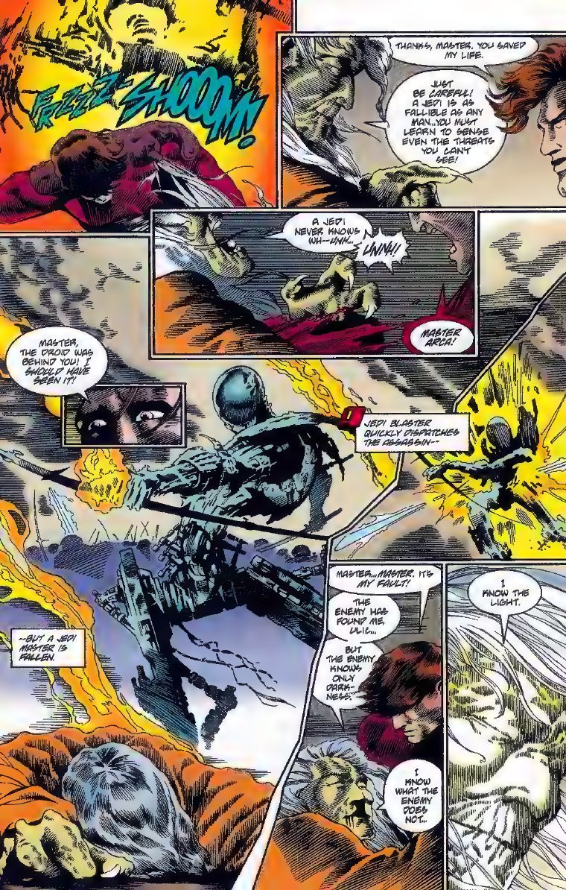
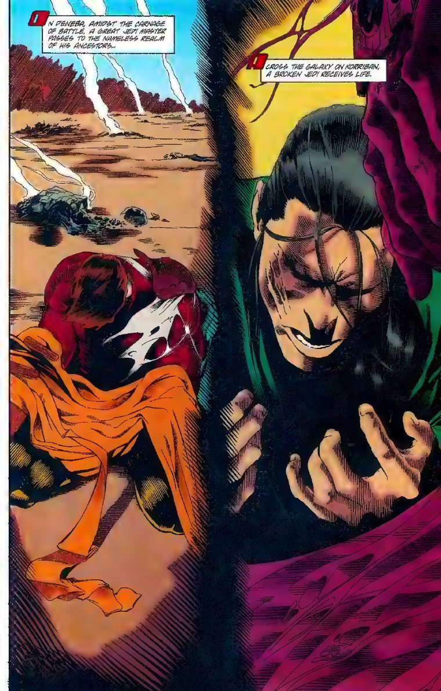
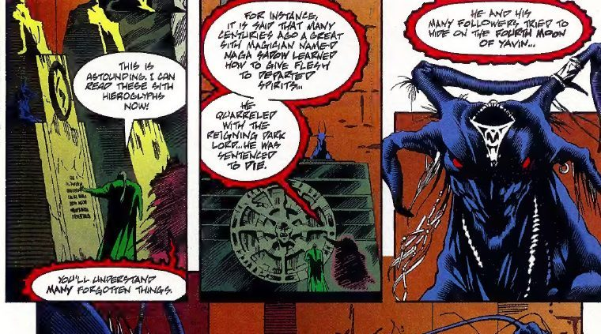
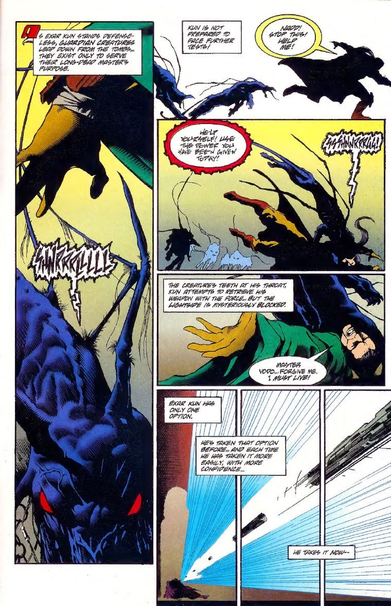
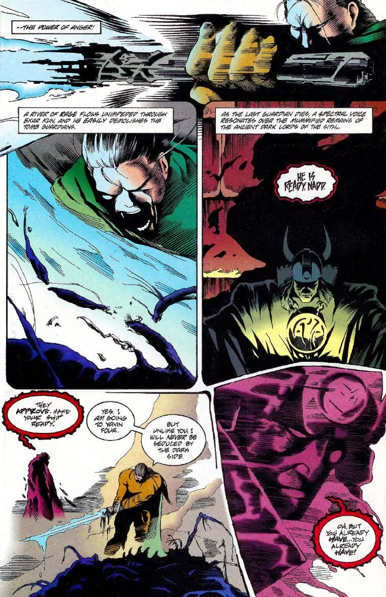
Our notes: `notes/materials/024-tales-of-the-jedi/dark-lords-of-the-sith.md:37`

- Note (summary from our notes, not a quotation): Massassi seize Exar on Yavin 4 (p4–9). Ood Bnar and Odan-Urr warn Ulic (p10–12); Cay's farewell (p13). Ulic joins the Krath by "saving" Aleema (p17–21). The Sith amulet clamps to Exar's arm; he destroys Sadow's alchemical horrors (p22–24) and kills Nadd's spirit (p25–26).
  — Source: Owner Material 024b — Tales of the Jedi: Dark Lords of the Sith #1–6 (1994–95): power-scaling notes.
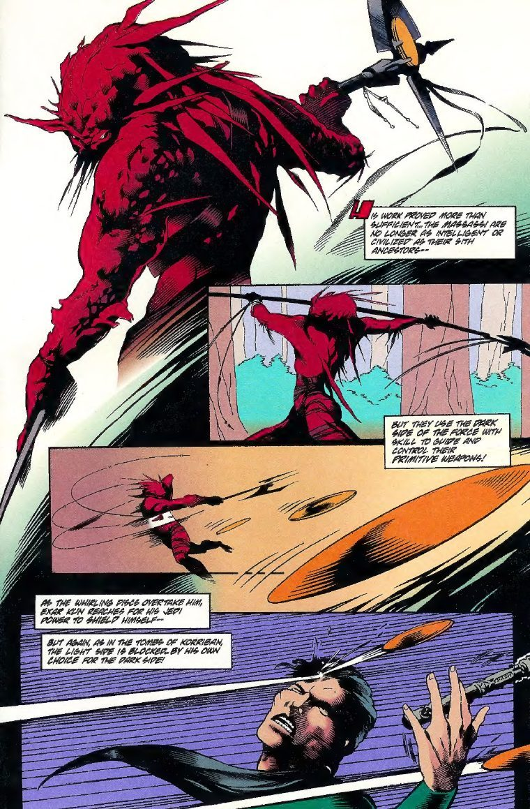
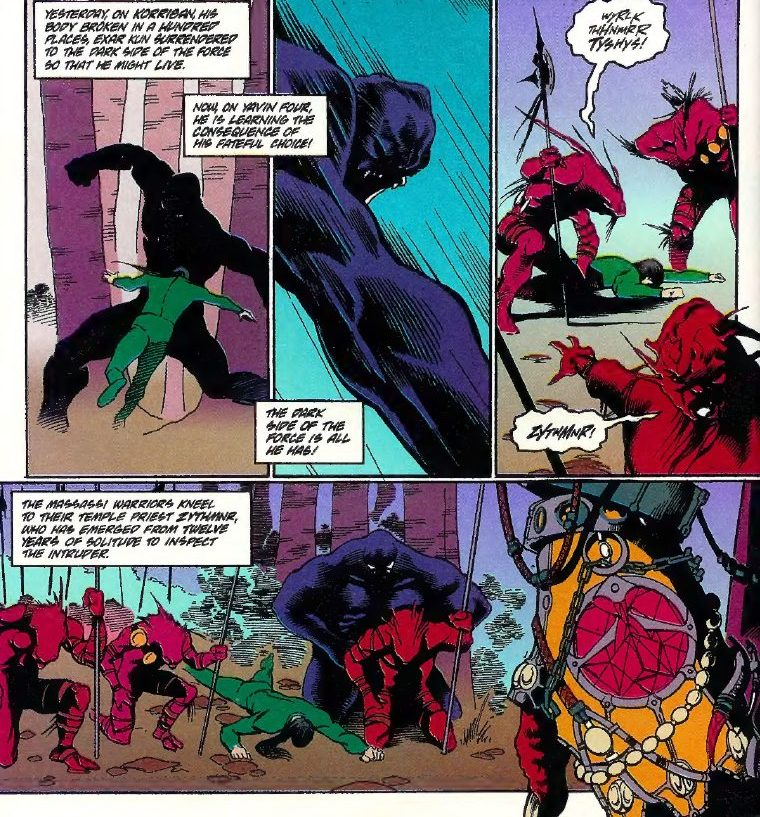
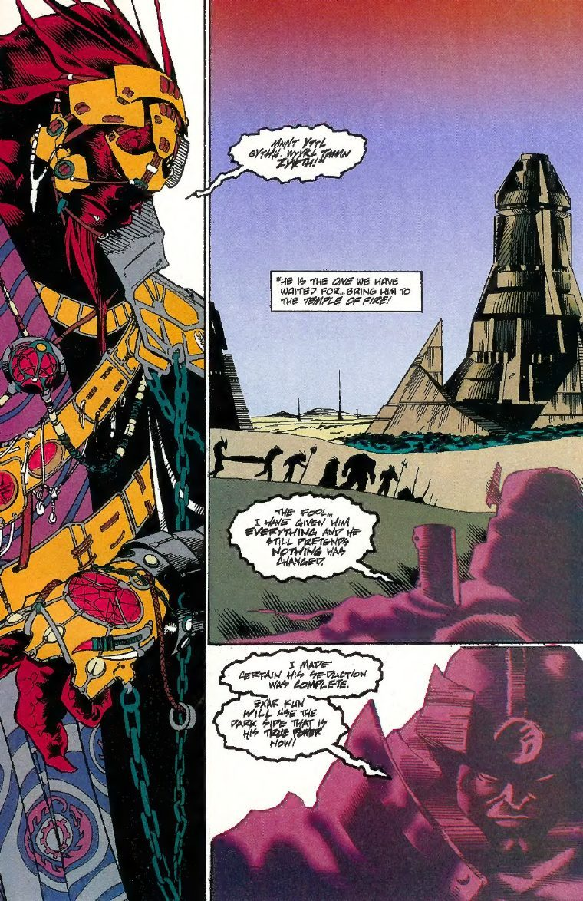
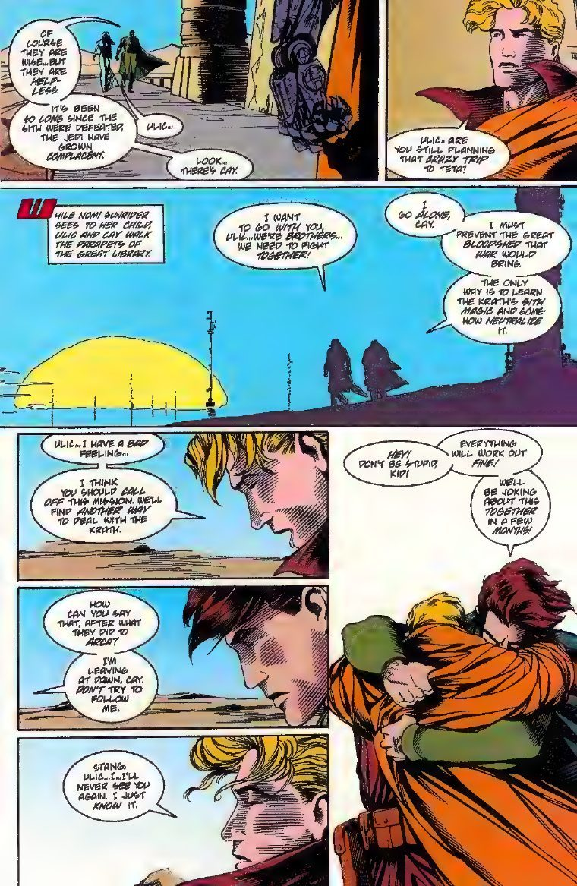
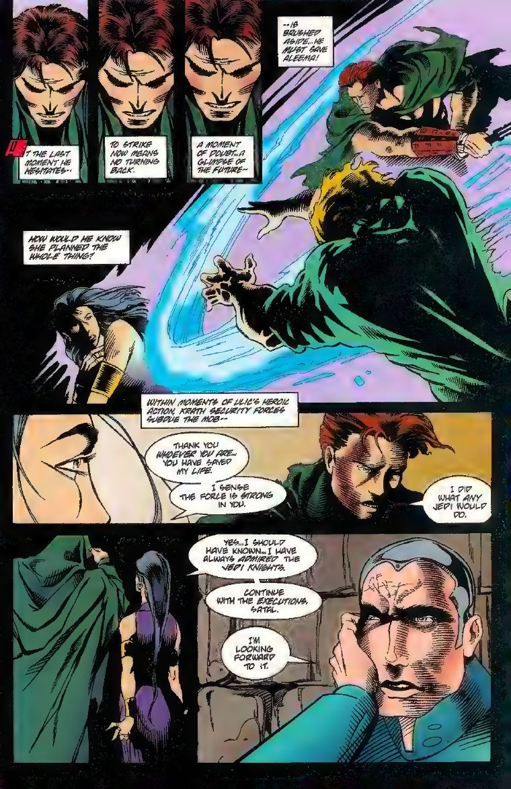
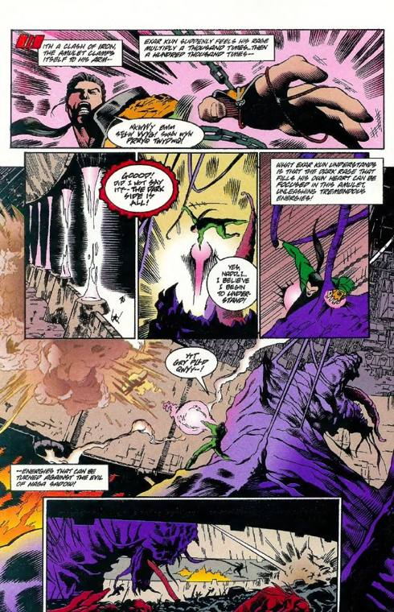
Our notes: `notes/materials/024-tales-of-the-jedi/dark-lords-of-the-sith.md:40`

- Note (summary from our notes, not a quotation): Wounded by Krath kamikaze slag; the wound will not heal by Jedi means. Source: Dark Lords of the Sith #2, p26–27; #3, p4–6
  — Source: Owner Material 024b — Tales of the Jedi: Dark Lords of the Sith #1–6 (1994–95): power-scaling notes.

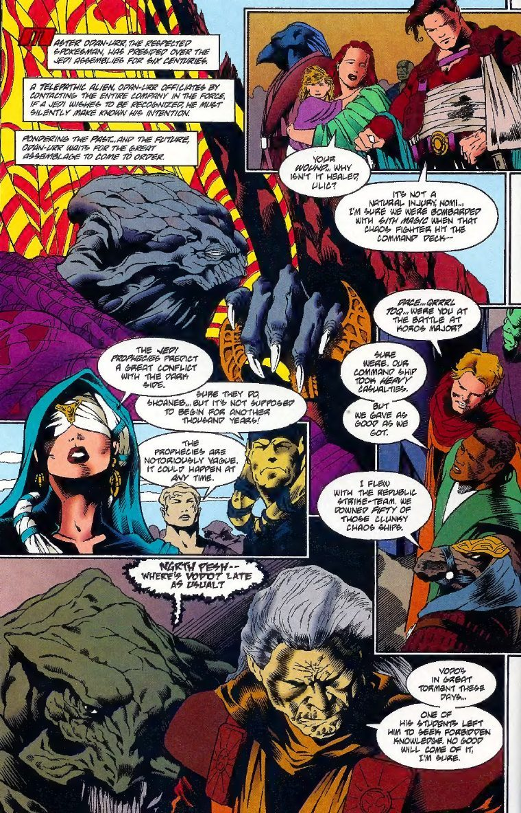
Our notes: `notes/materials/024-tales-of-the-jedi/dark-lords-of-the-sith.md:122`

- Note (summary from our notes, not a quotation): Presides over the Deneba assembly; keeper of antiquities (a Sith holocron) on Ossus; warns Ulic with Ood Bnar. Source: Dark Lords of the Sith #3, p4–6; #4, p10–12
  — Source: Owner Material 024b — Tales of the Jedi: Dark Lords of the Sith #1–6 (1994–95): power-scaling notes.

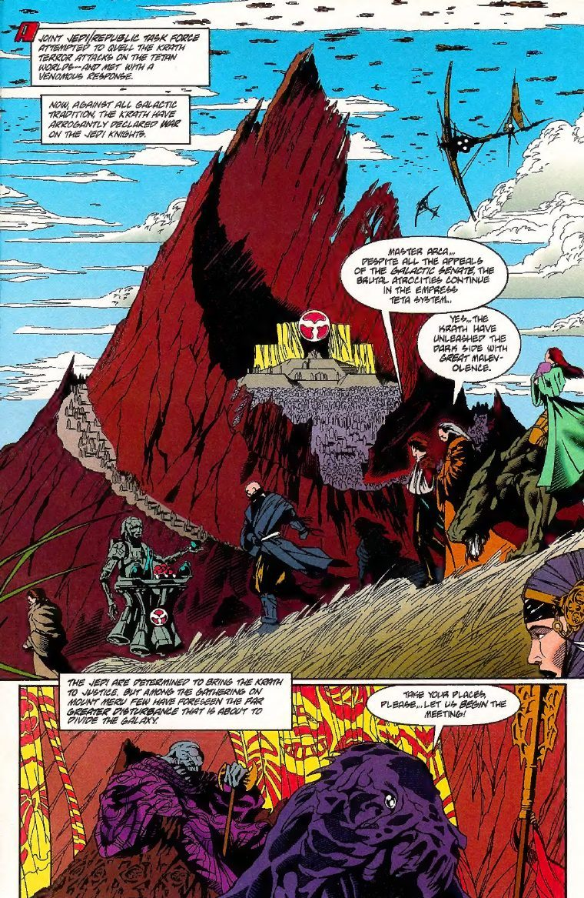
Our notes: `notes/materials/024-tales-of-the-jedi/dark-lords-of-the-sith.md:233`

- Note (summary from our notes, not a quotation): | #1 | 1–28 | (1 of 6) | Empress Teta system, Kuar, Ossus, Foerost | Mandalore attacks Teta; Ulic beats Mandalore on the chains of Harkul. Exar recruits on Ossus; Odan-Urr Force-pushes Exar, then dies; Exar takes the Sith holocron. Foerost raid: 300 warships. |
  — Source: Owner Material 024c — Tales of the Jedi: The Sith War #1–6 (1995–96): power-scaling notes.
Context: | Issue | PDF pages | Title | Setting | Main events |
Our notes: `notes/materials/024-tales-of-the-jedi/the-sith-war.md:15`

- Note (summary from our notes, not a quotation): Mandalore attacks the Teta system and challenges Ulic (p4–7). Exar recruits Jedi on Ossus with an amulet illusion of his fight with Nadd (p8–10). Ulic beats Mandalore on Kuar (p11–15). Odan-Urr teaches Nomi the blocking technique (p16–17); Exar takes the Sith holocron and Odan-Urr dies (p18–20). The Foerost shipyard raid takes 300 warships (p21–25); Ulic insists on attacking Coruscant (p26).
  — Source: Owner Material 024c — Tales of the Jedi: The Sith War #1–6 (1995–96): power-scaling notes.
Our notes: `notes/materials/024-tales-of-the-jedi/the-sith-war.md:28`

- Note (summary from our notes, not a quotation): Summons the Sith holocron to himself in the Ossus archive; Odan-Urr pushes him into the shelves; Odan-Urr dies and Exar takes the holocron. Source: The Sith War #1, p18–20
  — Source: The Sith War #1, p18–20 — Owner Material 024c — Tales of the Jedi: The Sith War #1–6 (1995–96): power-scaling notes.
Our notes: `notes/materials/024-tales-of-the-jedi/the-sith-war.md:52`

- Note (summary from our notes, not a quotation): Force-pushed into the bookshelves by Odan-Urr, unhurt. Source: The Sith War #1, p19
  — Source: The Sith War #1, p19 — Owner Material 024c — Tales of the Jedi: The Sith War #1–6 (1995–96): power-scaling notes.
Our notes: `notes/materials/024-tales-of-the-jedi/the-sith-war.md:74`

> ODAN-URR HAS GONE TO THE FORCE, LEAVING THE DARKEST POWER IN THE GALAXY TO WALK AWAY WITH SOMETHING THAT WILL MAKE HIM EVEN STRONGER.
— Source: Owner Material 024c — Tales of the Jedi: The Sith War #1–6 (1995–96): power-scaling notes; Narration on Odan-Urr and Exar Kun. POV: narrator, about Odan-Urr.
Note (our notes, around the quote): Narration on Odan-Urr and Exar Kun: "ODAN-URR HAS GONE TO THE FORCE, LEAVING THE DARKEST POWER IN THE GALAXY TO WALK AWAY WITH SOMETHING THAT WILL MAKE HIM EVEN STRONGER." · NARRATION. Source: The Sith War #1, p20
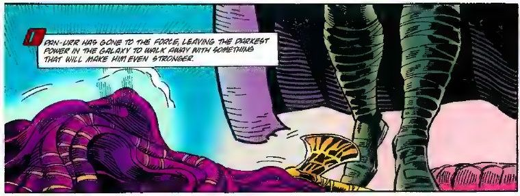
Our notes: `notes/materials/024-tales-of-the-jedi/the-sith-war.md:77`

> MASTER, DO YOU REALLY KNOW WHO I AM?
>
> I AM THE DARK LORD OF THE SITH.
>
> EVIL IS LOOSE...IN THE GALAXY...
> [fragment — full passage not on file]
>
> AND I CANNOT STOP IT...
> [fragment — full passage not on file]
>
> YES...YOU ARE OLD...OLD AND DEAD.
> [fragment — full passage not on file]
>
> YOU SHOULD HAVE JUST GIVEN ME THE SITH HOLOCRON.
— Source: The Sith War #1, p19 — Owner Material 024c — Tales of the Jedi: The Sith War #1–6 (1995–96): power-scaling notes; Exar Kun to Odan-Urr. POV: Exar Kun, about Odan-Urr.
Note (our notes, around the quote): Exar Kun to Odan-Urr: "MASTER, DO YOU REALLY KNOW WHO I AM?" "I AM THE DARK LORD OF THE SITH." Odan-Urr (collapsing): "I...AM OLD." "EVIL IS LOOSE...IN THE GALAXY..." "AND I CANNOT STOP IT..." Exar Kun: "YES...YOU ARE OLD...OLD AND DEAD." "YOU SHOULD HAVE JUST GIVEN ME THE SITH HOLOCRON." Source: The Sith War #1, p19
Our notes: `notes/materials/024-tales-of-the-jedi/the-sith-war.md:87`

- Note (summary from our notes, not a quotation): Blocked from the Force by Vodo-Siosk Baas, Nomi Sunrider and the other Jedi with a "TEMPORARY WALL OF LIGHT" in the Coruscant war room. Source: The Sith War #2, p24–25
  — Source: Owner Material 024c — Tales of the Jedi: The Sith War #1–6 (1995–96): power-scaling notes.

Our notes: `notes/materials/024-tales-of-the-jedi/the-sith-war.md:105`; `notes/materials/024-tales-of-the-jedi/the-sith-war.md:180`

- Note (summary from our notes, not a quotation): With Vodo-Siosk Baas, raises Odan-Urr's blocking wall of light on Ulic in the Coruscant war room. Source: The Sith War #2, p25
  — Source: Owner Material 024c — Tales of the Jedi: The Sith War #1–6 (1995–96): power-scaling notes.

Our notes: `notes/materials/024-tales-of-the-jedi/the-sith-war.md:131`

> THIS TECHNIQUE BLINDS YOUR ENEMY TO THE FORCE WITH A WALL OF LIGHT, A PERMANENT BLOCKAGE IF YOU SO CHOOSE...RENDERING HIM UNABLE TO USE JEDI POWERS.
> [fragment — full passage not on file]
>
> AND IT IS THE MOST DEVASTATING ATTACK POSSIBLE USING THE POWERS OF THE LIGHT SIDE. TO BLOCK A JEDI FROM THE FORCE--EVEN A DARK JEDI--IS A TERRIBLE THING.
— Source: Owner Material 024c — Tales of the Jedi: The Sith War #1–6 (1995–96): power-scaling notes; Odan-Urr to Nomi Sunrider about the blocking technique.
Note (our notes, around the quote): Odan-Urr to Nomi Sunrider about the blocking technique: "THIS TECHNIQUE BLINDS YOUR ENEMY TO THE FORCE WITH A WALL OF LIGHT, A PERMANENT BLOCKAGE IF YOU SO CHOOSE...RENDERING HIM UNABLE TO USE JEDI POWERS." ... "AND IT IS THE MOST DEVASTATING ATTACK POSSIBLE USING THE POWERS OF THE LIGHT SIDE. TO BLOCK A JEDI FROM THE FORCE--EVEN A DARK JEDI--IS A TERRIBLE THING." Source: The Sith War #1, p17
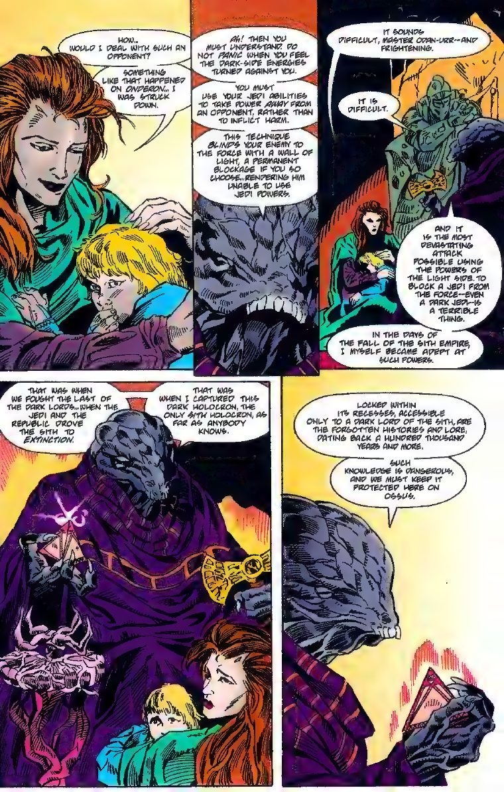
Our notes: `notes/materials/024-tales-of-the-jedi/the-sith-war.md:138`

> DARK JEDI, YOU DO NOT BELONG IN THIS PLACE.
— Source: The Sith War #1, p19–20 — Owner Material 024c — Tales of the Jedi: The Sith War #1–6 (1995–96): power-scaling notes; Force-pushes Exar Kun back into the archive bookshelves (.
Note (our notes, around the quote): Force-pushes Exar Kun back into the archive bookshelves ("DARK JEDI, YOU DO NOT BELONG IN THIS PLACE." "AWAY!"), then dies of age. Source: The Sith War #1, p19–20
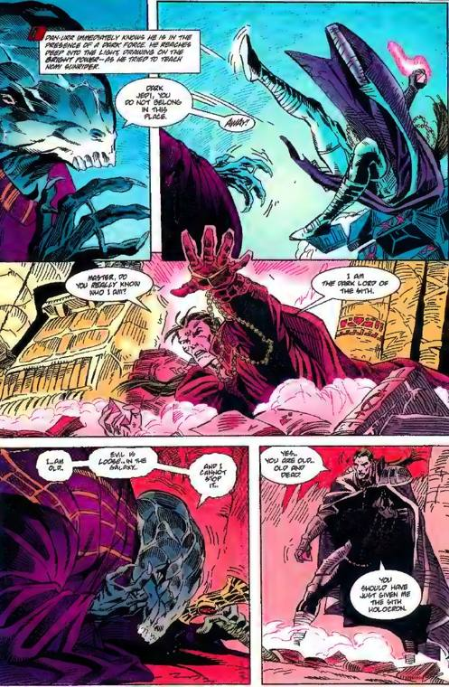

Our notes: `notes/materials/024-tales-of-the-jedi/the-sith-war.md:190`

> IN THE DAYS OF THE FALL OF THE SITH EMPIRE, I MYSELF BECAME ADEPT AT SUCH POWERS.
>
> THAT WAS WHEN WE FOUGHT THE LAST OF THE DARK LORDS...WHEN THE JEDI AND THE REPUBLIC DROVE THE SITH TO EXTINCTION.
> [fragment — full passage not on file]
>
> THAT WAS WHEN I CAPTURED THIS DARK HOLOCRON, THE ONLY SITH HOLOCRON, AS FAR AS ANYBODY KNOWS.
— Source: The Sith War #1, p17 — Owner Material 024c — Tales of the Jedi: The Sith War #1–6 (1995–96): power-scaling notes; Odan-Urr to Nomi Sunrider. POV: Odan-Urr.
Note (our notes, around the quote): Odan-Urr to Nomi Sunrider: "IN THE DAYS OF THE FALL OF THE SITH EMPIRE, I MYSELF BECAME ADEPT AT SUCH POWERS." "THAT WAS WHEN WE FOUGHT THE LAST OF THE DARK LORDS...WHEN THE JEDI AND THE REPUBLIC DROVE THE SITH TO EXTINCTION." "THAT WAS WHEN I CAPTURED THIS DARK HOLOCRON, THE ONLY SITH HOLOCRON, AS FAR AS ANYBODY KNOWS." Source: The Sith War #1, p17
Our notes: `notes/materials/024-tales-of-the-jedi/the-sith-war.md:193`

- Note (summary from our notes, not a quotation): | 2 | Odan-Urr vs Exar Kun | Ossus archive | p18–20 (#1) | Exar pushed back; Odan-Urr dies of age | One push |
  — Source: Owner Material 024c — Tales of the Jedi: The Sith War #1–6 (1995–96): power-scaling notes.
Context: | # | Fight | Where | Pages (issue) | Outcome | Conditions |
Our notes: `notes/materials/024-tales-of-the-jedi/the-sith-war.md:270`

- Note (summary from our notes, not a quotation): 
  — Source: Owner Material 024c — Tales of the Jedi: The Sith War #1–6 (1995–96): power-scaling notes.
Our notes: `notes/materials/024-tales-of-the-jedi/the-sith-war.md:291`

- Note (summary from our notes, not a quotation): 
  — Source: Owner Material 024c — Tales of the Jedi: The Sith War #1–6 (1995–96): power-scaling notes.

Our notes: `notes/materials/024-tales-of-the-jedi/the-sith-war.md:293`

## Star Wars: The Old Republic Encyclopedia (DK, 2012): power-scaling and lore notes

> Knowledge is the foundation of peace.
— Source: The Jedi Order.
Note (our notes, around the quote): Odan-Urr — Speak Little, Listen Much: "As the great Master Odan-Urr famously noted, "Knowledge is the foundation of peace."" Source: The Old Republic Encyclopedia, p.87, sidebar
Our notes: `notes/materials/025-tor-encyclopedia/03-jedi-order.md:223`

> NOTABLE JEDI CONSULARS: Odan Urr: Defined the Jedi Code, founded the Great Library on Ossus, and served as Watchman of Koros. Jolee Bindo: Fought Exar Kun in the Great Sith War, then alongside Revan in the Jedi Civil War
> [fragment — full passage not on file]
— Source: The Jedi Order.
Note (our notes, around the quote): Odan-Urr; Jolee Bindo; Exar Kun; Revan — Jedi Consular data box: "NOTABLE JEDI CONSULARS: Odan Urr: Defined the Jedi Code, founded the Great Library on Ossus, and served as Watchman of Koros. Jolee Bindo: Fought Exar Kun in the Great Sith War, then alongside Revan in the Jedi Civil War" Source: The Old Republic Encyclopedia, p.96
Our notes: `notes/materials/025-tor-encyclopedia/03-jedi-order.md:338`

## Star Wars: The New Essential Chronology (Del Rey, 2005): power-scaling and lore notes

> From the Jedi library, Kun stole the original Sith Holocron used by Naga Sadow. Caretaker Odan-Urr was killed during the theft
> [fragment — full passage not on file]
— Source: Part One: Tales of the Ancient Republic.
Note (our notes, around the quote): Exar Kun; Odan-Urr — Kun steals the Sith Holocron, Odan-Urr killed: "From the Jedi library, Kun stole the original Sith Holocron used by Naga Sadow. Caretaker Odan-Urr was killed during the theft" Source: The New Essential Chronology, p.18
Our notes: `notes/materials/027-new-essential-chronology/01-part-one-ancient-republic.md:134`

## Star Wars Saga Edition: Jedi Academy Training Manual (WotC, 2009): power-scaling and lore notes

> Oss eventually finds tutelage first under Jedi Master Garnoo and then under Jedi Master Thon.
>
> Oss is most noted for his ill-fated encounters with Exar Kun. When Oss is sent to rescue Ulic Qel-Droma from Krath war droids on Deneba, he receives a vision that he would someday train under Exar Kun, and so he assumes that Kun is a great and powerful Jedi. Exar Kun convinces Oss and several other impressionable Jedi that the Jedi Order has denied them the key to victory in battle. Along with some of his companions, Oss travels with Exar Kun to Yavin 4, where Kun smashes a Sith holocron he had stolen from Jedi Master Odan-Urr. The fragments pierce Oss Willum’s flesh, causing him to be possessed by Sith spirits. Oss commits unspeakable acts while under the influence of the Sith, but is eventually subdued by Jedi Knights Nomi Sunrider and Sylvar and restored to the path of the light side.
>
> Oss Willum Encounters Although a relatively unremarkable Jedi, Oss Willum gets caught up in many important events and could be found in the same places as Jedi Master Thon or Jedi Knight Nomi Sunrider. Heroes might encounter Oss during the time FMOLOCRON LESSON:
>
> VULTAN SPECIES TRAITS All Vultans share the following species traits.
— Source: Chapter V: Instructors and Alumni; Exar Kun — Oss Willum — the smashed holocron.
(Excerpt widened 2026-11-17 to the relevant passage, word for word from research primary jedi academy training manual jatm paged (text copy `research_primary_jedi_academy_training_manual_jatm_paged_txt_fea130719f`).)
(Excerpt widened 2026-11-17 to the relevant passage, word for word from research primary jedi academy training manual jatm paged (text copy `research_primary_jedi_academy_training_manual_jatm_paged_txt_fea130719f`).)
Note (our notes, around the quote): Exar Kun — Oss Willum — the smashed holocron: "Oss travels with Exar Kun to Yavin 4, where Kun smashes a Sith holocron he had stolen from Jedi Master Odan-Urr. The fragments pierce Oss Willum's flesh, causing him to be possessed by Sith spirits." Source: Jedi Academy Training Manual, p.107
Our notes: `notes/materials/028-jedi-academy-training-manual/05-ch5-instructors-and-alumni.md:94`

## The Complete Star Wars Encyclopedia, Vol. I (A–G)

> Great Holocron The larg­ est and most comprehensive of the Jedi Ho­ locrons, it was produced during the height of the Old Republic. The 12-sided device was used to provide young students of the Force with easy access to the ancient lore and train­ ing of the Jedi. Great HuntThe period of time following the Great Sith War when Jedi Knights hunted down surviving Sith devotees and tried to eliminate them. Among their primary targets were the terentateks and other Sith-spawned creatures that had been set loose. Great Hyperspace War An ancient battle between supporters ofthe light and dark sides of the Force, the Great Hyperspace War erupted on the heels of the First Unification Wars fought in the Koros system some 5,000 years before the Battle of Yavin. Ancient Sith Lords, led by Ludo Kressh and Naga Sadow, fought for control of their own forces while Sadow also attempted to take control of the galaxy.
>
> Great Hunt The period of time following the Great Sith War when Jedi Knights hunted down surviving Sith devotees and tried to eliminate them. Among their primary targets were the terentateks and other Sith-spawned creatures that had been set loose.
>
> Great Purge (I) 0 Great Hyperspace War An ancient battle between supporters of the light and dark sides of the Force, the Great Hyperspace War erupted on the heels of the First Unification Wars fought in the Koros system some 5,000 years before the Battle of Yavin. Ancient Sith Lords, led by Ludo Kressh and Naga Sadow, fought for control of their own forces while Sadow also attempted to take control of the galaxy. Meanwhile, Jedi Masters Odan-Urr and Ooroo tried unsuccessfully to use Jedi battle meditation on the advancing Massassi forces that swarmed the planet Coruscant, but soon realized that the majority of the opposing army was an illusion. The Jedi quickly dispatched the true Massassi and freed the planet. Meanwhile, Sadow defeated Kressh in an epic interstel­ lar war in the Sith Empire, but his forces were unable to defend themselves against the might of Empress Teta's forces. As his commanders began to surrender, Sadow used the dark side to communicate with his Massassi spies. They executed Sadow's enemies and took control of their ships, drawing Teta's forces into the De­ narii Nova.
— Source: scan pages 361–398; Odan-Urr. POV: Odan-Urr.
(Excerpt widened 2026-11-17 to the relevant passage, word for word from research primary cse vol1 (text copy `research_primary_cse_vol1_pdf_45a954be6d`).)
(Excerpt widened 2026-11-17 to the relevant passage, word for word from research audit work src m030 (text copy `research_audit_work_src_m030_txt_69ea9f4a41`).)
(Excerpt widened 2026-11-17 to the relevant passage, word for word from research audit work src m030 (text copy `research_audit_work_src_m030_txt_69ea9f4a41`).)
Note (our notes, around the quote): Odan-Urr: "Meanwhile, Jedi Masters Odan-Urr and Ooroo tried unsuccessfully to use Jedi battle meditation on the advancing Massassi forces that swarmed the planet Coruscant, but soon realized that the majority of the opposing army was an illusion." Source: The Complete Star Wars Encyclopedia, Vol. I, p.363
Our notes: `notes/materials/030-complete-star-wars-encyclopedia-vol-1/09-v1-scan-361-398.md:139`

## The Complete Star Wars Encyclopedia, Vol. II (H–O)

- Note (summary from our notes, not a quotation): Page contents: 1132 words, 21 paragraphs | headings/entries: Odala, Sheel; Odan-Urr; Odd Ball; Odell, Beuga; Odik I; Odie, Hermi
  — Source: scan pages 401–440.
Our notes: `notes/materials/031-complete-star-wars-encyclopedia-vol-2/10-v2-scan-401-440.md:60`

> There Odan-Urr used Jedi battle meditation to unify Empress Teta's forces and push back the resistance on the planet Kirrek.
— Source: scan pages 401–440; Odan-Urr — entry/section: Odan-Urr.
Note (our notes, around the quote): Odan-Urr — entry/section: Odan-Urr: "There Odan-Urr used Jedi battle meditation to unify Empress Teta's forces and push back the resistance on the planet Kirrek." Source: The Complete Star Wars Encyclopedia, Vol. II, p.403
Our notes: `notes/materials/031-complete-star-wars-encyclopedia-vol-2/10-v2-scan-401-440.md:62`

> Remembering his master's insistence that he pass on what he learned, Odan-Urr decided to build a repository of Jedi knowledge on the world of Ossus, a library that eventually grew to legendary proportions.
— Source: scan pages 401–440; Odan-Urr — entry/section: Odan-Urr.
Note (our notes, around the quote): Odan-Urr — entry/section: Odan-Urr: "Remembering his master's insistence that he pass on what he learned, Odan-Urr decided to build a repository of Jedi knowledge on the world of Ossus, a library that eventually grew to legendary proportions." Source: The Complete Star Wars Encyclopedia, Vol. II, p.403
Our notes: `notes/materials/031-complete-star-wars-encyclopedia-vol-2/10-v2-scan-401-440.md:64`

> Kun killed Odan-Urr with the power of the dark side.
— Source: scan pages 401–440; Odan-Urr — entry/section: Odan-Urr.
Note (our notes, around the quote): Odan-Urr — entry/section: Odan-Urr: "Kun killed Odan-Urr with the power of the dark side." Source: The Complete Star Wars Encyclopedia, Vol. II, p.403
Our notes: `notes/materials/031-complete-star-wars-encyclopedia-vol-2/10-v2-scan-401-440.md:66`

> Before he departed, Kun killed Master Odan-Urr and stole a Sith Holocron from the Jedi library.
— Source: scan pages 401–440; Odan-Urr. POV: Odan-Urr.
Note (our notes, around the quote): Odan-Urr: "Before he departed, Kun killed Master Odan-Urr and stole a Sith Holocron from the Jedi library." Source: The Complete Star Wars Encyclopedia, Vol. II, p.428
Our notes: `notes/materials/031-complete-star-wars-encyclopedia-vol-2/10-v2-scan-401-440.md:251`

## Power of the Jedi Sourcebook (d20, 2002)

> Odan-Urr employed the littleknown art of Jedi battle meditation to resolve the conflict.
— Source: Chapter Six: Jedi traditions and famous Jedi; Odan-Urr. POV: Odan-Urr.
Note (our notes, around the quote): Odan-Urr: "Odan-Urr employed the littleknown art of Jedi battle meditation to resolve the conflict." Source: Power of the Jedi Sourcebook, p.98
Our notes: `notes/materials/033-power-of-the-jedi-sourcebook/06-ch6-jedi-traditions.md:12`

> Convinced that battle meditation was the key to victory, Odan-Urr learned that the single-minded determination of the Massassi warriors could not be easily overcome.
— Source: Chapter Six: Jedi traditions and famous Jedi; Odan-Urr. POV: Odan-Urr.
Note (our notes, around the quote): Odan-Urr: "Convinced that battle meditation was the key to victory, Odan-Urr learned that the single-minded determination of the Massassi warriors could not be easily overcome." Source: Power of the Jedi Sourcebook, p.98
Our notes: `notes/materials/033-power-of-the-jedi-sourcebook/06-ch6-jedi-traditions.md:14`

- Note (summary from our notes, not a quotation): Page contents: 774 words, 19 paragraphs | headings/entries: Force Skills: Affect Mind +14, Empathy +7,; Odan-Urr, Keeper of Antiquities
  — Source: Chapter Six: Jedi traditions and famous Jedi.
Our notes: `notes/materials/033-power-of-the-jedi-sourcebook/06-ch6-jedi-traditions.md:19`

> Odan-Urr, assisted by Empress Teta's Jedi advisor Memit Nadill, used the Jedi battle meditation technique to defeat the Kirrek rebels and reach an accord with the pirate leaders.
— Source: Chapter Six: Jedi traditions and famous Jedi; Odan-Urr — entry/section: Odan-Urr, Keeper of Antiquities.
Note (our notes, around the quote): Odan-Urr — entry/section: Odan-Urr, Keeper of Antiquities: "Odan-Urr, assisted by Empress Teta's Jedi advisor Memit Nadill, used the Jedi battle meditation technique to defeat the Kirrek rebels and reach an accord with the pirate leaders." Source: Power of the Jedi Sourcebook, p.99
Our notes: `notes/materials/033-power-of-the-jedi-sourcebook/06-ch6-jedi-traditions.md:21`

> Odan-Urr offered him a tale from a Sith holocron that showed how a Jedi once thought he could defeat the dark side from within, and was forever lost.
— Source: Chapter Six: Jedi traditions and famous Jedi; Odan-Urr — entry/section: Odan-Urr, Keeper of Antiquities.
Note (our notes, around the quote): Odan-Urr — entry/section: Odan-Urr, Keeper of Antiquities: "Odan-Urr offered him a tale from a Sith holocron that showed how a Jedi once thought he could defeat the dark side from within, and was forever lost." Source: Power of the Jedi Sourcebook, p.99
Our notes: `notes/materials/033-power-of-the-jedi-sourcebook/06-ch6-jedi-traditions.md:23`

> Before departing the planet, he slew Odan-Urr and stole a Sith holocron from the Chamber of Antiquities.
— Source: Chapter Seven: Where the Force is strong; Index; Odan-Urr. POV: Odan-Urr.
Note (our notes, around the quote): Odan-Urr: "Before departing the planet, he slew Odan-Urr and stole a Sith holocron from the Chamber of Antiquities." Source: Power of the Jedi Sourcebook, p.135
Our notes: `notes/materials/033-power-of-the-jedi-sourcebook/07-ch7-locations-index.md:27`

## Sourcebooks/Invasion Of Theed.pdf [Star Wars Roleplaying Game (d20, 2000)] (scan pages 61–120)

- Note (summary from our notes, not a quotation): Page contents: Jedi Code commentary by Master Odan-Urr 'written almost four thousand years ago'; 'Many are taught the Jedi Code, but few fully understand it. Fewer still live by it. Those who do are truly Jedi Masters.' (hand-read)
  — Source: Sourcebooks/Invasion Of Theed.pdf [Star Wars Roleplaying Game (d20, 2000).
Our notes: `notes/materials/037-sw-d20-folder/042-invasion-of-theed-scan-061-120.md:284`

## Sourcebooks/Star Wars Roleplaying Game Core Rulebook.pdf [Star Wars Roleplaying Game (d20, 2000)] (scan pages 121–180)

- Note (summary from our notes, not a quotation): Page contents: 986 words, 32 paragraphs | headings/entries: O2te =*e2ze; Ta |; Tul; N38; The Teachings of Master Odan-Urr; The Path Within the Code; Interpreting the Code; Meditation; Wh Ta a oe
  — Source: Sourcebooks/Star Wars Roleplaying Game Core Rulebook.pdf [Star Wars Rolep.
Our notes: `notes/materials/037-sw-d20-folder/046-star-wars-roleplaying-game-core-rulebook-scan-121-180.md:184`

> So begins the famous commentary upon the Jedi Code by Master Odan-Unrr, written almost four thousand years before the time of Master Mace Windu. His musings on the proper behavior of a Jedi formed the foundation of the Jedi Order as it was known near the end of the Old Republic.
— Source: Sourcebooks/Star Wars Roleplaying Game Core Rulebook.pdf [Star Wars Rolep.
Note (our notes, around the quote): Odan-Urr — entry/section: SIDEBAR: The Teachings of Master Odan-Urr: "So begins the famous commentary upon the Jedi Code by Master Odan-Unrr, written almost four thousand years before the time of Master Mace Windu. His musings on the proper behavior of a Jedi formed the foundation of the Jedi Order as it was known near the end of the Old Republic." Source: *Star Wars Roleplaying Game Core Rulebook* (SWRPG d20), scan p.155
Our notes: `notes/materials/037-sw-d20-folder/046-star-wars-roleplaying-game-core-rulebook-scan-121-180.md:186`

## Star Wars Gamer/Star Wars Gamer 01.pdf [Star Wars Roleplaying Game (d20, 2000)] (scan pages 1–60)

- Note (summary from our notes, not a quotation): Page contents: Understanding the Jedi Code (no crop): 'SO BEGINS THE FAMOUS COMMENTARY UPON THE Jed! Code by Master Odan-Urr, writ ten almost four thousand years ago. His musings on the proper behavior of a Jedi have formed the foundation of today's Jeai Ordcr' (hand-read)
  — Source: Star Wars Gamer/Star Wars Gamer 01.pdf [Star Wars Roleplaying Game (d20,.
Our notes: `notes/materials/037-sw-d20-folder/050-star-wars-gamer-01-scan-001-060.md:178`

> If a Jedi ignites his lightsaber, he must be ready to take a life. If he ts not so prepared, he must keep his weapon at his side.
— Source: Star Wars Gamer/Star Wars Gamer 01.pdf [Star Wars Roleplaying Game (d20,.
Note (our notes, around the quote): Odan-Urr — entry/section: Understanding the Jedi Code: "Master Odan-Urr said: "If a Jedi ignites his lightsaber, he must be ready to take a life. If he ts not so prepared, he must keep his weapon at his side."" Source: *Star Wars Gamer 01* (SWRPG d20), scan p.35
Our notes: `notes/materials/037-sw-d20-folder/050-star-wars-gamer-01-scan-001-060.md:194`

## Sourcebooks/Geonosis and the Outer Rim Worlds.pdf [Star Wars Roleplaying Game Revised Core (d20, 2002)] (scan pages 61–120)

- Note (summary from our notes, not a quotation): Page contents: Ossus: Knossa Spaceport (Ossus Day; Alliance cruiser Ossus Day); Knossa Security Knight stats; Great Jedi Library (Odan-Urr and Empress Teta; Exar Kun slays Odan-Urr; Exis Station on Teedio; Luke Skywalker and Tionne retrieve records). Ossus: sidebar Archaeological Campaigning begins (Luke Skywalker and Kam Solusar defeat Sedriss; Obroan Institute, Hanna Institute, NRAC, University of Agamar). (hand-read)
  — Source: Sourcebooks/Geonosis and the Outer Rim Worlds.pdf [Star Wars Roleplaying.
Our notes: `notes/materials/037-sw-d20-folder/667-geonosis-and-the-outer-rim-worlds-scan-061-120.md:386`

> While there, he slays Master Odan-Urr and steals a Sith holocron from the Chamber of Antiquities.
— Source: Sourcebooks/Geonosis and the Outer Rim Worlds.pdf [Star Wars Roleplaying.
Note (our notes, around the quote): Exar Kun; Odan-Urr — entry/section: Geonosis and the Outer Rim Worlds: "While there, he slays Master Odan-Urr and steals a Sith holocron from the Chamber of Antiquities." Source: *Geonosis and the Outer Rim Worlds* (SWRPG d20 Revised Core), scan p.111
Our notes: `notes/materials/037-sw-d20-folder/667-geonosis-and-the-outer-rim-worlds-scan-061-120.md:388`

> The library's construction was initiated by Odan-Urr shortly after he helped Empress Teta unify the planet Kirrek to her system, and it quickly became a repository for knowledge of all sorts and a training facility for Jedi Knights from across the Republic.
— Source: Sourcebooks/Geonosis and the Outer Rim Worlds.pdf [Star Wars Roleplaying.
Note (our notes, around the quote): Odan-Urr — entry/section: Odan-Urr founds the Great Jedi Library: "The library's construction was initiated by Odan-Urr shortly after he helped Empress Teta unify the planet Kirrek to her system, and it quickly became a repository for knowledge of all sorts and a training facility for Jedi Knights from across the Republic." Source: *Geonosis and the Outer Rim Worlds* (SWRPG d20 Revised Core), scan p.111
Our notes: `notes/materials/037-sw-d20-folder/667-geonosis-and-the-outer-rim-worlds-scan-061-120.md:390`

> A researcher seeking to learn of the dark side must have the permission of both the Jedi Council and Master Odan-Urr himself.
— Source: Sourcebooks/Geonosis and the Outer Rim Worlds.pdf [Star Wars Roleplaying; Odan-Urr — entry/section: Access to dark side lore.
Note (our notes, around the quote): Odan-Urr — entry/section: Access to dark side lore: "A researcher seeking to learn of the dark side must have the permission of both the Jedi Council and Master Odan-Urr himself." Source: *Geonosis and the Outer Rim Worlds* (SWRPG d20 Revised Core), scan p.111
Our notes: `notes/materials/037-sw-d20-folder/667-geonosis-and-the-outer-rim-worlds-scan-061-120.md:392`

> During the Sith War, Exar Kun comes to Ossus to recruit other Jedi to the dark side. While there, he slays Master Odan-Urr and steals a Sith holocron from the Chamber of Antiquities. Later, cronies of Kun and Ulic Qel-Droma cause the Cron Cluster to go nova.
— Source: Sourcebooks/Geonosis and the Outer Rim Worlds.pdf [Star Wars Roleplaying.
Note (our notes, around the quote): Exar Kun; Odan-Urr; Ulic Qel-Droma — entry/section: Exar Kun slays Odan-Urr: "During the Sith War, Exar Kun comes to Ossus to recruit other Jedi to the dark side. While there, he slays Master Odan-Urr and steals a Sith holocron from the Chamber of Antiquities. Later, cronies of Kun and Ulic Qel-Droma cause the Cron Cluster to go nova." Source: *Geonosis and the Outer Rim Worlds* (SWRPG d20 Revised Core), scan p.111
Our notes: `notes/materials/037-sw-d20-folder/667-geonosis-and-the-outer-rim-worlds-scan-061-120.md:394`

## Sourcebooks/Revised Core Rulebook.pdf [Star Wars Roleplaying Game Revised Core (d20, 2002)] (scan pages 121–180)

- Note (summary from our notes, not a quotation): Page contents: 1009 words, 28 paragraphs | headings/entries: The Jedi Code; The Teachings of Master Odan-Urr; The Path within the Code; Interpreting the Code
  — Source: Sourcebooks/Revised Core Rulebook.pdf [Star Wars Roleplaying Game Revised.
Our notes: `notes/materials/037-sw-d20-folder/671-revised-core-rulebook-scan-121-180.md:297`

> So begins the famous commentary upon the Jedi Code by Master Odan-Urr, written almost four thousand years befor the time of Master Mace Windu. His musings on the proper behavior of a Jedi formed the foundation of the Jedi Ordu as it was known near the end of the Old Republic.
— Source: Sourcebooks/Revised Core Rulebook.pdf [Star Wars Roleplaying Game Revised.
Note (our notes, around the quote): Odan-Urr; Mace Windu — entry/section: The Teachings of Master Odan-Urr (Revised Core Rulebook, Ch9): "So begins the famous commentary upon the Jedi Code by Master Odan-Urr, written almost four thousand years befor the time of Master Mace Windu. His musings on the proper behavior of a Jedi formed the foundation of the Jedi Ordu as it was known near the end of the Old Republic." Source: *Revised Core Rulebook* (SWRPG d20 Revised Core), scan p.178
Our notes: `notes/materials/037-sw-d20-folder/671-revised-core-rulebook-scan-121-180.md:303`

> “A Jedi's training in the Force never ends.” —Master Vodo Siask-Baas
> [fragment — full passage not on file]
— Source: Sourcebooks/Revised Core Rulebook.pdf [Star Wars Roleplaying Game Revised.
Note (our notes, around the quote): Vodo-Siosk Baas — entry/section: The Teachings of Master Odan-Urr — Training (Revised Core Rulebook, Ch9): "“A Jedi's training in the Force never ends.” —Master Vodo Siask-Baas" Source: *Revised Core Rulebook* (SWRPG d20 Revised Core), scan p.179
Our notes: `notes/materials/037-sw-d20-folder/671-revised-core-rulebook-scan-121-180.md:310`

## Sourcebooks/Revised Core Rulebook.pdf [Star Wars Roleplaying Game Revised Core (d20, 2002)] (scan pages 181–240)

> It warns Jedi iudents to develop their other talents and abilities, to not rely solely on the Force.
— Source: Sourcebooks/Revised Core Rulebook.pdf [Star Wars Roleplaying Game Revised.
Note (our notes, around the quote): Odan-Urr — entry/section: The Teachings of Master Odan-Urr — Dependence (Revised Core Rulebook, Ch9): "It warns Jedi iudents to develop their other talents and abilities, to not rely solely on the Force." Source: *Revised Core Rulebook* (SWRPG d20 Revised Core), scan p.181
Our notes: `notes/materials/037-sw-d20-folder/671-revised-core-rulebook-scan-181-240.md:12`

## Sourcebooks/Knights of the Old Rebuplic Campaign Guide.pdf [Star Wars Roleplaying Game Saga Edition (2007)] (scan pages 1–60)

- Note (summary from our notes, not a quotation): Page contents: Draethos (Thosa; example names Odan-Urr, etc.); Draethos species traits; Feeorin intro (Odryn). (hand-read)
  — Source: Sourcebooks/Knights of the Old Rebuplic Campaign Guide.pdf [Star Wars Rol.
Our notes: `notes/materials/037-sw-d20-folder/718-knights-of-the-old-rebuplic-campaign-guide-scan-001-060.md:110`

## Star Wars Insider #28 (1996)

> A Guide to the Star Wars: Tales of the Jedi Universe Part 3 *(Straight From the Horse's Mouth, pp57-58, printed 55-56)*
> [fragment — full passage not on file]
— Source: Star Wars Insider #28 (1996); Page contents: Bob Cooper.
Note (our notes, around the quote): Page contents: Bob Cooper "A Guide to the Star Wars: Tales of the Jedi Universe Part 3" (Straight From the Horse's Mouth, pp57-58, printed 55-56), entries Odan-Urr to Zythmnr; comic panel speech balloons too small to read verbatim, not logged. (hand-read)
Our notes: `notes/materials/038-star-wars-insider/028-ins028.md:290`

## Star Wars: The Ultimate Visual Guide (Ryder Windham, DK 2005)

> fled to the far reaches of the galaxy, where they conquered a powerful but malleable species named the Sith ... proclaimed themselves the Lords of the Sith
> [fragment — full passage not on file]
>
> forced to land on the jungle moon called Yavin 4
> [fragment — full passage not on file]
>
> terminally cold, dark planet
> [fragment — full passage not on file]
>
> can be channeled and focused by Force-sensitive beings
> [fragment — full passage not on file]
>
> a frequent destination for ... Emperor Palpatine
> [fragment — full passage not on file]
>
> adepts can extract the Force and bind it into a shape primed for an explosion that will destroy everything in its path ... At the Battle of Ruusan, Lord Kaan and his Brotherhood of Darkness tried to create a bomb that would kill only Jedi, but the life-energy of Jedi and Sith alike were drained into the form of a dark ovoid.
> [fragment — full passage not on file]
>
> On Ruusan, Sith Lord Githany was destroyed by Kaan's bomb.
>
> In a remarkable demonstration of his formidable dark-side abilities, the Jedi-turned-Sith Lord Count Dooku (below) directs his powers toward the Jedi Quinlan Vos (far left). Levitating his adversary and choking him in a telekinetic stranglehold, Dooku simultaneously relieves Vos of his lightsaber.
>
> lore that dates back over a hundred thousand years
> [fragment — full passage not on file]
>
> later stolen ... by the Dark Jedi Exar Kun
> [fragment — full passage not on file]
— Source: Star Wars: The Ultimate Visual Guide (DK, 2005): A Galaxy Far, Far Away and The Old Republic (cover to p. 49), hand-read notes; p20-21 The Sith [KEY]: Dark Jedi exiles. POV: THOUGHT BOMB; Caption; SITH POWERS; about Odan-Urr.
Note (our notes, around the quote): p20-21 The Sith [KEY]: Dark Jedi exiles "fled to the far reaches of the galaxy, where they conquered a powerful but malleable species named the Sith ... proclaimed themselves the Lords of the Sith"; 5,000 years BBY Naga Sadow vs Ludo Kressh. Naga Sadow "forced to land on the jungle moon called Yavin 4". Ziost "terminally cold, dark planet". Korriban Valley of the Dark Lords: spirits "can be channeled and focused by Force-sensitive beings"; "a frequent destination for ... Emperor Palpatine". THOUGHT BOMB: "adepts can extract the Force and bind it into a shape primed for an explosion that will destroy everything in its path ... At the Battle of Ruusan, Lord Kaan and his Brotherhood of Darkness tried to create a bomb that would kill only Jedi, but the life-energy of Jedi and Sith alike were drained into the form of a dark ovoid." Caption: "On Ruusan, Sith Lord Githany was destroyed by Kaan's bomb." SITH POWERS: "only Sith Lords have ever demonstrated the ability to cast lethal energy charges. Called "Sith lightning," these charges cause excruciating pain and weaken life, and it is a challenge for even the most powerful Jedi Masters to deflect such bursts. Sith Lords also employ the Force to strangle and choke their opponents from a distance." Caption: "In a remarkable demonstration of his formidable dark-side abilities, the Jedi-turned-Sith Lord Count Dooku (below) directs his powers toward the Jedi Quinlan Vos (far left). Levitating his adversary and choking him in a telekinetic stranglehold, Dooku simultaneously relieves Vos of his lightsaber." Sith Holocron "lore that dates back over a hundred thousand years"; pyramidal holocron found by Odan-Urr, "later stolen ... by the Dark Jedi Exar Kun".
Our notes: `notes/materials/048-ultimate-visual-guide/uvg-01-galaxy-old-republic.md:18`

## Star Wars: The Old Republic: Deceived (novel), feats and scaling notes

What it shows (our notes): Ch11 · L6107 · Aryn (strength and technique): she catches his Force-augmented side kick: «She caught the kick with her free hand, closed her arm over his leg, spun, and flung Malgus twenty meters from her.» He flips and lands on the Odan-Urr statue.
> Aryn stabbed low and Malgus slapped her blade out wide, reversed his motion, and unleashed a backhand swing at her abdomen. She leapt over it, pulling her legs in tight, and loosed a two-handed overhead strike as she came back down. Malgus parried crosswise with his blade and stepped into a Force-augmented side kick aimed at her ribs. She caught the kick with her free hand, closed her arm over his leg, spun, and flung Malgus twenty meters from her. He flipped in midair and landed atop the cracked face of the Odan-Urr statue that had once lined the processional approach into the Temple.
— Source: Ch11 · L6107 — Star Wars: The Old Republic: Deceived (novel), feats and scaling notes.
(Excerpt widened 2026-11-17 to the relevant passage, word for word from Deceived (Paul S. Kemp) (text copy `MEGA_Legend_The_Old_Republic_Series_Star_Wars_Old_Republic_01_Deceived_Paul_S_Kemp_epub`).)
Our notes: `external/mega-notes/deceived-novel-feats.md:157`

- Note (summary from our notes, not a quotation): Coruscant. The Jedi Temple has four towers (L465). Statues of Odan-Urr, Ooroo, and Arca Jeth line the processional (L471). The Senate Building with the Chancellor's office is described at L2029–L2053.
  — Source: L465; L471 — Star Wars: The Old Republic: Deceived (novel), feats and scaling notes.
Our notes: `external/mega-notes/deceived-novel-feats.md:750`

- Note (summary from our notes, not a quotation): The Jedi statues name earlier figures: Odan-Urr, Ooroo, and Arca Jeth (L471).
  — Source: L471 — Star Wars: The Old Republic: Deceived (novel), feats and scaling notes.
Our notes: `external/mega-notes/deceived-novel-feats.md:803`

## https://starwars.fandom.com/wiki/Exar_Kun ; https://starwars.fandom.com/wiki/Exar_Kun/Legends

> Kun immediately knew that he had to have it, and as he entered Odan-Urr's hut, the holocron sensed his dark power, left the Jedi Master's grasp and hovered into Kun's hand.
— Source: Tales of the Jedi – The Sith War 1 [per Wookieepedia "Exar Kun/Legends" rev 15679816, ref 7; exact text match]; per Wookieepedia "Exar Kun/Legends" rev 15679816, ref 7; exact text match — Exar Kun — Legends article extraction — https://starwars.fandom.com/wiki/Exar_Kun ; https://starwars.fandom.com/wiki/Exar_Kun/Legends.
(Classification: Concrete Force/sorcery interaction.)
(Scaling: The holocron reacts to Kun’s dark power; no direct ranking is stated.)
(Source: Tales of the Jedi – The Sith War 1 [per Wookieepedia "Exar Kun/Legends" rev 15679816, ref 7; exact text match])
Our notes: `external/mega-notes/exar-kun-legends-quotes.txt:126`

> Odan-Urr attacked Kun, but the Dark Lord's Force power was too much for the old Master, who succumbed and died, his body disappearing as he passed into the next world.
— Source: Tales of the Jedi – The Sith War 1 [per Wookieepedia "Exar Kun/Legends" rev 15679816, ref 7; exact text match]; per Wookieepedia "Exar Kun/Legends" rev 15679816, ref 7; exact text match — Exar Kun — Legends article extraction — https://starwars.fandom.com/wiki/Exar_Kun ; https://starwars.fandom.com/wiki/Exar_Kun/Legends.
(Classification: Concrete Force-combat result.)
(Scaling: The article explicitly states Kun’s Force power was too much for Jedi Master Odan-Urr in this encounter.)
(Source: Tales of the Jedi – The Sith War 1 [per Wookieepedia "Exar Kun/Legends" rev 15679816, ref 7; exact text match])
Our notes: `external/mega-notes/exar-kun-legends-quotes.txt:130`

> Also, he he was merely knocked back by Jedi Master Odan-Urr's combination of a Force strike and Sever Force, and the Jedi Master unable to kill off the Sith's Midi-chlorians.[7]
> [fragment — full passage not on file]
— Source: Tales of the Jedi – The Sith War 1 [per Wookieepedia "Exar Kun/Legends" rev 15679816, ref 7; exact text match; agrees with the entry's own ref marker]; per Wookieepedia "Exar Kun/Legends" rev 15679816, ref 7; exact text match; agrees with the entry's own ref marker — Exar Kun — Legends article extraction — https://starwars.fandom.com/wiki/Exar_Kun ; https://starwars.fandom.com/wiki/Exar_Kun/Legends.
(Classification: Concrete resistance statement (sentence reproduced as written).)
(Scaling: Directly compares Kun’s survival/resistance to Odan-Urr’s Force strike and Sever Force.)
(Source: Tales of the Jedi – The Sith War 1 [per Wookieepedia "Exar Kun/Legends" rev 15679816, ref 7; exact text match; agrees with the entry's own ref marker])
Our notes: `external/mega-notes/exar-kun-legends-quotes.txt:314`

## Legends Feats & Quotes (Star Wars Legends / EU)

- Note (summary from our notes, not a quotation): TOTJ: duels an enraged Ulic to a standstill ('might have gone on for hours'); tears a holocron from Odan-Urr's TK grip; freezes the Senate and kills Vodo Siosk-Baas (debate #64)
  — Source: (debate #64) — Legends Feats & Quotes (Star Wars Legends / EU).
Our notes: `legends-feats.md:1364`

What it shows (our notes): quoted by IdrisianGraecus
What it shows (our notes): TOTJ: duels an enraged Ulic to a standstill ('might have gone on for hours'); tears a holocron from Odan-Urr's TK grip; freezes the Senate and kills Vodo Siosk-Baas (debate #64)
> Armed with Aleema's Sith talisman, Ulic was able to drive off his former allies, but he was not prepared for the arrival of Exar Kun. While Ulic infiltrated the dark side sect, Exar Kun had been learning the secrets of the Sith directly from the source. He journeyed to the tomb of Freedon Nadd on Dxun, the moon of Onderon, then followed Nadd's spirit to the Sith tomb world of Korriban and finally to the temple of the exiled Sith Lord Naga Sadow on Yavin 4. Now armed with powerful Sith artifacts and accompanied by a force of Massassi warriors, Exar Kun battled his way into the royal palace of Cinnagar, where Ulic and Aleema had just repulsed the Jedi group. Exar Kun and Ulic fought, but they were too evenly matched for either to gain the upper hand. Their battle might have gone on for hours but for the macabre manifestation of a host of Sith spirits, led by the shade of Marka Ragnos. Ragnos told Ulic and Exar Kun that they would restore the Sith Empire to its former glory, proclaiming Exar Kun the new Dark Lord of the Sith, and Ulic Qel-Droma his first apprentice. Together, Exar Kun and Ulic Qel-Droma assembled vast armies with which to destroy the Jedi Order and establish the Sith as the rulers of the galaxy.
— Source: Legends Feats & Quotes (Star Wars Legends / EU).
(Excerpt widened 2026-11-17 to the relevant passage, word for word from research primary dark side sourcebook dss (text copy `research_primary_dark_side_sourcebook_dss_pdf_9cd3453f4a`).)
(Excerpt widened 2026-11-17 to the relevant passage, word for word from research primary dark side sourcebook dss (text copy `research_primary_dark_side_sourcebook_dss_pdf_9cd3453f4a`).)
Our notes: `legends-feats.md:1366`

- Note (summary from our notes, not a quotation): TOTJ: overpowers Master Odan-Urr and takes the Sith holocron (used in AncientPower's chain) (debate #86)
  — Source: (debate #86) — Legends Feats & Quotes (Star Wars Legends / EU).
Our notes: `legends-feats.md:1372`

# Debate and forum claims (unverified)

Forum posts, Suspect Insight debates and Discord debates, respect threads, and verdicts. These are posters' arguments or quotations they typed; none is checked against the book here unless the entry says so.

## Suspect Insight: Exar Kun threads (read 2026-10-18)

> far more powerful than any one other Jedi of the time
> [fragment — full passage not on file]
— Source: Suspect Insight: Exar Kun threads (read 2026-10-18) — https://www.suspectinsightforums.com/t22-count-dooku-vs-exar-kun ; https://www.suspectinsightforums.com/t3417-revan-vs-exar-kun ; https://www.suspectinsightforums.com/t29-darth-vader-v-exar-kun.
Note (our notes, around the quote): Grok's take: disagree with the majority. Kun's on-page record (Ulic parity for "hours", kills weapon-master Baas, Odan-Urr's power can't stop him, Senate-wide spell, Nadd's spirit) and the "far more powerful than any one other Jedi of the time" line beat Dooku's (Dooku's best is near-Yoda statements and losing to Yoda on Vjun). The pro-Dooku side mostly attacked AP's chains instead of Kun's own feats. But AP's chains are bad (Krayt-growth via Hett), and the spirit feat on Luke is 2-on-1 with Luke on pure defense, so I wouldn't call it a stomp.
Posted by: not named in our notes (see thread/notes link).
Our notes: `external/mega-notes/debates-exar-kun.md:25`

## https://comicvine.gamespot.com/profile/sithrevenant/blog/exar-kun-the-chronological-respect-thread-2019/134756/ ; https://comicvine.gamespot.com/profile/deactivated-5e8a1f5fafc4e/blog/exar-kun-respect-thread-updated-2014/101338/ ; https://comicvine.gamespot.com/profile/silver2467/blog/exar-kun-respect-thread/67101/

> Odan-Urr goes to the Force and the darkest power in the galaxy walks away with something that will make him even stronger.
>
> Exar Kun might not have risen to power so quickly had Odan-Urr destroyed the Sith Holocron when he’d had the chance.
— Source: Exar Kun: Comic Vine respect threads, read 2026-10-18 (DEEP-layer pass) — https://comicvine.gamespot.com/profile/sithrevenant/blog/exar-kun-the-chronological-respect-thread-2019/134756/ ; https://comicvine.gamespot.com/profile/deactivated-5e8a1f5fafc4e/blog/exar-kun-respect-thread-updated-2014/101338/ ; https://comicvine.gamespot.com/profile/silver2467/blog/exar-kun-respect-thread/67101/.
(Full sentence/passage taken from the source text on file: `research_suspect_insight_respect_threads_raw_053_exar_kun_ancient_power_txt`.)
Note (our notes, around the quote): Odan-Urr. Tales of the Jedi (Sith War #1 [issue via Wookieepedia]): "Odan-Urr goes to the Force and the darkest power in the galaxy walks away with something that will make him even stronger." Jedi vs. Sith: "Exar Kun might not have risen to power so quickly had Odan-Urr destroyed the Sith Holocron". Sith War #1: Odan-Urr's Force strike + sever attempt only knock Kun back (Wookieepedia notes). Thread B: kill = Force Wound (caption).
Posted by: not named in our notes (see thread/notes link).
Our notes: `external/mega-notes/exar-kun-comicvine-respect.txt:19`; `suspect-insight/respect-threads/exar-kun--exar-kun-i-like-swords.md:245`

> accessible only to a Dark Lord of the Sith, are the forgotten histories and lore, dating back a hundred thousand years and more.
> [fragment — full passage not on file]
>
> Exar Kun has learned all there is to know of the teachings of Naga Sadow.
>
> "The dark knowledge of the Sith teachings died with Kun, it is extremely unlikely that any records survive, either on Yavin IV or elsewhere."
— Source: Exar Kun: Comic Vine respect threads, read 2026-10-18 (DEEP-layer pass) — https://comicvine.gamespot.com/profile/sithrevenant/blog/exar-kun-the-chronological-respect-thread-2019/134756/ ; https://comicvine.gamespot.com/profile/deactivated-5e8a1f5fafc4e/blog/exar-kun-respect-thread-updated-2014/101338/ ; https://comicvine.gamespot.com/profile/silver2467/blog/exar-kun-respect-thread/67101/; Holocron knowledge: Odan-Urr (Sith War #1).
(Full sentence/passage taken from the source text on file: `research_suspect_insight_respect_threads_raw_053_exar_kun_ancient_power_txt`.)
Label in our notes: Jedi Academy Sourcebook
Posted by: not named in our notes (see thread/notes link).
Our notes: `external/mega-notes/exar-kun-comicvine-respect.txt:28`

> shattered the Dark Holocron with a single punch
> [fragment — full passage not on file]
>
> smashed in over a hundred places *(DLotS #3 per Wookieepedia)*
> [fragment — full passage not on file]
— Source: per Wookieepedia: "shattered the Dark Holocron with a single punch"); smashes Mandalorian-iron tomb wall (DLotS #2 per Wookieepedia, after "a strange power" surrounds him); blade afterimages vs Baas; survives temple collapse with bones "smashed in over a hundred places" (DLotS #3 per Wookieepedia);  — Exar Kun: Comic Vine respect threads, read 2026-10-18 (DEEP-layer pass) — https://comicvine.gamespot.com/profile/sithrevenant/blog/exar-kun-the-chronological-respect-thread-2019/134756/ ; https://comicvine.gamespot.com/profile/deactivated-5e8a1f5fafc4e/blog/exar-kun-respect-thread-updated-2014/101338/ ; https://comicvine.gamespot.com/profile/silver2467/blog/exar-kun-respect-thread/67101/.
Note (our notes, around the quote): Strikes "heard for kilometers"; snaps Baas's Force-imbued staff twice; smashes holocron bare-handed (Sith War #2 per Wookieepedia: "shattered the Dark Holocron with a single punch"); smashes Mandalorian-iron tomb wall (DLotS #2 per Wookieepedia, after "a strange power" surrounds him); blade afterimages vs Baas; survives temple collapse with bones "smashed in over a hundred places" (DLotS #3 per Wookieepedia); deflects an Aleema magic blast; conceals presence from Odan-Urr and Nomi; softened long fall into the wyrm pit; sparring wins vs Crado and Sylvar. [panel: panels/exar-kun/exar-kun-smashes-down-wall-mandalorian-iron-1.png; panels/exar-kun/exar-kun-smashes-down-wall-mandalorian-iron-2.png; panels/exar-kun/exar-kun-smashes-down-wall-mandalorian-iron-3.png]
Posted by: not named in our notes (see thread/notes link).
Our notes: `external/mega-notes/exar-kun-comicvine-respect.txt:41`

- Note (summary from our notes, not a quotation): Living Kun's best hard data: = Ulic on blades for "hours"; beats Baas (a weapon master) once the saberstaff comes out; Kun's Force power "too much" for Odan-Urr (Kun only knocked back by Odan-Urr's strike + sever attempt); obliterates Nadd's spirit (amulet-boosted); Senate-wide spell + Chancellor domination; galaxy-wide scream/sensing; Corsair lift (Peña).
  — Source: Exar Kun: Comic Vine respect threads, read 2026-10-18 (DEEP-layer pass) — https://comicvine.gamespot.com/profile/sithrevenant/blog/exar-kun-the-chronological-respect-thread-2019/134756/ ; https://comicvine.gamespot.com/profile/deactivated-5e8a1f5fafc4e/blog/exar-kun-respect-thread-updated-2014/101338/ ; https://comicvine.gamespot.com/profile/silver2467/blog/exar-kun-respect-thread/67101/.
Posted by: not named in our notes (see thread/notes link).
Our notes: `external/mega-notes/exar-kun-comicvine-respect.txt:50`

- Note (summary from our notes, not a quotation): This alone is very impressive, as Odan-Urr was not only the Head of the Jedi Order, his revolutionary mastery had unlocked the true power of the Force and becam (issue unknown (source not named in thread)) [panel: panels/exar-kun/exar-kun-alone-impressive-odan-urr-head-jedi-order-1.png]
  — Source: Exar Kun: Comic Vine respect threads, read 2026-10-18 (DEEP-layer pass) — https://comicvine.gamespot.com/profile/sithrevenant/blog/exar-kun-the-chronological-respect-thread-2019/134756/ ; https://comicvine.gamespot.com/profile/deactivated-5e8a1f5fafc4e/blog/exar-kun-respect-thread-updated-2014/101338/ ; https://comicvine.gamespot.com/profile/silver2467/blog/exar-kun-respect-thread/67101/.
Posted by: not named in our notes (see thread/notes link).
Our notes: `external/mega-notes/exar-kun-comicvine-respect.txt:65`

- Note (summary from our notes, not a quotation): Kun resists being severed from the Force by Odan-Urr, a master of the technique. (issue unknown (source not named in thread)) [panel: panels/exar-kun/exar-kun-kun-resists-severed-force-odan-urr-master-1.png]
  — Source: Exar Kun: Comic Vine respect threads, read 2026-10-18 (DEEP-layer pass) — https://comicvine.gamespot.com/profile/sithrevenant/blog/exar-kun-the-chronological-respect-thread-2019/134756/ ; https://comicvine.gamespot.com/profile/deactivated-5e8a1f5fafc4e/blog/exar-kun-respect-thread-updated-2014/101338/ ; https://comicvine.gamespot.com/profile/silver2467/blog/exar-kun-respect-thread/67101/.
Posted by: not named in our notes (see thread/notes link).
Our notes: `external/mega-notes/exar-kun-comicvine-respect.txt:101`; `suspect-insight/respect-threads/exar-kun--exar-kun-i-like-swords.md:290`

- Note (summary from our notes, not a quotation): Exar Kun kills Odan-Urr with Force Wound, attacking and killing him internally. (issue unknown (source not named in thread)) [panel: panels/exar-kun/exar-kun-exar-kun-kills-odan-urr-force-wound-1.png; panels/exar-kun/exar-kun-exar-kun-kills-odan-urr-force-wound-2.png; panels/exar-kun/exar-kun-exar-kun-kills-odan-urr-force-wound-3.png]
  — Source: Exar Kun: Comic Vine respect threads, read 2026-10-18 (DEEP-layer pass) — https://comicvine.gamespot.com/profile/sithrevenant/blog/exar-kun-the-chronological-respect-thread-2019/134756/ ; https://comicvine.gamespot.com/profile/deactivated-5e8a1f5fafc4e/blog/exar-kun-respect-thread-updated-2014/101338/ ; https://comicvine.gamespot.com/profile/silver2467/blog/exar-kun-respect-thread/67101/.
Posted by: not named in our notes (see thread/notes link).
Our notes: `external/mega-notes/exar-kun-comicvine-respect.txt:113`; `suspect-insight/respect-threads/exar-kun--exar-kun-i-like-swords.md:321`

- Note (summary from our notes, not a quotation): Exar Kun conceals his presence in the Force from Odan-Urr and Nomi Sunrider, Odan only becoming aware of his presence when Exar reveals himself. (issue unknown (source not named in thread)) [panel: panels/exar-kun/exar-kun-exar-kun-conceals-presence-force-odan-urr-1.png; panels/exar-kun/exar-kun-exar-kun-conceals-presence-force-odan-urr-2.png]
  — Source: Exar Kun: Comic Vine respect threads, read 2026-10-18 (DEEP-layer pass) — https://comicvine.gamespot.com/profile/sithrevenant/blog/exar-kun-the-chronological-respect-thread-2019/134756/ ; https://comicvine.gamespot.com/profile/deactivated-5e8a1f5fafc4e/blog/exar-kun-respect-thread-updated-2014/101338/ ; https://comicvine.gamespot.com/profile/silver2467/blog/exar-kun-respect-thread/67101/.
Posted by: not named in our notes (see thread/notes link).
Our notes: `external/mega-notes/exar-kun-comicvine-respect.txt:144`; `suspect-insight/respect-threads/exar-kun--exar-kun-i-like-swords.md:445`

## Verdicts and rankings (living file)

> In many ways, she is the heart and soul of Luke's first The Jedi Academy Sourcebook === sp41 Jedi class. She is the morale booster when the other students grow despondent.
>
> More than the other students, Tionne has made it her task to study the Jedi Holocron, Before its destruction, she spent many long hours studying its many depths, and unlocking its secrets. She perhaps knows it better than anyone else living, Luke included.
>
> It is Tionne who provides the Jedi students with the information they need to combat Exar Kun. She discovers the accounts of the Great Sith War, and learns that though Kun was far more powerful than any one other Jedi of the time, a combined force had defeated him.
>
> It is Tionne who provides the Jedi students with the information they need to combat Exar Kun. She discovers the accounts of the Great Sith War, and learns that though Kun was far more powerful than any one other Jedi of the time, a combined force had defeated him. She supposes that the students have a chance of defeating him, since Kun no longer has his ser- vants to draw on for power. He is his only resource.
>
> virtually unstoppable in combat
> [fragment — full passage not on file]
>
> **Once the most powerful and dangerous of the Dark Lords of the Sith, he ****[Exar Kun] ****was responsible for the deaths of millions four millennia before the rise of the Empire.**
>
> He assisted in Dooku's combat training and as a result, the Padawan became especially proficient with a lightsaber. Only Masters Yoda and Mace Windu were considered to be on equal terms with him. *(Insider #109)*
— Source: Verdicts and rankings (living file); Statements: Jedi Academy Sourcebook.
(Excerpt widened 2026-11-17 to the relevant passage, word for word from research primary jedi academy sourcebook jas clean (text copy `research_primary_jedi_academy_sourcebook_jas_clean_txt_04b8ab0d44`).)
(Excerpt widened 2026-11-17 to the relevant passage, word for word from research primary jedi academy sourcebook jas clean (text copy `research_primary_jedi_academy_sourcebook_jas_clean_txt_04b8ab0d44`).)
(Full sentence/passage taken from the source text on file: `research_primary_jedi_academy_sourcebook_jas_clean_txt`.)
(Fragment completed 2026-11-17: full sentence/passage matched word for word in the source text on file: `research_primary_jedi_academy_sourcebook_jas_clean_txt_04b8ab0d44`.)
Note text that was attached to the quote line: *(an era of the strong old Jedi; Odan-Urr, Thon, Nomi)*
Note (our notes, around the quote): Statements: Jedi Academy Sourcebook: "Kun was far more powerful than any one other Jedi of the time" (an era of the strong old Jedi; Odan-Urr, Thon, Nomi). Weapons & Technology: "virtually unstoppable in combat". Complete SW Encyclopedia: "the most powerful and dangerous of the Dark Lords" to his era. For Dooku: "Only Masters Yoda and Mace Windu were considered to be on equal terms with him" (Insider #109).
Posted by: verdict file (verdicts.md).
Our notes: `external/mega-notes/verdicts.md:240`

> The Star Forge corrupts what remains of their power and transfers the dark taint to me! You cannot beat me, Revan. Not here on the Star Forge.
— Source: Verdicts and rankings (living file).
(Full sentence/passage taken from the source text on file: `research_suspect_insight_raw_threads_085_txt`.)
Note (our notes, around the quote): Fights / feats: Revan beat Malak on the Star Forge while Malak drained the captive Jedi ("You cannot beat me, Revan. Not here on the Star Forge", KOTOR); Revan's longer arc and the Vitiate captivity show he fights top-tier entities and survives. Kun's record (Ulic parity, Baas, Odan-Urr, Nadd's spirit, Senate spell) is strong but against a lower ceiling of opponents than Star Forge Malak.
Posted by: verdict file (verdicts.md).
Our notes: `external/mega-notes/verdicts.md:250`

## Saarai (Darthor) vs Even Piell (Darthor)

> Omni said:
> [fragment — full passage not on file]
>
> 3. Wisdom is simply knowledge that also includes experience, and good judgement, these elements all being able to compensate for strength and speed, again placing Piell above other council members
— Source: Saarai (Darthor) vs Even Piell (Darthor) — https://www.suspectinsightforums.com/t4499-ss-arena-of-the-unknowns-saarai-glo-vs-even-piell-omni-bomni.
Context: Q23 — Source: [source not stated adjacent] (preceding line: "And yet I don't see you rushing to Jocasta Nu > Piell, or Odan Urr >>> Yoda >> Piell?")
Posted by: not named in our notes (see thread/notes link).
Our notes: `suspect-insight/debates/048-saarai-vs-even-piell.md:142`

## Thon (Darthor) vs Yarael Poof (XanNotZan)

> And was noted alongside them as "some of the greatest practitioners" of the technique:
— Source: Thon (Darthor) vs Yarael Poof (XanNotZan) — https://www.suspectinsightforums.com/t4518-ss-arena-of-the-unknowns-thon-darthor-vs-yarael-poof-xannotzan.
(Full sentence/passage taken from the source text on file: `research_suspect_insight_raw_threads_051_txt`.)
Note (our notes, around the quote): Thon "excel[s]" at battle meditation and is listed with Nomi and Arca as "some of the greatest practitioners". Odan-Urr also notes him. He taught Nomi.
Posted by: not named in our notes (see thread/notes link).
Context: Poof's style is illusions and mind tricks. These won't work:
Our notes: `suspect-insight/debates/051-thon-vs-yarael-poof.md:32`

## Exar Kun (IdrisianGraecus) vs the Outlander (Praxis)

- Note (summary from our notes, not a quotation): At Ossus he shrouds himself from Odan-Urr and Nomi, tears a holocron from Odan-Urr's TK grip, and resists Sever Force. Odan-Urr is the "Mace Windu and Yoda" of his time.
  — Source: Exar Kun (IdrisianGraecus) vs the Outlander (Praxis) — https://www.suspectinsightforums.com/t1117p25-ss-exar-kun-idrisiangraecus-vs-the-outlander-praxis.
Posted by: not named in our notes (see thread/notes link).
Context: Force and skill:
Our notes: `suspect-insight/debates/064-exar-kun-vs-the-outlander.md:34`

- Note (summary from our notes, not a quotation): A stronger Kun case, per Deronn's remark, would avoid "wacky" scaling and focus on the Odan-Urr/Vodo/Ossus feats.
  — Source: Exar Kun (IdrisianGraecus) vs the Outlander (Praxis) — https://www.suspectinsightforums.com/t1117p25-ss-exar-kun-idrisiangraecus-vs-the-outlander-praxis.
Posted by: not named in our notes (see thread/notes link).
Our notes: `suspect-insight/debates/064-exar-kun-vs-the-outlander.md:65`

> Exar Kun successfully shrouds his Force presence from all the Jedi in the Great Library of Ossus; including Odan-Urr and Nomi Sunrider. Before telekinetically tearing a Sith holocron from Urr's telekinetic grasp, then attacking Odan-Urr; resisting his Sever Force attack, before killing him in turn. All on an incredibly strong light side nexus:
>
> Odan Urr is one of the most powerful Jedi alive at this point, compared to being the "Mace Windu and Yoda" of his time, along with Vodo Siosk-Baas.
>
> And many of the other masters were incredibly powerful, like Thon, a master that managed to contain the Sith spirits of Ambria, who were so powerful that they might have consumed the whole sector.
>
> At Ossus, Kun gains what was likely the most powerful Sith Holocron ever made, the Dark Holocron.
>
> The most powerful Sith Holocron contained Sith teachings and histories that covered some hundred thousand years.
>
> Source: The Essential Guide to Weapons and Technology
> [fragment — full passage not on file]
— Source: The Essential Guide to Weapons and Technology — Exar Kun (IdrisianGraecus) vs the Outlander (Praxis) — https://www.suspectinsightforums.com/t1117p25-ss-exar-kun-idrisiangraecus-vs-the-outlander-praxis.
Context: Q14 — Source: IdrisianGraecus
Posted by: not named in our notes (see thread/notes link).
>  [IMG: https://static.comicvine.com/uploads/original/11111/111114474/4292466-concealment.png]
>  [IMG: https://static.comicvine.com/uploads/original/11124/111242954/4703892-star%20wars%20omnibus%20-%20tales%20of%20the%20jedi%20vol%2002%20%282008%29%20%28digital-empire%29%20219.png]
>  [IMG: https://comicvine1.cbsistatic.com/uploads/original/11111/111114474/4249301-kun%20kills%20odan-urr3.png]
>  [IMG: https://comicvine1.cbsistatic.com/uploads/original/11124/111242954/4703759-accolade2.png]
>  [IMG: https://comicvine1.cbsistatic.com/uploads/original/11122/111229949/7017579-thonambria.png]
Our notes: `suspect-insight/debates/064-exar-kun-vs-the-outlander.md:216`; `suspect-insight/debates/064-exar-kun-vs-the-outlander.md:389`; `suspect-insight/respect-threads/exar-kun--exar-kun-ancient-power.md:361`

## Obi-Wan Kenobi (DC77) vs Arcann (IdrisianGraecus)

- Note (summary from our notes, not a quotation): Odan-Urr grabbed it casually 1,000 years before Kun.
  — Source: Obi-Wan Kenobi (DC77) vs Arcann (IdrisianGraecus) — https://www.suspectinsightforums.com/t2912-ss-obi-wan-kenobi-dc77-vs-arcann-ig.
Posted by: not named in our notes (see thread/notes link).
Our notes: `suspect-insight/debates/080-obi-wan-kenobi-vs-arcann.md:36`

## Dooku (DarthAnt66) vs Exar Kun (AncientPower)

> [Prime Exar Kun >>>> GSW Exar Kun > Dark Lord Exar Kun >> Master Odan-Urr > Master Thon >> Spirits of Ambria > Obelisk-amped Sorceress > Corsair/Meditation Sphere-amped Sadow >>>>> Naga Sadow >>> 67BBY Darth Plagueis]
> [fragment — full passage not on file]
— Source: Dooku (DarthAnt66) vs Exar Kun (AncientPower) — https://www.suspectinsightforums.com/t3516-ss-dooku-darthant66-vs-exar-kun-ladykulvax.
Posted by: not named in our notes (see thread/notes link).
Context: Chains (verbatim):
Our notes: `suspect-insight/debates/086-dooku-vs-exar-kun.md:29`

## Lord Hoth (Vaelias) vs Odan-Urr (Darthor)

- Note (summary from our notes, not a quotation): Raw full-thread text (all pages): raw/threads/121.txt
  — Source: Lord Hoth (Vaelias) vs Odan-Urr (Darthor) — https://www.suspectinsightforums.com/t4487-ss-lord-hoth-vaelias-vs-odan-urr-darthor.
Posted by: not named in our notes (see thread/notes link).
Our notes: `suspect-insight/debates/121-lord-hoth-vs-odan-urr.md:6`

> Lord Hoth is as he was shown in Darth Bane Path of Destruction and Odan Urr is in his composite form.
>
> Lord Hoth is as he was shown in Darth Bane Path of Destruction and Odan Urr is in his composite form. Quantifying his prime form will be up to the debaters
— Source: Lord Hoth (Vaelias) vs Odan-Urr (Darthor) — https://www.suspectinsightforums.com/t4487-ss-lord-hoth-vaelias-vs-odan-urr-darthor.
(Full sentence/passage taken from the source text on file: `research_suspect_insight_raw_threads_121_txt`.)
Note (our notes, around the quote): Lord Hoth ("as he was shown in Darth Bane Path of Destruction"), argued by Vaelias, vs Odan-Urr ("in his composite form. Quantifying his prime form will be up to the debaters"), argued by Darthor ("The Prodigal Knight"). Legends.
Posted by: not named in our notes (see thread/notes link).
Our notes: `suspect-insight/debates/121-lord-hoth-vs-odan-urr.md:10`

- Note (summary from our notes, not a quotation): Urr's AP scale via Thon's Ambria feat.
  — Source: Lord Hoth (Vaelias) vs Odan-Urr (Darthor) — https://www.suspectinsightforums.com/t4487-ss-lord-hoth-vaelias-vs-odan-urr-darthor.
Posted by: not named in our notes (see thread/notes link).
Our notes: `suspect-insight/debates/121-lord-hoth-vs-odan-urr.md:26`

- Note (summary from our notes, not a quotation): Opening techniques and telepathy.
  — Source: Lord Hoth (Vaelias) vs Odan-Urr (Darthor) — https://www.suspectinsightforums.com/t4487-ss-lord-hoth-vaelias-vs-odan-urr-darthor.
Posted by: not named in our notes (see thread/notes link).
Our notes: `suspect-insight/debates/121-lord-hoth-vs-odan-urr.md:27`

> to establish the potency of the Ambria ritual, it is stated to have called upon more force powers than ANY INDIVIDUAL EVER DID BEFORE on the Jedi record:
— Source: Lord Hoth (Vaelias) vs Odan-Urr (Darthor) — https://www.suspectinsightforums.com/t4487-ss-lord-hoth-vaelias-vs-odan-urr-darthor; The Ambria ritual.
(Full sentence/passage taken from the source text on file: `research_suspect_insight_raw_threads_121_txt`.)
Label in our notes: plus Sith spirits
Posted by: not named in our notes (see thread/notes link).
Our notes: `suspect-insight/debates/121-lord-hoth-vs-odan-urr.md:31`

> Thon however was able to not only "easily repel" the attack of the insane amount of DS release from the ritual + the spirits, but also "ensnare his enemies in a lattice-work of light-side energy", an attack probably noted as force light:
— Source: Lord Hoth (Vaelias) vs Odan-Urr (Darthor) — https://www.suspectinsightforums.com/t4487-ss-lord-hoth-vaelias-vs-odan-urr-darthor; Thon "easily repel[led]" it, would.
(Full sentence/passage taken from the source text on file: `research_suspect_insight_raw_threads_121_txt`.)
Note (our notes, around the quote): Thon "easily repel[led]" it, would "ensnare his enemies in a lattice-work of light-side energy", and trapped the power in Lake Natth.
Posted by: not named in our notes (see thread/notes link).
Our notes: `suspect-insight/debates/121-lord-hoth-vs-odan-urr.md:32`

> The camp itself wasn’t much to look at; it was nothing but a small, dilapidated hut and an old cooking pot suspended over a ring of stones and charcoal. But despite the modest surroundings, the Huntress could feel this was a place of power: a nexus for both the light and dark sides of the Force. Despite the heat, the Iktotchi shivered. Great and terrible things had happened here; events that would one day shape the course of galactic history.
— Source: Lord Hoth (Vaelias) vs Odan-Urr (Darthor) — https://www.suspectinsightforums.com/t4487-ss-lord-hoth-vaelias-vs-odan-urr-darthor; He made Ambria.
(Excerpt widened 2026-11-17 to the relevant passage, word for word from Dynasty of Evil (Drew Karpyshyn) (text copy `MEGA_Legend_The_Darth_Bane_Trilogy_Star_Wars_Darth_Bane_03_Dynasty_of_Evil_Drew_Karpyshyn_epub`).)
(Full sentence/passage taken from the source text on file: `research_suspect_insight_raw_threads_051_txt`.)
Posted by: not named in our notes (see thread/notes link).
Our notes: `suspect-insight/debates/121-lord-hoth-vs-odan-urr.md:33`

- Note (summary from our notes, not a quotation): Metric (Power of the Jedi, d20): affecting a dark-side site takes a roll of 41+, versus 1–40 to damage characters and spirits.
  — Source: Lord Hoth (Vaelias) vs Odan-Urr (Darthor) — https://www.suspectinsightforums.com/t4487-ss-lord-hoth-vaelias-vs-odan-urr-darthor.
Posted by: Power of the Jedi.
Our notes: `suspect-insight/debates/121-lord-hoth-vs-odan-urr.md:34`

> To annihilate his pursuers and cover his escape, Naga Sadow set in motion a chain of events that imploded the star of Primus Goluud. *(Timeline 12; TOR codex)*
— Source: Lord Hoth (Vaelias) vs Odan-Urr (Darthor) — https://www.suspectinsightforums.com/t4487-ss-lord-hoth-vaelias-vs-odan-urr-darthor.
(Full sentence/passage taken from the source text on file: `research_suspect_insight_raw_threads_121_txt`.)
Note (our notes, around the quote): Comparable recorded dark-side releases: Ku'ar Danar could "move a planet", and Naga Sadow "imploded the star of Primus Goluud" (Timeline 12; TOR codex).
Posted by: not named in our notes (see thread/notes link).
Our notes: `suspect-insight/debates/121-lord-hoth-vs-odan-urr.md:35`

> He was the "Yoda" of the time, a position relating to his "strength in the force"
>
> Odan-Urr's affinity for telepathy allowed him to moderate the gathering by telepathically touching all the Jedi in attendance.
— Source: Lord Hoth (Vaelias) vs Odan-Urr (Darthor) — https://www.suspectinsightforums.com/t4487-ss-lord-hoth-vaelias-vs-odan-urr-darthor; Urr > Thon because he was.
(Full sentence/passage taken from the source text on file: `research_suspect_insight_raw_threads_121_txt`.)
Posted by: not named in our notes (see thread/notes link).
Our notes: `suspect-insight/debates/121-lord-hoth-vs-odan-urr.md:36`; `suspect-insight/debates/121-lord-hoth-vs-odan-urr.md:177`

> Urr > Freedon Nadd >> Naga Sadow > Tenebrous >>>>>>>>>>> Darth Bane >> Lord Hoth (there will be more links).
— Source: Lord Hoth (Vaelias) vs Odan-Urr (Darthor) — https://www.suspectinsightforums.com/t4487-ss-lord-hoth-vaelias-vs-odan-urr-darthor.
Posted by: not named in our notes (see thread/notes link).
Our notes: `suspect-insight/debates/121-lord-hoth-vs-odan-urr.md:39`

- Note (summary from our notes, not a quotation): P7, P9, P10 (Mar–Apr 2023):
  — Source: Lord Hoth (Vaelias) vs Odan-Urr (Darthor) — https://www.suspectinsightforums.com/t4487-ss-lord-hoth-vaelias-vs-odan-urr-darthor.
Posted by: not named in our notes (see thread/notes link).
Our notes: `suspect-insight/debates/121-lord-hoth-vs-odan-urr.md:44`

- Note (summary from our notes, not a quotation): "Lord Hoth debunked" and "Lord Hoth's limitations".
  — Source: Lord Hoth (Vaelias) vs Odan-Urr (Darthor) — https://www.suspectinsightforums.com/t4487-ss-lord-hoth-vaelias-vs-odan-urr-darthor.
Posted by: not named in our notes (see thread/notes link).
Context: P7, P9, P10 (Mar–Apr 2023):
Our notes: `suspect-insight/debates/121-lord-hoth-vs-odan-urr.md:45`

> Most of the Sith has died. Qordis, Githany, Kopecz, and Ka’sim are all not there.
— Source: Lord Hoth (Vaelias) vs Odan-Urr (Darthor) — https://www.suspectinsightforums.com/t4487-ss-lord-hoth-vaelias-vs-odan-urr-darthor; The surviving Brotherhood was weak.
(Full sentence/passage taken from the source text on file: `research_suspect_insight_raw_threads_121_txt`.)
Posted by: not named in our notes (see thread/notes link).
Context: P7, P9, P10 (Mar–Apr 2023):
Our notes: `suspect-insight/debates/121-lord-hoth-vs-odan-urr.md:46`

> if Desolus is above Urr because it took the entire council to kill him… then SO IS HOTH!!! Lord Hoth is also only ONE JEDI
> [fragment — full passage not on file]
— Source: Lord Hoth (Vaelias) vs Odan-Urr (Darthor) — https://www.suspectinsightforums.com/t4487-ss-lord-hoth-vaelias-vs-odan-urr-darthor; Mocks the Desolous scaling. POV: Mocks the Desolous scaling.
Posted by: not named in our notes (see thread/notes link).
Context: P7, P9, P10 (Mar–Apr 2023):
Our notes: `suspect-insight/debates/121-lord-hoth-vs-odan-urr.md:47`

- Note (summary from our notes, not a quotation): P17–P21 (Oct 2024):
  — Source: Lord Hoth (Vaelias) vs Odan-Urr (Darthor) — https://www.suspectinsightforums.com/t4487-ss-lord-hoth-vaelias-vs-odan-urr-darthor.
Posted by: Oct 2024.
Our notes: `suspect-insight/debates/121-lord-hoth-vs-odan-urr.md:48`

> I've provided several supremacy quotes for TOTJ stating that it is the Jedi order at the "summit of its powers", the Jedi order "in their prime" even "more so than in the Clone Wars" (KOTORCG).
>
> I've provided several supremacy quotes for TOTJ stating that it is the Jedi order at the "summit of its powers", the Jedi order "in their prime" even "more so than in the Clone Wars" (KOTORCG). *(KOTORCG)*
>
> once powerful Jedi Order *(Nexus of Power)*
> [fragment — full passage not on file]
— Source: Lord Hoth (Vaelias) vs Odan-Urr (Darthor) — https://www.suspectinsightforums.com/t4487-ss-lord-hoth-vaelias-vs-odan-urr-darthor; TOTJ is the Jedi.
(Full sentence/passage taken from the source text on file: `research_suspect_insight_raw_threads_121_txt`.)
Note (our notes, around the quote): TOTJ is the Jedi "at the summit of its powers", "in their prime", "more so than in the Clone Wars" (KOTORCG), "numerous and strong" (TOTJ crawls), "once powerful Jedi Order" (Nexus of Power).
Posted by: not named in our notes (see thread/notes link).
Context: P17–P21 (Oct 2024):
Our notes: `suspect-insight/debates/121-lord-hoth-vs-odan-urr.md:49`

- Note (summary from our notes, not a quotation): He marks his opponent's hyper-literal readings as "Vaelias logic".
  — Source: Lord Hoth (Vaelias) vs Odan-Urr (Darthor) — https://www.suspectinsightforums.com/t4487-ss-lord-hoth-vaelias-vs-odan-urr-darthor.
Posted by: not named in our notes (see thread/notes link).
Context: P17–P21 (Oct 2024):
Our notes: `suspect-insight/debates/121-lord-hoth-vs-odan-urr.md:50`

> with the dark side *(TOTJ Companion)*
> [fragment — full passage not on file]
>
> Odan would scale above all of these very impressive feats.
— Source: Lord Hoth (Vaelias) vs Odan-Urr (Darthor) — https://www.suspectinsightforums.com/t4487-ss-lord-hoth-vaelias-vs-odan-urr-darthor; Adas's holocron and Nadd dominating Onderon.
Label in our notes: TOTJ Companion
Posted by: TOTJ Companion.
Context: P17–P21 (Oct 2024):
Our notes: `suspect-insight/debates/121-lord-hoth-vs-odan-urr.md:51`

> Narrative… Layers… Branches out more *(era comparison, fight analysis, feats, narrative, intuition, scaling)*
> [fragment — full passage not on file]
— Source: Lord Hoth (Vaelias) vs Odan-Urr (Darthor) — https://www.suspectinsightforums.com/t4487-ss-lord-hoth-vaelias-vs-odan-urr-darthor; Says why his case should win.
Note (our notes, around the quote): Says why his case should win: "Narrative… Layers… Branches out more" (era comparison, fight analysis, feats, narrative, intuition, scaling).
Posted by: not named in our notes (see thread/notes link).
Context: P17–P21 (Oct 2024):
Our notes: `suspect-insight/debates/121-lord-hoth-vs-odan-urr.md:52`

> As you can see Odan Urr is trapped and is not getting out.
— Source: Lord Hoth (Vaelias) vs Odan-Urr (Darthor) — https://www.suspectinsightforums.com/t4487-ss-lord-hoth-vaelias-vs-odan-urr-darthor. POV: Vaelias, about Odan-Urr.
Posted by: not named in our notes (see thread/notes link).
Our notes: `suspect-insight/debates/121-lord-hoth-vs-odan-urr.md:64`

> "A Jedi Master is afforded a great deal of respect within the Order... Some Jedi Masters have more authority than others due to their individual reputation. Master Yoda and Master Mace Windu are two examples in the Rise of the Empire era, as are Master Odan-Urr and Master Vodo-Siosk Baas in the Old Republic era... Much of the respect Jedi Masters garner within their respective Orders relates to their strength in the Force..."
>
> Souce: Power of the Jedi
— Source: Lord Hoth (Vaelias) vs Odan-Urr (Darthor) — https://www.suspectinsightforums.com/t4487-ss-lord-hoth-vaelias-vs-odan-urr-darthor.
Context: Q6 — Source: [source not stated adjacent]
Posted by: not named in our notes (see thread/notes link).
Our notes: `suspect-insight/debates/121-lord-hoth-vs-odan-urr.md:107`

> “She [Yaddle] devoted herself to study and soon became one of the most learned Jedi since the great Odan Urr”
>
> Source The Official Star Wars Fact File 105”
> [fragment — full passage not on file]
— Source: Lord Hoth (Vaelias) vs Odan-Urr (Darthor) — https://www.suspectinsightforums.com/t4487-ss-lord-hoth-vaelias-vs-odan-urr-darthor.
Context: Q13 — Source: [source not stated adjacent]
Posted by: not named in our notes (see thread/notes link).
Our notes: `suspect-insight/debates/121-lord-hoth-vs-odan-urr.md:156`

> He is an expert telepath which gives him an elite advantage in combat:
>
> https://servimg.com/view/20478534/36
> [fragment — full passage not on file]
>
> https://servimg.com/view/20478534/31
> [fragment — full passage not on file]
>
> Furthermore, even Yaddle, an explicit inferior to Odan Urr in terms of knowledge, has "unique force abilities" due to her knowledge:
>
> https://servimg.com/view/20478534/81
> [fragment — full passage not on file]
>
> https://servimg.com/view/20478534/70
> [fragment — full passage not on file]
— Source: Lord Hoth (Vaelias) vs Odan-Urr (Darthor) — https://www.suspectinsightforums.com/t4487-ss-lord-hoth-vaelias-vs-odan-urr-darthor.
Context: Q15 — Source: (inline bold passage)
Posted by: not named in our notes (see thread/notes link).
Our notes: `suspect-insight/debates/121-lord-hoth-vs-odan-urr.md:164`

> -Lord Hoth has shown NO defense or even knowledge of the techniques like sever force which Odan Urr will use at him first
>
> -Lord Hoth is mostly a brute, a duelist, while Urr is likely to dispatch him before a duel even starts
>
> All this means Odan Urr has an EXPLICIT advantage when fighting against Lord Hoth
— Source: Lord Hoth (Vaelias) vs Odan-Urr (Darthor) — https://www.suspectinsightforums.com/t4487-ss-lord-hoth-vaelias-vs-odan-urr-darthor.
Context: Q124 — Source: Darthor
Posted by: not named in our notes (see thread/notes link).
Our notes: `suspect-insight/debates/121-lord-hoth-vs-odan-urr.md:565`

> As previously mentioned, Odan Urr scales above Thon who contained Ambria, a power infinitely superior to any power Nadd ever used in his life. We also have Odan Urr scaling above Arca Jeth who was able to overpower Spirit Nadd's DS power influx to Amanoa (TOTJ) while Nadd retained his power after death (Essential Guide to the Force)
>
> We also have the huge possibility that Urr killed Nadd as he is the Bane of the Sith for the 1000 years after the Great Hyperspace War
— Source: Lord Hoth (Vaelias) vs Odan-Urr (Darthor) — https://www.suspectinsightforums.com/t4487-ss-lord-hoth-vaelias-vs-odan-urr-darthor.
Context: Q125 — Source: Darthor
Posted by: not named in our notes (see thread/notes link).
Our notes: `suspect-insight/debates/121-lord-hoth-vs-odan-urr.md:570`

> Vaelias said:
> [fragment — full passage not on file]
>
> since combat is constantly progressing with the Jedi learning from each encounter throughout history, since Odan Urr's time on to Ruin's and then a millennia of war and none stop fighting to top it off
— Source: Lord Hoth (Vaelias) vs Odan-Urr (Darthor) — https://www.suspectinsightforums.com/t4487-ss-lord-hoth-vaelias-vs-odan-urr-darthor.
Context: Q143 — Source: [source not stated adjacent]
Posted by: not named in our notes (see thread/notes link).
Our notes: `suspect-insight/debates/121-lord-hoth-vs-odan-urr.md:654`

> Also it was noted literally **5 times ** in the novel that the image of Kaan and Qordis was "conjured up by his mind" and part of his "subconscious", so even the Kaan is powerful enough to leave logic fails utterly. *(5)*
>
> The calling of Kaan works not because of some sort of “spiritual connection” between him and the Sith but because of his telepathic ability:
>
> Notice that this is different from Luke’s warning of the Jedi all around the universe, because as noted above, Lord Kaan uses “subtle manipulations of their emotions” to slowly dominate their minds. This is why we have always seen Kaan “promise them victory” for multiple times as noted in the above quote. This coupled with the subtle manipulations quote seems to suggest that he uses slow propaganda as well as a small tuck of the force to subtly manipulate their emotions instead of outright domination, as then he wouldn’t have to “promise them victory” he just has to force them to do whatever he says.
>
> Meaning that not only does this fail to prove your “spiritual connection” theory, but the analogy with Luke is also false.
>
> - Moving on then to the “all the Jedi theory”. I’ll be rebutting this in 4 main ways:
>
> 1. Rebutting the validity of your evidence and pointing out how they don’t support your claims
>
> 2. Why even if they do it’s against the narrative of the story overall
>
> 3. Why even if it’s not it’s not applicable in a debate
>
> 4. Even if all the above is false, this can be flipped to support Odan Urr as well anyways
>
> Note the 4 layered case that you would have to win on all 4 clashes to win this argument.
>
> Let’s look at Vaelias’ argumentation then:
— Source: Lord Hoth (Vaelias) vs Odan-Urr (Darthor) — https://www.suspectinsightforums.com/t4487-ss-lord-hoth-vaelias-vs-odan-urr-darthor.
(Full sentence/passage taken from the source text on file: `research_suspect_insight_raw_threads_121_txt`.)
Context: Q157 — Source: (inline bold passage)
Posted by: not named in our notes (see thread/notes link).
Our notes: `suspect-insight/debates/121-lord-hoth-vs-odan-urr.md:742`

> Uhhhhh no.
> [fragment — full passage not on file]
>
> Firstly, the first quote you used to support this claim is talking about the fact that he takes reassurance from the fact that his followers remain loyal to him, not literal strength in the force. And his soldiers calling his name in respect means what exactly for personal combat again?
>
> - Ok technically this isn't supporting the theory but I do want to note that THIS DOESNT IN ANY WAY SUGGEST HOTH IS ABOVE ANYBODY KATARN EVER MET!!!
>
> Also sure this is impressive but seeing Odan urr's statue also fills Tionne's heart with pride:
>
> Credit to the insane Odan Urr RT (give a star) written by myself
>
> So even if we go on the hype train this isn't above Odan urr at all.
>
> But him being superior is more likely. Now that we've established that:
— Source: Lord Hoth (Vaelias) vs Odan-Urr (Darthor) — https://www.suspectinsightforums.com/t4487-ss-lord-hoth-vaelias-vs-odan-urr-darthor.
(Full sentence/passage taken from the source text on file: `research_suspect_insight_raw_threads_037_txt`.)
Context: Q170 — Source: (inline bold passage)
Posted by: not named in our notes (see thread/notes link).
Our notes: `suspect-insight/debates/121-lord-hoth-vs-odan-urr.md:824`

> “Bending down to the scorched rubble, Tionne moved aside a fallen cluster of flagstones and found in the shadows beneath a small statue of what must have once been a Jedi Master. The figure was a short, unimposing alien with a sloping, rounded head and exposed teeth. She wondered if it could have been the renowned scholar Jedi Master Odan-Urr, who had fought even earlier, in the Great Hyperspace War against the original Sith Empire, and had then lived for a thousand years as the keeper of the library on Ossus.
>
> Smiling, feeling her heart swell with pride, Tionne cradled the small statue, saw its carbonized and glassy surface layers where the heat of an exploding star had crisped it. She took the figure, astonished to be actually touching a piece of Jedi history,”
>
> Excerpt From: Kevin J. Anderson. “11ABY: Firestorm
— Source: Lord Hoth (Vaelias) vs Odan-Urr (Darthor) — https://www.suspectinsightforums.com/t4487-ss-lord-hoth-vaelias-vs-odan-urr-darthor.
Context: Q172 — Source: [source not stated adjacent]
Posted by: not named in our notes (see thread/notes link).
Our notes: `suspect-insight/debates/121-lord-hoth-vs-odan-urr.md:843`

> Vaelias said:
> [fragment — full passage not on file]
>
> Yeah sure Odan Urr is super knowledgeable and he has access to all of this stuff, but technically everyone on the council would have access to this stuff, its not exclusively Odan is it? furthermore The Dark Holocron? sure he has access to it but lets not act as though he has absorbed its power or something, this is clearly something not in his arsenal, which brings up the question, how do we know Odan is a master of all this Jedi information because you can say he has access to them, which I don't doubt, but every Jedi Master does(Or High council member or whatever), so what makes Odan particularly specialist in anything here, aside from being the first to memorize it all or something.
— Source: Lord Hoth (Vaelias) vs Odan-Urr (Darthor) — https://www.suspectinsightforums.com/t4487-ss-lord-hoth-vaelias-vs-odan-urr-darthor.
Context: Q180 — Source: [source not stated adjacent]
Posted by: not named in our notes (see thread/notes link).
Our notes: `suspect-insight/debates/121-lord-hoth-vs-odan-urr.md:883`

> Not only is the theory that Lord Hoth is "all the Jedi" and Lord Kaan is "all the Sith" in of itself based on nothing, but the Jedi > the Sith is also false given the quotes you talked about was either addressing infighting or about the Jedi during the age where the Sith are LITERALLY IN HIDING. So no Lord Hoth DOESNT scale above Kaan in any shape or form, and neither is Lord Kaan the source of the BoD power. I will however be willing to accept that Lord Hoth is superior to the average BoD member but the gap is far from what you make it be.
>
> 2. BoD Members > Kyle Katarn
>
> The problem here is that being a "novice" doesn't mean less power. As I explained before. Also noting that since I already established that the Ancients are FAR FAR more powerful than the brotherhood, then the Ancients will also scale massively above Kyle Katarn
>
> 3. Kyle > Jerec > Vader
> [fragment — full passage not on file]
>
> The issue here is your equalization of Kyle drawing on the valley's power to sever the force of Jerec as his base self defeating amped Jerec. Here's their fight as explained in the novel:
>
> So no the brotherhood don't scale above Jerec.
>
> Note also that Jerec rivaling Vader doesn't necessarily mean he is close in any meaningful capacity. Royal guards are stated to rival him in skills but then got stomped by him later. Jerec is capped below Sedriss who is capped below Ossus!Ood Bnar who while drawing on a far far far more powerful source (Ossus before the life force getting destroyed by Cron Supernova) can at best hope for a stalemate with Kun. This line of scaling goes nowhere.
>
> 4. Galen Marek > Desolus > Odan Urr
>
> Oh yeah Desolus' fight vs the Jedi Council was stated to be a fight between armies...
>
> Probably the funniest of all though is the idea that Desolus is above Urr because it took the entire council to kill him while Urr is just one man, then SO IS HOTH!!! Lord Hoth is also only ONE JEDI BATTLEMASTER!!! So why exactly will this bind Urr but not Hoth??? Don't give me some bullshit about Hoth being the entire Army of Light because then so can Urr be. This connection between Desolus and Urr will **LOGICALLY BIND HOTH TOO**
— Source: Lord Hoth (Vaelias) vs Odan-Urr (Darthor) — https://www.suspectinsightforums.com/t4487-ss-lord-hoth-vaelias-vs-odan-urr-darthor.
(Full sentence/passage taken from the source text on file: `research_suspect_insight_raw_threads_121_txt`.)
Context: Q182 — Source: (inline bold passage)
Posted by: not named in our notes (see thread/notes link).
Our notes: `suspect-insight/debates/121-lord-hoth-vs-odan-urr.md:892`

> Vaelias said:
> [fragment — full passage not on file]
>
> The ancients could heal themselves, had they been more powerful? well actually it was talented sorcerers and they used sorcery less to extend life and more to create illusions and cast spells, Bane couldnt do this but he had essence transfer which is of greater significance and the most powerful Sith used it. This quote actually puts Bane above the Sith who merely used their sorcery to cast spells and create illusions (one of which listed for that is Kun). Also I have no doubt that the more prominent dark side in the galaxy would have helped back then, dark side surrounding you everywhere, certainly more helpful for sorcery than the 'gust of wind' of dark side that is in the galaxy in Plag's time considering sorcery is literally pulling the force from around you and back out again, more darkness surrounding you in war kinda helps lol but that doesnt make them more powerful, after all its 'were they more powerful orrrr had the dark side been more prominent??' well for one yes the more dark side unleashed at the time deffo helped. this excerpt puts Bane above Kun, who one shots Nadd and Odan Urr. not to mention Bane surpasses Nadd explicitly in Bane of Sith and Path of Destruction, but we can get more into this as we go on.
— Source: Lord Hoth (Vaelias) vs Odan-Urr (Darthor) — https://www.suspectinsightforums.com/t4487-ss-lord-hoth-vaelias-vs-odan-urr-darthor.
Context: Q194 — Source: [source not stated adjacent]
Posted by: not named in our notes (see thread/notes link).
Our notes: `suspect-insight/debates/121-lord-hoth-vs-odan-urr.md:1011`

> Vaelias said:
> [fragment — full passage not on file]
>
> Ah Dark Side powers Thon doesn't scale above SS - Lord Hoth (Vaelias) vs Odan Urr (Darthor) 1668617588 . two things
>
> 1- These comparisons aren't an accurate way to decipher power levels in Star Wars because these feats are manifestations of the medium less than the actual power of the characters, stuff like Kun destroying Yavin is put below Maul's scuffle with Jinn and shit like Nihilus draining planet below Palpatine jumping around. It's just not a solid basis in which to determine ones power level
>
> 2 -There is no link between Thon and these feats from Sadow and Danar now that we picked apart the above, Hoth scales above this anyways though scaling above the power Jerec gained from the Valley
— Source: Lord Hoth (Vaelias) vs Odan-Urr (Darthor) — https://www.suspectinsightforums.com/t4487-ss-lord-hoth-vaelias-vs-odan-urr-darthor.
Context: Q204 — Source: [source not stated adjacent]
Posted by: not named in our notes (see thread/notes link).
Our notes: `suspect-insight/debates/121-lord-hoth-vs-odan-urr.md:1095`

> Speaking of which, you know who else has Jedi supremacy quotes as the “prime of the Jedi” and noted as the Jedi Golden Age? Yes. The TOTJ era. Propagated by Odan-Urr. Oh and they post-dates the quotes mentioned and explicitly mentions the TCW Jedi. So now when we apply quotes we have TOTJ/KOTOR Jedi > PT Jedi > NSW Jedi. Even if you don’t buy TOTJ/KOTOR Jedi Supremacy this NSW Jedi wank should be pretty clearly destroyed
— Source: Lord Hoth (Vaelias) vs Odan-Urr (Darthor) — https://www.suspectinsightforums.com/t4487-ss-lord-hoth-vaelias-vs-odan-urr-darthor.
Context: Q249 — Source: Darthor
Posted by: not named in our notes (see thread/notes link).
Our notes: `suspect-insight/debates/121-lord-hoth-vs-odan-urr.md:1344`

> Probably the most important part of my rebuttal: If Hoth has access to the power of all the Jedi, why can't Odan Urr? Odan Urr has access to a telepathic link with every Jedi during every assembly:
— Source: Lord Hoth (Vaelias) vs Odan-Urr (Darthor) — https://www.suspectinsightforums.com/t4487-ss-lord-hoth-vaelias-vs-odan-urr-darthor.
Context: Q354 — Source: Darthor
Posted by: not named in our notes (see thread/notes link).
Our notes: `suspect-insight/debates/121-lord-hoth-vs-odan-urr.md:1678`

> But quiet Cay prepare yourselves, the **spokesman** for the Jedi is **a Master named Odan Urr**, he is a **telepath** and if you’ve never experienced his form of communication the first time can be... disconcerting -Dark Lords of the Sith #3 Audiodrama
— Source: Lord Hoth (Vaelias) vs Odan-Urr (Darthor) — https://www.suspectinsightforums.com/t4487-ss-lord-hoth-vaelias-vs-odan-urr-darthor.
Context: Q355 — Source: [source not stated adjacent] (preceding line: "is so I definitely would not say Urr has any sort of strong bond with all the guys there he is just a good telepath, even communicating with Cay who doesn't even know who he is and vice versa, he is just good at speaking through the force to those ar")
Posted by: not named in our notes (see thread/notes link).
Our notes: `suspect-insight/debates/121-lord-hoth-vs-odan-urr.md:1681`

> 2. The reason Odan Urr has unique knowledge is because unlike the other Jedi, he extensively studied the lore with deep meditation and conversations with the council for CENTURIES
— Source: Lord Hoth (Vaelias) vs Odan-Urr (Darthor) — https://www.suspectinsightforums.com/t4487-ss-lord-hoth-vaelias-vs-odan-urr-darthor.
Context: Q363 — Source: Darthor
Posted by: not named in our notes (see thread/notes link).
Our notes: `suspect-insight/debates/121-lord-hoth-vs-odan-urr.md:1705`

> Marka Ragnos ruled the galaxy with an iron fist. He was the Dark Lord of the Sith — **the most powerful of the most powerful**. But now he is dead.
>
> -Tales of the Jedi: The Golden Age of the Sith 2
> [fragment — full passage not on file]
— Source: Lord Hoth (Vaelias) vs Odan-Urr (Darthor) — https://www.suspectinsightforums.com/t4487-ss-lord-hoth-vaelias-vs-odan-urr-darthor.
Context: Q379 — Source: [source not stated adjacent] (preceding line: "And Marka is the most powerful of the Ancient Sith up until Kun and Ulic he is pretty much the Vitiate of that era, and certainly above Odan Urr, so no Kyle is not below the Ancient Sith")
Posted by: not named in our notes (see thread/notes link).
Our notes: `suspect-insight/debates/121-lord-hoth-vs-odan-urr.md:1753`

> So either pick that both characters are below Desolus following ur shitty logic, while we can also choose both are above Desolus. Also your explanation on why this will bind Urr is pure cancer. Desolus was born nearly 5 centuries after Odan Urr's death. The idea that "it took the Ancient Council to kill Desolus while Odan Urr is just one member of the council" is probably the most retarded thing I've heard from you in this debate thus far because ODAN URR ISNT ON THE COUNCIL THAT KILLED DESOLUS
— Source: Lord Hoth (Vaelias) vs Odan-Urr (Darthor) — https://www.suspectinsightforums.com/t4487-ss-lord-hoth-vaelias-vs-odan-urr-darthor.
Context: Q390 — Source: Darthor
Posted by: not named in our notes (see thread/notes link).
Our notes: `suspect-insight/debates/121-lord-hoth-vs-odan-urr.md:1820`; `suspect-insight/debates/121-lord-hoth-vs-odan-urr.md:926`

> Exar Kun might not have risen to power so quickly had Odan-Urr destroyed the **Sith Holocron** when he’d had the chance. Jedi VS. Sith: The Essential Guide to the Force
— Source: Lord Hoth (Vaelias) vs Odan-Urr (Darthor) — https://www.suspectinsightforums.com/t4487-ss-lord-hoth-vaelias-vs-odan-urr-darthor.
Context: Q393 — Source: [source not stated adjacent]
Posted by: not named in our notes (see thread/notes link).
Our notes: `suspect-insight/debates/121-lord-hoth-vs-odan-urr.md:1829`

> One last thing, Vaelias has noted twice in his post that Odan Urr is a book worm. This is correct, but as noted in the Power of the Jedi sourcebook, Odan Urr might be a scholar but he is still immensely powerful. He just has "quiet powers":
— Source: Lord Hoth (Vaelias) vs Odan-Urr (Darthor) — https://www.suspectinsightforums.com/t4487-ss-lord-hoth-vaelias-vs-odan-urr-darthor.
Context: Q439 — Source: Darthor
Posted by: not named in our notes (see thread/notes link).
Our notes: `suspect-insight/debates/121-lord-hoth-vs-odan-urr.md:1973`

> Vaelias wrote:
> [fragment — full passage not on file]
>
> Does this sound like Hoth at his very best? and he is still unstoppable akin to the maw, they only went and gave him a comparison to the strongest thing in the galaxy, the only thing that can hold Celestial power, were as Odan says himself he is but a scholar, Odan Urr is not at all somebody who would get a comparison like that, Its like putting Einstein in the ring with Mike Tyson, something tells me Einstein isn't going to win that one.
— Source: Lord Hoth (Vaelias) vs Odan-Urr (Darthor) — https://www.suspectinsightforums.com/t4487-ss-lord-hoth-vaelias-vs-odan-urr-darthor.
Context: Q466 — Source: https://en.wikipedia.org/wiki/Simile*
Posted by: not named in our notes (see thread/notes link).
Our notes: `suspect-insight/debates/121-lord-hoth-vs-odan-urr.md:2111`

> Vaelias wrote:
> [fragment — full passage not on file]
>
> As I mentioned above, Hoth is a character who walks a very fine line between light and dark, his rage isn't something that needs to be triggered, his base state is on the thin line to begin with, obvs when he wants to save his mate his efforts will no doubt he greater than his regular efforts, but I think if he is 1v1ing Odan Urr and his life etc is in danger then he won't just be holding back, besides the Hoth I am arguing for isn't a Hoth that will be holding back.
— Source: Lord Hoth (Vaelias) vs Odan-Urr (Darthor) — https://www.suspectinsightforums.com/t4487-ss-lord-hoth-vaelias-vs-odan-urr-darthor.
Context: Q467 — Source: [source not stated adjacent] (preceding line: "-")
Posted by: not named in our notes (see thread/notes link).
Our notes: `suspect-insight/debates/121-lord-hoth-vs-odan-urr.md:2115`

> Vaelias wrote:
> [fragment — full passage not on file]
>
> I think Odan could possibly fit the framework in some ways, that is an Idea I have been toying with but Im still not sure about that one, where as Urr does have a connection to all the Jedi at the calling, it seems to be less a case of Force Bonds like Yoda and Hoth and more a case of just well... Telepathy, in fact some of the Jedi don't even know who Odan Urr is so I definitely would not say Urr has any sort of strong bond with all the guys there he is just a good telepath, even communicating with Cay who doesn't even know who he is and vice versa, he is just good at speaking through the force to those around him, thus he is the spokesman for the Jedi
>
> Needless to say simple Telepathy does not come with or require the connections or bonds you draw power from, its purely to do with the mind and not the heart and spirit, you do not need a force bond to speak to somebody through telepathy, furthermore some of the Jedi don't even know who Urr is, now idk about you but I can't imagine that being the case for Yoda or for Hoth, somebody who has the entire Army screaming his name in glory, I see Odan Urr being your Cassius Vecellinus and your Hoth being your Julius Caeser, your Consul of Rome in the real early days who technically runs the country but no one gives a shit about, and your Dictator for Life the beloved war hero savior who transformed the country an saved the day before being killed, from a greater more modern version of Rome, that is how I see Odan Urr and Hoth, Odan being the Yoda of his era is in reference to their stature in the Order in terms of respect, Odan and Vodo are the most respected Jedi of their era just as Yoda and Mace are for theirs, and that's largely because of his spokesmanship and politics no doubt, and sure some respect can be garnered through their strength in the force, but that does nothing for you really, Odan is the most respected, an sure in part his strength in the force has a role in that of course, but that means nothing by itself when there is a clear disconnect between the respect and the strength in the force, it is but a factor at play, but the quote is definitely not a reference to how Odan is the beating heart of the Jedi like Yoda
— Source: Lord Hoth (Vaelias) vs Odan-Urr (Darthor) — https://www.suspectinsightforums.com/t4487-ss-lord-hoth-vaelias-vs-odan-urr-darthor.
Context: Q485 — Source: [source not stated adjacent] (preceding line: "4. Where's Odan in this?")
Posted by: not named in our notes (see thread/notes link).
Our notes: `suspect-insight/debates/121-lord-hoth-vs-odan-urr.md:2202`

> Vaelias wrote:
> [fragment — full passage not on file]
>
> So we have proven Vader is more powerful, TOTJ itself setting up Kun's power passing down to Vader, so Vader has all this power, and obviously it is not in this power in which he is rivalled by Jerec, as Jerec is does not posses the mantle of Dark Lord, nor is he the Chosen One, which can only mean that Jerec's rivalling of Vader is in regards to the part of Vader that is sub TPM Kenobi, which is Vader's Living Force connection, the power that was hampered when he was cut up. and the power that is still superior to Exar Kun's, in large part due to Vader being more deadly in a combative context then Kun, despite that being the very thing that is emphasised to make Vader suck and the very thing that Kun gets all his hype for
>
> So there’s a well of power, that’s growing overtime so linearly the characters in that well of power are going to have access to more power as time goes on first we have Kun then we have Kaan and then we have Vader, Vader has the biggest well of power Kun has the smallest, smallest well of power Now, Exar Kun can make more use of his smaller well of power than Vader can make out of his bigger well of power, because Vader suffered his injuries he is unable to make full use of that well However, the total amount of power made use of is still greater for Vader given that he is more combatively deadly than Exar Kun, because to be deadly, is to convert force power through yourself, It is Living Force Ability, since Darth Vader has greater Living Force Power than Exar Kun, what this means is that the portion of power form the larger well that Vader has is greater than Exar Kun's entire well, In other words If we have 1000 (Vader's well) and we take 50%(Vaders ability) of it, we get 500. If we have 500(Kun's well) and we take 80%(Kuns ability) of it, we get 400. Therefore, in this case, 50% of 1000 (500) is indeed greater than 80% of 500 (400). The Value of the 50% is greater than the 80%, so Vader drawing 50% from his well - he is still getting more power than Kun drawing on 80% of his. Vader just has greater power at his disposal, and Jerec rivals that power, and Katarn exceeds it. which of course perfectly fits with Katarn being far more powerful than Marka Ragnos etc etc. What I am getting at here is that Vader's power is far greater than both Kun and Kaan, but there is a clear disconnect in Vader's power as we all know, and that level lies between Kun and Kaan. So in summary of (1) The Dark Side waxing and waning does not preclude anything I said and neither does the Force being timeless which was not refuted, I think it is, but there is obviously a constantly growing well of energy within that structure, an element which does increase over time, which still stands because you did not address it, we can get more into that after you do address it. if you want, can just concede too.
>
> It is also important to note that Kun is one shotting Odan Urr before most of his growth even happens, getting the Dark Holocron which he acquired AFTER he one shot Odan Urr was the main thing attributed to his rise to power
— Source: Lord Hoth (Vaelias) vs Odan-Urr (Darthor) — https://www.suspectinsightforums.com/t4487-ss-lord-hoth-vaelias-vs-odan-urr-darthor.
Context: Q531 — Source: [source not stated adjacent] (preceding line: "There's so much shit I can bring up here, but I really don't want to argue a point that debunks your entire case.")
Posted by: not named in our notes (see thread/notes link).
Our notes: `suspect-insight/debates/121-lord-hoth-vs-odan-urr.md:2448`

> Vaelias wrote:
> [fragment — full passage not on file]
>
> Ummm?? what? you say Urr scales above Ambria, I write a debunk on why he does not, and your counter argument is "NO, Urr scales above Ambria" Yes I know that is what you claimed, that is what I debunked, saying it again is not a counter, you need to debunk my debunk, again something which you seem to have ignored.
>
> Darthor: Urr scales above Ambria
>
> Vaelias: No he doesnt because X,Y,Z
>
> Darththor: NO, note that Urr scales above Ambria
>
> Bruh!
> [fragment — full passage not on file]
>
> Too add to that, how does Urr scale above Nadd exactly you will need to substantiate on that, although I like the idea that Nadd may have been killed by Urr, it is nothing more than speculation, It's funny that you brush off a lot of the solid connections I have made here as "theories and hyper-literal interpretations" while subscribing to something like this, when "Bane of the Sith" does not even mean that Urr killed Nadd, Definition of Bane or to be the Bane of something:
>
> SS - Lord Hoth (Vaelias) vs Odan Urr (Darthor) 004e5420f83259c9f5a8156ad38f6fa8
>
> Now although option 2 there may support the idea, 1 seems the more likely given that - Odan Urr is no warrior and is likely not slaying Sith Lords - Odan Urr being the spokesman and leading the Jedi would very well make him a cause of great distress or annoyance to the Sith at large Do whatever but it still doesn't change the scaling, even if you end up with Urr > Nadd
— Source: Lord Hoth (Vaelias) vs Odan-Urr (Darthor) — https://www.suspectinsightforums.com/t4487-ss-lord-hoth-vaelias-vs-odan-urr-darthor.
Context: Q539 — Source: [source not stated adjacent] (preceding line: "E) Odan vs Nadd vs Bane")
Posted by: not named in our notes (see thread/notes link).
Our notes: `suspect-insight/debates/121-lord-hoth-vs-odan-urr.md:2488`

> Vaelias wrote:
> [fragment — full passage not on file]
>
> I don't believe you even have a solid basis for Odan Urr > Freedon Nadd, not to mention the other stuff but it is funny that you acknowledge that 2 Orbalisk Bane is > Fire Storm Bane, when fire storm Bane powerful enough to break a planet, which is the very basis you are using to scale Urr above, which he doesn't scale above anyway, so why don't you throw Bane up there above all your scaling too.
— Source: Lord Hoth (Vaelias) vs Odan-Urr (Darthor) — https://www.suspectinsightforums.com/t4487-ss-lord-hoth-vaelias-vs-odan-urr-darthor.
Context: Q563 — Source: [source not stated adjacent]
Posted by: not named in our notes (see thread/notes link).
Our notes: `suspect-insight/debates/121-lord-hoth-vs-odan-urr.md:2636`

> Vaelias wrote:
> [fragment — full passage not on file]
>
> Tales of the Jedi being the Jedi's golden age has no bearing on individual force power levels, neither does NSW being the Dark Age, Odan Urr is not an example of a Hero/Scholar hybrid, he is just a scholar per his own admission.
— Source: Lord Hoth (Vaelias) vs Odan-Urr (Darthor) — https://www.suspectinsightforums.com/t4487-ss-lord-hoth-vaelias-vs-odan-urr-darthor.
(Full sentence/passage taken from the source text on file: `research_suspect_insight_raw_threads_121_txt`.)
Context: Q572 — Source: [source not stated adjacent] (preceding line: "Third, Odan is obviously not just a bookworm. You baselessly note that Odan is not an epic hero*:")
Posted by: not named in our notes (see thread/notes link).
Our notes: `suspect-insight/debates/121-lord-hoth-vs-odan-urr.md:2692`

> https://servimg.com/view/20478534/20
> [fragment — full passage not on file]
>
> https://servimg.com/view/20478534/21
> [fragment — full passage not on file]
>
> He has heavy combative experience being the "Bane of the Sith"
>
> Why is all this uniquely beneficial for Odan Urr against Hoth?
— Source: Lord Hoth (Vaelias) vs Odan-Urr (Darthor) — https://www.suspectinsightforums.com/t4487-ss-lord-hoth-vaelias-vs-odan-urr-darthor.
Context: I5 — Source line: -Lord Hoth has shown NO defense or even knowledge of the techniques like sever force which Odan Urr will use at him first
Posted by: not named in our notes (see thread/notes link).
> [IMG: https://i.servimg.com/u/f89/20/47/85/34/dar10.png] [LINK: https://servimg.com/view/20478534/112]
Our notes: `suspect-insight/debates/121-lord-hoth-vs-odan-urr.md:2731`

> a) Because authors, in the vast vast majority of cases, don’t think in the same way that Star Wars debaters do. When Drew wrote the Path of Destruction he likely wasn’t thinking about how his words when describing Lord Hoth are similar to the way Yoda was written.
>
> b) Because it ignores context. Several part of you post is true when taken at face value but fails utterly when you read into the larger context and narrative of the story, or sometimes, even the context of the passage c) Because when you try to connect multiple different sources together, you often ignore that the sources are mutually contradictory. I.e. when you try to use the Bane novel coupled with the DF novel to scale Hoth and the BoD astronomically above Kyle Katarn and TOTJ, you then ignore the fact that the brotherhood inferiority is LITERALLY WRITTEN INTO THE NARRATIVE OF THE BANE NOVEL ITSELF as I will expand on later.
>
> So unless Vaelias can prove all the above is false, and his evidence and theories are actually woven into the very narrative of the text, he would then have to engage with the evidence in support of Odan Urr.
>
> Table of Contents
> [fragment — full passage not on file]
>
> Introitus:
> [fragment — full passage not on file]
>
> Section 1: Era Comparison
> [fragment — full passage not on file]
— Source: Lord Hoth (Vaelias) vs Odan-Urr (Darthor) — https://www.suspectinsightforums.com/t4487-ss-lord-hoth-vaelias-vs-odan-urr-darthor.
Context: I7 — Source line: - Jedi Lords vs TOTJ Jedi Order
Posted by: not named in our notes (see thread/notes link).
Our notes: `suspect-insight/debates/121-lord-hoth-vs-odan-urr.md:2743`; `suspect-insight/debates/121-lord-hoth-vs-odan-urr.md:1302`

> Alright several things to talk about here
>
> 1. Novice =/= less powerful. Novice refers to explicitly “a person new to or inexperienced in a field or situation”. (google translate). Inexperienced refers to “having little knowledge or experience of a particular thing.” So if we take this interpretation in as meaning power then KFV is a novice compared to Odan Urr too.
>
> 2. Nothing in the quote you posted instigates that he has to go to the Dark Side to surpass LaTor
>
> 3. This quote in of itself fundamentally contradicts your own argument. If the DS powers that have a “large resident” is enough to kill Kyle Katarn if not for the Jedi presence, that means that the DS forces are still very very relevant in the valley. So either you have to accept that:
— Source: Lord Hoth (Vaelias) vs Odan-Urr (Darthor) — https://www.suspectinsightforums.com/t4487-ss-lord-hoth-vaelias-vs-odan-urr-darthor.
Context: I10 — Source line: -Kaan didn’t escape the thought bomb rendering that feat useless
Posted by: not named in our notes (see thread/notes link).
Our notes: `suspect-insight/debates/121-lord-hoth-vs-odan-urr.md:2759`; `suspect-insight/debates/121-lord-hoth-vs-odan-urr.md:1417`

> -The Ancient Sith’s superiority to any member of the Brotherhood BY FAR is a concept very very ingrained into the narrative of the Bane novel
>
> -The Average Sith during Odan Urr’s time was the culmination of 1000 years of cross-breeding to increase power and are part of the Sith Golden Age who “continued to grow under Ragnos”
— Source: Lord Hoth (Vaelias) vs Odan-Urr (Darthor) — https://www.suspectinsightforums.com/t4487-ss-lord-hoth-vaelias-vs-odan-urr-darthor.
Context: I11 — Source line: -Odan Urr was the “Yoda of the Jedi” and the “Bane of the Sith”:
Posted by: not named in our notes (see thread/notes link).
Our notes: `suspect-insight/debates/121-lord-hoth-vs-odan-urr.md:2765`; `suspect-insight/debates/121-lord-hoth-vs-odan-urr.md:1507`

> And even after this point, he still considers the possibility of Nadd being superior to him.
>
> So we know that **EVEN IN THE MOST CONSERVATIVE ARGUMENT POSSIBLE**
>
> Odan Urr > Freedon Nadd ~< Full Body Orbalisk Darth Bane >>>> 2 Orbalisk Darth Bane > Firestorm!Darth Bane ~ Power of the entire Brotherhood >>>> Lord Hoth
>
> Note that for this argument to even matter you would have to either defeat the Nadd >> Tenebrous case or successfully rebut the Banite upscale, neither of which you succeeded.
>
> Note also that Plagueis' musing has far more credibility than Bane's because:
— Source: Lord Hoth (Vaelias) vs Odan-Urr (Darthor) — https://www.suspectinsightforums.com/t4487-ss-lord-hoth-vaelias-vs-odan-urr-darthor.
Context: I14 — Source line: -He just has more knowledge as he would have all of Bane's knowledge plus the culmination up to his point
Posted by: not named in our notes (see thread/notes link).
Our notes: `suspect-insight/debates/121-lord-hoth-vs-odan-urr.md:2784`; `suspect-insight/debates/121-lord-hoth-vs-odan-urr.md:40`

## Darth Malgus Respect Thread — respect-thread notes

- Note (summary from our notes, not a quotation): Aryn stabbed low and Malgus slapped her blade out wide, reversed his motion, and unleashed a backhand swing at her abdomen. She leapt over it, pulling her legs in tight, and loosed a two-handed overhead strike as she came back down. Malgus parried crosswise with his blade and stepped into a Force-augmented side kick aimed at her ribs. She caught the kick with her free hand, closed her arm over his leg, spun, and flung Malgus twenty meters from her. He flipped in midair and landed atop the cracked face of the Odan-Urr statue that had once lined the processional approach into the Temple.
  — Source: SI respect-thread directory: Darth Malgus Respect Thread — https://www.suspectinsightforums.com/t66-darth-malgus-respect-thread.
Posted by: not named in our notes (see thread/notes link).
Our notes: `suspect-insight/respect-threads/darth-malgus.md:1411`

## Exar Kun Supreme Respect Thread (NEW UPDATE 8/28/2022) — respect-thread notes

> During his attempt to steal the ancient Sith Holocron housed at the Great Jedi Library, Kun ambushed Odan-Urr, using his vile powers to overwhelm and destroy the Jedi Master.
— Source: SI respect-thread directory: Exar Kun Supreme Respect Thread (NEW UPDATE 8/28/2022) — https://www.suspectinsightforums.com/t822-exar-kun-supreme-respect-thread-new-update-8-28-2022.
Context: It is stated that Kun outright overwhelmed and destroyed Odan-Urr with his power:
Posted by: not named in our notes (see thread/notes link).
(Source (as named in the post's quote header): Behind the Magic wrote:)
Our notes: `suspect-insight/respect-threads/exar-kun--exar-kun-ancient-power.md:365`; `suspect-insight/debates/086-dooku-vs-exar-kun.md:125`

- Note (summary from our notes, not a quotation): This is incredibly impressive, as Odan-Urr is stated to have a revolutionary understanding of the Force:
  — Source: SI respect-thread directory: Exar Kun Supreme Respect Thread (NEW UPDATE 8/28/2022) — https://www.suspectinsightforums.com/t822-exar-kun-supreme-respect-thread-new-update-8-28-2022.
Posted by: not named in our notes (see thread/notes link).
Our notes: `suspect-insight/respect-threads/exar-kun--exar-kun-ancient-power.md:372`

- Note (summary from our notes, not a quotation): [image: https://i.servimg.com/u/f21/20/06/49/72/68900510.png]
  — Source: SI respect-thread directory: Exar Kun Supreme Respect Thread (NEW UPDATE 8/28/2022) — https://www.suspectinsightforums.com/t822-exar-kun-supreme-respect-thread-new-update-8-28-2022.
Posted by: not named in our notes (see thread/notes link).
Context: This is incredibly impressive, as Odan-Urr is stated to have a revolutionary understanding of the Force:
Our notes: `suspect-insight/respect-threads/exar-kun--exar-kun-ancient-power.md:373`

> The most powerful Sith Holocron contained Sith teachings and histories that covered some hundred thousand years.
— Source: SI respect-thread directory: Exar Kun Supreme Respect Thread (NEW UPDATE 8/28/2022) — https://www.suspectinsightforums.com/t822-exar-kun-supreme-respect-thread-new-update-8-28-2022.
Context: After killing Odan-Urr, he gains the most powerful Sith holocron ever, the Dark Holocron:
Posted by: not named in our notes (see thread/notes link).
(Source (as named in the post's quote header): The Essential Guide to Weapons and Technology wrote:)
Our notes: `suspect-insight/respect-threads/exar-kun--exar-kun-ancient-power.md:380`

> Exar Kun might not have risen to power so quickly had Odan-Urr destroyed the Sith Holocron when he’d had the chance.
— Source: SI respect-thread directory: Exar Kun Supreme Respect Thread (NEW UPDATE 8/28/2022) — https://www.suspectinsightforums.com/t822-exar-kun-supreme-respect-thread-new-update-8-28-2022.
Context: This is directly attributed to his rise to power:
Posted by: not named in our notes (see thread/notes link).
(Source (as named in the post's quote header): Jedi VS. Sith: The Essential Guide to the Force wrote:)
Our notes: `suspect-insight/respect-threads/exar-kun--exar-kun-ancient-power.md:384`; `suspect-insight/debates/080-obi-wan-kenobi-vs-arcann.md:107`

## Exar Kun Respect Thread - Updated 2014 — respect-thread notes

- Note (summary from our notes, not a quotation): [image: data:image/gif;base64,R0lGODlhAQABAAAAACH5BAEKAAEALAAAAAABAAEAAAICTAEAOw==]
  — Source: SI respect-thread directory: Exar Kun Respect Thread - Updated 2014 — https://comicvine.gamespot.com/profile/i_like_swords/blog/exar-kun-respect-thread-updated-2014/101338/.
Posted by: not named in our notes (see thread/notes link).
Context: Kun resists being severed from the Force by Odan-Urr, a master of the technique.
Our notes: `suspect-insight/respect-threads/exar-kun--exar-kun-i-like-swords.md:291`; `suspect-insight/respect-threads/exar-kun--exar-kun-i-like-swords.md:446`

- Note (summary from our notes, not a quotation): [image: https://static.comicvine.com/uploads/square_avatar/11111/111114474/4249299-kun%20kills%20odan-urr.jpg]
  — Source: SI respect-thread directory: Exar Kun Respect Thread - Updated 2014 — https://comicvine.gamespot.com/profile/i_like_swords/blog/exar-kun-respect-thread-updated-2014/101338/.
Posted by: not named in our notes (see thread/notes link).
Context: Exar Kun kills Odan-Urr with Force Wound, attacking and killing him internally.
Our notes: `suspect-insight/respect-threads/exar-kun--exar-kun-i-like-swords.md:322`

## Marka Ragnos Respect Thread — respect-thread notes

- Note (summary from our notes, not a quotation): Odan-Urr acknowledges that the mere influence of Ragnos is able to make the force itself tremble:
  — Source: SI respect-thread directory: Marka Ragnos Respect Thread — https://www.suspectinsightforums.com/t4117-marka-ragnos-respect-thread.
Posted by: not named in our notes (see thread/notes link).
Our notes: `suspect-insight/respect-threads/marka-ragnos.md:51`

- Note (summary from our notes, not a quotation): [image: https://comicvine1.cbsistatic.com/uploads/original/12/124590/4511178-8104823611-OV8Ad.png]
  — Source: SI respect-thread directory: Marka Ragnos Respect Thread — https://www.suspectinsightforums.com/t4117-marka-ragnos-respect-thread.
Posted by: not named in our notes (see thread/notes link).
Context: Odan-Urr acknowledges that the mere influence of Ragnos is able to make the force itself tremble:
Our notes: `suspect-insight/respect-threads/marka-ragnos.md:52`

## How Powerful is Revan? | Revan Respect Thread (2020) — respect-thread notes

> "So my opinion is that Revan could kick the Exile’s ass unless the Exile pulled some strange Force deafening move, but even that wouldn’t keep Revan down for long."
>
> > "It is difficult. And it is the most devastating attack possible using the powers of the light side. To block a Jedi from the Force - even a Dark Jedi - is a terrible thing."
— Source: SI respect-thread directory: How Powerful is Revan? | Revan Respect Thread (2020) — https://www.suspectinsightforums.com/t4463-how-powerful-is-revan-revan-respect-thread-2020.
Context: (JCW) **Revan could overcome a sever Force attack by the Jedi Exile, according to Chris Avellone.
Posted by: not named in our notes (see thread/notes link).
(Source (as named in the post's quote header): Chris Avellone, lead writer of Star Wars Knights of the Old Republic 2 - The Sith Lords wrote:)
(Source (as named in the post's quote header): Odan-Urr, Star Wars Jedi vs. Sith - The Essential Guide to the Force wrote:)
Our notes: `suspect-insight/respect-threads/revan.md:494`; `notes/materials/024-tales-of-the-jedi/the-sith-war.md:344`

## Matchup Verdicts — Research Log

- Note (summary from our notes, not a quotation): What could flip it: A Kun case focused on Ossus/Odan-Urr/Vodo feats with tighter sourcing.
  — Source: Matchup Verdicts — Research Log.
Posted by: verdict file (verdicts.md).
Our notes: `verdicts.md:1329`

- Note (summary from our notes, not a quotation): Date compiled: 2026-10-20
  — Source: Matchup Verdicts — Research Log.
Posted by: verdict file (verdicts.md).
Our notes: `verdicts.md:2051`

- Note (summary from our notes, not a quotation): Versions/conditions: Path of Destruction Hoth vs composite/prime Odan-Urr
  — Source: Matchup Verdicts — Research Log.
Posted by: verdict file (verdicts.md).
Our notes: `verdicts.md:2052`

- Note (summary from our notes, not a quotation): Forum result (FORUM OPINION): Ongoing / no verdict: Darthor's final response was posted Oct 2024 and no judging is recorded.
  — Source: Matchup Verdicts — Research Log.
Posted by: FORUM OPINION.
Our notes: `verdicts.md:2053`

> "Odan Urr ~ Naga Sadow > 67BBY!Plagueis ~ Darth Tenebrous ~ Darth Bane >>> Lord Hoth" — Darthor
> [fragment — full passage not on file]
>
> “Korriban was once a place of great power, too,” his former instructor countered. “Over the centuries thousands of Sith have explored its secrets, and none of them discovered any great strategy to defeat our enemy.” The Twi’lek ignited his double-bladed lightsaber before continuing. “It is time to end this foolish quest, Bane. The old ways have failed. The Jedi defeated those who followed them: Exar Kun, Darth Revan … they all lost! We have to find a new philosophy if we want to defeat them.”
>
> “It wasn’t the Republic,” Kopecz replied. “It was the Jedi. Hundreds of them. Thousands. Jedi Masters, Jedi Knights, Jedi Padawans: an entire army of Jedi.”
— Source: Matchup Verdicts — Research Log.
(Excerpt widened 2026-11-17 to the relevant passage, word for word from Path of Destruction (Drew Karpyshyn) (text copy `MEGA_Legend_The_Darth_Bane_Trilogy_Star_Wars_Darth_Bane_01_Path_of_Destruction_Drew_Karpyshyn_epub`).)
(Fragment completed 2026-11-17: full sentence/passage matched word for word in the source text on file: `MEGA_Legend_The_Darth_Bane_Trilogy_Star_Wars_Darth_Bane_01_Path_of_Destruction_Drew_Karpyshyn_epub`.)
Note text that was attached to the quote line: — Kas'im, Path of Destruction (quoted by Vaelias)
(Fragment completed 2026-11-17: full sentence/passage matched word for word in the source text on file: `MEGA_Legend_The_Darth_Bane_Trilogy_Star_Wars_Darth_Bane_01_Path_of_Destruction_Drew_Karpyshyn_epub`.)
Note text that was attached to the quote line: — Kopecz, Path of Destruction (quoted by Vaelias)
Context: Key reasoning: Darthor: Thon's Ambria containment ('more force powers than any individual ever' on the Jedi record) < Urr, the era's 'Yoda'; Urr ~ Nadd/Sadow > Tenebrous ~ Bane >>> Hoth; TOTJ is the Jedi prime. Vaelias: Hoth commands and draws on a united 'army of Jedi'; Kaan ~ the Thought Bomb; a circular chain 'traps' Urr between Hoth/Kaan and Kyle/Jerec/Vader; Kas'im says the Jedi beat the old Sith.
Posted by: verdict file (verdicts.md).
Our notes: `verdicts.md:2054`; `suspect-insight/debates/121-lord-hoth-vs-odan-urr.md:41`

- Note (summary from our notes, not a quotation): What could flip it: Era-strength framing (the TOTJ 'summit of its powers' vs New Sith Wars Jedi), and whether Hoth personally embodies the army's power.
  — Source: Matchup Verdicts — Research Log.
Posted by: verdict file (verdicts.md).
Our notes: `verdicts.md:2062`

- Note (summary from our notes, not a quotation): Deep notes: suspect-insight/debates/121-lord-hoth-vs-odan-urr.md
  — Source: Matchup Verdicts — Research Log.
Posted by: verdict file (verdicts.md).
Our notes: `verdicts.md:2063`

## Verdict pointers

- `verdicts.md:2050` — #121 — Lord Hoth (Vaelias) vs Odan-Urr (Darthor / The Prodigal Knight)
- `suspect-insight/debates/121-lord-hoth-vs-odan-urr.md` — SI debate #121: Lord Hoth (Vaelias) vs Odan-Urr (Darthor) — Result (FORUM OPINION): **Directory: "Ongoing"**, from Mar 22, 2023.
