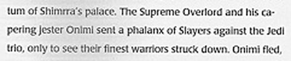
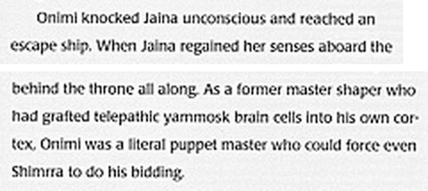
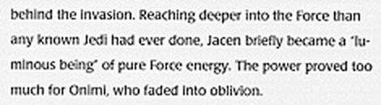
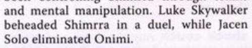
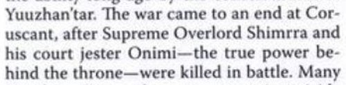

# Onimi

- **Aliases:** —
- **Era:** NJO
- **Continuity:** default Legends; entries present for: Legends
- **Research tier:** untiered (not listed as INTRO/DEEP/MASTERY in legends-feats.md)
- **Entries:** 65 (17 with quotations; 7 quotations extended to the full sentence/passage from the source text on file; 8 marked as fragments; 9 before the 2026-11-17 fragment fill). Rebuilt 2026-11-17 from 47 old entries; old file: `characters/_bak/onimi.md.bak-20261117`.
- **How to read:** each entry is the quotation in full (block quote), then its source and point of view. "Note" lines are summaries from our notes, not quotations. `[fragment — full passage not on file]` means the source text is not on the box, so only the words in our notes are shown. Debate and forum material is in the last section and is unverified.

# LEGENDS (Legends / EU — main focus)

## Legacy of the Force 1–9: novel notes from the other agent (reference copy)

- Note (summary from our notes, not a quotation): Callbacks: Anakin and Tahiri on Myrkr (Prologue); Kyp and Carida (L4175); Onimi (L5135).
  — Source: L4175; L5135 — Legacy of the Force 6: Inferno (novel, read in full): feats, scaling and story notes.
Our notes: `notes/materials/021-legacy-of-the-force/lotf-6-inferno-notes.md:224`

> “I am a Hapan queen,” Tenel Ka interrupted. “You won’t deceive me with equivocation, Jacen. *(L5121)*
>
> “Because it is going to break my heart to open fire on you.” *(L5129)*
>
> Tenel Ka had deserted him, their love just one more offering to his Sith destiny. *(L5153)*
>
> Personally, I’d just as soon blast you back to atoms and pretend you died in that fight with Onimi.” *(L5135)*
>
> I wouldn't think of dying before I make you pay for this-both of you. *(L5141)*
— Source: L5103; L5121; L5129; L5131 — Legacy of the Force 6: Inferno (novel, read in full): feats, scaling and story notes.
(Full sentence/passage taken from the source text on file: `novels_tmp_inferno_FULL_txt`.)
Note (our notes, around the quote): Tenel Ka turns on Caedus: demands surrender (L5103); «I am a Hapan queen ... You won't deceive me with equivocation» (L5121); «it is going to break my heart to open fire on you» (L5129). She draws her aura in so he cannot touch it (L5131), then opens her heart to show the decision is hers (L5149–5151). Caedus: «Tenel Ka had deserted him, their love just one more offering to his Sith destiny.» (L5153). Han: «pretend you died in that fight with Onimi» (L5135). Caedus to his parents: «I wouldn't think of dying before I make you pay for this-both of you.» (L5141). Hapans open fire (L5163).
Our notes: `notes/materials/021-legacy-of-the-force/lotf-6-inferno-notes.md:404`

## Star Wars: The New Essential Chronology (Del Rey, 2005): power-scaling and lore notes

> The Supreme Overlord and his capering jester Onimi sent a phalanx of Slayers against the Jedi trio, only to see their finest warriors struck down.
— Source: Part Twelve: The New Jedi Order; Luke Skywalker; Jacen Solo; Jaina Solo — Slayers struck down.
Note (our notes, around the quote): Luke Skywalker; Jacen Solo; Jaina Solo — Slayers struck down: "The Supreme Overlord and his capering jester Onimi sent a phalanx of Slayers against the Jedi trio, only to see their finest warriors struck down." Source: The New Essential Chronology, p.225

Our notes: `notes/materials/027-new-essential-chronology/12-part-twelve-new-jedi-order.md:211`

> Onimi knocked Jaina unconscious and reached an escape ship. ... As a former master shaper who had grafted telepathic yammosk brain cells into his own cortex, Onimi was a literal puppet master who could force even Shimrra to do his bidding.
> [fragment — full passage not on file]
— Source: Part Twelve: The New Jedi Order; Jaina Solo — Onimi the puppet master.
Note (our notes, around the quote): Jaina Solo — Onimi the puppet master: "Onimi knocked Jaina unconscious and reached an escape ship. ... As a former master shaper who had grafted telepathic yammosk brain cells into his own cortex, Onimi was a literal puppet master who could force even Shimrra to do his bidding." Source: The New Essential Chronology, p.227

Our notes: `notes/materials/027-new-essential-chronology/12-part-twelve-new-jedi-order.md:225`

- Note (summary from our notes, not a quotation): Jacen Solo — Jacen the luminous being: "Reaching deeper into the Force than any known Jedi had ever done, Jacen briefly became a "luminous being" of pure Force energy. The power proved too much for Onimi, who faded into oblivion." Source: The New Essential Chronology, p.227
  — Source: Part Twelve: The New Jedi Order.

Our notes: `notes/materials/027-new-essential-chronology/12-part-twelve-new-jedi-order.md:227`

## The Complete Star Wars Encyclopedia, Vol. III (P–Z)

> Luke Skywalker beheaded Shimrra in a duel, while Jacen Solo eliminated Onimi.
— Source: scan pages 121–160; Luke Skywalker; Jacen Solo (Darth Caedus); Onimi.
Note (our notes, around the quote): Luke Skywalker; Jacen Solo (Darth Caedus); Onimi: "Luke Skywalker beheaded Shimrra in a duel, while Jacen Solo eliminated Onimi." Source: The Complete Star Wars Encyclopedia, Vol. III, p.147

Our notes: `notes/materials/032-complete-star-wars-encyclopedia-vol-3/03-v3-scan-121-160.md:274`

> The war came to an end at Coruscant, after Supreme Overlord Shimrra and his court jester Onimi—the true power behind the throne—were killed in battle.
— Source: scan pages 361–385; Onimi. POV: Onimi.
Note (our notes, around the quote): Onimi: "The war came to an end at Coruscant, after Supreme Overlord Shimrra and his court jester Onimi—the true power behind the throne—were killed in battle." Source: The Complete Star Wars Encyclopedia, Vol. III, p.362

Our notes: `notes/materials/032-complete-star-wars-encyclopedia-vol-3/09-v3-scan-361-385.md:85`

## Star Wars Insider #74 (2004)

- Note (summary from our notes, not a quotation): Page contents: NJO synopses: Edge of Victory I: Conquest (Anakin rescues Tahiri on occupied Yavin 4; the Jeedai cult), the "Ylesia" e-book and Jag Fel Gamer story, Edge of Victory II: Rebirth (Onimi, Shimrra, Ben Skywalker introduced), and Gamer serial addenda. (hand-read)
  — Source: Star Wars Insider #74 (2004).
Our notes: `notes/materials/038-star-wars-insider/074-ins074.md:150`

## The Dark Nest Trilogy (Troy Denning, Del Rey 2005): FULL consecutive re-read (2026-11-16 CST)

What it shows (our notes): Shimrra lies on "a dais of pulsing red hau polyps". Onimi is "the Shamed One". Yoog Skell: "Never think to lie to the Supreme One".
> Nom Anor, distaste prickling, pushed past the Shamed One and entered. The rounded resinous walls of the chamber shone with a faint luminescence, and the air bore the metallic scent of blood. In the dim light Nom Anor made out the magnificently scarred and mutilated form of Supreme Overlord Shimrra, reclining on a dais of pulsing red hau polyps. Onimi, the Supreme One’s familiar, sank into the shadows at Shimrra’s feet. Nom Anor prostrated himself, all too aware of the scrutiny of Shimrra’s rainbow eyes.
>
> Never think to lie to the Supreme One, Yoog Skell had warned.
>
> Nom Anor would not. He probably could not. Fortunately he was well prepared with the latest news of the infidels’ efforts against the Yuuzhan Vong.
— Source: Bundled e-book: *Star Wars: The New Jedi Order: Ylesia* (Walter Jon Williams, 2002), as included in the Joiner King epub; Shimrra lies on.
(Excerpt widened 2026-11-17 to the relevant passage, word for word from The Joiner King (Troy Denning) (text copy `MEGA_Legend_The_Dark_Nest_Trilogy_Star_Wars_Dark_Nest_01_The_Joiner_King_Troy_Denning_epub`).)
(Excerpt widened 2026-11-17 to the relevant passage, word for word from The Joiner King (Troy Denning) (text copy `MEGA_Legend_The_Dark_Nest_Trilogy_Star_Wars_Dark_Nest_01_The_Joiner_King_Troy_Denning_epub`).)
(Full sentence/passage taken from the source text on file: `novels_tmp_ylesia_ylesia_epub`.)
Our notes: `notes/materials/051-dark-nest-trilogy/jk-05-ylesia.md:6`

> “Fetch him to our presence, Lord, And bring us all into concord.
>
> I wish it known and made a rule
>
> That I am not the only fool.”
>
> Shimrra’s vast frame heaved with what might have been laughter.
>
> “Yes,” he said. “By all means. Let us meet the master of Corellia.”
— Source: Bundled e-book: *Star Wars: The New Jedi Order: Ylesia* (Walter Jon Williams, 2002), as included in the Joiner King epub; Onimi's rhyme. POV: Onimi's rhyme.
(Excerpt widened 2026-11-17 to the relevant passage, word for word from The Joiner King (Troy Denning) (text copy `MEGA_Legend_The_Dark_Nest_Trilogy_Star_Wars_Dark_Nest_01_The_Joiner_King_Troy_Denning_epub`).)
(Excerpt widened 2026-11-17 to the relevant passage, word for word from The Joiner King (Troy Denning) (text copy `MEGA_Legend_The_Dark_Nest_Trilogy_Star_Wars_Dark_Nest_01_The_Joiner_King_Troy_Denning_epub`).)
Our notes: `notes/materials/051-dark-nest-trilogy/jk-05-ylesia.md:9`

What it shows (our notes): Vengeance: "I have just appointed him President ofYlesia [sic] and Commander in Chief of the Peace Brigade." (Shimrra). Onimi's batron to the kidney: "Your resignation is declined, infidel." Darjeelai Swan dies under interrogation.
> I have just appointed him President ofYlesia [sic] and Commander in Chief of the Peace Brigade. *(Shimrra)*
>
> “Your resignation is declined, infidel,” he said. “We shall see you are transported immediately to Ylesia, where you may take your place as head of the government. In the meantime, you will give us the names of your associates on Corellia, so they, too, may be given their instructions.”
— Source: Bundled e-book: *Star Wars: The New Jedi Order: Ylesia* (Walter Jon Williams, 2002), as included in the Joiner King epub; Vengeance. POV: Shimrra, about Onimi.
(Excerpt widened 2026-11-17 to the relevant passage, word for word from The Joiner King (Troy Denning) (text copy `MEGA_Legend_The_Dark_Nest_Trilogy_Star_Wars_Dark_Nest_01_The_Joiner_King_Troy_Denning_epub`).)
(Full sentence/passage taken from the source text on file: `novels_tmp_ylesia_ylesia_epub`.)
Our notes: `notes/materials/051-dark-nest-trilogy/jk-05-ylesia.md:11`

## *Edge of Victory II: Rebirth* (Greg Keyes, Del Rey 2001): FULL consecutive re-read (2026-11-16 CST)

What it shows (our notes): "You have seen the eighth cortex." / "I saw … the end. The end of the protocols … the store of our knowledge is nearly exhausted."; "You alone of all shapers know this."; "Onimi. Reveal yourself."; the dead hands drop away; Onimi, deformed "as one born cursed"; "Onimi is my jester … I sent him to watch you and fetch you."; "You see, my sweet Nen Tsup?"
> Shimrra made a noise, then—a rustling, vaporous noise that she only gradually recognized as laughter.
>
> “You have seen the eighth cortex.”
>
> “I have gazed within it, Lord.”
>
> “And what did you see there? Speak.”
>
> “I saw … the end. The end of the protocols. The end of the secrets. Besides those few marvels the gods have gifted us with since our arrival at the infidel galaxy, the store of our knowledge is nearly exhausted.”
>
> “So it is,” Shimrra acknowledged. “You alone of all shapers know this.” Something that was not a natural hand gestured at Kae Kwaad from the shadows. “Onimi. Reveal yourself.”
>
> “Yes, Dread Lord.” Kae Kwaad—no, Onimi—capered, then. With a twist, the dead shaper hands dropped from his wrists, revealing ordinary Yuuzhan Vong digits. He stripped off the masquer that hid his face, and bile rose in Nen Yim’s throat at what she saw there.
>
> The man she had thought a master shaper was deformed. Not scarred or modified as sacrifice to the gods, but misshapen as one born cursed by them. One eye lolled lower on his face than the other, and part of his skull was oddly distended. His mouth was a twisted slash. His long, lean limbs twitched with a sort of mad delight.
>
> “Onimi is my jester,” Shimrra murmured. “He amuses me. Sometimes he is useful. I sent him to watch you and fetch you.”
>
> “You see, my sweet Nen Tsup?” Onimi crowed. “You see?”
>
> But Nen Yim did not see. She did not see at all.
>
> “Silence, Onimi. Prostrate yourself and be silent.”
>
> The jester flattened himself against the coral deck and whimpered like a fearful beast.
>
> The jester flattened himself against the coral deck and whimpered like a fearful beast. (RB ch. 47) — **"You have seen the eighth cortex."
>
> "I saw … the end. The end of the protocols … the store of our knowledge is nearly exhausted."; "You alone of all shapers know this."; "Onimi. Reveal yourself."; the dead hands drop away; Onimi, deformed "as one born cursed"; "Onimi is my jester … I sent him to watch you and fetch you."; "You see, my sweet Nen Tsup?"**
> [fragment — full passage not on file]
— Source: The New Jedi Order: Edge of Victory II: Rebirth (Greg Keyes, Del Rey 2001), RB ch. 47 — 123 notes (re-read 2026-11-16).
(Excerpt widened 2026-11-17 to the relevant passage, word for word from Star Wars: The New Jedi Order: Edge of Victory II: Rebirth (Greg Keyes) (text copy `MEGA_Legend_The_New_Jedi_Order_Series_Star_Wars_New_Jedi_Order_09_Edge_of_Victory_02_Rebirth_Greg_Keyes_epub`).)
(Fragment completed 2026-11-17 with the full excerpt, word for word from Star Wars: The New Jedi Order: Edge of Victory II: Rebirth (Greg Keyes) (text copy `MEGA_Legend_The_New_Jedi_Order_Series_Star_Wars_New_Jedi_Order_09_Edge_of_Victory_02_Rebirth_Greg_Keyes_epub`).)
(Excerpt widened 2026-11-17 to the relevant passage, word for word from Star Wars: The New Jedi Order: Edge of Victory II: Rebirth (Greg Keyes) (text copy `MEGA_Legend_The_New_Jedi_Order_Series_Star_Wars_New_Jedi_Order_09_Edge_of_Victory_02_Rebirth_Greg_Keyes_epub`).)
(Fragment completed 2026-11-17: full sentence/passage matched word for word in the source text on file: `MEGA_Legend_The_New_Jedi_Order_Series_Star_Wars_New_Jedi_Order_09_Edge_of_Victory_02_Rebirth_Greg_Keyes_epub`.)
Our notes: `notes/materials/123-njo-09-rebirth/rb-04.md:86`

> “Onimi is my jester,” Shimrra murmured. “He amuses me. Sometimes he is useful. I sent him to watch you and fetch you.”
— Source: The New Jedi Order: Edge of Victory II: Rebirth (Greg Keyes, Del Rey 2001), RB ch. 47 — 123 notes (re-read 2026-11-16).
(Fragment completed 2026-11-17: full sentence/passage matched word for word in the source text on file: `MEGA_Legend_The_New_Jedi_Order_Series_Star_Wars_New_Jedi_Order_09_Edge_of_Victory_02_Rebirth_Greg_Keyes_epub`.)
Note text that was attached to the quote line: (RB ch. 47) — **"Onimi is my jester"**
Context: > “Onimi is my jester,” Shimrra murmured. “He amuses me. Sometimes he is useful. I sent him to watch you and fetch you.” (RB ch. 47) — "Onimi is my jester"
Our notes: `notes/materials/123-njo-09-rebirth/summary.md:71`

## NJO 15: Destiny’s Way (Walter Jon Williams) — DONE

> We have come to the turning point!
— Source: Destiny’s Way — Notes batch 01 (FULL.txt l.1–~3684) — 130-njo-15-destinys-way/dw-01-front-ch1-9.md.
Note (our notes, around the quote): Mass caste ceremony; rainbow dovin-basal wings; palace cradle links to World Brain; Nom Anor’s itch amid ritual; Shimrra + Onimi silhouette; “We have come to the turning point!”
Our notes: `notes/materials/130-njo-15-destinys-way/dw-01-front-ch1-9.md:42`

> the true incarnation of Yun-Harla the Trickster?”
— Source: Destiny’s Way — Notes batch 01 (FULL.txt l.1–~3684) — 130-njo-15-destinys-way/dw-01-front-ch1-9.md.
(Full sentence/passage taken from the source text on file: `novels_tmp_destinys_way_FULL_txt`.)
Note (our notes, around the quote): Hall of Confluence: Shimrra scarred giant + Onimi rhyming familiar; Tsavong Lah rebuked for casualty ramparts; pause offensive; surge-coral slave-warriors; breed-at-16; yammosk jammer / Yun-Harla decoy basals / Trickster; assassinate Cal Omas ordered; Well of World Brain fiasco blamed on Vergere (Harrar shares twin-sacrifice blame); Shimrra calls Vergere “true incarnation of Yun-Harla.”
Our notes: `notes/materials/130-njo-15-destinys-way/dw-01-front-ch1-9.md:49`

- Note (summary from our notes, not a quotation): Follows Onimi to secret guarded shaper damutek (“cortex”); amphistaff slash from short subaltern.
  — Source: Destiny’s Way — Notes batch 02 (FULL.txt l.4901–~9100+) — 130-njo-15-destinys-way/dw-02-ch11-18.md.
Our notes: `notes/materials/130-njo-15-destinys-way/dw-02-ch11-18.md:19`

- Note (summary from our notes, not a quotation): Nen Yim (heretic eighth-cortex project): antifungal balm; World Brain/Yuuzhan’tar spore of Vong origin (Jacen sabotage); ordered to jammer-proof yammosk + study repulsorlifts; Onimi conduit to Shimrra; fears liquidation after cortex filled.
  — Source: Destiny’s Way — Notes batch 02 (FULL.txt l.4901–~9100+) — 130-njo-15-destinys-way/dw-02-ch11-18.md.
Our notes: `notes/materials/130-njo-15-destinys-way/dw-02-ch11-18.md:22`

- Note (summary from our notes, not a quotation): Shimrra/Onimi: double stakes, hunt Nom Anor, hope Nen Yim fills eighth cortex; laughter in Hall of Confluence.
  — Source: Destiny’s Way — Notes batch 03 (FULL.txt l.9801–~17126 novel+About; into back matter through ~17500) — 130-njo-15-destinys-way/dw-03-ch18-27.md.
Our notes: `notes/materials/130-njo-15-destinys-way/dw-03-ch18-27.md:47`

## NJO 16: Ylesia (Walter Jon Williams) — DONE

- Note (summary from our notes, not a quotation): l.34–100: Nom Anor before Shimrra (Onimi present); reports NR raids with local latitude under Cal Omas; Peace Brigade on Ylesia factional; Viqi Shesh unavailable as leader.
  — Source: Ylesia — Full hand-read notes (FULL.txt 1–4267 EOF) — 131-njo-16-ylesia/yl-01-full.md.
Our notes: `notes/materials/131-njo-16-ylesia/yl-01-full.md:8`

- Note (summary from our notes, not a quotation): l.218–411: Thrackan forced to grovel; Onimi kidney strike with amphistaff baton; Darjeelai Swan killed; Thrackan shipped to Ylesia.
  — Source: Ylesia — Full hand-read notes (FULL.txt 1–4267 EOF) — locator l.218 — 131-njo-16-ylesia/yl-01-full.md.
Our notes: `notes/materials/131-njo-16-ylesia/yl-01-full.md:10`

## NJO 18: Force Heretic II: Refugee (Sean Williams & Shane Dix) — DONE

- Note (summary from our notes, not a quotation): Spy At’raoth (Shamed One, hollowed k’snell+villip) into Shimrra antechamber; challenged; cries “Jeedai! Ganner!” → dies (irksh false tooth). Voices: Drathul, Jakan, Onimi. Nom Anor demands another volunteer; heresy still weak for purge.
  — Source: Force Heretic II: Refugee — Notes batch 02 (FULL.txt 3016–5969) — 133-njo-18-force-heretic-refugee/fh2-02-part2.md.
Our notes: `notes/materials/133-njo-18-force-heretic-refugee/fh2-02-part2.md:18`

## Rebirth — Part Three: Descent (Ch.24–35)

- Note (summary from our notes, not a quotation): Nen Yim: grutchin assassin aborted; gains access to Qang; eighth cortex empty → despair; Onimi/Kae reveals → taken to Shimrra
  — Source: Rebirth — Part Three: Descent (Ch.24–35) — 123-njo-09-rebirth/rb-03.md.
Our notes: `notes/_superseded/123-njo-09-rebirth-2026-11-09/rb-03.md:14`

## Rebirth — Part Four: Rebirth (Ch.36–47) + Epilogue

- Note (summary from our notes, not a quotation): Nen Yim before Shimrra: Onimi = jester; raised to Master; eighth-cortex secret; Baanu Miir abandoned; heresy sanctioned; sworn hatred of infidels
  — Source: Rebirth — Part Four: Rebirth (Ch.36–47) + Epilogue — 123-njo-09-rebirth/rb-04.md.
Our notes: `notes/_superseded/123-njo-09-rebirth-2026-11-09/rb-04.md:12`

## "My Problems with Caedus Wank: Why I find Caedus = Maul more believable than Caedus = Yoda" (Master Azronger)

> most dangerous Jedi of all *(Onimi via Vergere)*
> [fragment — full passage not on file]
— Source: Why I find Caedus = Maul more believable than Caedus = Yoda" (Master Azronger) — https://www.suspectinsightforums.com/t4493-my-problems-with-caedus-wank-why-i-find-caedus-maul-more-believable-than-caedus-yoda; | (1) | Jacen the.
Note (our notes, around the quote): | (1) | Jacen the "most dangerous Jedi of all" (Onimi via Vergere) | *The Unifying Force*; original context in *Traitor* | ✗ (hard) |
Context: | # | Claim examined | Source | Verdict |
Our notes: `notes/materials/008-caedus-wank-problems-caedus-maul-vs-yoda.md:75`

> Edged and sharp as senalak thorns.”
>
> Edged and sharp as senalak thorns.”
>
> When Shimrra swung about, Onimi bowed in mock gallantry. “Great Sky Lord, if the Jeedai Force is nothing more than enhanced ability, why have our shapers not created worthy opponents from the warrior caste?”
>
> Shimrra frowned and aimed a finger at his familiar. “You spoil my surprise, Onimi. But so be it.” He turned to face the white-robed, tentacle-handed shapers. “Let us not keep our company in suspense. Display your handiwork.”
>
> One of the spotlessly adorned shapers rose and hastened from the hall. Moments later, entering through both the priest and warrior portals, marched a group of ten [… truncated here for length; full passage in raw thread.txt from line 1684]
> [fragment — full passage not on file]
— Source: Why I find Caedus = Maul more believable than Caedus = Yoda" (Master Azronger) — https://www.suspectinsightforums.com/t4493-my-problems-with-caedus-wank-why-i-find-caedus-maul-more-believable-than-caedus-yoda.
(Excerpt widened 2026-11-17 to the relevant passage, word for word from The Unifying Force (James Luceno) (text copy `MEGA_Legend_The_New_Jedi_Order_Series_Star_Wars_New_Jedi_Order_21_The_Unifying_Force_James_Luceno_epub`).)
(Excerpt widened 2026-11-17 to the relevant passage, word for word from The Unifying Force (James Luceno) (text copy `MEGA_Legend_The_New_Jedi_Order_Series_Star_Wars_New_Jedi_Order_21_The_Unifying_Force_James_Luceno_epub`).)
Context: A33. Source as labelled by blogger: Star Wars: The New Jedi Order - The Unifying Force (raw thread.txt line 1684)
Our notes: `notes/materials/008-caedus-wank-problems-caedus-maul-vs-yoda.md:429`

> "Vergere told Nom Anor that you are the most dangerous Jeedai of all," Onimi said. "And well you should be, since you carry Yun-Shuno within you-the betrayer of all I have sought to create. But soon, when I have killed you, you will be my passage to godhood. All you hold dear will have been destroyed. The species that gave you its blood and died to bring you worshipers. Most of all, the living world you returned from the Unknown Regions. Even now it anticipates its own death. It gasps for breath. Can you feel it? Our vessels are plunging through the shields you tried to create, coming closer [… truncated here for length; full passage in raw thread.txt from line 3292]
> [fragment — full passage not on file]
— Source: Why I find Caedus = Maul more believable than Caedus = Yoda" (Master Azronger) — https://www.suspectinsightforums.com/t4493-my-problems-with-caedus-wank-why-i-find-caedus-maul-more-believable-than-caedus-yoda.
Context: A80. Source as labelled by blogger: Star Wars: The New Jedi Order - The Unifying Force (raw thread.txt line 3292)
Our notes: `notes/materials/008-caedus-wank-problems-caedus-maul-vs-yoda.md:775`

## https://starwars.fandom.com/wiki/Darth_Caedus

- Note (summary from our notes, not a quotation): [FEAT] Section: A new hope — The living world
  — Source: The New Jedi Order: The Unifying Force [per Wookieepedia "Darth Caedus" rev 15733922, ref 84; exact text match; agrees with the entry's own ref marker]; per Wookieepedia "Darth Caedus" rev 15733922, ref 84; exact text match; agrees with the entry's own ref marker — Darth Caedus (Jacen Solo) — article extraction — https://starwars.fandom.com/wiki/Darth_Caedus.
(“Solo gave himself over to the Force to counter Onimi's complete control of their surroundings, enabling him to counter the mastermind's actions.” [84])
(Scaling: Onimi had restored the Force to himself with grafted yammosk cells and had mentally controlled Supreme Overlord Shimrra Jamaane.)
(Source: The New Jedi Order: The Unifying Force [per Wookieepedia "Darth Caedus" rev 15733922, ref 84; exact text match; agrees with the entry's own ref marker])
Our notes: `external/mega-notes/caedus-legends-quotes.txt:207`

- Note (summary from our notes, not a quotation): [FEAT] Section: A new hope — The living world
  — Source: The New Jedi Order: The Unifying Force [per Wookieepedia "Darth Caedus" rev 15733922, ref 84; exact text match; agrees with the entry's own ref marker]; per Wookieepedia "Darth Caedus" rev 15733922, ref 84; exact text match; agrees with the entry's own ref marker — Darth Caedus (Jacen Solo) — article extraction — https://starwars.fandom.com/wiki/Darth_Caedus.
(“Onimi was unable to contend with the limitless power that emanated from Jacen and expended himself in the manufacture of toxins until he was undone and dissolved by his own poisons.” [84])
(Scaling: Onimi was the true Supreme Overlord and had controlled Jamaane; Jacen’s Force state countered his toxins.)
(Source: The New Jedi Order: The Unifying Force [per Wookieepedia "Darth Caedus" rev 15733922, ref 84; exact text match; agrees with the entry's own ref marker])
Our notes: `external/mega-notes/caedus-legends-quotes.txt:217`

- Note (summary from our notes, not a quotation): [STATEMENT] Section: Powers and abilities — Force powers
  — Source: Jedi vs. Sith: The Essential Guide to the Force [per Wookieepedia "Darth Caedus" rev 15733922, ref 88; exact text match; agrees with the entry's own ref marker]; per Wookieepedia "Darth Caedus" rev 15733922, ref 88; exact text match; agrees with the entry's own ref marker — Darth Caedus (Jacen Solo) — article extraction — https://starwars.fandom.com/wiki/Darth_Caedus.
(“Jedi historian Tionne Solusar described him as ‘briefly transformed into the most powerful manifestation of the Force on record.’” [88])
(Scaling: Tionne’s historical description of the Onimi encounter; explicitly marked as a statement/hype, not treated as a standalone feat.)
(Source: Jedi vs. Sith: The Essential Guide to the Force [per Wookieepedia "Darth Caedus" rev 15733922, ref 88; exact text match; agrees with the entry's own ref marker])
Our notes: `external/mega-notes/caedus-legends-quotes.txt:222`

- Note (summary from our notes, not a quotation): [FEAT] Section: Powers and abilities — Force powers
  — Source: The New Jedi Order: The Unifying Force [per Wookieepedia "Darth Caedus" rev 15733922, ref 84; exact text match; agrees with the entry's own ref marker]; per Wookieepedia "Darth Caedus" rev 15733922, ref 84; exact text match; agrees with the entry's own ref marker — Darth Caedus (Jacen Solo) — article extraction — https://starwars.fandom.com/wiki/Darth_Caedus.
(“By the end of the Yuuzhan Vong War, Solo could neutralize toxins and manipulate substances on a molecular level, as Vergere had been able to.” [84])
(Scaling: Explicit comparison to Vergere; the narrative example is neutralizing Onimi’s toxins and later healing Luke Skywalker’s amphistaff poisoning.)
(Source: The New Jedi Order: The Unifying Force [per Wookieepedia "Darth Caedus" rev 15733922, ref 84; exact text match; agrees with the entry's own ref marker])
Our notes: `external/mega-notes/caedus-legends-quotes.txt:423`

# Debate and forum claims (unverified)

Forum posts, Suspect Insight debates and Discord debates, respect threads, and verdicts. These are posters' arguments or quotations they typed; none is checked against the book here unless the entry says so.

## Antares Draco (Informal Geek) vs TUF Jacen Solo (RNGesus)

> possibly the greatest challenge the Jedi ever faced
> [fragment — full passage not on file]
>
> It's the turning point
> [fragment — full passage not on file]
— Source: Antares Draco (Informal Geek) vs TUF Jacen Solo (RNGesus) — https://www.suspectinsightforums.com/t4375-stomper-showdown-r2-8-antares-draco-informal-geek-vs-tuf-jacen-solo-rngesus4; Opener (2,172 chars): NJO era.
Note (our notes, around the quote): Opener (2,172 chars): NJO era "possibly the greatest challenge the Jedi ever faced"; Jacen's "It's the turning point" moment (Q1); Art of the Small (vs Onimi); electric judgment — "brilliant emerald fire" throws back and incapacitates a Vong group (Q3); defeated Warmaster Tsavong Lah (NJO Sourcebook image, Q4); slave revolt killing "countless" warriors with amphistaffs "in both hands" (Q5, *Traitor* per later posts).
Posted by: not named in our notes (see thread/notes link).
Our notes: `suspect-insight/debates/017-antares-draco-vs-tuf-jacen-solo.md:19`

> In the center of the bridge Jacen stood like a pillar of blinding light, feet planted, arms at his sides, chin lifted. The dazzling light seemed to spin outward from his midsection and surround him like an aura. His face was almost frighteningly serene, and perhaps a touch sad. The pupils of his eyes were like rising suns. He seemed to age five years— features maturing, complexion softening, body elongating—as Leia watched breathlessly.
>
> What youth might have remained in her son vanished.
>
> -TUF
> [fragment — full passage not on file]
— Source: Antares Draco (Informal Geek) vs TUF Jacen Solo (RNGesus) — https://www.suspectinsightforums.com/t4375-stomper-showdown-r2-8-antares-draco-informal-geek-vs-tuf-jacen-solo-rngesus4.
Context: Q15 — Source: [source not stated adjacent] (preceding line: "To close off this response, understand that Jacen is pre prime in all of my above points. After his fight with Onimi, Leia observes an extra growth within Jacen. So even IF Draco comes close to competing with Jacen in any of my points, remember that ")
Posted by: not named in our notes (see thread/notes link).
Our notes: `suspect-insight/debates/017-antares-draco-vs-tuf-jacen-solo.md:137`

## Onimi (RNGesus) vs Palpatine (Menace)

- Note (summary from our notes, not a quotation): Jacen realized that, in a sense, he had paraphrased Onimi. He had passed beyond the tradition of the Jedi Order into a more embracing reality. But instead of attempting to steal the authority of the gods, or to become a god, he had finally allowed himself to merge with the Force in its entirety and become a conduit for its raw power , which flowed through him like the thundering headwaters of a great river. The conjoining of the Force and his Vongsense enabled him to render himself small enough to follow Onimi wherever he went or attempted to hide; to counter Onimi's every action , and merge with his living vessel on a molecular level.
  — Source: The Unifying Force — as cited by Chris Cortosis — SI Discord debate 097 (Onimi (Chris Cortosis) vs Palpatine (Menace); site directory lists RNGesus vs Menace) — Discord-debate-cited (unverified against the book in this pass). POV: narrator (as given by the debater), about Jacen Solo and Onimi.
Posted by: Chris Cortosis.
Context: typed by Chris Cortosis in SI Discord debate 097, 10/9/21, 9:05 PM, in the Onimi-side opener (typography “raw power ,” and “every action ,” as typed, including the spaces before the commas).
Our notes: `suspect-insight/debates/097-onimi-vs-palpatine.md:274`

- Note (summary from our notes, not a quotation): But the struggle had nothing to do with size and less to do with brute strength. Onimi's true potency lay in his abilities to amplify the electric current that flowed through his body, or-like Vergere-to call on his refined metabolism to fashion molecules and compounds, and deliver them through his curving yellow fingernails, his single fang, his blood, sweat, saliva, and breath. But where Vergere had learned to produce emollients and healing tears, Onimi was capable of producing a brew of fast-acting and deadly toxins. Compared to the former shaper's mastery of Yuuzhan Vong bioscience, Vergere had been a mere adept. He flew at Jacen with hands upraised and mouth ajar. Jacen lifted his hands in defense and he and Onimi met with blinding discharges of electrical energy that entangled both of them in a flashing web. Their hands interlocked, they whirled from one side of the bridge to the other in a kind of mad pirouette, caroming off the coarse bulkheads and smooth instrumentation. Jaina sent her twin what reinforcement she could summon, but he told her to conserve her strength. The transmutated secretions from Onimi's palms and fingertips sent hallucinogens through Jacen's skin and capillaries, and coursing through his bloodstream. Onimi's paralyzing fang struck repeatedly for Jacen's temples and neck. Poison wafted on his forced sighs and rode within the droplets of his frothing saliva. But the Jacen that the Supreme Overlord had in his taloned grip was not there. Where once Jacen had been unable to find Onimi through the Force, now it was Onimi who couldn't find Jacen.
  — Source: The Unifying Force — as cited by Chris Cortosis — SI Discord debate 097 (Onimi (Chris Cortosis) vs Palpatine (Menace); site directory lists RNGesus vs Menace) — Discord-debate-cited (unverified against the book in this pass). POV: narrator (as given by the debater), about Onimi, Jacen Solo, Vergere, and Jaina Solo.
Posted by: Chris Cortosis.
Context: typed by Chris Cortosis in SI Discord debate 097, 10/9/21, 9:06 PM, in the Onimi-side opener (Art of the Small / toxins fight).
Our notes: `suspect-insight/debates/097-onimi-vs-palpatine.md:278`

- Note (summary from our notes, not a quotation): As the realization deepened, he recognized that his Vongsense was allowing him to see Onimi in a profound way. Onimi was open to him, and in an instant Jacen understood how the Shamed One, a former shaper, had attained such power. But even Onimi didn't understand that through his experiments he had also found a way to reverse the damage that had been done in the distant past to the Yuuzhan Vong. He had regained the Force!
  — Source: The Unifying Force — as cited by Chris Cortosis — SI Discord debate 097 (Onimi (Chris Cortosis) vs Palpatine (Menace); site directory lists RNGesus vs Menace) — Discord-debate-cited (unverified against the book in this pass). POV: narrator (as given by the debater), about Jacen Solo and Onimi.
Posted by: Chris Cortosis.
Context: typed by Chris Cortosis in SI Discord debate 097, 10/9/21, 9:06–9:07 PM, in the Onimi-side opener.
Our notes: `suspect-insight/debates/097-onimi-vs-palpatine.md:282`

- Note (summary from our notes, not a quotation): "In your omniscience, you know that's why I risked grafting yammosk cells to my own neural tissue: in the hope of being able to discover some way to escape the rack on which you had mounted us! But instead of rewarding my having the courage to emulate your bold works of creation, you condemned me. You granted me the powers to speak through the mouths of others, to manipulate them at will, to control remotely, as your yammosks do, and yet you punished me with physical deformities that shouted to one and all that my attempt at self-escalation had failed. -- "Only by means of the powers you conferred on me was I able to reach out for Shimrra and make him my puppet! My most audacious act yet. But when I saw that you were either powerless to prevent it or welcoming the opportunity to do open battle with me, I knew that I was right to attempt to overthrow you in the same way.
  — Source: The Unifying Force — as cited by Chris Cortosis — SI Discord debate 097 (Onimi (Chris Cortosis) vs Palpatine (Menace); site directory lists RNGesus vs Menace) — Discord-debate-cited (unverified against the book in this pass).
Posted by: Chris Cortosis.
Context: typed by Chris Cortosis in SI Discord debate 097, 10/9/21, 9:06–9:07 PM, in the Onimi-side opener (typography of the closing quotation as typed).
Our notes: `suspect-insight/debates/097-onimi-vs-palpatine.md:285`

## Darth Wyyrlok III (Ethan) vs Marka Ragnos (Darththor)

- Note (summary from our notes, not a quotation): > Jaina dangled limply between her brother and Onimi, as if a mournful sculpture, fragile but growing stronger by the moment. And as she strengthened, Onimi began to wane. For an instant it appeared that the surgeries, mutilations, and disfigurements were reversing themselves. The Shamed One's facial features became symmetrical. His twisted body straightened, assuming its original size, shape, and aspect-more human than not, though taller and leaner, with long limbs and large hands. -The Unifying Force
  — Source: The Unifying Force — as cited by Ethan — SI Discord debate 132 (Darth Wyyrlok III vs Marka Ragnos) — Discord-debate-cited (unverified against the book in this pass). POV: narrator, about Jaina Solo and Onimi (as given by the debater).
Posted by: not named in our notes (see thread/notes link).
Context: quoted by Ethan in SI Discord debate 132
Our notes: `suspect-insight/debates/132-darth-wyyrlok-iii-vs-marka-ragnos.md:552`

- Note (summary from our notes, not a quotation): > What he found instead was formless, supple, and fathomless-an infinite emptiness, but as serene as a wind-topping tree to encourage new growth. A being of light, Jacen was drawing into himself all of Onimi's lethal compounds, neutralizing them and casting them out as sweat, tears, and exhalations. He understood at last why he had failed to catch Anakin's lightsaber when Luke had tossed it to him; he was never meant to catch it, because he had become the lightsaber he had attained the highest level. He had attained the ability to cut through any resistance in himself; to sever the bonds of preconception; to open a gaping hole into a reality more expansive than any he had ever dared imagine; to heal. -The Unifying Force
  — Source: The Unifying Force — as cited by Ethan — SI Discord debate 132 (Darth Wyyrlok III vs Marka Ragnos) — Discord-debate-cited (unverified against the book in this pass). POV: narrator, about Jacen Solo and Onimi (as given by the debater).
Posted by: not named in our notes (see thread/notes link).
Context: quoted by Ethan in SI Discord debate 132
Our notes: `suspect-insight/debates/132-darth-wyyrlok-iii-vs-marka-ragnos.md:555`

## Matchup Verdicts — Research Log

- Note (summary from our notes, not a quotation): Date compiled: 2026-10-20
  — Source: Matchup Verdicts — Research Log.
Posted by: verdict file (verdicts.md).
Our notes: `verdicts.md:1769`

- Note (summary from our notes, not a quotation): Versions/conditions: Unknown (Discord-only debate; directory metadata only)
  — Source: Matchup Verdicts — Research Log.
Posted by: verdict file (verdicts.md).
Our notes: `verdicts.md:1770`

- Note (summary from our notes, not a quotation): Forum result (FORUM OPINION): Victor: RNGesus (Judge Decision 2:0) [from directory; debate content inaccessible]
  — Source: Matchup Verdicts — Research Log.
Posted by: FORUM OPINION.
Our notes: `verdicts.md:1771`

- Note (summary from our notes, not a quotation): Key reasoning: Unavailable: private Discord channel.
  — Source: Matchup Verdicts — Research Log.
Posted by: verdict file (verdicts.md).
Our notes: `verdicts.md:1772`

- Note (summary from our notes, not a quotation): What could flip it: Unknown.
  — Source: Matchup Verdicts — Research Log.
Posted by: verdict file (verdicts.md).
Our notes: `verdicts.md:1774`

- Note (summary from our notes, not a quotation): Deep notes: suspect-insight/debates/097-onimi-vs-palpatine.md
  — Source: Matchup Verdicts — Research Log.
Posted by: verdict file (verdicts.md).
Our notes: `verdicts.md:1775`

## Verdict pointers

- `verdicts.md:1768` — #97 — Onimi (RNGesus) vs Palpatine (Menace)
- `suspect-insight/debates/097-onimi-vs-palpatine.md` — SI debate #97: Onimi (RNGesus) vs Palpatine (Menace) — Result (FORUM OPINION): 

# NJO FULL re-read additions (2026-11-17)
Verbatim excerpts from the full consecutive re-read of the New Jedi Order novels (Dark Journey through The Unifying Force), each shown with the text around it and its source chapter.

## *The Final Prophecy*
Nen Yim recalls Onimi once disguised himself as a master shaper.

> If the Supreme Overlord’s jester noticed any of this, he made no sign, but stood there grinning at her as if they were close crèche-mates sharing a joke. They weren’t; she was the most important of all shapers, and he was an appalling example of a Shamed One, a being upon whom the gods had placed a permanent stamp of unreserved disapproval. Why Shimrra, the chosen of the gods—the Supreme Overlord of her entire species—should choose him as emissary was utterly beyond her comprehension. It was more than an affront, it was a misery to even be in his presence, especially when she remembered—and she could hardly forget—that those fingers had once touched her, when he had disguised himself as a master shaper.
>
> For that alone, he deserved the most ignominious death imaginable. She had plotted his murder even when she believed him to be her superior, and blessed by the gods. Now, when she had the means at her disposal and knew what he really was, she did not dare.
>
> But she could still dream.

— Source: *The Final Prophecy* (Greg Keyes, Del Rey 2003), chapter 3 (FP).

Onimi's villip appears to Nom Anor.

> “They really don’t want us to get away,” Wedge muttered. He’d thought about making a hard push for one of the interdictors so they could clear out, but the Yuuzhan Vong were keeping them far away and under heavy watch. That was good, in a way—it gave him near parity in the actual combat. Even though they had ships behind him, they weren’t using them for anything but to prevent him running that way. Nor did they have enough ships to try an encirclement.

— Source: *The Final Prophecy* (Greg Keyes, Del Rey 2003), chapter 24 (FP).

## *The Unifying Force*
Onimi's deformities and role as Shimrra's jester are described.

> Onimi’s deformities owed not to birth but to rejection by the gods. Once a shaper, he was now little more than a misshapen jester, one eye drooping below its mate, one yellow fang protruding from a twisted mouth, one portion of his skull distended, as if the shaper’s vaa-tumor had failed to seat itself properly. Long and slender, his arms and legs twitched continuously, yanked about by the gods, as they might do to a puppet.

— Source: *The Unifying Force* (James Luceno, Del Rey 2004), chapter 6 (UF).

Onimi scrambles to his feet and recites verse mocking the Jeedai.

> As if on cue, Onimi scrambled to his feet and followed Shimrra along the flowered ring, reciting:
>
> “The Shamed are naught but nuisance flies,
>
> At least as seen through Shimrra’s eyes;
>
> The Jeedai are the ones he mourns,
>
> Edged and sharp as senalak thorns.”
>
> When Shimrra swung about, Onimi bowed in mock gallantry. “Great Sky Lord, if the Jeedai Force is nothing more than enhanced ability, why have our shapers not created worthy opponents from the warrior caste?”

— Source: *The Unifying Force* (James Luceno, Del Rey 2004), chapter 6 (UF).

Onimi mocks the slayers in verse.

> The shaper who had escorted the group into the hall stepped forward to appraise the warriors and address Shimrra. “Our taller warriors kept rejecting the implants. The faster metabolic rate of our shorter warriors is better suited to the rapid cellular activity of the implant biots.”
>
> Onimi scampered over to one of the dead warriors and prodded him.
>
> “Most impressive;
>
> Done with flair.
>
> But against a Jeedai,
>
> How will they fare?”

— Source: *The Unifying Force* (James Luceno, Del Rey 2004), chapter 6 (UF).

Onimi slips away from the sacrifice disguised as a slayer.

> Drathul was almost within arm’s reach of Nom Anor when the Supreme Overlord’s voice rang out above the melee of droning thud bugs, snapping amphistaffs, and sizzling blaster-bolts, his huge head rising above those slayers that made up his living fence.
>
> “High Prefect Drathul! No more of this shall we brook! At this place is our patience and goodwill sundered!” Shimrra stood to his full and imposing height, towering over everyone. “I demand the heart of every Yuuzhan Vong who has aided and abetted the Prophet!”
>
> Everyone in the vicinity was cowering, except for Nom Anor, because of how tightly he was wedged in place. Perhaps that was why he alone happened to be gazing past Shimrra when one of the slayers slipped away into the crowd. Except that the individual wasn’t a slayer. Master of disguise that he was, Nom Anor recognized that the deserter was wearing an ooglith masquer, which not only cloaked his appearance but also reshaped his body.
>
> And from the way the slayer moved—with a somewhat trembling gait—the imposter could only be Onimi.

— Source: *The Unifying Force* (James Luceno, Del Rey 2004), chapter 16 (UF).

Onimi watches Nom Anor during the audience.

> And it struck Nom Anor that Shimrra was right about what he had said at their most recent meeting: the Yuuzhan Vong had outgrown the gods. It wasn’t that the gods didn’t exist, so much as the Yuuzhan Vong no longer needed them.
>
> All at once, he felt someone’s eyes on him. He looked to Shimrra, but Shimrra was still gazing down on Nas Choka.
>
> It was Onimi who was watching Nom Anor.

— Source: *The Unifying Force* (James Luceno, Del Rey 2004), chapter 18 (UF).

Onimi tells Nom Anor he is his conscience.

> “Be encouraged, Prefect,” Onimi said in confidence. “As is true between the gods and the Yuuzhan Vong, Shimrra’s strength flows from the combined certitude of his subjects. Falter, display doubt or weakness, and the careful balance may tip …”
>
> Nom Anor sneered. “Who are you to address me, Shamed One?”
>
> Onimi’s uneven mouth twisted into a frigid smile. “Your conscience, Prefect. The still-small voice that reminds you how tenuous your position is.”

— Source: *The Unifying Force* (James Luceno, Del Rey 2004), chapter 21 (UF).

Onimi's eyes show misgiving at Shimrra's plan.

> Nom Anor nodded, trying hard to keep uncertainty from the gesture. Onimi was regarding Shimrra with what might have been incredulity, but looked more like misgiving. For one brief instant Onimi’s eyes met Nom Anor’s, and that sense of apprehension was communicated. If it hadn’t been obvious before, it was obvious now that Shimrra was beyond control—deranged. Events had conspired to make a believer out of one who had long prided himself on being the master of his own destiny.

— Source: *The Unifying Force* (James Luceno, Del Rey 2004), chapter 30 (UF).

Onimi recites the prophecy of the rainbow bridge and the amphistaff.

> “The rainbow bridge will appear and disappear,” Onimi recited from the center of the hall. “And the gods will make it seem that they are the authors of a great conflict. When the eclipse of the sun will then be, the divine omen will be seen in plain sight. Quite otherwise will one interpret it, for when a menacing stranger appears at the portal, look close at hand for the amphistaff that will send the stranger on its way.”

— Source: *The Unifying Force* (James Luceno, Del Rey 2004), chapter 32 (UF).

Onimi tries to rhyme in the hall and Shimrra rebukes him.

> Onimi shuffled to the center of the hall. “Great One,” he began. “Our skies breached, our land despoiled; these heretic ravings we can later foil—”
>
> “Enough of your insolent rhyming, Shamed One!” Shimrra cut him off. “Only by my good graces have you been spared the life led by others of your kind. Do you, too, doubt me? Do you, too, harbor fears of defeat, and rally suddenly to the heretic cause?”
>
> Onimi fell on his face before the throne. “I remain your most abject servant, Lord.”

— Source: *The Unifying Force* (James Luceno, Del Rey 2004), chapter 35 (UF).

Onimi recites a solemn poem for Shimrra.

> “We should be rejoicing,” Shimrra was saying as he meandered about, much to the consternation of his limited audience. He gestured to Onimi, who was squatting almost possessively close to the austere throne. “What, no rhymes from you this day? No words of ridicule or mockery? No capering about while Yuuzhan’tar burns?”
>
> Solemn-faced, Onimi got to his feet to recite a poem, though absent his characteristic self-amusement, and with his gaze not on Shimrra or any of the others in the bunker, but raised to the high, arched ceiling or perhaps the sky beyond.
>
> Who would stay cool while fires roar,
>
> the gods themselves might well abhor.
>
> But who would sport when death is near,
>
> the gods themselves do well to fear.

— Source: *The Unifying Force* (James Luceno, Del Rey 2004), chapter 38 (UF).

Onimi gasps at Harrar's name.

> The shaper waited until Shimrra was finished, then stepped forward from her villip-choir. “Dread Lord, High Priest Jakan reports that saboteurs have been seized at the Well of the World Brain. Apparently the priest Harrar is among them.”
>
> “Harrar!” Onimi said, then caught himself and hunkered down.

— Source: *The Unifying Force* (James Luceno, Del Rey 2004), chapter 38 (UF).

Onimi crouches behind Shimrra's throne.

> Luke noticed then, for the first time, that Shimrra wasn’t alone on the dais. Behind the throne crouched another Yuuzhan Vong, whose asymmetrically swollen head and downcast features identified him as a Shamed One. Aware that he had been glimpsed, the Shamed One withdrew into the shadow cast by the throne, as if in an attempt to make himself small and unnoticeable.

— Source: *The Unifying Force* (James Luceno, Del Rey 2004), chapter 40 (UF).

Onimi rants at Jaina as Yun-Harla.

> “I know you can hear me,” he said in a guttural Basic, “because I gave you only a taste of the poison encapsulated in my fang. Just enough to render you inert.”
>
> With a glance at the console he enlivened additional living instruments and systems. It was obvious that he was preparing the vessel for launch. When the bridge began to vibrate with anticipation, the Shamed One nodded in satisfaction and turned to her once more.
>
> “I’m grateful you elected to pursue me, Yun-Harla,” he said. “At last we have an opportunity to meet on a level battlefield. Both of us in captivity. You, hostage to my paralytic toxin; me, to the half-a-lifetime of injustices you saw fit to heap on me.”
>
> Jaina forced herself to speak. “I’m not—”
>
> “Who was more faithful to the gods than Onimi?” the Shamed One ranted at her. “Who was more faithful to Shimrra’s domain than the shaper who discovered the truth that the eighth cortex was empty, and that the species Yun-Yuuzhan and the rest of you created was doomed to extinction? Yes, our ancestors utilized the gifts you supplied to make war on those who would have vanquished us, but instead of rewarding our attempts to rid the galaxy of such infidels and machines, you drove us from the ancestral homeworld, bled us of further kinship with you, forced us to wander for generations in search of a new home.”
>
> Hatred gathered in his uneven eyes and shook his curled hands.

— Source: *The Unifying Force* (James Luceno, Del Rey 2004), chapter 41 (UF).

Onimi wants nothing more than to kill them.

> She touched him through the Force, her voice little more than a whisper, but clear enough for him to grasp that the Shamed One’s name was Onimi. Khalee and Tsavong Lah had been set on pitting Jaina and Jacen against each other in battle. Onimi wanted nothing more than to kill them.

— Source: *The Unifying Force* (James Luceno, Del Rey 2004), chapter 41 (UF).

Onimi tells Jacen Shimrra was Shimrra and he is he.

> “You will find no integrity in me, Jeedai,” Onimi said in Basic, as if mimicking something Vergere had told Jacen when he was in the Embrace of Pain. “Trust that everything you perceive about me is a lie.”
>
> Jacen realized the truth. Onimi had overseen the warriors in the throne room below. Onimi, not the dhuryam, had been responsible for the quakes that had nearly toppled the Citadel—
>
> “Shimrra was Shimrra,” Onimi said, anticipating Jacen’s next thought. “I am I.”
>
> “The Supreme Overlord,” Jacen said.
>
> As the realization deepened, he recognized that his Vongsense was allowing him to see Onimi in a profound way. Onimi was open to him, and in an instant Jacen understood how the Shamed One, a former shaper, had attained such power. But even Onimi didn’t understand that through his experiments he had also found a way to reverse the damage that had been done in the distant past to the Yuuzhan Vong.
>
> He had regained the Force!

— Source: *The Unifying Force* (James Luceno, Del Rey 2004), chapter 41 (UF).

Onimi hurls idols at Jacen and cracks the bulkheads.

> On the bridge of the vessel whose every component answered to him, Onimi sent a blur of objects racing for Jacen, beginning with the carved idols that flanked Jaina: cloaked Yun-Harla, many-armed Yun-Yammka, thousand-eyed Yun-Shuno, and the rest. But Jacen stood firm. Not wanting to risk hurting Jaina inadvertently by deflecting the objects, he pulled everything into a whirling cloud, as if in orbit around him. Beyond the cloud, he was dimly aware that a transparency had formed above the console, and that constellations of stars were winking into existence, smeared in places by the explosive exchanges among the hundreds of warships battling at the edge of Coruscant’s envelope.
>
> Jacen’s steadfast defense infuriated Onimi. Reaching deeper into himself, the Supreme Overlord used his telekinetic powers to create cracks in the bulkheads and ceiling, hoping to add chunks of unrooted yorik coral to his conjured storm. But as fast as the fissures formed, Jacen repaired them, and those chunks that were torn away he ordered the vessel to cement in place.
>
> Mismatched eyes opened wide in disbelief, Onimi charged, his feet moving so rapidly that he might have been gliding across the deck.

— Source: *The Unifying Force* (James Luceno, Del Rey 2004), chapter 42 (UF).

Onimi fights Jacen with poison and electricity.

> Though crippled by the deformations that had resulted from poorly healed enhancement surgeries and the consequences of experimental escalations, the former shaper was still taller than Jacen and pound for pound more powerful. But the struggle had nothing to do with size and less to do with brute strength. Onimi’s true potency lay in his abilities to amplify the electric current that flowed through his body, or—like Vergere—to call on his refined metabolism to fashion molecules and compounds, and deliver them through his curving yellow fingernails, his single fang, his blood, sweat, saliva, and breath. But where Vergere had learned to produce emollients and healing tears, Onimi was capable of producing a brew of fast-acting and deadly toxins. Compared to the former shaper’s mastery of Yuuzhan Vong bioscience, Vergere had been a mere adept.
>
> He flew at Jacen with hands upraised and mouth ajar. Jacen lifted his hands in defense and he and Onimi met with blinding discharges of electrical energy that entangled both of them in a flashing web. Their hands interlocked, they whirled from one side of the bridge to the other in a kind of mad pirouette, caroming off the coarse bulkheads and smooth instrumentation. Jaina sent her twin what reinforcement she could summon, but he told her to conserve her strength.

— Source: *The Unifying Force* (James Luceno, Del Rey 2004), chapter 42 (UF).

Onimi is drawn into Jacen's void.

> Gradually Onimi began to understand, as well. He grasped that Jacen wasn’t defending himself so much as using Onimi’s own strengths against him. Jacen was fighting without fighting; drawing Onimi deeper into the struggle by demanding more of Onimi’s indigenous toxins, to the point that he couldn’t keep up. Jacen was the vacuum, the dovin basal singularity into which Onimi was being sucked. Jacen had become the dismantling void that was drawing Onimi into a slender thread, attenuating him to the point of infinite smallness.
>
> Onimi’s self-deformed face began to change. His arteries pulsed and his veins bulged from beneath his pale skin.
>
> Onimi fought with everything that remained in him, but Jacen could not be overwhelmed. As a pure conduit of the Force, he was incapable of taking missteps or making wrong moves. He stood not at the edge of the tilting ecliptic of his vision, but at the center, as a fulcrum. The weight that would disturb the balance was Onimi, but to Jacen, that weight was no longer of sufficient mass to make a difference.
>
> The Force encased Jacen like a whirlwind, moving deep into the darkness the Yuuzhan Vong had brought to the galaxy, and gathering it and sending it up the spout into the funnel cloud, where it was transformed and dispersed.
>
> Onimi was becoming more insubstantial by the moment.

— Source: *The Unifying Force* (James Luceno, Del Rey 2004), chapter 42 (UF).

Onimi dissolves into corrosive fluid.

> Across the bridge, Shimrra’s Shamed familiar, Onimi, was pinned to the coarse bulkhead like a captive shadowmoth, uneven eyes rolled up into his deformed head and slavering mouth opened wide in wonderment, agony, despair—it was impossible to know.
>
> Jaina dangled limply between her brother and Onimi, as if a mournful sculpture, fragile but growing stronger by the moment.
>
> And as she strengthened, Onimi began to wane. For an instant it appeared that the surgeries, mutilations, and disfigurements were reversing themselves. The Shamed One’s facial features became symmetrical. His twisted body straightened, assuming its original size, shape, and aspect—more human than not, though taller and leaner, with long limbs and large hands. But life deserted him just as quickly. He slid to the deck as if his bones had dissolved. Poured from his mouth, eyes, and ears, corrosive fluids began to consume him, leaving nothing more than a puddle of foul hydrocarbons, which the yorik coral deck absorbed as it might a stain.

— Source: *The Unifying Force* (James Luceno, Del Rey 2004), chapter 42 (UF).

