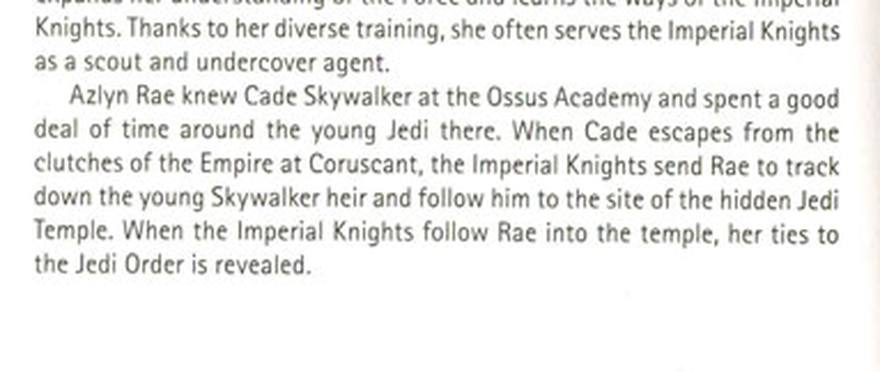
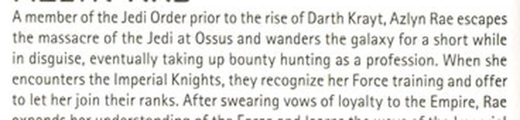
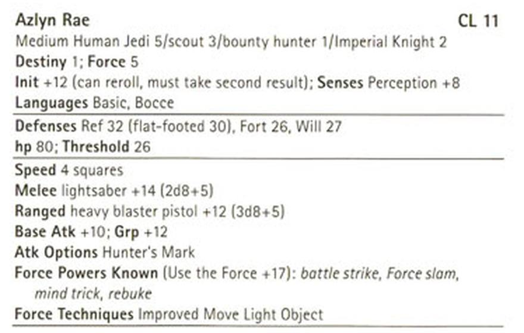

# Oron Jaeger

- **Aliases:** —
- **Era:** —
- **Continuity:** default Legends; entries present for: Legends
- **Research tier:** untiered (not listed as INTRO/DEEP/MASTERY in legends-feats.md)
- **Entries:** 4 (2 with quotations; 0 quotations extended to the full sentence/passage from the source text on file; 1 marked as fragments). Rebuilt 2026-11-17 from 5 old entries; old file: `characters/_bak/oron-jaeger.md.bak-20261117`.
- **How to read:** each entry is the quotation in full (block quote), then its source and point of view. "Note" lines are summaries from our notes, not quotations. `[fragment — full passage not on file]` means the source text is not on the box, so only the words in our notes are shown. Debate and forum material is in the last section and is unverified.

# LEGENDS (Legends / EU — main focus)

## Sourcebooks/Legacy Era Campaign Guide.pdf [Star Wars Roleplaying Game Saga Edition (2007)] (scan pages 121–180)

> permanent bird's-eye view of the battlefield.
> [fragment — full passage not on file]
— Source: Sourcebooks/Legacy Era Campaign Guide.pdf [Star Wars Roleplaying Game Sag.
Note (our notes, around the quote): Page contents: Caption: "ORON JAEGER." Oron Jaeger: Roan Fel loyalist; cybernetically enhanced Human commanding the 501st Legion; "permanent bird's-eye view of the battlefield." Stat block CL 12 (soldier 10/officer 2). Azlyn Rae introduction. (hand-read)
Our notes: `notes/materials/037-sw-d20-folder/719-legacy-era-campaign-guide-scan-121-180.md:497`

## Star Wars: Legacy (Dark Horse, 2006–2010) single issues #20–#50, hand-read

> I'M AWARE THAT THE EMPEROR IS UNAVAILABLE, GENERAL JAEGER! WE BOTH KNOW WHY!
>
> BUT IF WE DO NOT ACT IN CONCERT IMMEDIATELY, EVERY LIVING THING ON THE PLANET DAC WILL DIE! *(Gar Stazi)*
>
> AND I AM TELLING YOU, ADMIRAL STAZI, THAT -- BARRING A DIRECT ATTACK ON OUR HOLDINGS OR A DIRECT COMMAND FROM HIS IMPERIAL MAJESTY -- -- I DO NOT HAVE THE AUTHORITY TO COMMIT IMPERIAL FORCES TO THIS. *(Gen. Oron Jaeger, hologram)*
— Source: Star Wars: Legacy #47 — "The Fate of Dac" (Apr 2010). POV: Gar Stazi, about Oron Jaeger.
Note (our notes, around the quote): > "I'M AWARE THAT THE EMPEROR IS UNAVAILABLE, GENERAL JAEGER! WE BOTH KNOW WHY!" / "BUT IF WE DO NOT ACT IN CONCERT IMMEDIATELY, EVERY LIVING THING ON THE PLANET DAC WILL DIE!" (Gar Stazi) / "AND I AM TELLING YOU, ADMIRAL STAZI, THAT -- BARRING A DIRECT ATTACK ON OUR HOLDINGS OR A DIRECT COMMAND FROM HIS IMPERIAL MAJESTY -- -- I DO NOT HAVE THE AUTHORITY TO COMMIT IMPERIAL FORCES TO THIS." (Gen. Oron Jaeger, hologram)
Our notes: `notes/materials/039-legacy-2006/legacy-47.md:63`

## Star Wars Saga Edition: *Legacy Era Campaign Guide* (WotC 2009): power-scaling notes with panels

- Note (summary from our notes, not a quotation): Oron Jaeger CL 12 (p179). Fehlaaur CL 11 (p176). Konrad Rus CL 10 (p180).
  — Source: *Legacy Era Campaign Guide* (WotC 2009): power-scaling notes with panels.

Our notes: `notes/materials/011-legacy-era-campaign-guide.md:950`

- Note (summary from our notes, not a quotation): p179: Oron Jaeger's Ref is printed as 18, which looks low for CL12.
  — Source: *Legacy Era Campaign Guide* (WotC 2009): power-scaling notes with panels.
Context: UNCLEAR text and print issues:
Our notes: `notes/materials/011-legacy-era-campaign-guide.md:1120`

# Debate and forum claims (unverified)

Forum posts, Suspect Insight debates and Discord debates, respect threads, and verdicts. These are posters' arguments or quotations they typed; none is checked against the book here unless the entry says so.

_None in our notes._
