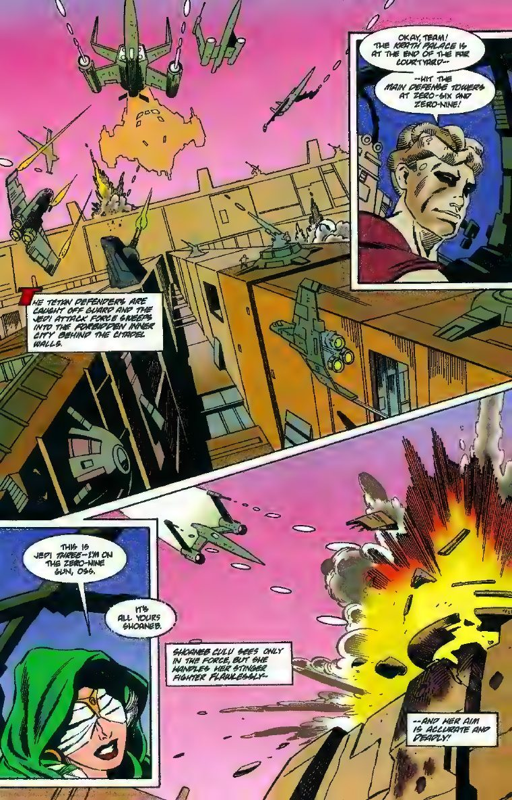
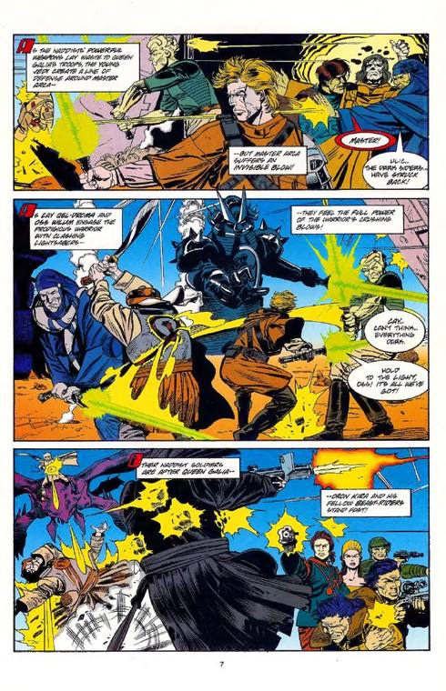
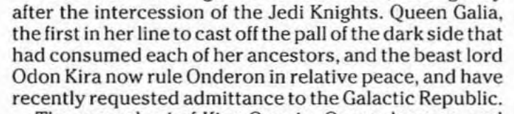
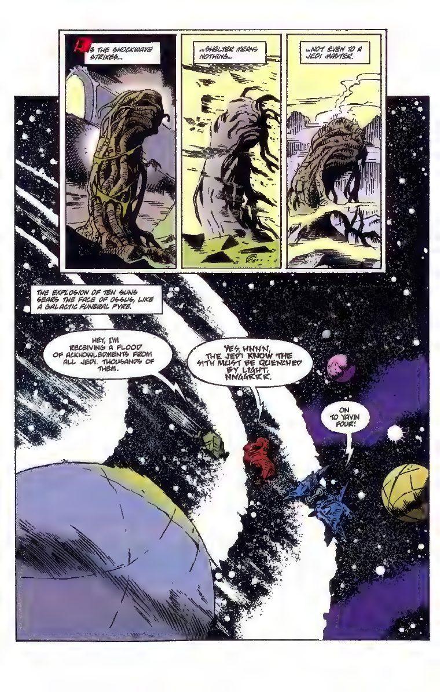

# Oron Kira

- **Aliases:** —
- **Era:** Great Sith War
- **Continuity:** default Legends; entries present for: Legends
- **Research tier:** untiered (not listed as INTRO/DEEP/MASTERY in legends-feats.md)
- **Entries:** 13 (9 with quotations; 0 quotations extended to the full sentence/passage from the source text on file; 6 marked as fragments). Rebuilt 2026-11-17 from 19 old entries; old file: `characters/_bak/oron-kira.md.bak-20261117`.
- **How to read:** each entry is the quotation in full (block quote), then its source and point of view. "Note" lines are summaries from our notes, not quotations. `[fragment — full passage not on file]` means the source text is not on the box, so only the words in our notes are shown. Debate and forum material is in the last section and is unverified.

# LEGENDS (Legends / EU — main focus)

## Tales of the Jedi: Freedon Nadd Uprising #1–2, Dark Lords of the Sith #1–6, The Sith War #1–6, plus the WEG Tales of the Jedi Companion (power-scaling notes)

- Note (summary from our notes, not a quotation): Leads the Onderon beast-riders in the Cinnagar raid. Source: Dark Lords of the Sith #6, p12–14
  — Source: Owner Material 024b — Tales of the Jedi: Dark Lords of the Sith #1–6 (1994–95): power-scaling notes.

Our notes: `notes/materials/024-tales-of-the-jedi/dark-lords-of-the-sith.md:259`

> REMEMBER, ULIC... WHERE THERE IS LIGHT... THERE CAN BE NO DARKNESS.
> [fragment — full passage not on file]
— Source: Owner Material 024a — Tales of the Jedi: The Freedon Nadd Uprising #1–2 (1994): power-scaling notes; Arca Jeth to Ulic Qel-Droma. POV: Arca Jeth, about Oron Kira.
Note (our notes, around the quote): Arca Jeth to Ulic Qel-Droma: "REMEMBER, ULIC... WHERE THERE IS LIGHT... THERE CAN BE NO DARKNESS." Source: Freedon Nadd Uprising #2, p22

Our notes: `notes/materials/024-tales-of-the-jedi/freedon-nadd-uprising.md:46`

> NADD SPOKE OF THE ANCIENT SITH FORETELLINGS... THAT THE DARK LORDS WILL COME AGAIN.
> [fragment — full passage not on file]
>
> I HEARD SIMILAR STORIES... FROM THE JEDI HOLOCRON.
> [fragment — full passage not on file]
— Source: Owner Material 024a — Tales of the Jedi: The Freedon Nadd Uprising #1–2 (1994): power-scaling notes; Arca Jeth about Freedon Nadd. POV: Arca Jeth, about Oron Kira.
Note (our notes, around the quote): Arca Jeth about Freedon Nadd: "NADD SPOKE OF THE ANCIENT SITH FORETELLINGS... THAT THE DARK LORDS WILL COME AGAIN." "I HEARD SIMILAR STORIES... FROM THE JEDI HOLOCRON." Source: Freedon Nadd Uprising #2, p22

Our notes: `notes/materials/024-tales-of-the-jedi/freedon-nadd-uprising.md:83`

> THE PALACE IS FALLEN. WE NEED TO GET GALIA AWAY FROM HERE.
— Source: Freedon Nadd Uprising #1, p9, p17 — Owner Material 024a — Tales of the Jedi: The Freedon Nadd Uprising #1–2 (1994): power-scaling notes.
Note (our notes, around the quote): Oron Kira and the beast-riders stand fast against the Naddists; Oron Kira: "THE PALACE IS FALLEN. WE NEED TO GET GALIA AWAY FROM HERE." Source: Freedon Nadd Uprising #1, p9, p17

Our notes: `notes/materials/024-tales-of-the-jedi/freedon-nadd-uprising.md:244`

> As he recovers, Arca learns from Queen Galia that her father King Ommin is being kept alive in a secret life-support facility.
— Source: Owner Material 024a — Tales of the Jedi: The Freedon Nadd Uprising #1–2 (1994): power-scaling notes; Recap (Galia's role). POV: Recap, about Oron Kira.
Note (our notes, around the quote): Recap (Galia's role): "As he recovers, Arca learns from Queen Galia that her father King Ommin is being kept alive in a secret life-support facility." · NARRATION. Source: Freedon Nadd Uprising #2, p1

Our notes: `notes/materials/024-tales-of-the-jedi/freedon-nadd-uprising.md:245`

> AS ORON KIRA'S MEN HOLD BACK THE UNTAMED CREATURES OF DXUN, THE ENTOMBMENT CEREMONY GOES FORWARD WITHOUT A HITCH.
— Source: Owner Material 024a — Tales of the Jedi: The Freedon Nadd Uprising #1–2 (1994): power-scaling notes; Oron Kira's men guard the Dxun entombment. POV: narrator, about Oron Kira.
Note (our notes, around the quote): Oron Kira's men guard the Dxun entombment: "AS ORON KIRA'S MEN HOLD BACK THE UNTAMED CREATURES OF DXUN, THE ENTOMBMENT CEREMONY GOES FORWARD WITHOUT A HITCH." · NARRATION. (Galia and Oron Kira stand at the tomb; no Force feats.) Source: Freedon Nadd Uprising #2, p22

Our notes: `notes/materials/024-tales-of-the-jedi/freedon-nadd-uprising.md:247`

> Queen Galia, the first in her line to cast off the pall of the dark side that had consumed each of her ancestors, and the beast lord Oron Kira now rule Onderon in relative peace
> [fragment — full passage not on file]
— Source: Owner Material 024d — Tales of the Jedi Companion (West End Games, 1996): power-scaling notes; Onderon site entry. POV: Onderon site entry, about Oron Kira.
Note (our notes, around the quote): Onderon site entry: "Queen Galia, the first in her line to cast off the pall of the dark side that had consumed each of her ancestors, and the beast lord Oron Kira now rule Onderon in relative peace". Source: Tales of the Jedi Companion (WEG, 1996), p.132

Our notes: `notes/materials/024-tales-of-the-jedi/tales-of-the-jedi-companion.md:266`

- Note (summary from our notes, not a quotation): Nomi severs Ulic from the Force (p4–5). Mandalore attacks Onderon; Vanicus and Oron Kira drive him to Dxun (p6–9, p14–17). Ood's farewell; the shockwave sears Ossus (p10–13). The Jedi converge on Yavin 4; Exar drains the Massassi; the wall of light starts the conflagration (p18–23). A new Mandalore (p24). Two years later (p25–26); Exar's trapped spirit (p27).
  — Source: Owner Material 024c — Tales of the Jedi: The Sith War #1–6 (1995–96): power-scaling notes.

Our notes: `notes/materials/024-tales-of-the-jedi/the-sith-war.md:43`

> THE PRIMITIVE TECHNOLOGY OF THE BEAST-RIDERS OF ONDERON PROVES EQUAL TO THE MECHANICAL MIGHT OF THE MANDALORIAN WAR-MOUNTS.
— Source: Owner Material 024c — Tales of the Jedi: The Sith War #1–6 (1995–96): power-scaling notes; Leads Onderon's flying beast-riders against the Mandalorian war-mounts.
Note (our notes, around the quote): Leads Onderon's flying beast-riders against the Mandalorian war-mounts: "THE PRIMITIVE TECHNOLOGY OF THE BEAST-RIDERS OF ONDERON PROVES EQUAL TO THE MECHANICAL MIGHT OF THE MANDALORIAN WAR-MOUNTS." Source: The Sith War #6, p7–9

Our notes: `notes/materials/024-tales-of-the-jedi/the-sith-war.md:257`

## Star Wars: The New Essential Chronology (Del Rey, 2005): power-scaling and lore notes

> in her outrage she called upon the dark side to destroy Oron Kira's people. The Jedi fought back, but they were outclassed—in the struggle Cay Qel-Droma lost his arm
> [fragment — full passage not on file]
— Source: Part One: Tales of the Ancient Republic; Queen Amanoa; Cay Qel-Droma — Amanoa outclasses the Jedi.
Note (our notes, around the quote): Queen Amanoa; Cay Qel-Droma — Amanoa outclasses the Jedi: "in her outrage she called upon the dark side to destroy Oron Kira's people. The Jedi fought back, but they were outclassed—in the struggle Cay Qel-Droma lost his arm" Source: The New Essential Chronology, p.14
Our notes: `notes/materials/027-new-essential-chronology/01-part-one-ancient-republic.md:92`

## Sourcebooks/Galaxy at War.pdf [Star Wars Roleplaying Game Saga Edition (2007)] (scan pages 121–180)

- Note (summary from our notes, not a quotation): Page contents: Onderon Beast Riders history: drexls, Iziz, Beast Lord Kinch Sunka; c. 4000 BBY Oron Kira and Princess Galia, Jedi help overthrow King Ommin and Queen Amanoa; Mandalorian Wars; Onderon Civil War 3951 BBY (General Vaklu vs. Queen Talia); Skelda clan. Image caption: the Beast Riders of Onderon. (hand-read)
  — Source: Sourcebooks/Galaxy at War.pdf [Star Wars Roleplaying Game Saga Edition (2.
Our notes: `notes/materials/037-sw-d20-folder/715-galaxy-at-war-scan-121-180.md:42`

## Star Wars Insider #28 (1996)

- Note (summary from our notes, not a quotation): Page contents: 879 words, 39 paragraphs | headings/entries: Staga—Herd beasts of Ambria. (TOT)); Starstorm One—Exar Kun's spaceship. (TOT), TSW); Stinger—A small, one-person attack ship. (DLOS); Thrasher—One of Oron Kira's warbeasts. (DLOS); Valtar cataclysm—aAn ancient conflict be-
  — Source: Star Wars Insider #28 (1996).
Our notes: `notes/materials/038-star-wars-insider/028-ins028.md:323`

# Debate and forum claims (unverified)

Forum posts, Suspect Insight debates and Discord debates, respect threads, and verdicts. These are posters' arguments or quotations they typed; none is checked against the book here unless the entry says so.

## Lord Hoth (Vaelias) vs Odan-Urr (Darthor)

> Spoiler:
> [fragment — full passage not on file]
>
> He wants to reveal the marriage of Oron and Galia to the Queen and try to work out a peaceful solution. The beastriders agree to make the allempt, but only if the Jedi promise to help in the war against the dark side if their pian fails. Ulic agrees. The Jedi, Oron, and Galia board the Nebulon Ranger and head for Iziz as Modon readies his forces for battle. As the Rangerand its beast-rider escort near the city, the defensive guns lash out at them. The Jedi quickly inform the city of the passengers in the Ranger, and they are immediately allowed to land. Queen Amanoa, outraged at the marriage between her daughter and the outcast Oron Kira, does not heed Ulic's and Oron's warnings to give up her hatred. She calls upon the power of Freedon Nadd to destroy her enemies. The Jedi, Galia, and Oron find themselves immersed in waves of darkness. The darkside immediately claws at the minds of the Jedi, sowing fear and confusion, feelings the novices struggle to push away. Galia leads the group to a secret passage. When they regain their wits, however, they realize that Cay did not escape the throne room.
>
> The Jedi, Galia, and Oron find themselves immersed in waves of darkness. The dark side immediately claws at the minds of the Jedi, sowing fear and confusion, feelings the novices struggle to push away.**\
— Source: Lord Hoth (Vaelias) vs Odan-Urr (Darthor) — https://www.suspectinsightforums.com/t4487-ss-lord-hoth-vaelias-vs-odan-urr-darthor.
(Excerpt widened 2026-11-17 to the relevant passage, word for word from research primary tales of the jedi WEG40082 (text copy `research_primary_tales_of_the_jedi_WEG40082_pdf_afa57d0500`).)
(Excerpt widened 2026-11-17 to the relevant passage, word for word from research primary tales of the jedi WEG40082 (text copy `research_primary_tales_of_the_jedi_WEG40082_pdf_afa57d0500`).)
Context: I20 — Source line: -Tales of the Jedi Companion
Posted by: not named in our notes (see thread/notes link).
> [IMG: https://i.servimg.com/u/f89/20/47/85/34/screen27.png] [LINK: https://servimg.com/view/20478534/204]
> [IMG: https://i.servimg.com/u/f89/20/47/85/34/010.jpg] [LINK: https://servimg.com/view/20478534/206]
> [IMG: https://i.servimg.com/u/f89/20/47/85/34/0010.jpg] [LINK: https://servimg.com/view/20478534/205]
Our notes: `suspect-insight/debates/121-lord-hoth-vs-odan-urr.md:2831`
