# Oss Wilum

- **Aliases:** Oss
- **Era:** Great Sith War
- **Continuity:** default Legends; entries present for: Legends
- **Research tier:** MASTERY (Tales of the Jedi 024 version only: Freedon Nadd Uprising #1–2, Dark Lords of the Sith #1–6, The Sith War #1–6; primary read 2026-10-27)
- **Entries:** 37 (16 with quotations; 1 quotations extended to the full sentence/passage from the source text on file; 7 marked as fragments; 7 before the 2026-11-17 fragment fill). Rebuilt 2026-11-17 from 47 old entries; old file: `characters/_bak/oss-wilum.md.bak-20261117`.
- **How to read:** each entry is the quotation in full (block quote), then its source and point of view. "Note" lines are summaries from our notes, not quotations. `[fragment — full passage not on file]` means the source text is not on the box, so only the words in our notes are shown. Debate and forum material is in the last section and is unverified.

# LEGENDS (Legends / EU — main focus)

## Tales of the Jedi: Freedon Nadd Uprising #1–2, Dark Lords of the Sith #1–6, The Sith War #1–6, plus the WEG Tales of the Jedi Companion (power-scaling notes)

- Note (summary from our notes, not a quotation): Oss Wilum flies in the Cinnagar raid (takes out a chaos fighter). Source: Dark Lords of the Sith #6, p12–17
  — Source: Owner Material 024b — Tales of the Jedi: Dark Lords of the Sith #1–6 (1994–95): power-scaling notes.
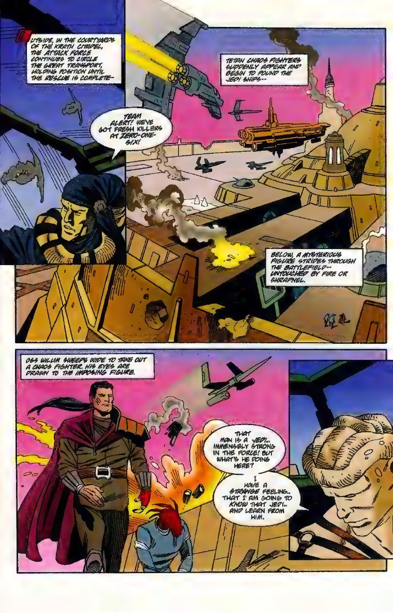

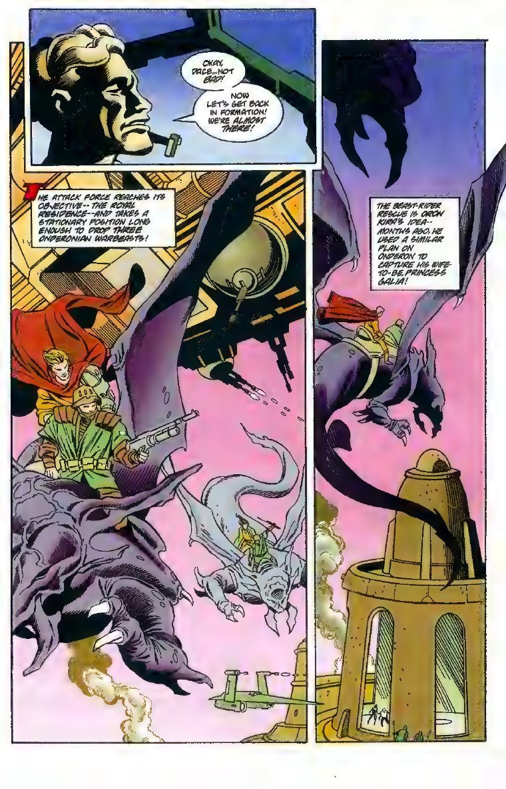
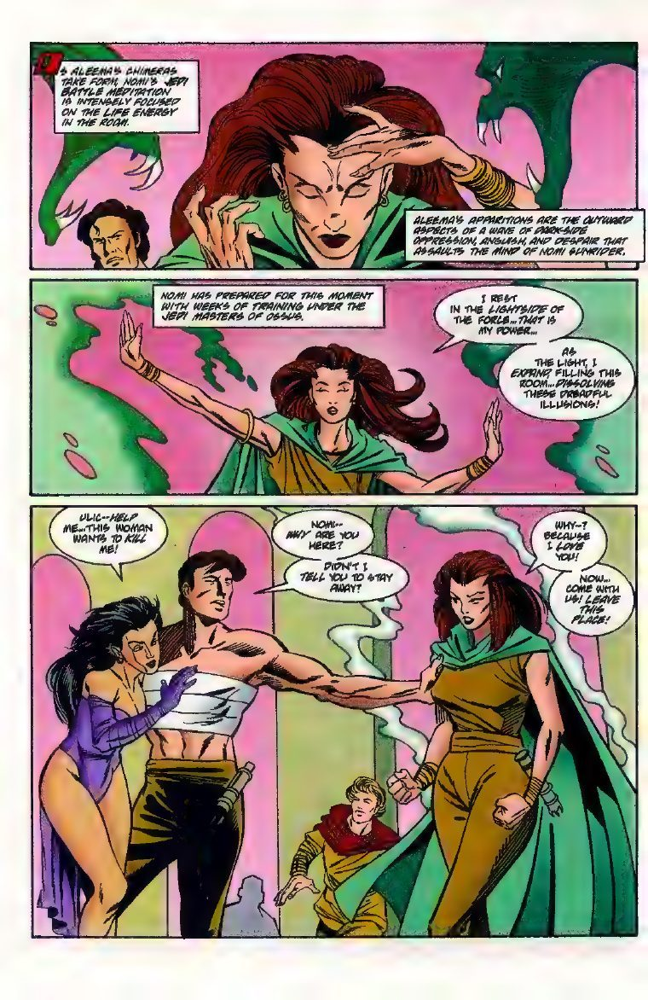
Our notes: `notes/materials/024-tales-of-the-jedi/dark-lords-of-the-sith.md:253`

> THAT MAN IS A JEDI...IMMENSELY STRONG IN THE FORCE! BUT WHAT'S HE DOING HERE?
> [fragment — full passage not on file]
>
> I HAVE A STRANGE FEELING...THAT I AM GOING TO KNOW THAT JEDI!...AND LEARN FROM HIM.
> [fragment — full passage not on file]
— Source: Owner Material 024b — Tales of the Jedi: Dark Lords of the Sith #1–6 (1994–95): power-scaling notes; Oss Wilum about Exar Kun. POV: Oss Wilum.
Note (our notes, around the quote): Oss Wilum about Exar Kun: "THAT MAN IS A JEDI...IMMENSELY STRONG IN THE FORCE! BUT WHAT'S HE DOING HERE?" "I HAVE A STRANGE FEELING...THAT I AM GOING TO KNOW THAT JEDI!...AND LEARN FROM HIM." Source: Dark Lords of the Sith #6, p17

Our notes: `notes/materials/024-tales-of-the-jedi/dark-lords-of-the-sith.md:255`

> AS CAY QEL-DROMA AND OSS WILUM ENGAGE THE PRODIGIOUS WARRIOR WITH CLASHING LIGHTSABERS-- --THEY FEEL THE FULL POWER OF THE WARRIOR'S CRUSHING BLOWS!
— Source: Freedon Nadd Uprising #1, p9 — Owner Material 024a — Tales of the Jedi: The Freedon Nadd Uprising #1–2 (1994): power-scaling notes; Fights Cay Qel-Droma and Oss Wilum at once.
Note (our notes, around the quote): Fights Cay Qel-Droma and Oss Wilum at once: "AS CAY QEL-DROMA AND OSS WILUM ENGAGE THE PRODIGIOUS WARRIOR WITH CLASHING LIGHTSABERS-- --THEY FEEL THE FULL POWER OF THE WARRIOR'S CRUSHING BLOWS!" Source: Freedon Nadd Uprising #1, p9
Our notes: `notes/materials/024-tales-of-the-jedi/freedon-nadd-uprising.md:140`

> HOLD TO THE LIGHT, OSS! IT'S ALL WE'VE GOT!
— Source: Freedon Nadd Uprising #1, p9 — Owner Material 024a — Tales of the Jedi: The Freedon Nadd Uprising #1–2 (1994): power-scaling notes; Fights Warb Null alongside Oss Wilum; Cay to Oss.
Note (our notes, around the quote): Fights Warb Null alongside Oss Wilum; Cay to Oss: "HOLD TO THE LIGHT, OSS! IT'S ALL WE'VE GOT!" Source: Freedon Nadd Uprising #1, p9
Our notes: `notes/materials/024-tales-of-the-jedi/freedon-nadd-uprising.md:148`

> A JEDI KNIGHT TRAINED BY MASTER THON OF AMBRIA.
— Source: Owner Material 024a — Tales of the Jedi: The Freedon Nadd Uprising #1–2 (1994): power-scaling notes; Introduced. POV: Introduced, about Oss Wilum.
Note (our notes, around the quote): Introduced: "A JEDI KNIGHT TRAINED BY MASTER THON OF AMBRIA." Source: Freedon Nadd Uprising #1, p5
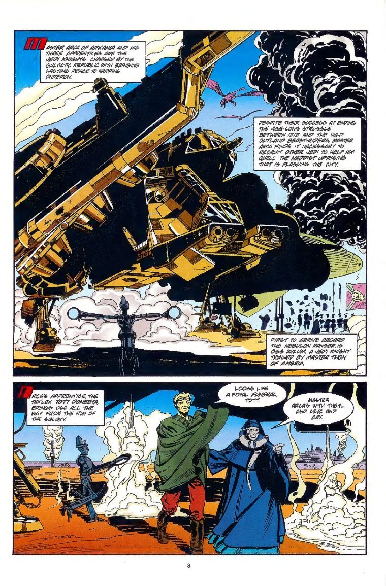
Our notes: `notes/materials/024-tales-of-the-jedi/freedon-nadd-uprising.md:154`

> CAY.. CAN'T THINK.. EVERYTHING DARK.
> [fragment — full passage not on file]
— Source: Freedon Nadd Uprising #1, p9 — Owner Material 024a — Tales of the Jedi: The Freedon Nadd Uprising #1–2 (1994): power-scaling notes; Overwhelmed by Warb Null's dark side.
Note (our notes, around the quote): Overwhelmed by Warb Null's dark side: "CAY.. CAN'T THINK.. EVERYTHING DARK." Source: Freedon Nadd Uprising #1, p9

Our notes: `notes/materials/024-tales-of-the-jedi/freedon-nadd-uprising.md:156`

> --AS THE OTHER JEDI POLISH OFF THE REST OF OMMIN'S TROOPS!
> [fragment — full passage not on file]
>
> OKAY, NOMI--THAT'S THE LAST OF THEM!
— Source: Freedon Nadd Uprising #2, p15 — Owner Material 024a — Tales of the Jedi: The Freedon Nadd Uprising #1–2 (1994): power-scaling notes; Fights back to back with Nomi Sunrider. POV: Fights back, about Oss Wilum.
Note (our notes, around the quote): Fights back to back with Nomi Sunrider: "--AS THE OTHER JEDI POLISH OFF THE REST OF OMMIN'S TROOPS!" Oss: "OKAY, NOMI--THAT'S THE LAST OF THEM!" Source: Freedon Nadd Uprising #2, p15
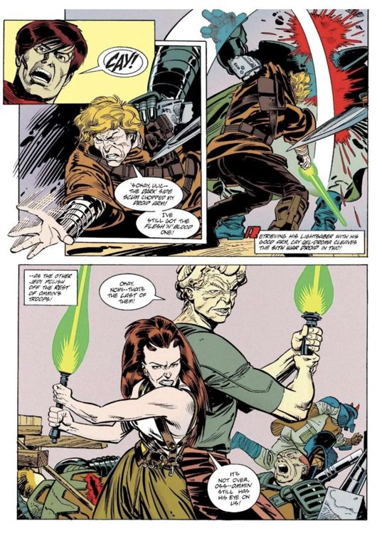
Our notes: `notes/materials/024-tales-of-the-jedi/freedon-nadd-uprising.md:157`

- Note (summary from our notes, not a quotation): | 1 | Warb Null vs Cay Qel-Droma and Oss Wilum | Iziz cortege | p8–10 | Warb Null takes the sarcophagi and retreats |
  — Source: Owner Material 024a — Tales of the Jedi: The Freedon Nadd Uprising #1–2 (1994): power-scaling notes.
Context: | # | Fight | Where | Pages | Outcome |
Our notes: `notes/materials/024-tales-of-the-jedi/freedon-nadd-uprising.md:271`

- Note (summary from our notes, not a quotation): 
  — Source: Owner Material 024a — Tales of the Jedi: The Freedon Nadd Uprising #1–2 (1994): power-scaling notes.
Our notes: `notes/materials/024-tales-of-the-jedi/freedon-nadd-uprising.md:285`

- Note (summary from our notes, not a quotation): 
  — Source: Owner Material 024a — Tales of the Jedi: The Freedon Nadd Uprising #1–2 (1994): power-scaling notes.
Our notes: `notes/materials/024-tales-of-the-jedi/freedon-nadd-uprising.md:287`

> bestial companion rushes out and quickly ends the
>
> confrontation by throwing off a force
>
> field that knocks the attackers back.
— Source: Owner Material 024d — Tales of the Jedi Companion (West End Games, 1996): power-scaling notes.
(Full sentence/passage taken from the source text on file: `research_primary_tales_of_the_jedi_weg_paged_txt`.)
Note (our notes, around the quote): Nomi saga summary (Thon, called "Oss's bestial companion" at this point in the story): Thon "quickly ends the confrontation by throwing off a force field that knocks the attackers back." Source: Tales of the Jedi Companion (WEG, 1996), p.12
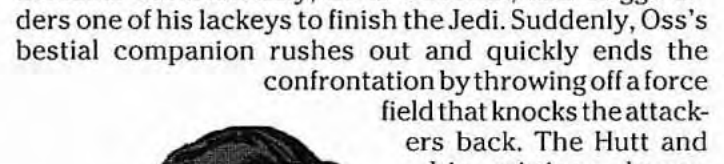
Our notes: `notes/materials/024-tales-of-the-jedi/tales-of-the-jedi-companion.md:81`

> It had never occurred to him to look deeper, to examine his life, to seek ways in which he could better the galaxy - whatever that might mean. But now he saw the truth. The time for reevaluation had come, and he would not allow himself to ignore his duties any longer. After more than a year of introspection and of observation of the galaxy around him, Oss decided to join the Jedi Knights. Master Thon immediately recognized Oss's aptitude for connecting with the Force, and the Jedi brought his new apprentice to the remote world of Ambria to begin his training. After five years, Oss had exceeded Thon's expectations, especially since the Vultan had begun his apprenticeship so late in life. When Tott Doneeta arrived to Ambria to ask assistance in the fight against the dark siders on Onderon, Oss - with the approval of Master Thon - accepted the invitation. OSS WILUM Type: Vultan Jedi Knight DEXTERITY 3D+2 Brawling parry 40+ I, dodge 40. IIghtsaber 50, melee parry 40+2. pulse-wave weapons 40...
— Source: Owner Material 024d — Tales of the Jedi Companion (West End Games, 1996): power-scaling notes; Narrative bio. POV: Narrative bio, about Oss Wilum.
(Excerpt widened 2026-11-17 to the relevant passage, word for word from research primary tales of the jedi WEG40082 (text copy `research_primary_tales_of_the_jedi_WEG40082_pdf_afa57d0500`).)
(Excerpt widened 2026-11-17 to the relevant passage, word for word from research primary tales of the jedi WEG40082 (text copy `research_primary_tales_of_the_jedi_WEG40082_pdf_afa57d0500`).)
Note (our notes, around the quote): Narrative bio: "After five years, Oss had exceeded Thon's expectations, especially since the Vultan had begun his apprenticeship so late in life." Source: Tales of the Jedi Companion (WEG, 1996), p.28
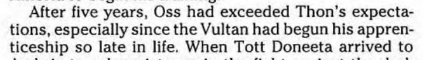
Our notes: `notes/materials/024-tales-of-the-jedi/tales-of-the-jedi-companion.md:166`

- Note (summary from our notes, not a quotation): RPG MECHANICS: Oss Wilum, Vultan. Force skills Control 2D+2, Sense 2D+1, Alter 2D. Lightsaber 5D. Powers include absorb/dissipate energy, accelerate another's healing, lesser Force shield. Force Points 2, Character Points 11. Source: Tales of the Jedi Companion (WEG, 1996), p.29
  — Source: Tales of the Jedi Companion (WEG, 1996), p.29 — Owner Material 024d — Tales of the Jedi Companion (West End Games, 1996): power-scaling notes.
Our notes: `notes/materials/024-tales-of-the-jedi/tales-of-the-jedi-companion.md:170`

- Note (summary from our notes, not a quotation): | Oss Wilum | 2D+2 | 2D+1 | 2D | 5D | p.29 |
  — Source: Owner Material 024d — Tales of the Jedi Companion (West End Games, 1996): power-scaling notes.
Context: | Character | Control | Sense | Alter | Lightsaber | Page |
Our notes: `notes/materials/024-tales-of-the-jedi/tales-of-the-jedi-companion.md:344`

- Note (summary from our notes, not a quotation): | #4 | 1–26 | Jedi Holocaust | Ambria, galaxy montage, Cron Cluster | Oss Wilum and Crado attack Thon; Sylvar claws Crado. Students murder their masters. Aleema rips a star's core out and kills Dace, Shoaneb and Qrrrl Toq; the Cron supernova kills Aleema and Crado. |
  — Source: Owner Material 024c — Tales of the Jedi: The Sith War #1–6 (1995–96): power-scaling notes.
Context: | Issue | PDF pages | Title | Setting | Main events |
Our notes: `notes/materials/024-tales-of-the-jedi/the-sith-war.md:18`

> NEVER TO UNDERESTIMATE THE POWER OF THE SITH! *(p27)*
— Source: Owner Material 024c — Tales of the Jedi: The Sith War #1–6 (1995–96): power-scaling notes.
Note (our notes, around the quote): Kemplex Nine ruse; Vanicus and Netus (p4–7). On Yavin 4 Oss Wilum resists, Exar crushes the Sith holocron and Sith spirits possess the students (p8–15). Coruscant assault: Mandalore steals the MK prototype, Ulic seizes the war room, Aleema betrays him (p16–23). Vodo, Nomi and the Jedi block Ulic (p24–25). Exar: "NEVER TO UNDERESTIMATE THE POWER OF THE SITH!" (p27).

Our notes: `notes/materials/024-tales-of-the-jedi/the-sith-war.md:31`

> THIS ONLY PROVES MY FEARS, EXAR KUN. THIS PLACE IS THICK WITH THE DARK SIDE.
>
> AND FOR SOME REASON, YOU ARE BLIND TO IT.
— Source: Owner Material 024c — Tales of the Jedi: The Sith War #1–6 (1995–96): power-scaling notes; Oss Wilum to Exar Kun. POV: Oss Wilum.
Note (our notes, around the quote): Oss Wilum to Exar Kun: "THIS ONLY PROVES MY FEARS, EXAR KUN. THIS PLACE IS THICK WITH THE DARK SIDE." "AND FOR SOME REASON, YOU ARE BLIND TO IT." Source: The Sith War #2, p12
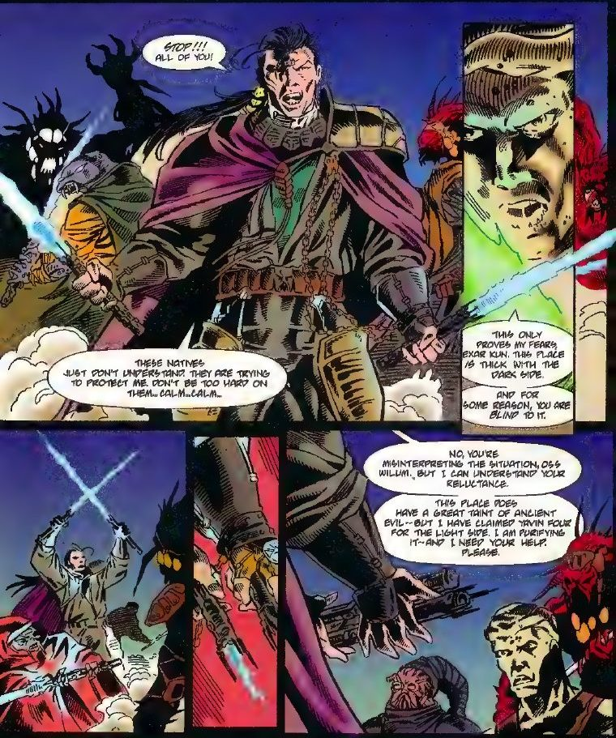
Our notes: `notes/materials/024-tales-of-the-jedi/the-sith-war.md:81`

- Note (summary from our notes, not a quotation): Battle meditation against Oss Wilum's dark-side lake beasts while carrying Vima. Source: The Sith War #4, p8
  — Source: The Sith War #4, p8 — Owner Material 024c — Tales of the Jedi: The Sith War #1–6 (1995–96): power-scaling notes.
Our notes: `notes/materials/024-tales-of-the-jedi/the-sith-war.md:133`

- Note (summary from our notes, not a quotation): Knocks Oss Wilum unconscious and claws Crado's face on Ambria. Source: The Sith War #4, p9
  — Source: Owner Material 024c — Tales of the Jedi: The Sith War #1–6 (1995–96): power-scaling notes.
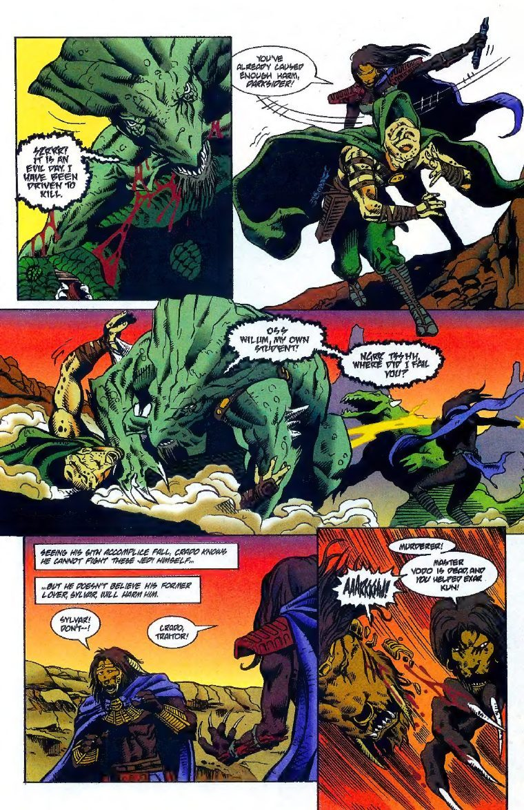
Our notes: `notes/materials/024-tales-of-the-jedi/the-sith-war.md:212`

- Note (summary from our notes, not a quotation): Flees Ambria after Sylvar claws his face. Source: The Sith War #4, p9–10
  — Source: Owner Material 024c — Tales of the Jedi: The Sith War #1–6 (1995–96): power-scaling notes.

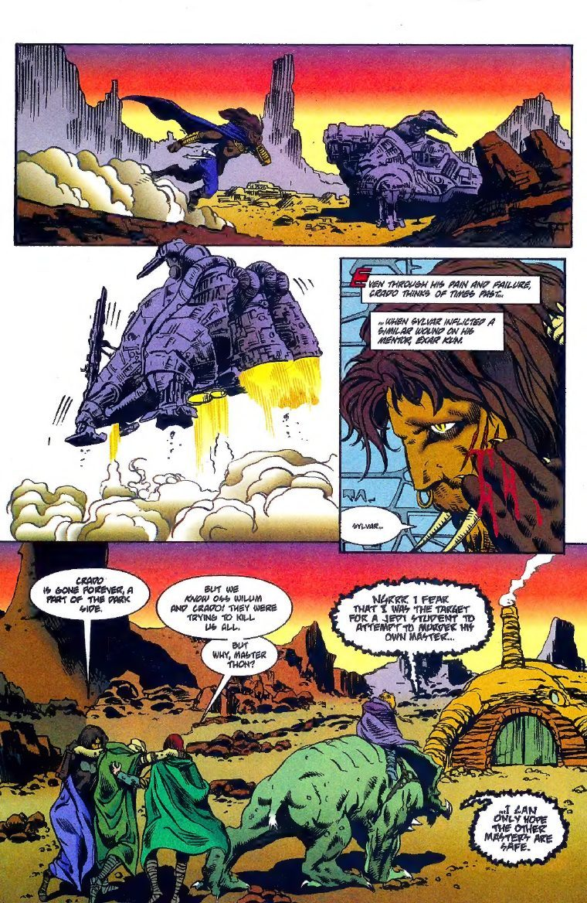
Our notes: `notes/materials/024-tales-of-the-jedi/the-sith-war.md:217`

- Note (summary from our notes, not a quotation): Resists Exar Kun's Yavin 4 pitch and cuts down attacking Massassi. Source: The Sith War #2, p10–11
  — Source: Owner Material 024c — Tales of the Jedi: The Sith War #1–6 (1995–96): power-scaling notes.
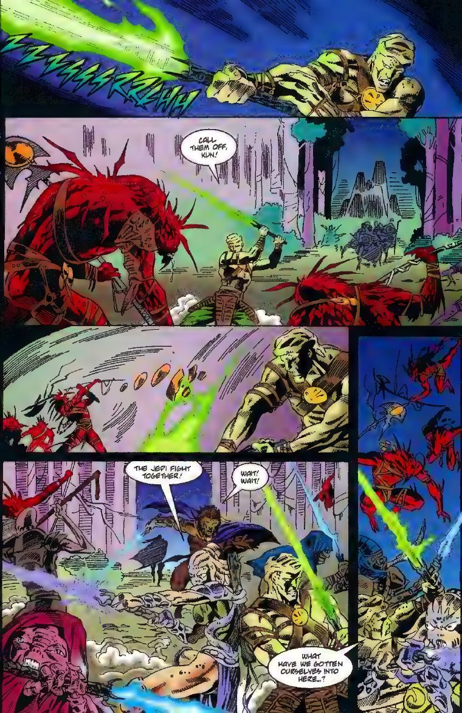
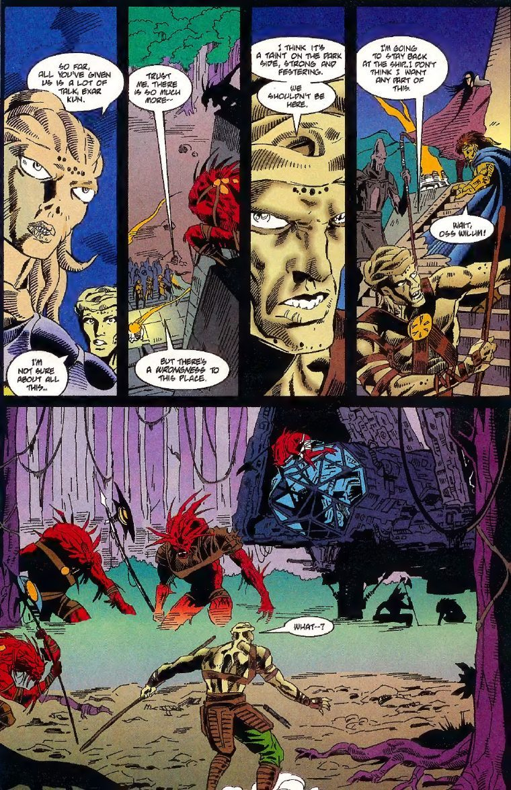
Our notes: `notes/materials/024-tales-of-the-jedi/the-sith-war.md:223`

- Note (summary from our notes, not a quotation): Possessed by a Sith spirit from the crushed holocron. Source: The Sith War #2, p15
  — Source: Owner Material 024c — Tales of the Jedi: The Sith War #1–6 (1995–96): power-scaling notes.
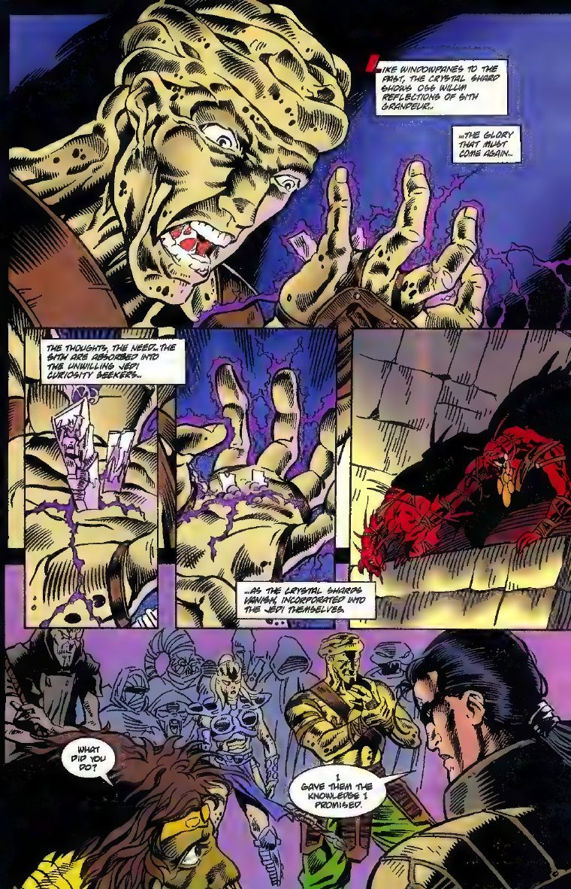
Our notes: `notes/materials/024-tales-of-the-jedi/the-sith-war.md:226`

> OSS WILUM USES HIS SITH POWERS TO CONTROL THE BEASTS...
> [fragment — full passage not on file]
>
> ...TO FORCE THEM TO KILL!
> [fragment — full passage not on file]
— Source: The Sith War #4, p6–8 — Owner Material 024c — Tales of the Jedi: The Sith War #1–6 (1995–96): power-scaling notes; Raises the dark-side lake beasts of Ambria against Thon.
Note (our notes, around the quote): Raises the dark-side lake beasts of Ambria against Thon: "OSS WILUM USES HIS SITH POWERS TO CONTROL THE BEASTS..." "...TO FORCE THEM TO KILL!" Source: The Sith War #4, p6–8
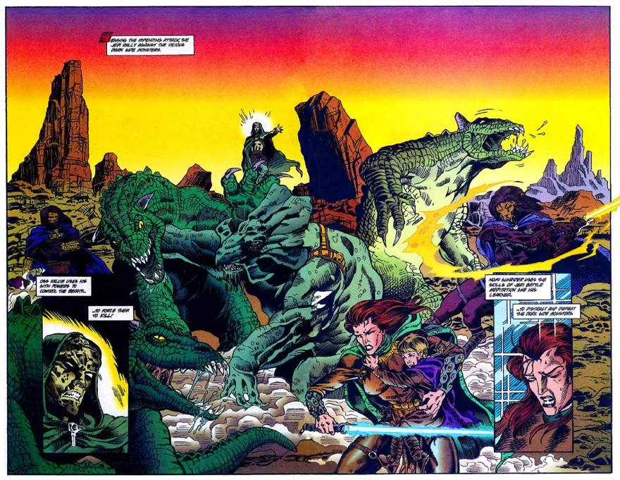
Our notes: `notes/materials/024-tales-of-the-jedi/the-sith-war.md:228`

> SZRRR! IT IS AN EVIL DAY. I HAVE BEEN DRIVEN TO KILL.
— Source: Owner Material 024c — Tales of the Jedi: The Sith War #1–6 (1995–96): power-scaling notes; Kills one of the Ambria lake beasts.
Note (our notes, around the quote): Kills one of the Ambria lake beasts: "SZRRR! IT IS AN EVIL DAY. I HAVE BEEN DRIVEN TO KILL." Source: The Sith War #4, p9

Our notes: `notes/materials/024-tales-of-the-jedi/the-sith-war.md:231`

- Note (summary from our notes, not a quotation): | 7 | Thon, Nomi, Sylvar vs Oss Wilum, Crado + beasts | Ambria | p5–10 (#4) | Jedi win; Crado flees | Nomi carrying Vima |
  — Source: Owner Material 024c — Tales of the Jedi: The Sith War #1–6 (1995–96): power-scaling notes.
Context: | # | Fight | Where | Pages (issue) | Outcome | Conditions |
Our notes: `notes/materials/024-tales-of-the-jedi/the-sith-war.md:275`

## Star Wars Saga Edition: Jedi Academy Training Manual (WotC, 2009): power-scaling and lore notes

> Ooroo === sp108 Oss WILLUM Oss Willum CL 10 Medium Vultan noble 1/Jedi 7/Jedi Knight 2 Force 3 Init +11; Senses Perception +9 Languages Basic, Bocce, Bothan, Dromnyr, Durese, Huttese, Tchuukthese Defenses Ref 23 (flat-footed 22, lightsaber defense 23), Fort 22, Will 21 hp 68; Threshold 22 Speed 6 squares Melee lightsaber +9 (2d8+5) Ranged by weapon +9 Base Atk +8; Grp +8] Special Actions Battle Meditation, Bolster Ally Force Powers Known (Use the Force +10): Force thrust, move object Abilities Str 10, Dex 13, Con 11, Int 15, Wis 9, Cha 10 Talents Battle Meditation, Block, Bolster Ally, Deflect, Lightsaber Defense Feats Force Sensitivity, Force Training (2), Linguist, Skill Focus (Knowledge [galactic lore], Pilot), Skill Training (Mechanics), Weapon Finesse (lightsabers), Weapon Proficiency (lightsabers, pistols, simple weapons) Skills Gather Information +10, Initiative +11, Knowledge (galactic lore) +12, Mechanics +12, Perception +9, Persuasion +10, Pilot +16, Use Computer +12, Use the Force +10 Possessions lightsaber (self-built), Jedi robes, utility belt Oss Willum begins his career as a simple trader, literally living out of his ship. The day he heroically rescues a Republic courier ship changes his life and opens him up to the Force. Oss eventually finds tutelage first under Jedi Master Garnoo and then under Jedi Master Thon.
>
> Oss is most noted for his ill-fated encounters with Exar Kun.
>
> Oss is most noted for his ill-fated encounters with Exar Kun. When Oss is sent to rescue Ulic Qel-Droma from Krath war droids on Deneba, he receives a vision that he would someday train under Exar Kun, and so he assumes that Kun is a great and powerful Jedi. Exar Kun convinces Oss and several other impressionable Jedi that the Jedi Order has denied them the key to victory in battle. Along with some of his companions, Oss travels with Exar Kun to Yavin 4, where Kun smashes a Sith holocron he had stolen from Jedi Master Odan-Urr. The fragments pierce Oss Willum’s flesh, causing him to be possessed by Sith spirits.
— Source: Chapter V: Instructors and Alumni; Exar Kun — Oss Willum — Exar Kun's recruits.
(Excerpt widened 2026-11-17 to the relevant passage, word for word from research primary jedi academy training manual jatm paged (text copy `research_primary_jedi_academy_training_manual_jatm_paged_txt_fea130719f`).)
(Excerpt widened 2026-11-17 to the relevant passage, word for word from research primary jedi academy training manual jatm paged (text copy `research_primary_jedi_academy_training_manual_jatm_paged_txt_fea130719f`).)
Note (our notes, around the quote): Exar Kun — Oss Willum — Exar Kun's recruits: "Exar Kun convinces Oss and several other impressionable Jedi that the Jedi Order has denied them the key to victory in battle." Source: Jedi Academy Training Manual, p.107
Our notes: `notes/materials/028-jedi-academy-training-manual/05-ch5-instructors-and-alumni.md:92`

> Oss eventually finds tutelage first under Jedi Master Garnoo and then under Jedi Master Thon.
>
> Oss is most noted for his ill-fated encounters with Exar Kun. When Oss is sent to rescue Ulic Qel-Droma from Krath war droids on Deneba, he receives a vision that he would someday train under Exar Kun, and so he assumes that Kun is a great and powerful Jedi. Exar Kun convinces Oss and several other impressionable Jedi that the Jedi Order has denied them the key to victory in battle. Along with some of his companions, Oss travels with Exar Kun to Yavin 4, where Kun smashes a Sith holocron he had stolen from Jedi Master Odan-Urr. The fragments pierce Oss Willum’s flesh, causing him to be possessed by Sith spirits. Oss commits unspeakable acts while under the influence of the Sith, but is eventually subdued by Jedi Knights Nomi Sunrider and Sylvar and restored to the path of the light side.
>
> Oss Willum Encounters Although a relatively unremarkable Jedi, Oss Willum gets caught up in many important events and could be found in the same places as Jedi Master Thon or Jedi Knight Nomi Sunrider. Heroes might encounter Oss during the time FMOLOCRON LESSON:
>
> VULTAN SPECIES TRAITS All Vultans share the following species traits.
— Source: Chapter V: Instructors and Alumni; Exar Kun — Oss Willum — the smashed holocron.
(Excerpt widened 2026-11-17 to the relevant passage, word for word from research primary jedi academy training manual jatm paged (text copy `research_primary_jedi_academy_training_manual_jatm_paged_txt_fea130719f`).)
(Excerpt widened 2026-11-17 to the relevant passage, word for word from research primary jedi academy training manual jatm paged (text copy `research_primary_jedi_academy_training_manual_jatm_paged_txt_fea130719f`).)
Note (our notes, around the quote): Exar Kun — Oss Willum — the smashed holocron: "Oss travels with Exar Kun to Yavin 4, where Kun smashes a Sith holocron he had stolen from Jedi Master Odan-Urr. The fragments pierce Oss Willum's flesh, causing him to be possessed by Sith spirits." Source: Jedi Academy Training Manual, p.107
Our notes: `notes/materials/028-jedi-academy-training-manual/05-ch5-instructors-and-alumni.md:94`

## The Complete Star Wars Encyclopedia, Vol. III (P–Z)

- Note (summary from our notes, not a quotation): Page contents: 1012 words, 22 paragraphs | headings/entries: Wild Knights; Wild Space; Wiley; Wilkadon; Will, the; Willard, Commander Vanden; Willems, Rorf; Williams, Antidar; Wilum, Oss; Wimateeka; Windsloe, Barthalemew; Windu, Mace
  — Source: scan pages 321–360.
Our notes: `notes/materials/032-complete-star-wars-encyclopedia-vol-3/08-v3-scan-321-360.md:123`

## Power of the Jedi Sourcebook (d20, 2002)

- Note (summary from our notes, not a quotation): Page contents: 733 words, 22 paragraphs | headings/entries: Tott Doneeta, Jedi Knight; Oss Wilum, Jedi Knight
  — Source: Chapter Six: Jedi traditions and famous Jedi.
Our notes: `notes/materials/033-power-of-the-jedi-sourcebook/06-ch6-jedi-traditions.md:89`

> They defeated Oss in combat, but Master Thon, who drove the gangsters off, spared the young Jedi's life.
— Source: Chapter Six: Jedi traditions and famous Jedi; Oss Wilum; Master Thon.
Note (our notes, around the quote): Oss Wilum; Master Thon: "They defeated Oss in combat, but Master Thon, who drove the gangsters off, spared the young Jedi's life." Source: Power of the Jedi Sourcebook, p.106
Our notes: `notes/materials/033-power-of-the-jedi-sourcebook/06-ch6-jedi-traditions.md:100`

## Sourcebooks/The New Jedi Order Sourcebook.pdf [Star Wars Roleplaying Game (d20, 2000)] (scan pages 121–162)

- Note (summary from our notes, not a quotation): Page contents: 668 words, 15 paragraphs | headings/entries: STAR BY STAR; Minor Ce Of; Wayland( )Bimmis Alderaan 5 ( \is n; Arkania; Hapes Consortium; Cron Drift Yag'Dhul Oss Antar; C)B inn; Chalacta; Or} Malastare Toydaria Umgul; Naboo Bothawui; Gamorr; Tatooine; Progress of the Invasion
  — Source: Sourcebooks/The New Jedi Order Sourcebook.pdf [Star Wars Roleplaying Game.
Our notes: `notes/materials/037-sw-d20-folder/049-the-new-jedi-order-sourcebook-scan-121-162.md:87`

# Debate and forum claims (unverified)

Forum posts, Suspect Insight debates and Discord debates, respect threads, and verdicts. These are posters' arguments or quotations they typed; none is checked against the book here unless the entry says so.

## Thon (Darthor) vs Yarael Poof (XanNotZan)

- Note (summary from our notes, not a quotation): Thon covered ~5 m when Oss fell (comic panel), so he would charge at the start. He can wield a lightsaber with all 4 arms.
  — Source: Thon (Darthor) vs Yarael Poof (XanNotZan) — https://www.suspectinsightforums.com/t4518-ss-arena-of-the-unknowns-thon-darthor-vs-yarael-poof-xannotzan.
Posted by: not named in our notes (see thread/notes link).
Context: II. Combat:
Our notes: `suspect-insight/debates/051-thon-vs-yarael-poof.md:57`

> However, in areas with intense radiation, Gotals suffer a·1 0 penalty tosearch because their senses are overwhelmed by radiation static. Mood Detection: Because of their skills at reading the electromag· netic auras of others, Gotals receive bonuses (or penalties) when engaging in interactive skills with other characters. The Gotal makes a Moderate Perception roll and adds the following bonus to all Perception skills when making opposed rolls for the rest of that encounter. Roll Misses Difficulty By 6 or more 2-5 I Roll Beats Difficulty By 0-7 8-14 15 or more Penalty ·3D -20 ·ID Bonus ID 2D 3D TH"E]EDJ-- _ L ' - '_..J ~- ".- 25 hI"'!."fE'R- 1l<lSY'RlS tOhlIN<? &/ltK FOR /l10Ae1 tfOW WI! W!L.L f'/4tf'f 'fOAli1HElt', A" MP,t,.o1l!lt 1-NV AI"l'1retl'fftEr Thon's homestead, Bogga's minions engaged Oss and Thon in a fierce battle for the crystals. When Oss fell beneath the onslaught. Thon charged forward. throwing off a powerful field of Force energy that knocked the attackers back. Suddenly afraid of the ability possessed by this unexpected combatant. Bogga and his lackeys retreated and escaped on the Hutt's sail barge back to the Dreadnaught Enforcer One, which remained in orbit during the confrontation. For the next several months. Master Than ignored Nomi, leaving her to work through her grief over her husband's untimely death, and to ponder what form her new life would take.
>
> TOTJ Companion
> [fragment — full passage not on file]
— Source: Thon (Darthor) vs Yarael Poof (XanNotZan) — https://www.suspectinsightforums.com/t4518-ss-arena-of-the-unknowns-thon-darthor-vs-yarael-poof-xannotzan.
(Excerpt widened 2026-11-17 to the relevant passage, word for word from research primary tales of the jedi WEG40082 (text copy `research_primary_tales_of_the_jedi_WEG40082_pdf_afa57d0500`).)
(Excerpt widened 2026-11-17 to the relevant passage, word for word from research primary tales of the jedi WEG40082 (text copy `research_primary_tales_of_the_jedi_WEG40082_pdf_afa57d0500`).)
(Fragment completed 2026-11-17: full sentence/passage matched word for word in the source text on file: `research_primary_tales_of_the_jedi_WEG40082_pdf_afa57d0500`.)
Context: I2 — Source line: Sources:
Posted by: not named in our notes (see thread/notes link).
Our notes: `suspect-insight/debates/051-thon-vs-yarael-poof.md:505`

## Darth Caedus (DC77) vs Exar Kun (AncientPower)

- Note (summary from our notes, not a quotation): Yet Tott, Nomi, Oss, Cay and Qrrl together could not subdue amulet-Ulic.
  — Source: Darth Caedus (DC77) vs Exar Kun (AncientPower) — https://www.suspectinsightforums.com/t568-ss-darth-caedus-dc77-vs-exar-kun-ladykulvax.
Posted by: not named in our notes (see thread/notes link).
Context: Nomi Sunrider chain:
Our notes: `suspect-insight/debates/059-darth-caedus-vs-exar-kun.md:29`

## Sylvar respect thread — respect-thread notes

- Note (summary from our notes, not a quotation): Sylvar one-shots Oss Wilum.
  — Source: SI respect-thread directory: Sylvar respect thread — https://www.suspectinsightforums.com/t3864-sylvar-respect-thread.
Posted by: not named in our notes (see thread/notes link).
Our notes: `suspect-insight/respect-threads/sylvar.md:66`

- Note (summary from our notes, not a quotation): [image: https://i.servimg.com/u/f86/20/26/12/82/sith_b10.jpg]
  — Source: SI respect-thread directory: Sylvar respect thread — https://www.suspectinsightforums.com/t3864-sylvar-respect-thread.
Posted by: not named in our notes (see thread/notes link).
Context: Sylvar one-shots Oss Wilum.
Our notes: `suspect-insight/respect-threads/sylvar.md:67`

## Ulic Qel-Droma Respect Thread — respect-thread notes

- Note (summary from our notes, not a quotation): For a strength feat, it also took three Jedi (Oss Willum, Tott Doneeta, and Cay) to hold him down IIRC.
  — Source: SI respect-thread directory: Ulic Qel-Droma Respect Thread — https://comicvine.gamespot.com/profile/i_like_swords/blog/ulic-qel-droma-respect-thread/101350/.
Posted by: not named in our notes (see thread/notes link).
Our notes: `suspect-insight/respect-threads/ulic-qel-droma.md:172`
