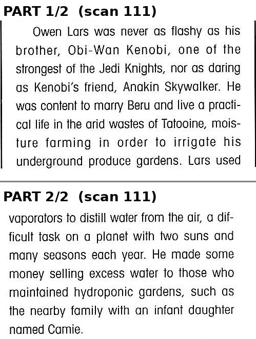

# Owen Lars

- **Aliases:** —
- **Era:** —
- **Continuity:** default Legends; entries present for: Legends
- **Research tier:** untiered (not listed as INTRO/DEEP/MASTERY in legends-feats.md)
- **Entries:** 29 (17 with quotations; 0 quotations extended to the full sentence/passage from the source text on file; 11 marked as fragments). Rebuilt 2026-11-17 from 34 old entries; old file: `characters/_bak/owen-lars.md.bak-20261117`.
- **How to read:** each entry is the quotation in full (block quote), then its source and point of view. "Note" lines are summaries from our notes, not quotations. `[fragment — full passage not on file]` means the source text is not on the box, so only the words in our notes are shown. Debate and forum material is in the last section and is unverified.

# LEGENDS (Legends / EU — main focus)

## Sourcebooks/Rebellion Era Sourcebook.pdf [Star Wars Roleplaying Game (d20, 2000)] (scan pages 1–60)

> When the droids R2-D2 and C-3P0 fell into possession of Owen Lars, destiny began to catch up with Luke, He discovered that the droids were on a mission for a beautiful young woman who sought the help of Obi-Wan Kenobi.
— Source: Sourcebooks/Rebellion Era Sourcebook.pdf [Star Wars Roleplaying Game (d20; Luke Skywalker; Obi-Wan Kenobi.
Note (our notes, around the quote): Luke Skywalker; Obi-Wan Kenobi: "When the droids R2-D2 and C-3P0 fell into possession of Owen Lars, destiny began to catch up with Luke, He discovered that the droids were on a mission for a beautiful young woman who sought the help of Obi-Wan Kenobi." Source: *Rebellion Era Sourcebook* (SWRPG d20), scan p.39
Our notes: `notes/materials/037-sw-d20-folder/043-rebellion-era-sourcebook-scan-001-060.md:233`

## Star Wars Gamer/Star Wars Gamer 08.pdf [Star Wars Roleplaying Game (d20, 2000)] (scan pages 61–112)

- Note (summary from our notes, not a quotation): Page contents: Star Wars Insider preview: interviews with Joel Edgerton (Owen Lars), Bonnie Piesse (Beru Whitesun) and Billy Dee Williams; the 501st Legion; Rick McCallum on Attack of the Clones (hand-read)
  — Source: Star Wars Gamer/Star Wars Gamer 08.pdf [Star Wars Roleplaying Game (d20,.
Our notes: `notes/materials/037-sw-d20-folder/057-star-wars-gamer-08-scan-061-112.md:360`

## Sourcebooks/Scavenger's Guide to Droids.pdf [Star Wars Roleplaying Game Saga Edition (2007)] (scan pages 1–60)

> A tactical droid commanding battle droids
> [fragment — full passage not on file]
>
> Owen Lars at the Jawa droid market. *(hand-read)*
— Source: Sourcebooks/Scavenger's Guide to Droids.pdf [Star Wars Roleplaying Game S.
Note (our notes, around the quote): Page contents: Pro-Droid Opinion: Society for All Sentients (oil-splashing protests on Senate steps, freeing droids). Droids as Property: no more rights than a ship, a blaster or a spoon; rapport vs impersonal masters; droids always help other droids. Art captions: "A tactical droid commanding battle droids"; "Owen Lars at the Jawa droid market." (hand-read)
Our notes: `notes/materials/037-sw-d20-folder/724-scavengers-guide-to-droids-scan-001-060.md:259`

## Sourcebooks/The Force Unleashed Campaign Guide.pdf [Star Wars Roleplaying Game Saga Edition (2007)] (scan pages 61–120)

- Note (summary from our notes, not a quotation): Page contents: V-35 Courier (SoroSuub; Owen Lars's farm speeder) stat block. Zephyr-G Swoop stat block. Heavy Speeders; A-A5 Speeder Truck (Trast Heavy Transport). (hand-read)
  — Source: Sourcebooks/The Force Unleashed Campaign Guide.pdf [Star Wars Roleplaying.
Our notes: `notes/materials/037-sw-d20-folder/729-the-force-unleashed-campaign-guide-scan-061-120.md:347`

## Star Wars Insider #51 (2000)

> orchestrated by the fallen Anakin Skywalker
> [fragment — full passage not on file]
— Source: Star Wars Insider #51 (2000); Page contents: New cast: Edgerton (Owen Lars; search.
Note (our notes, around the quote): Page contents: New cast: Edgerton (Owen Lars; search "orchestrated by the fallen Anakin Skywalker" cost Owen his life), Piesse (Beru), Csokas, Laga'aia, Doran. (hand-read)
Our notes: `notes/materials/038-star-wars-insider/051-ins051.md:203`

## Star Wars Insider #55 (2001)

> Dr. Jones, I Presume?
> [fragment — full passage not on file]
— Source: Star Wars Insider #55 (2001).
Note (our notes, around the quote): Page contents: Rebel Rumblings letters cont. from p. 6 (magazine p. 90): letters with editor's joking replies (Owen Lars is not Ben Kenobi's brother; Jar Jar Binks; Ewok films on video); "Dr. Jones, I Presume?" fan Indiana Jones costume photo; James Earl Jones star-sighting letter header (letter-writer and fan names omitted). (hand-read)
Our notes: `notes/materials/038-star-wars-insider/055-ins055.md:458`

## Star Wars Insider #57 (2001)

- Note (summary from our notes, not a quotation): Page contents: Star News end and "Next Issue: 58" box (magazine p. 25): Return to Tatooine - Joel Edgerton (Owen Lars) and Bonnie Piesse (Beru Whitesun); Billy Dee Williams (Lando Calrissian); new column Behind the Magic (Watto at ILM); Celebration II; "2¢ = $10? Sometimes..." reader-survey box; Star Wars Gamer #7 ad ("Living on the Fringe", Jag Fel among the Chiss, Bartyn's Landing, Secrets of Mos Eisley); Neeson in K-19: The Widowmaker with Harrison Ford (Han Solo). (hand-read)
  — Source: Star Wars Insider #57 (2001).
Our notes: `notes/materials/038-star-wars-insider/057-ins057.md:104`

## Star Wars Insider #58 (2002)

- Note (summary from our notes, not a quotation): Page contents: "Lars Attacks" interview with Joel Edgerton by Scott Chernoff (magazine p. 28): intro on young Owen Lars - in A New Hope he feared Luke would follow his father; Attack of the Clones reveals Owen's connection to Anakin Skywalker. (hand-read)
  — Source: Star Wars Insider #58 (2002). POV: Page contents, about Owen Lars.
Our notes: `notes/materials/038-star-wars-insider/058-ins058.md:149`

> From the Australian countryside to the sands of Tatooine - meet the lifelong Star Wars fan who grew up to become Luke Skywalker's future uncle, Owen Lars, in Attack of the Clones. *(hand-read)*
— Source: Star Wars Insider #58 (2002). POV: Page contents, about Owen Lars.
Note (our notes, around the quote): Page contents: "Lars Attacks" title spread (magazine p. 29): pixelated portrait of Phil Brown; deck "From the Australian countryside to the sands of Tatooine - meet the lifelong Star Wars fan who grew up to become Luke Skywalker's future uncle, Owen Lars, in Attack of the Clones." (hand-read)
Our notes: `notes/materials/038-star-wars-insider/058-ins058.md:158`

> Most people talk about Uncle Owen as this awful character because he's trying to stop Luke from fulfilling his dreams, that he was a bit of a dream-squasher. But I never thought of him like that. I always saw him as a father figure that was trying to act in Luke's best interests.
— Source: Star Wars Insider #58 (2002).
Note (our notes, around the quote): Owen Lars; Luke Skywalker — entry/section: Joel Edgerton on Owen as a father figure: ""Most people talk about Uncle Owen as this awful character because he's trying to stop Luke from fulfilling his dreams, that he was a bit of a dream-squasher. But I never thought of him like that. I always saw him as a father figure that was trying to act in Luke's best interests." —Joel Edgerton, Star Wars Insider 58, p. 30" Source: *Star Wars Insider #58* (2002), scan p.24
Our notes: `notes/materials/038-star-wars-insider/058-ins058.md:165`

> When we find Owen as a young man, he obviously hasn't had too much experience in the way of what eventually happened with Anakin and Obi-Wan. I wanted to bring him back to a nice and somewhat eager country boy. He was probably curious about the world outside, and I think he's eager to understand and be told stories of places.
— Source: Star Wars Insider #58 (2002).
Note (our notes, around the quote): Owen Lars; Darth Vader (Anakin Skywalker); Obi-Wan Kenobi — entry/section: Joel Edgerton on playing the young Owen: ""When we find Owen as a young man, he obviously hasn't had too much experience in the way of what eventually happened with Anakin and Obi-Wan. I wanted to bring him back to a nice and somewhat eager country boy. He was probably curious about the world outside, and I think he's eager to understand and be told stories of places." —Joel Edgerton, Star Wars Insider 58, p. 30" Source: *Star Wars Insider #58* (2002), scan p.24
Our notes: `notes/materials/038-star-wars-insider/058-ins058.md:167`

> That's a good thing about going back to him as a young man: This is perhaps prior to any of that heavy experience. I'm sure he was a bit of a Luke himself—working away in this country town and wondering whether or not to go explore.
— Source: Star Wars Insider #58 (2002).
Note (our notes, around the quote): Owen Lars; Luke Skywalker — entry/section: Joel Edgerton on Owen before the hard years: ""That's a good thing about going back to him as a young man: This is perhaps prior to any of that heavy experience. I'm sure he was a bit of a Luke himself—working away in this country town and wondering whether or not to go explore." —Joel Edgerton, Star Wars Insider 58, p. 31" Source: *Star Wars Insider #58* (2002), scan p.25
Our notes: `notes/materials/038-star-wars-insider/058-ins058.md:174`

> Australian actor Joel Edgerton takes on the role of Owen Lars in Episode II. Photo by Sue Adler. *(hand-read)*
— Source: Star Wars Insider #58 (2002). POV: Page contents, about Owen Lars.
Note (our notes, around the quote): Page contents: "Lars Attacks" cont. (magazine p. 34): a friend put all of Phil Brown's lines on a CD so he could learn the rhythm and accent; Owen's hands-on-hips posture came from the heavy costume; first day on set exchanged the C-3PO purchase dialogue with Anthony Daniels, R2-D2 milling around; shooting at the original Lars homestead location in Tunisia. Full-length costume photo with caption "Australian actor Joel Edgerton takes on the role of Owen Lars in Episode II. Photo by Sue Adler." (hand-read)
Our notes: `notes/materials/038-star-wars-insider/058-ins058.md:197`

## Star Wars Insider #60 (2002)

- Note (summary from our notes, not a quotation): Page contents: "Inside Attack of the Clones: Sandcrawlers at Sunset" (magazine p. 18): blue box "Miniature Jawa Camp" (Brian Gernand and model-maker Adam Savage, who built the three-foot-square miniature in 14 hours and imagined the tent as a staging yard for sandcrawler repairs; the tent camp was designed years ago by ILM but never used, a miniature appears in From Star Wars to Indiana Jones); key: 1 Owen Lars' swoop, 2 Anakin Skywalker, 3 Jawa Chieftain, 4 Sandcrawler Maintainance Tent (yellow: high enough to house an entire sandcrawler; several Jawa clans share its components and store them aboard their sandcrawlers during the storm season), 5 Salvage Crane (blue: previously seen only in Star Wars: Incredible Cross-Sections), 6 miniature camp debris. (hand-read)
  — Source: Star Wars Insider #60 (2002). POV: Page contents, about Owen Lars.
Our notes: `notes/materials/038-star-wars-insider/060-ins060.md:133`

- Note (summary from our notes, not a quotation): Page contents: Lucas interview continued (magazine p. 55), section "Love & War": Episode II as the darker middle act of a three-act play; comparison with The Empire Strikes Back; toned-down humor; the opening as a Maltese Falcon-style mystery. Captions: the extended Lars family around the dining table with visitors (Padmé, Anakin, Cliegg Lars, Owen Lars, Beru Whitesun); Star Wars: Episode II Attack of the Clones director George Lucas (photo by Tobi Corney); Beru Whitesun and her boyfriend Owen Lars share news with Padmé Amidala and Anakin Skywalker. (hand-read)
  — Source: Star Wars Insider #60 (2002).
Our notes: `notes/materials/038-star-wars-insider/060-ins060.md:394`

## Star Wars Insider #63 (2002)

- Note (summary from our notes, not a quotation): Page contents: Q&A with Pablo Hidalgo: Force lightning is inherently dark side; C-3PO's memory and Owen Lars; Padmé's surname Naberrie vs. Amidala; "Utinni!"; why wampas evade life-form scanners. (hand-read)
  — Source: Star Wars Insider #63 (2002).
Our notes: `notes/materials/038-star-wars-insider/063-ins063.md:575`

## Star Wars Insider #79 (2005)

- Note (summary from our notes, not a quotation): Page contents: Best of Hyperspace: Webcam (pickup shoots at Shepperton Studios) and Photoreceptor archive photos (Fisher and Hamill's chasm swing; Chewbacca in Cloud City; Gary Kurtz and a cut Jedi test; Vader's single viewport set; Bob Anderson dueling Hamill; Owen Lars and the Jawas; Fisher on the sail barge), edited by Paul Ens, content by Pablo Hidalgo and Bonnie Burton; crossword answers. (hand-read)
  — Source: Star Wars Insider #79 (2005).
Our notes: `notes/materials/038-star-wars-insider/079-ins079.md:567`

## Star Wars Insider #82 (2005)

> After all [Obi-Wan] lost, he still chose to protect the children of the man who tried to kill him in the hopes of one day restoring peace,
> [fragment — full passage not on file]
>
> Yet Owen still treats him with contempt, and a whole empire wants to kill him.
— Source: Star Wars Insider #82 (2005).
Note (our notes, around the quote): Obi-Wan Kenobi; Owen Lars; Darth Maul — entry/section: Bad blood with Uncle Owen: ""After all [Obi-Wan] lost, he still chose to protect the children of the man who tried to kill him in the hopes of one day restoring peace," McBride points out. "Yet Owen still treats him with contempt, and a whole empire wants to kill him." —Aaron McBride, Star Wars Insider 82, p. 27" Source: *Star Wars Insider #82* (2005), scan p.27
Our notes: `notes/materials/038-star-wars-insider/082-ins082.md:175`

> We started the studio work here the first day for Episode IV,
> [fragment — full passage not on file]
>
> I think it was the kitchen. You know, where Aunt Beru is in there cooking and Owen comes in looking for Luke.
— Source: Star Wars Insider #82 (2005).
Note (our notes, around the quote): Owen Lars; Beru Lars; Luke Skywalker — entry/section: Elstree Stage 8: the Lars kitchen: ""We started the studio work here the first day for Episode IV," Lucas says, looking around at the dark interior of Stage 8. "I think it was the kitchen. You know, where Aunt Beru is in there cooking and Owen comes in looking for Luke." —George Lucas, Star Wars Insider 82, p. 76" Source: *Star Wars Insider #82* (2005), scan p.76
Our notes: `notes/materials/038-star-wars-insider/082-ins082.md:494`

## Star Wars Insider #94 (2007)

> He was a straight-forward curmudgeon - which I am anyway, so it was easy for me to play. I've been a curmudgeon a long time.
— Source: Star Wars Insider #94 (2007); Owen Lars — entry/section: Curmudgeon.
Note (our notes, around the quote): Owen Lars — entry/section: Curmudgeon: ""He was a straight-forward curmudgeon - which I am anyway, so it was easy for me to play. I've been a curmudgeon a long time." —Phil Brown, Star Wars Insider 94, p. 33" Source: *Star Wars Insider #94* (2007), scan p.33
Our notes: `notes/materials/038-star-wars-insider/094-ins094.md:319`

## Star Wars Insider #105 (2008)

- Note (summary from our notes, not a quotation): Page contents: Visual commentary: Sarlacc's rich EU life; sand clogged Sarlacc hydraulics (Anakin's sand line quoted); rough draft "Sloth Pit"; Dagobah gnarltrees; ROTJ novelization has Obi-Wan say he and Owen Lars are brothers (overturned by prequels); Tydirium capture tales in X-Wing Alliance and Rogue Leader, tydirium ore used in phrik. (hand-read)
  — Source: Star Wars Insider #105 (2008).
Our notes: `notes/materials/038-star-wars-insider/105-ins105.md:104`

## Star Wars Insider #131 (2012)

- Note (summary from our notes, not a quotation): Page contents: Fry essay: the prequels recast Owen Lars as protective; Sidious seeks a Skywalker apprentice in both trilogies; Ian McDiarmid's Palpatine; author bio (family details omitted). (hand-read)
  — Source: Star Wars Insider #131 (2012).
Our notes: `notes/materials/038-star-wars-insider/131-ins131.md:233`

## Star Wars Insider #153 (2014)

> written and directed by Owen Lars
> [fragment — full passage not on file]
— Source: Star Wars Insider #153 (2014).
Note (our notes, around the quote): Page contents: Full-page art (viewed): "Revenge of the Sandpeople" pulp-movie poster parody (Kenobi, Skywalker; "written and directed by Owen Lars"). (hand-read)
Our notes: `notes/materials/038-star-wars-insider/153-ins153.md:334`

## Star Wars: Legacy (Dark Horse, 2006–2010) single issues #20–#50, hand-read

- Note (summary from our notes, not a quotation): New roster entries: Beru Lars, Ranulf Yage (mentioned; Gunner's father). Already present: Luke Skywalker, Owen Lars, Ahnah Vos.
  — Source: Star Wars: Legacy #39 — "Tatooine, Part Three of Four" (Aug 2009).
Our notes: `notes/materials/039-legacy-2006/legacy-39.md:6`

> "THOSE CONDENSORS OVER ON THE SOUTH RIDGE ARE GOING TO NEED LOOKING AT TOMORROW, BOYS. THEY DON'T TEND THEMSELVES." (Owen Lars, vision)
>
> "PLEASE TELL ME I'M DREAMING." (Cade)
>
> "I HOPE NOT -- THIS LOOKS AWFULLY GOOD." (Luke)
> [fragment — full passage not on file]
— Source: Star Wars: Legacy #39 — "Tatooine, Part Three of Four" (Aug 2009). POV: Owen Lars.
Context: (Lore: the "old moisture farm" shelter is the Lars homestead (p11). Luke appears as his young farmboy self.)
Our notes: `notes/materials/039-legacy-2006/legacy-39.md:92`

## Star Wars Visual Dictionaries, Episodes I–VI (DK, 1998–2005) + The Phantom Menace Expanded Visual Dictionary (DK, 2012)

> A YOUNG FARMBOY living on the remote desert planet Tatooine
> [fragment — full passage not on file]
>
> A gift from another era, Luke's lightsaber is the legacy of his father Anakin, a former Jedi Knight of the Old Republic and a warrior who fought in the Clone Wars
> [fragment — full passage not on file]
>
> Luke has a natural ability with the saber and begins to learn rapidly from his mentor Ben Kenobi.
— Source: Star Wars: The Visual Dictionary (DK, 1998; Episodes IV–VI): hand-read notes; p08-09 Luke Skywalker.
Note (our notes, around the quote): p08-09 Luke Skywalker: "A YOUNG FARMBOY living on the remote desert planet Tatooine"; homestead (garage roof, courtyard, moisture vaporator); Tosche power station in Anchorhead. Lightsaber [KEY]: "A gift from another era, Luke's lightsaber is the legacy of his father Anakin, a former Jedi Knight of the Old Republic and a warrior who fought in the Clone Wars"; "Luke has a natural ability with the saber and begins to learn rapidly from his mentor Ben Kenobi." DATA FILE: Biggs Darklighter (graduated with a commission on the freighter Rand Ecliptic; reunited at Yavin 4); sandstorms. Owns a T-16 skyhopper, "blasting womp rats" in Beggar's Canyon, Diablo Cut and the Stone Needle. X-34 landspeeder (three turbines, cracked windshield). Aunt Beru, Uncle Owen Lars.
Our notes: `notes/materials/047-visual-dictionaries/vd46-ep4-6.md:14`

> regarded as slaves and third-class citizens
> [fragment — full passage not on file]
>
> Her programming corrupted ... employing bizarre forms of droid torture
> [fragment — full passage not on file]
— Source: Star Wars: The Visual Dictionary (DK, 1998; Episodes IV–VI): hand-read notes; p62-63 Droids: droids.
Note (our notes, around the quote): p62-63 Droids: droids "regarded as slaves and third-class citizens". WED-15-77 Treadwell; CZ-1 (secretary droid, Stacchati); AV-6R7 (Imperial V-series supervisor building the second Death Star for Moff Jerjerrod; deprived of arms for failing to track a faulty power droid); EV-9D9 ("Her programming corrupted ... employing bizarre forms of droid torture"); 8D8 (Verpine-made, lobotomized and reprogrammed for Jabba's torture chamber); LIN-V8K (mining droid; refurbished by Jawas); WED 15 "Septoid 2" (Fixer's Treadwell, Toshi power station, Anchorhead). DATA FILE: most droids have memory banks periodically erased; R5-D4 "Red" blew his motivator so Owen Lars would take R2 instead.
Our notes: `notes/materials/047-visual-dictionaries/vd46-ep4-6.md:57`

## 1995 source-specific claims

- Note (summary from our notes, not a quotation): Owen Lars was never as flashy as his brother, Obi-Wan Kenobi, one of the strongest of the Jedi Knights, nor as daring as Kenobi's friend, Anakin Skywalker. He was content to marry Beru and live a practical life in the arid wastes of Tatooine, moisture farming in order to irrigate his underground produce gardens. Lars used vaporators to distill water from the air, a difficult task on a planet with two suns and many seasons each year. He made some money selling excess water to those who maintained hydroponic gardens, such as the nearby family with an infant daughter named Camie.
  — Source: The Essential Guide to Characters (Andy Mangels, Del Rey, 1995), printed p.102, scan p.111. Dated 1995 claim that Owen is Obi-Wan's brother. The Camie sentence is the 1995 guide's claim. Not later Legends and not a power feat..
Our notes: `notes/materials/147-essential-guide-to-characters-1995/egc-labria-through-ephant.md`

# Debate and forum claims (unverified)

Forum posts, Suspect Insight debates and Discord debates, respect threads, and verdicts. These are posters' arguments or quotations they typed; none is checked against the book here unless the entry says so.

## Darth Caedus (EmperorCaedus) vs Anakin Skywalker (Vaelias)

> **"There is a hierarchy--the movies, [film adult] novelizations, [film] radio dramas come first****.** **Then everything else**. If something in a novelization contradicts the movies, then we defer to the movies. IE, the ROJ novelization says that Obi-Wan and Owen Lars were brothers. This wasn't in the movie, and has since been discounted. Maybe it was a cover they used at one point... who knows.
>
> The one area that's constantly in dispute are the Marvel comics and the David's middle grade books (The Glove of Darth Vader, et al). For these, if something ADDS to the universe, and does not contradict either already-established facts or SW sensibility, we accept it and add it to the lore. If it does, we disregard it. At the time these products were published, the idea of a continuous history hadn't been established.
— Source: Darth Caedus (EmperorCaedus) vs Anakin Skywalker (Vaelias) — https://www.suspectinsightforums.com/t4380-ss-darth-caedus-emperorcaedus-prez-vs-anakin-skywalker-vaelias.
Context: Q19 — Source: Sue Rostoni, StarWars.com Forums (2003) | Not only this but Lucas himself considers the Movie Novels part of his own canon, add that to the line edits and we have it pretty set in stone that the ROTS Novel is effectively G-Canon
Posted by: not named in our notes (see thread/notes link).
Our notes: `suspect-insight/debates/088-darth-caedus-vs-anakin-skywalker.md:366`; `suspect-insight/respect-threads/darth-vader--anakin-skywalker-pre-suit.md:564`
