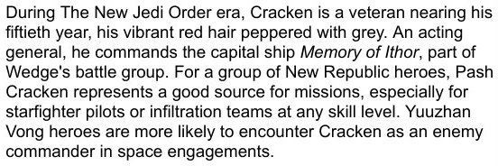
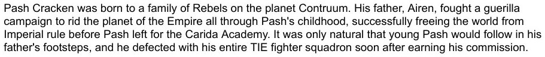
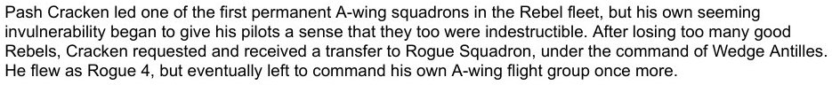

# Pash Cracken

- **Aliases:** Cracken
- **Era:** GCW–NJO
- **Continuity:** default Legends; entries present for: Canon, Legends
- **Research tier:** untiered (not listed as INTRO/DEEP/MASTERY in legends-feats.md)
- **Entries:** 36 (18 with quotations; 1 quotations extended to the full sentence/passage from the source text on file; 5 marked as fragments; 12 before the 2026-11-17 fragment fill). Rebuilt 2026-11-17 from 35 old entries; old file: `characters/_bak/pash-cracken.md.bak-20261117`.
- **How to read:** each entry is the quotation in full (block quote), then its source and point of view. "Note" lines are summaries from our notes, not quotations. `[fragment — full passage not on file]` means the source text is not on the box, so only the words in our notes are shown. Debate and forum material is in the last section and is unverified.

# LEGENDS (Legends / EU — main focus)

## The Complete Star Wars Encyclopedia, Vol. I (A–G)

- Note (summary from our notes, not a quotation): Page contents: 766 words, 39 paragraphs | headings/entries: Acceptance; Access Chute; Accolux Township; Accu, Paddy; Accuser; Accutronics; A-Cee; Ace Entertainment Corporation; Ace Squadron Pash Cracken's; Acey; Ac'fren Spur; Achillea
  — Source: scan pages 1–40.
Our notes: `notes/materials/030-complete-star-wars-encyclopedia-vol-1/00-v1-scan-001-040.md:134`

- Note (summary from our notes, not a quotation): Page contents: 1103 words, 33 paragraphs | headings/entries: Cowl Crucible; Coy, Admiral; Coynite; Crab, Finious; Cracken, General Airen; Cracken, Pash
  — Source: scan pages 161–200.
Our notes: `notes/materials/030-complete-star-wars-encyclopedia-vol-1/04-v1-scan-161-200.md:42`

## Sourcebooks/Rebellion Era Sourcebook.pdf [Star Wars Roleplaying Game (d20, 2000)] (scan pages 61–120)

- Note (summary from our notes, not a quotation): Page contents: Cracken: 'Every blaster in our hands is a blaster that's not pointing at us.'; Ackbar views pirates as beneath contempt (hand-read)
  — Source: Sourcebooks/Rebellion Era Sourcebook.pdf [Star Wars Roleplaying Game (d20.
Our notes: `notes/materials/037-sw-d20-folder/043-rebellion-era-sourcebook-scan-061-120.md:35`

## Star Wars Gamer/Star Wars Gamer 06.pdf [Star Wars Roleplaying Game (d20, 2000)] (scan pages 1–60)

- Note (summary from our notes, not a quotation): Page contents: Lieutenant Harme Kiela: spoiled Voss-born TIE interceptor ace, protégé of Air Marshal Von Tarsh; turned pirate to free Tarsh, foiled by Calrissian; escaped, on Cracken's Most Wanted list (hand-read)
  — Source: Star Wars Gamer/Star Wars Gamer 06.pdf [Star Wars Roleplaying Game (d20,.
Our notes: `notes/materials/037-sw-d20-folder/055-star-wars-gamer-06-scan-001-060.md:377`

## Star Wars Gamer/Star Wars Gamer 07.pdf [Star Wars Roleplaying Game (d20, 2000)] (scan pages 61–108)

- Note (summary from our notes, not a quotation): Page contents: Rebel Commandos scouts: Sergeant Junkin, Corporal Beezer, Corporal Midge, Corporal Delevar, Lieutenant Greeve, Chewbacca of Kashyyyk, Colonel Cracken (Tala 1), Lieutenant Blount (Tala 2) (hand-read)
  — Source: Star Wars Gamer/Star Wars Gamer 07.pdf [Star Wars Roleplaying Game (d20,.
Our notes: `notes/materials/037-sw-d20-folder/056-star-wars-gamer-07-scan-061-108.md:213`

## Characters/Pash Cracken.pdf [Star Wars Roleplaying Game Revised Core (d20, 2002)]

- Note (summary from our notes, not a quotation): Source: Wizards of the Coast Star Wars Roleplaying Game books, web enhancements, Living Force campaign modules and articles (2000–2010), from the owner's "Star Wars D20" Drive folder (only the three edition subfolders; "General" was not read, as instructed). Secondary source (licensed Legends reference). Scan OCR'd on the box; the scan stays box-only and is not published.
  — Source: ** Wizards of the Coast Star Wars Roleplaying Game books, web enhancements, Living Force campaign modules and articles (2000–2010), from the owner's "Star Wars D20" Drive folder (only the three edition subfolders; "General" was not read, as instructed). Secondary source (licensed Legends reference). — Owner Material 037 — Star Wars D20 Drive folder (Core, Revised Core and Saga Edition): Characters/Pash Cracken.pdf [Star Wars Roleplaying Game Revised Core (d20.
Our notes: `notes/materials/037-sw-d20-folder/146-pash-cracken.md:3`

- Note (summary from our notes, not a quotation): Page contents: Pash Cracken: son of Airen Cracken on Contruum, defects with TIE squadron, A-wing leader, Rogue 4 under Wedge, NJO acting general commanding Memory of Ithor; stats; The Final Prophecy link (hand-read)
  — Source: Characters/Pash Cracken.pdf [Star Wars Roleplaying Game Revised Core (d20.
Our notes: `notes/materials/037-sw-d20-folder/146-pash-cracken.md:10`

> During The New Jedi Order era, Cracken is a veteran nearing his fiftieth year, his vibrant red hair peppered with grey. An acting general, he commands the capital ship Memory of Ithor, part of Wedge's battle group. For a group of New Republic heroes, Pash Cracken represents a good source for missions, especially for starfighter pilots or infiltration teams at any skill level. Yuuzhan Vong heroes are more likely to encounter Cracken as an enemy commander in space engagements.
— Source: Characters/Pash Cracken.pdf [Star Wars Roleplaying Game Revised Core (d20.
Note (our notes, around the quote): Pash Cracken; Wedge Antilles — entry/section: Pash Cracken in the NJO era: "During The New Jedi Order era, Cracken is a veteran nearing his fiftieth year, his vibrant red hair peppered with grey. An acting general, he commands the capital ship Memory of Ithor, part of Wedge's battle group. For a group of New Republic heroes, Pash Cracken represents a good source for missions, especially for starfighter pilots or infiltration teams at any skill level. Yuuzhan Vong heroes are more likely to encounter Cracken as an enemy commander in space engagements." Source: *Pash Cracken* (SWRPG d20 Revised Core), scan p.1

Our notes: `notes/materials/037-sw-d20-folder/146-pash-cracken.md:16`

## Locations/Planet Hoppers/Beheboth - Blood and Water/Part 4 - Hit and Mist.pdf [Star Wars Roleplaying Game Revised Core (d20, 2002)]

> He's a stranger -- and that's all we know!
>
> For pity's sake! Brigands have ...thing else from commerce ...lives
> [fragment — full passage not on file]
— Source: Locations/Planet Hoppers/Beheboth - Blood and Water/Part 4 - Hit and Mist.
Note (our notes, around the quote): Page contents: Outpost B-2 staff poisoned; Luke's journal Day 3, transcript for General Cracken; Darial traced Giel and Malka to a fake farm with a dead Quarren; panel balloons from the image: "He's a stranger -- and that's all we know!" plus a second balloon cropped at the panel edge ("For pity's sake! Brigands have ...thing else from commerce ...lives") (hand-read)
Our notes: `notes/materials/037-sw-d20-folder/576-part-4-hit-and-mist.md:10`

## Sourcebooks/Rebellion Era Campaign Guide.pdf [Star Wars Roleplaying Game Saga Edition (2007)] (scan pages 61–120)

- Note (summary from our notes, not a quotation): Page contents: Tycho Celchu (trained under Soontir Fel; defects after Alderaan; Rogue Squadron at Hoth; A-wing at Endor; later marries Winter) and Tycho Celchu (Episode VI) stat block (CL 8). General Airen Cracken (master mechanic of Contruum; forces the Imperial occupation to withdraw; "Cracken's Crew Says Hello" hydrospanner). Art "General Airen Cracken." (hand-read)
  — Source: Sourcebooks/Rebellion Era Campaign Guide.pdf [Star Wars Roleplaying Game.
Our notes: `notes/materials/037-sw-d20-folder/722-rebellion-era-campaign-guide-scan-061-120.md:282`

- Note (summary from our notes, not a quotation): Page contents: Technology and Vehicles intro (Alliance presses any equipment into service). Equipment. Cracken's Tactics (encrypted Rebel Field Guide): Boosting the Power of a Repulsor Sled (Mechanics DC 15); sidebar Parts and Supplies; Disabling a Shield Generator (LK-4 fusible link or vampiric power tap); Disabling Speeder Safety Systems (Mechanics DC 25). (hand-read)
  — Source: Sourcebooks/Rebellion Era Campaign Guide.pdf [Star Wars Roleplaying Game.
Our notes: `notes/materials/037-sw-d20-folder/722-rebellion-era-campaign-guide-scan-061-120.md:355`

- Note (summary from our notes, not a quotation): Page contents: Cracken's Tactics continued: Disabling Speeder Safety Systems result; Disabling a Walker's Drive Motor (Mechanics DC 15); Jury-Rigging a Power-Pack Bomb (2 to 5 power packs, sturm dowels; detonates 1d6 rounds after); Overloading a Starship or Vehicle Weapon (Mechanics DC 20 or Use Computer DC 30 remote); Sending a Reactor into Automatic Shutdown (Mechanics DC 20); Using Droid Restraining Bolts to Your Advantage (instantly fusing attachment disks). (hand-read)
  — Source: Sourcebooks/Rebellion Era Campaign Guide.pdf [Star Wars Roleplaying Game.
Our notes: `notes/materials/037-sw-d20-folder/722-rebellion-era-campaign-guide-scan-061-120.md:364`

## Sourcebooks/The Unknown Regions.pdf [Star Wars Roleplaying Game Saga Edition (2007)] (scan pages 61–120)

- Note (summary from our notes, not a quotation): Page contents: Sidebar Ten Items Every Scout Needs (Cracken's Essentials): backpack, blaster rifle, comlink, knife, light source, liter of water, medpac, mesh tape, multitool, nutrition paste. (Cracken not further identified on page; S only.) (hand-read)
  — Source: Sourcebooks/The Unknown Regions.pdf [Star Wars Roleplaying Game Saga Edit.
Our notes: `notes/materials/037-sw-d20-folder/730-the-unknown-regions-scan-061-120.md:123`

## The Lucasfilm Fan Club Magazine #15 (1992)

- Note (summary from our notes, not a quotation): Page contents: Catalog: West End Games Star Wars RPG, sourcebooks, adventures, board games, miniatures, Galaxy Guides, Rules Companion; new Gamemaster Kit, Planets of the Galaxy Vol. 1, Domain of Evil, Graveyard of Alderaan, Cracken's Rebel Field Guide, Death Star Technical Companion, Planet of the Mists. WEG product copy only, logged as an S line. (hand-read)
  — Source: The Lucasfilm Fan Club Magazine #15 (1992).
Our notes: `notes/materials/038-star-wars-insider/015-lfc015.md:95`

## The Lucasfilm Fan Club Magazine #18 (1993)

- Note (summary from our notes, not a quotation): Page contents: Catalog: WEG Star Wars roleplaying game, sourcebooks, adventures, board games, miniatures, Galaxy Guides 1-7, Wanted by Cracken, Planets of the Galaxy, Domain of Evil, Graveyard of Alderaan, Death Star Technical Companion, Planet of the Mists. Product copy, S only. (hand-read)
  — Source: The Lucasfilm Fan Club Magazine #18 (1993).
Our notes: `notes/materials/038-star-wars-insider/018-lfc018.md:95`

## The Lucasfilm Fan Club Magazine #21 (1994)

- Note (summary from our notes, not a quotation): Page contents: Back cover (viewed): WEG Star Wars Adventure Journal subscription ad ("An Original Work by Timothy Zahn in Issue #1"; columns New Horizons, Wanted By Cracken, Scout's Dispatch, Rebel Field Guide, Smuggler's Log, Objective Sighted). (hand-read)
  — Source: The Lucasfilm Fan Club Magazine #21 (1994).
Our notes: `notes/materials/038-star-wars-insider/021-lfc021.md:90`

## Star Wars Insider #59 (2002)

- Note (summary from our notes, not a quotation): Page contents: Who's Who cont. (magazine p. 57), "Rogue Squadron: The Later Years" with line portraits: Pash Cracken, Gavin Darklighter, Corran Horn, Bror Jace (Thyferran, staged his own death), Erisi Dlarit (Thyferran Imperial mole, shot down by Corran at Thyferra), Aril Nunb, Ooryl Qrygg (Gand, "name reduction," declared janwuine), Inyri Forge (sister of Lujayne Forge, shot Zekka Thyne), Asyr Sei'lar (Bothan, resisted Borsk Fey'lya). (hand-read)
  — Source: Star Wars Insider #59 (2002).
Our notes: `notes/materials/038-star-wars-insider/059-ins059.md:413`

## Star Wars Insider #100 (2008)

- Note (summary from our notes, not a quotation): Page contents: Top 100: 63 Pash Cracken (comic art); 62 Shadow Troopers (art); 61 Darth Vader's Suit (photo); 60 C-3PO (photo) (hand-read)
  — Source: Star Wars Insider #100 (2008).
Our notes: `notes/materials/038-star-wars-insider/100-ins100.md:310`

## The Thrawn Trilogy (Timothy Zahn): Heir to the Empire, Dark Force Rising, The Last Command, plus the Heir 20th Anniversary extras

What it shows (our notes): Threepio: "fluent in over six million forms of communication". The Cracken Twist: add 2 to the second digit of each jump coordinate, which puts a chase force "a couple of light-years off target".
> “Perhaps I can be of assistance, Your Highness,’ Threepio offered brightly. “As you know, I am fluent in over six million forms of communication. I could transmit the coordinates to Commander Antilles in Boordist or Vaathkree trade language, for example—”
>
> “I see,” Leia nodded her understanding as she got to work. Altering the second digit wouldn’t change the appearance of their exit vector enough for the Imperials to catch on to the trick, but it would be more than enough to put any chase force a couple of light-years off target. “Clever. And that little flight maneuver they did just now was just window dressing?”
— Source: The Last Command (Zahn, 1993): notes part 1, front matter and ch. 1; Threepio. POV: Threepio, about Pash Cracken.
(Excerpt widened 2026-11-17 to the relevant passage, word for word from Dark Force Rising (Timothy Zahn), Chapter 1 (text copy `MEGA_Legend_The_Thrawn_Trilogy_Star_Wars_Thrawn_Trilogy_02_Dark_Force_Rising_Timothy_Zahn_epub`).)
(Full sentence/passage taken from the source text on file: `novels_tmp_vision_of_the_future_vision_of_the_future_epub`.)
(Fragment completed 2026-11-17: full sentence/passage matched word for word in the source text on file: `MEGA_Legend_The_Thrawn_Trilogy_Star_Wars_Thrawn_Trilogy_02_Dark_Force_Rising_Timothy_Zahn_epub`.)
Our notes: `notes/materials/044-thrawn-trilogy/tlc-01.md:27`

> same rabid dedication, same cold-blooded machine-precision fighting … they're everywhere now
> [fragment — full passage not on file]
>
> “Tell me about it,” Wedge agreed soberly. “We had to fight off two TIE fighter squadrons of the things in the first Qat Chrystac assault. They were pulling stunts I didn’t think TIEs were capable of.”
>
> Pash nodded. “General Kryll figures Thrawn must be picking his best people for his cloning templets.”
>
> “He’d be stupid to do anything else. What about Varth? Did he make it out?”
— Source: The Last Command: notes part 8, ch. 18 (end) to ch. 21 (Covell).
(Excerpt widened 2026-11-17 to the relevant passage, word for word from The Last Command (Timothy Zahn) (text copy `MEGA_Legend_The_Thrawn_Trilogy_Star_Wars_Thrawn_Trilogy_03_The_Last_Command_Timothy_Zahn_epub`).)
(Excerpt widened 2026-11-17 to the relevant passage, word for word from The Last Command (Timothy Zahn) (text copy `MEGA_Legend_The_Thrawn_Trilogy_Star_Wars_Thrawn_Trilogy_03_The_Last_Command_Timothy_Zahn_epub`).)
(Fragment completed 2026-11-17: full sentence/passage matched word for word in the source text on file: `MEGA_Legend_The_Thrawn_Trilogy_Star_Wars_Thrawn_Trilogy_03_The_Last_Command_Timothy_Zahn_epub`.)
Note (our notes, around the quote): Bilbringi plan (Ackbar/Madine): fake Tangrene (Ubiqtorate base, CGT) and actually hit Bilbringi. Pash Cracken: Generis fell "three days ago". Clones are "same rabid dedication, same cold-blooded machine-precision fighting … they're everywhere now". Wedge: clone TIE pilots "were pulling stunts I didn't think TIEs were capable of." Kryll believes Thrawn picks "his best people for his cloning templets."
Our notes: `notes/materials/044-thrawn-trilogy/tlc-08.md:13`

## The Thrawn Trilogy Sourcebook (West End Games, 1996; WEG 40131)

> Pash and his entire TIE wing (nearly 72 pilots and ships) defected
> [fragment — full passage not on file]
>
> All the while Pash was at Vensenor, he was assembling a select group of pilots that he could trust, and more importantly, who could trust him. Certainly, his 42 The Thrawn Trilogy Sourcebook flashy tactics and piloting ability attracted a lot of attention among his fellow students, and his careful attention to the safety of his squadron made him a popular leader. Pash graduated from the Vensenor Academy in the top one percent of his class, and was immediately commissioned into the Imperial Navy. Shortly after his graduation, Pashand his entire TIE wing (nearly 72 pilots and ships) defected to the Alliance. While the particulars of this incident remain classified, it took on a nearly mythic quality within the ranks of both the Empire and the Alliance, and supposedly this incident attracted the attention of no less than LordVader himself, who personally placed a new commander aboard the Star Destroyer. Thegroup, now known as the Cracken Flight Group, was assigned to the Alliance base in theXyquinesystem, where they distinguished themselves in hit-and-fade runs against Imperial shipping. Unfortunately, an Imperial probe droid located the base atXyquine II and an Imperial attackwas imminent. The attack coincided with a delicate covert Rebel operation, and an unusually high number of important RebeloperativeswereonXyquine.Thebasewasevacuated, and Pash developed a unique code called the "Cracken Twist" to aid in their escape.
>
> After demonstrating his leadership, Pash and his pilots were stationed on the planet Generis in the Atrivis system, shortly after the Battle of Endor. The Cracken Flight Group was added to Wing Commander Varth's wing to augment the principal line of defense for the Outer Rim comm center. Then, it fell to the forces of Grand Admiral Thrawn. The comm center was a huge loss to the New Republic, as it was the communication nexus to and from the Outer Rim Territories. Now that it is under Imperial control, the New Republic has lost an important tactical asset. Pash Cracken looks the part of the brash starfighter pilot.
— Source: Thrawn Trilogy Sourcebook, notes part 3: PDF pp. 32–41 (book pp. 35–44), Ch. 2 (cont.): NR military.
(Excerpt widened 2026-11-17 to the relevant passage, word for word from WEG40131 Star Wars The Thrawn Trilogy Sourcebook pdf x.txt (text copy `MEGA_WEG40131_Star_Wars_The_Thrawn_Trilogy_Sourcebook_pdf_x`).)
(Excerpt widened 2026-11-17 to the relevant passage, word for word from WEG40131 Star Wars The Thrawn Trilogy Sourcebook pdf x.txt (text copy `MEGA_WEG40131_Star_Wars_The_Thrawn_Trilogy_Sourcebook_pdf_x`).)
(Fragment completed 2026-11-17: full sentence/passage matched word for word in the source text on file: `MEGA_WEG40131_Star_Wars_The_Thrawn_Trilogy_Sourcebook_pdf_x`.)
Note (our notes, around the quote): Pash Cracken: son of Airen Cracken; attended the Imperial Vensenor Academy under a false identity. "Pash and his entire TIE wing (nearly 72 pilots and ships) defected", and Vader reportedly "personally placed a new commander aboard the Star Destroyer". The "Cracken Twist" evacuation code at Xyquine II. Generis (Atrivis) comm center, "the communication nexus to and from the Outer Rim", fell to Thrawn. Starfighter piloting 9D+2, starfighter repair 10D+2.
Our notes: `notes/materials/045-thrawn-trilogy-sourcebook/tts-03.md:12`

> by almost 30 percent
> [fragment — full passage not on file]
— Source: Thrawn Trilogy Sourcebook, notes part 11: PDF pp. 114–126 (book pp. 117–129), Ch. 6 Planets (Filve–Poderis).
Note (our notes, around the quote): Generis (Atrivis): NR comm nexus taken by Thrawn; Pash Cracken saved the Atrivis Communications Group. Temple ruins of an unknown vanished species; "hiridiu crystals" boost comm signals "by almost 30 percent".
Our notes: `notes/materials/045-thrawn-trilogy-sourcebook/tts-11.md:4`

What it shows (our notes): Cracken Twist (Motto Shemson narrator; Xyquine; Mon Cal watch commander Gingal): offsets the second digit of the exit vectors to throw pursuers off "by a couple o' light years".
> But I've got an idea . ..' He clicks on the comlink and announces to all pilots to subtract the number two ken Twist from the second digit o' the exit vector coordinates when they receive their jump instructions from the command center." "NowGingal, he's a smart Mon Cal, but he's never seen too much field duty. He didn't quite get what Pash was doin', but I did. Y'see, whenyou broadcast yer exit vector to the Imperials, yer asking for an unfriendly welcoming committee at yer exit point, right?And then Gingal, he gets it. Ifwejust addtwo to the second digit of each coordinate when we transmit them to our ships, our exit vector will appear to be accurate enough to fool the Imperials, but off just enough to throw a chase party off by a couple o' light years. And then Pash, he smiles real wide,andsaystoCommanderGingal,'CrackenFlight Group requests permission to make the Imperials reconsider their attack strategy, sir!' "And when he gets the nod from Gingal, his fighterwing lights outtaXyquine and does some of the finest flying I have ever had the privilege of witnessin'. I'm sure the Imperials thought they had caught us with our trousers down, judgin' by how nasty Pash's squadron fought. I never saw a fighter wing take out a Victory-class Star Destroyer before ... and we got all our ships away besides.
— Source: Thrawn Trilogy Sourcebook, notes part 21: PDF pp. 237–252 (book pp. 234–248 and back), Ch. 13 end; Appendix: Tactics and Battles.
(Excerpt widened 2026-11-17 to the relevant passage, word for word from WEG40131 Star Wars The Thrawn Trilogy Sourcebook pdf x.txt (text copy `MEGA_WEG40131_Star_Wars_The_Thrawn_Trilogy_Sourcebook_pdf_x`).)
(Excerpt widened 2026-11-17 to the relevant passage, word for word from WEG40131 Star Wars The Thrawn Trilogy Sourcebook pdf x.txt (text copy `MEGA_WEG40131_Star_Wars_The_Thrawn_Trilogy_Sourcebook_pdf_x`).)
(Fragment completed 2026-11-17: full sentence/passage matched word for word in the source text on file: `MEGA_WEG40131_Star_Wars_The_Thrawn_Trilogy_Sourcebook_pdf_x`.)
Our notes: `notes/materials/045-thrawn-trilogy-sourcebook/tts-21.md:22`

What it shows (our notes): Cracken Twist (Motto Shemson narrator; Xyquine; Mon Cal watch commander Gingal): offsets the second digit of the exit vectors to throw pursuers off "by a couple o' light years".
> Y'see, whenyou broadcast yer exit vector to the Imperials, yer asking for an unfriendly welcoming committee at yer exit point, right?And then Gingal, he gets it. Ifwejust addtwo to the second digit of each coordinate when we transmit them to our ships, our exit vector will appear to be accurate enough to fool the Imperials, but off just enough to throw a chase party off by a couple o' light years. And then Pash, he smiles real wide,andsaystoCommanderGingal,'CrackenFlight Group requests permission to make the Imperials reconsider their attack strategy, sir!' "And when he gets the nod from Gingal, his fighterwing lights outtaXyquine and does some of the finest flying I have ever had the privilege of witnessin'. I'm sure the Imperials thought they had caught us with our trousers down, judgin' by how nasty Pash's squadron fought. I never saw a fighter wing take out a Victory-class Star Destroyer before ... and we got all our ships away besides. Not one single transport got tagged. " — Motto Shemson, Head Communications Technician, 3rd Platoon, New Republic Communication Group, AtrivisSector Appendix: Tactics and Battles The Battle at Ukio Perhaps one of the most technically demanding and ingenious attacks of the war was launched against the planet Ukio. Ukio, one of the New Republic's key agricultural production facilities, was conquered by the Empire with its shield generators intact.
— Source: Thrawn Trilogy Sourcebook, notes part 21: PDF pp. 237–252 (book pp. 234–248 and back), Ch. 13 end; Appendix: Tactics and Battles.
(Excerpt widened 2026-11-17 to the relevant passage, word for word from WEG40131 Star Wars The Thrawn Trilogy Sourcebook pdf x.txt (text copy `MEGA_WEG40131_Star_Wars_The_Thrawn_Trilogy_Sourcebook_pdf_x`).)
(Excerpt widened 2026-11-17 to the relevant passage, word for word from WEG40131 Star Wars The Thrawn Trilogy Sourcebook pdf x.txt (text copy `MEGA_WEG40131_Star_Wars_The_Thrawn_Trilogy_Sourcebook_pdf_x`).)
(Fragment completed 2026-11-17: full sentence/passage matched word for word in the source text on file: `MEGA_WEG40131_Star_Wars_The_Thrawn_Trilogy_Sourcebook_pdf_x`.)
Our notes: `notes/materials/045-thrawn-trilogy-sourcebook/tts-21.md:23`

# CANON (Disney canon — kept separate)

## Characters/Pash Cracken.pdf [Star Wars Roleplaying Game Revised Core (d20, 2002)]

> Pash Cracken was born to a family of Rebels on the planet Contruum. His father, Airen, fought a guerilla campaign to rid the planet of the Empire all through Pash's childhood, successfully freeing the world from Imperial rule before Pash left for the Carida Academy. It was only natural that young Pash would follow in his father's footsteps, and he defected with his entire TIE fighter squadron soon after earning his commission.
— Source: Characters/Pash Cracken.pdf [Star Wars Roleplaying Game Revised Core (d20; Pash Cracken — entry/section: Pash Cracken's defection.
Note (our notes, around the quote): Pash Cracken — entry/section: Pash Cracken's defection: "Pash Cracken was born to a family of Rebels on the planet Contruum. His father, Airen, fought a guerilla campaign to rid the planet of the Empire all through Pash's childhood, successfully freeing the world from Imperial rule before Pash left for the Carida Academy. It was only natural that young Pash would follow in his father's footsteps, and he defected with his entire TIE fighter squadron soon after earning his commission." Source: *Pash Cracken* (SWRPG d20 Revised Core), scan p.1

Our notes: `notes/materials/037-sw-d20-folder/146-pash-cracken.md:12`

> Pash Cracken led one of the first permanent A-wing squadrons in the Rebel fleet, but his own seeming invulnerability began to give his pilots a sense that they too were indestructible. After losing too many good Rebels, Cracken requested and received a transfer to Rogue Squadron, under the command of Wedge Antilles. He flew as Rogue 4, but eventually left to command his own A-wing flight group once more.
— Source: Characters/Pash Cracken.pdf [Star Wars Roleplaying Game Revised Core (d20.
Note (our notes, around the quote): Pash Cracken; Wedge Antilles — entry/section: Pash Cracken, A-wing leader: "Pash Cracken led one of the first permanent A-wing squadrons in the Rebel fleet, but his own seeming invulnerability began to give his pilots a sense that they too were indestructible. After losing too many good Rebels, Cracken requested and received a transfer to Rogue Squadron, under the command of Wedge Antilles. He flew as Rogue 4, but eventually left to command his own A-wing flight group once more." Source: *Pash Cracken* (SWRPG d20 Revised Core), scan p.1

Our notes: `notes/materials/037-sw-d20-folder/146-pash-cracken.md:14`

# Debate and forum claims (unverified)

Forum posts, Suspect Insight debates and Discord debates, respect threads, and verdicts. These are posters' arguments or quotations they typed; none is checked against the book here unless the entry says so.

## Exar Kun (AncientPower) vs Darth Sidious (Darth Durin's Baneling)

> She discovered that she was able to cast spells without the aid of chanting and other more primitive rituals.
— Source: Exar Kun (AncientPower) vs Darth Sidious (Darth Durin's Baneling) — https://www.suspectinsightforums.com/t4488-ss-exar-kun-ancientpower-vs-darth-sidious-durin.
Context: Q5 — Source: Cracken's Threat Dossier | <<QUOTE The Essential Guide to Characters wrote:>>
Posted by: not named in our notes (see thread/notes link).
Our notes: `suspect-insight/debates/123-exar-kun-vs-darth-sidious.md:90`

> Of the three sisters, Gethzerion was by far the most powerful of the siblings; she could even cast some spells silently.
— Source: Exar Kun (AncientPower) vs Darth Sidious (Darth Durin's Baneling) — https://www.suspectinsightforums.com/t4488-ss-exar-kun-ancientpower-vs-darth-sidious-durin.
Context: Q7 — Source: Cracken's Threat Dossier
Posted by: not named in our notes (see thread/notes link).
Our notes: `suspect-insight/debates/123-exar-kun-vs-darth-sidious.md:98`

> `Gethzerion used her newfound knowledge to gather the other outcasts. While the clan looked on, Gethzerion used her "Shadow Magic" to form the Nightsisters. They found their power grew quickly.
>
> The growing "Dark Energy" emerging from Dathomir did not go unnoticed. Emperor Palpatine felt the Nightsister's presence and realized if they were to escape Dathomir, they could become a threat to his power. He closed off all contact to the world, using atmospheric bombardment to destroy any space-going vessels on the planet.`
— Source: Exar Kun (AncientPower) vs Darth Sidious (Darth Durin's Baneling) — https://www.suspectinsightforums.com/t4488-ss-exar-kun-ancientpower-vs-darth-sidious-durin.
Context: Q18 — Source: Cracken Threat Dossier
Posted by: not named in our notes (see thread/notes link).
Our notes: `suspect-insight/debates/123-exar-kun-vs-darth-sidious.md:140`; `suspect-insight/respect-threads/gethzerion.md:65`; `suspect-insight/debates/123-exar-kun-vs-darth-sidious.md:1634`; `suspect-insight/debates/123-exar-kun-vs-darth-sidious.md:654`

## Gethzerion Respect Thread — respect-thread notes

> During her time in exile, Gethzerion spent years honing her shadowy craft. She discovered that she was able to cast spells without the aid of chanting and other primitive rituals.
— Source: SI respect-thread directory: Gethzerion Respect Thread — https://www.suspectinsightforums.com/t4406-gethzerion-respect-thread.
Context: Gethzerion was a powerful Nightsister. She spent years honing her abilities.
Posted by: not named in our notes (see thread/notes link).
(Source (as named in the post's quote header): Cracken's Threat Dossier wrote:)
Our notes: `suspect-insight/respect-threads/gethzerion.md:17`

> Of the three sisters, Gethzerion was by far the most powerful.
— Source: SI respect-thread directory: Gethzerion Respect Thread — https://www.suspectinsightforums.com/t4406-gethzerion-respect-thread.
Context: Gethzerion is the most powerful of her siblings.
Posted by: not named in our notes (see thread/notes link).
(Source (as named in the post's quote header): Cracken's Threat Dossier wrote:)
Our notes: `suspect-insight/respect-threads/gethzerion.md:21`

> Gethzerion used her newfound knowledge to gather the other outcasts. While the clan looked on, Gethzerion used her "Shadow Magic" to form the Nightsisters.
— Source: SI respect-thread directory: Gethzerion Respect Thread — https://www.suspectinsightforums.com/t4406-gethzerion-respect-thread.
Context: Gethzerion formed the Nightsisters, and imbued them with her powerful magic.
Posted by: not named in our notes (see thread/notes link).
(Source (as named in the post's quote header): Cracken's Threat Dossier wrote:)
Our notes: `suspect-insight/respect-threads/gethzerion.md:59`

> The growing "Dark Energy" emerging from Dathomir did not go unnoticed.
>
> They [the Nightsisters] found their power grew quickly.
— Source: SI respect-thread directory: Gethzerion Respect Thread — https://www.suspectinsightforums.com/t4406-gethzerion-respect-thread.
Context: The power of the Nightsisters, and Gethzion, continues to grow.
Posted by: not named in our notes (see thread/notes link).
(Source (as named in the post's quote header): Cracken's Threat Dossier wrote:)
(Source (as named in the post's quote header): Cracken's Threat Dossier wrote:)
Our notes: `suspect-insight/respect-threads/gethzerion.md:69`

> Force Skills: Affect Mind +12, Drain Energy + 12, Empathy + 10, Enhance Senses + 10, Force Defense + 12, Force Grip + 12, Force Push + 8, Heal Self +8, Illusion +13, Move Object + 18, See Force +12, Telepathy + 10.
>
> Absorb/dissipate engery 6D, force of will 8D+1, projected fighting 8D, Seeking Spell 7D, Spell of Awareness 6D+1, Spell of Comfort 4D+2, Spell of Discovery 6D+1, Spell of Interpretation 4D, Spell of Lightning 6D, Soell of Mimicry 7D+1, Spell of Open Mind 6D, Spell of Power, Spell of Thought-Touch 7D+1 Telekensis 8D+2
> [fragment — full passage not on file]
>
> These are only some of the spells in which Gethzerion demonstrated and it is believed she knew many more.
— Source: SI respect-thread directory: Gethzerion Respect Thread — https://www.suspectinsightforums.com/t4406-gethzerion-respect-thread.
Context: Gethzerion has the following abilities, and more:
Posted by: not named in our notes (see thread/notes link).
(Source (as named in the post's quote header): The Dark Side Sourcebook wrote:)
(Source (as named in the post's quote header): Cracken's Threat Dossier wrote:)
Our notes: `suspect-insight/respect-threads/gethzerion.md:103`

# NJO FULL re-read additions (2026-11-17)
Verbatim excerpts from the full consecutive re-read of the New Jedi Order novels (Dark Journey through The Unifying Force), each shown with the text around it and its source chapter.

## *The Unifying Force*
Pash Cracken is found by Page among the heretics.

> Smiling broadly, Page immediately shook hands with the man, then pulled him into a mutually back-slapping embrace. “I always figured you’d survive,” Page said when the two had stepped away from each other.
>
> The handsome man motioned to the four Yuuzhan Vong. “Thanks to them, I did. Their heretic group rescued me and a bunch of others from what would have been some serious bloodletting at one of the temples.”
>
> Page turned to Jag. “Fel, meet Major Pash Cracken.”

— Source: *The Unifying Force* (James Luceno, Del Rey 2004), chapter 35 (UF).

Cracken reports the sacred precinct's defenses.

> “The Shamed Ones are up in arms, but word has it that Shimrra has issued an extermination order. He’s blaming them for every reversal the Yuuzhan Vong have faced, and is determined to see every last one of them die, along with Coruscant itself.”
>
> “How fortified is the sacred precinct?” Luke asked, as the wind whipped his hair about his face.
>
> “Several thousand ground troops, some reptoid slave soldiers,” Cracken said, “but not much in the way of air support.” He nodded to the flashing sky. “Most of the skips have gone upside.”

— Source: *The Unifying Force* (James Luceno, Del Rey 2004), chapter 36 (UF).

