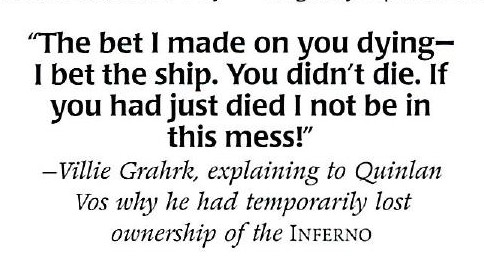

# Quinlan Vos

- **Aliases:** Quinlan, Vos
- **Era:** Clone Wars
- **Continuity:** default Legends; entries present for: Canon, Legends
- **Research tier:** DEEP
- **Entries:** 483 (163 with quotations; 89 marked as fragments; recounted after the public-release cleanup). Rebuilt 2026-11-17 from 546 old entries; old file: `characters/_bak/quinlan-vos.md.bak-20261117`.
- **How to read:** each entry is the quotation in full (block quote), then its source and point of view. "Note" lines are summaries from our notes, not quotations. `[fragment — full passage not on file]` means the source text is not on the box, so only the words in our notes are shown. Debate and forum material is in the last section and is unverified.

# LEGENDS (Legends / EU — main focus)

## Dark Lord trilogy (Labyrinth of Evil, Revenge of the Sith, Dark Lord): novel notes from the other agent (reference copy)

> “Master Vos was presumed killed by fire from a tank,” Cudgel explained, “Master Unduli by blasterfire.”
>
> “And Master Yoda?” she asked quietly.
— Source: L4517; L4523 — Dark Lord: The Rise of Darth Vader: combat and Force feats (novel, read in full); S73 [IV/38, L4517, L4523] Vos was.
(Excerpt widened 2026-11-17 to the relevant passage, word for word from Dark Lord: The Rise of Darth Vader (James Luceno) (text copy `MEGA_Legend_The_Episode_Novelizations_Star_Wars_Revenge_of_the_Sith_03_Dark_Lord_The_Rise_of_Darth_Vader_James_Luceno_epub`).)
(Excerpt widened 2026-11-17 to the relevant passage, word for word from Dark Lord: The Rise of Darth Vader (James Luceno) (text copy `MEGA_Legend_The_Episode_Novelizations_Star_Wars_Revenge_of_the_Sith_03_Dark_Lord_The_Rise_of_Darth_Vader_James_Luceno_epub`).)
(Fragment completed 2026-11-17: full sentence/passage matched word for word in the source text on file: `MEGA_Legend_The_Episode_Novelizations_Star_Wars_Revenge_of_the_Sith_03_Dark_Lord_The_Rise_of_Darth_Vader_James_Luceno_epub`.)
Note (our notes, around the quote): S73 [IV/38, L4517, L4523] Vos was "presumed killed by fire from a tank," and Unduli was killed by blasterfire (L4517). Yoda escaped by pod (L4523).
Our notes: `notes/materials/022-dark-lord-trilogy/dark-lord-novel-feats.md:339`

> Master Kolar lied about Quinlan Vos going to the dark side. *(L1013)*
— Source: L1013; L5121 — Labyrinth of Evil (novel, read in full): feats, scaling, quotes and story notes; Agen Kolar: Anakin's grievance.
Note (our notes, around the quote): Agen Kolar: Anakin's grievance: «Master Kolar lied about Quinlan Vos going to the dark side.» (L1013). He is in the starfighter pursuit of Grievous (L5121).
Our notes: `notes/materials/022-dark-lord-trilogy/labyrinth-of-evil-notes.md:925`; `notes/materials/022-dark-lord-trilogy/labyrinth-of-evil-notes.md:931`; `notes/materials/022-dark-lord-trilogy/labyrinth-of-evil-notes.md:944`

> A break hadn’t come until Jedi Master Tholme had recalled a detail from the debriefing of his former Padawan, Quinlan Vos. As part of Vos’s covert mission to penetrate Count Dooku’s inner circle of dark side apprentices, Vos had been tasked with assassinating a duplicitous Senator, named Viento. Immediately following the assassination—and a brutal duel with Master K’Kruhk—Vos had met briefly with Dooku in The Works. There, Dooku had informed his would-be protégé that Vos had been incorrect in assuming that Viento was a Sith, and had again denied that he himself answered to any Master.
>
> They walked in silence to a balcony that overlooked the desolate sprawl of The Works. In the far distance the glassy towers of the Senate District disappeared into clouds. One of Dooku’s previous visits had followed the assassination of a faithless Senator by Jedi Knight Quinlan Vos. Duped by Dooku on several occasions, Vos had managed to track Dooku to The Works, though he apparently hadn’t perceived just how deeply the dark side had taken root there.
— Source: L3063; L2477 — Labyrinth of Evil (novel, read in full): feats, scaling, quotes and story notes.
(Excerpt widened 2026-11-17 to the relevant passage, word for word from Labyrinth of Evil (James Luceno) (text copy `MEGA_Legend_The_Episode_Novelizations_Star_Wars_Revenge_of_the_Sith_01_Labyrinth_of_Evil_James_Luceno_epub`).)
(Fragment completed 2026-11-17: full sentence/passage matched word for word in the source text on file: `MEGA_Legend_The_Episode_Novelizations_Star_Wars_Revenge_of_the_Sith_01_Labyrinth_of_Evil_James_Luceno_epub`.)
Note text that was attached to the quote line: *(L3063)*
Note (our notes, around the quote): Role: the clue that leads the Jedi to The Works. «A break hadn't come until Jedi Master Tholme had recalled a detail from the debriefing of his former Padawan, Quinlan Vos.» (L3063). Vos had been «tasked with assassinating a duplicitous» Senator as part of his «covert mission to penetrate Count Dooku's inner circle of dark side apprentices» (L3063), fought «a brutal duel with Master K'Kruhk», and then met Dooku in The Works (L3063). He had «managed to track Dooku to The Works, though he apparently hadn't perceived just how deeply the dark side» ran there (L2477).
Our notes: `notes/materials/022-dark-lord-trilogy/labyrinth-of-evil-notes.md:941`; `notes/materials/022-dark-lord-trilogy/labyrinth-of-evil-notes.md:949`

- Note (summary from our notes, not a quotation): Scaling implications: none (offstage).
  — Source: Labyrinth of Evil (novel, read in full): feats, scaling, quotes and story notes.
Our notes: `notes/materials/022-dark-lord-trilogy/labyrinth-of-evil-notes.md:942`

- Note (summary from our notes, not a quotation): Complete quote register (12 lines: every sentence that names Quinlan Vos, verbatim, in book order):
  — Source: Labyrinth of Evil (novel, read in full): feats, scaling, quotes and story notes.
Our notes: `notes/materials/022-dark-lord-trilogy/labyrinth-of-evil-notes.md:943`

> Now Obi-Wan wondered why he had been so averse to making the trip. Compared to the past few months, the mission already felt like a furlough. Anakin was correct about Obi-Wan’s having had more than his share of such assignments. But several other Jedi had also doubled as Intelligence operatives during the course of the war. Aayla Secura and the Caamasi Jedi Ylenic It’kla had taken a Techno Union defector into custody on Corellia; Quinlan Vos had gone undercover to infiltrate Dooku’s circle of dark side apprentices …
— Source: Labyrinth of Evil (novel, read in full): feats, scaling, quotes and story notes; Ch16 L1145.
(Excerpt widened 2026-11-17 to the relevant passage, word for word from Labyrinth of Evil (James Luceno) (text copy `MEGA_Legend_The_Episode_Novelizations_Star_Wars_Revenge_of_the_Sith_01_Labyrinth_of_Evil_James_Luceno_epub`).)
(Fragment completed 2026-11-17: full sentence/passage matched word for word in the source text on file: `MEGA_Legend_The_Episode_Novelizations_Star_Wars_Revenge_of_the_Sith_01_Labyrinth_of_Evil_James_Luceno_epub`.)
Context: Complete quote register (12 lines: every sentence that names Quinlan Vos, verbatim, in book order):
Our notes: `notes/materials/022-dark-lord-trilogy/labyrinth-of-evil-notes.md:945`

> Daring Way, where it crossed Vos Gesal in upper Uscru.
>
> Hazad’s Skytunnel in the Manarai Uplift.
>
> And just about anywhere in the sector known colloquially as “The Works.”
— Source: Labyrinth of Evil (novel, read in full): feats, scaling, quotes and story notes; Ch26 L2421.
(Excerpt widened 2026-11-17 to the relevant passage, word for word from Labyrinth of Evil (James Luceno) (text copy `MEGA_Legend_The_Episode_Novelizations_Star_Wars_Revenge_of_the_Sith_01_Labyrinth_of_Evil_James_Luceno_epub`).)
(Excerpt widened 2026-11-17 to the relevant passage, word for word from Labyrinth of Evil (James Luceno) (text copy `MEGA_Legend_The_Episode_Novelizations_Star_Wars_Revenge_of_the_Sith_01_Labyrinth_of_Evil_James_Luceno_epub`).)
Context: Complete quote register (12 lines: every sentence that names Quinlan Vos, verbatim, in book order):
Our notes: `notes/materials/022-dark-lord-trilogy/labyrinth-of-evil-notes.md:946`

> They walked in silence to a balcony that overlooked the desolate sprawl of The Works. In the far distance the glassy towers of the Senate District disappeared into clouds. One of Dooku’s previous visits had followed the assassination of a faithless Senator by Jedi Knight Quinlan Vos. Duped by Dooku on several occasions, Vos had managed to track Dooku to The Works, though he apparently hadn’t perceived just how deeply the dark side had taken root there.
— Source: Labyrinth of Evil (novel, read in full): feats, scaling, quotes and story notes; Ch26 L2477.
(Excerpt widened 2026-11-17 to the relevant passage, word for word from Labyrinth of Evil (James Luceno) (text copy `MEGA_Legend_The_Episode_Novelizations_Star_Wars_Revenge_of_the_Sith_01_Labyrinth_of_Evil_James_Luceno_epub`).)
Context: Complete quote register (12 lines: every sentence that names Quinlan Vos, verbatim, in book order):
Our notes: `notes/materials/022-dark-lord-trilogy/labyrinth-of-evil-notes.md:947`

> A break hadn’t come until Jedi Master Tholme had recalled a detail from the debriefing of his former Padawan, Quinlan Vos. As part of Vos’s covert mission to penetrate Count Dooku’s inner circle of dark side apprentices, Vos had been tasked with assassinating a duplicitous Senator, named Viento. Immediately following the assassination—and a brutal duel with Master K’Kruhk—Vos had met briefly with Dooku in The Works. There, Dooku had informed his would-be protégé that Vos had been incorrect in assuming that Viento was a Sith, and had again denied that he himself answered to any Master.
— Source: Labyrinth of Evil (novel, read in full): feats, scaling, quotes and story notes; Ch30 L3063.
(Excerpt widened 2026-11-17 to the relevant passage, word for word from Labyrinth of Evil (James Luceno) (text copy `MEGA_Legend_The_Episode_Novelizations_Star_Wars_Revenge_of_the_Sith_01_Labyrinth_of_Evil_James_Luceno_epub`).)
Context: Complete quote register (12 lines: every sentence that names Quinlan Vos, verbatim, in book order):
Our notes: `notes/materials/022-dark-lord-trilogy/labyrinth-of-evil-notes.md:950`

> A break hadn’t come until Jedi Master Tholme had recalled a detail from the debriefing of his former Padawan, Quinlan Vos. As part of Vos’s covert mission to penetrate Count Dooku’s inner circle of dark side apprentices, Vos had been tasked with assassinating a duplicitous Senator, named Viento. Immediately following the assassination—and a brutal duel with Master K’Kruhk—Vos had met briefly with Dooku in The Works. There, Dooku had informed his would-be protégé that Vos had been incorrect in assuming that Viento was a Sith, and had again denied that he himself answered to any Master.
— Source: Labyrinth of Evil (novel, read in full): feats, scaling, quotes and story notes; Ch30 L3063.
(Excerpt widened 2026-11-17 to the relevant passage, word for word from Labyrinth of Evil (James Luceno) (text copy `MEGA_Legend_The_Episode_Novelizations_Star_Wars_Revenge_of_the_Sith_01_Labyrinth_of_Evil_James_Luceno_epub`).)
Context: Complete quote register (12 lines: every sentence that names Quinlan Vos, verbatim, in book order):
Our notes: `notes/materials/022-dark-lord-trilogy/labyrinth-of-evil-notes.md:951`

> There, Dooku had informed his would-be protege that Vos had been incorrect in assuming that Viento was a Sith, and had again denied that he himself answered to any Master.
— Source: Labyrinth of Evil (novel, read in full): feats, scaling, quotes and story notes; Ch30 L3063.
Context: Complete quote register (12 lines: every sentence that names Quinlan Vos, verbatim, in book order):
Our notes: `notes/materials/022-dark-lord-trilogy/labyrinth-of-evil-notes.md:952`

> At the time, no one had paid much attention to Vos’s remarks, because Vos seemed to have been seduced by the dark side and lost to the Order. The rendezvous was considered to have been only that: an out-of-the-way meeting place. Of greater interest to the Jedi and Republic Intelligence was the fact that Dooku had managed to arrive at and depart Coruscant without detection.
— Source: Labyrinth of Evil (novel, read in full): feats, scaling, quotes and story notes; Ch30 L3065.
(Excerpt widened 2026-11-17 to the relevant passage, word for word from Labyrinth of Evil (James Luceno) (text copy `MEGA_Legend_The_Episode_Novelizations_Star_Wars_Revenge_of_the_Sith_01_Labyrinth_of_Evil_James_Luceno_epub`).)
Context: Complete quote register (12 lines: every sentence that names Quinlan Vos, verbatim, in book order):
Our notes: `notes/materials/022-dark-lord-trilogy/labyrinth-of-evil-notes.md:953`

> Weapons raised to their chests, the commandos spread out in fire-and-maneuver squads and began to move deeper into the building, checking out each room and alcove before declaring any level secure. Mace’s blade glowed amethyst in the gloom. Stretching out with the Force, he could feel the presence of the dark side. The only explanation for Quinlan Vos not having felt it was that he, too, had gone dark.
— Source: Labyrinth of Evil (novel, read in full): feats, scaling, quotes and story notes; Ch30 L3103.
(Excerpt widened 2026-11-17 to the relevant passage, word for word from Labyrinth of Evil (James Luceno) (text copy `MEGA_Legend_The_Episode_Novelizations_Star_Wars_Revenge_of_the_Sith_01_Labyrinth_of_Evil_James_Luceno_epub`).)
Context: Complete quote register (12 lines: every sentence that names Quinlan Vos, verbatim, in book order):
Our notes: `notes/materials/022-dark-lord-trilogy/labyrinth-of-evil-notes.md:954`

> “Hear me out before you go critical. Mace and Shaak Ti were able to locate the building in The Works. Not surprisingly, it turns out to have been the same one where Quinlan Vos met with Dooku last year. Once inside, Mace’s team discovered more than we could have even hoped for—evidence of a more recent visit by Dooku, and of the person he apparently went to Coruscant to see.”
— Source: Labyrinth of Evil (novel, read in full): feats, scaling, quotes and story notes; Ch33 L3523.
(Excerpt widened 2026-11-17 to the relevant passage, word for word from Labyrinth of Evil (James Luceno) (text copy `MEGA_Legend_The_Episode_Novelizations_Star_Wars_Revenge_of_the_Sith_01_Labyrinth_of_Evil_James_Luceno_epub`).)
Context: Complete quote register (12 lines: every sentence that names Quinlan Vos, verbatim, in book order):
Our notes: `notes/materials/022-dark-lord-trilogy/labyrinth-of-evil-notes.md:955`

## Star Wars: The New Essential Chronology (Del Rey, 2005): power-scaling and lore notes

> Quinlan possessed the Kiffu talent of psychometrics, allowing him to read memories and impressions directly off the surface of objects.
— Source: Part Two: The Fall of the Republic; Quinlan Vos; Tholme — Quinlan's psychometry.
Note (our notes, around the quote): Quinlan Vos; Tholme — Quinlan's psychometry: "Quinlan possessed the Kiffu talent of psychometrics, allowing him to read memories and impressions directly off the surface of objects." Source: The New Essential Chronology, p.45

Our notes: `notes/materials/027-new-essential-chronology/02-part-two-fall-of-the-republic.md:143`

> Quinlan Vos, with help from his former Master Tholme, killed Karkko and freed Aayla Secura from his Anzati spell.
— Source: Part Two: The Fall of the Republic.
Note (our notes, around the quote): Quinlan Vos; Tholme; Volfe Karkko; Aayla Secura — Quinlan kills Volfe Karkko: "Quinlan Vos, with help from his former Master Tholme, killed Karkko and freed Aayla Secura from his Anzati spell." Source: The New Essential Chronology, p.46

Our notes: `notes/materials/027-new-essential-chronology/02-part-two-fall-of-the-republic.md:150`

> Quinlan Vos and Aayla Secura defeated the two Morgukai and freed the young heir.
— Source: Part Two: The Fall of the Republic; Quinlan Vos; Aayla Secura — Morgukai.
Note (our notes, around the quote): Quinlan Vos; Aayla Secura — Morgukai: "Quinlan Vos and Aayla Secura defeated the two Morgukai and freed the young heir." Source: The New Essential Chronology, p.46

Our notes: `notes/materials/027-new-essential-chronology/02-part-two-fall-of-the-republic.md:152`

> Fully convinced of the rightness of his mission, in his zeal Agen Kolar nearly killed his target. But, as planned, Quinlan eluded capture
> [fragment — full passage not on file]
— Source: Part Two: The Fall of the Republic; Agen Kolar; Quinlan Vos — Kolar vs Quinlan on Nar Shaddaa.
Note (our notes, around the quote): Agen Kolar; Quinlan Vos — Kolar vs Quinlan on Nar Shaddaa: "Fully convinced of the rightness of his mission, in his zeal Agen Kolar nearly killed his target. But, as planned, Quinlan eluded capture" Source: The New Essential Chronology, p.63

Our notes: `notes/materials/027-new-essential-chronology/02-part-two-fall-of-the-republic.md:293`

> The Count could see that Quinlan already walked close to the dark side. It would not take much to make the deception a reality.
— Source: Part Two: The Fall of the Republic.
Note (our notes, around the quote): Count Dooku; Quinlan Vos — Dooku knows Quinlan walks close to the dark: "The Count could see that Quinlan already walked close to the dark side. It would not take much to make the deception a reality." Source: The New Essential Chronology, p.65

Our notes: `notes/materials/027-new-essential-chronology/02-part-two-fall-of-the-republic.md:315`

> Quinlan, caught in a crisis of conscience, cut down Kadrian Sey in order to save his aunt's life.
— Source: Part Two: The Fall of the Republic; Quinlan Vos — Quinlan kills Kadrian Sey.
Note (our notes, around the quote): Quinlan Vos — Quinlan kills Kadrian Sey: "Quinlan, caught in a crisis of conscience, cut down Kadrian Sey in order to save his aunt's life." Source: The New Essential Chronology, p.65

Our notes: `notes/materials/027-new-essential-chronology/02-part-two-fall-of-the-republic.md:317`

> With a surge of dark side power, Quinlan butchered his terrified aunt.
— Source: Part Two: The Fall of the Republic; Quinlan Vos — Quinlan butchers Sheyf Tinté.
Note (our notes, around the quote): Quinlan Vos — Quinlan butchers Sheyf Tinté: "With a surge of dark side power, Quinlan butchered his terrified aunt." Source: The New Essential Chronology, p.65

Our notes: `notes/materials/027-new-essential-chronology/02-part-two-fall-of-the-republic.md:319`

> Over the Past decade, the ex-chancellor had collected reams of stories conceming Palpatine, including the fact thal, as with Seti Ashgad, his aritics often mysteriously vanished. Initially, Organa couldn't be sure that Valorum’s words weren't the bitter griping of 4 man forced from power, but two facts changed Organa’s mind. The first was the suspicious explosion of Valorum’s transport as it lifted off from a Coruscant starport, killing Finis Valorum and everyone else aboard. The second was Palpatine’s exploitation of the incident to Pass another secu: rity bill, which gave him unprecedented central power.
>
> Clearly, aboveboard politkking was not enough, Over 71 === PDF p.82 === the next several months, Ball Organa and Mon Mothma, with the occasional help of other Senators including Garm Bel Iblis of Isolationist Corellia, began laying the groundwork for a political alliance opposed to Palpatine’s rule.
>
> CORUSCANT ASSASSINATION 20.63 B.B.Y.(1 year, 4 months after the Battle of Gconosis) Ooku wasted no time sending his new agent, Quinlan Vos, on missions, On the Sith tomb world of Korriban, Quinlan retrieved a holocron once belonging to the Sith Lord Darth Andeddu from a booby-trapped catacomb.
>
> CORUSCANT ASSASSINATION 20.63 B.B.Y.(1 year, 4 months after the Battle of Gconosis) Ooku wasted no time sending his new agent, Quinlan Vos, on missions, On the Sith tomb world of Korriban, Quinlan retrieved a holocron once belonging to the Sith Lord Darth Andeddu from a booby-trapped catacomb. On Coruscant, Quinian assassinated a doublevdeating Senator who had displeased Dooku. While escaping from Coruscant, he ran afoul of the Whiphid Jedi Master K’Kruhk, hero of Teyr and former dissident Jedi.
— Source: Part Two: The Fall of the Republic; Quinlan Vos; Darth Andeddu — Andeddu holocron.
(Excerpt widened 2026-11-17 to the relevant passage, word for word from research primary new essential chronology nec paged (text copy `research_primary_new_essential_chronology_nec_paged_txt_88b808b5bc`).)
(Excerpt widened 2026-11-17 to the relevant passage, word for word from research primary new essential chronology nec paged (text copy `research_primary_new_essential_chronology_nec_paged_txt_88b808b5bc`).)
Note (our notes, around the quote): Quinlan Vos; Darth Andeddu — Andeddu holocron: "On the Sith tomb world of Korriban, Quinlan retrieved a holocron once belonging to the Sith Lord Darth Andeddu from a booby-trapped catacomb." Source: The New Essential Chronology, p.72

Our notes: `notes/materials/027-new-essential-chronology/02-part-two-fall-of-the-republic.md:378`

> he ran afoul of the Whiphid Jedi Master K'Kruhk, hero of Teyr and former dissident Jedi. K'Kruhk nearly died in his pursuit of Quinlan through the vertical city.
— Source: Part Two: The Fall of the Republic; Quinlan Vos; K'Kruhk — K'Kruhk nearly dies.
Note (our notes, around the quote): Quinlan Vos; K'Kruhk — K'Kruhk nearly dies: "he ran afoul of the Whiphid Jedi Master K'Kruhk, hero of Teyr and former dissident Jedi. K'Kruhk nearly died in his pursuit of Quinlan through the vertical city." Source: The New Essential Chronology, p.72

Our notes: `notes/materials/027-new-essential-chronology/02-part-two-fall-of-the-republic.md:380`

- Note (summary from our notes, not a quotation): Quinlan Vos; Aayla Secura — Honoghr: "By forcing Quinlan into a position where he might have to kill her, Aayla made him realize that his obsession with rooting out the "second Sith" might not be worth the choices he had made." Source: The New Essential Chronology, p.74
  — Source: Part Two: The Fall of the Republic.

Our notes: `notes/materials/027-new-essential-chronology/02-part-two-fall-of-the-republic.md:398`

- Note (summary from our notes, not a quotation): Aayla Secura; Quinlan Vos — art caption: "Jedi Knight Aayla Secura and Jedi Master Quinlan Vos" Source: The New Essential Chronology, p.74, caption
  — Source: Part Two: The Fall of the Republic.

Our notes: `notes/materials/027-new-essential-chronology/02-part-two-fall-of-the-republic.md:400`

> Bulq hired teachers from the elite Anzati assassin school to train his own clone soldiers, grown from the genetic material of Nikto Morgukai warriors. Jedi Master Tholme helped put an end to Bulq's plans.
— Source: Part Two: The Fall of the Republic; Sora Bulq; Quinlan Vos; Tholme — Sora Bulq's clones.
Note (our notes, around the quote): Sora Bulq; Quinlan Vos; Tholme — Sora Bulq's clones: "Bulq hired teachers from the elite Anzati assassin school to train his own clone soldiers, grown from the genetic material of Nikto Morgukai warriors. Jedi Master Tholme helped put an end to Bulq's plans." Source: The New Essential Chronology, p.78

Our notes: `notes/materials/027-new-essential-chronology/02-part-two-fall-of-the-republic.md:446`

## The Complete Star Wars Encyclopedia, Vol. I (A–G)

> The duty-bound Sagoro often butted heads with the more reckless Reymet, who did not want to follow the family tradition of guard service. A year before the Battle ofGeonosis, Sagoro investigated the assassination ofSenator Jhera­ mahd Greyshade; Obi-Wan Kenobi and Ana­ kin Skywalker were assigned as protectors to Jheramahd's successor, Simon Greyshade. Evidence soon revealed that Venco Autem was involved in the conspiracy, and Venco's actions implicated Reymet. Against orders, Sagoro stayed on the case and confronted Venco at the Senate chamber, where he was forced to shoot and kill his brother. Days later, Sagoro's wife left him, taking Lissa with her. His family shattered, Sagoro left the guard and allowed Reymet to flee Coruscant. During the Clone Wars, Sagoro escaped imprisonment on Brentaal IV and helped Jedi Shaak Ti and Quinlan Vos defeat Confederacy forces there, earning him immunity for past crimes. Sagoro then served in the Republic military, reaching the rank of captain in the fleet. When the Republic transitioned to the Galactic Empire, Autem found himself at odds with the new government, and was targeted by bounty hunters dispatched by Darth Vader. One of these hunters, Evan Hessler, was actu­ ally his son Reymet in disguise, and he helped Sagoro escape pursuit. Autem, Sula Wife of Sagoro Autem.
— Source: scan pages 41–80; Shaak Ti; Quinlan Vos.
(Excerpt widened 2026-11-17 to the relevant passage, word for word from research primary cse vol1 (text copy `research_primary_cse_vol1_pdf_45a954be6d`).)
(Excerpt widened 2026-11-17 to the relevant passage, word for word from research primary cse vol1 (text copy `research_primary_cse_vol1_pdf_45a954be6d`).)
Note (our notes, around the quote): Shaak Ti; Quinlan Vos: "During the Clone Wars, Sagoro escaped imprisonment on Brentaal IV and helped Jedi Shaak Ti and Quinlan Vos defeat Confederacy forces there, earning him immunity for past crimes." Source: The Complete Star Wars Encyclopedia, Vol. I, p.49

Our notes: `notes/materials/030-complete-star-wars-encyclopedia-vol-1/01-v1-scan-041-080.md:185`

> Tsyr was beheaded by Vos, giving Bok further reason to hate the Jedi.
— Source: scan pages 81–120; Quinlan Vos. POV: Quinlan Vos.
Note (our notes, around the quote): Quinlan Vos: "Tsyr was beheaded by Vos, giving Bok further reason to hate the Jedi." Source: The Complete Star Wars Encyclopedia, Vol. I, p.83

Our notes: `notes/materials/030-complete-star-wars-encyclopedia-vol-1/02-v1-scan-081-120.md:145`

> A Jedi double agent, Quinlan Vos, infiltrated the ranks of the acolytes and slew Bulg in turn.
— Source: scan pages 81–120; Quinlan Vos. POV: Quinlan Vos.
Note (our notes, around the quote): Quinlan Vos: "A Jedi double agent, Quinlan Vos, infiltrated the ranks of the acolytes and slew Bulg in turn." Source: The Complete Star Wars Encyclopedia, Vol. I, p.97

Our notes: `notes/materials/030-complete-star-wars-encyclopedia-vol-1/02-v1-scan-081-120.md:255`

> Vos defeated Zalem's plot to use the Infinity Gate to destroy Coruscant.
— Source: scan pages 161–200; Quinlan Vos. POV: Quinlan Vos.
Note (our notes, around the quote): Quinlan Vos: "Vos defeated Zalem's plot to use the Infinity Gate to destroy Coruscant." Source: The Complete Star Wars Encyclopedia, Vol. I, p.173

Our notes: `notes/materials/030-complete-star-wars-encyclopedia-vol-1/04-v1-scan-161-200.md:241`

> After the energy spiders killed Asanté Vos, Quinlan Vos destroyed all the spiders in order to completely end the supply of glitteryll.
— Source: scan pages 321–360; Quinlan Vos. POV: Quinlan Vos.
Note (our notes, around the quote): Quinlan Vos: "After the energy spiders killed Asanté Vos, Quinlan Vos destroyed all the spiders in order to completely end the supply of glitteryll." Source: The Complete Star Wars Encyclopedia, Vol. I, p.345

Our notes: `notes/materials/030-complete-star-wars-encyclopedia-vol-1/08-v1-scan-321-360.md:283`

## The Complete Star Wars Encyclopedia, Vol. II (H–O)

> Vos and his fellow Jedi Aayla Secura saved Hentz and killed Zenex.
— Source: scan pages 1–40; Quinlan Vos; Aayla Secura.
Note (our notes, around the quote): Quinlan Vos; Aayla Secura: "Vos and his fellow Jedi Aayla Secura saved Hentz and killed Zenex." Source: The Complete Star Wars Encyclopedia, Vol. II, p.34

Our notes: `notes/materials/031-complete-star-wars-encyclopedia-vol-2/00-v2-scan-001-040.md:267`

> Their plan nearly succeeded, but Quinlan Vos destroyed the Star Chamber on the planet, stripping the Wave of its power.
— Source: scan pages 81–120; Quinlan Vos. POV: Quinlan Vos.
Note (our notes, around the quote): Quinlan Vos: "Their plan nearly succeeded, but Quinlan Vos destroyed the Star Chamber on the planet, stripping the Wave of its power." Source: The Complete Star Wars Encyclopedia, Vol. II, p.102

Our notes: `notes/materials/031-complete-star-wars-encyclopedia-vol-2/02-v2-scan-081-120.md:175`

> Vos went to Tibrin during the Clone Wars and killed the pro-Republic leader, Suribran Tu.
— Source: scan pages 121–160; Quinlan Vos. POV: Quinlan Vos.
Note (our notes, around the quote): Quinlan Vos: "Vos went to Tibrin during the Clone Wars and killed the pro-Republic leader, Suribran Tu." Source: The Complete Star Wars Encyclopedia, Vol. II, p.119

Our notes: `notes/materials/031-complete-star-wars-encyclopedia-vol-2/03-v2-scan-121-160.md:38`

> Vos returned to Kiffex with the Jedi Knights, however, and defeated Karkko in combat.
— Source: scan pages 201–240; Quinlan Vos; Volfe Karkko.
Note (our notes, around the quote): Quinlan Vos; Volfe Karkko: "Vos returned to Kiffex with the Jedi Knights, however, and defeated Karkko in combat." Source: The Complete Star Wars Encyclopedia, Vol. II, p.199

Our notes: `notes/materials/031-complete-star-wars-encyclopedia-vol-2/05-v2-scan-201-240.md:40`

> Using an illusion—that she had killed Vos—enabled her to get close enough to her mother to kill her.
— Source: scan pages 241–280; Quinlan Vos. POV: Quinlan Vos.
Note (our notes, around the quote): Quinlan Vos: "Using an illusion—that she had killed Vos—enabled her to get close enough to her mother to kill her." Source: The Complete Star Wars Encyclopedia, Vol. II, p.242

Our notes: `notes/materials/031-complete-star-wars-encyclopedia-vol-2/06-v2-scan-241-280.md:73`

> After she was injured in Vos's successful destruction of the Infinity Gate, which could have destroyed Coruscant, Vos sensed the light side within Lai and brought her back with him to the Jedi Temple on the capital planet.
— Source: scan pages 241–280; Quinlan Vos. POV: Quinlan Vos.
Note (our notes, around the quote): Quinlan Vos: "After she was injured in Vos's successful destruction of the Infinity Gate, which could have destroyed Coruscant, Vos sensed the light side within Lai and brought her back with him to the Jedi Temple on the capital planet." Source: The Complete Star Wars Encyclopedia, Vol. II, p.242

Our notes: `notes/materials/031-complete-star-wars-encyclopedia-vol-2/06-v2-scan-241-280.md:75`

> Vos fought his way to freedom, and Morota admitted that she had been defeated.
— Source: scan pages 321–360; Quinlan Vos. POV: Quinlan Vos.
Note (our notes, around the quote): Quinlan Vos: "Vos fought his way to freedom, and Morota admitted that she had been defeated." Source: The Complete Star Wars Encyclopedia, Vol. II, p.331

Our notes: `notes/materials/031-complete-star-wars-encyclopedia-vol-2/08-v2-scan-321-360.md:124`

## The Complete Star Wars Encyclopedia, Vol. III (P–Z)

> When Rancisis was placed in command of Republic operations on Saleucami to destroy a Confederacy cloning operation involving Morgukai warriors, Rancisis chose Vos as his second in command.
— Source: scan pages 81–120; Oppo Rancisis; Quinlan Vos — entry/section: Rancisis, Oppo.
Note (our notes, around the quote): Oppo Rancisis; Quinlan Vos — entry/section: Rancisis, Oppo: "When Rancisis was placed in command of Republic operations on Saleucami to destroy a Confederacy cloning operation involving Morgukai warriors, Rancisis chose Vos as his second in command." Source: The Complete Star Wars Encyclopedia, Vol. III, p.78

Our notes: `notes/materials/032-complete-star-wars-encyclopedia-vol-3/02-v3-scan-081-120.md:39`

> She teamed with Quinlan Vos and two Jedi Masters, Tholme and Zao, to defeat the Anzati Sith magician.
— Source: scan pages 121–160; Quinlan Vos; Tholme.
Note (our notes, around the quote): Quinlan Vos; Tholme: "She teamed with Quinlan Vos and two Jedi Masters, Tholme and Zao, to defeat the Anzati Sith magician." Source: The Complete Star Wars Encyclopedia, Vol. III, p.121

Our notes: `notes/materials/032-complete-star-wars-encyclopedia-vol-3/03-v3-scan-121-160.md:48`

> Vos killed Karkko, freeing Secura from his grasp.
— Source: scan pages 121–160; Aayla Secura; Quinlan Vos; Volfe Karkko — entry/section: Secura, Aayla.
Note (our notes, around the quote): Aayla Secura; Quinlan Vos; Volfe Karkko — entry/section: Secura, Aayla: "Vos killed Karkko, freeing Secura from his grasp." Source: The Complete Star Wars Encyclopedia, Vol. III, p.134

Our notes: `notes/materials/032-complete-star-wars-encyclopedia-vol-3/03-v3-scan-121-160.md:145`

> On Kiffu, Quinlan Vos killed her when she tried to attack Sheyf Tinte.
— Source: scan pages 121–160; Quinlan Vos. POV: Quinlan Vos.
Note (our notes, around the quote): Quinlan Vos: "On Kiffu, Quinlan Vos killed her when she tried to attack Sheyf Tinte." Source: The Complete Star Wars Encyclopedia, Vol. III, p.141

Our notes: `notes/materials/032-complete-star-wars-encyclopedia-vol-3/03-v3-scan-121-160.md:214`

> Quinlan Vos, on a mission to infiltrate the Separatists, was forced to defeat Skorr and Kadrian Sey in combat in order to gain an audience with Dooku.
— Source: scan pages 161–200; Quinlan Vos; Count Dooku.
Note (our notes, around the quote): Quinlan Vos; Count Dooku: "Quinlan Vos, on a mission to infiltrate the Separatists, was forced to defeat Skorr and Kadrian Sey in combat in order to gain an audience with Dooku." Source: The Complete Star Wars Encyclopedia, Vol. III, p.160

Our notes: `notes/materials/032-complete-star-wars-encyclopedia-vol-3/04-v3-scan-161-200.md:47`

> Master Tholme was later dispatched to Kiffex to monitor Quinlan during the investigation into the reemergence of Volfe Karkko, and helped Quinlan defeat the feral Anzati warriors.
— Source: scan pages 241–280; Tholme; Quinlan Vos; Volfe Karkko.
Note (our notes, around the quote): Tholme; Quinlan Vos; Volfe Karkko: "Master Tholme was later dispatched to Kiffex to monitor Quinlan during the investigation into the reemergence of Volfe Karkko, and helped Quinlan defeat the feral Anzati warriors." Source: The Complete Star Wars Encyclopedia, Vol. III, p.237

Our notes: `notes/materials/032-complete-star-wars-encyclopedia-vol-3/06-v3-scan-241-280.md:24`

> On Saleucami, Tholme set out to destroy the Separatist cloning facilities Sora Bulq had built in the magma caverns, Tholme was forced to fight Quinlan, who refused to acknowledge that he was too close to the dark side.
— Source: scan pages 241–280; Tholme; Sora Bulq; Quinlan Vos.
Note (our notes, around the quote): Tholme; Sora Bulq; Quinlan Vos: "On Saleucami, Tholme set out to destroy the Separatist cloning facilities Sora Bulq had built in the magma caverns, Tholme was forced to fight Quinlan, who refused to acknowledge that he was too close to the dark side." Source: The Complete Star Wars Encyclopedia, Vol. III, p.238

Our notes: `notes/materials/032-complete-star-wars-encyclopedia-vol-3/06-v3-scan-241-280.md:33`

> When Vos learned of Tookarti's betrayal, he killed the Chadra-Fan.
— Source: scan pages 241–280; Quinlan Vos. POV: Quinlan Vos.
Note (our notes, around the quote): Quinlan Vos: "When Vos learned of Tookarti's betrayal, he killed the Chadra-Fan." Source: The Complete Star Wars Encyclopedia, Vol. III, p.253

Our notes: `notes/materials/032-complete-star-wars-encyclopedia-vol-3/06-v3-scan-241-280.md:178`

> Master K'kruhk and Quinlan Vos struggled, but Vos killed Viento before K'kruhk could stop him.
— Source: scan pages 281–320; K'Kruhk; Quinlan Vos.
Note (our notes, around the quote): K'Kruhk; Quinlan Vos: "Master K'kruhk and Quinlan Vos struggled, but Vos killed Viento before K'kruhk could stop him." Source: The Complete Star Wars Encyclopedia, Vol. III, p.306

Our notes: `notes/materials/032-complete-star-wars-encyclopedia-vol-3/07-v3-scan-281-320.md:257`

- Note (summary from our notes, not a quotation): Page contents: 1148 words, 13 paragraphs | headings/entries: Vorzyd 4; Vos, Quinian; Vos, Tinté
  — Source: scan pages 281–320.
Our notes: `notes/materials/032-complete-star-wars-encyclopedia-vol-3/07-v3-scan-281-320.md:309`

> Vos's parents, Quian and Pethros, were members of the Guardians of Kiffu, but were killed by a group of rogue Anzati under the command of Volfe Karkko.
— Source: scan pages 281–320; Quinlan Vos; Volfe Karkko — entry/section: Vos, Quinian.
Note (our notes, around the quote): Quinlan Vos; Volfe Karkko — entry/section: Vos, Quinian: "Vos's parents, Quian and Pethros, were members of the Guardians of Kiffu, but were killed by a group of rogue Anzati under the command of Volfe Karkko." Source: The Complete Star Wars Encyclopedia, Vol. III, p.312

Our notes: `notes/materials/032-complete-star-wars-encyclopedia-vol-3/07-v3-scan-281-320.md:313`

> Vos defeated Karkko but left Kiffu with the Devaronian con artist Vilmarh Grahrk.
— Source: scan pages 281–320; Quinlan Vos; Volfe Karkko — entry/section: Vos, Quinian.
Note (our notes, around the quote): Quinlan Vos; Volfe Karkko — entry/section: Vos, Quinian: "Vos defeated Karkko but left Kiffu with the Devaronian con artist Vilmarh Grahrk." Source: The Complete Star Wars Encyclopedia, Vol. III, p.312

Our notes: `notes/materials/032-complete-star-wars-encyclopedia-vol-3/07-v3-scan-281-320.md:317`

> Vos learned that Dooku had been negotiating with Sheyf Tinté for the rights to establish a Separatist base on Kiffu, but when Dooku ordered Tinté's death, Vos killed Kadrian Sey before she could assassinate his aunt.
— Source: scan pages 281–320; Quinlan Vos; Count Dooku — entry/section: Vos, Quinian.
Note (our notes, around the quote): Quinlan Vos; Count Dooku — entry/section: Vos, Quinian: "Vos learned that Dooku had been negotiating with Sheyf Tinté for the rights to establish a Separatist base on Kiffu, but when Dooku ordered Tinté's death, Vos killed Kadrian Sey before she could assassinate his aunt." Source: The Complete Star Wars Encyclopedia, Vol. III, p.312

Our notes: `notes/materials/032-complete-star-wars-encyclopedia-vol-3/07-v3-scan-281-320.md:319`

> He killed Commander Faie despite his injuries and was saved by the timely arrival of Vilmarh Grahrk.
— Source: scan pages 281–320; Quinlan Vos — entry/section: Vos, Quinian.
Note (our notes, around the quote): Quinlan Vos — entry/section: Vos, Quinian: "He killed Commander Faie despite his injuries and was saved by the timely arrival of Vilmarh Grahrk." Source: The Complete Star Wars Encyclopedia, Vol. III, p.312

Our notes: `notes/materials/032-complete-star-wars-encyclopedia-vol-3/07-v3-scan-281-320.md:323`

> Vos defeated it by allowing himself to be swallowed whole.
— Source: scan pages 321–360; Quinlan Vos. POV: Quinlan Vos.
Note (our notes, around the quote): Quinlan Vos: "Vos defeated it by allowing himself to be swallowed whole." Source: The Complete Star Wars Encyclopedia, Vol. III, p.329

Our notes: `notes/materials/032-complete-star-wars-encyclopedia-vol-3/08-v3-scan-321-360.md:118`

> He was killed during a battle involving Jedi Quinlan Vos and the vampiric Anzati.
— Source: scan pages 361–385; Quinlan Vos. POV: Quinlan Vos.
Note (our notes, around the quote): Quinlan Vos: "He was killed during a battle involving Jedi Quinlan Vos and the vampiric Anzati." Source: The Complete Star Wars Encyclopedia, Vol. III, p.367

Our notes: `notes/materials/032-complete-star-wars-encyclopedia-vol-3/09-v3-scan-361-385.md:116`

> Vos intervened before she could pull the trigger, and Aayla Secura killed Zenex.
— Source: scan pages 361–385; Quinlan Vos; Aayla Secura.
Note (our notes, around the quote): Quinlan Vos; Aayla Secura: "Vos intervened before she could pull the trigger, and Aayla Secura killed Zenex." Source: The Complete Star Wars Encyclopedia, Vol. III, p.371

Our notes: `notes/materials/032-complete-star-wars-encyclopedia-vol-3/09-v3-scan-361-385.md:154`

## Power of the Jedi Sourcebook (d20, 2002)

- Note (summary from our notes, not a quotation): Page contents: 745 words, 19 paragraphs | headings/entries: Thracia Cho Leem, Jedi Master; Quinlan Vos, Amnesiac Jedi
  — Source: Chapter Six: Jedi traditions and famous Jedi.
Our notes: `notes/materials/033-power-of-the-jedi-sourcebook/06-ch6-jedi-traditions.md:235`

## The New Essential Guide to Characters (2002)

- Note (summary from our notes, not a quotation): Page contents: 468 words, 11 paragraphs | headings/entries: BI- Wan KENOB; Vos knowledge is impressive,
  — Source: scan pages 91–120.
Our notes: `notes/materials/034-new-essential-guide-to-characters/03-negc-scan-091-120.md:64`

> The Jedi who survived the Clone Wars saw their numbers decimated by the Emperor's Jedi Purge.
— Source: scan pages 91–120; Quinlan Vos — entry/section: Vos knowledge is impressive.
Note (our notes, around the quote): Quinlan Vos — entry/section: Vos knowledge is impressive,: "The Jedi who survived the Clone Wars saw their numbers decimated by the Emperor's Jedi Purge." Source: The New Essential Guide to Characters, p.106

Our notes: `notes/materials/034-new-essential-guide-to-characters/03-negc-scan-091-120.md:78`

- Note (summary from our notes, not a quotation): Page contents: 530 words, 21 paragraphs | headings/entries: Vos, Quinlan Vos came from the; UINLAN Vos —
  — Source: scan pages 181–210.
Our notes: `notes/materials/034-new-essential-guide-to-characters/06-negc-scan-181-210.md:41`

> Enraged, Vos tortured the Twi'lek leader with Force lightning until he divulged the name of the mastermind of the glitteryll plot—Republic Senator Chom Frey Kaa.
— Source: scan pages 181–210; Quinlan Vos — entry/section: Vos, Quinlan Vos came from the.
Note (our notes, around the quote): Quinlan Vos — entry/section: Vos, Quinlan Vos came from the: "Enraged, Vos tortured the Twi'lek leader with Force lightning until he divulged the name of the mastermind of the glitteryll plot—Republic Senator Chom Frey Kaa." Source: The New Essential Guide to Characters, p.193

Our notes: `notes/materials/034-new-essential-guide-to-characters/06-negc-scan-181-210.md:43`

> Zalem directed an Infinity Wave to destroy Coruscant, but Vos redirected the stream of energy to wipe out the Gate itself.
— Source: scan pages 181–210; Quinlan Vos — entry/section: UINLAN Vos.
Note (our notes, around the quote): Quinlan Vos — entry/section: UINLAN Vos —: "Zalem directed an Infinity Wave to destroy Coruscant, but Vos redirected the stream of energy to wipe out the Gate itself." Source: The New Essential Guide to Characters, p.193

Our notes: `notes/materials/034-new-essential-guide-to-characters/06-negc-scan-181-210.md:45`

## Characters/T'ra Saa.pdf [Star Wars Roleplaying Game Revised Core (d20, 2002)]

> Before the outbreak of open war, T'ra Saa served as the Jedi defender of the sector that held Kiffex and Kiffu (after her old friend Tholme abandoned the post to train young Quinlan Vos) and was later instrumental in the defeat of the Anzati Sith magician Volfe Karkko. Like most Jedi Masters, she reluctantly accepted the rank of Republic General during the Clone Wars. The Neti consular has seen fierce action on Devaron and Geonosis.
— Source: Characters/T'ra Saa.pdf [Star Wars Roleplaying Game Revised Core (d20, 20.
Note (our notes, around the quote): T'ra Saa; Tholme; Quinlan Vos; Volfe Karkko — entry/section: T'ra Saa before the Clone Wars: "Before the outbreak of open war, T'ra Saa served as the Jedi defender of the sector that held Kiffex and Kiffu (after her old friend Tholme abandoned the post to train young Quinlan Vos) and was later instrumental in the defeat of the Anzati Sith magician Volfe Karkko. Like most Jedi Masters, she reluctantly accepted the rank of Republic General during the Clone Wars. The Neti consular has seen fierce action on Devaron and Geonosis." Source: *T'ra Saa* (SWRPG d20 Revised Core), scan p.1

Our notes: `notes/materials/037-sw-d20-folder/148-tra-saa.md:14`; `suspect-insight/respect-threads/volfe-karkko.md:86`

## Jedi Counselling/Jedi Counseling 37 - Up the Walls.pdf [Star Wars Roleplaying Game Revised Core (d20, 2002)]

- Note (summary from our notes, not a quotation): Volfe Karkko; Quinlan Vos — entry/section: Volfe Karkko's illusion vs Quinlan Vos (question): "Q: Is it possible to use the skill Illusion to create duplicates of yourself (perhaps to fool an enemy)? In the Dark Horse Comics story "Darkness," the dark Jedi Volfe Karkko deflects one of Quinlan Vos's attacks and disappears, creating an illusion of various unruly-looking creatures around Vos. So is it possible to create a duplicate -- or several duplicates -- to draw fire while the actual target hides?" Source: *Jedi Counseling 37 - Up the Walls* (SWRPG d20 Revised Core), scan p.2
  — Source: Jedi Counselling/Jedi Counseling 37 - Up the Walls.pdf [Star Wars Rolepla.

Our notes: `notes/materials/037-sw-d20-folder/202-jedi-counseling-37-up-the-walls.md:21`

## Jedi Counselling/Jedi Counseling 89.pdf [Star Wars Roleplaying Game Revised Core (d20, 2002)]

- Note (summary from our notes, not a quotation): Page contents: Slower Suffocation; own-character points; Self Destruct example; Yoda rerolls; Quinlan Vos; Maul speeder (hand-read)
  — Source: Jedi Counselling/Jedi Counseling 89.pdf [Star Wars Roleplaying Game Revis.
Our notes: `notes/materials/037-sw-d20-folder/259-jedi-counseling-89.md:35`

> A: Resolve rerolls one at a time. In the case of multiple saves, resolve each save one at a time (including all rerolls) before going on to the next save. For example, let's say Quinlan Vos is within 6 squares of Yoda, and Quinlan Vos fails a save. Normally, you'd invoke Yoda's commander effect first to get a "free" reroll. If that fails, Quinlan Vos's player could spend a Force Point to reroll again. After all rerolls have been attempted one at a time, the last result is effectively the "real" result for the purpose of determining the effect. For a more complex example involving multiple saves, consider what would happen if Quinlan Vos was within 6 squares of Yoda and adjacent to a Medical Droid (thereby granting Vos the Avoid Defeat ability) when he is reduced to 0 hit points by an enemy's attack. Vos makes two saves, each requiring a roll of 11+ to succeed. On the first save, Vos rolls an 8 and fails. He invokes Yoda's commander effect to reroll, and this time, he rolls a 15 and succeeds. On the second save, Vos rolls a 4 and fails. He invokes Yoda's commander effect to reroll, but this time, he rolls a 6, which still fails.
— Source: Jedi Counselling/Jedi Counseling 89.pdf [Star Wars Roleplaying Game Revis.
(Excerpt widened 2026-11-17 to the relevant passage, word for word from research primary sw d20 folder files Star Wars Roleplaying Game Revised Core Jedi Counselling Jedi Counseling 89 (text copy `research_primary_sw_d20_folder_files_Star_Wars_Roleplaying_Game_Revised_Core_Jedi_Counselling_Jedi_Counseling_89_pdf_5c07c571c8`).)
(Excerpt widened 2026-11-17 to the relevant passage, word for word from research primary sw d20 folder files Star Wars Roleplaying Game Revised Core Jedi Counselling Jedi Counseling 89 (text copy `research_primary_sw_d20_folder_files_Star_Wars_Roleplaying_Game_Revised_Core_Jedi_Counselling_Jedi_Counseling_89_pdf_5c07c571c8`).)
Note (our notes, around the quote): Yoda; Quinlan Vos — entry/section: Quinlan Vos rerolls under Yoda's commander effect: "For a more complex example involving multiple saves, consider what would happen if Quinlan Vos was within 6 squares of Yoda and adjacent to a Medical Droid (thereby granting Vos the Avoid Defeat ability) when he is reduced to 0 hit points by an enemy's attack. Vos makes two saves, each requiring a roll of 11+ to succeed." Source: *Jedi Counseling 89* (SWRPG d20 Revised Core), scan p.3

Our notes: `notes/materials/037-sw-d20-folder/259-jedi-counseling-89.md:42`

> Vos makes two saves, each requiring a roll of 11+ to succeed. On the first save, Vos rolls an 8 and fails. He invokes Yoda's commander effect to reroll, and this time, he rolls a 15 and succeeds. On the second save, Vos rolls a 4 and fails. He invokes Yoda's commander effect to reroll, but this time, he rolls a 6, which still fails. Then Vos uses a Force Point to reroll this save one more time, and he rolls an 18, which succeeds. Thus, his final reroll on each save was a success, so Vos is not defeated and instead has 10 hit points remaining. Q: Was the Flight ability accidentally omitted from Darth Maul on Speeder? Every other speeder miniature, even the Flash Speeder, has Flight. A: No, it was not a mistake. According to the Star Wars Roleplaying Game Arms & Equipment Guide, Darth Maul's speeder is a Razalon FC­20 Speeder Bike, and it hovers less than 1 meter from the ground.
— Source: Jedi Counselling/Jedi Counseling 89.pdf [Star Wars Roleplaying Game Revis; Quinlan Vos. POV: Quinlan Vos.
(Excerpt widened 2026-11-17 to the relevant passage, word for word from research primary sw d20 folder files Star Wars Roleplaying Game Revised Core Jedi Counselling Jedi Counseling 89 (text copy `research_primary_sw_d20_folder_files_Star_Wars_Roleplaying_Game_Revised_Core_Jedi_Counselling_Jedi_Counseling_89_pdf_5c07c571c8`).)
(Excerpt widened 2026-11-17 to the relevant passage, word for word from research primary sw d20 folder files Star Wars Roleplaying Game Revised Core Jedi Counselling Jedi Counseling 89 (text copy `research_primary_sw_d20_folder_files_Star_Wars_Roleplaying_Game_Revised_Core_Jedi_Counselling_Jedi_Counseling_89_pdf_5c07c571c8`).)
Note (our notes, around the quote): Quinlan Vos: "Thus, his final reroll on each save was a success, so Vos is not defeated and instead has 10 hit points remaining." Source: *Jedi Counseling 89* (SWRPG d20 Revised Core), scan p.3

Our notes: `notes/materials/037-sw-d20-folder/259-jedi-counseling-89.md:46`

## Sourcebooks/Geonosis and the Outer Rim Worlds.pdf [Star Wars Roleplaying Game Revised Core (d20, 2002)] (scan pages 1–60)

- Note (summary from our notes, not a quotation): Page contents: Dathomir: stats and history (Allya exiled; Chu'unthor crash; Gra'aton, Vulatan and Yoda; Quinlan Vos and the Infinity Gate; Imperial prison). (hand-read)
  — Source: Sourcebooks/Geonosis and the Outer Rim Worlds.pdf [Star Wars Roleplaying.
Our notes: `notes/materials/037-sw-d20-folder/667-geonosis-and-the-outer-rim-worlds-scan-001-060.md:197`

> Approximately a year after the Battle of Naboo, the Jedi Council sent Jedi Knight Quinlan Vos to investigate reports of an ancient “Infinity Gate” buried beneath the surface of Dathomir. Going undercover on the interdicted world, Vos discovered that the hidden teleportation chamber had been built millennia earlier by the reptilian Kwa species (whose de-evolved descendants still lived on Dathomir as the animalistic Kwi). Under the malevolent hands of the Nightsisters, the Infinity Gate almost destroyed Coruscant with a wave of energy before Jedi Vos engineered the machine's destruction.
— Source: Sourcebooks/Geonosis and the Outer Rim Worlds.pdf [Star Wars Roleplaying; Quinlan Vos — entry/section: Vos destroys the Infinity Gate.
Note (our notes, around the quote): Quinlan Vos — entry/section: Vos destroys the Infinity Gate: "Approximately a year after the Battle of Naboo, the Jedi Council sent Jedi Knight Quinlan Vos to investigate reports of an ancient “Infinity Gate” buried beneath the surface of Dathomir. Going undercover on the interdicted world, Vos discovered that the hidden teleportation chamber had been built millennia earlier by the reptilian Kwa species (whose de-evolved descendants still lived on Dathomir as the animalistic Kwi). Under the malevolent hands of the Nightsisters, the Infinity Gate almost destroyed Coruscant with a wave of energy before Jedi Vos engineered the machine's destruction." Source: *Geonosis and the Outer Rim Worlds* (SWRPG d20 Revised Core), scan p.31

Our notes: `notes/materials/037-sw-d20-folder/667-geonosis-and-the-outer-rim-worlds-scan-001-060.md:201`

## Sourcebooks/Geonosis and the Outer Rim Worlds.pdf [Star Wars Roleplaying Game Revised Core (d20, 2002)] (scan pages 61–120)

- Note (summary from our notes, not a quotation): Page contents: Kamino: description (stilt cities); history (Great Flood; cloning; Darth Tyrannus as Sifo-Dyas contracts the clone army; Obi-Wan Kenobi discovers it; Lama Su; Jango Fett template; Battle of Kamino led by Kenobi with Quinlan Vos and Aayla Secura). (hand-read)
  — Source: Sourcebooks/Geonosis and the Outer Rim Worlds.pdf [Star Wars Roleplaying.
Our notes: `notes/materials/037-sw-d20-folder/667-geonosis-and-the-outer-rim-worlds-scan-061-120.md:97`

- Note (summary from our notes, not a quotation): Page contents: Kintan: Part I continued (Ma'kis'shaalas and his Hiitian Padawan); hook The One That Got Away; the Morgukai (Tsyr and Bok; Tsyr felled by Quinlan Vos; Bok survived a duel with Aayla Secura); Morgukai Warrior stats (Red Nikto Soldier 6/Elite Trooper 3). (hand-read)
  — Source: Sourcebooks/Geonosis and the Outer Rim Worlds.pdf [Star Wars Roleplaying.
Our notes: `notes/materials/037-sw-d20-folder/667-geonosis-and-the-outer-rim-worlds-scan-061-120.md:210`

> Ultimately, Tsyr was felled by Quinlan Vos at Fortress Kh'aris on Kintan; younger Bok scarcely survived a duel against Aayla Secura.
— Source: Sourcebooks/Geonosis and the Outer Rim Worlds.pdf [Star Wars Roleplaying.
Note (our notes, around the quote): Aayla Secura; Quinlan Vos — entry/section: Geonosis and the Outer Rim Worlds: "Ultimately, Tsyr was felled by Quinlan Vos at Fortress Kh'aris on Kintan; younger Bok scarcely survived a duel against Aayla Secura." Source: *Geonosis and the Outer Rim Worlds* (SWRPG d20 Revised Core), scan p.89

Our notes: `notes/materials/037-sw-d20-folder/667-geonosis-and-the-outer-rim-worlds-scan-061-120.md:212`

> Ultimately, Tsyr was felled by Quinlan Vos at Fortress Kh'aris on Kintan; younger Bok scarcely survived a duel against Aayla Secura. After recuperating from that encounter and now fitted with a prosthetic right hand, Bok went on a mission to defeat the Jedi.
— Source: Sourcebooks/Geonosis and the Outer Rim Worlds.pdf [Star Wars Roleplaying.
Note (our notes, around the quote): Tsyr; Bok (Morgukai); Quinlan Vos; Aayla Secura — entry/section: Tsyr and Bok: "Ultimately, Tsyr was felled by Quinlan Vos at Fortress Kh'aris on Kintan; younger Bok scarcely survived a duel against Aayla Secura. After recuperating from that encounter and now fitted with a prosthetic right hand, Bok went on a mission to defeat the Jedi." Source: *Geonosis and the Outer Rim Worlds* (SWRPG d20 Revised Core), scan p.89

Our notes: `notes/materials/037-sw-d20-folder/667-geonosis-and-the-outer-rim-worlds-scan-061-120.md:214`

## Sourcebooks/The Clone Wars Campaign Guide.pdf [Star Wars Roleplaying Game Saga Edition (2007)] (scan pages 1–60)

- Note (summary from our notes, not a quotation): Page contents: Militarization (Republic has no standing army before the war; Kaminoan cloners and Rothana Heavy Engineering; Felucia guide example). Jedi in the Clone Wars (military leaders; Guardian/Consular/Sentinel roles; RMSUs; undercover Jedi such as Quinlan Vos). Art caption: Plo Koon dispatches a cold assault battle droid. (hand-read)
  — Source: Sourcebooks/The Clone Wars Campaign Guide.pdf [Star Wars Roleplaying Game.
Our notes: `notes/materials/037-sw-d20-folder/728-the-clone-wars-campaign-guide-scan-001-060.md:162`

- Note (summary from our notes, not a quotation): Page contents: Force powers: Rend [dark side], Shatterpoint (DC 25-40 damage threshold reduction), Technometry (read/control droids and devices; droid-specific effects). Art caption: Quinlan Vos uses psychometry on a sniper droid's rifle. (hand-read)
  — Source: Sourcebooks/The Clone Wars Campaign Guide.pdf [Star Wars Roleplaying Game.
Our notes: `notes/materials/037-sw-d20-folder/728-the-clone-wars-campaign-guide-scan-001-060.md:350`

## Sourcebooks/The Clone Wars Campaign Guide.pdf [Star Wars Roleplaying Game Saga Edition (2007)] (scan pages 121–180)

- Note (summary from our notes, not a quotation): Page contents: An'ya Kuro (The Dark Woman) (finds Force-sensitive children incl. Ki-Adi-Mundi; harsh training methods; Aurva Sing leaves the Order; Geonosis starfighter battle; spy in the war); stat block (CL 16; Gauge Force Potential; black Jedi robes). Aayla Secura (found by Tholme and Quinlan Vos on Ryloth; Ataru; promoted after memory loss, rescuing Vos on Ord Mantell, freeing Tholme from the Morgukai; 327th Star Corps; Kamino, Saleucami, Hypori vs. General Grievous). (hand-read)
  — Source: Sourcebooks/The Clone Wars Campaign Guide.pdf [Star Wars Roleplaying Game.
Our notes: `notes/materials/037-sw-d20-folder/728-the-clone-wars-campaign-guide-scan-121-180.md:145`

> Accepted into the Jedi Order, Aayla grows to become highly skilled with a lightsaber, mastering the Ataru style many years earlier than expected, After overcoming amazing challenges— including a period of memory loss, rescuing Vos on Ord Mantell, and freeing Thoime from the clutches of the Morgukai—Aayla’s deeds convince the High Council to promote her to Jedi Knight.
— Source: Sourcebooks/The Clone Wars Campaign Guide.pdf [Star Wars Roleplaying Game; Aayla Secura — entry/section: The Clone Wars Campaign Guide (Saga).
Note (our notes, around the quote): Aayla Secura — entry/section: The Clone Wars Campaign Guide (Saga): "Accepted into the Jedi Order, Aayla grows to become highly skilled with a lightsaber, mastering the Ataru style many years earlier than expected, After overcoming amazing challenges— including a period of memory loss, rescuing Vos on Ord Mantell, and freeing Thoime from the clutches of the Morgukai—Aayla’s deeds convince the High Council to promote her to Jedi Knight." Source: *The Clone Wars Campaign Guide* (SWRPG Saga Edition), scan p.135

Our notes: `notes/materials/037-sw-d20-folder/728-the-clone-wars-campaign-guide-scan-121-180.md:147`

> We must move quickly if the Jedi Order is to survive.
— Source: Sourcebooks/The Clone Wars Campaign Guide.pdf [Star Wars Roleplaying Game.
Note (our notes, around the quote): Page contents: Saesee Tiin stat block (CL 16; Iktotchi Jedi 8/Jedi Knight 5/Jedi Master 3; limited precognition; Vehicular Combat; Pilot +20). Epigraph: "We must move quickly if the Jedi Order is to survive." -Mace Windu. Quinlan Vos (Kiffar; son of the leaders of Kiffar, expected to become a Guardian; found by Tholme; loses memories on Nar Shaddaa at the hands of his cousin; undercover spy network; Count Dooku's inner circle); stat block (CL 12; Kiffar Jedi 7/Jedi Knight 5; Dark Side 7; Psychometry; Triple Crit). (hand-read)
Our notes: `notes/materials/037-sw-d20-folder/728-the-clone-wars-campaign-guide-scan-121-180.md:173`

## Star Wars Insider #51 (2000)

- Note (summary from our notes, not a quotation): Page contents: Maul comic cont.: Marz (Maul a servant, Bullseye comparison), Duursema (Quinlan Vos in Twilight) (hand-read)
  — Source: Star Wars Insider #51 (2000).
Our notes: `notes/materials/038-star-wars-insider/051-ins051.md:373`

## Star Wars Insider #54 (2001)

- Note (summary from our notes, not a quotation): Page contents: "The Grim Reaper of Comics": comic-strip-style humorous interview, Dark Horse editor Dave Land with writer John Ostrander framed as a Mos Eisley cantina meeting; Ostrander's career (DC, Marvel, First Comics, acting with Joe Mantegna and Dennis Franz); on A New Hope and The Phantom Menace; "Twilight" arc with Jan Duursema introducing Quinlan Vos, who lost his memory, and Devaronian sidekick Villie. Waiter is unnamed. (hand-read)
  — Source: Star Wars Insider #54 (2001). POV: Page contents, about Quinlan Vos.
Our notes: `notes/materials/038-star-wars-insider/054-ins054.md:297`

> Quin, on the other hand, is a true Jedi but a troubled and troubling Jedi. His memory has been taken from him and that makes him more vulnerable to the dark side. More so since there is a darkness in him.
— Source: Star Wars Insider #54 (2001).
Note (our notes, around the quote): Quinlan Vos — entry/section: Quinlan Vos as troubled Jedi — writer John Ostrander, "The Grim Reaper of Comics" interview (crop ok): ""Quin, on the other hand, is a true Jedi but a troubled and troubling Jedi. His memory has been taken from him and that makes him more vulnerable to the dark side. More so since there is a darkness in him." —John Ostrander" Source: *Star Wars Insider #54* (2001), scan p.57

Our notes: `notes/materials/038-star-wars-insider/054-ins054.md:306`

> A Jedi with no memory faces his past! *(Quinlan Vos arc, marketing copy)*
— Source: Star Wars Insider #54 (2001).
Note (our notes, around the quote): Page contents: Advertisement: Dark Horse Star Wars "Darkness" four-issue arc by John Ostrander, Jan Duursema, and Ray Kryssing, cover by Jon Foster; tagline "A Jedi with no memory faces his past!" (Quinlan Vos arc, marketing copy); on sale July-October 2001. No in-universe character statement. (hand-read)
Our notes: `notes/materials/038-star-wars-insider/054-ins054.md:531`

## Star Wars Insider #59 (2002)

- Note (summary from our notes, not a quotation): Page contents: Comic adaptation cont. (magazine p. 85): illustrator Jan Duursema (Al Williamson's Empire adaptation as influence; Marvel #92; Darth Maul miniseries) nearly quit comics until Episode I; co-creating Quinlan Vos with John Ostrander from a background character; adaptation vs. original story; Gilroy on Anakin; Duursema and Gilroy on the darker tone of Episode II; adaptation page art. (hand-read)
  — Source: Star Wars Insider #59 (2002).
Our notes: `notes/materials/038-star-wars-insider/059-ins059.md:617`

> came from the design of a background character in the outdoor cantina scene on Tatooine,
> [fragment — full passage not on file]
— Source: Star Wars Insider #59 (2002).
Note (our notes, around the quote): Quinlan Vos — entry/section: Jan Duursema on the origin of Quinlan Vos: "The result was Quinlan Vos, who, as Duursema explains, "came from the design of a background character in the outdoor cantina scene on Tatooine," —Jan Duursema, Star Wars Insider 59, p. 85" Source: *Star Wars Insider #59* (2002), scan p.85

Our notes: `notes/materials/038-star-wars-insider/059-ins059.md:619`

## Star Wars Insider #62 (2002)

> who says we need to stop at two? *(hand-read)*
> [fragment — full passage not on file]
— Source: Star Wars Insider #62 (2002).
Note (our notes, around the quote): Page contents: Dark Horse cont.: Empire set shortly before A New Hope, moving toward Empire Strikes Back; supporting characters such as Biggs Darklighter and original characters (as with Quinlan Vos in the ongoing series); Stradley: "who says we need to stop at two?" (hand-read)
Our notes: `notes/materials/038-star-wars-insider/062-ins062.md:616`

## Star Wars Insider #63 (2002)

- Note (summary from our notes, not a quotation): Page contents: Clone Wars comics cont.: Beyond the Story Arc sidebar; Dooku to return; Obi-Wan and Anakin as leads; Quinlan Vos among the Jedi; ties to LucasArts' The Clone Wars game. (hand-read)
  — Source: Star Wars Insider #63 (2002).
Our notes: `notes/materials/038-star-wars-insider/063-ins063.md:528`

## Star Wars Insider #73 (2004)

- Note (summary from our notes, not a quotation): Page contents: Toy Box continued: Target-exclusive Clone Wars animated figures, a Red Leader X-wing, Toys "R" Us Jedi Council scene packs (Yoda, Qui-Gon Jinn, Ki-Adi-Mundi), glasses-style four-packs and the Skirmish at Carkoon set; reader Q&A (names omitted) on Expanded Universe figures such as Quinlan Vos, 12-inch vehicles, and "retread" figures. (hand-read)
  — Source: Star Wars Insider #73 (2004).
Our notes: `notes/materials/038-star-wars-insider/073-ins073.md:467`

## Star Wars Insider #74 (2004)

- Note (summary from our notes, not a quotation): Page contents: Republic 63 ("Striking from the Shadows") preview: fallen heroes and redemption; Quinlan Vos, now in Count Dooku's inner circle after the Jedi – Dooku comic, believes he is still deceiving Dooku (Jan Duursema, John Ostrander). (hand-read)
  — Source: Star Wars Insider #74 (2004).
Our notes: `notes/materials/038-star-wars-insider/074-ins074.md:471`

> Quin is like the cop who goes underground to ferret out drug dealers and gets caught up in their world,
> [fragment — full passage not on file]
>
> He was playing up the darker aspects of his nature and pretending to be [on the] dark side, but he's gotten in way too deep. He believes he is still deceiving Dooku. He thinks he has everything under control – that he can tap into the dark side and still remain a Jedi. By the end of the story, it's up to the reader to decide which side Quin is truly on.
— Source: Star Wars Insider #74 (2004); Quinlan Vos; Count Dooku — entry/section: Duursema on Quin undercover.
Note (our notes, around the quote): Quinlan Vos; Count Dooku — entry/section: Duursema on Quin undercover: ""Quin is like the cop who goes underground to ferret out drug dealers and gets caught up in their world," says artist Jan Duursema. "He was playing up the darker aspects of his nature and pretending to be [on the] dark side, but he's gotten in way too deep. He believes he is still deceiving Dooku. He thinks he has everything under control – that he can tap into the dark side and still remain a Jedi. By the end of the story, it's up to the reader to decide which side Quin is truly on." —Jan Duursema, Star Wars Insider 74, p. 68" Source: *Star Wars Insider #74* (2004), scan p.68

Our notes: `notes/materials/038-star-wars-insider/074-ins074.md:473`

- Note (summary from our notes, not a quotation): Page contents: Vos feature continued: Duursema and Ostrander on taking Quin to the dark side, his flaws, and whether Sidious or Dooku could be redeemed; sidebar of fallen-and-redeemed heroes. (hand-read)
  — Source: Star Wars Insider #74 (2004).
Our notes: `notes/materials/038-star-wars-insider/074-ins074.md:478`

- Note (summary from our notes, not a quotation): Page contents: Vos feature concludes: Ostrander on the trap of seeking power; Republic 63 told in first person from Quin's perspective; where Vos goes before Episode III. (hand-read)
  — Source: Star Wars Insider #74 (2004).
Our notes: `notes/materials/038-star-wars-insider/074-ins074.md:485`

## Star Wars Insider #77 (2004)

- Note (summary from our notes, not a quotation): Page contents: Drawn by the Force comics, "Clash of the Titans": Star Wars Republic #68, "Armor" (John Ostrander, Jan Duursema), in which Aayla Secura faces her fallen former Master Quinlan Vos on Honoghr two years into the Clone Wars, with an early look at Episode III clone armor; "Talking Head" on the Infinities: Return of the Jedi trade paperback. (hand-read)
  — Source: Star Wars Insider #77 (2004).
Our notes: `notes/materials/038-star-wars-insider/077-ins077.md:516`

> Quin has been walking a shadowed path and has not admitted to himself that he is falling to the dark side,
> [fragment — full passage not on file]
>
> He thinks he can handle the situation as long as he uses what he has learned of the dark side to help win the war for the Republic.
— Source: Star Wars Insider #77 (2004); Quinlan Vos; Aayla Secura — entry/section: A shadowed path.
Note (our notes, around the quote): Quinlan Vos; Aayla Secura — entry/section: A shadowed path: ""Quin has been walking a shadowed path and has not admitted to himself that he is falling to the dark side," says artist Jan Duursema. "He thinks he can handle the situation as long as he uses what he has learned of the dark side to help win the war for the Republic." —Jan Duursema, Star Wars Insider 77, p. 82" Source: *Star Wars Insider #77* (2004), scan p.82

Our notes: `notes/materials/038-star-wars-insider/077-ins077.md:518`

> A clone's armor is visible and tangible. The Jedi's armor is the Force. Aayla's faith and trust in Quin seems to be part of her armor—or is it the flaw in it?
— Source: Star Wars Insider #77 (2004).
Note (our notes, around the quote): Aayla Secura; Quinlan Vos — entry/section: The Jedi's armor is the Force: ""A clone's armor is visible and tangible. The Jedi's armor is the Force. Aayla's faith and trust in Quin seems to be part of her armor—or is it the flaw in it?" —Jan Duursema, Star Wars Insider 77, p. 82" Source: *Star Wars Insider #77* (2004), scan p.82

Our notes: `notes/materials/038-star-wars-insider/077-ins077.md:520`

> We knew there had to be a confrontation between them,
> [fragment — full passage not on file]
>
> Aayla had to be the one to open Quin's eyes. She is very in tune with the light side of the Force, yet she has a deep understanding of the dark side since she once fell under the thrall of the Dark Anzati Jedi, Volfe Karkko.
— Source: Star Wars Insider #77 (2004).
Note (our notes, around the quote): Aayla Secura; Quinlan Vos — entry/section: Aayla had to open Quin's eyes: ""We knew there had to be a confrontation between them," says Duursema, speaking of the straight-arrow Jedi student and her deeply flawed mentor. "Aayla had to be the one to open Quin's eyes. She is very in tune with the light side of the Force, yet she has a deep understanding of the dark side since she once fell under the thrall of the Dark Anzati Jedi, Volfe Karkko." —Jan Duursema, Star Wars Insider 77, p. 82" Source: *Star Wars Insider #77* (2004), scan p.82

Our notes: `notes/materials/038-star-wars-insider/077-ins077.md:522`

- Note (summary from our notes, not a quotation): Page contents: "Armor" continued: the parallel with Obi-Wan and Anakin; whether Quinlan can be redeemed; the debut of Clone Commander Bly, a new breed of clone with more independence, from whose point of view Republic #68 is told (Daniel Wallace). (hand-read)
  — Source: Star Wars Insider #77 (2004). POV: Page contents.
Our notes: `notes/materials/038-star-wars-insider/077-ins077.md:527`

> We know that Anakin/Vader is redeemed,
> [fragment — full passage not on file]
>
> But the ending hasn't been written yet for Quin, so there are many possibilities—good/bad, dead/alive, redeemed/damned.
— Source: Star Wars Insider #77 (2004).
Note (our notes, around the quote): Quinlan Vos; Darth Vader (Anakin Skywalker) — entry/section: Many possibilities for Quin: ""We know that Anakin/Vader is redeemed," says Ostrander. "But the ending hasn't been written yet for Quin, so there are many possibilities—good/bad, dead/alive, redeemed/damned." —John Ostrander, Star Wars Insider 77, p. 83" Source: *Star Wars Insider #77* (2004), scan p.83

Our notes: `notes/materials/038-star-wars-insider/077-ins077.md:529`

> Aayla usually trusts her instincts, but her emotional attachment to her former Master is clouding her judgment,
> [fragment — full passage not on file]
>
> Quin is part of her armor—her faith in him and all that he taught her protects her. Her attachment to him is also the flaw in her armor.
— Source: Star Wars Insider #77 (2004).
Note (our notes, around the quote): Aayla Secura; Quinlan Vos — entry/section: The flaw in her armor: ""Aayla usually trusts her instincts, but her emotional attachment to her former Master is clouding her judgment," says Duursema. "Quin is part of her armor—her faith in him and all that he taught her protects her. Her attachment to him is also the flaw in her armor." —Jan Duursema, Star Wars Insider 77, p. 83" Source: *Star Wars Insider #77* (2004), scan p.83

Our notes: `notes/materials/038-star-wars-insider/077-ins077.md:531`

> Is the dark side still wrong if it is used to win a war for the 'good guys'?
— Source: Star Wars Insider #77 (2004); Quinlan Vos — entry/section: Is the dark side still wrong?.
Note (our notes, around the quote): Quinlan Vos — entry/section: Is the dark side still wrong?: ""Is the dark side still wrong if it is used to win a war for the 'good guys'?" she asks. —Jan Duursema, Star Wars Insider 77, p. 83" Source: *Star Wars Insider #77* (2004), scan p.83

Our notes: `notes/materials/038-star-wars-insider/077-ins077.md:533`

## Star Wars Insider #84 (2005)

- Note (summary from our notes, not a quotation): Page contents: Contents, Insider 84 Nov/Dec 2005: features Guide to the Grand Army of the Republic (Karen Traviss and Ryan Kaufman, p24), The Art of Revenge of the Sith Part Two (J.W. Rinzler, p32), Lurking in the Shadows (Daniel Wallace, p44), HoloNet News (Daniel Wallace with Pablo Hidalgo, p52), Posters of Episode IV (Pete Vilmur, p64); departments Comlink, Skywalking, Jedi Library (Jason Fry), Drawn by the Force (Purge by John Ostrander and Doug Wheatley; last days of Quinlan Vos in Star Wars Republic), Technical Readout (Chris Trevas), Ask the Master (Pablo Hidalgo), Scouting the Galaxy (Steve Sansweet), Jabba's Collection, Best of Hyperspace (Pablo Hidalgo and Bonnie Burton), Bantha Tracks (Mary Franklin), Emperor's Exhibit (Matt Busch); StarWarsShop box: vac-metalized red-finished Darth Vader (hand-read)
  — Source: Star Wars Insider #84 (2005).
Our notes: `notes/materials/038-star-wars-insider/084-ins084.md:25`

> Wipe Them Out, All of Them: Vader Gets into His Villainous Groove in Purge
> [fragment — full passage not on file]
— Source: Star Wars Insider #84 (2005); Page contents: Drawn by the Force, Daniel Wallace.
Note (our notes, around the quote): Page contents: Drawn by the Force, Daniel Wallace, "Wipe Them Out, All of Them: Vader Gets into His Villainous Groove in Purge": the one-shot by John Ostrander and Doug Wheatley; Vader hunts a secret Jedi gathering hoping Obi-Wan is there; Ostrander on Vader's anger, despair and the people he could not save; box "The Mighty Quin": Quinlan Vos' history since Star Wars #17, his death in Republic #81–83 (Kashyyyk, Vilmahr "Vile" Grahrk), Jan Duursema on saying goodbye to Quin and Aayla (hand-read)
Our notes: `notes/materials/038-star-wars-insider/084-ins084.md:125`

- Note (summary from our notes, not a quotation): Page contents: Drawn by the Force cont.: cover and interior artwork from Star Wars Republic #81 (Quinlan Vos and Wookiees) (hand-read)
  — Source: Star Wars Insider #84 (2005).
Our notes: `notes/materials/038-star-wars-insider/084-ins084.md:134`

## Star Wars Insider #85 (2006)

- Note (summary from our notes, not a quotation): Page contents: Contents, Insider 85: Two-Edged Sword fiction (Vader and Dark Jedi clones), Who's Who in the Delegation of 2000 (Revenge of the Sith DVD deleted scenes), Dressing a Galaxy exhibit (Trisha Biggar costumes), Pete Vilmur posters of The Empire Strikes Back part two; Comlink letters (Quinlan Vos almost followed Aayla Secura's boots), News (Peter Mayhew made U.S. citizen; loss of Michael Sheard), DK Ultimate Visual Guide, Dark Horse Knights of the Old Republic, C-3PO feature, Toys (Hasbro Unleashed Battle Packs, Gentle Giant Empire Strikes Back busts), Best of Hyperspace (Pablo Hidalgo and Bonnie Burton), droid domes fashion (hand-read)
  — Source: Star Wars Insider #85 (2006).
Our notes: `notes/materials/038-star-wars-insider/085-ins085.md:25`

> Like Apprentice, Like Master?
> [fragment — full passage not on file]
— Source: Star Wars Insider #85 (2006); Page contents: Comlink letters.
Note (our notes, around the quote): Page contents: Comlink letters: "Like Apprentice, Like Master?"; staff answer on Quinlan Vos plans for Kashyyyk; The Art of Star Wars street-art letter (writer names omitted) (hand-read)
Our notes: `notes/materials/038-star-wars-insider/085-ins085.md:45`

- Note (summary from our notes, not a quotation): Page contents: Ask the Master continued: Master Vos to Boz Pity, Valley of the Jedi, Maul in Infinities stories (hand-read)
  — Source: Star Wars Insider #85 (2006).
Our notes: `notes/materials/038-star-wars-insider/085-ins085.md:309`

## Star Wars Insider #92 (2007)

- Note (summary from our notes, not a quotation): Page contents: Jabba's Collection cont.: Sideshow Bubo creature pack (womp rat, rock wart, Bubo; $39.99); Hasbro Comic Packs wave two (Luke in stormtrooper armor and R2-D2, Obi-Wan & Alpha ARC Trooper, Quinlan Vos & Vilmarh Grahrk); Sideshow dejarik holochess set ($39.99) (hand-read)
  — Source: Star Wars Insider #92 (2007).
Our notes: `notes/materials/038-star-wars-insider/092-ins092.md:143`

## Star Wars Insider #101 (2008)

> Want to Know the Whole Picture? *(film lines explained by EU, per film)*
— Source: Star Wars Insider #101 (2008); Page contents: Essential EU: "Books" banner; sidebar.
Note (our notes, around the quote): Page contents: Essential EU: "Books" banner; sidebar "Want to Know the Whole Picture?" (film lines explained by EU, per film); covers: Emissaries to Malastare, The Approaching Storm; art: Quinlan Vos-style Jedi, Biggs, Ord Mantell bounty hunter, Bothan (hand-read)
Our notes: `notes/materials/038-star-wars-insider/101-ins101.md:433`

## Star Wars Insider #109 (2009)

- Note (summary from our notes, not a quotation): Page contents: Expanded Menace: Emissaries to Malastare, Quinlan Vos and Aayla Secura, Stark Hyperspace War, Jedi Council: Acts of War (Saesee Tiin flying), Star Wars Tales ("Yaddle's Tale"); Aurra Sing as failed Padawan turned assassin, later teaming with young Boba Fett, hunting Jedi post-ROTS and bedeviling Han and Leia in Legacy of the Force. (hand-read)
  — Source: Star Wars Insider #109 (2009).
Our notes: `notes/materials/038-star-wars-insider/109-ins109.md:267`

- Note (summary from our notes, not a quotation): Page contents: Bounty Hunters cont.: fan photos with Peter Mayhew, Shannon McRandle (Mara Jade model), Doug Wangler (Quinlan Vos model), Ray Park, Mark Hamill (fan names omitted). (hand-read)
  — Source: Star Wars Insider #109 (2009).
Our notes: `notes/materials/038-star-wars-insider/109-ins109.md:382`

## Star Wars Insider #115 (2010)

- Note (summary from our notes, not a quotation): Page contents: Reading guide: Star Wars/Republic (1998-2006, Quinlan Vos and Aayla Secura, renamed Republic with #46, ended #83, 18 TPBs); Vader's Quest (Vader hunts the pilot who destroyed the Death Star); Star Wars Tales (24 issues); Union; Chewbacca. (hand-read)
  — Source: Star Wars Insider #115 (2010).
Our notes: `notes/materials/038-star-wars-insider/115-ins115.md:210`

## Star Wars Insider #121 (2010)

- Note (summary from our notes, not a quotation): Page contents: Comics: Omnibus Quinlan Vos—Jedi in Darkness (Twilight, Infinity's End, Darkness, Stark Hyperspace War, Devaronian Version, Rite of Passage); Ask Lobot sidebar: Commander Cody's post-Episode III exploits remain untold. (hand-read)
  — Source: Star Wars Insider #121 (2010).
Our notes: `notes/materials/038-star-wars-insider/121-ins121.md:340`

## Star Wars Insider #125 (2011)

- Note (summary from our notes, not a quotation): Page contents: Third Strike: "Evil Plans" droid wash; the Hutt Council (Jabba, Oruba, Arok, Marlo, Gorga) and gangster-movie nods; Quinlan Vos's animated debut (Big Lebowski line). (hand-read)
  — Source: Star Wars Insider #125 (2011).
Our notes: `notes/materials/038-star-wars-insider/125-ins125.md:151`

## Star Wars Insider #131 (2012)

- Note (summary from our notes, not a quotation): Page contents: Books: Book of Sith: Secrets from the Dark Side (Daniel Wallace; becker&mayer!), a holocron-packaged compendium compiled by Sidious with writings by Bane, Malgus, Mother Talzin, Plagueis (notes on midi-chlorian experimentation) and others, annotated by Yoda, Mace Windu and Quinlan Vos; quotes from Jim Becker and Delia Greve. (hand-read)
  — Source: Star Wars Insider #131 (2012).
Our notes: `notes/materials/038-star-wars-insider/131-ins131.md:437`

## Star Wars Insider #137 (2012)

- Note (summary from our notes, not a quotation): Page contents: Red Five, continued: Aayla Secura (first appeared in Republic "Twilight"; Lucas put her in the films; originally meant to be killed off); Quinlan Vos; Lumiya (Shira Brie, lightwhip wielder); honorable mention Kai Justiss (Corroney's own Jedi, captured in a battle in Jedi: Dooku and then released by Count Dooku). The family detail behind Aayla being spared is omitted. (hand-read)
  — Source: Star Wars Insider #137 (2012).
Our notes: `notes/materials/038-star-wars-insider/137-ins137.md:429`

> Quinlan Vos dances as close to the dark side as anyone ever could without completely succumbing to its power... or does he?
> [fragment — full passage not on file]
— Source: Star Wars Insider #137 (2012).
Note (our notes, around the quote): Quinlan Vos — entry/section: Corroney on Vos and the dark side: ""Quinlan Vos dances as close to the dark side as anyone ever could without completely succumbing to its power... or does he?" —Joe Corroney, Star Wars Insider 137, p. 79" Source: *Star Wars Insider #137* (2012), scan p.79

Our notes: `notes/materials/038-star-wars-insider/137-ins137.md:431`

## Star Wars Insider #139 (2013)

> god-like Force-wielders
> [fragment — full passage not on file]
— Source: Star Wars Insider #139 (2013).
Note (our notes, around the quote): Page contents: Episode guide: "Evil Plans", "Corruption", "Hunt for Ziro" (Quinlan Vos and Obi-Wan tangle with Cad Bane), "Heroes on Both Sides" (first appearance of Lux Bonteri), "Pursuit of Peace", "Nightsisters", "Monster" (Talzin and Ventress create Savage Opress), "Witches of the Mist" (Savage's betrayal of Dooku), "Overlords" (the Mortis family of "god-like Force-wielders"), "Altar of Mortis". (hand-read)
Our notes: `notes/materials/038-star-wars-insider/139-ins139.md:100`

## Star Wars Insider Special Edition (2010)

- Note (summary from our notes, not a quotation): Page contents: Chewbacca continued: Tyrrdko's revenge, Clone Wars on Kashyyyk with Tarfful, Quinlan Vos and Yoda; Vader's bombardment of Kashyyyk, Roan Shryne and Olee Starstone; adventures with Han (Bollux and Blue Max, Stars' End, Badure/Queen of the Ranroon); Han's chin scar. (hand-read)
  — Source: Star Wars Insider Special Edition (2010).
Our notes: `notes/materials/038-star-wars-insider/157-insspecial2010.md:130`

## Star Wars: Legacy (Dark Horse, 2006–2010) single issues #20–#50, hand-read

- Note (summary from our notes, not a quotation): Uncertain speakers: p13 lower tier — the Vos/Rawk kids at breakfast (Ahnah's sibling; names not given on page); "Pop" line p14 likewise.
  — Source: Star Wars: Legacy #34 — "Storms, Part 1 of 2" (Mar 2009).
Our notes: `notes/materials/039-legacy-2006/legacy-34.md:7`

## Star Wars Visual Dictionaries, Episodes I–VI (DK, 1998–2005) + The Phantom Menace Expanded Visual Dictionary (DK, 2012)

- Note (summary from our notes, not a quotation): Expanded Ep I (2012, Jason Fry) brings in later Legends lore: Orsis, Nightbrothers, Sora Bulq co-creating Vaapad, Xim the Despot, Quinlan Vos at Mos Espa, and Pi-Lippa.
  — Source: 047 summary: Visual Dictionaries I–VI + Expanded Ep I.
Our notes: `notes/materials/047-visual-dictionaries/summary.md:14`

> lies on an important hyperspace route
> [fragment — full passage not on file]
>
> Jedi Quinlan Vos on secret mission *(label)*
> [fragment — full passage not on file]
>
> chemically enlarged by his owner to increase his work-rate
> [fragment — full passage not on file]
— Source: Star Wars: The Phantom Menace — The Expanded Visual Dictionary (DK, 2012): hand-read notes (new and revised material only); p96 Tatooine Inhabitants [revised]: Tatooine.
Note (our notes, around the quote): p96 Tatooine Inhabitants [revised]: Tatooine "lies on an important hyperspace route"; Marketplace; [NEW] "Jedi Quinlan Vos on secret mission" (label); slave Erdan "chemically enlarged by his owner to increase his work-rate"; Gragra the gorgmonger; Yade M'rak; Televan Koreyy; triga game.
Our notes: `notes/materials/047-visual-dictionaries/vd1x-expanded.md:97`

## Star Wars: The Ultimate Visual Guide (Ryder Windham, DK 2005)

> fled to the far reaches of the galaxy, where they conquered a powerful but malleable species named the Sith ... proclaimed themselves the Lords of the Sith
> [fragment — full passage not on file]
>
> forced to land on the jungle moon called Yavin 4
> [fragment — full passage not on file]
>
> terminally cold, dark planet
> [fragment — full passage not on file]
>
> can be channeled and focused by Force-sensitive beings
> [fragment — full passage not on file]
>
> a frequent destination for ... Emperor Palpatine
> [fragment — full passage not on file]
>
> adepts can extract the Force and bind it into a shape primed for an explosion that will destroy everything in its path ... At the Battle of Ruusan, Lord Kaan and his Brotherhood of Darkness tried to create a bomb that would kill only Jedi, but the life-energy of Jedi and Sith alike were drained into the form of a dark ovoid.
> [fragment — full passage not on file]
>
> On Ruusan, Sith Lord Githany was destroyed by Kaan's bomb.
>
> In a remarkable demonstration of his formidable dark-side abilities, the Jedi-turned-Sith Lord Count Dooku (below) directs his powers toward the Jedi Quinlan Vos (far left). Levitating his adversary and choking him in a telekinetic stranglehold, Dooku simultaneously relieves Vos of his lightsaber.
>
> lore that dates back over a hundred thousand years
> [fragment — full passage not on file]
>
> later stolen ... by the Dark Jedi Exar Kun
> [fragment — full passage not on file]
— Source: Star Wars: The Ultimate Visual Guide (DK, 2005): A Galaxy Far, Far Away and The Old Republic (cover to p. 49), hand-read notes; p20-21 The Sith [KEY]: Dark Jedi exiles. POV: THOUGHT BOMB; Caption; SITH POWERS; about Quinlan Vos.
Note (our notes, around the quote): p20-21 The Sith [KEY]: Dark Jedi exiles "fled to the far reaches of the galaxy, where they conquered a powerful but malleable species named the Sith ... proclaimed themselves the Lords of the Sith"; 5,000 years BBY Naga Sadow vs Ludo Kressh. Naga Sadow "forced to land on the jungle moon called Yavin 4". Ziost "terminally cold, dark planet". Korriban Valley of the Dark Lords: spirits "can be channeled and focused by Force-sensitive beings"; "a frequent destination for ... Emperor Palpatine". THOUGHT BOMB: "adepts can extract the Force and bind it into a shape primed for an explosion that will destroy everything in its path ... At the Battle of Ruusan, Lord Kaan and his Brotherhood of Darkness tried to create a bomb that would kill only Jedi, but the life-energy of Jedi and Sith alike were drained into the form of a dark ovoid." Caption: "On Ruusan, Sith Lord Githany was destroyed by Kaan's bomb." SITH POWERS: "only Sith Lords have ever demonstrated the ability to cast lethal energy charges. Called "Sith lightning," these charges cause excruciating pain and weaken life, and it is a challenge for even the most powerful Jedi Masters to deflect such bursts. Sith Lords also employ the Force to strangle and choke their opponents from a distance." Caption: "In a remarkable demonstration of his formidable dark-side abilities, the Jedi-turned-Sith Lord Count Dooku (below) directs his powers toward the Jedi Quinlan Vos (far left). Levitating his adversary and choking him in a telekinetic stranglehold, Dooku simultaneously relieves Vos of his lightsaber." Sith Holocron "lore that dates back over a hundred thousand years"; pyramidal holocron found by Odan-Urr, "later stolen ... by the Dark Jedi Exar Kun".
Our notes: `notes/materials/048-ultimate-visual-guide/uvg-01-galaxy-old-republic.md:18`

## Star Wars: Republic Vol. 4 — Twilight (Dark Horse TPB, November 2001; collects Star Wars (1998) #19–#22)

- Note (summary from our notes, not a quotation): p.1 (`01fc`) Full-color front cover. Quinlan Vos, yellow Kiffar stripe, long dark hair, green lightsaber ignited; industrial/night backdrop.
  — Source: Star Wars (1998) #19 — Twilight, Part 1 (TW p.1–27) — exact issue Republic #19 — locator p.1 — 141-republic-v04-twilight/rp-19.md.
Our notes: `notes/materials/141-republic-v04-twilight/rp-19.md:6`

> The blaster told me. While I was focused, images came off it. *(p.20)*
— Source: Star Wars (1998) #19 — Twilight, Part 1 (TW p.1–27) — exact issue Republic #19 — locator p.20 — 141-republic-v04-twilight/rp-19.md; Quinlan. POV: Quinlan.
Label in our notes: p.20
Our notes: `notes/materials/141-republic-v04-twilight/rp-19.md:38`

> BUT I DON'T KNOW THAT, DO I, GRAHRK?! I DON'T KNOW WHAT A JEDI IS OR ISN'T… *(p.21)*
> [fragment — full passage not on file]
— Source: Star Wars (1998) #19 — Twilight, Part 1 (TW p.1–27) — exact issue Republic #19 — locator p.21 — 141-republic-v04-twilight/rp-19.md; Quinlan. POV: Quinlan.
Label in our notes: p.21
Our notes: `notes/materials/141-republic-v04-twilight/rp-19.md:39`

> I KNOW WHO I AM. MY NAME IS QUINLAN VOS AND I AM A JEDI. *(p.26)*
— Source: Star Wars (1998) #19 — Twilight, Part 1 (TW p.1–27) — exact issue Republic #19 — locator p.26 — 141-republic-v04-twilight/rp-19.md; Quinlan. POV: Quinlan.
Label in our notes: p.26
Our notes: `notes/materials/141-republic-v04-twilight/rp-19.md:41`

- Note (summary from our notes, not a quotation): Quinlan Vos = Kiffar Jedi Knight; Padawan Aayla Secura; links to Ryloth, Glitteryll, Sheyf Tinte, Mace Windu via psychometry.
  — Source: Star Wars (1998) #19 — Twilight, Part 1 (TW p.1–27) — exact issue Republic #19 — 141-republic-v04-twilight/rp-19.md.
Our notes: `notes/materials/141-republic-v04-twilight/rp-19.md:45`

> I accept the images but they have no emotional resonance for me. *(p.31)*
— Source: Star Wars (1998) #20 — Twilight, Part 2 (TW p.28–49) — exact issue Republic #20 — locator p.31 — 141-republic-v04-twilight/rp-20.md; Quinlan. POV: Quinlan.
Label in our notes: p.31
Our notes: `notes/materials/141-republic-v04-twilight/rp-20.md:24`

> I KNOW NO CODE! I DO NOT KNOW WHAT JEDI DO! … WHAT IS GLITTERYLL? *(p.35)*
> [fragment — full passage not on file]
— Source: Star Wars (1998) #20 — Twilight, Part 2 (TW p.28–49) — exact issue Republic #20 — locator p.35 — 141-republic-v04-twilight/rp-20.md; Quinlan. POV: Quinlan.
Label in our notes: p.35
Our notes: `notes/materials/141-republic-v04-twilight/rp-20.md:25`

> and not violate any protocol. *(p.40)*
> [fragment — full passage not on file]
— Source: Star Wars (1998) #20 — Twilight, Part 2 (TW p.28–49) — exact issue Republic #20 — locator p.40 — 141-republic-v04-twilight/rp-20.md; Quinlan (to NT): shields would protect new owner's investment.
Label in our notes: p.40
Our notes: `notes/materials/141-republic-v04-twilight/rp-20.md:28`

> I know my name. I know I am a Jedi. I know I had an apprentice. … I don't even know if she's alive. *(p.44)*
> [fragment — full passage not on file]
— Source: Star Wars (1998) #20 — Twilight, Part 2 (TW p.28–49) — exact issue Republic #20 — locator p.44 — 141-republic-v04-twilight/rp-20.md; Quinlan. POV: Quinlan.
Label in our notes: p.44
Our notes: `notes/materials/141-republic-v04-twilight/rp-20.md:29`

> SEVERAL GUARDIANS HAVE PSYCHOMETRIC TALENT… THE HIGHEST KNOWN ABILITY WAS FOUND IN ONE QUINLAN VOS… *(p.45)*
> [fragment — full passage not on file]
— Source: Star Wars (1998) #20 — Twilight, Part 2 (TW p.28–49) — exact issue Republic #20 — locator p.45 — 141-republic-v04-twilight/rp-20.md; NT. POV: NT.
Label in our notes: p.45
Our notes: `notes/materials/141-republic-v04-twilight/rp-20.md:30`

> a power that fed my anger but also fed *from* it and, afterwards, made me feel unclean. *(p.48)*
> [fragment — full passage not on file]
— Source: Star Wars (1998) #20 — Twilight, Part 2 (TW p.28–49) — exact issue Republic #20 — locator p.48 — 141-republic-v04-twilight/rp-20.md; Quinlan. POV: Quinlan.
Label in our notes: p.48
Our notes: `notes/materials/141-republic-v04-twilight/rp-20.md:33`

> Your memory is gone! You have no idea who I am, do you?
— Source: Star Wars (1998) #21 — Twilight, Part 3 (TW p.50–71) — exact issue Republic #21 — locator p.51 — 141-republic-v04-twilight/rp-21.md; Asante. POV: Asante.
Label in our notes: / Quinlan: "No." (p.51
Our notes: `notes/materials/141-republic-v04-twilight/rp-21.md:29`

> I've passed my hand over every exposed surface. I pick up no images of myself or Aayla at all. *(p.57)*
— Source: Star Wars (1998) #21 — Twilight, Part 3 (TW p.50–71) — exact issue Republic #21 — locator p.57 — 141-republic-v04-twilight/rp-21.md; Quinlan. POV: Quinlan.
Label in our notes: p.57
Our notes: `notes/materials/141-republic-v04-twilight/rp-21.md:30`

> MY LIFE IS GONE!
> [fragment — full passage not on file]
>
> To find Aayla is to find my own spirit! *(p.58)*
— Source: Star Wars (1998) #21 — Twilight, Part 3 (TW p.50–71) — exact issue Republic #21 — locator p.58 — 141-republic-v04-twilight/rp-21.md; Quinlan. POV: Quinlan.
Label in our notes: / (p.58
Our notes: `notes/materials/141-republic-v04-twilight/rp-21.md:31`

> There are… shadow images I found on her lightsaber. They… suggest I was the one who shot her. *(p.59)*
> [fragment — full passage not on file]
— Source: Star Wars (1998) #21 — Twilight, Part 3 (TW p.50–71) — exact issue Republic #21 — locator p.59 — 141-republic-v04-twilight/rp-21.md; Quinlan. POV: Quinlan.
Label in our notes: p.59
Our notes: `notes/materials/141-republic-v04-twilight/rp-21.md:32`

> On Nar Shaddaa, I used my anger to throw around someone… I took pleasure in the power but… afterwards… I felt soiled. *(p.59)*
> [fragment — full passage not on file]
— Source: Star Wars (1998) #21 — Twilight, Part 3 (TW p.50–71) — exact issue Republic #21 — locator p.59 — 141-republic-v04-twilight/rp-21.md; Quinlan. POV: Quinlan.
Label in our notes: p.59
Our notes: `notes/materials/141-republic-v04-twilight/rp-21.md:33`

> NOW I GO TO SEE POL SECURA! *(p.71)*
— Source: Star Wars (1998) #21 — Twilight, Part 3 (TW p.50–71) — exact issue Republic #21 — locator p.71 — 141-republic-v04-twilight/rp-21.md; Quinlan. POV: Quinlan.
Label in our notes: p.71
Our notes: `notes/materials/141-republic-v04-twilight/rp-21.md:39`

- Note (summary from our notes, not a quotation): Force Lightning (p.77–78) — CRITICAL: Explicitly named and depicted. Quinlan threatens then channels blue-white jagged lightning that suspends/tortures Pol Secura to confession (Chom Frey Kaa / Senate). Hand gesture: bandaged fingers clawed/extended; continues after name given. Aayla witnesses Master using Sith-coded power. Limit: rage/interrogation use, not battlefield AOE; stops when he has the name then shifts to lethal intent with saber; no lasting lightning after Pol falls.
  — Source: Star Wars (1998) #22 — Twilight, Part 4 (TW p.72–93) — exact issue Republic #22 — locator p.77 — 141-republic-v04-twilight/rp-22.md.
Our notes: `notes/materials/141-republic-v04-twilight/rp-22.md:22`

> Now I want him to die
> [fragment — full passage not on file]
— Source: Star Wars (1998) #22 — Twilight, Part 4 (TW p.72–93) — exact issue Republic #22 — locator p.79 — 141-republic-v04-twilight/rp-22.md; Lethal Dark Side intent (p.79).
Note (our notes, around the quote): Lethal Dark Side intent (p.79): "Now I want him to die" after confession—escalation beyond interrogation. Crop-verified panel triad: Pol terror / Quinlan cold / Aayla horror.
Our notes: `notes/materials/141-republic-v04-twilight/rp-22.md:23`

- Note (summary from our notes, not a quotation): Aayla Force push (p.79): Amnesiac Padawan still Force-capable; purple concentric blast knocks Quinlan mid-lunge and sends Pol off balcony. Limit: no lightsaber skill restored; instinctive protect/stop.
  — Source: Star Wars (1998) #22 — Twilight, Part 4 (TW p.72–93) — exact issue Republic #22 — locator p.79 — 141-republic-v04-twilight/rp-22.md.
Our notes: `notes/materials/141-republic-v04-twilight/rp-22.md:24`

- Note (summary from our notes, not a quotation): Pol death by fall (p.80): Crowd confirms dead; political-assassin Bright Lands risk for Quinlan.
  — Source: Star Wars (1998) #22 — Twilight, Part 4 (TW p.72–93) — exact issue Republic #22 — locator p.80 — 141-republic-v04-twilight/rp-22.md.
Our notes: `notes/materials/141-republic-v04-twilight/rp-22.md:25`

- Note (summary from our notes, not a quotation): Lightsaber duel vs Mace Windu (p.89–91): Aggressive acrobatics, Force leaps, green vs blue; Mace purely defensive. Narration: Quinlan seeks to kill. Mace animal-empathy calm with cave bats. Limit: Quinlan cannot overcome Mace; stops when Mace disarms himself morally.
  — Source: Star Wars (1998) #22 — Twilight, Part 4 (TW p.72–93) — exact issue Republic #22 — locator p.89 — 141-republic-v04-twilight/rp-22.md.
Our notes: `notes/materials/141-republic-v04-twilight/rp-22.md:31`

> WHERE IS YOUR NIECE, AAYLA SECURA? *(p.72)*
— Source: Star Wars (1998) #22 — Twilight, Part 4 (TW p.72–93) — exact issue Republic #22 — locator p.72 — 141-republic-v04-twilight/rp-22.md; Quinlan. POV: Quinlan.
Label in our notes: p.72
Our notes: `notes/materials/141-republic-v04-twilight/rp-22.md:36`

> I WILL WRACK YOUR BODY WITH FORCE LIGHTNING. *(p.77)*
— Source: Star Wars (1998) #22 — Twilight, Part 4 (TW p.72–93) — exact issue Republic #22 — locator p.77 — 141-republic-v04-twilight/rp-22.md; Quinlan. POV: Quinlan.
Label in our notes: p.77
Our notes: `notes/materials/141-republic-v04-twilight/rp-22.md:40`

> Now I want him to die. *(p.79)*
— Source: Star Wars (1998) #22 — Twilight, Part 4 (TW p.72–93) — exact issue Republic #22 — locator p.79 — 141-republic-v04-twilight/rp-22.md; Quinlan. POV: Quinlan.
Label in our notes: p.79
Our notes: `notes/materials/141-republic-v04-twilight/rp-22.md:43`

> All gone. All… **lost**. *(p.82)*
> [fragment — full passage not on file]
— Source: Star Wars (1998) #22 — Twilight, Part 4 (TW p.72–93) — exact issue Republic #22 — locator p.82 — 141-republic-v04-twilight/rp-22.md; Quinlan. POV: Quinlan.
Label in our notes: p.82
Our notes: `notes/materials/141-republic-v04-twilight/rp-22.md:45`

> I could feel it rippling through me when I attacked Pol Secura. I feel it waiting for me now. I want it… it repulses me… *(p.85)*
> [fragment — full passage not on file]
— Source: Star Wars (1998) #22 — Twilight, Part 4 (TW p.72–93) — exact issue Republic #22 — locator p.85 — 141-republic-v04-twilight/rp-22.md; Quinlan. POV: Quinlan.
Label in our notes: p.85
Our notes: `notes/materials/141-republic-v04-twilight/rp-22.md:47`

> To the depths of my being, I am a Jedi and I will not betray what I am.
>
> Master Windu, I submit myself for re-training. *(p.92)*
— Source: Star Wars (1998) #22 — Twilight, Part 4 (TW p.72–93) — exact issue Republic #22 — locator p.92 — 141-republic-v04-twilight/rp-22.md; Quinlan. POV: Quinlan.
Label in our notes: / (p.92
Our notes: `notes/materials/141-republic-v04-twilight/rp-22.md:50`

## Star Wars: Republic Volume 6 — Darkness

> We want **our** Jedi… **Quinlan Vos**! *(011)*
> [fragment — full passage not on file]
— Source: Star Wars (1998) #32 — Darkness, Part 1 — exact issue Republic #32 — locator (011) — 143-republic-v06-darkness/rp-32.md; Tinte. POV: Tinte.
Label in our notes: 011
Our notes: `notes/materials/143-republic-v06-darkness/rp-32.md:25`

- Note (summary from our notes, not a quotation): Limits: Tinte blocks recall; Quin’s dark proximity.
  — Source: Star Wars (1998) #33 — issue scan range from the note: 029–050 — Darkness, Part 2 — exact issue Republic #33 — 143-republic-v06-darkness/rp-33.md.
Our notes: `notes/materials/143-republic-v06-darkness/rp-33.md:15`

- Note (summary from our notes, not a quotation): Aayla Force-command / void eyes; Quin rage vs bond; Zao Force-pilot + stew projection; T’ra yellow saber; Bathwas; Anzati cocoons.
  — Source: Star Wars (1998) #34 — issue scan range from the note: 051–072 — Darkness, Part 3 — exact issue Republic #34 — 143-republic-v06-darkness/rp-34.md.
Our notes: `notes/materials/143-republic-v06-darkness/rp-34.md:14`

- Note (summary from our notes, not a quotation): Limits: T’ra ship downed; contact blocked; Quin darkness growing.
  — Source: Star Wars (1998) #34 — issue scan range from the note: 051–072 — Darkness, Part 3 — exact issue Republic #34 — 143-republic-v06-darkness/rp-34.md.
Our notes: `notes/materials/143-republic-v06-darkness/rp-34.md:15`

> NO, QUINLAN VOS! **YOU** SHALL DIE! *(051)*
— Source: Star Wars (1998) #34 — Darkness, Part 3 — exact issue Republic #34 — locator (051) — 143-republic-v06-darkness/rp-34.md; Aayla. POV: Aayla.
Label in our notes: 051
Our notes: `notes/materials/143-republic-v06-darkness/rp-34.md:18`

> IT HAS NO TASTE FOR ME. *(068)*
— Source: Star Wars (1998) #34 — Darkness, Part 3 — exact issue Republic #34 — locator (068) — 143-republic-v06-darkness/rp-34.md; Quin. POV: Quin.
Label in our notes: 068
Our notes: `notes/materials/143-republic-v06-darkness/rp-34.md:23`

- Note (summary from our notes, not a quotation): Joint meditation locator; join-thoughts relay; Quin Force lightning (novice — dark adjacency); kills Karkko centered; Master–Padawan bond restores Aayla.
  — Source: Star Wars (1998) #35 — issue scan range from the note: 073–094 — Darkness, Part 4 — exact issue Republic #35 — 143-republic-v06-darkness/rp-35.md.
Our notes: `notes/materials/143-republic-v06-darkness/rp-35.md:14`

- Note (summary from our notes, not a quotation): Limits: Guardians fire until Mace/Chancellor; Tinte retains power; training split; Quin refuses immediate return.
  — Source: Star Wars (1998) #35 — issue scan range from the note: 073–094 — Darkness, Part 4 — exact issue Republic #35 — 143-republic-v06-darkness/rp-35.md.
Our notes: `notes/materials/143-republic-v06-darkness/rp-35.md:15`

> NOTHING IN LIFE OR DEATH SEVERS THAT BOND. *(081)*
— Source: Star Wars (1998) #35 — Darkness, Part 4 — exact issue Republic #35 — locator (081) — 143-republic-v06-darkness/rp-35.md; Quin. POV: Quin.
Label in our notes: 081
Our notes: `notes/materials/143-republic-v06-darkness/rp-35.md:21`

> leaf blown by the wind. *(091)*
> [fragment — full passage not on file]
— Source: Star Wars (1998) #35 — Darkness, Part 4 — exact issue Republic #35 — locator (091) — 143-republic-v06-darkness/rp-35.md; Quin. POV: Quin.
Label in our notes: 091
Our notes: `notes/materials/143-republic-v06-darkness/rp-35.md:23`

## Republic Vol 7 — Stark Hyperspace War (#36–39 singles)

- Note (summary from our notes, not a quotation): Quin psychometry on surfaces (faded fire = age).
  — Source: Star Wars (1998) #36 — issue scan range from the note: read/03–08 — The Stark Hyperspace War, Part 1 of 4 — exact issue Republic #36 — 144-republic-v07-stark-war/rp-36.md.
Our notes: `notes/materials/144-republic-v07-stark-war/rp-36.md:53`

- Note (summary from our notes, not a quotation): Green sabers Tholme + Quin; HK droid destroyed.
  — Source: Star Wars (1998) #36 — issue scan range from the note: read/03–08 — The Stark Hyperspace War, Part 1 of 4 — exact issue Republic #36 — 144-republic-v07-stark-war/rp-36.md.
Our notes: `notes/materials/144-republic-v07-stark-war/rp-36.md:54`

- Note (summary from our notes, not a quotation): Tholme/Quin: green saber; Force leap from exploding speeder; psychometry established prior.
  — Source: Star Wars (1998) #37 — issue scan range from the note: read/03–24 — The Stark Hyperspace War, Part 2 of 4 — exact issue Republic #37 — 144-republic-v07-stark-war/rp-37.md.
Our notes: `notes/materials/144-republic-v07-stark-war/rp-37.md:36`

> This is just a **mistake**. *(24)*
> [fragment — full passage not on file]
— Source: Star Wars (1998) #37 — The Stark Hyperspace War, Part 2 of 4 — exact issue Republic #37 — locator (24) — 144-republic-v07-stark-war/rp-37.md; Quin. POV: Quin.
Label in our notes: 24
Our notes: `notes/materials/144-republic-v07-stark-war/rp-37.md:46`

- Note (summary from our notes, not a quotation): Lightsaber deflection (green/blue); Quin green.
  — Source: Star Wars (1998) #38 — issue scan range from the note: read/03–24 — The Stark Hyperspace War, Part 3 of 4 — exact issue Republic #38 — 144-republic-v07-stark-war/rp-38.md.
Our notes: `notes/materials/144-republic-v07-stark-war/rp-38.md:33`

> Why can’t we simply say Tyvokka is **dead**? *(21)*
— Source: Star Wars (1998) #38 — The Stark Hyperspace War, Part 3 of 4 — exact issue Republic #38 — locator (21) — 144-republic-v07-stark-war/rp-38.md; Quin. POV: Quin.
Label in our notes: 21
Our notes: `notes/materials/144-republic-v07-stark-war/rp-38.md:41`

- Note (summary from our notes, not a quotation): Quin sabotage (shield controls).
  — Source: Star Wars (1998) #39 — issue scan range from the note: read/03–24 — The Stark Hyperspace War, Part 4 of 4 — exact issue Republic #39 — 144-republic-v07-stark-war/rp-39.md.
Our notes: `notes/materials/144-republic-v07-stark-war/rp-39.md:40`

> Trying to raise the shields only **lowers** them. *(18)*
— Source: Star Wars (1998) #39 — The Stark Hyperspace War, Part 4 of 4 — exact issue Republic #39 — locator (18) — 144-republic-v07-stark-war/rp-39.md; Quin. POV: Quin.
Label in our notes: 18
Our notes: `notes/materials/144-republic-v07-stark-war/rp-39.md:50`

## Republic Vol 8 — Rite of Passage TPB (#42–45)

- Note (summary from our notes, not a quotation): Force-sense distress at distance (Tholme→Quin).
  — Source: Star Wars (1998) #42 — issue scan range from the note: read/07–28 — Rite of Passage, Part 1 — exact issue Republic #42 — 145-republic-v08-rite-of-passage/rp-42.md.
Our notes: `notes/materials/145-republic-v08-rite-of-passage/rp-42.md:21`

- Note (summary from our notes, not a quotation): Young Quin: Force-pull saber, acrobatics, green blade vs Wampa.
  — Source: Star Wars (1998) #42 — issue scan range from the note: read/07–28 — Rite of Passage, Part 1 — exact issue Republic #42 — 145-republic-v08-rite-of-passage/rp-42.md.
Our notes: `notes/materials/145-republic-v08-rite-of-passage/rp-42.md:22`

- Note (summary from our notes, not a quotation): Aayla Force intuition > Quin/Tholme (Quin statement).
  — Source: Star Wars (1998) #44 — issue scan range from the note: read/51–72 — Rite of Passage, Part 3 — exact issue Republic #44 — 145-republic-v08-rite-of-passage/rp-44.md.
Our notes: `notes/materials/145-republic-v08-rite-of-passage/rp-44.md:28`

- Note (summary from our notes, not a quotation): Limits: Morgukai home turf; cortosis parity; Tsyr Darwinian code; Aayla trauma hesitation; Quin disc wounds.
  — Source: Star Wars (1998) #44 — issue scan range from the note: read/51–72 — Rite of Passage, Part 3 — exact issue Republic #44 — 145-republic-v08-rite-of-passage/rp-44.md.
Our notes: `notes/materials/145-republic-v08-rite-of-passage/rp-44.md:30`

- Note (summary from our notes, not a quotation): Quin: “You overthought.” (53)
  — Source: Star Wars (1998) #44 — Rite of Passage, Part 3 — exact issue Republic #44 — locator (53) — 145-republic-v08-rite-of-passage/rp-44.md. POV: Quin.
Our notes: `notes/materials/145-republic-v08-rite-of-passage/rp-44.md:33`

> This is your final test.
> [fragment — full passage not on file]
>
> You’re more *intuitive* with the Force than I am—or even Tholme is. *(70)*
— Source: Star Wars (1998) #44 — Rite of Passage, Part 3 — exact issue Republic #44 — locator (70) — 145-republic-v08-rite-of-passage/rp-44.md; Quin. POV: Quin.
Label in our notes: / (70
Our notes: `notes/materials/145-republic-v08-rite-of-passage/rp-44.md:37`

- Note (summary from our notes, not a quotation): Force-pull stolen saber; Force heal (Aayla→Quin); Force certainty / destiny-sense (Aayla: Quin not meant to die).
  — Source: Star Wars (1998) #45 — issue scan range from the note: read/73–94 — Rite of Passage, Part 4 — exact issue Republic #45 — 145-republic-v08-rite-of-passage/rp-45.md.
Our notes: `notes/materials/145-republic-v08-rite-of-passage/rp-45.md:25`

> Do not think of death, Aayla—only the Force. *(73)*
— Source: Star Wars (1998) #45 — Rite of Passage, Part 4 — exact issue Republic #45 — locator (73) — 145-republic-v08-rite-of-passage/rp-45.md; Quin. POV: Quin.
Label in our notes: 73
Our notes: `notes/materials/145-republic-v08-rite-of-passage/rp-45.md:34`

> Well done… my **former** Padawan. *(89)*
> [fragment — full passage not on file]
— Source: Star Wars (1998) #45 — Rite of Passage, Part 4 — exact issue Republic #45 — locator (89) — 145-republic-v08-rite-of-passage/rp-45.md; Quin. POV: Quin.
Label in our notes: 89
Our notes: `notes/materials/145-republic-v08-rite-of-passage/rp-45.md:38`

> Take up your lightsaber, **Quinlan Vos— Master**… **Aayla Secura— Jedi Knight.** *(94)*
> [fragment — full passage not on file]
— Source: Star Wars (1998) #45 — Rite of Passage, Part 4 — exact issue Republic #45 — locator (94) — 145-republic-v08-rite-of-passage/rp-45.md; Mace. POV: Mace.
Label in our notes: 94
Our notes: `notes/materials/145-republic-v08-rite-of-passage/rp-45.md:40`

> **Now** your journey as a Jedi **truly** begins. *(94)*
> [fragment — full passage not on file]
— Source: Star Wars (1998) #45 — Rite of Passage, Part 4 — exact issue Republic #45 — locator (94) — 145-republic-v08-rite-of-passage/rp-45.md; Tholme/Quin.
Label in our notes: 94) FIN
Our notes: `notes/materials/145-republic-v08-rite-of-passage/rp-45.md:41`

## Star Wars: Legacy Volume 3, *Claws of the Dragon* (TPB): power-scaling notes with panels

- Note (summary from our notes, not a quotation): The p94 Jedi is unnamed on the page (by content, Quinlan Vos: ANALYSIS).
  — Source: Legacy Volume 3, *Claws of the Dragon* (TPB): power-scaling notes with panels.
Our notes: `notes/materials/013-legacy-vol-3-claws-of-the-dragon.md:101`

## https://starwars.fandom.com/wiki/Agen_Kolar/Legends

- Note (summary from our notes, not a quotation): Nar Shaddaa / Quinlan Vos: Kolar Force-pushed Vos into a wall and captured him; in a later duel he quickly disarmed Vos and cut across Vos’s shoulder armor as a warning. Kolar then Force-pulled an angry mob’s weapons away and fought the mob unarmed. The article says he handled the mob without killing or maiming its members. [7][16]
  — Source: AGEN KOLAR — RESEARCH EXTRACTION — https://starwars.fandom.com/wiki/Agen_Kolar/Legends.
Our notes: `external/mega-notes/agen-kolar-quotes.txt:15`

## https://starwars.fandom.com/wiki/Darth_Andeddu

- Note (summary from our notes, not a quotation): The article notes a date discrepancy in The Essential Guide to the Force concerning Vos’s recovery of the holocron (23 BBY versus 21 BBY in Republic 63). [11][4]
  — Source: Darth Andeddu — research extraction — https://starwars.fandom.com/wiki/Darth_Andeddu.
Our notes: `external/mega-notes/andeddu-quotes.txt:56`

## https://starwars.fandom.com/wiki/Asajj_Ventress/Legends

- Note (summary from our notes, not a quotation): Rode a rancor while pursuing Kenobi and Quinlan Vos. Later ambushed Anakin Skywalker, scarred his face, and claimed she could have taken his head. Skywalker defeated her by wrapping her in electric cables and throwing her into the lower levels; she barely survived.
  — Source: Star Wars: Republic: Dreadnaughts of Rendili [per Wookieepedia "Asajj Ventress/Legends" rev 15683810, ref 30; per-sentence approximate match (2/3 sentences matched, min 0.72), verify]; per Wookieepedia "Asajj Ventress/Legends" rev 15683810, ref 30; per-sentence approximate match (2/3 sentences matched, min 0.72), verify — Asajj Ventress (Legends) — research extraction — https://starwars.fandom.com/wiki/Asajj_Ventress/Legends.
(Source: Star Wars: Republic: Dreadnaughts of Rendili [per Wookieepedia "Asajj Ventress/Legends" rev 15683810, ref 30; per-sentence approximate match (2/3 sentences matched, min 0.72), verify])
Our notes: `external/mega-notes/ventress-quotes.txt:52`

## Legends Feats & Quotes (Star Wars Legends / EU)

- Note (summary from our notes, not a quotation): Killed Volfe Karkko with battle-meditation help (Star Wars: Darkness); beat Sora Bulq while amped (Siege of Saleucami) (debate #18)
  — Source: (debate #18) — Legends Feats & Quotes (Star Wars Legends / EU).
Our notes: `legends-feats.md:1884`

> just managed to defeat him.
> [fragment — full passage not on file]
— Source: Legends Feats & Quotes (Star Wars Legends / EU).
Note (our notes, around the quote): "just managed to defeat him." — Star Wars: Darkness (as quoted by AaylaSecuraFan)
Context: Killed Volfe Karkko with battle-meditation help (Star Wars: Darkness); beat Sora Bulq while amped (Siege of Saleucami) (debate #18)
Our notes: `legends-feats.md:1886`

- Note (summary from our notes, not a quotation): Months of sabotage vs Morgukai; outran Sora Bulq; dueled Quinlan Vos (Republic/Clone Wars comics, per thread) (debate #16)
  — Source: (debate #16) — Legends Feats & Quotes (Star Wars Legends / EU).
(Summarized from debaters' arguments; no verbatim lore quote extracted)
Our notes: `legends-feats.md:1961`

## The New Essential Guide to Vehicles and Vessels (2003)

> The bet I made on you dying—I bet the ship. You didn't die. If you had just died I not be in this mess!
— Source: The New Essential Guide to Vehicles and Vessels (W. Haden Blackman, Del Rey, 2003), printed p.67, scan p.089. Villie Grahrk has no character file..
Note (our notes, around the quote): "The bet I made on you dying—I bet the ship. You didn't die. If you had just died I not be in this mess!" —Villie Grahrk, explaining to Quinlan Vos why he had temporarily lost ownership of the Inferno. The printed words "I not be" are kept.
Our notes: `notes/materials/154-new-essential-guide-to-vehicles-vessels-2003/quotes/QUOTES-INDEX.md`

# CANON (Disney canon — kept separate)

## Star Wars Insider #121 (2010)

- Note (summary from our notes, not a quotation): Page contents: Launchpad episode guide: TCW "Evil Plans" (Cad Bane kidnaps C-3PO in a plot to free Ziro the Hutt) and "Hunt for Ziro" (Obi-Wan and Quinlan Vos vs. the Hutt Council). (hand-read)
  — Source: Star Wars Insider #121 (2010).
Our notes: `notes/materials/038-star-wars-insider/121-ins121.md:35`

# Debate and forum claims (unverified)

Forum posts, Suspect Insight debates and Discord debates, respect threads, and verdicts. These are posters' arguments or quotations they typed; none is checked against the book here unless the entry says so.

## "Reflection on my 'Dissecting Legacy' Series (Rebuttal to the Rebuttal)" (Suspect Insight Forums)

> The common interpretation has been that Krayt deflected Wyyrlok’s Lightning into the pillars - he didn’t absorb it. The difference is best shown with Yoda and Dooku:
> [fragment — full passage not on file]
>
> Yoda absorbs, Dooku deflects.
> [fragment — full passage not on file]
>
> DarthAnt66 wrote:
> [fragment — full passage not on file]
>
> Krayt, now using two hands, channels lightning to break two columns. Again, its unclear who's lightning that is, but its notable that Krayt's entire torso is shown to be crackling with the lightning. No precedent of this ever happening with tutaminis... but it's happened with lightning.
> [fragment — full passage not on file]
>
> Well, actually, there is. In Star Wars (1998) #35 (also by Jan) Volfe Karkko has his whole body lit up with Force Lightning, as he seemingly absorbs it and then fires it back at Quinlan.
>
> Something similar happens in the Plagueis novel as a matter of curiosity; Plagueis absorbs the energy of blaster bolts via his palm, the energy travels across his chest and then he transmutes it into lightning.
>
> Diffuse means:
> [fragment — full passage not on file]
>
> “To cause to spread out freely.”
>
> Channelling energy would be akin to what Yoda, Plagueis or Volfe Karkko did; diffusing would be akin to what Dooku did.
>
> It’s usually done via an outstretched palm, but this is by convention rather than necessity. As we’ve seen, Karkko and Plagueis absorb energy into their chests and then transmute that energy into their own Force lightning. In Jedi Path, tutaminis can be used to shield the skin from the radiation of the sun, and this is treated as being same in kind to deflecting a blaster bolt.
>
> As for Krayt’s torso being enveloped in [… truncated here for length; full passage in raw thread.txt from line 22]
> [fragment — full passage not on file]
— Source: //www.suspectinsightforums.com/t4460-reflection-on-my-dissecting-legacy-series-rebuttal-to-the-rebuttal.
Context: A1. Source as labelled by blogger: (no attribution given) (raw thread.txt line 22)
Posted by: raw thread.txt line 22.
Our notes: `notes/materials/020-reflection-dissecting-legacy-rebuttal-to-rebuttal.md:175`

## https://starwars.fandom.com/wiki/Agen_Kolar/Legends

- Note (summary from our notes, not a quotation): It calls Kolar one of the Jedi Order’s most powerful martial artists and says Force Push could devastate opponents with the sheer force of the blast. These are descriptive assessments; the concrete Force Push examples are the wall-push against Vos and the disarming pull against the mob. [1][7][16]
  — Source: AGEN KOLAR — RESEARCH EXTRACTION — https://starwars.fandom.com/wiki/Agen_Kolar/Legends.
Posted by: not named in our notes (see thread/notes link).
Our notes: `external/mega-notes/agen-kolar-quotes.txt:36`

## Suspect Insight: Dooku threads (read 2026-10-17)

> Count Dooku is more skillful than Maul
> [fragment — full passage not on file]
>
> if anything deadlier than Maul
> [fragment — full passage not on file]
>
> He was a remarkable teacher and, of all those in the Temple, arguably the most skilled with a lightsaber.
>
> Dooku should win in a scathing fight... The differences between them are marginal but just enough to grant Dooku a noticeable edge most of the time.
> [fragment — full passage not on file]
>
> overwhelming aggression, speed, power and unpredictability *(Anakin, Vos in Dark Disciple, Savage)*
> [fragment — full passage not on file]
— Source: Suspect Insight: Dooku threads (read 2026-10-17). POV: Anakin, about Quinlan Vos.
(Full sentence/passage taken from the source text on file: `research_suspect_insight_raw_threads_037_txt`.)
Note (our notes, around the quote): Pro-Dooku (Latham2000, Jake, HellfireUnit, ILS): Legends sources say Dooku > Maul outright: Insider #69 ("Count Dooku is more skillful than Maul"), Panel-to-Panel Vol 1 ("if anything deadlier than Maul"), Obi-Wan's Legacy of the Jedi thought that Dooku "completely overpowered" him in a way Maul hadn't. Dooku beat Jedi-era Mace in spars (Power of the Jedi Sourcebook; TCW Lightsaber Duels game line). Figurine Collection #12: "arguably the most skilled with a lightsaber" in the Temple. ILS (SoD): "Dooku should win in a scathing fight... The differences between them are marginal but just enough to grant Dooku a noticeable edge most of the time." ILS on style: the way through Dooku's guard is "overwhelming aggression, speed, power and unpredictability" (Anakin, Vos in Dark Disciple, Savage).
Posted by: Latham2000.
Our notes: `external/mega-notes/debates-dooku.md:15`

## https://comicvine.gamespot.com/profile/shootingnova/blog/respect-count-dooku-part-1/95276/ ; https://comicvine.gamespot.com/forums/battles-7/count-dookudarth-tyranus-respect-thread-part-2-1871928/

- Note (summary from our notes, not a quotation): He lifts Quinaln Vos up whilst strangling him with the Force and simultaneously disarming him. Dooku then hurls Vos, exerting considerable power and control ove (issue unknown (source not named in thread)) [panel: panels/dooku/dooku-he-lifts-quinaln-vos-whilst-strangling-him-1.jpg]
  — Source: Dooku / Darth Tyranus: Comic Vine respect thread (ShootingNova), read 2026-10-17 — https://comicvine.gamespot.com/profile/shootingnova/blog/respect-count-dooku-part-1/95276/ ; https://comicvine.gamespot.com/forums/battles-7/count-dookudarth-tyranus-respect-thread-part-2-1871928/.
Posted by: not named in our notes (see thread/notes link).
Our notes: `external/mega-notes/dooku-comicvine-respect.txt:143`

## https://comicvine.gamespot.com/profile/shootingnova/blog/mace-windu-respect-thread/99811/ ; https://comicvine.gamespot.com/profile/erkan12/blog/mace-windu-respect-thread/99305/

> Jedi do not need to see their opponent to find them, Master Vos... *(Republic #83, 2006)*
> [fragment — full passage not on file]
— Source: CITED EXTRACTION: Mace Windu respect threads (Comic Vine blogs) — https://comicvine.gamespot.com/profile/shootingnova/blog/mace-windu-respect-thread/99811/ ; https://comicvine.gamespot.com/profile/erkan12/blog/mace-windu-respect-thread/99305/; F: Vos spar.
Label in our notes: Republic #83, 2006) [B]
Posted by: not named in our notes (see thread/notes link).
Our notes: `external/mega-notes/mace-comicvine-respect.txt:47`

- Note (summary from our notes, not a quotation): Mace defeats Quinlan Vos via telekinesis: (issue unknown (source not named in thread)) [panel: panels/mace/mace-mace-defeats-quinlan-vos-telekinesis-1.jpg]
  — Source: CITED EXTRACTION: Mace Windu respect threads (Comic Vine blogs) — https://comicvine.gamespot.com/profile/shootingnova/blog/mace-windu-respect-thread/99811/ ; https://comicvine.gamespot.com/profile/erkan12/blog/mace-windu-respect-thread/99305/.
Posted by: not named in our notes (see thread/notes link).
Our notes: `external/mega-notes/mace-comicvine-respect.txt:91`

- Note (summary from our notes, not a quotation): Mace fights defensively only and holds back, and still deflects every blow Quinlan Vos sends at him without much effort: (issue unknown (source not named in thread)) [panel: panels/mace/mace-mace-fights-defensively-holds-back-still-deflects-1.png; panels/mace/mace-mace-fights-defensively-holds-back-still-deflects-2.png; panels/mace/mace-mace-fights-defensively-holds-back-still-deflects-3.png; panels/mace/mace-mace-fights-defensively-holds-back-still-deflects-4.png]
  — Source: CITED EXTRACTION: Mace Windu respect threads (Comic Vine blogs) — https://comicvine.gamespot.com/profile/shootingnova/blog/mace-windu-respect-thread/99811/ ; https://comicvine.gamespot.com/profile/erkan12/blog/mace-windu-respect-thread/99305/.
Posted by: not named in our notes (see thread/notes link).
Our notes: `external/mega-notes/mace-comicvine-respect.txt:109`

- Note (summary from our notes, not a quotation): In a spar with Quinlan Vos, Mace displays minimal effort, as evinced by moves such as giving up his back to his opponent and still casually blocking lightsaber  (issue unknown (source not named in thread)) [panel: panels/mace/mace-spar-quinlan-vos-mace-displays-minimal-effort-1.png; panels/mace/mace-spar-quinlan-vos-mace-displays-minimal-effort-2.png; panels/mace/mace-spar-quinlan-vos-mace-displays-minimal-effort-3.png]
  — Source: CITED EXTRACTION: Mace Windu respect threads (Comic Vine blogs) — https://comicvine.gamespot.com/profile/shootingnova/blog/mace-windu-respect-thread/99811/ ; https://comicvine.gamespot.com/profile/erkan12/blog/mace-windu-respect-thread/99305/.
Posted by: not named in our notes (see thread/notes link).
Our notes: `external/mega-notes/mace-comicvine-respect.txt:110`

- Note (summary from our notes, not a quotation): Mace is training Quinlan Vos and Vos is struggling. (Legends) (issue unknown (source not named in thread)) [panel: panels/mace/mace-mace-training-quinlan-vos-vos-struggling-legends-1.jpg; panels/mace/mace-mace-training-quinlan-vos-vos-struggling-legends-2.jpg]
  — Source: CITED EXTRACTION: Mace Windu respect threads (Comic Vine blogs) — https://comicvine.gamespot.com/profile/shootingnova/blog/mace-windu-respect-thread/99811/ ; https://comicvine.gamespot.com/profile/erkan12/blog/mace-windu-respect-thread/99305/.
Posted by: not named in our notes (see thread/notes link).
Our notes: `external/mega-notes/mace-comicvine-respect.txt:130`

- Note (summary from our notes, not a quotation): Even after Order 66, Quinlan Vos still remembers the lessons of Mace Windu. Mace teleports himself to behind of Quinlan Vos. (Legends) (issue unknown (source not named in thread)) [panel: panels/mace/mace-after-order-66-quinlan-vos-still-remembers-1.jpg; panels/mace/mace-after-order-66-quinlan-vos-still-remembers-2.jpg]
  — Source: CITED EXTRACTION: Mace Windu respect threads (Comic Vine blogs) — https://comicvine.gamespot.com/profile/shootingnova/blog/mace-windu-respect-thread/99811/ ; https://comicvine.gamespot.com/profile/erkan12/blog/mace-windu-respect-thread/99305/.
Posted by: not named in our notes (see thread/notes link).
Our notes: `external/mega-notes/mace-comicvine-respect.txt:193`

## https://starwars.fandom.com/wiki/Mace_Windu/Legends

- Note (summary from our notes, not a quotation): Vaapad was intentionally created to let its users channel their own darkness and the enemy’s darkness against them. The article says Windu fully mastered it; Sora Bulq and Depa Billaba did not, and it instead mastered them, driving them insane and to the dark side. Quinlan Vos is described as a close second. [1][29]
  — Source: [Cross-link 2026-10-12] DEEP layer: mace-comicvine-respect.txt (ShootingNova + Erkan12 CV RTs, sourced) + debates-yoda-mace-sidious.md (SI). Verdicts in verdict — https://starwars.fandom.com/wiki/Mace_Windu/Legends.
Posted by: not named in our notes (see thread/notes link).
Our notes: `external/mega-notes/mace-legends-quotes.txt:29`

## https://comicvine.gamespot.com/forums/star-wars-universe-1943200/darth-sidioussheev-palpatine-super-respect-thread-1877280/

- Note (summary from our notes, not a quotation): [32] Type: feat
  — Source: Darth Sidious/Sheev Palpatine Super Respect Thread — cited-quote extraction — https://comicvine.gamespot.com/forums/star-wars-universe-1943200/darth-sidioussheev-palpatine-super-respect-thread-1877280/; Source named in post: Dark Disciple.
Posted by: not named in our notes (see thread/notes link).
(Quote/source-associated text (verbatim):)
(Sidious’ mere hologram radiates more power than Quinlan Vos and Count Dooku.)
("Darth Tyranus," intoned Count Dooku's Master. Even though he wasn't physically present, the simple sound of his voice - rasping, papery, somehow, like the rustling of ancient parchment - sent a shiver through Ventress. This man was steeped in the dark side of the Force, saturated with it, in a way that she was certain Vos, perhaps even Dooku, had never been.)
(Scaling stated in quote (verbatim):)
(Sidious’ mere hologram radiates more power than Quinlan Vos and Count Dooku.)
Our notes: `external/mega-notes/sidious-comicvine-respect.txt:253`; `suspect-insight/respect-threads/darth-sidious--palpatine-emperor-legends.md:312`

## https://comicvine.gamespot.com/profile/aurbere/blog/master-yoda-respect-thread-part-1/109043/ ; https://comicvine.gamespot.com/profile/aurbere/blog/master-yoda-respect-thread-part-2/109042/

> Master Yoda went into a Battle Meditation and we became his lightsabers. *(Quinlan Vos, Hidden Enemy)*
— Source: CITED EXTRACTION: "Master Yoda Respect Thread" Part 1 + Part 2 (Comic Vine blog, Aurbere, both posted 2015-08-27) — https://comicvine.gamespot.com/profile/aurbere/blog/master-yoda-respect-thread-part-1/109043/ ; https://comicvine.gamespot.com/profile/aurbere/blog/master-yoda-respect-thread-part-2/109042/; S. POV: Quinlan Vos.
Label in our notes: Quinlan Vos, Hidden Enemy
Posted by: not named in our notes (see thread/notes link).
Our notes: `external/mega-notes/yoda-comicvine-respect.txt:73`

## Boc Aseca (Ghost of Grievous) vs Tholme (AthaPrime)

> Saying "Uhhh what" and then reiterating what I already debunked is not a debunk, I did not say it was not still and extremely huge Dark Side nexus, I said the power of the ritual and the residue energy it scared the planet with are disconnected, and not the same level of power, given that you did not address this and said uhh but its still a huge dark side nexus, Ill take that as a concession.
>
> each one more powerful then the last
> [fragment — full passage not on file]
>
> struggle[d] with boc only for jan to intervene with a rocke[t]
> [fragment — full passage not on file]
>
> stated to be one of the best in the jedi order at combat. Accolades>no[ne]
> [fragment — full passage not on file]
>
> Blocking attacks =/= master of soresu
> [fragment — full passage not on file]
>
> amp boc~healed kyle + jans>injured kyle>~sariss>>DF1 kyle>~ boba fett>teen boba>cad bane> vos>tholme
> [fragment — full passage not on file]
— Source: Boc Aseca (Ghost of Grievous) vs Tholme (AthaPrime) — https://www.suspectinsightforums.com/t4374-stomper-showdown-r2-7-boc-aseca-ghost-of-grievous-vs-tholme-athaprime.
(Full sentence/passage taken from the source text on file: `research_suspect_insight_raw_threads_121_txt`.)
Note (our notes, around the quote): R2 "RPGS, MEDIUM DIFFERENCE, AND SURPRISES" (P7): Tholme's crippled leg hinders mobility; Vos > Tholme comparisons uncontested ("ill take that as a concession"); RPG stat sheets: Sariss and Vos share identical Force/Use-the-Force; Dark Jedi "each one more powerful then the last" → amped Valley Boc > Sariss; novel: injured Kyle beat a lesser-injured Sariss using Tal's memories, but healthy, empowered Kyle in the Valley "struggle[d] with boc only for jan to intervene with a rocke[t]"; Qui-Gon is an Ataru specialist "stated to be one of the best in the jedi order at combat. Accolades>no[ne]"; surprise dual-saber split throws noted masters off; "EXAGGERATED MEDIUMS" (game showings exaggerated); "Blocking attacks =/= master of soresu"; Anzati/Morgukai claw knives "Probably 6 inches" — not comparable to lightsabers. Chain: "amp boc~healed kyle + jans>injured kyle>~sariss>>DF1 kyle>~ boba fett>teen boba>cad bane> vos>tholme".
Posted by: P7.
Our notes: `suspect-insight/debates/016-boc-aseca-vs-tholme.md:22`

> a defensive wall against randomised Niman hack-and-slashers like Boc
> [fragment — full passage not on file]
>
> didn’t last 2 secs with Qu *(Qu Rahn)*
> [fragment — full passage not on file]
— Source: Boc Aseca (Ghost of Grievous) vs Tholme (AthaPrime) — https://www.suspectinsightforums.com/t4374-stomper-showdown-r2-7-boc-aseca-ghost-of-grievous-vs-tholme-athaprime. POV: Qu Rahn, about Quinlan Vos.
Note (our notes, around the quote): R1 (P6): Vos beat a Morgukai while injured; Shii-Cho + Soresu make "a defensive wall against randomised Niman hack-and-slashers like Boc"; Lightsaber Training Booklet: Shii-Cho disarms by injuring/removing limbs; Boc "didn’t last 2 secs with Qu" (Qu Rahn).
Posted by: P6.
Our notes: `suspect-insight/debates/016-boc-aseca-vs-tholme.md:27`

## K’Kruhk (AaylaSecuraFan) vs Quinlan Vos (I Think Therefore I Am)

- Note (summary from our notes, not a quotation): Raw full-thread text (all pages): raw/threads/018.txt
  — Source: K’Kruhk (AaylaSecuraFan) vs Quinlan Vos (I Think Therefore I Am) — https://www.suspectinsightforums.com/t4371-stomper-showdown-r2-4-k-kruhk-aaylasecurafan-vs-quinlan-vos-i-think-therefore-i-am.
Posted by: not named in our notes (see thread/notes link).
Our notes: `suspect-insight/debates/018-k-kruhk-vs-quinlan-vos.md:6`

> even in his prime in the Legacy era
> [fragment — full passage not on file]
— Source: K’Kruhk (AaylaSecuraFan) vs Quinlan Vos (I Think Therefore I Am) — https://www.suspectinsightforums.com/t4371-stomper-showdown-r2-4-k-kruhk-aaylasecurafan-vs-quinlan-vos-i-think-therefore-i-am.
Note (our notes, around the quote): K'Kruhk vs Quinlan Vos — Legends. Stomper Showdown R2 match 4. No explicit versions (K'Kruhk side argues Legacy-era K'Kruhk; Vos side says "even in his prime in the Legacy era" K'Kruhk falls short). Stomper character constraints (see #16).
Posted by: not named in our notes (see thread/notes link).
Our notes: `suspect-insight/debates/018-k-kruhk-vs-quinlan-vos.md:10`

> Scans coming in a sec
> [fragment — full passage not on file]
— Source: K’Kruhk (AaylaSecuraFan) vs Quinlan Vos (I Think Therefore I Am) — https://www.suspectinsightforums.com/t4371-stomper-showdown-r2-4-k-kruhk-aaylasecurafan-vs-quinlan-vos-i-think-therefore-i-am.
Note (our notes, around the quote): Victor: AaylaSecuraFan — Opponent Timeout (Apr 3–12 2021). Vos opener P2 (1,227 chars, "Scans coming in a sec"; P4–P6 were blank or image-only); K'Kruhk response P7 (3,122 chars, Apr 5). Vos side posted nothing further. No judging.
Posted by: Apr 3–12 2021.
Our notes: `suspect-insight/debates/018-k-kruhk-vs-quinlan-vos.md:16`

> Vos was able to kill the dark Jedi Volfe Karkko, who had the advantage in force power, and was so strong that it took the entire high council to defeat him and put him in stasis thousands of years ago.
— Source: K’Kruhk (AaylaSecuraFan) vs Quinlan Vos (I Think Therefore I Am) — https://www.suspectinsightforums.com/t4371-stomper-showdown-r2-4-k-kruhk-aaylasecurafan-vs-quinlan-vos-i-think-therefore-i-am.
Posted by: not named in our notes (see thread/notes link).
Our notes: `suspect-insight/debates/018-k-kruhk-vs-quinlan-vos.md:19`

> During their fight on coruscant, Vos completely dominated him, and K'kruhk was only able to land a few shots.
— Source: K’Kruhk (AaylaSecuraFan) vs Quinlan Vos (I Think Therefore I Am) — https://www.suspectinsightforums.com/t4371-stomper-showdown-r2-4-k-kruhk-aaylasecurafan-vs-quinlan-vos-i-think-therefore-i-am.
Posted by: not named in our notes (see thread/notes link).
Our notes: `suspect-insight/debates/018-k-kruhk-vs-quinlan-vos.md:20`

> fought evenly with mace. Mace was able for fight evenly with prime grievous… Quinlan Vos ~ Grievous. When put up against prime grievous, K'kruhk barely lasted 5 seconds, and got absolutely stomped and almost died.
> [fragment — full passage not on file]
— Source: K’Kruhk (AaylaSecuraFan) vs Quinlan Vos (I Think Therefore I Am) — https://www.suspectinsightforums.com/t4371-stomper-showdown-r2-4-k-kruhk-aaylasecurafan-vs-quinlan-vos-i-think-therefore-i-am; Chain: Vos beat Sora Bulq, who.
Posted by: not named in our notes (see thread/notes link).
Our notes: `suspect-insight/debates/018-k-kruhk-vs-quinlan-vos.md:21`

> just managed to defeat him
> [fragment — full passage not on file]
— Source: K’Kruhk (AaylaSecuraFan) vs Quinlan Vos (I Think Therefore I Am) — https://www.suspectinsightforums.com/t4371-stomper-showdown-r2-4-k-kruhk-aaylasecurafan-vs-quinlan-vos-i-think-therefore-i-am.
Note (our notes, around the quote): Vos vs Karkko: Vos had help — Jedi on the planet joined in battle meditation; he only "just managed to defeat him" (*Star Wars: Darkness*; Fact File 137 "Volfe Karkko"; Fact File 103 "Quinlan Vos") → "nowhere near Karkko".
Posted by: not named in our notes (see thread/notes link).
Our notes: `suspect-insight/debates/018-k-kruhk-vs-quinlan-vos.md:24`

> K'Kruhk didn't land only a few shots, he knocked Vos on the ground, defeating him… a 'struggle' for Quinlan, who couldn't defeat the Whiphid in a lightsaber duel.
> [fragment — full passage not on file]
>
> Despite his fearsome countenance and the Whiphid reputation for fierceness, he had strong pacifist ideals.
— Source: K’Kruhk (AaylaSecuraFan) vs Quinlan Vos (I Think Therefore I Am) — https://www.suspectinsightforums.com/t4371-stomper-showdown-r2-4-k-kruhk-aaylasecurafan-vs-quinlan-vos-i-think-therefore-i-am; K'Kruhk vs Vos.
Note (our notes, around the quote): K'Kruhk vs Vos: "K'Kruhk didn't land only a few shots, he knocked Vos on the ground, defeating him… a 'struggle' for Quinlan, who couldn't defeat the Whiphid in a lightsaber duel." K'Kruhk was only gripped by the Force when he asked Vos to surrender and lowered his defences; he is a pacifist (*Republic* #63; Fact File 138 "Vos' Mission"; Databank I-quote: "Despite his fearsome countenance and the Whiphid reputation for fierceness, he had strong pacifist ideals.").
Posted by: not named in our notes (see thread/notes link).
Our notes: `suspect-insight/debates/018-k-kruhk-vs-quinlan-vos.md:25`

- Note (summary from our notes, not a quotation): Vos side's strongest: direct Clone Wars win over K'Kruhk and the Karkko kill. K'Kruhk side's strongest: Legacy-era growth ("Warmaster" status, Sazen > Stryfe ~ Cade scaling) and the context of the Coruscant fight. Note: K'Kruhk's side relies on a metaphor ("Warmaster") as a rank accolade — an inference to be cautious with.
  — Source: K’Kruhk (AaylaSecuraFan) vs Quinlan Vos (I Think Therefore I Am) — https://www.suspectinsightforums.com/t4371-stomper-showdown-r2-4-k-kruhk-aaylasecurafan-vs-quinlan-vos-i-think-therefore-i-am.
Posted by: not named in our notes (see thread/notes link).
Our notes: `suspect-insight/debates/018-k-kruhk-vs-quinlan-vos.md:33`

> Concerning the fight with GG, it really shouldn't be indicative that AOTC Mace (the one who fights Sora) would fare in the same way as he did in his almost ROTS Mace version, who has growth throughout the war by leading campaigns against the CIS. So Grievous ~ Quinlan has no place to exist whatsoever, since GG matches ROTS Mace, who is then superior to his AOTC Version, who fought Sora while having internal conflicts, and then Quinlan who fought Sora while amped. While K'Kruhk fought Grievous while in his Pre-Prime, exhausted, with no prior knowledge as to how GG fights and being scared. Fair fight huh? The fight also doesn't bind 150 years of growth K'Kruhk.
>
> [EMBED: https://www.youtube.com/embed/I-CLZamrhtE]
> [fragment — full passage not on file]
— Source: K’Kruhk (AaylaSecuraFan) vs Quinlan Vos (I Think Therefore I Am) — https://www.suspectinsightforums.com/t4371-stomper-showdown-r2-4-k-kruhk-aaylasecurafan-vs-quinlan-vos-i-think-therefore-i-am.
Context: Q2 — Source: (inline bold passage)
Posted by: not named in our notes (see thread/notes link).
Our notes: `suspect-insight/debates/018-k-kruhk-vs-quinlan-vos.md:50`

## Anoon Bondara (GeneralKenobi) vs Aayla Secura (ARandomBrokenTwig)

> While Vos did defeat Secura, it was due to his force abilities rather tha[n skill]
> [fragment — full passage not on file]
>
> These peerless duelists are among the only non-Force users to repeatedly defeat both Jedi and Sith in melee combat. *(Q3, source not stated adjacent)*
— Source: Anoon Bondara (GeneralKenobi) vs Aayla Secura (ARandomBrokenTwig) — https://www.suspectinsightforums.com/t4370-stomper-showdown-r2-3-anoon-bondara-generalkenobi-vs-aayla-secura-arandombrokentwig; Dueling: clashed with dark-side-corrupted Quinlan Vos (.
Note (our notes, around the quote): Dueling: clashed with dark-side-corrupted Quinlan Vos ("While Vos did defeat Secura, it was due to his force abilities rather tha[n skill]"); as a padawan she was "a challenge" for him; beat Aurra Sing; beat Nikto clones trained by Anzati assassins; Morgukai are "Jedi-killing" — "These peerless duelists are among the only non-Force users to repeatedly defeat both Jedi and Sith in melee combat." (Q3, source not stated adjacent).
Posted by: not named in our notes (see thread/notes link).
Our notes: `suspect-insight/debates/021-anoon-bondara-vs-aayla-secura.md:20`

- Note (summary from our notes, not a quotation): Speed: moves as a blur to Commander Bly; lightsaber after-images vs Vos.
  — Source: Anoon Bondara (GeneralKenobi) vs Aayla Secura (ARandomBrokenTwig) — https://www.suspectinsightforums.com/t4370-stomper-showdown-r2-3-anoon-bondara-generalkenobi-vs-aayla-secura-arandombrokentwig.
Posted by: not named in our notes (see thread/notes link).
Our notes: `suspect-insight/debates/021-anoon-bondara-vs-aayla-secura.md:21`

> more intuitive in the force than even himself and Tholme
> [fragment — full passage not on file]
— Source: Anoon Bondara (GeneralKenobi) vs Aayla Secura (ARandomBrokenTwig) — https://www.suspectinsightforums.com/t4370-stomper-showdown-r2-3-anoon-bondara-generalkenobi-vs-aayla-secura-arandombrokentwig; Force: per Quinlan Vos she is.
Note (our notes, around the quote): Force: per Quinlan Vos she is "more intuitive in the force than even himself and Tholme"; few raw-power feats (pushes on her uncle and Vos) but precise telekinetic strikes; tutaminis vs blaster bolts; Force cloak, healing, beast control, mind tricks.
Posted by: not named in our notes (see thread/notes link).
Our notes: `suspect-insight/debates/021-anoon-bondara-vs-aayla-secura.md:22`

## The Hero of Coruscant (RNGesus) vs Oppo Rancisis and Greedo (Cheth)

> However after Mace became Master of the Order, Rancisis still can be seen as a tertiary master or something to that effect, being one of the most outspoken members on the council, being one of two masters discussing the Yinchorri uprising with Yoda after Mace’s departure, and being one of three masters (Yoda and Mace being the others) called in when an entire sector threatens to leave the Republic:
— Source: The Hero of Coruscant (RNGesus) vs Oppo Rancisis and Greedo (Cheth) — https://www.suspectinsightforums.com/t4433-pt-tournament-prelim-round-rng-hero-of-coruscant-vs-cheth-oppo-rancisis-greedo.
(Full sentence/passage taken from the source text on file: `research_suspect_insight_raw_threads_037_txt`.)
Note (our notes, around the quote): Council hierarchy: Rancisis ranks high even within the council. After Mace became Master of the Order he "can be seen as a tertiary master". He was one of five lifetime council members, led Quinlan Vos's trial (with Mace, Plo, Ki-Adi and Tiin present), and Mace calls him the "senior" member on site. *Legacy of the Jedi* passages: Q6, Q7.
Posted by: not named in our notes (see thread/notes link).
Context: Opener (P6):
Our notes: `suspect-insight/debates/037-the-hero-of-coruscant-vs-oppo-rancisis-and-greedo.md:61`

## Darth Caedus (DC77) vs Darth Tyranus (Meatpants and greysentinel365)

- Note (summary from our notes, not a quotation): Aurra chain: Aayla fought Aurra to a draw (databank); Vos ragdolled Aayla while holding back (Republic #68); Dooku casually ragdolled Vos (Jedi: Count Dooku).
  — Source: Darth Caedus (DC77) vs Darth Tyranus (Meatpants and greysentinel365) — https://www.suspectinsightforums.com/t532-ss-darth-caedus-dc77-vs-darth-tyranus-greysentinel365.
Posted by: not named in our notes (see thread/notes link).
Context: MP opener:
Our notes: `suspect-insight/debates/058-darth-caedus-vs-darth-tyranus.md:37`

> Dooku > Pre-prime Dooku >>> Quinlan Vos >>> Aayla Secura ~ Aurra Sing > Caedus? > Post-prime Aurra Sing
— Source: Darth Caedus (DC77) vs Darth Tyranus (Meatpants and greysentinel365) — https://www.suspectinsightforums.com/t532-ss-darth-caedus-dc77-vs-darth-tyranus-greysentinel365; Chain (verbatim): **.
Posted by: not named in our notes (see thread/notes link).
Context: MP opener:
Our notes: `suspect-insight/debates/058-darth-caedus-vs-darth-tyranus.md:38`

## Luminara Unduli (MasterCilghal) vs Warb Null (Cheth)

> A dark tentacle, perhaps?”
>
> “You, too?”
>
> “It is definitely Abeloth,” Luke said. “Interesting that it feels the same to both Sith and Jedi.”
>
> “I guess a tentacle’s a tentacle, no matter who it’s poking or prodding,” Ben said.
>
> “It makes our task of finding her that much more challenging,” Luke said.
>
> “It makes our task of finding her that much more challenging,” Luke said. “But challenges are what make one grow.”
>
> “You sound like my father,” Vestara said.
>
> “But challenges are what make one grow.”
>
> “You sound like my father,” Vestara said.
>
> “Sith or Jedi, I suppose fathers read the same handbook,” Luke said. “Any response?”
>
> “No.
>
> **FOTJ: Allies**
> [fragment — full passage not on file]
— Source: Luminara Unduli (MasterCilghal) vs Warb Null (Cheth) — https://www.suspectinsightforums.com/t4384-ss-luminara-unduli-cilghal-vs-warb-null-cheth.
(Excerpt widened 2026-11-17 to the relevant passage, word for word from Star Wars: Fate of the Jedi: Allies (Christie Golden) (text copy `MEGA_Legend_The_Fate_of_the_Jedi_Series_Star_Wars_Fate_of_the_Jedi_05_Allies_Christie_Golden_epub`).)
(Excerpt widened 2026-11-17 to the relevant passage, word for word from Star Wars: Fate of the Jedi: Allies (Christie Golden) (text copy `MEGA_Legend_The_Fate_of_the_Jedi_Series_Star_Wars_Fate_of_the_Jedi_05_Allies_Christie_Golden_epub`).)
Context: Q10 — Source: [source not stated adjacent] (preceding line: "er in the war, albeit with Aayla Secura’s help. Although her presence cannot be entirely disregarded, she has shown to be vastly below people who are factually weaker than Ventress, namely Quinlan Vos. And even then, Ventress’ own significant growth ")
Posted by: not named in our notes (see thread/notes link).
Our notes: `suspect-insight/debates/090-luminara-unduli-vs-warb-null.md:127`

## Mara Jade Skywalker (EmperorCaedus) vs Darth Wyyrlok III (DC77)

- Note (summary from our notes, not a quotation): Aayla ≤ Quinlan Vos < Dooku < Kenobi < Vong Krayt.
  — Source: Mara Jade Skywalker (EmperorCaedus) vs Darth Wyyrlok III (DC77) — https://www.suspectinsightforums.com/t4396-ss-mara-jade-skywalker-emperorcaedus-vs-darth-wyyrlok-iii-dc77.
Posted by: not named in our notes (see thread/notes link).
Context: Aurra Sing proxy:
Our notes: `suspect-insight/debates/093-mara-jade-skywalker-vs-darth-wyyrlok-iii.md:43`

## Asajj Ventress (Darth Durin’s Baneling) vs Raskta Lsu (Primarch)

> Raskta Lsu < individual members of Bane-era High Council <<<<< at least 5/12 members of the slightly-post-Bane-era High Council… >~ Volfe Karkko << Volfe Karkko after consuming 'soup' from Anzati ~< pre-AotC Quinlan Vos < CW Quinaln Vos << Agen Kolar.
> [fragment — full passage not on file]
— Source: Asajj Ventress (Darth Durin’s Baneling) vs Raskta Lsu (Primarch) — https://www.suspectinsightforums.com/t4417-ss-asajj-ventress-darth-durin-s-baneling-vs-raskta-lsu-primarch.
Posted by: not named in our notes (see thread/notes link).
Our notes: `suspect-insight/debates/100-asajj-ventress-vs-raskta-lsu.md:54`

## Jaden Korr (Fated Xtasy) vs Kam Solusar (RNGesus)

> Ragnos. I don't know why you're assuming any relevant portion of that was given to individual cultists. Tavion wanted to resurrect Ragnos. Wouldn't she by that logic only give the non force sensitives the bare minimum of force power? Hence me calling them barely force sensitive.
>
> They only had basic powers. TK and the like. Hell the weaker ones are downright incapable of even casting lightning. Literally Bane era level trash. As for the more powerful ones, they're slightly better than the former. Sure, they can use lightning but that's not indicative of "mastery". Quinlan Vos with amnesia was able to cast lightning effortlessly and with no training.
>
> Vos:
> [fragment — full passage not on file]
>
> Prove that the Reborn who joined Tavion were given amps by the scepter. And if they did, it's possible they're the ones who can use lightning and I've already addressed why that means nothing.
>
> The Disciples are poor quality fodder. Whereas Solusar was able to best a large amount of DS amped stormies and defeat the Empire's best Dark Jedi. Often in stomps or oneshots.
>
> Oh my... You have made a serious misstep.
>
> Lets take a glance at your scan, shall we?
>
> You've ignored a rather important word:
>
> Luke shook his head. “Jacen can’t protect you all the time, and he’s not training you. I’ve sparred Rontos who are better.”
>
> Despite the
> [fragment — full passage not on file]
— Source: Jaden Korr (Fated Xtasy) vs Kam Solusar (RNGesus) — https://www.suspectinsightforums.com/t4437-jaden-korr-fatedxtasy-vs-kam-solusar-chris-cortosis-rng.
Context: Q158 — Source: (inline bold passage)
Posted by: not named in our notes (see thread/notes link).
>  [IMG: https://cdn.discordapp.com/attachments/956001049624330261/996472064045232138/unknown.png]
Our notes: `suspect-insight/debates/110-jaden-korr-vs-kam-solusar.md:983`

## Bossk Respect Thread — respect-thread notes

What it shows (our notes): Bossk, as noted by Quinlan Vos, is known for his ability to hunt Wookiee's with a viciousness and thoroughness that surpassed that of most bounty hunters, including those of his own species, who specialize in this field.
> Undaunted, Vos took a seat, nodding to the droid who slid a cup filled with something thick and dark in his direction, and continued. “You gentlemen have any leads on any jobs?”
>
> The Trandoshan (Bossk, Vos recalled: known for hunting Wookiees with a viciousness and thoroughness that surpassed even that of most Trandoshans; member of the Bounty Hunters’ Guild) hissed in either amusement or annoyance—or perhaps both.
>
> “This ain’t no hospitality service, buddy. You’re either in the know, or you ain’t.
— Source: SI respect-thread directory: Bossk Respect Thread — https://comicvine.gamespot.com/profile/i_like_swords/blog/bossk-respect-thread/118110/.
(Excerpt widened 2026-11-17 to the relevant passage, word for word from Dark Disciple: Star Wars (Christie Golden) (text copy `MEGA_Canon_Star_Wars_Clone_Wars_Legacy_Dark_Disciple_Christie_Golden_epub`).)
Posted by: not named in our notes (see thread/notes link).
Our notes: `suspect-insight/respect-threads/bossk.md:86`

What it shows (our notes): Bossk, along with Latts Razzi, Embo, Highsinger and a young Boba Fett, hold off waves of battle droids stationed at Count Dooku's palace in Serenno for fifteen minutes, and in that time also manage to capture Dooku himself.
> He fired a repeating blaster, laughing gleefully as he mowed down battle droids and finally targeted one of the shuttles. It exploded in a very satisfactory manner, leaping flames and oily tendrils of black smoke climbing into the air.
>
> Even the battle droids would notice that, Ventress thought, and sure enough, at least a dozen of them scurried out of the entrance to the palace’s lower levels.
>
> “It’s clear,” Ventress called to Fett. “I’m going in.”
>
> “It’s clear,” Ventress called to Fett. “I’m going in.”
>
> “We’ll hold the droids here,” Fett shouted back. “But you’ve only got fifteen minutes, understand?”
>
> “We’ll hold the droids here,” Fett shouted back. “But you’ve only got fifteen minutes, understand?”
>
> “I’ll be quick,” Ventress said. She sprinted for the open doors.
>
> “Fifteen minutes!” Fett yelled after her.
>
> —
>
> Silently, swiftly, Ventress hastened through the dimly lit hallways.
>
> “Fifteen minutes!” Fett yelled after her.
>
> “There,” she said brokenly.
>
> “That’s your friend?”
>
> Suddenly Vos’s head whipped to the side. Following his gaze, Ventress saw something thoroughly unexpected—Count Dooku, trapped in some sort of webbing, lying on the ground with Bossk’s blaster aimed at his head.
>
> Vos threw Ventress one final, hate-filled glance, then turned and raced to Dooku.
>
> The droids followed Vos obediently, firing at the bounty hunters.
— Source: SI respect-thread directory: Bossk Respect Thread — https://comicvine.gamespot.com/profile/i_like_swords/blog/bossk-respect-thread/118110/.
(Excerpt widened 2026-11-17 to the relevant passage, word for word from Dark Disciple: Star Wars (Christie Golden) (text copy `MEGA_Canon_Star_Wars_Clone_Wars_Legacy_Dark_Disciple_Christie_Golden_epub`).)
Posted by: not named in our notes (see thread/notes link).
Our notes: `suspect-insight/respect-threads/bossk.md:192`

## Darth Andeddu: An Overview — respect-thread notes

> felt hot and cold at the same time,
> [fragment — full passage not on file]
— Source: SI respect-thread directory: Darth Andeddu: An Overview — https://comicvine.gamespot.com/profile/i_like_swords/blog/darth-andeddu-an-overview/133419/; In addition, Quinlan Vos stated that the holocron.
Note (our notes, around the quote): In addition, Quinlan Vos stated that the holocron "felt hot and cold at the same time," and he "sensed something malevolent" about it's energy. It made him feel uneasy and nauseous.
Posted by: not named in our notes (see thread/notes link).
Our notes: `suspect-insight/respect-threads/darth-andeddu--andeddu-darth-i-like-swords.md:174`

## Darth Andeddu Respect Thread — respect-thread notes

- Note (summary from our notes, not a quotation): Quinlan Vos felt nauseous when he was near Darth Andeddu's holocron.
  — Source: SI respect-thread directory: Darth Andeddu Respect Thread — https://www.suspectinsightforums.com/t4309-darth-andeddu-respect-thread.
Posted by: not named in our notes (see thread/notes link).
Our notes: `suspect-insight/respect-threads/darth-andeddu--andeddu-darth-victreebelvictr.md:105`

- Note (summary from our notes, not a quotation): [image: https://i.servimg.com/u/f91/20/29/04/79/62950310.png]
  — Source: SI respect-thread directory: Darth Andeddu Respect Thread — https://www.suspectinsightforums.com/t4309-darth-andeddu-respect-thread.
Posted by: not named in our notes (see thread/notes link).
Context: Quinlan Vos felt nauseous when he was near Darth Andeddu's holocron.
Our notes: `suspect-insight/respect-threads/darth-andeddu--andeddu-darth-victreebelvictr.md:106`

## Darth Sidious/Sheev Palpatine Respect Thread (Canon) — respect-thread notes

- Note (summary from our notes, not a quotation): Darth Sidious' mere holographic presence radiates enough power for Ventress to regard him as more steeped in the dark side than Vos and possibly even Dooku had ever been
  — Source: SI respect-thread directory: Darth Sidious/Sheev Palpatine Respect Thread (Canon) — https://www.suspectinsightforums.com/t104-darth-sidious-sheev-palpatine-respect-thread-canon.
Posted by: not named in our notes (see thread/notes link).
Our notes: `suspect-insight/respect-threads/darth-sidious--palpatine-emperor-canon.md:113`

- Note (summary from our notes, not a quotation): “Darth Tyranus,” intoned Count Dooku’s Master. Even though he wasn’t physically present, the simple sound of his voice—rasping, papery somehow, like the rustling of ancient parchment—sent a shiver through Ventress. This man was steeped in the dark side of the Force, saturated with it, in a way that she was certain Vos, perhaps even Dooku, had never been. She tightened her grip on her lightsaber.
  — Source: SI respect-thread directory: Darth Sidious/Sheev Palpatine Respect Thread (Canon) — https://www.suspectinsightforums.com/t104-darth-sidious-sheev-palpatine-respect-thread-canon.
Posted by: not named in our notes (see thread/notes link).
Our notes: `suspect-insight/respect-threads/darth-sidious--palpatine-emperor-canon.md:117`

## Respect Plo Koon — respect-thread notes

- Note (summary from our notes, not a quotation): Plo Koon speaks telepathically to Obi-Wan Kenobi and Quinlan Vos.
  — Source: SI respect-thread directory: Respect Plo Koon — https://www.suspectinsightforums.com/t4408-respect-plo-koon.
Posted by: not named in our notes (see thread/notes link).
Our notes: `suspect-insight/respect-threads/plo-koon.md:801`

- Note (summary from our notes, not a quotation): [image: https://qph.fs.quoracdn.net/main-qimg-5463ae48d5ae8d4ecb24e962e59b5793]
  — Source: SI respect-thread directory: Respect Plo Koon — https://www.suspectinsightforums.com/t4408-respect-plo-koon.
Posted by: not named in our notes (see thread/notes link).
Context: Plo Koon speaks telepathically to Obi-Wan Kenobi and Quinlan Vos.
Our notes: `suspect-insight/respect-threads/plo-koon.md:802`

- Note (summary from our notes, not a quotation): [image: https://qph.fs.quoracdn.net/main-qimg-95dd941bae9d9a13b470b2f767b1963b]
  — Source: SI respect-thread directory: Respect Plo Koon — https://www.suspectinsightforums.com/t4408-respect-plo-koon.
Posted by: not named in our notes (see thread/notes link).
Context: Plo Koon speaks telepathically to Obi-Wan Kenobi and Quinlan Vos.
Our notes: `suspect-insight/respect-threads/plo-koon.md:803`

- Note (summary from our notes, not a quotation): Plo Koon, in concert with Qui-Gon, Tholme, Obi-Wan, and Quinlan, communicates with his niece, Sha Koon, from halfway across the galaxy, and when the Jedi Council joins in on Sha’s end, a full on conversation was held.
  — Source: SI respect-thread directory: Respect Plo Koon — https://www.suspectinsightforums.com/t4408-respect-plo-koon.
Posted by: not named in our notes (see thread/notes link).
Our notes: `suspect-insight/respect-threads/plo-koon.md:812`

- Note (summary from our notes, not a quotation): [image: https://qph.fs.quoracdn.net/main-qimg-41a75a4d4b89164e02c6d55af3cf2c14]
  — Source: SI respect-thread directory: Respect Plo Koon — https://www.suspectinsightforums.com/t4408-respect-plo-koon.
Posted by: not named in our notes (see thread/notes link).
Context: Plo Koon, in concert with Qui-Gon, Tholme, Obi-Wan, and Quinlan, communicates with his niece, Sha Koon, from halfway across the galaxy, and when the Jedi Council joins in on Sha’s end, a full on conversation was held.
Our notes: `suspect-insight/respect-threads/plo-koon.md:813`

- Note (summary from our notes, not a quotation): [image: https://qph.fs.quoracdn.net/main-qimg-22d8ba490f6d0ff1fad56e2100bad797]
  — Source: SI respect-thread directory: Respect Plo Koon — https://www.suspectinsightforums.com/t4408-respect-plo-koon.
Posted by: not named in our notes (see thread/notes link).
Context: Plo Koon, in concert with Qui-Gon, Tholme, Obi-Wan, and Quinlan, communicates with his niece, Sha Koon, from halfway across the galaxy, and when the Jedi Council joins in on Sha’s end, a full on conversation was held.
Our notes: `suspect-insight/respect-threads/plo-koon.md:814`

- Note (summary from our notes, not a quotation): Plo Koon leads Masters Obi-Wan Kenobi and Quinlan Vos into battle.
  — Source: SI respect-thread directory: Respect Plo Koon — https://www.suspectinsightforums.com/t4408-respect-plo-koon.
Posted by: not named in our notes (see thread/notes link).
Our notes: `suspect-insight/respect-threads/plo-koon.md:2513`

- Note (summary from our notes, not a quotation): [image: https://i.servimg.com/u/f10/20/30/30/36/rco00412.jpg]
  — Source: SI respect-thread directory: Respect Plo Koon — https://www.suspectinsightforums.com/t4408-respect-plo-koon.
Posted by: not named in our notes (see thread/notes link).
Context: Plo Koon leads Masters Obi-Wan Kenobi and Quinlan Vos into battle.
Our notes: `suspect-insight/respect-threads/plo-koon.md:2514`

- Note (summary from our notes, not a quotation): [image: https://i.servimg.com/u/f10/20/30/30/36/rco00512.jpg]
  — Source: SI respect-thread directory: Respect Plo Koon — https://www.suspectinsightforums.com/t4408-respect-plo-koon.
Posted by: not named in our notes (see thread/notes link).
Context: Plo Koon leads Masters Obi-Wan Kenobi and Quinlan Vos into battle.
Our notes: `suspect-insight/respect-threads/plo-koon.md:2515`

## Quinlan Vos Respect Thread - Gen. Discussion - Comic Vine — respect-thread notes

- Note (summary from our notes, not a quotation): Continuity (from the thread title/directory label): Legends unless the post says otherwise
  — Source: SI respect-thread directory: Quinlan Vos Respect Thread - Gen. Discussion - Comic Vine — https://comicvine.gamespot.com/forums/gen-discussion-1/quinlan-vos-respect-thread-1566791/.
Posted by: not named in our notes (see thread/notes link).
Our notes: `suspect-insight/respect-threads/quinlan-vos.md:6`

- Note (summary from our notes, not a quotation): [image: https://comicvine.gamespot.com/a/uploads/original/11111/111114474/3846505-i%20am%20a%20jedi.png]
  — Source: SI respect-thread directory: Quinlan Vos Respect Thread - Gen. Discussion - Comic Vine — https://comicvine.gamespot.com/forums/gen-discussion-1/quinlan-vos-respect-thread-1566791/.
Posted by: not named in our notes (see thread/notes link).
Context: Respect..
Our notes: `suspect-insight/respect-threads/quinlan-vos.md:12`

- Note (summary from our notes, not a quotation): He's a cool character who isn't discussed too often on Comic Vine. He has an abundance of combat feats and definitely deserves one of these.
  — Source: SI respect-thread directory: Quinlan Vos Respect Thread - Gen. Discussion - Comic Vine — https://comicvine.gamespot.com/forums/gen-discussion-1/quinlan-vos-respect-thread-1566791/.
Posted by: not named in our notes (see thread/notes link).
Our notes: `suspect-insight/respect-threads/quinlan-vos.md:16`; `suspect-insight/respect-threads/quinlan-vos.md:628`

- Note (summary from our notes, not a quotation): This thread will be divided up into the following sections:
  — Source: SI respect-thread directory: Quinlan Vos Respect Thread - Gen. Discussion - Comic Vine — https://comicvine.gamespot.com/forums/gen-discussion-1/quinlan-vos-respect-thread-1566791/.
Posted by: not named in our notes (see thread/notes link).
Our notes: `suspect-insight/respect-threads/quinlan-vos.md:18`; `suspect-insight/respect-threads/quinlan-vos.md:630`

- Note (summary from our notes, not a quotation): Lightsaber and Martial Art Skill
  — Source: SI respect-thread directory: Quinlan Vos Respect Thread - Gen. Discussion - Comic Vine — https://comicvine.gamespot.com/forums/gen-discussion-1/quinlan-vos-respect-thread-1566791/.
Posted by: not named in our notes (see thread/notes link).
Our notes: `suspect-insight/respect-threads/quinlan-vos.md:22`; `suspect-insight/respect-threads/quinlan-vos.md:143`; `suspect-insight/respect-threads/quinlan-vos.md:634`

- Note (summary from our notes, not a quotation): Vos is pretty physically strong, although this isn't a feature of his that is expounded on in great detail.
  — Source: SI respect-thread directory: Quinlan Vos Respect Thread - Gen. Discussion - Comic Vine — https://comicvine.gamespot.com/forums/gen-discussion-1/quinlan-vos-respect-thread-1566791/.
Posted by: not named in our notes (see thread/notes link).
Our notes: `suspect-insight/respect-threads/quinlan-vos.md:30`; `suspect-insight/respect-threads/quinlan-vos.md:642`

- Note (summary from our notes, not a quotation): [image: https://comicvine.gamespot.com/a/uploads/original/11111/111114474/3846515-kicking%20droid%20head%20off.png]
  — Source: SI respect-thread directory: Quinlan Vos Respect Thread - Gen. Discussion - Comic Vine — https://comicvine.gamespot.com/forums/gen-discussion-1/quinlan-vos-respect-thread-1566791/.
Posted by: not named in our notes (see thread/notes link).
Context: Kicks droid heads off:
Our notes: `suspect-insight/respect-threads/quinlan-vos.md:35`

- Note (summary from our notes, not a quotation): Breaks down a metal door, sending it flying off it's hinges:
  — Source: SI respect-thread directory: Quinlan Vos Respect Thread - Gen. Discussion - Comic Vine — https://comicvine.gamespot.com/forums/gen-discussion-1/quinlan-vos-respect-thread-1566791/.
Posted by: not named in our notes (see thread/notes link).
Our notes: `suspect-insight/respect-threads/quinlan-vos.md:37`; `suspect-insight/respect-threads/quinlan-vos.md:650`

- Note (summary from our notes, not a quotation): [image: https://static.comicvine.com/uploads/square_avatar/11111/111114474/4433681-busts%20down%20door.jpg]
  — Source: SI respect-thread directory: Quinlan Vos Respect Thread - Gen. Discussion - Comic Vine — https://comicvine.gamespot.com/forums/gen-discussion-1/quinlan-vos-respect-thread-1566791/.
Posted by: not named in our notes (see thread/notes link).
Context: Gallery
Our notes: `suspect-insight/respect-threads/quinlan-vos.md:40`

- Note (summary from our notes, not a quotation): Beats Tol Skorr to a pulp:
  — Source: SI respect-thread directory: Quinlan Vos Respect Thread - Gen. Discussion - Comic Vine — https://comicvine.gamespot.com/forums/gen-discussion-1/quinlan-vos-respect-thread-1566791/.
Posted by: not named in our notes (see thread/notes link).
Our notes: `suspect-insight/respect-threads/quinlan-vos.md:42`; `suspect-insight/respect-threads/quinlan-vos.md:656`

- Note (summary from our notes, not a quotation): [image: https://static.comicvine.com/uploads/square_avatar/11111/111114474/3846524-vs%20skorr.jpg]
  — Source: SI respect-thread directory: Quinlan Vos Respect Thread - Gen. Discussion - Comic Vine — https://comicvine.gamespot.com/forums/gen-discussion-1/quinlan-vos-respect-thread-1566791/.
Posted by: not named in our notes (see thread/notes link).
Context: Gallery
Our notes: `suspect-insight/respect-threads/quinlan-vos.md:45`

- Note (summary from our notes, not a quotation): Vos is incredibly tough and can carry on with even the most terrible of injuries.
  — Source: SI respect-thread directory: Quinlan Vos Respect Thread - Gen. Discussion - Comic Vine — https://comicvine.gamespot.com/forums/gen-discussion-1/quinlan-vos-respect-thread-1566791/.
Posted by: not named in our notes (see thread/notes link).
Our notes: `suspect-insight/respect-threads/quinlan-vos.md:49`; `suspect-insight/respect-threads/quinlan-vos.md:664`

> "Quinlan's blaster-proof chestplate is part of his Jedi uniform because he finds himself in danger more often than most."
— Source: SI respect-thread directory: Quinlan Vos Respect Thread - Gen. Discussion - Comic Vine — https://comicvine.gamespot.com/forums/gen-discussion-1/quinlan-vos-respect-thread-1566791/.
Context: Vos' chestplate is blaster-proof.
Posted by: not named in our notes (see thread/notes link).
Our notes: `suspect-insight/respect-threads/quinlan-vos.md:51`; `suspect-insight/respect-threads/quinlan-vos.md:666`

- Note (summary from our notes, not a quotation): Braces himself for a large fall, and thus not receiving any injuries:
  — Source: SI respect-thread directory: Quinlan Vos Respect Thread - Gen. Discussion - Comic Vine — https://comicvine.gamespot.com/forums/gen-discussion-1/quinlan-vos-respect-thread-1566791/.
Posted by: not named in our notes (see thread/notes link).
Our notes: `suspect-insight/respect-threads/quinlan-vos.md:56`; `suspect-insight/respect-threads/quinlan-vos.md:671`

- Note (summary from our notes, not a quotation): [image: https://static.comicvine.com/uploads/square_avatar/11111/111114474/3846536-long%20fall%20tank.jpg]
  — Source: SI respect-thread directory: Quinlan Vos Respect Thread - Gen. Discussion - Comic Vine — https://comicvine.gamespot.com/forums/gen-discussion-1/quinlan-vos-respect-thread-1566791/.
Posted by: not named in our notes (see thread/notes link).
Context: Gallery
Our notes: `suspect-insight/respect-threads/quinlan-vos.md:59`

- Note (summary from our notes, not a quotation): Using the Force to survive a ship crash without much of a scratch:
  — Source: SI respect-thread directory: Quinlan Vos Respect Thread - Gen. Discussion - Comic Vine — https://comicvine.gamespot.com/forums/gen-discussion-1/quinlan-vos-respect-thread-1566791/.
Posted by: not named in our notes (see thread/notes link).
Our notes: `suspect-insight/respect-threads/quinlan-vos.md:61`; `suspect-insight/respect-threads/quinlan-vos.md:677`

- Note (summary from our notes, not a quotation): [image: https://static.comicvine.com/uploads/square_avatar/11111/111114474/3846544-ship%20crash%20survive.jpg]
  — Source: SI respect-thread directory: Quinlan Vos Respect Thread - Gen. Discussion - Comic Vine — https://comicvine.gamespot.com/forums/gen-discussion-1/quinlan-vos-respect-thread-1566791/.
Posted by: not named in our notes (see thread/notes link).
Context: Gallery
Our notes: `suspect-insight/respect-threads/quinlan-vos.md:64`

- Note (summary from our notes, not a quotation): Holds up a boulder with telekinesis even while being pierced by multiple thrown shuriken:
  — Source: SI respect-thread directory: Quinlan Vos Respect Thread - Gen. Discussion - Comic Vine — https://comicvine.gamespot.com/forums/gen-discussion-1/quinlan-vos-respect-thread-1566791/.
Posted by: not named in our notes (see thread/notes link).
Our notes: `suspect-insight/respect-threads/quinlan-vos.md:66`; `suspect-insight/respect-threads/quinlan-vos.md:683`

- Note (summary from our notes, not a quotation): [image: https://static.comicvine.com/uploads/square_avatar/11111/111114474/3846555-holding%20rock%20tk.jpg]
  — Source: SI respect-thread directory: Quinlan Vos Respect Thread - Gen. Discussion - Comic Vine — https://comicvine.gamespot.com/forums/gen-discussion-1/quinlan-vos-respect-thread-1566791/.
Posted by: not named in our notes (see thread/notes link).
Context: Gallery
Our notes: `suspect-insight/respect-threads/quinlan-vos.md:69`; `suspect-insight/respect-threads/quinlan-vos.md:215`

- Note (summary from our notes, not a quotation): Tanks a large fall without much damage.
  — Source: SI respect-thread directory: Quinlan Vos Respect Thread - Gen. Discussion - Comic Vine — https://comicvine.gamespot.com/forums/gen-discussion-1/quinlan-vos-respect-thread-1566791/.
Posted by: not named in our notes (see thread/notes link).
Our notes: `suspect-insight/respect-threads/quinlan-vos.md:71`; `suspect-insight/respect-threads/quinlan-vos.md:689`

- Note (summary from our notes, not a quotation): [image: https://static.comicvine.com/uploads/square_avatar/11111/111114474/4433691-falling%20for%20days.jpg]
  — Source: SI respect-thread directory: Quinlan Vos Respect Thread - Gen. Discussion - Comic Vine — https://comicvine.gamespot.com/forums/gen-discussion-1/quinlan-vos-respect-thread-1566791/.
Posted by: not named in our notes (see thread/notes link).
Context: Gallery
Our notes: `suspect-insight/respect-threads/quinlan-vos.md:74`

- Note (summary from our notes, not a quotation): Gets the better of a pair of Morgukai Warriors (one of which fought evenly with Tholme, the other who has given Aayla Secura even fights), decapitating one, while severely injured and exhausted from the shuriken seen above:
  — Source: SI respect-thread directory: Quinlan Vos Respect Thread - Gen. Discussion - Comic Vine — https://comicvine.gamespot.com/forums/gen-discussion-1/quinlan-vos-respect-thread-1566791/.
Posted by: not named in our notes (see thread/notes link).
Our notes: `suspect-insight/respect-threads/quinlan-vos.md:76`; `suspect-insight/respect-threads/quinlan-vos.md:170`; `suspect-insight/respect-threads/quinlan-vos.md:695`; `suspect-insight/respect-threads/quinlan-vos.md:806`

- Note (summary from our notes, not a quotation): [image: https://static.comicvine.com/uploads/square_avatar/11111/111114474/3846636-vos%20vs%20morgukai.jpg]
  — Source: SI respect-thread directory: Quinlan Vos Respect Thread - Gen. Discussion - Comic Vine — https://comicvine.gamespot.com/forums/gen-discussion-1/quinlan-vos-respect-thread-1566791/.
Posted by: not named in our notes (see thread/notes link).
Context: Gallery
Our notes: `suspect-insight/respect-threads/quinlan-vos.md:79`; `suspect-insight/respect-threads/quinlan-vos.md:173`

- Note (summary from our notes, not a quotation): (This is also impressive because Vos' main form, Ataru, is not well suited to dueling multiple opponents, and only true masters of the Form can use it to combat multiple opponents. Vos likely implemented Shien techniques into the fight as well, which is a Form V variant focused on blaster deflection opposed to dueling, which is again difficult to bring into a melee encounter.)
  — Source: SI respect-thread directory: Quinlan Vos Respect Thread - Gen. Discussion - Comic Vine — https://comicvine.gamespot.com/forums/gen-discussion-1/quinlan-vos-respect-thread-1566791/.
Posted by: not named in our notes (see thread/notes link).
Our notes: `suspect-insight/respect-threads/quinlan-vos.md:81`; `suspect-insight/respect-threads/quinlan-vos.md:175`; `suspect-insight/respect-threads/quinlan-vos.md:701`; `suspect-insight/respect-threads/quinlan-vos.md:812`

- Note (summary from our notes, not a quotation): Survives being shot directly by a tank (likely an AT-TE):
  — Source: SI respect-thread directory: Quinlan Vos Respect Thread - Gen. Discussion - Comic Vine — https://comicvine.gamespot.com/forums/gen-discussion-1/quinlan-vos-respect-thread-1566791/.
Posted by: not named in our notes (see thread/notes link).
Our notes: `suspect-insight/respect-threads/quinlan-vos.md:83`; `suspect-insight/respect-threads/quinlan-vos.md:703`

- Note (summary from our notes, not a quotation): [image: https://static.comicvine.com/uploads/square_avatar/11111/111114474/3846563-tanking%20a%20tank.jpg]
  — Source: SI respect-thread directory: Quinlan Vos Respect Thread - Gen. Discussion - Comic Vine — https://comicvine.gamespot.com/forums/gen-discussion-1/quinlan-vos-respect-thread-1566791/.
Posted by: not named in our notes (see thread/notes link).
Context: Gallery
Our notes: `suspect-insight/respect-threads/quinlan-vos.md:86`

- Note (summary from our notes, not a quotation): Vos is incredibly fast and one of the most agile combatants in Star Wars.
  — Source: SI respect-thread directory: Quinlan Vos Respect Thread - Gen. Discussion - Comic Vine — https://comicvine.gamespot.com/forums/gen-discussion-1/quinlan-vos-respect-thread-1566791/.
Posted by: not named in our notes (see thread/notes link).
Our notes: `suspect-insight/respect-threads/quinlan-vos.md:90`; `suspect-insight/respect-threads/quinlan-vos.md:711`

- Note (summary from our notes, not a quotation): A few examples of when Vos has left large streaking afterimages in combat:
  — Source: SI respect-thread directory: Quinlan Vos Respect Thread - Gen. Discussion - Comic Vine — https://comicvine.gamespot.com/forums/gen-discussion-1/quinlan-vos-respect-thread-1566791/.
Posted by: not named in our notes (see thread/notes link).
Our notes: `suspect-insight/respect-threads/quinlan-vos.md:92`; `suspect-insight/respect-threads/quinlan-vos.md:713`

- Note (summary from our notes, not a quotation): [image: https://static.comicvine.com/uploads/square_avatar/11111/111114474/3846573-afterimage%20red.jpg]
  — Source: SI respect-thread directory: Quinlan Vos Respect Thread - Gen. Discussion - Comic Vine — https://comicvine.gamespot.com/forums/gen-discussion-1/quinlan-vos-respect-thread-1566791/.
Posted by: not named in our notes (see thread/notes link).
Context: Gallery
Our notes: `suspect-insight/respect-threads/quinlan-vos.md:95`

- Note (summary from our notes, not a quotation): Vos and Aayla Secura fighting at such speeds that an ARC trooper could only see them as a blur, and would be just as likely to have hit Aayla as he would Vos (he was aiming for Vos):
  — Source: SI respect-thread directory: Quinlan Vos Respect Thread - Gen. Discussion - Comic Vine — https://comicvine.gamespot.com/forums/gen-discussion-1/quinlan-vos-respect-thread-1566791/.
Posted by: not named in our notes (see thread/notes link).
Our notes: `suspect-insight/respect-threads/quinlan-vos.md:97`; `suspect-insight/respect-threads/quinlan-vos.md:719`

- Note (summary from our notes, not a quotation): Vos deflecting blaster fire from a droideka, and showing skill and precision by deflecting three simultaneously bolts on his blade:
  — Source: SI respect-thread directory: Quinlan Vos Respect Thread - Gen. Discussion - Comic Vine — https://comicvine.gamespot.com/forums/gen-discussion-1/quinlan-vos-respect-thread-1566791/.
Posted by: not named in our notes (see thread/notes link).
Our notes: `suspect-insight/respect-threads/quinlan-vos.md:100`; `suspect-insight/respect-threads/quinlan-vos.md:723`

- Note (summary from our notes, not a quotation): Drawing and igniting his lightsaber in time to deflect a volley of blaster bolts from an ambush:
  — Source: SI respect-thread directory: Quinlan Vos Respect Thread - Gen. Discussion - Comic Vine — https://comicvine.gamespot.com/forums/gen-discussion-1/quinlan-vos-respect-thread-1566791/.
Posted by: not named in our notes (see thread/notes link).
Our notes: `suspect-insight/respect-threads/quinlan-vos.md:103`; `suspect-insight/respect-threads/quinlan-vos.md:727`

- Note (summary from our notes, not a quotation): [image: https://static.comicvine.com/uploads/square_avatar/11111/111114474/3846578-deflecting%20blaster%20bolts.jpg]
  — Source: SI respect-thread directory: Quinlan Vos Respect Thread - Gen. Discussion - Comic Vine — https://comicvine.gamespot.com/forums/gen-discussion-1/quinlan-vos-respect-thread-1566791/.
Posted by: not named in our notes (see thread/notes link).
Context: Gallery
Our notes: `suspect-insight/respect-threads/quinlan-vos.md:106`

- Note (summary from our notes, not a quotation): Here, Vos is sitting a fair few feet away from a Nightsister. A rock is falling and is only a few feet above her head. Vos is able to get up, ignite his lightsaber, and travel over to and cut the rock before it descends another foot:
  — Source: SI respect-thread directory: Quinlan Vos Respect Thread - Gen. Discussion - Comic Vine — https://comicvine.gamespot.com/forums/gen-discussion-1/quinlan-vos-respect-thread-1566791/.
Posted by: not named in our notes (see thread/notes link).
Our notes: `suspect-insight/respect-threads/quinlan-vos.md:108`; `suspect-insight/respect-threads/quinlan-vos.md:733`

- Note (summary from our notes, not a quotation): Now for agility. This is where Vos really, really shines.
  — Source: SI respect-thread directory: Quinlan Vos Respect Thread - Gen. Discussion - Comic Vine — https://comicvine.gamespot.com/forums/gen-discussion-1/quinlan-vos-respect-thread-1566791/.
Posted by: not named in our notes (see thread/notes link).
Our notes: `suspect-insight/respect-threads/quinlan-vos.md:111`; `suspect-insight/respect-threads/quinlan-vos.md:737`

- Note (summary from our notes, not a quotation): Dodging and deflecting blaster bolts from literally dozens of shooters simultaneously, then dispatching them after getting a little help from Aayla Secura:
  — Source: SI respect-thread directory: Quinlan Vos Respect Thread - Gen. Discussion - Comic Vine — https://comicvine.gamespot.com/forums/gen-discussion-1/quinlan-vos-respect-thread-1566791/.
Posted by: not named in our notes (see thread/notes link).
Our notes: `suspect-insight/respect-threads/quinlan-vos.md:113`; `suspect-insight/respect-threads/quinlan-vos.md:739`

- Note (summary from our notes, not a quotation): [image: https://static.comicvine.com/uploads/square_avatar/11111/111114474/3846592-super%20dodge.jpg]
  — Source: SI respect-thread directory: Quinlan Vos Respect Thread - Gen. Discussion - Comic Vine — https://comicvine.gamespot.com/forums/gen-discussion-1/quinlan-vos-respect-thread-1566791/.
Posted by: not named in our notes (see thread/notes link).
Context: Gallery
Our notes: `suspect-insight/respect-threads/quinlan-vos.md:116`

- Note (summary from our notes, not a quotation): Dodging and deflecting blaster bolts from dozens of droids, and then receiving help from Obi-Wan in dispatching them:
  — Source: SI respect-thread directory: Quinlan Vos Respect Thread - Gen. Discussion - Comic Vine — https://comicvine.gamespot.com/forums/gen-discussion-1/quinlan-vos-respect-thread-1566791/.
Posted by: not named in our notes (see thread/notes link).
Our notes: `suspect-insight/respect-threads/quinlan-vos.md:118`; `suspect-insight/respect-threads/quinlan-vos.md:745`

- Note (summary from our notes, not a quotation): [image: https://static.comicvine.com/uploads/square_avatar/11111/111114474/3846603-vos%20and%20kenobi.jpg]
  — Source: SI respect-thread directory: Quinlan Vos Respect Thread - Gen. Discussion - Comic Vine — https://comicvine.gamespot.com/forums/gen-discussion-1/quinlan-vos-respect-thread-1566791/.
Posted by: not named in our notes (see thread/notes link).
Context: Gallery
Our notes: `suspect-insight/respect-threads/quinlan-vos.md:121`

- Note (summary from our notes, not a quotation): Showing his skill in Force Leap, just after his memory-wipe and during a fight with Mace Windu:
  — Source: SI respect-thread directory: Quinlan Vos Respect Thread - Gen. Discussion - Comic Vine — https://comicvine.gamespot.com/forums/gen-discussion-1/quinlan-vos-respect-thread-1566791/.
Posted by: not named in our notes (see thread/notes link).
Our notes: `suspect-insight/respect-threads/quinlan-vos.md:123`; `suspect-insight/respect-threads/quinlan-vos.md:751`

- Note (summary from our notes, not a quotation): [image: https://static.comicvine.com/uploads/square_avatar/11111/111114474/3846609-force%20leap%20vs%20windu.jpg]
  — Source: SI respect-thread directory: Quinlan Vos Respect Thread - Gen. Discussion - Comic Vine — https://comicvine.gamespot.com/forums/gen-discussion-1/quinlan-vos-respect-thread-1566791/.
Posted by: not named in our notes (see thread/notes link).
Context: Gallery
Our notes: `suspect-insight/respect-threads/quinlan-vos.md:126`

- Note (summary from our notes, not a quotation): Dodging and weaving his body around an ambush of dozens of wall-darts. This feat really needs no explanation, just look at it:
  — Source: SI respect-thread directory: Quinlan Vos Respect Thread - Gen. Discussion - Comic Vine — https://comicvine.gamespot.com/forums/gen-discussion-1/quinlan-vos-respect-thread-1566791/.
Posted by: not named in our notes (see thread/notes link).
Our notes: `suspect-insight/respect-threads/quinlan-vos.md:128`; `suspect-insight/respect-threads/quinlan-vos.md:757`

- Note (summary from our notes, not a quotation): [image: https://static.comicvine.com/uploads/square_avatar/11111/111114474/3846622-dodging%20darts.jpg]
  — Source: SI respect-thread directory: Quinlan Vos Respect Thread - Gen. Discussion - Comic Vine — https://comicvine.gamespot.com/forums/gen-discussion-1/quinlan-vos-respect-thread-1566791/.
Posted by: not named in our notes (see thread/notes link).
Context: Gallery
Our notes: `suspect-insight/respect-threads/quinlan-vos.md:131`

- Note (summary from our notes, not a quotation): Acrobatically leaping over a sea of lava, using a rock:
  — Source: SI respect-thread directory: Quinlan Vos Respect Thread - Gen. Discussion - Comic Vine — https://comicvine.gamespot.com/forums/gen-discussion-1/quinlan-vos-respect-thread-1566791/.
Posted by: not named in our notes (see thread/notes link).
Our notes: `suspect-insight/respect-threads/quinlan-vos.md:133`; `suspect-insight/respect-threads/quinlan-vos.md:763`

- Note (summary from our notes, not a quotation): [image: https://static.comicvine.com/uploads/square_avatar/11111/111114474/3846628-rock%20leap.jpg]
  — Source: SI respect-thread directory: Quinlan Vos Respect Thread - Gen. Discussion - Comic Vine — https://comicvine.gamespot.com/forums/gen-discussion-1/quinlan-vos-respect-thread-1566791/.
Posted by: not named in our notes (see thread/notes link).
Context: Gallery
Our notes: `suspect-insight/respect-threads/quinlan-vos.md:136`

- Note (summary from our notes, not a quotation): Jumping around an assortment of lasers, designed to set off an alarm if anyone passes through them:
  — Source: SI respect-thread directory: Quinlan Vos Respect Thread - Gen. Discussion - Comic Vine — https://comicvine.gamespot.com/forums/gen-discussion-1/quinlan-vos-respect-thread-1566791/.
Posted by: not named in our notes (see thread/notes link).
Our notes: `suspect-insight/respect-threads/quinlan-vos.md:138`; `suspect-insight/respect-threads/quinlan-vos.md:769`

- Note (summary from our notes, not a quotation): Now, onto our next topic.
  — Source: SI respect-thread directory: Quinlan Vos Respect Thread - Gen. Discussion - Comic Vine — https://comicvine.gamespot.com/forums/gen-discussion-1/quinlan-vos-respect-thread-1566791/.
Posted by: not named in our notes (see thread/notes link).
Our notes: `suspect-insight/respect-threads/quinlan-vos.md:141`; `suspect-insight/respect-threads/quinlan-vos.md:773`

- Note (summary from our notes, not a quotation): Staving off a bloodlusted Padawan Aayla Secura, while holding back:
  — Source: SI respect-thread directory: Quinlan Vos Respect Thread - Gen. Discussion - Comic Vine — https://comicvine.gamespot.com/forums/gen-discussion-1/quinlan-vos-respect-thread-1566791/.
Posted by: not named in our notes (see thread/notes link).
Our notes: `suspect-insight/respect-threads/quinlan-vos.md:145`; `suspect-insight/respect-threads/quinlan-vos.md:777`

- Note (summary from our notes, not a quotation): [image: https://static.comicvine.com/uploads/square_avatar/11111/111114474/3846647-vs%20aayla.jpg]
  — Source: SI respect-thread directory: Quinlan Vos Respect Thread - Gen. Discussion - Comic Vine — https://comicvine.gamespot.com/forums/gen-discussion-1/quinlan-vos-respect-thread-1566791/.
Posted by: not named in our notes (see thread/notes link).
Context: Gallery
Our notes: `suspect-insight/respect-threads/quinlan-vos.md:148`

- Note (summary from our notes, not a quotation): Fighting roughly evenly with a far more experienced Aayla Secura, but winning by dominating her with telekinesis:
  — Source: SI respect-thread directory: Quinlan Vos Respect Thread - Gen. Discussion - Comic Vine — https://comicvine.gamespot.com/forums/gen-discussion-1/quinlan-vos-respect-thread-1566791/.
Posted by: not named in our notes (see thread/notes link).
Our notes: `suspect-insight/respect-threads/quinlan-vos.md:150`; `suspect-insight/respect-threads/quinlan-vos.md:783`

- Note (summary from our notes, not a quotation): [image: https://static.comicvine.com/uploads/square_avatar/11111/111114474/3846656-quin%20vs%20aayla.jpg]
  — Source: SI respect-thread directory: Quinlan Vos Respect Thread - Gen. Discussion - Comic Vine — https://comicvine.gamespot.com/forums/gen-discussion-1/quinlan-vos-respect-thread-1566791/.
Posted by: not named in our notes (see thread/notes link).
Context: Gallery
Our notes: `suspect-insight/respect-threads/quinlan-vos.md:153`

- Note (summary from our notes, not a quotation): Rather decisively defeating the Anzati Dark Jedi Master Volfe Karkko, a Force User who was so powerful thousands of years ago (before he escaped from Stasis), that it required the Jedi's entire High Council to defeat him. He also evidently had the advantage in Force power, but Quinlan pulled through in the end:
  — Source: SI respect-thread directory: Quinlan Vos Respect Thread - Gen. Discussion - Comic Vine — https://comicvine.gamespot.com/forums/gen-discussion-1/quinlan-vos-respect-thread-1566791/.
Posted by: not named in our notes (see thread/notes link).
Our notes: `suspect-insight/respect-threads/quinlan-vos.md:155`; `suspect-insight/respect-threads/quinlan-vos.md:789`

- Note (summary from our notes, not a quotation): [image: https://static.comicvine.com/uploads/square_avatar/11111/111114474/3846685-vs%20volfe%20karkko.jpg]
  — Source: SI respect-thread directory: Quinlan Vos Respect Thread - Gen. Discussion - Comic Vine — https://comicvine.gamespot.com/forums/gen-discussion-1/quinlan-vos-respect-thread-1566791/.
Posted by: not named in our notes (see thread/notes link).
Context: Gallery
Our notes: `suspect-insight/respect-threads/quinlan-vos.md:158`

- Note (summary from our notes, not a quotation): While holding back from killing them, Vos humbles Tol Skorr and Kadrian Sey. What makes this more impressive is that this feat was performed on a potent Dark Side Nexus called "The Works" (an area of Coruscant which has been used to train Sith for hundreds of years and is strong in the Dark Side as a result). The nexus did no hinder Vos because he attuned to the Dark Side better than most Jedi, but it would have passively amplified the physical abilities of Skorr and Sey.
  — Source: SI respect-thread directory: Quinlan Vos Respect Thread - Gen. Discussion - Comic Vine — https://comicvine.gamespot.com/forums/gen-discussion-1/quinlan-vos-respect-thread-1566791/.
Posted by: not named in our notes (see thread/notes link).
Our notes: `suspect-insight/respect-threads/quinlan-vos.md:160`; `suspect-insight/respect-threads/quinlan-vos.md:795`

- Note (summary from our notes, not a quotation): (This is also impressive because Vos' main form, Ataru, is not well suited to dueling multiple opponents, and only true masters of the Form can use it to combat multiple opponents.)
  — Source: SI respect-thread directory: Quinlan Vos Respect Thread - Gen. Discussion - Comic Vine — https://comicvine.gamespot.com/forums/gen-discussion-1/quinlan-vos-respect-thread-1566791/.
Posted by: not named in our notes (see thread/notes link).
Our notes: `suspect-insight/respect-threads/quinlan-vos.md:168`; `suspect-insight/respect-threads/quinlan-vos.md:804`

> The red-skinned Kajain'sa'Nikto subspecies famously produced one of the most elite warrior traditions in the galaxy: the "Jedi-killing" cult of the Morgukai. These peerless duelists are among the only non-Force users to repeatedly defeat both Jedi and Sith in melee combat. Fortunately for their opponents, the Morgukai's numbers remain few, but their battle tactics are closely guarded secrets.
— Source: SI respect-thread directory: Quinlan Vos Respect Thread - Gen. Discussion - Comic Vine — https://comicvine.gamespot.com/forums/gen-discussion-1/quinlan-vos-respect-thread-1566791/.
Context: It's also worth noting that the Morgukai have been renowned, highly skilled killers of Jedi and Sith alike since the the Old Republic era.
Posted by: not named in our notes (see thread/notes link).
Our notes: `suspect-insight/respect-threads/quinlan-vos.md:177`; `suspect-insight/respect-threads/quinlan-vos.md:814`

- Note (summary from our notes, not a quotation): Fighting roughly evenly with his former Master, Tholme, but eventually defeating him by shorting out his lightsaber with his Cortosis Gauntlets:
  — Source: SI respect-thread directory: Quinlan Vos Respect Thread - Gen. Discussion - Comic Vine — https://comicvine.gamespot.com/forums/gen-discussion-1/quinlan-vos-respect-thread-1566791/.
Posted by: not named in our notes (see thread/notes link).
Our notes: `suspect-insight/respect-threads/quinlan-vos.md:182`; `suspect-insight/respect-threads/quinlan-vos.md:819`

- Note (summary from our notes, not a quotation): [image: https://static.comicvine.com/uploads/square_avatar/11111/111114474/3846692-vs%20tholme.jpg]
  — Source: SI respect-thread directory: Quinlan Vos Respect Thread - Gen. Discussion - Comic Vine — https://comicvine.gamespot.com/forums/gen-discussion-1/quinlan-vos-respect-thread-1566791/.
Posted by: not named in our notes (see thread/notes link).
Context: Gallery
Our notes: `suspect-insight/respect-threads/quinlan-vos.md:185`

- Note (summary from our notes, not a quotation): Defeating Sora Bulq in a close duel.
  — Source: SI respect-thread directory: Quinlan Vos Respect Thread - Gen. Discussion - Comic Vine — https://comicvine.gamespot.com/forums/gen-discussion-1/quinlan-vos-respect-thread-1566791/.
Posted by: not named in our notes (see thread/notes link).
Our notes: `suspect-insight/respect-threads/quinlan-vos.md:187`; `suspect-insight/respect-threads/quinlan-vos.md:825`

- Note (summary from our notes, not a quotation): [image: https://static.comicvine.com/uploads/square_avatar/11111/111114474/3846702-vs%20sora%20bulq.jpg]
  — Source: SI respect-thread directory: Quinlan Vos Respect Thread - Gen. Discussion - Comic Vine — https://comicvine.gamespot.com/forums/gen-discussion-1/quinlan-vos-respect-thread-1566791/.
Posted by: not named in our notes (see thread/notes link).
Context: Gallery
Our notes: `suspect-insight/respect-threads/quinlan-vos.md:190`

- Note (summary from our notes, not a quotation): Vos destroys a stone cliff with a Force push.
  — Source: SI respect-thread directory: Quinlan Vos Respect Thread - Gen. Discussion - Comic Vine — https://comicvine.gamespot.com/forums/gen-discussion-1/quinlan-vos-respect-thread-1566791/.
Posted by: not named in our notes (see thread/notes link).
Our notes: `suspect-insight/respect-threads/quinlan-vos.md:196`; `suspect-insight/respect-threads/quinlan-vos.md:835`

- Note (summary from our notes, not a quotation): [image: https://static.comicvine.com/uploads/square_avatar/11111/111114474/4433704-7685783831-tH6TM.jpg]
  — Source: SI respect-thread directory: Quinlan Vos Respect Thread - Gen. Discussion - Comic Vine — https://comicvine.gamespot.com/forums/gen-discussion-1/quinlan-vos-respect-thread-1566791/.
Posted by: not named in our notes (see thread/notes link).
Context: Gallery
Our notes: `suspect-insight/respect-threads/quinlan-vos.md:199`

- Note (summary from our notes, not a quotation): Carries multiple rocks and boulders during a telekinetic assault on Aayla Secura, and then dominates her with TK:
  — Source: SI respect-thread directory: Quinlan Vos Respect Thread - Gen. Discussion - Comic Vine — https://comicvine.gamespot.com/forums/gen-discussion-1/quinlan-vos-respect-thread-1566791/.
Posted by: not named in our notes (see thread/notes link).
Our notes: `suspect-insight/respect-threads/quinlan-vos.md:201`; `suspect-insight/respect-threads/quinlan-vos.md:841`

- Note (summary from our notes, not a quotation): Force pushes an ARC trooper hard enough to knock him unconscious, break an arm and give him a concussion:
  — Source: SI respect-thread directory: Quinlan Vos Respect Thread - Gen. Discussion - Comic Vine — https://comicvine.gamespot.com/forums/gen-discussion-1/quinlan-vos-respect-thread-1566791/.
Posted by: not named in our notes (see thread/notes link).
Our notes: `suspect-insight/respect-threads/quinlan-vos.md:204`; `suspect-insight/respect-threads/quinlan-vos.md:845`

- Note (summary from our notes, not a quotation): [image: https://static.comicvine.com/uploads/square_avatar/11111/111114474/3846728-force%20blast%20trooper.jpg]
  — Source: SI respect-thread directory: Quinlan Vos Respect Thread - Gen. Discussion - Comic Vine — https://comicvine.gamespot.com/forums/gen-discussion-1/quinlan-vos-respect-thread-1566791/.
Posted by: not named in our notes (see thread/notes link).
Context: Gallery
Our notes: `suspect-insight/respect-threads/quinlan-vos.md:207`

- Note (summary from our notes, not a quotation): Telekinetically pushing a speeder:
  — Source: SI respect-thread directory: Quinlan Vos Respect Thread - Gen. Discussion - Comic Vine — https://comicvine.gamespot.com/forums/gen-discussion-1/quinlan-vos-respect-thread-1566791/.
Posted by: not named in our notes (see thread/notes link).
Our notes: `suspect-insight/respect-threads/quinlan-vos.md:209`; `suspect-insight/respect-threads/quinlan-vos.md:851`

- Note (summary from our notes, not a quotation): Holding up a large rock/boulder for a prolonged period of time for Aayla to jump on, even after sustaining terrible wounds from thrown shuriken:
  — Source: SI respect-thread directory: Quinlan Vos Respect Thread - Gen. Discussion - Comic Vine — https://comicvine.gamespot.com/forums/gen-discussion-1/quinlan-vos-respect-thread-1566791/.
Posted by: not named in our notes (see thread/notes link).
Our notes: `suspect-insight/respect-threads/quinlan-vos.md:212`; `suspect-insight/respect-threads/quinlan-vos.md:855`

- Note (summary from our notes, not a quotation): Telekinetically dominating K'Kruhk, causing him severe injuries:
  — Source: SI respect-thread directory: Quinlan Vos Respect Thread - Gen. Discussion - Comic Vine — https://comicvine.gamespot.com/forums/gen-discussion-1/quinlan-vos-respect-thread-1566791/.
Posted by: not named in our notes (see thread/notes link).
Our notes: `suspect-insight/respect-threads/quinlan-vos.md:217`; `suspect-insight/respect-threads/quinlan-vos.md:861`

- Note (summary from our notes, not a quotation): [image: https://static.comicvine.com/uploads/square_avatar/11111/111114474/3846851-vs%20k%27kruhk.jpg]
  — Source: SI respect-thread directory: Quinlan Vos Respect Thread - Gen. Discussion - Comic Vine — https://comicvine.gamespot.com/forums/gen-discussion-1/quinlan-vos-respect-thread-1566791/.
Posted by: not named in our notes (see thread/notes link).
Context: Gallery
Our notes: `suspect-insight/respect-threads/quinlan-vos.md:220`

- Note (summary from our notes, not a quotation): Showing great skill with telekinetic saber throws:
  — Source: SI respect-thread directory: Quinlan Vos Respect Thread - Gen. Discussion - Comic Vine — https://comicvine.gamespot.com/forums/gen-discussion-1/quinlan-vos-respect-thread-1566791/.
Posted by: not named in our notes (see thread/notes link).
Our notes: `suspect-insight/respect-threads/quinlan-vos.md:222`; `suspect-insight/respect-threads/quinlan-vos.md:867`

- Note (summary from our notes, not a quotation): [image: https://static.comicvine.com/uploads/square_avatar/11111/111114474/3846957-saber%20throw%20clone.jpg]
  — Source: SI respect-thread directory: Quinlan Vos Respect Thread - Gen. Discussion - Comic Vine — https://comicvine.gamespot.com/forums/gen-discussion-1/quinlan-vos-respect-thread-1566791/.
Posted by: not named in our notes (see thread/notes link).
Context: Gallery
Our notes: `suspect-insight/respect-threads/quinlan-vos.md:225`

- Note (summary from our notes, not a quotation): Psychometry/Telemetry/Image Reading
  — Source: SI respect-thread directory: Quinlan Vos Respect Thread - Gen. Discussion - Comic Vine — https://comicvine.gamespot.com/forums/gen-discussion-1/quinlan-vos-respect-thread-1566791/.
Posted by: not named in our notes (see thread/notes link).
Our notes: `suspect-insight/respect-threads/quinlan-vos.md:227`

- Note (summary from our notes, not a quotation): Psychometry is an innate ability in Kiffars, such as Vos, which allows them to read the memories of people from objects they once held. This ability is taken to the nth degree by Vos, because he is one of the Kiffar who, one out of a hundred times, will develop this ability in a far more advanced form. It can also be used on previously inanimate objects, such as corpses, but the Jedi forbid any within their ranks to do this, due to the heavy association death has with the Dark Side.
  — Source: SI respect-thread directory: Quinlan Vos Respect Thread - Gen. Discussion - Comic Vine — https://comicvine.gamespot.com/forums/gen-discussion-1/quinlan-vos-respect-thread-1566791/.
Posted by: not named in our notes (see thread/notes link).
Our notes: `suspect-insight/respect-threads/quinlan-vos.md:229`; `suspect-insight/respect-threads/quinlan-vos.md:875`

- Note (summary from our notes, not a quotation): Uses it on his lightsaber in order to recover his memory:
  — Source: SI respect-thread directory: Quinlan Vos Respect Thread - Gen. Discussion - Comic Vine — https://comicvine.gamespot.com/forums/gen-discussion-1/quinlan-vos-respect-thread-1566791/.
Posted by: not named in our notes (see thread/notes link).
Our notes: `suspect-insight/respect-threads/quinlan-vos.md:231`; `suspect-insight/respect-threads/quinlan-vos.md:877`

- Note (summary from our notes, not a quotation): [image: https://static.comicvine.com/uploads/square_avatar/11111/111114474/3846929-force%20image.jpg]
  — Source: SI respect-thread directory: Quinlan Vos Respect Thread - Gen. Discussion - Comic Vine — https://comicvine.gamespot.com/forums/gen-discussion-1/quinlan-vos-respect-thread-1566791/.
Posted by: not named in our notes (see thread/notes link).
Context: Gallery
Our notes: `suspect-insight/respect-threads/quinlan-vos.md:234`

- Note (summary from our notes, not a quotation): Uses it on a corpse to recover information he needs:
  — Source: SI respect-thread directory: Quinlan Vos Respect Thread - Gen. Discussion - Comic Vine — https://comicvine.gamespot.com/forums/gen-discussion-1/quinlan-vos-respect-thread-1566791/.
Posted by: not named in our notes (see thread/notes link).
Our notes: `suspect-insight/respect-threads/quinlan-vos.md:236`; `suspect-insight/respect-threads/quinlan-vos.md:883`

- Note (summary from our notes, not a quotation): [image: https://static.comicvine.com/uploads/square_avatar/11111/111114474/3846939-psychometry%20corpse.jpg]
  — Source: SI respect-thread directory: Quinlan Vos Respect Thread - Gen. Discussion - Comic Vine — https://comicvine.gamespot.com/forums/gen-discussion-1/quinlan-vos-respect-thread-1566791/.
Posted by: not named in our notes (see thread/notes link).
Context: Gallery
Our notes: `suspect-insight/respect-threads/quinlan-vos.md:239`

- Note (summary from our notes, not a quotation): Uses it on the corpse of Jedi Master Rancisis, to recover images of his battle meditations:
  — Source: SI respect-thread directory: Quinlan Vos Respect Thread - Gen. Discussion - Comic Vine — https://comicvine.gamespot.com/forums/gen-discussion-1/quinlan-vos-respect-thread-1566791/.
Posted by: not named in our notes (see thread/notes link).
Our notes: `suspect-insight/respect-threads/quinlan-vos.md:241`; `suspect-insight/respect-threads/quinlan-vos.md:889`

- Note (summary from our notes, not a quotation): [image: https://static.comicvine.com/uploads/square_avatar/11111/111114474/3846941-psychometry%20rancisis.jpg]
  — Source: SI respect-thread directory: Quinlan Vos Respect Thread - Gen. Discussion - Comic Vine — https://comicvine.gamespot.com/forums/gen-discussion-1/quinlan-vos-respect-thread-1566791/.
Posted by: not named in our notes (see thread/notes link).
Context: Gallery
Our notes: `suspect-insight/respect-threads/quinlan-vos.md:244`

- Note (summary from our notes, not a quotation): Beast Control is the ability to telepathically force a non-sentient animal to do your bidding.
  — Source: SI respect-thread directory: Quinlan Vos Respect Thread - Gen. Discussion - Comic Vine — https://comicvine.gamespot.com/forums/gen-discussion-1/quinlan-vos-respect-thread-1566791/.
Posted by: not named in our notes (see thread/notes link).
Our notes: `suspect-insight/respect-threads/quinlan-vos.md:248`; `suspect-insight/respect-threads/quinlan-vos.md:897`

- Note (summary from our notes, not a quotation): [image: https://static.comicvine.com/uploads/square_avatar/11111/111114474/3846946-beast%20control.jpg]
  — Source: SI respect-thread directory: Quinlan Vos Respect Thread - Gen. Discussion - Comic Vine — https://comicvine.gamespot.com/forums/gen-discussion-1/quinlan-vos-respect-thread-1566791/.
Posted by: not named in our notes (see thread/notes link).
Context: Gallery
Our notes: `suspect-insight/respect-threads/quinlan-vos.md:251`

- Note (summary from our notes, not a quotation): Mechu-Deru is the ability to manipulate electronics using the Force. This ability is considered to be more difficult than a Mind Trick.
  — Source: SI respect-thread directory: Quinlan Vos Respect Thread - Gen. Discussion - Comic Vine — https://comicvine.gamespot.com/forums/gen-discussion-1/quinlan-vos-respect-thread-1566791/.
Posted by: not named in our notes (see thread/notes link).
Our notes: `suspect-insight/respect-threads/quinlan-vos.md:255`; `suspect-insight/respect-threads/quinlan-vos.md:905`

- Note (summary from our notes, not a quotation): Repairs a smashed activation panel using his mind, triggering a set of lasers to reactivate:
  — Source: SI respect-thread directory: Quinlan Vos Respect Thread - Gen. Discussion - Comic Vine — https://comicvine.gamespot.com/forums/gen-discussion-1/quinlan-vos-respect-thread-1566791/.
Posted by: not named in our notes (see thread/notes link).
Our notes: `suspect-insight/respect-threads/quinlan-vos.md:257`; `suspect-insight/respect-threads/quinlan-vos.md:907`

- Note (summary from our notes, not a quotation): [image: https://static.comicvine.com/uploads/square_avatar/11111/111114474/3846950-mechu-deru.jpg]
  — Source: SI respect-thread directory: Quinlan Vos Respect Thread - Gen. Discussion - Comic Vine — https://comicvine.gamespot.com/forums/gen-discussion-1/quinlan-vos-respect-thread-1566791/.
Posted by: not named in our notes (see thread/notes link).
Context: Gallery
Our notes: `suspect-insight/respect-threads/quinlan-vos.md:260`

- Note (summary from our notes, not a quotation): Destorys a torpedo in motion, using Mechu-Deru:
  — Source: SI respect-thread directory: Quinlan Vos Respect Thread - Gen. Discussion - Comic Vine — https://comicvine.gamespot.com/forums/gen-discussion-1/quinlan-vos-respect-thread-1566791/.
Posted by: not named in our notes (see thread/notes link).
Our notes: `suspect-insight/respect-threads/quinlan-vos.md:262`; `suspect-insight/respect-threads/quinlan-vos.md:913`

- Note (summary from our notes, not a quotation): [image: https://static.comicvine.com/uploads/square_avatar/11111/111114474/3846952-torpedo.jpg]
  — Source: SI respect-thread directory: Quinlan Vos Respect Thread - Gen. Discussion - Comic Vine — https://comicvine.gamespot.com/forums/gen-discussion-1/quinlan-vos-respect-thread-1566791/.
Posted by: not named in our notes (see thread/notes link).
Context: Gallery
Our notes: `suspect-insight/respect-threads/quinlan-vos.md:265`

- Note (summary from our notes, not a quotation): Vos has the ability, like many Force sensitives, to feel the emotions and emotional changes of those around him:
  — Source: SI respect-thread directory: Quinlan Vos Respect Thread - Gen. Discussion - Comic Vine — https://comicvine.gamespot.com/forums/gen-discussion-1/quinlan-vos-respect-thread-1566791/.
Posted by: not named in our notes (see thread/notes link).
Our notes: `suspect-insight/respect-threads/quinlan-vos.md:269`; `suspect-insight/respect-threads/quinlan-vos.md:921`

- Note (summary from our notes, not a quotation): Vos using a mind trick, as well as putting two people to sleep using one:
  — Source: SI respect-thread directory: Quinlan Vos Respect Thread - Gen. Discussion - Comic Vine — https://comicvine.gamespot.com/forums/gen-discussion-1/quinlan-vos-respect-thread-1566791/.
Posted by: not named in our notes (see thread/notes link).
Our notes: `suspect-insight/respect-threads/quinlan-vos.md:274`; `suspect-insight/respect-threads/quinlan-vos.md:927`

- Note (summary from our notes, not a quotation): [image: https://static.comicvine.com/uploads/square_avatar/11111/111114474/3846988-mind%20trick%20sleep.jpg]
  — Source: SI respect-thread directory: Quinlan Vos Respect Thread - Gen. Discussion - Comic Vine — https://comicvine.gamespot.com/forums/gen-discussion-1/quinlan-vos-respect-thread-1566791/.
Posted by: not named in our notes (see thread/notes link).
Context: Gallery
Our notes: `suspect-insight/respect-threads/quinlan-vos.md:277`

- Note (summary from our notes, not a quotation): This is an ability that allows Force users to hide their Force signature from other Force sensitive beings. Quinlan is especially skilled in this ability, which was necessary during many of his covert missions.
  — Source: SI respect-thread directory: Quinlan Vos Respect Thread - Gen. Discussion - Comic Vine — https://comicvine.gamespot.com/forums/gen-discussion-1/quinlan-vos-respect-thread-1566791/.
Posted by: not named in our notes (see thread/notes link).
Our notes: `suspect-insight/respect-threads/quinlan-vos.md:281`; `suspect-insight/respect-threads/quinlan-vos.md:935`

- Note (summary from our notes, not a quotation): Hiding his Force signature from Salje Tasha, an infamous Force sensitive assassin who was skilled enough in stealth to sneak right behind someone:
  — Source: SI respect-thread directory: Quinlan Vos Respect Thread - Gen. Discussion - Comic Vine — https://comicvine.gamespot.com/forums/gen-discussion-1/quinlan-vos-respect-thread-1566791/.
Posted by: not named in our notes (see thread/notes link).
Our notes: `suspect-insight/respect-threads/quinlan-vos.md:283`; `suspect-insight/respect-threads/quinlan-vos.md:937`

- Note (summary from our notes, not a quotation): [image: https://static.comicvine.com/uploads/square_avatar/11111/111114474/3846883-force%20concealment3.jpg]
  — Source: SI respect-thread directory: Quinlan Vos Respect Thread - Gen. Discussion - Comic Vine — https://comicvine.gamespot.com/forums/gen-discussion-1/quinlan-vos-respect-thread-1566791/.
Posted by: not named in our notes (see thread/notes link).
Context: Gallery
Our notes: `suspect-insight/respect-threads/quinlan-vos.md:286`

- Note (summary from our notes, not a quotation): Vos taught Force Concealment to Aayla Secura:
  — Source: SI respect-thread directory: Quinlan Vos Respect Thread - Gen. Discussion - Comic Vine — https://comicvine.gamespot.com/forums/gen-discussion-1/quinlan-vos-respect-thread-1566791/.
Posted by: not named in our notes (see thread/notes link).
Our notes: `suspect-insight/respect-threads/quinlan-vos.md:288`; `suspect-insight/respect-threads/quinlan-vos.md:943`

- Note (summary from our notes, not a quotation): [image: https://static.comicvine.com/uploads/square_avatar/11111/111114474/3846893-force%20concealment.jpg]
  — Source: SI respect-thread directory: Quinlan Vos Respect Thread - Gen. Discussion - Comic Vine — https://comicvine.gamespot.com/forums/gen-discussion-1/quinlan-vos-respect-thread-1566791/.
Posted by: not named in our notes (see thread/notes link).
Context: Gallery
Our notes: `suspect-insight/respect-threads/quinlan-vos.md:291`

- Note (summary from our notes, not a quotation): Concealing his Force signature from everyone on Dathomir, including the Nightsister Shaman herself, all of her Nightsisters and their clan rivals. Obviously I can't post the entire comic, but here's where he first lands on Dathomir:
  — Source: SI respect-thread directory: Quinlan Vos Respect Thread - Gen. Discussion - Comic Vine — https://comicvine.gamespot.com/forums/gen-discussion-1/quinlan-vos-respect-thread-1566791/.
Posted by: not named in our notes (see thread/notes link).
Our notes: `suspect-insight/respect-threads/quinlan-vos.md:293`; `suspect-insight/respect-threads/quinlan-vos.md:949`

- Note (summary from our notes, not a quotation): Force Healing is the ability to heal yourself, and others', injuries through the Force.
  — Source: SI respect-thread directory: Quinlan Vos Respect Thread - Gen. Discussion - Comic Vine — https://comicvine.gamespot.com/forums/gen-discussion-1/quinlan-vos-respect-thread-1566791/.
Posted by: not named in our notes (see thread/notes link).
Our notes: `suspect-insight/respect-threads/quinlan-vos.md:298`; `suspect-insight/respect-threads/quinlan-vos.md:955`

- Note (summary from our notes, not a quotation): Force Precognition is an ability all Force Users seem to develop (to varying effectiveness), that allows them to see things before they happen.
  — Source: SI respect-thread directory: Quinlan Vos Respect Thread - Gen. Discussion - Comic Vine — https://comicvine.gamespot.com/forums/gen-discussion-1/quinlan-vos-respect-thread-1566791/.
Posted by: not named in our notes (see thread/notes link).
Our notes: `suspect-insight/respect-threads/quinlan-vos.md:303`; `suspect-insight/respect-threads/quinlan-vos.md:961`

- Note (summary from our notes, not a quotation): Vos would know if Vilmahr Grahrk was going to pull the trigger on a blaster before he did, which would allow Vos to activate his lightsaber as the trigger is pulled, resulting in both of their deaths:
  — Source: SI respect-thread directory: Quinlan Vos Respect Thread - Gen. Discussion - Comic Vine — https://comicvine.gamespot.com/forums/gen-discussion-1/quinlan-vos-respect-thread-1566791/.
Posted by: not named in our notes (see thread/notes link).
Our notes: `suspect-insight/respect-threads/quinlan-vos.md:305`; `suspect-insight/respect-threads/quinlan-vos.md:963`

- Note (summary from our notes, not a quotation): Vos using Force lightning:
  — Source: SI respect-thread directory: Quinlan Vos Respect Thread - Gen. Discussion - Comic Vine — https://comicvine.gamespot.com/forums/gen-discussion-1/quinlan-vos-respect-thread-1566791/.
Posted by: not named in our notes (see thread/notes link).
Our notes: `suspect-insight/respect-threads/quinlan-vos.md:310`; `suspect-insight/respect-threads/quinlan-vos.md:969`

> Click here to be redirected to my list of respect threads. <
— Source: SI respect-thread directory: Quinlan Vos Respect Thread - Gen. Discussion - Comic Vine — https://comicvine.gamespot.com/forums/gen-discussion-1/quinlan-vos-respect-thread-1566791/.
Context: [image: data:image/gif;base64,R0lGODlhAQABAAAAACH5BAEKAAEALAAAAAABAAEAAAICTAEAOw==]
Posted by: not named in our notes (see thread/notes link).
Context: Vos using Force lightning:
Our notes: `suspect-insight/respect-threads/quinlan-vos.md:312`; `suspect-insight/respect-threads/quinlan-vos.md:98`; `suspect-insight/respect-threads/quinlan-vos.md:101`; `suspect-insight/respect-threads/quinlan-vos.md:109`; `suspect-insight/respect-threads/quinlan-vos.md:139`; `suspect-insight/respect-threads/quinlan-vos.md:202`; `suspect-insight/respect-threads/quinlan-vos.md:210`; `suspect-insight/respect-threads/quinlan-vos.md:270`; `suspect-insight/respect-threads/quinlan-vos.md:294`; `suspect-insight/respect-threads/quinlan-vos.md:299`; `suspect-insight/respect-threads/quinlan-vos.md:306`; `suspect-insight/respect-threads/quinlan-vos.md:311`; `suspect-insight/respect-threads/quinlan-vos.md:489`; `suspect-insight/respect-threads/quinlan-vos.md:492`; `suspect-insight/respect-threads/quinlan-vos.md:493`; `suspect-insight/respect-threads/quinlan-vos.md:496`; `suspect-insight/respect-threads/quinlan-vos.md:499`; `suspect-insight/respect-threads/quinlan-vos.md:510`; `suspect-insight/respect-threads/quinlan-vos.md:513`; `suspect-insight/respect-threads/quinlan-vos.md:516`; `suspect-insight/respect-threads/quinlan-vos.md:519`; `suspect-insight/respect-threads/quinlan-vos.md:520`

- Note (summary from our notes, not a quotation): @faymousinus : Thanks. There's a lot of nice stuff to come.
  — Source: SI respect-thread directory: Quinlan Vos Respect Thread - Gen. Discussion - Comic Vine — https://comicvine.gamespot.com/forums/gen-discussion-1/quinlan-vos-respect-thread-1566791/.
Posted by: not named in our notes (see thread/notes link).
Our notes: `suspect-insight/respect-threads/quinlan-vos.md:321`

- Note (summary from our notes, not a quotation): @i_like_swords : Im gonna keep my eyes on this, I havent read much about Quinlan.
  — Source: SI respect-thread directory: Quinlan Vos Respect Thread - Gen. Discussion - Comic Vine — https://comicvine.gamespot.com/forums/gen-discussion-1/quinlan-vos-respect-thread-1566791/.
Posted by: not named in our notes (see thread/notes link).
Our notes: `suspect-insight/respect-threads/quinlan-vos.md:325`

- Note (summary from our notes, not a quotation): @faymousinus : All of his other Force powers have been edited in, unless I've forgotten anything. I'll double check but this should largely be done.
  — Source: SI respect-thread directory: Quinlan Vos Respect Thread - Gen. Discussion - Comic Vine — https://comicvine.gamespot.com/forums/gen-discussion-1/quinlan-vos-respect-thread-1566791/.
Posted by: not named in our notes (see thread/notes link).
Our notes: `suspect-insight/respect-threads/quinlan-vos.md:329`

- Note (summary from our notes, not a quotation): @shootingnova : @eisenfauste : Fanks.
  — Source: SI respect-thread directory: Quinlan Vos Respect Thread - Gen. Discussion - Comic Vine — https://comicvine.gamespot.com/forums/gen-discussion-1/quinlan-vos-respect-thread-1566791/.
Posted by: not named in our notes (see thread/notes link).
Our notes: `suspect-insight/respect-threads/quinlan-vos.md:341`

- Note (summary from our notes, not a quotation): @whirlwind_33 : Thanks, I appreciate it.
  — Source: SI respect-thread directory: Quinlan Vos Respect Thread - Gen. Discussion - Comic Vine — https://comicvine.gamespot.com/forums/gen-discussion-1/quinlan-vos-respect-thread-1566791/.
Posted by: not named in our notes (see thread/notes link).
Our notes: `suspect-insight/respect-threads/quinlan-vos.md:349`

- Note (summary from our notes, not a quotation): More like Quinlan BOSS! I got the Star Wars comics just for him. lol
  — Source: SI respect-thread directory: Quinlan Vos Respect Thread - Gen. Discussion - Comic Vine — https://comicvine.gamespot.com/forums/gen-discussion-1/quinlan-vos-respect-thread-1566791/.
Posted by: not named in our notes (see thread/notes link).
Our notes: `suspect-insight/respect-threads/quinlan-vos.md:353`

- Note (summary from our notes, not a quotation): @darthaznable : That's what I like to hear. Did you read his final story arc?
  — Source: SI respect-thread directory: Quinlan Vos Respect Thread - Gen. Discussion - Comic Vine — https://comicvine.gamespot.com/forums/gen-discussion-1/quinlan-vos-respect-thread-1566791/.
Posted by: not named in our notes (see thread/notes link).
Our notes: `suspect-insight/respect-threads/quinlan-vos.md:357`

- Note (summary from our notes, not a quotation): @i_like_swords : Nah. I'm still on the Star Wars title. I haven't even started Republic yet.
  — Source: SI respect-thread directory: Quinlan Vos Respect Thread - Gen. Discussion - Comic Vine — https://comicvine.gamespot.com/forums/gen-discussion-1/quinlan-vos-respect-thread-1566791/.
Posted by: not named in our notes (see thread/notes link).
Our notes: `suspect-insight/respect-threads/quinlan-vos.md:361`

- Note (summary from our notes, not a quotation): @darthaznable : The Star Wars stuff is still pretty good :p
  — Source: SI respect-thread directory: Quinlan Vos Respect Thread - Gen. Discussion - Comic Vine — https://comicvine.gamespot.com/forums/gen-discussion-1/quinlan-vos-respect-thread-1566791/.
Posted by: not named in our notes (see thread/notes link).
Our notes: `suspect-insight/respect-threads/quinlan-vos.md:365`

- Note (summary from our notes, not a quotation): Im actually starting to like this guy, he's like Wolverine, but with awesome hair.
  — Source: SI respect-thread directory: Quinlan Vos Respect Thread - Gen. Discussion - Comic Vine — https://comicvine.gamespot.com/forums/gen-discussion-1/quinlan-vos-respect-thread-1566791/.
Posted by: not named in our notes (see thread/notes link).
Our notes: `suspect-insight/respect-threads/quinlan-vos.md:373`; `suspect-insight/respect-threads/quinlan-vos.md:385`

- Note (summary from our notes, not a quotation): Now that is what I like to hear!
  — Source: SI respect-thread directory: Quinlan Vos Respect Thread - Gen. Discussion - Comic Vine — https://comicvine.gamespot.com/forums/gen-discussion-1/quinlan-vos-respect-thread-1566791/.
Posted by: not named in our notes (see thread/notes link).
Our notes: `suspect-insight/respect-threads/quinlan-vos.md:387`

- Note (summary from our notes, not a quotation): @i_like_swords : Uhh... how is Aayla far more experienced than Quinlan?
  — Source: SI respect-thread directory: Quinlan Vos Respect Thread - Gen. Discussion - Comic Vine — https://comicvine.gamespot.com/forums/gen-discussion-1/quinlan-vos-respect-thread-1566791/.
Posted by: not named in our notes (see thread/notes link).
Our notes: `suspect-insight/respect-threads/quinlan-vos.md:391`

- Note (summary from our notes, not a quotation): @shootingnova : I meant she was far more experienced than the padawan version of herself that Quinlan had fought previously.
  — Source: SI respect-thread directory: Quinlan Vos Respect Thread - Gen. Discussion - Comic Vine — https://comicvine.gamespot.com/forums/gen-discussion-1/quinlan-vos-respect-thread-1566791/.
Posted by: not named in our notes (see thread/notes link).
Our notes: `suspect-insight/respect-threads/quinlan-vos.md:395`

- Note (summary from our notes, not a quotation): @i_like_swords : Ah, that makes more sense. Sorry for just skimming the page.
  — Source: SI respect-thread directory: Quinlan Vos Respect Thread - Gen. Discussion - Comic Vine — https://comicvine.gamespot.com/forums/gen-discussion-1/quinlan-vos-respect-thread-1566791/.
Posted by: not named in our notes (see thread/notes link).
Our notes: `suspect-insight/respect-threads/quinlan-vos.md:399`

- Note (summary from our notes, not a quotation): @shootingnova : You're damn right you're sorry.
  — Source: SI respect-thread directory: Quinlan Vos Respect Thread - Gen. Discussion - Comic Vine — https://comicvine.gamespot.com/forums/gen-discussion-1/quinlan-vos-respect-thread-1566791/.
Posted by: not named in our notes (see thread/notes link).
Our notes: `suspect-insight/respect-threads/quinlan-vos.md:403`

- Note (summary from our notes, not a quotation): [image: https://comicvine.gamespot.com/a/uploads/original/12/124590/3867446-9awgs.gif]
  — Source: SI respect-thread directory: Quinlan Vos Respect Thread - Gen. Discussion - Comic Vine — https://comicvine.gamespot.com/forums/gen-discussion-1/quinlan-vos-respect-thread-1566791/.
Posted by: not named in our notes (see thread/notes link).
Context: @i_like_swords :
Our notes: `suspect-insight/respect-threads/quinlan-vos.md:408`

- Note (summary from our notes, not a quotation): Got something pretty substantial for Vos, Tholme and Aayla Secura's skill levels. This is an excerpt from Aurra Sing's entry in the New Essential Guide to Characters
  — Source: SI respect-thread directory: Quinlan Vos Respect Thread - Gen. Discussion - Comic Vine — https://comicvine.gamespot.com/forums/gen-discussion-1/quinlan-vos-respect-thread-1566791/.
Posted by: not named in our notes (see thread/notes link).
Our notes: `suspect-insight/respect-threads/quinlan-vos.md:418`

- Note (summary from our notes, not a quotation): [image: https://comicvine.gamespot.com/a/uploads/original/11111/111114474/4204947-aurra%20sing%20accolade.png]
  — Source: SI respect-thread directory: Quinlan Vos Respect Thread - Gen. Discussion - Comic Vine — https://comicvine.gamespot.com/forums/gen-discussion-1/quinlan-vos-respect-thread-1566791/.
Posted by: not named in our notes (see thread/notes link).
Context: Got something pretty substantial for Vos, Tholme and Aayla Secura's skill levels. This is an excerpt from Aurra Sing's entry in the New Essential Guide to Characters
Our notes: `suspect-insight/respect-threads/quinlan-vos.md:419`

- Note (summary from our notes, not a quotation): Aurra Sing is one of the deadliest fighters in the galaxy, and her Anzati training alone is enough to make her an "untouchable killer".
  — Source: SI respect-thread directory: Quinlan Vos Respect Thread - Gen. Discussion - Comic Vine — https://comicvine.gamespot.com/forums/gen-discussion-1/quinlan-vos-respect-thread-1566791/.
Posted by: not named in our notes (see thread/notes link).
Our notes: `suspect-insight/respect-threads/quinlan-vos.md:421`

- Note (summary from our notes, not a quotation): Firstly - Aayla Secura, after a long fight, was able to defeat Aurra Sing in a duel. So that alone makes Aayla pretty impressive. Vos was able to duel evenly with her before wrecking her with the Force, but more importantly, Vos has performed a lot better than Aayla against common enemies (Aayla had a hard time with one Morgukai warrior, not even defeating him with her lightsaber but with the environment, whereas Vos while heavily injured was able to duel evenly with two simultaneously and even kill one of them before being downed himself).
  — Source: SI respect-thread directory: Quinlan Vos Respect Thread - Gen. Discussion - Comic Vine — https://comicvine.gamespot.com/forums/gen-discussion-1/quinlan-vos-respect-thread-1566791/.
Posted by: not named in our notes (see thread/notes link).
Our notes: `suspect-insight/respect-threads/quinlan-vos.md:423`

- Note (summary from our notes, not a quotation): Next, on the front of Anzati training - Tholme handily wrecked over a handful of Force sensitive Anzati students who, while not fully trained at the time, obviously had some substantial training as per the entry above. What's also worth noting is that when Dooku attempted to create a clone army of Morgukai, he used the Anzati's combat training to train these clones. I'll also need to check up on exactly how many of these Anzati-trained Morgukai were killed by Vos, Tholme and Secura because I do remember them being involved in fights with Jedi at one point.
  — Source: SI respect-thread directory: Quinlan Vos Respect Thread - Gen. Discussion - Comic Vine — https://comicvine.gamespot.com/forums/gen-discussion-1/quinlan-vos-respect-thread-1566791/.
Posted by: not named in our notes (see thread/notes link).
Our notes: `suspect-insight/respect-threads/quinlan-vos.md:425`

- Note (summary from our notes, not a quotation): Anyway, Tholme's showing is a good demonstration of skill, and Vos was able to pretty much stalemate Tholme over a long period of time. More than that, where Tholme was pretty handily humbled by Sora Bulq, Vos at least gave him a better fight than Tholme before he began fighting with his inner demons and being Force-hurled by Bulq, implying Vos is better than Tholme.
  — Source: SI respect-thread directory: Quinlan Vos Respect Thread - Gen. Discussion - Comic Vine — https://comicvine.gamespot.com/forums/gen-discussion-1/quinlan-vos-respect-thread-1566791/.
Posted by: not named in our notes (see thread/notes link).
Our notes: `suspect-insight/respect-threads/quinlan-vos.md:427`

- Note (summary from our notes, not a quotation): ..talk about digging for feats. Still, at least this gives the three of them more to work with in terms of dueling feats now that we know exactly how skilled their opponents have been.
  — Source: SI respect-thread directory: Quinlan Vos Respect Thread - Gen. Discussion - Comic Vine — https://comicvine.gamespot.com/forums/gen-discussion-1/quinlan-vos-respect-thread-1566791/.
Posted by: not named in our notes (see thread/notes link).
Our notes: `suspect-insight/respect-threads/quinlan-vos.md:429`

- Note (summary from our notes, not a quotation): While we're here actually I just remembered, Volffe Krakko is an Anzati, - their leader at one point, to be precise. Vos killed him in a lightsaber duel in one stroke and prior to this Vos and Tholme had fought scores of Anzati.. yay, more obscure dueling feats.
  — Source: SI respect-thread directory: Quinlan Vos Respect Thread - Gen. Discussion - Comic Vine — https://comicvine.gamespot.com/forums/gen-discussion-1/quinlan-vos-respect-thread-1566791/.
Posted by: not named in our notes (see thread/notes link).
Our notes: `suspect-insight/respect-threads/quinlan-vos.md:431`

> While holding back from killing them, Vos humbles Tol Skorr and Kadrian Sey. What makes this more impressive is that this feat was performed on a potent Dark Side Nexus called "The Works" (an area of Coruscant which has been used to train Sith for hundreds of years and is strong in the Dark Side as a result). The nexus may or may not have hindered Vos depending on his light/dark alignment, but would have definitely amplified the physical abilities of Skorr and Sey.
>
> Gallery
> [fragment — full passage not on file]
— Source: SI respect-thread directory: Quinlan Vos Respect Thread - Gen. Discussion - Comic Vine — https://comicvine.gamespot.com/forums/gen-discussion-1/quinlan-vos-respect-thread-1566791/.
Context: > While holding back from killing them, Vos humbles Tol Skorr and Kadrian Sey. What makes this more impressive is that this feat was performed on a potent Dark Side Nexus called "The Works" (an area of Coruscant which has been used to train Sith for hundreds of years and is strong in the Dark Side as a result). The nexus may or may not have hindered Vos depending on his light/dark alignment, but would have definitely amplified the physical abilities of Skorr and Sey.
Posted by: not named in our notes (see thread/notes link).
Our notes: `suspect-insight/respect-threads/quinlan-vos.md:435`

- Note (summary from our notes, not a quotation): After reading that, and the thing I posted above for Aurra Sing, what do you make of Vos as a duelist?
  — Source: SI respect-thread directory: Quinlan Vos Respect Thread - Gen. Discussion - Comic Vine — https://comicvine.gamespot.com/forums/gen-discussion-1/quinlan-vos-respect-thread-1566791/.
Posted by: not named in our notes (see thread/notes link).
Our notes: `suspect-insight/respect-threads/quinlan-vos.md:442`

- Note (summary from our notes, not a quotation): @i_like_swords : I'm aware of the the dark side's presence in the Works, and that would elevate the feat, but frankly, it's only mildly impressive because I never found either Tol Skorr or Kadrian Sey very impressive as fighters.
  — Source: SI respect-thread directory: Quinlan Vos Respect Thread - Gen. Discussion - Comic Vine — https://comicvine.gamespot.com/forums/gen-discussion-1/quinlan-vos-respect-thread-1566791/.
Posted by: not named in our notes (see thread/notes link).
Our notes: `suspect-insight/respect-threads/quinlan-vos.md:446`

- Note (summary from our notes, not a quotation): I'm aware of Aurra's accolades, and she has feats as well such as killing Sharad Hett, beating A'Sharad Hett (and then being cheap-shotted in a fashion similar to Maul and Obi-Wan), holding off both Qui-Gon and Obi-Wan at once, etc.
  — Source: SI respect-thread directory: Quinlan Vos Respect Thread - Gen. Discussion - Comic Vine — https://comicvine.gamespot.com/forums/gen-discussion-1/quinlan-vos-respect-thread-1566791/.
Posted by: not named in our notes (see thread/notes link).
Our notes: `suspect-insight/respect-threads/quinlan-vos.md:448`

- Note (summary from our notes, not a quotation): Aayla beating her is a good feat, though she was strained, but she's almost equal to Quinlan, though. Their performances show that Quinlan is probably better, the difference is marginal rather than a gaping chasm, and as I recall, Aayla defeated a Morgukai in unarmed combat repeatedly without the intention to kill.
  — Source: SI respect-thread directory: Quinlan Vos Respect Thread - Gen. Discussion - Comic Vine — https://comicvine.gamespot.com/forums/gen-discussion-1/quinlan-vos-respect-thread-1566791/.
Posted by: not named in our notes (see thread/notes link).
Our notes: `suspect-insight/respect-threads/quinlan-vos.md:450`

- Note (summary from our notes, not a quotation): Quinlan is about equal to Qui-Gon as a duelist, for me.
  — Source: SI respect-thread directory: Quinlan Vos Respect Thread - Gen. Discussion - Comic Vine — https://comicvine.gamespot.com/forums/gen-discussion-1/quinlan-vos-respect-thread-1566791/.
Posted by: not named in our notes (see thread/notes link).
Our notes: `suspect-insight/respect-threads/quinlan-vos.md:452`

- Note (summary from our notes, not a quotation): About Volfe Karkko, his Anzati status makes him formidable, but frankly, he's a mortifying duelist. He only clashed blades with Quinlan once, and everything else we saw about him related to Force powers. And then he was sliced in half by Quin. Granted, Quinlan was being enhanced through the Force by other Jedi at the time, but regardless, Karkko has no skill feats at all. Everything we see is related to Force power, and the fact that he sent Aayla out against Quinlan first could be interpreted as a lack of lightsaber skill on his part as well. He is a respectable Force user, but not worth mentioning when it comes to skill.
  — Source: SI respect-thread directory: Quinlan Vos Respect Thread - Gen. Discussion - Comic Vine — https://comicvine.gamespot.com/forums/gen-discussion-1/quinlan-vos-respect-thread-1566791/.
Posted by: not named in our notes (see thread/notes link).
Our notes: `suspect-insight/respect-threads/quinlan-vos.md:454`

- Note (summary from our notes, not a quotation): @shootingnova : That all sounds pretty accurate to be honest.
  — Source: SI respect-thread directory: Quinlan Vos Respect Thread - Gen. Discussion - Comic Vine — https://comicvine.gamespot.com/forums/gen-discussion-1/quinlan-vos-respect-thread-1566791/.
Posted by: not named in our notes (see thread/notes link).
Our notes: `suspect-insight/respect-threads/quinlan-vos.md:458`

- Note (summary from our notes, not a quotation): [image: https://static.comicvine.com/uploads/square_avatar/11111/111114474/4210153-aayla%20vs%20son%20morgukai.jpg]
  — Source: SI respect-thread directory: Quinlan Vos Respect Thread - Gen. Discussion - Comic Vine — https://comicvine.gamespot.com/forums/gen-discussion-1/quinlan-vos-respect-thread-1566791/.
Posted by: not named in our notes (see thread/notes link).
Context: Gallery
Our notes: `suspect-insight/respect-threads/quinlan-vos.md:461`

- Note (summary from our notes, not a quotation): That's one instance of Aayla fighting the Son Morgukai, and I can't remember any others other than this:
  — Source: SI respect-thread directory: Quinlan Vos Respect Thread - Gen. Discussion - Comic Vine — https://comicvine.gamespot.com/forums/gen-discussion-1/quinlan-vos-respect-thread-1566791/.
Posted by: not named in our notes (see thread/notes link).
Our notes: `suspect-insight/respect-threads/quinlan-vos.md:463`

- Note (summary from our notes, not a quotation): [image: https://static.comicvine.com/uploads/square_avatar/11111/111114474/4210160-aayla%20vs%20morgukai.jpg]
  — Source: SI respect-thread directory: Quinlan Vos Respect Thread - Gen. Discussion - Comic Vine — https://comicvine.gamespot.com/forums/gen-discussion-1/quinlan-vos-respect-thread-1566791/.
Posted by: not named in our notes (see thread/notes link).
Context: Gallery
Our notes: `suspect-insight/respect-threads/quinlan-vos.md:466`

- Note (summary from our notes, not a quotation): @i_like_swords : Alright. So we have reached a conclusion?
  — Source: SI respect-thread directory: Quinlan Vos Respect Thread - Gen. Discussion - Comic Vine — https://comicvine.gamespot.com/forums/gen-discussion-1/quinlan-vos-respect-thread-1566791/.
Posted by: not named in our notes (see thread/notes link).
Our notes: `suspect-insight/respect-threads/quinlan-vos.md:470`

- Note (summary from our notes, not a quotation): @shootingnova : Pretty much. Vos is around Qui-Gon's level, and Tholme and Aayla are equally or slightly less skilled than them.
  — Source: SI respect-thread directory: Quinlan Vos Respect Thread - Gen. Discussion - Comic Vine — https://comicvine.gamespot.com/forums/gen-discussion-1/quinlan-vos-respect-thread-1566791/.
Posted by: not named in our notes (see thread/notes link).
Our notes: `suspect-insight/respect-threads/quinlan-vos.md:474`

- Note (summary from our notes, not a quotation): @i_like_swords : I'd say Quinlan is as skilled as Qui-Gon, probably as fast, more agile, and more durable. Qui-Gon is stronger, more attuned to the Living Force, and probably more powerful and versatile in his applications of the Force.
  — Source: SI respect-thread directory: Quinlan Vos Respect Thread - Gen. Discussion - Comic Vine — https://comicvine.gamespot.com/forums/gen-discussion-1/quinlan-vos-respect-thread-1566791/.
Posted by: not named in our notes (see thread/notes link).
Our notes: `suspect-insight/respect-threads/quinlan-vos.md:478`

- Note (summary from our notes, not a quotation): Found this feat for Vos using psychometry on an object Ventress gave him to locate a bounty quarry named Morregi. Vos apparently has such a skill with it it surpasses most Jedi masters cant detect it (Dark Disciple/Canon)
  — Source: SI respect-thread directory: Quinlan Vos Respect Thread - Gen. Discussion - Comic Vine — https://comicvine.gamespot.com/forums/gen-discussion-1/quinlan-vos-respect-thread-1566791/.
Posted by: not named in our notes (see thread/notes link).
Our notes: `suspect-insight/respect-threads/quinlan-vos.md:482`

- Note (summary from our notes, not a quotation): [image: https://comicvine.gamespot.com/a/uploads/scale_medium/11118/111184078/4672005-aavos1.jpg]
  — Source: SI respect-thread directory: Quinlan Vos Respect Thread - Gen. Discussion - Comic Vine — https://comicvine.gamespot.com/forums/gen-discussion-1/quinlan-vos-respect-thread-1566791/.
Posted by: not named in our notes (see thread/notes link).
Context: Found this feat for Vos using psychometry on an object Ventress gave him to locate a bounty quarry named Morregi. Vos apparently has such a skill with it it surpasses most Jedi masters cant detect it (Dark Disciple/Canon)
Our notes: `suspect-insight/respect-threads/quinlan-vos.md:483`

- Note (summary from our notes, not a quotation): Here Quinlan Vos dodges blaster bolts while shooting guards (Dark Disciple/Canon)
  — Source: SI respect-thread directory: Quinlan Vos Respect Thread - Gen. Discussion - Comic Vine — https://comicvine.gamespot.com/forums/gen-discussion-1/quinlan-vos-respect-thread-1566791/.
Posted by: not named in our notes (see thread/notes link).
Our notes: `suspect-insight/respect-threads/quinlan-vos.md:485`

- Note (summary from our notes, not a quotation): [image: https://comicvine.gamespot.com/a/uploads/scale_medium/11118/111184078/4672030-aavos2.jpg]
  — Source: SI respect-thread directory: Quinlan Vos Respect Thread - Gen. Discussion - Comic Vine — https://comicvine.gamespot.com/forums/gen-discussion-1/quinlan-vos-respect-thread-1566791/.
Posted by: not named in our notes (see thread/notes link).
Context: Here Quinlan Vos dodges blaster bolts while shooting guards (Dark Disciple/Canon)
Our notes: `suspect-insight/respect-threads/quinlan-vos.md:486`

- Note (summary from our notes, not a quotation): Vos fights 3-4 assassins off with hand to hand techniques with ease
  — Source: SI respect-thread directory: Quinlan Vos Respect Thread - Gen. Discussion - Comic Vine — https://comicvine.gamespot.com/forums/gen-discussion-1/quinlan-vos-respect-thread-1566791/.
Posted by: not named in our notes (see thread/notes link).
Our notes: `suspect-insight/respect-threads/quinlan-vos.md:488`

- Note (summary from our notes, not a quotation): Here Quinlan mentally dominates a fish creature called the Sleeper in a Nightsister rite in one his Darkside trials and forces it to obey him. Vos asserts such control over the beast he hurts it with his willpower in scan 2:
  — Source: SI respect-thread directory: Quinlan Vos Respect Thread - Gen. Discussion - Comic Vine — https://comicvine.gamespot.com/forums/gen-discussion-1/quinlan-vos-respect-thread-1566791/.
Posted by: not named in our notes (see thread/notes link).
Our notes: `suspect-insight/respect-threads/quinlan-vos.md:491`

- Note (summary from our notes, not a quotation): Here Vos kicks Dooku and kicks Grievous hard enough to knock him off a balcony/railing
  — Source: SI respect-thread directory: Quinlan Vos Respect Thread - Gen. Discussion - Comic Vine — https://comicvine.gamespot.com/forums/gen-discussion-1/quinlan-vos-respect-thread-1566791/.
Posted by: not named in our notes (see thread/notes link).
Our notes: `suspect-insight/respect-threads/quinlan-vos.md:495`

- Note (summary from our notes, not a quotation): Quinlan chokes out Ventress after having been tortured by Dookus torturing droids/lightning for days:
  — Source: SI respect-thread directory: Quinlan Vos Respect Thread - Gen. Discussion - Comic Vine — https://comicvine.gamespot.com/forums/gen-discussion-1/quinlan-vos-respect-thread-1566791/.
Posted by: not named in our notes (see thread/notes link).
Our notes: `suspect-insight/respect-threads/quinlan-vos.md:498`

- Note (summary from our notes, not a quotation): After choking Ventress and suspending her in the air and nearly crushing her windpipe, Vos hurls her across the room
  — Source: SI respect-thread directory: Quinlan Vos Respect Thread - Gen. Discussion - Comic Vine — https://comicvine.gamespot.com/forums/gen-discussion-1/quinlan-vos-respect-thread-1566791/.
Posted by: not named in our notes (see thread/notes link).
Our notes: `suspect-insight/respect-threads/quinlan-vos.md:501`

- Note (summary from our notes, not a quotation): In this match on Dathomir Vos has been bitten by a snake in his first attempt in using the darkside, he is suffering the effects of Venom when Ventress engages a sparring match and he drives her back and fights evenly with her while under the influence (Dark Disciple):
  — Source: SI respect-thread directory: Quinlan Vos Respect Thread - Gen. Discussion - Comic Vine — https://comicvine.gamespot.com/forums/gen-discussion-1/quinlan-vos-respect-thread-1566791/.
Posted by: Dark Disciple.
Our notes: `suspect-insight/respect-threads/quinlan-vos.md:505`

- Note (summary from our notes, not a quotation): [image: https://comicvine.gamespot.com/a/uploads/original/11118/111184078/4672082-aavos3.jpg]
  — Source: SI respect-thread directory: Quinlan Vos Respect Thread - Gen. Discussion - Comic Vine — https://comicvine.gamespot.com/forums/gen-discussion-1/quinlan-vos-respect-thread-1566791/.
Posted by: not named in our notes (see thread/notes link).
Context: In this match on Dathomir Vos has been bitten by a snake in his first attempt in using the darkside, he is suffering the effects of Venom when Ventress engages a sparring match and he drives her back and fights evenly with her while under the influence (Dark Disciple):
Our notes: `suspect-insight/respect-threads/quinlan-vos.md:506`

- Note (summary from our notes, not a quotation): [image: https://comicvine.gamespot.com/a/uploads/original/11118/111184078/4672083-aavos4.jpg]
  — Source: SI respect-thread directory: Quinlan Vos Respect Thread - Gen. Discussion - Comic Vine — https://comicvine.gamespot.com/forums/gen-discussion-1/quinlan-vos-respect-thread-1566791/.
Posted by: not named in our notes (see thread/notes link).
Context: In this match on Dathomir Vos has been bitten by a snake in his first attempt in using the darkside, he is suffering the effects of Venom when Ventress engages a sparring match and he drives her back and fights evenly with her while under the influence (Dark Disciple):
Our notes: `suspect-insight/respect-threads/quinlan-vos.md:507`

- Note (summary from our notes, not a quotation): Here Quinlan disarms Grievous as he is charging him, cuts off two of his arms, and evades capture for him in a brief struggle that lasts only 60 seconds.
  — Source: SI respect-thread directory: Quinlan Vos Respect Thread - Gen. Discussion - Comic Vine — https://comicvine.gamespot.com/forums/gen-discussion-1/quinlan-vos-respect-thread-1566791/.
Posted by: not named in our notes (see thread/notes link).
Our notes: `suspect-insight/respect-threads/quinlan-vos.md:509`

- Note (summary from our notes, not a quotation): In a fit of Dark rage Quinlan disarms Count Dooku:
  — Source: SI respect-thread directory: Quinlan Vos Respect Thread - Gen. Discussion - Comic Vine — https://comicvine.gamespot.com/forums/gen-discussion-1/quinlan-vos-respect-thread-1566791/.
Posted by: not named in our notes (see thread/notes link).
Our notes: `suspect-insight/respect-threads/quinlan-vos.md:512`

- Note (summary from our notes, not a quotation): For Pain tolerance Quinlan is tortured for possibly days and survives Dooku's lightning repeatedly:
  — Source: SI respect-thread directory: Quinlan Vos Respect Thread - Gen. Discussion - Comic Vine — https://comicvine.gamespot.com/forums/gen-discussion-1/quinlan-vos-respect-thread-1566791/.
Posted by: not named in our notes (see thread/notes link).
Our notes: `suspect-insight/respect-threads/quinlan-vos.md:515`

- Note (summary from our notes, not a quotation): Quinlan Vos dominates Asajj Ventress in a duel
  — Source: SI respect-thread directory: Quinlan Vos Respect Thread - Gen. Discussion - Comic Vine — https://comicvine.gamespot.com/forums/gen-discussion-1/quinlan-vos-respect-thread-1566791/.
Posted by: not named in our notes (see thread/notes link).
Our notes: `suspect-insight/respect-threads/quinlan-vos.md:518`

- Note (summary from our notes, not a quotation): @burnface : Nice, keep them coming.
  — Source: SI respect-thread directory: Quinlan Vos Respect Thread - Gen. Discussion - Comic Vine — https://comicvine.gamespot.com/forums/gen-discussion-1/quinlan-vos-respect-thread-1566791/.
Posted by: not named in our notes (see thread/notes link).
Our notes: `suspect-insight/respect-threads/quinlan-vos.md:524`

> Quinlan Vos defeats Count Dooku in a duel
— Source: SI respect-thread directory: Quinlan Vos Respect Thread - Gen. Discussion - Comic Vine — https://comicvine.gamespot.com/forums/gen-discussion-1/quinlan-vos-respect-thread-1566791/.
Context: [image: https://comicvine.gamespot.com/a/uploads/scale_super/11118/111184078/4672352-aavos16.jpg]
Posted by: not named in our notes (see thread/notes link).
Context: @burnface  said:
Our notes: `suspect-insight/respect-threads/quinlan-vos.md:537`; `suspect-insight/respect-threads/quinlan-vos.md:532`

- Note (summary from our notes, not a quotation): [image: https://comicvine.gamespot.com/a/uploads/original/11117/111178634/4672532-giphy.gif]
  — Source: SI respect-thread directory: Quinlan Vos Respect Thread - Gen. Discussion - Comic Vine — https://comicvine.gamespot.com/forums/gen-discussion-1/quinlan-vos-respect-thread-1566791/.
Posted by: not named in our notes (see thread/notes link).
Context: @burnface  said:
Our notes: `suspect-insight/respect-threads/quinlan-vos.md:539`

- Note (summary from our notes, not a quotation): Well now I have to go and kill the writers of that book.
  — Source: SI respect-thread directory: Quinlan Vos Respect Thread - Gen. Discussion - Comic Vine — https://comicvine.gamespot.com/forums/gen-discussion-1/quinlan-vos-respect-thread-1566791/.
Posted by: not named in our notes (see thread/notes link).
Our notes: `suspect-insight/respect-threads/quinlan-vos.md:541`

> He also destroys Ventress pretty thoroughly forcing her back for the entire duration of their 2nd duel, and when she's training him on Dathomir he fights evenly with her in spite of being poisoned and she was amped the entire time.
— Source: SI respect-thread directory: Quinlan Vos Respect Thread - Gen. Discussion - Comic Vine — https://comicvine.gamespot.com/forums/gen-discussion-1/quinlan-vos-respect-thread-1566791/.
Context: He also destroys Ventress pretty thoroughly forcing her back for the entire duration of their 2nd duel, and when she's training him on Dathomir he fights evenly with her in spite of being poisoned and she was amped the entire time.
Posted by: not named in our notes (see thread/notes link).
Our notes: `suspect-insight/respect-threads/quinlan-vos.md:551`; `suspect-insight/respect-threads/quinlan-vos.md:545`

> He's ridiculously skilled in the new canon
— Source: SI respect-thread directory: Quinlan Vos Respect Thread - Gen. Discussion - Comic Vine — https://comicvine.gamespot.com/forums/gen-discussion-1/quinlan-vos-respect-thread-1566791/.
Context: He's ridiculously skilled in the new canon
Posted by: not named in our notes (see thread/notes link).
Our notes: `suspect-insight/respect-threads/quinlan-vos.md:556`; `suspect-insight/respect-threads/quinlan-vos.md:547`

- Note (summary from our notes, not a quotation): And that is why the EU will always be canon for me. Dark Disciple seems more like a fanfic that ships together Asajj and Quinlan and then makes them beat a foe that already rekt them in the past, and in the very same book twice. Seriously, they book is retconning itself. First Dooku casually beats both of them, then has trouble with one of them, then gets beaten by one of them. It's like Christie Golden is a Vos fanboy or something. And the weirdest part is- she said she wanted to keep this book as faithful to the EU as possible. Yet Dooku stomped Vos in the EU. I mean, yeesh...
  — Source: SI respect-thread directory: Quinlan Vos Respect Thread - Gen. Discussion - Comic Vine — https://comicvine.gamespot.com/forums/gen-discussion-1/quinlan-vos-respect-thread-1566791/.
Posted by: not named in our notes (see thread/notes link).
Our notes: `suspect-insight/respect-threads/quinlan-vos.md:559`; `suspect-insight/respect-threads/quinlan-vos.md:569`

- Note (summary from our notes, not a quotation): Golden was writing based off of what TCW writers already wrote/outlined. I highly doubt she was the one who decided Vos would defeat Dooku, and the outcomes of all the other fights.
  — Source: SI respect-thread directory: Quinlan Vos Respect Thread - Gen. Discussion - Comic Vine — https://comicvine.gamespot.com/forums/gen-discussion-1/quinlan-vos-respect-thread-1566791/.
Posted by: not named in our notes (see thread/notes link).
Our notes: `suspect-insight/respect-threads/quinlan-vos.md:563`

- Note (summary from our notes, not a quotation): Well for one, Vos wasn't anywhere near his prime against Dooku at that stage, and Dooku knows every detail and weakness of Vos' primary form, Ataru. Secondly, no, she said the opposite lol. Her research for the book consisted of Vos' TCW episode and the scripts her book was based on; she hadn't read a Vos comic in her life.
  — Source: SI respect-thread directory: Quinlan Vos Respect Thread - Gen. Discussion - Comic Vine — https://comicvine.gamespot.com/forums/gen-discussion-1/quinlan-vos-respect-thread-1566791/.
Posted by: not named in our notes (see thread/notes link).
Our notes: `suspect-insight/respect-threads/quinlan-vos.md:571`

- Note (summary from our notes, not a quotation): Accept it. Dooku is washed up, old news. Vos is rightfully taking his place as the Penultimate Sith of the galaxy.
  — Source: SI respect-thread directory: Quinlan Vos Respect Thread - Gen. Discussion - Comic Vine — https://comicvine.gamespot.com/forums/gen-discussion-1/quinlan-vos-respect-thread-1566791/.
Posted by: not named in our notes (see thread/notes link).
Our notes: `suspect-insight/respect-threads/quinlan-vos.md:573`

- Note (summary from our notes, not a quotation): I will never, EVER, accept an Australian/Jamaican/African who got stomped by Kolar beating Dooku or stomping Asajj.
  — Source: SI respect-thread directory: Quinlan Vos Respect Thread - Gen. Discussion - Comic Vine — https://comicvine.gamespot.com/forums/gen-discussion-1/quinlan-vos-respect-thread-1566791/.
Posted by: not named in our notes (see thread/notes link).
Our notes: `suspect-insight/respect-threads/quinlan-vos.md:579`

- Note (summary from our notes, not a quotation): Especially if he lost to Dooku twice in the book already.
  — Source: SI respect-thread directory: Quinlan Vos Respect Thread - Gen. Discussion - Comic Vine — https://comicvine.gamespot.com/forums/gen-discussion-1/quinlan-vos-respect-thread-1566791/.
Posted by: not named in our notes (see thread/notes link).
Our notes: `suspect-insight/respect-threads/quinlan-vos.md:581`

- Note (summary from our notes, not a quotation): @darthant66 : I have nothing against Australians/Jamaicans/Africans. It's just Vos looks like a strange mixture of all three, tbh. And honestly, I'm not sure why they gave him an Australian accent in TCW to begin with.
  — Source: SI respect-thread directory: Quinlan Vos Respect Thread - Gen. Discussion - Comic Vine — https://comicvine.gamespot.com/forums/gen-discussion-1/quinlan-vos-respect-thread-1566791/.
Posted by: not named in our notes (see thread/notes link).
Our notes: `suspect-insight/respect-threads/quinlan-vos.md:585`

> Then why mention it if you have no issues with it? ;)
— Source: SI respect-thread directory: Quinlan Vos Respect Thread - Gen. Discussion - Comic Vine — https://comicvine.gamespot.com/forums/gen-discussion-1/quinlan-vos-respect-thread-1566791/.
Context: Then why mention it if you have no issues with it? ;)
Posted by: not named in our notes (see thread/notes link).
Our notes: `suspect-insight/respect-threads/quinlan-vos.md:589`

- Note (summary from our notes, not a quotation): https://youtu.be/tbud8rLejLM?t=64
  — Source: SI respect-thread directory: Quinlan Vos Respect Thread - Gen. Discussion - Comic Vine — https://comicvine.gamespot.com/forums/gen-discussion-1/quinlan-vos-respect-thread-1566791/.
Posted by: not named in our notes (see thread/notes link).
Our notes: `suspect-insight/respect-threads/quinlan-vos.md:592`

> In all seriousness though, Quinlan Vos is at least a Darth Maul level combatant at this stage. One can even say he's approaching or surpassed Dooku and get away with it solidly.
— Source: SI respect-thread directory: Quinlan Vos Respect Thread - Gen. Discussion - Comic Vine — https://comicvine.gamespot.com/forums/gen-discussion-1/quinlan-vos-respect-thread-1566791/.
Context: In all seriousness though, Quinlan Vos is at least a Darth Maul level combatant at this stage. One can even say he's approaching or surpassed Dooku and get away with it solidly.
Posted by: not named in our notes (see thread/notes link).
Our notes: `suspect-insight/respect-threads/quinlan-vos.md:594`

- Note (summary from our notes, not a quotation): Maul level, sure. But I'm not sold on the Dooku level. Dooku defeated Quin twice in the same book. Then suddenly Quin gets up and beats Dooku in a duel. Doesn't seem to make a lot of sense. It's either PIS or Dooku had a brain tumor in between fights or something.
  — Source: SI respect-thread directory: Quinlan Vos Respect Thread - Gen. Discussion - Comic Vine — https://comicvine.gamespot.com/forums/gen-discussion-1/quinlan-vos-respect-thread-1566791/.
Posted by: not named in our notes (see thread/notes link).
Our notes: `suspect-insight/respect-threads/quinlan-vos.md:597`

> It's not really fair to only base a character's power on outdated material. His fight with Agen Kolar has seemingly been retconned out of existence.
— Source: SI respect-thread directory: Quinlan Vos Respect Thread - Gen. Discussion - Comic Vine — https://comicvine.gamespot.com/forums/gen-discussion-1/quinlan-vos-respect-thread-1566791/.
Context: It's not really fair to only base a character's power on outdated material. His fight with Agen Kolar has seemingly been retconned out of existence.
Posted by: not named in our notes (see thread/notes link).
Our notes: `suspect-insight/respect-threads/quinlan-vos.md:599`

- Note (summary from our notes, not a quotation): Everything's been retconned out of existence in Star Wars lately. Grievous went from an all powerful Jedi killer to a cowardly cyborg who has trouble with Ahsoka. Asajj went from a powerful Dark Jedi, to a goody two-shoes Nightsister with hair. Dooku went from an old man with extreme power to an old man. Anakin went from being the 2nd or 3rd most powerful Jedi of his day with the potential to surpass Yoda and Sidious to a guy with a Chosen One title and became a ragdoll for virtually any character in TCW(Dooku, Asajj, Savage, etc.) Maul went from... well I have no problems with Maul really. If anything, he's now more powerful. But you see where I'm going with this. So far, other than some of the comic series and Lords of the Sith novel, Disney hasn't provided anything that I'd really find good.
  — Source: SI respect-thread directory: Quinlan Vos Respect Thread - Gen. Discussion - Comic Vine — https://comicvine.gamespot.com/forums/gen-discussion-1/quinlan-vos-respect-thread-1566791/.
Posted by: not named in our notes (see thread/notes link).
Our notes: `suspect-insight/respect-threads/quinlan-vos.md:602`

- Note (summary from our notes, not a quotation): Never said he couldn't get some wins over Dooku when in this incarnation. It just seems unlikely to me for Quin to win a majority over Dooku.
  — Source: SI respect-thread directory: Quinlan Vos Respect Thread - Gen. Discussion - Comic Vine — https://comicvine.gamespot.com/forums/gen-discussion-1/quinlan-vos-respect-thread-1566791/.
Posted by: not named in our notes (see thread/notes link).
Our notes: `suspect-insight/respect-threads/quinlan-vos.md:608`

- Note (summary from our notes, not a quotation): And he was amped by rage in their second fight, hence why he disarmed the Count.
  — Source: SI respect-thread directory: Quinlan Vos Respect Thread - Gen. Discussion - Comic Vine — https://comicvine.gamespot.com/forums/gen-discussion-1/quinlan-vos-respect-thread-1566791/.
Posted by: not named in our notes (see thread/notes link).
Our notes: `suspect-insight/respect-threads/quinlan-vos.md:610`

- Note (summary from our notes, not a quotation): He already defeated the Count on neutral ground. Nexxt pleasse
  — Source: SI respect-thread directory: Quinlan Vos Respect Thread - Gen. Discussion - Comic Vine — https://comicvine.gamespot.com/forums/gen-discussion-1/quinlan-vos-respect-thread-1566791/.
Posted by: not named in our notes (see thread/notes link).
Our notes: `suspect-insight/respect-threads/quinlan-vos.md:618`

- Note (summary from our notes, not a quotation): 
  — Source: SI respect-thread directory: Quinlan Vos Respect Thread - Gen. Discussion - Comic Vine — https://comicvine.gamespot.com/forums/gen-discussion-1/quinlan-vos-respect-thread-1566791/.
Posted by: not named in our notes (see thread/notes link).
Our notes: `suspect-insight/respect-threads/quinlan-vos.md:624`

- Note (summary from our notes, not a quotation): 
  — Source: SI respect-thread directory: Quinlan Vos Respect Thread - Gen. Discussion - Comic Vine — https://comicvine.gamespot.com/forums/gen-discussion-1/quinlan-vos-respect-thread-1566791/.
Posted by: not named in our notes (see thread/notes link).
Our notes: `suspect-insight/respect-threads/quinlan-vos.md:648`

- Note (summary from our notes, not a quotation): 
  — Source: SI respect-thread directory: Quinlan Vos Respect Thread - Gen. Discussion - Comic Vine — https://comicvine.gamespot.com/forums/gen-discussion-1/quinlan-vos-respect-thread-1566791/.
Posted by: not named in our notes (see thread/notes link).
Our notes: `suspect-insight/respect-threads/quinlan-vos.md:654`

- Note (summary from our notes, not a quotation): 
  — Source: SI respect-thread directory: Quinlan Vos Respect Thread - Gen. Discussion - Comic Vine — https://comicvine.gamespot.com/forums/gen-discussion-1/quinlan-vos-respect-thread-1566791/.
Posted by: not named in our notes (see thread/notes link).
Our notes: `suspect-insight/respect-threads/quinlan-vos.md:660`

- Note (summary from our notes, not a quotation): 
  — Source: SI respect-thread directory: Quinlan Vos Respect Thread - Gen. Discussion - Comic Vine — https://comicvine.gamespot.com/forums/gen-discussion-1/quinlan-vos-respect-thread-1566791/.
Posted by: not named in our notes (see thread/notes link).
Our notes: `suspect-insight/respect-threads/quinlan-vos.md:675`

- Note (summary from our notes, not a quotation): 
  — Source: SI respect-thread directory: Quinlan Vos Respect Thread - Gen. Discussion - Comic Vine — https://comicvine.gamespot.com/forums/gen-discussion-1/quinlan-vos-respect-thread-1566791/.
Posted by: not named in our notes (see thread/notes link).
Our notes: `suspect-insight/respect-threads/quinlan-vos.md:681`

- Note (summary from our notes, not a quotation): 
  — Source: SI respect-thread directory: Quinlan Vos Respect Thread - Gen. Discussion - Comic Vine — https://comicvine.gamespot.com/forums/gen-discussion-1/quinlan-vos-respect-thread-1566791/.
Posted by: not named in our notes (see thread/notes link).
Our notes: `suspect-insight/respect-threads/quinlan-vos.md:687`

- Note (summary from our notes, not a quotation): 
  — Source: SI respect-thread directory: Quinlan Vos Respect Thread - Gen. Discussion - Comic Vine — https://comicvine.gamespot.com/forums/gen-discussion-1/quinlan-vos-respect-thread-1566791/.
Posted by: not named in our notes (see thread/notes link).
Our notes: `suspect-insight/respect-threads/quinlan-vos.md:693`

- Note (summary from our notes, not a quotation): 
  — Source: SI respect-thread directory: Quinlan Vos Respect Thread - Gen. Discussion - Comic Vine — https://comicvine.gamespot.com/forums/gen-discussion-1/quinlan-vos-respect-thread-1566791/.
Posted by: not named in our notes (see thread/notes link).
Our notes: `suspect-insight/respect-threads/quinlan-vos.md:699`; `suspect-insight/respect-threads/quinlan-vos.md:810`

- Note (summary from our notes, not a quotation): 
  — Source: SI respect-thread directory: Quinlan Vos Respect Thread - Gen. Discussion - Comic Vine — https://comicvine.gamespot.com/forums/gen-discussion-1/quinlan-vos-respect-thread-1566791/.
Posted by: not named in our notes (see thread/notes link).
Our notes: `suspect-insight/respect-threads/quinlan-vos.md:707`

- Note (summary from our notes, not a quotation): 
  — Source: SI respect-thread directory: Quinlan Vos Respect Thread - Gen. Discussion - Comic Vine — https://comicvine.gamespot.com/forums/gen-discussion-1/quinlan-vos-respect-thread-1566791/.
Posted by: not named in our notes (see thread/notes link).
Our notes: `suspect-insight/respect-threads/quinlan-vos.md:717`

- Note (summary from our notes, not a quotation): 
  — Source: SI respect-thread directory: Quinlan Vos Respect Thread - Gen. Discussion - Comic Vine — https://comicvine.gamespot.com/forums/gen-discussion-1/quinlan-vos-respect-thread-1566791/.
Posted by: not named in our notes (see thread/notes link).
Our notes: `suspect-insight/respect-threads/quinlan-vos.md:721`

- Note (summary from our notes, not a quotation): 
  — Source: SI respect-thread directory: Quinlan Vos Respect Thread - Gen. Discussion - Comic Vine — https://comicvine.gamespot.com/forums/gen-discussion-1/quinlan-vos-respect-thread-1566791/.
Posted by: not named in our notes (see thread/notes link).
Our notes: `suspect-insight/respect-threads/quinlan-vos.md:725`

- Note (summary from our notes, not a quotation): 
  — Source: SI respect-thread directory: Quinlan Vos Respect Thread - Gen. Discussion - Comic Vine — https://comicvine.gamespot.com/forums/gen-discussion-1/quinlan-vos-respect-thread-1566791/.
Posted by: not named in our notes (see thread/notes link).
Our notes: `suspect-insight/respect-threads/quinlan-vos.md:731`

- Note (summary from our notes, not a quotation): 
  — Source: SI respect-thread directory: Quinlan Vos Respect Thread - Gen. Discussion - Comic Vine — https://comicvine.gamespot.com/forums/gen-discussion-1/quinlan-vos-respect-thread-1566791/.
Posted by: not named in our notes (see thread/notes link).
Our notes: `suspect-insight/respect-threads/quinlan-vos.md:735`

- Note (summary from our notes, not a quotation): 
  — Source: SI respect-thread directory: Quinlan Vos Respect Thread - Gen. Discussion - Comic Vine — https://comicvine.gamespot.com/forums/gen-discussion-1/quinlan-vos-respect-thread-1566791/.
Posted by: not named in our notes (see thread/notes link).
Our notes: `suspect-insight/respect-threads/quinlan-vos.md:743`

- Note (summary from our notes, not a quotation): 
  — Source: SI respect-thread directory: Quinlan Vos Respect Thread - Gen. Discussion - Comic Vine — https://comicvine.gamespot.com/forums/gen-discussion-1/quinlan-vos-respect-thread-1566791/.
Posted by: not named in our notes (see thread/notes link).
Our notes: `suspect-insight/respect-threads/quinlan-vos.md:749`

- Note (summary from our notes, not a quotation): 
  — Source: SI respect-thread directory: Quinlan Vos Respect Thread - Gen. Discussion - Comic Vine — https://comicvine.gamespot.com/forums/gen-discussion-1/quinlan-vos-respect-thread-1566791/.
Posted by: not named in our notes (see thread/notes link).
Our notes: `suspect-insight/respect-threads/quinlan-vos.md:755`

- Note (summary from our notes, not a quotation): 
  — Source: SI respect-thread directory: Quinlan Vos Respect Thread - Gen. Discussion - Comic Vine — https://comicvine.gamespot.com/forums/gen-discussion-1/quinlan-vos-respect-thread-1566791/.
Posted by: not named in our notes (see thread/notes link).
Our notes: `suspect-insight/respect-threads/quinlan-vos.md:761`

- Note (summary from our notes, not a quotation): 
  — Source: SI respect-thread directory: Quinlan Vos Respect Thread - Gen. Discussion - Comic Vine — https://comicvine.gamespot.com/forums/gen-discussion-1/quinlan-vos-respect-thread-1566791/.
Posted by: not named in our notes (see thread/notes link).
Our notes: `suspect-insight/respect-threads/quinlan-vos.md:767`

- Note (summary from our notes, not a quotation): 
  — Source: SI respect-thread directory: Quinlan Vos Respect Thread - Gen. Discussion - Comic Vine — https://comicvine.gamespot.com/forums/gen-discussion-1/quinlan-vos-respect-thread-1566791/.
Posted by: not named in our notes (see thread/notes link).
Our notes: `suspect-insight/respect-threads/quinlan-vos.md:771`

- Note (summary from our notes, not a quotation): 
  — Source: SI respect-thread directory: Quinlan Vos Respect Thread - Gen. Discussion - Comic Vine — https://comicvine.gamespot.com/forums/gen-discussion-1/quinlan-vos-respect-thread-1566791/.
Posted by: not named in our notes (see thread/notes link).
Our notes: `suspect-insight/respect-threads/quinlan-vos.md:781`

- Note (summary from our notes, not a quotation): 
  — Source: SI respect-thread directory: Quinlan Vos Respect Thread - Gen. Discussion - Comic Vine — https://comicvine.gamespot.com/forums/gen-discussion-1/quinlan-vos-respect-thread-1566791/.
Posted by: not named in our notes (see thread/notes link).
Our notes: `suspect-insight/respect-threads/quinlan-vos.md:787`

- Note (summary from our notes, not a quotation): 
  — Source: SI respect-thread directory: Quinlan Vos Respect Thread - Gen. Discussion - Comic Vine — https://comicvine.gamespot.com/forums/gen-discussion-1/quinlan-vos-respect-thread-1566791/.
Posted by: not named in our notes (see thread/notes link).
Our notes: `suspect-insight/respect-threads/quinlan-vos.md:793`

> They walked in silence to a balcony that overlooked the desolate sprawl of The Works. In the far distance the glassy towers of the Senate District disappeared into clouds. One of Dooku’s previous visits had followed the assassination of a faithless Senator by Jedi Knight Quinlan Vos. Duped by Dooku on several occasions, Vos had managed to track Dooku to The Works, though he apparently hadn’t perceived just how deeply the dark side had taken root there.
— Source: SI respect-thread directory: Quinlan Vos Respect Thread - Gen. Discussion - Comic Vine — https://comicvine.gamespot.com/forums/gen-discussion-1/quinlan-vos-respect-thread-1566791/.
(Excerpt widened 2026-11-17 to the relevant passage, word for word from Labyrinth of Evil (James Luceno) (text copy `MEGA_Legend_The_Episode_Novelizations_Star_Wars_Revenge_of_the_Sith_01_Labyrinth_of_Evil_James_Luceno_epub`).)
Context: 
Posted by: not named in our notes (see thread/notes link).
Our notes: `suspect-insight/respect-threads/quinlan-vos.md:799`; `suspect-insight/respect-threads/quinlan-vos.md:438`; `suspect-insight/respect-threads/quinlan-vos.md:163`; `notes/materials/022-dark-lord-trilogy/labyrinth-of-evil-notes.md:948`

- Note (summary from our notes, not a quotation): 
  — Source: SI respect-thread directory: Quinlan Vos Respect Thread - Gen. Discussion - Comic Vine — https://comicvine.gamespot.com/forums/gen-discussion-1/quinlan-vos-respect-thread-1566791/.
Posted by: not named in our notes (see thread/notes link).
Our notes: `suspect-insight/respect-threads/quinlan-vos.md:823`

- Note (summary from our notes, not a quotation): 
  — Source: SI respect-thread directory: Quinlan Vos Respect Thread - Gen. Discussion - Comic Vine — https://comicvine.gamespot.com/forums/gen-discussion-1/quinlan-vos-respect-thread-1566791/.
Posted by: not named in our notes (see thread/notes link).
Our notes: `suspect-insight/respect-threads/quinlan-vos.md:829`

- Note (summary from our notes, not a quotation): 
  — Source: SI respect-thread directory: Quinlan Vos Respect Thread - Gen. Discussion - Comic Vine — https://comicvine.gamespot.com/forums/gen-discussion-1/quinlan-vos-respect-thread-1566791/.
Posted by: not named in our notes (see thread/notes link).
Our notes: `suspect-insight/respect-threads/quinlan-vos.md:839`

- Note (summary from our notes, not a quotation): 
  — Source: SI respect-thread directory: Quinlan Vos Respect Thread - Gen. Discussion - Comic Vine — https://comicvine.gamespot.com/forums/gen-discussion-1/quinlan-vos-respect-thread-1566791/.
Posted by: not named in our notes (see thread/notes link).
Our notes: `suspect-insight/respect-threads/quinlan-vos.md:843`

- Note (summary from our notes, not a quotation): 
  — Source: SI respect-thread directory: Quinlan Vos Respect Thread - Gen. Discussion - Comic Vine — https://comicvine.gamespot.com/forums/gen-discussion-1/quinlan-vos-respect-thread-1566791/.
Posted by: not named in our notes (see thread/notes link).
Our notes: `suspect-insight/respect-threads/quinlan-vos.md:849`

- Note (summary from our notes, not a quotation): 
  — Source: SI respect-thread directory: Quinlan Vos Respect Thread - Gen. Discussion - Comic Vine — https://comicvine.gamespot.com/forums/gen-discussion-1/quinlan-vos-respect-thread-1566791/.
Posted by: not named in our notes (see thread/notes link).
Our notes: `suspect-insight/respect-threads/quinlan-vos.md:853`

- Note (summary from our notes, not a quotation): 
  — Source: SI respect-thread directory: Quinlan Vos Respect Thread - Gen. Discussion - Comic Vine — https://comicvine.gamespot.com/forums/gen-discussion-1/quinlan-vos-respect-thread-1566791/.
Posted by: not named in our notes (see thread/notes link).
Our notes: `suspect-insight/respect-threads/quinlan-vos.md:859`

- Note (summary from our notes, not a quotation): 
  — Source: SI respect-thread directory: Quinlan Vos Respect Thread - Gen. Discussion - Comic Vine — https://comicvine.gamespot.com/forums/gen-discussion-1/quinlan-vos-respect-thread-1566791/.
Posted by: not named in our notes (see thread/notes link).
Our notes: `suspect-insight/respect-threads/quinlan-vos.md:865`

- Note (summary from our notes, not a quotation): 
  — Source: SI respect-thread directory: Quinlan Vos Respect Thread - Gen. Discussion - Comic Vine — https://comicvine.gamespot.com/forums/gen-discussion-1/quinlan-vos-respect-thread-1566791/.
Posted by: not named in our notes (see thread/notes link).
Our notes: `suspect-insight/respect-threads/quinlan-vos.md:871`

- Note (summary from our notes, not a quotation): 
  — Source: SI respect-thread directory: Quinlan Vos Respect Thread - Gen. Discussion - Comic Vine — https://comicvine.gamespot.com/forums/gen-discussion-1/quinlan-vos-respect-thread-1566791/.
Posted by: not named in our notes (see thread/notes link).
Our notes: `suspect-insight/respect-threads/quinlan-vos.md:881`

- Note (summary from our notes, not a quotation): 
  — Source: SI respect-thread directory: Quinlan Vos Respect Thread - Gen. Discussion - Comic Vine — https://comicvine.gamespot.com/forums/gen-discussion-1/quinlan-vos-respect-thread-1566791/.
Posted by: not named in our notes (see thread/notes link).
Our notes: `suspect-insight/respect-threads/quinlan-vos.md:887`

- Note (summary from our notes, not a quotation): 
  — Source: SI respect-thread directory: Quinlan Vos Respect Thread - Gen. Discussion - Comic Vine — https://comicvine.gamespot.com/forums/gen-discussion-1/quinlan-vos-respect-thread-1566791/.
Posted by: not named in our notes (see thread/notes link).
Our notes: `suspect-insight/respect-threads/quinlan-vos.md:893`

- Note (summary from our notes, not a quotation): 
  — Source: SI respect-thread directory: Quinlan Vos Respect Thread - Gen. Discussion - Comic Vine — https://comicvine.gamespot.com/forums/gen-discussion-1/quinlan-vos-respect-thread-1566791/.
Posted by: not named in our notes (see thread/notes link).
Our notes: `suspect-insight/respect-threads/quinlan-vos.md:901`

- Note (summary from our notes, not a quotation): 
  — Source: SI respect-thread directory: Quinlan Vos Respect Thread - Gen. Discussion - Comic Vine — https://comicvine.gamespot.com/forums/gen-discussion-1/quinlan-vos-respect-thread-1566791/.
Posted by: not named in our notes (see thread/notes link).
Our notes: `suspect-insight/respect-threads/quinlan-vos.md:911`

- Note (summary from our notes, not a quotation): 
  — Source: SI respect-thread directory: Quinlan Vos Respect Thread - Gen. Discussion - Comic Vine — https://comicvine.gamespot.com/forums/gen-discussion-1/quinlan-vos-respect-thread-1566791/.
Posted by: not named in our notes (see thread/notes link).
Our notes: `suspect-insight/respect-threads/quinlan-vos.md:917`

- Note (summary from our notes, not a quotation): 
  — Source: SI respect-thread directory: Quinlan Vos Respect Thread - Gen. Discussion - Comic Vine — https://comicvine.gamespot.com/forums/gen-discussion-1/quinlan-vos-respect-thread-1566791/.
Posted by: not named in our notes (see thread/notes link).
Our notes: `suspect-insight/respect-threads/quinlan-vos.md:923`

- Note (summary from our notes, not a quotation): 
  — Source: SI respect-thread directory: Quinlan Vos Respect Thread - Gen. Discussion - Comic Vine — https://comicvine.gamespot.com/forums/gen-discussion-1/quinlan-vos-respect-thread-1566791/.
Posted by: not named in our notes (see thread/notes link).
Our notes: `suspect-insight/respect-threads/quinlan-vos.md:931`

- Note (summary from our notes, not a quotation): 
  — Source: SI respect-thread directory: Quinlan Vos Respect Thread - Gen. Discussion - Comic Vine — https://comicvine.gamespot.com/forums/gen-discussion-1/quinlan-vos-respect-thread-1566791/.
Posted by: not named in our notes (see thread/notes link).
Our notes: `suspect-insight/respect-threads/quinlan-vos.md:941`

- Note (summary from our notes, not a quotation): 
  — Source: SI respect-thread directory: Quinlan Vos Respect Thread - Gen. Discussion - Comic Vine — https://comicvine.gamespot.com/forums/gen-discussion-1/quinlan-vos-respect-thread-1566791/.
Posted by: not named in our notes (see thread/notes link).
Our notes: `suspect-insight/respect-threads/quinlan-vos.md:947`

- Note (summary from our notes, not a quotation): 
  — Source: SI respect-thread directory: Quinlan Vos Respect Thread - Gen. Discussion - Comic Vine — https://comicvine.gamespot.com/forums/gen-discussion-1/quinlan-vos-respect-thread-1566791/.
Posted by: not named in our notes (see thread/notes link).
Our notes: `suspect-insight/respect-threads/quinlan-vos.md:951`

- Note (summary from our notes, not a quotation): 
  — Source: SI respect-thread directory: Quinlan Vos Respect Thread - Gen. Discussion - Comic Vine — https://comicvine.gamespot.com/forums/gen-discussion-1/quinlan-vos-respect-thread-1566791/.
Posted by: not named in our notes (see thread/notes link).
Our notes: `suspect-insight/respect-threads/quinlan-vos.md:957`

- Note (summary from our notes, not a quotation): 
  — Source: SI respect-thread directory: Quinlan Vos Respect Thread - Gen. Discussion - Comic Vine — https://comicvine.gamespot.com/forums/gen-discussion-1/quinlan-vos-respect-thread-1566791/.
Posted by: not named in our notes (see thread/notes link).
Our notes: `suspect-insight/respect-threads/quinlan-vos.md:965`

- Note (summary from our notes, not a quotation): 
  — Source: SI respect-thread directory: Quinlan Vos Respect Thread - Gen. Discussion - Comic Vine — https://comicvine.gamespot.com/forums/gen-discussion-1/quinlan-vos-respect-thread-1566791/.
Posted by: not named in our notes (see thread/notes link).
Our notes: `suspect-insight/respect-threads/quinlan-vos.md:971`

## T'ra Saa Respect Thread — respect-thread notes

> **"Before the outbreak of open war, T'ra Saa served as the Jedi defender of the sector that held Kiffex and Kiffu (after her old friend Tholme abandoned the post to train young Quinlan Vos) and was later instrumental in the defeat of the Anzati Sith magician Volfe Karkko." **
> [fragment — full passage not on file]
— Source: https://web.archive.org/web/20090925211805/http://wizards.com/default.asp?x=starwars/article/sw20030814trasaa.
Context: -> T'ra Saa was instrumental in defeating the Anzati Sith Magician, Volfe Karkko.
Posted by: not named in our notes (see thread/notes link).
(Source: https://web.archive.org/web/20090925211805/http://wizards.com/default.asp?x=starwars/article/sw20030814trasaa — SI respect-thread directory: T'ra Saa Respect Thread — https://www.suspectinsightforums.com/t4367-t-ra-saa-respect-thread)
Our notes: `suspect-insight/respect-threads/t-ra-saa.md:42`

- Note (summary from our notes, not a quotation): -> Along side Master Zao and Tholme, T'ra Saa uses Battle Meditation to aid Quinlan Vos in his fight.
  — Source: SI respect-thread directory: T'ra Saa Respect Thread — https://www.suspectinsightforums.com/t4367-t-ra-saa-respect-thread.
Posted by: not named in our notes (see thread/notes link).
Our notes: `suspect-insight/respect-threads/t-ra-saa.md:195`

- Note (summary from our notes, not a quotation): [image: https://media.discordapp.net/attachments/686903902201053184/825406756522950706/BM2.jpg]
  — Source: SI respect-thread directory: T'ra Saa Respect Thread — https://www.suspectinsightforums.com/t4367-t-ra-saa-respect-thread.
Posted by: not named in our notes (see thread/notes link).
Context: -> Along side Master Zao and Tholme, T'ra Saa uses Battle Meditation to aid Quinlan Vos in his fight.
Our notes: `suspect-insight/respect-threads/t-ra-saa.md:196`

- Note (summary from our notes, not a quotation): [image: https://media.discordapp.net/attachments/686903902201053184/825406773526659072/BM3.jpg]
  — Source: SI respect-thread directory: T'ra Saa Respect Thread — https://www.suspectinsightforums.com/t4367-t-ra-saa-respect-thread.
Posted by: not named in our notes (see thread/notes link).
Context: -> Along side Master Zao and Tholme, T'ra Saa uses Battle Meditation to aid Quinlan Vos in his fight.
Our notes: `suspect-insight/respect-threads/t-ra-saa.md:197`

## Respect Tyvokka — respect-thread notes

> As such, Koon often took decisive action with little contemplation. This initiative served him well during the Stark Hyperspace Wars, when he took up the Republic banner after a great Jedi Master was killed. Koon rallied the disheartened troops to an unlikely and miraculous victory.
>
> On Troiken, Quinlan was shocked to hear of the death of Master Tyvokka. He wandered into a cave system to ponder the passing of the great Jedi.
— Source: SI respect-thread directory: Respect Tyvokka — https://www.suspectinsightforums.com/t4471-respect-tyvokka.
Context: [image: https://i.servimg.com/u/f10/20/30/30/36/2022-129.png]
Posted by: not named in our notes (see thread/notes link).
Context: Tyvokka is a very powerful and great Jedi Master.
(Source (as named in the post's quote header): Star Wars Databank: Plo Koon - From the Expanded Universe wrote:)
(Source (as named in the post's quote header): Fact File #89 (2004?, De Agostini) wrote:)
Our notes: `suspect-insight/respect-threads/tyvokka.md:24`

## Volfe Karkko Respect Thread — respect-thread notes

> **-- Star Wars: Fact File 98 "Aayla Secura"**
> [fragment — full passage not on file]
>
> **It was necessary the full might of the three Jedi on Kiffex (Master Tholme, Zao and T'ra Saa) joining their minds with Quinlan Vos, and even then, Quinlan "only just managed to defeat" Karkko.**
> [fragment — full passage not on file]
— Source: SI respect-thread directory: Volfe Karkko Respect Thread — https://www.suspectinsightforums.com/t4376-volfe-karkko-respect-thread.
Context: [image: https://media.discordapp.net/attachments/686903902201053184/831673526821847090/unknown.png]
Posted by: not named in our notes (see thread/notes link).
Context: Modern Times
Our notes: `suspect-insight/respect-threads/volfe-karkko.md:124`

> **-- Star Wars: Fact FIle 137 "Volfe Karkko"**
> [fragment — full passage not on file]
>
> **Karkko tricks Aayla Secura into releasing him, with him eventually controling her (though it must be noted that Aayla is in one of her, if not the most, vulnerable moments and had no prior knowlegde of Karkko's skills and was willing to let him control her). During Aayla's duel with Quinlan Vos, Karkko calls her back to his stronghold.**
> [fragment — full passage not on file]
— Source: SI respect-thread directory: Volfe Karkko Respect Thread — https://www.suspectinsightforums.com/t4376-volfe-karkko-respect-thread.
Context: [image: https://media.discordapp.net/attachments/824344542722523198/831575805875716126/unknown.png]
Posted by: not named in our notes (see thread/notes link).
Context: -- The Complete Star Wars Encyclopedia: Volume II
Our notes: `suspect-insight/respect-threads/volfe-karkko.md:151`

> **Volfe talks with Aayla and Quinlan through Telepathy.**
> [fragment — full passage not on file]
— Source: SI respect-thread directory: Volfe Karkko Respect Thread — https://www.suspectinsightforums.com/t4376-volfe-karkko-respect-thread.
Context: (quoted passage)
Posted by: not named in our notes (see thread/notes link).
Our notes: `suspect-insight/respect-threads/volfe-karkko.md:170`

> **Volfe Karkko grips Vos with the Force and then pushes him with the Force as well.**
> [fragment — full passage not on file]
— Source: SI respect-thread directory: Volfe Karkko Respect Thread — https://www.suspectinsightforums.com/t4376-volfe-karkko-respect-thread.
Context: Telekinises
Posted by: not named in our notes (see thread/notes link).
Our notes: `suspect-insight/respect-threads/volfe-karkko.md:179`

> **Volfe TK grips Vos once again.**
> [fragment — full passage not on file]
— Source: SI respect-thread directory: Volfe Karkko Respect Thread — https://www.suspectinsightforums.com/t4376-volfe-karkko-respect-thread.
Context: (quoted passage)
Posted by: not named in our notes (see thread/notes link).
Our notes: `suspect-insight/respect-threads/volfe-karkko.md:185`

> **Volfe creates an Illusion of himself and other beasts, which tricked Quinlan Vos.**
> [fragment — full passage not on file]
— Source: SI respect-thread directory: Volfe Karkko Respect Thread — https://www.suspectinsightforums.com/t4376-volfe-karkko-respect-thread.
Context: -- Force Illusion
Posted by: not named in our notes (see thread/notes link).
Our notes: `suspect-insight/respect-threads/volfe-karkko.md:191`

> **Volfe is a master of Force Lightning, and knocks Vos on the ground with his own Lightning.**
> [fragment — full passage not on file]
— Source: SI respect-thread directory: Volfe Karkko Respect Thread — https://www.suspectinsightforums.com/t4376-volfe-karkko-respect-thread.
Context: (quoted passage)
Posted by: not named in our notes (see thread/notes link).
Our notes: `suspect-insight/respect-threads/volfe-karkko.md:210`

> **Volfe duels against an amped Quinlan Vos, and even then, it was a close battle. But he was defeated in the end.**
> [fragment — full passage not on file]
— Source: SI respect-thread directory: Volfe Karkko Respect Thread — https://www.suspectinsightforums.com/t4376-volfe-karkko-respect-thread.
Context: (quoted passage)
Posted by: not named in our notes (see thread/notes link).
Our notes: `suspect-insight/respect-threads/volfe-karkko.md:222`

> **-- Star Wars: Fact File 103 "Quinlan Vos"**
> [fragment — full passage not on file]
— Source: SI respect-thread directory: Volfe Karkko Respect Thread — https://www.suspectinsightforums.com/t4376-volfe-karkko-respect-thread.
Context: (quoted passage)
Posted by: not named in our notes (see thread/notes link).
Our notes: `suspect-insight/respect-threads/volfe-karkko.md:229`

## Matchup Verdicts — Research Log

- Note (summary from our notes, not a quotation): Date compiled: 2026-10-20
  — Source: Matchup Verdicts — Research Log.
Posted by: verdict file (verdicts.md).
Our notes: `verdicts.md:730`

- Note (summary from our notes, not a quotation): Versions/conditions: Legends. Versions unstated; K'Kruhk argued as Legacy-era.
  — Source: Matchup Verdicts — Research Log.
Posted by: verdict file (verdicts.md).
Our notes: `verdicts.md:731`

- Note (summary from our notes, not a quotation): Forum result (FORUM OPINION): AaylaSecuraFan (K'Kruhk) won by opponent timeout after one exchange; no judging.
  — Source: Matchup Verdicts — Research Log.
Posted by: FORUM OPINION.
Our notes: `verdicts.md:732`

- Note (summary from our notes, not a quotation): Key reasoning: Vos: killed Volfe Karkko; beat K'Kruhk on Coruscant; Vos > Sora ~ Mace ~ Grievous, who stomped K'Kruhk. K'Kruhk: Vos had battle-meditation help both vs Karkko and Sora; K'Kruhk knocked Vos down and was only gripped after lowering his guard; Legacy 'Warmaster' status (second only to Kol Skywalker), above Wolf Sazen (stalemated Stryfe ~ Cade); TK holding nuclear blasts.
  — Source: Matchup Verdicts — Research Log.
Posted by: verdict file (verdicts.md).
Our notes: `verdicts.md:733`

> So, K'Kruhk is above Wolf Sazen, who stalemated Darth Stryfe in a duel, and this Stryfe is above the one we see in Vector, who is an equal to Vector Cade (due to a TK clash). I don't need to get on specifics about Skywalker growth and power... and K'Kruhk is above that.
> [fragment — full passage not on file]
>
> — (inline bold passage) | - Star Wars: Legacy War** *(cited by shame in debate #18)*
> [fragment — full passage not on file]
— Source: (cited by shame in debate #18) — Matchup Verdicts — Research Log.
Context: Key quotes:
Posted by: verdict file (verdicts.md).
>  [IMG: https://media.discordapp.net/attachments/686903902201053184/828668742308462623/unknown.png]
Our notes: `verdicts.md:734`

- Note (summary from our notes, not a quotation): What could flip it: Treating the Clone Wars head-to-head as decisive versus accepting Legacy-era growth.
  — Source: Matchup Verdicts — Research Log.
Posted by: verdict file (verdicts.md).
Our notes: `verdicts.md:741`

- Note (summary from our notes, not a quotation): Deep notes: suspect-insight/debates/018-k-kruhk-vs-quinlan-vos.md
  — Source: Matchup Verdicts — Research Log.
Posted by: verdict file (verdicts.md).
Our notes: `verdicts.md:742`

- Note (summary from our notes, not a quotation): Key reasoning: Aayla: 'one of the most skilled Jedi fighters', survived Geonosis and the front lines, beat Aurra Sing and Morgukai-trained Nikto, 'more intuitive in the force' than Vos and Tholme. Bondara: only briefly contended with Maul.
  — Source: Matchup Verdicts — Research Log.
Posted by: verdict file (verdicts.md).
Our notes: `verdicts.md:777`

## Verdict pointers

- `verdicts.md:729` — #18 — K'Kruhk (AaylaSecuraFan, as 'shame') vs Quinlan Vos (I Think Therefore I Am)
- `suspect-insight/debates/018-k-kruhk-vs-quinlan-vos.md` — SI debate #18: K’Kruhk (AaylaSecuraFan) vs Quinlan Vos (I Think Therefore I Am) — Result (FORUM OPINION): **Victor: AaylaSecuraFan — Opponent Timeout** (Apr 3–12 2021). Vos opener P2 (1,227 chars, "Scans coming in a sec"; P4–P6 were blank or image-only); K'Kruhk response P7 (3,122 chars, Apr 5). Vos side 
