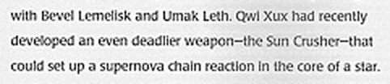
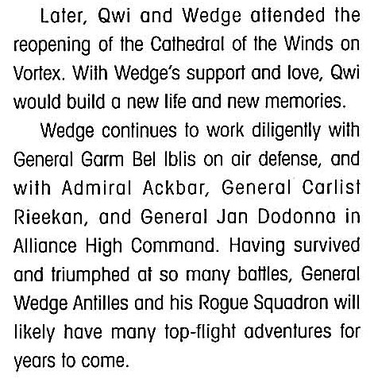

# Qwi Xux

- **Aliases:** Qwi
- **Era:** NR
- **Continuity:** default Legends; entries present for: Legends
- **Research tier:** MASTERY (Jedi Academy trilogy 026 version only: Jedi Search, Dark Apprentice, Champions of the Force; primary read 2026-10-28)
- **Entries:** 30 (25 with quotations; 0 quotations extended to the full sentence/passage from the source text on file; 0 marked as fragments). Rebuilt 2026-11-17 from 40 old entries; old file: `characters/_bak/qwi-xux.md.bak-20261117`.
- **How to read:** each entry is the quotation in full (block quote), then its source and point of view. "Note" lines are summaries from our notes, not quotations. `[fragment — full passage not on file]` means the source text is not on the box, so only the words in our notes are shown. Debate and forum material is in the last section and is unverified.

# LEGENDS (Legends / EU — main focus)

## Jedi Academy Trilogy (Kevin J. Anderson, 1994): Jedi Search, Dark Apprentice, Champions of the Force (power-scaling notes)

> Now, after her time of healing, after she had returned to Maw Installation and walked along the old corridors, set foot in her former laboratory—Qwi no longer chose to mourn those lost memories.
>
> When the misguided Kyp Durron had erased her thoughts, it had been a violent act. But, in hindsight, she thought he might have inadvertently done her a great favor. She did not wish to remember her devastating weapons work. She felt as if she had been reborn, given a new chance to start a life with Wedge, unencumbered by dark thoughts of the deadly inventions she had helped to create.
— Source: Champions of the Force, ch.43, PDF p.254 — Owner Material 026 — Jedi Academy Trilogy: Champions of the Force (Kevin J. Anderson); Qwi on her mind-wipe (also: Qwi Xux). POV: Qwi.
(Excerpt widened 2026-11-17 to the relevant passage, word for word from Champions of the Force (Kevin Anderson), Chapter 43 (text copy `MEGA_Legend_The_Jedi_Academy_Trilogy_Star_Wars_Jedi_Academy_03_Champions_of_the_Force_Kevin_J_Anderson_epub`).)
Note (our notes, around the quote): Qwi on her mind-wipe (also: Qwi Xux): "When the misguided Kyp Durron had erased her thoughts, it had been a violent act. But, in hindsight, she thought he might have inadvertently done her a great favor." Source: Champions of the Force, ch.43, PDF p.254
Our notes: `notes/materials/026-jedi-academy-trilogy/champions-of-the-force.md:117`

> Much of her basic scientific knowledge remained intact, but certain things were completely gone: insights she had gained, new weapons designs and new ideas she had developed. It seemed that when Kyp had rummaged around in her brain, yanking out anything that had to do with the Sun Crusher, he had erased whatever he found questionable.
— Source: Champions of the Force, ch.4, PDF p.40-41 — Owner Material 026 — Jedi Academy Trilogy: Champions of the Force (Kevin J. Anderson); Effect of Kyp’s mind-wipe (also: Qwi Xux). POV: Effect of Kyp’s mind-wipe, about Qwi Xux.
Note (our notes, around the quote): Effect of Kyp’s mind-wipe (also: Qwi Xux): "Much of her basic scientific knowledge remained intact, but certain things were completely gone: insights she had gained, new weapons designs and new ideas she had developed. It seemed that when Kyp had rummaged around in her brain, yanking out anything that had to do with the Sun Crusher, he had erased whatever he found questionable." Source: Champions of the Force, ch.4, PDF p.40-41
Our notes: `notes/materials/026-jedi-academy-trilogy/champions-of-the-force.md:122`

> She tried to shout for help, but her voice locked in her throat as if an invisible hand had stilled her vocal cords. She whirled for the door and hung in midstride, yanked back by unseen spiderwebs.
— Source: Dark Apprentice, ch.31, PDF p.228 — Owner Material 026 — Jedi Academy Trilogy: Dark Apprentice (Kevin J. Anderson); Kyp Force-paralyzes Qwi (also: Qwi Xux). POV: Kyp Force-paralyzes Qwi, about Qwi Xux.
Note (our notes, around the quote): Kyp Force-paralyzes Qwi (also: Qwi Xux): "She tried to shout for help, but her voice locked in her throat as if an invisible hand had stilled her vocal cords. She whirled for the door and hung in midstride, yanked back by unseen spiderwebs." Source: Dark Apprentice, ch.31, PDF p.228
Our notes: `notes/materials/026-jedi-academy-trilogy/dark-apprentice.md:102`

> He spoke in a freezing voice. “I have found you, Dr. Xux. You hold too much dangerous knowledge,” he said. “I must make certain no one can ever again create the weapons you’ve been responsible for. There must be no more Death Stars. No more Sun Crushers.” His fingers clamped down harder on her forehead, on her face. Her skull seemed ready to shatter. Waves of pain plunged through her brain like the claws of a nightmare monster. She felt the sharp points of metal talons scraping through her mind, digging, prying up, and ripping out memories and scientific knowledge she had accumulated over the course of many years.
— Source: Dark Apprentice, ch.31, PDF p.228 — Owner Material 026 — Jedi Academy Trilogy: Dark Apprentice (Kevin J. Anderson).
Note (our notes, around the quote): Kyp rips the weapons knowledge from Qwi’s mind (also: Qwi Xux, Sun Crusher (superweapon)): "He spoke in a freezing voice. “I have found you, Dr. Xux. You hold too much dangerous knowledge,” he said. “I must make certain no one can ever again create the weapons you’ve been responsible for. There must be no more Death Stars. No more Sun Crushers.” His fingers clamped down harder on her forehead, on her face. Her skull seemed ready to shatter. Waves of pain plunged through her brain like the claws of a nightmare monster. She felt the sharp points of metal talons scraping through her mind, digging, prying up, and ripping out memories and scientific knowledge she had accumulated over the course of many years." Source: Dark Apprentice, ch.31, PDF p.228
Our notes: `notes/materials/026-jedi-academy-trilogy/dark-apprentice.md:103`

> Kyp’s face was a grim mask as he flicked a row of red activator switches. He knew exactly how the Sun Crusher worked; he had stolen those memories from Qwi Xux.
— Source: Dark Apprentice, ch.33, PDF p.238 — Owner Material 026 — Jedi Academy Trilogy: Dark Apprentice (Kevin J. Anderson).
Note (our notes, around the quote): Kyp knows the Sun Crusher from Qwi’s stolen memories (also: Qwi Xux, Sun Crusher (superweapon)): "Kyp’s face was a grim mask as he flicked a row of red activator switches. He knew exactly how the Sun Crusher worked; he had stolen those memories from Qwi Xux." Source: Dark Apprentice, ch.33, PDF p.238
Our notes: `notes/materials/026-jedi-academy-trilogy/dark-apprentice.md:128`

> “The Sun Crusher is the most formidable weapon ever devised,” Qwi said. “I know this better than anyone, because I designed it. It is an order of magnitude more dangerous than even the Death Star. It is no longer in the clutches of Imperial powers—but I’m concerned about what the New Republic intends. I have refused to divulge its workings for a reason, but you have kept it locked in your research bays for weeks, tinkering with it, studying it, trying to unlock its secrets. It will do you no good.”
— Source: Dark Apprentice, ch.8, PDF p.78 — Owner Material 026 — Jedi Academy Trilogy: Dark Apprentice (Kevin J. Anderson); Qwi to the Assembly (also: Qwi Xux). POV: Qwi.
(Excerpt widened 2026-11-17 to the relevant passage, word for word from Dark Apprentice (Kevin Anderson), Chapter 8 (text copy `MEGA_Legend_The_Jedi_Academy_Trilogy_Star_Wars_Jedi_Academy_02_Dark_Apprentice_Kevin_J_Anderson_epub`).)
Note (our notes, around the quote): Qwi to the Assembly (also: Qwi Xux): "“The Sun Crusher is the most formidable weapon ever devised,” Qwi said. “I know this better than anyone, because I designed it. It is an order of magnitude more dangerous than even the Death Star." Source: Dark Apprentice, ch.8, PDF p.78
Our notes: `notes/materials/026-jedi-academy-trilogy/dark-apprentice.md:208`

> Wedge held her tight as she said, “I’ve lost everything. Most of my memory, my life—is gone.”
— Source: Dark Apprentice, ch.31, PDF p.229 — Owner Material 026 — Jedi Academy Trilogy: Dark Apprentice (Kevin J. Anderson); Qwi after the attack. POV: Qwi after the attack.
(Excerpt widened 2026-11-17 to the relevant passage, word for word from Dark Apprentice (Kevin Anderson), Chapter 31 (text copy `MEGA_Legend_The_Jedi_Academy_Trilogy_Star_Wars_Jedi_Academy_02_Dark_Apprentice_Kevin_J_Anderson_epub`).)
Note (our notes, around the quote): Qwi after the attack: "“I’ve lost everything. Most of my memory, my life—is gone.”" Source: Dark Apprentice, ch.31, PDF p.229
Our notes: `notes/materials/026-jedi-academy-trilogy/dark-apprentice.md:247`

> Daala whirled back at her, wearing a sour expression. “We have received new information. The Empire lies wounded and vulnerable on the outside, and we can’t just sit here and wait. We have four Star Destroyers, a full fleet the Rebellion knows nothing about. Since the Death Star prototype is not capable of hyperspace travel, it is useless to us in this operation—but we will have the Sun Crusher. Your beautiful Sun Crusher.” The lights of the fiery gases outside glimmered in Daala’s eyes. “With it we can destroy the New Republic, system by system.”
— Source: Jedi Search, ch.23, PDF p.232-233 — Owner Material 026 — Jedi Academy Trilogy: Jedi Search (Kevin J. Anderson).
(Excerpt widened 2026-11-17 to the relevant passage, word for word from Jedi Search (Kevin Anderson), Chapter 23 (text copy `MEGA_Legend_The_Jedi_Academy_Trilogy_Star_Wars_Jedi_Academy_01_Jedi_Search_Kevin_J_Anderson_epub`).)
Note (our notes, around the quote): Daala orders Qwi to finish the Sun Crusher (also: Sun Crusher (superweapon)): "“We have received new information. The Empire lies wounded and vulnerable on the outside, and we can’t just sit here and wait. We have four Star Destroyers, a full fleet the Rebellion knows nothing about. Since the Death Star prototype is not capable of hyperspace travel, it is useless to us in this operation—but we will have the Sun Crusher. Your beautiful Sun Crusher.” The lights of the fiery gases outside glimmered in Daala’s eyes. “With it we can destroy the New Republic, system by system.”" Source: Jedi Search, ch.23, PDF p.232-233
Our notes: `notes/materials/026-jedi-academy-trilogy/jedi-search.md:149`

> “Right now we’re working on enhancing the armor,” Qwi said. “Though the craft is not much larger than a single-man fighter, we need it to be completely impervious to attack. By introducing quantum-crystalline armor, where only a few layers of atoms are stacked as densely as physics permits, laminated on top of another thin film just as tough but phase shifted, we can be confident that nothing will harm it. Not so much as a dent.”
— Source: Jedi Search, ch.21, PDF p.217 — Owner Material 026 — Jedi Academy Trilogy: Jedi Search (Kevin J. Anderson); Qwi on the Sun Crusher’s armor (also: Qwi Xux). POV: Qwi.
(Excerpt widened 2026-11-17 to the relevant passage, word for word from Jedi Search (Kevin Anderson), Chapter 21 (text copy `MEGA_Legend_The_Jedi_Academy_Trilogy_Star_Wars_Jedi_Academy_01_Jedi_Search_Kevin_J_Anderson_epub`).)
Note (our notes, around the quote): Qwi on the Sun Crusher’s armor (also: Qwi Xux): "“Though the craft is not much larger than a single-man fighter, we need it to be completely impervious to attack. By introducing quantum-crystalline armor, where only a few layers of atoms are stacked as densely as physics permits, laminated on top of another thin film just as tough but phase shifted, we can be confident that nothing will harm it. Not so much as a dent.”" Source: Jedi Search, ch.21, PDF p.217
Our notes: `notes/materials/026-jedi-academy-trilogy/jedi-search.md:207`

> Qwi looked at the image with awe, pride, and fear. “Well, we haven’t actually tested it yet, but the first full-scale model is basically completed. We call this concept the Sun Crusher, tiny but immensely powerful. One small, impervious craft launches a modulated resonance projectile into a star, which triggers a chain reaction in the core, igniting a supernova even in low-mass stars. Straightforward and simple.”
— Source: Jedi Search, ch.21, PDF p.217 — Owner Material 026 — Jedi Academy Trilogy: Jedi Search (Kevin J. Anderson); Qwi on what the Sun Crusher does (also: Qwi Xux). POV: Qwi.
(Excerpt widened 2026-11-17 to the relevant passage, word for word from Jedi Search (Kevin Anderson), Chapter 21 (text copy `MEGA_Legend_The_Jedi_Academy_Trilogy_Star_Wars_Jedi_Academy_01_Jedi_Search_Kevin_J_Anderson_epub`).)
Note (our notes, around the quote): Qwi on what the Sun Crusher does (also: Qwi Xux): "“We call this concept the Sun Crusher, tiny but immensely powerful. One small, impervious craft launches a modulated resonance projectile into a star, which triggers a chain reaction in the core, igniting a supernova even in low-mass stars. Straightforward and simple.”" Source: Jedi Search, ch.21, PDF p.217
Our notes: `notes/materials/026-jedi-academy-trilogy/jedi-search.md:208`

> The armor plating was multicolored and shimmering, like a constantly changing pool of oil and molten metal. At the lower vertex hung the oddly fuzzy torus of an immensely powerful resonance-torpedo transmitter. Though not much larger than a fighter craft, the Sun Crusher hummed with deadly potential.
— Source: Jedi Search, ch.25, PDF p.247 — Owner Material 026 — Jedi Academy Trilogy: Jedi Search (Kevin J. Anderson); First look at the Sun Crusher (also: Qwi Xux).
Note (our notes, around the quote): First look at the Sun Crusher (also: Qwi Xux): "The armor plating was multicolored and shimmering, like a constantly changing pool of oil and molten metal. At the lower vertex hung the oddly fuzzy torus of an immensely powerful resonance-torpedo transmitter. Though not much larger than a fighter craft, the Sun Crusher hummed with deadly potential." Source: Jedi Search, ch.25, PDF p.247
Our notes: `notes/materials/026-jedi-academy-trilogy/jedi-search.md:209`

> In silence Qwi and her three surviving classmates went to the window of the educational sphere so they could watch as turbolasers from the Victory-class Star Destroyer obliterated Pillik’s honeycomb settlement in punishment for his failure.
— Source: Jedi Search, ch.23, PDF p.228 — Owner Material 026 — Jedi Academy Trilogy: Jedi Search (Kevin J. Anderson); Qwi’s training under Tarkin (also: Grand Moff Tarkin). POV: Qwi’s training under Tarkin, about Qwi Xux.
Note (our notes, around the quote): Qwi’s training under Tarkin (also: Grand Moff Tarkin): "In silence Qwi and her three surviving classmates went to the window of the educational sphere so they could watch as turbolasers from the Victory-class Star Destroyer obliterated Pillik’s honeycomb settlement in punishment for his failure." Source: Jedi Search, ch.23, PDF p.228
Our notes: `notes/materials/026-jedi-academy-trilogy/jedi-search.md:215`

> “This is just the functional part,” Qwi said, staring out the window with admiration in her eyes. “The core, the superlaser, and the reactor, without a hyperdrive propulsion system. We didn’t see any need to add the structural support and all the housing decks for troops and administrators.”
— Source: Jedi Search, ch.21, PDF p.211 — Owner Material 026 — Jedi Academy Trilogy: Jedi Search (Kevin J. Anderson); The Maw prototype Death Star. POV: The Maw prototype Death Star, about Qwi Xux.
Note (our notes, around the quote): The Maw prototype Death Star: "“This is just the functional part,” Qwi said, staring out the window with admiration in her eyes. “The core, the superlaser, and the reactor, without a hyperdrive propulsion system. We didn’t see any need to add the structural support and all the housing decks for troops and administrators.”" Source: Jedi Search, ch.21, PDF p.211
Our notes: `notes/materials/026-jedi-academy-trilogy/jedi-search.md:219`

## Star Wars: The New Essential Chronology (Del Rey, 2005): power-scaling and lore notes

> Qwi Xux had recently developed an even deadlier weapon—the Sun Crusher—that could set up a supernova chain reaction in the core of a star.
— Source: Part Eight: The Return of the Jedi Knights; Sun Crusher — Sun Crusher. POV: Sun Crusher; about Qwi Xux.
Note (our notes, around the quote): Sun Crusher — Sun Crusher: "Qwi Xux had recently developed an even deadlier weapon—the Sun Crusher—that could set up a supernova chain reaction in the core of a star." Source: The New Essential Chronology, p.164

Our notes: `notes/materials/027-new-essential-chronology/08-part-eight-return-of-the-jedi-knights.md:31`

> But Kyp Durron tracked down Xux on Ithor, using his newfound dark side powers to wipe clean the weapons knowledge from her memory.
— Source: Part Eight: The Return of the Jedi Knights; Kyp Durron — Kyp wipes Qwi's memory. POV: speaker not named in our notes.
Note (our notes, around the quote): Kyp Durron — Kyp wipes Qwi's memory: "But Kyp Durron tracked down Xux on Ithor, using his newfound dark side powers to wipe clean the weapons knowledge from her memory." Source: The New Essential Chronology, p.165
Our notes: `notes/materials/027-new-essential-chronology/08-part-eight-return-of-the-jedi-knights.md:46`

## The Jedi Academy Sourcebook (WEG, 1996): power-scaling and lore notes

> Together, they join the disaster relief crews on Vortex, and work to help the Vors clear away the ruins of their Cathedral of Winds.
>
> For a long while, Wedge holds himself re- sponsible for Qwi's memory loss. If she had had areal professional rather than a lovesick fighter pilot for a bodyguard, she wouldn't have fallen prey to Kyp. Only later can he accept Luke's gentle argument that if he, a Jedi Master, could not stand up to Kyp's Sith-augmented powers, Wedge could not be expected to do so when Kyp came for Qwi Xux.
>
> The emergence of Admiral Daala’s forces ends Wedge’s period of introspection and personal exploration.
— Source: Chapter One: The New Republic.
(Excerpt widened 2026-11-17 to the relevant passage, word for word from research primary jedi academy sourcebook jas clean (text copy `research_primary_jedi_academy_sourcebook_jas_clean_txt_04b8ab0d44`).)
(Excerpt widened 2026-11-17 to the relevant passage, word for word from research primary jedi academy sourcebook jas clean (text copy `research_primary_jedi_academy_sourcebook_jas_clean_txt_04b8ab0d44`).)
Note (our notes, around the quote): Kyp Durron; Luke Skywalker; Qwi Xux — General Wedge Antilles — Kyp and Qwi Xux: "Only later can he accept Luke's gentle argument that if he, a Jedi Master, could not stand up to Kyp's Sith-augmented powers, Wedge could not be expected to do so when Kyp came for Qwi Xux." Source: The Jedi Academy Sourcebook, p.16
Our notes: `notes/materials/029-jedi-academy-sourcebook/01-ch1-the-new-republic.md:84`

> In Kyp’s view, Luke refuses to learn from that failure. To bring the new Jedi Knights to greater power, he should recognize new abilities, to make his Jedi Knights powerful enough to resist a purge like Vader's, Kyp believes that the pow- ers of the Sith, as revealed by Exar Kun, is the source of a greater power.
>
> Ultimately, Kyp openly defies Luke, and aided by Exar Kun's power, places the Jedi Master in a deep trance. He steals the Sun Crusher, which had been cast into the heart of the Yavin gas giant.
>
> Armed with the dread superweapon, Kyp begins a rampage of destruction aimed at crip- pling the remaining Imperial forces. He destroys one of Daala’s Star Destroyers, destroys Carida in a failed attempt to rescue his brother, and goes on to destroy a major Imperial depot in a peripheral Imperial Core system.
>
> Armed with the dread superweapon, Kyp begins a rampage of destruction aimed at crip- pling the remaining Imperial forces. He destroys one of Daala’s Star Destroyers, destroys Carida in a failed attempt to rescue his brother, and goes on to destroy a major Imperial depot in a peripheral Imperial Core system. Along the way, he stops by Ithor to wipe Qwi Xux’s memory of the Sun Crusher and all knowledge she used to invent it. Only the death of Exar Kun breaks the spell that holds Kyp in thrall to the shade of the ancient Sith Lord.
>
> Along the way, he stops by Ithor to wipe Qwi Xux’s memory of the Sun Crusher and all knowledge she used to invent it. Only the death of Exar Kun breaks the spell that holds Kyp in thrall to the shade of the ancient Sith Lord.
>
> After facing the High Council, Kyp must face Luke. Luke tells him that he has been tested by his journey into the dark side, and may have emerged a stronger Jedi for it. For the first time realizing the awesome responsibility of being a Jedi, Kyp fears the possibility he may again use his powers for evil.
— Source: Chapter Three: The Jedi Academy.
(Excerpt widened 2026-11-17 to the relevant passage, word for word from research primary jedi academy sourcebook jas clean (text copy `research_primary_jedi_academy_sourcebook_jas_clean_txt_04b8ab0d44`).)
(Excerpt widened 2026-11-17 to the relevant passage, word for word from research primary jedi academy sourcebook jas clean (text copy `research_primary_jedi_academy_sourcebook_jas_clean_txt_04b8ab0d44`).)
Note (our notes, around the quote): Kyp Durron; Qwi Xux; Sun Crusher — Kyp Durron — Qwi Xux's memory: "Along the way, he stops by Ithor to wipe Qwi Xux's memory of the Sun Crusher and all knowledge she used to invent it." Source: The Jedi Academy Sourcebook, p.36
Our notes: `notes/materials/029-jedi-academy-sourcebook/03-ch3-the-jedi-academy.md:95`

> Alter Difficulty: Target’s willpower, Percep- tion or control roll. Modified by relationship.
>
> Required Powers: Control pain, hibernation trance, life detection, life sense, magnify senses, receptive telepathy, sense Force, telekinesis, far- seeing, projective telepathy, affect mind, control mind, dim other's senses Warning: A character who uses this power immediately gets a Dark Side Point.
>
> Time to use: Five minutes.
>
> Effect: This dreadful power allows a Sith to sift through another person’s mind, and destroy all knowledge of specific events or learned skills.
>
> Use of the skill requires direct contact with the target, and only one specified objective can be pursued per session.
>
> The Jedi Academy Sourcebook === sp53 Chapter Five: Forces of the Empire E@i Chapter Five Forces of the Empire The Imperial Core Systems Though many Core worlds readily embraced the New Republic when the provisional govern- ment established itself on Coruscant, the vast majority resisted integration into the new gov- ernment, primarily because they feared the con- sequences ofallying themselves with the former Rebellion when there was stilla very good chance that the Empire might rise again to eclipse the New Republic.
— Source: Chapter Four: Echoes of the Sith; Kyp Durron; Qwi Xux — Memory Wipe — Sith power effect.
(Excerpt widened 2026-11-17 to the relevant passage, word for word from research primary jedi academy sourcebook jas clean (text copy `research_primary_jedi_academy_sourcebook_jas_clean_txt_04b8ab0d44`).)
(Excerpt widened 2026-11-17 to the relevant passage, word for word from research primary jedi academy sourcebook jas clean (text copy `research_primary_jedi_academy_sourcebook_jas_clean_txt_04b8ab0d44`).)
Note (our notes, around the quote): Kyp Durron; Qwi Xux — Memory Wipe — Sith power effect: "This dreadful power allows a Sith to sift through another person's mind, and destroy all knowledge of specific events or learned skills." Source: The Jedi Academy Sourcebook, p.51
Our notes: `notes/materials/029-jedi-academy-sourcebook/04-ch4-echoes-of-the-sith.md:64`

> The major offsite location is the construction dock which drifts not far from the base. The dock is where the Maw mechanics assemble the various prototypes designed by the scientists.
>
> There are many ore-rich asteroids drifting inthe vicinity, kept in a “corral” by low-power tractor beams. These rocks are tractored into the small industrial foundry attached to the dock and broken down into primary elements when pro- cessed metals and such are required.
>
> Sun Crusher The Sun Crusher is one of the prototype superweapon designs to emerge from Maw In- stallation. Each of its innovative features, from its molecular armor to its resonance torpedoes, cost as much to develop as the original Death Star superlaser.
>
> Sun Crusher The Sun Crusher is one of the prototype superweapon designs to emerge from Maw In- stallation. Each of its innovative features, from its molecular armor to its resonance torpedoes, cost as much to develop as the original Death Star superlaser. The Sun Crusher project was headed by Qwi Xux, who also contributed some of its design features.
>
> The Sun Crusher superweapon consists ofa very fast and heavily armored delivery system The Jedi Academy Sourcebook === sp68 oem , | ter Six: Maw Installation pet Six: May Installation The Prototype Death Star The prototype Death Star was built as a test-bed for new technologies developed for the Death Star project by Bevel Lemelisk and his team of engineers.
>
> The Sun Crusher project was headed by Qwi Xux, who also contributed some of its design features.
>
> The Sun Crusher superweapon consists ofa very fast and heavily armored delivery system The Jedi Academy Sourcebook === sp68 oem , | ter Six: Maw Installation pet Six: May Installation The Prototype Death Star The prototype Death Star was built as a test-bed for new technologies developed for the Death Star project by Bevel Lemelisk and his team of engineers.
>
> In appearance, it is a gigantic wire-frame sphere 120 kilometers in diameter. Circular rings connected at the poles spread out in a network of girders linking the whole into a surprisingly solid construction.
>
> Nested in the framework and superstructure hang the enormous reactor core and the planet-destroy- ing superlaser system.
— Source: Chapter Six: Maw Installation; Sun Crusher; Qwi Xux — Sun Crusher — development cost.
(Excerpt widened 2026-11-17 to the relevant passage, word for word from research primary jedi academy sourcebook jas clean (text copy `research_primary_jedi_academy_sourcebook_jas_clean_txt_04b8ab0d44`).)
(Excerpt widened 2026-11-17 to the relevant passage, word for word from research primary jedi academy sourcebook jas clean (text copy `research_primary_jedi_academy_sourcebook_jas_clean_txt_04b8ab0d44`).)
Note (our notes, around the quote): Sun Crusher; Qwi Xux — Sun Crusher — development cost: "Each of its innovative features, from its molecular armor to its resonance torpedoes, cost as much to develop as the original Death Star superlaser. The Sun Crusher project was headed by Qwi Xux, who also contributed some of its design features." Source: The Jedi Academy Sourcebook, p.66
Our notes: `notes/materials/029-jedi-academy-sourcebook/06-ch6-maw-installation.md:35`

> Of the 10 Omwati children who entered the program, only Qwi made it through all the training.
— Source: Chapter Six: Maw Installation; Qwi Xux — Qwi Xux — Tarkin's training program.
Note (our notes, around the quote): Qwi Xux — Qwi Xux — Tarkin's training program: "Of the 10 Omwati children who entered the program, only Qwi made it through all the training." Source: The Jedi Academy Sourcebook, p.75
Our notes: `notes/materials/029-jedi-academy-sourcebook/06-ch6-maw-installation.md:102`

> When Qwi defects to the New Republic, she goes before the New Republic Assembly to champion the destruction of the Sun Crusher.
— Source: Chapter Six: Maw Installation.
Note (our notes, around the quote): Qwi Xux; Sun Crusher — Qwi Xux — championing destruction of the Sun Crusher: "When Qwi defects to the New Republic, she goes before the New Republic Assembly to champion the destruction of the Sun Crusher." Source: The Jedi Academy Sourcebook, p.75
Our notes: `notes/materials/029-jedi-academy-sourcebook/06-ch6-maw-installation.md:104`

> Only upon meeting Wedge does she realize how empty her life has been, how devoid of personal relationships. Her only joys have come from completing a project or proving her designs and theories correct.
>
> After her address, she and Wedge leave Coruscant for Vortex, to help in the disaster relief efforts. During the trip, Wedge’s interest in Qwi grows, and she shyly encourages him. On the return trip, they stop by Ithor to take in the sights. Kyp Durron finds her there, and using Sith powers, drains her mind of all she knew of the Sun Crusher.
>
> The purge is not extremely focused, how- ever, and many other memories are destroyed as well. Fortunately, most of her basic scientific knowledge is intact, but she has lost a lot of her advanced knowledge.
— Source: Chapter Six: Maw Installation.
(Excerpt widened 2026-11-17 to the relevant passage, word for word from research primary jedi academy sourcebook jas clean (text copy `research_primary_jedi_academy_sourcebook_jas_clean_txt_04b8ab0d44`).)
(Excerpt widened 2026-11-17 to the relevant passage, word for word from research primary jedi academy sourcebook jas clean (text copy `research_primary_jedi_academy_sourcebook_jas_clean_txt_04b8ab0d44`).)
Note (our notes, around the quote): Kyp Durron; Qwi Xux; Sun Crusher — Qwi Xux — Kyp's memory wipe: "Kyp Durron finds her there, and using Sith powers, drains her mind of all she knew of the Sun Crusher." Source: The Jedi Academy Sourcebook, p.75
Our notes: `notes/materials/029-jedi-academy-sourcebook/06-ch6-maw-installation.md:106`

## The Complete Star Wars Encyclopedia, Vol. II (H–O)

> Hydra One of Admiral Daala's four Star Destroyers protecting the Maw Installation, it was demolished when Han Solo, Kyp Durron, and Qwi Xux escaped the secret facility in the Sun Crusher seven years after the Battle of Endor.
— Source: scan pages 41–80.
Note (our notes, around the quote): Admiral Daala; Han Solo; Kyp Durron; Qwi Xux; Sun Crusher (superweapon): "Hydra One of Admiral Daala's four Star Destroyers protecting the Maw Installation, it was demolished when Han Solo, Kyp Durron, and Qwi Xux escaped the secret facility in the Sun Crusher seven years after the Battle of Endor." Source: The Complete Star Wars Encyclopedia, Vol. II, p.69
Our notes: `notes/materials/031-complete-star-wars-encyclopedia-vol-2/01-v2-scan-041-080.md:248`

## The Complete Star Wars Encyclopedia, Vol. III (P–Z)

> He ordered the four surviving students—including young Qwi Xux—to look out the windows of their orbital education facility as he ordered his Star Destroyer to destroy Pillik's village.
— Source: scan pages 1–40; Qwi Xux. POV: Qwi Xux.
Note (our notes, around the quote): Qwi Xux: "He ordered the four surviving students—including young Qwi Xux—to look out the windows of their orbital education facility as he ordered his Star Destroyer to destroy Pillik's village." Source: The Complete Star Wars Encyclopedia, Vol. III, p.26
Our notes: `notes/materials/032-complete-star-wars-encyclopedia-vol-3/00-v3-scan-001-040.md:231`

> Under Admiral Daala, a design team headed by the scientist Qwi Xux made many breakthroughs that led to the new Sun Crusher, Only slightly larger than a fighter, its resonance torpedoes were powerful enough to destroy a star.
— Source: scan pages 201–240.
Note (our notes, around the quote): Sun Crusher (superweapon); Admiral Daala; Qwi Xux — entry/section: Sun Crusher: "Under Admiral Daala, a design team headed by the scientist Qwi Xux made many breakthroughs that led to the new Sun Crusher, Only slightly larger than a fighter, its resonance torpedoes were powerful enough to destroy a star." Source: The Complete Star Wars Encyclopedia, Vol. III, p.197
Our notes: `notes/materials/032-complete-star-wars-encyclopedia-vol-3/05-v3-scan-201-240.md:26`

## The New Essential Guide to Characters (2002)

- Note (summary from our notes, not a quotation): Page contents: 534 words, 14 paragraphs | headings/entries: Antilles separated from Qwi Xux
  — Source: scan pages 1–30.
Our notes: `notes/materials/034-new-essential-guide-to-characters/00-negc-scan-001-030.md:124`

## Sourcebooks/Ultimate Alien Anthology.pdf [Star Wars Roleplaying Game Revised Core (d20, 2002)] (scan pages 61–120)

- Note (summary from our notes, not a quotation): Page contents: Omwati history continued (Tarkin killed at Death Star; example names incl. Qwi Xux); illustrations (Nuknog, Omwati, Ortolan, Pacithhip). OCR blank; read from page image. (hand-read)
  — Source: Sourcebooks/Ultimate Alien Anthology.pdf [Star Wars Roleplaying Game Revi.
Our notes: `notes/materials/037-sw-d20-folder/673-ultimate-alien-anthology-scan-061-120.md:309`

## Essential Guide to Characters (1995)

- Note (summary from our notes, not a quotation): Later, Qwi and Wedge attended the reopening of the Cathedral of the Winds on Vortex. With Wedge's support and love, Qwi would build a new life and new memories. Wedge continues to work diligently with General Garm Bel Iblis on air defense, and with Admiral Ackbar, General Carlist Rieekan, and General Jan Dodonna in Alliance High Command. Having survived and triumphed at so many battles, General Wedge Antilles and his Rogue Squadron will likely have many top-flight adventures for years to come.
  — Source: The Essential Guide to Characters (Andy Mangels, Del Rey, 1995), printed p.8, scan p.017. The 1995 guide's telling, not a power feat..
Our notes: `notes/materials/147-essential-guide-to-characters-1995/egc-wedge-antilles.md`

## Essential Guide to Vehicles and Vessels (1996)

- Note (summary from our notes, not a quotation): The Sun Crusher was an Imperial superweapon designed at the Maw Installation, an Imperial military think tank that had been secretly established by Grand Moff Tarkin. The Maw Installation was hidden in the heart of the Maw, a cluster of black holes near the infamous spice world of Kessel. The original Death Star superlaser was invented at the Maw Installation by Imperial Engineer Bevel Lemelisk and a top design team that included an Omwati female named Qui Xux [sic]. After Tarkin and Lemelisk departed to build the Death Star, Tarkin left Admiral Daala in command and ordered Qui Xux [sic] to create a new Imperial superweapon.
  — Source: The Essential Guide to Vehicles and Vessels (Bill Smith, Del Rey, 1996), printed p.162, scan p.100. This 1996 printing spells the name Qui Xux. The character file remains Qwi Xux. The spelling is not normalized. These are the 1996 guide’s statements, not a power feat..
Our notes: `notes/materials/148-essential-guide-to-vehicles-vessels-1996/egvv-starlight-through-swoop.md`

- Note (summary from our notes, not a quotation): Han Solo was imprisoned in the Maw Installation, where he met the Sun Crusher’s designer, Qui Xux [sic], and convinced her of the evil the weapon presented. She, Solo, Chewbacca, and an escaped slave named Kyp Durron stole the Sun Crusher from the Empire. After they delivered the weapon to Coruscant, the New Republic Assembly voted to have the weapon cast down into the gas giant Yavin. However, Kyp retrieved the Sun Crusher and went on a rampage, destroying several Imperial worlds before surrendering the vessel. The Sun Crusher was destroyed at the Battle of the Maw, when it was caught in the gravity well of one of the Maw’s black holes.
  — Source: The Essential Guide to Vehicles and Vessels (Bill Smith, Del Rey, 1996), printed p.162, scan p.100. This 1996 printing spells the name Qui Xux. The character file remains Qwi Xux. The spelling is not normalized. The printed sentence is "stole the Sun Crusher from the Empire." The later sentence "delivered the weapon" is a different printed sentence and is kept..
Our notes: `notes/materials/148-essential-guide-to-vehicles-vessels-1996/egvv-starlight-through-swoop.md`

# Debate and forum claims (unverified)

Forum posts, Suspect Insight debates and Discord debates, respect threads, and verdicts. These are posters' arguments or quotations they typed; none is checked against the book here unless the entry says so.

_None in our notes._
