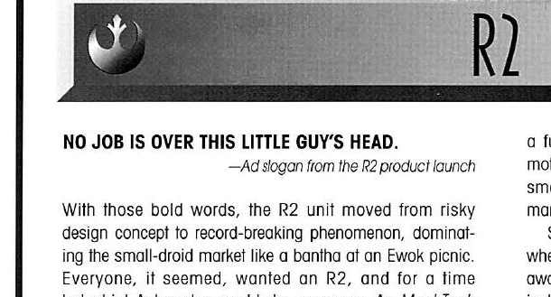

# R2-D2

- **Aliases:** Artoo, Artoo-Detoo
- **Era:** Prequel–GCW
- **Continuity:** default Legends; entries present for: Canon, Legends
- **Research tier:** untiered (not listed as INTRO/DEEP/MASTERY in legends-feats.md)
- **Entries:** 672 (309 with quotations; 25 quotations extended to the full sentence/passage from the source text on file; 184 marked as fragments; 217 before the 2026-11-17 fragment fill). Rebuilt 2026-11-17 from 747 old entries; old file: `characters/_bak/r2-d2.md.bak-20261117`.
- **How to read:** each entry is the quotation in full (block quote), then its source and point of view. "Note" lines are summaries from our notes, not quotations. `[fragment — full passage not on file]` means the source text is not on the box, so only the words in our notes are shown. Debate and forum material is in the last section and is unverified.

# LEGENDS (Legends / EU — main focus)

## Dark Lord trilogy (Labyrinth of Evil, Revenge of the Sith, Dark Lord): novel notes from the other agent (reference copy)

> On the far side of the spacious bay, up on its hard-stand, sat Anakin’s sleek yellow starfighter. R2-D2 stood nearby, communing with TC-16. Commander Cody and the rest of Squad Seven were elsewhere in the palace, “mopping up,” as the clones liked to say.
— Source: Labyrinth of Evil (novel, read in full): feats, scaling, quotes and story notes; Ch9 L487.
(Excerpt widened 2026-11-17 to the relevant passage, word for word from Labyrinth of Evil (James Luceno) (text copy `MEGA_Legend_The_Episode_Novelizations_Star_Wars_Revenge_of_the_Sith_01_Labyrinth_of_Evil_James_Luceno_epub`).)
Context: Complete quote register (45 lines: every sentence that names TC-16, verbatim, in book order):
Our notes: `notes/materials/022-dark-lord-trilogy/labyrinth-of-evil-notes.md:1651`; `notes/materials/022-dark-lord-trilogy/labyrinth-of-evil-notes.md:1696`

> “Really, sirs, I must protest,” TC-16 interrupted, hurrying behind R2-D2. “These items remain the property of Viceroy Gunray and other members of his party.”
— Source: Labyrinth of Evil (novel, read in full): feats, scaling, quotes and story notes; Ch9 L513.
(Excerpt widened 2026-11-17 to the relevant passage, word for word from Labyrinth of Evil (James Luceno) (text copy `MEGA_Legend_The_Episode_Novelizations_Star_Wars_Revenge_of_the_Sith_01_Labyrinth_of_Evil_James_Luceno_epub`).)
Context: Complete quote register (45 lines: every sentence that names TC-16, verbatim, in book order):
Our notes: `notes/materials/022-dark-lord-trilogy/labyrinth-of-evil-notes.md:1652`; `notes/materials/022-dark-lord-trilogy/labyrinth-of-evil-notes.md:1697`

> R2-D2 yowled, and TC-16 moaned in distress.
>
> A web of blue energy gamboled around the chair and the console, knocking Anakin onto his backside.
— Source: Labyrinth of Evil (novel, read in full): feats, scaling, quotes and story notes; Ch9 L571.
(Excerpt widened 2026-11-17 to the relevant passage, word for word from Labyrinth of Evil (James Luceno) (text copy `MEGA_Legend_The_Episode_Novelizations_Star_Wars_Revenge_of_the_Sith_01_Labyrinth_of_Evil_James_Luceno_epub`).)
(Excerpt widened 2026-11-17 to the relevant passage, word for word from Labyrinth of Evil (James Luceno) (text copy `MEGA_Legend_The_Episode_Novelizations_Star_Wars_Revenge_of_the_Sith_01_Labyrinth_of_Evil_James_Luceno_epub`).)
Context: Complete quote register (45 lines: every sentence that names TC-16, verbatim, in book order):
Our notes: `notes/materials/022-dark-lord-trilogy/labyrinth-of-evil-notes.md:1658`; `notes/materials/022-dark-lord-trilogy/labyrinth-of-evil-notes.md:1705`

What it shows (our notes): Role: jacks into the mechno-chair, which walks off with him (Ch9: «they saw R2-D2 with his interface arm still jacked into the chair», L547), bickers with TC-16 (L515), and carries Palpatine's recorded plea in Ch52.
> The protocol droid following behind, they hurried into a compact data room, where they saw R2-D2 with his interface arm still jacked into the chair, and the gripper of his grasping arm clamped to the bar handle of a storage cabinet. Stretched to its full extent, a computer interface cable now connected the mechno-chair to a control console of some sort. The chair’s talon-like feet were in constant motion, attempting to gain purchase on the smooth floor in an effort to propel the chair closer to the console.
— Source: L515 — Labyrinth of Evil (novel, read in full): feats, scaling, quotes and story notes.
(Excerpt widened 2026-11-17 to the relevant passage, word for word from Labyrinth of Evil (James Luceno) (text copy `MEGA_Legend_The_Episode_Novelizations_Star_Wars_Revenge_of_the_Sith_01_Labyrinth_of_Evil_James_Luceno_epub`).)
(Fragment completed 2026-11-17: full sentence/passage matched word for word in the source text on file: `MEGA_Legend_The_Episode_Novelizations_Star_Wars_Revenge_of_the_Sith_01_Labyrinth_of_Evil_James_Luceno_epub`.)
Our notes: `notes/materials/022-dark-lord-trilogy/labyrinth-of-evil-notes.md:1693`

- Note (summary from our notes, not a quotation): Scaling implications: none.
  — Source: Labyrinth of Evil (novel, read in full): feats, scaling, quotes and story notes.
Our notes: `notes/materials/022-dark-lord-trilogy/labyrinth-of-evil-notes.md:1694`

- Note (summary from our notes, not a quotation): Complete quote register (20 lines: every sentence that names R2-D2, verbatim, in book order):
  — Source: Labyrinth of Evil (novel, read in full): feats, scaling, quotes and story notes.
Our notes: `notes/materials/022-dark-lord-trilogy/labyrinth-of-evil-notes.md:1695`; `notes/materials/022-dark-lord-trilogy/rots-novel-notes.md:760`

> R2-D2 trilled and hooted at the battered protocol droid. The two had been bickering since R2-D2’s arrival a short time earlier.
— Source: Labyrinth of Evil (novel, read in full): feats, scaling, quotes and story notes; Ch9 L515.
(Excerpt widened 2026-11-17 to the relevant passage, word for word from Labyrinth of Evil (James Luceno) (text copy `MEGA_Legend_The_Episode_Novelizations_Star_Wars_Revenge_of_the_Sith_01_Labyrinth_of_Evil_James_Luceno_epub`).)
Context: Complete quote register (20 lines: every sentence that names R2-D2, verbatim, in book order):
Our notes: `notes/materials/022-dark-lord-trilogy/labyrinth-of-evil-notes.md:1698`

> R2-D2 trilled and hooted at the battered protocol droid. The two had been bickering since R2-D2’s arrival a short time earlier.
— Source: Labyrinth of Evil (novel, read in full): feats, scaling, quotes and story notes; Ch9 L515.
(Excerpt widened 2026-11-17 to the relevant passage, word for word from Labyrinth of Evil (James Luceno) (text copy `MEGA_Legend_The_Episode_Novelizations_Star_Wars_Revenge_of_the_Sith_01_Labyrinth_of_Evil_James_Luceno_epub`).)
Context: Complete quote register (20 lines: every sentence that names R2-D2, verbatim, in book order):
Our notes: `notes/materials/022-dark-lord-trilogy/labyrinth-of-evil-notes.md:1699`

> R2-D2 began to loose a long series of whistles, chirps, and chitters.
>
> “If and when they give the okay,” Obi-Wan went on, “then feel free to dissect the entire chair, if that’s your objective.”
— Source: Labyrinth of Evil (novel, read in full): feats, scaling, quotes and story notes; Ch9 L527.
(Excerpt widened 2026-11-17 to the relevant passage, word for word from Labyrinth of Evil (James Luceno) (text copy `MEGA_Legend_The_Episode_Novelizations_Star_Wars_Revenge_of_the_Sith_01_Labyrinth_of_Evil_James_Luceno_epub`).)
(Excerpt widened 2026-11-17 to the relevant passage, word for word from Labyrinth of Evil (James Luceno) (text copy `MEGA_Legend_The_Episode_Novelizations_Star_Wars_Revenge_of_the_Sith_01_Labyrinth_of_Evil_James_Luceno_epub`).)
Context: Complete quote register (20 lines: every sentence that names R2-D2, verbatim, in book order):
Our notes: `notes/materials/022-dark-lord-trilogy/labyrinth-of-evil-notes.md:1700`

> R2-D2 honked and razzed, though as if from a distance.
>
> “And you, too, Artoo.”
>
> Obi-Wan glanced over his shoulder, and his jaw dropped. “Where’s the mechno-chair?”
— Source: Labyrinth of Evil (novel, read in full): feats, scaling, quotes and story notes; Ch9 L539.
(Excerpt widened 2026-11-17 to the relevant passage, word for word from Labyrinth of Evil (James Luceno) (text copy `MEGA_Legend_The_Episode_Novelizations_Star_Wars_Revenge_of_the_Sith_01_Labyrinth_of_Evil_James_Luceno_epub`).)
(Excerpt widened 2026-11-17 to the relevant passage, word for word from Labyrinth of Evil (James Luceno) (text copy `MEGA_Legend_The_Episode_Novelizations_Star_Wars_Revenge_of_the_Sith_01_Labyrinth_of_Evil_James_Luceno_epub`).)
Context: Complete quote register (20 lines: every sentence that names R2-D2, verbatim, in book order):
Our notes: `notes/materials/022-dark-lord-trilogy/labyrinth-of-evil-notes.md:1701`

> The protocol droid following behind, they hurried into a compact data room, where they saw R2-D2 with his interface arm still jacked into the chair, and the gripper of his grasping arm clamped to the bar handle of a storage cabinet. Stretched to its full extent, a computer interface cable now connected the mechno-chair to a control console of some sort. The chair’s talon-like feet were in constant motion, attempting to gain purchase on the smooth floor in an effort to propel the chair closer to the console.
— Source: Labyrinth of Evil (novel, read in full): feats, scaling, quotes and story notes; Ch9 L547.
(Excerpt widened 2026-11-17 to the relevant passage, word for word from Labyrinth of Evil (James Luceno) (text copy `MEGA_Legend_The_Episode_Novelizations_Star_Wars_Revenge_of_the_Sith_01_Labyrinth_of_Evil_James_Luceno_epub`).)
Context: Complete quote register (20 lines: every sentence that names R2-D2, verbatim, in book order):
Our notes: `notes/materials/022-dark-lord-trilogy/labyrinth-of-evil-notes.md:1702`

> R2-D2 chattered and wheezed.
>
> “What’s Artoo saying?” Obi-Wan asked TC-16.
>
> “He’s saying, sir, that the mechno-chair has just armed itself to self-destruct!”
— Source: Labyrinth of Evil (novel, read in full): feats, scaling, quotes and story notes; Ch9 L551.
(Excerpt widened 2026-11-17 to the relevant passage, word for word from Labyrinth of Evil (James Luceno) (text copy `MEGA_Legend_The_Episode_Novelizations_Star_Wars_Revenge_of_the_Sith_01_Labyrinth_of_Evil_James_Luceno_epub`).)
(Excerpt widened 2026-11-17 to the relevant passage, word for word from Labyrinth of Evil (James Luceno) (text copy `MEGA_Legend_The_Episode_Novelizations_Star_Wars_Revenge_of_the_Sith_01_Labyrinth_of_Evil_James_Luceno_epub`).)
(Fragment completed 2026-11-17: full sentence/passage matched word for word in the source text on file: `MEGA_Legend_The_Episode_Novelizations_Star_Wars_Revenge_of_the_Sith_01_Labyrinth_of_Evil_James_Luceno_epub`.)
Context: Complete quote register (20 lines: every sentence that names R2-D2, verbatim, in book order):
Our notes: `notes/materials/022-dark-lord-trilogy/labyrinth-of-evil-notes.md:1703`

> Obi-Wan glanced worriedly at R2-D2. “How much time, Artoo?”
>
> TC-16 translated the astromech’s response. “Seconds, sir!”
— Source: Labyrinth of Evil (novel, read in full): feats, scaling, quotes and story notes; Ch9 L557.
(Excerpt widened 2026-11-17 to the relevant passage, word for word from Labyrinth of Evil (James Luceno) (text copy `MEGA_Legend_The_Episode_Novelizations_Star_Wars_Revenge_of_the_Sith_01_Labyrinth_of_Evil_James_Luceno_epub`).)
(Excerpt widened 2026-11-17 to the relevant passage, word for word from Labyrinth of Evil (James Luceno) (text copy `MEGA_Legend_The_Episode_Novelizations_Star_Wars_Revenge_of_the_Sith_01_Labyrinth_of_Evil_James_Luceno_epub`).)
Context: Complete quote register (20 lines: every sentence that names R2-D2, verbatim, in book order):
Our notes: `notes/materials/022-dark-lord-trilogy/labyrinth-of-evil-notes.md:1704`

> R2-D2 mewled in alarm.
>
> And to the meter-high figure in the hooded cloak, the unmistakable voice of Viceroy Nute Gunray was saying:
— Source: Labyrinth of Evil (novel, read in full): feats, scaling, quotes and story notes; Ch9 L571.
(Excerpt widened 2026-11-17 to the relevant passage, word for word from Labyrinth of Evil (James Luceno) (text copy `MEGA_Legend_The_Episode_Novelizations_Star_Wars_Revenge_of_the_Sith_01_Labyrinth_of_Evil_James_Luceno_epub`).)
(Excerpt widened 2026-11-17 to the relevant passage, word for word from Labyrinth of Evil (James Luceno) (text copy `MEGA_Legend_The_Episode_Novelizations_Star_Wars_Revenge_of_the_Sith_01_Labyrinth_of_Evil_James_Luceno_epub`).)
(Fragment completed 2026-11-17: full sentence/passage matched word for word in the source text on file: `MEGA_Legend_The_Episode_Novelizations_Star_Wars_Revenge_of_the_Sith_01_Labyrinth_of_Evil_James_Luceno_epub`.)
Context: Complete quote register (20 lines: every sentence that names R2-D2, verbatim, in book order):
Our notes: `notes/materials/022-dark-lord-trilogy/labyrinth-of-evil-notes.md:1706`

> In the launching bay Anakin kept his eyes on the mechno-chair, while R2-D2 and TC-16 kept their photoreceptors on Anakin. Now that the analysts had run their diagnostic routines, the technicians were preparing to pack the device for safe shipment to Coruscant.
— Source: Labyrinth of Evil (novel, read in full): feats, scaling, quotes and story notes; Ch12 L817.
(Excerpt widened 2026-11-17 to the relevant passage, word for word from Labyrinth of Evil (James Luceno) (text copy `MEGA_Legend_The_Episode_Novelizations_Star_Wars_Revenge_of_the_Sith_01_Labyrinth_of_Evil_James_Luceno_epub`).)
Context: Complete quote register (20 lines: every sentence that names R2-D2, verbatim, in book order):
Our notes: `notes/materials/022-dark-lord-trilogy/labyrinth-of-evil-notes.md:1707`

> R2-D2’s plaintive mewl needed no translation.
>
> The drive readout graph pulsed and climbed, and the starfighter surged forward.
— Source: Labyrinth of Evil (novel, read in full): feats, scaling, quotes and story notes; Ch19 L1449.
(Excerpt widened 2026-11-17 to the relevant passage, word for word from Labyrinth of Evil (James Luceno) (text copy `MEGA_Legend_The_Episode_Novelizations_Star_Wars_Revenge_of_the_Sith_01_Labyrinth_of_Evil_James_Luceno_epub`).)
(Excerpt widened 2026-11-17 to the relevant passage, word for word from Labyrinth of Evil (James Luceno) (text copy `MEGA_Legend_The_Episode_Novelizations_Star_Wars_Revenge_of_the_Sith_01_Labyrinth_of_Evil_James_Luceno_epub`).)
Context: Complete quote register (20 lines: every sentence that names R2-D2, verbatim, in book order):
Our notes: `notes/materials/022-dark-lord-trilogy/labyrinth-of-evil-notes.md:1708`

> Anakin scanned the threat-assessment display, committing to memory vector lines of the closest enemy fighters. Then he reopened a channel to R2-D2.
— Source: Labyrinth of Evil (novel, read in full): feats, scaling, quotes and story notes; Ch19 L1469.
(Excerpt widened 2026-11-17 to the relevant passage, word for word from Labyrinth of Evil (James Luceno) (text copy `MEGA_Legend_The_Episode_Novelizations_Star_Wars_Revenge_of_the_Sith_01_Labyrinth_of_Evil_James_Luceno_epub`).)
Context: Complete quote register (20 lines: every sentence that names R2-D2, verbatim, in book order):
Our notes: `notes/materials/022-dark-lord-trilogy/labyrinth-of-evil-notes.md:1709`

> Wending through clouds of expanding fire, he locked down the trigger of the laser cannons and made a second pass through the enemy wave, destroying a dozen more fighters in a heartbeat. But the tri-fighters were onto him now, eager for payback. A sunburst of scarlet beams seared past the bubble canopy, and a fighter appeared to starboard. An instant later, a second volley sizzled down from overhead. R2-D2 loosed a series of urgent whistles and tweets as the starfighter was rocked to its shields.
— Source: Labyrinth of Evil (novel, read in full): feats, scaling, quotes and story notes; Ch19 L1471.
(Excerpt widened 2026-11-17 to the relevant passage, word for word from Labyrinth of Evil (James Luceno) (text copy `MEGA_Legend_The_Episode_Novelizations_Star_Wars_Revenge_of_the_Sith_01_Labyrinth_of_Evil_James_Luceno_epub`).)
Context: Complete quote register (20 lines: every sentence that names R2-D2, verbatim, in book order):
Our notes: `notes/materials/022-dark-lord-trilogy/labyrinth-of-evil-notes.md:1710`

> The protocol droid had been sent to Coruscant for further debriefing by Republic Intelligence; R2-D2 was on Belderone, where technicians were seeing to damages he had sustained during the battle there. Obi-Wan and Anakin had the old white ship to themselves, and had exchanged their Jedi robes for outfits more suitable to itinerant spacers.
— Source: Labyrinth of Evil (novel, read in full): feats, scaling, quotes and story notes; Ch24 L1865.
(Excerpt widened 2026-11-17 to the relevant passage, word for word from Labyrinth of Evil (James Luceno) (text copy `MEGA_Legend_The_Episode_Novelizations_Star_Wars_Revenge_of_the_Sith_01_Labyrinth_of_Evil_James_Luceno_epub`).)
Context: Complete quote register (20 lines: every sentence that names R2-D2, verbatim, in book order):
Our notes: `notes/materials/022-dark-lord-trilogy/labyrinth-of-evil-notes.md:1711`

> As big as life, Palpatine’s holoimage spoke from atop a projector table in a private comlink lounge aboard the medical frigate. With R2-D2 standing off to one side of the transmission grid, Anakin hung on the Supreme Chancellor’s every word.
— Source: Labyrinth of Evil (novel, read in full): feats, scaling, quotes and story notes; Ch35 L3781.
(Excerpt widened 2026-11-17 to the relevant passage, word for word from Labyrinth of Evil (James Luceno) (text copy `MEGA_Legend_The_Episode_Novelizations_Star_Wars_Revenge_of_the_Sith_01_Labyrinth_of_Evil_James_Luceno_epub`).)
Context: Complete quote register (20 lines: every sentence that names R2-D2, verbatim, in book order):
Our notes: `notes/materials/022-dark-lord-trilogy/labyrinth-of-evil-notes.md:1712`

> Anakin fought the temptation to reveal everything about the search for Darth Sidious. He glanced at R2-D2, as if expecting commiseration, but the astromech only swiveled his dome, his processor status indicator flashing from blue to red.
— Source: Labyrinth of Evil (novel, read in full): feats, scaling, quotes and story notes; Ch35 L3849.
(Excerpt widened 2026-11-17 to the relevant passage, word for word from Labyrinth of Evil (James Luceno) (text copy `MEGA_Legend_The_Episode_Novelizations_Star_Wars_Revenge_of_the_Sith_01_Labyrinth_of_Evil_James_Luceno_epub`).)
Context: Complete quote register (20 lines: every sentence that names R2-D2, verbatim, in book order):
Our notes: `notes/materials/022-dark-lord-trilogy/labyrinth-of-evil-notes.md:1713`

> “Did you get through to him?” he asked as Anakin and R2-D2 approached.
>
> “Well, I spoke to him.”
— Source: Labyrinth of Evil (novel, read in full): feats, scaling, quotes and story notes; Ch35 L3875.
(Excerpt widened 2026-11-17 to the relevant passage, word for word from Labyrinth of Evil (James Luceno) (text copy `MEGA_Legend_The_Episode_Novelizations_Star_Wars_Revenge_of_the_Sith_01_Labyrinth_of_Evil_James_Luceno_epub`).)
(Excerpt widened 2026-11-17 to the relevant passage, word for word from Labyrinth of Evil (James Luceno) (text copy `MEGA_Legend_The_Episode_Novelizations_Star_Wars_Revenge_of_the_Sith_01_Labyrinth_of_Evil_James_Luceno_epub`).)
Context: Complete quote register (20 lines: every sentence that names R2-D2, verbatim, in book order):
Our notes: `notes/materials/022-dark-lord-trilogy/labyrinth-of-evil-notes.md:1714`

> The two starfighters were flying abreast, almost wingtip-to-wingtip, astromech droids R2-D2 and R4-P17 in their respective sockets. Tythe’s rubicund star was at their backs, and the ships that made up the Separatist flotilla were strung menacingly above the planet’s northern hemisphere.
— Source: Labyrinth of Evil (novel, read in full): feats, scaling, quotes and story notes; Ch37 L3959.
(Excerpt widened 2026-11-17 to the relevant passage, word for word from Labyrinth of Evil (James Luceno) (text copy `MEGA_Legend_The_Episode_Novelizations_Star_Wars_Revenge_of_the_Sith_01_Labyrinth_of_Evil_James_Luceno_epub`).)
Context: Complete quote register (20 lines: every sentence that names R2-D2, verbatim, in book order):
Our notes: `notes/materials/022-dark-lord-trilogy/labyrinth-of-evil-notes.md:1715`

> C-3PO shuffled along the starship’s hallway beside R2-D2, following Senator Organa who had, by all accounts, inherited them both. “I’m certain I can’t say why she malfunctioned,” he was telling the little astromech. “Organics are so terribly complicated, you know.”
— Source: Revenge of the Sith (Matthew Stover novelization): Power-Scaling Research Notes; Ch21 A New Jedi Order L8781.
(Excerpt widened 2026-11-17 to the relevant passage, word for word from Revenge of the Sith (Matthew Stover) (text copy `MEGA_Legend_The_Episode_Novelizations_Star_Wars_Revenge_of_the_Sith_02_Episode_III_Revenge_of_the_Sith_Matthew_Stover_epub`).)
Context: Complete quote register (70 lines: every sentence that names Bail Organa, verbatim, in book order):
Our notes: `notes/materials/022-dark-lord-trilogy/rots-novel-notes.md:562`; `notes/materials/022-dark-lord-trilogy/rots-novel-notes.md:832`; `notes/materials/022-dark-lord-trilogy/rots-novel-notes.md:895`

> "You know," Obi-Wan said, "I begin to understand why you speak of Artoo as though he's a living creature." *(L683)*
— Source: L683 — Revenge of the Sith (Matthew Stover novelization): Power-Scaling Research Notes; Personality: brave, resourceful, treated as a person by Anakin.
Note (our notes, around the quote): Personality: brave, resourceful, treated as a person by Anakin: «"You know," Obi-Wan said, "I begin to understand why you speak of Artoo as though he's a living creature."» (L683).
Our notes: `notes/materials/022-dark-lord-trilogy/rots-novel-notes.md:756`; `notes/materials/022-dark-lord-trilogy/rots-novel-notes.md:785`

- Note (summary from our notes, not a quotation): Arc: Anakin's astromech in the Coruscant space battle (Ch1) → fights alongside the Jedi on the *Invisible Hand* bridge (Ch7) → flies with Vader to Mustafar (Ch18–19) → his memory survives where C-3PO's is wiped (Ch21).
  — Source: Revenge of the Sith (Matthew Stover novelization): Power-Scaling Research Notes.
Our notes: `notes/materials/022-dark-lord-trilogy/rots-novel-notes.md:757`

> More frightening was the fact that of the two, Skywalker was reportedly the greater warrior. And even their R2 unit could fight: the little astromech had some kind of aftermarket cable-gun it had used to entangle the legs of a super droid and yank it off its feet, and now was jerking the droid this way and that so that its arm cannons were blasting chunks off its squadmates instead of the Jedi. *(L2529)*
— Source: L2477; L2503; L2529; L2501 — Revenge of the Sith (Matthew Stover novelization): Power-Scaling Research Notes.
(Full sentence/passage taken from the source text on file: `quick_tmp_rots_stover_epub`.)
Note (our notes, around the quote): Feats: combat subroutines with rockets, claw arm and cable-gun (L2477); a fusion-welder at the right moment (L2503); Grievous's POV: «And even their R2 unit could fight: the little astromech had some kind of aftermarket cable-gun it had used to entangle the legs of a super droid and yank it off its feet» (L2529). In Obi-Wan's Force-unity moment, R2 is part of the same Force picture (L2501).
Our notes: `notes/materials/022-dark-lord-trilogy/rots-novel-notes.md:758`

- Note (summary from our notes, not a quotation): Scaling implications: none for Force users. He is a minor combatant against battle droids.
  — Source: Revenge of the Sith (Matthew Stover novelization): Power-Scaling Research Notes.
Our notes: `notes/materials/022-dark-lord-trilogy/rots-novel-notes.md:759`

> The droid ganged into the socket on his starfighter’s left wing whistled something that sounded suspiciously like a human apology. Obi-Wan’s frown deepened. R4-P17 had been spending too much time with Anakin’s eccentric astromech; it was picking up R2-D2’s bad habits.
— Source: Revenge of the Sith (Matthew Stover novelization): Power-Scaling Research Notes; Ch1 Anakin And Obi-Wan L153.
(Excerpt widened 2026-11-17 to the relevant passage, word for word from Revenge of the Sith (Matthew Stover) (text copy `MEGA_Legend_The_Episode_Novelizations_Star_Wars_Revenge_of_the_Sith_02_Episode_III_Revenge_of_the_Sith_Matthew_Stover_epub`).)
Context: Complete quote register (73 lines: every sentence that names R2-D2, verbatim, in book order):
Our notes: `notes/materials/022-dark-lord-trilogy/rots-novel-notes.md:761`

- Note (summary from our notes, not a quotation): Ch1 Anakin And Obi-Wan L215 «Artoo, lock on."»
  — Source: Revenge of the Sith (Matthew Stover novelization): Power-Scaling Research Notes.
Context: Complete quote register (73 lines: every sentence that names R2-D2, verbatim, in book order):
Our notes: `notes/materials/022-dark-lord-trilogy/rots-novel-notes.md:762`

- Note (summary from our notes, not a quotation): Ch1 Anakin And Obi-Wan L225 «"Good shooting, Artoo."»
  — Source: Revenge of the Sith (Matthew Stover novelization): Power-Scaling Research Notes.
Context: Complete quote register (73 lines: every sentence that names R2-D2, verbatim, in book order):
Our notes: `notes/materials/022-dark-lord-trilogy/rots-novel-notes.md:763`

- Note (summary from our notes, not a quotation): Ch1 Anakin And Obi-Wan L247 «Artoo, lock on!"»
  — Source: Revenge of the Sith (Matthew Stover novelization): Power-Scaling Research Notes.
Context: Complete quote register (73 lines: every sentence that names R2-D2, verbatim, in book order):
Our notes: `notes/materials/022-dark-lord-trilogy/rots-novel-notes.md:764`

> “Don’t thank me. It was Artoo’s shooting.”
>
> “Yes. I suppose, if you like, you can thank your droid for me as well. And, Anakin—?”
— Source: Revenge of the Sith (Matthew Stover novelization): Power-Scaling Research Notes; Ch1 Anakin And Obi-Wan L263.
(Excerpt widened 2026-11-17 to the relevant passage, word for word from Revenge of the Sith (Matthew Stover) (text copy `MEGA_Legend_The_Episode_Novelizations_Star_Wars_Revenge_of_the_Sith_02_Episode_III_Revenge_of_the_Sith_Matthew_Stover_epub`).)
(Excerpt widened 2026-11-17 to the relevant passage, word for word from Revenge of the Sith (Matthew Stover) (text copy `MEGA_Legend_The_Episode_Novelizations_Star_Wars_Revenge_of_the_Sith_02_Episode_III_Revenge_of_the_Sith_Matthew_Stover_epub`).)
(Full sentence/passage taken from the source text on file: `quick_tmp_rots_stover_epub`.)
Context: Complete quote register (73 lines: every sentence that names R2-D2, verbatim, in book order):
Our notes: `notes/materials/022-dark-lord-trilogy/rots-novel-notes.md:765`

> “Artoo, where’s that signal?”
>
> From its socket beside the cockpit, R2-D2 whistled and beeped. A translation spidered across Anakin’s console readout: SCANNING. LOTS OF ECM SIGNAL JAMMING.
— Source: Revenge of the Sith (Matthew Stover novelization): Power-Scaling Research Notes; Ch1 Anakin And Obi-Wan L305.
(Excerpt widened 2026-11-17 to the relevant passage, word for word from Revenge of the Sith (Matthew Stover) (text copy `MEGA_Legend_The_Episode_Novelizations_Star_Wars_Revenge_of_the_Sith_02_Episode_III_Revenge_of_the_Sith_Matthew_Stover_epub`).)
(Excerpt widened 2026-11-17 to the relevant passage, word for word from Revenge of the Sith (Matthew Stover) (text copy `MEGA_Legend_The_Episode_Novelizations_Star_Wars_Revenge_of_the_Sith_02_Episode_III_Revenge_of_the_Sith_Matthew_Stover_epub`).)
Context: Complete quote register (73 lines: every sentence that names R2-D2, verbatim, in book order):
Our notes: `notes/materials/022-dark-lord-trilogy/rots-novel-notes.md:766`

> From its socket beside the cockpit, R2-D2 whistled and beeped. A translation spidered across Anakin’s console readout: SCANNING. LOTS OF ECM SIGNAL JAMMING.
— Source: Revenge of the Sith (Matthew Stover novelization): Power-Scaling Research Notes; Ch1 Anakin And Obi-Wan L307.
(Excerpt widened 2026-11-17 to the relevant passage, word for word from Revenge of the Sith (Matthew Stover) (text copy `MEGA_Legend_The_Episode_Novelizations_Star_Wars_Revenge_of_the_Sith_02_Episode_III_Revenge_of_the_Sith_Matthew_Stover_epub`).)
Context: Complete quote register (73 lines: every sentence that names R2-D2, verbatim, in book order):
Our notes: `notes/materials/022-dark-lord-trilogy/rots-novel-notes.md:767`

> Anakin could see exactly the look on his former Master’s face: a mask of calm belied by a jaw so tight that when he spoke his mouth barely moved. “Don’t worry, Master. If his beacon’s working, Artoo’ll find it. Have you thought about how we’ll find the Chancellor if—”
— Source: Revenge of the Sith (Matthew Stover novelization): Power-Scaling Research Notes; Ch1 Anakin And Obi-Wan L341.
(Excerpt widened 2026-11-17 to the relevant passage, word for word from Revenge of the Sith (Matthew Stover) (text copy `MEGA_Legend_The_Episode_Novelizations_Star_Wars_Revenge_of_the_Sith_02_Episode_III_Revenge_of_the_Sith_Matthew_Stover_epub`).)
Context: Complete quote register (73 lines: every sentence that names R2-D2, verbatim, in book order):
Our notes: `notes/materials/022-dark-lord-trilogy/rots-novel-notes.md:768`

> R2-D2 twittered, and Anakin checked his console readout. “We’ve got him, Master. The cruiser dead ahead. That’s Grievous’s flagship—Invisible Hand.”
— Source: Revenge of the Sith (Matthew Stover novelization): Power-Scaling Research Notes; Ch1 Anakin And Obi-Wan L365.
(Excerpt widened 2026-11-17 to the relevant passage, word for word from Revenge of the Sith (Matthew Stover) (text copy `MEGA_Legend_The_Episode_Novelizations_Star_Wars_Revenge_of_the_Sith_02_Episode_III_Revenge_of_the_Sith_Matthew_Stover_epub`).)
Context: Complete quote register (73 lines: every sentence that names R2-D2, verbatim, in book order):
Our notes: `notes/materials/022-dark-lord-trilogy/rots-novel-notes.md:769`

> “Easy? No. But it might be fun.” Sometimes a little teasing was the only way to get Obi-Wan to loosen up. “Lunch at Dex’s says I’ll blast two for each of yours. Artoo can keep score.”
— Source: Revenge of the Sith (Matthew Stover novelization): Power-Scaling Research Notes; Ch1 Anakin And Obi-Wan L377.
(Excerpt widened 2026-11-17 to the relevant passage, word for word from Revenge of the Sith (Matthew Stover) (text copy `MEGA_Legend_The_Episode_Novelizations_Star_Wars_Revenge_of_the_Sith_02_Episode_III_Revenge_of_the_Sith_Matthew_Stover_epub`).)
(Full sentence/passage taken from the source text on file: `quick_tmp_rots_stover_epub`.)
Context: Complete quote register (73 lines: every sentence that names R2-D2, verbatim, in book order):
Our notes: `notes/materials/022-dark-lord-trilogy/rots-novel-notes.md:770`

> “All right, dinner. And I promise this time I won’t let Artoo cheat.”
>
> “No games, Anakin. There’s too much at stake.” There, that was the tone Anakin had been looking for: a slightly scolding, schoolmasterish edge. Obi-Wan was back on form. “Have your droid tight-beam a report to the Temple. And send out a call for any Jedi in starfighters. We’ll come at it from all sides.”
— Source: Revenge of the Sith (Matthew Stover novelization): Power-Scaling Research Notes; Ch1 Anakin And Obi-Wan L381.
(Excerpt widened 2026-11-17 to the relevant passage, word for word from Revenge of the Sith (Matthew Stover) (text copy `MEGA_Legend_The_Episode_Novelizations_Star_Wars_Revenge_of_the_Sith_02_Episode_III_Revenge_of_the_Sith_Matthew_Stover_epub`).)
(Excerpt widened 2026-11-17 to the relevant passage, word for word from Revenge of the Sith (Matthew Stover) (text copy `MEGA_Legend_The_Episode_Novelizations_Star_Wars_Revenge_of_the_Sith_02_Episode_III_Revenge_of_the_Sith_Matthew_Stover_epub`).)
Context: Complete quote register (73 lines: every sentence that names R2-D2, verbatim, in book order):
Our notes: `notes/materials/022-dark-lord-trilogy/rots-novel-notes.md:771`

> “Way ahead of you.” But when he checked his comm readout, he shook his head. “There’s still too much ECM. Artoo can’t raise the Temple. I think the only reason we can even talk to each other is that we’re practically side by side.”
— Source: Revenge of the Sith (Matthew Stover novelization): Power-Scaling Research Notes; Ch1 Anakin And Obi-Wan L385.
(Excerpt widened 2026-11-17 to the relevant passage, word for word from Revenge of the Sith (Matthew Stover) (text copy `MEGA_Legend_The_Episode_Novelizations_Star_Wars_Revenge_of_the_Sith_02_Episode_III_Revenge_of_the_Sith_Matthew_Stover_epub`).)
(Full sentence/passage taken from the source text on file: `quick_tmp_rots_stover_epub`.)
Context: Complete quote register (73 lines: every sentence that names R2-D2, verbatim, in book order):
Our notes: `notes/materials/022-dark-lord-trilogy/rots-novel-notes.md:772`

> The droid fighters had lost themselves against the background of the battle, but R2-D2 was tracking them on scan. Anakin shifted his grip on his starfighter’s control yoke. “Ten vultures inbound, high and left to my orientation. More on the way.”
— Source: Revenge of the Sith (Matthew Stover novelization): Power-Scaling Research Notes; Ch1 Anakin And Obi-Wan L401.
(Excerpt widened 2026-11-17 to the relevant passage, word for word from Revenge of the Sith (Matthew Stover) (text copy `MEGA_Legend_The_Episode_Novelizations_Star_Wars_Revenge_of_the_Sith_02_Episode_III_Revenge_of_the_Sith_Matthew_Stover_epub`).)
Context: Complete quote register (73 lines: every sentence that names R2-D2, verbatim, in book order):
Our notes: `notes/materials/022-dark-lord-trilogy/rots-novel-notes.md:773`

- Note (summary from our notes, not a quotation): Ch1 Anakin And Obi-Wan L529 «"Okay, Artoo.»
  — Source: Revenge of the Sith (Matthew Stover novelization): Power-Scaling Research Notes.
Context: Complete quote register (73 lines: every sentence that names R2-D2, verbatim, in book order):
Our notes: `notes/materials/022-dark-lord-trilogy/rots-novel-notes.md:774`

> R2-D2 whistled nervous agreement with Obi-Wan.
>
> “Easy, Artoo,” Anakin said. “We’ve done this before.”
>
> Cannonfire blazed past him, impacting on the support struts ahead. Too late to change his mind now: he was committed. He would bring his ship through, or he would die.
— Source: Revenge of the Sith (Matthew Stover novelization): Power-Scaling Research Notes; Ch1 Anakin And Obi-Wan L541.
(Excerpt widened 2026-11-17 to the relevant passage, word for word from Revenge of the Sith (Matthew Stover) (text copy `MEGA_Legend_The_Episode_Novelizations_Star_Wars_Revenge_of_the_Sith_02_Episode_III_Revenge_of_the_Sith_Matthew_Stover_epub`).)
(Excerpt widened 2026-11-17 to the relevant passage, word for word from Revenge of the Sith (Matthew Stover) (text copy `MEGA_Legend_The_Episode_Novelizations_Star_Wars_Revenge_of_the_Sith_02_Episode_III_Revenge_of_the_Sith_Matthew_Stover_epub`).)
Context: Complete quote register (73 lines: every sentence that names R2-D2, verbatim, in book order):
Our notes: `notes/materials/022-dark-lord-trilogy/rots-novel-notes.md:775`

> “Easy, Artoo,” Anakin said. “We’ve done this before.”
>
> Cannonfire blazed past him, impacting on the support struts ahead. Too late to change his mind now: he was committed. He would bring his ship through, or he would die.
— Source: Revenge of the Sith (Matthew Stover novelization): Power-Scaling Research Notes; Ch1 Anakin And Obi-Wan L543.
(Excerpt widened 2026-11-17 to the relevant passage, word for word from Revenge of the Sith (Matthew Stover) (text copy `MEGA_Legend_The_Episode_Novelizations_Star_Wars_Revenge_of_the_Sith_02_Episode_III_Revenge_of_the_Sith_Matthew_Stover_epub`).)
(Excerpt widened 2026-11-17 to the relevant passage, word for word from Revenge of the Sith (Matthew Stover) (text copy `MEGA_Legend_The_Episode_Novelizations_Star_Wars_Revenge_of_the_Sith_02_Episode_III_Revenge_of_the_Sith_Matthew_Stover_epub`).)
Context: Complete quote register (73 lines: every sentence that names R2-D2, verbatim, in book order):
Our notes: `notes/materials/022-dark-lord-trilogy/rots-novel-notes.md:776`

> R2-D2’s squeal was as close to terrified as a droid can sound. Glowing letters spidered across Anakin’s readout: ABORT! ABORT ABORT!
— Source: Revenge of the Sith (Matthew Stover novelization): Power-Scaling Research Notes; Ch1 Anakin And Obi-Wan L553.
(Excerpt widened 2026-11-17 to the relevant passage, word for word from Revenge of the Sith (Matthew Stover) (text copy `MEGA_Legend_The_Episode_Novelizations_Star_Wars_Revenge_of_the_Sith_02_Episode_III_Revenge_of_the_Sith_Matthew_Stover_epub`).)
Context: Complete quote register (73 lines: every sentence that names R2-D2, verbatim, in book order):
Our notes: `notes/materials/022-dark-lord-trilogy/rots-novel-notes.md:777`

> Obi-Wan could only stare openmouthed as Anakin’s starfighter snapped onto its side and scraped through the slit with centimeters to spare. He fully expected one of the struts to knock R2’s dome off.
— Source: Revenge of the Sith (Matthew Stover novelization): Power-Scaling Research Notes; Ch1 Anakin And Obi-Wan L557.
(Excerpt widened 2026-11-17 to the relevant passage, word for word from Revenge of the Sith (Matthew Stover) (text copy `MEGA_Legend_The_Episode_Novelizations_Star_Wars_Revenge_of_the_Sith_02_Episode_III_Revenge_of_the_Sith_Matthew_Stover_epub`).)
Context: Complete quote register (73 lines: every sentence that names R2-D2, verbatim, in book order):
Our notes: `notes/materials/022-dark-lord-trilogy/rots-novel-notes.md:778`

> Anakin’s sensor board lit up and R2-D2 shrilled a warning. “Missiles!”
>
> He wasn’t worried for himself: the two on his tail were coming at him in perfect tandem. Missiles lack the sophisticated brains of droid fighters; to keep them from colliding on their inbound vectors, one of them would lock onto his fighter’s left drive, the other onto his right. A quick snap-roll would make those vectors intersect.
— Source: Revenge of the Sith (Matthew Stover novelization): Power-Scaling Research Notes; Ch1 Anakin And Obi-Wan L609.
(Excerpt widened 2026-11-17 to the relevant passage, word for word from Revenge of the Sith (Matthew Stover) (text copy `MEGA_Legend_The_Episode_Novelizations_Star_Wars_Revenge_of_the_Sith_02_Episode_III_Revenge_of_the_Sith_Matthew_Stover_epub`).)
(Excerpt widened 2026-11-17 to the relevant passage, word for word from Revenge of the Sith (Matthew Stover) (text copy `MEGA_Legend_The_Episode_Novelizations_Star_Wars_Revenge_of_the_Sith_02_Episode_III_Revenge_of_the_Sith_Matthew_Stover_epub`).)
Context: Complete quote register (73 lines: every sentence that names R2-D2, verbatim, in book order):
Our notes: `notes/materials/022-dark-lord-trilogy/rots-novel-notes.md:779`

> Through a gap torn in the cloud by the curve of his cockpit, Obi-Wan could see R2-D2 grappling with a buzz droid hand-to-hand. Well: saw-arm-to-saw-arm. Even flying blind and nearly out of control through the middle of a space battle, Obi-Wan could not avoid a second of disbelief at the bewildering variety of auxiliary tools and aftermarket behaviors Anakin had tinkered onto his starfighter’s astromech, even beyond the sophisticated upgrades performed by the Royal Engineers of Naboo. The little device was virtually a partner in its own right.
— Source: Revenge of the Sith (Matthew Stover novelization): Power-Scaling Research Notes; Ch1 Anakin And Obi-Wan L675.
(Excerpt widened 2026-11-17 to the relevant passage, word for word from Revenge of the Sith (Matthew Stover) (text copy `MEGA_Legend_The_Episode_Novelizations_Star_Wars_Revenge_of_the_Sith_02_Episode_III_Revenge_of_the_Sith_Matthew_Stover_epub`).)
Context: Complete quote register (73 lines: every sentence that names R2-D2, verbatim, in book order):
Our notes: `notes/materials/022-dark-lord-trilogy/rots-novel-notes.md:780`

> R2’s saw cut through one of the buzz droid’s grapplers, sending the jointed arm flipping lazily off into space. Then it did the same to another. Then a panel opened in R2-D2’s side and its datajack arm stabbed out and smacked the crippled buzz droid right off Anakin’s hull. The buzz droid spun aft until it was caught in the blast wash of Anakin’s sublights then blew away faster than even Obi-Wan’s eye could follow.
— Source: Revenge of the Sith (Matthew Stover novelization): Power-Scaling Research Notes; Ch1 Anakin And Obi-Wan L677.
(Excerpt widened 2026-11-17 to the relevant passage, word for word from Revenge of the Sith (Matthew Stover) (text copy `MEGA_Legend_The_Episode_Novelizations_Star_Wars_Revenge_of_the_Sith_02_Episode_III_Revenge_of_the_Sith_Matthew_Stover_epub`).)
Context: Complete quote register (73 lines: every sentence that names R2-D2, verbatim, in book order):
Our notes: `notes/materials/022-dark-lord-trilogy/rots-novel-notes.md:781`

> R2’s saw cut through one of the buzz droid’s grapplers, sending the jointed arm flipping lazily off into space. Then it did the same to another. Then a panel opened in R2-D2’s side and its datajack arm stabbed out and smacked the crippled buzz droid right off Anakin’s hull. The buzz droid spun aft until it was caught in the blast wash of Anakin’s sublights then blew away faster than even Obi-Wan’s eye could follow.
— Source: Revenge of the Sith (Matthew Stover novelization): Power-Scaling Research Notes; Ch1 Anakin And Obi-Wan L677.
(Excerpt widened 2026-11-17 to the relevant passage, word for word from Revenge of the Sith (Matthew Stover) (text copy `MEGA_Legend_The_Episode_Novelizations_Star_Wars_Revenge_of_the_Sith_02_Episode_III_Revenge_of_the_Sith_Matthew_Stover_epub`).)
Context: Complete quote register (73 lines: every sentence that names R2-D2, verbatim, in book order):
Our notes: `notes/materials/022-dark-lord-trilogy/rots-novel-notes.md:782`

> The datajack retracted and a different panel opened, this time in R2-D2’s dome. A claw-cable shot from it into the cloud of gas that still billowed from Obi-Wan’s right forward wing, and pulled back out dragging a struggling buzz droid. The silver droid twisted and squirmed and its grapplers took hold of the cable, climbing back along it, saw arms waving, until Anakin popped the starfighter’s underjets and R2 cut the cable and the buzz droid dropped away, tumbling helplessly through the battle.
— Source: Revenge of the Sith (Matthew Stover novelization): Power-Scaling Research Notes; Ch1 Anakin And Obi-Wan L681.
(Excerpt widened 2026-11-17 to the relevant passage, word for word from Revenge of the Sith (Matthew Stover) (text copy `MEGA_Legend_The_Episode_Novelizations_Star_Wars_Revenge_of_the_Sith_02_Episode_III_Revenge_of_the_Sith_Matthew_Stover_epub`).)
Context: Complete quote register (73 lines: every sentence that names R2-D2, verbatim, in book order):
Our notes: `notes/materials/022-dark-lord-trilogy/rots-novel-notes.md:783`

> The datajack retracted and a different panel opened, this time in R2-D2’s dome. A claw-cable shot from it into the cloud of gas that still billowed from Obi-Wan’s right forward wing, and pulled back out dragging a struggling buzz droid. The silver droid twisted and squirmed and its grapplers took hold of the cable, climbing back along it, saw arms waving, until Anakin popped the starfighter’s underjets and R2 cut the cable and the buzz droid dropped away, tumbling helplessly through the battle.
— Source: Revenge of the Sith (Matthew Stover novelization): Power-Scaling Research Notes; Ch1 Anakin And Obi-Wan L681.
(Excerpt widened 2026-11-17 to the relevant passage, word for word from Revenge of the Sith (Matthew Stover) (text copy `MEGA_Legend_The_Episode_Novelizations_Star_Wars_Revenge_of_the_Sith_02_Episode_III_Revenge_of_the_Sith_Matthew_Stover_epub`).)
Context: Complete quote register (73 lines: every sentence that names R2-D2, verbatim, in book order):
Our notes: `notes/materials/022-dark-lord-trilogy/rots-novel-notes.md:784`

- Note (summary from our notes, not a quotation): Ch1 Anakin And Obi-Wan L691 «Thanks, Artoo."»
  — Source: Revenge of the Sith (Matthew Stover novelization): Power-Scaling Research Notes.
Context: Complete quote register (73 lines: every sentence that names R2-D2, verbatim, in book order):
Our notes: `notes/materials/022-dark-lord-trilogy/rots-novel-notes.md:786`

> One touch blew his canopy and he sprang from the cockpit, flipping upward to stand on the wing. Battle droids opened fire instantly, and Anakin’s lightsaber flashed. “Artoo, locate a computer link.”
— Source: Revenge of the Sith (Matthew Stover novelization): Power-Scaling Research Notes; Ch1 Anakin And Obi-Wan L795.
(Excerpt widened 2026-11-17 to the relevant passage, word for word from Revenge of the Sith (Matthew Stover) (text copy `MEGA_Legend_The_Episode_Novelizations_Star_Wars_Revenge_of_the_Sith_02_Episode_III_Revenge_of_the_Sith_Matthew_Stover_epub`).)
(Full sentence/passage taken from the source text on file: `quick_tmp_rots_stover_epub`.)
Context: Complete quote register (73 lines: every sentence that names R2-D2, verbatim, in book order):
Our notes: `notes/materials/022-dark-lord-trilogy/rots-novel-notes.md:787`

> R2 popped out of its socket and bounced to the deck. Anakin jumped ahead of it into a cascade of blasterfire and let the Force direct his blade. Battle droids began to spark and collapse.
— Source: Revenge of the Sith (Matthew Stover novelization): Power-Scaling Research Notes; Ch1 Anakin And Obi-Wan L799.
(Excerpt widened 2026-11-17 to the relevant passage, word for word from Revenge of the Sith (Matthew Stover) (text copy `MEGA_Legend_The_Episode_Novelizations_Star_Wars_Revenge_of_the_Sith_02_Episode_III_Revenge_of_the_Sith_Matthew_Stover_epub`).)
Context: Complete quote register (73 lines: every sentence that names R2-D2, verbatim, in book order):
Our notes: `notes/materials/022-dark-lord-trilogy/rots-novel-notes.md:788`

> Anakin looked at the litter of smoking droid parts scattered throughout the hangar bay, shrugged, and snugged his black glove. “Artoo, where’s the Chancellor?”
— Source: Revenge of the Sith (Matthew Stover novelization): Power-Scaling Research Notes; Ch2 Dooku L851.
(Full sentence/passage taken from the source text on file: `quick_tmp_rots_stover_epub`.)
Context: Complete quote register (73 lines: every sentence that names R2-D2, verbatim, in book order):
Our notes: `notes/materials/022-dark-lord-trilogy/rots-novel-notes.md:789`

> The image rippled and twisted into a schematic map of the cruiser. Far up at the top of the conning spire R2 showed a pulsar of brighter blue.
— Source: Revenge of the Sith (Matthew Stover novelization): Power-Scaling Research Notes; Ch2 Dooku L861.
(Excerpt widened 2026-11-17 to the relevant passage, word for word from Revenge of the Sith (Matthew Stover) (text copy `MEGA_Legend_The_Episode_Novelizations_Star_Wars_Revenge_of_the_Sith_02_Episode_III_Revenge_of_the_Sith_Matthew_Stover_epub`).)
Context: Complete quote register (73 lines: every sentence that names R2-D2, verbatim, in book order):
Our notes: `notes/materials/022-dark-lord-trilogy/rots-novel-notes.md:790`

> “I can work with this plan.” Anakin turned to his astromech. “You stay here, Artoo—”
>
> The little droid interrupted him with a wheedling whirr.
— Source: Revenge of the Sith (Matthew Stover novelization): Power-Scaling Research Notes; Ch2 Dooku L915.
(Excerpt widened 2026-11-17 to the relevant passage, word for word from Revenge of the Sith (Matthew Stover) (text copy `MEGA_Legend_The_Episode_Novelizations_Star_Wars_Revenge_of_the_Sith_02_Episode_III_Revenge_of_the_Sith_Matthew_Stover_epub`).)
(Excerpt widened 2026-11-17 to the relevant passage, word for word from Revenge of the Sith (Matthew Stover) (text copy `MEGA_Legend_The_Episode_Novelizations_Star_Wars_Revenge_of_the_Sith_02_Episode_III_Revenge_of_the_Sith_Matthew_Stover_epub`).)
(Full sentence/passage taken from the source text on file: `quick_tmp_rots_stover_epub`.)
Context: Complete quote register (73 lines: every sentence that names R2-D2, verbatim, in book order):
Our notes: `notes/materials/022-dark-lord-trilogy/rots-novel-notes.md:791`

> R2-D2’s whistling reply had a distinctly sulky tone.
>
> “Listen, Artoo, someone has to maintain computer contact; do you see a datajack anywhere on me?”
— Source: Revenge of the Sith (Matthew Stover novelization): Power-Scaling Research Notes; Ch2 Dooku L921.
(Excerpt widened 2026-11-17 to the relevant passage, word for word from Revenge of the Sith (Matthew Stover) (text copy `MEGA_Legend_The_Episode_Novelizations_Star_Wars_Revenge_of_the_Sith_02_Episode_III_Revenge_of_the_Sith_Matthew_Stover_epub`).)
(Excerpt widened 2026-11-17 to the relevant passage, word for word from Revenge of the Sith (Matthew Stover) (text copy `MEGA_Legend_The_Episode_Novelizations_Star_Wars_Revenge_of_the_Sith_02_Episode_III_Revenge_of_the_Sith_Matthew_Stover_epub`).)
Context: Complete quote register (73 lines: every sentence that names R2-D2, verbatim, in book order):
Our notes: `notes/materials/022-dark-lord-trilogy/rots-novel-notes.md:792`

> “Listen, Artoo, someone has to maintain computer contact; do you see a datajack anywhere on me?”
>
> The droid seemed to acquiesce, but not before wheeping what sounded like it might have been a suggestion where to look.
— Source: Revenge of the Sith (Matthew Stover novelization): Power-Scaling Research Notes; Ch2 Dooku L923.
(Excerpt widened 2026-11-17 to the relevant passage, word for word from Revenge of the Sith (Matthew Stover) (text copy `MEGA_Legend_The_Episode_Novelizations_Star_Wars_Revenge_of_the_Sith_02_Episode_III_Revenge_of_the_Sith_Matthew_Stover_epub`).)
(Excerpt widened 2026-11-17 to the relevant passage, word for word from Revenge of the Sith (Matthew Stover) (text copy `MEGA_Legend_The_Episode_Novelizations_Star_Wars_Revenge_of_the_Sith_02_Episode_III_Revenge_of_the_Sith_Matthew_Stover_epub`).)
Context: Complete quote register (73 lines: every sentence that names R2-D2, verbatim, in book order):
Our notes: `notes/materials/022-dark-lord-trilogy/rots-novel-notes.md:793`

- Note (summary from our notes, not a quotation): Ch5 Grievous L1877 «"Artoo?"»
  — Source: Revenge of the Sith (Matthew Stover novelization): Power-Scaling Research Notes.
Context: Complete quote register (73 lines: every sentence that names R2-D2, verbatim, in book order):
Our notes: `notes/materials/022-dark-lord-trilogy/rots-novel-notes.md:794`

> "Artoo, do you copy?
— Source: Revenge of the Sith (Matthew Stover novelization): Power-Scaling Research Notes; Ch5 Grievous L1879.
Context: Complete quote register (73 lines: every sentence that names R2-D2, verbatim, in book order):
Our notes: `notes/materials/022-dark-lord-trilogy/rots-novel-notes.md:795`

- Note (summary from our notes, not a quotation): Ch6 Rescue L2091 «"Was that Artoo?»
  — Source: Revenge of the Sith (Matthew Stover novelization): Power-Scaling Research Notes.
Context: Complete quote register (73 lines: every sentence that names R2-D2, verbatim, in book order):
Our notes: `notes/materials/022-dark-lord-trilogy/rots-novel-notes.md:796`

- Note (summary from our notes, not a quotation): Ch6 Rescue L2101 «"Artoo!"»
  — Source: Revenge of the Sith (Matthew Stover novelization): Power-Scaling Research Notes.
Context: Complete quote register (73 lines: every sentence that names R2-D2, verbatim, in book order):
Our notes: `notes/materials/022-dark-lord-trilogy/rots-novel-notes.md:797`

> And fell. The sides of the turboshaft blurred.
>
> And fell some more, until the gravitic vector finally eased a couple of degrees and they found themselves sliding along the side of the shaft, which was quickly turning into the bottom of the shaft, and the lift pod was still shrieking toward them faster than they could possibly run until Anakin finally got the comlink working and shouted, “Artoo, open the doors! All of them! All floors!”
— Source: Revenge of the Sith (Matthew Stover novelization): Power-Scaling Research Notes; Ch6 Rescue L2115.
(Excerpt widened 2026-11-17 to the relevant passage, word for word from Revenge of the Sith (Matthew Stover) (text copy `MEGA_Legend_The_Episode_Novelizations_Star_Wars_Revenge_of_the_Sith_02_Episode_III_Revenge_of_the_Sith_Matthew_Stover_epub`).)
(Excerpt widened 2026-11-17 to the relevant passage, word for word from Revenge of the Sith (Matthew Stover) (text copy `MEGA_Legend_The_Episode_Novelizations_Star_Wars_Revenge_of_the_Sith_02_Episode_III_Revenge_of_the_Sith_Matthew_Stover_epub`).)
Context: Complete quote register (73 lines: every sentence that names R2-D2, verbatim, in book order):
Our notes: `notes/materials/022-dark-lord-trilogy/rots-novel-notes.md:798`

> “We’ll make our way forward!” Obi-Wan shouted. “There are only droids back here! Once we hit live-crew areas, there will be escape pods!”
>
> Only droids back here echoed inside Anakin’s head. “Obi-Wan, wait!” he cried. “Artoo’s still here somewhere! We can’t leave him!”
— Source: Revenge of the Sith (Matthew Stover novelization): Power-Scaling Research Notes; Ch6 Rescue L2163.
(Excerpt widened 2026-11-17 to the relevant passage, word for word from Revenge of the Sith (Matthew Stover) (text copy `MEGA_Legend_The_Episode_Novelizations_Star_Wars_Revenge_of_the_Sith_02_Episode_III_Revenge_of_the_Sith_Matthew_Stover_epub`).)
(Full sentence/passage taken from the source text on file: `quick_tmp_rots_stover_epub`.)
Context: Complete quote register (73 lines: every sentence that names R2-D2, verbatim, in book order):
Our notes: `notes/materials/022-dark-lord-trilogy/rots-novel-notes.md:799`

- Note (summary from our notes, not a quotation): Ch6 Rescue L2167 «Artoo, come in!"»
  — Source: Revenge of the Sith (Matthew Stover novelization): Power-Scaling Research Notes.
Context: Complete quote register (73 lines: every sentence that names R2-D2, verbatim, in book order):
Our notes: `notes/materials/022-dark-lord-trilogy/rots-novel-notes.md:800`

- Note (summary from our notes, not a quotation): Ch6 Rescue L2167 «Artoo, come in!"»
  — Source: Revenge of the Sith (Matthew Stover novelization): Power-Scaling Research Notes.
Context: Complete quote register (73 lines: every sentence that names R2-D2, verbatim, in book order):
Our notes: `notes/materials/022-dark-lord-trilogy/rots-novel-notes.md:801`

> Anakin desperately fished out his comlink. “Artoo! Artoo, come in!” He shook it, and shook it again. Artoo couldn’t have been destroyed. He just couldn’t. “Artoo, do you copy? Where are you?”
— Source: Revenge of the Sith (Matthew Stover novelization): Power-Scaling Research Notes; Ch6 Rescue L2167.
(Excerpt widened 2026-11-17 to the relevant passage, word for word from Revenge of the Sith (Matthew Stover) (text copy `MEGA_Legend_The_Episode_Novelizations_Star_Wars_Revenge_of_the_Sith_02_Episode_III_Revenge_of_the_Sith_Matthew_Stover_epub`).)
(Full sentence/passage taken from the source text on file: `quick_tmp_rots_stover_epub`.)
Context: Complete quote register (73 lines: every sentence that names R2-D2, verbatim, in book order):
Our notes: `notes/materials/022-dark-lord-trilogy/rots-novel-notes.md:802`

> "Artoo, do you copy?
— Source: Revenge of the Sith (Matthew Stover novelization): Power-Scaling Research Notes; Ch6 Rescue L2167.
Context: Complete quote register (73 lines: every sentence that names R2-D2, verbatim, in book order):
Our notes: `notes/materials/022-dark-lord-trilogy/rots-novel-notes.md:803`

- Note (summary from our notes, not a quotation): Ch6 Rescue L2171 «"Artoo!"»
  — Source: Revenge of the Sith (Matthew Stover novelization): Power-Scaling Research Notes.
Context: Complete quote register (73 lines: every sentence that names R2-D2, verbatim, in book order):
Our notes: `notes/materials/022-dark-lord-trilogy/rots-novel-notes.md:804`

> Out from her closet had whirred R2-D2.
>
> Of course Anakin knew him; he had known him for years—the little droid was a decorated war hero himself, having saved Padmé’s life back when she had been Queen of Naboo, not to mention helping the nine-year-old Anakin destroy the Trade Federation’s Droid Control Ship, breaking the blockade and saving the planet. The Royal Engineers of Naboo’s aftermarket wizardry made their modified R-units the most sought after in the galaxy; he’d tried to protest, but she had silenced him with a soft finger against his lips and a gentle smile and a whisper of “After all, what does a politician need with an astromech?”
— Source: Revenge of the Sith (Matthew Stover novelization): Power-Scaling Research Notes; Ch6 Rescue L2217.
(Excerpt widened 2026-11-17 to the relevant passage, word for word from Revenge of the Sith (Matthew Stover) (text copy `MEGA_Legend_The_Episode_Novelizations_Star_Wars_Revenge_of_the_Sith_02_Episode_III_Revenge_of_the_Sith_Matthew_Stover_epub`).)
(Excerpt widened 2026-11-17 to the relevant passage, word for word from Revenge of the Sith (Matthew Stover) (text copy `MEGA_Legend_The_Episode_Novelizations_Star_Wars_Revenge_of_the_Sith_02_Episode_III_Revenge_of_the_Sith_Matthew_Stover_epub`).)
Context: Complete quote register (73 lines: every sentence that names R2-D2, verbatim, in book order):
Our notes: `notes/materials/022-dark-lord-trilogy/rots-novel-notes.md:805`

> “Artoo, where are you? Come on, we have to get out of here!”
>
> High above, on the wall that was supposed to be the floor, the lid of a battered durasteel storage locker shifted, pushed aside by a dome of silver and blue. The lid swung fully open and R2-D2 righted itself, deployed its booster rockets, and floated out from the locker, heading for the far exit.
— Source: Revenge of the Sith (Matthew Stover novelization): Power-Scaling Research Notes; Ch6 Rescue L2229.
(Excerpt widened 2026-11-17 to the relevant passage, word for word from Revenge of the Sith (Matthew Stover) (text copy `MEGA_Legend_The_Episode_Novelizations_Star_Wars_Revenge_of_the_Sith_02_Episode_III_Revenge_of_the_Sith_Matthew_Stover_epub`).)
(Excerpt widened 2026-11-17 to the relevant passage, word for word from Revenge of the Sith (Matthew Stover) (text copy `MEGA_Legend_The_Episode_Novelizations_Star_Wars_Revenge_of_the_Sith_02_Episode_III_Revenge_of_the_Sith_Matthew_Stover_epub`).)
Context: Complete quote register (73 lines: every sentence that names R2-D2, verbatim, in book order):
Our notes: `notes/materials/022-dark-lord-trilogy/rots-novel-notes.md:806`

> High above, on the wall that was supposed to be the floor, the lid of a battered durasteel storage locker shifted, pushed aside by a dome of silver and blue. The lid swung fully open and R2-D2 righted itself, deployed its booster rockets, and floated out from the locker, heading for the far exit.
— Source: Revenge of the Sith (Matthew Stover novelization): Power-Scaling Research Notes; Ch6 Rescue L2231.
(Excerpt widened 2026-11-17 to the relevant passage, word for word from Revenge of the Sith (Matthew Stover) (text copy `MEGA_Legend_The_Episode_Novelizations_Star_Wars_Revenge_of_the_Sith_02_Episode_III_Revenge_of_the_Sith_Matthew_Stover_epub`).)
Context: Complete quote register (73 lines: every sentence that names R2-D2, verbatim, in book order):
Our notes: `notes/materials/022-dark-lord-trilogy/rots-novel-notes.md:807`

> As super battle droids came forward with electrobinders for their wrists and a restraining bolt for R2-D2, Obi-Wan cast one frowning look back over his shoulder.
>
> “Oh, Anakin,” he said, with the sort of quiet, pained resignation that would be recognized instantly by any parent exhausted by a trouble-prone child. “Where is your lightsaber?”
— Source: Revenge of the Sith (Matthew Stover novelization): Power-Scaling Research Notes; Ch6 Rescue L2373.
(Excerpt widened 2026-11-17 to the relevant passage, word for word from Revenge of the Sith (Matthew Stover) (text copy `MEGA_Legend_The_Episode_Novelizations_Star_Wars_Revenge_of_the_Sith_02_Episode_III_Revenge_of_the_Sith_Matthew_Stover_epub`).)
(Excerpt widened 2026-11-17 to the relevant passage, word for word from Revenge of the Sith (Matthew Stover) (text copy `MEGA_Legend_The_Episode_Novelizations_Star_Wars_Revenge_of_the_Sith_02_Episode_III_Revenge_of_the_Sith_Matthew_Stover_epub`).)
Context: Complete quote register (73 lines: every sentence that names R2-D2, verbatim, in book order):
Our notes: `notes/materials/022-dark-lord-trilogy/rots-novel-notes.md:808`

> He didn’t have to tell Anakin to subtly nudge Chancellor Palpatine out of the line of fire; part of him was Anakin, and was doing this already. He didn’t have to tell R2-D2 to access its combat subprograms and divert power to its booster rockets, claw-arm, and cable-gun; the part of him that was the little astromech had seen to all these things before they had even entered the bridge.
— Source: Revenge of the Sith (Matthew Stover novelization): Power-Scaling Research Notes; Ch7 Obi-Wan and Anakin 2 L2477.
(Excerpt widened 2026-11-17 to the relevant passage, word for word from Revenge of the Sith (Matthew Stover) (text copy `MEGA_Legend_The_Episode_Novelizations_Star_Wars_Revenge_of_the_Sith_02_Episode_III_Revenge_of_the_Sith_Matthew_Stover_epub`).)
Context: Complete quote register (73 lines: every sentence that names R2-D2, verbatim, in book order):
Our notes: `notes/materials/022-dark-lord-trilogy/rots-novel-notes.md:810`

> While the intent to swing was still forming in Grievous's mind, the part of the Force that was Obi-Wan was also the part of the Force that was R2-D2, as well as an internal fusion-welder Anakin had retrofitted into R2-D2's primary grappling arm, and so there was no need for actual communication between them; it was only Obi-Wan's personal sense of style that brought his customary gentle smile to his face and his customary gentle murmur to his lips.
— Source: Revenge of the Sith (Matthew Stover novelization): Power-Scaling Research Notes; Ch7 Obi-Wan and Anakin 2 L2501.
Context: Complete quote register (73 lines: every sentence that names R2-D2, verbatim, in book order):
Our notes: `notes/materials/022-dark-lord-trilogy/rots-novel-notes.md:811`

- Note (summary from our notes, not a quotation): Ch7 Obi-Wan and Anakin 2 L2501 «"Artoo?"»
  — Source: Revenge of the Sith (Matthew Stover novelization): Power-Scaling Research Notes.
Context: Complete quote register (73 lines: every sentence that names R2-D2, verbatim, in book order):
Our notes: `notes/materials/022-dark-lord-trilogy/rots-novel-notes.md:812`

- Note (summary from our notes, not a quotation): Ch7 Obi-Wan and Anakin 2 L2619 «"Artoo: second chair.»
  — Source: Revenge of the Sith (Matthew Stover novelization): Power-Scaling Research Notes.
Context: Complete quote register (73 lines: every sentence that names R2-D2, verbatim, in book order):
Our notes: `notes/materials/022-dark-lord-trilogy/rots-novel-notes.md:814`

> Across the platform, an escape pod hatch cycled open. Emergency crews scrambled with an escape slide, and a moment later the Supreme Chancellor, Obi-Wan Kenobi, and Anakin Skywalker were all on the deck beside the burning ship, closely followed by a somewhat battered R2 unit that lifted itself down on customized maneuvering rockets.
— Source: Revenge of the Sith (Matthew Stover novelization): Power-Scaling Research Notes; Ch8 Fault Lines L2727.
(Excerpt widened 2026-11-17 to the relevant passage, word for word from Revenge of the Sith (Matthew Stover) (text copy `MEGA_Legend_The_Episode_Novelizations_Star_Wars_Revenge_of_the_Sith_02_Episode_III_Revenge_of_the_Sith_Matthew_Stover_epub`).)
Context: Complete quote register (73 lines: every sentence that names R2-D2, verbatim, in book order):
Our notes: `notes/materials/022-dark-lord-trilogy/rots-novel-notes.md:815`

> Obi-Wan gave a silent sigh. He had entirely too good an idea whose face his former Padawan was so hoping to see.
>
> When the shuttle touched down, Master Windu caught his eye from beyond Anakin’s shoulder. The Korun Master made a nearly invisible gesture, to which Obi-Wan did not visibly respond; but when Palpatine and Anakin and R2 all debarked toward the crowd of well-wishers, Obi-Wan stayed behind.
— Source: Revenge of the Sith (Matthew Stover novelization): Power-Scaling Research Notes; Ch8 Fault Lines L2837.
(Excerpt widened 2026-11-17 to the relevant passage, word for word from Revenge of the Sith (Matthew Stover) (text copy `MEGA_Legend_The_Episode_Novelizations_Star_Wars_Revenge_of_the_Sith_02_Episode_III_Revenge_of_the_Sith_Matthew_Stover_epub`).)
Context: Complete quote register (73 lines: every sentence that names R2-D2, verbatim, in book order):
Our notes: `notes/materials/022-dark-lord-trilogy/rots-novel-notes.md:816`

> Anakin's heart pounded in his throat, but he kept smiling, and nodding, and shaking hands-and trying desperately to work his way toward a familiar golden-domed protocol droid who hung back beyond the crowd of Senators, right arm lifted in a small, tentative wave at R2-D2.
— Source: Revenge of the Sith (Matthew Stover novelization): Power-Scaling Research Notes; Ch8 Fault Lines L2979.
Context: Complete quote register (73 lines: every sentence that names R2-D2, verbatim, in book order):
Our notes: `notes/materials/022-dark-lord-trilogy/rots-novel-notes.md:817`

> R2 was wheeping and beeping and whistling intensely when Anakin finally struggled free of the mass of sweaty, grasping politicians; C-3PO had turned away dismissively. “It couldn’t have been that bad. Don’t exaggerate! You’re hardly even dented.”
— Source: Revenge of the Sith (Matthew Stover novelization): Power-Scaling Research Notes; Ch8 Fault Lines L2991.
(Excerpt widened 2026-11-17 to the relevant passage, word for word from Revenge of the Sith (Matthew Stover) (text copy `MEGA_Legend_The_Episode_Novelizations_Star_Wars_Revenge_of_the_Sith_02_Episode_III_Revenge_of_the_Sith_Matthew_Stover_epub`).)
Context: Complete quote register (73 lines: every sentence that names R2-D2, verbatim, in book order):
Our notes: `notes/materials/022-dark-lord-trilogy/rots-novel-notes.md:818`

> R2’s answering feroo sounded a little defensive. C-3PO sent a wisp of static through his vocabulator that sounded distinctly like a disapproving sniff. “On that point I agree; you’re long overdue for a tune-up. And, if I may say so, a bath.”
— Source: Revenge of the Sith (Matthew Stover novelization): Power-Scaling Research Notes; Ch8 Fault Lines L2993.
(Excerpt widened 2026-11-17 to the relevant passage, word for word from Revenge of the Sith (Matthew Stover) (text copy `MEGA_Legend_The_Episode_Novelizations_Star_Wars_Revenge_of_the_Sith_02_Episode_III_Revenge_of_the_Sith_Matthew_Stover_epub`).)
Context: Complete quote register (73 lines: every sentence that names R2-D2, verbatim, in book order):
Our notes: `notes/materials/022-dark-lord-trilogy/rots-novel-notes.md:819`

> Anakin could only go on grinning.
>
> With that, the golden protocol droid laid an affectionate hand on R2’s dome. “Come along, Artoo. I have found the most delightful body shop down in the Lipartian Way.”
— Source: Revenge of the Sith (Matthew Stover novelization): Power-Scaling Research Notes; Ch8 Fault Lines L3035.
(Excerpt widened 2026-11-17 to the relevant passage, word for word from Revenge of the Sith (Matthew Stover) (text copy `MEGA_Legend_The_Episode_Novelizations_Star_Wars_Revenge_of_the_Sith_02_Episode_III_Revenge_of_the_Sith_Matthew_Stover_epub`).)
(Excerpt widened 2026-11-17 to the relevant passage, word for word from Revenge of the Sith (Matthew Stover) (text copy `MEGA_Legend_The_Episode_Novelizations_Star_Wars_Revenge_of_the_Sith_02_Episode_III_Revenge_of_the_Sith_Matthew_Stover_epub`).)
Context: Complete quote register (73 lines: every sentence that names R2-D2, verbatim, in book order):
Our notes: `notes/materials/022-dark-lord-trilogy/rots-novel-notes.md:820`

- Note (summary from our notes, not a quotation): Ch8 Fault Lines L3035 «"Come along, Artoo.»
  — Source: Revenge of the Sith (Matthew Stover novelization): Power-Scaling Research Notes.
Context: Complete quote register (73 lines: every sentence that names R2-D2, verbatim, in book order):
Our notes: `notes/materials/022-dark-lord-trilogy/rots-novel-notes.md:821`

> “There’s nothing you can do. It’s just—” Anakin nodded after 3PO and R2. “I was just thinking that even after all I’ve done, See-Threepio is still the only person I know who calls me Master.”
— Source: Revenge of the Sith (Matthew Stover novelization): Power-Scaling Research Notes; Ch8 Fault Lines L3047.
(Excerpt widened 2026-11-17 to the relevant passage, word for word from Revenge of the Sith (Matthew Stover) (text copy `MEGA_Legend_The_Episode_Novelizations_Star_Wars_Revenge_of_the_Sith_02_Episode_III_Revenge_of_the_Sith_Matthew_Stover_epub`).)
Context: Complete quote register (73 lines: every sentence that names R2-D2, verbatim, in book order):
Our notes: `notes/materials/022-dark-lord-trilogy/rots-novel-notes.md:822`

> From the shadow of a great pillar stretching up into the red-ening afternoon that leaked through the vaulted roof of transparisteel over the Atrium of the Senate Office Building, she watched Senators clustering in through the archway from the Chancellor's landing platform, and then she saw the Chancellor himself and C-3PO and yes, that was R2-D2!-and so be could not be far behind . . . and only then did she finally find him among them, tall and straight, his hair radiation-bleached to golden streaks and on his lips a lively smile that opened her chest and unlocked her heart.
— Source: Revenge of the Sith (Matthew Stover novelization): Power-Scaling Research Notes; Ch9 Padme L3063.
Context: Complete quote register (73 lines: every sentence that names R2-D2, verbatim, in book order):
Our notes: `notes/materials/022-dark-lord-trilogy/rots-novel-notes.md:823`; `notes/materials/022-dark-lord-trilogy/rots-novel-notes.md:854`

> C-3PO paused in the midst of dusting the Tarka-Null original on its display pedestal near his mistress’s bedroom view wall, and used the electrostatic tissue to briefly polish his own photoreceptors. The astromech in the green Jedi starfighter docking with the veranda below—could that be R2-D2?
— Source: Revenge of the Sith (Matthew Stover novelization): Power-Scaling Research Notes; Ch18 Order Sixty-Six L7193.
(Excerpt widened 2026-11-17 to the relevant passage, word for word from Revenge of the Sith (Matthew Stover) (text copy `MEGA_Legend_The_Episode_Novelizations_Star_Wars_Revenge_of_the_Sith_02_Episode_III_Revenge_of_the_Sith_Matthew_Stover_epub`).)
Context: Complete quote register (73 lines: every sentence that names R2-D2, verbatim, in book order):
Our notes: `notes/materials/022-dark-lord-trilogy/rots-novel-notes.md:824`

> R2-D2 was far from the sort of sparkling conversationalist with whom C-3PO preferred to associate, but the little astromech had a positive gift for jacking himself into the motherboards of the most volatile situations . . .
— Source: Revenge of the Sith (Matthew Stover novelization): Power-Scaling Research Notes; Ch18 Order Sixty-Six L7199.
Context: Complete quote register (73 lines: every sentence that names R2-D2, verbatim, in book order):
Our notes: `notes/materials/022-dark-lord-trilogy/rots-novel-notes.md:825`; `notes/materials/022-dark-lord-trilogy/rots-novel-notes.md:864`

> Reaching the starfighter, he said, “Artoo, are you all right? What is going on?”
>
> The astromech squeaked and beeped; C-3PO’s auto-translator interpreted: NOBODY TELLS ME ANYTHING.
— Source: Revenge of the Sith (Matthew Stover novelization): Power-Scaling Research Notes; Ch18 Order Sixty-Six L7209.
(Excerpt widened 2026-11-17 to the relevant passage, word for word from Revenge of the Sith (Matthew Stover) (text copy `MEGA_Legend_The_Episode_Novelizations_Star_Wars_Revenge_of_the_Sith_02_Episode_III_Revenge_of_the_Sith_Matthew_Stover_epub`).)
(Excerpt widened 2026-11-17 to the relevant passage, word for word from Revenge of the Sith (Matthew Stover) (text copy `MEGA_Legend_The_Episode_Novelizations_Star_Wars_Revenge_of_the_Sith_02_Episode_III_Revenge_of_the_Sith_Matthew_Stover_epub`).)
Context: Complete quote register (73 lines: every sentence that names R2-D2, verbatim, in book order):
Our notes: `notes/materials/022-dark-lord-trilogy/rots-novel-notes.md:826`

> C-3PO barely had time to wish his little friend good luck and remind him to stay alert as Master Anakin brushed past him and climbed into the starfighter's cockpit, then fired the engine and blasted off, taking R2-D2 goodness knows where-probably to some preposterously horrible alien planet and into a perfectly ridiculous amount of danger-with never a thought how his loyal droid might feel about being dragged across the galaxy without so much as a by-your-leave . . .
— Source: Revenge of the Sith (Matthew Stover novelization): Power-Scaling Research Notes; Ch18 Order Sixty-Six L7359.
Context: Complete quote register (73 lines: every sentence that names R2-D2, verbatim, in book order):
Our notes: `notes/materials/022-dark-lord-trilogy/rots-novel-notes.md:827`; `notes/materials/022-dark-lord-trilogy/rots-novel-notes.md:869`

> “Artoo?” C-3PO called. “Artoo, are you out here?”
>
> A few steps more and C-3PO could see the little astromech: he’d tangled his manipulator arm in the Senator’s clothing and was dragging her across the landing deck. “Artoo! Stop that this instant! You’ll damage her!”
— Source: Revenge of the Sith (Matthew Stover novelization): Power-Scaling Research Notes; Ch20 Chiaroscuro L8375.
(Excerpt widened 2026-11-17 to the relevant passage, word for word from Revenge of the Sith (Matthew Stover) (text copy `MEGA_Legend_The_Episode_Novelizations_Star_Wars_Revenge_of_the_Sith_02_Episode_III_Revenge_of_the_Sith_Matthew_Stover_epub`).)
(Excerpt widened 2026-11-17 to the relevant passage, word for word from Revenge of the Sith (Matthew Stover) (text copy `MEGA_Legend_The_Episode_Novelizations_Star_Wars_Revenge_of_the_Sith_02_Episode_III_Revenge_of_the_Sith_Matthew_Stover_epub`).)
(Full sentence/passage taken from the source text on file: `quick_tmp_rots_stover_epub`.)
Context: Complete quote register (73 lines: every sentence that names R2-D2, verbatim, in book order):
Our notes: `notes/materials/022-dark-lord-trilogy/rots-novel-notes.md:828`

> “Artoo?” C-3PO called. “Artoo, are you out here?”
>
> A few steps more and C-3PO could see the little astromech: he’d tangled his manipulator arm in the Senator’s clothing and was dragging her across the landing deck. “Artoo! Stop that this instant! You’ll damage her!”
— Source: Revenge of the Sith (Matthew Stover novelization): Power-Scaling Research Notes; Ch20 Chiaroscuro L8375.
(Excerpt widened 2026-11-17 to the relevant passage, word for word from Revenge of the Sith (Matthew Stover) (text copy `MEGA_Legend_The_Episode_Novelizations_Star_Wars_Revenge_of_the_Sith_02_Episode_III_Revenge_of_the_Sith_Matthew_Stover_epub`).)
(Excerpt widened 2026-11-17 to the relevant passage, word for word from Revenge of the Sith (Matthew Stover) (text copy `MEGA_Legend_The_Episode_Novelizations_Star_Wars_Revenge_of_the_Sith_02_Episode_III_Revenge_of_the_Sith_Matthew_Stover_epub`).)
(Full sentence/passage taken from the source text on file: `quick_tmp_rots_stover_epub`.)
Context: Complete quote register (73 lines: every sentence that names R2-D2, verbatim, in book order):
Our notes: `notes/materials/022-dark-lord-trilogy/rots-novel-notes.md:829`

- Note (summary from our notes, not a quotation): Ch20 Chiaroscuro L8377 «"Artoo!»
  — Source: Revenge of the Sith (Matthew Stover novelization): Power-Scaling Research Notes.
Context: Complete quote register (73 lines: every sentence that names R2-D2, verbatim, in book order):
Our notes: `notes/materials/022-dark-lord-trilogy/rots-novel-notes.md:830`

> R2-D2's dome swiveled to bring his photoreceptor to bear on the nervous protocol droid. what exactly do you suggest? it whistled.
— Source: Revenge of the Sith (Matthew Stover novelization): Power-Scaling Research Notes; Ch20 Chiaroscuro L8379.
Context: Complete quote register (73 lines: every sentence that names R2-D2, verbatim, in book order):
Our notes: `notes/materials/022-dark-lord-trilogy/rots-novel-notes.md:831`

> “How lovely!” C-3PO exclaimed. “His daughter is the child of Master Anakin and Senator Amidala,” he explained to R2-D2. “I can hardly wait to tell her all about her parents! I’m sure she will be very proud—”
— Source: Revenge of the Sith (Matthew Stover novelization): Power-Scaling Research Notes; Ch21 A New Jedi Order L8787.
(Excerpt widened 2026-11-17 to the relevant passage, word for word from Revenge of the Sith (Matthew Stover) (text copy `MEGA_Legend_The_Episode_Novelizations_Star_Wars_Revenge_of_the_Sith_02_Episode_III_Revenge_of_the_Sith_Matthew_Stover_epub`).)
Context: Complete quote register (73 lines: every sentence that names R2-D2, verbatim, in book order):
Our notes: `notes/materials/022-dark-lord-trilogy/rots-novel-notes.md:833`

> Even as he opened his mouth, a panel was sliding aside in the little droid's fuselage; by the time the droid's nickname had left his lips, the fusion-welder had deployed and fired a blinding spray of sparks hot enough to melt duranium, and in the quarter of a second while even Grievous's electronically enhanced reflexes had him startled and distracted, the part of the Force that was Obi-Wan tried a little trick, a secret one that it had been saving up for just such an occasion as this.
— Source: Revenge of the Sith (Matthew Stover novelization): Power-Scaling Research Notes.
Note (our notes, around the quote): Ch7 Obi-Wan and Anakin 2 L2503 [PRONOUN/EPITHET] [R2-D2, 19 BBY] «Even as he opened his mouth, a panel was sliding aside in the little droid's fuselage; by the time the droid's nickname had left his lips, the fusion-welder had deployed and fired a blinding spray of sparks hot enough to melt duranium, and in the quarter of a second while even Grievous's electronically enhanced reflexes had him startled and distracted, the part of the Force that was Obi-Wan tried a little trick, a secret one that it had been saving up for just such an occasion as this.»
Our notes: `notes/materials/022-dark-lord-trilogy/rots-novel-notes.md:1445`

What it shows (our notes): Ch7 Obi-Wan and Anakin 2 L2529 [PRONOUN/EPITHET] [R2-D2, 19 BBY] «And even their R2 unit could fight: the little astromech had some kind of aftermarket cable-gun it had used to entangle the legs of a super droid and yank it off its feet, and now was jerking the droid this way and that so that its arm cannons were blasting chunks off its squadmates instead of the Jedi.»
> The ease with which Kenobi had taken command of the situation was frightening. More frightening was the fact that of the two, Skywalker was reportedly the greater warrior. And even their R2 unit could fight: the little astromech had some kind of aftermarket cable-gun it had used to entangle the legs of a super droid and yank it off its feet, and now was jerking the droid this way and that so that its arm cannons were blasting chunks off its squadmates instead of the Jedi.
— Source: Revenge of the Sith (Matthew Stover novelization): Power-Scaling Research Notes.
(Excerpt widened 2026-11-17 to the relevant passage, word for word from Revenge of the Sith (Matthew Stover) (text copy `MEGA_Legend_The_Episode_Novelizations_Star_Wars_Revenge_of_the_Sith_02_Episode_III_Revenge_of_the_Sith_Matthew_Stover_epub`).)
Our notes: `notes/materials/022-dark-lord-trilogy/rots-novel-notes.md:1446`; `notes/materials/022-dark-lord-trilogy/rots-novel-notes.md:813`

## Jedi Academy Trilogy (Kevin J. Anderson, 1994): Jedi Search, Dark Apprentice, Champions of the Force (power-scaling notes)

> Luke reached out invisibly to tap Artoo’s shell, hoping to make a loud spang that would at least let the droid know something was amiss. He pushed and thumped with all his intangible might, and succeeded only in what he thought was a barely audible bump against the droid’s metal casing.
— Source: Champions of the Force, ch.3, PDF p.34 — Owner Material 026 — Jedi Academy Trilogy: Champions of the Force (Kevin J. Anderson); Luke’s spirit can barely touch Artoo.
(Excerpt widened 2026-11-17 to the relevant passage, word for word from Champions of the Force (Kevin Anderson), Chapter 3 (text copy `MEGA_Legend_The_Jedi_Academy_Trilogy_Star_Wars_Jedi_Academy_03_Champions_of_the_Force_Kevin_J_Anderson_epub`).)
Note (our notes, around the quote): Luke’s spirit can barely touch Artoo: "He pushed and thumped with all his intangible might, and succeeded only in what he thought was a barely audible bump against the droid’s metal casing." Source: Champions of the Force, ch.3, PDF p.34
Our notes: `notes/materials/026-jedi-academy-trilogy/champions-of-the-force.md:12`

> With his free hand Kyp supported a moss-covered boulder he had uprooted from the ground. Clumps of dirt pattered to the grass. He held the rock in the air with only a small effort, using the Force to do most of the work.
— Source: Dark Apprentice, ch.18, PDF p.142 — Owner Material 026 — Jedi Academy Trilogy: Dark Apprentice (Kevin J. Anderson).
Note (our notes, around the quote): Kyp’s one-handed balance while levitating a boulder, a limb and Artoo: "With his free hand Kyp supported a moss-covered boulder he had uprooted from the ground. Clumps of dirt pattered to the grass. He held the rock in the air with only a small effort, using the Force to do most of the work." Source: Dark Apprentice, ch.18, PDF p.142
Our notes: `notes/materials/026-jedi-academy-trilogy/dark-apprentice.md:95`

> Luke paced among them as they attempted the things Yoda had taught him in the steamy swamps of Dagobah. He smiled as Kirana Ti and the young minstrel/historian Tionne joined forces. Laughing and concentrating, the two women lifted Artoo-Detoo in the air as the little droid puttered about, clearing the ever-encroaching weeds from the landing grid. Artoo vented electronic beeps and whistles as he floated; his treads spun in the air.
— Source: Dark Apprentice, ch.7, PDF p.71 — Owner Material 026 — Jedi Academy Trilogy: Dark Apprentice (Kevin J. Anderson); Kirana Ti and Tionne levitate Artoo.
(Excerpt widened 2026-11-17 to the relevant passage, word for word from Dark Apprentice (Kevin Anderson), Chapter 7 (text copy `MEGA_Legend_The_Jedi_Academy_Trilogy_Star_Wars_Jedi_Academy_02_Dark_Apprentice_Kevin_J_Anderson_epub`).)
Note (our notes, around the quote): Kirana Ti and Tionne levitate Artoo: "Laughing and concentrating, the two women lifted Artoo-Detoo in the air as the little droid puttered about, clearing the ever-encroaching weeds from the landing grid." Source: Dark Apprentice, ch.7, PDF p.71
Our notes: `notes/materials/026-jedi-academy-trilogy/dark-apprentice.md:241`

## Star Wars: The New Essential Chronology (Del Rey, 2005): power-scaling and lore notes

- Note (summary from our notes, not a quotation): art caption: "R2-D2 and C-3PO" Source: The New Essential Chronology, p.233, caption
  — Source: Galaxy map, index and back matter.

Our notes: `notes/materials/027-new-essential-chronology/13-map-index-back-matter.md:21`

## The Jedi Academy Sourcebook (WEG, 1996): power-scaling and lore notes

> Small wonder, then, that he decided that a quiet week or so in the relatively sedate environs of the Imperial database center would do him some good. At Luke's behest, he combs the Imperial databases in search of potential candidates for Luke’s Jedi academy, while Luke goes on to check a few leads of his own.
>
> He and Threepio accompany Lando ona trip to Umgul to check on one lead that he turns up, The lead turned out to be a dead end, but Artoo does help Lando land a million credit reward, for which Lando is no doubt grateful.
>
> When Luke returns from his journeys, Artoo resumes his duties of keeping a watchful eye on his master. He accompanies Luke and Lando to Kessel, and guards Luke's defenseless body on Yavin Four after Kyp places him in a Sith coma.
>
> === sp15 Chapter One: The New Re | Ls Chapter One: The New Repub TAR A Change of Command “The Admiral will see you now.”
>
> When Luke returns from his journeys, Artoo resumes his duties of keeping a watchful eye on his master. He accompanies Luke and Lando to Kessel, and guards Luke's defenseless body on Yavin Four after Kyp places him in a Sith coma.
>
> === sp15 Chapter One: The New Re | Ls Chapter One: The New Repub TAR A Change of Command “The Admiral will see you now.”
>
> Wedge nodded to the young ensign. She looked tired. He looked around the central corridor of the Headquarters Frigate. Every- one looked tired.
— Source: Chapter One: The New Republic; Luke Skywalker; Kyp Durron — Artoo-Detoo — guarding Luke.
(Excerpt widened 2026-11-17 to the relevant passage, word for word from research primary jedi academy sourcebook jas clean (text copy `research_primary_jedi_academy_sourcebook_jas_clean_txt_04b8ab0d44`).)
(Excerpt widened 2026-11-17 to the relevant passage, word for word from research primary jedi academy sourcebook jas clean (text copy `research_primary_jedi_academy_sourcebook_jas_clean_txt_04b8ab0d44`).)
Note (our notes, around the quote): Luke Skywalker; Kyp Durron — Artoo-Detoo — guarding Luke: "He accompanies Luke and Lando to Kessel, and guards Luke's defenseless body on Yavin Four after Kyp places him in a Sith coma." Source: The Jedi Academy Sourcebook, p.13

Our notes: `notes/materials/029-jedi-academy-sourcebook/01-ch1-the-new-republic.md:67`

## The Complete Star Wars Encyclopedia, Vol. I (A–G)

- Note (summary from our notes, not a quotation): Page contents: 1180 words, 36 paragraphs | headings/entries: Arnthout; A'roFilter; Arorua; Aros, Lady; Arrant, Jurnel; Arrestor; Arrizza; Arrogantus, Serji-X; Arr'yka, Lieutenant; Ar-Six; Art Beyond Dying; Artoo-Detoo; Artus Prime; Aruh, Suung; AruMed; Aruza; Aryon, Governor Tour
  — Source: scan pages 41–80.
Our notes: `notes/materials/030-complete-star-wars-encyclopedia-vol-1/01-v1-scan-041-080.md:145`

## The Complete Star Wars Encyclopedia, Vol. III (P–Z)

> During the rescue of Chancellor Palpatine from General Grievous's clutches, R2-D2 destroyed super battle droids in a melee that erupted in the hangar bay of Grievous's flagship.
— Source: scan pages 41–80; Palpatine (Darth Sidious); General Grievous.
Note (our notes, around the quote): Palpatine (Darth Sidious); General Grievous: "During the rescue of Chancellor Palpatine from General Grievous's clutches, R2-D2 destroyed super battle droids in a melee that erupted in the hangar bay of Grievous's flagship." Source: The Complete Star Wars Encyclopedia, Vol. III, p.68

Our notes: `notes/materials/032-complete-star-wars-encyclopedia-vol-3/01-v3-scan-041-080.md:255`

> A captive R2-D2 was taken here by General Grievous for dissection, but was rescued by Anakin Skywalker and his clone troopers, who also destroyed the post.
— Source: scan pages 121–160; General Grievous; Darth Vader (Anakin Skywalker).
Note (our notes, around the quote): General Grievous; Darth Vader (Anakin Skywalker): "A captive R2-D2 was taken here by General Grievous for dissection, but was rescued by Anakin Skywalker and his clone troopers, who also destroyed the post." Source: The Complete Star Wars Encyclopedia, Vol. III, p.117

Our notes: `notes/materials/032-complete-star-wars-encyclopedia-vol-3/03-v3-scan-121-160.md:24`

> The droid R2-D2 was able to duplicate the signals, which enabled Luke Skywalker to ride a serpent and defeat the Serpent Masters, freeing Tanith Shire's people from slavery.
— Source: scan pages 121–160; Luke Skywalker. POV: Luke Skywalker, about R2-D2.
Note (our notes, around the quote): Luke Skywalker: "The droid R2-D2 was able to duplicate the signals, which enabled Luke Skywalker to ride a serpent and defeat the Serpent Masters, freeing Tanith Shire's people from slavery." Source: The Complete Star Wars Encyclopedia, Vol. III, p.140

Our notes: `notes/materials/032-complete-star-wars-encyclopedia-vol-3/03-v3-scan-121-160.md:207`

> Luke Skywalker provided Palpatine's control signals to R2-D2, who shut down the World Devastators during the Battle of Mon Calamari, allowing New Republic forces to destroy the helpless planet smashers.
— Source: scan pages 121–160; Luke Skywalker; Palpatine (Darth Sidious).
Note (our notes, around the quote): Luke Skywalker; Palpatine (Darth Sidious): "Luke Skywalker provided Palpatine's control signals to R2-D2, who shut down the World Devastators during the Battle of Mon Calamari, allowing New Republic forces to destroy the helpless planet smashers." Source: The Complete Star Wars Encyclopedia, Vol. III, p.152

Our notes: `notes/materials/032-complete-star-wars-encyclopedia-vol-3/03-v3-scan-121-160.md:333`

> Luke, Han, and Chewbacca—along with the droids R2-D2 and C-3PO—became a second family to her, helping to ease some of the shock and pain left by the annihilation of Alderaan.
— Source: scan pages 161–200; Luke Skywalker; Chewbacca.
Note (our notes, around the quote): Luke Skywalker; Chewbacca: "Luke, Han, and Chewbacca—along with the droids R2-D2 and C-3PO—became a second family to her, helping to ease some of the shock and pain left by the annihilation of Alderaan." Source: The Complete Star Wars Encyclopedia, Vol. III, p.177

Our notes: `notes/materials/032-complete-star-wars-encyclopedia-vol-3/04-v3-scan-161-200.md:276`

> He survived an assassination attempt on Bri'ahl when the droids R2-D2 and C-3PO disobeyed Padmé's orders and foiled the would-be killers.
— Source: scan pages 321–360; Padmé Amidala. POV: Padmé Amidala, about R2-D2.
Note (our notes, around the quote): Padmé Amidala: "He survived an assassination attempt on Bri'ahl when the droids R2-D2 and C-3PO disobeyed Padmé's orders and foiled the would-be killers." Source: The Complete Star Wars Encyclopedia, Vol. III, p.315

Our notes: `notes/materials/032-complete-star-wars-encyclopedia-vol-3/08-v3-scan-321-360.md:14`

> The New Republic was saved when Luke Skywalker provided the code to R2-D2, who shut down the World Devastators on Mon Calamari, allowing New Republic forces to destroy the helpless planet smashers.
— Source: scan pages 321–360; Luke Skywalker. POV: Luke Skywalker, about R2-D2.
Note (our notes, around the quote): Luke Skywalker: "The New Republic was saved when Luke Skywalker provided the code to R2-D2, who shut down the World Devastators on Mon Calamari, allowing New Republic forces to destroy the helpless planet smashers." Source: The Complete Star Wars Encyclopedia, Vol. III, p.334

Our notes: `notes/materials/032-complete-star-wars-encyclopedia-vol-3/08-v3-scan-321-360.md:163`

## The New Essential Guide to Characters (2002)

- Note (summary from our notes, not a quotation): Page contents: 468 words, 19 paragraphs | headings/entries: Wars: THE NEw ESSENTIAL GUIDE TO CHARACTERS; C-3PO and R2-D2 reunited on the
  — Source: scan pages 1–30.
Our notes: `notes/materials/034-new-essential-guide-to-characters/00-negc-scan-001-030.md:202`

> When Darth Vader's Star Destroyer seized the Tantive !V, R2-D2 insisted they eject in an escape pod.
— Source: scan pages 1–30; Darth Vader (Anakin Skywalker).
Note (our notes, around the quote): Darth Vader (Anakin Skywalker): "When Darth Vader's Star Destroyer seized the Tantive !V, R2-D2 insisted they eject in an escape pod." Source: The New Essential Guide to Characters, p.35

Our notes: `notes/materials/034-new-essential-guide-to-characters/00-negc-scan-001-030.md:209`

> During the battle to reclaim Naboo from the Trade Federation, Artoo and young Anakin Skywalker flew together inside an N-1 starfighter—firing the proton torpedoes that destroyed the enemy's mightiest battleship.
— Source: scan pages 121–150; Darth Vader (Anakin Skywalker).
Note (our notes, around the quote): Darth Vader (Anakin Skywalker): "During the battle to reclaim Naboo from the Trade Federation, Artoo and young Anakin Skywalker flew together inside an N-1 starfighter—firing the proton torpedoes that destroyed the enemy's mightiest battleship." Source: The New Essential Guide to Characters, p.138

Our notes: `notes/materials/034-new-essential-guide-to-characters/04-negc-scan-121-150.md:68`

## Sourcebooks/Rebellion Era Sourcebook.pdf [Star Wars Roleplaying Game (d20, 2000)] (scan pages 1–60)

> When the droids R2-D2 and C-3P0 fell into possession of Owen Lars, destiny began to catch up with Luke, He discovered that the droids were on a mission for a beautiful young woman who sought the help of Obi-Wan Kenobi.
— Source: Sourcebooks/Rebellion Era Sourcebook.pdf [Star Wars Roleplaying Game (d20; Luke Skywalker; Obi-Wan Kenobi.
Note (our notes, around the quote): Luke Skywalker; Obi-Wan Kenobi: "When the droids R2-D2 and C-3P0 fell into possession of Owen Lars, destiny began to catch up with Luke, He discovered that the droids were on a mission for a beautiful young woman who sought the help of Obi-Wan Kenobi." Source: *Rebellion Era Sourcebook* (SWRPG d20), scan p.39

Our notes: `notes/materials/037-sw-d20-folder/043-rebellion-era-sourcebook-scan-001-060.md:233`

> Organa, Han Solo, Chewbacca, and the droids R2-D2 and C- 3PO, the Death Star was destroyed and the Alliance won its first major victory.
— Source: Sourcebooks/Rebellion Era Sourcebook.pdf [Star Wars Roleplaying Game (d20; Han Solo; Chewbacca.
Note (our notes, around the quote): Han Solo; Chewbacca: "Organa, Han Solo, Chewbacca, and the droids R2-D2 and C- 3PO, the Death Star was destroyed and the Alliance won its first major victory." Source: *Rebellion Era Sourcebook* (SWRPG d20), scan p.57

Our notes: `notes/materials/037-sw-d20-folder/043-rebellion-era-sourcebook-scan-001-060.md:350`

## Sourcebooks/Rebellion Era Sourcebook.pdf [Star Wars Roleplaying Game (d20, 2000)] (scan pages 121–161)

> Then the dr 5s R2-D2 and ( ' dead, and Boba Fett was defeated—or so thev thought.
— Source: Sourcebooks/Rebellion Era Sourcebook.pdf [Star Wars Roleplaying Game (d20; Boba Fett. POV: Boba Fett, about R2-D2.
Note (our notes, around the quote): Boba Fett: "Then the dr 5s R2-D2 and ( ' dead, and Boba Fett was defeated—or so thev thought." Source: *Rebellion Era Sourcebook* (SWRPG d20), scan p.131

Our notes: `notes/materials/037-sw-d20-folder/043-rebellion-era-sourcebook-scan-121-161.md:97`

## Sourcebooks/Star Wars Roleplaying Game Core Rulebook.pdf [Star Wars Roleplaying Game (d20, 2000)] (scan pages 181–240)

- Note (summary from our notes, not a quotation): Page contents: 1010 words, 24 paragraphs | headings/entries: Chewbacca; R2-D2, Astromech Droid; THieTceN; I | a6
  — Source: Sourcebooks/Star Wars Roleplaying Game Core Rulebook.pdf [Star Wars Rolep.
Our notes: `notes/materials/037-sw-d20-folder/046-star-wars-roleplaying-game-core-rulebook-scan-181-240.md:383`

## Star Wars Gamer/Star Wars Gamer 07.pdf [Star Wars Roleplaying Game (d20, 2000)] (scan pages 1–60)

- Note (summary from our notes, not a quotation): Page contents: Jedi Counseling: Death Star superlaser left as a plot device (omitted from Starships of the Galaxy); trash-compactor ricochet rule (1d4 bounces, d20 per bounce, +0 attack); droid XP depends on participation (R2-D2 Scout 4/Expert 3 vs C-3PO Diplomat 3); trading Jedi levels for Sith prestige class levels (hand-read)
  — Source: Star Wars Gamer/Star Wars Gamer 07.pdf [Star Wars Roleplaying Game (d20,.
Our notes: `notes/materials/037-sw-d20-folder/056-star-wars-gamer-07-scan-001-060.md:50`

## Star Wars Gamer/Star Wars Gamer 08.pdf [Star Wars Roleplaying Game (d20, 2000)] (scan pages 61–112)

- Note (summary from our notes, not a quotation): Page contents: Family Naboo-nion: farmboy Luke in Artoo-Detoo In Red 5 swaps for one-handed Jedi Luke; Saché adds +2 to Padmé's defense and Sabé makes her immune to attrition (hand-read)
  — Source: Star Wars Gamer/Star Wars Gamer 08.pdf [Star Wars Roleplaying Game (d20,.
Our notes: `notes/materials/037-sw-d20-folder/057-star-wars-gamer-08-scan-061-112.md:278`

## Characters/Miniatures/Icons of New Hope.pdf [Star Wars Roleplaying Game Revised Core (d20, 2002)]

- Note (summary from our notes, not a quotation): Page contents: Intro; R2-D2 (Tantive IV escape; Override via Computer Use; stats Expert 4/Scout 3, CC C); C-3PO (Lars purchase; Diplomat 3/Noble 5, CC C) (hand-read)
  — Source: Characters/Miniatures/Icons of New Hope.pdf [Star Wars Roleplaying Game R.
Our notes: `notes/materials/037-sw-d20-folder/110-icons-of-new-hope.md:10`

> The destruction of the first Death Star started with the bravery of an unassuming droid designated as R2-D2. During the attack by the Empire against the Tantive IV over Tatooine, a young princess hid the plans for a terrible weapon in the small astromech droid. He and his counterpart C-3PO eluded the Empire by fleeing in a restricted escape pod.
— Source: Characters/Miniatures/Icons of New Hope.pdf [Star Wars Roleplaying Game R.
Note (our notes, around the quote): R2-D2; C-3PO; Leia Organa Solo — entry/section: R2-D2 and the Death Star plans: "The destruction of the first Death Star started with the bravery of an unassuming droid designated as R2-D2. During the attack by the Empire against the Tantive IV over Tatooine, a young princess hid the plans for a terrible weapon in the small astromech droid. He and his counterpart C-3PO eluded the Empire by fleeing in a restricted escape pod." Source: *Icons of New Hope* (SWRPG d20 Revised Core), scan p.1

Our notes: `notes/materials/037-sw-d20-folder/110-icons-of-new-hope.md:12`

> Equipment: Heuristic processor, improved sensor package, diagnostics package, holorecording unit, infrared vision, tool mounts (x4), telescopic appendage, environmental compensation (vacuum), magnetic feet, internal storage (2 kg), fire extinguisher. Skills: Astrogate +18, Bluff +5, Computer Use +14, Disable Device +14, Knowledge (astronomy) +13, Listen +3, Pilot +15, Read/Write Basic, Repair +17, Search +13, Speak Basic (understand only), Speak Binary, Spot +10. Unspent Skill Points: 4. Feats: Alertness, Ambidexterity, Skill Emphasis (Astrogate), Skill Emphasis (Repair), Starship Operation (starfighter), Weapon Group Proficiencies (blaster pistols, simple weapons). C­3PO The escape pod eventually landed on the desert planet of Tatooine. C­3PO and R2­D2 wandered the dunes until captured by Jawa scavengers. These traders traveled to an isolated moisture farm owned by Owen and Beru Lars, where C­3PO convinced the family to purchase both droids. C­3PO: Walking protocol droid, Diplomat 3/Noble 5; Init +0; Defense 15 (+5 class); Spd 8 m; VP/WP 23/13; Atk +4 melee (1d4, hand) or +4 ranged; SQ Bonus class skill (Bluff), coordinate +1, droid quirk (faithful), favor +2, inspire confidence, manufacturer characteristics (Cybot Galactica: +2 Diplomacy, +2 Knowledge [Bureaucracy]), resource access; SV Fort +3, Ref +4, Will +7; SZ M; FP 0; DSP 0; Rep +3; Str 10, Dex 10, Con 13, Int 18, Wis 10, Cha 12. Challenge Code C. Equipment: Translator unit (DC 5), recording unit (audio), vocabulator.
— Source: Characters/Miniatures/Icons of New Hope.pdf [Star Wars Roleplaying Game R.
(Excerpt widened 2026-11-17 to the relevant passage, word for word from research primary sw d20 folder files Star Wars Roleplaying Game Revised Core Characters Miniatures Icons of New Hope (text copy `research_primary_sw_d20_folder_files_Star_Wars_Roleplaying_Game_Revised_Core_Characters_Miniatures_Icons_of_New_Hope_pdf_8b98da6091`).)
(Excerpt widened 2026-11-17 to the relevant passage, word for word from research primary sw d20 folder files Star Wars Roleplaying Game Revised Core Characters Miniatures Icons of New Hope (text copy `research_primary_sw_d20_folder_files_Star_Wars_Roleplaying_Game_Revised_Core_Characters_Miniatures_Icons_of_New_Hope_pdf_8b98da6091`).)
Note (our notes, around the quote): C-3PO; R2-D2 — entry/section: The droids reach the Lars farm: "The escape pod eventually landed on the desert planet of Tatooine. C-3PO and R2-D2 wandered the dunes until captured by Jawa scavengers. These traders traveled to an isolated moisture farm owned by Owen and Beru Lars, where C-3PO convinced the family to purchase both droids." Source: *Icons of New Hope* (SWRPG d20 Revised Core), scan p.1

Our notes: `notes/materials/037-sw-d20-folder/110-icons-of-new-hope.md:14`

> Challenge Code C. Equipment: Translator unit (DC 5), recording unit (audio), vocabulator. Skills: Bluff +9, Computer Use +13, Diplomacy +17, Knowledge (Alderaan) +16, Knowledge (Alien species) +13, Knowledge (Bureaucracy) +15, Knowledge (World lore) +11, Listen +7, Speak Basic, Speak Binary, Spot +7. Feats: Ambidexterity, Low Profile, Skill Emphasis (Diplomacy), Skill Emphasis (Knowledge [Alderaan]), Trustworthy, Weapon Group Proficiency (simple weapons). Luke Skywalker, Rebel The Lars homestead was also the residence of a young Luke Skywalker. Threepio peaked Luke's curiosity with tales of Rebellion as Artoo displayed a recorded message from the beautiful Princess Leia. While Luke ate with dinner with his aunt and uncle, R2­D2 slipped out in search of Obi­Wan Kenobi. Luke left early the next morning before his uncle discovered that R2­D2 was missing. After finding the recalcitrant droid, Luke was attacked by Tusken Raiders. He was rescued by an old hermit who would change his life forever.
— Source: Characters/Miniatures/Icons of New Hope.pdf [Star Wars Roleplaying Game R.
(Excerpt widened 2026-11-17 to the relevant passage, word for word from research primary sw d20 folder files Star Wars Roleplaying Game Revised Core Characters Miniatures Icons of New Hope (text copy `research_primary_sw_d20_folder_files_Star_Wars_Roleplaying_Game_Revised_Core_Characters_Miniatures_Icons_of_New_Hope_pdf_8b98da6091`).)
(Excerpt widened 2026-11-17 to the relevant passage, word for word from research primary sw d20 folder files Star Wars Roleplaying Game Revised Core Characters Miniatures Icons of New Hope (text copy `research_primary_sw_d20_folder_files_Star_Wars_Roleplaying_Game_Revised_Core_Characters_Miniatures_Icons_of_New_Hope_pdf_8b98da6091`).)
Note (our notes, around the quote): Luke Skywalker; R2-D2; C-3PO; Leia Organa Solo — entry/section: Luke at the Lars homestead: "The Lars homestead was also the residence of a young Luke Skywalker. Threepio peaked Luke's curiosity with tales of Rebellion as Artoo displayed a recorded message from the beautiful Princess Leia. While Luke ate with dinner with his aunt and uncle, R2-D2 slipped out in search of Obi-Wan Kenobi." Source: *Icons of New Hope* (SWRPG d20 Revised Core), scan p.2

Our notes: `notes/materials/037-sw-d20-folder/110-icons-of-new-hope.md:26`

> Feats: Ambidexterity, Low Profile, Skill Emphasis (Diplomacy), Skill Emphasis (Knowledge [Alderaan]), Trustworthy, Weapon Group Proficiency (simple weapons). Luke Skywalker, Rebel The Lars homestead was also the residence of a young Luke Skywalker. Threepio peaked Luke's curiosity with tales of Rebellion as Artoo displayed a recorded message from the beautiful Princess Leia. While Luke ate with dinner with his aunt and uncle, R2­D2 slipped out in search of Obi­Wan Kenobi. Luke left early the next morning before his uncle discovered that R2­D2 was missing. After finding the recalcitrant droid, Luke was attacked by Tusken Raiders. He was rescued by an old hermit who would change his life forever. Luke Skywalker, Rebel: Male Human Fringer 4; Init +3 (+3 Dex); Defense 17 (+4 class, +3 Dex); Spd 10 m; VP/WP 26/13; Atk +5 melee (1d3+2, unarmed) or +7 ranged (3d8 or DC 18 stun, blaster rifle); SQ Force Point use as though three levels higher, Skywalkers get Force­Sensitive feat free and ignore the "Force Level 1st" prerequisite when selecting the Force feats Control, Sense, and Alter; bonus class skill (Repair, Astrogate), barter, jury­ rig +2; SV Fort +5, Ref +5, Will +2; SZ M; FP 4; DSP 0; Rep +0; Str 15, Dex 16, Con 13, Int 14, Wis 13, Cha 12. Challenge Code C.
— Source: Characters/Miniatures/Icons of New Hope.pdf [Star Wars Roleplaying Game R.
(Excerpt widened 2026-11-17 to the relevant passage, word for word from research primary sw d20 folder files Star Wars Roleplaying Game Revised Core Characters Miniatures Icons of New Hope (text copy `research_primary_sw_d20_folder_files_Star_Wars_Roleplaying_Game_Revised_Core_Characters_Miniatures_Icons_of_New_Hope_pdf_8b98da6091`).)
(Excerpt widened 2026-11-17 to the relevant passage, word for word from research primary sw d20 folder files Star Wars Roleplaying Game Revised Core Characters Miniatures Icons of New Hope (text copy `research_primary_sw_d20_folder_files_Star_Wars_Roleplaying_Game_Revised_Core_Characters_Miniatures_Icons_of_New_Hope_pdf_8b98da6091`).)
Note (our notes, around the quote): Luke Skywalker; Obi-Wan Kenobi — entry/section: Luke rescued by an old hermit: "Luke left early the next morning before his uncle discovered that R2-D2 was missing. After finding the recalcitrant droid, Luke was attacked by Tusken Raiders. He was rescued by an old hermit who would change his life forever." Source: *Icons of New Hope* (SWRPG d20 Revised Core), scan p.2

Our notes: `notes/materials/037-sw-d20-folder/110-icons-of-new-hope.md:28`

## Characters/Heroes of Revenge of the Sith.pdf [Star Wars Roleplaying Game Revised Core (d20, 2002)]

- Note (summary from our notes, not a quotation): Captain Raymus Antilles; Bail Organa; Leia Organa Solo; R2-D2; C-3PO; Darth Vader (Anakin Skywalker) — entry/section: Captain Antilles: "Captain of the Tantive IV, Raymus Antilles served both Bail Organa and his adopted daughter, Leia, as they fought against the Emperor's subjugation of the galaxy. His ship was home to R2-D2 and C-3PO off and on for the next 19 years until it was captured by Lord Vader's flagship, the Devastator, over
  — Source: Characters/Heroes of Revenge of the Sith.pdf [Star Wars Roleplaying Game.
Our notes: `notes/materials/037-sw-d20-folder/140-heroes-of-revenge-of-the-sith.md:43`

## Jedi Counselling/Jedi Counseling 11 - Illusion Confusion.pdf [Star Wars Roleplaying Game Revised Core (d20, 2002)]

> massive life form readings.
> [fragment — full passage not on file]
— Source: Jedi Counselling/Jedi Counseling 11 - Illusion Confusion.pdf [Star Wars R.
Note (our notes, around the quote): R2-D2; C-3PO; Luke Skywalker — entry/section: Starship sensors and life forms: "A: We know that starship sensors can sense life signs from Star Wars: A New Hope. As Artoo and Threepio flee the Tantive IV aboard the escape pod, the Imperials prepare to fire on it. But then an officer tells them to hold their fire, because no life forms were detected aboard the pod. And when Luke heads toward Dagobah in Star Wars: The Empire Strikes Back, he points out to Artoo that there are "massive life form readings."" Source: *Jedi Counseling 11 - Illusion Confusion* (SWRPG d20 Revised Core), scan p.2

Our notes: `notes/materials/037-sw-d20-folder/174-jedi-counseling-11-illusion-confusion.md:26`

## Jedi Counselling/Jedi Counseling 51.pdf [Star Wars Roleplaying Game Revised Core (d20, 2002)]

- Note (summary from our notes, not a quotation): C-3PO; R2-D2; Leia Organa Solo — entry/section: C-3PO and R2-D2 don't get Leia's bonus movement: "Q: Does this mean that C-3PO and R2-D2 would not be able to move 2 extra squares if they end their turn within 6 squares of Princess Leia, Senator and were her followers?
  — Source: Jedi Counselling/Jedi Counseling 51.pdf [Star Wars Roleplaying Game Revis.
Our notes: `notes/materials/037-sw-d20-folder/218-jedi-counseling-51.md:22`

## Jedi Counselling/Jedi Counseling 55 - Ship Squadrons.pdf [Star Wars Roleplaying Game Revised Core (d20, 2002)]

- Note (summary from our notes, not a quotation): Page contents: Table notes, Quick Draw holster, cortosis alloys (Kyle Katarn), illusory light; R2-D2 Override (hand-read)
  — Source: Jedi Counselling/Jedi Counseling 55 - Ship Squadrons.pdf [Star Wars Rolep.
Our notes: `notes/materials/037-sw-d20-folder/222-jedi-counseling-55-ship-squadrons.md:15`

- Note (summary from our notes, not a quotation): R2-D2 — entry/section: R2-D2's Override can force doors: "Q: I have a few questions about R2-D2's Override ability. First, can Override be used to close a door that would normally stay open, such as when a character is adjacent to that door?
  — Source: Jedi Counselling/Jedi Counseling 55 - Ship Squadrons.pdf [Star Wars Rolep.
Our notes: `notes/materials/037-sw-d20-folder/222-jedi-counseling-55-ship-squadrons.md:19`

- Note (summary from our notes, not a quotation): R2-D2; Darth Vader (Anakin Skywalker); Palpatine (Darth Sidious) — entry/section: R2-D2's "closet" strategy: "A: Well, this is a perfectly legitimate strategy, and the Rebel player can build a squad around this concept. Generally, though, it won't work well against a squad with very high-point characters. For example, you would be hard pressed to make a "quick strike" and earn easy points against a squad consisting of Darth Vader, Sith Lord and Emperor Palpatine. Still, if you ever manage to get ahead on points and can retreat "into the closet," so to speak, it can work quite well. (Expect the Imperial player to make every effort to defeat R2 early in the game, though.)" Source: *Jedi Counseling 55 - Ship Squadrons* (SWRPG d20 Revised Core), scan p.3
  — Source: Jedi Counselling/Jedi Counseling 55 - Ship Squadrons.pdf [Star Wars Rolep.

Our notes: `notes/materials/037-sw-d20-folder/222-jedi-counseling-55-ship-squadrons.md:27`

## Jedi Counselling/Jedi Counseling 56.pdf [Star Wars Roleplaying Game Revised Core (d20, 2002)]

- Note (summary from our notes, not a quotation): R2-D2; Leia Organa Solo — entry/section: No one can lock a door (R2's Override; Leia's cell): "A: No. No one can "lock" a door. The closest thing to it is the Override ability keeping a door closed until R2's next turn (in the next round). In the Rescue the Princess scenario, only a Rebel can open Leia's cell, but that's not the same as it being "locked."" Source: *Jedi Counseling 56* (SWRPG d20 Revised Core), scan p.3
  — Source: Jedi Counselling/Jedi Counseling 56.pdf [Star Wars Roleplaying Game Revis.

Our notes: `notes/materials/037-sw-d20-folder/223-jedi-counseling-56.md:32`

## Jedi Counselling/Jedi Counseling 63.pdf [Star Wars Roleplaying Game Revised Core (d20, 2002)]

- Note (summary from our notes, not a quotation): Page contents: Flight and AoOs, C-3PO/R2-D2 combined fire, Rolling Cleave, Docking Bay 94, commander effects; author bio (hand-read)
  — Source: Jedi Counselling/Jedi Counseling 63.pdf [Star Wars Roleplaying Game Revis.
Our notes: `notes/materials/037-sw-d20-folder/231-jedi-counseling-63.md:26`

- Note (summary from our notes, not a quotation): C-3PO; R2-D2 — entry/section: C-3PO and R2-D2 can't combine fire: "Q: Can C-3PO and R2-D2 combine fire with an attacker? Technically, they don't have the Melee Attack restriction, but does it make sense for the droids to be part of the firing squad?
  — Source: Jedi Counselling/Jedi Counseling 63.pdf [Star Wars Roleplaying Game Revis.
Our notes: `notes/materials/037-sw-d20-folder/231-jedi-counseling-63.md:28`

## Jedi Counselling/Jedi Counseling 68.pdf [Star Wars Roleplaying Game Revised Core (d20, 2002)]

- Note (summary from our notes, not a quotation): Page contents: R2-D2 Tow Cable + Mace, Override, Force Point/Betrayal, Tarfful/Chewbacca Wookiees, Dooku/Tyranus (hand-read)
  — Source: Jedi Counselling/Jedi Counseling 68.pdf [Star Wars Roleplaying Game Revis.
Our notes: `notes/materials/037-sw-d20-folder/236-jedi-counseling-68.md:35`

- Note (summary from our notes, not a quotation): R2-D2; Mace Windu — entry/section: R2-D2 tows Mace Windu, then Triple Attack: "Q: Can I use Tow Cable to have R2-D2 tow Mace Windu up to an opposing figure, and then have Mace Windu use Triple Attack? In other words, is Mace considered to have moved during the same turn, or was he moved on R2-D2's turn?
  — Source: Jedi Counselling/Jedi Counseling 68.pdf [Star Wars Roleplaying Game Revis.
Our notes: `notes/materials/037-sw-d20-folder/236-jedi-counseling-68.md:37`

- Note (summary from our notes, not a quotation): A: He is considered to have moved during R2-D2's turn. Thus, Mace Windu can use Triple Attack on his own turn after being dropped off." Source: *Jedi Counseling 68* (SWRPG d20 Revised Core), scan p.3
  — Source: Jedi Counselling/Jedi Counseling 68.pdf [Star Wars Roleplaying Game Revis.

Our notes: `notes/materials/037-sw-d20-folder/236-jedi-counseling-68.md:38`

- Note (summary from our notes, not a quotation): R2-D2 — entry/section: R2-D2: Override after Tow Cable: "Q: Since Tow Cable says it replaces a turn, can R2-D2 still use his Override Ability to open or close a door at the end of this turn, or does "replace turn" mean he can do nothing else at all?
  — Source: Jedi Counselling/Jedi Counseling 68.pdf [Star Wars Roleplaying Game Revis.
Our notes: `notes/materials/037-sw-d20-folder/236-jedi-counseling-68.md:40`

- Note (summary from our notes, not a quotation): A: Yes, R2-D2 can still use Override after using Tow Cable. It isn't really a question of what "replaces turn" means, so much as it's a question of what "end of turn" means. "End of turn" effects (such as doors opening and closing, using Override, and so on) still apply after a character uses a "replaces turn" ability. We'll look into putting together a comprehensive definition of "replaces turn" for future use." Source: *Jedi Counseling 68* (SWRPG d20 Revised Core), scan p.3
  — Source: Jedi Counselling/Jedi Counseling 68.pdf [Star Wars Roleplaying Game Revis.

Our notes: `notes/materials/037-sw-d20-folder/236-jedi-counseling-68.md:41`

> A specific scenario (such as that found in an Ultimate Missions book) may define a different reinforcement area, but this would be explicitly identified if that were ever the case. Q: Second question: Mon Mothma's commander effect enables followers within 6 squares to make an immediate attack at +10 damage when they are defeated. However, I was under the impression that when you are defeated, you can't do anything at all, and that's the reason why Impulsive Sweep and Impulsive Shot don't get triggered when Anakin or Luke are defeated. Which one is right? A: Both are correct: A character under Mon Mothma's commander effect gets to make an attack when it is defeated, but a character with Impulsive Sweep/Impulsive Shot doesn't get to use it when he is himself defeated. Impulsive Sweep/Impulsive Shot are meant to work when someone else is defeated. "Whoa, slow down ­­ you missed my stop!" Q: Can I use Tow Cable to have R2­D2 tow Mace Windu up to an opposing figure, and then have Mace Windu use Triple Attack? In other words, is Mace considered to have moved during the same turn, or was he moved on R2­D2's turn? A: He is considered to have moved during R2­D2's turn. Thus, Mace Windu can use Triple Attack on his own turn after being dropped off.
— Source: Jedi Counselling/Jedi Counseling 68.pdf [Star Wars Roleplaying Game Revis; R2-D2 — entry/section: Caption quote for R2-D2.
(Excerpt widened 2026-11-17 to the relevant passage, word for word from research primary sw d20 folder files Star Wars Roleplaying Game Revised Core Jedi Counselling Jedi Counseling 68 (text copy `research_primary_sw_d20_folder_files_Star_Wars_Roleplaying_Game_Revised_Core_Jedi_Counselling_Jedi_Counseling_68_pdf_8fdf2fb5e0`).)
(Excerpt widened 2026-11-17 to the relevant passage, word for word from research primary sw d20 folder files Star Wars Roleplaying Game Revised Core Jedi Counselling Jedi Counseling 68 (text copy `research_primary_sw_d20_folder_files_Star_Wars_Roleplaying_Game_Revised_Core_Jedi_Counselling_Jedi_Counseling_68_pdf_8fdf2fb5e0`).)
Note (our notes, around the quote): R2-D2 — entry/section: Caption quote for R2-D2: ""Whoa, slow down -- you missed my stop!"" Source: *Jedi Counseling 68* (SWRPG d20 Revised Core), scan p.3

Our notes: `notes/materials/037-sw-d20-folder/236-jedi-counseling-68.md:43`

## Jedi Counselling/Jedi Counseling 69.pdf [Star Wars Roleplaying Game Revised Core (d20, 2002)]

- Note (summary from our notes, not a quotation): Page contents: R2-D2 Tow Cable, Dark Side Adept errata, Force Push pits, Mara Jade Hand of the Emperor, optional commander effects (hand-read)
  — Source: Jedi Counselling/Jedi Counseling 69.pdf [Star Wars Roleplaying Game Revis.
Our notes: `notes/materials/037-sw-d20-folder/237-jedi-counseling-69.md:27`

> "Whew! I was worried there for a minute . . ." A: Actually, there was supposed to be a size limitation in the original text, but it somehow was edited out. R2­ D2's Tow Cable doesn't work on Large (or greater size) figures. Q: When a character is being carried by R2­D2's Tow Cable ability, can that character provoke attacks of opportunity? If so, this would limit the Tow Cable's usefulness for pulling someone out of a melee brawl. A: No. Characters carried by Tow Cable gain Flight, and characters with Flight don't provoke attacks of opportunity while moving. Q: Can Tow Cable be used to move a character that has already been activated that round? A: Yes. Being moved by Tow Cable has no effect on your normal activation during the round, and a previously activated character may be moved as well. Q: The Dark Side Adept doesn't have a Force rating.
— Source: Jedi Counselling/Jedi Counseling 69.pdf [Star Wars Roleplaying Game Revis.
(Excerpt widened 2026-11-17 to the relevant passage, word for word from research primary sw d20 folder files Star Wars Roleplaying Game Revised Core Jedi Counselling Jedi Counseling 69 (text copy `research_primary_sw_d20_folder_files_Star_Wars_Roleplaying_Game_Revised_Core_Jedi_Counselling_Jedi_Counseling_69_pdf_db4dd42020`).)
(Excerpt widened 2026-11-17 to the relevant passage, word for word from research primary sw d20 folder files Star Wars Roleplaying Game Revised Core Jedi Counselling Jedi Counseling 69 (text copy `research_primary_sw_d20_folder_files_Star_Wars_Roleplaying_Game_Revised_Core_Jedi_Counselling_Jedi_Counseling_69_pdf_db4dd42020`).)
Note (our notes, around the quote): R2-D2 — entry/section: Characters carried by Tow Cable don't provoke: "A: No. Characters carried by Tow Cable gain Flight, and characters with Flight don't provoke attacks of opportunity while moving." Source: *Jedi Counseling 69* (SWRPG d20 Revised Core), scan p.3

Our notes: `notes/materials/037-sw-d20-folder/237-jedi-counseling-69.md:29`

## Jedi Counselling/Jedi Counseling 74.pdf [Star Wars Roleplaying Game Revised Core (d20, 2002)]

- Note (summary from our notes, not a quotation): Page contents: R2-D2 Tow Cable passenger, Riposte limit, Durge Momentum, Jango vs Kenobi natural 20, Gungan Cavalry; author bio (hand-read)
  — Source: Jedi Counselling/Jedi Counseling 74.pdf [Star Wars Roleplaying Game Revis.
Our notes: `notes/materials/037-sw-d20-folder/243-jedi-counseling-74.md:31`

- Note (summary from our notes, not a quotation): R2-D2 — entry/section: R2-D2's player decides where the passenger lands: "Q: If you were in a team game, with one player controlling R2-D2 and another controlling the Tow Cable "passenger," who would decide where the passenger lands?
  — Source: Jedi Counselling/Jedi Counseling 74.pdf [Star Wars Roleplaying Game Revis.
Our notes: `notes/materials/037-sw-d20-folder/243-jedi-counseling-74.md:33`

- Note (summary from our notes, not a quotation): A: R2-D2's player makes the decision. (The passenger's player could certainly say where he wants to land, of course.)" Source: *Jedi Counseling 74* (SWRPG d20 Revised Core), scan p.3
  — Source: Jedi Counselling/Jedi Counseling 74.pdf [Star Wars Roleplaying Game Revis.

Our notes: `notes/materials/037-sw-d20-folder/243-jedi-counseling-74.md:34`

## Jedi Counselling/Jedi Counseling 81.pdf [Star Wars Roleplaying Game Revised Core (d20, 2002)]

> Which is correct? A: The judge is correct. Recon doesn't allow a reroll if you lose; it allows you to roll twice and count the better result as the "real" result. (Only if the higher Recon result is tied do you reroll for a tie ­­ and then the guy with Recon gets to roll twice again, again using the higher result, and so on, until initiative is resolved.) Q: Can R2­D2's Tow Cable carry a character who already has Flight? It seems that this would duplicate the Flight ability and thus it wouldn't stack. A: Yes, he can tow a character who has Flight. The towed character doesn't gain Flight (because he already has it), but the movement described in Tow Cable still takes place. Q: Can a figure with Melee Reach 2 use Cleave when defeating a character two squares away? If not, could he use Cleave when defeating a character one square away (i.e. adjacent) to attack a character two squares away? A: No, and no. Cleave only works against adjacent targets, and Melee Reach 2 only treats targets as adjacent for purposes of the Melee Attack ability, not anything else.
— Source: Jedi Counselling/Jedi Counseling 81.pdf [Star Wars Roleplaying Game Revis; R2-D2 — entry/section: Tow Cable with a Flight character.
(Excerpt widened 2026-11-17 to the relevant passage, word for word from research primary sw d20 folder files Star Wars Roleplaying Game Revised Core Jedi Counselling Jedi Counseling 81 (text copy `research_primary_sw_d20_folder_files_Star_Wars_Roleplaying_Game_Revised_Core_Jedi_Counselling_Jedi_Counseling_81_pdf_33b70fd0f9`).)
(Excerpt widened 2026-11-17 to the relevant passage, word for word from research primary sw d20 folder files Star Wars Roleplaying Game Revised Core Jedi Counselling Jedi Counseling 81 (text copy `research_primary_sw_d20_folder_files_Star_Wars_Roleplaying_Game_Revised_Core_Jedi_Counselling_Jedi_Counseling_81_pdf_33b70fd0f9`).)
Note (our notes, around the quote): R2-D2 — entry/section: Tow Cable with a Flight character: "A: Yes, he can tow a character who has Flight. The towed character doesn't gain Flight (because he already has it), but the movement described in Tow Cable still takes place." Source: *Jedi Counseling 81* (SWRPG d20 Revised Core), scan p.6

Our notes: `notes/materials/037-sw-d20-folder/251-jedi-counseling-81.md:63`

## Jedi Counselling/Jedi Counseling 90.pdf [Star Wars Roleplaying Game Revised Core (d20, 2002)]

- Note (summary from our notes, not a quotation): Page contents: Thrawn x2; Ysalamiri Large; Palpatine x2; ASP-7 Lift; R2-D2 Tow Cable; author bio (hand-read)
  — Source: Jedi Counselling/Jedi Counseling 90.pdf [Star Wars Roleplaying Game Revis.
Our notes: `notes/materials/037-sw-d20-folder/261-jedi-counseling-90.md:28`

- Note (summary from our notes, not a quotation): R2-D2 — entry/section: R2-D2's Tow Cable can't drop an ally into a pit: "A: Again, no. The glossary definition of pit notes that a character with Flight can move through a pit square but cannot end its move there. Thus, you can't move R2 in such a way that he or his "passenger" can't end in a legal square. Before you even start moving, you should count out your movement to make sure you have a legal square for both characters to "land" in at the end of their moves." Source: *Jedi Counseling 90* (SWRPG d20 Revised Core), scan p.3
  — Source: Jedi Counselling/Jedi Counseling 90.pdf [Star Wars Roleplaying Game Revis.

Our notes: `notes/materials/037-sw-d20-folder/261-jedi-counseling-90.md:38`

## Locations/Planet Hoppers/Aargau - For All Your Banking Needs/Part 1 - Three Simple Laws.pdf [Star Wars Roleplaying Game Revised Core (d20, 2002)]

> Planet: Aargau Planet Type: Terrestrial Climate: Temperate Terrain: Cities, gardens, mountains, forests, jungles, rivers, oceans. Atmosphere: Breathable Gravity: Standard Diameter: 12,928 km Length of Day: 24 standard hours Length of Year: 364 local days Sentient Species: Humans, droids, aliens Language: Basic Population: 4.8 billion Species Mix: 84% Human, 12% droids, 4% other Government: Representative Council of Citizens Major Exports: Precious metals, bankers Major Imports: Financial assets System/Star: Zug Planets Type Moons Aaghra Molten rock 0 Zaur Methane ocean 0 Aargau Terrestrial 1 Azameen Arid terrestrial 2 The Coins of Gauha Asteroid belt – Zauhu Gas giant 47 Urazuun Gas giant 38 Faargau Gas giant 14 Laazrau Gas giant 13 Uluu Ice ball 1 Sector: Core Worlds Operation Third Law: Mission Debriefing Transcript 3, Excerpt 19 Subject: Protocol droid designated C­3PO Property of Alliance Intelligence C­3PO: As a first­time visitor to Aargau, I naturally wanted to learn more about this magnificent place, which was a fascinating and beautiful achievement of luxury, opulence, and technological achievement. And the droids! So many rare, expensive models I'd never had the opportunity to meet before. Why, did you know they welcomed us with a recording unit that I happen to know can translate over four million forms of communication? A droid with such a pedigree, performing tasks more suited to an R2 unit! No offense, Artoo. R2­D2: [BINARY] C­3PO: Of course, I didn't mean you.
— Source: Locations/Planet Hoppers/Aargau - For All Your Banking Needs/Part 1 - Thr.
(Excerpt widened 2026-11-17 to the relevant passage, word for word from rs Roleplaying Game Revised Core Locations Planet Hoppers Aargau For All Your Banking Needs Part 1 Three Simple Laws (text copy `rs_Roleplaying_Game_Revised_Core_Locations_Planet_Hoppers_Aargau_For_All_Your_Banking_Needs_Part_1_Three_Simple_Laws_pdf_9816ed66fc`).)
(Excerpt widened 2026-11-17 to the relevant passage, word for word from rs Roleplaying Game Revised Core Locations Planet Hoppers Aargau For All Your Banking Needs Part 1 Three Simple Laws (text copy `rs_Roleplaying_Game_Revised_Core_Locations_Planet_Hoppers_Aargau_For_All_Your_Banking_Needs_Part_1_Three_Simple_Laws_pdf_9816ed66fc`).)
Note (our notes, around the quote): No single roster character (rules/setting/general) — entry/section: C-3PO debriefing on Aargau: "As a first-time visitor to Aargau, I naturally wanted to learn more about this magnificent place, which was a fascinating and beautiful achievement of luxury, opulence, and technological achievement. And the droids! So many rare, expensive models I'd never had the opportunity to meet before. Why, did you know they welcomed us with a recording unit that I happen to know can translate over four million forms of communication? A droid with such a pedigree, performing tasks more suited to an R2 unit! No offense, Artoo." Source: *Part 1 - Three Simple Laws* (SWRPG d20 Revised Core), scan p.1

Our notes: `notes/materials/037-sw-d20-folder/551-part-1-three-simple-laws.md:12`

- Note (summary from our notes, not a quotation): Page contents: C-3PO and R2-D2 banter; Agent Syril reads back C-3PO's report (New Escrow roads, Garden of Butterflies); the Three Statutes sign; "The Third Law!" (Marvel #48, Larry Hama), Leia vs. Vader (hand-read)
  — Source: Locations/Planet Hoppers/Aargau - For All Your Banking Needs/Part 1 - Thr.
Our notes: `notes/materials/037-sw-d20-folder/551-part-1-three-simple-laws.md:21`

## Locations/Planet Hoppers/Aargau - For All Your Banking Needs/Part 4 - Checks, Balances, and Overdrafts.pdf [Star Wars Roleplaying Game Revised Core (d20, 2002)]

- Note (summary from our notes, not a quotation): Page contents: R2-D2 tricks the telekinetic into killing himself; midnight Old Spaceport confrontation; both smuggled weapons in diplomatic pouches; Tardi was an automaton; Vader takes the Crown Jewels of Alderaan; Rolex recommends arrest on sight; Third Law sidebar (repeat) (hand-read)
  — Source: Locations/Planet Hoppers/Aargau - For All Your Banking Needs/Part 4 - Che.
Our notes: `notes/materials/037-sw-d20-folder/554-part-4-checks-balances-and-overdrafts.md:23`

## Locations/Planet Hoppers/Byss and the Deep Core/Part 1 - Byss.pdf [Star Wars Roleplaying Game Revised Core (d20, 2002)]

- Note (summary from our notes, not a quotation): Page contents: R2-D2 crashes the Eclipse II into the Galaxy Gun, Byss collapses; people dreamlike and censored; nobles cowed; Citadel (cloning, alchemy labs, holocrons, Adepts, Inquisitors); Gauntlet Scanner Stations (Golan III) (hand-read)
  — Source: Locations/Planet Hoppers/Byss and the Deep Core/Part 1 - Byss.pdf [Star W.
Our notes: `notes/materials/037-sw-d20-folder/582-part-1-byss.md:20`

## Sourcebooks/Galactic Campaign Guide.pdf [Star Wars Roleplaying Game Revised Core (d20, 2002)] (scan pages 1–60)

> Example: Luke Skywalker not simply catching the lightsaber R2-D2 throws to him during his confrontation over the Sarlacc in Return of the Jedi, but dropping off the skiff’s gangplank, leaping, flipping, landing, and then catching the lightsaber.
— Source: Sourcebooks/Galactic Campaign Guide.pdf [Star Wars Roleplaying Game Revis.
Note (our notes, around the quote): Luke Skywalker; R2-D2 — entry/section: Luke catches his lightsaber over the Sarlacc: "Example: Luke Skywalker not simply catching the lightsaber R2-D2 throws to him during his confrontation over the Sarlacc in Return of the Jedi, but dropping off the skiff’s gangplank, leaping, flipping, landing, and then catching the lightsaber." Source: *Galactic Campaign Guide* (SWRPG d20 Revised Core), scan p.47

Our notes: `notes/materials/037-sw-d20-folder/666-galactic-campaign-guide-scan-001-060.md:274`

## Sourcebooks/Galactic Campaign Guide.pdf [Star Wars Roleplaying Game Revised Core (d20, 2002)] (scan pages 61–120)

- Note (summary from our notes, not a quotation): Page contents: Habitation cont. (Sprawl etc.); Prop Rules intro (R2-D2's fire extinguisher on Cloud City; Luke blasts Death Star door controls) (hand-read)
  — Source: Sourcebooks/Galactic Campaign Guide.pdf [Star Wars Roleplaying Game Revis.
Our notes: `notes/materials/037-sw-d20-folder/666-galactic-campaign-guide-scan-061-120.md:185`

> While fleeing Cloud City, R2- D2 deploys his fire-extinguishing apparatus to discharge a flame-retardant mist to cover the heroes’ escape. Luke Skywalker blasts the door controls on the Death Star in Star Wars: A New Hope to seal the portal and inadvertently freeze the bridge in the retracted position.
— Source: Sourcebooks/Galactic Campaign Guide.pdf [Star Wars Roleplaying Game Revis.
Note (our notes, around the quote): R2-D2; Luke Skywalker — entry/section: R2-D2's fire extinguisher; Luke seals the Death Star door: "While fleeing Cloud City, R2- D2 deploys his fire-extinguishing apparatus to discharge a flame-retardant mist to cover the heroes’ escape. Luke Skywalker blasts the door controls on the Death Star in Star Wars: A New Hope to seal the portal and inadvertently freeze the bridge in the retracted position." Source: *Galactic Campaign Guide* (SWRPG d20 Revised Core), scan p.96

Our notes: `notes/materials/037-sw-d20-folder/666-galactic-campaign-guide-scan-061-120.md:187`

## Sourcebooks/Galactic Campaign Guide.pdf [Star Wars Roleplaying Game Revised Core (d20, 2002)] (scan pages 121–162)

- Note (summary from our notes, not a quotation): Page contents: Table 4-48 Zabrak female names; Droid Names (R2-D2, IG-88, phonetic letters) (hand-read)
  — Source: Sourcebooks/Galactic Campaign Guide.pdf [Star Wars Roleplaying Game Revis.
Our notes: `notes/materials/037-sw-d20-folder/666-galactic-campaign-guide-scan-121-162.md:92`

- Note (summary from our notes, not a quotation): Page contents: The Mentor cont.; Crossing the First Threshold; Tests, Allies, and Enemies (Wedge, R2-D2, C-3PO as static allies); Approach to the Inmost Cave (hand-read)
  — Source: Sourcebooks/Galactic Campaign Guide.pdf [Star Wars Roleplaying Game Revis.
Our notes: `notes/materials/037-sw-d20-folder/666-galactic-campaign-guide-scan-121-162.md:208`

## Sourcebooks/Revised Core Rulebook.pdf [Star Wars Roleplaying Game Revised Core (d20, 2002)] (scan pages 121–180)

> ten thousand Jedi served the Republic
> [fragment — full passage not on file]
— Source: Sourcebooks/Revised Core Rulebook.pdf [Star Wars Roleplaying Game Revised; Page contents: Rise of the Empire era.
Note (our notes, around the quote): Page contents: Rise of the Empire era: "ten thousand Jedi served the Republic"; infants identified within six months; older children refused. Crafting one's own lightsaber (sidebar) requires Control, Sense and Alter and must occur before 7th level; Luke built his near Ben Kenobi's home with only R2-D2. (hand-read)
Our notes: `notes/materials/037-sw-d20-folder/671-revised-core-rulebook-scan-121-180.md:290`

## Sourcebooks/Revised Core Rulebook.pdf [Star Wars Roleplaying Game Revised Core (d20, 2002)] (scan pages 301–360)

- Note (summary from our notes, not a quotation): Page contents: R2-D2 (Expert 4/Scout 3, Challenge Code C) and C-3PO (Diplomat 3, Code A) stat blocks: R2-D2 has the unique "courage" personality quirk; C-3PO built by Anakin from spare parts. (hand-read)
  — Source: Sourcebooks/Revised Core Rulebook.pdf [Star Wars Roleplaying Game Revised.
Our notes: `notes/materials/037-sw-d20-folder/671-revised-core-rulebook-scan-301-360.md:117`

## Vehicles/Miniatures/Starship Battles Preview 2.pdf [Star Wars Roleplaying Game Revised Core (d20, 2002)]

> Nevertheless, Luke's reputation as a skilled pilot might have been overstated somewhat, at least in the early years. By the time the second Death Star was destroyed, Luke had lost no fewer than four X-wings: The first was lost the day after the Battle of Yavin when Luke encountered a stray TIE fighter that had survived the battle. Not long thereafter, Luke crashed an X-wing on Mimban after encountering a severe electrical storm. Another survived a crash landing on Dagobah only to be abandoned on Bespin after the Empire took over Cloud City. Almost immediately after Luke's recovery from his duel with Darth Vader, he lost yet another X-wing when he encountered a Rebel corvette that had been taken over by Special Probe Droid 13-K.
— Source: Vehicles/Miniatures/Starship Battles Preview 2.pdf [Star Wars Roleplaying.
Note (our notes, around the quote): Luke Skywalker; Biggs Darklighter; Darth Vader (Anakin Skywalker); R2-D2 — entry/section: Luke Skywalker's X-wing: "Nevertheless, Luke's reputation as a skilled pilot might have been overstated somewhat, at least in the early years. By the time the second Death Star was destroyed, Luke had lost no fewer than four X-wings: The first was lost the day after the Battle of Yavin when Luke encountered a stray TIE fighter that had survived the battle. Not long thereafter, Luke crashed an X-wing on Mimban after encountering a severe electrical storm. Another survived a crash landing on Dagobah only to be abandoned on Bespin after the Empire took over Cloud City. Almost immediately after Luke's recovery from his duel with Darth Vader, he lost yet another X-wing when he encountered a Rebel corvette that had been taken over by Special Probe Droid 13-K." Source: *Starship Battles Preview 2* (SWRPG d20 Revised Core), scan p.2

Our notes: `notes/materials/037-sw-d20-folder/693-starship-battles-preview-2.md:23`

## Sourcebooks/Galaxy at War.pdf [Star Wars Roleplaying Game Saga Edition (2007)] (scan pages 121–180)

- Note (summary from our notes, not a quotation): Page contents: Directing personnel and troop movements; information systems (R2-D2 in the hangar control room finding the tractor beam fast vs Princess Leia's termination orders); life support controls; sensor controls. (hand-read)
  — Source: Sourcebooks/Galaxy at War.pdf [Star Wars Roleplaying Game Saga Edition (2.
Our notes: `notes/materials/037-sw-d20-folder/715-galaxy-at-war-scan-121-180.md:271`

## Sourcebooks/Galaxy of Intrigue.pdf [Star Wars Roleplaying Game Saga Edition (2007)] (scan pages 1–60)

> LEIA HIDES THE DEATH STAR PLANS INSIDE OF R2-D2
> [fragment — full passage not on file]
— Source: Sourcebooks/Galaxy of Intrigue.pdf [Star Wars Roleplaying Game Saga Editi.
Note (our notes, around the quote): Page contents: Politics Is Personal (The Phantom Menace trade dispute through the rise of Senator Palpatine and the Clone Wars); Tension Between Light and Dark. Image caption: "LEIA HIDES THE DEATH STAR PLANS INSIDE OF R2-D2". (hand-read)
Our notes: `notes/materials/037-sw-d20-folder/716-galaxy-of-intrigue-scan-001-060.md:45`

> R2-D2 ACCRUES A FAILURE IN A SKILL CHALLENGE AT THE BUNKER. *(hand-read)*
— Source: Sourcebooks/Galaxy of Intrigue.pdf [Star Wars Roleplaying Game Saga Editi.
Note (our notes, around the quote): Page contents: Chewbacca's bowcaster shot and Luke's lightsaber crash as challenge successes; Using Force Powers; Concluding the Challenge; Example of Play setup (characters Sia-Lan, Rorworr, Vor'en, Deel Surool; player names omitted per exclusions); Skill Challenge: Escape from Kessel (Colicoid-run spice mines). Caption: "R2-D2 ACCRUES A FAILURE IN A SKILL CHALLENGE AT THE BUNKER." (hand-read)
Our notes: `notes/materials/037-sw-d20-folder/716-galaxy-of-intrigue-scan-001-060.md:219`

- Note (summary from our notes, not a quotation): Page contents: Impose Consequences (Luke's Jump check at Endor); Add Skill Challenges to Combat (Han Solo and R2-D2 at the bunker); Break Up the Challenge; Improvise (Hutt trap door example). (hand-read)
  — Source: Sourcebooks/Galaxy of Intrigue.pdf [Star Wars Roleplaying Game Saga Editi.
Our notes: `notes/materials/037-sw-d20-folder/716-galaxy-of-intrigue-scan-001-060.md:297`

## Sourcebooks/Official Errata October 2008.pdf [Star Wars Roleplaying Game Saga Edition (2007)]

- Note (summary from our notes, not a quotation): Page contents: Chewbacca skills (Climb +10, Endurance +15, Initiative +11, Mechanics +11, Perception +10, Persuasion +5, Pilot +11, Use Computer +11); Extra Rage removed, Shake It Off added. R2-D2 electroshock probe +9, ranged +8. C-3PO Int 13, Wis 13, Cha 15; Deception +10, Persuasion +15. Yoda languages (Basic, Cerean, Shyriiwook (understand only)) and lightsaber +19/+19/+19 (2d8+16) with Triple Attack. Boba Fett Ref 36 (33 flat-footed). General Grievous Ref 35 (31 flat-footed), final melee line +9. Nonheroic gains Ride; Clone Trooper Perception +9 and Coordinated Attack; ARC Trooper defenses and delay damage. (hand-read)
  — Source: Sourcebooks/Official Errata October 2008.pdf [Star Wars Roleplaying Game.
Our notes: `notes/materials/037-sw-d20-folder/720-official-errata-october-2008.md:90`

## Sourcebooks/Official FAQ and Errata Compilation.pdf [Star Wars Roleplaying Game Saga Edition (2007)] (scan pages 1–60)

- Note (summary from our notes, not a quotation): Page contents: E19 Main Character Stat Changes (Errata) for chapter 15 characters (Reflex Defenses of Darth Vader, Luke Skywalker, Boba Fett, General Grievous; Vader BAB; Han Solo; Grievous; R2-D2). E20 Mechanics untrained (official optional rule: no take 10/20; failure moves object -1 step or destroys if disabled). E21 Noble BAB +10/+11/+12 at 14th-16th. E22 ARC Trooper Reflex 23 (flat-footed 21) and Delay Damage. E23 readying is a standard action. E24 Ride armor check penalty only for fast mount/dismount. (hand-read)
  — Source: Sourcebooks/Official FAQ and Errata Compilation.pdf [Star Wars Roleplayin.
Our notes: `notes/materials/037-sw-d20-folder/721-official-faq-and-errata-compilation-scan-001-060.md:251`

## Sourcebooks/Official FAQ and Errata Compilation.pdf [Star Wars Roleplaying Game Saga Edition (2007)] (scan pages 61–75)

- Note (summary from our notes, not a quotation): Page contents: Vader skills (Initiative +17, Jump +17, Mechanics +16, Perception +18, Use the Force +17 (reroll [dark side] powers, substitute for Pilot)). Padme: "Wanted Alive" replaced with "Inspire Confidence". Luke Skywalker (Ref 28 (25); lightsaber +14 (2d8+11), +9/+9 Double Attack; blaster +12 (3d6+5); SQ Vehicle dodge +1; adds Elusive Dogfighter). Han Solo heavy blaster pistol +12. Chewbacca skills replaced (Climb +10 ... Use Computer +11), Extra Rage replaced with Shake It Off. R2-D2 probe +9, ranged +8. C-3PO Int 13, Wis 13, Cha 15, Deception +10, Persuasion +15. Yoda Languages Basic, Cerean, Shyriiwook (understand only). (hand-read)
  — Source: Sourcebooks/Official FAQ and Errata Compilation.pdf [Star Wars Roleplayin.
Our notes: `notes/materials/037-sw-d20-folder/721-official-faq-and-errata-compilation-scan-061-075.md:35`

## Sourcebooks/Saga Edition Core Rulebook.pdf [Star Wars Roleplaying Game Saga Edition (2007)] (scan pages 241–295)

- Note (summary from our notes, not a quotation): Page contents: 628 words, 68 paragraphs | headings/entries: LANDO CALRISSIAN; Lando Calrissian (Episode VI) cL8; Medium Human scoundrel 8; Destiny 1; Force 4; Dark Side 1; Init +6; Senses Perception +10; Languages Basic, Shyriiwook, Sullustese; Speed 6 squares; Running Attack; Melee unarmed +7 (1d4+5); Ranged blaster pistol +9 (3d6+4) or; Base Atk +6; Grp +8; Special Actions Fool's Luck, Fortune's Favor, Gambler; Possessions blaster pistol, comlink, expensive clothes; R2-D2; R2-D2 (Episode VI); Init +3; Senses darkvision; Perception +6; CL6; Languages Basic, Binary, Huttese, Mon Calamarian, Shyriiwook; Immune droid traits; Melee electroshock probe +10 (1d8+3 ion); Ranged by weapon +14; Base Atk +5; Grp +3; Special Actions Melee Defense, Point Blank Shot; Special Actions Gimmick; Talents Gimmick, Master Slicer, Trace; C-3PO0 (Episode VI) CL5; Medium droid (3rd-degree) nonheroic 1/noble 5; Destiny 1; Force 4; Init -1; Senses Perception +0; Immune d
  — Source: Sourcebooks/Saga Edition Core Rulebook.pdf [Star Wars Roleplaying Game Sa.
Our notes: `notes/materials/037-sw-d20-folder/723-saga-edition-core-rulebook-scan-241-295.md:223`

## Sourcebooks/Scavenger's Guide to Droids.pdf [Star Wars Roleplaying Game Saga Edition (2007)] (scan pages 1–60)

> Droids can be more than just equipment. They can be individuals. *(hand-read)*
— Source: Sourcebooks/Scavenger's Guide to Droids.pdf [Star Wars Roleplaying Game S.
Note (our notes, around the quote): Page contents: Introduction: opening vignette of an astromech waking in a sandcrawler and finding a golden protocol droid friend; references R2-D2 and C-3PO aboard the sandcrawler on Tatooine; asks how the saga would differ without droids (Clone Wars battle droids, R2-D2 in Luke Skywalker's starfighter on the Death Star run); purpose of the book: tools for droid heroes, enemies and noncombatants — "Droids can be more than just equipment. They can be individuals." (hand-read)
Our notes: `notes/materials/037-sw-d20-folder/724-scavengers-guide-to-droids-scan-001-060.md:35`

> Without droids, the Star Wars universe that we know could not exist. *(hand-read)*
— Source: Sourcebooks/Scavenger's Guide to Droids.pdf [Star Wars Roleplaying Game S.
Note (our notes, around the quote): Page contents: A Scavenger's Book: why scavengers — Jawas of Tatooine abducted R2-D2 and C-3PO (Episode IV) and kept them because they were well maintained; transport captains, corporate technicians and junk dealers rely on scavenged parts; "Without droids, the Star Wars universe that we know could not exist." (hand-read)
Our notes: `notes/materials/037-sw-d20-folder/724-scavengers-guide-to-droids-scan-001-060.md:45`

- Note (summary from our notes, not a quotation): Page contents: Chapter II "Droid Allies" opener art (C-3PO, R2-D2 and other droids). (hand-read)
  — Source: Sourcebooks/Scavenger's Guide to Droids.pdf [Star Wars Roleplaying Game S.
Our notes: `notes/materials/037-sw-d20-folder/724-scavengers-guide-to-droids-scan-001-060.md:182`

> How Does the Protocol System Work? *(Twi'lek scoundrel Reagle's slicing astromech)*
>
> Droids are often seen as nothing more than tools. *(hand-read)*
— Source: Sourcebooks/Scavenger's Guide to Droids.pdf [Star Wars Roleplaying Game S.
Note (our notes, around the quote): Page contents: Droids as Equipment: few droids are as special as R2-D2; most droids better envisioned as equipment; protocol actions as swift actions by master; Using the Protocol Format. Sidebar "How Does the Protocol System Work?" (Twi'lek scoundrel Reagle's slicing astromech). Art caption: "Droids are often seen as nothing more than tools." (hand-read)
Our notes: `notes/materials/037-sw-d20-folder/724-scavengers-guide-to-droids-scan-001-060.md:201`

> R2-D2 uses his holographic projector to project a map of Theed Palace *(OCR "RZ-DZ2"; crop-checked)*
> [fragment — full passage not on file]
— Source: Sourcebooks/Scavenger's Guide to Droids.pdf [Star Wars Roleplaying Game S.
Note (our notes, around the quote): Page contents: Accessories: Antitheft Comlink Locator; Audio Enhancers (reroll Perception); Audio-Radial Stunner (DC 20 Endurance); Automap (12-square scan); Blaster Recharge Interface; Collapsible Construction. Art caption (split top/bottom): "R2-D2 uses his holographic projector to project a map of Theed Palace" (OCR "RZ-DZ2"; crop-checked). (hand-read)
Our notes: `notes/materials/037-sw-d20-folder/724-scavengers-guide-to-droids-scan-001-060.md:314`

## Sourcebooks/Scavenger's Guide to Droids.pdf [Star Wars Roleplaying Game Saga Edition (2007)] (scan pages 121–161)

> R8-Series astromech droid. *(hand-read)*
> [fragment — full passage not on file]
— Source: Sourcebooks/Scavenger's Guide to Droids.pdf [Star Wars Roleplaying Game S.
Note (our notes, around the quote): Page contents: R8: after the limited R7, a successor to the R2 with full-frequency comlink; playable. Modifications: Signal Hub; Smuggler's Assistant (inspired by R2-D2 smuggling the Death Star plans). Sidebar "The Wanderer" (Jawa dealer's R8 developed wanderlust and rolled off with his sales datapad). Caption: "R8-Series astromech droid." (hand-read)
Our notes: `notes/materials/037-sw-d20-folder/724-scavengers-guide-to-droids-scan-121-161.md:65`

## Sourcebooks/Scum and Villany.pdf [Star Wars Roleplaying Game Saga Edition (2007)] (scan pages 61–120)

> Life on the fringe creates unlikely heroes *(art with R2-D2 and a battle droid)*
> [fragment — full passage not on file]
— Source: Sourcebooks/Scum and Villany.pdf [Star Wars Roleplaying Game Saga Edition.
Note (our notes, around the quote): Page contents: Sidebar "Heroes and Anti-Heroes" (image-read; faint text not OCR'd): broken moral compass; ethical and moral limit; "relative evil"; Qui-Gon Jinn, Luke Skywalker, Han Solo as the iconic scoundrel. Caption: "Life on the fringe creates unlikely heroes" (art with R2-D2 and a battle droid). (hand-read)
Our notes: `notes/materials/037-sw-d20-folder/725-scum-and-villany-scan-061-120.md:64`

## Sourcebooks/Star Wars Gamemaster Screen.pdf [Star Wars Roleplaying Game Saga Edition (2007)]

- Note (summary from our notes, not a quotation): Page contents: Player-side art panel (no text; image-viewed): Padme Amidala with blaster, C-3PO, R2-D2, a planet, Y-wing-type starfighter. (hand-read)
  — Source: Sourcebooks/Star Wars Gamemaster Screen.pdf [Star Wars Roleplaying Game S.
Our notes: `notes/materials/037-sw-d20-folder/726-star-wars-gamemaster-screen.md:35`

## Sourcebooks/Starships of the Galaxy.pdf [Star Wars Roleplaying Game Saga Edition (2007)] (scan pages 1–60)

- Note (summary from our notes, not a quotation): Page contents: Title page: Starships of the Galaxy; authors; faint R2-D2 art. (hand-read)
  — Source: Sourcebooks/Starships of the Galaxy.pdf [Star Wars Roleplaying Game Saga.
Our notes: `notes/materials/037-sw-d20-folder/727-starships-of-the-galaxy-scan-001-060.md:15`

## Web Articles.pdf [Star Wars Roleplaying Game Saga Edition (2007)] (scan pages 121–180)

> They also motivate the Hero to action and help him overcome his fears. One example of this is the relationship between Ben Kenobi and Luke Skywalker. Young Luke meets Ben just as his destiny begins to unfold. If it were not for Ben, Luke may have given into his fears and stayed on Tatooine – even after the death of his Aunt and Uncle. Ben takes on the role of Mentor in many ways. He tells Luke about his father Anakin, gives the boy his first lightsaber, and begins to tutor him in the ways of the Jedi. Without Ben's influence, Luke would never have become a Jedi, may never have left Tatooine, and would have most likely been killed by Stormtroopers looking for C-3PO and R2-D2. Luke owed a great deal of who he was and who he became to his Mentor. Sometimes, as an aspect of their instruction, Mentors must act as the Hero's conscience as he wavers in his own judgment or wrestles with his own emotions. The relationship between Obi-Wan Kenobi and Anakin Skywalker is an excellent example of this. Anakin's impulsive nature and deep personal anger consistently move him to make poor decisions, or at least not decisions befitting a Jedi, during his years as an apprentice.
— Source: Web Articles.pdf [Star Wars Roleplaying Game Saga Edition (2007)] (scan p; Luke Skywalker. POV: Luke Skywalker, about R2-D2.
(Excerpt widened 2026-11-17 to the relevant passage, word for word from research primary sw d20 folder files Star Wars Roleplaying Game Saga Edition Web Articles (text copy `research_primary_sw_d20_folder_files_Star_Wars_Roleplaying_Game_Saga_Edition_Web_Articles_pdf_6187a774ab`).)
(Excerpt widened 2026-11-17 to the relevant passage, word for word from research primary sw d20 folder files Star Wars Roleplaying Game Saga Edition Web Articles (text copy `research_primary_sw_d20_folder_files_Star_Wars_Roleplaying_Game_Saga_Edition_Web_Articles_pdf_6187a774ab`).)
Note (our notes, around the quote): Luke Skywalker: "Without Ben's influence, Luke would never have become a Jedi, may never have left Tatooine, and would have most likely been killed by Stormtroopers looking for C-3PO and R2-D2." Source: *Web Articles* (SWRPG Saga Edition), scan p.144

Our notes: `notes/materials/037-sw-d20-folder/732-web-articles-scan-121-180.md:156`

## Web Articles.pdf [Star Wars Roleplaying Game Saga Edition (2007)] (scan pages 181–240)

- Note (summary from our notes, not a quotation): Page contents: Skirmish cont.: surprise round (R2-D2 fires Luke's lightsaber, Luke kills a Klatoonian thug, Lando grabs the Nikto pilot); Round 1 (Luke's Double Attack kills Human and Weequay thugs, Boba Fett to the sail barge, Nikto misses Lando); Round 2 (Luke frees Chewbacca, Chewbacca frees Han, sail barge gunner's natural 20 vs. Lando, Destiny Point, splash half damage, Nikto drags Lando over the side, Boba Fett jetpacks to the skiff, Lando recover and failed Climb, Han finds a vibro-axe). (hand-read)
  — Source: Web Articles.pdf [Star Wars Roleplaying Game Saga Edition (2007)] (scan p.
Our notes: `notes/materials/037-sw-d20-folder/732-web-articles-scan-181-240.md:131`

- Note (summary from our notes, not a quotation): Page contents: Skirmish cont.: Round 13 (R2-D2 and C-3PO fall into the sand; Leia turns the cannon; Chewbacca's Jury-Rigger reroll repairs the skiff +2 steps; Han takes cover; Lando to the pilot's position; Luke grabs a rope); Round 14 (Leia grabs Luke; Chewbacca on the magnetic grapplers; Luke fires the cannon into the sail barge and swings across with Leia; Lando's Pilot check, pick up the droids, Jabba's sail barge explodes); Next Time: starship and vehicle combat. (hand-read)
  — Source: Web Articles.pdf [Star Wars Roleplaying Game Saga Edition (2007)] (scan p.
Our notes: `notes/materials/037-sw-d20-folder/732-web-articles-scan-181-240.md:261`

- Note (summary from our notes, not a quotation): Page contents: Multiple Attacks cont.: Dual Weapon Mastery vs. Double Attack (no free hand), Triple Attack, Multiattack Proficiency talents (elite trooper, Jedi Knight); never risk multiple attacks if exposed; Activating Multiple Attacks in the Miniatures Game (cover chokepoints; keep activations: cheap units, Rodian Black Sun Vigo, Jabba the Hutt's Fringe add-on, San Hill's commander effect and Separatist Reserves 20, R2-D2 Astromech Droid, Lobot). Synergy (Tips & Tactics 3): Squad Synergy in the Minis Game (Rebel Captain/Rebel Troopers; Luke Skywalker, Hero of Yavin, 35 points: Deadly Attack, Flurry Attack, Double Attack, Twin Attack, Lightsaber Deflect, Force 3). (hand-read)
  — Source: Web Articles.pdf [Star Wars Roleplaying Game Saga Edition (2007)] (scan p.
Our notes: `notes/materials/037-sw-d20-folder/732-web-articles-scan-181-240.md:392`

## Web Articles.pdf [Star Wars Roleplaying Game Saga Edition (2007)] (scan pages 301–360)

> 270 – Boba Fett Stat Block Reflex Defense should be 36 (33 flat-footed). p. 271 – General Grievous Stat Block Reflex Defense should be 35 (31 flat-footed). Attack bonuses on final Melee line should be +9, not +11. p. 278 – Nonheroic Class Skills Add the Ride skill to the list of Class Skills for the nonheroic character, below Table 3-3. p. 281 – Clone Trooper Perception skill bonus should be +9 and should have the Coordinated Attack feat. p. 282 – ARC Trooper On the Defenses line, the text after Ref should be “23 (21 flat-footed).” Replace the line that starts with “hp” with the following: “hp 57; DR 1Threshold 24; delay damage” Add the following line below the Abilities line: Special Qualities delay damage. p. 283 – Bounty Hunter Replace the bounty hunter’s skills with the following: Perception +14, Survival +12. Add the “H” superscript after Perception. p. 284 – Dark Side Marauder Remove “Tough as Nails” from the Special Actions line. p. 285 – Yuuzhan Vong Species Traits Change the Weapon Familiarity line to say the following: Weapon Familiarity: Yuuzhan Vong treat the amphistaff as a simple weapon instead of an exotic weapon.
— Source: Web Articles.pdf [Star Wars Roleplaying Game Saga Edition (2007)] (scan p.
(Excerpt widened 2026-11-17 to the relevant passage, word for word from  primary sw d20 folder files Star Wars Roleplaying Game Saga Edition Sourcebooks Official FAQ and Errata Compilation (text copy `_primary_sw_d20_folder_files_Star_Wars_Roleplaying_Game_Saga_Edition_Sourcebooks_Official_FAQ_and_Errata_Compilation_pdf_53330b085c`).)
(Excerpt widened 2026-11-17 to the relevant passage, word for word from  primary sw d20 folder files Star Wars Roleplaying Game Saga Edition Sourcebooks Official FAQ and Errata Compilation (text copy `_primary_sw_d20_folder_files_Star_Wars_Roleplaying_Game_Saga_Edition_Sourcebooks_Official_FAQ_and_Errata_Compilation_pdf_53330b085c`).)
(Full sentence/passage taken from the source text on file: `research_primary_sw_d20_folder_files_Star_Wars_Roleplaying_Game_Saga_Edition_Web_Articles_pdf`.)
Note (our notes, around the quote): Page contents: Saga Edition errata cont.: Luke SQ Vehicle dodge +1, add Elusive Dogfighter; p265 Han Solo (heavy blaster pistol +12 not +14); p266 Chewbacca (skills Climb +10, Endurance +15, Initiative +11, Mechanics +11, Perception +10, Persuasion +5, Pilot +11, Use Computer +11; remove Extra Rage, add Shake It Off); p267 R2-D2 (electroshock probe +9 not +10; ranged +8 not +14); p268 C-3PO ("C-3P0" as printed; Int 13, Wis 13, Cha 15; Deception +10, Persuasion +15 ["+15." on next line, restored from OCR]); p268 Yoda (Languages Basic, Cerean, Shyriiwook (understand only); lightsaber +19/+19/+19 (2d8+16) Triple Attack); p270 Boba Fett (Reflex 36 (33 flat-footed)); p271 General Grievous (Reflex 35 (31 flat-footed); final melee +9 not +11); p278 Nonheroic class skills add Ride; p281 Clone Trooper (Perception +9, Coordinated Attack); p282 ARC Trooper (Ref 23 (21 flat-footed); "hp 57; DR 1Threshold 24; delay damage" [sic, verified on image]; SQ delay damage); p283 Bounty Hunter (Perception +14 H, Survival +12); p284 Dark Side Marauder (remove Tough as Nails). Star Wars Saga Edition - Official Clarifications intro; p27 Gungan Weapon Familiarity (atlatl, cesta); p32 Wookiee Weapon Familiarity (bowcasters as rifles); p36 Class Level vs. Character Level sidebar; p40 Force Persuasion and Force Intuition; p41 New Sidebar (Dark Side Score) - continues p347. Stat errata for named characters kept as S per stats policy. (hand-read)
Our notes: `notes/materials/037-sw-d20-folder/732-web-articles-scan-301-360.md:425`

## The Lucasfilm Fan Club Magazine #1 (1987)

- Note (summary from our notes, not a quotation): Page contents: Cover (viewed): The Lucasfilm Fan Club, 1st Collectors Issue; C-3PO and R2-D2 photo; cover lines for the Anthony Daniels exclusive interview and an exclusive look at Willow. (hand-read)
  — Source: The Lucasfilm Fan Club Magazine #1 (1987).
Our notes: `notes/materials/038-star-wars-insider/001-lfc001.md:10`

> a man more powerful than Vader himself
> [fragment — full passage not on file]
— Source: The Lucasfilm Fan Club Magazine #1 (1987).
Note (our notes, around the quote): Page contents: Star Wars 10th Anniversary Convention report (Los Angeles, May 23-25, 1987): Lucasfilm models room, ILM seminar (Ralph McQuarrie, Dennis Muren, Bruce Nicholson), guest panels, a marketing panel including Howard Roffman, the costume contest, and George Lucas's first public fan appearance with a staged C-3PO, R2-D2 and Darth Vader skit and birthday cake. Real-world event; the line about "a man more powerful than Vader himself" refers to George Lucas in the skit, not an in-universe feat. (hand-read)
Our notes: `notes/materials/038-star-wars-insider/001-lfc001.md:55`

- Note (summary from our notes, not a quotation): Page contents: Convention photo page (viewed): 3PO and R2 present Lucas with a fan-signed birthday card; Lucas meeting Gene Roddenberry; the Lucasfilm room with film miniatures and the Raiders ark; Vader, Boba Fett and R2-D2 line art. Real-world. (hand-read)
  — Source: The Lucasfilm Fan Club Magazine #1 (1987).
Our notes: `notes/materials/038-star-wars-insider/001-lfc001.md:60`

## The Lucasfilm Fan Club Magazine #2 (1987)

- Note (summary from our notes, not a quotation): Page contents: "Star Tours" by Lisa E. Cowan: the Disneyland ride's development by Walt Disney Imagineering and ILM, the January 9, 1987 opening with C-3PO, R2-D2 and a lightsaber ribbon cutting, the queue (Mon Calamari command center, Starspeeder 3000), rookie droid pilot RX-24 "Rex" and the Death Star trench run, the Star Trader shop and planned Tokyo and Florida versions. Theme-park attraction. (hand-read)
  — Source: The Lucasfilm Fan Club Magazine #2 (1987). POV: Page contents, about R2-D2.
Our notes: `notes/materials/038-star-wars-insider/002-lfc002.md:70`

## The Lucasfilm Fan Club Magazine #5 (1988)

- Note (summary from our notes, not a quotation): Page contents: "Collections: Foreign Star Wars Collectibles" by Adam Schultz: repackaged versus truly foreign items, the Intergalactic Trading Company, the Anakin and Yak Face figures, Palitoy's cardboard Death Star, the Marvel UK comic, Japanese R2-D2 toys and the Takara Vader. Real-world. (hand-read)
  — Source: The Lucasfilm Fan Club Magazine #5 (1988). POV: Page contents, about R2-D2.
Our notes: `notes/materials/038-star-wars-insider/005-lfc005.md:20`

## The Lucasfilm Fan Club Magazine #9 (1989)

- Note (summary from our notes, not a quotation): Page contents: "Collections: The Ultimate Collection" by Adam Schultz on the Lucasfilm Archives and archivist Don Bies (a former R2-D2 operator): mattes, costumes (Luke Jedi outfits, Vaders, Chewbacca suits, C-3POs, R2 units), 300+ models, 350+ props, the ROTJ Vader helmet, Boba Fett and carbonite Han. Real-world. (hand-read)
  — Source: The Lucasfilm Fan Club Magazine #9 (1989). POV: Page contents, about R2-D2.
Our notes: `notes/materials/038-star-wars-insider/009-lfc009.md:20`

- Note (summary from our notes, not a quotation): Page contents: Collections concluded: foam latex is deteriorating (only Jabba's eyes and two arms remain); Bies restored Luke's landspeeder; insurance values (radio-controlled R2-D2 and the Executor model, $100,000 each); exhibitions; Skywalker Ranch displays (Speeder Bike with Biker Scout, the Tippett/Berg stop-motion chess figures, Luke's lightsaber); a full-size Obi-Wan mannequin of unknown purpose; an X-wing model and McQuarrie art stolen before 1977. Real-world. (hand-read)
  — Source: The Lucasfilm Fan Club Magazine #9 (1989).
Our notes: `notes/materials/038-star-wars-insider/009-lfc009.md:90`

## The Lucasfilm Fan Club Magazine #10 (1990)

> Sequel Update: Force To Return In The 90's!!
>
> five or six years
> [fragment — full passage not on file]
>
> a completely different look... a different time period
> [fragment — full passage not on file]
— Source: The Lucasfilm Fan Club Magazine #10 (1990); Page contents. POV: Page contents, about R2-D2.
Note (our notes, around the quote): Page contents: "Sequel Update: Force To Return In The 90's!!": at the Disney-MGM Star Tours press conference, Lucas said work on the next trilogy would begin in "five or six years". The prequels will cover young Obi-Wan, young Vader and the early days of the Jedi Knights, with C-3PO and R2-D2 throughout; he wants directors like Ron Howard or Spielberg; "unbelievably expensive"; "a completely different look... a different time period"; possible Young Indy films or TV series. Convention listings follow. Real-world. (hand-read)
Our notes: `notes/materials/038-star-wars-insider/010-lfc010.md:20`

## The Lucasfilm Fan Club Magazine #11 (1990)

> Highlights of The Empire Strikes Back 10th Anniversary Cast Party
> [fragment — full passage not on file]
>
> I have a bad feeling about this party!
>
> Use the forks...? Use the Force...?
> [fragment — full passage not on file]
>
> OK now — who wants a big piece?!
— Source: The Lucasfilm Fan Club Magazine #11 (1990); Page contents: Humor comic.
Note (our notes, around the quote): Page contents: Humor comic, "Highlights of The Empire Strikes Back 10th Anniversary Cast Party" by Lisa Cowan and A. Tomasic (viewed; OCR empty): Han ("I have a bad feeling about this party!"), Yoda ("Use the forks...? Use the Force...?"), Luke cutting the cake with a lightsaber ("OK now — who wants a big piece?!"), R2-D2 popping out of the cake. Non-canon gag strip, no feat. (hand-read)
Our notes: `notes/materials/038-star-wars-insider/011-lfc011.md:20`

## The Lucasfilm Fan Club Magazine #13 (1990)

- Note (summary from our notes, not a quotation): Page contents: Merchandise: Darth Vader T-shirt, Yoda hologram watch, The Art of The Empire Strikes Back book, Tom Jung's Heir to the Empire novel-cover poster (unsigned/signed), AT-AT and C-3PO/R2-D2 anatomy T-shirts. (hand-read)
  — Source: The Lucasfilm Fan Club Magazine #13 (1990).
Our notes: `notes/materials/038-star-wars-insider/013-lfc013.md:50`

## The Lucasfilm Fan Club Magazine #14 (1991)

- Note (summary from our notes, not a quotation): Page contents: Merchandise catalog: Star Wars T-shirts (Imperial Walker, C-3PO and R2-D2 Anatomy, Darth Vader foil), Yoda hologram watch, Heir to the Empire cover poster by Tom Jung, The Art of The Empire Strikes Back. Product copy. (hand-read)
  — Source: The Lucasfilm Fan Club Magazine #14 (1991).
Our notes: `notes/materials/038-star-wars-insider/014-lfc014.md:50`

## The Lucasfilm Fan Club Magazine #15 (1992)

- Note (summary from our notes, not a quotation): Page contents: Catalog: Star Wars masks, trilogy postcards, Yoda hologram watch, Darth Vader T-shirt, AT-AT/C-3PO/R2-D2 shirts, The Art of The Empire Strikes Back, Tom Jung Heir to the Empire cover poster (signed or unsigned). Product copy. (hand-read)
  — Source: The Lucasfilm Fan Club Magazine #15 (1992).
Our notes: `notes/materials/038-star-wars-insider/015-lfc015.md:75`

## The Lucasfilm Fan Club Magazine #18 (1993)

> In This Issue: Behind the Scenes at Lucasfilm! The Art of Drew Struzan! Young Indy Returns!
— Source: The Lucasfilm Fan Club Magazine #18 (1993).
Note (our notes, around the quote): Page contents: Cover (viewed): The Lucasfilm Fan Club Issue #18, $2.50-US, $3.00-CAN.; Drew Struzan painting of George Lucas with Vader, Luke, Indy, C-3PO, R2-D2 and X-wings; "In This Issue: Behind the Scenes at Lucasfilm! The Art of Drew Struzan! Young Indy Returns!" Dated 1993 from the masthead (©1993) and content (Young Indy returns to ABC March 13th; QVC March 11th, p30). (hand-read)
Our notes: `notes/materials/038-star-wars-insider/018-lfc018.md:10`

- Note (summary from our notes, not a quotation): Page contents: Merchandise catalog insert: Vader sweatshirt, Star Wars 15th anniversary Hildebrandt one-sheet, ESB rub-down transfers, Droid World book and record, R2-D2 invitations, Style "D" one-sheet (Struzan and Charlie White III), ROTJ stickers, carded and loose Kenner figures. Product copy. (hand-read)
  — Source: The Lucasfilm Fan Club Magazine #18 (1993).
Our notes: `notes/materials/038-star-wars-insider/018-lfc018.md:50`

## The Lucasfilm Fan Club Magazine #21 (1994)

- Note (summary from our notes, not a quotation): Page contents: Dan Madsen, "Lucasfilm's Latest" (image-verified): Radioland Murders (shooting in North Carolina); Redtails (the Tuskegee Airmen); four two-hour Young Indy TV movies; Indiana Jones IV (Jeb Stuart writing); the Star Wars prequels in planning, following young Ben Kenobi and Anakin Skywalker, with C-3PO and R2-D2 likely to return; ILM's computer department expanding (VP/GM Jim Morris, 40 to 80, with 120 expected by February; credit: Daily Variety). (hand-read)
  — Source: The Lucasfilm Fan Club Magazine #21 (1994).
Our notes: `notes/materials/038-star-wars-insider/021-lfc021.md:45`

## Star Wars Insider #23 (1994)

- Note (summary from our notes, not a quotation): Page contents: Dan Madsen, Kenny Baker interview (professional material only): performing as R2-D2. (hand-read)
  — Source: Star Wars Insider #23 (1994).
Our notes: `notes/materials/038-star-wars-insider/023-ins023.md:259`

## Star Wars Insider #24 (1995)

> I would do the work for free
> [fragment — full passage not on file]
— Source: Star Wars Insider #24 (1995).
Note (our notes, around the quote): Page contents: Pam Roller, "A Profile of 'Artiste Extraordinaire' Ralph McQuarrie", pp47-52: Boeing/NASA background; Anderson pop-up book and The Illustrated Star Wars Universe; matte and production paintings; Vader design (silk across face, Japanese warrior helmet); R2-D2/C-3PO designs; Chewbacca started out very menacing; Phil Tippett's Jabba design won out over his; "I would do the work for free"; later Close Encounters and Cocoon. (hand-read)
Our notes: `notes/materials/038-star-wars-insider/024-ins024.md:240`

## Star Wars Insider #25 (1995)

- Note (summary from our notes, not a quotation): Page contents: Rebel Rumblings letters continued (writers omitted): a reader's analysis of Leia's plan to hide the plans in Artoo, praise for the Magistrates art, etc.; Empire/Vader auto-cand from a letter dropped. (hand-read)
  — Source: Star Wars Insider #25 (1995).
Our notes: `notes/materials/038-star-wars-insider/025-ins025.md:35`

## Star Wars Insider #26 (1995)

- Note (summary from our notes, not a quotation): Page contents: Burtt interview continued: Chewbacca's voice from bears and other animals, R2-D2 as hardest sound, alien languages (Nien Nunb in Haya; caption on Ewoks and Han's blaster). Real-world. (hand-read)
  — Source: Star Wars Insider #26 (1995).
Our notes: `notes/materials/038-star-wars-insider/026-ins026.md:370`

## Star Wars Insider #32 (1997)

- Note (summary from our notes, not a quotation): Page contents: Anthony Daniels Wonder Column (pp17-20, printed 15-18): R2-D2 crashing into sets, the slow door pulled by "Charlie", Obi-Wan's half blink, reader replies (questioners omitted). T line for Daniels's answer on Threepio's Jedi languages. (hand-read)
  — Source: Star Wars Insider #32 (1997).
Our notes: `notes/materials/038-star-wars-insider/032-ins032.md:90`

- Note (summary from our notes, not a quotation): Page contents: 151 words, 24 paragraphs | headings/entries: R2-D2&C-3P0; Center for the Arts (white); Classic Star Wars Shirts; Luke & C-3P0; LTS346B8 White Tee (Youth); LTS376 Black Tee (Youth) $16.00 each; WEARABLES; Han & Chewie; Darth Vader Boxers; I7V9 wsaqyo0 OL; COHSPLS-EOE-| Ol sepa yun SZEE-BLS-OO6-1
  — Source: Star Wars Insider #32 (1997).
Our notes: `notes/materials/038-star-wars-insider/032-ins032.md:237`

## Star Wars Insider #33 (1997)

- Note (summary from our notes, not a quotation): Page contents: 104 words, 20 paragraphs | headings/entries: BOoOgagA FETT; Action Figure Sets; R2-D2 & C-3PO0; LKN23 Han & Chewie; LKN24 Luke Dagobah & Yoda; LKN22 R2-D2&C-3PO $13.95 each set; Star Wars Vinyl Dolls; Add each of these highly; LAPP19 Boba Fett; LAPP20 Tusken Aaider; LAPP21 Leia in Endor Gear $17.00 cach; I1v090 Husqguo0 OL; UHHS+ES-C0E-1OlsApIOXYUOINA QZEE-BLB-OOB-L
  — Source: Star Wars Insider #33 (1997).
Our notes: `notes/materials/038-star-wars-insider/033-ins033.md:280`

## Star Wars Insider #34 (1997)

- Note (summary from our notes, not a quotation): Page contents: Dan Madsen "Prequel Update" with Rick McCallum (pp9-10, printed 9-10): Liam Neeson as a Jedi Master mentor to Obi-Wan, Ewan McGregor as Obi-Wan aged 25-28, Jake Lloyd as young Anakin, Natalie Portman as the Queen, Pernilla August as Anakin's mother; Leavesden 850,000 sq ft, about 50 sets; artists Iain McCaig, Doug Chiang, Terryl Whitlatch, Jay Shuster; Frank Oz returns as Yoda, CG only when Yoda needs to walk; R2-D2 and the beginnings of C-3PO; Jabba small role; biggest set the capital city exterior. T for Obi-Wan age and Qui-Gon mentor role. (hand-read)
  — Source: Star Wars Insider #34 (1997).
Our notes: `notes/materials/038-star-wars-insider/034-ins034.md:54`

- Note (summary from our notes, not a quotation): Page contents: 107 words, 17 paragraphs | headings/entries: WEARABLES 1-800-878-3326; STAR WARS ILLUSION LOoGa; Star; PE 'ON 43a0VvaL VMVP AHL) N; Star Wars Caps; Luke/X-Wing Light Flashing Light Belt Bag; Two-Sioeo; SPeErOER Two-Sivec HOoTH; Bikes BATTLE; Star Wars Two-Sided T-Shirts; Star Wars Beach Towels; Let Darth Vader LBT2 Stormtrooper; LBT3 C-3P0 & R2-D2 $19.95 each
  — Source: Star Wars Insider #34 (1997).
Our notes: `notes/materials/038-star-wars-insider/034-ins034.md:218`

## Star Wars Insider #35 (1997)

- Note (summary from our notes, not a quotation): Page contents: 231 words, 23 paragraphs | headings/entries: DELUXE COLLECTIBLES; R2-D2 Collectible Phone; LPHONE! $59.95; Yoda Stein; LMUG10 $90.00; Deluxe Collectibles & Exclusive Items; Posters; Standups / Pewter; Boba Fett Stein; LMUGI1 $90.00; LAPP30 $70.00
  — Source: Star Wars Insider #35 (1997).
Our notes: `notes/materials/038-star-wars-insider/035-ins035.md:214`

- Note (summary from our notes, not a quotation): Page contents: 367 words, 32 paragraphs | headings/entries: OPERATORS ARE STANDING BY; TOLL FREE! 1-800-878-3326; U1S76 15.00; THX Polo Shirt >; LTs78 = $30.00; THX Cap; To $29.95; Star Wars Ringer T-Shirts; Princess Loia T-Shirt Chewile T-Shirt Artoo T-Shirt; LL $17.95 each; STAR WARS ILLUSION Loco; STAR WARS 20 YEARS LOGO; Star Wars Caps; Luke Skywalker Bespin Jacket LK2M Medium; LsK2L Large; LK2x X-Large
  — Source: Star Wars Insider #35 (1997).
Our notes: `notes/materials/038-star-wars-insider/035-ins035.md:254`

## Star Wars Insider #37 (1998)

- Note (summary from our notes, not a quotation): Page contents: Prequel Update photo captions: Kenny Baker playing R2-D2 for the fourth time; a remote-control R2 unit; crew coping with 63 C (145 F) heat. Real-world. (hand-read)
  — Source: Star Wars Insider #37 (1998).
Our notes: `notes/materials/038-star-wars-insider/037-ins037.md:65`

## Star Wars Insider #38 (1998)

- Note (summary from our notes, not a quotation): Page contents: Poll ranks 10-6: Jabba, Wedge, Yoda, R2-D2, Chewbacca. Fan quotes S only. (hand-read)
  — Source: Star Wars Insider #38 (1998).
Our notes: `notes/materials/038-star-wars-insider/038-ins038.md:402`

## Star Wars Insider #39 (1998)

> Meet the kid who grew up to become Darth Vader
> [fragment — full passage not on file]
— Source: Star Wars Insider #39 (1998).
Note (our notes, around the quote): Page contents: Cover (image-read): Darth Vader with inset of Jake Lloyd, "Meet the kid who grew up to become Darth Vader"; teasers for the Mara Jade comic, Terry Brooks writing the novel based on Episode I, Doug Chiang interview, R2-D2 & Wicket. S only. (hand-read)
Our notes: `notes/materials/038-star-wars-insider/039-ins039.md:10`

> is definitely going to play a part in Episode II
> [fragment — full passage not on file]
>
> a real story point
> [fragment — full passage not on file]
>
> the most ruthless and relentless schedule
> [fragment — full passage not on file]
— Source: Star Wars Insider #39 (1998); Page contents: Prequel Update (crop-verified): McCallum says Boba Fett.
Note (our notes, around the quote): Page contents: Prequel Update (crop-verified): McCallum says Boba Fett "is definitely going to play a part in Episode II" because of "a real story point", not popularity; R2-D2 will be in the next film, C-3PO likely; ILM on "the most ruthless and relentless schedule"; Fox distribution; Episode II shooting not until the end of 2000. Captions: Trevor Coop and George Lucas at a Leavesden plaza set; Ric Olie (actor Ralph Brown) at the helm of an exotic spacecraft with young Anakin. Real-world. (hand-read)
Our notes: `notes/materials/038-star-wars-insider/039-ins039.md:60`

- Note (summary from our notes, not a quotation): Page contents: Prequel Profile "Walking the Droid: Don Bies Makes R2-D2 Move" (cont. p81): Bies operates Artoo by radio control; Peter Hutchinson supervised Artoo in Tunisia; with Grant Imahara, Nelson Hall and ILM's model shop built a new Artoo for uneven terrain such as sand. Real-world. (hand-read)
  — Source: Star Wars Insider #39 (1998).
Our notes: `notes/materials/038-star-wars-insider/039-ins039.md:85`

- Note (summary from our notes, not a quotation): Page contents: Full-page art (image-read): Wicket and R2-D2 on Endor with an AT-ST. S only. (hand-read)
  — Source: Star Wars Insider #39 (1998).
Our notes: `notes/materials/038-star-wars-insider/039-ins039.md:283`

- Note (summary from our notes, not a quotation): Page contents: Scott Chernoff Kenny Baker (R2-D2) and Warwick Davis (Wicket) feature opener (illustration by Hugh Fleming): both return for Episode I, Davis in three new roles. Family and medical details omitted. Real-world. (hand-read)
  — Source: Star Wars Insider #39 (1998).
Our notes: `notes/materials/038-star-wars-insider/039-ins039.md:288`

- Note (summary from our notes, not a quotation): Page contents: Baker interview: feared Artoo would be computer-generated; camaraderie on Episode I; also played Paploo in Jedi. Real-world. (hand-read)
  — Source: Star Wars Insider #39 (1998).
Our notes: `notes/materials/038-star-wars-insider/039-ins039.md:298`

> that can push 440 pounds
> [fragment — full passage not on file]
— Source: Star Wars Insider #39 (1998).
Note (our notes, around the quote): Page contents: Rebel Rumblings concluded; Don Bies profile concluded: new Artoo has wheelchair motors "that can push 440 pounds"; internal camera; archives work 1988-1996. Letter writers omitted. Real-world. (hand-read)
Our notes: `notes/materials/038-star-wars-insider/039-ins039.md:431`

## Star Wars Insider #40 (1998)

- Note (summary from our notes, not a quotation): Page contents: Graffiti and Deconstructing continuations; "Sound Familiar?" on Entertainment Weekly poll; Walter Murch R2-D2 naming anecdote. Readers omitted. Real-world. (hand-read)
  — Source: Star Wars Insider #40 (1998).
Our notes: `notes/materials/038-star-wars-insider/040-ins040.md:456`

## Star Wars Insider #41 (1998)

- Note (summary from our notes, not a quotation): Page contents: Prequel Update photo captions (crop-verified): make-up artists Melissa Lackerstein and Meg Spiers paint the feet of the Twi'lek twins (performers; crop reads "Nisha and Nifa Hindes"); silver foil on an unfinished Naboo starfighter in the partially-built Theed Main Hangar set; Malcolm Evans builds a background protocol droid; Jake Lloyd inspects R2-D2 on the partly digital Republic Senate set; set dressing in Shmi and Anakin Skywalker's Mos Espa hovel on Stage D at Leavesden. Real-world. (hand-read)
  — Source: Star Wars Insider #41 (1998).
Our notes: `notes/materials/038-star-wars-insider/041-ins041.md:79`

## Star Wars Insider #42 (1999)

- Note (summary from our notes, not a quotation): Page contents: C-3PO / R2-D2 replica statues ad. Ad copy only. (hand-read)
  — Source: Star Wars Insider #42 (1999).
Our notes: `notes/materials/038-star-wars-insider/042-ins042.md:25`

- Note (summary from our notes, not a quotation): Page contents: Prequel Update image page (image-read): C-3PO and R2-D2, Jar Jar Binks, pit droids. S only. (hand-read)
  — Source: Star Wars Insider #42 (1999).
Our notes: `notes/materials/038-star-wars-insider/042-ins042.md:114`

- Note (summary from our notes, not a quotation): Page contents: Oz interview concluded (crop-verified): Yoda hit immediately; Kershner suggested the cane fight with Artoo; Yoda as Churchill. See T. (hand-read)
  — Source: Star Wars Insider #42 (1999).
Our notes: `notes/materials/038-star-wars-insider/042-ins042.md:380`

## Star Wars Insider #43 (1999)

- Note (summary from our notes, not a quotation): Page contents: Prequel Update (image-read): R2-D2, astromech droid; start of C-3PO panel. S only. (hand-read)
  — Source: Star Wars Insider #43 (1999).
Our notes: `notes/materials/038-star-wars-insider/043-ins043.md:105`

## Star Wars Insider #45 (1999)

- Note (summary from our notes, not a quotation): Page contents: Ahmed Best interview cont.: R2-D2 on set, 50-50 performance/animation, Jar Jar suit. Behind the scenes only. (hand-read)
  — Source: Star Wars Insider #45 (1999).
Our notes: `notes/materials/038-star-wars-insider/045-ins045.md:132`

## Star Wars Insider #46 (1999)

> just been built by a nine-year-old
> [fragment — full passage not on file]
— Source: Star Wars Insider #46 (1999); Page contents: Daniels cont..
Note (our notes, around the quote): Page contents: Daniels cont.: "just been built by a nine-year-old"; Artoo/Threepio pairing; Leavesden security story. Actor commentary. (hand-read)
Our notes: `notes/materials/038-star-wars-insider/046-ins046.md:378`

- Note (summary from our notes, not a quotation): Page contents: Obituaries: Declan Mulholland (unused Jabba scene), John Stears (effects, R2-D2). Production history. (hand-read)
  — Source: Star Wars Insider #46 (1999).
Our notes: `notes/materials/038-star-wars-insider/046-ins046.md:446`

- Note (summary from our notes, not a quotation): Page contents: Rebel Rumblings: R2-D2 best-man wedding photos; spoiler etiquette letters. Fan content. (hand-read)
  — Source: Star Wars Insider #46 (1999).
Our notes: `notes/materials/038-star-wars-insider/046-ins046.md:451`

## Star Wars Insider #48 (2000)

- Note (summary from our notes, not a quotation): Page contents: Road Trip cont.: Mos Eisley overlook = Dante's View; Artoo's dunes at Stovepipe Wells. (hand-read)
  — Source: Star Wars Insider #48 (2000).
Our notes: `notes/materials/038-star-wars-insider/048-ins048.md:339`

- Note (summary from our notes, not a quotation): Page contents: Road Trip cont.: Sandcrawler Station, landspeeder mirror shots (Dalva), Artoo's Arroyo. (hand-read)
  — Source: Star Wars Insider #48 (2000).
Our notes: `notes/materials/038-star-wars-insider/048-ins048.md:344`

## Star Wars Insider #49 (2000)

- Note (summary from our notes, not a quotation): Page contents: Rebel Rumblings letters (garbled) and Road Trip contest winners (Artoo's Arroyo, Death Valley). (hand-read)
  — Source: Star Wars Insider #49 (2000).
Our notes: `notes/materials/038-star-wars-insider/049-ins049.md:50`

## Star Wars Insider #50 (2000)

- Note (summary from our notes, not a quotation): Page contents: 223 words, 18 paragraphs | headings/entries: COLLECTISGLES 1-800-878-3326; DeLluXe FAX 24 HOURS: 1-303-574-9442; LIMITED TO 1,500 PIECES; R2-D2 COOLER; DARTH VADER, DARTH MAUL, EMPEROR PALPATINE
  — Source: Star Wars Insider #50 (2000).
Our notes: `notes/materials/038-star-wars-insider/050-ins050.md:224`

- Note (summary from our notes, not a quotation): Page contents: Rebel Rumblings letters: Artoo's Arroyo road trip, Empire cut near-kiss scene (Luke 'stronger than a Gundark'), Boba Fett voice (Jason Wingreen), Episode I Easter eggs, Vader shadow in Watto's shop (pp. 78-80). (hand-read)
  — Source: Star Wars Insider #50 (2000).
Our notes: `notes/materials/038-star-wars-insider/050-ins050.md:421`

- Note (summary from our notes, not a quotation): Page contents: 1077 words, 52 paragraphs | headings/entries: ERICA CHAM Son Antonio, TX; Sop taking; Andrew ®; Erica, the scene is; J before they kiss. Artoo and; TOM EGLOFF Secromento, CA; Underwood
  — Source: Star Wars Insider #50 (2000).
Our notes: `notes/materials/038-star-wars-insider/050-ins050.md:426`

- Note (summary from our notes, not a quotation): Page contents: Jawa Trader ads: R2-D2 cooler, Pepsi can set; p84 Wuher exclusive figure and badge. (hand-read)
  — Source: Star Wars Insider #50 (2000).
Our notes: `notes/materials/038-star-wars-insider/050-ins050.md:450`

## Star Wars Insider #51 (2000)

- Note (summary from our notes, not a quotation): Page contents: 248 words, 24 paragraphs | headings/entries: INSIDER EXCLUSIVES; YODA JAPANESE T-SHIRT; HAN AND GREEDO WCL4068 LG/XL $18.95; JAPANESE T-SHIRT; WCL4069 LG/XL $18.95; PEPSI COLLECTOR CANS AND CABINET; WLEP028 $100.00; The wizened Yoda appears in Classic Japanese; AURRA SING SIGNED PHOTO; WLCV034 $15.00; R2-D2 BRCKPACK; WCL901L0 $29.95
  — Source: Star Wars Insider #51 (2000).
Our notes: `notes/materials/038-star-wars-insider/051-ins051.md:223`

- Note (summary from our notes, not a quotation): Page contents: 199 words, 27 paragraphs | headings/entries: ORDER TODAY! WWW.STORE.WIZARDS.COM/JAWA; EPLSODE L PEPSI COLLECT IBLES; R2-D2 COOLER; Jundland Wastes or at; WHS 9006 $109.95; WIC 9028 $100.00; ORDER TODAY! by VISA/Mastercard/Discover/AMEX!
  — Source: Star Wars Insider #51 (2000).
Our notes: `notes/materials/038-star-wars-insider/051-ins051.md:255`

## Star Wars Insider #53 (2001)

> What if Greedo had killed Han in the cantina?
>
> What if Luke had completed his Jedi training?
>
> What would have happened if Uncle Owen hadn't bought R2-D2?
— Source: Star Wars Insider #53 (2001); Greedo; Luke Skywalker.
Note (our notes, around the quote): Greedo; Luke Skywalker: ""What if Greedo had killed Han in the cantina?" or "What if Luke had completed his Jedi training?" of "What would have happened if Uncle Owen hadn't bought R2-D2?"" Source: *Star Wars Insider #53* (2001), scan p.59

Our notes: `notes/materials/038-star-wars-insider/053-ins053.md:338`

## Star Wars Insider #54 (2001)

- Note (summary from our notes, not a quotation): Page contents: Ben Burtt feature opener: Fox Studios Australia production offices, Burtt's office full of recorded frog "ribbits"; the Oscar-winning sound designer behind R2-D2's beeps, the lightsaber hum. No in-universe character material. (hand-read)
  — Source: Star Wars Insider #54 (2001).
Our notes: `notes/materials/038-star-wars-insider/054-ins054.md:212`

- Note (summary from our notes, not a quotation): Page contents: Jawa Trader specials cont.: Episode I C-3PO, Battle Droid, Opee & Qui-Gon Jinn, Captain Tarpals, Watto, Kaadu & Jar Jar Binks, R2-D2, Darth Maul (Tatooine), OOM-9, Jar Jar Binks, Ody Mandrell & droid, Gasgano & pit droid. Product listing only. (hand-read)
  — Source: Star Wars Insider #54 (2001).
Our notes: `notes/materials/038-star-wars-insider/054-ins054.md:252`

- Note (summary from our notes, not a quotation): Page contents: Jawa Trader: Royal Naboo Starship ornament; Chrome Archive card set; Celebration pass set; R2-D2 backpack ("nearsighted scrap pile"); signed holo-foil comics; Pepsi can set; Qui-Gon Jinn's and Darth Maul's toy lightsabers. Product listing only. (hand-read)
  — Source: Star Wars Insider #54 (2001).
Our notes: `notes/materials/038-star-wars-insider/054-ins054.md:287`

- Note (summary from our notes, not a quotation): Page contents: "Dear 2-1B" humorous advice column answered in character by the medical droid 2-1B (reader names omitted): baby-name letter; 2-1B mocks naming a child Darth, suggests Mon Mothma, lists Star Wars names, belittles Luke and R2-D2. Illustration by Stan Shaw. T below for 2-1B's in-character statements. (hand-read)
  — Source: Star Wars Insider #54 (2001). POV: Page contents, about R2-D2.
Our notes: `notes/materials/038-star-wars-insider/054-ins054.md:406`

> Why don't we just shoot him?
— Source: Star Wars Insider #54 (2001).
Note (our notes, around the quote): Page contents: Indiana Jones feature cont.: Well of Souls snakes (7,000 more snakes; Karen Allen quote); "Truck? What Truck?" goofs box (tarantulas on Ford's shoulders, plane ID OB-CPO as an homage to two Star Wars characters, Ford's "Why don't we just shoot him?", hidden R2-D2 and C-3PO hieroglyphic in the Well of Souls, fly in Belloq's mouth, rat with equilibrium problem, shooting order). Real-world trivia; no character statements; S only. (hand-read)
Our notes: `notes/materials/038-star-wars-insider/054-ins054.md:506`

## Star Wars Insider #55 (2001)

> Go along with this or I'll eat you in half
> [fragment — full passage not on file]
— Source: Star Wars Insider #55 (2001).
Note (our notes, around the quote): Page contents: Muppet Show feature (magazine p. 54): the 1980 episode with Luke, C-3PO, R2-D2 and Chewbacca on the planet Koozebane; Labyrinth as the only Lucas-Henson collaboration; group photo caption and pull quote of Miss Piggy's line to Luke Skywalker ("Go along with this or I'll eat you in half"); Muppet performer Dave Goelz on the Muppets and Star Wars heroes. (hand-read)
Our notes: `notes/materials/038-star-wars-insider/055-ins055.md:307`

- Note (summary from our notes, not a quotation): Page contents: Muppet Show feature cont. (magazine p. 55): "In a Vaudeville House Far, Far Away" (Angus McGonagle; Luke, C-3PO and R2-D2 blast into the dressing room); "Gotcha Copy Right Here" box on the Time-Life video; "Every Little Thing Counts" box (Summertime lyrics, non-Star Wars scenes, Chewbacca's "Wookiee Waltz", Hamill and Skywalker as separate characters, Koozebane); caption: Chewbacca and R2-D2 in a dance routine. (hand-read)
  — Source: Star Wars Insider #55 (2001).
Our notes: `notes/materials/038-star-wars-insider/055-ins055.md:314`

- Note (summary from our notes, not a quotation): Page contents: Muppet Show feature cont. (magazine p. 56): episode plot (Kermit, McGonagle, C-3PO, Chewbacca kidnapped); "The Muppet Connection" box (taped at ATV Borehamwood near Elstree; Henson first asked to create and perform Yoda; C-3PO and R2-D2 on Sesame Street in 1981); "Anthony Daniels Talks About the Muppets" interview opener (fan of the Muppets). (hand-read)
  — Source: Star Wars Insider #55 (2001).
Our notes: `notes/materials/038-star-wars-insider/055-ins055.md:323`

- Note (summary from our notes, not a quotation): Page contents: Jedi Knights TCG interview conclusion (magazine p. 63): complexity versus Star Wars CCG; why a third Decipher game; starter decks; "Event" and "Weapon" boxes; the game sticks with the classic trilogy period for now; card images (Vader weapon card, Tatooine event card) and R2-D2 render. (hand-read)
  — Source: Star Wars Insider #55 (2001).
Our notes: `notes/materials/038-star-wars-insider/055-ins055.md:370`

> Surfing with Starwars.com
> [fragment — full passage not on file]
— Source: Star Wars Insider #55 (2001); Page contents: HoloNet.
Note (our notes, around the quote): Page contents: HoloNet: "Surfing with Starwars.com" by Paul Ens (magazine p. 82): hidden starwars.com content - Homing Beacon archive, the "A Gift to Soothe the Savage Beast" Flash short with R2-D2 in the Wampa caves of Hoth, "The One Abroad" international Episode I campaign (Malaysian bus with Queen Amidala), Making of Episode I featurettes. (hand-read)
Our notes: `notes/materials/038-star-wars-insider/055-ins055.md:419`

## Star Wars Insider #56 (2001)

- Note (summary from our notes, not a quotation): Page contents: Star Wars Weekends conclusion (magazine p. 24): kids' lightsaber duel with Vader, Tatooine Traders store, 2002 plans; captions (Kenny Baker with Vader helmet; Phil Brown and Mike Quinn handprints); Star Sightings continuation on the K-19: The Widowmaker lawsuit and National Geographic documentary; box on Weezer's Green Album guitar stickers (R2-D2, Chewbacca, C-3PO, Darth Vader) and Travis musician quote comparing music to the X-wing in the Death Star. (hand-read)
  — Source: Star Wars Insider #56 (2001).
Our notes: `notes/materials/038-star-wars-insider/056-ins056.md:102`

> The Man in the Golden Suit [continued]
> [fragment — full passage not on file]
— Source: Star Wars Insider #56 (2001). POV: Page contents, about R2-D2.
Note (our notes, around the quote): Page contents: "A Touch of Wry" cont. (magazine p. 48): being the "Grand Old Man" of Star Wars, preparatory sadness at the saga's ending, Ewan McGregor as Alec Guinness; caption gag on a "jaded Artoo-Detoo" unimpressed by Daniels; "The Man in the Golden Suit [continued]" - hesitation about returning for Empire, the heat of 1976, "Threepio is human" matchbooks, suit and droid malfunctions, mime training, Liz Moore's sculpture. (hand-read)
Our notes: `notes/materials/038-star-wars-insider/056-ins056.md:239`

> Yeah, same universe, and a lot of people draw the comparison between Jay and Bob and Threepio and Artoo. It was never anything I set out to do, but once somebody put that theory out there, I thought, 'Absolutely.'
— Source: Star Wars Insider #56 (2001).
Note (our notes, around the quote): C-3PO; R2-D2 — entry/section: Kevin Smith on Jay and Bob as Threepio and Artoo: ""Yeah, same universe, and a lot of people draw the comparison between Jay and Bob and Threepio and Artoo. It was never anything I set out to do, but once somebody put that theory out there, I thought, 'Absolutely.'" —Kevin Smith, Star Wars Insider 56, p. 12 (Kevin Smith flip section)" Source: *Star Wars Insider #56* (2001), scan p.73

Our notes: `notes/materials/038-star-wars-insider/056-ins056.md:431`

## Star Wars Insider #57 (2001)

- Note (summary from our notes, not a quotation): Page contents: Episode II Prequel Update with Rick McCallum, interview by Dan Madsen, story by Robin D. Laws (magazine p. 8): "The Way It Works" - McCallum on George Lucas choosing the subtitle Attack of the Clones and advice to fans not to repeat the reaction to The Phantom Menace title; caption on Beru Whitesun (Bonnie Piesse) on Tatooine, Padme Amidala (Natalie Portman) and Anakin Skywalker (Hayden Christensen) with R2-D2, Australian construction crew. (hand-read)
  — Source: Star Wars Insider #57 (2001).
Our notes: `notes/materials/038-star-wars-insider/057-ins057.md:30`

- Note (summary from our notes, not a quotation): Page contents: Prequel Update photo page (magazine p. 9): Padme Amidala, Anakin Skywalker and R2-D2; Anakin close-up (Hayden Christensen). No other text. (hand-read)
  — Source: Star Wars Insider #57 (2001).
Our notes: `notes/materials/038-star-wars-insider/057-ins057.md:35`

- Note (summary from our notes, not a quotation): Page contents: Star News (magazine p. 23): McGregor's Highland Games role, polar-bear documentary "The Bear Facts" and short-film judging; "Artoo's Story Revealed" box - spoof documentary "Artoo Detoo: Beneath the Dome" (joke captions about Artoo's "drinking problem", American Graffiti and Richard Dreyfuss, shadowing Coppola and Lucas; verified on crop), airing with The Phantom Menace's Fox broadcast premiere November 25 and on starwars.com; Magic of Myth exhibit highlights (C-3PO, R2-D2, Chewbacca, Yoda, Darth Vader, Jabba the Hutt and Salacious Crumb, audio tour by James Earl Jones). (hand-read)
  — Source: Star Wars Insider #57 (2001).
Our notes: `notes/materials/038-star-wars-insider/057-ins057.md:92`

> For 25 years, Artoo Detoo has been one of the most beloved actors ever to appear on film,
> [fragment — full passage not on file]
>
> We get calls from the fans and the press all the time asking all about the guy—where he came from, what's his story, what's he up to now. To be honest, we had no idea.
— Source: Star Wars Insider #57 (2001).
Note (our notes, around the quote): R2-D2 — entry/section: Lucasfilm marketing VP Jim Ward on the spoof Artoo documentary: ""For 25 years, Artoo Detoo has been one of the most beloved actors ever to appear on film," raves Lucasfilm Vice-President of Marketing, Jim Ward. "We get calls from the fans and the press all the time asking all about the guy—where he came from, what's his story, what's he up to now. To be honest, we had no idea." —Jim Ward, Star Wars Insider 57, p. 23" Source: *Star Wars Insider #57* (2001), scan p.17

Our notes: `notes/materials/038-star-wars-insider/057-ins057.md:94`

## Star Wars Insider #58 (2002)

> Australian actor Joel Edgerton takes on the role of Owen Lars in Episode II. Photo by Sue Adler. *(hand-read)*
— Source: Star Wars Insider #58 (2002). POV: Page contents, about R2-D2.
Note (our notes, around the quote): Page contents: "Lars Attacks" cont. (magazine p. 34): a friend put all of Phil Brown's lines on a CD so he could learn the rhythm and accent; Owen's hands-on-hips posture came from the heavy costume; first day on set exchanged the C-3PO purchase dialogue with Anthony Daniels, R2-D2 milling around; shooting at the original Lars homestead location in Tunisia. Full-length costume photo with caption "Australian actor Joel Edgerton takes on the role of Owen Lars in Episode II. Photo by Sue Adler." (hand-read)
Our notes: `notes/materials/038-star-wars-insider/058-ins058.md:197`

- Note (summary from our notes, not a quotation): Page contents: Star Wars Q&A: "Answers to Your Star Wars Questions" with Pablo Hidalgo, Internet Content Provider for starwars.com (magazine p. 96): no official in-universe calendar (BBY used by fans; Zahn's "pre-Empire" dating; the Empire's founding in Episode III would be the logical zero); why only two Sith; why droids have personalities (Luke never memory-wiped R2-D2, giving a near-symbiotic link to his X-wing); Boba Fett's death; Han and Luke on the Falcon ladder (gunnery wells' artificial gravity canted 90 degrees); Hutt gender begins. (hand-read)
  — Source: Star Wars Insider #58 (2002).
Our notes: `notes/materials/038-star-wars-insider/058-ins058.md:478`

> The droid names used in the movies are merely fragments of much longer serial numbers. This makes sense when you think about it, since the number of letter-number combinations in droid naming conventions is pretty limiting. That's why you can have an Episode I-R5 unit named G8-R3 (he's on the Queen's starship). His name might have really been something like R5-X41238-G8-R3-3124-D2, and the middle portion is just what he is called. —Pablo Hidalgo, Star Wars Insider 58, p. 97
> [fragment — full passage not on file]
— Source: Star Wars Insider #58 (2002).
Note (our notes, around the quote): R2-D2; Corran Horn — entry/section: Pablo Hidalgo on droid names: "The droid names used in the movies are merely fragments of much longer serial numbers. This makes sense when you think about it, since the number of letter-number combinations in droid naming conventions is pretty limiting. That's why you can have an Episode I-R5 unit named G8-R3 (he's on the Queen's starship). His name might have really been something like R5-X41238-G8-R3-3124-D2, and the middle portion is just what he is called. —Pablo Hidalgo, Star Wars Insider 58, p. 97" Source: *Star Wars Insider #58* (2002), scan p.76

Our notes: `notes/materials/038-star-wars-insider/058-ins058.md:489`

## Star Wars Insider #59 (2002)

> Everybody was united under one umbrella
> [fragment — full passage not on file]
— Source: Star Wars Insider #59 (2002).
Note (our notes, around the quote): Page contents: AotC Update end (magazine p. 14): McCallum's fondest Celebration memory is the rain ("Everybody was united under one umbrella"); photos of Padmé and Anakin before Queen Jamillia, Obi-Wan's hologram via R2-D2 aboard the Naboo Royal Cruiser, C-3PO and R2-D2, Ewan McGregor and Temuera Morrison filming the battle with real water. (hand-read)
Our notes: `notes/materials/038-star-wars-insider/059-ins059.md:89`

- Note (summary from our notes, not a quotation): Page contents: Auction for America items cont. (magazine p. 22): Darth Maul stunt lightsaber used by Ray Park ($45,111.56); ILM-made Jedi lightsaber; customized ILM model kits (Millennium Falcon $8,688.50, STAP with battle droid, Luke's X-wing, Anakin's Podracer, Trade Federation AAT, Slave I, snowspeeder, Boba Fett, R2-D2 and C-3PO, Princess Leia, AT-AT) with opening and winning bids. (hand-read)
  — Source: Star Wars Insider #59 (2002).
Our notes: `notes/materials/038-star-wars-insider/059-ins059.md:136`

> with the character that survives Star Wars III
> [fragment — full passage not on file]
>
> Hi! It's Luke Skywalker...
> [fragment — full passage not on file]
— Source: Star Wars Insider #59 (2002).
Note (our notes, around the quote): Page contents: Bantha Tracks cont. (magazine p. 71): end of the Hamill anecdote; The Empire Strikes Back title announced August 4th, 1978; Harrison Ford's issue 5 interview on his first break (Christopher Walken and Tom Selleck mentioned as considered for Han and Indy); Lucas's interview on twelve, then nine, films and a third trilogy dealing "with the character that survives Star Wars III"; Lucas on naming R2-D2 and the Wookiee; pull quote "Hi! It's Luke Skywalker..." -Mark Hamill, Issue 3; the [phone number omitted] Empire call-in campaign; Lucasfilm Fan Club patch. (hand-read)
Our notes: `notes/materials/038-star-wars-insider/059-ins059.md:533`

> I think I ran over a Wookie back there!
— Source: Star Wars Insider #59 (2002).
Note (our notes, around the quote): R2-D2; Chewbacca — entry/section: George Lucas (Bantha Tracks issue 8) on naming R2-D2 and the Wookiee: "The truth is I was mixing the soundtrack of American Graffiti with the sound editor, Walter Murch. Walter asked me to go to the rack and get R2-D2—reel two, dialogue track two. When I heard that, I thought it was a great name and wrote it down. A similar thing happened with Chewbacca, the Wookie. A friend of mine and I were riding in his car one day when he said, "I think I ran over a Wookie back there!" I asked him what a Wookie was and he said he didn't know, that he had just made it up. I loved the word, so I wrote it down and planned to use it when I had a chance. —George Lucas, Star Wars Insider 59, p. 71" Source: *Star Wars Insider #59* (2002), scan p.71

Our notes: `notes/materials/038-star-wars-insider/059-ins059.md:537`

- Note (summary from our notes, not a quotation): Page contents: Jawa Trader catalog (Fan Club store at swfan.wizards.com): Attack of the Clones / Power of the Jedi / Saga action figures with keywords and member prices (Darth Vader, Chewbacca, Obi-Wan, Qui-Gon, Leia, Padmé, R2-D2, Super Battle Droid, AT-AT driver and others), action figure stands, and the Luke Skywalker in Bacta Tank figure with a short product story (Luke rescued by Han after the wampa attack, recovering in the bacta tank in Echo Base in time for the Battle of Hoth). (hand-read)
  — Source: Star Wars Insider #59 (2002).
Our notes: `notes/materials/038-star-wars-insider/059-ins059.md:570`

- Note (summary from our notes, not a quotation): Page contents: Jawa Trader catalog cont.: Star Wars Celebration pass set (with Ahmed Best-signed exhibitor pass), Episode I hardbound novel special edition signed by Terry Brooks (5,000 copies), Attakus Collection porcelain statues (Slave Leia, Darth Maul, Boba Fett, R2-D2, Han in Carbonite, Yoda), and Star Wars Insider back issues #54-#58 with contents. (hand-read)
  — Source: Star Wars Insider #59 (2002).
Our notes: `notes/materials/038-star-wars-insider/059-ins059.md:580`

## Star Wars Insider #60 (2002)

> Oh Be-have, Obi-Wan!
> [fragment — full passage not on file]
— Source: Star Wars Insider #60 (2002).
Note (our notes, around the quote): Page contents: McGregor interview continued (magazine p. 32): the Star Wars world as "retrospective future"; "Laugh It Up, Fuzzball": coaching Daniel Logan (teenage Boba Fett), Anthony Daniels' cameo as Lieutenant Faytonni, working with R2-D2. Sidebar "Oh Be-have, Obi-Wan!": McGregor filmography 1994-2005 (Shallow Grave through Star Wars: Episode III). Caption: Obi-Wan searches for information after landing on Geonosis. (hand-read)
Our notes: `notes/materials/038-star-wars-insider/060-ins060.md:225`

> If Artoo's standing still and twirling his head and whistling, he's perfect,
> [fragment — full passage not on file]
>
> But when we start to move him around, that's when the fun starts. He falls over a lot, or gets stuck on gratings. The floors always have grooves in them or something that catch him up now and again.
— Source: Star Wars Insider #60 (2002); R2-D2 — entry/section: Ewan McGregor on R2-D2.
Note (our notes, around the quote): R2-D2 — entry/section: Ewan McGregor on R2-D2: ""If Artoo's standing still and twirling his head and whistling, he's perfect," McGregor said. "But when we start to move him around, that's when the fun starts. He falls over a lot, or gets stuck on gratings. The floors always have grooves in them or something that catch him up now and again." —Ewan McGregor, Star Wars Insider 60, p. 32" Source: *Star Wars Insider #60* (2002), scan p.32

Our notes: `notes/materials/038-star-wars-insider/060-ins060.md:231`

> Anakin scowled. “I have a bad feeling about this.”
— Source: Star Wars Insider #60 (2002).
(Full sentence/passage taken from the source text on file: `cw_novels_tmp_gambit_siege_epub`.)
Note (our notes, around the quote): Page contents: McGregor interview concludes (magazine p. 33): R2-D2 as "George's favorite actor"; Hayden Christensen as Anakin; McGregor now in "the middle bracket"; getting the line "I have a bad feeling about this"; the long way to Episode IV. Caption: Obi-Wan hears puzzling news from Kaminoan Prime Minister Lama Su. (hand-read)
Our notes: `notes/materials/038-star-wars-insider/060-ins060.md:236`

> will be much darker
> [fragment — full passage not on file]
— Source: Star Wars Insider #60 (2002).
Note (our notes, around the quote): Page contents: Lucas interview continued (magazine p. 56), sections "Dark Side Story" and "From Dreams to Screens": Episode III "will be much darker"; Star Wars grew out of a script too large for one film; the Episode IV title and the studio; creative control; constraints of the original trilogy's effects. Photos: Obi-Wan; Anakin and Padmé at the lake retreat; Lucas, C-3PO, R2-D2 and Rick McCallum. (hand-read)
Our notes: `notes/materials/038-star-wars-insider/060-ins060.md:405`

> I'm free to be as creative in whatever way I want to be—which means that if I make mistakes, they are my own mistakes.
— Source: Star Wars Insider #60 (2002).
Note (our notes, around the quote): Page contents: Lucas interview continued (magazine p. 57), section "Six Chapters, One Story": returning to make the backstory; ILM's effects giving him a novelist's freedom; Boba Fett's added role via Jango Fett; the prequels as character-driven backstory; Anakin's turn to evil. Pull quote: "I'm free to be as creative in whatever way I want to be—which means that if I make mistakes, they are my own mistakes." Captions identify Obi-Wan on Geonosis, Padmé and Anakin at Padmé's lake retreat, Lucas and McCallum with C-3PO and R2-D2, and Mace Windu and other Jedi arriving on Geonosis. (hand-read)
Our notes: `notes/materials/038-star-wars-insider/060-ins060.md:412`

- Note (summary from our notes, not a quotation): Page contents: Lucas interview continued (magazine p. 59), section "Characters": returning to the Tunisia homestead location; making the digital Yoda look like a puppet and bridging the Phantom Menace and Empire versions; expanding Mace Windu and Samuel L. Jackson; Count Dooku as an old gentleman rather than a monster; Darth Sidious needing an already-trained apprentice. Caption strip (top right) identifies Anakin and Padmé in the Geonosis arena, Lucas in Lake Como, R2-D2 and C-3PO reunited on Tatooine, and the Naboo Royal Cruiser landing on Coruscant. (hand-read)
  — Source: Star Wars Insider #60 (2002).
Our notes: `notes/materials/038-star-wars-insider/060-ins060.md:434`

> “Would you so diminish Cordé’s death as to stand here and risk your own life?” Typho bluntly stated. “What good will her sacrifice be if—”
— Source: Star Wars Insider #60 (2002).
(Excerpt widened 2026-11-17 to the relevant passage, word for word from Attack of the Clones (R.A. Salvatore) (text copy `MEGA_Legend_The_Episode_Novelizations_Star_Wars_Episode_II_Attack_of_the_Clones_R_A_Salvatore_epub`).)
Note (our notes, around the quote): Page contents: Novelization excerpt concludes (magazine p. 70): Padmé grieves Cordé; Typho urges her away to the vote ("Would you so diminish Cordé's death as to stand here and risk your own life?"); R2-D2 falls in line behind them. Captions: Obi-Wan tries to maneuver his Jedi starfighter out of the way of a guided aerial torpedo fired by Jango Fett in an asteroid belt above Geonosis; Yoda discusses the worrisome state of affairs in the galaxy with Obi-Wan and Mace Windu in a corridor of the Jedi Temple; Padmé and Anakin leave a Coruscant airbus as Obi-Wan looks on. (hand-read)
Our notes: `notes/materials/038-star-wars-insider/060-ins060.md:525`

- Note (summary from our notes, not a quotation): Page contents: Droids feature intro concludes (magazine p. 73): most droids are automated tools; R2-D2 and C-3PO as fully realized characters; droid personalities develop without memory wipes ("Aware droids" such as 2-1B); Obi-Wan's astromech R4-P17 continues the tradition. (hand-read)
  — Source: Star Wars Insider #60 (2002).
Our notes: `notes/materials/038-star-wars-insider/060-ins060.md:549`

> Subscribe! 6 issues only $19.95, see offer p. 121
> [fragment — full passage not on file]
— Source: Star Wars Insider #60 (2002).
Note (our notes, around the quote): Page contents: Jawa Trader: Miscellaneous — Episode I hardbound novel special edition signed by Terry Brooks (5,000 copies), limited edition Princess Leia cookie jar (1,000), Star Wars Celebration pass set (with Ahmed Best–signed Exhibitor Pass), Star Wars bobbleheads (Boba Fett, R2-D2 & C-3PO, Darth Vader; 4,000 each), Star Wars Insider back issues #52–#59 with contents; "Subscribe! 6 issues only $19.95, see offer p. 121". (hand-read)
Our notes: `notes/materials/038-star-wars-insider/060-ins060.md:769`

> Now That You Bought It, Where Do You Put It? — Sleeping on Action Figures, a Leia Gender Change, Programs, Posters, and Glasses for a Ticket
> [fragment — full passage not on file]
— Source: Star Wars Insider #60 (2002); Page contents: Scouting the Galaxy.
Note (our notes, around the quote): Page contents: Scouting the Galaxy: "Now That You Bought It, Where Do You Put It? — Sleeping on Action Figures, a Leia Gender Change, Programs, Posters, and Glasses for a Ticket" by Steve Sansweet. AOTC merchandise after April 23; Toy Fair report: LEGO Republic Gunship, Hasbro's 52 new figures (Gentle Giant laser scans), 12-inch line, Geonosian Arena playset, Playskool line, voice-activated electronic R2-D2. Photos: Jango Fett figure, R2-D2, Playskool toys. (hand-read)
Our notes: `notes/materials/038-star-wars-insider/060-ins060.md:914`

> But I've got to admit that I was blown away by two things: The Playskool Star Wars line for small kids (and not a few collectors) and the voice-activated electronic R2-D2.
— Source: Star Wars Insider #60 (2002); R2-D2 — entry/section: Sansweet on Playskool and electronic Artoo.
Note (our notes, around the quote): R2-D2 — entry/section: Sansweet on Playskool and electronic Artoo: ""But I've got to admit that I was blown away by two things: The Playskool Star Wars line for small kids (and not a few collectors) and the voice-activated electronic R2-D2." —Steve Sansweet, Star Wars Insider 60, p. 116" Source: *Star Wars Insider #60* (2002), scan p.116

Our notes: `notes/materials/038-star-wars-insider/060-ins060.md:916`

- Note (summary from our notes, not a quotation): Page contents: Scouting cont.: Artoo reacts to Darth Vader; Master Replicas announced as new licensee. Reader Q&As (letter writers' names omitted): 1977 Burger King glasses (Luke and Leia, Han and Chewie, the droids, Darth Vader; $5–$10 each) and 25th Anniversary poster (Trends International); "Dark Lord of the Stiffs" — Ponda Baba Freeze Frame card with Vader with Removable Helmet figure (sold for $761, 61 bids). Pull quote. Photos: Burger King glasses, Freeze-Frame Vader vs. actual Ponda Baba cards. (hand-read)
  — Source: Star Wars Insider #60 (2002).
Our notes: `notes/materials/038-star-wars-insider/060-ins060.md:921`

## Star Wars Insider #61 (2002)

- Note (summary from our notes, not a quotation): Page contents: Celebration II Report cont.: 10-foot LEGO Yoda built through the weekend, life-size LEGO Jango Fett, battle droid and destroyer droid, LEGO preview of the Geonosis battle; Dark Horse/Gentle Giant laser scanning; Hasbro voice-controlled R2-D2; game demos (Hasbro board games, TCG, RPG, LucasArts); new licensees (Fernandes guitars, Rubie's costumes, Australia Post stamps); autograph area and toy museum; "Going ... Going ... Gone!" collectibles track opener. (hand-read)
  — Source: Star Wars Insider #61 (2002).
Our notes: `notes/materials/038-star-wars-insider/061-ins061.md:245`

- Note (summary from our notes, not a quotation): Page contents: Official Star Wars Fan Club online store catalog (swfan.wizards.com): contents, keyword search, member pricing; limited-edition Bobblehead Set Series One (Darth Vader, Boba Fett, C-3PO with R2-D2). (hand-read)
  — Source: Star Wars Insider #61 (2002).
Our notes: `notes/materials/038-star-wars-insider/061-ins061.md:372`

- Note (summary from our notes, not a quotation): Page contents: Full-page illustration by Jay Stephens (2001): two Jawas working on a droid dome, with R2-D2, C-3PO and a GNK droid. (hand-read)
  — Source: Star Wars Insider #61 (2002).
Our notes: `notes/materials/038-star-wars-insider/061-ins061.md:653`

## Star Wars Insider #62 (2002)

> As soon as I saw R2-D2, I went over to him and started acting in an inquisitive nature, as you might do if you haven't seen something . . . being a younger Ewok, I was a bit foolhardy and more curious, and they liked that.
>
> While we were in America, Kenny got ill, and they called me in at the last minute to do that scene with Carrie Fisher, and I became Wicket.
— Source: Star Wars Insider #62 (2002); Wicket W. Warrick — entry/section: Warwick Davis on becoming Wicket.
Note (our notes, around the quote): Wicket W. Warrick — entry/section: Warwick Davis on becoming Wicket: ""As soon as I saw R2-D2, I went over to him and started acting in an inquisitive nature, as you might do if you haven't seen something . . . being a younger Ewok, I was a bit foolhardy and more curious, and they liked that." Lucas and Marquand were impressed. "While we were in America, Kenny got ill, and they called me in at the last minute to do that scene with Carrie Fisher, and I became Wicket." —Warwick Davis, Star Wars Insider 62, p. 48" Source: *Star Wars Insider #62* (2002), scan p.48

Our notes: `notes/materials/038-star-wars-insider/062-ins062.md:389`

- Note (summary from our notes, not a quotation): Page contents: Jawa Trader cont.: Attack of the Clones one-sheet poster (Drew Struzan), Fan Club bobblehead set (Vader, Boba Fett, C-3PO with R2-D2), Ki-Adi-Mundi 12" figure, Princess Leia cookie jar, Hardware Wars DVD. (hand-read)
  — Source: Star Wars Insider #62 (2002).
Our notes: `notes/materials/038-star-wars-insider/062-ins062.md:495`

> Set Piece: The Millennium Falcon: Non-Stop to Alderaan, In-Flight Entertainment Included
> [fragment — full passage not on file]
— Source: Star Wars Insider #62 (2002); Page contents. POV: Page contents, about R2-D2.
Note (our notes, around the quote): Page contents: "Set Piece: The Millennium Falcon: Non-Stop to Alderaan, In-Flight Entertainment Included" by Chris Reiff & Christopher Trevas: the Falcon interior at Elstree, Luke's remote training and the lightsaber blade effect (Barry Nolan, VanDerVeer Photo Effects); captions on Han's bunk, R2-D2/Kenny Baker, tool kits, Chewie's keyboard. (hand-read)
Our notes: `notes/materials/038-star-wars-insider/062-ins062.md:621`

- Note (summary from our notes, not a quotation): Page contents: "Star Wars Q&A with Pablo Hidalgo": crystal vs electrum lightsabers, Jabba's voice, Padmé's fall on Geonosis, why Jango hired Zam, why Jango didn't kill Obi-Wan and Anakin, Artoo's rockets, Threepio's coverings deleted scene. (hand-read)
  — Source: Star Wars Insider #62 (2002). POV: Page contents, about R2-D2.
Our notes: `notes/materials/038-star-wars-insider/062-ins062.md:692`

## Star Wars Insider #63 (2002)

- Note (summary from our notes, not a quotation): Page contents: Elstree series: building the Dagobah swamp on the EMI-Elstree stage (August 1979), giant trees, raised floor for Frank Oz; Miss Piggy visits Mark Hamill; captions on R2-D2 and the dragonsnake, field rations, Luke's ESB lightsaber prop. (hand-read)
  — Source: Star Wars Insider #63 (2002).
Our notes: `notes/materials/038-star-wars-insider/063-ins063.md:495`

## Star Wars Insider #64 (2002)

- Note (summary from our notes, not a quotation): Page contents: Burtt: childhood tape recorder during illness; academic family; created R2-D2's voice. (hand-read)
  — Source: Star Wars Insider #64 (2002).
Our notes: `notes/materials/038-star-wars-insider/064-ins064.md:202`

- Note (summary from our notes, not a quotation): Page contents: Gift Guide: Hallmark Death Star ornament, interactive R2-D2, urban caricature T-shirts; Christmas in the Stars sidebar. (hand-read)
  — Source: Star Wars Insider #64 (2002).
Our notes: `notes/materials/038-star-wars-insider/064-ins064.md:402`

- Note (summary from our notes, not a quotation): Page contents: Gift Guide: 2003 daily calendar, TCG A New Hope set, talking R2-D2 stand-up. (hand-read)
  — Source: Star Wars Insider #64 (2002).
Our notes: `notes/materials/038-star-wars-insider/064-ins064.md:427`

- Note (summary from our notes, not a quotation): Page contents: Bantha Tracks: backstage volunteers and R2-D2 Builders; fan names omitted. (hand-read)
  — Source: Star Wars Insider #64 (2002).
Our notes: `notes/materials/038-star-wars-insider/064-ins064.md:569`

- Note (summary from our notes, not a quotation): Page contents: Bantha Tracks: R2-D2 Builders' Group, Fan Club Room groups; fan names omitted. (hand-read)
  — Source: Star Wars Insider #64 (2002).
Our notes: `notes/materials/038-star-wars-insider/064-ins064.md:574`

## Star Wars Insider #66 (2003)

- Note (summary from our notes, not a quotation): Page contents: C-3PO interview continued: six million forms of communication, droids and programming, relationship with R2-D2. (hand-read)
  — Source: Star Wars Insider #66 (2003).
Our notes: `notes/materials/038-star-wars-insider/066-ins066.md:502`

## Star Wars Insider #71 (2003)

- Note (summary from our notes, not a quotation): Page contents: Prequel Update photos: Trade Federation cruiser set on Stage 2, greenscreen setup with crew, a grimy R2-D2 awaiting his close-up. (hand-read)
  — Source: Star Wars Insider #71 (2003).
Our notes: `notes/materials/038-star-wars-insider/071-ins071.md:45`

- Note (summary from our notes, not a quotation): Page contents: A Short History of Star Wars Model Kits opens: kit parts in the original models; MPC's first kits (C-3PO, R2-D2, Vader figure and Action Model, X-wing, TIE, Millennium Falcon). (hand-read)
  — Source: Star Wars Insider #71 (2003).
Our notes: `notes/materials/038-star-wars-insider/071-ins071.md:194`

- Note (summary from our notes, not a quotation): Page contents: Collecting column: Comic-Con and the Mexican Fan Club's first authorized collectors' convention, signing the silver Boba Fett exclusive; reader Q&A on Weingeroff Enterprises' 1977 metal jewelry (Vader head, R2-D2, C-3PO necklaces). (hand-read)
  — Source: Star Wars Insider #71 (2003).
Our notes: `notes/materials/038-star-wars-insider/071-ins071.md:364`

> The radio dramatization of A New Hope holds the answer to this query. Right before Darth Vader's Star Destroyer attacks Tantive IV, Captain Antilles recruits his droids, R2-D2 and C-3PO, to help Princess Leia.
— Source: Star Wars Insider #71 (2003).
Note (our notes, around the quote): Darth Vader (Anakin Skywalker); Leia Organa Solo — entry/section: Q&A: why Threepio didn't recognize Leia: "The radio dramatization of A New Hope holds the answer to this query. Right before Darth Vader's Star Destroyer attacks Tantive IV, Captain Antilles recruits his droids, R2-D2 and C-3PO, to help Princess Leia." Source: *Star Wars Insider #71* (2003), scan p.79

Our notes: `notes/materials/038-star-wars-insider/071-ins071.md:426`

## Star Wars Insider #72 (2003)

- Note (summary from our notes, not a quotation): Page contents: Collectibles Q&A concluded: vintage Imperial Chemicals Star Wars wallpaper value; ideas for a Star Wars item in a freshwater aquarium (Episode I "Bottle Bags," the 1995 Wonder World gel tank); changing the batteries in the 2001 Hallmark R2-D2 ornament (reader names omitted). (hand-read)
  — Source: Star Wars Insider #72 (2003).
Our notes: `notes/materials/038-star-wars-insider/072-ins072.md:445`

- Note (summary from our notes, not a quotation): Page contents: Ad: Code 3 Collectibles die-cast X-wing Starfighter replica with removable R2-D2. (hand-read)
  — Source: Star Wars Insider #72 (2003).
Our notes: `notes/materials/038-star-wars-insider/072-ins072.md:539`

## Star Wars Insider #73 (2004)

> What happened with the droid factory is we realized—after reviewing the film during the pick-up shooting in London—that there was just too much plot. The [characters] arrived at the planet and were instantly captured. It wasn't exciting. So instead of saying, 'Well, we screwed up,' we decided to do something about it.
— Source: Star Wars Insider #73 (2004).
Note (our notes, around the quote): Darth Vader (Anakin Skywalker); Padmé Amidala; C-3PO; R2-D2 — entry/section: McCallum on the droid factory: ""What happened with the droid factory is we realized—after reviewing the film during the pick-up shooting in London—that there was just too much plot. The [characters] arrived at the planet and were instantly captured. It wasn't exciting. So instead of saying, 'Well, we screwed up,' we decided to do something about it." —Rick McCallum, Star Wars Insider 73, p. 6" Source: *Star Wars Insider #73* (2004), scan p.6

Our notes: `notes/materials/038-star-wars-insider/073-ins073.md:41`

## Star Wars Insider #74 (2004)

- Note (summary from our notes, not a quotation): Page contents: Storybooks: The Mystery of the Rebellious Robot (Artoo goes berserk from oil contaminated by Jawa saboteurs; Chewie captures the Jawas and gets his medal from Leia); the gap after 1979, the Rebel Mission to Ord Mantell record and read-alongs; the 1984 wave of Ewok books; Joe Johnston's The Adventures of Teebo. (hand-read)
  — Source: Star Wars Insider #74 (2004).
Our notes: `notes/materials/038-star-wars-insider/074-ins074.md:240`

- Note (summary from our notes, not a quotation): Page contents: The Action Figure Archive (Vic Wertz and Dan Curto): FlashBack Photo figures linking the original trilogy to The Phantom Menace, the first with the Hasbro logo — Luke with blaster rifle and electrobinoculars, Princess Leia in ceremonial dress with medal, Yoda with cane and boiling pot, R2-D2 with launching lightsaber. (hand-read)
  — Source: Star Wars Insider #74 (2004).
Our notes: `notes/materials/038-star-wars-insider/074-ins074.md:538`

- Note (summary from our notes, not a quotation): Page contents: Q&A (Answers to Your Star Wars Questions): Anakin, not Luke, is the Chosen One; Artoo lies about belonging to Kenobi; the AT-AT's power plant ruptures (NPR radio drama); the remembered Luke-Wedge Hoth line is from Marvel's Star Wars 40; Chewbacca's cowardly side and the dianoga. (hand-read)
  — Source: Star Wars Insider #74 (2004).
Our notes: `notes/materials/038-star-wars-insider/074-ins074.md:580`

## Star Wars Insider #75 (2004)

- Note (summary from our notes, not a quotation): Page contents: Endor bunker photo callouts: Threepio programmed for etiquette, not breaking and entering; blast doors; the hole beneath the bunker for the stairs; Han's lock-picking; Artoo rigged with the Hoth scanner antenna; Han's and Leia's blasters. (hand-read)
  — Source: Star Wars Insider #75 (2004).
Our notes: `notes/materials/038-star-wars-insider/075-ins075.md:468`

- Note (summary from our notes, not a quotation): Page contents: Hasbro's Original Trilogy Collection (OTC) for the September 2004 trilogy DVD release: black-and-silver retro cards; Dagobah wave (handstanding Luke, Yoda, spirit of Obi-Wan, screaming R2-D2) and Bespin wave (Leia, cloud-car pilot, Lobot); vintage-card figures; 12-inch Luke, Boba Fett and stormtrooper; the Millennium Falcon returns. (hand-read)
  — Source: Star Wars Insider #75 (2004).
Our notes: `notes/materials/038-star-wars-insider/075-ins075.md:528`

## Star Wars Insider #76 (2004)

- Note (summary from our notes, not a quotation): Page contents: The Old Master continued: rejections at United Artists and Universal; pitching to Fox with McQuarrie paintings (Alan Ladd Jr.); weekly sessions with Lucas; the Tatooine painting of C-3PO and R2-D2; C-3PO inspired by Maria from Fritz Lang's Metropolis. (hand-read)
  — Source: Star Wars Insider #76 (2004).
Our notes: `notes/materials/038-star-wars-insider/076-ins076.md:293`

## Star Wars Insider #77 (2004)

- Note (summary from our notes, not a quotation): Page contents: Bantha Tracks Art Galaxy: fan illustrations of Jawas, a bantha and rider, Boba Fett, and Bib Fortuna with R2-D2; Star Wars fan films 2002–2004 at starwars.atomfilms.com (fan artist names omitted). (hand-read)
  — Source: Star Wars Insider #77 (2004).
Our notes: `notes/materials/038-star-wars-insider/077-ins077.md:84`

- Note (summary from our notes, not a quotation): Page contents: Prequel Update continued: Ryan Church on designing a newer Tantive IV; photos of Anakin's and Obi-Wan's Episode III Jedi starfighters, with R2-D2 and a new R4 unit. (hand-read)
  — Source: Star Wars Insider #77 (2004).
Our notes: `notes/materials/038-star-wars-insider/077-ins077.md:169`

- Note (summary from our notes, not a quotation): Page contents: Scouting the Galaxy continued: a vinyl-cape Jawa whose cape a dog ate, a smeared Star Wars TCG card, and an R2-D2 vinyl lunch pail (letter-writer names omitted). (hand-read)
  — Source: Star Wars Insider #77 (2004).
Our notes: `notes/materials/038-star-wars-insider/077-ins077.md:491`

- Note (summary from our notes, not a quotation): Page contents: Scouting the Galaxy continued: the Thermos R2-D2 vinyl lunch pail, a 1978 salesman's sample Sansweet tracked down for ten years (estimated at $1,500–$2,000 plus); the Death Squad Commander renamed "Star Destroyer Commander"; Sigma placemats; blueprints (letter-writer names omitted). (hand-read)
  — Source: Star Wars Insider #77 (2004).
Our notes: `notes/materials/038-star-wars-insider/077-ins077.md:496`

- Note (summary from our notes, not a quotation): Page contents: StarWarsShop catalog: patches, Hasbro 12-inch figures, pins, a Jedi robe, a Luke lightsaber replica, an Obi-Wan maquette, a Jango/Boba mug set, the Thermos R2-D2 lunch kit. (hand-read)
  — Source: Star Wars Insider #77 (2004).
Our notes: `notes/materials/038-star-wars-insider/077-ins077.md:640`

## Star Wars Insider #78 (2004)

- Note (summary from our notes, not a quotation): Page contents: Prequel Update continued: a two-week Shepperton shoot (August 23–September 3) of about 400 mostly insert shots; Obi-Wan handing R2-D2 a comlink as an example; only one or two new scenes; Anthony Daniels with the ILM silver ball. (hand-read)
  — Source: Star Wars Insider #78 (2004).
Our notes: `notes/materials/038-star-wars-insider/078-ins078.md:67`

## Star Wars Insider #79 (2005)

- Note (summary from our notes, not a quotation): Page contents: Episode III Update concludes: super battle droids aboard a Trade Federation cruiser; R2-D2 joins the fight on the cruiser's bridge; Anakin (Hayden Christensen) faces momentous choices. (hand-read)
  — Source: Star Wars Insider #79 (2005).
Our notes: `notes/materials/038-star-wars-insider/079-ins079.md:122`

> Luke, I am your father
> [fragment — full passage not on file]
>
> Which villain most resembles your boss?
— Source: Star Wars Insider #79 (2005).
Note (our notes, around the quote): Page contents: Skywalking News "Star News From Around the Galaxy": AFI Life Achievement Award for George Lucas (June 2005 gala); C-3PO joins R2-D2 in Carnegie Mellon's Robot Hall of Fame (inducted Oct. 11, 2004, with Anthony Daniels present); "Luke, I am your father" ranked eighth on Sky One's Ultimate Sci-Fi Top 10; Darth Vader wins careerone.com's "Which villain most resembles your boss?" poll with 39.66 percent. (hand-read)
Our notes: `notes/materials/038-star-wars-insider/079-ins079.md:141`

## Star Wars Insider #80 (2005)

- Note (summary from our notes, not a quotation): Page contents: Ask the Master by Pablo Hidalgo: Obi-Wan's age (57 in Episode IV); why Dr. Evazan gets mad; the Star Destroyer conning tower hit during Vader's hologram meeting (cropped on pan-and-scan video); Tatooine's Hutt currency; trilogy DVD Easter egg (R2-D2 box, 11-3-8). (hand-read)
  — Source: Star Wars Insider #80 (2005).
Our notes: `notes/materials/038-star-wars-insider/080-ins080.md:257`

> angle of incidence will equal the angle of reflection
> [fragment — full passage not on file]
— Source: Star Wars Insider #80 (2005).
Note (our notes, around the quote): Page contents: Dailies continued: McCallum's pride in digital matte painting; Force lightning physics ("angle of incidence will equal the angle of reflection"); Grievous's cape, R2-D2's rolling, Wookiees' eyelines; battle droids distracted; Making of Episode III preview from the Shepperton pickups (Roger Barton, Lucas, John Knoll quotes on filling "potholes"). (hand-read)
Our notes: `notes/materials/038-star-wars-insider/080-ins080.md:437`

- Note (summary from our notes, not a quotation): Page contents: Hyperspace "Set Snaps" from the Shepperton pickups: Jerome Blake as Mas Amedda with crew; Plo Koon costume (Philip Wade); Christopher Lee with lightsaber on greenscreen; a scrap-built R2-D2; the Kit Fisto mask. (hand-read)
  — Source: Star Wars Insider #80 (2005).
Our notes: `notes/materials/038-star-wars-insider/080-ins080.md:444`

- Note (summary from our notes, not a quotation): Page contents: Fan art continued: "Wampas Rage" colored-pencil piece imagining the aftermath of the cut ESB wampa scene with C-3PO, Han and Leia; mixed-media "The Phantom Face"; CG droid renders; stained-glass R2-D2. (hand-read)
  — Source: Star Wars Insider #80 (2005).
Our notes: `notes/materials/038-star-wars-insider/080-ins080.md:463`

## Star Wars Insider #81 (2005)

- Note (summary from our notes, not a quotation): Page contents: Celebration III: Costume Pageant and Costume Cabaret; Diorama Builders' room building a Death Star diorama (organizer not named); R2-D2 Builders return; Clone Wars Volume 2 screenings incl. members-only with autographed posters (Mary Franklin). (hand-read)
  — Source: Star Wars Insider #81 (2005).
Our notes: `notes/materials/038-star-wars-insider/081-ins081.md:173`

> for Anakin, not at him
> [fragment — full passage not on file]
— Source: Star Wars Insider #81 (2005).
Note (our notes, around the quote): Page contents: McGregor interview concluded: late-to-the-lecture scene showing Obi-Wan's disappointment "for Anakin, not at him"; scenes with Natalie Portman and Ian McDiarmid; exhausting fight scenes and stamina; two weeks to regain style; Tantive IV set, C-3PO and R2-D2; on Vader. (hand-read)
Our notes: `notes/materials/038-star-wars-insider/081-ins081.md:355`

> [Lucasfilm] re-created the original corridor that Darth Vader stepped onto at the beginning of [A New Hope]. I've had a few moments while filming Revenge of the Sith that have taken me back to my childhood, and both have been while filming with Anthony Daniels. Being on set with C-3PO made me remember what it was like to be seven [years old] and watching the original films. ... I was also in a scene with R2-D2, which was a bit weird as I found myself quite choked up about it, about this robot. It was quite a moment.
> [fragment — full passage not on file]
— Source: Star Wars Insider #81 (2005).
Note (our notes, around the quote): Obi-Wan Kenobi; C-3PO; R2-D2 — entry/section: Tantive IV set: ""[Lucasfilm] re-created the original corridor that Darth Vader stepped onto at the beginning of [A New Hope]. I've had a few moments while filming Revenge of the Sith that have taken me back to my childhood, and both have been while filming with Anthony Daniels. Being on set with C-3PO made me remember what it was like to be seven [years old] and watching the original films. ... I was also in a scene with R2-D2, which was a bit weird as I found myself quite choked up about it, about this robot. It was quite a moment." —Ewan McGregor, Star Wars Insider 81, p. 52" Source: *Star Wars Insider #81* (2005), scan p.52

Our notes: `notes/materials/038-star-wars-insider/081-ins081.md:357`

- Note (summary from our notes, not a quotation): Page contents: "Line gear" humor feature (Gregory Harsh) for fans waiting in line for Revenge of the Sith (May 19): parody products (Jabba Slabba, Lite Side Sipper, Obi-Wand flashlight, R2-D2 Roll-On Deodorant). (hand-read)
  — Source: Star Wars Insider #81 (2005). POV: Page contents, about R2-D2.
Our notes: `notes/materials/038-star-wars-insider/081-ins081.md:571`

## Star Wars Insider #82 (2005)

- Note (summary from our notes, not a quotation): Page contents: Lucas Q&A continued: TV series set between Episodes III and IV; Anakin Starkiller origins and the serial format; Lucas would be R2-D2, has red and blue lightsabers; thanks to fans; "Rick McCallum's Spectacular Spectacular" Episode III footage and ILM reel in the 500 Ballroom (40-foot screen). (hand-read)
  — Source: Star Wars Insider #82 (2005).
Our notes: `notes/materials/038-star-wars-insider/082-ins082.md:78`

> As the Shroud of the Dark Side Falls... New Hope Dawns *(volunteer and fan names omitted)*
> [fragment — full passage not on file]
— Source: Star Wars Insider #82 (2005).
Note (our notes, around the quote): Page contents: Celebration III report continued: tattoo art display and Sunday Star Wars Tattoo Show, life-size X-wing, Xbox arena, Stormtrooper Olympics (501st Legion), Droidyard 500 races; Autograph Hall (Official Pix) guests incl. Michonne Bourriague (Aurra Sing), Kenny Baker (R2-D2), Amy Allen (Aayla Secura), Peter Mayhew (Chewbacca), David Prowse (Darth Vader), Jeremy Bulloch (Boba Fett and Captain Colton), Leeanna Walsman (Zam Wesell), Billy Dee Williams (Lando Calrissian) and more than 30 others; R2-D2 Builders' Room (volunteer effort; Don Bies brought Lucas and McCallum to visit); Lucasfilm Archive Exhibit "As the Shroud of the Dark Side Falls... New Hope Dawns" (volunteer and fan names omitted). (hand-read)
Our notes: `notes/materials/038-star-wars-insider/082-ins082.md:103`

- Note (summary from our notes, not a quotation): Page contents: Archive Exhibit continued (Obi-Wan and Anakin's lava-burned costumes, RotS Darth Vader costume, Wookiee warriors, Yoda, two Millennium Falcon models, landspeeder and sandcrawler); Exhibit Hall licensees and exclusives (Gentle Giant sandtrooper corporal bust, ESB 3D poster); 2005 Fan Film Awards hosted by Warwick Davis (his Video Nasty, Return of the Ewok, world premiere of Willow: A Short Perspective; Howard Roffman presented Davis the 2005 Pioneer Award for Return of the Ewok; Don Bies with R2-D2; Dan Gregoire); Costume Pageant and Costume Cabaret (fan winners, entrants and fan filmmakers omitted). (hand-read)
  — Source: Star Wars Insider #82 (2005).
Our notes: `notes/materials/038-star-wars-insider/082-ins082.md:113`

- Note (summary from our notes, not a quotation): Page contents: Bantha Tracks "Revenge on Ice": Darth Vader snow sculpture at the Sapporo Snow Festival in February guarded by members of the Japanese 501st Legion; sculpted R2-D2; a fan's "Darth Frosty" snowman. Fan and costumer names omitted. (hand-read)
  — Source: Star Wars Insider #82 (2005).
Our notes: `notes/materials/038-star-wars-insider/082-ins082.md:561`

- Note (summary from our notes, not a quotation): Page contents: StarWarsShop.com: Episode III poster T-shirt, life-size General Grievous standee, Star Wars Racing Jeff Gordon T-shirt, Elliott Sadler M&M's hat, LEGO keychain set (Vader, Chewbacca, R2-D2), Episode III blaster assortment. (hand-read)
  — Source: Star Wars Insider #82 (2005).
Our notes: `notes/materials/038-star-wars-insider/082-ins082.md:611`

## Star Wars Insider #83 (2005)

- Note (summary from our notes, not a quotation): Page contents: Street art continued: stencils as political propaganda; Vader and stormtroopers as subversive symbols; R2-D2 stencil (Poland); "I Am Your Father" AT-AT stencil (Norway). (hand-read)
  — Source: Star Wars Insider #83 (2005).
Our notes: `notes/materials/038-star-wars-insider/083-ins083.md:378`

- Note (summary from our notes, not a quotation): Page contents: Street art continued: CheTrooper origins; Tristan Manco gathering 400+ images for Stencil Graffiti; Star Wars as part of popular culture; a Norwegian stencil artist on using Star Wars characters in strange situations; Girl Walking AT-AT and R2-D2 Spray Painting a Flower stencils. (hand-read)
  — Source: Star Wars Insider #83 (2005).
Our notes: `notes/materials/038-star-wars-insider/083-ins083.md:388`

- Note (summary from our notes, not a quotation): Page contents: Street art concluded: R2-D2 as street artists' favorite muse; Urban Medium's "DJ-D2" with boombox and spray can; "More Stencil Art Resources" box (websites; books Stencil Graffiti and Street Logos by Tristan Manco, Stencil Pirates by Josh MacPhee). (hand-read)
  — Source: Star Wars Insider #83 (2005).
Our notes: `notes/materials/038-star-wars-insider/083-ins083.md:393`

- Note (summary from our notes, not a quotation): Page contents: Best of Hyperspace continued: blog excerpts (childhood memories, tribute to R2-D2; handles omitted); Webdocs "Going to the Dark Side: Hayden Christensen" with quotes from George Lucas, Hayden Christensen, Nick Gillard and Ian McDiarmid; Webcam on the May 4–5 press junket. (hand-read)
  — Source: Star Wars Insider #83 (2005).
Our notes: `notes/materials/038-star-wars-insider/083-ins083.md:499`

- Note (summary from our notes, not a quotation): Page contents: Bantha Tracks Fan.Tastic: the R2-D2 Builders' Group featured on the cover of Make magazine Vol. 2 ("R2-DIY"); three Darth Vaders at a premiere; Star Wars Weekends at Disney-MGM Studios. Fan names omitted. (hand-read)
  — Source: Star Wars Insider #83 (2005).
Our notes: `notes/materials/038-star-wars-insider/083-ins083.md:538`

- Note (summary from our notes, not a quotation): Page contents: StarWarsShop What's New: Celebration III Anakin/Vader lenticular, Yoda bobble head, R2-D2 cookie jar, Anakin .45-scale lightsaber replica, "The Trench" artwork by John Alvin. (hand-read)
  — Source: Star Wars Insider #83 (2005).
Our notes: `notes/materials/038-star-wars-insider/083-ins083.md:563`

## Star Wars Insider #85 (2006)

- Note (summary from our notes, not a quotation): Page contents: Invisible Hand bridge set continued: captions on scaffolding and green gels, R2-D2 computer generated, blue pilot droids; Warren Fu on Grievous' white (hand-read)
  — Source: Star Wars Insider #85 (2006).
Our notes: `notes/materials/038-star-wars-insider/085-ins085.md:124`

- Note (summary from our notes, not a quotation): Page contents: Ad: Brian's Toys (spread): Saga, Episode III, battle packs, Interactive R2-D2, Unleashed, vintage, Kotobukiya (hand-read)
  — Source: Star Wars Insider #85 (2006).
Our notes: `notes/materials/038-star-wars-insider/085-ins085.md:133`

> Hello there! My name is...um...my name...is...blast! Artoo, what's my name again? *(hand-read)*
> [fragment — full passage not on file]
— Source: Star Wars Insider #85 (2006).
Note (our notes, around the quote): Page contents: Ask the Master (Pablo Hidalgo): "Starting With A Clean Slate": the A New Hope first-day slate, Sidious' hologram, dead Jedi in Palpatine's office, R2-D2's memory; C-3PO caption "Hello there! My name is...um...my name...is...blast! Artoo, what's my name again?" (hand-read)
Our notes: `notes/materials/038-star-wars-insider/085-ins085.md:299`

- Note (summary from our notes, not a quotation): Page contents: StarWarsShop: Holiday Gift Ideas: Monopoly Saga Edition, Darth Vader Voice Changer, 12-inch Vader, R2-D2, Clone Wars Volume Two DVD, M&M figures, Boba Fett cookie jar, holiday Vader (hand-read)
  — Source: Star Wars Insider #85 (2006).
Our notes: `notes/materials/038-star-wars-insider/085-ins085.md:558`

## Star Wars Insider #87 (2006)

- Note (summary from our notes, not a quotation): Page contents: Galactic Gallery: Neimoidian Cage Bird (Terryl Whitlatch), Pieced Together (Doug Chiang), Inside Artoo, Air Whales (Ralph McQuarrie), Dramatic Cliffs (Erik Tiemens), Not Bad for a Furball (Nilo Rodis Jamero), Not Quite Themselves (hand-read)
  — Source: Star Wars Insider #87 (2006).
Our notes: `notes/materials/038-star-wars-insider/087-ins087.md:415`

## Star Wars Insider #89 (2006)

- Note (summary from our notes, not a quotation): Page contents: ILM 30th: intro; MI:III Shanghai jump; R2-D2 hidden in MI:III (hand-read)
  — Source: Star Wars Insider #89 (2006).
Our notes: `notes/materials/038-star-wars-insider/089-ins089.md:128`

## Star Wars Insider #90 (2006)

- Note (summary from our notes, not a quotation): Page contents: Ask the Master cont.: unofficial "interview" site is fabricated, stick to official sources; can humans understand R2 units (cartoon of Luke and Artoo) (hand-read)
  — Source: Star Wars Insider #90 (2006).
Our notes: `notes/materials/038-star-wars-insider/090-ins090.md:336`

- Note (summary from our notes, not a quotation): Page contents: StarWarsShop Collector's Picks by Darren Lee Phillipson (Lucas Licensing): Gentle Giant rancor statue, LEGO Jabba's Sail Barge, Force Action lightsaber, Kotobukiya R2-D2 and C-3PO, AT-AT T-shirt (hand-read)
  — Source: Star Wars Insider #90 (2006).
Our notes: `notes/materials/038-star-wars-insider/090-ins090.md:464`

## Star Wars Insider #91 (2007)

- Note (summary from our notes, not a quotation): Page contents: Jabba's Collection: Heavy Metal: Attakus metal collection figures (Darth Vader, Obi-Wan Kenobi, C-3PO, R2-D2, stormtrooper variants; 2,500 pieces; $90-$115) and dioramas (Millennium Falcon $2,589, Death Star Hall $825, both $3,200; 400 pieces); Attakus resin statues (Oola 14.9 inches $375, sandtrooper 15.7 inches $389, Imperial probe droid 15.6 inches $459; 1,500 pieces) (hand-read)
  — Source: Star Wars Insider #91 (2007).
Our notes: `notes/materials/038-star-wars-insider/091-ins091.md:159`

- Note (summary from our notes, not a quotation): Page contents: Star Wars International: Tokyo Treasures by Gus Lopez: Sankyo Star Wars pachinko; Takara claw-machine plush (R2-D2, Chewie, Luke, Vader, C-3PO) in the mid 1990s (hand-read)
  — Source: Star Wars Insider #91 (2007).
Our notes: `notes/materials/038-star-wars-insider/091-ins091.md:297`

- Note (summary from our notes, not a quotation): Page contents: Star Wars International cont.: Tokyo shop Star Cases (collector-guide and owner names omitted); Sakura C-3PO and R2-D2 bento box; Coca Cola bottle caps (50 images); Pepsi/Suntory figural caps and life-size R2-D2 Pepsi vending machine (hand-read)
  — Source: Star Wars Insider #91 (2007).
Our notes: `notes/materials/038-star-wars-insider/091-ins091.md:302`

- Note (summary from our notes, not a quotation): Page contents: Comic Marvels cont.: Lando (Repaying a Debt; Drebble), C-3PO and R2-D2, Darth Vader and his quest; Allies: Shira Brie (issue 56), Fenn Shysa (issue 68), Plif (issue 55), Dani (issue 71), Bey (issue 99) (hand-read)
  — Source: Star Wars Insider #91 (2007).
Our notes: `notes/materials/038-star-wars-insider/091-ins091.md:357`

- Note (summary from our notes, not a quotation): Page contents: Padawan Corner: DIY R2-D2 Pinhole Camera by Bonnie Burton (materials list; steps 1-4: oatmeal container, aluminum/brass shim, pinhole) (hand-read)
  — Source: Star Wars Insider #91 (2007).
Our notes: `notes/materials/038-star-wars-insider/091-ins091.md:463`

- Note (summary from our notes, not a quotation): Page contents: Padawan Corner cont.: steps 5-8 (paint as R2-D2, mount plate, tape shutter, dark room with red safety light, 5x7 photo paper, about 20-second exposure) (hand-read)
  — Source: Star Wars Insider #91 (2007).
Our notes: `notes/materials/038-star-wars-insider/091-ins091.md:468`

- Note (summary from our notes, not a quotation): Page contents: Star Wars Shop: Collector's Picks (staff picker name omitted): OT DVD set, Mace Windu production drawing, LEGO Star Wars II, animated Leia and R2-D2 maquette, Obi-Wan Force FX lightsaber (hand-read)
  — Source: Star Wars Insider #91 (2007).
Our notes: `notes/materials/038-star-wars-insider/091-ins091.md:513`

## Star Wars Insider #92 (2007)

- Note (summary from our notes, not a quotation): Page contents: Jabba's Collection cont.: Sideshow Bubo creature pack (womp rat, rock wart, Bubo; $39.99); Hasbro Comic Packs wave two (Luke in stormtrooper armor and R2-D2, Obi-Wan & Alpha ARC Trooper, Quinlan Vos & Vilmarh Grahrk); Sideshow dejarik holochess set ($39.99) (hand-read)
  — Source: Star Wars Insider #92 (2007).
Our notes: `notes/materials/038-star-wars-insider/092-ins092.md:143`

- Note (summary from our notes, not a quotation): Page contents: Ask the Master cont.: Path of Destruction timeline vs. Jedi vs. Sith; Lumiya vs. Tremayne; Kas'im and Vaapad/Juyo; tall Jawas (a crew member behind R2-D2) (hand-read)
  — Source: Star Wars Insider #92 (2007).
Our notes: `notes/materials/038-star-wars-insider/092-ins092.md:357`

- Note (summary from our notes, not a quotation): Page contents: Micro Collection cont.: Bacta Chamber pieces $50-100; around half a dozen boxes and proof sheets; Torture Chamber (Han's shock chair, conveyor belt for dismembered C-3PO; Ugnaught, two Bespin guards, Chewbacca with backpack), only two complete prototypes; Dagobah set, 4-up sculpts, pantograph; Kenner sculptor Bill Lemon's acetate milling; R2-D2 hard copy photo (hand-read)
  — Source: Star Wars Insider #92 (2007).
Our notes: `notes/materials/038-star-wars-insider/092-ins092.md:458`

- Note (summary from our notes, not a quotation): Page contents: Micro Collection cont.: Luke in X-wing uniform sculpture by Bill Lemon; green Dynacast 4-up hard copies of Luke, R2-D2 and Yoda; later blue 1990s copies not considered true prototypes; photos of Luke hard copy and Bacta Chamber with box (hand-read)
  — Source: Star Wars Insider #92 (2007).
Our notes: `notes/materials/038-star-wars-insider/092-ins092.md:468`

- Note (summary from our notes, not a quotation): Page contents: Rose Parade photos: Steve Sansweet, Lucasfilm's head of fan relations, marching with the 501st; Endor float with Ewoks, Chewbacca, C-3PO and R2-D2; Darth Vader and Imperial Guards; Naboo float finale with Queen Amidala (costumer names omitted) (hand-read)
  — Source: Star Wars Insider #92 (2007).
Our notes: `notes/materials/038-star-wars-insider/092-ins092.md:539`

## Star Wars Insider #93 (2007)

> Join the Biggest Star Wars Party of 2007!
— Source: Star Wars Insider #93 (2007).
Note (our notes, around the quote): Page contents: Celebration IV cont. "Join the Biggest Star Wars Party of 2007!": Charlie Ross's One Man Star Wars Trilogy; two costume contests; Star Wars Fan Movie Challenge with George Lucas Selects trophy; R2-D2 Builders, Xtreme Droid Challenge, Endor diorama, fan tables (fan names omitted) (hand-read)
Our notes: `notes/materials/038-star-wars-insider/093-ins093.md:77`

- Note (summary from our notes, not a quotation): Page contents: May the Facts Be With You facts 9-14: U-3PO the traitor droid; the Tantive IV invasion shot with six cameras; C-3PO's "I'm melting!" moved; a single white hallway; R2-D2 veering; the escape pod shot among ILM's first two effects shots (hand-read)
  — Source: Star Wars Insider #93 (2007).
Our notes: `notes/materials/038-star-wars-insider/093-ins093.md:226`

- Note (summary from our notes, not a quotation): Page contents: Facts 25-35: C-3PO tells the Jawas where R2-D2 is (radio drama); Dathcha and "Ootini!"; Luke's signal flare; 13-hour droid auction shoot; R5-D4's motivator; R5-D4 auction blooper; C-3PO's ignorance of the Princess; KPR droids; front-projected landspeeder test; Mardji the bantha; "Banthas, all right" (hand-read)
  — Source: Star Wars Insider #93 (2007).
Our notes: `notes/materials/038-star-wars-insider/093-ins093.md:253`

> even a duck has to be taught to swim
> [fragment — full passage not on file]
— Source: Star Wars Insider #93 (2007).
Note (our notes, around the quote): Page contents: Facts 36-38: poisoned gaffi sticks; "even a duck has to be taught to swim"; Sand People's gold bracelets (third draft); photos of R2-D2 and C-3PO in the Lars garage, bantha, Tusken Raider (hand-read)
Our notes: `notes/materials/038-star-wars-insider/093-ins093.md:267`

- Note (summary from our notes, not a quotation): Page contents: Fact 50 and photos (dewback in Mos Eisley, Obi-Wan with R2-D2, Vader and Leia, sandtroopers); "Coming Soon" box: next issue is a 100-page 30th-anniversary special; facts #51-#100 in the issue-after-next (hand-read)
  — Source: Star Wars Insider #93 (2007).
Our notes: `notes/materials/038-star-wars-insider/093-ins093.md:295`

- Note (summary from our notes, not a quotation): Page contents: Jawa's Corner Scouting the Galaxy (words: Steve Sansweet), subheads on finding a Star Wars story on tape, rare vs. valuable items, and repros (reader names omitted): Sansweet and colleague Mary Franklin at the British Toy Fair; Celebration Europe (July 13 to 15, ExCeL London), host Barry Eldridge (managing Celebration Europe for licensee Cards Inc.); British Toy Fair ~250 exhibitors vs 1,500 in New York and 2,750 at Nürnberg; Nikko R2-D2 DVD player and projector; Celebration Europe and Star Wars 3D logos (hand-read)
  — Source: Star Wars Insider #93 (2007).
Our notes: `notes/materials/038-star-wars-insider/093-ins093.md:440`

- Note (summary from our notes, not a quotation): Page contents: Advertisement: Forbidden Planet "The Emperor's Emporium" mail order (left page): R2-D2 Projector, Anakin's FX Lightsaber, Order 66 Anakin and 501st Airborne Trooper two-pack and other Order 66 packs, Stormtrooper Data Stick; Fan Club Special 10% discount box; contact, postage and payments boxes (hand-read)
  — Source: Star Wars Insider #93 (2007).
Our notes: `notes/materials/038-star-wars-insider/093-ins093.md:616`

## Star Wars Insider #94 (2007)

> Mail the Force Be with You.... Star Wars becomes stamp wars
> [fragment — full passage not on file]
— Source: Star Wars Insider #94 (2007); Page contents: Com-Scan.
Note (our notes, around the quote): Page contents: Com-Scan "Mail the Force Be with You.... Star Wars becomes stamp wars": 15 new 41-cent US postage stamps unveiled at Grauman's Chinese Theatre; first-day-of-issue at Celebration IV on May 25; R2-D2 mailboxes from March 16; stamp sheet images; Indiana Jones Newsreel header (hand-read)
Our notes: `notes/materials/038-star-wars-insider/094-ins094.md:39`

> This Time, He Is the Bounty!
>
> These Are the Droids You're Looking For!
— Source: Star Wars Insider #94 (2007); Page contents: Com-Scan "Celebration Exclusives".
Note (our notes, around the quote): Page contents: Com-Scan "Celebration Exclusives": "This Time, He Is the Bounty!" (Gentle Giant Droids-style Boba Fett maquette, 1,000 pieces, ~700 at CIV); "These Are the Droids You're Looking For!" (McQuarrie concept R2-D2 & C-3PO figure two-pack with CIV and CE coins; badge-punch purchase limits); "Another Ralph Rarity" (McQuarrie Signature Series Luke Skywalker); "Coining It In" (24 coins commemorating the first 12 Kenner figures) (hand-read)
Our notes: `notes/materials/038-star-wars-insider/094-ins094.md:93`

> I remember vividly being a four-year-old kid and seeing all the desert scenes for Tatooine, and then I saw C-3PO and R2-D2 and thought they were the most amazing things I'd ever seen.
— Source: Star Wars Insider #94 (2007); C-3PO; R2-D2 — entry/section: Four-year-old.
Note (our notes, around the quote): C-3PO; R2-D2 — entry/section: Four-year-old: ""I remember vividly being a four-year-old kid and seeing all the desert scenes for Tatooine, and then I saw C-3PO and R2-D2 and thought they were the most amazing things I'd ever seen." —Seth Green, Star Wars Insider 94, p. 12" Source: *Star Wars Insider #94* (2007), scan p.12

Our notes: `notes/materials/038-star-wars-insider/094-ins094.md:111`

- Note (summary from our notes, not a quotation): Page contents: Advertisement: Gentle Giant Ltd World Tour 2007 Star Wars: Star Wars Animated Yoda & R2-D2 maquette; Commander Gree mini bust (Celebration IV, May); Bust-Ups Luke Skywalker & Han Solo; Commanders Neyo (Blister Event Tokyo, June), Bly (Forbidden Planet UK, July), Cody light-up (San Diego Comic-Con, July), Bacara (Baltimore Comic-Con, September); also at CIV: Spirit of Yoda light-up mini bust and Darth Malak mini bust (hand-read)
  — Source: Star Wars Insider #94 (2007).
Our notes: `notes/materials/038-star-wars-insider/094-ins094.md:121`

> Be willing to make mistakes and not get too frustrated, even if your first attempt at drawing R2-D2 looks like a baked potato on wheels.
— Source: Star Wars Insider #94 (2007); R2-D2 — entry/section: Baked potato.
Note (our notes, around the quote): R2-D2 — entry/section: Baked potato: ""Be willing to make mistakes and not get too frustrated, even if your first attempt at drawing R2-D2 looks like a baked potato on wheels." —Bonnie Burton, Star Wars Insider 94, p. 17" Source: *Star Wars Insider #94* (2007), scan p.17

Our notes: `notes/materials/038-star-wars-insider/094-ins094.md:169`

> I'm the most passionate about Ralph McQuarrie designs including R2-D2, the AT-AT and the Scout Trooper. Darth Vader goes without saying.
— Source: Star Wars Insider #94 (2007); R2-D2 — entry/section: McQuarrie designs.
Note (our notes, around the quote): R2-D2 — entry/section: McQuarrie designs: ""I'm the most passionate about Ralph McQuarrie designs including R2-D2, the AT-AT and the Scout Trooper. Darth Vader goes without saying." —Darren Hayes, Star Wars Insider 94, p. 18" Source: *Star Wars Insider #94* (2007), scan p.18

Our notes: `notes/materials/038-star-wars-insider/094-ins094.md:184`

> What a Pile of Junk!
> [fragment — full passage not on file]
>
> It was okay; they’d always told him so. He was fighting to save his men, and if he did terrible things out of compassion, out of love, then he wasn’t turning to the dark side. That was the Jedi way.
— Source: Star Wars Insider #94 (2007); Page contents: Star Wars Effect Part 1 concl..
(Excerpt widened 2026-11-17 to the relevant passage, word for word from Rogue Planet (Greg Bear) (text copy `MEGA_Legend_Standalones_Star_Wars_Rogue_Planet_Greg_Bear_epub`).)
(Full sentence/passage taken from the source text on file: `cw_novels_tmp_clone_wars_traviss_epub`.)
Note (our notes, around the quote): Page contents: Star Wars Effect Part 1 concl.: "What a Pile of Junk!": lived-in universe (Guinness rolling in the Tunisian desert to age his robe), Alien and Blade Runner; imitators (Laserblast, Starcrash/Stella Star); Lucas helping Kurosawa's Kagemusha, Mishima, Latino, Powaqqatsi, Tucker; "turning to the dark side" and Reagan's SDI; photos C-3PO and Chewbacca at the hologram game, Luke and Ben, landspeeder, R2-D2, Buck Rogers' Twiki, Doctor Who's K-9; teaser to Part 2 on p.48 (hand-read)
Our notes: `notes/materials/038-star-wars-insider/094-ins094.md:242`

- Note (summary from our notes, not a quotation): Page contents: "Mark Hamill: Luke Skywalker" (In Their Own Words): boxes "On the 1997 Star Wars Special Edition" and "On His Reluctance to Talk About Star Wars" (The Black Pearl comic); location photos with R2-D2, C-3PO and crew, Leia and Luke, Mos Eisley cantina, Obi-Wan and Luke (hand-read)
  — Source: Star Wars Insider #94 (2007). POV: Page contents, about R2-D2.
Our notes: `notes/materials/038-star-wars-insider/094-ins094.md:257`

> George Lucas on Koo Stark's Cut Scene...
> [fragment — full passage not on file]
— Source: Star Wars Insider #94 (2007). POV: Page contents, about R2-D2.
Note (our notes, around the quote): Page contents: "Koo Stark: Camie": cut Tosche Station role; boxes "On Her Star Wars Experience", "On Being Considered for the Role of Princess Leia", "On George Lucas", "On the Passion of a Droid" (R2-D2 wandering onto the Jesus of Nazareth set), "George Lucas on Koo Stark's Cut Scene..."; also Hamill box "On Evaluating His Work in Star Wars"; stills Camie on Tatooine, Biggs and Luke, Anchorhead (hand-read)
Our notes: `notes/materials/038-star-wars-insider/094-ins094.md:268`

> They were filming Jesus of Nazareth on the same location. Operated by remote control, R2-D2 had to trundle off camera and disappear behind a sand dune. But the remote control failed to stop the robot and he wandered onto the set of Jesus of Nazareth!
— Source: Star Wars Insider #94 (2007); R2-D2 — entry/section: Wandering droid.
Note (our notes, around the quote): R2-D2 — entry/section: Wandering droid: ""They were filming Jesus of Nazareth on the same location. Operated by remote control, R2-D2 had to trundle off camera and disappear behind a sand dune. But the remote control failed to stop the robot and he wandered onto the set of Jesus of Nazareth!" —Koo Stark, Star Wars Insider 94, p. 28" Source: *Star Wars Insider #94* (2007), scan p.28

Our notes: `notes/materials/038-star-wars-insider/094-ins094.md:272`

- Note (summary from our notes, not a quotation): Page contents: Full-page art C-3PO and R2-D2 with inset of C-3PO and Luke in the landspeeder; no body text (hand-read)
  — Source: Star Wars Insider #94 (2007).
Our notes: `notes/materials/038-star-wars-insider/094-ins094.md:292`

- Note (summary from our notes, not a quotation): Page contents: "Anthony Daniels & Kenny Baker: C-3PO & R2-D2" (In Their Own Words): boxes "Anthony Daniels on C-3PO's Costume" (sculptor Liz Moore, Vaseline and cling-film casting, 16 pieces) and "Kenny Baker on Life Inside R2-D2"; photos R2-D2 on set, Daniels and Baker out of costume, Tunisia location (hand-read)
  — Source: Star Wars Insider #94 (2007). POV: Page contents, about R2-D2.
Our notes: `notes/materials/038-star-wars-insider/094-ins094.md:297`

> There's just an opaque window, about four inches at the most in diameter and I couldn't see much at all.
— Source: Star Wars Insider #94 (2007); R2-D2 — entry/section: Opaque window.
Note (our notes, around the quote): R2-D2 — entry/section: Opaque window: ""There's just an opaque window, about four inches at the most in diameter and I couldn't see much at all." —Kenny Baker, Star Wars Insider 94, p. 31" Source: *Star Wars Insider #94* (2007), scan p.31

Our notes: `notes/materials/038-star-wars-insider/094-ins094.md:299`

> I'm acting away inside this thing. You just have to act through the costume.
— Source: Star Wars Insider #94 (2007); R2-D2 — entry/section: Acting inside.
Note (our notes, around the quote): R2-D2 — entry/section: Acting inside: ""I'm acting away inside this thing. You just have to act through the costume." —Kenny Baker, Star Wars Insider 94, p. 31" Source: *Star Wars Insider #94* (2007), scan p.31

Our notes: `notes/materials/038-star-wars-insider/094-ins094.md:301`

- Note (summary from our notes, not a quotation): Page contents: Daniels & Baker cont.: boxes "Anthony Daniels on His Distinctive C-3PO Voice", "Kenny Baker on His Star Wars Expectations", "Anthony Daniels on Working with Alec Guinness", "Kenny Baker on Mark Hamill" (Jack Purvis, cabaret circuit), "Anthony Daniels on Acting in the Suit", "Anthony Daniels on R2-D2" (Ben Burtt's voice); photos Tatooine location, C-3PO with crew, Daniels with Lucas (hand-read)
  — Source: Star Wars Insider #94 (2007).
Our notes: `notes/materials/038-star-wars-insider/094-ins094.md:306`

> —Anthony Daniels, Star Wars Insider 94, p. 32
> [fragment — full passage not on file]
— Source: Star Wars Insider #94 (2007).
Note (our notes, around the quote): R2-D2 — entry/section: Beep: ""I asked George to say "beep" when I'd finished a speech and it was Artoo's turn to speak, but he was hopeless so I did it on my own. At the first screening of Star Wars I was amazed to hear what Ben Burtt had added as Artoo's voice." —Anthony Daniels, Star Wars Insider 94, p. 32" Source: *Star Wars Insider #94* (2007), scan p.32

Our notes: `notes/materials/038-star-wars-insider/094-ins094.md:312`

- Note (summary from our notes, not a quotation): Page contents: "Alec Guinness: Obi-Wan Kenobi" (Sir Alec gained a new audience as the venerable Jedi Knight); boxes "Alec Guinness on George Lucas", "Alec Guinness on Acting", "Alec Guinness on Fighting George Lucas' Corner"; tributes from Anthony Daniels, Ewan McGregor, George Lucas, Harrison Ford and Mark Hamill; stills Obi-Wan with lightsaber, Obi-Wan with R2-D2 and C-3PO (hand-read)
  — Source: Star Wars Insider #94 (2007). POV: Page contents, about R2-D2.
Our notes: `notes/materials/038-star-wars-insider/094-ins094.md:540`

> The Empire Strikes Fact: A Cornucopia of Essential Star Wars Trivia
> [fragment — full passage not on file]
— Source: Star Wars Insider #94 (2007); Page contents. POV: Page contents, about R2-D2.
Note (our notes, around the quote): Page contents: "The Empire Strikes Fact: A Cornucopia of Essential Star Wars Trivia" by Jonathan Wilkins; opener art of Han, Leia, Luke, Chewbacca, C-3PO, R2-D2 and Obi-Wan (hand-read)
Our notes: `notes/materials/038-star-wars-insider/094-ins094.md:556`

> “We must not let arrogance, pride, fear, or foolishness spur us to take action where action is not needed, to flaunt our prowess where it is not wanted, to impose our will, or even what we believe is the will of the Force. That way lies the path to the Dark Side. *(hand-read)*
— Source: Star Wars Insider #94 (2007).
(Full sentence/passage taken from the source text on file: `playing_Game_Revised_Core_Living_Force_Campaign_Adventures_Among_the_Stars_Year_4_402_Jedi_Code_The_Way_of_the_Force_pdf`.)
Note (our notes, around the quote): Page contents: Empire Strikes Fact items 1–9: A Tale of Two Worlds (Tatooine/Utapau naming), An Admirable Role (Kenneth Colley), An American Anakin (Jake Lloyd), Artoo Dee-Tune (Kenny Baker's harmonica), A Rose by Any Other Name (Peter Cushing), Boba's Bopping Past (Jeremy Bulloch), Veering to the Dark Side (Julian Glover), Near a Jedi Junction (Grabowiec street), Blowing His Own Trumpet? (Jar Jar and Gunga Din); photo caption "That way lies the path to the Dark Side..." (hand-read)
Our notes: `notes/materials/038-star-wars-insider/094-ins094.md:565`

> In fact, I believe he is George [Lucas'] favorite actor.
— Source: Star Wars Insider #94 (2007); R2-D2 — entry/section: Favorite actor.
Note (our notes, around the quote): R2-D2 — entry/section: Favorite actor: ""In fact, I believe he is George [Lucas'] favorite actor." —Ewan McGregor, Star Wars Insider 94, p. 58" Source: *Star Wars Insider #94* (2007), scan p.58

Our notes: `notes/materials/038-star-wars-insider/094-ins094.md:582`

- Note (summary from our notes, not a quotation): Page contents: Empire Strikes Fact items 22–28: Lack of Vision (film stock), Ben Loves Boing! (Ben Burtt), Wookiee Words, Kenobi Has a Cow (Guinness and The Simpsons), Arctic Artist (Ralph McQuarrie cameo), Two Siths and a Moff (Christopher Lee, David Prowse and Peter Cushing), Star Lords (Lord of the Rings crossovers); photos Chewbacca, Count Dooku, C-3PO and R2-D2, Simpsons lightsaber parody (hand-read)
  — Source: Star Wars Insider #94 (2007).
Our notes: `notes/materials/038-star-wars-insider/094-ins094.md:598`

- Note (summary from our notes, not a quotation): Page contents: Books cont.: Behind the Scenes (Joe Johnston's Star Wars Sketchbook, Blueprints, Ralph McQuarrie Portfolio, The Art of Star Wars 1979, The Star Wars Album); The (Early) Expanded Universe (Splinter of the Mind's Eye 1978, Brian Daley's Han Solo books, The Maverick Moon, The Mystery of the Rebellious Robot, The Wookiee Storybook 1979); covers of the 1979 activity books (Chewbacca's, Artoo Detoo's, Luke Skywalker's, Darth Vader's); pull quote about the Wookiee Storybook (hand-read)
  — Source: Star Wars Insider #94 (2007).
Our notes: `notes/materials/038-star-wars-insider/094-ins094.md:633`

- Note (summary from our notes, not a quotation): Page contents: International cont.: May the Lolly Be With You! (Streets "Ice Treat" boxes, Peters and Pauls ROTJ "Ice Lollys", McDonald's Australia ESB cups — one of only two McDonald's Star Wars promotions), Harper's Dog Chow stickers, Cast and Crew Gear (Fox Studios Sydney, ILM snowgum jacket, ROTS preshoot invitation, AOTC R2-D2 cap); photos Streets boxes, Peters wrappers, McDonald's cups, crew jacket and cap (hand-read)
  — Source: Star Wars Insider #94 (2007).
Our notes: `notes/materials/038-star-wars-insider/094-ins094.md:777`

> Tales of the Mail — Bantha Tracks readers spot R2-D2 mailboxes across the country
> [fragment — full passage not on file]
— Source: Star Wars Insider #94 (2007).
Note (our notes, around the quote): Page contents: Bantha Tracks Vol. 25 "By the Fans, for the Fans": "Tales of the Mail — Bantha Tracks readers spot R2-D2 mailboxes across the country": USPS R2-D2 mailboxes (some 400, incl. Grauman's Chinese Theatre) teasing the commemorative Star Wars stamps; USPS CMO Anita Bizzotto quote; fan photo in Times Square (fan names omitted); submission guidelines box (hand-read)
Our notes: `notes/materials/038-star-wars-insider/094-ins094.md:837`

- Note (summary from our notes, not a quotation): Page contents: Bantha Tracks cont.: seven numbered fan photos with R2-D2 mailboxes (Rebel Legion Leia, Jawa, R2-D2 go-go dress, Chewbacca costumer, C-3PO costumer, etc.; all fan names omitted) (hand-read)
  — Source: Star Wars Insider #94 (2007).
Our notes: `notes/materials/038-star-wars-insider/094-ins094.md:847`

- Note (summary from our notes, not a quotation): Page contents: Bantha Tracks cont.: fan photos 7–9 with R2-D2 mailboxes (fan names omitted; USPS staffer quote omitted as named fan letter); "The Way We Were": sculptor Lawrence Noble's 1982 Star Wars wedding cake photos, his bronze Yoda at Lucasfilm's Presidio offices, Celebration IV/Europe live sculpting; caption on Yoda fountain (photo by Julian Mussi) (hand-read)
  — Source: Star Wars Insider #94 (2007).
Our notes: `notes/materials/038-star-wars-insider/094-ins094.md:852`

- Note (summary from our notes, not a quotation): Page contents: Comlink cont. (names omitted): Star Warriors (30th anniversary drawings of Vader, C-3PO and R2-D2), editorial ask for what Star Wars fans should be called, Storm Force (vinyl case/Vader figure childhood story), Promo Princess (Leia costume in Fullerton 1977), Star Walls (bedroom Death Star battle mural), Queen Amidala dolls letter; Leia photo (hand-read)
  — Source: Star Wars Insider #94 (2007).
Our notes: `notes/materials/038-star-wars-insider/094-ins094.md:896`

## Star Wars Insider #95 (2007)

- Note (summary from our notes, not a quotation): Page contents: Advertisement: Brian's Toys (Star Wars and G.I. Joe toys 1977 to present): figure club at $7.99 each, Comic 2-packs, Vintage Style, 30th Anniversary figure waves, vehicles, Saga II exclusives, battle packs, Celebration IV exclusives (McQuarrie C-3PO & R2-D2 or McQuarrie Luke), Episode III exclusives, Gentle Giant statues and mini-busts, Master Replicas FX lightsabers and scale replicas, Sideshow 12-inch figures (hand-read)
  — Source: Star Wars Insider #95 (2007).
Our notes: `notes/materials/038-star-wars-insider/095-ins095.md:15`

> The Empire Strikes Brit: Star Wars Exhibition Wows London!
— Source: Star Wars Insider #95 (2007); Page contents: Com-Scan.
Note (our notes, around the quote): Page contents: Com-Scan "The Empire Strikes Brit: Star Wars Exhibition Wows London!": Star Wars: The Exhibition at County Hall (12 rooms, Tatooine through Mustafar, Death Star room with MSE-6, Imperial officers, Royal Guard; Anakin's Podracer, life-size Naboo N-1, Vader costume, Han in carbonite, Bib Fortuna pre-production maquette, McQuarrie illustrations, Jedi School, green-screen studio; 240+ objects; open until September 1); "Star Wars' Influential Effects" (VES vote, Eric Roth quote; Blaster strip); "Original Trilogy Is Most Watched" (Sky Movies survey: top for men, second to Dirty Dancing for women; 50% watched 20+ times; top-5 lists); stormtrooper, R2-D2, Podracer photos (hand-read)
Our notes: `notes/materials/038-star-wars-insider/095-ins095.md:117`

- Note (summary from our notes, not a quotation): Page contents: Feature "Inside Celebration IV" (words: Jonathan Wilkins): Los Angeles Convention Center May 24-28, Jedi, troopers, characters from films, EU and fans; Lucasfilm and Gen Con, more than 35,000 fans; Star Wars Celebration IV logo; Leia/Luke art, Lando, Greedo, LEGO, R2-D2 photos (hand-read)
  — Source: Star Wars Insider #95 (2007).
Our notes: `notes/materials/038-star-wars-insider/095-ins095.md:181`

> I've had my faith restored!
> [fragment — full passage not on file]
>
> Star Wars moment of the day
> [fragment — full passage not on file]
>
> How long to Celebration Europe?
> [fragment — full passage not on file]
— Source: Star Wars Insider #95 (2007).
Note (our notes, around the quote): Page contents: Celebration IV diary, Sun May 27: R2 Builders room; 11am Darth Vader helmet gallery; 1:30pm Star Wars: The Clone Wars panel with Dave Filoni and Catherine Winder (Boba Fett look-alike "I've had my faith restored!"; Anthony Daniels pops in); 3:30pm costume pageant (Aunt Beru, Gamorrean Guard, Spidey-stormtrooper; winner a towering Chewbacca); "Star Wars moment of the day" box (kid in a Vader costume called Anakin); Mon May 28: 10am dealers room, Jay Laga'aia luggage; 1:30pm bellydancing lesson, "How long to Celebration Europe?"; photos (Lawrence Noble sculpts Obi-Wan, young Leia, Artoo and Threepio "The Early Years", lightsabers, Boba Fett) (hand-read)
Our notes: `notes/materials/038-star-wars-insider/095-ins095.md:251`

- Note (summary from our notes, not a quotation): Page contents: "May the Facts Be With You" cont.: #57 Strange Species (crew nicknames Louie, Goggle-Eyes, Spider-Man); #58 False Advertising (Marvel Star Wars #2 cover); #59 Corellian Casting Call; #60 Shut Him Up or Shut Him Down (droid caller); #61 You Watch Your Language (R2-D2 voice by Ben Burtt); #62 What, No Comb? (Chewbacca's bandolier pouch); #63 Chewie's Cuter Precursor (Boma named Deeta); #64 Bunji Jumped; #65 There Are Alternatives to Fighting (radio drama mind trick); #66 Freeze-Frame Fun (Docking Bay 94); #67 Jets Prohibited; #68 Tuning Forks (Falcon prongs, Lucas quote); photos (Devaronian, Talz, Han Solo, Falcon) (hand-read)
  — Source: Star Wars Insider #95 (2007). POV: Page contents, about R2-D2.
Our notes: `notes/materials/038-star-wars-insider/095-ins095.md:300`

> I thought that Star Wars was a great idea...
> [fragment — full passage not on file]
— Source: Star Wars Insider #95 (2007). POV: Page contents, about R2-D2.
Note (our notes, around the quote): Page contents: "Taylor Made: Special Edition" by Chris Gardner: Gil Taylor suspected Star Wars would be a hit; fresh off The Omen and A Hard Day's Night; hired by The Star Wars Corporation after Geoffrey Unsworth withdrew; pull quote "I thought that Star Wars was a great idea..."; photos (R2-D2 and C-3PO, Tunisia sandcrawler set, Tatooine location) (hand-read)
Our notes: `notes/materials/038-star-wars-insider/095-ins095.md:463`

> I always had a tremendous feeling about Artoo and Threepio...
> [fragment — full passage not on file]
— Source: Star Wars Insider #95 (2007). POV: Page contents, about R2-D2.
Note (our notes, around the quote): Page contents: "Taylor Made" cont.: lightsaber blades with 3M reflective material; R2-D2 problems and Kenny Baker; "Perfect Storm" section (Tunisia from March 22, 1976; sandcrawler facade flattened by storm; heat; Artoo and Threepio); Death Star set redesign with 9,000 photo bulbs; pull quote "I always had a tremendous feeling about Artoo and Threepio..."; photos (droids in Tunisian heat, Kenny Baker) (hand-read)
Our notes: `notes/materials/038-star-wars-insider/095-ins095.md:476`

> I suggested, almost as an aside, that we might be wise to make a much lighter model and put a small person inside,
> [fragment — full passage not on file]
>
> This was taken up and, after several fittings and one or two falls, Kenny Baker became the star everyone loves.
— Source: Star Wars Insider #95 (2007); R2-D2 — entry/section: Small person inside.
Note (our notes, around the quote): R2-D2 — entry/section: Small person inside: ""I suggested, almost as an aside, that we might be wise to make a much lighter model and put a small person inside," ... "This was taken up and, after several fittings and one or two falls, Kenny Baker became the star everyone loves." —Gilbert Taylor, Star Wars Insider 95, p. 45" Source: *Star Wars Insider #95* (2007), scan p.45

Our notes: `notes/materials/038-star-wars-insider/095-ins095.md:478`

> To their credit Kenny and Anthony never complained about the heat rashes they suffered when the sun eventually came out. I always had a tremendous feeling about Artoo and Threepio - those two together, I thought, were a great act. They made mechanical objects into humans.
— Source: Star Wars Insider #95 (2007); R2-D2; C-3PO — entry/section: Great act.
Note (our notes, around the quote): R2-D2; C-3PO — entry/section: Great act: ""To their credit Kenny and Anthony never complained about the heat rashes they suffered when the sun eventually came out. I always had a tremendous feeling about Artoo and Threepio - those two together, I thought, were a great act. They made mechanical objects into humans." —Gilbert Taylor, Star Wars Insider 95, p. 45" Source: *Star Wars Insider #95* (2007), scan p.45

Our notes: `notes/materials/038-star-wars-insider/095-ins095.md:480`

- Note (summary from our notes, not a quotation): Page contents: International Collecting cont.: rare second-series stickers (General Mills and Adpac employees), single known bilingual cereal box; ROTJ booklets promotion; "Star Words" section (bilingual 12-back cards, nine-figure multi-pack, Sears ESB generic cards: General Veers, R2-D2 Periscope, Han Solo in Cloud City Outfit; Takara wind-up R2-D2 on Canada-exclusive card); photos of Canadian carded figures (hand-read)
  — Source: Star Wars Insider #95 (2007).
Our notes: `notes/materials/038-star-wars-insider/095-ins095.md:690`

- Note (summary from our notes, not a quotation): Page contents: Bantha Tracks Celebration IV awards cont.: 4. Best Surprise Interview (George Lucas via "live satellite feed"); 6. Fastest Speeder Bike (Stormtrooper Olympics); 7. Best Reunion (Kenny Baker with R2-D2 in the Droid Builders' Room); 8. Best Scavengers (Jawas); 9. Best Leias; 10. Best Cool Down; 11. Best Transformation (Steve Sansweet as Master of Ceremonies) (fan names and photo credits omitted) (hand-read)
  — Source: Star Wars Insider #95 (2007).
Our notes: `notes/materials/038-star-wars-insider/095-ins095.md:768`

## Star Wars Insider #96 (2007)

- Note (summary from our notes, not a quotation): Page contents: Best of Starwars.com (words: Pete Vilmur & Bonnie Burton): "Creating R2-S2 (Steampunk R2-D2)", words by Bonnie Burton — interview with artist and animator I-Wei Huang (animator skills, Steampunk, Hayao Miyazaki influence, Steam Walker gold medal at RoboGames 2006); R2-S2 photos; pull quote (hand-read)
  — Source: Star Wars Insider #96 (2007).
Our notes: `notes/materials/038-star-wars-insider/096-ins096.md:99`

- Note (summary from our notes, not a quotation): Page contents: Landspeeder cont.: in Cedar Grove (Florida) police impound lot, to be resold by the police chief to fund equipment; "Coke One"; RT-T2 Photo Caption Contest winners (R2-D2 in gold chains; entrant handles omitted); Luke landspeeder photo (hand-read)
  — Source: Star Wars Insider #96 (2007).
Our notes: `notes/materials/038-star-wars-insider/096-ins096.md:127`

- Note (summary from our notes, not a quotation): Page contents: Bantha Tracks cont.: Star Wars Weddings (Argentina wedding; R2-D2 wedding cake) and "Bossk Party!" fan art — all fan names omitted (hand-read)
  — Source: Star Wars Insider #96 (2007).
Our notes: `notes/materials/038-star-wars-insider/096-ins096.md:588`

## Star Wars Insider #97 (2007)

> The Summer of Our Supreme Content,
> [fragment — full passage not on file]
— Source: Star Wars Insider #97 (2007); Page contents: Scouting the Galaxy.
Note (our notes, around the quote): Page contents: Scouting the Galaxy: "The Summer of Our Supreme Content," words by Steve Sansweet (Kermit as "Kermie Skywalker" photo; R2-D2 Kiriko glass) (hand-read)
Our notes: `notes/materials/038-star-wars-insider/097-ins097.md:479`

> La Guerra de las Galaxias
> [fragment — full passage not on file]
— Source: Star Wars Insider #97 (2007).
Note (our notes, around the quote): Page contents: International Collecting: "Down Mexico Way," words by Gus Lopez — Lili Ledy figures; "La Guerra de las Galaxias" catalog and R2-D2 packaging (hand-read)
Our notes: `notes/materials/038-star-wars-insider/097-ins097.md:510`

## Star Wars Insider #98 (2008)

> a weapon for a more civilized age
> [fragment — full passage not on file]
>
> On Artoo's Different Shade.... *(hand-read)*
> [fragment — full passage not on file]
— Source: Star Wars Insider #98 (2008); Page contents: Galaxy Builder interview cont.; captions (lightsaber.
Note (our notes, around the quote): Page contents: Galaxy Builder interview cont.; captions (lightsaber "a weapon for a more civilized age" discovered in a photographer's shop; Dinner with the Lars family; Millennium Falcon cockpit, one of Christian's proudest moments); box "On Artoo's Different Shade...." (hand-read)
Our notes: `notes/materials/038-star-wars-insider/098-ins098.md:116`

> I'm proud to be the voice of R2-D2. Voices were very hard, especially on that first film. R2-D2's voice was the hardest one of all. There was no precedent before for a robot character who could really communicate through a movie without ever speaking English—or even using words! He communicates emotions just by making sounds.
— Source: Star Wars Insider #98 (2008); R2-D2 — entry/section: Voice of R2-D2.
Note (our notes, around the quote): R2-D2 — entry/section: Voice of R2-D2: ""I'm proud to be the voice of R2-D2. Voices were very hard, especially on that first film. R2-D2's voice was the hardest one of all. There was no precedent before for a robot character who could really communicate through a movie without ever speaking English—or even using words! He communicates emotions just by making sounds." —Ben Burtt, Star Wars Insider 98, p. 19" Source: *Star Wars Insider #98* (2008), scan p.19

Our notes: `notes/materials/038-star-wars-insider/098-ins098.md:149`

> I spent a year working on his voice. I wanted him to be perfect, because I knew R2-D2 had to act with Alec Guinness! That's a lot of pressure. ... Eventually I came upon the idea that I could combine a human voice—which would give him the emotion—with a synthesizer. He's essentially me talking 'baby talk' which I combined with a synthesizer keyboard.
> [fragment — full passage not on file]
— Source: Star Wars Insider #98 (2008); R2-D2; Obi-Wan Kenobi — entry/section: Baby talk.
Note (our notes, around the quote): R2-D2; Obi-Wan Kenobi — entry/section: Baby talk: ""I spent a year working on his voice. I wanted him to be perfect, because I knew R2-D2 had to act with Alec Guinness! That's a lot of pressure. ... Eventually I came upon the idea that I could combine a human voice—which would give him the emotion—with a synthesizer. He's essentially me talking 'baby talk' which I combined with a synthesizer keyboard." —Ben Burtt, Star Wars Insider 98, p. 19" Source: *Star Wars Insider #98* (2008), scan p.19

Our notes: `notes/materials/038-star-wars-insider/098-ins098.md:151`

> The big question was, would people understand a movie where the opening dialogue was between two robots arguing, during a battle, and neither of them with a [moving] mouth? One beeping, the other with a British accent, as explosions erupt all around them? Would audiences buy it? It was a big risk, but it did work, and R2-D2 became an accepted character voice.
— Source: Star Wars Insider #98 (2008); R2-D2; C-3PO — entry/section: Big risk.
Note (our notes, around the quote): R2-D2; C-3PO — entry/section: Big risk: ""The big question was, would people understand a movie where the opening dialogue was between two robots arguing, during a battle, and neither of them with a [moving] mouth? One beeping, the other with a British accent, as explosions erupt all around them? Would audiences buy it? It was a big risk, but it did work, and R2-D2 became an accepted character voice." —Ben Burtt, Star Wars Insider 98, p. 19" Source: *Star Wars Insider #98* (2008), scan p.19

Our notes: `notes/materials/038-star-wars-insider/098-ins098.md:153`

> It was announced prior to the ceremony, so all I had to do was show up! I was in good company, with Mark Hamill, R2-D2, and C-3PO as my presenters. I did Artoo's voice, so I was really presenting it to myself!
— Source: Star Wars Insider #98 (2008).
Note (our notes, around the quote): R2-D2; C-3PO; Luke Skywalker — entry/section: Presenting to myself: ""It was announced prior to the ceremony, so all I had to do was show up! I was in good company, with Mark Hamill, R2-D2, and C-3PO as my presenters. I did Artoo's voice, so I was really presenting it to myself!" —Ben Burtt, Star Wars Insider 98, p. 21" Source: *Star Wars Insider #98* (2008), scan p.21

Our notes: `notes/materials/038-star-wars-insider/098-ins098.md:179`

> E.T. Phones Home!
> [fragment — full passage not on file]
— Source: Star Wars Insider #98 (2008).
Note (our notes, around the quote): Page contents: Ben Burtt interview cont.; pull quotes (R2-D2/Alec Guinness; lightsaber projector); box "E.T. Phones Home!"; next issue note (Vader's breathing, Wilhelm Scream) (hand-read)
Our notes: `notes/materials/038-star-wars-insider/098-ins098.md:184`

> The Other R2-D2!
> [fragment — full passage not on file]
— Source: Star Wars Insider #98 (2008); Page contents. POV: Page contents, about R2-D2.
Note (our notes, around the quote): Page contents: "The Other R2-D2!" — Mick Garris (Lippincott's assistant, later Stephen King's filmmaker of choice) interview, words Abbie Bernstein; captions: Gary Kurtz, George Lucas; Lippincott, Kurtz and Mark Hamill answer fan questions; slide show reveals Princess Leia at 1976's San Diego Comic-Con; Lippincott at a film fan convention; crowds at theaters May 1977; photos courtesy The Star Wars Vault (hand-read)
Our notes: `notes/materials/038-star-wars-insider/098-ins098.md:232`

> I know, it's funny that nobody knows about that! It's one of the coolest things that I ever did!
— Source: Star Wars Insider #98 (2008); R2-D2 — entry/section: Coolest thing.
Note (our notes, around the quote): R2-D2 — entry/section: Coolest thing: ""I know, it's funny that nobody knows about that! It's one of the coolest things that I ever did!" —Mick Garris, Star Wars Insider 98, p. 26" Source: *Star Wars Insider #98* (2008), scan p.26

Our notes: `notes/materials/038-star-wars-insider/098-ins098.md:234`

> They needed someone to be R2-D2's manager, so they trained me how to work him. I took him to the [cinema] theater owners' convention in Las Vegas and operated him while he walked up to the stage, never knowing the battery charger wasn't working [laughs] until [does voice of slowing-down droid] Artoo started... to... die. We finally discovered there was a short in the unit.
> [fragment — full passage not on file]
— Source: Star Wars Insider #98 (2008); R2-D2 — entry/section: Battery charger.
Note (our notes, around the quote): R2-D2 — entry/section: Battery charger: ""They needed someone to be R2-D2's manager, so they trained me how to work him. I took him to the [cinema] theater owners' convention in Las Vegas and operated him while he walked up to the stage, never knowing the battery charger wasn't working [laughs] until [does voice of slowing-down droid] Artoo started... to... die. We finally discovered there was a short in the unit." —Mick Garris, Star Wars Insider 98, p. 26" Source: *Star Wars Insider #98* (2008), scan p.26

Our notes: `notes/materials/038-star-wars-insider/098-ins098.md:238`

> Very much like today's remote control. It was a little hand-held rectangle, probably about nine-inches wide, that had a collapsing TV antenna sticking out, and then two little joysticks, one for each thumb, and another switch. The switch would activate a little tape recorder inside that would do all the voices. Kenny Baker and I share that [laughs].
— Source: Star Wars Insider #98 (2008); R2-D2 — entry/section: R2 controls.
Note (our notes, around the quote): R2-D2 — entry/section: R2 controls: ""Very much like today's remote control. It was a little hand-held rectangle, probably about nine-inches wide, that had a collapsing TV antenna sticking out, and then two little joysticks, one for each thumb, and another switch. The switch would activate a little tape recorder inside that would do all the voices. Kenny Baker and I share that [laughs]." —Mick Garris, Star Wars Insider 98, p. 26" Source: *Star Wars Insider #98* (2008), scan p.26

Our notes: `notes/materials/038-star-wars-insider/098-ins098.md:240`

> Gee, there's never been anything like this. This looks like my kind of movie!
>
> —Mick Garris, Star Wars Insider 98, p. 26
> [fragment — full passage not on file]
— Source: Star Wars Insider #98 (2008).
Note (our notes, around the quote): Chewbacca; R2-D2 — entry/section: Wolfman character: ""I saw this 'wolfman' character—I didn't know what a Wookiee was! I thought, "Gee, there's never been anything like this. This looks like my kind of movie!" A few months later, I'm working with R2-D2! It changed my life—an unbelievable education, and my entry into genre films, surrounded by stuff I loved." —Mick Garris, Star Wars Insider 98, p. 26" Source: *Star Wars Insider #98* (2008), scan p.26

Our notes: `notes/materials/038-star-wars-insider/098-ins098.md:242`

- Note (summary from our notes, not a quotation): Page contents: Scouting cont.: "All Wrapped Up" (food wrappers, R2-D2 French fry holders), "Gone Missing" (Hasbro Republic Gunship versions); contact box ([email omitted], [postal address omitted]); photos: M&M's/Burger King wrappers, four Republic Gunship toys (Ep II 2002, Command 2003, Ep III 2005, Clone Wars animated 2006) (reader names, minor's name, collector photo credit omitted) (hand-read)
  — Source: Star Wars Insider #98 (2008).
Our notes: `notes/materials/038-star-wars-insider/098-ins098.md:514`

## Star Wars Insider #99 (2008)

> Available in 512MB to 4GB capacities *(hand-read)*
> [fragment — full passage not on file]
— Source: Star Wars Insider #99 (2008).
Note (our notes, around the quote): Page contents: Ad: mimobot Star Wars series 1 Art Toy USB Flash Drives (Chewbacca, stormtrooper, Darth Vader, R2-D2) and gloomy bear x mimobot; www.mimobot.com; "Available in 512MB to 4GB capacities" (hand-read)
Our notes: `notes/materials/038-star-wars-insider/099-ins099.md:213`

> Your Star Wars Destination Since 1996!
— Source: Star Wars Insider #99 (2008); Page contents: Ad: Entertainment Earth.
Note (our notes, around the quote): Page contents: Ad: Entertainment Earth "Your Star Wars Destination Since 1996!": EE Exclusive Elite Forces of the Republic (14 figures incl. Omega Squad, Isabet Reau, Rav Bralor, Mij Gilamar) HS87467AA $66.99; Family Guy Darth Stewie Character Key AMFGCK02 $29.99 (limited 1,000); R2-D2 Interactive Astromech Droid HS87245 $109.99 (hand-read)
Our notes: `notes/materials/038-star-wars-insider/099-ins099.md:218`

> It's all actually animal sounds, with some dog, lion, and walrus in there, but it's mostly adolescent bears. To those of us who have worked on the Star Wars films for a long time, the characters voices become very familiar because we're always working with them. We can speak R2-D2 and make Wookiee sounds in the editing room to get our ideas across.
— Source: Star Wars Insider #99 (2008); Chewbacca; R2-D2 — entry/section: Animal sounds.
Note (our notes, around the quote): Chewbacca; R2-D2 — entry/section: Animal sounds: ""It's all actually animal sounds, with some dog, lion, and walrus in there, but it's mostly adolescent bears. To those of us who have worked on the Star Wars films for a long time, the characters voices become very familiar because we're always working with them. We can speak R2-D2 and make Wookiee sounds in the editing room to get our ideas across." —Ben Burtt, Star Wars Insider 99, p. 44" Source: *Star Wars Insider #99* (2008), scan p.44

Our notes: `notes/materials/038-star-wars-insider/099-ins099.md:405`

> Travel Back in Time at www.cloudcity.com
> [fragment — full passage not on file]
— Source: Star Wars Insider #99 (2008); Page contents: Ad: Cloud City collectible toys 1960-1994.
Note (our notes, around the quote): Page contents: Ad: Cloud City collectible toys 1960-1994 "Travel Back in Time at www.cloudcity.com"; vintage C-3PO and R2-D2 figures pictured among other toys (hand-read)
Our notes: `notes/materials/038-star-wars-insider/099-ins099.md:462`

## Star Wars Insider #100 (2008)

> 100 Best Things About Star Wars... Ever!
> [fragment — full passage not on file]
— Source: Star Wars Insider #100 (2008).
Note (our notes, around the quote): Page contents: Painted art (signed Hugh Fleming): Star Wars rock concert — Darth Vader on guitar, Luke Skywalker on guitar, Chewbacca on drums, Han Solo, C-3PO at keyboards, R2-D2; "100" with the two Issue #100 covers (newsstand "100 Best Things About Star Wars... Ever!" and the silver/gold subscriber variant) (hand-read)
Our notes: `notes/materials/038-star-wars-insider/100-ins100.md:44`

- Note (summary from our notes, not a quotation): Page contents: Mimoco ad: mimobot Designer USB Flash Drives — "Mimobot Series 2 Joins Forces with Mimobot Series 1"; Luke X-wing pilot, stormtrooper, Darth Vader, Boba Fett, Luke, Leia, Han, Chewbacca, R2-D2 drives; www.mimobot.com; starwars.com/fan; official Star Wars fan club logo (hand-read)
  — Source: Star Wars Insider #100 (2008).
Our notes: `notes/materials/038-star-wars-insider/100-ins100.md:63`

> About Star Wars... Ever!
> [fragment — full passage not on file]
>
> As voted by you! One of the most popular sections of starwars.com is the Star Wars Galaxy Databank. Based on your page views throughout 2007, here are your 100 favorite Star Wars characters, vehicles, and locations!
— Source: Star Wars Insider #100 (2008); Page contents: Opening spread (right).
Note (our notes, around the quote): Page contents: Opening spread (right): "About Star Wars... Ever!" — "As voted by you! One of the most popular sections of starwars.com is the Star Wars Galaxy Databank. Based on your page views throughout 2007, here are your 100 favorite Star Wars characters, vehicles, and locations!" Databank entries and commentary by Pablo Hidalgo; condensed from starwars.com by Paul Simpson. Montage: Obi-Wan, R2-D2, C-3PO, Chewbacca, Ben Kenobi, Luke, Leia, young Anakin, Boba Fett, Slave I, Naboo fighter (hand-read)
Our notes: `notes/materials/038-star-wars-insider/100-ins100.md:138`

> These vehicles move fast!
> [fragment — full passage not on file]
>
> Own your very own droid!
> [fragment — full passage not on file]
— Source: Star Wars Insider #100 (2008); Page contents: Entertainment Earth ad.
Note (our notes, around the quote): Page contents: Entertainment Earth ad: "These vehicles move fast!" — General Grievous Starfighter HS87468 $29.99; Anakin Skywalker's Green Jedi Starfighter HS87691 $29.99; AT-AP Republic Walker HS87469 $29.99; Obi-Wan Kenobi's Blue Jedi Starfighter HS87690 $29.99; "Own your very own droid!" Star Wars R2-D2 Interactive Astromech Droid HS87245 $109.99 (nearly 15 inches tall; requires 4x AA and 4x D batteries); [phone number omitted]; www.entertainmentearth.com (hand-read)
Our notes: `notes/materials/038-star-wars-insider/100-ins100.md:241`

- Note (summary from our notes, not a quotation): Page contents: Top 100: 37 R2-D2 (large photo); 36 Tatooine (Lars homestead image); Death Star image (hand-read)
  — Source: Star Wars Insider #100 (2008).
Our notes: `notes/materials/038-star-wars-insider/100-ins100.md:428`

> By the Fans. For the Fans.
— Source: Star Wars Insider #100 (2008); Page contents: Bantha Tracks Vol. 30.
Note (our notes, around the quote): Page contents: Bantha Tracks Vol. 30 "By the Fans. For the Fans.": "Bantha Babies!" (fan baby photos with R2-D2, Darth Vader costume; "Future" star; captions with fan names omitted); editorial "Celebrating the Magic of Star Wars" by Mary Franklin, Editor, Bantha Tracks (signed; cartoon self-portrait) (hand-read)
Our notes: `notes/materials/038-star-wars-insider/100-ins100.md:980`

## Star Wars Insider #101 (2008)

> Why Haven't They Made...?
> [fragment — full passage not on file]
>
> Who's cool and who's cold in this month's Star Wars popularity stakes?
— Source: Star Wars Insider #101 (2008); Page contents: Launch Pad.
Note (our notes, around the quote): Page contents: Launch Pad: "Why Haven't They Made...?" sidebar; "John Alvin Remembered" (photo; John Alvin art of C-3PO one-man band and R2-D2 drinks/drum unit); "Who's cool and who's cold in this month's Star Wars popularity stakes?" meter (Picnicing on Naboo / Podracing on Tatooine / Red Hot on Mustafar): Chris Pine, Saul Bass vs Star Wars, Coming Soon...; Ahsoka Tano cutout (hand-read)
Our notes: `notes/materials/038-star-wars-insider/101-ins101.md:145`

> Was Luke's dream of Dagobah a premonition of things yet to come...?
> [fragment — full passage not on file]
>
> things before they happen,
> [fragment — full passage not on file]
>
> And all who helped during the Editor's illness!
— Source: Star Wars Insider #101 (2008); Page contents: Launch Pad / Comlink: "Dreaming of Dagobah" (.
Note (our notes, around the quote): Page contents: Launch Pad / Comlink: "Dreaming of Dagobah" ("Was Luke's dream of Dagobah a premonition of things yet to come...?")—reader letter (writer and town omitted) theorizing that Luke, like Anakin, sees "things before they happen," citing Qui-Gon Jinn's Episode I line; editorial reply; "Schoolyard Theories!" box; Luke (Hoth gear) and R2-D2 photo; masthead (May/June 2008; Editor Brian J. Robb, Deputy Editor Jonathan Wilkins, Senior Editor Simon Hugo, Art Editor Karl Barr, Assistant Editor Sarah Herman; Lucasfilm: Director of Publishing Carol Roeder, Editor Frank Parisi, Director of Content Management and Fan Relations Steve Sansweet, Art Director Troy Alders, Bantha Tracks Mary Franklin; Contributors Paul Simpson, Daniel Wallace, Calum Waddell, David Maddox, Craig Anderson, Alex Jones, Jon Freel, Jason Fry, Jeremy Beckett, Leland Y. Chee, Steve Sansweet, Gus Lopez; Special Thanks incl. "And all who helped during the Editor's illness!"; Titan Magazines staff list incl. Publisher Nick Landau; Star Wars Insider US#101 UK#77; USPS 003-027 ISSN 1041-5122; [email omitted]; fine print partly blurred in scan) (hand-read)
Our notes: `notes/materials/038-star-wars-insider/101-ins101.md:163`

> No matter what you're into, we've got just the thing for your collection!
— Source: Star Wars Insider #101 (2008).
Note (our notes, around the quote): Page contents: TFAW.com (Things From Another World, "Since 1979") ad: "No matter what you're into, we've got just the thing for your collection!"; Kotobukiya vinyl statues (Obi-Wan Kenobi, C-3PO, R2-D2, Darth Vader); Star Wars "Vector" covers; Star Wars Omnibus Collection: X-Wing Rogue Squadron Vol. 1-3; Star Wars 1:6 Scale Helmet Replicas (Luke X-wing helmet); "Save 20-50%"; www.TFAW.com/offer/swinsider; Star Wars, Hasbro, DC, Marvel, Dark Horse logos (hand-read)
Our notes: `notes/materials/038-star-wars-insider/101-ins101.md:270`

> mimobot Designer USB Flash Drives — Mimobot Series 2 joins forces with Mimobot Series 1
> [fragment — full passage not on file]
— Source: Star Wars Insider #101 (2008); Page contents: Mimoco ad.
Note (our notes, around the quote): Page contents: Mimoco ad: "mimobot Designer USB Flash Drives — Mimobot Series 2 joins forces with Mimobot Series 1" (Luke X-wing pilot, stormtrooper, Darth Vader, Boba Fett, Luke, Leia, Han Solo, Chewbacca, R2-D2 figures); www.mimobot.com; Official Star Wars Fan Club logo, starwars.com/fan[club] (bracketed text cut off at scan edge) (hand-read)
Our notes: `notes/materials/038-star-wars-insider/101-ins101.md:306`

> Your source for everything Star Wars
> [fragment — full passage not on file]
>
> redscollectiblesusa.com — There's a New Force in the Galaxy...
> [fragment — full passage not on file]
— Source: Star Wars Insider #101 (2008); Page contents: Red5 Collectibles USA ad.
Note (our notes, around the quote): Page contents: Red5 Collectibles USA ad: "Your source for everything Star Wars"; "Believe it..."; "Collector's #1 Site"; figures (clone trooper, stormtroopers, Grievous, Leia, Luke X-wing pilot, Aayla Secura, Royal Guard, R2-D2, Yoda, C-3PO); "redscollectiblesusa.com — There's a New Force in the Galaxy..."; Visa/MasterCard/Amex logos (hand-read)
Our notes: `notes/materials/038-star-wars-insider/101-ins101.md:483`

> A long time ago... 1980
> [fragment — full passage not on file]
— Source: Star Wars Insider #101 (2008); Page contents. POV: Page contents, about R2-D2.
Note (our notes, around the quote): Page contents: "A long time ago... 1980" cont.: "1980" header; Mark Hamill Guest Stars on The Muppet Show (photo caption); comic box US Star Wars #39 / UK Empire Strikes Back UK Weekly Comic #119; Han Solo and the Lost Legacy (Aug 1980); John Ratzenberger box "More Than a Bit Player" (Q&A); Christmas in the Stars (Released: Nov 1980) with R2-D2 antlers and C-3PO Santa photo (hand-read)
Our notes: `notes/materials/038-star-wars-insider/101-ins101.md:502`

- Note (summary from our notes, not a quotation): Page contents: Left: "Toys Я Us-sia" concludes (Gus Lopez): Ulan Bator, Mongolia and Beijing, China sections; photos of Mongolcom Mongolian phone cards (one showing a child in a Spider-Man costume) and metal Star Wars cigarette cases (Episode III stormtrooper, Knights of the Old Republic, C-3PO/R2-D2 with Coca-Cola logo); ends with a Rebel insignia. Right: Kotobukiya ad for Devil May Cry Dante and Vergil statues ("Direct from Japan!!", each about 10 2/3" tall, "Available NOW!", Capcom/Kazuma Kaneko/Atlus credit; not Star Wars) (hand-read)
  — Source: Star Wars Insider #101 (2008).
Our notes: `notes/materials/038-star-wars-insider/101-ins101.md:778`

> Somehow, 'Ben' was able to score some blue milk for the festivities
> [fragment — full passage not on file]
— Source: Star Wars Insider #101 (2008).
Note (our notes, around the quote): Page contents: Captions (fan names and photo credits omitted): members of four Star Wars costuming groups volunteered throughout the Chicago run; an Obi-Wan Kenobi costumer celebrated his birthday during one of the event days in Chicago and "Somehow, 'Ben' was able to score some blue milk for the festivities"; school kids cluster around droids C-3PO and a purple-looking R2-D2 unit at the Chicago Museum of Science and Industry, with R2-D2 Builders' Group members who both wear and power their self-crafted Threepio costume and Artoo (hand-read)
Our notes: `notes/materials/038-star-wars-insider/101-ins101.md:813`

> Visit www.starwars.com/creditcard to apply for your Star Wars reward credit card today!
— Source: Star Wars Insider #101 (2008).
Note (our notes, around the quote): Page contents: Star Wars Shop page 2, "Really Fun Stuff": photos A–E (poker chip set, Mimobot flash drives, R2-D2 trash can, Chunk T-shirts, LEGO R2-D2 watch); starburst "Visit www.starwars.com/creditcard to apply for your Star Wars reward credit card today!" with Yoda/Vader card art; right edge of text column cut at scan edge, missing letters reconstructed in [brackets] (hand-read)
Our notes: `notes/materials/038-star-wars-insider/101-ins101.md:878`

## Star Wars Insider #102 (2008)

- Note (summary from our notes, not a quotation): Page contents: Editor's Welcome by Brian J. Robb, Editor (signed); Rebel insignia; C-3PO and R2-D2 in landspeeder art; Yoda with lightsaber photo; Contact Us box (Titan email, web and postal addresses and phone numbers, not transcribed); "Full Throttle" box with Obi-Wan Kenobi (Clone Wars) art (hand-read)
  — Source: Star Wars Insider #102 (2008).
Our notes: `notes/materials/038-star-wars-insider/102-ins102.md:44`

> New Star Wars Prints to Grace Your ID-Wall! *(dark box)*
>
> Win Print #1 from ID-Wall!
>
> Auction Offers Rare Star Wars Collectibles—At a Price!
— Source: Star Wars Insider #102 (2008).
Note (our notes, around the quote): Page contents: Launch Pad: "Steampunk Star Wars!" (photo of steampunk custom figures incl. boiler R2-D2 and Obi-Wan with powerpack lightsaber; Eric Poulton clockwork Death Star rendering); "New Star Wars Prints to Grace Your ID-Wall!" (dark box) with "Win Print #1 from ID-Wall!" contest box (TIE-fighter manga print image); yellow column "Auction Offers Rare Star Wars Collectibles—At a Price!" (carded Rocket Firing Boba Fett prototype photo; nine vintage Special Action Figure Set three-packs); Expanded Universe boxes (hand-read)
Our notes: `notes/materials/038-star-wars-insider/102-ins102.md:129`

- Note (summary from our notes, not a quotation): Page contents: Full-page Mimoco ad: Star Wars Mimobot designer USB flash drives — Luke Skywalker X-wing pilot (large), stormtrooper, Darth Vader, Boba Fett, Luke Skywalker, Princess Leia, Han Solo, Chewbacca, R2-D2; Official Star Wars Fan Club logo (hand-read)
  — Source: Star Wars Insider #102 (2008).
Our notes: `notes/materials/038-star-wars-insider/102-ins102.md:617`

- Note (summary from our notes, not a quotation): Page contents: Toys continued (Jeremy Beckett): Hasbro The Clone Wars figure line-up photo (Obi-Wan, Anakin, R2-D2, Yoda, Grievous, Captain Rex, battle droid, clone trooper); Ask Lobot box on Death Star plans; Sideshow Asajj Ventress Premium Format Figure (black panel, "Must Have!" badge) (hand-read)
  — Source: Star Wars Insider #102 (2008).
Our notes: `notes/materials/038-star-wars-insider/102-ins102.md:729`

## Star Wars Insider #103 (2008)

- Note (summary from our notes, not a quotation): Page contents: Screen Idols (folio "26 INSIDER"): Asajj Ventress and R2-D2 & C-3PO profiles with Clone Wars art and name plates (hand-read)
  — Source: Star Wars Insider #103 (2008).
Our notes: `notes/materials/038-star-wars-insider/103-ins103.md:183`

- Note (summary from our notes, not a quotation): Page contents: Scouting the Galaxy (folio "64 INSIDER"): "Sansweet's View" panel with three snapshots (Sansweet sorting items on a shop floor, group photo at the Cantina restaurant-bar with R2-D2, Sansweet signing a wall: "The CANTINA Rocks!! With the Force, Steve Sansweet" plus an illegible line); Carbonite Copycat Q&A with Han Solo in carbonite photo (hand-read)
  — Source: Star Wars Insider #103 (2008).
Our notes: `notes/materials/038-star-wars-insider/103-ins103.md:486`

- Note (summary from our notes, not a quotation): Page contents: Ask Lobot continued + Toys (folio not printed, presumed 69): Lobot headshot; Heart Art astromech shampoo bottles photo (R2-D2, R2-Q5 style black, R4-style and red/white units); full-height Kotobukiya Indiana Jones Raiders of the Lost Ark ARTFX Theatre ad (hand-read)
  — Source: Star Wars Insider #103 (2008).
Our notes: `notes/materials/038-star-wars-insider/103-ins103.md:542`

- Note (summary from our notes, not a quotation): Page contents: Bantha Tracks continued (folio "INSIDER 73"): R2-D2 Builders' Group droid with child at Maker Faire; LEGO Battle of Endor diorama photos (AT-ATs, AT-STs, Ewok village); "Art Gallery" fan painting of Aayla Secura riding a droideka-like walker; LEGO/scratch Clawcraft photo; boy with recycled-materials Gonk droid; parchment-style caption box (hand-read)
  — Source: Star Wars Insider #103 (2008).
Our notes: `notes/materials/038-star-wars-insider/103-ins103.md:579`

## Star Wars Insider #104 (2008)

- Note (summary from our notes, not a quotation): Page contents: Star Tours feature: the Disney/ILM ride (StarSpeeder 3000, rookie pilot RX-24 "Rex", pre-show with R2-D2 and C-3PO); "Imagineering a New Hope" (Lucas, Michael Eisner and Tom Fitzgerald on the genesis) (hand-read)
  — Source: Star Wars Insider #104 (2008).
Our notes: `notes/materials/038-star-wars-insider/104-ins104.md:268`

## Star Wars Insider #105 (2008)

- Note (summary from our notes, not a quotation): Page contents: Toys: LEGO Republic fighter tank, droid gunship, Twilight (Anakin, Ahsoka, R2-D2, Rotta minifigs), spider droid; mimobot series 3; out-of-universe. (hand-read)
  — Source: Star Wars Insider #105 (2008).
Our notes: `notes/materials/038-star-wars-insider/105-ins105.md:352`

## Star Wars Insider #106 (2009)

> That double-crossing droid is a spy!
— Source: Star Wars Insider #106 (2009).
Note (our notes, around the quote): Page contents: 1.07 boxes: Gha Nachkt on R2-D2's unerased mission memory; Anakin "That double-crossing droid is a spy!"; Insider info on R3 droids (R3-Y2 at Echo Base); cast list. (hand-read)
Our notes: `notes/materials/038-star-wars-insider/106-ins106.md:96`

## Star Wars Insider #107 (2009)

- Note (summary from our notes, not a quotation): Page contents: Making the A List: waves, refreshes and carry-forwards; A/B/C grading (only 12 A characters; Luke in Jedi or pilot gear, Boba and Jango, clone troopers and stormtroopers; R2-D2 but not C-3PO, Han or Leia). Captions: Yuuzhan Vong warrior, Anakin pieces, Kyle Katarn. Out-of-universe. (hand-read)
  — Source: Star Wars Insider #107 (2009).
Our notes: `notes/materials/038-star-wars-insider/107-ins107.md:70`

## Star Wars Insider #108 (2009)

- Note (summary from our notes, not a quotation): Page contents: Contents cont.: Launch Pad, A Long Time Ago 1997, Versus (Emperor's Royal Guard vs. MagnaGuard), Books (C-3PO and R2-D2's literary moments), Comics (Yuuzhan Vong), Collecting (Darth Vader), Toys, Bounty Hunters, Bantha Tracks, Classic Moment (Vader becomes Anakin again, ROTJ). (hand-read)
  — Source: Star Wars Insider #108 (2009).
Our notes: `notes/materials/038-star-wars-insider/108-ins108.md:20`

## Star Wars Insider #109 (2009)

> Anakin is one mechanical kid!
> [fragment — full passage not on file]
— Source: Star Wars Insider #109 (2009).
Note (our notes, around the quote): Page contents: Cast recollections cont.: McGregor meeting R2-D2, Portman on hair and makeup and KFC boxes, Jake Lloyd ("Anakin is one mechanical kid!"), Hugh Quarshie (Panaka). (hand-read)
Our notes: `notes/materials/038-star-wars-insider/109-ins109.md:89`

## Star Wars Insider #110 (2009)

- Note (summary from our notes, not a quotation): Page contents: Mimobots cont.: first licensed Mimobots Vader, stormtrooper, R2-D2, Chewbacca; difficulty capturing human faces. (hand-read)
  — Source: Star Wars Insider #110 (2009).
Our notes: `notes/materials/038-star-wars-insider/110-ins110.md:267`

- Note (summary from our notes, not a quotation): Page contents: Incoming cont.: Kotobukiya Clone Wars ARTFX+ clone troopers (Rex, Cody, Gree); Hallmark 2009 ornaments incl. "A Deadly Duel" (Qui-Gon/Obi-Wan vs. Maul); Ensky R2-D2 toilet paper holder and astromech magnets (R5-Q5). (hand-read)
  — Source: Star Wars Insider #110 (2009).
Our notes: `notes/materials/038-star-wars-insider/110-ins110.md:382`

- Note (summary from our notes, not a quotation): Page contents: StarWarsShop exclusives (lightsaber USB lamp, Vader toaster, clone captain helmet, R2-D2 alarm clock, Sanda giclée). Out-of-universe. (hand-read)
  — Source: Star Wars Insider #110 (2009).
Our notes: `notes/materials/038-star-wars-insider/110-ins110.md:491`

## Star Wars Insider #111 (2009)

- Note (summary from our notes, not a quotation): Page contents: Cover: Kevin Kiner "Music Matters", Kenny Baker on life inside Artoo, Corey Burton, Robot Chicken, Jedi Archive. (hand-read)
  — Source: Star Wars Insider #111 (2009).
Our notes: `notes/materials/038-star-wars-insider/111-ins111.md:10`

> a repository of secrets
> [fragment — full passage not on file]
— Source: Star Wars Insider #111 (2009).
Note (our notes, around the quote): Page contents: Editor's Welcome (Jonathan Wilkins): R2-D2 as the saga's greatest enigma, "a repository of secrets"; Cad Bane/Corey Burton tease; Robot Chicken; contact details. (hand-read)
Our notes: `notes/materials/038-star-wars-insider/111-ins111.md:15`

> [R2-D2 is] the hero of the whole thing. I'd like to have a pal like that, that would come and save me once in a while!
— Source: Star Wars Insider #111 (2009).
Note (our notes, around the quote): R2-D2 — entry/section: Lucas on R2-D2 (editor's welcome epigraph): ""[R2-D2 is] the hero of the whole thing. I'd like to have a pal like that, that would come and save me once in a while!" —George Lucas (Static Multimedia, September 10, 2005), Star Wars Insider 111, p. 2" Source: *Star Wars Insider #111* (2009), scan p.2

Our notes: `notes/materials/038-star-wars-insider/111-ins111.md:17`

- Note (summary from our notes, not a quotation): Page contents: Kenny Baker interview: career (Burton Lester's Midgets, Billy Smart's Circus, The Minitones with Jack Purvis); insisted on a role for Purvis; Episodes I-III and Star Tours; health. Classic Artoo caption: ion blasters disabled R2-D2 on Tatooine. (hand-read)
  — Source: Star Wars Insider #111 (2009).
Our notes: `notes/materials/038-star-wars-insider/111-ins111.md:62`

- Note (summary from our notes, not a quotation): Page contents: Kenny Baker interview cont.: hospitalization; no script, Lucas directed by megaphone; couldn't hear Threepio inside Artoo; first heard Artoo "speak" at the premiere; Prowse dubbed; Time Bandits box. (hand-read)
  — Source: Star Wars Insider #111 (2009).
Our notes: `notes/materials/038-star-wars-insider/111-ins111.md:71`

- Note (summary from our notes, not a quotation): Page contents: Baker interview cont.: Labyrinth fire extinguished; favorite moments (Threepio kicking Artoo; his face visible during the Podrace); memorabilia; Bring Back Star Wars TV show. (hand-read)
  — Source: Star Wars Insider #111 (2009).
Our notes: `notes/materials/038-star-wars-insider/111-ins111.md:110`

- Note (summary from our notes, not a quotation): Page contents: Hawthorne Village Lars homestead diorama photo with Obi-Wan, Luke, C-3PO and R2-D2 figurines. Out-of-universe. (hand-read)
  — Source: Star Wars Insider #111 (2009).
Our notes: `notes/materials/038-star-wars-insider/111-ins111.md:264`

- Note (summary from our notes, not a quotation): Page contents: Incoming: Cube Darth Vader and R2-D2 USB hubs; Hasbro Galactic Heroes wave (Ackbar and Nien Nunb, etc.). Out-of-universe merchandise. (hand-read)
  — Source: Star Wars Insider #111 (2009).
Our notes: `notes/materials/038-star-wars-insider/111-ins111.md:333`

- Note (summary from our notes, not a quotation): Page contents: Retro (words & pictures: Gus Lopez): R2-D2 collectibles — Kenner Early Bird figure, ESB sensorscope and POTF pop-up lightsaber versions, The Adventures of R2-D2 board game, radio-controlled R2-D2. Out-of-universe. (hand-read)
  — Source: Star Wars Insider #111 (2009).
Our notes: `notes/materials/038-star-wars-insider/111-ins111.md:338`

- Note (summary from our notes, not a quotation): Page contents: Retro cont.: Takara projectile-firing R2-D2s; Boy Scouts patches and belt buckle; 2002 "R2-D2: Beneath the Dome" mockumentary. Out-of-universe. (hand-read)
  — Source: Star Wars Insider #111 (2009).
Our notes: `notes/materials/038-star-wars-insider/111-ins111.md:343`

- Note (summary from our notes, not a quotation): Page contents: Retro cont.: R2-D2 cookie jar (Roman Ceramics), 1983 Toy Toter, Pepsi coolers, waste basket, USPS R2-D2 mailboxes (2007 stamps) and their plastic replica. Out-of-universe. (hand-read)
  — Source: Star Wars Insider #111 (2009).
Our notes: `notes/materials/038-star-wars-insider/111-ins111.md:348`

## Star Wars Insider #112 (2009)

- Note (summary from our notes, not a quotation): Page contents: Rebirth: Dark Horse's Classic Star Wars reprints (Mike Richardson, Bob Cooper, Anina Bennett); reformatting the strips to comic-book pages. Other strip panels (Luke and Artoo hiding by X-wing wreckage; Solo and Chewbacca). Out-of-universe. (hand-read)
  — Source: Star Wars Insider #112 (2009).
Our notes: `notes/materials/038-star-wars-insider/112-ins112.md:238`

## Star Wars Insider #113 (2009)

- Note (summary from our notes, not a quotation): Page contents: Incoming: Sideshow Clone Wars 12-inch Anakin (with Rotta the Huttlet), Commander Cody bust, life-size Darth Vader bust (Spectral Motion), "The Circle is Now Complete" diorama; Disney Vader Racer Case, Mr. Potato Head, Collector Pack #2, Hot Buttons, R2-D2 Light Chaser. (hand-read)
  — Source: Star Wars Insider #113 (2009).
Our notes: `notes/materials/038-star-wars-insider/113-ins113.md:564`

## Star Wars Insider #114 (2010)

> brought me back to toasted marshmallows
> [fragment — full passage not on file]
— Source: Star Wars Insider #114 (2010).
Note (our notes, around the quote): Page contents: Interrogation Droid (Chris Spitale): humorous Q&A with Mark Hamill—advice to Yoda "Use moisturizer!"; Yoda harder to carry because of puppeteers; Leia's kiss "a chaste kiss"; Vader's pyre "brought me back to toasted marshmallows"; alias "Jed Eye"; Artoo over Threepio for chores. Out-of-universe humor. (hand-read)
Our notes: `notes/materials/038-star-wars-insider/114-ins114.md:55`

- Note (summary from our notes, not a quotation): Page contents: Incoming: Uncle Milton Mini Lightsaber Tech Lab and Clone Trooper Recon Kit; Fine Molds 1/48 snowspeeder; LeapFrog Jedi Math, Jedi Reading, Jedi Trials (stop Count Dooku's plot), Clone Wars custom game, Tag storybook Rescue in the Sky (Grievous captures R2-D2). Out-of-universe merchandise. (hand-read)
  — Source: Star Wars Insider #114 (2010).
Our notes: `notes/materials/038-star-wars-insider/114-ins114.md:363`

- Note (summary from our notes, not a quotation): Page contents: Retro "Merry Sithmas!" (Gus Lopez): Kenner's 1977 Early Bird Certificate Package; Ralph McQuarrie Lucasfilm holiday cards (1979 Santa C-3PO and antlered R2-D2, 1980 Santa's workshop, 1981-82 Santa Yoda). (hand-read)
  — Source: Star Wars Insider #114 (2010).
Our notes: `notes/materials/038-star-wars-insider/114-ins114.md:373`

> What Can You Get a Wookiee for Christmas (When He Already Owns a Comb)
> [fragment — full passage not on file]
— Source: Star Wars Insider #114 (2010).
Note (our notes, around the quote): Page contents: Retro: Kurt Adler stockings; Comic Images plush Santa Yoda; the "What Can You Get a Wookiee for Christmas (When He Already Owns a Comb)" single; the 1977 Lionel Season's Greetings train car with R2-D2. Out-of-universe collectibles. (hand-read)
Our notes: `notes/materials/038-star-wars-insider/114-ins114.md:383`

- Note (summary from our notes, not a quotation): Page contents: StarWarsShop exclusives: lightsaber USB glow lamp, Kowakian T-shirt, Darth Vader toaster, R2-D2 projection alarm clock. Out-of-universe. (hand-read)
  — Source: Star Wars Insider #114 (2010).
Our notes: `notes/materials/038-star-wars-insider/114-ins114.md:450`

## Star Wars Insider #115 (2010)

- Note (summary from our notes, not a quotation): Page contents: Bantha Tracks: school book club celebration with a visit from the 501st Central California Garrison; Darth Vader and an R2-D2 at the event. Fan names omitted. (hand-read)
  — Source: Star Wars Insider #115 (2010).
Our notes: `notes/materials/038-star-wars-insider/115-ins115.md:438`

## Star Wars Insider #116 (2010)

- Note (summary from our notes, not a quotation): Page contents: Classic Moment script: Aurra Sing snipes Senate guards from a tower; Bane shoots the remaining guards; team of bounty hunters (Weequay, fish guy, assassin droids, Ziro's battle droids). Filoni on Bane as Lee Van Cleef counterpoint to Boba Fett; Duros sidebar; rocket boots modeled after R2-D2's side rockets. (hand-read)
  — Source: Star Wars Insider #116 (2010).
Our notes: `notes/materials/038-star-wars-insider/116-ins116.md:494`

## Star Wars Insider #117 (2010)

- Note (summary from our notes, not a quotation): Page contents: News: death of Gareth Wigan (Fox production executive) with George Lucas tribute; Temuera Morrison cast as Abin Sur in Green Lantern; Lucas receives Common Sense Media Lifetime Achievement Award (R2-D2 and C-3PO accept); LEGO minifigure game-show stunt. (hand-read)
  — Source: Star Wars Insider #117 (2010).
Our notes: `notes/materials/038-star-wars-insider/117-ins117.md:40`

> Let me see your identification
> [fragment — full passage not on file]
— Source: Star Wars Insider #117 (2010); Page contents: Serafinowicz: also voiced a battle droid (.
Note (our notes, around the quote): Page contents: Serafinowicz: also voiced a battle droid ("Let me see your identification") and a Gungan in TPM; favorite scene C-3PO and R2-D2 in the sandcrawler; Hammerhead figure. (hand-read)
Our notes: `notes/materials/038-star-wars-insider/117-ins117.md:110`

## Star Wars Insider #119 (2010)

- Note (summary from our notes, not a quotation): Page contents: Launchpad: fan-made 1950s-style "premake" ESB trailer from old serial footage (Flash Gordon, The Fighting Devil Dogs, Devil Girl from Mars) (fan creator name omitted); Bay Area Maker Faire R2-D2 Builders and Bonnie Burton's bag puppets. (hand-read)
  — Source: Star Wars Insider #119 (2010).
Our notes: `notes/materials/038-star-wars-insider/119-ins119.md:55`

- Note (summary from our notes, not a quotation): Page contents: Kershner: stationed in the UK in WWII as a flight engineer; two years on Empire with terrific British crews and freedom from studio notes; multiple R2-D2 units (fast, slow, pull-along, Kenny Baker inside). (hand-read)
  — Source: Star Wars Insider #119 (2010).
Our notes: `notes/materials/038-star-wars-insider/119-ins119.md:85`

> Don't count on anything working
> [fragment — full passage not on file]
— Source: Star Wars Insider #119 (2010).
Note (our notes, around the quote): Page contents: Kershner: R2-D2 wheels failed on plastic "ice"; Lucas: "Don't count on anything working"; mynocks were plastic on fishing poles; concentrated on characters and made the film darker than the first. (hand-read)
Our notes: `notes/materials/038-star-wars-insider/119-ins119.md:90`

## Star Wars Insider #120 (2010)

- Note (summary from our notes, not a quotation): Page contents: Hasbro History: R2-D2 detailing, the tough-looking Leia, Classic Edition Four-Pack shrinkage, the Sandtrooper's big gun and articulation. (hand-read)
  — Source: Star Wars Insider #120 (2010).
Our notes: `notes/materials/038-star-wars-insider/120-ins120.md:169`

## Star Wars Insider #121 (2010)

- Note (summary from our notes, not a quotation): Page contents: My Star Wars: Grant Imahara (former ILM modeler, MythBusters) on the Hoth snowspeeder scene and driving R2-D2 at a Taco Bell convention. (hand-read)
  — Source: Star Wars Insider #121 (2010).
Our notes: `notes/materials/038-star-wars-insider/121-ins121.md:119`

- Note (summary from our notes, not a quotation): Page contents: My Star Wars: Imahara's TPM C-3PO eye-socket prototype, ILM files; Artoo as the best MythBusters addition (humor). (hand-read)
  — Source: Star Wars Insider #121 (2010).
Our notes: `notes/materials/038-star-wars-insider/121-ins121.md:124`

- Note (summary from our notes, not a quotation): Page contents: Bantha Tracks (Mary Franklin): fan memories of Celebration V; Filoni teaching a kids' drawing class; R2-D2 Builders' Echo Base display (fan names omitted). (hand-read)
  — Source: Star Wars Insider #121 (2010).
Our notes: `notes/materials/038-star-wars-insider/121-ins121.md:399`

## Star Wars Insider #122 (2011)

> I am your father
> [fragment — full passage not on file]
— Source: Star Wars Insider #122 (2011).
Note (our notes, around the quote): Page contents: My Star Wars: McCallum favors Empire; R2-D2 merchandise; "I am your father" joke. (hand-read)
Our notes: `notes/materials/038-star-wars-insider/122-ins122.md:147`

- Note (summary from our notes, not a quotation): Page contents: Bantha Tracks Best of 2010: R2-D2 Builders, envelope art, vegetable-carved wampa scene (fan names omitted). (hand-read)
  — Source: Star Wars Insider #122 (2011).
Our notes: `notes/materials/038-star-wars-insider/122-ins122.md:498`

## Star Wars Insider #123 (2011)

- Note (summary from our notes, not a quotation): Page contents: (printed p. 41) Jedi Archive: rarely seen images (Lloyd, McGregor, Neeson, R2-D2; Geonosian guard stand-in). (hand-read)
  — Source: Star Wars Insider #123 (2011).
Our notes: `notes/materials/038-star-wars-insider/123-ins123.md:242`

- Note (summary from our notes, not a quotation): Page contents: (printed p. 53) The Clone Wars reusing the library; WALL-E as "R2-D2: the Movie"; Soundhenge; digital versus analog. (hand-read)
  — Source: Star Wars Insider #123 (2011).
Our notes: `notes/materials/038-star-wars-insider/123-ins123.md:304`

- Note (summary from our notes, not a quotation): Page contents: (printed p. 80) Ad: subscribe and get an R2-D2 magazine holder. (hand-read)
  — Source: Star Wars Insider #123 (2011).
Our notes: `notes/materials/038-star-wars-insider/123-ins123.md:466`

## Star Wars Insider #124 (2011)

- Note (summary from our notes, not a quotation): Page contents: Launchpad: Grant McCune tribute (Brian J. Robb): chief model maker, Oscar for ANH, R2-D2 detailing, motion control; the Star Destroyer model was three feet long. (hand-read)
  — Source: Star Wars Insider #124 (2011).
Our notes: `notes/materials/038-star-wars-insider/124-ins124.md:49`

- Note (summary from our notes, not a quotation): Page contents: Launchpad news: Death Star survey gag, papercraft trilogy, Guggenheim YouTube Play shortlist, R2-D2 go-kart. Fan names omitted. (hand-read)
  — Source: Star Wars Insider #124 (2011).
Our notes: `notes/materials/038-star-wars-insider/124-ins124.md:59`

- Note (summary from our notes, not a quotation): Page contents: Ad: subscription offer with an exclusive R2-D2 magazine holder. (hand-read)
  — Source: Star Wars Insider #124 (2011).
Our notes: `notes/materials/038-star-wars-insider/124-ins124.md:448`; `notes/materials/038-star-wars-insider/127-ins127.md:313`

## Star Wars Insider #125 (2011)

- Note (summary from our notes, not a quotation): Page contents: Ad: R2-D2 magazine holder. (hand-read)
  — Source: Star Wars Insider #125 (2011).
Our notes: `notes/materials/038-star-wars-insider/125-ins125.md:112`; `notes/materials/038-star-wars-insider/126-ins126.md:442`; `notes/materials/038-star-wars-insider/127-ins127.md:524`

- Note (summary from our notes, not a quotation): Page contents: Subscription ad: R2-D2 magazine holder. (hand-read)
  — Source: Star Wars Insider #125 (2011).
Our notes: `notes/materials/038-star-wars-insider/125-ins125.md:360`

## Star Wars Insider #126 (2011)

- Note (summary from our notes, not a quotation): Page contents: Subscription offer: R2-D2 magazine holder (editor quote is product copy). (hand-read)
  — Source: Star Wars Insider #126 (2011).
Our notes: `notes/materials/038-star-wars-insider/126-ins126.md:255`

## Star Wars Insider #127 (2011)

- Note (summary from our notes, not a quotation): Page contents: Incoming: Topps dog tags; Uncle Milton R2-D2 Microviewer and Lightsaber Room Lights. (hand-read)
  — Source: Star Wars Insider #127 (2011).
Our notes: `notes/materials/038-star-wars-insider/127-ins127.md:474`

## Star Wars Insider #128 (2011)

- Note (summary from our notes, not a quotation): Page contents: Subscription ad with R2-D2 magazine holder. (hand-read)
  — Source: Star Wars Insider #128 (2011).
Our notes: `notes/materials/038-star-wars-insider/128-ins128.md:433`

## Star Wars Insider #129 (2011)

- Note (summary from our notes, not a quotation): Page contents: Classic Moment: script continues (Han's defiance; Luke springs off the plank with a flip and catches his lightsaber from Artoo); Ben Burtt on the ruler-twang sound effect; EU note that Bib Fortuna and the Max Rebo Band escaped the Khetanna; next time "Hello, There." (hand-read)
  — Source: Star Wars Insider #129 (2011).
Our notes: `notes/materials/038-star-wars-insider/129-ins129.md:312`

## Star Wars Insider #130 (2012)

- Note (summary from our notes, not a quotation): Page contents: Incoming: Hasbro Star Wars Operation: R2-D2 Edition ($29.99). (hand-read)
  — Source: Star Wars Insider #130 (2012).
Our notes: `notes/materials/038-star-wars-insider/130-ins130.md:477`

- Note (summary from our notes, not a quotation): Page contents: Red Five (Kermode): Silent Running (its drones possibly inspired R2-D2, and some of its crew went on to Lucasfilm), Solaris, Rollerball. (hand-read)
  — Source: Star Wars Insider #130 (2012).
Our notes: `notes/materials/038-star-wars-insider/130-ins130.md:537`

## Star Wars Insider #131 (2012)

- Note (summary from our notes, not a quotation): Page contents: Art (Paul Pope): Jawas carrying R2-D2 across the desert (no text). (hand-read)
  — Source: Star Wars Insider #131 (2012).
Our notes: `notes/materials/038-star-wars-insider/131-ins131.md:170`

- Note (summary from our notes, not a quotation): Page contents: Bantha Tracks: collecting-club charity check, children's art, fan garden Jawas, R2-D2 at a Giants game, submission guidelines (fan names omitted). (hand-read)
  — Source: Star Wars Insider #131 (2012).
Our notes: `notes/materials/038-star-wars-insider/131-ins131.md:517`

## Star Wars Insider #133 (2012)

- Note (summary from our notes, not a quotation): Page contents: Rogues Gallery (Leland Chee), Massassi Temple ceremony: Deacon Eso, Caf Treblanc, Tyr Taskeen, C-3PO, Bob Hudsol, Duron Veertag, Anj Zavor, R2-D2, Luke. (hand-read)
  — Source: Star Wars Insider #133 (2012).
Our notes: `notes/materials/038-star-wars-insider/133-ins133.md:213`

## Star Wars Insider #135 (2012)

- Note (summary from our notes, not a quotation): Page contents: Portillo: R2-D2 over C-3PO; ESB is her favorite film (family anecdote omitted). (hand-read)
  — Source: Star Wars Insider #135 (2012).
Our notes: `notes/materials/038-star-wars-insider/135-ins135.md:139`

- Note (summary from our notes, not a quotation): Page contents: Kinect: the Jedi Archives hub with R2-D2 and C-3PO ("our Laurel & Hardy"); art director Hez Chorba. (hand-read)
  — Source: Star Wars Insider #135 (2012).
Our notes: `notes/materials/038-star-wars-insider/135-ins135.md:209`

- Note (summary from our notes, not a quotation): Page contents: McQuarrie: early C-3PO, R2-D2 and Vader sketches (Vader with a holstered blaster). (hand-read)
  — Source: Star Wars Insider #135 (2012).
Our notes: `notes/materials/038-star-wars-insider/135-ins135.md:249`

## Star Wars Insider #136 (2012)

> I raised Luke Skywalker! *(hand-read)*
> [fragment — full passage not on file]
— Source: Star Wars Insider #136 (2012).
Note (our notes, around the quote): Page contents: Ewan McGregor on R2-D2's appeal (family anecdote omitted); Bonnie Piesse (Beru, 2012): playing a younger Shelagh Fraser; greenscreen sunset; "I raised Luke Skywalker!" (hand-read)
Our notes: `notes/materials/038-star-wars-insider/136-ins136.md:152`

- Note (summary from our notes, not a quotation): Page contents: Celebration V portfolio by Joel Aron: the Main Event with George Lucas and Jon Stewart; R2-D2 crashes the party. (hand-read)
  — Source: Star Wars Insider #136 (2012).
Our notes: `notes/materials/038-star-wars-insider/136-ins136.md:197`

## Star Wars Insider #137 (2012)

- Note (summary from our notes, not a quotation): Page contents: Indy links: the "OB-CPO" biplane and Falcon hyperdrive sound (Ben Burtt quote on reused sounds); Indiana Smith and Lucas's Malamute Indiana; Tunisia's "Star Wars Canyon" and Elstree; William Hootkins and Michael Sheard cameos; C-3PO and R2-D2 hieroglyphics. (hand-read)
  — Source: Star Wars Insider #137 (2012).
Our notes: `notes/materials/038-star-wars-insider/137-ins137.md:210`

- Note (summary from our notes, not a quotation): Page contents: Bantha Tracks: fan R2-D2 cakes, pyrography, a pine R2-D2 made after a hurricane, an Ahsoka bag, a Grievous pinewood derby car (all fan names omitted). (hand-read)
  — Source: Star Wars Insider #137 (2012).
Our notes: `notes/materials/038-star-wars-insider/137-ins137.md:403`

## Star Wars Insider #138 (2013)

- Note (summary from our notes, not a quotation): Page contents: Incoming: Cartamundi Angry Birds Star Wars playing cards in tins ($4.99); Angry Birds Jenga Death Star ($29.97); Early Birds Package (R2-D2, Luke, Leia, Chewbacca; $9.97). (hand-read)
  — Source: Star Wars Insider #138 (2013).
Our notes: `notes/materials/038-star-wars-insider/138-ins138.md:358`

> the formidable commander of the Imperial Army
> [fragment — full passage not on file]
— Source: Star Wars Insider #138 (2013).
Note (our notes, around the quote): Page contents: Incoming: Sideshow's Darth Malgus Premium Format figure (1:4, "the formidable commander of the Imperial Army"), C-3PO and R2-D2 Premium Format set ($749.99, January 2013), and Bossk Scum and Villainy Sixth Scale figure (Relby V-10 grenade launcher; editions of 3,000 and 1,250 exclusive; $159.97). (hand-read)
Our notes: `notes/materials/038-star-wars-insider/138-ins138.md:363`

## Star Wars Insider #140 (2013)

- Note (summary from our notes, not a quotation): Page contents: Launch Pad: an interview with a vinyl label owner on Prequel soundtracks on colored vinyl (non-staff interviewee not named); Tweets of the month (Matt Lanter, Carrie Fisher); a celebrity R2-D2 item (name left out); a personal-life item about Lucas, left out; Episode II and III 3D re-releases postponed to focus on Episode VII. (hand-read)
  — Source: Star Wars Insider #140 (2013).
Our notes: `notes/materials/038-star-wars-insider/140-ins140.md:50`

- Note (summary from our notes, not a quotation): Page contents: Price bio (The Simpsons writer); the origins of the LEGO Star Wars shorts (The Hunt for R2-D2, Bombad Bounty) and The Padawan Menace TV special; the brief was free rein within the six-film timeline. (hand-read)
  — Source: Star Wars Insider #140 (2013).
Our notes: `notes/materials/038-star-wars-insider/140-ins140.md:134`

## Star Wars Insider #143 (2013)

- Note (summary from our notes, not a quotation): Page contents: Bantha Tracks: Celebration II memories: the AOTC Yoda trailer reveal; the R2-D2 Builders' Club; the diorama workshop (fan names left out). Fan content. (hand-read)
  — Source: Star Wars Insider #143 (2013).
Our notes: `notes/materials/038-star-wars-insider/143-ins143.md:468`

> We need to talk!
> [fragment — full passage not on file]
— Source: Star Wars Insider #143 (2013).
Note (our notes, around the quote): Page contents: Red Five: Warwick Davis's five favorite on-stage convention memories (viewed; OCR garbled): "Artoo Dave-2," the Jedi trials, interviewing Robert Watts, a security scare ("We need to talk!"), ribbing Rick McCallum at Star Wars Weekends. (hand-read)
Our notes: `notes/materials/038-star-wars-insider/143-ins143.md:503`

## Star Wars Insider #144 (2013)

- Note (summary from our notes, not a quotation): Page contents: Incoming: Her Universe R2-D2 A-line dress (Ashley Eckstein). (hand-read)
  — Source: Star Wars Insider #144 (2013).
Our notes: `notes/materials/038-star-wars-insider/144-ins144.md:470`

## Star Wars Insider #145 (2013)

- Note (summary from our notes, not a quotation): Page contents: Launch Pad: congratulations item on set dresser/second unit director Roger Christian (private and family details omitted); Bill Harman built the first wooden mock-up R2-D2. (hand-read)
  — Source: Star Wars Insider #145 (2013).
Our notes: `notes/materials/038-star-wars-insider/145-ins145.md:45`

> The Force Is Strong With...
> [fragment — full passage not on file]
— Source: Star Wars Insider #145 (2013).
Note (our notes, around the quote): Page contents: Launch Pad: wedding photos (omitted); Star Wars Pinball: Balance of the Force; "The Force Is Strong With..." (Star Wars Frames trade edition, How to Speak Droid with R2-D2, LEGO Star Wars: The Yoda Chronicles DVD). (hand-read)
Our notes: `notes/materials/038-star-wars-insider/145-ins145.md:50`

> much more of a warrior
> [fragment — full passage not on file]
— Source: Star Wars Insider #145 (2013). POV: Page contents, about R2-D2.
Note (our notes, around the quote): Page contents: "Splinter" conversation: Lucas wants a new mechanical little robot as a foil for Artoo; Foster suggests a Force-magnifying object, Lucas recalls the kyber crystal from earlier drafts; a four-to-five-year time jump with Luke "much more of a warrior"; James Bond-style bar scene. Real-world development (pre-release brainstorm), not canon. (hand-read)
Our notes: `notes/materials/038-star-wars-insider/145-ins145.md:129`

## Star Wars Insider #147 (2014)

- Note (summary from our notes, not a quotation): Page contents: Launch Pad: Bristol and Chicago auditions; R2-D2 confirmed for Episode VII; two fan droid builders hired (names omitted, non-staff news). (hand-read)
  — Source: Star Wars Insider #147 (2014).
Our notes: `notes/materials/038-star-wars-insider/147-ins147.md:40`

- Note (summary from our notes, not a quotation): Page contents: Bateman on McQuarrie's Mos Eisley sketches and the evolution of the C-3PO/R2-D2 designs. Production. (hand-read)
  — Source: Star Wars Insider #147 (2014).
Our notes: `notes/materials/038-star-wars-insider/147-ins147.md:259`

- Note (summary from our notes, not a quotation): Page contents: Bantha Tracks cont.: costumed group at Episode VII open casting calls in Detroit; R2-D2 bird feeder. Fan names omitted. (hand-read)
  — Source: Star Wars Insider #147 (2014).
Our notes: `notes/materials/038-star-wars-insider/147-ins147.md:475`

> That is why you fail
> [fragment — full passage not on file]
— Source: Star Wars Insider #147 (2014).
Note (our notes, around the quote): Page contents: Top 5 Star Wars audio moments from a fan podcast (host names omitted as fan-site/podcast): Yoda's "That is why you fail", R2-D2 sounds, carbon-freezing chamber. Fan opinion. (hand-read)
Our notes: `notes/materials/038-star-wars-insider/147-ins147.md:490`

## Star Wars Insider #148 (2014)

- Note (summary from our notes, not a quotation): Page contents: Photos (viewed): R2-D2 and C-3PO (Anthony Daniels) on the Tunisia location; Nute Gunray (Silas Carson) with the remote facial-control rig, Episode I. (hand-read)
  — Source: Star Wars Insider #148 (2014).
Our notes: `notes/materials/038-star-wars-insider/148-ins148.md:156`

## Star Wars Insider #149 (2014)

- Note (summary from our notes, not a quotation): Page contents: My Star Wars cont. (viewed): favourite character his own Wes Janson as developed by Aaron Allston, otherwise Chewbacca; favourite line R2-D2's beeps. (hand-read)
  — Source: Star Wars Insider #149 (2014).
Our notes: `notes/materials/038-star-wars-insider/149-ins149.md:120`

- Note (summary from our notes, not a quotation): Page contents: QMx ship replica key-chains (Falcon, Star Destroyer, Slave I); Diamond Select TIE bottle opener; Comic Images plush (Jabba, dewback, Y-wing, Star Destroyer); Mimoco BatteryBot (Vader, R2-D2). (hand-read)
  — Source: Star Wars Insider #149 (2014).
Our notes: `notes/materials/038-star-wars-insider/149-ins149.md:405`

- Note (summary from our notes, not a quotation): Page contents: Bantha Tracks fan photos: R2-D2 photos 12 years apart, Kashyyyk birthday cake, toddler Vader, a Vader-themed birthday party, baby Yoda costume (fan and family names omitted). (hand-read)
  — Source: Star Wars Insider #149 (2014).
Our notes: `notes/materials/038-star-wars-insider/149-ins149.md:440`

- Note (summary from our notes, not a quotation): Page contents: Bantha Tracks fan photos and art: a homemade Leia costume contest win, parent-and-child Yoda's-home paintings, a child meeting R2-D2 (names omitted). (hand-read)
  — Source: Star Wars Insider #149 (2014).
Our notes: `notes/materials/038-star-wars-insider/149-ins149.md:445`

- Note (summary from our notes, not a quotation): Page contents: Bantha Tracks "Inspiring Generations": a Spanish fan's sons drawn into Star Wars through The Force Unleashed II and LEGO games (Starkiller drawings, R2-D2 art); a kindergartener's trooper obsession (names omitted). (hand-read)
  — Source: Star Wars Insider #149 (2014).
Our notes: `notes/materials/038-star-wars-insider/149-ins149.md:455`

## Star Wars Insider #150 (2014)

- Note (summary from our notes, not a quotation): Page contents: 3PO's Communication Station letters page (letters on Star Wars across family generations, a fan-built foam R2-D2, and a fan's personal story; writer names and family/medical details omitted). (hand-read)
  — Source: Star Wars Insider #150 (2014).
Our notes: `notes/materials/038-star-wars-insider/150-ins150.md:65`

- Note (summary from our notes, not a quotation): Page contents: Interview: Dan Madsen, founder/former president of the Official Star Wars Fan Club and founder/publisher of Insider 1987-2000, producer of the first Celebration: started with the Star Trek fan club; Howard Roffman; first issue as the Lucasfilm Fan Club Magazine (tenth anniversary, C-3PO and R2-D2 cover). (hand-read)
  — Source: Star Wars Insider #150 (2014).
Our notes: `notes/materials/038-star-wars-insider/150-ins150.md:123`

- Note (summary from our notes, not a quotation): Page contents: Photo: R2-D2 and C-3PO (Anthony Daniels) on the greenscreen set at Fox Studios, Australia (Merrick Morton, Episode III, July 23, 2003). (hand-read)
  — Source: Star Wars Insider #150 (2014).
Our notes: `notes/materials/038-star-wars-insider/150-ins150.md:335`

## Star Wars Insider #151 (2014)

- Note (summary from our notes, not a quotation): Page contents: Star Wears: Ashley Eckstein's Her Universe (founded 2009) Vader-inspired dress at LA Fashion Week and the first geek couture show at SDCC; Australian retailer Black Milk Clothing's R2-D2 swimsuit. (hand-read)
  — Source: Star Wars Insider #151 (2014).
Our notes: `notes/materials/038-star-wars-insider/151-ins151.md:223`

- Note (summary from our notes, not a quotation): Page contents: Incoming: Her Universe "My Hero Collection" R2-D2 jewelry by The Sparkle Factory ($38–85). (hand-read)
  — Source: Star Wars Insider #151 (2014).
Our notes: `notes/materials/038-star-wars-insider/151-ins151.md:371`

- Note (summary from our notes, not a quotation): Page contents: Incoming: Sideshow R2-D2 sixth-scale figure ($149.99, December) and life-size Yoda (32 inches, $2,499). (hand-read)
  — Source: Star Wars Insider #151 (2014).
Our notes: `notes/materials/038-star-wars-insider/151-ins151.md:381`

- Note (summary from our notes, not a quotation): Page contents: Bantha Tracks: fan wedding (Imperial March, R2-D2 ring bearer, Lord of the Rings/Star Wars tables) (fan names omitted). (hand-read)
  — Source: Star Wars Insider #151 (2014).
Our notes: `notes/materials/038-star-wars-insider/151-ins151.md:401`

## Star Wars Insider #152 (2014)

- Note (summary from our notes, not a quotation): Page contents: Full-page photo (viewed): Ashley Eckstein wearing the Her Universe R2-D2 "My Hero Collection" jewelry. (hand-read)
  — Source: Star Wars Insider #152 (2014).
Our notes: `notes/materials/038-star-wars-insider/152-ins152.md:55`

- Note (summary from our notes, not a quotation): Page contents: Launch Pad: Ashley Eckstein interview (James Burns) on the R2-D2 "My Hero Collection" (Sparkle Factory, Tarina Tarantino; $38–85); giveaway. (hand-read)
  — Source: Star Wars Insider #152 (2014).
Our notes: `notes/materials/038-star-wars-insider/152-ins152.md:60`

- Note (summary from our notes, not a quotation): Page contents: My Star Wars art (viewed): five numbered vintage Star Wars posters/images (Han and Chewie, Princess Leia, Luke Skywalker, Artoo-Detoo, Darth Vader). (hand-read)
  — Source: Star Wars Insider #152 (2014).
Our notes: `notes/materials/038-star-wars-insider/152-ins152.md:110`

- Note (summary from our notes, not a quotation): Page contents: Feature: Chopper Rolls Out! Droid-builder Michael McMaster (who maintains Lucasfilm's PR R2-D2) on building a screen-accurate Chopper in 87 days for Mary Franklin and Dave Filoni; McQuarrie-tribute dome arms; lessons from R2 and WALL-E; the angled center wheel. (hand-read)
  — Source: Star Wars Insider #152 (2014).
Our notes: `notes/materials/038-star-wars-insider/152-ins152.md:310`

- Note (summary from our notes, not a quotation): Page contents: Back-cover ad: Star Wars pouch sandwich and egg shapers (Darth Vader, stormtrooper, R2-D2, C-3PO). (hand-read)
  — Source: Star Wars Insider #152 (2014).
Our notes: `notes/materials/038-star-wars-insider/152-ins152.md:519`

## Star Wars Insider #153 (2014)

- Note (summary from our notes, not a quotation): Page contents: My Star Wars: Steve Blum (Zeb), interview by Jonathan Wilkins: saw Star Wars on opening night in Westwood in May 1977; Han, Jabba and Chewbacca favorites; Luke destroying the Death Star; Artoo; Vader. (hand-read)
  — Source: Star Wars Insider #153 (2014).
Our notes: `notes/materials/038-star-wars-insider/153-ins153.md:95`

- Note (summary from our notes, not a quotation): Page contents: My Star Wars art (viewed): numbered stills (Star Destroyer, Jabba, Han and Chewie, Leia, R2-D2, Luke and Vader). (hand-read)
  — Source: Star Wars Insider #153 (2014).
Our notes: `notes/materials/038-star-wars-insider/153-ins153.md:100`

## Star Wars Insider Best Buy Exclusive Collector's Issue (2004)

- Note (summary from our notes, not a quotation): Page contents: Full-page art (viewed): C-3PO and R2-D2. (hand-read)
  — Source: Star Wars Insider Best Buy Exclusive Collector's Issue.
Our notes: `notes/materials/038-star-wars-insider/154-insbestbuy2004.md:112`

- Note (summary from our notes, not a quotation): Page contents: Main Characters: C-3PO and R2-D2 profile (viewed). (hand-read)
  — Source: Star Wars Insider Best Buy Exclusive Collector's Issue.
Our notes: `notes/materials/038-star-wars-insider/154-insbestbuy2004.md:117`

## Star Wars Insider Digital Sampler Edition (2011)

- Note (summary from our notes, not a quotation): Page contents: Advertisement (viewed): Limited edition R2-D2 magazine holder subscription offer. (hand-read)
  — Source: Star Wars Insider Digital Sampler Edition (2011).
Our notes: `notes/materials/038-star-wars-insider/156-inssampler2011.md:15`

- Note (summary from our notes, not a quotation): Page contents: Subscription offer (viewed): "Subscribe Today!" print subscriber cover offer, R2-D2 magazine holder, and digital subscription pricing for US/Canada, UK/Europe/Australia and rest of world. (hand-read)
  — Source: Star Wars Insider Digital Sampler Edition (2011).
Our notes: `notes/materials/038-star-wars-insider/156-inssampler2011.md:20`

- Note (summary from our notes, not a quotation): Page contents: Advertisement (viewed): Limited edition R2-D2 magazine holder. (hand-read)
  — Source: Star Wars Insider Digital Sampler Edition (2011).
Our notes: `notes/materials/038-star-wars-insider/156-inssampler2011.md:156`

## Star Wars Insider Special Edition (2010)

- Note (summary from our notes, not a quotation): Page contents: 100 ANH facts: Jawas ambush R2-D2 (Dathcha), R5-D4 bad motivator accounts. (hand-read)
  — Source: Star Wars Insider Special Edition (2010).
Our notes: `notes/materials/038-star-wars-insider/157-insspecial2010.md:190`

> Artoo and Threepio's Greatest Hits!
> [fragment — full passage not on file]
— Source: Star Wars Insider Special Edition (2010); Page contents. POV: Page contents, about R2-D2.
Note (our notes, around the quote): Page contents: "Artoo and Threepio's Greatest Hits!" by Jason Fry, opener (viewed). (hand-read)
Our notes: `notes/materials/038-star-wars-insider/157-insspecial2010.md:779`

- Note (summary from our notes, not a quotation): Page contents: Artoo and Threepio's Greatest Hits! (same text as Digital Sampler 2011): The New Rebellion, Shadows of the Empire, The Clone Wars can-cells. (hand-read)
  — Source: Star Wars Insider Special Edition (2010).
Our notes: `notes/materials/038-star-wars-insider/157-insspecial2010.md:784`

- Note (summary from our notes, not a quotation): Page contents: Artoo and Threepio's Greatest Hits! continued: Rebel Stand, Dark Force Rising vs. C'baoth, Star by Star vs. Viqi Shesh, Mindor, others. (hand-read)
  — Source: Star Wars Insider Special Edition (2010).
Our notes: `notes/materials/038-star-wars-insider/157-insspecial2010.md:793`

## Star Wars Insider Special Edition (2012)

- Note (summary from our notes, not a quotation): Page contents: "Inside Artoo!" Kenny Baker interview opener, words James Burns (real-world, S only). (hand-read)
  — Source: Star Wars Insider Special Edition (2012). POV: Page contents, about R2-D2.
Our notes: `notes/materials/038-star-wars-insider/158-insspecial2012.md:153`

- Note (summary from our notes, not a quotation): Page contents: Kenny Baker interview continued: working with the cast (real-world, S only); Classic Artoo caption box. (hand-read)
  — Source: Star Wars Insider Special Edition (2012).
Our notes: `notes/materials/038-star-wars-insider/158-insspecial2012.md:168`

- Note (summary from our notes, not a quotation): Page contents: Kenny Baker interview continued with "Classic Artoo!" in-universe captions (Naboo cruiser shield repair, Geonosis factory boosters, buzz droid). (hand-read)
  — Source: Star Wars Insider Special Edition (2012).
Our notes: `notes/materials/038-star-wars-insider/158-insspecial2012.md:178`

- Note (summary from our notes, not a quotation): Page contents: Kenny Baker interview continued: Jim Henson anecdote, favorite R2 moments; Classic Artoo caption (Threepio's head in Geonosis arena). (hand-read)
  — Source: Star Wars Insider Special Edition (2012).
Our notes: `notes/materials/038-star-wars-insider/158-insspecial2012.md:189`

- Note (summary from our notes, not a quotation): Page contents: Kenny Baker interview concluded: selected credits; Classic Artoo caption (Ewok net); health remarks omitted. (hand-read)
  — Source: Star Wars Insider Special Edition (2012).
Our notes: `notes/materials/038-star-wars-insider/158-insspecial2012.md:198`

- Note (summary from our notes, not a quotation): Page contents: Gil Taylor pull quote on Artoo and Threepio (real-world, S only). (hand-read)
  — Source: Star Wars Insider Special Edition (2012).
Our notes: `notes/materials/038-star-wars-insider/158-insspecial2012.md:307`

## Star Wars: Legacy (Dark Horse, 2006–2010) single issues #20–#50, hand-read

- Note (summary from our notes, not a quotation): New in roster: Zareb Syn (Jariah's father). Also named: Captain Rav (already in roster as `rav`), the droid "FEEJEE-13" (p9, p10), Shado's sister Astraal (p17), the Meditation Garden Orenth (p5), and R2-D2 (shown on p23, only says "DWEET?"; identification is from the art).
  — Source: Star Wars: Legacy #26 — "The Hidden Temple, Part Two" (Dark Horse, July 2008).
Our notes: `notes/materials/039-legacy-2006/legacy-26.md:5`

> HELP OR NO HELP, WE'RE GOING AFTER KRAYT? I'M IN.
— Source: Star Wars: Legacy #26 — "The Hidden Temple, Part Two" (Dark Horse, July 2008); (p23: Jariah joins the plan.
Note (our notes, around the quote): (p23: Jariah joins the plan: "HELP OR NO HELP, WE'RE GOING AFTER KRAYT? I'M IN." Bantha leaves for Kiffu to join Droo and the kits. The team is Cade, Blue, Jariah, Azlyn, Shado, two Imperial Knights and R2-D2.)
Our notes: `notes/materials/039-legacy-2006/legacy-26.md:85`

> "SORRY, PRETTY LADY-- --CADE OVERINDULGED A BIT..." (Jariah)
>
> "FITS OUR INTEL OF HIM AS WELL, JARIAH SYN." (Ona)
>
> "WE GOT INTEL THAT SAYS THAT YOUR ADMIRAL IS LOOKING FOR WEAPONS. WE GOT FIFTY CASES OF RAWK V99 BLASTERS TO SELL OR TRADE." (Deliah)
>
> "BLOODLE DEET!" (R2-D2)
>
> "RAWK-MADE? THE ADMIRAL... MIGHT BE INTERESTED. WHY DON'T WE GO TALK?" (Ona)
>
> "TALK IS GOOD. TELL ME, LIEUTENANT -- DO YOU LIKE TATOOINE SUNRISES?" (Jariah)
>
> "TOLD YA IT WOULD WORK." (Cade, hidden)
> [fragment — full passage not on file]
— Source: Star Wars: Legacy #49 — "Extremes, Part Two" (Jun 2010).
Context: — Star Wars: Legacy #49, p. 20
Our notes: `notes/materials/039-legacy-2006/legacy-49.md:170`

> "WELL, MAAAAYBE WE CAN DO SOMETHING WITH YOUR LAST OFFER. LET ME CHECK THE FIGURES AGAIN WITH MY ASSOCIATE." (Deliah, to R2-D2)
>
> "ANY IDEA WHO THE ASSASSIN IS CADE TOLD US TO WATCH FOR, JARIAH?" (Deliah)
>
> "NOT YET. FIGURE IT HAS TO BE SOMEONE CLOSE TO THE ADMIRAL. ME AND HEARTSTRIKER ARE WAITING FOR ONE OF 'EM TO TWITCH. JUST KEEP PLAYING IT OUT, BLUE." (Jariah)
> [fragment — full passage not on file]
— Source: Star Wars: Legacy #50 — "Extremes, Part Three" / cover tagline "The End of an Era" (Aug 2010).
Context: — Star Wars: Legacy #50, p. 6
Our notes: `notes/materials/039-legacy-2006/legacy-50.md:37`

## Star Wars: Dark Empire (1991–92), Dark Empire II (1994–95), Empire's End (1995), single issues, hand-read

> But Skywalker, now a Jedi of the highest order, refuses to be saved. Instead he chooses to face a mysterious energy storm that sweeps him, along with R2-D2, toward certain destruction.
— Source: Star Wars: Dark Empire #2 — "Book 2: Devastator of Worlds" (Feb 1992).
Our notes: `notes/materials/041-dark-empire/de1-02.md:8`

- Note (summary from our notes, not a quotation): Feat (Luke): he projects a full-size, glowing image of himself inside the tower to meet Leia (p20). Luke's artificial hand has been removed and shows as a bare mechanical stump, and the Emperor is having "A BETTER ONE" made (p22). Artoo's main programming has been "ERASED" (p22).
  — Source: Star Wars: Dark Empire #4 — "Book 4: Confrontation on the Smugglers' Moon" (Jun 1992).
Our notes: `notes/materials/041-dark-empire/de1-04.md:92`

- Note (summary from our notes, not a quotation): Tech feat (R2-D2): the master control codes kill the World Devastators' shields and ion cannons (p6). The Imperials restart only the onboard factories, which build attack ships (p7–8). R2 then writes a "NEW CODE" himself (p10) that turns the Devastators on each other, and the whole Calamari attack fleet is destroyed (p12–13). (ANALYSIS) This is Luke's sabotage (DE #4–5) paying off, and it is not a Force feat.
  — Source: Star Wars: Dark Empire #6 — "Book 6: The Fate of a Galaxy" (Oct 1992).
Our notes: `notes/materials/041-dark-empire/de1-06.md:44`

- Note (summary from our notes, not a quotation): | 19 | R2-D2 | Writes a "NEW CODE" that turns the Devastators on each other, and the whole Calamari attack fleet is destroyed | DE #6 p10–13 | Tech, not the Force |
  — Source: Star Wars: Dark Empire (#1–6, Dec 1991–Oct 1992): series summary and scaling notes.
Context: | # | Who | Feat | Where | Conditions / caveats |
Our notes: `notes/materials/041-dark-empire/de1-summary.md:30`

- Note (summary from our notes, not a quotation): R2-D2: Delivers the series-winning tech feat (DE #6).
  — Source: Star Wars: Dark Empire (#1–6, Dec 1991–Oct 1992): series summary and scaling notes.
Our notes: `notes/materials/041-dark-empire/de1-summary.md:69`

- Note (summary from our notes, not a quotation): File: 2 cover variants (Lando, Threepio and Artoo with a Chrysalis beast behind them) + p2–27. Page numbers: p1 = covers, p2 = credits, p3 = crawl, p4–27 story.
  — Source: Star Wars: Dark Empire II #5 (Apr 1995).
Our notes: `notes/materials/041-dark-empire/de2-05.md:4`

> THE DARK-SIDE CREATURE GETS ITS LAST TASTE OF METAL--THE MAIN CITADEL DEFENSE GUNS! *(p13)*
— Source: Star Wars: Dark Empire II #5 (Apr 1995).
Note (our notes, around the quote): A beast grabs the cargo bay as the ship lifts off. Artoo zaps its claw ("RRG--?"), it falls, and "THE DARK-SIDE CREATURE GETS ITS LAST TASTE OF METAL--THE MAIN CITADEL DEFENSE GUNS!" (p13).
Our notes: `notes/materials/041-dark-empire/de2-05.md:35`

- Note (summary from our notes, not a quotation): File: 2 cover variants (same art: Luke with green saber, Leia, Han, Lando, Chewbacca, Threepio, Artoo) + p2–27 (28 image files). Page numbers: p1 = covers, p2 = credits, p3 = crawl, p4–27 story.
  — Source: Star Wars: Dark Empire II #6 (May 1995).
Our notes: `notes/materials/041-dark-empire/de2-06.md:4`

- Note (summary from our notes, not a quotation): R2-D2 catches the technician Jenks fitting "AN IMPERIAL HOMING BEACON" to the *Falcon*'s navicomputer (p11–12). Jenks fires at Han and Chewbacca tackles him (p12). (ANALYSIS) Brand's line is the only EE reference to Boba Fett: it credits Brand's lightning gun with getting Fett and gives no further fate.
  — Source: Star Wars: Empire's End #1 (Oct 1995).
Our notes: `notes/materials/041-dark-empire/ee-01.md:66`

- Note (summary from our notes, not a quotation): Feat (R2-D2, slicing): he bypasses *Eclipse II*'s bridge, so the commandos get navcomputer and hyperdrive control (p24). He then sets a collision course to Byss coordinates supplied by Shug Ninx and Salla Zend (p26). This is the same trick as the World Devastators (p14, referring back to DE #6).
  — Source: Star Wars: Empire's End #2 (Nov 1995).
Our notes: `notes/materials/041-dark-empire/ee-02.md:217`

- Note (summary from our notes, not a quotation): | 19 | R2-D2 + Solusar's team | Bypasses *Eclipse II*'s bridge and jumps it into the Galaxy Gun | EE #2 p24–26 | The same trick as the World Devastators (EE #2 p14) |
  — Source: Star Wars: Empire's End (#1–2, Oct–Nov 1995): series summary and scaling notes.
Context: | # | Who | Feat | Where | Conditions / caveats |
Our notes: `notes/materials/041-dark-empire/ee-summary.md:30`

> "I'll say the work in the *Dark Empire* series is very impressive. I look with envy at the crisp, stylized drawings by Cam Kennedy, the rich color and painterly effects Dave Dorman gets into his work."
— Source: Dark Empire trade paperbacks: extra (non-story) material, hand-read.
Context: McQuarrie foreword (art and career, no lore): he says he was "the first person to see Darth Vader, a lightsaber, Artoo-Detoo" after Lucas, and he started in "December 1974, twenty years ago". He mentions talking with Rick McCallum about prequel work and admires Moebius and Ken Steacy. On the book:
Our notes: `notes/materials/041-dark-empire/tpb-extras.md:79`

## Dark Empire Sourcebook (West End Games, 1993), hand-read

What it shows (our notes): Read 2026-11-03 CST: PDF pp. 1–18 (cover, contents, Introduction, Prologue, "Why Do We Fight the Empire?", Ch. 1 overview, Hextrophon letter, Ackbar, Luke, Leia, Han, Chewbacca, Lando, R2-D2 stat block start) — all text read.
> Here, Luke learned that the worst fear of the Alliance had come true: the Emperor had returned! The Emperor has prepared for battle on many fronts. He created the horrific World Devastators, unleashing them against the Calamari homeworld itself. He has also dedicated himself to turning Luke Skywalker to the Dark Side - to making young Skywalker his loyal servant, as his father was before him. In the tumultuous events that followed, the Emperor’s grandest plans were brought to fruition as the Rebel Alliance fought a desperate struggle against a seemingly immortal foe; a struggle that brought Luke Skywalker and Princess Leia Organa Solo face-to-face with the Emperor in a final confrontation that will affect the fate of the galaxy for years! 5 This textfile was issued to the holomedia in the weeks following the Imperial siege of Caprioril, a New Republic Sector capital. Why Do We Fight the Empire? 1. Because it is not legal. As a government, it betrays the trust given it as successor to the Old Republic. It is unresponsive to the wishes of the beings it governs.
— Source: Dark Empire Sourcebook (WEG 40071, 1993) — chunk 1: front matter, Prologue, Chapter One part A (printed pp. 1–17).
(Excerpt widened 2026-11-17 to the relevant passage, word for word from WEG40071 Star Wars Dark Empire Sourcebook pdf x.txt (text copy `MEGA_WEG40071_Star_Wars_Dark_Empire_Sourcebook_pdf_x`).)
(Excerpt widened 2026-11-17 to the relevant passage, word for word from WEG40071 Star Wars Dark Empire Sourcebook pdf x.txt (text copy `MEGA_WEG40071_Star_Wars_Dark_Empire_Sourcebook_pdf_x`).)
Our notes: `notes/materials/043-dark-empire-sourcebook/01-front-and-new-republic-a.md:4`

> All this was so that he could store the Master Control Signal. The immense size of the file, and the programs that allowed him to manipulate the file, required a huge amount of Artoo’s memory. ... by loading these codes into his memory banks, he could give them to the Alliance and even control the machines himself!
> [fragment — full passage not on file]
— Source: Dark Empire Sourcebook (WEG 40071, 1993) — chunk 1: front matter, Prologue, Chapter One part A (printed pp. 1–17).
Label in our notes: > — p. 17
Our notes: `notes/materials/043-dark-empire-sourcebook/01-front-and-new-republic-a.md:59`

- Note (summary from our notes, not a quotation): Stats: astrogation 12D, computer programming/repair 9D; arc welder 3D, circular saw 4D (p. 17).
  — Source: Dark Empire Sourcebook (WEG 40071, 1993) — chunk 1: front matter, Prologue, Chapter One part A (printed pp. 1–17).
Our notes: `notes/materials/043-dark-empire-sourcebook/01-front-and-new-republic-a.md:60`

> Quickly rising through the ranks of Battle Station Command, Klev was popularly perceived to be on a fast track to a Moff position. So it was with considerable pride that he accepted his first command, the World Devastator Silencer-7, the lead ship in an assault force made up of the Empire’s newest weapons. Their target: Calamari. He figured his luck was holding, but he was wrong. Klev became but one of countless fatalities when Artoo Detoo’s Master Control Signal command ordered the Silencer-7 to attack the other World Devastators, resulting in the annihilation of the entire fleet of fearsome vessels. Titus Klev Type: Imperial World Devastator Commander DEXTERITY 3D+2 Blaster 4D. dodge 5D KNOWLEDGE 3D+1 Bureaucracy 4D+2. planetary systems 4D. survival 6D, tactics: siege weapons 6D+2. tactics: World Devastators 8D+1 MECHANICAL 3D Astrogation 5D+2. capital ship gunnery 5D+2, capital ship shield s 5D. World Devastator operation 6D, starship gunnery 4D+1 PERCEPTION 2D+2 Command 6D, command: Silencer-7 crew 9D+2, search 5D+1 STRENGTH 2D+1 Stamina 4D TECHNICAL 3D Computer programming/repair 4D+1, droid programming 6D+2, security 5D Force Points: 1 Character Points: 11 Move: 10 Equipment: Comlink, blaster pistol (4D damage).
— Source: Dark Empire Sourcebook — chunk 2: Chapter One part B, Chapter Two part A (printed pp. 18–38).
(Excerpt widened 2026-11-17 to the relevant passage, word for word from WEG40071 Star Wars Dark Empire Sourcebook pdf x.txt (text copy `MEGA_WEG40071_Star_Wars_Dark_Empire_Sourcebook_pdf_x`).)
(Excerpt widened 2026-11-17 to the relevant passage, word for word from WEG40071 Star Wars Dark Empire Sourcebook pdf x.txt (text copy `MEGA_WEG40071_Star_Wars_Dark_Empire_Sourcebook_pdf_x`).)
Label in our notes: > — p. 39
Our notes: `notes/materials/043-dark-empire-sourcebook/02-new-republic-b-and-empire-reborn-a.md:75`

> Uniting with the Alliance, they found their technology and industries badly needed and they put their hearts into the war effort. They learned astrogation, starship engineering and piloting and the Calamari became the backbone of the Alliance fleet. Under the leadership of Admiral Ackbar, their world was soon freed from Imperial control. More than that, Calamari became the first major system to devote its energies fully to building the Alliance’s fleets. Since that time, Calamari has been defended by the Calamari Defense Forces. Calamari’s days of peace and prosperity ended when the Empire’s World Devastators appeared in the skies of the world. These World Devastators proved invulnerable to nearly all the weapons at the Calamaris’ disposal. As their cities were consumed and converted, the leaders drew up evacuation plans, but then R2-D2 managed to reprogram the World Devastators to turn on each other. Now, the Mon Cal ecologists are concentrating on restoring their world to its pre-attack splendor. Of the southern territorial zone, where the Devastators launched their first assaults, the floating cities of Kee-Piru and Heurkea took the brunt of destruction. Loss of life is still being reckoned, but is expected to number in the tens of thousands at a minimum. The port city of Hikahi was partly destroyed, eliminating much of Calamari’s starship building capability.
— Source: Dark Empire Sourcebook — chunk 5: Chapter Five "Planets" (pp. 81–90) + Chapter Six "Starships" part A (pp. 91–99).
(Excerpt widened 2026-11-17 to the relevant passage, word for word from WEG40071 Star Wars Dark Empire Sourcebook pdf x.txt (text copy `MEGA_WEG40071_Star_Wars_Dark_Empire_Sourcebook_pdf_x`).)
(Excerpt widened 2026-11-17 to the relevant passage, word for word from WEG40071 Star Wars Dark Empire Sourcebook pdf x.txt (text copy `MEGA_WEG40071_Star_Wars_Dark_Empire_Sourcebook_pdf_x`).)
Label in our notes: > — p. 83
Our notes: `notes/materials/043-dark-empire-sourcebook/05-planets-and-starships-a.md:13`

> gifted with godlike intelligence *(p. 87)*
> [fragment — full passage not on file]
— Source: Dark Empire Sourcebook — chunk 5: Chapter Five "Planets" (pp. 81–90) + Chapter Six "Starships" part A (pp. 91–99).
Note (our notes, around the quote): Da Soocha = "Waking Planet" in Huttese, from a myth of a living ocean "gifted with godlike intelligence" (p. 87). R2-D2 took the coordinates from Jabba's computers (p. 87).
Our notes: `notes/materials/043-dark-empire-sourcebook/05-planets-and-starships-a.md:21`

> "The longer a Devastator functions, the more it improves and modifies itself, growing larger and more lethal. ... Theoretically, a single Devastator could eventually become large enough to strip a planet unaided in a few weeks or even days. Neither Umak Leth nor his technicians have any idea what the upper limit to a Devastator’s growth is." — p. 115
> [fragment — full passage not on file]
>
> "The sun-hot maw of the molecular furnace at the front, bottom or rear of a World Devastator can break down any structure, from bare mountainside to starship to gleaming city." — p. 116
> [fragment — full passage not on file]
— Source: Dark Empire Sourcebook — chunk 6: Chapter Six part B (pp. 100–111), Chapter Seven "The World Devastators" (pp. 112–119).
Context: > "The Master Control Signal is the most highly guarded secret in the entire Imperial arsenal because with it one can override all commands from the bridge. ... Luke Skywalker retrieved the codes for the Rebellion, and R2-D2 was able to command the World Devastators to shut down and turn their weapons upon each other." — p. 115
Our notes: `notes/materials/043-dark-empire-sourcebook/06-starships-b-and-world-devastators.md:35`

## The Thrawn Trilogy (Timothy Zahn): Heir to the Empire, Dark Force Rising, The Last Command, plus the Heir 20th Anniversary extras

What it shows (our notes): Luke wonders whether Yoda suppressed his sensors on his first approach. He lifts Artoo out of the X-wing with the Force (ch. 11).
> Up close, the tree straddling the cave looked as evil as he remembered it: twisted, dark, and vaguely brooding, as if it was itself alive with the dark side of the Force. Perhaps it was. Luke couldn’t tell for sure, not with the overwhelming emanations of the cave flooding his senses. It was, clearly, the source of the low-level pressure he’d felt ever since his arrival on Dagobah, and for a moment he wondered why the effect had never been this strong before.
>
> Perhaps because Yoda had always been here before, his presence shielding Luke from the true strength of the cave’s power.
>
> But now Yoda was gone … and Luke was facing the cave alone.
— Source: Heir to the Empire — notes part 4: Chapters 11–14 (to line ~1661 of ch. 14).
(Excerpt widened 2026-11-17 to the relevant passage, word for word from Heir to the Empire (Timothy Zahn) (text copy `MEGA_Legend_The_Thrawn_Trilogy_Star_Wars_Thrawn_Trilogy_01_Heir_to_the_Empire_20th_Anniversary_Edition_Timothy_Zahn_epub`).)
(Excerpt widened 2026-11-17 to the relevant passage, word for word from Heir to the Empire (Timothy Zahn) (text copy `MEGA_Legend_The_Thrawn_Trilogy_Star_Wars_Thrawn_Trilogy_01_Heir_to_the_Empire_20th_Anniversary_Edition_Timothy_Zahn_epub`).)
(Fragment completed 2026-11-17: full sentence/passage matched word for word in the source text on file: `MEGA_Legend_The_Thrawn_Trilogy_Star_Wars_Thrawn_Trilogy_01_Heir_to_the_Empire_20th_Anniversary_Edition_Timothy_Zahn_epub`.)
Note text that was attached to the quote line: — Heir, ch. 11
Our notes: `notes/materials/044-thrawn-trilogy/heir-04.md:4`

- Note (summary from our notes, not a quotation): The hyperdrive fails after ten minutes at Point Four, about half a light-year. The subspace antenna is "crystallized"; Artoo rewinds "eight kilometers" of jammer wire (ch. 17).
  — Source: Heir to the Empire — notes part 5: Chapters 14 (end)–18.
Our notes: `notes/materials/044-thrawn-trilogy/heir-05.md:25`

What it shows (our notes): Artoo and X-wing counterpart interface: "something like thirty percent faster than a baseline astromech/X-wing interface. Maybe thirty-five." From "close to three thousand hours of flight time" (ch. 23).
> “Your concern for my welfare is touching,” she said, her voice dripping sarcasm. She drew the lightsaber and stepped over to the indicated tree, keeping an eye on Luke the whole time. She raised the weapon, ignited it—
>
> And in a handful of quick, sure swipes trimmed, shortened, and cut the branches from the tree. ... ‘You’ve used a lightsaber before.’" — Heir, ch. 23 (Mara's saber competence)
> [fragment — full passage not on file]
— Source: Heir to the Empire — notes part 7: Chapters 22–23.
(Fragment completed 2026-11-17 with the full excerpt, word for word from Heir to the Empire (Timothy Zahn) (text copy `MEGA_Legend_The_Thrawn_Trilogy_Star_Wars_Thrawn_Trilogy_01_Heir_to_the_Empire_20th_Anniversary_Edition_Timothy_Zahn_epub`).)
(Excerpt widened 2026-11-17 to the relevant passage, word for word from Heir to the Empire (Timothy Zahn) (text copy `MEGA_Legend_The_Thrawn_Trilogy_Star_Wars_Thrawn_Trilogy_01_Heir_to_the_Empire_20th_Anniversary_Edition_Timothy_Zahn_epub`).)
(Fragment completed 2026-11-17: full sentence/passage matched word for word in the source text on file: `MEGA_Legend_The_Thrawn_Trilogy_Star_Wars_Thrawn_Trilogy_01_Heir_to_the_Empire_20th_Anniversary_Edition_Timothy_Zahn_epub`.)
Our notes: `notes/materials/044-thrawn-trilogy/heir-07.md:18`

What it shows (our notes): With no Force, Luke uses the krayt-dragon call "Ben Kenobi had used to scare the sand people". He takes his saber back from Mara's belt and cuts the vornskr in half. The vornskr tail-whips Luke and tears off Artoo's welder and grasping arm "almost casually" (ch. 26).
> “Oh, right,” she said sardonically. “The great, omniscient Jedi. See all, hear all, know all, understand all. No, we didn’t actually meet; but I was there, if you’d bothered to notice me. I was a dancer at Jabba the Hutt’s palace the day you came for Solo.”
>
> “Vader?” She all but spat the name. “Don’t make me laugh. Vader was a fool, and skating on the edge of treason along with it. My master sent me to Jabba’s to kill you, not recruit you.”
>
> "I was his hand, Skywalker ... That’s how I was known to his inner court: as the Emperor’s Hand. I served him all over the galaxy, doing jobs the Imperial Fleet and stormtroopers couldn’t handle. That was my one great talent, you see—I could hear his call from anywhere in the Empire, and report back to him the same way. I exposed traitors for him, brought down his enemies" — Heir, ch. 26
> [fragment — full passage not on file]
>
> "The Emperor did ... He knew. And what he knew, I knew." — Heir, ch. 26 (the Emperor knew of Vader's Cloud City offer)
> [fragment — full passage not on file]
>
> “No,” Luke said soberly. “Jabba was highly resistant to the mind-controlling aspects of the Force.”
>
> But if she had been on the Sail Barge …
— Source: Heir to the Empire — notes part 9: Chapters 26–29 (to line 3618).
(Excerpt widened 2026-11-17 to the relevant passage, word for word from Heir to the Empire (Timothy Zahn) (text copy `MEGA_Legend_The_Thrawn_Trilogy_Star_Wars_Thrawn_Trilogy_01_Heir_to_the_Empire_20th_Anniversary_Edition_Timothy_Zahn_epub`).)
(Excerpt widened 2026-11-17 to the relevant passage, word for word from Heir to the Empire (Timothy Zahn) (text copy `MEGA_Legend_The_Thrawn_Trilogy_Star_Wars_Thrawn_Trilogy_01_Heir_to_the_Empire_20th_Anniversary_Edition_Timothy_Zahn_epub`).)
(Fragment completed 2026-11-17: full sentence/passage matched word for word in the source text on file: `MEGA_Legend_The_Thrawn_Trilogy_Star_Wars_Thrawn_Trilogy_01_Heir_to_the_Empire_20th_Anniversary_Edition_Timothy_Zahn_epub`.)
Note text that was attached to the quote line: — Heir, ch. 26
Note text that was attached to the quote line: — Heir, ch. 26 (Luke)
Our notes: `notes/materials/044-thrawn-trilogy/heir-09.md:5`

- Note (summary from our notes, not a quotation): Luke's saber was hidden in Artoo's dome at Jabba's, confirmed here (ch. 28).
  — Source: Heir to the Empire — notes part 9: Chapters 26–29 (to line 3618).
Our notes: `notes/materials/044-thrawn-trilogy/heir-09.md:22`

> He got it an instant before Artoo’s startled warning shrill shattered the air. An Imperial Star Destroyer all right; but not cutting across his path as Luke had expected. Instead, it was coming up from behind, in an atmosphere-top forced orbit that had allowed it to build up speed without sacrificing the advantages of planetary cover.
>
> With his mind deeply into the Force, he sensed the locking of the tractor beam a half second before it actually occurred. His hand jabbed the switch; and even as the freighter jerked in the tractor beam’s powerful grip, the front end blew apart into a cloud of metallic shards. An instant later, kicked forward by a deck-mounted blast-booster, the X-wing shot through the glittering debris. For a long, heart-stopping moment it seemed as though the tractor beam was going to be able to maintain its hold despite the obscuring particle fog. Then, all at once, the grip slackened and was gone.
— Source: The Last Command: notes part 2, ch. 2–4 (and ch. 5 opening); Luke senses the ISD below the horizon before Artoo does.
(Excerpt widened 2026-11-17 to the relevant passage, word for word from The Last Command (Timothy Zahn), Chapter 4 (text copy `MEGA_Legend_The_Thrawn_Trilogy_Star_Wars_Thrawn_Trilogy_03_The_Last_Command_Timothy_Zahn_epub`).)
(Fragment completed 2026-11-17: full sentence/passage matched word for word in the source text on file: `MEGA_Legend_The_Thrawn_Trilogy_Star_Wars_Thrawn_Trilogy_03_The_Last_Command_Timothy_Zahn_epub`.)
Label in our notes: He
Our notes: `notes/materials/044-thrawn-trilogy/tlc-02.md:34`

## The Thrawn Trilogy Sourcebook (West End Games, 1996; WEG 40131)

What it shows (our notes): Artoo: keeps a "counterpart" relationship with Luke's X-wing computer (not memory-wiped), which "increased the vessel's response time and efficiency". Astrogation 12D. Full equipment list: welder 3D, saw 4D, sensor +3D to 100 m, compressed-air launcher "used for Luke's lightsaber". 0.96 m tall.
> Most beings that own a droid treat it as a tool; Skywalker treats his droids with a respect that is usually reserved for organic individuals. Artoo has logged an incredible number of flight hours aboard Luke's X-wing, and has formed a "counterpart" relationship with the starfighter's flight computer. This is unusual since most astromech droids are regularly memory-wiped after long flights. Skywalker refuses to allow the New Republic technicians to alter Artoo's programming, claiming that the droid's "relationship" with his X-wing's flight computer has increased the vessel's response time and efficiency. Artoo is extremely loyal to Luke and his friends, and maintains a friendship with his companion C-3PO, despite the pair's constant bickering.
>
> used for Luke's lightsaber
> [fragment — full passage not on file]
— Source: Thrawn Trilogy Sourcebook, notes part 2: PDF pp. 25–32 (book pp. 28–35), Ch. 2 The New Republic (cont.).
(Excerpt widened 2026-11-17 to the relevant passage, word for word from WEG40131 Star Wars The Thrawn Trilogy Sourcebook pdf x.txt (text copy `MEGA_WEG40131_Star_Wars_The_Thrawn_Trilogy_Sourcebook_pdf_x`).)
(Excerpt widened 2026-11-17 to the relevant passage, word for word from WEG40131 Star Wars The Thrawn Trilogy Sourcebook pdf x.txt (text copy `MEGA_WEG40131_Star_Wars_The_Thrawn_Trilogy_Sourcebook_pdf_x`).)
(Fragment completed 2026-11-17: full sentence/passage matched word for word in the source text on file: `MEGA_WEG40131_Star_Wars_The_Thrawn_Trilogy_Sourcebook_pdf_x`.)
Our notes: `notes/materials/045-thrawn-trilogy-sourcebook/tts-02.md:13`

## Star Wars Handbook 3: Dark Empire (Dark Horse, 1998) + Star Wars Insider #157–159 "The Making of Dark Empire" (Titan, 2015)

> methodically tearing Calamari apart
> [fragment — full passage not on file]
— Source: Star Wars Handbook 3: Dark Empire (Dark Horse, 1998), notes part 1: pp. 000–026 (complete handbook); At Calamari, the World Devastators were.
Note (our notes, around the quote): At Calamari, the World Devastators were "methodically tearing Calamari apart" until R2-D2 used the command codes to set them against each other or shut them down.
Context: p. 006: The E-wing (Nadeau and Ensign; Nestelle): the FreiTek E-wing is "equal to the formidable TIE Interceptor".
Our notes: `notes/materials/046-dark-empire-handbook-3/hb3-01.md:37`

> "Luke's presence turned out to be nothing more than an illusion, for Luke had to remain behind and finish one final task: the destruction of Palpatine's clone chambers. … But Palpatine was able to transfer himself at the last moment. Within a new clone body, the Emperor was more powerful than ever. After a brief lightsaber battle, the Emperor subdued Luke and broke his will." — p. 013
> [fragment — full passage not on file]
>
> "Telling Palpatine that within the dark side power he had also discovered despair and sadness, Luke struck out at the Emperor's clone. But the Emperor's power was vast, and once again, he unleashed an energy storm, spawned by dark side anger. But the Emperor's will could not stand against brother and sister united by the power of light, and the energy storm turned to consume the Emperor's flagship." — p. 013
> [fragment — full passage not on file]
— Source: Star Wars Handbook 3: Dark Empire (Dark Horse, 1998), notes part 1: pp. 000–026 (complete handbook).
Context: Leia's presence gave Luke "the power to break his ties". He hid the World Devastator master codes "within the circuits of R2-D2".
Context: pp. 012–013: Luke Skywalker (illustration by Jan Duursema; color by Dave Nestelle):
Our notes: `notes/materials/046-dark-empire-handbook-3/hb3-01.md:65`

- Note (summary from our notes, not a quotation): p. 018: R2-D2 / C-3PO (Owens; Nestelle):
  — Source: Star Wars Handbook 3: Dark Empire (Dark Horse, 1998), notes part 1: pp. 000–026 (complete handbook).
Our notes: `notes/materials/046-dark-empire-handbook-3/hb3-01.md:94`

> consumed by the Emperor's hyperspace wormhole during the Battle of Coruscant
> [fragment — full passage not on file]
>
> seemingly erased Artoo's memory banks
> [fragment — full passage not on file]
— Source: Star Wars Handbook 3: Dark Empire (Dark Horse, 1998), notes part 1: pp. 000–026 (complete handbook); R2 was at Luke's side when Luke was.
Note (our notes, around the quote): R2 was at Luke's side when Luke was "consumed by the Emperor's hyperspace wormhole during the Battle of Coruscant". Luke "seemingly erased Artoo's memory banks". The World Devastator codes were encoded in Artoo.
Context: p. 018: R2-D2 / C-3PO (Owens; Nestelle):
Our notes: `notes/materials/046-dark-empire-handbook-3/hb3-01.md:95`

> unwittingly caused the destruction of the primary defense system of the Emperor's Citadel.
> [fragment — full passage not on file]
— Source: Star Wars Handbook 3: Dark Empire (Dark Horse, 1998), notes part 1: pp. 000–026 (complete handbook); In the Viper Automadon mission the droids.
Context: p. 018: R2-D2 / C-3PO (Owens; Nestelle):
Our notes: `notes/materials/046-dark-empire-handbook-3/hb3-01.md:96`

> Threepio threw himself between Palpatine and the children
> [fragment — full passage not on file]
>
> where it collided with the Galaxy Gun and caused the destruction of the entire planet.
> [fragment — full passage not on file]
— Source: Star Wars Handbook 3: Dark Empire (Dark Horse, 1998), notes part 1: pp. 000–026 (complete handbook).
Note (our notes, around the quote): At Nespis VIII the droids found a spy. "Threepio threw himself between Palpatine and the children". Artoo rerouted the flagship to Byss, "where it collided with the Galaxy Gun and caused the destruction of the entire planet."
Context: p. 018: R2-D2 / C-3PO (Owens; Nestelle):
Our notes: `notes/materials/046-dark-empire-handbook-3/hb3-01.md:97`

## Star Wars Visual Dictionaries, Episodes I–VI (DK, 1998–2005) + The Phantom Menace Expanded Visual Dictionary (DK, 2012)

> singlehandedly completes repairs to the Naboo Royal Starship's shield generator
> [fragment — full passage not on file]
— Source: Star Wars Episode I: The Visual Dictionary (DK, 1999): hand-read notes.
Note (our notes, around the quote): p35 R2-D2: owned by Royal House of Naboo; "singlehandedly completes repairs to the Naboo Royal Starship's shield generator"; rocket thrusters; head telescopes up.
Our notes: `notes/materials/047-visual-dictionaries/vd1-ep1.md:43`

> remarkable tenacity and drive
> [fragment — full passage not on file]
>
> ability to propel themselves through air or space
> [fragment — full passage not on file]
— Source: Star Wars: The Phantom Menace — The Expanded Visual Dictionary (DK, 2012): hand-read notes (new and revised material only); p54 R2-D2 [revised].
Note (our notes, around the quote): p54 R2-D2 [revised]: "remarkable tenacity and drive"; Full of Surprises (computer interface arm, rocket thruster "ability to propel themselves through air or space", repair arm, lubricating arm, scanner antenna).
Our notes: `notes/materials/047-visual-dictionaries/vd1x-expanded.md:56`

- Note (summary from our notes, not a quotation): p55 [revised] In-Flight Repairs; Serving the Queen: six astromechs R2-D2, R2-N3, G8-R3, R2-B1, R2-R9, R2-M5 (R2-B1, G8-R3, R2-R9 destroyed; R2-N3 and R2-M5 blasted off the hull); droid hold; co-pilot. DATA FILE: R2 owned by the Royal House of Naboo.
  — Source: Star Wars: The Phantom Menace — The Expanded Visual Dictionary (DK, 2012): hand-read notes (new and revised material only).
Our notes: `notes/materials/047-visual-dictionaries/vd1x-expanded.md:57`

> if she is to be destroyed, she will go down fighting
> [fragment — full passage not on file]
>
> regularly exceed its programming in loyal service
> [fragment — full passage not on file]
— Source: Star Wars Attack of the Clones: The Visual Dictionary (DK, 2002): hand-read notes; p32 Padmé Naberrie.
Note (our notes, around the quote): p32 Padmé Naberrie: "if she is to be destroyed, she will go down fighting"; Varykino in Lake Country; Symbol (Naboo high offices elective; dress codes); R2-D2 "regularly exceed its programming in loyal service"; Queen Jamillia.
Our notes: `notes/materials/047-visual-dictionaries/vd2-ep2.md:38`

> persuades himself that his willful former Padawan was forced to act in self-defense
> [fragment — full passage not on file]
>
> that anything which is possible must be allowed.
> [fragment — full passage not on file]
>
> Though a master of the Jedi lightsaber style known as Ataru, in which deflection is prized above aggression, Obi-Wan's true style is Soresu, which encourages a practitioner to place himself at the eye of the storm. Soresu is well served by Obi-Wan's innate capacity for patience and perception, but the key to mastery is audacity, a talent he has learned from Anakin. *(note: book's Ataru/deflection wording as printed)*
>
> can all but read each other's minds
> [fragment — full passage not on file]
>
> helped mold his Master into the great Jedi Qui-Gon always thought Obi-Wan might be.
> [fragment — full passage not on file]
>
> Niman stance, with blade cocked high
> [fragment — full passage not on file]
>
> 19 years of self-exile on Tatooine
> [fragment — full passage not on file]
>
> Jedi Siri Tachi, who died saving Padmé
> [fragment — full passage not on file]
— Source: Star Wars Revenge of the Sith: The Visual Dictionary (DK, 2005): hand-read notes.
Note (our notes, around the quote): p12 Jedi Knight (Obi-Wan) [KEY]: "Rescue not mayhem"; knocked unconscious, does not witness Dooku's death; "persuades himself that his willful former Padawan was forced to act in self-defense"; suspects Palpatine convinced Anakin "that anything which is possible must be allowed." Swordmaster: "Though a master of the Jedi lightsaber style known as Ataru, in which deflection is prized above aggression, Obi-Wan's true style is Soresu, which encourages a practitioner to place himself at the eye of the storm. Soresu is well served by Obi-Wan's innate capacity for patience and perception, but the key to mastery is audacity, a talent he has learned from Anakin." (note: book's Ataru/deflection wording as printed). Obi-Wan and Anakin "can all but read each other's minds"; Anakin "helped mold his Master into the great Jedi Qui-Gon always thought Obi-Wan might be." Niman stance callout ("Niman stance, with blade cocked high"). Lightsaber kept during "19 years of self-exile on Tatooine". DATA FILE: relationship with "Jedi Siri Tachi, who died saving Padmé"; mystified by Anakin's attachment to R2-D2.
Our notes: `notes/materials/047-visual-dictionaries/vd3-ep3.md:18`

> Time and again, the astromech has exceeded his programming
> [fragment — full passage not on file]
>
> so perfectly attuned to Anakin's fighting spirit he may as well have been custom-built for him
> [fragment — full passage not on file]
>
> Many underestimate R2-D2's retention powers, which will one day amaze the galaxy
> [fragment — full passage not on file]
— Source: Star Wars Revenge of the Sith: The Visual Dictionary (DK, 2005): hand-read notes; p18 R2-D2.
Note (our notes, around the quote): p18 R2-D2: "Time and again, the astromech has exceeded his programming"; "so perfectly attuned to Anakin's fighting spirit he may as well have been custom-built for him"; Anakin upgraded processor and memory matrices; Artful Dodger ("Many underestimate R2-D2's retention powers, which will one day amaze the galaxy"). Callouts: electric prod, oil-slick arm, periscope, etc.
Our notes: `notes/materials/047-visual-dictionaries/vd3-ep3.md:22`

> to ensure the safety of Padmé's baby twins
> [fragment — full passage not on file]
>
> only R2-D2 will have full access to their saddest memories.
> [fragment — full passage not on file]
— Source: Star Wars Revenge of the Sith: The Visual Dictionary (DK, 2005): hand-read notes.
Note (our notes, around the quote): p19 R2-D2 cont.: R4-G9 on Utapau; super battle droid vs oil; pyrotechnic diversion lets Obi-Wan recall his lightsaber; C-3PO's memory wiped "to ensure the safety of Padmé's baby twins". DATA FILE: after wipe C-3PO believes he first worked with binary load-lifters. A Beautiful Friendship: service to Raymus Antilles and Leia; "only R2-D2 will have full access to their saddest memories."
Our notes: `notes/materials/047-visual-dictionaries/vd3-ep3.md:23`

> an elite group of warriors and bodyguards
> [fragment — full passage not on file]
>
> Darth Tyranus authorizes Holowan Mechanicals to manufacture the Prototype Self-Motivating Heuristically Programmed Combat Droid, or IG-series 100 MagnaGuard, built to Grievous's specifications and trained by him.
>
> a warm-up round for Obi-Wan's match with the cyborg commander.
> [fragment — full passage not on file]
>
> Each ... specializes in a form of combat
> [fragment — full passage not on file]
>
> resistant to lightsaber strikes
> [fragment — full passage not on file]
>
> capable of neutralizing ray shields
> [fragment — full passage not on file]
>
> Baton shaft cannot be severed by lightsaber
> [fragment — full passage not on file]
>
> even after they have been beheaded or sustained traumatic amputations.
> [fragment — full passage not on file]
>
> a Republic-funded enterprise after the Clone Wars. It reintroduces the IG-series assassin droid
> [fragment — full passage not on file]
>
> A dozen MagnaGuards, hand-picked by Grievous, help abduct Palpatine.
>
> veterans of countless close-quarter engagements
> [fragment — full passage not on file]
— Source: Star Wars Revenge of the Sith: The Visual Dictionary (DK, 2005): hand-read notes; p26-27 MagnaGuards [KEY]: accompanied by.
Note (our notes, around the quote): p26-27 MagnaGuards [KEY]: accompanied by "an elite group of warriors and bodyguards"; "Darth Tyranus authorizes Holowan Mechanicals to manufacture the Prototype Self-Motivating Heuristically Programmed Combat Droid, or IG-series 100 MagnaGuard, built to Grievous's specifications and trained by him." They capture Anakin, Obi-Wan and Palpatine until R2-D2's diversion; Utapau "a warm-up round for Obi-Wan's match with the cyborg commander." Model Guards (black, alabaster, blue, rare gray; 2 m; "Each ... specializes in a form of combat"). Electrostaffs [KEY]: phrik alloy; "resistant to lightsaber strikes"; some "capable of neutralizing ray shields"; "Baton shaft cannot be severed by lightsaber"; head modeled after Krath droid; backup processors allow them to fight "even after they have been beheaded or sustained traumatic amputations." IG-101, IG-102; Kaleesh royal guard stance. DATA FILE: Holowan "a Republic-funded enterprise after the Clone Wars. It reintroduces the IG-series assassin droid"; "A dozen MagnaGuards, hand-picked by Grievous, help abduct Palpatine." Double Trouble: fight in pairs, adjust combat styles to opponents; "veterans of countless close-quarter engagements".
Our notes: `notes/materials/047-visual-dictionaries/vd3-ep3.md:29`

> stubborn determination and inventiveness that are extraordinary for a utility droid
> [fragment — full passage not on file]
>
> R2-D2 has been around even longer than his counterpart C-3PO
> [fragment — full passage not on file]
>
> R2-D2 resorts to innovative deceit when necessary
> [fragment — full passage not on file]
— Source: Star Wars: The Visual Dictionary (DK, 1998; Episodes IV–VI): hand-read notes; p20 R2-D2 Astromech Droid.
Note (our notes, around the quote): p20 R2-D2 Astromech Droid: "stubborn determination and inventiveness that are extraordinary for a utility droid"; computer interface, grasping, power charge, lubricant application arms; hologram recording/projection a standard capability; Luke chooses R2 for the Death Star attack. DATA FILE: "R2-D2 has been around even longer than his counterpart C-3PO"; "R2-D2 resorts to innovative deceit when necessary". Fire extinguisher used to conceal friends.
Our notes: `notes/materials/047-visual-dictionaries/vd46-ep4-6.md:23`

- Note (summary from our notes, not a quotation): p21 R2-D2 cont.: callouts (life-scan mesh scanner antenna, motivator housing, memory chip "Stored experiences", durasteel shell, motorized all-terrain treads); Jabba's personnel fit him to serve drinks on the sail barge.
  — Source: Star Wars: The Visual Dictionary (DK, 1998; Episodes IV–VI): hand-read notes.
Our notes: `notes/materials/047-visual-dictionaries/vd46-ep4-6.md:24`

## Star Wars: The Ultimate Visual Guide (Ryder Windham, DK 2005)

> the largest commercial corporation in the galaxy
> [fragment — full passage not on file]
>
> tells the Neimoidian Viceroy Nute Gunray ... to kill the Jedi and to invade Naboo
> [fragment — full passage not on file]
>
> quickly dispatch their attackers, but are driven into hiding by deflector shield-equipped destroyer droids.
> [fragment — full passage not on file]
>
> At 14 years old ... not the youngest sovereign
> [fragment — full passage not on file]
>
> Trained for combat ... secret bodyguards
> [fragment — full passage not on file]
>
> Equipped with deflector shields but no weapons
> [fragment — full passage not on file]
>
> destroyed Boss Nass's prized heyblibber submarine
> [fragment — full passage not on file]
— Source: Star Wars: The Ultimate Visual Guide (DK, 2005): A Galaxy Far, Far Away and The Old Republic (cover to p. 49), hand-read notes; p34-35 Blockade of Naboo (32 BBY): Trade Federation. POV: speaker not named in our notes.
Note (our notes, around the quote): p34-35 Blockade of Naboo (32 BBY): Trade Federation "the largest commercial corporation in the galaxy". Neimoidian plot: Sidious "tells the Neimoidian Viceroy Nute Gunray ... to kill the Jedi and to invade Naboo". Attack of the droids: Qui-Gon and Obi-Wan "quickly dispatch their attackers, but are driven into hiding by deflector shield-equipped destroyer droids." Otoh Gunga, Boss Nass. Amidala "At 14 years old ... not the youngest sovereign"; handmaidens "Trained for combat ... secret bodyguards". Theed rescue; Royal Starship "Equipped with deflector shields but no weapons"; R2-D2 restores the deflectors. Gungans "longstanding warrior tradition". Jar Jar banished after he "destroyed Boss Nass's prized heyblibber submarine".
Our notes: `notes/materials/048-ultimate-visual-guide/uvg-01-galaxy-old-republic.md:25`

## Star Wars: Obsession #1–5 (Dark Horse, Nov 2004 – Apr 2005)

> Artoo... ...locate the secondary hangars.
> [fragment — full passage not on file]
>
> Level six. Thank you, Artoo. Sit tight -- we'll be leaving soon.
— Source: Star Wars: Obsession #3 (Dark Horse, January 2005): hand-read notes; p6: Obi-Wan (comlink).
Note (our notes, around the quote): p6: Obi-Wan (comlink): "Artoo... ...locate the secondary hangars." R2: "Beep-beep-boop." Obi-Wan cuts through battle droids: "Level six. Thank you, Artoo. Sit tight -- we'll be leaving soon."
Our notes: `notes/materials/049-obsession/ob-03.md:12`

> Hang on, Artoo! We're almost clear.
>
> Dooku isn't taking any chances...
> [fragment — full passage not on file]
— Source: Star Wars: Obsession #3 (Dark Horse, January 2005): hand-read notes; p19: Anakin.
Note (our notes, around the quote): p19: Anakin: "Hang on, Artoo! We're almost clear." Obi-Wan: "Not quite." "Vulture droids!" "Dooku isn't taking any chances..."
Our notes: `notes/materials/049-obsession/ob-03.md:25`

## The Dark Nest Trilogy (Troy Denning, Del Rey 2005): FULL consecutive re-read (2026-11-16 CST)

What it shows (our notes): Yoggoy is a planet of "cone-shaped" pebble-mosaic towers with "horizontally banded exteriors—like the insect spires in Killik Twilight." Traffic flies "sine wave trajectories"; Leia flies blind under Saba's drill. R2-D2 locks up ("not safe, not safe, not safe").
> Leia continued to strain forward over her controls, peering out the lower edge of the canopy. As the Falcon descended, she began to see that while the pinnacles came in every size, they were all distinctly cone-shaped, and they all had horizontally banded exteriors—like the insect spires in Killik Twilight.
>
> “He’s been acting strange lately,” Luke explained. “All we got before he went blank was not safe, not safe, not safe.”
— Source: Dark Nest I: The Joiner King: notes part 2 (ch. 9 onward).
(Excerpt widened 2026-11-17 to the relevant passage, word for word from The Joiner King (Troy Denning) (text copy `MEGA_Legend_The_Dark_Nest_Trilogy_Star_Wars_Dark_Nest_01_The_Joiner_King_Troy_Denning_epub`).)
(Full sentence/passage taken from the source text on file: `dn_tmp_jk_epub`.)
(Fragment completed 2026-11-17: full sentence/passage matched word for word in the source text on file: `MEGA_Legend_The_Dark_Nest_Trilogy_Star_Wars_Dark_Nest_01_The_Joiner_King_Troy_Denning_epub`.)
Our notes: `notes/materials/051-dark-nest-trilogy/jk-02.md:6`

What it shows (our notes): Mara). R2-D2 is deteriorating
> “Clearly.” Mara’s voice was sharp, but Luke sensed it was only because she was worried about Ben. “Maybe he thinks the Force is why his cousin and so many other Jedi died?”
— Source: Dark Nest I: The Joiner King: notes part 2 (ch. 9 onward); Ben fears the Force (.
(Excerpt widened 2026-11-17 to the relevant passage, word for word from The Joiner King (Troy Denning) (text copy `MEGA_Legend_The_Dark_Nest_Trilogy_Star_Wars_Dark_Nest_01_The_Joiner_King_Troy_Denning_epub`).)
Our notes: `notes/materials/051-dark-nest-trilogy/jk-02.md:53`

What it shows (our notes): Ben builds a "Killik" out of crate covers and has secretly eaten a whole case of gelmeat, "Feeding it to my Killik.". This is a clue to the stowaway assassin bug. Mara keeps "feeling like we’re about to be attacked again." Ben's punishment for lying: staying with "Kam and Tionne".
> Ben’s expression grew worried again, and he reluctantly said, “Feeding it to my Killik.”
>
> Mara was silent for a moment, then she asked, “Ben, what did we say about lying?”
>
> “It’s just this uneasiness I have,” Mara said. “I keep feeling like we’re about to be attacked again.”
— Source: Dark Nest I: The Joiner King: notes part 3 (ch. 18 onward).
(Excerpt widened 2026-11-17 to the relevant passage, word for word from The Joiner King (Troy Denning) (text copy `MEGA_Legend_The_Dark_Nest_Trilogy_Star_Wars_Dark_Nest_01_The_Joiner_King_Troy_Denning_epub`).)
(Excerpt widened 2026-11-17 to the relevant passage, word for word from The Joiner King (Troy Denning) (text copy `MEGA_Legend_The_Dark_Nest_Trilogy_Star_Wars_Dark_Nest_01_The_Joiner_King_Troy_Denning_epub`).)
(Full sentence/passage taken from the source text on file: `dn_tmp_jk_epub`.)
(Fragment completed 2026-11-17: full sentence/passage matched word for word in the source text on file: `MEGA_Legend_The_Dark_Nest_Trilogy_Star_Wars_Dark_Nest_01_The_Joiner_King_Troy_Denning_epub`.)
Our notes: `notes/materials/051-dark-nest-trilogy/jk-03.md:6`

What it shows (our notes): Key lore moment. Luke repairs a fault in R2-D2's deep-reserve memory chip, sector 222, and an encoded hologram plays:
> Luke caught a glimmer of moving light on the workbench. He flipped up his magnispecs, expecting to find the images of Tahiri and his dead nephew, Anakin, sharing a personal moment R2-D2 had caught with his holorecorder.
>
> Instead, Luke found himself watching a beautiful, hand-sized, brown-eyed woman whom he did not recognize. She walked across the workbench, then stopped beside a sinewy young man dressed, as she was, in nightclothes.
>
> “What’s bothering you?” she asked.
>
> The young man continued to look away from her. “Nothing.”
>
> “Anakin, how long is it going to take for us to be honest with each other?”
>
> Luke’s heart rocketed into his throat. He had not immediately recognized his father. He wanted to call out to Mara, to share with Leia what he was feeling … but he was too stunned. He simply continued watching.
>
> The young man—Anakin—turned to face the woman. “It was a dream.”
>
> “Bad?”
>
> Anakin looked over her head. “Like the ones I used to have about my mother … just before she died.”
>
> The woman hesitated, then finally asked, “And?”
>
> Anakin’s gaze fell. “It was about you.”
>
> The hologram crackled to an abrupt end, and an ominous humming arose deep inside R2-D2’s internal workings. Luke flipped down his magnispecs and peered in to find the recording head bumping against his soldering filament as it attempted to access sector 222.
>
> Anakin’s gaze fell. “It was about you.” *(JK ch. 18)*
— Source: Dark Nest I: The Joiner King: notes part 3 (ch. 18 onward).
(Excerpt widened 2026-11-17 to the relevant passage, word for word from The Joiner King (Troy Denning) (text copy `MEGA_Legend_The_Dark_Nest_Trilogy_Star_Wars_Dark_Nest_01_The_Joiner_King_Troy_Denning_epub`).)
(Excerpt widened 2026-11-17 to the relevant passage, word for word from The Joiner King (Troy Denning) (text copy `MEGA_Legend_The_Dark_Nest_Trilogy_Star_Wars_Dark_Nest_01_The_Joiner_King_Troy_Denning_epub`).)
(Full sentence/passage taken from the source text on file: `dn_tmp_jk_epub`.)
Our notes: `notes/materials/051-dark-nest-trilogy/jk-03.md:7`

What it shows (our notes): R2 tries to reformat the sector ("Those data are corrupted") and plays Leia's "Help me, Obi-Wan Kenobi" instead. "Is she my mother?" A booby-trap surge melts the circuits around sector 222: "Whoever had booby-trapped R2-D2’s spyware had done it for their own reasons—reasons important fifty years ago". Luke: "Kriffing sheers! ... Kriffing history!" Ben: "what’s kriffing?"
> Those data are corrupted
> [fragment — full passage not on file]
>
> “Help me, Obi-Wan Kenobi,” the figure said. “You’re my only hope.”
>
> “Not that woman,” Luke said. “I know my sister. The one talking to Anakin. Is that … is she my mother?”
>
> “Kriffing sheers!” He could not help feeling that someone had gone to a great effort to prevent him from discovering his mother’s identity, but of course that was just his disappointment. Whoever had booby-trapped R2-D2’s spyware had done it for their own reasons—reasons important fifty years ago, but that hardly mattered now. “Kriffing history!”
>
> Kriffing sheers! ... Kriffing history!
> [fragment — full passage not on file]
— Source: Dark Nest I: The Joiner King: notes part 3 (ch. 18 onward); R2 tries to reformat the sector (.
(Excerpt widened 2026-11-17 to the relevant passage, word for word from The Joiner King (Troy Denning) (text copy `MEGA_Legend_The_Dark_Nest_Trilogy_Star_Wars_Dark_Nest_01_The_Joiner_King_Troy_Denning_epub`).)
(Fragment completed 2026-11-17 with the full excerpt, word for word from The Joiner King (Troy Denning) (text copy `MEGA_Legend_The_Dark_Nest_Trilogy_Star_Wars_Dark_Nest_01_The_Joiner_King_Troy_Denning_epub`).)
(Excerpt widened 2026-11-17 to the relevant passage, word for word from The Joiner King (Troy Denning) (text copy `MEGA_Legend_The_Dark_Nest_Trilogy_Star_Wars_Dark_Nest_01_The_Joiner_King_Troy_Denning_epub`).)
(Full sentence/passage taken from the source text on file: `dn_tmp_jk_epub`.)
(Fragment completed 2026-11-17: full sentence/passage matched word for word in the source text on file: `MEGA_Legend_The_Dark_Nest_Trilogy_Star_Wars_Dark_Nest_01_The_Joiner_King_Troy_Denning_epub`.)
Our notes: `notes/materials/051-dark-nest-trilogy/jk-03.md:9`

- Note (summary from our notes, not a quotation): This is the first of the Dark Nest R2 holo-reveals of Padmé and Anakin's past (ROTS dream scene).
  — Source: Dark Nest I: The Joiner King: notes part 3 (ch. 18 onward).
Our notes: `notes/materials/051-dark-nest-trilogy/jk-03.md:10`

- Note (summary from our notes, not a quotation): R2-D2 is kept close until the sheer Zakarisz Ghent arrives to bypass the booby-trap.
  — Source: Dark Nest I: The Joiner King: notes part 3 (ch. 18 onward).
Our notes: `notes/materials/051-dark-nest-trilogy/jk-03.md:60`

What it shows (our notes): Zakarisz Ghent (tattooed face, blue hair) recovers the second holo:
> Obi-Wan’s face grew serious. “You should be a Jedi, Padmé.”
>
> The name shot an electric bolt of excitement through Luke—and he could sense it had done the same to Leia.
>
> “You’re not very good at hiding your feelings,” Padmé said.
>
> Obi-Wan nodded. “It’s Anakin. He’s becoming moody and detached.” His holoimage turned half away. “He’s been put in a difficult position as the Chancellor’s representative, but I think it’s more than that.” The image turned back to Padmé again. “I was hoping he may have talked to you.”
>
> Padmé’s expression—at least what could be seen of it in the small hologrammic image—remained neutral.
>
> “Why would he talk to me about his work?”
>
> Obi-Wan studied her for a moment. “Neither of you is very good at hiding your feelings, either.”
>
> Padmé frowned. “Don’t give me that look.”
>
> Obi-Wan continued to look at her in the same way. “I know how he feels about you.”
>
> Padmé’s eyes slid away. “What did he say?”
>
> “Nothing,” Obi-Wan answered. “He didn’t have to.”
>
> Padmé’s face fell, and she turned and walked out of the hologram. “I don’t know what you’re talking about.”
>
> “I know you both too well.” Obi-Wan followed her out of the frame. “I can see you two are in love.” *(Obi-Wan in R2-D2 holo, JK ch. 32)*
— Source: Dark Nest I: The Joiner King: notes part 4 (end of ch. 29 onward).
(Excerpt widened 2026-11-17 to the relevant passage, word for word from The Joiner King (Troy Denning) (text copy `MEGA_Legend_The_Dark_Nest_Trilogy_Star_Wars_Dark_Nest_01_The_Joiner_King_Troy_Denning_epub`).)
(Excerpt widened 2026-11-17 to the relevant passage, word for word from The Joiner King (Troy Denning) (text copy `MEGA_Legend_The_Dark_Nest_Trilogy_Star_Wars_Dark_Nest_01_The_Joiner_King_Troy_Denning_epub`).)
(Full sentence/passage taken from the source text on file: `dn_tmp_jk_epub`.)
Our notes: `notes/materials/051-dark-nest-trilogy/jk-04.md:31`

What it shows (our notes): R2-D2's hidden holograms give Luke and Leia their mother's name. Padmé appears in JK (ch. 18 and ch. 32: "You should be a Jedi, Padmé."). UQ adds Anakin's fear-driven confession, and SW adds the fourth holo of Padmé's death and "there … is good in him".
> Obi-Wan’s face grew serious. “You should be a Jedi, Padmé.”
>
> The name shot an electric bolt of excitement through Luke—and he could sense it had done the same to Leia.
>
> there … is good in him
> [fragment — full passage not on file]
— Source: The Dark Nest Trilogy: summary of strongest findings.
(Excerpt widened 2026-11-17 to the relevant passage, word for word from The Joiner King (Troy Denning) (text copy `MEGA_Legend_The_Dark_Nest_Trilogy_Star_Wars_Dark_Nest_01_The_Joiner_King_Troy_Denning_epub`).)
(Excerpt widened 2026-11-17 to the relevant passage, word for word from The Joiner King (Troy Denning) (text copy `MEGA_Legend_The_Dark_Nest_Trilogy_Star_Wars_Dark_Nest_01_The_Joiner_King_Troy_Denning_epub`).)
Our notes: `notes/materials/051-dark-nest-trilogy/summary.md:15`

> “Of course,” Luke said. The omnigate was a sliver of circuitry Ghent had found inside the prototype droid. Supposedly, it was a sort of hardware passkey that would unlock all of R2-D2’s sequestered files. “You mean you’re ready?”
>
> When R2-D2 still failed to activate his holoprojector, Luke said, “I think my request is clear enough, Artoo. Stop stalling, or I will have Ghent wipe your personality. You know how important this is.”
— Source: Dark Nest III: *The Swarm War* (Troy Denning, 2006), notes part 1: front matter, prologue, ch. 1–; The slicer Ghent finds an "omnigate" in R2-0 (.
(Excerpt widened 2026-11-17 to the relevant passage, word for word from The Swarm War (Troy Denning) (text copy `MEGA_Legend_The_Dark_Nest_Trilogy_Star_Wars_Dark_Nest_03_The_Swarm_War_Troy_Denning_epub`).)
(Full sentence/passage taken from the source text on file: `dn_tmp_sw_epub`.)
Label in our notes: Luke threatens
Our notes: `notes/materials/051-dark-nest-trilogy/sw-01.md:49`

What it shows (our notes): Eleven nest ships at Sarm. R2-D2 is back in Luke's StealthX: "IT’S ABOUT TIME ... THERE ARE NO TRUTH EXCEPTIONS IN MY PARAMETER STATEMENTS." Penetrator bombs (shadow bombs with three shaped-charge warheads) are dropped in sequence down one crater.
> IT’S ABOUT TIME, R2-D2 replied. YOUR SURVIVAL HAS BEEN IMPROBABLE WITHOUT ME!
>
> “There have been a few close calls,” Luke admitted.
>
> The nest ship was close enough now that Sarm had completely disappeared behind its pale orb. Luke could see a double row of turbolaser barrels protruding up from among the knobby heat sinks that covered its hull. The smaller weapons that would be attacking the StealthXs remained concealed in a grid of dark shadows.
>
> Luke began evasive flying, leading his shieldmates on a random, wild descent toward the target. Mara and Jacen followed as though their controls were linked to his, entering each roll almost before he did, coming out behind him so quickly their transponder codes looked like a single entry on his tactical screen.
>
> A burst of elation filled the battle-meld as Kenth Hamner’s squadron attacked. The tactical display showed repeated detonations in the sterns of three nest ships, and a string of white flashes erupted in a high orbit behind Luke’s squadron. But none of the vessels seemed to be slowing down.
>
> “Artoo, are they deploying—”
>
> A sharp whistle filled the cockpit as R2-D2 warned that the Gorog had opened fire. Luke was already dodging, his hands and feet reacting even before he saw the laser bolts flashing up from the shadows. He rolled away from the burst and took a flak-shell in the forward shields. Mara reached out to him in concern, ready to move into the lead.
>
> No need. R2-D2 already had the shields back at 90 percent. Luke followed the line of laser bolts visually down to their source, then reached out with the Force and shoved the cannon barrels aside. The deadly stream of color changed direction and began to pour harmlessly into space.
>
> Mara made Luke’s day by seeming impressed—at least that was what it felt like through their Force-bond. Then Jacen redirected a stream of mag-pellets and somehow located the flak-guns and pushed those aside, too. Mara seemed almost awed.
>
> Luke sighed, then checked his tactical display. He saw no indication that the nest ships were doing anything except continuing to accelerate.
>
> “Artoo, any sign of dartships?”
>
> R2-D2 trilled a sharp response.
>
> “Take it easy,” Luke said. R2-D2’s testiness made him wonder whether the droid truly was ready to return to combat service. “I just wanted to be sure.”
>
> R2-D2 beeped a promise to make certain Luke knew the instant a dartship appeared, then scrolled an additional message across the display: YOU HAVE NO REASON TO DOUBT ME. I WAS ONLY FOLLOWING MY OWNER-PRESERVATION ROUTINES.
>
> “I know that, Artoo,” Luke said. “But you can’t protect people from the truth.”
>
> WHY NOT? THERE ARE NO TRUTH EXCEPTIONS IN MY PARAMETER STATEMENTS.
>
> A turbolaser strike erupted ahead, bucking the StealthX so hard it felt like they had collided with the nest ship—which they soon would, if the squadron did not launch its attack quickly.
— Source: *The Swarm War* notes part 2: ch. 10–.
(Excerpt widened 2026-11-17 to the relevant passage, word for word from The Swarm War (Troy Denning) (text copy `MEGA_Legend_The_Dark_Nest_Trilogy_Star_Wars_Dark_Nest_03_The_Swarm_War_Troy_Denning_epub`).)
(Excerpt widened 2026-11-17 to the relevant passage, word for word from The Swarm War (Troy Denning) (text copy `MEGA_Legend_The_Dark_Nest_Trilogy_Star_Wars_Dark_Nest_03_The_Swarm_War_Troy_Denning_epub`).)
(Full sentence/passage taken from the source text on file: `dn_tmp_sw_epub`.)
Our notes: `notes/materials/051-dark-nest-trilogy/sw-02.md:48`

## The Making of Star Wars: Return of the Jedi (J. W. Rinzler, Del Rey 2013)

> The full-sized Millennium Falcon, originally constructed for Empire and then stored for three years, was making its last appearance. Subsequent shots would substitute matte paintings or models for Han’s ship, cheaper options than moving or constructing sets around the vehicle.
>
> Cameras rolled at either 10:12 AM, as reported in the Progress Report, or 10:18 AM, as reported by Peecher: “David Tomblin calls, ‘Turn over,’ on his radio and loud speaker. Director Marquand roars, ‘Action!’ All systems go? Not exactly. R2-D2 veers off course and careens into a rock. The first camera team doesn’t hear the ‘action’ command over the noise of the wind machines and is still waiting to start. And, finally, the sand blow is so successful it obscures almost everything anyway.”
>
> “We’d rehearsed without the big fans going—and these big fans completely fill the air with dirt and make an incredible noise, so what we’d rehearsed was completely useless!” says Daniels.
>
> “We spent a huge amount of money over a three month period reconditioning, refitting, putting new heads on the Artoo units, new electronics, new batteries, more modern equipment to have these things running, supposedly, like they should be,” Kazanjian says.
>
> “First day, first shot, Artoo wouldn’t even budge. Took its head off, checked it out, and wasted ten to twenty minutes. Pulled the whole unit out. Brought in another one. Set it up—and it did the same thing. The third one did it. Drilled a hole in the front and put a wire on it so we could just pull it.”
>
> The major change to the R2 units was the utilization of a chain-linked drive mechanism rather than a toothed-belt drive mechanism, which had been prone to slipping and had been unreliable on Empire. According to the special effects crew, it would be much more reliable, though producer and director didn’t think so that first day.
>
> It was some awful broken-cork substance that goes right into your lungs. Sand doesn’t look like sand on film so they use cork. We all wore white paper coveralls and colossal goggles, so nobody knew who anybody else was. We spent the whole morning tapping each other on the shoulders saying, ‘Who are you? Forget it! You’re not who I want—where’s my cameraman?’ We eventually wrote our names on our backs.”
>
> “It was really torturous shooting the sandstorm scene,” says Hamill. “They threw Fuller’s earth in front of big fans and it got into my eyes and nose.
>
> “The hard part started when I had to get close on the actors,” says Marquand. “Funny enough that was when Artoo behaved, which I wasn’t expecting. I was determined not to go over that first day because—all the world is watching. If we go over, I’ve lost.
>
> The battle had begun.”
>
> Hamill was the last to be released—the only actor to perform the first day of all three pictures—along with the rest of the unit at 6:30.
>
> Hamill was the last to be released—the only actor to perform the first day of all three pictures—along with the rest of the unit at 6:30. Marquand and crew had recorded 1 minute and 20 seconds of screen time and 17 setups, successfully wrapping the scene except for a few pickups to be shot the next day.
>
> Hamill was the last to be released—the only actor to perform the first day of all three pictures—along with the rest of the unit at 6:30. Marquand and crew had recorded 1 minute and 20 seconds of screen time and 17 setups, successfully wrapping the scene except for a few pickups to be shot the next day. The scheduled finish date for the UK shoot was April 1, for a total of 92 shooting days.
>
> Please ask Cindy ... if my cat still alive. If not, put it in the freezer.
> [fragment — full passage not on file]
— Source: Making of RotJ: notes part 2, ch. 2 (end) to the story-conference sidebar (pp. 43–70); First take. POV: First take, about R2-D2.
(Excerpt widened 2026-11-17 to the relevant passage, word for word from The Making of Star Wars: Return of the Jedi (Enhanced Edition) (J. W. Rinzler) (text copy `MEGA_Star_Wars_Other_The_Making_of_Star_Wars_Return_of_the_Jedi_J_W_Rinzler_Enhanced_Edition_epub`).)
(Fragment completed 2026-11-17 with the full excerpt, word for word from The Making of Star Wars: Return of the Jedi (Enhanced Edition) (J. W. Rinzler) (text copy `MEGA_Star_Wars_Other_The_Making_of_Star_Wars_Return_of_the_Jedi_J_W_Rinzler_Enhanced_Edition_epub`).)
(Excerpt widened 2026-11-17 to the relevant passage, word for word from The Making of Star Wars: Return of the Jedi (Enhanced Edition) (J. W. Rinzler) (text copy `MEGA_Star_Wars_Other_The_Making_of_Star_Wars_Return_of_the_Jedi_J_W_Rinzler_Enhanced_Edition_epub`).)
(Fragment completed 2026-11-17: full sentence/passage matched word for word in the source text on file: `MEGA_Star_Wars_Other_The_Making_of_Star_Wars_Return_of_the_Jedi_J_W_Rinzler_Enhanced_Edition_epub`.)
Note text that was attached to the quote line: *(Peecher)*
Note text that was attached to the quote line: *(pp. 123–124)*
Note (our notes, around the quote): First take: "R2-D2 veers off course and careens into a rock" (Peecher). Kazanjian: the third R2 unit also failed, so they "Drilled a hole in the front and put a wire on it so we could just pull it." Daniels walked into a rock. The crew "wrote our names on our backs" (pp. 123–124). Hamill was "the only actor to perform the first day of all three pictures". Plan: 92 UK shooting days (p. 124). Ziff's telex: "Please ask Cindy ... if my cat still alive. If not, put it in the freezer." The full-sized Falcon was then burned on the back lot (p. 124).
Our notes: `notes/materials/052-making-of-rotj/rotj-02.md:110`

> Artoo is the only one who really gets on my nerves as an actor ... He is a pig ... He shouldn’t be allowed on any set. *(p. 181)*
> [fragment — full passage not on file]
— Source: The Making of Star Wars: Return of the Jedi, part 3: Ch. 7 (end) and Ch. 8 (pp. 171–205); Marquand. POV: Marquand, about R2-D2.
Note (our notes, around the quote): Marquand: "Artoo is the only one who really gets on my nerves as an actor ... He is a pig ... He shouldn’t be allowed on any set." (p. 181). Marquand's favorite scene was the landing platform where Luke is delivered to Vader (p. 181).
Our notes: `notes/materials/052-making-of-rotj/rotj-03.md:13`

> Second-Unit Director: ROGER CHRISTIAN (uncredited)
>
> English Lyrics by JOSEPH WILLIAMS
>
> Huttese Lyrics by ANNIE ARBOGAST
>
> Ewokese Lyrics by BEN BURTT
> [fragment — full passage not on file]
— Source: The Making of Star Wars: Return of the Jedi, part 3: Ch. 7 (end) and Ch. 8 (pp. 171–205).
(Fragment completed 2026-11-17 with the full excerpt, word for word from The Making of Star Wars: Return of the Jedi (Enhanced Edition) (J. W. Rinzler) (text copy `MEGA_Star_Wars_Other_The_Making_of_Star_Wars_Return_of_the_Jedi_J_W_Rinzler_Enhanced_Edition_epub`).)
(Fragment completed 2026-11-17 with the full excerpt, word for word from The Making of Star Wars: Return of the Jedi (Enhanced Edition) (J. W. Rinzler) (text copy `MEGA_Star_Wars_Other_The_Making_of_Star_Wars_Return_of_the_Jedi_J_W_Rinzler_Enhanced_Edition_epub`).)
Note (our notes, around the quote): Complete cast and crew credits, pp. 352–356. Rinzler's corrected list adds uncredited people, for example "Second-Unit Director: ROGER CHRISTIAN (uncredited)" and Kenny Baker credited as both R2-D2 and Paploo. It lists Lyrics: "English Lyrics by JOSEPH WILLIAMS / Huttese Lyrics by ANNIE ARBOGAST / Ewokese Lyrics by BEN BURTT". Among the ILM assistant cameramen is "DAVID FINCHER". It also lists the uncredited Elstree crew in full (contract artists, pig guards, carpenters, plasterers and so on).
Our notes: `notes/materials/052-making-of-rotj/rotj-03.md:108`

## Prima Official Game Guide: *Star Wars: The Clone Wars — Lightsaber Duels* / *Jedi Alliance* (flip-book)

> On one of the Three Sister Moons of Ruusan, a giant sky station floats in the skies above the surface, serving as a communications center for the Separatists. *(p. 17)*
>
> the Twilight takes off and R2-D2 and Goldie come down to the platform in the background and begin fighting. At 40 percent health, Yoda and some clones will do a quick flyby
> [fragment — full passage not on file]
— Source: Prima Official Game Guide: Star Wars The Clone Wars — Lightsaber Duels (Wii) — part 1 (print guide, full); Separatist Listening Post.
Note (our notes, around the quote): Separatist Listening Post: "On one of the Three Sister Moons of Ruusan, a giant sky station floats in the skies above the surface, serving as a communications center for the Separatists." (p. 17). Health events: "the Twilight takes off and R2-D2 and Goldie come down to the platform in the background and begin fighting. At 40 percent health, Yoda and some clones will do a quick flyby". "Goldie" is the guide's name for C-3PO.
Our notes: `notes/materials/054-prima-lightsaber-duels/ld-01.md:37`

> R2-D2 is skilled in zapping droids and tapping security consoles, while C-3PO uses his renowned translation abilities and quick thinking to confuse and irritate the opposition. *(JA p. 8)*
— Source: Prima Jedi Alliance (Nintendo DS) guide — part 3 (eGuide-only half, read in full); The droids. POV: The droids, about R2-D2.
Label in our notes: JA p. 8
Context: Bios:
Our notes: `notes/materials/054-prima-lightsaber-duels/ld-03-jedi-alliance.md:24`

- Note (summary from our notes, not a quotation): Coruscant — Ziro’s palace (JA pp. 25–30). The Council needs "the Nightsister Ros Lai". Padmé sends C-3PO and R2-D2, a MagnaGuard captures them, and R2 breaks free from Treadwell droids.
  — Source: Prima Jedi Alliance (Nintendo DS) guide — part 3 (eGuide-only half, read in full).
Our notes: `notes/materials/054-prima-lightsaber-duels/ld-03-jedi-alliance.md:39`

> He wonders if you would be more suited to work as a speed bump.
>
> He swears you are the sorriest excuse for a droid and would be more useful melted down. *(JA p. 27)*
— Source: Prima Jedi Alliance (Nintendo DS) guide — part 3 (eGuide-only half, read in full); C-3PO's translation-trick dialogue to the MagnaGuard is printed.
Label in our notes: / (JA p. 27
Context: Coruscant — Ziro’s palace (JA pp. 25–30). The Council needs "the Nightsister Ros Lai". Padmé sends C-3PO and R2-D2, a MagnaGuard captures them, and R2 breaks free from Treadwell droids.
Our notes: `notes/materials/054-prima-lightsaber-duels/ld-03-jedi-alliance.md:40`

> Asajj Ventress, Dooku’s dome-headed drone. *(JA p. 30)*
— Source: Prima Jedi Alliance (Nintendo DS) guide — part 3 (eGuide-only half, read in full).
Note (our notes, around the quote): Ziro is found shackled ("make her stop"). The guide calls her "Asajj Ventress, Dooku’s dome-headed drone." (JA p. 30). Ventress retreats.
Context: Coruscant — Ziro’s palace (JA pp. 25–30). The Council needs "the Nightsister Ros Lai". Padmé sends C-3PO and R2-D2, a MagnaGuard captures them, and R2 breaks free from Treadwell droids.
Our notes: `notes/materials/054-prima-lightsaber-duels/ld-03-jedi-alliance.md:41`

> a mysterious woman in blue drops in from the vents. It’s Ros Lai!
> [fragment — full passage not on file]
>
> as long as you can smuggle her off Coruscant.
> [fragment — full passage not on file]
— Source: Prima Jedi Alliance (Nintendo DS) guide — part 3 (eGuide-only half, read in full).
Label in our notes: She helps
Context: Coruscant — Ziro’s palace (JA pp. 25–30). The Council needs "the Nightsister Ros Lai". Padmé sends C-3PO and R2-D2, a MagnaGuard captures them, and R2 breaks free from Treadwell droids.
Our notes: `notes/materials/054-prima-lightsaber-duels/ld-03-jedi-alliance.md:42`

> that the Separatists are mining for something on Christophsis
> [fragment — full passage not on file]
>
> her clone comrade, C-3PO, and R2-D2
> [fragment — full passage not on file]
— Source: Prima Jedi Alliance (Nintendo DS) guide — part 3 (eGuide-only half, read in full); Padmé's covert probes find.
Note (our notes, around the quote): Padmé's covert probes find "that the Separatists are mining for something on Christophsis". Her transport crashes and Commander Kree's dropship is shot down. Padmé, "her clone comrade, C-3PO, and R2-D2" are freed.
Context: Christophsis (JA pp. 36–39).
Our notes: `notes/materials/054-prima-lightsaber-duels/ld-03-jedi-alliance.md:45`

## NJO 4, *Agents of Chaos I: Hero's Trial* (James Luceno, Del Rey 2000): FULL consecutive re-read (2026-11-16 CST)

What it shows (our notes): C-3PO and R2-D2: the Ord Mantell "victory" was a trick; anti-droid riots on the newsnet; C-3PO's "detachment"; "it's no wonder sentients wage war on one another"
> Elsewhere in the Solo apartment, C-3PO and R2-D2 were just concluding data upgrades that had obliged them to plug into the HoloNet and newsnet feeds. The 3-D images still shone from the HoloNet projectors, but the two droids were paying more attention to their own internal circuitry than to the displays.
>
> “Events couldn’t possibly have worked out better,” C-3PO was telling his squat counterpart. “Mistress Mara is well on her way to recovery, Master Han has returned home, and the Yuuzhan Vong have suffered a major setback. I couldn’t be more content if I’d just emerged from a refurbishing bath at an exclusive oil spa.”
>
> R2-D2 rotated his hemispherical head and intoned a series of discomfiting chitters and modulating whistles.
>
> C-3PO gazed at him for a moment. “What do you mean, I need to have my neural processor overhauled? What do you know of events that I don’t?”
>
> R2-D2 fluted a reply.
>
> “Master Han has not returned home?”
>
> The astromech droid mewled and directed C-3PO’s attention to a display screen fed by the front entry security cam. The screen showed Master Han crossing the sky bridge in the direction of a public transportation balcony, and Mistress Leia, with the fingertips of one hand to her mouth, watching him leave.
>
> “Oh, dear, you’re right. But perhaps he’s only going on an errand.”
>
> R2-D2 warbled truculently.
>
> “Well, how should I know why he has his travel pack with him or why Mistress Leia appears dismayed? I’m certain there’s a reasonable explanation.”
>
> R2-D2 loosed a lengthy and haughty chirrup.
>
> “What’s that you say? The New Republic was tricked into thinking it was victorious at Ord Mantell?” C-3PO adopted an akimbo posture. “I don’t know where you’re receiving your information, but I suggest you pay closer attention to what’s going on around you, and stop spending so much time plugged into the HoloNet.”
>
> R2-D2 rotated his head to the newsnet hologram, where real-time images beamed in from a Mid Rim world showed droids of all variety hurrying to escape a riotous mob bent on destroying them.
>
> “Oh, my,” C-3PO said in distress, then immediately adopted a peeved tone of voice. “I see that you continue to excel at presenting the worst side of things. But I have some news for those gloomy sensors of yours: No matter what you may choose to parade before my photoreceptors, you will never again hear me express concerns about deactivation.”
>
> R2-D2’s zither approximated a derisive laugh.
>
> “Well, of course you wouldn’t understand what I’m talking about, because you have no awareness that fears of deactivation are the result of unhealthy aspirations for uninterrupted activation. With a bit of detachment, even you will find that all fears disappear.”
>
> R2-D2 razzed.
>
> “You just watch your language, you barrel of bits! And so what if I am beginning to think like a human being. You say that as if it was something negative.”
>
> R2-D2 hooted and toodled in rebuke.
>
> “Oh, so you’re going to remind me of all this when we’re both being melted down for spare parts, are you? What makes you think you’ll be in any position to remind anyone of anything? And just you try, in any case. I’ll have you know that Master Han has promised to store all my memories, so that in the event of the destruction of my metal body, my thoughts and memories could simply be transferred to another—perhaps even to a newer model of the protocol series with the SyntheTech AAA-2 verbobrain.”
>
> R2-D2 issued a razz, the meaning of which was beyond dispute, and rolled off toward the doorway.
>
> “Put a restraining bolt where?” C-3PO said in shock. “Why, I’ve a good mind to forewarn Master Luke that your circuitry is irreparably glitched. Go ahead, roll out on me,” he said to the astromech’s back. “See where it gets you. You’ll soon return, wanting to learn all I know about becoming a real person.”
>
> A sudden flutter brought a quick end to C-3PO’s tirade, and he tilted his head in consternation. Folks of all manner had frequently characterized him as priggish, fretful, and faultfinding, but his newfound insights into the nature of existence appeared to have boosted those personality traits, as well. If awareness could be achieved only at the expense of logic and dispassion, it might not be such a desirable state after all.
>
> “Why, it’s no wonder sentients wage war on one another,” he said aloud as he hurried out the door after R2-D2.
> [fragment — full passage not on file]
— Source: The New Jedi Order: Agents of Chaos I: Hero’s Trial (James Luceno, Del Rey 2000), HT ch. 28 — 117 Hero’s Trial notes (re-read 2026-11-16).
(Fragment completed 2026-11-17 with the full excerpt, word for word from Hero's Trial: Agents of Chaos I (James Luceno) (text copy `MEGA_Legend_The_New_Jedi_Order_Series_Star_Wars_New_Jedi_Order_04_Agents_of_Chaos_01_Hero_s_Trial_James_Luceno_epub`).)
(Excerpt widened 2026-11-17 to the relevant passage, word for word from Hero's Trial: Agents of Chaos I (James Luceno) (text copy `MEGA_Legend_The_New_Jedi_Order_Series_Star_Wars_New_Jedi_Order_04_Agents_of_Chaos_01_Hero_s_Trial_James_Luceno_epub`).)
(Fragment completed 2026-11-17 with the full excerpt, word for word from Hero's Trial: Agents of Chaos I (James Luceno) (text copy `MEGA_Legend_The_New_Jedi_Order_Series_Star_Wars_New_Jedi_Order_04_Agents_of_Chaos_01_Hero_s_Trial_James_Luceno_epub`).)
(Fragment completed 2026-11-17 with the full excerpt, word for word from Hero's Trial: Agents of Chaos I (James Luceno) (text copy `MEGA_Legend_The_New_Jedi_Order_Series_Star_Wars_New_Jedi_Order_04_Agents_of_Chaos_01_Hero_s_Trial_James_Luceno_epub`).)
(Excerpt widened 2026-11-17 to the relevant passage, word for word from Hero's Trial: Agents of Chaos I (James Luceno) (text copy `MEGA_Legend_The_New_Jedi_Order_Series_Star_Wars_New_Jedi_Order_04_Agents_of_Chaos_01_Hero_s_Trial_James_Luceno_epub`).)
(Fragment completed 2026-11-17: full sentence/passage matched word for word in the source text on file: `MEGA_Legend_The_New_Jedi_Order_Series_Star_Wars_New_Jedi_Order_04_Agents_of_Chaos_01_Hero_s_Trial_James_Luceno_epub`.)
Note text that was attached to the quote line: (HT ch. 28) — **C-3PO and R2-D2: the Ord Mantell "victory" was a trick; anti-droid riots on the newsnet; C-3PO's "detachment"; "it's no wonder sentients wage war on one another"**
Our notes: `notes/materials/117-njo-04-heros-trial/ht-04.md:65`

## NJO 6, *Balance Point* (Kathy Tyers, Del Rey 2000): FULL consecutive re-read (2026-11-16 CST)

What it shows (our notes): the Skywalker suite and R2-D2; "what is the effect on the Force of all this violence … What counters it?" / "Little hopes … Little joys."; "To die for them, if we must. Like Chewie did."; "You've added to mine, Mara"
> Luke had parked a skimmer on the rooftop pad. He slipped in first, claiming the pilot’s seat. Mara let him. From the Intelligence complex, it was a short hop—mostly open-air—back to their part of the Imperial Palace. Mara stared over a solid line of wing- and taillights.
>
> “Reminiscing?” Luke asked.
>
> She pulled her vest closer, hoping her sudden shiver was due to the evening chill. Several times, close proximity with the Yuuzhan Vong had seemed to spark relapses of her illness.
>
> “Hardly,” she said.
>
> He’d learned to respect her silences, and the times when she simply didn’t care to explain. She kept quiet as he slipped the skimmer into a parking slot as smoothly as any other pilot with fighter status. He’d retested, kept up his hours, and was still legally qualified to fly almost anything the New Republic could scramble against the Yuuzhan Vong, short of a Mon Cal battleship.
>
> Count on Skywalker to do everything legal and square.
>
> The corridors in their part of the palace were lined in exotic woods, sculpted with intricate swirls to deaden the echoes of feet hustling up Wayland marble tiles. Mara hung back, keeping both hands in her vest pockets, and let Luke open the door. It was plainer than most, but a good meter taller than either of them.
>
> She sent the door shut and dropped her long vest over a service droid. From her left, a greeting tootled from the data/recharge station. Luke greeted his mechanical friend with an equally friendly chirrup. “Hi, Artoo.”
>
> Their suite was small but elegant, and she liked living in a central location. Ahead, down three steps, a transparisteel vista window looked out over Coruscant. The spires of a new construct stuck up between Mara and the moonset.
>
> She yawned. Leaning against a wall, she stared out at the large moon, watching as it crept lower, seeming to grow larger and duller as it slipped into city haze. Even a simple moonset looked ominous nowadays. If the enemy remade Coruscant, as they’d done to Belkadan, what color would these moonsets turn?
>
> Warm arms slipped around her from behind. “Bed?” Luke murmured against her ear.
>
> She closed her hands over his. “In a minute.”
>
> “What’s wrong?”
>
> “Nothing.” That was her knee-jerk reaction, and Luke knew it. For some silly reason, he still asked. “I feel almost obnoxiously well.”
>
> “You’re … uneasy, though,” he said. “And, no, I didn’t use the Force to see it. I just know you.”
>
> “Well done,” she muttered, not in a mood to smart-mouth him. “It’s not for myself. Look out there. How many thousands of homes do we see? How safe are they, really?”
>
> His chin rested on her shoulder. He didn’t answer, but his arms tightened on her waist.
>
> “All over the Rim, they’ve lost homes. Whole worlds. Closer in, they’re not thinking about anything but how to survive. What kind of life is that?”
>
> She meant it as a rhetorical question, and he didn’t answer. You’ve learned, Skywalker! she thought wryly. Since he didn’t argue, she had to press on. “We’re Jedi.We protect life. That’s worthwhile, but it has nothing to do with the kind of life they live.”
>
> “We can’t make choices for them. How long have you been telling me that?”
>
> “Years. And I’m still right. But people who live in constant terror and grief—how much better are they, really, than the slaves sprouting coral all over their bodies?”
>
> He simply tightened his arms around her middle, so again, she had to answer herself. “Better, of course,” she admitted. “They aren’t in agony. But don’t you ever wonder … or maybe you can tell me … what is the effect on the Force of all this violence and desperation? The threat of invasion brings out fear and anger. The dark side gets stronger. What counters it?”
>
> “Little hopes,” Luke answered. “Little joys.”
>
> Mara stared at the shrinking moon. “It’s like our situation,” she admitted, “but it’s everywhere.”
>
> He raised one hand to stroke her shoulder.
>
> Her head drooped. “Just preserving those who are alive feels like a dead end. But what choice do we have?”
>
> “Only to go on serving, with every day we still have life in us.” Luke’s voice was softer than the dying moonlight. “To defend people who can’t defend themselves. To die for them, if we must. Like Chewie did.”
>
> Mara leaned back against his chest. “I outlived the Empire,” she muttered. “The loss of my livelihood—a man I loved and served. I could outlive the New Republic. I love stability and ease … and you, incidentally.”
>
> His hand tightened.
>
> “But simply … staying alive isn’t everything. Don’t you see? We’re only trying … to prevent the subtraction of life.”
>
> “You’ve added to mine, Mara,” he said softly, dryly. “Come get some rest.”
>
> "Little hopes … Little joys."; "To die for them, if we must. Like Chewie did."; "You've added to mine, Mara"**
> [fragment — full passage not on file]
— Source: The New Jedi Order: Balance Point (Kathy Tyers, Del Rey 2000), BP ch. 6 — 119 Balance Point notes (re-read 2026-11-16).
(Excerpt widened 2026-11-17 to the relevant passage, word for word from Balance Point (Kathy Tyers) (text copy `MEGA_Legend_The_New_Jedi_Order_Series_Star_Wars_New_Jedi_Order_06_Balance_Point_Kathy_Tyers_epub`).)
(Fragment completed 2026-11-17 with the full excerpt, word for word from Balance Point (Kathy Tyers) (text copy `MEGA_Legend_The_New_Jedi_Order_Series_Star_Wars_New_Jedi_Order_06_Balance_Point_Kathy_Tyers_epub`).)
(Excerpt widened 2026-11-17 to the relevant passage, word for word from Balance Point (Kathy Tyers) (text copy `MEGA_Legend_The_New_Jedi_Order_Series_Star_Wars_New_Jedi_Order_06_Balance_Point_Kathy_Tyers_epub`).)
(Fragment completed 2026-11-17: full sentence/passage matched word for word in the source text on file: `MEGA_Legend_The_New_Jedi_Order_Series_Star_Wars_New_Jedi_Order_06_Balance_Point_Kathy_Tyers_epub`.)
Note text that was attached to the quote line: (BP ch. 6) — **the Skywalker suite and R2-D2; "what is the effect on the Force of all this violence … What counters it?"
Our notes: `notes/materials/119-njo-06-balance-point/bp-01.md:54`

What it shows (our notes): the hostel; Mara on Nom Anor at Rhommamool and Monor II; R2-D2 reports Thirty-two evacuated; "Jacen has to find his own path"
> Anakin hadn’t gone far. R2-D2 couldn’t roll sideways in a crowd, so when Mara caught Anakin’s attention and flicked a gloved finger, he nodded and backed away from the podium in a straight line. R2-D2 rolled beside him, wearing a new coat of copper-hued glaze.
>
> The avenue inbound from Duggan Station was lined with planters that served the obvious dual purpose of aesthetics and air-scrubbing. Most local traffic seemed to travel on one- or two-passenger hoverbikes or enclosed hoverpods.
>
> They found an inexpensive hostel, where Luke took a two-room unit. It had three basic cot-over-storage units and a refresher. One wall was programmable to several flatscreen images, including—according to its instruction panel—an exterior view of Bburru City, hanging majestically in space over the dull-brown planet below; Coruscant’s night side, with or without an overlay of auroral displays; or shipping traffic entering and exiting hyperspace near Yag’Dhul, at the intersection of the Corellian Trade Spine and the Rimma Trade Route. Mara left it blank.
>
> R2-D2 rolled straight to a data station and plugged himself in. Mara peeled out of her goggles, mask, gloves, and dark robe, emerging in a comfortable flight suit.
>
> By then, Anakin’s disguise lay strewn all over his cot. He sat down, stretching and flexing his fingers. “After all the New Republic has done for them, how could they think that way?”
>
> “That’s just one troublemaker,” Mara said. “But sometimes, it only takes one. Remember Rhommamool, and that firebrand Nom Anor.”
>
> “Fortunately,” Anakin said, “I didn’t meet him.”
>
> For Mara, Rhommamool had been a second encounter. Serving as a minor diplomat’s bodyguard to festivities on Monor II, she’d endured Anor’s rhetoric until even the gentle native Sunesi couldn’t tolerate him. They’d asked him to leave.
>
> “Anor fanned an intrasystem resentment into open warfare at Rhommamool. Got most of his own people killed … and himself, too. But one troublemaker can sometimes be reached.”
>
> Luke nodded. “Reasoned with. I hope that’s what we’ve got here—”
>
> R2-D2 bleeped urgently.
>
> Luke paused halfway through pulling off one boot. “What is it, Artoo?”
>
> Mara couldn’t follow the stream of toots and whistles.
>
> Evidently Luke couldn’t either. “Hold on, hold on.” He pushed up off his cot and crossed to the readout over R2-D2’s data port. Mara felt a sudden, somber change in his mood.
>
> “Nothing serious,” he told her, “everyone’s all right. But Han and Jacen’s dome just got evacuated into Leia’s. Some kind of infestation.”
>
> “Jacen’s probably collecting again,” Anakin said.
>
> “Not funny,” Mara muttered. “I don’t think Duro supports much life.”
>
> Luke’s eyes unfocused for a moment. “They’re all fine,” he said. “And Jacen just arrived up here on Bburru.”
>
> “Great,” Anakin muttered.
>
> “Anakin,” Luke said softly, “Jacen has to find his own path. It’s part of hitting maturity. Sometimes that takes a while.”
>
> Anakin sniffed. Mara wondered if she’d ever had a sibling, and if they would’ve gotten along.
>
> “All right,” she said. “We’ll bump into him sooner or later. But for now, our priorities are to find Tresina’s missing apprentice and figure out Duro’s political situation. Number one’s probably dependent on number two.”
>
> “Right,” Luke said. “I’ll talk to CorDuro Shipping. Unless I’m wrong, that’s where Jacen has headed.”
>
> “Do that.” An idea was forming at the back of Mara’s mind. She’d brought along other disguises. Other people could have come to Duro fishing for well-formulated reasons not to open their worlds to refugees. The Kuati senator Viqi Shesh certainly hadn’t established SELCORE’s main camp anywhere near Kuat. Maybe Mara could scare up some information on who else here had antirefugee leanings.
— Source: The New Jedi Order: Balance Point (Kathy Tyers, Del Rey 2000), BP ch. 15 — 119 Balance Point notes (re-read 2026-11-16).
(Excerpt widened 2026-11-17 to the relevant passage, word for word from Balance Point (Kathy Tyers) (text copy `MEGA_Legend_The_New_Jedi_Order_Series_Star_Wars_New_Jedi_Order_06_Balance_Point_Kathy_Tyers_epub`).)
(Excerpt widened 2026-11-17 to the relevant passage, word for word from Balance Point (Kathy Tyers) (text copy `MEGA_Legend_The_New_Jedi_Order_Series_Star_Wars_New_Jedi_Order_06_Balance_Point_Kathy_Tyers_epub`).)
(Fragment completed 2026-11-17: full sentence/passage matched word for word in the source text on file: `MEGA_Legend_The_New_Jedi_Order_Series_Star_Wars_New_Jedi_Order_06_Balance_Point_Kathy_Tyers_epub`.)
Note text that was attached to the quote line: (BP ch. 15) — **the hostel; Mara on Nom Anor at Rhommamool and Monor II; R2-D2 reports Thirty-two evacuated; "Jacen has to find his own path"**
Our notes: `notes/materials/119-njo-06-balance-point/bp-03.md:7`

What it shows (our notes): Brarun has nothing to sell; R2-D2 searches for Peace Brigade links; Luke puts the guards to sleep
> Concluding his business with Vice-Director Brarun hadn’t taken long. Brarun had nothing to sell, and that seemed to confirm the theory that some of the Duros were stockpiling goods, hoping to take one of their orbital cities and leave Duro entirely.
>
> Luke could see them doing that only if they’d sold out the rest of the system, particularly the refugees dirtside, laboring to build a new world. He’d sent R2-D2, plugged in back at the hostel, another message: Search CorDuro records for anything that smacked of Peace Brigade involvement with CorDuro or SELCORE itself. He hadn’t forgotten Karrde’s warning that there were suspicions that the Intelligence division, maybe even the Advisory Council itself, had been infiltrated. Maybe SELCORE had, too. Unfortunately, he hadn’t had the opportunity to evaluate the different councilors during that last meeting.
>
> He glanced at the tiny heads-up display inside his goggles. If R2-D2 found anything, he could send an alert, then a message that would repeat until Luke signaled him by comlink.
>
> First, though, he had to find Jacen. Luke had seen clearly, in Brarun’s office, that Jacen stood at a major junction on his journey. Forsaking the Force might not be as deadly as turning to the dark side, but that wasn’t the future Luke wanted for his nephew.
>
> Evening had arrived, and Bburru City’s big lights dimmed outside the hallway viewbubbles. Two tall Duros in CorDuro uniforms waited on either side of an unmarked door around the next bend.
>
> “Take the near one,” Luke murmured.
>
> Gently, almost tenderly, Luke pushed the farther guard down into a deep sleep. The Duros sagged against the synthplas-mosaic wall. The other guard followed him down.
>
> “Good,” he told Anakin. “Stay out here. If anyone else shows up, put them down the same way. I shouldn’t be long.”
— Source: The New Jedi Order: Balance Point (Kathy Tyers, Del Rey 2000), BP ch. 18 — 119 Balance Point notes (re-read 2026-11-16).
(Excerpt widened 2026-11-17 to the relevant passage, word for word from Balance Point (Kathy Tyers) (text copy `MEGA_Legend_The_New_Jedi_Order_Series_Star_Wars_New_Jedi_Order_06_Balance_Point_Kathy_Tyers_epub`).)
(Excerpt widened 2026-11-17 to the relevant passage, word for word from Balance Point (Kathy Tyers) (text copy `MEGA_Legend_The_New_Jedi_Order_Series_Star_Wars_New_Jedi_Order_06_Balance_Point_Kathy_Tyers_epub`).)
(Fragment completed 2026-11-17: full sentence/passage matched word for word in the source text on file: `MEGA_Legend_The_New_Jedi_Order_Series_Star_Wars_New_Jedi_Order_06_Balance_Point_Kathy_Tyers_epub`.)
Note text that was attached to the quote line: (BP ch. 18) — **Brarun has nothing to sell; R2-D2 searches for Peace Brigade links; Luke puts the guards to sleep**
Our notes: `notes/materials/119-njo-06-balance-point/bp-03.md:35`

What it shows (our notes): R2-D2: CorDuro diverting supplies to Urrdorf; Ylesia links (Peace Brigade); "Jacen's with Brarun"; Luke: the Vong could hit the Core from Duro
> He gave her a sketchy report, implicating CorDuro Shipping in the downside colonies’ shortfalls—and his own suspicions. By digging back through layers of encryption in altered shipping records, R2-D2 had discovered that the Port Duggan branch of CorDuro Shipping was in fact diverting SELCORE and other supplies to another Duros habitat—but recording the supplies as sold offworld, in case SELCORE enforcers got suspicious.
>
> “We also checked every lead Tresina Lobi gave me, and Artoo’s been searching the port authority’s records.”
>
> Mara glanced at the little droid, who stood at a data port. “Comparing arrivals with departures?”
>
> Luke nodded. “And tracing them both back. We’re trying to verify a connection with the Peace Brigade. And possibly a link to SELCORE itself.”
>
> If Karrde’s suspicion proved correct, and SELCORE or other high-level councils had been infiltrated, the New Republic was in worse trouble than anyone suspected.No wonder Luke seemed agitated: the small, jerky hand movements, the set to his chin, and most of all, the edginess that was getting through to her on the Force.
>
> “Thrynni Vae vanished in a seedy area of Port Duggan,” he continued. “No surprise, really. Anakin and I just looked it over. The tapcafs are quiet. Almost too quiet.”
>
> R2-D2 squealed softly.
>
> Luke straightened. “Got something more?” He leaned toward the readout over R2-D2’s data port, and Mara bent close.
>
> Letters appeared, scrolling rapidly. It started with a list of entries that had been deleted or altered in some way: recent hires at Port Duggan, arrivals back half a year, visitors logged into Vice-Director Brarun’s office. Several names reappeared.
>
> Under that list, R2-D2 had tracked the frequently mentioned names’ travel backward and forward. For several, the trail vanished after three hops. Two, though, had traveled to Ylesia and back—several times. Those entries were flagged.
>
> Next appeared a security file from Duro’s communication repeaters. Very few droids in the New Republic carried the programming it would take to slice into that log. The links between here and Ylesia showed multiple hits.
>
> “What’s there?” Anakin asked, peering around Mara’s shoulder. “That’s clear out in Hutt space.”
>
> “The Hutts used to run a slave-snaring scam there,” Mara murmured. “And your dad claims it’s a Peace Brigade hot spot.” She turned to Luke. “So maybe Thrynni was abducted there?”
>
> Luke hesitated for several seconds. “It’s the best lead we’ve had, but I hate to send anyone on a wild yunax chase.”
>
> “I’d guess Vice-Director Brarun is in this up to his big round eyes,” Mara said. “Add this to the diverted goods ending up at Urrdorf, and an influx of Duros there—”
>
> She caught a gust of concern out of Luke.
>
> Jaina spoke up from beside the window. “Let me guess. All their brightest and best, suddenly taking vacations at lovely Urrdorf.”
>
> Luke turned away from the readout.
>
> Luke turned away from the readout.
>
> “What?” Mara demanded.
>
> “Jacen’s with Brarun. He could be in danger.”
>
> Jaina pushed away from the window.
>
> Luke raised a hand. “Not for a while, though, I think.”
>
> “Brarun’s being cagey?” Mara demanded.
>
> Luke nodded. “We’re all seeing the same pattern. Someone is about to sell out the SELCORE refugees and make a run for it. For the moment, Jacen wants to stay where he is.”
>
> Mara shook her head, trying to remember her original point to Jaina. “That’s why your mother chose to come out now.”
>
> “We’ve got to call for another downside evacuation, and somehow do it without tipping off the Peace Brigade. I’d guess they’ve promised the Yuuzhan Vong several thousand prisoners for sacrifice.” Luke rubbed his chin. “Unless …” He trailed off.
>
> Mara cleared her throat.
>
> “Unless it’s not the refugees they mean to sacrifice, but the Duros in orbit. They could use the refugees as slaves. We’ve seen that before. And think about this. If the Yuuzhan Vong occupied Duro, they could hit the Core from here.”
>
> Mara firmed her lips. Worse and worse.
>
> “Mara, Jaina, did you get any kind of information on SELCORE while you were down there?”
— Source: The New Jedi Order: Balance Point (Kathy Tyers, Del Rey 2000), BP ch. 19 — 119 Balance Point notes (re-read 2026-11-16).
(Excerpt widened 2026-11-17 to the relevant passage, word for word from Balance Point (Kathy Tyers) (text copy `MEGA_Legend_The_New_Jedi_Order_Series_Star_Wars_New_Jedi_Order_06_Balance_Point_Kathy_Tyers_epub`).)
(Excerpt widened 2026-11-17 to the relevant passage, word for word from Balance Point (Kathy Tyers) (text copy `MEGA_Legend_The_New_Jedi_Order_Series_Star_Wars_New_Jedi_Order_06_Balance_Point_Kathy_Tyers_epub`).)
(Excerpt widened 2026-11-17 to the relevant passage, word for word from The Truce at Bakura (Kathy Tyers), Chapter 1 (text copy `MEGA_Legend_Standalones_Star_Wars_Truce_at_Bakura_Kathy_Tyers_epub`).)
(Fragment completed 2026-11-17: full sentence/passage matched word for word in the source text on file: `MEGA_Legend_The_New_Jedi_Order_Series_Star_Wars_New_Jedi_Order_06_Balance_Point_Kathy_Tyers_epub`.)
(Fragment completed 2026-11-17: full sentence/passage matched word for word in the source text on file: `MEGA_Legend_Standalones_Star_Wars_Truce_at_Bakura_Kathy_Tyers_epub`.)
Note text that was attached to the quote line: (BP ch. 19) — **R2-D2: CorDuro diverting supplies to Urrdorf; Ylesia links (Peace Brigade); "Jacen's with Brarun"; Luke: the Vong could hit the Core from Duro**
Our notes: `notes/materials/119-njo-06-balance-point/bp-03.md:47`

What it shows (our notes): Luke calls Kenth Hamner through R2-D2 for a battle group: "There's a good chance … that SELCORE is part of the problem."
> “Mara, Jaina, did you get any kind of information on SELCORE while you were down there?”
>
> Mara frowned. “What do you mean?”
>
> “They may have been infiltrated,” he said.
>
> “Let me think.” Mara shut her eyes. “Nothing obvious so far. Just what seems to be a normal set of bureaucratic problems.”
>
> Luke laid a hand on R2-D2’s dome. “Artoo, you can break into the outsystem military net, can’t you?”
>
> The droid warbled in a major key, sounding confident.
>
> Luke pulled a comlink out of one pocket and handed it to Anakin. “And I want you to connect this with Artoo’s manipulator arm.”
>
> Whistling cheerily, R2-D2 plugged himself back in. Mara watched her husband. In Lando’s terms, ten to one he was going to try to contact the military on Coruscant without alerting SELCORE.
>
> She wrapped her hand around his arm, squeezed tightly, and headed for the refresher to clean up and wash the tint out of her hair.
>
> When she came out again, Luke was sitting close to R2-D2’s temporarily modified manipulator arm.
>
> “Hamner,” Luke said urgently. “Kenth, are you there? This is Skywalker.”
>
> A sleepy groan came out of the comlink. Luke smiled ruefully up at Mara, then turned back to R2-D2.
>
> “I’m sorry,” he said. “Kenth, we’re getting indications that the Yuuzhan Vong could be getting ready to hit Duro, and it’s too vital a system to lose. If millions of lives weren’t reason enough, it’s actually inside the Core. From here, they could block trade on the Spine, too.”
>
> “I know, I know,” the sleepy voice muttered.
>
> “Is there any way you can get a battle group sent?”
>
> She heard another groan. “Try SELCORE—”
>
> “There’s a good chance,” Luke said, “that SELCORE is part of the problem. I know, the forces are already spread thin. Do what you can, Kenth. May the Force be with you.”
>
> “Right.” Hamner’s voice was heavy with static. “You, too.”
>
> Luke thumbed off the comlink. “Good,” he grunted, straightening his legs to stand slowly. “Well done, Anakin. You, too, Artoo.”
>
> The droid trilled. Anakin took back the comlink and sat down on the bed, fiddling with its components.
>
> Luke slumped against the wall, bowing his head, rubbing his eyes.
>
> “What’s wrong?” Mara asked. “You got off a warning.”
— Source: The New Jedi Order: Balance Point (Kathy Tyers, Del Rey 2000), BP ch. 19 — 119 Balance Point notes (re-read 2026-11-16).
(Excerpt widened 2026-11-17 to the relevant passage, word for word from Balance Point (Kathy Tyers) (text copy `MEGA_Legend_The_New_Jedi_Order_Series_Star_Wars_New_Jedi_Order_06_Balance_Point_Kathy_Tyers_epub`).)
(Excerpt widened 2026-11-17 to the relevant passage, word for word from Balance Point (Kathy Tyers) (text copy `MEGA_Legend_The_New_Jedi_Order_Series_Star_Wars_New_Jedi_Order_06_Balance_Point_Kathy_Tyers_epub`).)
(Fragment completed 2026-11-17: full sentence/passage matched word for word in the source text on file: `MEGA_Legend_The_New_Jedi_Order_Series_Star_Wars_New_Jedi_Order_06_Balance_Point_Kathy_Tyers_epub`.)
Note text that was attached to the quote line: (BP ch. 19) — **Luke calls Kenth Hamner through R2-D2 for a battle group: "There's a good chance … that SELCORE is part of the problem."**
Our notes: `notes/materials/119-njo-06-balance-point/bp-03.md:48`

What it shows (our notes): the crowd turns into a mob; Mara's hand-to-hand ("If she fell, though, her child could get hurt"); R2-D2 shocks attackers; the street sweeper
> *   *   *
>
> If Luke had hoped to make a speech, it was too late. Mara heard someone behind her fire a weapon—a little BlasTech DW-5, by the sound of it. Luke swept in and deflected the bolt.
>
> Mara spun around. Spotting the Duros gunman, she plunged through the crowd. Leaning her weight into his balance was easy. She threw him gently to the ground and disarmed him.
>
> Then she heard someone fire a deeper-pitched weapon. A shout went up, inarticulate, plainly hostile. Mara didn’t need to check her danger sense. Newly arrived agitators had turned a harmless crowd of fascinated spectators into a sharp-toothed beast of a mob. Duros who’d looked friendly almost knocked each other down, hurrying out of the middle of it.
>
> Someone grabbed her left arm. She stepped sideways and used his momentum to toss him almost casually against another Duros, who went down. Two more, from behind: she crossed her arms through the leader’s, ducked, and felt him slide over her back into his partner’s face.
>
> She flexed her hands. She was sick of watching Luke and Anakin have all the fun, anyway. It felt unconscionably good to cut loose—and with so many Duros close around her, they couldn’t fire weapons without hitting each other. So it was hand-to-hand, and Mara could do that in her sleep. A high roundhouse kick, fueled by her fury over having to retreat from Nom Anor, sent another holdout blaster up onto the tree limb.
>
> If she fell, though, her child could get hurt. She focused quickly and surely as each threat presented itself. Blaster after blaster flew into the vine-draped tree. A half-dozen Duros rushed her. She let them get close enough to grab—then leapt clear, aiming herself toward the street-sweeping machinery and R2-D2. Not far behind her back, she sensed another knot of closely controlled violence: Luke and Anakin, likewise headed out of the mob’s center.
>
> Another crowd of Duros bore down on R2-D2. His domed head spun left, then right. He let out a frightened squeal.
>
> Mara took the offensive, using the Force to toss Duros aside. One of R2-D2’s attackers made a grab. Mara saw the flash of an electric discharge, and the Duros jumped back. Another Duros tried to grab him, and R2-D2 shocked that one, too.
>
> Then a group of them clambered up the street-sweeping machine, and it roared to life.
>
> Jacen and Jaina avoided the lift and tiptoed down the emergency stairs. With only two flights to go, Jacen heard rustling noises below. He backed into Jaina, who’d donned her enhancement mask. The footsteps plainly were coming up toward them.
>
— Source: The New Jedi Order: Balance Point (Kathy Tyers, Del Rey 2000), BP ch. 20 — 119 Balance Point notes (re-read 2026-11-16).
(A fragment line was removed 2026-11-17: its words appear word for word inside the full excerpt in this entry.)
(Excerpt widened 2026-11-17 to the relevant passage, word for word from Balance Point (Kathy Tyers) (text copy `MEGA_Legend_The_New_Jedi_Order_Series_Star_Wars_New_Jedi_Order_06_Balance_Point_Kathy_Tyers_epub`).)
(Fragment completed 2026-11-17 with the full excerpt, word for word from Balance Point (Kathy Tyers) (text copy `MEGA_Legend_The_New_Jedi_Order_Series_Star_Wars_New_Jedi_Order_06_Balance_Point_Kathy_Tyers_epub`).)
(Fragment completed 2026-11-17 with the full excerpt, word for word from Balance Point (Kathy Tyers) (text copy `MEGA_Legend_The_New_Jedi_Order_Series_Star_Wars_New_Jedi_Order_06_Balance_Point_Kathy_Tyers_epub`).)
(Fragment completed 2026-11-17: full sentence/passage matched word for word in the source text on file: `MEGA_Legend_The_New_Jedi_Order_Series_Star_Wars_New_Jedi_Order_06_Balance_Point_Kathy_Tyers_epub`.)
Note text that was attached to the quote line: (BP ch. 20) — **the crowd turns into a mob; Mara's hand-to-hand ("If she fell, though, her child could get hurt"); R2-D2 shocks attackers; the street sweeper**
Our notes: `notes/materials/119-njo-06-balance-point/bp-03.md:62`

What it shows (our notes): the sweeper flings R2-D2; Mara redirects him with the Force ("size matters not"); Luke and Mara draw off the mob on a hoverbike; "Think fast, Skywalker."
> The street-sweeper swung out a long metal arm, aimed at R2-D2. Mara couldn’t get there in time to stop it. R2-D2 flew into the air, and an angry cheer erupted.
>
> Behind R2-D2, Mara spotted a pod soaring off the housing complex’s second floor. She confirmed Jacen and Jaina on board, then stretched out to nudge Luke. He and Anakin were holding their own, keeping the Duros distracted, laying them limp on the pavement, if necessary.
>
> Mara vaulted onto one of the hefty diagonal braces that rose up from street level. She made sure she had a good grip, then reached out with the Force toward R2-D2.
>
> He changed course in midair, swooping around like a blunt silver missile.
>
> Duros scattered out of his line of fall. The mob surrounding Luke and Anakin stampeded aside.
>
> Luke broke into a sprint, headed away from Jacen and Jaina’s escape route, toward the hoverbike Mara had parked. Anakin followed, still gripping an ignited lightsaber. Mara guided R2-D2 toward them, then carefully set him down, facing in their direction. Instantly, he extended his third tread and rolled forward.
>
> She exhaled heavily. The key to “size matters not” was realizing she hadn’t lifted him at all. The Force had energy to spare—but directing its flow still tired her. She dropped lightly onto her feet and then pounded after Luke. Right in front of her, Anakin deflected a dirt clod with his lightsaber.
>
> “Get Artoo hidden,” she ordered him. “We’ll draw them off.”
>
> Luke climbed onto the hoverbike and fired it up. Mara sprang onto the second seat. Luke took off so fast she had to grab him with both arms.
>
> “Not exactly—the distraction—we had in mind,” she puffed, setting her chin on his shoulder.
>
> “Anakin changed things a little. Not badly, though. Just a little hazy on the escape plan.”
>
> He circled back, buzzed the crowd chasing Anakin and R2-D2, then headed up the nearest boulevard, toward a shopping strip. Mara craned her neck to look back. Anakin ducked around a building, out of her line of sight. The crowd came on, following Luke.
>
> “How are we going to get to the Shadow?” Keeping one arm around Luke’s waist, she corralled as much as possible of her streaming hair with the other hand.
>
> “I’ll think of something.”
>
> “Think fast, Skywalker.” She knew how much he was enjoying this—but she was tired.
>
> She still couldn’t say it, though.
— Source: The New Jedi Order: Balance Point (Kathy Tyers, Del Rey 2000), BP ch. 20 — 119 Balance Point notes (re-read 2026-11-16).
(Excerpt widened 2026-11-17 to the relevant passage, word for word from Balance Point (Kathy Tyers) (text copy `MEGA_Legend_The_New_Jedi_Order_Series_Star_Wars_New_Jedi_Order_06_Balance_Point_Kathy_Tyers_epub`).)
(Excerpt widened 2026-11-17 to the relevant passage, word for word from Balance Point (Kathy Tyers) (text copy `MEGA_Legend_The_New_Jedi_Order_Series_Star_Wars_New_Jedi_Order_06_Balance_Point_Kathy_Tyers_epub`).)
(Fragment completed 2026-11-17: full sentence/passage matched word for word in the source text on file: `MEGA_Legend_The_New_Jedi_Order_Series_Star_Wars_New_Jedi_Order_06_Balance_Point_Kathy_Tyers_epub`.)
Note text that was attached to the quote line: (BP ch. 20) — **the sweeper flings R2-D2; Mara redirects him with the Force ("size matters not"); Luke and Mara draw off the mob on a hoverbike; "Think fast, Skywalker."**
Our notes: `notes/materials/119-njo-06-balance-point/bp-03.md:64`

What it shows (our notes): Mara: "Busy"; Luke cloaks them in darkness; R2-D2 finds a vacant apartment
> As the comlink chirped, Mara pressed into a doorway and turned her face toward the deepening shadow. Luke’s warm back pressed up against hers. For the moment, they’d eluded attention.
>
> “Mara here,” she said softly.
>
> “We’re on our way,” Jacen’s voice said, “but we can’t get to the Shadow. We’ll take something else and meet you down at Gateway. Are you all right?”
>
> “Well.” Mara curled her fingers around the comlink. “We’ve been …” Screamed at, she recalled—taunted, vilified. She’d felt Luke’s anguish. These were people he wanted to help. “Busy,” was all she said. “If we make any public move, the rioters are likely to turn violent. We’re trying to get invisible again.”
>
> “See you downside, then.”
>
> Bburru’s daylights were fading. Mara could barely make out R2-D2’s domed top. Anakin stood sentinel over him, in a planter. They’d finally lost their last pursuer in this residential corridor.
>
> Mara pocketed the comlink.
>
> “Okay.” Luke held his deactivated lightsaber in his right hand. “Let’s see what Artoo can find us.”
>
> The little droid had alerted them that their hostel room had been entered, snoops and homing devices planted in their belongings. Not a major concern, but a nuisance. This route was closer to the Shadow, anyway. They would just have to do without disguises.
>
> A little farther up the avenue was another public terminal. Mara took the sentry post this time, while Luke covered R2-D2’s unauthorized breach. Only a few seconds later, he waved her down out of the musty bushes and strode off with R2-D2. She followed about four meters back, and she felt Anakin follow at a similar distance. A group of Duros passed on the corridor’s other side. She felt Luke using the Force to cloak their side in darkness.
>
> R2-D2 had found a vacant apartment with an outside door, where they could lie low, grab a snack, and wait for Bburru to cool down a little more before heading on toward the Shadow.
>
> As they paused in the entry, Anakin looked disappointed. “Go on ahead, then,” she told him. “Make sure it’s not being watched.”
>
> Looking pleased, he grabbed a handful of concentrates and headed out.
>
> Mara sank down in a narrow, built-in dining booth.
— Source: The New Jedi Order: Balance Point (Kathy Tyers, Del Rey 2000), BP ch. 21 — 119 Balance Point notes (re-read 2026-11-16).
(Excerpt widened 2026-11-17 to the relevant passage, word for word from Balance Point (Kathy Tyers) (text copy `MEGA_Legend_The_New_Jedi_Order_Series_Star_Wars_New_Jedi_Order_06_Balance_Point_Kathy_Tyers_epub`).)
(Excerpt widened 2026-11-17 to the relevant passage, word for word from Balance Point (Kathy Tyers) (text copy `MEGA_Legend_The_New_Jedi_Order_Series_Star_Wars_New_Jedi_Order_06_Balance_Point_Kathy_Tyers_epub`).)
(Fragment completed 2026-11-17: full sentence/passage matched word for word in the source text on file: `MEGA_Legend_The_New_Jedi_Order_Series_Star_Wars_New_Jedi_Order_06_Balance_Point_Kathy_Tyers_epub`.)
Note text that was attached to the quote line: (BP ch. 21) — **Mara: "Busy"; Luke cloaks them in darkness; R2-D2 finds a vacant apartment**
Our notes: `notes/materials/119-njo-06-balance-point/bp-03.md:68`

> She exhaled heavily. The key to “size matters not” was realizing she hadn’t lifted him at all. The Force had energy to spare—but directing its flow still tired her. She dropped lightly onto her feet and then pounded after Luke. Right in front of her, Anakin deflected a dirt clod with his lightsaber.
— Source: The New Jedi Order: Balance Point (Kathy Tyers, Del Rey 2000), BP ch. 20 — 119 Balance Point notes (re-read 2026-11-16).
(Fragment completed 2026-11-17: full sentence/passage matched word for word in the source text on file: `MEGA_Legend_The_New_Jedi_Order_Series_Star_Wars_New_Jedi_Order_06_Balance_Point_Kathy_Tyers_epub`.)
Note text that was attached to the quote line: (BP ch. 20) — **Mara redirects the flung R2-D2: "size matters not"**
Context: Mara redirects the flung R2-D2: "size matters not"
Our notes: `notes/materials/119-njo-06-balance-point/summary.md:31`

## *Edge of Victory II: Rebirth* (Greg Keyes, Del Rey 2001): FULL consecutive re-read (2026-11-16 CST)

What it shows (our notes): R2-D2 rigs the concussion missiles; C-3PO must push them out of the dump vent: "Master Jacen, I am a protocol droid!"; "Show me what you're made of, Threepio." / "I will gladly submit to an internal inspection"
> R2-D2 tootled and bleeped as he went about the task Jacen had assigned him. The little droid had extended his linkage and repair arms into one of the compact missiles floating near the narrow trash-exhaust tube. In the faint light of the glow stick, the squat, domed cylinder of the little droid looked very much the antique he was.
>
> A clumsy clank sounded behind Jacen as C-3PO struggled with weightlessness.
>
> “Oh dear,” C-3PO said excitedly. “I wasn’t built for this, you know. Zero gravity confuses my circuits.”
>
> “Just hang on to something,” Jacen muttered. “When Dad gets the power back on, we’ll have gravity again. Just make sure you’re on the floor and not the ceiling when that happens.”
>
> “Good heavens. Who can tell the difference? I’m going to need a good overhaul when this is all over. This will be all over soon, won’t it, Master Jacen?”
>
> Above the first-floor ceiling, the second and third floors didn’t really exist—there were only the rising walls and a dome made of tinted violet glass, illuminated from within. Matching violet lights covered the pale blue exterior walls. On almost any world the effect would have been ostentatious and tacky, but amid the gray of Apatros it was doubly so. Groshik often proclaimed that he had intentionally made his cantina as garish as possible, simply to offend the ORO powers-that-be. The sentiment made him popular with the miners, but Des doubted if ORO really cared one way or the other. Groshik could paint his cantina any color he wanted, as long as he gave the corporation its cut of the profits each week.
>
> “I almost wish you had left me deactivated.”
>
> “Just be thankful you’ve got good surge overload circuits, or you might have been deactivated permanently.” He closed the panel on the final missile. “Well, that will either work or it won’t,” he said philosophically.
>
> “I don’t understand,” C-3PO said. “What will work or won’t?”
>
> R2-D2 whistled something vaguely condescending and derisive.
>
> “Well, of course I shouldn’t be expected to understand, you little trash sweeper,” C-3PO retorted indignantly. “I’m a protocol droid, not a metal-grubbing screw turner. Oh! No offense to you, Master Jacen.”
>
> “None taken. I wish someone a little better at this than I were here—Anakin, for instance. If I’ve made a mistake, I may well blow us out of the sky.”
>
> “Oh, no!”
>
> “Okay, time for your part, Threepio. I need you to cycle this lock manually.”
>
> “But, Master Jacen, all of the air will evacuate.”
>
> “True. But I won’t be here—I’ll be on the other side of the outer pressure lock. The vacuum won’t hurt you.”
>
> “I suppose not. But why, Master Jacen?”
>
> “I need you to take each of these missiles to the end of the dump vent and give them a good shove in the direction of that Yuuzhan Vong interdictor.”
>
> “Me, handle a concussion missile?”
>
> “If it’s any comfort, if it exploded it wouldn’t make any difference to you if you were holding it or a meter away, like you are now. There still wouldn’t be enough of you left to plate a spoon with.”
>
> “But—but—what if I fall out of the ship?”
>
> Jacen smiled thinly. “Don’t,” he said. “Once all the missiles are away, you and Artoo seal the vent up, cycle the lock again, and get back inside. I’ll keep in touch by comm.”
>
> “Master Jacen, I am a protocol droid!”
>
> “And I would rather be meditating. C’mon, Threepio. You’ve done more dangerous things than this before.”
>
> “Not willingly, Master Jacen!”
>
> Jacen slapped the droid on his metal back. “Show me what you’re made of, Threepio.”
>
> “I will gladly submit to an internal inspection,” C-3PO said.
>
> “You know what I mean. Go.”
>
> “Yes, sir.” The droid had a noticeable quaver in his voice.
>
> “Yes, sir.” The droid had a noticeable quaver in his voice. (RB ch. 7) — **R2-D2 rigs the concussion missiles; C-3PO must push them out of the dump vent: "Master Jacen, I am a protocol droid!"; "Show me what you're made of, Threepio."
— Source: The New Jedi Order: Edge of Victory II: Rebirth (Greg Keyes, Del Rey 2001), RB ch. 7 — 123 notes (re-read 2026-11-16).
(Excerpt widened 2026-11-17 to the relevant passage, word for word from Star Wars: The New Jedi Order: Edge of Victory II: Rebirth (Greg Keyes) (text copy `MEGA_Legend_The_New_Jedi_Order_Series_Star_Wars_New_Jedi_Order_09_Edge_of_Victory_02_Rebirth_Greg_Keyes_epub`).)
(Excerpt widened 2026-11-17 to the relevant passage, word for word from Vector Prime (R.A. Salvatore) (text copy `MEGA_Legend_The_New_Jedi_Order_Series_Star_Wars_New_Jedi_Order_01_Vector_Prime_R_A_Salvatore_epub`).)
(A fragment line was removed 2026-11-17: its words appear word for word inside the full excerpt in this entry.)
(Fragment completed 2026-11-17 with the full excerpt, word for word from Star Wars: The New Jedi Order: Edge of Victory II: Rebirth (Greg Keyes) (text copy `MEGA_Legend_The_New_Jedi_Order_Series_Star_Wars_New_Jedi_Order_09_Edge_of_Victory_02_Rebirth_Greg_Keyes_epub`).)
(Excerpt widened 2026-11-17 to the relevant passage, word for word from Star Wars: The New Jedi Order: Edge of Victory II: Rebirth (Greg Keyes) (text copy `MEGA_Legend_The_New_Jedi_Order_Series_Star_Wars_New_Jedi_Order_09_Edge_of_Victory_02_Rebirth_Greg_Keyes_epub`).)
(Excerpt widened 2026-11-17 to the relevant passage, word for word from Vector Prime (R.A. Salvatore) (text copy `MEGA_Legend_The_New_Jedi_Order_Series_Star_Wars_New_Jedi_Order_01_Vector_Prime_R_A_Salvatore_epub`).)
(Fragment completed 2026-11-17: full sentence/passage matched word for word in the source text on file: `MEGA_Legend_The_New_Jedi_Order_Series_Star_Wars_New_Jedi_Order_01_Vector_Prime_R_A_Salvatore_epub`.)
(Fragment completed 2026-11-17: full sentence/passage matched word for word in the source text on file: `MEGA_Legend_The_New_Jedi_Order_Series_Star_Wars_New_Jedi_Order_09_Edge_of_Victory_02_Rebirth_Greg_Keyes_epub`.)
Our notes: `notes/materials/123-njo-09-rebirth/rb-01.md:55`

What it shows (our notes): R2-D2, cabled down, catches C-3PO's wrist: "Clever Artoo! Don't let go of me!"
> C-3PO yelped as he lost his handhold, but at the same instant something fastened onto his wrist.
>
> “Artoo! Thank the maker!”
>
> The ship made another violent turn, and C-3PO felt his insides try to escape into space through the soles of his metal feet. R2-D2 lurched forward, but only so far. C-3PO noticed with relief that his companion had secured himself with a cable of some sort.
>
> “Clever Artoo! Don’t let go of me!”
>
> Jacen swung around in the laser turret, tracing lines of deadly light through the vacuum, walking them across the nearest coralskipper. Points of absolute darkness swallowed most of the beams before they could strike home, but a fluorescent puff of vaporized coral told him at least one had gotten through. The skip sloughed off starboard, but there were plenty more to take its place. Jacen grimly continued his deadly conversation with them, and they answered with volcanic gobs of plasma.
— Source: The New Jedi Order: Edge of Victory II: Rebirth (Greg Keyes, Del Rey 2001), RB ch. 9 — 123 notes (re-read 2026-11-16).
(Excerpt widened 2026-11-17 to the relevant passage, word for word from Star Wars: The New Jedi Order: Edge of Victory II: Rebirth (Greg Keyes) (text copy `MEGA_Legend_The_New_Jedi_Order_Series_Star_Wars_New_Jedi_Order_09_Edge_of_Victory_02_Rebirth_Greg_Keyes_epub`).)
(Excerpt widened 2026-11-17 to the relevant passage, word for word from Star Wars: The New Jedi Order: Edge of Victory II: Rebirth (Greg Keyes) (text copy `MEGA_Legend_The_New_Jedi_Order_Series_Star_Wars_New_Jedi_Order_09_Edge_of_Victory_02_Rebirth_Greg_Keyes_epub`).)
(Fragment completed 2026-11-17: full sentence/passage matched word for word in the source text on file: `MEGA_Legend_The_New_Jedi_Order_Series_Star_Wars_New_Jedi_Order_09_Edge_of_Victory_02_Rebirth_Greg_Keyes_epub`.)
Note text that was attached to the quote line: (RB ch. 9) — **R2-D2, cabled down, catches C-3PO's wrist: "Clever Artoo! Don't let go of me!"**
Our notes: `notes/materials/123-njo-09-rebirth/rb-01.md:75`

## *Star by Star* (Troy Denning, Del Rey 2001): FULL consecutive re-read (2026-11-16 CST)

What it shows (our notes): FEAT: Mara's Force-glow false trail (Izal's trick); Tam overhears them: "You two have just been sort of …" SHOUTING.; engines off, levitated beneath the skip carrier; "Trust me, Artoo, there is a plan."; "Subterfuge is my specialty."; three Jedi's shadow bombs destroy the carrier
> Blue tails of ion efflux crisscrossed in front of the cruiser as dozens of torpedoes streaked toward their target. A line of shielding singularities appeared along the flank and began to devour the proton torpedoes, but it was instantly clear the vessel’s defenses would be overwhelmed.
>
> A long tail of what appeared to be white flame appeared behind one of Mara’s engines, then her X-wing spiraled out of the battle plane. Luke followed, experiencing the barest instant of worry until he felt her drawing on the Force and realized what she was doing.
>
> Nice trick. This came not from Luke, but from Tam, still maintaining the shield trio. “Learn that from Izal?”
>
> Yes, Mara replied. She was a little shaken, Luke sensed, by the idea that Tam was also sharing in their thoughts. “How long have you been eavesdropping?”
>
> Tam responded with a mental shrug. “Wasn’t trying.” A young navigator-turned-fighter-pilot, the Duros’ father—the Jedi Daye Azur-Jamin—had vanished on Nal Hutta a year earlier, and since then, Tam had been having trouble shutting other people’s thoughts out of his mind. “You two have just been sort of …” SHOUTING.
>
> The exchange took only as long as it required the squadrons’ fusillade of proton torpedoes to hit the cruiser and detonate. A brilliant light flared above and behind the trio, and Luke’s tactical display danced with static as R2-D2 struggled with the electromagnetic pulse.
>
> The Force glow trailing from Mara’s engines flashed into a firelike ball that engulfed all three X-wings. “Okay, boys, shut down your sublights.”
>
> Luke was already flipping the switch—and drawing an alarmed whistle from R2-D2. “It’s okay, Artoo.” He flipped the toggle. “This is part of Mara’s plan.”
>
> R2-D2 tweedled sharply. Luke checked the readout.
>
> “Of course you didn’t hear the plan,” he explained. “It didn’t come over a comm channel.”
>
> R2-D2 trilled in doubt.
>
> “Trust me, Artoo, there is a plan.”
>
> “Time for a little lifting,” Mara commed. “Follow along.”
>
> Luke felt Mara gathering the Force in, then saw her unpowered X-wing rise slowly out of the light ball. He lifted his own craft after hers and glanced back to see Tam doing the same. Mara let the glowing sphere spiral off. When they still did not draw any Yuuzhan Vong fire, she dispelled it in a final flash of brilliant light.
>
> Luke looked up and saw they were less than a thousand meters beneath the skip carrier’s spindly armed form. A full squadron of skips still hung from each of its fifteen arms, and the big warship analog was out in front, paying no attention at all to their dark ships.
>
> Luke started to congratulate Mara on her strategy, but she cut him off. “What’d you expect, Skywalker? Subterfuge is my specialty.”
>
> R2-D2 trilled urgently and displayed a warning about non-optical sensors.
>
> “I know they can still detect us,” Luke answered. “But they’re going to be confused for a second—and a second’s all we need.”
>
> Mara dropped her shadow bombs, then used the Force to send them sailing up toward the heart of the monstrous ship. Tam’s were close behind. Luke was still launching his when the first explosion erupted from the carrier’s central disk.
— Source: The New Jedi Order: Star by Star (Troy Denning, Del Rey 2001), SBS ch. 28 — 124 notes (re-read 2026-11-16).
(Excerpt widened 2026-11-17 to the relevant passage, word for word from Star by Star (Troy Denning) (text copy `MEGA_Legend_The_New_Jedi_Order_Series_Star_Wars_New_Jedi_Order_10_Star_by_Star_Troy_Denning_epub`).)
(Excerpt widened 2026-11-17 to the relevant passage, word for word from Star by Star (Troy Denning) (text copy `MEGA_Legend_The_New_Jedi_Order_Series_Star_Wars_New_Jedi_Order_10_Star_by_Star_Troy_Denning_epub`).)
(Fragment completed 2026-11-17: full sentence/passage matched word for word in the source text on file: `MEGA_Legend_The_New_Jedi_Order_Series_Star_Wars_New_Jedi_Order_10_Star_by_Star_Troy_Denning_epub`.)
Note text that was attached to the quote line: (SBS ch. 28) — **FEAT: Mara's Force-glow false trail (Izal's trick); Tam overhears them: "You two have just been sort of …" SHOUTING.; engines off, levitated beneath the skip carrier; "Trust me, Artoo, there is a plan."; "Subterfuge is my specialty."; three Jedi's shadow bombs destroy the carrier**
Our notes: `notes/materials/124-njo-10-star-by-star/sbs-05.md:12`

## "My Problems with Caedus Wank: Why I find Caedus = Maul more believable than Caedus = Yoda" (Master Azronger)

> Palpatine's hologram: ...and I have come to realize that the dark side is my only ally. The dark side is the only means to power.
> [fragment — full passage not on file]
>
> R2-D2: (beeb beeb)
> [fragment — full passage not on file]
>
> Luke: Be quiet, R2, I don't care about the time, but can you do something about the heat? I suddenly... feel... cold...
> [fragment — full passage not on file]
>
> Palpatine's hologram: My explorations of the Force have revealed to me many wonderful secrets.
>
> Luke: Cold... like a dead hand pressing on my heart...
> [fragment — full passage not on file]
>
> Palpatine's hologram: I have learned that Anger and Will, when joined together, forge a most unholy and devastating alliance.
>
> Luke: Maybe R2's right... time to leave... but [… truncated here for length; full passage in raw thread.txt from line 6142]
> [fragment — full passage not on file]
— Source: Why I find Caedus = Maul more believable than Caedus = Yoda" (Master Azronger) — https://www.suspectinsightforums.com/t4493-my-problems-with-caedus-wank-why-i-find-caedus-maul-more-believable-than-caedus-yoda.
Context: A149. Source as labelled by blogger: Star Wars: Dark Empire audio drama (raw thread.txt line 6142)
Our notes: `notes/materials/008-caedus-wank-problems-caedus-maul-vs-yoda.md:1325`

## Star Wars: Legacy Book 1 (omnibus): power-scaling notes with panels

> After seeing his father killed by the Sith and witnessing the sacking [of] the Jedi Academy on Ossus, Cade Skywalker turned his back on his J[edi] teachings and the Jedi Order.
>
> Now elements within the galaxy-at-large are aw[are] that Cade is a Skywalker—by all accounts, the last Skywalker—and [he] finds himself on an uncertain path that may take him to redemption, [or] his doom. *(Gutter-damaged words are in brackets.)*
>
> Hidden in a secret sub-basement of the Academy on Ossus and serviced by the Yuuzhan Vong in honor of Cade's father
> [fragment — full passage not on file]
— Source: Legacy Book 1 (omnibus): power-scaling notes with panels; Cade Skywalker (p471).
Note (our notes, around the quote): Cade Skywalker (p471): "After seeing his father killed by the Sith and witnessing the sacking [of] the Jedi Academy on Ossus, Cade Skywalker turned his back on his J[edi] teachings and the Jedi Order." · "Now elements within the galaxy-at-large are aw[are] that Cade is a Skywalker—by all accounts, the last Skywalker—and [he] finds himself on an uncertain path that may take him to redemption, [or] his doom." (Gutter-damaged words are in brackets.) R2-D2: "Hidden in a secret sub-basement of the Academy on Ossus and serviced by the Yuuzhan Vong in honor of Cade's father".
Our notes: `notes/materials/009-legacy-book-1.md:1143`

## Star Wars: Legacy—War #1–6 (2010–11): power-scaling notes with panels

- Note (summary from our notes, not a quotation): Jariah Syn, Deliah Blue and R2-D2.
  — Source: Legacy—War #1–6 (2010–11): power-scaling notes with panels.
Context: Others:
Our notes: `notes/materials/010-legacy-war.md:77`

- Note (summary from our notes, not a quotation): R2-D2 tows Cade in (p133).
  — Source: Legacy—War #1–6 (2010–11): power-scaling notes with panels.
Our notes: `notes/materials/010-legacy-war.md:905`

- Note (summary from our notes, not a quotation): Corde/Calixte, Veed, Ranulf and Gunner Yage, Stazi, Syn, Deliah and R2-D2.
  — Source: Legacy—War #1–6 (2010–11): power-scaling notes with panels.
Context: Covers:
Our notes: `notes/materials/010-legacy-war.md:1144`

## Star Wars: Legacy Volume 2, *Shards* (TPB): power-scaling notes with panels

> WITHIN THE FLAMES, HIS BODY DISAPPEARED.
>
> IF HE EVER GOES COMPLETELY OVER TO THE DARK SIDE, I WILL END HIM. *(p170)*
>
> NO ONE DIES FOR ME. NEVER AGAIN. *(p171)*
— Source: Legacy Volume 2, *Shards* (TPB): power-scaling notes with panels.
Note (our notes, around the quote): #12: A Vong warrior pins Cade. Master Shaper Nei Rin stops the fight, and Sazen and K'Kruhk arrive (p150–151). Nei Rin explains the Ossus Project, the Sith sabotage, and Kol's funeral: "WITHIN THE FLAMES, HIS BODY DISAPPEARED." She offers Cade the Jedi legacy, and he refuses it (p152–155). At the spot where Kol died, Cade attacks Sazen and loses. Sazen tells him his healings drew on the dark side and calls Kol's last stand a selfless holding action (p156–161). In the meditation of emptiness, Cade remembers drifting in space and his rescue by Rav and Jariah (p162–166). He then sees the tortured Hosk, and Luke's spirit tells him to make it right (p167–168). Nei Rin gives him Kol's lightsaber, now with a Vong-shaped lambent crystal, and K'Kruhk gives him R2-D2 (p169–170). Shado: "IF HE EVER GOES COMPLETELY OVER TO THE DARK SIDE, I WILL END HIM." (p170). Cade heads for Coruscant: "NO ONE DIES FOR ME. NEVER AGAIN." (p171).
Our notes: `notes/materials/012-legacy-vol-2-shards.md:62`

## https://starwars.fandom.com/wiki/Ahsoka_Tano/Legends

- Note (summary from our notes, not a quotation): While unarmed, Ahsoka used the Force to throw a pole that impaled a Death Watch warrior, then attacked two more. Once R2-D2 returned her sabers, she cut her restraints and decapitated four Death Watch warriors in one spinning leap. Vizsla engaged her with the Darksaber: she blocked his attacks, was kicked outside, then attacked again and slashed his jetpack, making it explode. During the escape she deflected blaster bolts, used the Force to push a Nite Owl from the speeder, and briefly fought Bo-Katan hand-to-hand before pushing her off the speeder with the Force. [Biography > Clone Wars > Mandalore and Carlac; 66]
  — Source: UNRESOLVED (sentence not found in current Wookieepedia article revision; primary source not identified) — AHSOKA TANO (LEGENDS) — RESEARCH EXTRACTION — https://starwars.fandom.com/wiki/Ahsoka_Tano/Legends.
(Source: UNRESOLVED (sentence not found in current Wookieepedia article revision; primary source not identified))
Our notes: `external/mega-notes/ahsoka-quotes.txt:54`

## https://starwars.fandom.com/wiki/Grievous/Legends

- Note (summary from our notes, not a quotation): Grievous impaled the Trandoshan scavenger Gha Nachkt after Nachkt demanded a higher price for R2-D2. He then battered Ahsoka Tano aside and killed all but two of her clone troopers. [35]
  — Source: Wookieepedia extraction: Grievous (Legends) — https://starwars.fandom.com/wiki/Grievous/Legends.
Our notes: `external/mega-notes/grievous-legends-quotes.txt:46`

## https://starwars.fandom.com/wiki/Mara_Jade_Skywalker

- Note (summary from our notes, not a quotation): On Coruscant, she and Veila fought through Yuuzhan Vong warriors, rescued Han, Leia, R2-D2, C-3PO, and a Noghri from capture, and penetrated the World Brain sanctum. [69]
  — Source: Mara Jade Skywalker — research extraction — https://starwars.fandom.com/wiki/Mara_Jade_Skywalker.
Our notes: `external/mega-notes/mara-jade-quotes.txt:103`

## Legends Feats & Quotes (Star Wars Legends / EU)

What it shows (our notes): Illusion fooled Grandmaster Luke into believing Mara had died (Dark Nest: The Swarm War) (debate #1)
> “Mara?” Now Luke’s voice was frightened. “What’s wrong?”
>
> “Good question,” Mara said.
>
> She turned to Jacen, but he only held a finger to his lips and moved his hoverchair closer to Luke. R2-D2 emitted a confused whistle and raised a hydraulic extension with a medical sensor at the end.
>
>
> "Mara!" Luke turned and hit the emergency summons button next to Mara's bed, but Jacen made a motion with his hands and the button did not depress. Luke did not seem to realize this. He turned back to Mara and placed his fingers to her throat, checking her pulse. "I can't feel a pulse. Artoo, call an EmDee droid. Tell her to hurry!"
>
> R2-D2 spun toward the data jack to obey, but Jacen used the Force to disable the power to the droid’s treads.
>
> Mara caught Jacen’s gaze. “All right, Jacen. This has gone far enough.”
>
> Not yet. The message reverberated without words inside Mara’s head. He must learn.
>
> Mara felt another wave of Force energy pass over her, and Luke cried out in horror and looked toward R2-D2.
>
> Mara felt another wave of Force energy pass over her, and Luke cried out in horror and looked toward R2-D2. "Artoo, what's taking you so long?"
>
> R2-D2 issued a frustrated whistle and spun an accusing photoreceptor toward Jacen. Luke could take it no longer. He raised a hand and began to fill it with life-giving Force energy.
>
> "Jacen, we can't wait. We have to revive her ourselves." He pointed at the emergency respirator hanging on the wall. "Get the respirator."
>
> Luke leaned over Mara and started to place his hand on her chest—until Jacen raised an arm and pushed him away.
>
> “Jacen!” Luke screamed. “What’s wrong with you?”
>
> “Nothing,” Jacen said calmly. “And there’s nothing wrong with Aunt Mara.”
>
> Luke’s gaze swung back to Mara, and she could not decide whether he looked more stunned or relieved. “You’re … you’re alive again!”
>
> “I was never dead,” Mara said. “I think Jacen is trying to make a point.”
>
> Luke turned back to Jacen, still too confused to be angry. “I don’t understand, Jacen. What’s she—”
>
> “You’re not ready to face Lomi Plo again,” Jacen interrupted. “And you just proved it.”
>
> Luke’s confusion started to fade, and his anger quickly began to build. “You did that to me?”
>
> — -Dark Nest: The Swarm War (cited by NevesYtneves (DC77) in debate #1)
> [fragment — full passage not on file]
— Source: (debate #1); (cited by NevesYtneves (DC77) — Legends Feats & Quotes (Star Wars Legends / EU).
(A fragment line was removed 2026-11-17: its words appear word for word inside the full excerpt in this entry.)
(Excerpt widened 2026-11-17 to the relevant passage, word for word from The Swarm War (Troy Denning) (text copy `MEGA_Legend_The_Dark_Nest_Trilogy_Star_Wars_Dark_Nest_03_The_Swarm_War_Troy_Denning_epub`).)
(Fragment completed 2026-11-17 with the full excerpt, word for word from The Swarm War (Troy Denning) (text copy `MEGA_Legend_The_Dark_Nest_Trilogy_Star_Wars_Dark_Nest_03_The_Swarm_War_Troy_Denning_epub`), which is not the work named in the citation above; check the citation.)
(Excerpt widened 2026-11-17 to the relevant passage, word for word from The Swarm War (Troy Denning) (text copy `MEGA_Legend_The_Dark_Nest_Trilogy_Star_Wars_Dark_Nest_03_The_Swarm_War_Troy_Denning_epub`).)
Our notes: `legends-feats.md:768`; `suspect-insight/debates/001-darth-caedus-vs-rotj-darth-vader.md:80`; `suspect-insight/debates/005-darth-caedus-vs-kyp-durron.md:122`; `suspect-insight/debates/069-darth-caedus-vs-revan.md:144`

## Essential Guide to Droids (1999)

- Note (summary from our notes, not a quotation): NO JOB IS OVER THIS LITTLE GUY'S HEAD. —Ad slogan from the R2 product launch
  — Source: The Essential Guide to Droids (Daniel Wallace, Del Rey, 1999), printed p.8–9, scan p.016.
Our notes: `notes/materials/151-essential-guide-to-droids-1999/body/01-astromech.md`

# CANON (Disney canon — kept separate)

## The Complete Star Wars Encyclopedia, Vol. III (P–Z)

> Later the Tarkin was destroyed by an elite team of Rebels that included Luke Skywalker, Leia Organa, Chewbacca, C-3PO, and R2-D2.
— Source: scan pages 201–240; Grand Moff Tarkin; Luke Skywalker; Leia Organa Solo; Chewbacca.
Note (our notes, around the quote): Grand Moff Tarkin; Luke Skywalker; Leia Organa Solo; Chewbacca: "Later the Tarkin was destroyed by an elite team of Rebels that included Luke Skywalker, Leia Organa, Chewbacca, C-3PO, and R2-D2." Source: The Complete Star Wars Encyclopedia, Vol. III, p.220

Our notes: `notes/materials/032-complete-star-wars-encyclopedia-vol-3/05-v3-scan-201-240.md:237`

## Star Wars Insider #131 (2012)

- Note (summary from our notes, not a quotation): Page contents: My Star Wars: Stephen Stanton (TCW's Captain Tarkin; interview by Mark Newbold and James Burns): favorite films ANH, ESB, TPM; a newspaper review that mislabeled two stormtroopers as C-3PO and R2-D2. (hand-read)
  — Source: Star Wars Insider #131 (2012).
Our notes: `notes/materials/038-star-wars-insider/131-ins131.md:160`

## Star Wars Insider #134 (2012)

- Note (summary from our notes, not a quotation): Page contents: TCW Season 4 top 10 moments (Jason Fry): #10, R2-D2 vs. the big Hay-zu ("Nomad Droids", Patitite Patuna). (hand-read)
  — Source: Star Wars Insider #134 (2012).
Our notes: `notes/materials/038-star-wars-insider/134-ins134.md:137`

## Star Wars Insider #148 (2014)

> If Artoo is the family dog, Chopper is the cat.
— Source: Star Wars Insider #148 (2014).
Note (our notes, around the quote): Page contents: Launch Pad: Star Wars Rebels update (Athena Portillo): Chopper (C1-10P) revealed; Filoni: "If Artoo is the family dog, Chopper is the cat." Disney canon show, so S only. (hand-read)
Our notes: `notes/materials/038-star-wars-insider/148-ins148.md:35`

## Star Wars Handbook 3: Dark Empire (Dark Horse, 1998) + Star Wars Insider #157–159 "The Making of Dark Empire" (Titan, 2015)

> and the Rebels watched as the Emperor's throneworld was reduced to cinders.
> [fragment — full passage not on file]
— Source: Star Wars Handbook 3: Dark Empire (Dark Horse, 1998), notes part 1: pp. 000–026 (complete handbook).
Note (our notes, around the quote): Ending: *Eclipse II*, reprogrammed by R2-D2, collided with the Galaxy Gun; the weapon misfired at Byss, "and the Rebels watched as the Emperor's throneworld was reduced to cinders."
Context: p. 002: Byss (illustration by Isaac Buckminster Owens; colors by Dave Nestelle):
Our notes: `notes/materials/046-dark-empire-handbook-3/hb3-01.md:15`

# Debate and forum claims (unverified)

Forum posts, Suspect Insight debates and Discord debates, respect threads, and verdicts. These are posters' arguments or quotations they typed; none is checked against the book here unless the entry says so.

## https://comicvine.gamespot.com/forums/star-wars-universe-1943200/darth-sidioussheev-palpatine-super-respect-thread-1877280/

- Note (summary from our notes, not a quotation): [207] Type: statement
  — Source: Darth Sidious/Sheev Palpatine Super Respect Thread — cited-quote extraction — https://comicvine.gamespot.com/forums/star-wars-universe-1943200/darth-sidioussheev-palpatine-super-respect-thread-1877280/; Source named in post: Luke Skywalker, Dark Empire.
Posted by: not named in our notes (see thread/notes link).
(Section context: Living embodiment of the dark side)
(Quote/source-associated text (verbatim):)
(Byss already being the strongest dark side nexus Luke had ever felt, and the Emperor further described it as the very heart of the dark side.)
(“If there is a dark center of the universe, this is it, Artoo…”)
(Scaling stated in quote (verbatim):)
(Byss already being the strongest dark side nexus Luke had ever felt, and the Emperor further described it as the very heart of the dark side.)
Our notes: `external/mega-notes/sidious-comicvine-respect.txt:1861`; `suspect-insight/respect-threads/darth-sidious--palpatine-emperor-legends.md:1043`

- Note (summary from our notes, not a quotation): [547] Type: statement
  — Source: Darth Sidious/Sheev Palpatine Super Respect Thread — cited-quote extraction — https://comicvine.gamespot.com/forums/star-wars-universe-1943200/darth-sidioussheev-palpatine-super-respect-thread-1877280/; Source named in post: Dark Empire audio drama.
Posted by: not named in our notes (see thread/notes link).
(Section context: Feats)
(Quote/source-associated text (verbatim):)
((★) Even a fraction of Palpatine’s power in hologram form is able to almost mentally dominate Luke Skywalker, and only fails due to R2-D2’s intervention.)
(Palpatine's hologram: ...and I have come to realize that the dark side is my only ally. The dark side is the only means to power.)
(R2-D2: (beeb beeb))
(Luke: Be quiet, R2, I don't care about the time, but can you do something about the heat? I suddenly... feel... cold...)
(Palpatine's hologram: My explorations of the Force have revealed to me many wonderful secrets.)
(Luke: Cold... like a dead hand pressing on my heart...)
(Palpatine's hologram: I have learned that Anger and Will, when joined together, forge a most unholy and devastating alliance.)
(Luke: Maybe R2's right... time to leave... but it's like a great weight... pressing down on me... I... can't move... can't... leave...)
(Palpatine's hologram: Using Anger, I have learned to unlock the hidden reservoirs of the glorious dark side power.)
(Luke: No...)
(Palpatine's hologram: Anger concentrated by Will in the vital center of the body creates a portal, through which vast energies are released. The energies of the dark side of the Force. This is the power I command, now that I am one with the dark side.)
(Luke: Is this what my father felt?)
(Palpatine's hologram: With these energies, I have slain my enemies across the empty reaches of space.)
(Luke: I shouldn't... listen...)
(Palpatine's hologram: I have created lightning, and unleashed devastating fires.)
(Luke: ...but I can't... stop...)
(Palpatine's hologram: With this knowledge, I can unleash dark side energies that swirl invisibly around us, even to shatter the fabric of space itself. In this way, I have created Storms.)
(Luke: Got... to break... free!)
(R2-D2: (beeb beeb))
(Luke: I'm... alright, R2. (panting). This place... is still strong with the dark side. And the presence of the Emperor, even in a hologram, is almost overpowering.)
(Scaling stated in quote (verbatim):)
((★) Even a fraction of Palpatine’s power in hologram form is able to almost mentally dominate Luke Skywalker, and only fails due to R2-D2’s intervention.)
Our notes: `external/mega-notes/sidious-comicvine-respect.txt:6115`

- Note (summary from our notes, not a quotation): [613] Type: feat
  — Source: Darth Sidious/Sheev Palpatine Super Respect Thread — cited-quote extraction — https://comicvine.gamespot.com/forums/star-wars-universe-1943200/darth-sidioussheev-palpatine-super-respect-thread-1877280/; Source named in post: Darth Sidious, Book of the Sith.
Posted by: not named in our notes (see thread/notes link).
(Section context: Force Defence)
(Quote/source-associated text (verbatim):)
(Emperor Palpatine deflects a blaster bolt with his bare hand. This is an application of Force Deflection. [panel: panels/sidious/sidious-emperor-palpatine-deflects-blaster-bolt-bare-hand-1.jpg])
((★) The Reborn Emperor shields Luke Skywalker, R2-D2, and several ships from his Force Storms from across the galaxy. This is an application of Force Barrier. [panel: panels/sidious/sidious-reborn-emperor-shields-luke-skywalker-r2-d2-1.jpg; panels/sidious/sidious-reborn-emperor-shields-luke-skywalker-r2-d2-2.jpg; panels/sidious/sidious-reborn-emperor-shields-luke-skywalker-r2-d2-3.jpg; panels/sidious/sidious-reborn-emperor-shields-luke-skywalker-r2-d2-4.jpg; panels/sidious/sidious-reborn-emperor-shields-luke-skywalker-r2-d2-5.png])
(Note: I have heard the argument that Sidious could have simply controlled his Storm in a way that it would not hit what he was transporting, but this is not how Force Storms work. They destroy absolutely everything they touch, and Luke and the others very clearly went right through the eye.)
("The churning energy mass of a Force Storm can consume everything it touches, for at its eye is pure hate.”)
(Scaling stated in quote (verbatim):)
(None stated explicitly in this quote block.)
Our notes: `external/mega-notes/sidious-comicvine-respect.txt:7288`

- Note (summary from our notes, not a quotation): LUKE: (more to himself than Artoo) I can still feel the Dark Side here. Like a cold hand--it's focus is very powerful. I wish I knew why my father turned to the Dark Side. What did he find there....?A
  — Source: Darth Sidious/Sheev Palpatine Super Respect Thread — cited-quote extraction — https://comicvine.gamespot.com/forums/star-wars-universe-1943200/darth-sidioussheev-palpatine-super-respect-thread-1877280/.
Posted by: not named in our notes (see thread/notes link).
(LUKE: (growing weak) Cold.....like a dead hand pressing against my heart......)
Our notes: `external/mega-notes/sidious-comicvine-respect.txt:8125`

- Note (summary from our notes, not a quotation): [729] Type: statement
  — Source: Darth Sidious/Sheev Palpatine Super Respect Thread — cited-quote extraction — https://comicvine.gamespot.com/forums/star-wars-universe-1943200/darth-sidioussheev-palpatine-super-respect-thread-1877280/; Source named in post: Dark Empire audio drama.
Posted by: not named in our notes (see thread/notes link).
(Section context: Feats)
(Quote/source-associated text (verbatim):)
(Force Stun)
(Navigation:)
(Introduction)
(Overall Force Power)
(Strength in the Force)
(Evolution as a Force user)
(Most powerful)
(Living embodiment of the dark side)
(Threat to the Force itself)
(Overall Force Knowledge)
(Known Force Powers)
(Force Sense/Farsight/Precognition)
(Telekinesis)
(Telepathy)
(Force Lightning)
(Force Defence)
(Midi-chlorian Manipulation)
(Sith Alchemy)
(Sith Sorcery)
(Force Concealment)
(Pyrokinesis/Convection/Combustion)
(Alter Environment)
(Essence Transfer/Incorporeal Existence)
(Drain Life)
(Force Stun)
(Force Blast)
(Technometry)
(Force Empowerment)
(Force Suppression)
(Doppelgänger)
(Force Storm)
(Physical Abilities/Force Augmentation)
(Strength)
(Speed)
(Durability)
(Stamina)
(Immovability)
(Martial Arts Prowess)
(Accolades)
(Feats)
((★) The Emperor’s mere holographic presence almost prevents Luke from moving and freezes him in Place.)
(Palpatine's hologram: ...and I have come to realize that the dark side is my only ally. The dark side is the only means to power.)
(R2-D2: (beeb beeb))
(Luke: Be quiet, R2, I don't care about the time, but can you do something about the heat? I suddenly... feel... cold...)
(Palpatine's hologram: My explorations of the Force have revealed to me many wonderful secrets.)
(Luke: Cold... like a dead hand pressing on my heart...)
(Palpatine's hologram: I have learned that Anger and Will, when joined together, forge a most unholy and devastating alliance.)
(Luke: Maybe R2's right... time to leave... but it's like a great weight... pressing down on me... I... can't move... can't... leave...)
(Palpatine's hologram: Using Anger, I have learned to unlock the hidden reservoirs of the glorious dark side power.)
(Luke: No...)
(Palpatine's hologram: Anger concentrated by Will in the vital center of the body creates a portal, through which vast energies are released. The energies of the dark side of the Force. This is the power I command, now that I am one with the dark side.)
(Luke: Is this what my father felt?)
(Palpatine's hologram: With these energies, I have slain my enemies across the empty reaches of space.)
(Luke: I shouldn't... listen...)
(Palpatine's hologram: I have created lightning, and unleashed devastating fires.)
(Luke: ...but I can't... stop...)
(Palpatine's hologram: With this knowledge, I can unleash dark side energies that swirl invisibly around us, even to shatter the fabric of space itself. In this way, I have created Storms.)
(Luke: Got... to break... free!)
(R2-D2: (beeb beeb))
(Luke: I'm... alright, R2. (panting). This place... is still strong with the dark side. And the presence of the Emperor, even in a hologram, is almost overpowering.)
(Scaling stated in quote (verbatim):)
(Most powerful)
Our notes: `external/mega-notes/sidious-comicvine-respect.txt:9012`; `suspect-insight/respect-threads/darth-sidious--palpatine-emperor-legends.md:3318`; `suspect-insight/respect-threads/darth-sidious--palpatine-emperor-legends.md:5254`; `suspect-insight/debates/101-exar-kun-vs-darth-plagueis.md:598`; `suspect-insight/debates/123-exar-kun-vs-darth-sidious.md:1151`; `suspect-insight/debates/102-darth-tyranus-vs-marka-ragnos.md:220`

- Note (summary from our notes, not a quotation): THREEPIO: Don't interrupt, Artoo!
  — Source: Darth Sidious/Sheev Palpatine Super Respect Thread — cited-quote extraction — https://comicvine.gamespot.com/forums/star-wars-universe-1943200/darth-sidioussheev-palpatine-super-respect-thread-1877280/.
Posted by: not named in our notes (see thread/notes link).
Our notes: `external/mega-notes/sidious-comicvine-respect.txt:9773`

- Note (summary from our notes, not a quotation): [773] Type: feat
  — Source: Darth Sidious/Sheev Palpatine Super Respect Thread — cited-quote extraction — https://comicvine.gamespot.com/forums/star-wars-universe-1943200/darth-sidioussheev-palpatine-super-respect-thread-1877280/; Source named in post: Luke Skywalker, Book of the Sith.
Posted by: not named in our notes (see thread/notes link).
(Section context: Feats)
(Quote/source-associated text (verbatim):)
((★) The Reborn Emperor transported Luke and R2-D2 from across the galaxy to Byss and dumped them into a prison ship. [panel: panels/sidious/sidious-reborn-emperor-transported-luke-r2-d2-across-1.png])
(Note: Given how small the room is, the Force Storm would also have to have been very small. This leads me to believe Palpatine can alter the size of his Storms on the fly and use them in combat just as effectively as any other Force ability.)
((★) The Reborn Emperor unleashes a Force Storm upon Da Soocha V, consuming the Rebel fleet and their Pinnacle Base and eventually the Eclipse. [panel: panels/sidious/sidious-reborn-emperor-unleashes-force-storm-upon-da-1.jpg; panels/sidious/sidious-reborn-emperor-unleashes-force-storm-upon-da-2.jpg; panels/sidious/sidious-reborn-emperor-unleashes-force-storm-upon-da-3.jpg; panels/sidious/sidious-reborn-emperor-unleashes-force-storm-upon-da-4.jpg])
("One of the Emperor's Force Storms destroyed the Alliance base on the moon of Da Soocha and the entire fleet above it. Every day I'm reminded how lucky we are that Palpatine is lost to Chaos forever.")
(Scaling stated in quote (verbatim):)
(None stated explicitly in this quote block.)
Our notes: `external/mega-notes/sidious-comicvine-respect.txt:9888`; `suspect-insight/respect-threads/darth-sidious--palpatine-emperor-legends.md:5981`

## https://starwars.fandom.com/wiki/Yoda/Legends

- Note (summary from our notes, not a quotation): During Luke’s training, Yoda helped R2-D2 avoid harm and strike the Dragonsnake King with electricity; he defeated Luke effortlessly with a stick even while Luke had a lightsaber and used a saber throw, losing only after allowing Luke to seize the stick. [90]
  — Source: [Cross-link 2026-10-12] DEEP layer: yoda-comicvine-respect.txt (Aurbere CV RT, sourced) + debates-yoda-mace-sidious.md (SI). Verdicts in verdicts.md. — https://starwars.fandom.com/wiki/Yoda/Legends.
Posted by: not named in our notes (see thread/notes link).
Our notes: `external/mega-notes/yoda-legends-quotes.txt:91`

- Note (summary from our notes, not a quotation): He piloted a starfighter alone to Dagobah and later reached the Force Priestesses’ world despite instrument/R2-D2 malfunction, using the Force to guide the craft. [68][69][70]
  — Source: [Cross-link 2026-10-12] DEEP layer: yoda-comicvine-respect.txt (Aurbere CV RT, sourced) + debates-yoda-mace-sidious.md (SI). Verdicts in verdicts.md. — https://starwars.fandom.com/wiki/Yoda/Legends.
Posted by: not named in our notes (see thread/notes link).
Our notes: `external/mega-notes/yoda-legends-quotes.txt:122`

## Darth Caedus (DC77) vs Darth Tyranus (Meatpants and greysentinel365)

> Luke was sure. By then, he had opened himself wide to the Force, and it was pouring in from all sides, filling him with a maelstrom of power, imbuing his whole body with its energy.
>
> A bang sounded back in the engineering bay as a power circuit overloaded, then the lights dimmed as R2-D2 redistributed shield power. Luke felt a surge of anxiety from Mara, but pushed it to one side so he could concentrate on the task at hand. He formed an imaginary picture of the Shadow’s exterior, then expanded it into the Force, moving it from his mind out into the cockpit.
>
> Mara turned around and inspected the image carefully, then said, “Looks good.”
>
> Luke continued to enlarge the image, extending it into every corner of the vessel, taking his time to absorb the attributes that made up the Shadow’s sensor signature. He began to grow tired, but ignored his fatigue and expanded the illusion until it covered the entire ship like an imaginary skin.
>
> Trying not to be distracted by his son—or by the steadily growing shudder of the barrage of dartship attacks—Luke brought to mind another image of the Shadow, this time with a black, star-speckled veneer that resembled the emptiness of deep space. Instead of absorbing the ship’s sensor signature, however, he blanketed it with a layer of cold emptiness.
>
> Once the illusory skins were in place, he carefully adjusted them, drawing the masking image tight against the hull here, pushing the counterfeit out a little there. The effort of maintaining both illusions began to deplete the energy running through him, so Luke opened himself up completely, using his fear for Ben’s life, his anger at the insects that were threatening it, to draw more Force into himself. Every centimeter of his body began to nettle with its sting, and a faint aura arose from his skin.
>
> The effort of maintaining both illusions began to deplete the energy running through him, so Luke opened himself up completely, using his fear for Ben's life, his anger at the insects that were threatening it, to draw more Force into himself. Every centimeter of his body began to nettle with its sting, and a faint aura arose from his skin. A third bang sounded from the engineering bay. "How about that decoy, Skywalker?" Mara asked. "Our shields can't take-" Luke released the outer skin. "Go!" Mara shoved the throttles to overload, then, half a second later, shut down the drives. The Shadow slid out of her double and-still masked by the dark veneer Luke had constructed - glided quietly away from the Force illusion. The shuddering stopped. Luke continued to maintain both illusions, the Force pouring through him like fire, burning more fiercely every moment. He was drawing more energy than his body was conditioned to endure, literally burning himself up from the inside. It was not really a dark side act-to a modern Jedi, the dark side was more a matter of intent than deed-but it felt that way to him. According to Mara, this was what happened to Palpatine, and Luke believed her. He could feel himself aging-his cells weakening, the membranes growing thin and the cytoplasm simmering, the nuclei coming apart. The air around him began to crackle with static. R2-D2 extended a fire extinguisher and started toward Luke, squealing in alarm. "It's okay, Artoo!" Mara said. "He knows how far to push it. He's not going to ignite." I hope, she added silently. On Luke's tactical display, the illusionary Shadow-the real one was not visible even to her own sensors-was slowly drifting toward the bottom of the screen, still surrounded by a cloud of attacking dartships. A small inset was counting down the seconds remaining until the Force-cloaked Shadow would be far enough from the dartships to restart the drives and flee. The way Luke was hurting, thirty seconds seemed like an eternity. "We're bringing Juun and Saba aboard now," Leia commed. Her voice was filled with the concern that Luke felt in the Force. "Do you need help?" They could not answer for fear that the dartships would notice the comm waves and discover the Shadow's true position. Instead, Mara reached out to Leia through the Force, trying to assure her that everything was fine. Though the message would have been clearer coming from Luke, his body was starting to tremble and spark, and he needed all his concentration just to fight his exhaustion. The XR808g began to drift away from the Falcon on the tactical display, and the Solos started a sweeping turn back toward the "battle." Luke felt Mara protesting through the Force, but the Falcon only began to pick up speed. Leia was angry with them for trying to be heroes; the situation wasn't that bad. "Stang!" Mara cursed. "That-" "Moommmm!" Ben called, peeking around the corner. He was in his vac suit, with the helmet visor open. "Dad says we're not supposed to say stang." "Your father's right," Mara said. "Aren'tyou supposed to be at your evacuation station with Nanna?" "We were, but then the shuddering stopped and..."
>
> Ben's gaze drifted over to Luke's glowing, anguished form, and his eyes bulged with horror. "What's wrong with Dad?"  Luke's skin felt as dry as a Tatooine lake, and tiny haloes of golden light were starting to appear around his fingertips. The Falcon was on a straight heading and accelerating toward the dartships. The inset on the tactical display showed three seconds, two... Mara brought the sublight drives back online. Luke let the illusions drop and slumped into his chair, his skin prickling and his hair standing on end as the last of the Force energy left his body.
>
> She activated a mirror section and looked back at him. "How're you feeling?" "Like I grabbed a powerfeed," he said. "Why is that so much harder than pushing a Star Destroyer around?" Mara smiled. "Just don't make a mess on my flight deck." Feeling in danger of doing just that, Luke started to rise - then caught a glimpse of himself in the mirrored section of canopy. His face was puffy and wrinkled, his skin sallow and dry, his eyes sunken and baggy and rimmed in red. He was starting to look like Palpatine. Not by half, Mara assured him through the Force. "But get some rest," she said aloud. "If you push that stuff too hard, there's no telling what might happen."
>
> Finally, when she could not find even a hint of danger, Mara joined the others in the Shadow’s, main cabin. Despite a twenty-minute rest trance, Luke still looked like an escapee from a spice mine, with sallow skin and red-rimmed eyes. Ben was bright-eyed and eager to meet his cousins. He kept looking from his father to the door.
>
> **- Dark Nest II**
> [fragment — full passage not on file]
— Source: Darth Caedus (DC77) vs Darth Tyranus (Meatpants and greysentinel365) — https://www.suspectinsightforums.com/t532-ss-darth-caedus-dc77-vs-darth-tyranus-greysentinel365.
(Excerpt widened 2026-11-17 to the relevant passage, word for word from The Joiner King (Troy Denning) (text copy `MEGA_Legend_The_Dark_Nest_Trilogy_Star_Wars_Dark_Nest_01_The_Joiner_King_Troy_Denning_epub`).)
(Excerpt widened 2026-11-17 to the relevant passage, word for word from The Joiner King (Troy Denning) (text copy `MEGA_Legend_The_Dark_Nest_Trilogy_Star_Wars_Dark_Nest_01_The_Joiner_King_Troy_Denning_epub`).)
(Excerpt widened 2026-11-17 to the relevant passage, word for word from The Joiner King (Troy Denning) (text copy `MEGA_Legend_The_Dark_Nest_Trilogy_Star_Wars_Dark_Nest_01_The_Joiner_King_Troy_Denning_epub`).)
(Fragment completed 2026-11-17: full sentence/passage matched word for word in the source text on file: `MEGA_Legend_The_Dark_Nest_Trilogy_Star_Wars_Dark_Nest_01_The_Joiner_King_Troy_Denning_epub`.)
(Fragment completed 2026-11-17: full sentence/passage matched word for word in the source text on file: `MEGA_Legend_The_Dark_Nest_Trilogy_Star_Wars_Dark_Nest_01_The_Joiner_King_Troy_Denning_epub`.)
Context: Q68 — Source: [source not stated adjacent] (preceding line: "Kenobi TK controls a cruiser and cloaks it in an illusion with next to no effort. Compared to:")
Posted by: not named in our notes (see thread/notes link).
Our notes: `suspect-insight/debates/058-darth-caedus-vs-darth-tyranus.md:716`

## Darth Caedus (EmperorCaedus) vs Revan (IdrisianGraecus)

> **Part 4: Jacen Solo/Darth Caedus**
>
> **"I wish I could do that, Uncle Luke," Jacen said. "That was really something."**
> [fragment — full passage not on file]
>
> **"You will be able to do anything you want, Jacen," Luke said. "You have the potential-as long as you have the discipline." **
>
> Jacen is stated to inherit the same force potential as his uncle Luke.
>
> **Jacen cloaked Lumiya in a Force illusion and projected his own unconcerned calm as Luke approached. It was an exhausting manoeuvre, nothing beyond him when dealing with ordinary people, but something that took all his strength when deceiving a Jedi Master of Luke's stature.**
>
> **Luke strode toward them and glanced back over his shoulder a couple of times as if someone were following him. He acknowledged Jacen stiffly and paid Lumiya no more than polite attention, as if his mind was more on what was down the corridor.**
>
> **Jacen strained to hold the Force illusion steady, like a ball of heat within his chest that he had to balance to keep it from touching his rib cage. That was exactly how it felt. And Lumiya . . . Lumiya, somehow nestled in miniature within that ball of heat, felt not vengeful or trying to disguise her intentions, but genuinely worried about being discovered before her work was complete. **
>
> “Mara?” Now Luke’s voice was frightened. “What’s wrong?”
>
> “Good question,” Mara said.
>
> She turned to Jacen, but he only held a finger to his lips and moved his hoverchair closer to Luke. R2-D2 emitted a confused whistle and raised a hydraulic extension with a medical sensor at the end.
>
>
> **She turned to Jacen, but he only held a finger to his lips and moved his hoverchair closer to Luke. R2-D2 Mara!" Luke turned and hit the emergency summons button next to Mara's bed, but Jacen made a motion with his hands and the button did not depress. Luke did not seem to realize this. He turned back to Mara and placed his fingers to her throat, checking her pulse. "I can't feel a pulse. Artoo, call an EmDee droid. Tell her to hurry!"**
>
> R2-D2 spun toward the data jack to obey, but Jacen used the Force to disable the power to the droid’s treads.
>
> Mara caught Jacen’s gaze. “All right, Jacen. This has gone far enough.”
>
> Not yet. The message reverberated without words inside Mara’s head. He must learn.
>
> Mara felt another wave of Force energy pass over her, and Luke cried out in horror and looked toward R2-D2.
>
> **Mara felt another wave of Force energy pass over her, and Luke cried out in horror and looked toward R2-D2. "Artoo, what's taking you so long?"**
>
> **R2-D2 issued a frustrated whistle and spun an accusing photoreceptor toward Jacen. Luke could take it no longer. He raised a hand and began to fill it with life-giving Force energy.**
>
> **"Jacen, we can't wait. We have to revive her ourselves." He pointed at the emergency respirator hanging on the wall. "Get the respirator."**
>
> Luke leaned over Mara and started to place his hand on her chest—until Jacen raised an arm and pushed him away.
>
> “Jacen!” Luke screamed. “What’s wrong with you?”
>
> “Nothing,” Jacen said calmly. “And there’s nothing wrong with Aunt Mara.”
>
> Luke’s gaze swung back to Mara, and she could not decide whether he looked more stunned or relieved. “You’re … you’re alive again!”
>
> “I was never dead,” Mara said. “I think Jacen is trying to make a point.”
>
> Luke turned back to Jacen, still too confused to be angry. “I don’t understand, Jacen. What’s she—”
>
> <<QUOTE Dark Nest: The Swarm War wrote:>>
>
> Caedus has repeatedly managed to fool Luke with his illusions, who is the most powerful mortal force user ever, the ladder feat being a pre-prime Jacen Solo.
>
> **The orange tunnel rushed up to meet him faster than he expected and he jerked the yoke back. Nothing snagged him; he didn't feel it, anyway. He couldn't look back. But he felt Luke's moment of horror at a near hit, buying him seconds that he needed to shoot underneath the Star Destroyer and come back along its length toward one of the hangar decks.**
>
> “Anakin Solo, emergency landing, damaged StealthX One-One—open Five-Alpha Hangar—”
>
> He could have sworn he snapped off the tip of a comm mast. He was holding the fighter steady as much by the Force as by its controls, and trying to slow it with the Force as well, because the braking burn wasn’t enough. He had to drop into that slot just right or he’d take the section out with him.
>
> **He could have sworn he snapped off the tip of a commast. He was holding the fighter steady as much by the Force as by its controls, and trying to slow it with the Force as well, because the braking burn wasn't enough. He had to drop into that slot just right or he'd take the section out with him.**
>
> **I could have activated the transponder, let them track me for the last few seconds, but I can't pinpoint the Jedi...**
>
> **Too late.**
> [fragment — full passage not on file]
>
> **Caedus stopped thinking and felt. He was braking with everything he had. Coming out of the blackness of space, the hangar lights were sudden and blinding, and then he realized they were sparks. He was skidding across the hangar deck. The bulkhead filled his view; the arrester baffle caught him. He was flung against what felt like a permacrete wall. As the lights around dimmed and he couldn't see through the canopy any longer, he had a foolish moment of thinking he was dying.**
>
> No, you’ve done that. Doesn’t feel like this.
>
> It was the automatic flame-retardant foam coating the fighter. The airframe was completely still; he wasn’t lodged in a bulkhead. He inhaled sharply, cursed a broken rib, and set about trying to heal it, eyes closed, while he waited for the fire party to decide he wasn’t going to explode, and crack the canopy from the outside.
>
> For Bryan Boult acknowledgments My grateful thanks go to my editors, Shelly Shapiro (Del Rey) and Sue Rostoni (Lucasfilm), for their support and for letting me bring back Boba; my agent, Russ Galen, for handling all the small print; Ray Ramirez, for great Mando armor; Ryan Kaufman, for patient reading and generous encouragement; to Tom Hodges, for giving Vevut and Orade a face; and all the Fett fans and other Mando fando’ade who have indulged my Mandalorian habit without reservation. Oya Manda!
>
> By Karen Traviss CITY OF PEARL CROSSING THE LINE THE WORLD BEFORE MATRIARCH ALLY JUDGE STAR WARS: REPUBLIC COMMANDO: HARD CONTACT STAR WARS: REPUBLIC COMMANDO: TRIPLE ZERO STAR WARS: REPUBLIC COMMANDO: TRUE COLORS STAR WARS: ORDER 66: A REPUBLIC COMMANDO NOVEL STAR WARS: 501st STAR WARS: THE CLONE WARS STAR WARS: THE CLONE WARS: NO PRISONERS STAR WARS: LEGACY OF THE FORCE: BLOODLINES STAR WARS: LEGACY OF THE FORCE: SACRIFICE STAR WARS: LEGACY OF THE FORCE: REVELATION GEARS OF WAR: ASPHO FIELDS GEARS OF WAR: JACINTO’S REMNANT GEARS OF WAR: ANVIL GATE STAR WARS—LEGENDS What is a legend? According to the Random House Dictionary, a legend is “a nonhistorical or unverifiable story handed down by tradition from earlier times and popularly accepted as historical.” Merriam-Webster defines it as “a story from the past that is believed by many people but cannot be proved to be true.” And Wikipedia says, “Legends are tales that, because of the tie to a historical event or location, are believable, though not necessarily believed.” Because of this inherent believability, legends tend to live on in a culture, told and retold even though they are generally regarded as fiction.
> [fragment — full passage not on file]
>
> Jacen manages to slow his StealthX which was accelerating rapidly while simultaneously holding it steady to avoid a crash, this goes to show his telekinetic strength and skill is unparalleled, save for Luke.
>
> **Jacen jerked his head around, suddenly seized by such a powerful sense of immediate danger that his instinct was to fling himself on Niathal and wrap the taxi tight in a Force shield. The vessel bucked hard as if it had been hit by a tidal wave. There was a second of silence before a deafening whump shook it like a box and they were caught in an instant blizzard of what seemed to be glittering snow. It hammered the hull as Jacen fought to hold the taxi steady, oblivious of the pilot's efforts.**
>
> **Shattered transparisteel.**
> [fragment — full passage not on file]
>
> **It seemed to go on for minutes. The pilot was shouting. Jacen straightened up, staring into the rapidly blinking eye of a shaken Niathal, and knew that they had caught the tail end of a huge explosion.**
>
> **Jacen could feel what had happened, but it was still a shocking sight. Ahead of them, the skylanes seemed to be a gaping hole of nothing-as if a whole mass of speeders had fallen out of the sky, which they clearly had-and for a hundred meters the buildings on either side were like jagged, open mouths. Each transparisteel frontage had been blown out. The Force was torn with anger and fear and shock. The unnatural silence was broken by emergency klaxons and echoing shouts. Jacen realized the taxi's screens had collapsed into the cabin, although still in one piece.**
>
> Jacen manages to shield himself and his vehicle from an explosion that damaged or ripped apart every building in a two hundred meter radius. This goes to show that his force barriers are unparalleled, save for Luke.
>
> **The invisible fist of a Force blast slammed Jaina in the chest and sent her flying back, her breath groaning from her lungs and her lightsaber hissing free of Caedus's stomach. From the fight on Nickel One, she had learned the dangers of letting her head snap back on impact. She tucked her chin, then fought to hold it there as she struck the durasteel wall on the far side of the corridor.**
>
> The flimsicrate burst at the seams as Caedus’s shoulder and head came down on top of it. Jaina leapt in to press the attack—and was stunned by how quickly he popped back up. There were more than a dozen used syringes hanging from his shoulder and face. He barely seemed to notice. Letting his lightsaber deactivate and drop to the floor, he reached toward her, making a twisting motion with his hand.
>
> Jaina felt her chin twisting around and went with it, using the Force to accelerate her whole body into a spin, still leaping toward Caedus, bringing her lightsaber around in a clearing arc. She felt the blade meet metal, and the droid’s ebony head popped into the air. Then she was on Caedus, slashing at his head with her lightsaber, bringing her boot toe up under his chin when he grew predictable and ducked.
>
> **Caedus didn't even try. He simply glanced toward the open mouth of the fusion incinerator. In the next instant Jaina felt herself rushing toward its searing heat, and it took all her Force strength to pull herself aside the half meter that saved her life.**
>
> **But the durasteel into which she slammed was still scorching, and the pain of impact was nothing compared to the sizzling shock of merely contacting the furnace exterior. She dropped to the floor screaming in rage and anguish, her nostrils filled with the stench of singed hair and charred skin, the black GAG utilities still burning on her back.**
>
> Jaina came to a knee facing him and knew Caedus was about to die. He had one arm and one good leg, and they were not even on the same side of the body. He could not pivot and he could not retreat. All she needed was to get past his lightsaber and attack the armless side of his body—before she collapsed herself, or he recovered enough to kill her with one last Force blast.
>
> TROY DENNING is the New York Times bestselling author of Star Wars: Fate of the Jedi: Abyss; Star Wars: Tatooine Ghost; Star Wars: The New Jedi Order: Star by Star; the Star Wars: Dark Nest trilogy: The Joiner King, The Unseen Queen, and The Swarm War; and Star Wars: Legacy of the Force: Tempest, Inferno, and Invincible—as well as Pages of Pain, Beyond the High Road, The Summoning, and many other novels. A former game designer and editor, he lives in western Wisconsin with his wife, Andria.
>
> By Troy Denning Waterdeep Dragonwall The Parched Sea The Verdant Passage The Crimson Legion The Amber Enchantress The Obsidian Oracle The Cerulean Storm The Ogre’s Pact The Giant Among Us The Titan of Twilight The Veiled Dragon Pages of Pain Crucible: The Trial of Cyric the Mad The Oath of Stonekeep Faces of Deception Beyond the High Road Death of the Dragon (with Ed Greenwood) The Summoning The Siege The Sorcerer Star Wars: The New Jedi Order: Star by Star Star Wars: Tatooine Ghost Star Wars: Dark Nest I: The Joiner King Star Wars: Dark Nest II: The Unseen Queen Star Wars: Dark Nest III: The Swarm War Star Wars: Legacy of the Force: Tempest Star Wars: Legacy of the Force: Inferno Star Wars: Legacy of the Force: Invincible Star Wars: Fate of the Jedi: Abyss Star Wars: Fate of the Jedi: Vortex STAR WARS—LEGENDS What is a legend? According to the Random House Dictionary, a legend is “a nonhistorical or unverifiable story handed down by tradition from earlier times and popularly accepted as historical.” Merriam-Webster defines it as “a story from the past that is believed by many people but cannot be proved to be true.” And Wikipedia says, “Legends are tales that, because of the tie to a historical event or location, are believable, though not necessarily believed.”
> [fragment — full passage not on file]
>
> Jacen is shown to be the superior of his twin sister, Jaina Solo. He managed to do this while previously sustaining injuries. These injuries include a hole in his shoulder, a shattered kneecap, a crushed ankle, only one arm, a stab wound to his gut, and a broken ribcage.
— Source: Darth Caedus (EmperorCaedus) vs Revan (IdrisianGraecus) — https://www.suspectinsightforums.com/t1727p50-ss-darth-caedus-emperorcaedus-vs-revan-ig.
(A fragment line was removed 2026-11-17: its words appear word for word inside the full excerpt in this entry.)
(Fragment completed 2026-11-17 with the full excerpt, word for word from Bloodlines (Karen Traviss) (text copy `MEGA_Legend_The_Legacy_of_the_Force_Series_Star_Wars_Legacy_of_the_Force_02_Bloodlines_Karen_Traviss_epub`).)
(Fragment completed 2026-11-17 with the full excerpt, word for word from The Swarm War (Troy Denning) (text copy `MEGA_Legend_The_Dark_Nest_Trilogy_Star_Wars_Dark_Nest_03_The_Swarm_War_Troy_Denning_epub`).)
(Excerpt widened 2026-11-17 to the relevant passage, word for word from The Swarm War (Troy Denning) (text copy `MEGA_Legend_The_Dark_Nest_Trilogy_Star_Wars_Dark_Nest_03_The_Swarm_War_Troy_Denning_epub`).)
(Excerpt widened 2026-11-17 to the relevant passage, word for word from Revelation (Karen Traviss), Chapter Twelve (text copy `MEGA_Legend_The_Legacy_of_the_Force_Series_Star_Wars_Legacy_of_the_Force_08_Revelation_Karen_Traviss_epub`).)
(Excerpt widened 2026-11-17 to the relevant passage, word for word from Invincible (Troy Denning) (text copy `MEGA_Legend_The_Legacy_of_the_Force_Series_Star_Wars_Legacy_of_the_Force_09_Invincible_Troy_Denning_epub`).)
(Excerpt widened 2026-11-17 to the relevant passage, word for word from The Swarm War (Troy Denning) (text copy `MEGA_Legend_The_Dark_Nest_Trilogy_Star_Wars_Dark_Nest_03_The_Swarm_War_Troy_Denning_epub`).)
(Full sentence/passage taken from the source text on file: `research_suspect_insight_raw_threads_058_txt`.)
(A fragment line was removed 2026-11-17: its words appear word for word inside the full excerpt in this entry.)
(Fragment completed 2026-11-17 with the full excerpt, word for word from The Swarm War (Troy Denning) (text copy `MEGA_Legend_The_Dark_Nest_Trilogy_Star_Wars_Dark_Nest_03_The_Swarm_War_Troy_Denning_epub`).)
(Fragment completed 2026-11-17 with the full excerpt, word for word from Bloodlines (Karen Traviss) (text copy `MEGA_Legend_The_Legacy_of_the_Force_Series_Star_Wars_Legacy_of_the_Force_02_Bloodlines_Karen_Traviss_epub`).)
(Fragment completed 2026-11-17 with the full excerpt, word for word from The Swarm War (Troy Denning) (text copy `MEGA_Legend_The_Dark_Nest_Trilogy_Star_Wars_Dark_Nest_03_The_Swarm_War_Troy_Denning_epub`).)
Context: Q41 — Source: EC
Posted by: not named in our notes (see thread/notes link).
Our notes: `suspect-insight/debates/069-darth-caedus-vs-revan.md:254`

## Mace Windu (Meatpants) vs Obi-Wan Kenobi (KingofBlades)

> As he is prodded onto the bridge along with Anakin and Chancellor Palpatine, he has no need to look around to see the banks of control consoles tended by terrified Neimoidians. He doesn't have to turn his head to count the droidekas and super battle droids, or to gauge the positions of the brutal droid body- guards. He doesn't bother to raise his eyes to meet the cold yellow stare fixed on him through a skull-mask of armorplast. He doesn't even need to reach into the Force. He has already let the Force reach into him. The Force flows over him and around him as though he has stepped into a crystal-pure waterfall lost in the green coils of a forgotten rain forest; when he opens himself to that sparkling stream it flows into him and through him and out again without the slightest interference from his conscious will. The part of him that calls itself Obi-Wan Kenobi is no more than a ripple, an eddy in the pool into which he endlessly pours. There are other parts of him here, as well; there is nothing here that is not a part of him, from the scuff mark on R2-D2's dome to the tattered hem of Palpatine's robe, from the spidering crack in one transparisteel panel of the curving view wall above to the great starships that still battle beyond it. Because this is all part of the Force.
>
> He is all sixteen of the super battle droids, gleaming in laser- reflective chrome, arms loaded with heavy blasters. He is those blasters and he is their targets. He is all eight destroyer droids waiting with electronic patience within their energy shields, and both bodyguards, and every single one of the shivering Neimoidians. He is their clothes, their boots, even each drop of reptile-scented moisture that rolls off them from the misting sprays they use to keep their internal temperatures down. He is the binders that cuff his hands, and he is the electrostaff in the hands of the bodyguard at his back. He is both of the lightsabers that the other droid bodyguard marches forward to offer to General Grievous. And he is the general himself. He is the general's duranium ribs. He is the beating of Grievous's alien heart, and is the silent pulse of oxygen pumped through his alien veins. He is the weight of four lightsabers at the general's belt, and is the greedy anticipation the captured weapons sparked behind the general's eyes. He is even the plan for his own execution simmering within the general's brain. He is all these things, but most importantly, he is still Obi- Wan Kenobi.
— Source: Mace Windu (Meatpants) vs Obi-Wan Kenobi (KingofBlades) — https://www.suspectinsightforums.com/t2194-ss-mace-windu-meatpants-vs-obi-wan-kenobi-kingofblades.
Context: Q5 — Source: Revenge of the Sith--Adult Novelization
Posted by: not named in our notes (see thread/notes link).
Our notes: `suspect-insight/debates/084-mace-windu-vs-obi-wan-kenobi.md:88`; `notes/materials/022-dark-lord-trilogy/rots-novel-notes.md:809`

## Darth Caedus (EmperorCaedus) vs Anakin Skywalker (Vaelias)

> But R2-D2's acoustic signaler began to emit the tinnypew-pew of recorded blasterfire. Stray dashes of blue began to streak through the hologram, blowing fountains apart, burning holes in the walls, vanishing into the heights of the vaulted ceiling.
>
> Dozens of children, dressed in simple Jedi robes and wearing a single braid on the sides of their heads, began to retreat into the room. The youngest, those under six or seven, simply tried to run or find a place to hide. The older ones were attempting to fight, using the Force to hurl benches and pieces of broken fountain at their attackers. Some were firing captured blaster rifles, while a few were trying to use their newly constructed lightsabers to ricochet bolts at the unseen enemy. For the most part, they failed miserably but bravely, deflecting half a dozen or a dozen attacks before one sneaked through and knocked them off their feet.
>
> The teenagers came next, backing into the room with their lightsabers whirling, weaving a wall of flashing energy before a column of advancing infantry. Dressed in what appeared to be early stormtrooper armor, the soldiers assaulted ruthlessly, cutting down fleeing four-year-olds with the same brutal efficiency with which they slaughtered the Padawans.
>
> Han had been just a boy in Garris Shrike's band of vagabonds when the Separatists tried to break away from the Old Republic, but he had seen enough of the war to recognize the finned helmets and independent joint covers on the white armor the soldiers wore.
>
> "Clone troopers!"
> [fragment — full passage not on file]
>
> R2-D2 gave a confirming tweet.
>
> A huge Jedi with stooped shoulders and a gnarled face backed into view, anchoring the line of teenage defenders, his lightsaber sending bolt after bolt back at the attackers, lashing out to cut down one trooper after another. A pair of Padawans stepped in to support his flanks, and the entire line stopped falling back, the lightsabers of the young Jedi weaving an impenetrable wall of energy that—for a few short moments—allowed nothing past, not a blaster bolt, nor a clone trooper, nor even, it seemed to Han, a stray glance.
>
> A blue lightsaber appeared at the edge of the holo, beating down the defense of the first Padawan and slashing through his torso, then slipping past the guard of the other one and cutting him down as well. The back of a blond head and a pair of caped shoulders appeared behind the blue blade and began to carry the attack to the stoop-shouldered Jedi.
>
> The two stood battling toe-to-toe for only an instant before the caped figure slipped a strike and brought his own blade down on the defender’s stooped shoulder, cleaving him deep into the torso. The Jedi’s gnarled face paled with shock, and he collapsed in too much pain to scream.
>
> The Padawans continued to battle on valiantly, but without the burly Jedi to anchor their line, they were no match for the sheer numbers assaulting them. Their defense collapsed, and the caped figure stepped aside, standing in seeming indifference as the clone troopers poured past to continue the slaughter of the children.
>
> Han felt sickened and angered by what he was watching, but he also felt a little bit relieved. Mara would have been only a baby-and perhaps not even that-when the Jedi were slaughtered. Whatever Alema hoped to reveal with the code sequence, the scene they were watching could have nothing to do with Mara.
>
> Finally, the last of the children had fallen, and the clones stopped firing. The caped figure studied the room for a moment, then gave a barely perceptible nod and turned back toward the entrance. The face that stared into the cam was clouded with anger, the eyes sunken and dark, the mouth set in a grim slash, but there was no mistaking who it belonged to.
>
> Anakin Skywalker.
> [fragment — full passage not on file]
— Source: Darth Caedus (EmperorCaedus) vs Anakin Skywalker (Vaelias) — https://www.suspectinsightforums.com/t4380-ss-darth-caedus-emperorcaedus-prez-vs-anakin-skywalker-vaelias.
(Excerpt widened 2026-11-17 to the relevant passage, word for word from The Unseen Queen (Troy Denning) (text copy `MEGA_Legend_The_Dark_Nest_Trilogy_Star_Wars_Dark_Nest_02_The_Unseen_Queen_Troy_Denning_epub`).)
(Excerpt widened 2026-11-17 to the relevant passage, word for word from The Unseen Queen (Troy Denning) (text copy `MEGA_Legend_The_Dark_Nest_Trilogy_Star_Wars_Dark_Nest_02_The_Unseen_Queen_Troy_Denning_epub`).)
(Fragment completed 2026-11-17: full sentence/passage matched word for word in the source text on file: `MEGA_Legend_The_Dark_Nest_Trilogy_Star_Wars_Dark_Nest_02_The_Unseen_Queen_Troy_Denning_epub`.)
Context: Q70 — Source: Dark Nest II: The Unseen Queen
Posted by: not named in our notes (see thread/notes link).
Our notes: `suspect-insight/debates/088-darth-caedus-vs-anakin-skywalker.md:678`

## Mara Jade Skywalker (EmperorCaedus) vs Darth Wyyrlok III (DC77)

> He dropped the aiming reticle over the slow-moving vehicle, then flipped a switch that turned control of the torpedoes' flight data to the Impervious. He kept his fighter pointed on target, then hit the trigger. Two proton torpedoes jetted away on azure fire, and another two came from his port. All four headed in on target.
>
> Catch reported a gravitic anomaly, somewhat larger than most, had positioned itself to intercept the missiles. Gavin narrowed his eyes, waiting for the blast.I hope you know what you're doing, Luke.
>
> "How's the missile telemetry coming through, Artoo?"
>
> The little droid tootled confidently, spinning his head around to look at Luke.
>
> A beep sounded from the droid, and Elegos glanced at a secondary monitor. “I have four torpedo launches. All are hot.”
>
> "Good."
> [fragment — full passage not on file]
>
> Luke sank back into the chair and closed his eyes. He took a deep breath and reached out through the Force. He let his sense of things ride above the frayed ones' jagged profile and vectored in toward the vehicle. He got no solid sense of it directly, though a few frayed ones did appear to be housed inside. Instead he used that emptiness as a way point to search out a void, and as it formed, the black hole blossomed fully in the Force.
>
> The void that the vehicle's dovin basals created to intercept the missiles was a gravitic anomaly that had substance in the real world. Tiny threads of the Force leaked into it as insects and birds, bats and bugs were pulled into it. Luke used their vanishing life traces and the very currents in the air that the void created to define the void. He traced its edges, knew exactly where it was, and knew how powerful it was.
>
> He opened himself to the Force more fully than he had in years. He sought more power than he had when freeing his nephew. The Force flooded into him, at once molten-metal hot, yet as soothing as a cool rain. It swirled through him, filling every cell of his body, freeing him from fatigue, sharpening his mind.
>
> Luke reached out with that power and latched onto the void that the Yuuzhan Vong vehicle had created. He pushed a bit, then tugged, in nanoseconds getting a feel for the power the dovin basals were able to exert to control the void. He almost smiled, since that amount of power was nothing compared to the Force, but he stopped himself short of pride in that fact.
>
> "Artoo, juke the missiles."
>
> R2-D2 keened sharply and fed the proton torpedoes a new set of data. The torpedoes twisted in flight and arced toward the sky, flying up and over the void. Then they turned again and fell toward the ground, aimed at the vehicle's spine.
>
> Immediately the dovin basals started to shift the void to cover this new attack vector. Luke fed the Force into his hold on the void, thwarting them. Their pressure increased, and still Luke held it unmoving. The torpedoes got closer and closer. The dovin basals pulled harder, and when their effort reached a new peak, Luke let the void slip over toward intercepting the proton torpedoes.
>
> The dovin basals devoted their efforts to sliding the void into place, which required both some lateral movement and shortening the arc over which the void would travel. As they brought it close to the vehicle, Luke pushed with the Force. Since the dovin basals were already tugging the void back toward the vehicle, they were not prepared to have the travel accelerated.
>
> The void crashed into the vehicle, striking it in midspine. The long vehicle bent backward as both ends became sucked into the black hole. It flowed like thick liquid, all the sharp horns and bony plates becoming fluid as they curved up over the void's event horizon. In less than an eye blink the vehicle had been consumed by the void, leaving a huge gap in the Yuuzhan Vong formation.
>
> Then the proton torpedoes detonated. One after another the four missiles slammed into the ground and exploded. Their blasts scattered Yuuzhan Vong warriors and lit the night. They gouged a huge canyon across the Yuuzhan Vong line of advance, and the shock waves were such that the ground rippled even into the refugee compound. Soldiers fell on both sides of the battlefield, and ramparts collapsed.
— Source: Mara Jade Skywalker (EmperorCaedus) vs Darth Wyyrlok III (DC77) — https://www.suspectinsightforums.com/t4396-ss-mara-jade-skywalker-emperorcaedus-vs-darth-wyyrlok-iii-dc77.
(Excerpt widened 2026-11-17 to the relevant passage, word for word from Onslaught: Dark Tide I (Michael A. Stackpole) (text copy `MEGA_Legend_The_New_Jedi_Order_Series_Star_Wars_New_Jedi_Order_02_Dark_Tide_01_Onslaught_Michael_A_Stackpole_epub`).)
(Excerpt widened 2026-11-17 to the relevant passage, word for word from Onslaught: Dark Tide I (Michael A. Stackpole) (text copy `MEGA_Legend_The_New_Jedi_Order_Series_Star_Wars_New_Jedi_Order_02_Dark_Tide_01_Onslaught_Michael_A_Stackpole_epub`).)
Context: Q13 — Source: Star Wars: New Jedi Order: Dark Tide Onslaught
Posted by: not named in our notes (see thread/notes link).
Our notes: `suspect-insight/debates/093-mara-jade-skywalker-vs-darth-wyyrlok-iii.md:197`

## Darth Sidious/Sheev Palpatine Super Respect Thread - Star Wars Universe - Comic Vine — respect-thread notes

- Note (summary from our notes, not a quotation): (★) The Reborn Emperor shields Luke Skywalker, R2-D2, and several ships from his Force Storms from across the galaxy. This is an application of Force Barrier.
  — Source: SI respect-thread directory: Darth Sidious/Sheev Palpatine Super Respect Thread - Star Wars Universe - Comic Vine — https://comicvine.gamespot.com/star-wars-universe/4015-57038/forums/darth-sidioussheev-palpatine-super-respect-thread-1877280/.
Posted by: not named in our notes (see thread/notes link).
Our notes: `suspect-insight/respect-threads/darth-sidious--palpatine-emperor-legends.md:4003`

> Sound: Crunching rock and effort as Luke frees a doorway in the Imperial Palace.
>
> LUKE: There. It's open.
>
> ARTOO: WHISTLES A BRIEF QUERY.
>
> LUKE: Yes Artoo, just as I thought. Some sort of secret passageway, leading down from the Imperial Palace.
>
> Sound: Luke begins to walk (and Artoo to roll).
>
> LUKE: In all the years the Rebels occupied Coruscant, I can't believe we never found this chamber.
>
> ARTOO: BEEPS OUT "WHEN?"
>
> LUKE: Probably during the civil war. A laser blast or concussion cannon--probably destroyed this whole panel. It's dark......so dark........
>
> ARTOO: SUGGESTS USING HIS LIGHTS.
>
> LUKE: No thanks, Artoo. But it's not that kind of darkness. There's something.....something powerful here. Something dangerous, too. Artoo, lock that door into position. Whatever was down here was well hidden and well shielded. That's why I told Lando not to follow us.
>
> ARTOO: PROTESTS.
> [fragment — full passage not on file]
>
> LUKE: I know you don't detect any life-forms. These are the ruins.....of the Emperor's Palace. It's been pretty much deserted since we evacuated during the civil war. (shivers) No, these are more like dangerous memories. Memories of.....
>
> Sound: A door opens automatically.
>
> LUKE:....my father.
> [fragment — full passage not on file]
>
> ARTOO: BLEEPS IN SURPRISE.
>
> LUKE: Yes, Artoo. Anakin Skywalker. But if he ever lived here, he did so as Darth Vader. This whole place is......it resonates with the power of the Dark Side. Stay here, Artoo. See if you can power up that tech station. And get us some light! I've got to have a look around.
>
> Sound: Artoo rolls off as Luke begins to walk around the chamber.
>
> LUKE: (more to himself than Artoo) I can still feel the Dark Side here. Like a cold hand--it's focus is very powerful. I wish I knew why my father turned to the Dark Side. What did he find there....?A
>
> RTOO: WHISTLES A YODELING SUMMONS.
>
> Sound: A holoprojector comes on.
>
> LUKE: Artoo, I wanted a light, not some old hologram!
>
> ARTOO: MOANS.
> [fragment — full passage not on file]
>
> LUKE: Wait--leave it on!!! That's an image of the Emperor! What's he saying? C-can you boost the power?
>
> ARTOO: BEEPS IN ACKNOWLEDGEMENT.
>
> EMPEROR: My attempts to create my own version of the device called "the Jedi Holocron" have failed. I have resorted to this crude device to record my discoveries of the Dark Side.
>
> LUKE: It is the Emperor!
>
> ARTOO: BLATTS IN DISGUST.
>
> LUKE: (strangely insistent) NO, Artoo, leave it on! (voice trailing off) I...want....to listen......
>
> Sound: A low humming echoes through the next line, as if the Dark Side itself was audible.
>
> EMPEROR: The Book of Anger, Chapter One.....
>
> Sound: Same as in 1-2. A low humming as the hologram of the Emperor speaks.
>
> EMPEROR: And I have come to realize that the Dark Side is my only ally. The Dark Side is the only means to power.
>
> ARTOO: BEEPS UNEASILY.
> [fragment — full passage not on file]
>
> LUKE: Be quiet, Artoo, I-I don't care about the time. But could you do something about the heat? I suddenly feel....cold.........
>
> ARTOO: TRIES TO COMPLY.
>
> EMPEROR: My explorations of the Dark Side of the Force have revealed to me many wonderful secrets.
>
> LUKE: (growing weak) Cold.....like a dead hand pressing against my heart......
>
> EMPEROR: I have learned that anger and will, when joined together, forge a most unholy and devastating alliance.L
>
> UKE: Maybe Artoo's right.....time to leave......but it's like a great weight, pressing down on me.....I....can't move.....can't.....leave.....
>
> EMPEROR: Using anger, I have learned to unlock the hidden reserviors of the glorious Dark Side power.
>
> LUKE: No.....
> [fragment — full passage not on file]
>
> EMPEROR: Anger, concentrated by will, in the vital center of the body, creates a portal through which vast energies are released--the energies of the Dark Side of the Force. This is the power I command now that I am one with the Dark Side.
>
> LUKE: Is this....what my father felt?
>
> EMPEROR: With these energies, I have slain my enemies from across the empty reaches of space.L
>
> UKE: I shouldn't.....listen....
> [fragment — full passage not on file]
>
> EMPEROR: I have created lightning, and unleashed devastating fires.
>
> LUKE:......but I can't.....stop......
> [fragment — full passage not on file]
>
> EMPEROR: With this knowledge, I can unleash the Dark Side energies around us, even to shatter the fabric of space itself! In this way, I have created storms.....
— Source: SI respect-thread directory: Darth Sidious/Sheev Palpatine Super Respect Thread - Star Wars Universe - Comic Vine — https://comicvine.gamespot.com/star-wars-universe/4015-57038/forums/darth-sidioussheev-palpatine-super-respect-thread-1877280/.
Context: --Heir to the Empire sourcebook
Posted by: not named in our notes (see thread/notes link).
Our notes: `suspect-insight/respect-threads/darth-sidious--palpatine-emperor-legends.md:4453`; `external/mega-notes/sidious-comicvine-respect.txt:8056`; `external/mega-notes/sidious-comicvine-respect.txt:8044`; `external/mega-notes/sidious-comicvine-respect.txt:8060`; `external/mega-notes/sidious-comicvine-respect.txt:8104`; `external/mega-notes/sidious-comicvine-respect.txt:8094`; `external/mega-notes/sidious-comicvine-respect.txt:8032`; `external/mega-notes/sidious-comicvine-respect.txt:8080`; `external/mega-notes/sidious-comicvine-respect.txt:8058`; `external/mega-notes/sidious-comicvine-respect.txt:8066`; `external/mega-notes/sidious-comicvine-respect.txt:8034`

> Sound: A proximity alarm has gone off.
>
> CAPTAIN SNUNB: What is it?
>
> ANTARES SIX CREWMAN: Some kind of.....wormhole...opening up in space. It's huge! Fifty times the size of our ship! Energy readings off the scale!
>
> Sound: Comlink goes on.
>
> CAPTAIN SNUNB: Antares Six calling the Millenium Falcon. Our scanners just picked up a gigantic hyperspace wormhole--an energy storm of undetermined magnitude is-- ANTARES SIX CREWMAN: It's no good, sir--there's too much interference. Your message isn't getting through.
>
> Sound: A huge maelstrom of sound--lightning, hail, laser blasts, and more all joined in a capohony of noise--is blasting straight at the Antares Six.
>
> CAPTAIN SNUNB: Blast.....
> [fragment — full passage not on file]
>
> ANTARES SIX CREWMAN: It's heading right for us!!!
>
> CAPTAIN SNUNB: EVASIVE ACTION! FULL RIGHT THRUSTERS!!!
>
> ANTARES SIX CREWMAN: THEY'RE NOT RESPONDING, CAPTAIN!!! WE'VE LOST LATERAL GUIDANCE!!!
>
> CAPTAIN SNUNB: FULL REVERSE!!!! BACK US AWAY!!!
>
> ANTARES SIX CREWMAN: TOO LATE--!!!!
>
> Sound: The sound of the energy storm is deafening, and growing closer.....closer.... ....and fades off into the distance again.
>
> ANTARES SIX CREWMAN: Wha--What happened?
>
> CAPTAIN SNUNB: The energy storm....swept right by us.....ignored us like we weren't even here.
>
> ANTARES SIX CREWMAN: Captain....it's heading right for the surface of the planet! It's heading right for-- CAPTAIN SNUNB:--right for the ruins of the Imperial City. And our friends are in it's path. May the Force be with them......
>
> LUKE: Leia, please! You all must leave now!!!
>
> HAN: Listen kid, all-powerful Force or no Force, we can't just leave you to-- Sound: The storm is now audible in the distance.
>
> ARTOO: WHOOPS AND SQUEALS IN ALARM.
>
> THREEPIO: Don't interrupt, Artoo!
>
> ARTOO: SQUAWKS IN PANIC.
>
> THREEPIO: What's that?
> [fragment — full passage not on file]
>
> ARTOO: ELABORATES WITH SOME SPEED.
>
> THREEPIO: An energy storm? Well, I don't hear anything.S
>
> ound: The storm becomes VERY audible.
>
> THREEPIO: OH MY!!!
> [fragment — full passage not on file]
>
> LANDO: (hushed) Look at that sky.
>
> THREEPIO: What is it!?!?
>
> LEIA: The sky's on fire!
>
> HAN: Must be that same magnetic storm we hit earlier-- LUKE: It's a storm--but not caused by anything natural. It's almost upon us. There's no need for you to die too!
>
> LEIA: We can't leave you!!!
>
> LUKE: It doesn't want you! It wants me! Leave, all of you, or you'll be destroyed!
>
> LEIA: No, Luke!! We're brother and sister-- LUKE: We are brother and sister! But my destiny is not yours! You.....your children....are the future of the Jedi. Protect them!!! LEAVE!!!!
>
> HAN: (reluctantly) Come on, Leia. We've got to get back to the ship.
>
> LEIA: But Luke won't-- HAN: Luke can take care of himself. Even if he is crazy.A
>
> RTOO: LETS OUT A DEFIANT WHISTLE.T
>
> HREEPIO: Artoo--? Oh, NO! He thinks he belongs with Master Luke! Stop him, someone, please!
>
> HAN: No time! Luke will have to save Artoo while he's busy saving himself. Get on board, Threepio!
>
> Sound: The heroes bundle into the Falcon, and the ramp closes. Artoo's treads are heard coming up to Luke. The storm is closing, fast.
>
> LUKE: Good. They've escaped. Oh, Leia.....you don't understand the power I've achieved since our father died. But I still don't know why our father betrayed his friends....and himself. I must find out what he learned....what made him give in to the Dark Side. It's the Dark Side that's coming. My presence triggered such hatred that it rends the fabric of space.
>
> Sound: The Falcon's engines ignite, and the ship blasts out of ground zero.
>
> ARTOO: MOANS WITH WORRY.
>
> LUKE: Yes, Artoo. I know they're leaving. They've made the right decision.
>
> Sound: The storm is now deafening again.
>
> LUKE: I only wonder......have I?
>
> Sound: The storm drowns out all background noise, drowns out everything.....except a lone man's scream.
— Source: SI respect-thread directory: Darth Sidious/Sheev Palpatine Super Respect Thread - Star Wars Universe - Comic Vine — https://comicvine.gamespot.com/star-wars-universe/4015-57038/forums/darth-sidioussheev-palpatine-super-respect-thread-1877280/.
Context: [image: https://static.comicvine.com/uploads/square_avatar/11128/111282615/5928587-3451066179-42935.jpg]
Posted by: not named in our notes (see thread/notes link).
Context: Gallery
Our notes: `suspect-insight/respect-threads/darth-sidious--palpatine-emperor-legends.md:5898`; `external/mega-notes/sidious-comicvine-respect.txt:9817`; `external/mega-notes/sidious-comicvine-respect.txt:9815`; `external/mega-notes/sidious-comicvine-respect.txt:9825`

- Note (summary from our notes, not a quotation): [image: data:image/gif;base64,R0lGODlhAQABAAAAACH5BAEKAAEALAAAAAABAAEAAAICTAEAOw==]
  — Source: SI respect-thread directory: Darth Sidious/Sheev Palpatine Super Respect Thread - Star Wars Universe - Comic Vine — https://comicvine.gamespot.com/star-wars-universe/4015-57038/forums/darth-sidioussheev-palpatine-super-respect-thread-1877280/.
Posted by: not named in our notes (see thread/notes link).
Context: (★) The Reborn Emperor transported Luke and R2-D2 from across the galaxy to Byss and dumped them into a prison ship.
Our notes: `suspect-insight/respect-threads/darth-sidious--palpatine-emperor-legends.md:5982`

## How Powerful is Anakin Skywalker | Anakin Skywalker The Ultimate Respect Thread (2022 / OUTDATED VERSION) — respect-thread notes

> George remarks to Rob Coleman that the story of Star Wars is actually recounted by R2-D2 to the Keeper of the Whills, **one hundred years after Return of the Jedi. Journal of the Whills** is what Lucas titled his first outline of Star Wars back in 1972.
— Source: SI respect-thread directory: How Powerful is Anakin Skywalker | Anakin Skywalker The Ultimate Respect Thread (2022 / OUTDATED VERSION) — https://www.suspectinsightforums.com/t4400-how-powerful-is-anakin-skywalker-anakin-skywalker-the-ultimate-respect-thread-2022.
Context: Anakin is the most powerful Jedi ever from the perspective of the Whills in the far ABY future after the death of even Grand Master Luke Skywalker
Posted by: not named in our notes (see thread/notes link).
(Source (as named in the post's quote header): George Lucas (June 30, 2003) wrote:)
Our notes: `suspect-insight/respect-threads/darth-vader--anakin-skywalker-pre-suit.md:525`

## Mara Jade Skywalker Respect Thread (2022) — respect-thread notes

> Artoo whistled thoughtfully. “Right,” Luke agreed ruefully. “It didn’t bother me any to have Ben around—in fact, I wish he had talked to me more often. But Master C’baoth was a lot more powerful than I was. Maybe it was different with him.”
— Source: SI respect-thread directory: Mara Jade Skywalker Respect Thread (2022) — https://www.suspectinsightforums.com/t4439-mara-jade-skywalker-respect-thread-2022.
Context: This is incredibly impressive as Joruus is considerably more powerful than Luke Skywalker as of 4ABY was:
Posted by: not named in our notes (see thread/notes link).
(Source (as named in the post's quote header): Dark Force Rising wrote:)
Our notes: `suspect-insight/respect-threads/mara-jade.md:101`

## Respect Tyvokka — respect-thread notes

> [Han:] “Let him have it. It’s not wise to upset a Wookiee.”
>
> [Threepio:] “But sir, nobody worries about upsetting a droid.”
>
> [Han:] That's 'cause droids don't pull people's arms out of their socket when they lose. Wookiees are known to do that.
>
> [Threepio:] “I see your point, sir. I suggest a new strategy, Artoo. Let the Wookiee win.”
— Source: SI respect-thread directory: Respect Tyvokka — https://www.suspectinsightforums.com/t4471-respect-tyvokka.
Context: Wookiees’ strength is so powerful that there is no such thing as an unarmed wookiee in melee range, and it’s not uncommon for them to tear the limbs from their opponents. Wookiees are the strongest humanoids in the Star Wars galaxy.
Posted by: not named in our notes (see thread/notes link).
(Source (as named in the post's quote header): Star Wars (1977) wrote:)
Our notes: `suspect-insight/respect-threads/tyvokka.md:86`
