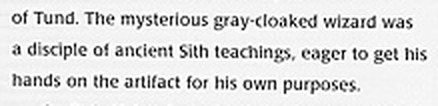

# Rokur Gepta

- **Aliases:** Gepta
- **Era:** GCW
- **Continuity:** default Legends; entries present for: Legends
- **Research tier:** untiered (not listed as INTRO/DEEP/MASTERY in legends-feats.md)
- **Entries:** 83 (43 with quotations; 5 quotations extended to the full sentence/passage from the source text on file; 6 marked as fragments; 11 before the 2026-11-17 fragment fill). Rebuilt 2026-11-17 from 96 old entries; old file: `characters/_bak/rokur-gepta.md.bak-20261117`.
- **How to read:** each entry is the quotation in full (block quote), then its source and point of view. "Note" lines are summaries from our notes, not quotations. `[fragment — full passage not on file]` means the source text is not on the box, so only the words in our notes are shown. Debate and forum material is in the last section and is unverified.

# LEGENDS (Legends / EU — main focus)

## Star Wars: The New Essential Chronology (Del Rey, 2005): power-scaling and lore notes

> When another civilization was advanced enough to reactivate the Mindharp, the Sharu would know tat it was safe to come out of hiding. In the course of his écventures, Lando Calrissian was responsible for triggering smpleminded, and they were exploited by the human colo- this monumental event, making him a hero to legions of archacologists and anthropologists.
>
> Initially, though, the gambler had no intentions in the Rafa system beyond picking u p his newly won droid. The robot turned out to be a strange, starfish shaped construction named Vulfl Raa, boasting five detachable limbs and a perky personality; Lando sensed there was more to this unusual droid than he could see.
>
> When Lando was arrested on trumped-up charges Issued by the colonial governor, he and his new droid were forcibly enlisted in the hunt for the Mindharp on behalf of Rokur Gepta, the Sorcerer of Tund. The mysterious gray-cloaked wizard was a disciple of ancient Sith teachings, eager to get his hands on the artifact for his own purposes, On Rafa V, Lando and Vuffi Raa unlocked the largest Sharu pyramid with a transdimensional key.
>
> There, they discovered the Mindharp=a strange object that constantly changed form as it shifted through dimensions=and removed It from its eons- old place of rest.
>
> Rafa IV's colonial governor greedily took the Mingharp, sentencing the gambler to a lifetime sen- tence of hard labor in a penal colony.
— Source: Part Four: Profiles in History; Rokur Gepta. POV: Rokur Gepta.
(Excerpt widened 2026-11-17 to the relevant passage, word for word from research primary new essential chronology nec paged (text copy `research_primary_new_essential_chronology_nec_paged_txt_88b808b5bc`).)
(Excerpt widened 2026-11-17 to the relevant passage, word for word from research primary new essential chronology nec paged (text copy `research_primary_new_essential_chronology_nec_paged_txt_88b808b5bc`).)
Note (our notes, around the quote): Rokur Gepta: "The mysterious gray-cloaked wizard was a disciple of ancient Sith teachings, eager to get his hands on the artifact for his own purposes." Source: The New Essential Chronology, p.99

Our notes: `notes/materials/027-new-essential-chronology/04-part-four-profiles-in-history.md:84`

> He also enjoyed an amicable relationship with Emperor Palpatine, who had given the Sorcerer a decommissioned Republic cruiser and granted him near-total autonomy within the confines of the Centrality.
— Source: Part Four: Profiles in History; Palpatine (Darth Sidious) — Gepta's Imperial powers.
Note (our notes, around the quote): Palpatine (Darth Sidious) — Gepta's Imperial powers: "He also enjoyed an amicable relationship with Emperor Palpatine, who had given the Sorcerer a decommissioned Republic cruiser and granted him near-total autonomy within the confines of the Centrality." Source: The New Essential Chronology, p.101
Our notes: `notes/materials/027-new-essential-chronology/04-part-four-profiles-in-history.md:96`

> Zipped up in spacesuits, Lando and the Sorcerer of Tund faced off in the middle of the watching fleet. They shot at one another while maneuvering for position with jet packs. One of Lando's wild shots caught Gepta in the ankle.
— Source: Part Four: Profiles in History; Lando Calrissian — Lando vs Gepta.
Note (our notes, around the quote): Lando Calrissian — Lando vs Gepta: "Zipped up in spacesuits, Lando and the Sorcerer of Tund faced off in the middle of the watching fleet. They shot at one another while maneuvering for position with jet packs. One of Lando's wild shots caught Gepta in the ankle." Source: The New Essential Chronology, p.102
Our notes: `notes/materials/027-new-essential-chronology/04-part-four-profiles-in-history.md:103`

> If Lando refused, he would fire an electromagnetic tor- pedo and lethally irradiate everything In the nebula, The holographic log recorder aboard the Star Destroyer Eminence recorded the single combat, much to the gratitude of future historians. Zipped up in spacesuits, Lando and the Seoxcerer of Tund faced off in the middie of the watching fleet.
>
> They shot at one another while maneuvering for position with jet packs. One of Lando’s wild shots caught Gepta in the ankle.
>
> With a shtick, the Sorcerer's form withered and disappeared. ts unknown whether Emperor Palpatine was aware that Rokur Gepta was actually a Croke, a liny snaiHike creature from the Unknown Regions, The Emperor had long been interested in the Sorcerers of Tund, since their religious teachings were based on an archaic interpretation of original Sith doctrine. Gepta had used his Croke powers of illusion to infiltrate that secret sexiety, CO-opt fs Sith teachings, and then annihifate it—Tund is now 102 an uninhabited, Irradiated wasteland, and the death of Gepta marked an end to the Sorcerers of Tund.
>
> The Imperial fleet responded to Gepta’s demise with a hall of laserfire.
— Source: Part Four: Profiles in History; Palpatine (Darth Sidious) — Gepta a Croke.
(Excerpt widened 2026-11-17 to the relevant passage, word for word from research primary new essential chronology nec paged (text copy `research_primary_new_essential_chronology_nec_paged_txt_88b808b5bc`).)
(Excerpt widened 2026-11-17 to the relevant passage, word for word from research primary new essential chronology nec paged (text copy `research_primary_new_essential_chronology_nec_paged_txt_88b808b5bc`).)
Note (our notes, around the quote): Palpatine (Darth Sidious) — Gepta a Croke: "The Emperor had long been interested in the Sorcerers of Tund, since their religious teachings were based on an archaic interpretation of original Sith doctrine." Source: The New Essential Chronology, p.102
Our notes: `notes/materials/027-new-essential-chronology/04-part-four-profiles-in-history.md:105`

## The Complete Star Wars Encyclopedia, Vol. I (A–G)

> He was well muscled but spoke in a high-pitched voice that belied his strength. His arms were essentially vesti­ gial wings connected to his chest by a mem­ brane. Fybot also suffered from his species' nervous anticipation and intense dreaming. As a youth, he received Imperial condition­ ing that made him tough and shrewd. He took this experience and became an under­ cover drug officer. There he gained the atten­ tion of Rokur Gepta, who saw a way to use Fybot to finally kill his enemy Lando Calris­ sian. But after Gepta felt that he had finally achieved his goal of trapping Calrissian, he decided that Fybot had outlived his usefulness, and killed the avian being in cold blood. fynockA species of small, predatory insects native to certain caves on the planet Talus. Fynocks usually trav­ eled in large swarms allow­ ing them to overpower much largerprey. Each swarm con­ sisted of at least two differ­ ent types of fynocks, those that could fly and those that scuttled along the ground. Fynock A designation for Incom Industries' high-end starship booster system, produced at the height of the New Order. The system was built upon the designs of the Mynock and Vynock series of boosters, and was available in standard and de- luxe versions, depending on the desired power output characteristics.
— Source: scan pages 281–320; Rokur Gepta; Lando Calrissian.
(Excerpt widened 2026-11-17 to the relevant passage, word for word from research primary cse vol1 (text copy `research_primary_cse_vol1_pdf_45a954be6d`).)
(Excerpt widened 2026-11-17 to the relevant passage, word for word from research primary cse vol1 (text copy `research_primary_cse_vol1_pdf_45a954be6d`).)
Note (our notes, around the quote): Rokur Gepta; Lando Calrissian: "But after Gepta felt that he had finally achieved his goal of trapping Calrissian, he decided that Fybot had outlived his usefulness, and killed the avian being in cold blood." Source: The Complete Star Wars Encyclopedia, Vol. I, p.300
Our notes: `notes/materials/030-complete-star-wars-encyclopedia-vol-1/07-v1-scan-281-320.md:262`

- Note (summary from our notes, not a quotation): Page contents: 859 words, 15 paragraphs | headings/entries: Gepparin; Gep's Grill; Gepta, Rokur; Geptun, Lorz
  — Source: scan pages 321–360.
Our notes: `notes/materials/030-complete-star-wars-encyclopedia-vol-1/08-v1-scan-321-360.md:190`

> GepparlnThe primary world of the Gepparin system in the Shelsha sector, it was one of the sector's main mining worlds and also had a few ag­ ricultural settlements. The BloodScar pirates maintained a base on Gepparin during the early stages of the Galactic Civil War and had taken control of mining op­ erations. The planet itself was dark and cold, orbiting a red star that was one of three in its system. Gep•s Grill A restaurant in Mos Eisley, it was run by two Whiphids, Fillin Ta and Norun Gep. They purchased dewback and bantha meat directly from many of Tatooine's hunt­ ers. Gepta, Rokur The last of the Sorcerers of Tund. Rokur Gepta's arrogance and sheer malice led him to obliterate all living things on the planet. He was a heartless being for whom power was everything. He wanted to rule the sector of the galaxy that contained Tund, then extend his rule outward. To make sure he was unchallenged, he eliminated the original Tund Sorcerers who had taught him all that he knew. People saw Gepta differ­ ently.
— Source: scan pages 321–360; Rokur Gepta — entry/section: Gepta, Rokur.
(Excerpt widened 2026-11-17 to the relevant passage, word for word from research primary cse vol1 (text copy `research_primary_cse_vol1_pdf_45a954be6d`).)
(Excerpt widened 2026-11-17 to the relevant passage, word for word from research primary cse vol1 (text copy `research_primary_cse_vol1_pdf_45a954be6d`).)
Note (our notes, around the quote): Rokur Gepta — entry/section: Gepta, Rokur: "Rokur Gepta's arrogance and sheer malice led him to obliterate all living things on the planet." Source: The Complete Star Wars Encyclopedia, Vol. I, p.334
Our notes: `notes/materials/030-complete-star-wars-encyclopedia-vol-1/08-v1-scan-321-360.md:194`

> Lando Calrissian battled Gepta and defeated him, in the process discovering that the Sorcerer was actually a vicious Croke—a small, snaillike being with hairy black legs that used illusion to make its way through life.
— Source: scan pages 321–360; Rokur Gepta; Lando Calrissian — entry/section: Gepta, Rokur.
Note (our notes, around the quote): Rokur Gepta; Lando Calrissian — entry/section: Gepta, Rokur: "Lando Calrissian battled Gepta and defeated him, in the process discovering that the Sorcerer was actually a vicious Croke—a small, snaillike being with hairy black legs that used illusion to make its way through life." Source: The Complete Star Wars Encyclopedia, Vol. I, p.334
Our notes: `notes/materials/030-complete-star-wars-encyclopedia-vol-1/08-v1-scan-321-360.md:196`

## The Complete Star Wars Encyclopedia, Vol. II (H–O)

> Lehesu caught up to the courier and destroyed it, thereby cutting off Gepta's fleet from the rest of the Empire and ensuring that the ThonBoka would remain isolated and free.
— Source: scan pages 241–280; Rokur Gepta. POV: Rokur Gepta.
Note (our notes, around the quote): Rokur Gepta: "Lehesu caught up to the courier and destroyed it, thereby cutting off Gepta's fleet from the rest of the Empire and ensuring that the ThonBoka would remain isolated and free." Source: The Complete Star Wars Encyclopedia, Vol. II, p.249
Our notes: `notes/materials/031-complete-star-wars-encyclopedia-vol-2/06-v2-scan-241-280.md:136`

## The Complete Star Wars Encyclopedia, Vol. III (P–Z)

> After Vuffi Raa reverted to his original programming, he helped Calrissian defeat Whett's boss Rokur Gepta in the defense of the ThonBoka.
— Source: scan pages 281–320; Lando Calrissian; Rokur Gepta.
Note (our notes, around the quote): Lando Calrissian; Rokur Gepta: "After Vuffi Raa reverted to his original programming, he helped Calrissian defeat Whett's boss Rokur Gepta in the defense of the ThonBoka." Source: The Complete Star Wars Encyclopedia, Vol. III, p.314
Our notes: `notes/materials/032-complete-star-wars-encyclopedia-vol-3/07-v3-scan-281-320.md:337`

> Gepta had built a small windowless chamber near the ship's drive tubes with 2-meter-thick walls to contain the bioweapon that he had used to destroy the planet Tund.
— Source: scan pages 321–360; Rokur Gepta. POV: Rokur Gepta.
Note (our notes, around the quote): Rokur Gepta: "Gepta had built a small windowless chamber near the ship's drive tubes with 2-meter-thick walls to contain the bioweapon that he had used to destroy the planet Tund." Source: The Complete Star Wars Encyclopedia, Vol. III, p.326
Our notes: `notes/materials/032-complete-star-wars-encyclopedia-vol-3/08-v3-scan-321-360.md:85`

## The New Essential Guide to Characters (2002)

- Note (summary from our notes, not a quotation): Page contents: 504 words, 16 paragraphs | headings/entries: R okur Gepta, self-proclaimed Sor-; VEDS Bowne tied ed bale Ribak aid; H Li ' 3
  — Source: scan pages 61–90.
Our notes: `notes/materials/034-new-essential-guide-to-characters/02-negc-scan-061-090.md:48`

> Gepta joined their society, learned their secrets, then annihilated them—and all life on their planet—with the radiation of a unique bioweapon.
— Source: scan pages 61–90; Rokur Gepta. POV: Rokur Gepta.
Note (our notes, around the quote): Rokur Gepta: "Gepta joined their society, learned their secrets, then annihilated them—and all life on their planet—with the radiation of a unique bioweapon." Source: The New Essential Guide to Characters, p.74
Our notes: `notes/materials/034-new-essential-guide-to-characters/02-negc-scan-061-090.md:50`

> As Emperor, he took a personal interest in Rokur Gepta, making him one of the most powerful individuals in the Centrality region.
— Source: scan pages 61–90; Rokur Gepta. POV: Rokur Gepta.
Note (our notes, around the quote): Rokur Gepta: "As Emperor, he took a personal interest in Rokur Gepta, making him one of the most powerful individuals in the Centrality region." Source: The New Essential Guide to Characters, p.74
Our notes: `notes/materials/034-new-essential-guide-to-characters/02-negc-scan-061-090.md:52`

> Gepta teamed up with Mer to obtain the legendary Mindharp of Sharu by exploiting Lando Calrissian.
— Source: scan pages 61–90.
Note (our notes, around the quote): Rokur Gepta; Lando Calrissian — entry/section: R okur Gepta, self-proclaimed Sor-: "Gepta teamed up with Mer to obtain the legendary Mindharp of Sharu by exploiting Lando Calrissian." Source: The New Essential Guide to Characters, p.74
Our notes: `notes/materials/034-new-essential-guide-to-characters/02-negc-scan-061-090.md:54`

> During the laser duel Calrissian shot Gepta in the ankle, where the actual Croke lay nestled within his larger phantom form.
— Source: scan pages 61–90.
Note (our notes, around the quote): Rokur Gepta; Lando Calrissian — entry/section: R okur Gepta, self-proclaimed Sor-: "During the laser duel Calrissian shot Gepta in the ankle, where the actual Croke lay nestled within his larger phantom form." Source: The New Essential Guide to Characters, p.74
Our notes: `notes/materials/034-new-essential-guide-to-characters/02-negc-scan-061-090.md:58`

- Note (summary from our notes, not a quotation): Rokur Gepta; Lando Calrissian — entry/section: R okur Gepta, self-proclaimed Sor-: "The "body" of Gepta vanished, and Calrissian crushed the tiny Croke between his gloves." Source: The New Essential Guide to Characters, p.74
  — Source: scan pages 61–90.
Our notes: `notes/materials/034-new-essential-guide-to-characters/02-negc-scan-061-090.md:60`

## Dark Side Sourcebook (d20, 2001)

> Later representatives came only to observe and evaluate, seeking signs that the Sorcerers had become corrupted. Satisfied that they were not, the Jedi Order developed a comfortable detente with the Sorcerers of Tund. But roughly one thousand years before the Battle of Yavin, the Jedi Order became preoccupied with the Sith Lord Kaan, and following the terrible battle on Ruusan, the depleted ranks of the Jedi ceased visiting Tund and eventually the Jedi all but forgot about the Sorcerers. Sorcerers of Tund Of all the Sorcerers, only he seemed interested in expanding his dominion and pursuing power in the galaxy at large. Eager to extend his reach beyond the tiny world of Tund, Gepta exploited the Sorcerers' knowledge for his own plans of galactic dominatior After learning all the Sorcerers could teach him, Gepta killed the last of the Sorcerers and laid waste to their planet. Rokur Gepta wore the heavy, deep gray robes of the Sorcerers of Tund, completely concealing his body from view. With his head and face wrapped in a turbanlike headdress and cowl, only Rokur Gepta's eyes were visible-and those who looked into them likened the sorcerer's eyes to swirling nebulas of darkness. Thanks to his illusions, to some he appeared as a giant, and to others a malign dwarf, but Gepta's greatest secret was that he was not humanoid at all.
— Source: Chapter Five: Dark Side Traditions (Sith Empire, Set Harth, prophets, Brakiss…); Rokur Gepta. POV: Rokur Gepta.
(Excerpt widened 2026-11-17 to the relevant passage, word for word from research primary dark side sourcebook dss (text copy `research_primary_dark_side_sourcebook_dss_pdf_9cd3453f4a`).)
(Excerpt widened 2026-11-17 to the relevant passage, word for word from research primary dark side sourcebook dss (text copy `research_primary_dark_side_sourcebook_dss_pdf_9cd3453f4a`).)
Note (our notes, around the quote): Rokur Gepta: "Eager to extend his reach beyond the tiny world of Tund, Gepta exploited the Sorcerers' knowledge for his own plans of galactic dominatior After learning all the Sorcerers could teach him, Gepta killed the last of the Sorcerers and laid waste to their planet." Source: Dark Side Sourcebook, p.80
Our notes: `notes/materials/035-dark-side-sourcebook/05-ch5-traditions.md:119`

- Note (summary from our notes, not a quotation): Page contents: 1258 words, 121 paragraphs | headings/entries: Index; Drain Energy 14, 17; Drain Force 17; Drain Knowledge 15, 17, 40; Durron, Kyp 12, 104, 105; Dxun tomb beast 112; Emperor Reborn 120, 126; Empress Teta system 8, 74, 75, 76; Endor 10, 91, 92, 94, 110; Force, the 6, 7, 40, 55; Force illusions 16; Force Points, gaining 40; Force-based skills 13, 17; Gepta, Rokur 80; Gethzerion 81, 82, 108, 134; Great Hyperspace War, the 7,; Harth, Set 83; Hatred (feat) 18; Hethrir, Lord 92, 93; Illusion (feat) 15, 17; Imperial campaign 51; Imperial Sentinel 99; Imperial Sovereign Protector 92, 99; Interrogator droid 63; Ismaren, trek 106; Jade, Mara 26, 53, 99; Jedgar 94, 96; Jedi characters 20; Jedi consular 158; Jedi, corrupted 31; Jedi guardian 157; Jedi, history of 7; Jedi hunters 87; Jerec 101; Kadanm 94, 96, 97 Kai,; Tamith 108, 109; Kalgrath 116; Sedriss, Executor 99, 102; Sense (feat) 54; Sing, Aurra 87, 88; Sith acolyte 31, 74; Skywalker, Luk
  — Source: Chapter Seven: Dark Side Campaigns; back matter.
Our notes: `notes/materials/035-dark-side-sourcebook/07-ch7-campaigns.md:117`

## Star Wars Insider #56 (2001)

- Note (summary from our notes, not a quotation): Page contents: "Unseen Planets" cont. (magazine p. 54): Neimoidian insectoid design, The Essential Guide to Alien Species on Neimoidians as a Duros offshoot and their grub "nurseries," Senator Lott Dod, Senate delegations (Quarren, Wookiees, E.T.s); "Tund" section - Fode announcing Ben Quadinaros, Toong species, Podracing Tales comic, L. Neil Smith's Lando Calrissian novels and Rokur Gepta, the Sorcerer of Tund; caption on Duros and Neimoidians; pull quote on Neimoidian larval nurseries. (hand-read)
  — Source: Star Wars Insider #56 (2001). POV: Page contents, about Rokur Gepta.
Our notes: `notes/materials/038-star-wars-insider/056-ins056.md:276`

> The Congress of Malastare concurs with the honorable delegate from the Trade Federation
> [fragment — full passage not on file]
— Source: Star Wars Insider #56 (2001). POV: Page contents, about Rokur Gepta.
Note (our notes, around the quote): Page contents: "Unseen Planets" cont. (magazine p. 55): Gepta revealed as a Croke who destroyed the Sorcerers; Toong refugees from Toong'l possibly on Tund; "Malastare" section - Qui-Gon's dinner line on Podracing on Malastare, Aks Moe of the Gran in the Senate ("The Congress of Malastare concurs with the honorable delegate from the Trade Federation"), Palpatine's nomination scene; captions on Ben Quadinaros, Toong refugees, Aks Moe prompting Chancellor Valorum. (hand-read)
Our notes: `notes/materials/038-star-wars-insider/056-ins056.md:281`

> After infiltrating the Sorcerers' ranks and learning their dark side magic, Gepta (a tiny alien Croke) annihilated them all with a weapon of mass destruction.
— Source: Star Wars Insider #56 (2001); Rokur Gepta — entry/section: Rokur Gepta.
Note (our notes, around the quote): Rokur Gepta — entry/section: Rokur Gepta: "After infiltrating the Sorcerers' ranks and learning their dark side magic, Gepta (a tiny alien Croke) annihilated them all with a weapon of mass destruction." Source: *Star Wars Insider #56* (2001), scan p.48
Our notes: `notes/materials/038-star-wars-insider/056-ins056.md:283`

# Debate and forum claims (unverified)

Forum posts, Suspect Insight debates and Discord debates, respect threads, and verdicts. These are posters' arguments or quotations they typed; none is checked against the book here unless the entry says so.

## Darth Wyyrlok III (i_like_swords) vs Darish Vol (MasterCilghal)

> The sorcerer made a gesture with his gloved fist. The officer groaned, sweat sprang out on his forehead, and he sank to his knees.
>
> “You see how much more effective it is than mere pain, don’t you? Everyone has memories, little items from their past best left buried: humiliations, embarrassments, mistakes … sometimes fatal ones. All the ways we have failed those we have loved, the ways they have failed us!”
>
> Gepta made another gesture.
>
> “No, you can think of nothing else! The ignobility races round and round your mind, amplified, feeding on itself!”
>
> The officer's face went gray, he swayed on his knees, his back bowed, his clenched fists began dripping blood where the fingernails cut into the palms. A little froth appeared at one corner of his mouth, followed by more blood as he gnashed at his lips and tongue. Finally, he lost all control, collapsed in a heap and lay there, twitching, moaning.
>
> Gepta released him.
>
> A pair of orderlies appeared, dragged the broken man from the bridge. Oddly enough, he was far from destroyed. Gepta had noticed, in the past, a certain increase in efficiency, perhaps even slightly enhanced intelligence after one of these crises. So why not make a good tool better? The tool was not in any position to complain of the stresses involved. Did it hurt a knife to grind it to razor sharpness? Who cared?
>
> These cloned troopers are called GeNodes and are genetically programmed to not self-identify as clones.
>
> There are no specific indications in the story to suggest when it takes place beyond a mention of Grand Moff Tarkin, which would mean it occurs some time before Episode IV.
>
> LANDO CALRISSIAN AND THE MINDHARP OF SHARU LANDO CALRISSIAN AND THE FLAMEWIND OF OSEON LANDO CALRISSIAN AND THE STARCAVE OF THONBOKA AUTHOR · L. Neil Smith COVER ARTIST · William Schmidt (series) PUBLICATION HISTORY · Novels, Del Rey Books · Paperback, July 1983 (book 1) · Paperback, September 1983 (book 2) · Paperback, November 1983 (book 3) Compiled as The Lando Calrissian Adventures · Paperback, June 1994 TIME LINE PLACEMENT · 3–2 BBY WORLDS VISITED · Dilonexa XXIII [U-8]; Oseon system [T-8]; Rafa system [T-8]; ThonBoka Nebula [U-8] MAIN CHARACTERS · Lando Calrissian, gambler (human male); Vuffi Raa, droid scout; Rokur Gepta, Sorcerer of Tund (Croke male); Osuno Whett, professor (human male); Waywa Fybot, narcotics agent (Quor’sav male); Klyn Shanga, fleet admiral (human male); Lehesu, adventurous spacefarer (Oswaft male) SUMMARY · Lando Calrissian, card player, scoundrel, and captain of the Millennium Falcon, is in the Oseon asteroid belt, a systemwide trove of valuable minerals and also home to the galaxy’s superwealthy in an area of space called the Centrality.
>
> LANDO CALRISSIAN AND THE MINDHARP OF SHARU LANDO CALRISSIAN AND THE FLAMEWIND OF OSEON LANDO CALRISSIAN AND THE STARCAVE OF THONBOKA AUTHOR · L. Neil Smith COVER ARTIST · William Schmidt (series) PUBLICATION HISTORY · Novels, Del Rey Books · Paperback, July 1983 (book 1) · Paperback, September 1983 (book 2) · Paperback, November 1983 (book 3) Compiled as The Lando Calrissian Adventures · Paperback, June 1994 TIME LINE PLACEMENT · 3–2 BBY WORLDS VISITED · Dilonexa XXIII [U-8]; Oseon system [T-8]; Rafa system [T-8]; ThonBoka Nebula [U-8] MAIN CHARACTERS · Lando Calrissian, gambler (human male); Vuffi Raa, droid scout; Rokur Gepta, Sorcerer of Tund (Croke male); Osuno Whett, professor (human male); Waywa Fybot, narcotics agent (Quor’sav male); Klyn Shanga, fleet admiral (human male); Lehesu, adventurous spacefarer (Oswaft male) SUMMARY · Lando Calrissian, card player, scoundrel, and captain of the Millennium Falcon, is in the Oseon asteroid belt, a systemwide trove of valuable minerals and also home to the galaxy’s superwealthy in an area of space called the Centrality. He is attempting to win a fortune in a game of sabacc, but ends up with a meager haul of credits and a droid of unknown origins that he must pick up from Rafa IV.
— Source: Darth Wyyrlok III (i_like_swords) vs Darish Vol (MasterCilghal) — https://www.suspectinsightforums.com/t657-ss-darth-wyyrlok-ils-vs-darish-vol-cilghal.
(Excerpt widened 2026-11-17 to the relevant passage, word for word from The Adventures of Lando Calrissian (L. Neil Smith) (text copy `MEGA_Legend_The_Adventures_of_Lando_Calrissian_Star_Wars_Lando_Calrissian_99_The_Lando_Calrissian_Adventures_Omnibus_01_03_by_L_Neil_Smith_epub`).)
(Excerpt widened 2026-11-17 to the relevant passage, word for word from The Essential Reader’s Companion: Star Wars (Pablo Hidalgo) (text copy `primary_essential_guides_eg_readers_companion_2012_Star_Wars_The_Essential_Readers_Companion_Pablo_Hidalgo_8O9y2bib_epub_e20384df21`).)
(Excerpt widened 2026-11-17 to the relevant passage, word for word from The Adventures of Lando Calrissian (L. Neil Smith) (text copy `MEGA_Legend_The_Adventures_of_Lando_Calrissian_Star_Wars_Lando_Calrissian_99_The_Lando_Calrissian_Adventures_Omnibus_01_03_by_L_Neil_Smith_epub`).)
(Excerpt widened 2026-11-17 to the relevant passage, word for word from The Essential Reader’s Companion: Star Wars (Pablo Hidalgo) (text copy `primary_essential_guides_eg_readers_companion_2012_Star_Wars_The_Essential_Readers_Companion_Pablo_Hidalgo_8O9y2bib_epub_e20384df21`).)
(Full sentence/passage taken from the source text on file: `research_suspect_insight_respect_threads_raw_186_wyyrlok_iii_txt`.)
(Fragment completed 2026-11-17: full sentence/passage matched word for word in the source text on file: `MEGA_Legend_The_Adventures_of_Lando_Calrissian_Star_Wars_Lando_Calrissian_99_The_Lando_Calrissian_Adventures_Omnibus_01_03_by_L_Neil_Smith_epub`.)
Context: Q10 — Source: [source not stated adjacent]
Posted by: not named in our notes (see thread/notes link).
Our notes: `suspect-insight/debates/060-darth-wyyrlok-iii-vs-darish-vol.md:101`

> The fire hose caught him unprepared. It dashed him against the wall, the icy water sluicing over him, blinding him, forcing itself into his mouth and nose. He fell to his knees, his head battered against the wall. He ducked it, trying to breathe, trying to stay alive against the killing force of "But, you protest, it wasn't like that at all?"
>
> Gepta paced back and forth in front of Lando, relishing the gambler's agony. Despite the sweat on every centimeter of his skin, Lando was freezing, simply from the memory.
>
> But Gepta was right: it hadn't been like that at all.
>
> "It-it only lasted a few moments," Lando stunered. Perhaps it was a surrender of some kind; he hated to give the madman any satisfaction at all. But he had to understand what was happening here.
>
> “I wasn’t nearly that frightened. I’d already worked out a way to escape. And it only lasted a few seconds—not the hours I just …” He tapered off, unable to continue because of his shaking. Shaking merely at the remembrance of something that hadn’t bothered him all that much when it was actually happening.
>
> These cloned troopers are called GeNodes and are genetically programmed to not self-identify as clones.
>
> There are no specific indications in the story to suggest when it takes place beyond a mention of Grand Moff Tarkin, which would mean it occurs some time before Episode IV.
>
> LANDO CALRISSIAN AND THE MINDHARP OF SHARU LANDO CALRISSIAN AND THE FLAMEWIND OF OSEON LANDO CALRISSIAN AND THE STARCAVE OF THONBOKA AUTHOR · L. Neil Smith COVER ARTIST · William Schmidt (series) PUBLICATION HISTORY · Novels, Del Rey Books · Paperback, July 1983 (book 1) · Paperback, September 1983 (book 2) · Paperback, November 1983 (book 3) Compiled as The Lando Calrissian Adventures · Paperback, June 1994 TIME LINE PLACEMENT · 3–2 BBY WORLDS VISITED · Dilonexa XXIII [U-8]; Oseon system [T-8]; Rafa system [T-8]; ThonBoka Nebula [U-8] MAIN CHARACTERS · Lando Calrissian, gambler (human male); Vuffi Raa, droid scout; Rokur Gepta, Sorcerer of Tund (Croke male); Osuno Whett, professor (human male); Waywa Fybot, narcotics agent (Quor’sav male); Klyn Shanga, fleet admiral (human male); Lehesu, adventurous spacefarer (Oswaft male) SUMMARY · Lando Calrissian, card player, scoundrel, and captain of the Millennium Falcon, is in the Oseon asteroid belt, a systemwide trove of valuable minerals and also home to the galaxy’s superwealthy in an area of space called the Centrality.
>
> LANDO CALRISSIAN AND THE MINDHARP OF SHARU LANDO CALRISSIAN AND THE FLAMEWIND OF OSEON LANDO CALRISSIAN AND THE STARCAVE OF THONBOKA AUTHOR · L. Neil Smith COVER ARTIST · William Schmidt (series) PUBLICATION HISTORY · Novels, Del Rey Books · Paperback, July 1983 (book 1) · Paperback, September 1983 (book 2) · Paperback, November 1983 (book 3) Compiled as The Lando Calrissian Adventures · Paperback, June 1994 TIME LINE PLACEMENT · 3–2 BBY WORLDS VISITED · Dilonexa XXIII [U-8]; Oseon system [T-8]; Rafa system [T-8]; ThonBoka Nebula [U-8] MAIN CHARACTERS · Lando Calrissian, gambler (human male); Vuffi Raa, droid scout; Rokur Gepta, Sorcerer of Tund (Croke male); Osuno Whett, professor (human male); Waywa Fybot, narcotics agent (Quor’sav male); Klyn Shanga, fleet admiral (human male); Lehesu, adventurous spacefarer (Oswaft male) SUMMARY · Lando Calrissian, card player, scoundrel, and captain of the Millennium Falcon, is in the Oseon asteroid belt, a systemwide trove of valuable minerals and also home to the galaxy’s superwealthy in an area of space called the Centrality. He is attempting to win a fortune in a game of sabacc, but ends up with a meager haul of credits and a droid of unknown origins that he must pick up from Rafa IV.
— Source: Darth Wyyrlok III (i_like_swords) vs Darish Vol (MasterCilghal) — https://www.suspectinsightforums.com/t657-ss-darth-wyyrlok-ils-vs-darish-vol-cilghal.
(Excerpt widened 2026-11-17 to the relevant passage, word for word from The Essential Reader’s Companion: Star Wars (Pablo Hidalgo) (text copy `primary_essential_guides_eg_readers_companion_2012_Star_Wars_The_Essential_Readers_Companion_Pablo_Hidalgo_8O9y2bib_epub_e20384df21`).)
(Excerpt widened 2026-11-17 to the relevant passage, word for word from The Adventures of Lando Calrissian (L. Neil Smith) (text copy `MEGA_Legend_The_Adventures_of_Lando_Calrissian_Star_Wars_Lando_Calrissian_99_The_Lando_Calrissian_Adventures_Omnibus_01_03_by_L_Neil_Smith_epub`).)
(Excerpt widened 2026-11-17 to the relevant passage, word for word from The Essential Reader’s Companion: Star Wars (Pablo Hidalgo) (text copy `primary_essential_guides_eg_readers_companion_2012_Star_Wars_The_Essential_Readers_Companion_Pablo_Hidalgo_8O9y2bib_epub_e20384df21`).)
(Full sentence/passage taken from the source text on file: `primary_essential_guides_eg_readers_companion_2012_Star_Wars_The_Essential_Readers_Companion_Pablo_Hidalgo_8O9y2bib_epub`.)
Context: Q11 — Source: [source not stated adjacent]
Posted by: not named in our notes (see thread/notes link).
Our notes: `suspect-insight/debates/060-darth-wyyrlok-iii-vs-darish-vol.md:119`; `suspect-insight/respect-threads/darth-wyyrlok.md:923`; `suspect-insight/respect-threads/darth-wyyrlok.md:925`

> "You're a brave man, Captain Cahissian. You don't like to think of it that way. What do you call it, 'creative cowardice'?
>
> “You’re a brave man, Captain Calrissian. You don’t like to think of it that way. What do you call it, ‘creative cowardice’? You regard yourself a pragmatist, one not given to heroics.”
>
> The sorcerer had paused, stood now nearly motionless before the gambler. In the background, the Flamewind whorled around the demented sky, casting many-colored shadows. Lando shook his head to get the sweat out of his eyes, tried his bonds. As he’d expected, they were there to stay.
>
> "And yet," Gepta continued, "what is bravery but the capacity to reject our fears, ignore and suppress them, then go on to do whatever it is we are afraid to do. What you are experiencing now, dear Captain, is the fear You refused to experience the first time. Now you have no choice!"
>
> Surprise attack!
> [fragment — full passage not on file]
>
> Wrestling the Falcon with one hand, Lando desperately tried to fire the cockpit guns with the other as the weird ragtaggle fighter-squadron bore down on him. It was a nightmare: they were too well shielded for his inconsequential guns to trouble, yet he couldn't operate the quad-guns without leaving the bridge.
>
> Vuffi Raa, insane and helpless, couldn’t assist him.
>
> He fired again. He might as well have been shooting streams of pink lemonade as the pale, ineffectual fire that was all he could manage. The enemy fleet bore down on him, bore down, bore down …
>
> He fired again. He might as well have been shooting strewns of pink lemonade as the pale, ineffectual fire that was all he could manage. The enemy fleet bore down on him, bore down, bore down...
>
> Lando finished throwing up, coughed, choked, cleared his throat.
>
> “Obviously,” Gepta hissed cheerfully, “you survived the peril that you just reexperienced. Otherwise, you wouldn’t be here now—it’s only logical. It is a logic which enables us to live with our unpleasant memories, is it not? An integrative, healing contextualization which we all require to survive.”
>
> “Sure,” the gambler gasped. “Sure, you rotten—anything you say!”
>
> “Ahh! Resistance at last! As I was saying, however, the art of torture-by-chagrin lies in denying the mind that integration, that perspective. As you relive the minor horrors of your life, you don’t recall that you survived, eventually triumphed. You see, even at moments of extreme peril, there are defenses, distractions, digressions which dilute the passions. What is more, my method does not allow its subject to experience anything but the fear. You can think of nothing else. The experience goes on and on, in circles, until the ego and the will are utterly crushed.
>
> "Ah! Resistance at last! As I was saying, however, the art of torture-by-chagrin lies in denying the mind that integration, that perspective. As you relive the horrors of your life, you don't recall that you survived, eventually triumphed. You see, even at moments of extreme peril, there are defenses, distractions, digressions which dilute the passions..What is more, my method does not allow its subject to experience anything but the fear. You can think of nothing else. The experience goes on and on, in circles, until the ego and the will are utterly crushed.
>
> These cloned troopers are called GeNodes and are genetically programmed to not self-identify as clones.
>
> There are no specific indications in the story to suggest when it takes place beyond a mention of Grand Moff Tarkin, which would mean it occurs some time before Episode IV.
>
> LANDO CALRISSIAN AND THE MINDHARP OF SHARU LANDO CALRISSIAN AND THE FLAMEWIND OF OSEON LANDO CALRISSIAN AND THE STARCAVE OF THONBOKA AUTHOR · L. Neil Smith COVER ARTIST · William Schmidt (series) PUBLICATION HISTORY · Novels, Del Rey Books · Paperback, July 1983 (book 1) · Paperback, September 1983 (book 2) · Paperback, November 1983 (book 3) Compiled as The Lando Calrissian Adventures · Paperback, June 1994 TIME LINE PLACEMENT · 3–2 BBY WORLDS VISITED · Dilonexa XXIII [U-8]; Oseon system [T-8]; Rafa system [T-8]; ThonBoka Nebula [U-8] MAIN CHARACTERS · Lando Calrissian, gambler (human male); Vuffi Raa, droid scout; Rokur Gepta, Sorcerer of Tund (Croke male); Osuno Whett, professor (human male); Waywa Fybot, narcotics agent (Quor’sav male); Klyn Shanga, fleet admiral (human male); Lehesu, adventurous spacefarer (Oswaft male) SUMMARY · Lando Calrissian, card player, scoundrel, and captain of the Millennium Falcon, is in the Oseon asteroid belt, a systemwide trove of valuable minerals and also home to the galaxy’s superwealthy in an area of space called the Centrality.
>
> LANDO CALRISSIAN AND THE MINDHARP OF SHARU LANDO CALRISSIAN AND THE FLAMEWIND OF OSEON LANDO CALRISSIAN AND THE STARCAVE OF THONBOKA AUTHOR · L. Neil Smith COVER ARTIST · William Schmidt (series) PUBLICATION HISTORY · Novels, Del Rey Books · Paperback, July 1983 (book 1) · Paperback, September 1983 (book 2) · Paperback, November 1983 (book 3) Compiled as The Lando Calrissian Adventures · Paperback, June 1994 TIME LINE PLACEMENT · 3–2 BBY WORLDS VISITED · Dilonexa XXIII [U-8]; Oseon system [T-8]; Rafa system [T-8]; ThonBoka Nebula [U-8] MAIN CHARACTERS · Lando Calrissian, gambler (human male); Vuffi Raa, droid scout; Rokur Gepta, Sorcerer of Tund (Croke male); Osuno Whett, professor (human male); Waywa Fybot, narcotics agent (Quor’sav male); Klyn Shanga, fleet admiral (human male); Lehesu, adventurous spacefarer (Oswaft male) SUMMARY · Lando Calrissian, card player, scoundrel, and captain of the Millennium Falcon, is in the Oseon asteroid belt, a systemwide trove of valuable minerals and also home to the galaxy’s superwealthy in an area of space called the Centrality. He is attempting to win a fortune in a game of sabacc, but ends up with a meager haul of credits and a droid of unknown origins that he must pick up from Rafa IV.
— Source: Darth Wyyrlok III (i_like_swords) vs Darish Vol (MasterCilghal) — https://www.suspectinsightforums.com/t657-ss-darth-wyyrlok-ils-vs-darish-vol-cilghal.
(Excerpt widened 2026-11-17 to the relevant passage, word for word from The Adventures of Lando Calrissian (L. Neil Smith) (text copy `MEGA_Legend_The_Adventures_of_Lando_Calrissian_Star_Wars_Lando_Calrissian_99_The_Lando_Calrissian_Adventures_Omnibus_01_03_by_L_Neil_Smith_epub`).)
(Excerpt widened 2026-11-17 to the relevant passage, word for word from The Essential Reader’s Companion: Star Wars (Pablo Hidalgo) (text copy `primary_essential_guides_eg_readers_companion_2012_Star_Wars_The_Essential_Readers_Companion_Pablo_Hidalgo_8O9y2bib_epub_e20384df21`).)
(Excerpt widened 2026-11-17 to the relevant passage, word for word from The Adventures of Lando Calrissian (L. Neil Smith) (text copy `MEGA_Legend_The_Adventures_of_Lando_Calrissian_Star_Wars_Lando_Calrissian_99_The_Lando_Calrissian_Adventures_Omnibus_01_03_by_L_Neil_Smith_epub`).)
(Excerpt widened 2026-11-17 to the relevant passage, word for word from The Essential Reader’s Companion: Star Wars (Pablo Hidalgo) (text copy `primary_essential_guides_eg_readers_companion_2012_Star_Wars_The_Essential_Readers_Companion_Pablo_Hidalgo_8O9y2bib_epub_e20384df21`).)
(Full sentence/passage taken from the source text on file: `primary_essential_guides_eg_readers_companion_2012_Star_Wars_The_Essential_Readers_Companion_Pablo_Hidalgo_8O9y2bib_epub`.)
Context: Q12 — Source: [source not stated adjacent] (preceding line: "Memory Walk - all that is left is the fear itself with no way to avoid it. Even worse, the knowledge that the enemy survived their traumatic experience, that they somehow succeeded in the end, is taken from them. The only thing they are left with is ")
Posted by: not named in our notes (see thread/notes link).
Our notes: `suspect-insight/debates/060-darth-wyyrlok-iii-vs-darish-vol.md:133`; `suspect-insight/respect-threads/darth-wyyrlok.md:951`; `suspect-insight/respect-threads/darth-wyyrlok.md:939`

## Rokur Gepta Case (placement thread)

- Note (summary from our notes, not a quotation): Years before the Battle of Yavin, Rokur Gepta, a snail-like Croke, infiltrated the Sorcerers of Tund and learned their secrets. He then murdered his teachers and transformed the planet Tund, once an attractive world of prairies, forests, and jungles, into a blasted, sterile wasteland. —The Complete Star Wars Encyclopedia - Tund (Pablo Hidalgo and Stephen J. Sansweet, 2008)
  — Source: A Guide to the Star Wars Universe: Third Edition - Tund (Bill Slavicsek, 2000) — as cited by Sob of Dathomir — SI Discord placement thread 145 (Rokur Gepta Case) — Discord-debate-cited (unverified against the book in this pass).
Posted by: Sob of Dathomir.
Context: typed by Sob of Dathomir in SI Discord placement thread 145, 12/23/25, 5:20 PM, in the Rokur Gepta case, introduced as “A Guide to the Star Wars Universe: Third Edition - Tund (Bill Slavicsek, 2000) wrote:”
Context: typed by Sob of Dathomir in the same 12/23/25, 5:20 PM post, introduced as “The Complete Star Wars Encyclopedia - Tund (Pablo Hidalgo and Stephen J. Sansweet, 2008) wrote:”
Our notes: `suspect-insight/debates/145-rokur-gepta-placement.md:44`

- Note (summary from our notes, not a quotation): Ah, yes. The galaxy still believed that somewhere the hidden planet Tund was home to the mysterious Order. Only Gepta knew it was a sterile ball. Not so much as a tiny fingerbone was left. The thought—the memory of what he had done on that final day—filled him with delight and satisfaction. Someday he’d do it to the entire universe! —Lando Calrissian and the Flamewind of Oseon (L. Neil Smith, 1983)
  — Source: Lando Calrissian and the Flamewind of Oseon (L. Neil Smith, 1983) — as cited by Sob of Dathomir — SI Discord placement thread 145 (Rokur Gepta Case) — Discord-debate-cited (unverified against the book in this pass).
Posted by: Sob of Dathomir.
Context: typed by Sob of Dathomir in SI Discord placement thread 145, 12/23/25, 5:23 PM, introduced as “Lando Calrissian and the Flamewind of Oseon (L. Neil Smith, 1983) wrote:” (typography “he’d” as in the post).
Our notes: `suspect-insight/debates/145-rokur-gepta-placement.md:204`

- Note (summary from our notes, not a quotation): Rokur Gepta, the last of the fabled sorcerers of the planet Tund, was responsible for utterly obliterating every living thing from the surface of the world. He did this partially to preserve the secret of the powerful magic he wielded, and partially out of sheer malice. —A Guide to the Star Wars Universe: Second Edition - Rokur Gepta (Bill Slavicsek, 1994)
  — Source: A Guide to the Star Wars Universe: Second Edition - Rokur Gepta (Bill Slavicsek, 1994) — as cited by Sob of Dathomir — SI Discord placement thread 145 (Rokur Gepta Case) — Discord-debate-cited (unverified against the book in this pass).
Posted by: Sob of Dathomir.
Context: typed by Sob of Dathomir in SI Discord placement thread 145, 12/23/25, 5:26 PM, introduced as “A Guide to the Star Wars Universe: Second Edition - Rokur Gepta (Bill Slavicsek, 1994) wrote:”
Our notes: `suspect-insight/debates/145-rokur-gepta-placement.md:216`

- Note (summary from our notes, not a quotation): People saw Gepta differently. To some he was a dwarf, to others a three-meter-tall giant. He wore ashen-gray cloaks and a turban that wrapped around his face, obscuring all but his piercing eyes. —Star Wars Encyclopedia - Gepta, Rokur (Stephen J. Sansweet, 1998)
  — Source: Star Wars Encyclopedia - Gepta, Rokur (Stephen J. Sansweet, 1998) — as cited by Sob of Dathomir — SI Discord placement thread 145 (Rokur Gepta Case) — Discord-debate-cited (unverified against the book in this pass).
Posted by: Sob of Dathomir.
Context: typed by Sob of Dathomir in SI Discord placement thread 145, 12/23/25, 5:29 PM, introduced as “Star Wars Encyclopedia - Gepta, Rokur (Stephen J. Sansweet, 1998) wrote:”
Our notes: `suspect-insight/debates/145-rokur-gepta-placement.md:233`

- Note (summary from our notes, not a quotation): The enigmatic figure known as Rokur Gepta was the last of the Sorcerers of Tund. Gepta was a master of illusion, able to create images directly in the minds of his enemies, torturing them with their past mistakes and agonies. —The Dark Side Sourcebook - Rokur Gepta (Bill Slavicsek and J.D. Wiker, 2001)
  — Source: The Dark Side Sourcebook - Rokur Gepta (Bill Slavicsek and J.D. Wiker, 2001) — as cited by Sob of Dathomir — SI Discord placement thread 145 (Rokur Gepta Case) — Discord-debate-cited (unverified against the book in this pass).
Posted by: Sob of Dathomir.
Context: typed by Sob of Dathomir in SI Discord placement thread 145, 12/23/25, 5:39 PM, introduced as “The Dark Side Sourcebook - Rokur Gepta (Bill Slavicsek and J.D. Wiker, 2001) wrote:” The commentary after this excerpt in the same post is not entered. A later Dark Side Sourcebook sentence about laying waste to Tund was already present in this file and is not repeated.
Our notes: `suspect-insight/debates/145-rokur-gepta-placement.md:286`

- Note (summary from our notes, not a quotation): This one wasn’t quite dead. The suit had protected it, and it was nearly impervious to hard vacuum. Lando ripped the suit away, took the stunned and putrid creature that had been Rokur Gepta, and squeezed. When he was through, his suit gloves were covered with greasy slime, but no Sorcerer of Tund would ever rule the galaxy. —Lando Calrissian and the Starcave of ThonBoka (L. Neil Smith, 1983)
  — Source: Lando Calrissian and the Starcave of ThonBoka (L. Neil Smith, 1983) — as cited by Sob of Dathomir — SI Discord placement thread 145 (Rokur Gepta Case) — Discord-debate-cited (unverified against the book in this pass).
Posted by: Sob of Dathomir.
Context: typed by Sob of Dathomir in SI Discord placement thread 145, 12/23/25, 5:45 PM, introduced as “Lando Calrissian and the Starcave of ThonBoka (L. Neil Smith, 1983) wrote:” (typography “wasn’t” as in the post).
Our notes: `suspect-insight/debates/145-rokur-gepta-placement.md:310`

## Darth Wyyrlok III Respect Thread — respect-thread notes

- Note (summary from our notes, not a quotation): Moreover, it is possible to amplify the worst fears and insecurities of an enemy through the use of Force illusions. We saw this already with Wyyrlok making Andeddu believe that his books and scrolls were being drowned in lava, even though the room they were in remained unaffected. This ability to amplify the effects of Memory Walk is described in gruesome detail below when a Sorcerer of Tund named Rokur Gepta tortures members of his crew and Lando Calrissian.
  — Source: SI respect-thread directory: Darth Wyyrlok III Respect Thread — https://www.suspectinsightforums.com/t2805-darth-wyyrlok-iii-respect-thread.
Posted by: not named in our notes (see thread/notes link).
Our notes: `suspect-insight/respect-threads/darth-wyyrlok.md:899`

- Note (summary from our notes, not a quotation): Gepta made another gesture.
  — Source: SI respect-thread directory: Darth Wyyrlok III Respect Thread — https://www.suspectinsightforums.com/t2805-darth-wyyrlok-iii-respect-thread.
Posted by: not named in our notes (see thread/notes link).
Our notes: `suspect-insight/respect-threads/darth-wyyrlok.md:905`

## Rokur Gepta Respect Thread — respect-thread notes

- Note (summary from our notes, not a quotation): Continuity (from the thread title/directory label): Legends unless the post says otherwise
  — Source: SI respect-thread directory: Rokur Gepta Respect Thread — https://www.suspectinsightforums.com/t4155-rokur-gepta-respect-thread.
Posted by: not named in our notes (see thread/notes link).
Our notes: `suspect-insight/respect-threads/rokur-gepta.md:6`

- Note (summary from our notes, not a quotation): "Evasion or failure, on the part of any officer, at any level, to comply swiftly with this direct order will be punishable by summary revocation of all rank and privileges, judiciary and ceremonial impoverishment and sale into bondage of all family members within five degrees of consanguinity, and for the perpetrator himself, slow mutilation and death upon public display.
  — Source: SI respect-thread directory: Rokur Gepta Respect Thread — https://www.suspectinsightforums.com/t4155-rokur-gepta-respect-thread.
Posted by: not named in our notes (see thread/notes link).
Our notes: `suspect-insight/respect-threads/rokur-gepta.md:13`

> “I, Rokur Gepta, Sorcerer of Tund, command it.”
>
> The camera lights went out.
>
> Gepta sat back in his chair, feeling much better. This would buy them all some time, and resolve part of the conflict between Klyn Shanga and himself. Odd, he hadn’t had a real adversary to stand up to him for thousands of years. No one dared oppose his ruthless exercise of power. Everywhere he went, people in their masses, and as individuals, feared, hated, and served him.
— Source: SI respect-thread directory: Rokur Gepta Respect Thread — https://www.suspectinsightforums.com/t4155-rokur-gepta-respect-thread.
(Excerpt widened 2026-11-17 to the relevant passage, word for word from The Adventures of Lando Calrissian (L. Neil Smith) (text copy `MEGA_Legend_The_Adventures_of_Lando_Calrissian_Star_Wars_Lando_Calrissian_99_The_Lando_Calrissian_Adventures_Omnibus_01_03_by_L_Neil_Smith_epub`).)
(Excerpt widened 2026-11-17 to the relevant passage, word for word from The Adventures of Lando Calrissian (L. Neil Smith) (text copy `MEGA_Legend_The_Adventures_of_Lando_Calrissian_Star_Wars_Lando_Calrissian_99_The_Lando_Calrissian_Adventures_Omnibus_01_03_by_L_Neil_Smith_epub`).)
Posted by: not named in our notes (see thread/notes link).
Our notes: `suspect-insight/respect-threads/rokur-gepta.md:15`

- Note (summary from our notes, not a quotation): [image: https://static.wikia.nocookie.net/starwars/images/9/96/Rokur_Gepta.jpg/revision/latest/top-crop/width/360/height/450?cb=20110127020535]
  — Source: SI respect-thread directory: Rokur Gepta Respect Thread — https://www.suspectinsightforums.com/t4155-rokur-gepta-respect-thread.
Posted by: not named in our notes (see thread/notes link).
Context: "I, Rokur Gepta, Sorcerer of Tund, command it."
Our notes: `suspect-insight/respect-threads/rokur-gepta.md:16`

- Note (summary from our notes, not a quotation): Respect thread for the incredibly powerful sorcerer-warlord, Rokur Gepta. A highly slept on dark sider appearing in the 1983 Lando Calrissian Adventure trilogy. He has quotes placing him around the likes of OT Palpatine (and feats to back it), so stick to the end. I’ll try to keep this short.
  — Source: SI respect-thread directory: Rokur Gepta Respect Thread — https://www.suspectinsightforums.com/t4155-rokur-gepta-respect-thread.
Posted by: not named in our notes (see thread/notes link).
Our notes: `suspect-insight/respect-threads/rokur-gepta.md:18`

- Note (summary from our notes, not a quotation): Let’s begin by analyzing the natural abilities he possesses as a member of the Croke species.
  — Source: SI respect-thread directory: Rokur Gepta Respect Thread — https://www.suspectinsightforums.com/t4155-rokur-gepta-respect-thread.
Posted by: not named in our notes (see thread/notes link).
Our notes: `suspect-insight/respect-threads/rokur-gepta.md:40`

- Note (summary from our notes, not a quotation): Unaffected by hard vacuum
  — Source: SI respect-thread directory: Rokur Gepta Respect Thread — https://www.suspectinsightforums.com/t4155-rokur-gepta-respect-thread.
Posted by: not named in our notes (see thread/notes link).
Our notes: `suspect-insight/respect-threads/rokur-gepta.md:44`

- Note (summary from our notes, not a quotation): Slightly larger than a human fist
  — Source: SI respect-thread directory: Rokur Gepta Respect Thread — https://www.suspectinsightforums.com/t4155-rokur-gepta-respect-thread.
Posted by: not named in our notes (see thread/notes link).
Our notes: `suspect-insight/respect-threads/rokur-gepta.md:46`

- Note (summary from our notes, not a quotation): Known to genetically modify other species
  — Source: SI respect-thread directory: Rokur Gepta Respect Thread — https://www.suspectinsightforums.com/t4155-rokur-gepta-respect-thread.
Posted by: not named in our notes (see thread/notes link).
Our notes: `suspect-insight/respect-threads/rokur-gepta.md:48`

- Note (summary from our notes, not a quotation): Capable of manipulating reality to a degree
  — Source: SI respect-thread directory: Rokur Gepta Respect Thread — https://www.suspectinsightforums.com/t4155-rokur-gepta-respect-thread.
Posted by: not named in our notes (see thread/notes link).
Our notes: `suspect-insight/respect-threads/rokur-gepta.md:50`

- Note (summary from our notes, not a quotation): Masters of shape shifting (up to 3 meters in height)
  — Source: SI respect-thread directory: Rokur Gepta Respect Thread — https://www.suspectinsightforums.com/t4155-rokur-gepta-respect-thread.
Posted by: not named in our notes (see thread/notes link).
Our notes: `suspect-insight/respect-threads/rokur-gepta.md:52`

- Note (summary from our notes, not a quotation): Can wield weapons and hold objects while shape shifting
  — Source: SI respect-thread directory: Rokur Gepta Respect Thread — https://www.suspectinsightforums.com/t4155-rokur-gepta-respect-thread.
Posted by: not named in our notes (see thread/notes link).
Our notes: `suspect-insight/respect-threads/rokur-gepta.md:54`

- Note (summary from our notes, not a quotation): Seemingly teleport by turning invisible and reappearing elsewhere
  — Source: SI respect-thread directory: Rokur Gepta Respect Thread — https://www.suspectinsightforums.com/t4155-rokur-gepta-respect-thread.
Posted by: not named in our notes (see thread/notes link).
Our notes: `suspect-insight/respect-threads/rokur-gepta.md:56`

- Note (summary from our notes, not a quotation): Skilled at casting incredibly realistic illusions through telepathy, affecting all 5 senses; sight, audio, touch, etc
  — Source: SI respect-thread directory: Rokur Gepta Respect Thread — https://www.suspectinsightforums.com/t4155-rokur-gepta-respect-thread.
Posted by: not named in our notes (see thread/notes link).
Our notes: `suspect-insight/respect-threads/rokur-gepta.md:58`

- Note (summary from our notes, not a quotation): Can project multiple illusions of themself at once, fooling multiple individuals with different appearances simultaneously (ie. a dwarf and a giant)
  — Source: SI respect-thread directory: Rokur Gepta Respect Thread — https://www.suspectinsightforums.com/t4155-rokur-gepta-respect-thread.
Posted by: not named in our notes (see thread/notes link).
Our notes: `suspect-insight/respect-threads/rokur-gepta.md:60`

- Note (summary from our notes, not a quotation): Impervious to damage while shape shifting, excluding the achilles heel; where their actual physical body would be located. Blaster bolts harmlessly pass through their body.
  — Source: SI respect-thread directory: Rokur Gepta Respect Thread — https://www.suspectinsightforums.com/t4155-rokur-gepta-respect-thread.
Posted by: not named in our notes (see thread/notes link).
Our notes: `suspect-insight/respect-threads/rokur-gepta.md:62`

What it shows (our notes): Rokur is fast enough to observe the passing of a photon. A photon travels at the speed of light.
> Deep within the twisted caverns of the murdered planet Tund, where Rokur Gepta had once personally searched out and exterminated every one of his ancient mentors—the original sorcerers, who had lovingly instructed him in the ways of power that had been their ultimate undoing—the treacherous former pupil sat, immersed in thought. He brooded in a blackness utterly unbroken by the glimmer of so much as a single passing photon. That was the way he preferred it; he had other means of observing reality.
— Source: SI respect-thread directory: Rokur Gepta Respect Thread — https://www.suspectinsightforums.com/t4155-rokur-gepta-respect-thread.
(Excerpt widened 2026-11-17 to the relevant passage, word for word from The Adventures of Lando Calrissian (L. Neil Smith) (text copy `MEGA_Legend_The_Adventures_of_Lando_Calrissian_Star_Wars_Lando_Calrissian_99_The_Lando_Calrissian_Adventures_Omnibus_01_03_by_L_Neil_Smith_epub`).)
Posted by: not named in our notes (see thread/notes link).
Our notes: `suspect-insight/respect-threads/rokur-gepta.md:66`

> “Even in the full light of a healthy planet's daytime surface, another individual would be less fortunate: Rokur Gepta was simply impossible to come to terms with visually. He was a blur, a vagueness more psychological than perceptual in character, perhaps because his color was that of terror.”
— Source: SI respect-thread directory: Rokur Gepta Respect Thread — https://www.suspectinsightforums.com/t4155-rokur-gepta-respect-thread.
Context: Even in broad daylight it is impossible to perceive Rokur visually because he exists as “a blur, a vagueness more psychological than perceptual”
Posted by: not named in our notes (see thread/notes link).
Our notes: `suspect-insight/respect-threads/rokur-gepta.md:69`

What it shows (our notes): Rokur has had his way with people, planets, and warships before. He then muses that he could leave the dreadnought  ‘Wennis’ unrecognizable.
> The Wennis would not be recognizable when Rokur Gepta was through with her.
>
> The sorcerer had that way with ships, and planets, and people. The only value anything possessed for him was its utility relative to his inexorable rise to power. Wealth meant nothing more to him than that, nor the companionship of his fellow beings, even—owing to the most peculiar and repulsive of physical circumstances—that of females. He was empty, as devoid of life and warmth as his handiwork, the planet Tund itself. Such an emptiness requires endless volumes of power to fill it even momentarily.
— Source: SI respect-thread directory: Rokur Gepta Respect Thread — https://www.suspectinsightforums.com/t4155-rokur-gepta-respect-thread.
(Excerpt widened 2026-11-17 to the relevant passage, word for word from The Adventures of Lando Calrissian (L. Neil Smith) (text copy `MEGA_Legend_The_Adventures_of_Lando_Calrissian_Star_Wars_Lando_Calrissian_99_The_Lando_Calrissian_Adventures_Omnibus_01_03_by_L_Neil_Smith_epub`).)
(Excerpt widened 2026-11-17 to the relevant passage, word for word from The Adventures of Lando Calrissian (L. Neil Smith) (text copy `MEGA_Legend_The_Adventures_of_Lando_Calrissian_Star_Wars_Lando_Calrissian_99_The_Lando_Calrissian_Adventures_Omnibus_01_03_by_L_Neil_Smith_epub`).)
Posted by: not named in our notes (see thread/notes link).
Our notes: `suspect-insight/respect-threads/rokur-gepta.md:74`

What it shows (our notes): The planet Tund is stated to be omnipotent, but there exists a “more hideous truth”.
> CONCEALED BEYOND THE reach of civilization lay a place called Tund, a name of legendary repute, one seldom spoken above a whisper. That whispered word named a planet, a system, or a cluster of stars—no one was quite certain which—rumored for ten thousand years to be the home of powerful and subtle mages. Fear was associated with the name, the sort of fear that inhibits mentioning, even thinking about, the thing it represents, so as not to invoke its omniscient, omnipotent, and malevolent attention. Almost no one knew the even more hideous truth.
— Source: SI respect-thread directory: Rokur Gepta Respect Thread — https://www.suspectinsightforums.com/t4155-rokur-gepta-respect-thread.
(Excerpt widened 2026-11-17 to the relevant passage, word for word from The Adventures of Lando Calrissian (L. Neil Smith) (text copy `MEGA_Legend_The_Adventures_of_Lando_Calrissian_Star_Wars_Lando_Calrissian_99_The_Lando_Calrissian_Adventures_Omnibus_01_03_by_L_Neil_Smith_epub`).)
Posted by: not named in our notes (see thread/notes link).
Our notes: `suspect-insight/respect-threads/rokur-gepta.md:80`

What it shows (our notes): Rokur destroyed Tund’s surface, killing everyone and everything on the planet.
> “The planet Tund was sterile, devoid of native life, its surface roasted to a fine, gray, powdered ash where evergreen forests, tropical jungles, and continent-broad prairies had once stretched for countless kilometers. It was a world destroyed by magic.”
>
> At night the planet’s face glowed softly, not merely with the pale blue fire of decaying atoms, but with a ghostly greenish residue of energies as yet unknown to the rest of galactic civilization. Where it flickered balefully, nothing lived, or ever would again. It had been partially to preserve the secret of such power that Rokur Gepta, last of the fabled Sorcerers of Tund, had utterly obliterated every living thing upon the planet, from submicroscopic wigglers to full-flowering sentience. His was a terrible, cosmically unfeeling precaution.
>
> The rest had been sheer malice.
>
> Here and there an oasis of sorts had been permitted its closely regulated probational existence, areas reseeded from which, some billions of years hence, when the evil emerald fires had at long last died, life might resume its pitiably humbled march. Massive force-fields were essential to press the flickering death away from those few havens.
>
> The sorcerer had that way with ships, and planets, and people. The only value anything possessed for him was its utility relative to his inexorable rise to power. Wealth meant nothing more to him than that, nor the companionship of his fellow beings, even—owing to the most peculiar and repulsive of physical circumstances—that of females. He was empty, as devoid of life and warmth as his handiwork, the planet Tund itself. Such an emptiness requires endless volumes of power to fill it even momentarily.
— Source: SI respect-thread directory: Rokur Gepta Respect Thread — https://www.suspectinsightforums.com/t4155-rokur-gepta-respect-thread.
(Excerpt widened 2026-11-17 to the relevant passage, word for word from The Adventures of Lando Calrissian (L. Neil Smith) (text copy `MEGA_Legend_The_Adventures_of_Lando_Calrissian_Star_Wars_Lando_Calrissian_99_The_Lando_Calrissian_Adventures_Omnibus_01_03_by_L_Neil_Smith_epub`).)
(Excerpt widened 2026-11-17 to the relevant passage, word for word from The Adventures of Lando Calrissian (L. Neil Smith) (text copy `MEGA_Legend_The_Adventures_of_Lando_Calrissian_Star_Wars_Lando_Calrissian_99_The_Lando_Calrissian_Adventures_Omnibus_01_03_by_L_Neil_Smith_epub`).)
(Fragment completed 2026-11-17: full sentence/passage matched word for word in the source text on file: `MEGA_Legend_The_Adventures_of_Lando_Calrissian_Star_Wars_Lando_Calrissian_99_The_Lando_Calrissian_Adventures_Omnibus_01_03_by_L_Neil_Smith_epub`.)
Posted by: not named in our notes (see thread/notes link).
Our notes: `suspect-insight/respect-threads/rokur-gepta.md:83`

What it shows (our notes): Rokur not only killed all life on the planet, but the very atoms too, leaving behind energies unknown to the rest of the galaxy. Neither Vitiate’s Nathema feat, nor Dark Empire Palpatine’s Force Storm were this destructive.
> At night the planet’s face glowed softly, not merely with the pale blue fire of decaying atoms, but with a ghostly greenish residue of energies as yet unknown to the rest of galactic civilization. Where it flickered balefully, nothing lived, or ever would again. It had been partially to preserve the secret of such power that Rokur Gepta, last of the fabled Sorcerers of Tund, had utterly obliterated every living thing upon the planet, from submicroscopic wigglers to full-flowering sentience. His was a terrible, cosmically unfeeling precaution.
— Source: SI respect-thread directory: Rokur Gepta Respect Thread — https://www.suspectinsightforums.com/t4155-rokur-gepta-respect-thread.
(Excerpt widened 2026-11-17 to the relevant passage, word for word from The Adventures of Lando Calrissian (L. Neil Smith) (text copy `MEGA_Legend_The_Adventures_of_Lando_Calrissian_Star_Wars_Lando_Calrissian_99_The_Lando_Calrissian_Adventures_Omnibus_01_03_by_L_Neil_Smith_epub`).)
Posted by: not named in our notes (see thread/notes link).
Our notes: `suspect-insight/respect-threads/rokur-gepta.md:90`

What it shows (our notes): Rokur destroyed Tund to preserve the secrets of his power, implying that no other dark sider would have known or mastered his abilities.
> At night the planet’s face glowed softly, not merely with the pale blue fire of decaying atoms, but with a ghostly greenish residue of energies as yet unknown to the rest of galactic civilization. Where it flickered balefully, nothing lived, or ever would again. It had been partially to preserve the secret of such power that Rokur Gepta, last of the fabled Sorcerers of Tund, had utterly obliterated every living thing upon the planet, from submicroscopic wigglers to full-flowering sentience. His was a terrible, cosmically unfeeling precaution.
— Source: SI respect-thread directory: Rokur Gepta Respect Thread — https://www.suspectinsightforums.com/t4155-rokur-gepta-respect-thread.
(Excerpt widened 2026-11-17 to the relevant passage, word for word from The Adventures of Lando Calrissian (L. Neil Smith) (text copy `MEGA_Legend_The_Adventures_of_Lando_Calrissian_Star_Wars_Lando_Calrissian_99_The_Lando_Calrissian_Adventures_Omnibus_01_03_by_L_Neil_Smith_epub`).)
(Fragment completed 2026-11-17: full sentence/passage matched word for word in the source text on file: `MEGA_Legend_The_Adventures_of_Lando_Calrissian_Star_Wars_Lando_Calrissian_99_The_Lando_Calrissian_Adventures_Omnibus_01_03_by_L_Neil_Smith_epub`.)
Posted by: not named in our notes (see thread/notes link).
Our notes: `suspect-insight/respect-threads/rokur-gepta.md:93`

- Note (summary from our notes, not a quotation): What really makes this planet busting feat unique is that the energy left over would prevent life from ever existing on the planet again.
  — Source: SI respect-thread directory: Rokur Gepta Respect Thread — https://www.suspectinsightforums.com/t4155-rokur-gepta-respect-thread.
Posted by: not named in our notes (see thread/notes link).
Our notes: `suspect-insight/respect-threads/rokur-gepta.md:96`

What it shows (our notes): Indeed, it appears that his attack didn’t just eradicate all life, but actually created a permanent state of death. Massive force fields were required to establish and protect small settlements and pockets of life on the planet.
> Here and there an oasis of sorts had been permitted its closely regulated probational existence, areas reseeded from which, some billions of years hence, when the evil emerald fires had at long last died, life might resume its pitiably humbled march. Massive force-fields were essential to press the flickering death away from those few havens.
— Source: SI respect-thread directory: Rokur Gepta Respect Thread — https://www.suspectinsightforums.com/t4155-rokur-gepta-respect-thread.
(Excerpt widened 2026-11-17 to the relevant passage, word for word from The Adventures of Lando Calrissian (L. Neil Smith) (text copy `MEGA_Legend_The_Adventures_of_Lando_Calrissian_Star_Wars_Lando_Calrissian_99_The_Lando_Calrissian_Adventures_Omnibus_01_03_by_L_Neil_Smith_epub`).)
Posted by: not named in our notes (see thread/notes link).
Our notes: `suspect-insight/respect-threads/rokur-gepta.md:98`

What it shows (our notes): Muses that he may one day rule the universe.
> Someday he, too, would bestow gifts of decommissioned battle cruisers—although he would exercise considerably more care to see that they were employed strictly in his interests. And even that lofty seat of power was only a feeble beginning. The million-system civilization ruled from it, after all, was only a small wedge of the galaxy.
>
> And the galaxy itself only a small part of …
>
> Deep within the twisted caverns of the murdered planet Tund, where Rokur Gepta had once personally searched out and exterminated every one of his ancient mentors—the original sorcerers, who had lovingly instructed him in the ways of power that had been their ultimate undoing—the treacherous former pupil sat, immersed in thought. He brooded in a blackness utterly unbroken by the glimmer of so much as a single passing photon. That was the way he preferred it; he had other means of observing reality.
— Source: SI respect-thread directory: Rokur Gepta Respect Thread — https://www.suspectinsightforums.com/t4155-rokur-gepta-respect-thread.
(Excerpt widened 2026-11-17 to the relevant passage, word for word from The Adventures of Lando Calrissian (L. Neil Smith) (text copy `MEGA_Legend_The_Adventures_of_Lando_Calrissian_Star_Wars_Lando_Calrissian_99_The_Lando_Calrissian_Adventures_Omnibus_01_03_by_L_Neil_Smith_epub`).)
(Excerpt widened 2026-11-17 to the relevant passage, word for word from The Adventures of Lando Calrissian (L. Neil Smith) (text copy `MEGA_Legend_The_Adventures_of_Lando_Calrissian_Star_Wars_Lando_Calrissian_99_The_Lando_Calrissian_Adventures_Omnibus_01_03_by_L_Neil_Smith_epub`).)
(Fragment completed 2026-11-17: full sentence/passage matched word for word in the source text on file: `MEGA_Legend_The_Adventures_of_Lando_Calrissian_Star_Wars_Lando_Calrissian_99_The_Lando_Calrissian_Adventures_Omnibus_01_03_by_L_Neil_Smith_epub`.)
Posted by: not named in our notes (see thread/notes link).
Our notes: `suspect-insight/respect-threads/rokur-gepta.md:103`

What it shows (our notes): Could have disintegrated a man where he stood.
> The sorcerer gripped the arms of his chair, convulsively fending off the impulse to have the man disintegrated where he sat. There was too much light in the room for his comfort, and increasingly too much smoke. Yet he had always prided himself on an ability, a willingness, to withstand temporary deprivation and discomfort for the sake of future gains. “Oh, and how is it that you reach this conclusion?” he asked evenly. After all, the crew of the Wennis was the best the Navy had to offer.
— Source: SI respect-thread directory: Rokur Gepta Respect Thread — https://www.suspectinsightforums.com/t4155-rokur-gepta-respect-thread.
(Excerpt widened 2026-11-17 to the relevant passage, word for word from The Adventures of Lando Calrissian (L. Neil Smith) (text copy `MEGA_Legend_The_Adventures_of_Lando_Calrissian_Star_Wars_Lando_Calrissian_99_The_Lando_Calrissian_Adventures_Omnibus_01_03_by_L_Neil_Smith_epub`).)
Posted by: not named in our notes (see thread/notes link).
Our notes: `suspect-insight/respect-threads/rokur-gepta.md:109`

What it shows (our notes): Rokur has had many enemies throughout his long lifespan and lives “in grave and constant danger”, yet he’s managed to outlive them all “by surviving the centuries of time”.
> Understandably, the sorcerer had enemies, although he had outlived—often by design—the small minority of them with the capacity to do him harm. He had outlived many others as well, simply by surviving centuries of time. His long life was in grave and constant danger, however, from those few who still survived and the continually fresh crop of victims who wished him ill. And that was what produced his present quandary.
— Source: SI respect-thread directory: Rokur Gepta Respect Thread — https://www.suspectinsightforums.com/t4155-rokur-gepta-respect-thread.
(Excerpt widened 2026-11-17 to the relevant passage, word for word from The Adventures of Lando Calrissian (L. Neil Smith) (text copy `MEGA_Legend_The_Adventures_of_Lando_Calrissian_Star_Wars_Lando_Calrissian_99_The_Lando_Calrissian_Adventures_Omnibus_01_03_by_L_Neil_Smith_epub`).)
Posted by: not named in our notes (see thread/notes link).
Our notes: `suspect-insight/respect-threads/rokur-gepta.md:114`

> no one has dared oppose his ruthless exercise of power
> [fragment — full passage not on file]
— Source: SI respect-thread directory: Rokur Gepta Respect Thread — https://www.suspectinsightforums.com/t4155-rokur-gepta-respect-thread; Rokur Gepta has lived for thousands of years and.
Note (our notes, around the quote): Rokur Gepta has lived for thousands of years and “no one has dared oppose his ruthless exercise of power” and “everywhere he went” he was feared.
Posted by: not named in our notes (see thread/notes link).
Our notes: `suspect-insight/respect-threads/rokur-gepta.md:117`

What it shows (our notes): Rokur lived through the rise of Palpatine, The Battles of Ruusan, the New Sith Wars, and possibly even the events of SWTOR and prior. It’s possible that characters such as Palpatine, the Banite Sith, The Sith Lords of the New Sith Wars, and potentially even the protagonists and antagonists of SWTOR feared him.
> Gepta sat back in his chair, feeling much better. This would buy them all some time, and resolve part of the conflict between Klyn Shanga and himself. Odd, he hadn’t had a real adversary to stand up to him for thousands of years. No one dared oppose his ruthless exercise of power. Everywhere he went, people in their masses, and as individuals, feared, hated, and served him.
>
> Except for Lando Carrissian.”
> [fragment — full passage not on file]
— Source: SI respect-thread directory: Rokur Gepta Respect Thread — https://www.suspectinsightforums.com/t4155-rokur-gepta-respect-thread.
(Excerpt widened 2026-11-17 to the relevant passage, word for word from The Adventures of Lando Calrissian (L. Neil Smith) (text copy `MEGA_Legend_The_Adventures_of_Lando_Calrissian_Star_Wars_Lando_Calrissian_99_The_Lando_Calrissian_Adventures_Omnibus_01_03_by_L_Neil_Smith_epub`).)
Posted by: not named in our notes (see thread/notes link).
Our notes: `suspect-insight/respect-threads/rokur-gepta.md:119`

What it shows (our notes): Rokur Gepta’s rise to total power has been unopposed, meaning no Republic, Empire, Jedi, or Sith have opposed his ascension.
> There was a very prolonged silence during which each of the figures savored his personal revenge. Gepta was secretly surprised that the military could mount a major action of that type without his knowing of it. On the other hand, he hadn’t known about the Renatasian affair until years after it had happened. He was equally surprised at the depth—and enthusiasm—of Shanga’s intelligence sources. After it was over, if he, the sorcerer, could incorporate … But that was for later. This was now, and the culmination of a very long, very annoying episode in the gray magician’s otherwise unopposed rise to total power.
— Source: SI respect-thread directory: Rokur Gepta Respect Thread — https://www.suspectinsightforums.com/t4155-rokur-gepta-respect-thread.
(Excerpt widened 2026-11-17 to the relevant passage, word for word from The Adventures of Lando Calrissian (L. Neil Smith) (text copy `MEGA_Legend_The_Adventures_of_Lando_Calrissian_Star_Wars_Lando_Calrissian_99_The_Lando_Calrissian_Adventures_Omnibus_01_03_by_L_Neil_Smith_epub`).)
Posted by: not named in our notes (see thread/notes link).
Our notes: `suspect-insight/respect-threads/rokur-gepta.md:123`

- Note (summary from our notes, not a quotation): This concept is supported by an event from the novel. Rokur Gepta uses his telepathic powers to take over the industrial and criminal empire of Bohhuah Mutdah. He achieves this feat in a matter of days. Bohhuah is explicitly stated within the novel to be the richest man in the galaxy, which makes him richer than Prince Xizor or Emperor Palpatine.
  — Source: SI respect-thread directory: Rokur Gepta Respect Thread — https://www.suspectinsightforums.com/t4155-rokur-gepta-respect-thread.
Posted by: not named in our notes (see thread/notes link).
Our notes: `suspect-insight/respect-threads/rokur-gepta.md:126`

> “"The first reason I have explained. My enemies are hounding me and would see my power and fortune redistributed. Parenthetically, I must tell you that I do not care a whit about any of that. The continuation of the Bohhuah Mutdah 'empire' is of considerably less than no interest to me at all. I am constitutionally incapable of feeling any concern about it.”
— Source: SI respect-thread directory: Rokur Gepta Respect Thread — https://www.suspectinsightforums.com/t4155-rokur-gepta-respect-thread.
Context: Despite having all the resources and wealth of Bohhuah, he drops it all at the moment he has Lando trapped and explains that all the clout he had just gained meant nothing to him.
Posted by: not named in our notes (see thread/notes link).
Our notes: `suspect-insight/respect-threads/rokur-gepta.md:128`

What it shows (our notes): Wealth nor female company could distract Rokur from his ambitious goals towards galactic domination.
> The sorcerer had that way with ships, and planets, and people. The only value anything possessed for him was its utility relative to his inexorable rise to power. Wealth meant nothing more to him than that, nor the companionship of his fellow beings, even—owing to the most peculiar and repulsive of physical circumstances—that of females. He was empty, as devoid of life and warmth as his handiwork, the planet Tund itself. Such an emptiness requires endless volumes of power to fill it even momentarily.
— Source: SI respect-thread directory: Rokur Gepta Respect Thread — https://www.suspectinsightforums.com/t4155-rokur-gepta-respect-thread.
(Excerpt widened 2026-11-17 to the relevant passage, word for word from The Adventures of Lando Calrissian (L. Neil Smith) (text copy `MEGA_Legend_The_Adventures_of_Lando_Calrissian_Star_Wars_Lando_Calrissian_99_The_Lando_Calrissian_Adventures_Omnibus_01_03_by_L_Neil_Smith_epub`).)
Posted by: not named in our notes (see thread/notes link).
Our notes: `suspect-insight/respect-threads/rokur-gepta.md:131`

What it shows (our notes): Similar to how Bane killed off the Sith, or how Anakin killed off the Jedi, Rokur “personally searched out and exterminated” every last Sorcerer of Tund. The Sorcerers of Tund are immensely powerful dark siders and masters of arcane powers foreign to other Force sects/cults.
> Deep within the twisted caverns of the murdered planet Tund, where Rokur Gepta had once personally searched out and exterminated every one of his ancient mentors—the original sorcerers, who had lovingly instructed him in the ways of power that had been their ultimate undoing—the treacherous former pupil sat, immersed in thought. He brooded in a blackness utterly unbroken by the glimmer of so much as a single passing photon. That was the way he preferred it; he had other means of observing reality.
— Source: SI respect-thread directory: Rokur Gepta Respect Thread — https://www.suspectinsightforums.com/t4155-rokur-gepta-respect-thread.
(Excerpt widened 2026-11-17 to the relevant passage, word for word from The Adventures of Lando Calrissian (L. Neil Smith) (text copy `MEGA_Legend_The_Adventures_of_Lando_Calrissian_Star_Wars_Lando_Calrissian_99_The_Lando_Calrissian_Adventures_Omnibus_01_03_by_L_Neil_Smith_epub`).)
Posted by: not named in our notes (see thread/notes link).
Our notes: `suspect-insight/respect-threads/rokur-gepta.md:136`

What it shows (our notes): Rapes the mind of a Naval Officer, causing him to briefly lose sanity.
> “The sorcerer made a gesture with his gloved fist. The officer groaned, sweat sprang out on his forehead, and he sank to his knees.
>
> “You see how much more effective it is than mere pain, don’t you? Everyone has memories, little items from their past best left buried: humiliations, embarrassments, mistakes … sometimes fatal ones. All the ways we have failed those we have loved, the ways they have failed us!”
>
> Gepta made another gesture.
>
> “No, you can think of nothing else! The ignobility races round and round your mind, amplified, feeding on itself!”
>
> The officer's face went gray, he swayed on his knees, his back bowed, his clenched fists began dripping blood where the fingernails cut into the palms. A little froth appeared at one corner of his mouth, followed by more blood as he gnashed at his lips and tongue. Finally, he lost all control, collapsed in a heap and lay there, twitching, moaning.
>
> Gepta released him.
>
> A pair of orderlies appeared, dragged the broken man from the bridge. Oddly enough, he was far from destroyed. Gepta had noticed, in the past, a certain increase in efficiency, perhaps even slightly enhanced intelligence after one of these crises. So why not make a good tool better? The tool was not in any position to complain of the stresses involved. Did it hurt a knife to grind it to razor sharpness? Who cared?
— Source: SI respect-thread directory: Rokur Gepta Respect Thread — https://www.suspectinsightforums.com/t4155-rokur-gepta-respect-thread.
(Excerpt widened 2026-11-17 to the relevant passage, word for word from The Adventures of Lando Calrissian (L. Neil Smith) (text copy `MEGA_Legend_The_Adventures_of_Lando_Calrissian_Star_Wars_Lando_Calrissian_99_The_Lando_Calrissian_Adventures_Omnibus_01_03_by_L_Neil_Smith_epub`).)
(Excerpt widened 2026-11-17 to the relevant passage, word for word from The Adventures of Lando Calrissian (L. Neil Smith) (text copy `MEGA_Legend_The_Adventures_of_Lando_Calrissian_Star_Wars_Lando_Calrissian_99_The_Lando_Calrissian_Adventures_Omnibus_01_03_by_L_Neil_Smith_epub`).)
(Full sentence/passage taken from the source text on file: `research_suspect_insight_respect_threads_raw_186_wyyrlok_iii_txt`.)
(Fragment completed 2026-11-17: full sentence/passage matched word for word in the source text on file: `MEGA_Legend_The_Adventures_of_Lando_Calrissian_Star_Wars_Lando_Calrissian_99_The_Lando_Calrissian_Adventures_Omnibus_01_03_by_L_Neil_Smith_epub`.)
Posted by: not named in our notes (see thread/notes link).
Our notes: `suspect-insight/respect-threads/rokur-gepta.md:141`

> “A pair of orderlies appeared, dragging the broken man from the bridge. Oddly enough, he was far from destroyed. Gepta had noticed, in the past, a certain increase in efficiency, perhaps even slightly enhanced intelligence after one of these crises. So why not make a good tool better? The tool was not in any position to complain of the stresses involved. Did it hurt a knife to grind it to razor sharpness?
>
> Who cared?”
> [fragment — full passage not on file]
— Source: SI respect-thread directory: Rokur Gepta Respect Thread — https://www.suspectinsightforums.com/t4155-rokur-gepta-respect-thread.
Context: The ordeal the officer experienced, though painful, would increase his efficiency and enhance his intelligence.
Posted by: not named in our notes (see thread/notes link).
Our notes: `suspect-insight/respect-threads/rokur-gepta.md:150`

> (The scan for this feat is too long, but it begins on page 252 in The Flame Wind of Oseon just before chapter 16 when Rokur says "For I am Rokur Gepta, and I'm going to torture you until you beg for death!")
— Source: SI respect-thread directory: Rokur Gepta Respect Thread — https://www.suspectinsightforums.com/t4155-rokur-gepta-respect-thread.
Context: Tortures Lando Calrissian by telepathically trapping Lando in an endless loop of painful memories, reliving traumatic events in a permanent nightmare world.
Posted by: not named in our notes (see thread/notes link).
Our notes: `suspect-insight/respect-threads/rokur-gepta.md:154`

- Note (summary from our notes, not a quotation): [image: https://static.wikia.nocookie.net/starwars/images/6/66/LandoGepta.jpg/revision/latest/scale-to-width-down/340?cb=20100607015257]
  — Source: SI respect-thread directory: Rokur Gepta Respect Thread — https://www.suspectinsightforums.com/t4155-rokur-gepta-respect-thread.
Posted by: not named in our notes (see thread/notes link).
Context: Tortures Lando Calrissian by telepathically trapping Lando in an endless loop of painful memories, reliving traumatic events in a permanent nightmare world.
Our notes: `suspect-insight/respect-threads/rokur-gepta.md:156`

- Note (summary from our notes, not a quotation): The Mindharp of Sharu was an immensely powerful ancient artifact capable of manipulating space and time. The Mindharp could speed up or slow down time for different people, shrink individuals down to the size of an ant, and teleport beings from one planet to another.
  — Source: SI respect-thread directory: Rokur Gepta Respect Thread — https://www.suspectinsightforums.com/t4155-rokur-gepta-respect-thread.
Posted by: not named in our notes (see thread/notes link).
Our notes: `suspect-insight/respect-threads/rokur-gepta.md:160`

- Note (summary from our notes, not a quotation): In the wrong hands the object set off cataclysmic earthquakes and natural disasters across Rafa V. The planet was covered with the enormous plastic ruins of the ancient Sharu, a super advanced race that had gone into hiding around 100,000 BBY. The Sharu were threatened by an uber powerful malevolent inter-dimensional alien entity (Supernatural Encounters).
  — Source: SI respect-thread directory: Rokur Gepta Respect Thread — https://www.suspectinsightforums.com/t4155-rokur-gepta-respect-thread.
Posted by: not named in our notes (see thread/notes link).
Our notes: `suspect-insight/respect-threads/rokur-gepta.md:162`

- Note (summary from our notes, not a quotation): The massive structures left behind were stated to dwarf the skyscrapers of Coruscant and Lando compares them to the buildings one would find on an ecumenopolis. The ruins survived, untouched, for millennia only to be destroyed by the Mindharp.
  — Source: SI respect-thread directory: Rokur Gepta Respect Thread — https://www.suspectinsightforums.com/t4155-rokur-gepta-respect-thread.
Posted by: not named in our notes (see thread/notes link).
Our notes: `suspect-insight/respect-threads/rokur-gepta.md:164`

- Note (summary from our notes, not a quotation): The Mindharp would change the Rafa system entirely and bring about the restoration of the Sharu civilization by restoring the super intelligence of the Toka. Despite this, Rokur Gepta was able to survive and escape the Mindharp’s destruction.
  — Source: SI respect-thread directory: Rokur Gepta Respect Thread — https://www.suspectinsightforums.com/t4155-rokur-gepta-respect-thread.
Posted by: not named in our notes (see thread/notes link).
Our notes: `suspect-insight/respect-threads/rokur-gepta.md:166`

- Note (summary from our notes, not a quotation): [image: https://i1.wp.com/MynockManor.com/wp-content/uploads/2019/07/The-Mindharp-of-Shaur-from-the-Essential-Readers-Companion.jpg]
  — Source: SI respect-thread directory: Rokur Gepta Respect Thread — https://www.suspectinsightforums.com/t4155-rokur-gepta-respect-thread.
Posted by: not named in our notes (see thread/notes link).
Context: The Mindharp would change the Rafa system entirely and bring about the restoration of the Sharu civilization by restoring the super intelligence of the Toka. Despite this, Rokur Gepta was able to survive and escape the Mindharp’s destruction.
Our notes: `suspect-insight/respect-threads/rokur-gepta.md:167`

- Note (summary from our notes, not a quotation): Thanks for reading, and I hope you enjoyed. Now I want to see Rokur Gepta used in versus debates more often. Maybe throw him up against another sorcerer. I also want to see a top 10 non-Sith dark siders list one day; (UnUthul, Lomi Plo, Nyax, Kueller, Gethzerion, Vaylin and Arcann, etc.)
  — Source: SI respect-thread directory: Rokur Gepta Respect Thread — https://www.suspectinsightforums.com/t4155-rokur-gepta-respect-thread.
Posted by: not named in our notes (see thread/notes link).
Our notes: `suspect-insight/respect-threads/rokur-gepta.md:169`

> as always my friend great work, however i do not think some of the images uploaded properly!
> [fragment — full passage not on file]
— Source: SI respect-thread directory: Rokur Gepta Respect Thread — https://www.suspectinsightforums.com/t4155-rokur-gepta-respect-thread.
Context: (quoted passage)
Posted by: not named in our notes (see thread/notes link).
(Source (as named in the post's quote header): Vaelias wrote:)
Our notes: `suspect-insight/respect-threads/rokur-gepta.md:179`; `suspect-insight/respect-threads/rokur-gepta.md:173`

- Note (summary from our notes, not a quotation): I know, I submitted this from my phone. When I get to a computer I’ll fix the issue.
  — Source: SI respect-thread directory: Rokur Gepta Respect Thread — https://www.suspectinsightforums.com/t4155-rokur-gepta-respect-thread.
Posted by: not named in our notes (see thread/notes link).
Our notes: `suspect-insight/respect-threads/rokur-gepta.md:183`

> Superb thread, very well made. Sort the scans and you're good. Starred.
— Source: SI respect-thread directory: Rokur Gepta Respect Thread — https://www.suspectinsightforums.com/t4155-rokur-gepta-respect-thread.
Context: (quoted passage)
Posted by: not named in our notes (see thread/notes link).
(Source (as named in the post's quote header): LadyKulvax wrote:)
Our notes: `suspect-insight/respect-threads/rokur-gepta.md:195`; `suspect-insight/respect-threads/rokur-gepta.md:187`

- Note (summary from our notes, not a quotation): Thanks! You have a suggestion for how the scans would best be sorted? I think I'll just categorize them by feats (speed, telepathy, energy projection, accolades, etc).
  — Source: SI respect-thread directory: Rokur Gepta Respect Thread — https://www.suspectinsightforums.com/t4155-rokur-gepta-respect-thread.
Posted by: not named in our notes (see thread/notes link).
Our notes: `suspect-insight/respect-threads/rokur-gepta.md:199`

- Note (summary from our notes, not a quotation): @Marc Spector  You didn’t even tell me about this
  — Source: SI respect-thread directory: Rokur Gepta Respect Thread — https://www.suspectinsightforums.com/t4155-rokur-gepta-respect-thread.
Posted by: not named in our notes (see thread/notes link).
Our notes: `suspect-insight/respect-threads/rokur-gepta.md:207`
