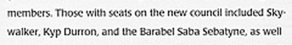
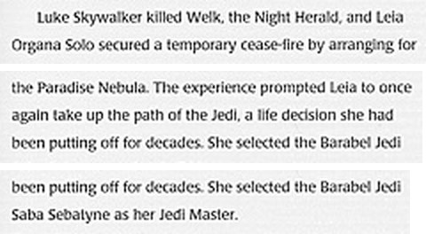
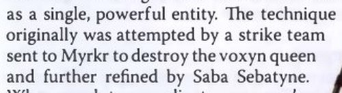
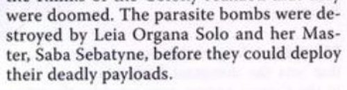
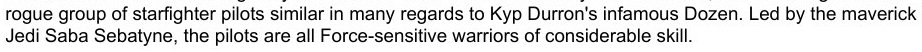
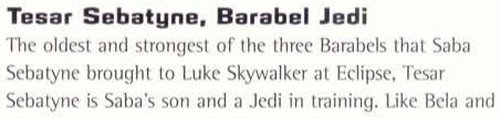

# Saba Sebatyne

- **Aliases:** Saba
- **Era:** LotF
- **Continuity:** default Legends; entries present for: Legends
- **Research tier:** untiered (not listed as INTRO/DEEP/MASTERY in legends-feats.md)
- **Entries:** 210 (133 with quotations; 70 quotations extended to the full sentence/passage from the source text on file; 40 marked as fragments; 80 before the 2026-11-17 fragment fill). Rebuilt 2026-11-17 from 193 old entries; old file: `characters/_bak/saba-sebatyne.md.bak-20261117`.
- **How to read:** each entry is the quotation in full (block quote), then its source and point of view. "Note" lines are summaries from our notes, not quotations. `[fragment — full passage not on file]` means the source text is not on the box, so only the words in our notes are shown. Debate and forum material is in the last section and is unverified.

# LEGENDS (Legends / EU — main focus)

## Legacy of the Force 1–9: novel notes from the other agent (reference copy)

> After four years of Saha-style Jedi training, she was just that strong. *("Saha" is an OCR error for Saba.)*
— Source: Ch5 · L1460; L1450 — Legacy of the Force 3: Tempest (novel), feats and scaling notes; Ch5 · L1460 · Leia (FEAT, strength).
Note (our notes, around the quote): Ch5 · L1460 · Leia (FEAT, strength): «After four years of Saha-style Jedi training, she was just that strong.» ("Saha" is an OCR error for Saba.) She drags a bound guard one-handed and earlier Force-jerks a sentry through a door (L1450).
Our notes: `notes/materials/021-legacy-of-the-force/lotf-3-tempest-notes.md:49`

> And she feared that if he did not return to himself soon, something terrible would happen. She could feel that much in the Force. *(L571)*
>
> Jacen is already swinging us like a tail. *(L615)*
— Source: L571; L575; L629–633; L615 — Legacy of the Force 6: Inferno (novel, read in full): feats, scaling and story notes.
(Full sentence/passage taken from the source text on file: `novels_tmp_inferno_FULL_txt`.)
Note (our notes, around the quote): Saba doesn't understand Luke's grief; «if he did not return to himself soon, something terrible would happen. She could feel that much in the Force.» (L571). Jaina & Zekk pursuing Alema (L575). Jacen absent. Council (Corran, Kyp, Kenth Hamner) asks Saba to give the eulogy (L629–633). Saba: «Jacen is already swinging us like a tail.» (L615).
Our notes: `notes/materials/021-legacy-of-the-force/lotf-6-inferno-notes.md:259`

> His attention was fixed on the slatstones beneath his feet, his brow furrowed in concentration, his Force aura swirling with pain and confusion and a rage that Mara would have found very frightening. *(L661)*
— Source: L655; L661 — Legacy of the Force 6: Inferno (novel, read in full): feats, scaling and story notes; Saba Force-projects her voice (L655). Ben's aura.
(Full sentence/passage taken from the source text on file: `novels_tmp_inferno_FULL_txt`.)
Label in our notes: L661
Our notes: `notes/materials/021-legacy-of-the-force/lotf-6-inferno-notes.md:260`

> I'm not here as a Jedi. *(L689)*
>
> He pretended not to notice her indignation and continued down the aisle, taking care to keep his presence hidden from the Force so no one would sense how nervous he felt. *(L669)*
>
> Jacen, you know you're not a Master. *(L687)*
— Source: L689; L669; L687; L683 — Legacy of the Force 6: Inferno (novel, read in full): feats, scaling and story notes; Jacen arrives late in black, cloak, empty lightsaber snap.
(Full sentence/passage taken from the source text on file: `novels_tmp_inferno_FULL_txt`.)
Note (our notes, around the quote): Jacen arrives late in black, cloak, empty lightsaber snap: «I'm not here as a Jedi.» (L689). Jacen keeps presence hidden «so no one would sense how nervous he felt» (L669). Kenth: «Jacen, you know you're not a Master.» (L687). Jacen wants the public to see him as «his uncle's equal» (L683).
Our notes: `notes/materials/021-legacy-of-the-force/lotf-6-inferno-notes.md:261`

What it shows (our notes): ** (L713) — STATEMENT (Caedus's respect/fear
> “Mara was a great Jedi and a loving aunt.” As Jacen clasped arms, he took extra care to hide his feelings from the Force. It was hard to imagine his uncle having the strength to probe for guilty emotions right now, but the galaxy was littered with the body parts of those who had underestimated the strength of Luke Skywalker. “I would never have missed the chance to show my respect for her.”
— Source: L713 — Legacy of the Force 6: Inferno (novel, read in full): feats, scaling and story notes; **Jacen POV on Luke. POV: Jacen POV, about Saba Sebatyne.
(Excerpt widened 2026-11-17 to the relevant passage, word for word from Inferno (Troy Denning) (text copy `MEGA_Legend_The_Legacy_of_the_Force_Series_Star_Wars_Legacy_of_the_Force_06_Inferno_Troy_Denning_epub`).)
Our notes: `notes/materials/021-legacy-of-the-force/lotf-6-inferno-notes.md:262`

> Saba sissed in astonishment and several other Masters sighed in relief, but Jacen nearly choked on his shock. If Mara was trying to tell anyone anything, it had nothing to do with reconciliation—and everything to do with exposing her killer. *(L721)*
— Source: L723–727; L721 — Legacy of the Force 6: Inferno (novel, read in full): feats, scaling and story notes.
(Full sentence/passage taken from the source text on file: `novels_tmp_inferno_FULL_txt`.)
Note (our notes, around the quote): Mara's body dematerializes at the funeral (L721, L743, L771): Luke misreads it as a call to reconcile with Jacen (L723–727). Jacen: «If Mara was trying to tell anyone anything ... everything to do with exposing her killer.» (L721).
Our notes: `notes/materials/021-legacy-of-the-force/lotf-6-inferno-notes.md:263`

What it shows (our notes): Saba's eulogy compares Palpatine's «single galaxy with one justice ... bound in peace by a single fist» to Jacen (L755–761) — thematic. «If we wish to bring justice and peace to the galaxy, all we need do is step into the light.» (L775).
> After a moment, Saba continued. “And it iz good that Colonel Solo arrives at this point in our remembrances, because the greatest gift Mara Jade Skywalker left us is the lesson of her life—a life that began under the darkest of shadowz.” She half turned to face Jacen, Luke, and Ben. “As a young child, Mara was taken from her parentz and shaped into pure spy and assassin, and her keeper set her to doing terrible thingz when she was barely old enough for the hunt. She did them because she believed they were right, because she believed in the dream of a single galaxy with one justice, a galaxy bound in peace by a single fist.
>
> If we wish to bring justice and peace to the galaxy, all we need do is step into the light. *(L775)*
— Source: L755–761; L775 — Legacy of the Force 6: Inferno (novel, read in full): feats, scaling and story notes; Saba's eulogy compares Palpatine's.
(Excerpt widened 2026-11-17 to the relevant passage, word for word from Inferno (Troy Denning) (text copy `MEGA_Legend_The_Legacy_of_the_Force_Series_Star_Wars_Legacy_of_the_Force_06_Inferno_Troy_Denning_epub`).)
(Full sentence/passage taken from the source text on file: `novels_tmp_inferno_FULL_txt`.)
Our notes: `notes/materials/021-legacy-of-the-force/lotf-6-inferno-notes.md:264`

> Sooner or later, someone would discover the identity of Mara’s killer, and the Jedi had to be either firmly under Caedus’s control by then—or eliminated. *(L753)*
— Source: L753; L805 — Legacy of the Force 6: Inferno (novel, read in full): feats, scaling and story notes; Jacen: the Jedi.
(Full sentence/passage taken from the source text on file: `novels_tmp_inferno_FULL_txt`.)
Note (our notes, around the quote): Jacen: the Jedi «had to be either firmly under Caedus's control by then - or eliminated.» (L753). Caedus considers killing Ben to protect the secret, but still sees him as possible apprentice (L805).
Our notes: `notes/materials/021-legacy-of-the-force/lotf-6-inferno-notes.md:265`

> If anything remained of the gentle-hearted boy he remembered from the Jedi academy on Yavin 4, he could no longer find it. Jacen was swaddled in a darkness deeper than any he had felt in recent memory—perhaps since the days of Darth Vader and the Emperor—and it was not at all clear that he could be drawn back into the light. *(L829)*
>
> With only an aching void where there used to be Mara, Luke felt like the victim of a heart amputation, everything inside burning in grief, his thoughts whirling with memories of Mara’s death … that sudden awful pulling on their Force-bond, as though she were falling into a star, then trying to reach out and draw her to safety, but the bond just snapping and leaving him broken and lost and hurting. *(L833)*
— Source: L811; L829; L833 — Legacy of the Force 6: Inferno (novel, read in full): feats, scaling and story notes; Jacen accompanying Fourth Fleet, requested Jedi StealthXs (L811). Luke POV.
(Full sentence/passage taken from the source text on file: `novels_tmp_inferno_FULL_txt`.)
Note (our notes, around the quote): Jacen accompanying Fourth Fleet, requested Jedi StealthXs (L811). Luke POV: «Jacen was swaddled in a darkness deeper than any he had felt in recent memory - perhaps since the days of Darth Vader and the Emperor» (L829) — STATEMENT (Luke; high reliability re darkness, not power). Luke's guilt over killing Lumiya wrongly (L829). Mara's death felt as «that sudden awful pulling on their Force - bond, as though she were falling into a star» (L833).
Our notes: `notes/materials/021-legacy-of-the-force/lotf-6-inferno-notes.md:266`

> “We are not going to bring Jacen back at all,” Saba said. “Jacen is beyond saving.” *(L841)*
>
> “We don’t know.” he said, “They escaped into fellowship Plaza, and Leia’s been Force-flashing the security cams.” *(L881)*
>
> With everyone focused on finding Mara’s killer and worrying about me, there’ll never be a better time to cripple the Jedi.” *(L895)*
>
> “Maybe—but Jacen isn’t the only one who knows how to set a trap,” Luke said. *(L927)*
— Source: L841; L849–853; L855; L881 — Legacy of the Force 6: Inferno (novel, read in full): feats, scaling and story notes; Saba. POV: Saba.
(Full sentence/passage taken from the source text on file: `novels_tmp_inferno_FULL_txt`.)
Note (our notes, around the quote): Saba: «Jacen is beyond saving.» (L841). Ben: Mom's message wasn't to trust Jacen (L849–853); Luke can't detect if Ben is lying (L855). Leia «Force-flashing the security cams» (L881). Luke: «there'll never be a better time to cripple the Jedi» (L895). Luke: «Jacen isn't the only one who knows how to set a trap» (L927) — Luke's counter-plan (fake reconciliation).
Our notes: `notes/materials/021-legacy-of-the-force/lotf-6-inferno-notes.md:267`

> Caedus returned to his bubble, but made no attempt to resume his battle meditation. The technique—at least as Lumiya had taught it to him—was Sith, and he did not want to risk using it while what felt like half the Jedi Order was attempting to draw him into a meld. *(L2037)*
>
> The Sith way was one of deep sacrifice, and only now was Caedus coming to understand that he had not sacrificed the ability to love—only the ability to be loved in return. *(L2041)*
— Source: L2021–2023; L2045; L2037; L2041 — Legacy of the Force 6: Inferno (novel, read in full): feats, scaling and story notes.
(Full sentence/passage taken from the source text on file: `novels_tmp_inferno_FULL_txt`.)
Note (our notes, around the quote): Jedi battle-meld (Saba, Kyp, Corran, Tesar, Lowbacca etc.) invites Caedus in (L2021–2023); ~70+ StealthXs (L2045). Caedus avoids Sith battle meditation in the meld: «The technique-at least as Lumiya had taught it to him-was Sith» (L2037). Caedus: he had «not sacrificed the ability to love-only the ability to be loved in return.» (L2041).
Our notes: `notes/materials/021-legacy-of-the-force/lotf-6-inferno-notes.md:298`

- Note (summary from our notes, not a quotation): Bwua'tu's plan: Hapan Home Fleet ambush from Ronay's sensor shadow (L2387). Saba: Bwua'tu is «prey-sensitive» (L2375). Jedi squadrons: Shadow Saber (Kyp), Night Blades (Saba), Dark Sword (Kenth) (L2373–2383). Tahiri present (L2369). Mission: shadow bombs vs Bothan cruisers, rearm at *Megador* Hangar 51, then through the Corellian fleet (L2399–2407).
  — Source: L2387; L2375; L2373–2383; L2369 — Legacy of the Force 6: Inferno (novel, read in full): feats, scaling and story notes.
Our notes: `notes/materials/021-legacy-of-the-force/lotf-6-inferno-notes.md:307`

> Does it bother anyone else that we're delivering the galaxy to Jacen on an aurodium platter? *(L2413)*
>
> Given the choice between a despot and utter lawlessness, I think we have to go with the despot. For now. *(L2451)*
>
> Finally, Saba half turned in her chair, looking away. “You are the longfang, Master Skywalker. We draw the line where you say to draw it.” *(L2465)*
>
> We won't let Jacen push us much farther, I promise. *(L2471)*
— Source: L2413; L2451; L2465; L2471 — Legacy of the Force 6: Inferno (novel, read in full): feats, scaling and story notes; Council consensus: Kyp.
(Full sentence/passage taken from the source text on file: `novels_tmp_inferno_FULL_txt`.)
Note (our notes, around the quote): Council consensus: Kyp: «Does it bother anyone else that we're delivering the galaxy to Jacen on an aurodium platter?» (L2413); Kenth: «Given the choice between a despot and utter lawlessness, I think we have to go with the despot. For now.» (L2451); Saba: «You are the longfang ... We draw the line where you say to draw it.» (L2465). Luke: «We won't let Jacen push us much farther, I promise.» (L2471). Cilghal: Omas murdered, Ben was there (L2475).
Our notes: `notes/materials/021-legacy-of-the-force/lotf-6-inferno-notes.md:308`

What it shows (our notes): Leia vs Tojjelnoot (Wookiee council leader): Force-springs onto the rock; handspring heel-kick to his stomach with «just enough power» of Force (L2865–2869) — Saba's training («Saba had drilled into Leia the folly of taking unnecessary chances», L2867). Gently Force-lifts him up (L2881).
> Tojjelnoot would probably have fallen even without the Force, but Saba had drilled into Leia the folly of taking unnecessary chances in any combat. She waited until her legs had extended fully, then added just enough power to be certain the Wookiee would go down.
— Source: L2865–2869; L2881 — Legacy of the Force 6: Inferno (novel, read in full): feats, scaling and story notes.
(Excerpt widened 2026-11-17 to the relevant passage, word for word from Inferno (Troy Denning) (text copy `MEGA_Legend_The_Legacy_of_the_Force_Series_Star_Wars_Legacy_of_the_Force_06_Inferno_Troy_Denning_epub`).)
(Full sentence/passage taken from the source text on file: `novels_tmp_inferno_FULL_txt`.)
Our notes: `notes/materials/021-legacy-of-the-force/lotf-6-inferno-notes.md:325`

> “What you probably don’t know is that Jacen Solo arranged it.” The Rock Council received this news in utter, stunned silence, and Luke pressed on. “Therefore, the Jedi Council has voted to begin active opposition to his continued leadership of the Galactic Alliance, and we have come to Kashyyyk to ask the Wookiees to join us.”
>
> “But this is not a good day for anyone, Jedi Solo—especially not for you.” *(L2995)*
— Source: L2973–2977; L3003; L2995 — Legacy of the Force 6: Inferno (novel, read in full): feats, scaling and story notes.
(Full sentence/passage taken from the source text on file: `novels_tmp_inferno_FULL_txt`.)
Note (our notes, around the quote): Luke arrives with Saba and Council Masters (L2973–2977). Luke to Rock Council: «What you probably don't know is that Jacen Solo arranged it ... the Jedi Council has voted to begin active opposition to his continued leadership» (L3003) — Jedi openly break with Caedus. Saba: «this is not a good day for anyone, Jedi Solo-especially not for you.» (L2995).
Our notes: `notes/materials/021-legacy-of-the-force/lotf-6-inferno-notes.md:328`

What it shows (our notes): L6003–6005 · Luke, Ben, Saba, Leia: «Moving so fast that they blurred»; six guards drop in an instant.
> Moving so fast that they blurred, the four Jedi, breather masks over their faces, emerged from the edges of the smoke cloud.
>
> The security team at the entrance to the turbolift corridor opened fire—too late; the Jedi were already among them, striking with fists, feet, and, in Saba’s case, tail. Six security personnel fell in an instant, their blaster rifles clattering to the deck plates, barely audible over the alarms howling through the hangar bay.
— Source: Legacy of the Force 7: Fury (novel, read in full): feats, scaling and story notes; L6003–6005 · Luke, Ben, Saba, Leia.
(Excerpt widened 2026-11-17 to the relevant passage, word for word from Fury (Aaron Allston) (text copy `MEGA_Legend_The_Legacy_of_the_Force_Series_Star_Wars_Legacy_of_the_Force_07_Fury_Aaron_Allston_epub`).)
(Excerpt widened 2026-11-17 to the relevant passage, word for word from Fury (Aaron Allston) (text copy `MEGA_Legend_The_Legacy_of_the_Force_Series_Star_Wars_Legacy_of_the_Force_07_Fury_Aaron_Allston_epub`).)
(Full sentence/passage taken from the source text on file: `novels_tmp_fury_FULL_txt`.)
Our notes: `notes/materials/021-legacy-of-the-force/lotf-7-fury-notes.md:85`

What it shows (our notes): L6215 · Saba: Force-flips the cut plug onto a grenade and holds it down. Ben: «He was fast, but not as fast as Saba Sebatyne.»
> He was fast, but not as fast as Saba Sebatyne. The Jedi Master simply reached out and the plug Ben had cut from the blast doors flipped over, coming down atop the detonator. Saba’s hand flattened as though she were holding something down.
— Source: Legacy of the Force 7: Fury (novel, read in full): feats, scaling and story notes.
(Excerpt widened 2026-11-17 to the relevant passage, word for word from Fury (Aaron Allston), Chapter Thirty-Four (text copy `MEGA_Legend_The_Legacy_of_the_Force_Series_Star_Wars_Legacy_of_the_Force_07_Fury_Aaron_Allston_epub`).)
Also cited as: L6215–6217; L6215 — Legacy of the Force 7: Fury (novel, read in full): feats, scaling and story notes.
Also noted as: Ben cuts through a blast door; Saba telekinetically flips the cut plug over a grenade and holds it down (L6215–6217). Ben's verdict: «He was fast, but not as fast as Saba Sebatyne.» (L6215) — FEAT (Saba reflex + TK).
Our notes: `notes/materials/021-legacy-of-the-force/lotf-7-fury-notes.md:86`; `notes/materials/021-legacy-of-the-force/lotf-7-fury-notes.md:403`

What it shows (our notes): L6237, L6265 · Saba vs YVH: «Saba, her sword work brilliant, was parrying full-autofire streams of blaster cannon fire.» She then rolls under and beheads a laminanium droid (L6265).
> Saba, her sword work brilliant, was parrying full-autofire streams of blaster cannon fire. Luke, more mobile, was avoiding the fire aimed at him—like a dancer, he kept ahead of every stream, but was making no headway, and in fact was being herded back toward the blast doors. A few moments more and the droids might pin him against the doors, denying him maneuverability, and finish him.
— Source: L6265 — Legacy of the Force 7: Fury (novel, read in full): feats, scaling and story notes; L6237, L6265 · Saba vs YVH.
(Excerpt widened 2026-11-17 to the relevant passage, word for word from Fury (Aaron Allston), Chapter Thirty-Four (text copy `MEGA_Legend_The_Legacy_of_the_Force_Series_Star_Wars_Legacy_of_the_Force_07_Fury_Aaron_Allston_epub`).)
Our notes: `notes/materials/021-legacy-of-the-force/lotf-7-fury-notes.md:87`

- Note (summary from our notes, not a quotation): L6711 · Saba (durability): «Impossibly, Saba stood», charred, and keeps deflecting.
  — Source: Legacy of the Force 7: Fury (novel, read in full): feats, scaling and story notes.
Our notes: `notes/materials/021-legacy-of-the-force/lotf-7-fury-notes.md:92`

- Note (summary from our notes, not a quotation): | E | Caedus + 8 YVHs vs. Luke, Saba, Ben (bridge) | Ch35–36, L6459–6755 | a minute or two | None. Caedus abandons the fight to chase Allana; the Jedi extract | Caedus was «fresh» (L6453). The Jedi were absorbing cannon fire all through. Saba was knocked out of the fight by Caedus's TK. Luke and Caedus never cross blades. | Caedus can remove a Master with opportunistic TK. Luke judges him «Luke's match» (L6729). |
  — Source: L6453; L6729 — Legacy of the Force 7: Fury (novel, read in full): feats, scaling and story notes.
Context: | # | Fight | Where (lines) | Length | Winner | Holding back / help / injuries | What it suggests |
Our notes: `notes/materials/021-legacy-of-the-force/lotf-7-fury-notes.md:139`

> Octa, trained by Kam and Tionne Solusar, both still recovering from their near-fatal wounds at the hands of Jacen Solo’s soldiers, was more subdued than the rest, her stillness in the Force clearly a consequence of rigid self-control rather than inner peace. *(L683)*
— Source: L683 — Legacy of the Force 7: Fury (novel, read in full): feats, scaling and story notes.
(Full sentence/passage taken from the source text on file: `novels_tmp_fury_FULL_txt`.)
Note (our notes, around the quote): Masters present: Luke, Kyle Katarn, Cilghal, Kyp, Corran, Saba, Octa Ramis (L683). Kam and Tionne «both still recovering from their near-fatal wounds» (L683) [Allston: Kam alive; contrast Inferno L3345–3355 where Kam appeared killed — continuity note].
Our notes: `notes/materials/021-legacy-of-the-force/lotf-7-fury-notes.md:245`

> A few meters away, Saba Sebatyne and Corran Horn dueled, each adopting a traditional, formalized lightsaber posture—Saba using a lightsaber in each hand, Corran with his own weapon adjusted to its second setting, its blade now three meters in length and a brilliant purple instead of its usual silver. *(L701)*
>
> It was like defending himself against Yuuzhan Vong thud bugs for the first time in years, but the old skill was undiminished—he calculated which objects had a chance of hitting him and incinerated only them with his blades, letting the others fly harmlessly past. *(L717)*
— Source: L701–717; L701; L711; L715 — Legacy of the Force 7: Fury (novel, read in full): feats, scaling and story notes.
(Full sentence/passage taken from the source text on file: `novels_tmp_fury_FULL_txt`.)
Note (our notes, around the quote): Masters' free-for-all (L701–717): Saba dual-wields; Corran's saber «adjusted to its second setting, its blade now three meters in length» (L701); Octa Ramis Force-hurls stones; Luke inverted back-flip block on Cilghal (L701), bends backward and disarms Cilghal by catching her hilt (L711), then fights Kyp two-bladed (L715). Luke vs Force-propelled bolt swarm: «he calculated which objects had a chance of hitting him and incinerated only them with his blades» (L717) — FEAT (casual, sparring). Cilghal Force-pulls Kyle's saber (L713).
Our notes: `notes/materials/021-legacy-of-the-force/lotf-7-fury-notes.md:247`

What it shows (our notes): Caedus senses «Luke. Ben. Saba Sebatyne. / His mother.» (L5973–5975); his battle meditation collapses (L5977). Plan Bastion: eight YVH droids on the bridge (L5991).
> On the other hand, he could not afford to ignore the possible presence of Jedi, either. He carefully withdrew from the active influence of his ship commanders, then opened himself up to a different flow of the Force.
>
> Yes, there were Jedi aboard. Luke. Ben. Saba Sebatyne.
>
> His mother. *(L5973–5975)*
— Source: L5973–5975; L5977; L5991 — Legacy of the Force 7: Fury (novel, read in full): feats, scaling and story notes; Caedus senses.
(Excerpt widened 2026-11-17 to the relevant passage, word for word from Fury (Aaron Allston) (text copy `MEGA_Legend_The_Legacy_of_the_Force_Series_Star_Wars_Legacy_of_the_Force_07_Fury_Aaron_Allston_epub`).)
(Excerpt widened 2026-11-17 to the relevant passage, word for word from Fury (Aaron Allston) (text copy `MEGA_Legend_The_Legacy_of_the_Force_Series_Star_Wars_Legacy_of_the_Force_07_Fury_Aaron_Allston_epub`).)
Our notes: `notes/materials/021-legacy-of-the-force/lotf-7-fury-notes.md:395`

> Caedus didn't think these measures would stop the Jedi. *(L5993)*
>
> Jacen could defeat his mother or Ben without trouble; Saba, with difficulty. Saba plus Luke would be impossible odds. One of the Masters had to fall if Caedus was to survive this day.
— Source: L5993; L5995 — Legacy of the Force 7: Fury (novel, read in full): feats, scaling and story notes.
Note (our notes, around the quote): Caedus's self-assessment (STATEMENT, Caedus POV, fairly reliable but self-serving): «Caedus didn't think these measures would stop the Jedi.» (L5993); «Jacen could defeat his mother or Ben without trouble; Saba, with difficulty. Saba plus Luke would be impossible odds. One of the Masters had to fall if Caedus was to survive this day.» (L5995) — he ranks Saba near his level and Luke + Saba as far beyond him.
Our notes: `notes/materials/021-legacy-of-the-force/lotf-7-fury-notes.md:396`; `notes/materials/021-legacy-of-the-force/lotf-7-fury-notes.md:119`

What it shows (our notes): Caedus watches Luke, Ben and Saba cut through hardpoints (L6065). He notes that «Luke had found him easily enough-Caedus wasn't hiding» and that Leia's presence slid past him (L6067). Leia is in fact hiding/on the rescue.
> Caedus hadn’t spotted his mother, though he had felt her presence, as he had felt Luke, searching in the Force. Luke had found him easily enough—Caedus wasn’t hiding. Leia’s presence, however, had brushed over him and gone on. Caedus wondered if she might be wounded, which would account both for the fact that she wasn’t keeping up with the others and that her ability to detect him seemed to be reduced.
— Source: L6065; L6067 — Legacy of the Force 7: Fury (novel, read in full): feats, scaling and story notes.
(Excerpt widened 2026-11-17 to the relevant passage, word for word from Fury (Aaron Allston), Chapter Thirty-Three (text copy `MEGA_Legend_The_Legacy_of_the_Force_Series_Star_Wars_Legacy_of_the_Force_07_Fury_Aaron_Allston_epub`).)
(Full sentence/passage taken from the source text on file: `novels_tmp_fury_FULL_txt`.)
Our notes: `notes/materials/021-legacy-of-the-force/lotf-7-fury-notes.md:398`

> Saba, her sword work brilliant, was parrying full-autofire streams of blaster cannon fire. Luke, more mobile, was avoiding the fire aimed at him—like a dancer, he kept ahead of every stream, but was making no headway, and in fact was being herded back toward the blast doors. A few moments more and the droids might pin him against the doors, denying him maneuverability, and finish him.
>
> Luke, more mobile, was avoiding the fire aimed at him—like a dancer, he kept ahead of every stream, but was making no headway, and in fact was being herded back toward the blast doors. *(L6237)*
— Source: L6237; L6241–6245; L6255–6257; L6261 — Legacy of the Force 7: Fury (novel, read in full): feats, scaling and story notes; YVH droids with blaster cannons. POV: YVH droids with blaster cannons, about Saba Sebatyne.
(Excerpt widened 2026-11-17 to the relevant passage, word for word from Fury (Aaron Allston), Chapter Thirty-Four (text copy `MEGA_Legend_The_Legacy_of_the_Force_Series_Star_Wars_Legacy_of_the_Force_07_Fury_Aaron_Allston_epub`).)
(Full sentence/passage taken from the source text on file: `novels_tmp_fury_FULL_txt`.)
Note (our notes, around the quote): YVH droids with blaster cannons: «Saba, her sword work brilliant, was parrying full-autofire streams of blaster cannon fire. Luke, more mobile, was avoiding the fire» but «was being herded back toward the blast doors» (L6237) — Luke is pressed by four YVHs; not a top-tier showing. Ben deflects at an angle rather than blocking (L6241–6245). Ben Force-wrenches a YVH's cannon arm to shoot another droid (L6255–6257) — FEAT (Ben TK vs a heavy laminanium droid). Luke makes a droid's minirocket explode in its chest port (L6261) — FEAT (Luke TK precision).
Our notes: `notes/materials/021-legacy-of-the-force/lotf-7-fury-notes.md:404`

- Note (summary from our notes, not a quotation): Saba vs YVH: she walks up the cannon stream, catches its lightning arc on her blade, rolls under and beheads it through laminanium (L6265) — FEAT (Saba). Luke Force-topples his YVH and stabs it (L6269). Saba: «Good tacticz» (L6271).
  — Source: L6265; L6269; L6271 — Legacy of the Force 7: Fury (novel, read in full): feats, scaling and story notes.
Our notes: `notes/materials/021-legacy-of-the-force/lotf-7-fury-notes.md:405`

- Note (summary from our notes, not a quotation): Caedus «waited, patient» while the Jedi absorb fire (L6619). Ben plants plundered YVH grenades on droids (L6621–6627); Luke and Saba kick two droids into the pits (L6627).
  — Source: L6619; L6621–6627; L6627 — Legacy of the Force 7: Fury (novel, read in full): feats, scaling and story notes.
Our notes: `notes/materials/021-legacy-of-the-force/lotf-7-fury-notes.md:417`

> He gestured, exerting himself telekinetically, and Saba Sebatyne slipped laterally into the starboard pit, almost atop the doomed droid there. *(L6629)*
>
> Her leap toward safety was almost instantaneous, but almost wasn’t good enough. The detonators went off. The blast caught Sebatyne when she was only a meter or two in the air. It propelled her like an old-fashioned munition to the port-side wall, slamming her into that surface five meters above the floor, and she slid, flaming, down into the pit.
— Source: L6629; L6631; L6633 — Legacy of the Force 7: Fury (novel, read in full): feats, scaling and story notes; Caedus Force-shoves Saba into the blast pit.
(Excerpt widened 2026-11-17 to the relevant passage, word for word from Fury (Aaron Allston), Chapter Thirty-Six (text copy `MEGA_Legend_The_Legacy_of_the_Force_Series_Star_Wars_Legacy_of_the_Force_07_Fury_Aaron_Allston_epub`).)
(Full sentence/passage taken from the source text on file: `novels_tmp_fury_FULL_txt`.)
Note (our notes, around the quote): Caedus Force-shoves Saba into the blast pit: «He gestured, exerting himself telekinetically, and Saba Sebatyne slipped laterally into the starboard pit, almost atop the doomed droid there.» (L6629). The blast slams her into the wall «five meters above the floor» and she slides down «flaming» (L6631). Caedus: «One down.» (L6633) — FEAT (Caedus TK on a Master, in a chaotic moment while she is busy with fire).
Our notes: `notes/materials/021-legacy-of-the-force/lotf-7-fury-notes.md:418`

- Note (summary from our notes, not a quotation): Saba stands again, charred, and deflects bolts (L6711) — durability FEAT. Luke orders her out (L6717–6721).
  — Source: L6711; L6717–6721 — Legacy of the Force 7: Fury (novel, read in full): feats, scaling and story notes.
Our notes: `notes/materials/021-legacy-of-the-force/lotf-7-fury-notes.md:419`

> Two seconds had passed since the attack began. *(L1577)*
>
> Katarn looked down to see Caedus's lightsaber buried to its hilt in his chest. *(L1649)*
>
> Mithric's head fell from his shoulders. *(L1719–1723)*
>
> Luke felt the wave of hatred flow through him. It was so strong it felt like a kick in the gut, and he wondered for an instant if Jacen had perfected some new Force attack. *(Ch19, L3279)*
>
> The sound of Tebut’s neck breaking was startlingly loud over the hum of the bridge’s monitors and computer gear. *(L6957–6969)*
— Source: Ch10, L1557; Ch19, L3279; Ch36, L6629–6633; L1577 — Legacy of the Force 7: Fury (novel, read in full): feats, scaling and story notes.
(Full sentence/passage taken from the source text on file: `novels_tmp_fury_FULL_txt`.)
Note (our notes, around the quote): Key feats: turns back rolling grenades with a contemptuous flick (Ch10, L1557). Downs three Jedi: «Two seconds had passed since the attack began.» (L1577). Yanks a speeder into Katarn's back so «Katarn looked down to see Caedus's lightsaber buried to its hilt in his chest.» (L1649). Deflects a bolt into Mithric, then «Mithric's head fell from his shoulders.» (L1719–1723). Rage leaks through the Force; Luke: «It was so strong it felt like a kick in the gut» (Ch19, L3279). TK-slips Saba into a grenade pit (Ch36, L6629–6633). Chokes Tebut: «The sound of Tebut's neck breaking was startlingly loud» (L6957–6969).
Our notes: `notes/materials/021-legacy-of-the-force/lotf-7-fury-notes.md:446`

> “You’re no Jedi.” Corran’s voice was harsh. “Your emotions are all over the map. Even an apprentice knows that. So we can’t trust you as a Jedi, we can’t trust you to be a calm, collected operative, and now you’ve left the most dangerous man in the galaxy disappointed in you—” He gestured at Luke. “Plus, you’ve volunteered to go on a mission to capture the second-most dangerous man, when all you had to do to retain everyone’s trust was keep your mouth shut.”
>
> But he was still the best lightsaber swordsman around—excepting possibly Luke, perhaps the best there ever had been.
>
> Caedus waited until the timing was perfect, waited until an incoming bolt arrived at the same moment as one of Mithric’s attacks so he could devote a single maneuver to both. He caught Mithric’s blow toward the hilt of his lightsaber. He caught the bolt near the tip, deflecting it up and straight into Mithric’s chest.
>
> They had to. Jacen could defeat his mother or Ben without trouble; Saba, with difficulty. Saba plus Luke would be impossible odds. One of the Masters had to fall if Caedus was to survive this day.
>
> Jacen was Luke's match *(L6729)*
> [fragment — full passage not on file]
>
> Caedus himself felt healthy again, fully healed for the first time since his fight with Luke. *(L5573)*
— Source: L783; L1717; L5993–5995; L6729 — Legacy of the Force 7: Fury (novel, read in full): feats, scaling and story notes; Statements: Corran calls him.
(Excerpt widened 2026-11-17 to the relevant passage, word for word from Fury (Aaron Allston) (text copy `MEGA_Legend_The_Legacy_of_the_Force_Series_Star_Wars_Legacy_of_the_Force_07_Fury_Aaron_Allston_epub`).)
(Excerpt widened 2026-11-17 to the relevant passage, word for word from Fury (Aaron Allston) (text copy `MEGA_Legend_The_Legacy_of_the_Force_Series_Star_Wars_Legacy_of_the_Force_07_Fury_Aaron_Allston_epub`).)
(Excerpt widened 2026-11-17 to the relevant passage, word for word from Fury (Aaron Allston) (text copy `MEGA_Legend_The_Legacy_of_the_Force_Series_Star_Wars_Legacy_of_the_Force_07_Fury_Aaron_Allston_epub`).)
(Excerpt widened 2026-11-17 to the relevant passage, word for word from Fury (Aaron Allston) (text copy `MEGA_Legend_The_Legacy_of_the_Force_Series_Star_Wars_Legacy_of_the_Force_07_Fury_Aaron_Allston_epub`).)
(Full sentence/passage taken from the source text on file: `novels_tmp_fury_FULL_txt`.)
(Fragment completed 2026-11-17: full sentence/passage matched word for word in the source text on file: `MEGA_Legend_The_Legacy_of_the_Force_Series_Star_Wars_Legacy_of_the_Force_07_Fury_Aaron_Allston_epub`.)
Note text that was attached to the quote line: *(L1717)*
(Fragment completed 2026-11-17: full sentence/passage matched word for word in the source text on file: `MEGA_Legend_The_Legacy_of_the_Force_Series_Star_Wars_Legacy_of_the_Force_07_Fury_Aaron_Allston_epub`.)
Note text that was attached to the quote line: *(L5993–5995)*
Note (our notes, around the quote): Statements: Corran calls him «the second-most dangerous man» after Luke (L783). His own POV: «But he was still the best lightsaber swordsman around-excepting possibly Luke» (L1717). His threat assessment: «Jacen could defeat his mother or Ben without trouble; Saba, with difficulty. Saba plus Luke would be impossible odds.» (L5993–5995). Luke's POV: «Jacen was Luke's match» (L6729). Healing: «fully healed for the first time since his fight with Luke.» (L5573).
Our notes: `notes/materials/021-legacy-of-the-force/lotf-7-fury-notes.md:447`

> Saba, her sword work brilliant, was parrying full-autofire streams of blaster cannon fire. *(L6237)*
>
> He was fast, but not as fast as Saba Sebatyne. *(L6215)*
— Source: L6237; L6265; L6711; L6215 — Legacy of the Force 7: Fury (novel, read in full): feats, scaling and story notes; Feats.
Note (our notes, around the quote): Feats: «Saba, her sword work brilliant, was parrying full-autofire streams of blaster cannon fire.» (L6237). Beheads a laminanium droid (L6265). «Impossibly, Saba stood» after the grenade blast (L6711). Ben: «He was fast, but not as fast as Saba Sebatyne.» (L6215).
Our notes: `notes/materials/021-legacy-of-the-force/lotf-7-fury-notes.md:487`

- Note (summary from our notes, not a quotation): Scaling: Caedus can beat her only «with difficulty» (L5993). A top Master.
  — Source: L5993 — Legacy of the Force 7: Fury (novel, read in full): feats, scaling and story notes.
Our notes: `notes/materials/021-legacy-of-the-force/lotf-7-fury-notes.md:488`

> “But I’m not going to need support because I can’t kill Caedus.” *(meaning he must not; Saba: it would taint him, L769)*
— Source: Legacy of the Force 9: Invincible (novel, read in full): feats, scaling and story notes; | S2 | L743 | Luke |.
(Full sentence/passage taken from the source text on file: `lotf_tmp_b9_epub`.)
Note (our notes, around the quote): | S2 | L743 | Luke | «I can't kill Caedus.» (meaning he must not; Saba: it would taint him, L769) | High (moral, not power). |
Context: | # | Line | Speaker / POV | Statement | Reliability |
Our notes: `notes/materials/021-legacy-of-the-force/lotf-9-invincible-notes.md:83`

> “He knowz you are the Sword,” Saba corrected. “Does one win a battle by breaking the Sword, or the warrior who wieldz it?” *(L4028)*
— Source: L4028 — Legacy of the Force 9: Invincible (novel, read in full): feats, scaling and story notes; Statement.
(Full sentence/passage taken from the source text on file: `lotf_tmp_b9_epub`.)
Note (our notes, around the quote): Statement: «He knowz you are the Sword ... Does one win a battle by breaking the Sword, or the warrior who wieldz it?» (L4028). Caedus targets Luke instead of Jaina, which is his blind spot.
Our notes: `notes/materials/021-legacy-of-the-force/lotf-9-invincible-notes.md:311`; `notes/materials/021-legacy-of-the-force/lotf-9-invincible-notes.md:100`; `notes/materials/040-lotf-own-read/lotf-9-invincible.md:78`

- Note (summary from our notes, not a quotation): Scaling: no combat here.
  — Source: Legacy of the Force 9: Invincible (novel, read in full): feats, scaling and story notes.
Our notes: `notes/materials/021-legacy-of-the-force/lotf-9-invincible-notes.md:312`

## Star Wars: The New Essential Chronology (Del Rey, 2005): power-scaling and lore notes

> Those with seats on the new council included Skywalker, Kyp Durron, and the Barabel Saba Sebatyne
> [fragment — full passage not on file]
— Source: Part Twelve: The New Jedi Order; Luke Skywalker; Kyp Durron — new Jedi Council.
Note (our notes, around the quote): Luke Skywalker; Kyp Durron — new Jedi Council: "Those with seats on the new council included Skywalker, Kyp Durron, and the Barabel Saba Sebatyne" Source: The New Essential Chronology, p.221

Our notes: `notes/materials/027-new-essential-chronology/12-part-twelve-new-jedi-order.md:177`

> Luke Skywalker killed Welk, the Night Herald, and Leia Organa Solo secured a temporary cease-fire ... The experience prompted Leia to once again take up the path of the Jedi, a life decision she had been putting off for decades. She selected the Barabel Jedi Saba Sebatyne as her Jedi Master.
> [fragment — full passage not on file]
— Source: Part Twelve: The New Jedi Order.
Note (our notes, around the quote): Luke Skywalker; Leia Organa Solo — Luke kills Welk; Leia takes up the Jedi path: "Luke Skywalker killed Welk, the Night Herald, and Leia Organa Solo secured a temporary cease-fire ... The experience prompted Leia to once again take up the path of the Jedi, a life decision she had been putting off for decades. She selected the Barabel Jedi Saba Sebatyne as her Jedi Master." Source: The New Essential Chronology, p.229

Our notes: `notes/materials/027-new-essential-chronology/12-part-twelve-new-jedi-order.md:245`

## The Complete Star Wars Encyclopedia, Vol. I (A–G)

> Force lightning Force lightning A Force ability, such as that used by Emperor Palpatine against Jedi Masters ' Mace Windu, Yoda, and later Luke Skywalker, it consisted of blue bolts of pure energy that flew from the user's fingertips toward a target. Force lightning, usually a cor­ ruption of the Force by those who followed the dark side, flowed into a target and caused great pain as it siphoned off the living energy and eventually killed its victim. Force mind trick: These aren't the droids you're looking for. Force meld The uniting of several Jedi Knights through the Force, a technique de­ veloped by the Jedi during the Yuuzhan Vong War to draw strength from one another and act as a single, powerful entity. The technique originally was attempted by a strike team sent to Myrkr to destroy the voxyn queen and further refined by Saba Sebatyne. When used to coordinate an army's actions during battle, this technique was known as the battle-meld. Un­ like traditional battle meditation, which saw a single Jedi influ­ encing armies and soldiers, the battle-meld used the combined powers ofseveral Jedi Knights. Force mind trick A technique used by ad­ vanced Jedi Knights, it al­ lowed them to influence the thinking ofotherindi­ viduals by planting sug­ gestions in their minds.
— Source: scan pages 281–320; Saba Sebatyne. POV: Saba Sebatyne.
(Excerpt widened 2026-11-17 to the relevant passage, word for word from research primary cse vol1 (text copy `research_primary_cse_vol1_pdf_45a954be6d`).)
(Excerpt widened 2026-11-17 to the relevant passage, word for word from research primary cse vol1 (text copy `research_primary_cse_vol1_pdf_45a954be6d`).)
Note (our notes, around the quote): Saba Sebatyne: "The technique originally was attempted by a strike team sent to Myrkr to destroy the voxyn queen and further refined by Saba Sebatyne." Source: The Complete Star Wars Encyclopedia, Vol. I, p.287

Our notes: `notes/materials/030-complete-star-wars-encyclopedia-vol-1/07-v1-scan-281-320.md:171`

## The Complete Star Wars Encyclopedia, Vol. II (H–O)

> The parasite bombs were destroyed by Leia Organa Solo and her Master, Saba Sebatyne, before they could deploy their deadly payloads.
— Source: scan pages 321–360; Leia Organa Solo; Saba Sebatyne.
Note (our notes, around the quote): Leia Organa Solo; Saba Sebatyne: "The parasite bombs were destroyed by Leia Organa Solo and her Master, Saba Sebatyne, before they could deploy their deadly payloads." Source: The Complete Star Wars Encyclopedia, Vol. II, p.329

Our notes: `notes/materials/031-complete-star-wars-encyclopedia-vol-2/08-v2-scan-321-360.md:108`

## The Complete Star Wars Encyclopedia, Vol. III (P–Z)

- Note (summary from our notes, not a quotation): Page contents: 1016 words, 17 paragraphs | headings/entries: Scy'rrep, Evet; Scythe Squadron; Sea Legacy; Seario, Pollard; Sebatyne, Saba; Sebatyne, Tesar
  — Source: scan pages 121–160.
Our notes: `notes/materials/032-complete-star-wars-encyclopedia-vol-3/03-v3-scan-121-160.md:127`

## Sourcebooks/Sourcebook Web Enhancements/Making a Full Recovery.pdf [Star Wars Roleplaying Game (d20, 2000)]

> Skills: Astrogate +7, Computer Use +6, Craft (lightsaber) +4, Disguise +8, Gather Information +7, Knowledge (Corellian underworld) +7, Pilot +8, Read/Write Basic, Read/Write Selonian, Speak Barabel, Speak Basic, Speak Chiss, Speak Selonian, Tumble +7. Force Skills: Affect Mind +10, Battlemind +11, Deflect (attack ­3, defense +2), Enhance Ability +11, Farseeing +5, Force Push +10, Heal Self +8, Move Object +10. Feats: Blind­Fight, Exotic Weapon Proficiency (lightsaber), Force­Sensitive, Martial Arts, Weapon Group Proficiency (blaster pistols). Force Feats: Alter, Block, Burst of Speed, Control, Knight Defense, Lightsaber Defense, Sense. The Wild Knights Born of a need to serve the galaxy but not from within the ranks of Skywalker's Order, the Wild Knights are a rogue group of starfighter pilots similar in many regards to Kyp Durron's infamous Dozen. Led by the maverick Jedi Saba Sebatyne, the pilots are all Force­sensitive warriors of considerable skill. Saba has trained a handful of Force­users in an unorthodox manner as Jedi Knights, and these maverick Jedi fly missions throughout the galaxy in marginally maintained Y­wings, Howlrunners, and other fighters. Though several of the Wild Knights lost their lives in combat against the Yuuzhan Vong during the events of the novel Star by Star, the group is still a potent force for good. Izal Waz Izal Waz is a paradox: addict and adept, pilot and pariah.
— Source: Sourcebooks/Sourcebook Web Enhancements/Making a Full Recovery.pdf [Star; Saba Sebatyne — entry/section: Wild Knights led by Saba.
(Excerpt widened 2026-11-17 to the relevant passage, word for word from y sw d20 folder files Star Wars Roleplaying Game Core Sourcebooks Sourcebook Web Enhancements Making a Full Recovery (text copy `y_sw_d20_folder_files_Star_Wars_Roleplaying_Game_Core_Sourcebooks_Sourcebook_Web_Enhancements_Making_a_Full_Recovery_pdf_7290b15ad7`).)
(Excerpt widened 2026-11-17 to the relevant passage, word for word from y sw d20 folder files Star Wars Roleplaying Game Core Sourcebooks Sourcebook Web Enhancements Making a Full Recovery (text copy `y_sw_d20_folder_files_Star_Wars_Roleplaying_Game_Core_Sourcebooks_Sourcebook_Web_Enhancements_Making_a_Full_Recovery_pdf_7290b15ad7`).)
Note (our notes, around the quote): Saba Sebatyne — entry/section: Wild Knights led by Saba: "Led by the maverick Jedi Saba Sebatyne, the pilots are all Force-sensitive warriors of considerable skill." Source: *Making a Full Recovery* (SWRPG d20), scan p.4

Our notes: `notes/materials/037-sw-d20-folder/037-making-a-full-recovery.md:38`

## Sourcebooks/The New Jedi Order Sourcebook.pdf [Star Wars Roleplaying Game (d20, 2000)] (scan pages 1–60)

- Note (summary from our notes, not a quotation): Page contents: 723 words, 58 paragraphs | headings/entries: Kos; Yuuzhan Vong Lav Peq Netting; Yuuzhan Vong Yorik-stronha; Chapter Seven: Star by Star; Saba Sebatyne, Barabel Jedi; XJ3 X-Wing New Starship Tactics; Yuuzhan Vong Psychological; Chapter Bight: Epilogue; Coruscant Lost
  — Source: Sourcebooks/The New Jedi Order Sourcebook.pdf [Star Wars Roleplaying Game.
Our notes: `notes/materials/037-sw-d20-folder/049-the-new-jedi-order-sourcebook-scan-001-060.md:30`

> the first to fall so deeply to the dark side
> [fragment — full passage not on file]
>
> creating a new Darth Vader
> [fragment — full passage not on file]
— Source: Sourcebooks/The New Jedi Order Sourcebook.pdf [Star Wars Roleplaying Game; Page contents: Kyp Durron's Radicals: Kyp.
Note (our notes, around the quote): Page contents: Kyp Durron's Radicals: Kyp "the first to fall so deeply to the dark side"; Luke came close to "creating a new Darth Vader"; Radical followers Ganner Rhysode, Wurth Skidder, Saba Sebatyne, Daeshara'cor. (hand-read)
Our notes: `notes/materials/037-sw-d20-folder/049-the-new-jedi-order-sourcebook-scan-001-060.md:109`

## Sourcebooks/The New Jedi Order Sourcebook.pdf [Star Wars Roleplaying Game (d20, 2000)] (scan pages 121–162)

- Note (summary from our notes, not a quotation): Page contents: 805 words, 23 paragraphs | headings/entries: Saba Sebatyne, Barabel Jedi; Shadow Bomb
  — Source: Sourcebooks/The New Jedi Order Sourcebook.pdf [Star Wars Roleplaying Game.
Our notes: `notes/materials/037-sw-d20-folder/049-the-new-jedi-order-sourcebook-scan-121-162.md:140`

> Tesar Sebatyne, Barabel Jedi The oldest and strongest of the three Barabels that Saba Sebatyne brought to Luke Skywalker at Eclipse, Tesar Sebatyne is Saba's son and a Jedi in training.
— Source: Sourcebooks/The New Jedi Order Sourcebook.pdf [Star Wars Roleplaying Game; Saba Sebatyne; Luke Skywalker.
Note (our notes, around the quote): Saba Sebatyne; Luke Skywalker: "Tesar Sebatyne, Barabel Jedi The oldest and strongest of the three Barabels that Saba Sebatyne brought to Luke Skywalker at Eclipse, Tesar Sebatyne is Saba's son and a Jedi in training." Source: *The New Jedi Order Sourcebook* (SWRPG d20), scan p.148

Our notes: `notes/materials/037-sw-d20-folder/049-the-new-jedi-order-sourcebook-scan-121-162.md:193`

## Sourcebooks/Galaxy at War.pdf [Star Wars Roleplaying Game Saga Edition (2007)] (scan pages 1–60)

- Note (summary from our notes, not a quotation): Page contents: Barabel (cont.): mercenaries, shockboxing; Personality, Physical, Homeworld Barab I, names (Saba, Tesar…); Jedi Respect sidebar (Barabels accept a Jedi's word at face value; favorable Persuasion); species traits (natural armor +2, natural weapons 1d6, stun and radiation resistance, darkvision, primitive, intimidation reroll). (hand-read)
  — Source: Sourcebooks/Galaxy at War.pdf [Star Wars Roleplaying Game Saga Edition (2.
Our notes: `notes/materials/037-sw-d20-folder/715-galaxy-at-war-scan-001-060.md:69`

## Star Wars Insider #57 (2001)

- Note (summary from our notes, not a quotation): Page contents: Who's Who, Jedi Knights cont. (magazine p. 58): Miko Reglia (died), Ganner Rhysode, Saba Sebatyne, Wurth Skidder (died), Anakin Solo (died), Jacen Solo, Jaina Solo, Tekli. Line portraits. (hand-read)
  — Source: Star Wars Insider #57 (2001).
Our notes: `notes/materials/038-star-wars-insider/057-ins057.md:348`

## Star Wars Insider #95 (2007)

> A Tour of the Inferno — Troy Denning unleashes hell on the galaxy
> [fragment — full passage not on file]
>
> I took myself back to my own teenage years...
> [fragment — full passage not on file]
— Source: Star Wars Insider #95 (2007); Page contents: Books.
Note (our notes, around the quote): Page contents: Books: "A Tour of the Inferno — Troy Denning unleashes hell on the galaxy", words by Jason Fry: Legacy of the Force: Inferno (Del Rey $25.95/Century £17.99); Jacen Solo as Darth Caedus, Tenel Ka and the Hapan fleet, Kashyyyk; "Dark Times" section on Ben Skywalker; favorite characters (Han and Leia, Saba Sebatyne); pull quote "I took myself back to my own teenage years..."; Inferno cover, Luke photo (hand-read)
Our notes: `notes/materials/038-star-wars-insider/095-ins095.md:556`

> I profess a soft spot for Han and Leia... *(hand-read)*
> [fragment — full passage not on file]
— Source: Star Wars Insider #95 (2007).
Note (our notes, around the quote): Page contents: Books cont.: Saba Sebatyne; Han and Leia's final break with Jacen; "Last Word" section on Luke; SD-XX droid; humor ("Horror Writing 101"); nine-book structure (Aaron Allston Betrayal, Karen Traviss Sacrifice, Denning Invincible); photos (Han, Chewbacca, Leia; Troy Denning; Luke on Tatooine); pull quote "I profess a soft spot for Han and Leia..." (hand-read)
Our notes: `notes/materials/038-star-wars-insider/095-ins095.md:567`

## Legacy of the Force, own full read (Betrayal, Revelation, Invincible)

> Luke and the other Masters led the way toward the back of the hangar. The driving tip of the Jedi wedge, they were Force-hurling and Force-blasting any GAG trooper foolish enough to send a bolt their way. A squad of sharpshooters began to lay fire from the smoking ruins of the control booth; Saba Sebatyne raked a taloned hand through the air, and they came flying down to the deck headfirst. A late-arriving E-Web opened fire from inside a ventilation grate; Kyp Durron made a tapping motion with his finger, and the barrel sagged, causing the weapon to misfire and explode. A platoon of black-armored GAG commandos rushed through a hatchway, streaming fire from T-21 repeating blasters; Luke glanced at a nearby shuttle and sent it tumbling into their line.
— Source: Legacy of the Force 9: Invincible (Troy Denning, 2008) — own full read.
(Excerpt widened 2026-11-17 to the relevant passage, word for word from Invincible (Troy Denning) (text copy `MEGA_Legend_The_Legacy_of_the_Force_Series_Star_Wars_Legacy_of_the_Force_09_Invincible_Troy_Denning_epub`).)
(Full sentence/passage taken from the source text on file: `lotf_tmp_b9_epub`.)
Note (our notes, around the quote): | F38 | c20 ¶7 | Saba, Kyp, Luke | Saba rakes snipers down from a booth; Kyp makes "a tapping motion with his finger, and the barrel sagged"; "Luke glanced at a nearby shuttle and sent it tumbling into their line" | Masters' casual TK |
Context: | # | Ref | Character | Feat | Quote / note |
Our notes: `notes/materials/040-lotf-own-read/lotf-9-invincible.md:54`

> “Every day, it growz more clear to us that this fight will be won or lost in the mystic realm, not the physical,” Saba added. “And the Force has named you Sword of the Jedi. We would have been foolz not to discusz your request.”
— Source: Legacy of the Force 9: Invincible (Troy Denning, 2008) — own full read; | S23 | c02 ¶146 | Saba |.
(Excerpt widened 2026-11-17 to the relevant passage, word for word from Invincible (Troy Denning) (text copy `MEGA_Legend_The_Legacy_of_the_Force_Series_Star_Wars_Legacy_of_the_Force_09_Invincible_Troy_Denning_epub`).)
(Full sentence/passage taken from the source text on file: `lotf_tmp_b9_epub`.)
Label in our notes: | Thematic |
Context: | # | Ref | Speaker | Statement | Reliability |
Our notes: `notes/materials/040-lotf-own-read/lotf-9-invincible.md:82`

- Note (summary from our notes, not a quotation): Kyp, Saba: cameo TK (F38). Saba frames the strategy (S19, S23).
  — Source: Legacy of the Force 9: Invincible (Troy Denning, 2008) — own full read.
Our notes: `notes/materials/040-lotf-own-read/lotf-9-invincible.md:121`

- Note (summary from our notes, not a quotation): Lumiya and Alema are dead; Lumiya is named only in Saba's taint remark [c02 ¶109–111]. Mara appears only as Luke's motive.
  — Source: Legacy of the Force 9: Invincible (Troy Denning, 2008) — own full read.
Our notes: `notes/materials/040-lotf-own-read/lotf-9-invincible.md:122`

## The Dark Nest Trilogy (Troy Denning, Del Rey 2005): FULL consecutive re-read (2026-11-16 CST)

What it shows (our notes): The Jedi are overstretched
> the newest Jedi Masters
> [fragment — full passage not on file]
>
> No one rushed to answer. The Jedi were spread too thin already, with most Jedi Knights—and even some apprentices—already assigned three tasks. And as the ranks of the greedy and the selfish grew ever more adept at manipulating the Galactic Alliance Senate, the situation seemed increasingly desperate.
— Source: Dark Nest I: The Joiner King (Troy Denning, Del Rey 2005): notes part 1; The council meets: Corran, Mara, Kyp, Saba (one of.
(Excerpt widened 2026-11-17 to the relevant passage, word for word from The Joiner King (Troy Denning) (text copy `MEGA_Legend_The_Dark_Nest_Trilogy_Star_Wars_Dark_Nest_01_The_Joiner_King_Troy_Denning_epub`).)
(Full sentence/passage taken from the source text on file: `dn_tmp_jk_epub`.)
Our notes: `notes/materials/051-dark-nest-trilogy/jk-01.md:21`

What it shows (our notes): *Jade Shadow* reaches the object: a "crooked oval of darkness". Ben is 8 and has a Defender Droid nanny, "Nanna". Ben "is hiding from the Force" (Saba); "He started to close himself off after the war."
> crooked oval of darkness
> [fragment — full passage not on file]
>
> Saba blinked at Mara’s reflection—twice. “He is hiding from the Force,” she said. “This one is surprised you and Master Skywalker have not noticed.”
>
> “We have,” Luke said. “What we don’t understand is why. He started to close himself off after the war.”
— Source: Dark Nest I: The Joiner King (Troy Denning, Del Rey 2005): notes part 1; *Jade Shadow* reaches the object: a. POV: Saba.
(Excerpt widened 2026-11-17 to the relevant passage, word for word from The Joiner King (Troy Denning) (text copy `MEGA_Legend_The_Dark_Nest_Trilogy_Star_Wars_Dark_Nest_01_The_Joiner_King_Troy_Denning_epub`).)
(Fragment completed 2026-11-17: full sentence/passage matched word for word in the source text on file: `MEGA_Legend_The_Dark_Nest_Trilogy_Star_Wars_Dark_Nest_01_The_Joiner_King_Troy_Denning_epub`.)
Note text that was attached to the quote line: *(Saba)*
Our notes: `notes/materials/051-dark-nest-trilogy/jk-01.md:34`

> “If they will go.” Saba continued up the corridor shaking her head. “This one is beginning to doubt the wisdom of our council. Every pack needz a longfang, or itz hunters will scatter after their own prey.”
>
> “The Jedi are a different kind of pack,” Luke said, following after her. “We’re an entire pack of longfangs.”
— Source: Dark Nest I: The Joiner King (Troy Denning, Del Rey 2005): notes part 1; The corridors are lined with gold wax. Saba.
(Excerpt widened 2026-11-17 to the relevant passage, word for word from The Joiner King (Troy Denning) (text copy `MEGA_Legend_The_Dark_Nest_Trilogy_Star_Wars_Dark_Nest_01_The_Joiner_King_Troy_Denning_epub`).)
(Fragment completed 2026-11-17: full sentence/passage matched word for word in the source text on file: `MEGA_Legend_The_Dark_Nest_Trilogy_Star_Wars_Dark_Nest_01_The_Joiner_King_Troy_Denning_epub`.)
Label in our notes: Luke
Our notes: `notes/materials/051-dark-nest-trilogy/jk-01.md:43`

What it shows (our notes): Ishi Tib comedy (Zelara and Lyari, "double-spawner"). Saba recruits Tarfang, the Ewok with "a death mark in ten systems".
> “This should be interesting.” The Duros grinned. “That little Ewok has a death mark in ten systems.”
>
> “You don’t say.” Luke took a sip of membrosia. It was sweet and thick and potent, warming him from his toes to his ear tips. He allowed himself a moment to savor the sense of well-being that came with the intoxicating heat, then asked the Duros, “Have you been here long?”
— Source: Dark Nest I: The Joiner King (Troy Denning, Del Rey 2005): notes part 1.
(Excerpt widened 2026-11-17 to the relevant passage, word for word from The Joiner King (Troy Denning) (text copy `MEGA_Legend_The_Dark_Nest_Trilogy_Star_Wars_Dark_Nest_01_The_Joiner_King_Troy_Denning_epub`).)
(Excerpt widened 2026-11-17 to the relevant passage, word for word from The Joiner King (Troy Denning) (text copy `MEGA_Legend_The_Dark_Nest_Trilogy_Star_Wars_Dark_Nest_01_The_Joiner_King_Troy_Denning_epub`).)
(Fragment completed 2026-11-17: full sentence/passage matched word for word in the source text on file: `MEGA_Legend_The_Dark_Nest_Trilogy_Star_Wars_Dark_Nest_01_The_Joiner_King_Troy_Denning_epub`.)
Our notes: `notes/materials/051-dark-nest-trilogy/jk-01.md:46`

> Raynar’s eyes grew very dark around the edges, and suddenly Luke could see nothing else. The murky presence began to reach into his mind, trying to push its way inside his thoughts to read his intentions. Luke was astonished by its power and had to reach deeply into the Force to bolster his own strength. Though the probe was hardly subtle or refined, it felt as though it were being driven by a thousand Raynars, and he feared for a moment that in his surprise he would be overwhelmed by its sheer might.
>
> Then he felt Mara pouring her own strength into him, and Saba and even Leia. Together they pushed the dusky hand back. Luke found himself looking once again into the blue, lidless eyes of their host, and he finally began to comprehend just how difficult it was going to be to reach Raynar Thul.
— Source: The Joiner King (Troy Denning, Del Rey 2005), JK ch. 10 — 051 Dark Nest trilogy notes (re-read 2026-11-16).
(Fragment completed 2026-11-17: full sentence/passage matched word for word in the source text on file: `MEGA_Legend_The_Dark_Nest_Trilogy_Star_Wars_Dark_Nest_01_The_Joiner_King_Troy_Denning_epub`.)
Note text that was attached to the quote line: (JK ch. 10) — **probe "driven by a thousand Raynars"; Luke needs Mara, Saba and Leia to push it back**
Context: probe "driven by a thousand Raynars"; Luke needs Mara, Saba and Leia to push it back
Our notes: `notes/materials/051-dark-nest-trilogy/jk-01.md:156`

What it shows (our notes): collapsing-tower ambush; Luke and Saba push rubble away; Nanna fires
> Mara’s approach was more direct. She was already leaping over the driver’s wall, wresting the controls from their guide. She brought the hoversled to an instant halt, drawing a chorus of surprised oofs from Leia and the others.
>
> “Not good,” Han said, coming forward. “Bad, even. These streets never—”
>
> Leia did not hear the rest of Han’s observation, for suddenly her danger sense was turning somersaults in her stomach and Mara was backing the hoversled up the street. When their guide protested and tried to retake the controls, Mara used the Force to push the insect off the hoversled.
>
> “Mom!” Ben cried. “You just dumped—”
>
> A deafening crackle echoed through spiretops, then chunks of mosaic-covered wall began to rain down on both sides of the boulevard. Leia instinctively turned to protect Ben, but Nanna already had him on the deck, shielding him with her laminanium-armored body. Luke and Saba were standing beside the droid, using the Force to push falling rubble away from the hoversled.
>
> Realizing that she still had a little honing to do before her instincts were up to full Jedi speed, Leia tipped her head back and began to look for chunks of falling building.
>
> “Assailants at forty degrees!” Nanna reported.
>
> The droid’s arm rose and opened at the elbow. The entire hoversled shuddered as the warrior-nanny cut loose with her blaster cannon.
>
> “Astral!” Ben yelled, peering out from under her arm.
>
> Nanna gently pushed his head back, then fired again. More pieces of wall crashed down in the street, and Leia glimpsed the inky shape of half a dozen dark blue insects diving for the interior of the tower.
>
> “Did you see that?” Han raised his blaster pistol and began to fire into the dust. “Kriffing bugs!”
>
> In the next instant, the hoversled pivoted around and started up the avenue away from the ambush.
>
> “They were trying to kill us!” Han cried from the floor of the hoversled. He hauled himself up and, as Mara swung down a side street and left the billowing dust behind, caught Leia’s eye. “Now can we try my plan?”
— Source: The Joiner King (Troy Denning, Del Rey 2005), JK ch. 11 — 051 Dark Nest trilogy notes (re-read 2026-11-16).
(Excerpt widened 2026-11-17 to the relevant passage, word for word from The Joiner King (Troy Denning) (text copy `MEGA_Legend_The_Dark_Nest_Trilogy_Star_Wars_Dark_Nest_01_The_Joiner_King_Troy_Denning_epub`).)
(Excerpt widened 2026-11-17 to the relevant passage, word for word from The Joiner King (Troy Denning) (text copy `MEGA_Legend_The_Dark_Nest_Trilogy_Star_Wars_Dark_Nest_01_The_Joiner_King_Troy_Denning_epub`).)
(Fragment completed 2026-11-17: full sentence/passage matched word for word in the source text on file: `MEGA_Legend_The_Dark_Nest_Trilogy_Star_Wars_Dark_Nest_01_The_Joiner_King_Troy_Denning_epub`.)
Note text that was attached to the quote line: (JK ch. 11) — **collapsing-tower ambush; Luke and Saba push rubble away; Nanna fires**
Our notes: `notes/materials/051-dark-nest-trilogy/jk-01.md:174`

What it shows (our notes): Yoggoy is a planet of "cone-shaped" pebble-mosaic towers with "horizontally banded exteriors—like the insect spires in Killik Twilight." Traffic flies "sine wave trajectories"; Leia flies blind under Saba's drill. R2-D2 locks up ("not safe, not safe, not safe").
> Leia continued to strain forward over her controls, peering out the lower edge of the canopy. As the Falcon descended, she began to see that while the pinnacles came in every size, they were all distinctly cone-shaped, and they all had horizontally banded exteriors—like the insect spires in Killik Twilight.
>
> “He’s been acting strange lately,” Luke explained. “All we got before he went blank was not safe, not safe, not safe.”
— Source: Dark Nest I: The Joiner King: notes part 2 (ch. 9 onward).
(Excerpt widened 2026-11-17 to the relevant passage, word for word from The Joiner King (Troy Denning) (text copy `MEGA_Legend_The_Dark_Nest_Trilogy_Star_Wars_Dark_Nest_01_The_Joiner_King_Troy_Denning_epub`).)
(Full sentence/passage taken from the source text on file: `dn_tmp_jk_epub`.)
(Fragment completed 2026-11-17: full sentence/passage matched word for word in the source text on file: `MEGA_Legend_The_Dark_Nest_Trilogy_Star_Wars_Dark_Nest_01_The_Joiner_King_Troy_Denning_epub`.)
Our notes: `notes/materials/051-dark-nest-trilogy/jk-02.md:6`

What it shows (our notes): Raynar's mind-probe feels "as though it were being driven by a thousand Raynars". Luke, Mara, Saba and Leia together push it back.
> Raynar’s eyes grew very dark around the edges, and suddenly Luke could see nothing else. The murky presence began to reach into his mind, trying to push its way inside his thoughts to read his intentions. Luke was astonished by its power and had to reach deeply into the Force to bolster his own strength. Though the probe was hardly subtle or refined, it felt as though it were being driven by a thousand Raynars, and he feared for a moment that in his surprise he would be overwhelmed by its sheer might.
— Source: Dark Nest I: The Joiner King: notes part 2 (ch. 9 onward); Raynar's mind-probe feels.
(Excerpt widened 2026-11-17 to the relevant passage, word for word from The Joiner King (Troy Denning) (text copy `MEGA_Legend_The_Dark_Nest_Trilogy_Star_Wars_Dark_Nest_01_The_Joiner_King_Troy_Denning_epub`).)
(Full sentence/passage taken from the source text on file: `dn_tmp_jk_epub`.)
Our notes: `notes/materials/051-dark-nest-trilogy/jk-02.md:17`

> Sometimes, she wondered whether the tenets of this new Jedi order were an improvement or a convenience. She worried about what had been sacrificed to this new god Efficiency—about what had been lost when the Jedi abandoned their simple code and embraced moral relativism.
>
> “The law of unintended consequences,” Mara said. “That’s why it’s better not to intervene. A modern Jedi would have held himself apart and studied the situation first.”
>
> “Yes, now many more livez are at risk,” Saba said. “Nature is cruel for a reason, and Raynar has upset the balance.”
— Source: Dark Nest I: The Joiner King: notes part 2 (ch. 9 onward); Leia doubts the new order.
(Excerpt widened 2026-11-17 to the relevant passage, word for word from The Joiner King (Troy Denning) (text copy `MEGA_Legend_The_Dark_Nest_Trilogy_Star_Wars_Dark_Nest_01_The_Joiner_King_Troy_Denning_epub`).)
Label in our notes: Mara: Saba
Our notes: `notes/materials/051-dark-nest-trilogy/jk-02.md:24`

> “More of a sending,” Luke agreed. “But across time instead of space.”
>
> The three Masters fell silent, leaving Han and Leia to look at each other in puzzlement.
>
> “I think I understand,” Leia said, beginning to sound worried. “The future is always in motion …”
>
> “But not yourz,” Saba said. “When Jacen spoke acrosz time, you became destined to be there.”
>
> He fixed your future *(Luke)*
> [fragment — full passage not on file]
>
> “I don’t like it,” Mara said. “Not at all. What exactly was he learning while he was gone?”
— Source: Dark Nest I: The Joiner King: notes part 2 (ch. 9 onward); Jacen's time-sending. POV: Saba.
(Excerpt widened 2026-11-17 to the relevant passage, word for word from The Joiner King (Troy Denning) (text copy `MEGA_Legend_The_Dark_Nest_Trilogy_Star_Wars_Dark_Nest_01_The_Joiner_King_Troy_Denning_epub`).)
(Fragment completed 2026-11-17 with the full excerpt, word for word from The Joiner King (Troy Denning) (text copy `MEGA_Legend_The_Dark_Nest_Trilogy_Star_Wars_Dark_Nest_01_The_Joiner_King_Troy_Denning_epub`).)
(Excerpt widened 2026-11-17 to the relevant passage, word for word from The Joiner King (Troy Denning) (text copy `MEGA_Legend_The_Dark_Nest_Trilogy_Star_Wars_Dark_Nest_01_The_Joiner_King_Troy_Denning_epub`).)
(Full sentence/passage taken from the source text on file: `dn_tmp_jk_epub`.)
(Fragment completed 2026-11-17: full sentence/passage matched word for word in the source text on file: `MEGA_Legend_The_Dark_Nest_Trilogy_Star_Wars_Dark_Nest_01_The_Joiner_King_Troy_Denning_epub`.)
Note text that was attached to the quote line: *(Saba)*
Label in our notes: Saba). (Luke). Mara
Our notes: `notes/materials/051-dark-nest-trilogy/jk-02.md:31`

- Note (summary from our notes, not a quotation): Below the Taat nest Saba finds molted dark-blue exoskeletons, waba bones and lightsaber-cut egg cells. A red-bladed shadow man with no Force presence fights her.
  — Source: Dark Nest I: The Joiner King: notes part 2 (ch. 9 onward).
Our notes: `notes/materials/051-dark-nest-trilogy/jk-02.md:76`

What it shows (our notes): Saba claws his face open "from temple to jaw" and slices an eye. She loses "half a meter of tail" and takes Force lightning.
> Continuing to hold the Force lightning on her with one hand, the shadow man limped forward. In the light of his red lightsaber, Saba saw her prey clearly for the first time. Dressed in an amalgam of black plastoid armor and blue Killik chitin, he was surprisingly gaunt, with a sinewy frame and a twisted posture that looked ready to collapse beneath his humped shoulder. His face was even more melted and shapeless than Raynar’s, just two eyes and a lipless slash in a scarred oval of flesh, and one of his arms was as much insect as human, turning tubular and chitinous at the elbow before ending in a hooked pincer.
>
> Raynar and the Killiks had lied, Saba realized. Welk, at least, had also survived the Crash. *(JK ch. 17)*
— Source: Dark Nest I: The Joiner King: notes part 2 (ch. 9 onward).
(Excerpt widened 2026-11-17 to the relevant passage, word for word from The Joiner King (Troy Denning) (text copy `MEGA_Legend_The_Dark_Nest_Trilogy_Star_Wars_Dark_Nest_01_The_Joiner_King_Troy_Denning_epub`).)
(Full sentence/passage taken from the source text on file: `dn_tmp_jk_epub`.)
Our notes: `notes/materials/051-dark-nest-trilogy/jk-02.md:77`

- Note (summary from our notes, not a quotation): She severs his pincer-arm and wounds his neck. Assassin bugs: small blue-black Killiks with a venomous proboscis that spit acid and *explode* when cut ("exploding Killiks?"). Saba loses two fingertips and is paralyzed by venom. The third assassin bug has left, presumably following *Jade Shadow*.
  — Source: Dark Nest I: The Joiner King: notes part 2 (ch. 9 onward).
Our notes: `notes/materials/051-dark-nest-trilogy/jk-02.md:79`

What it shows (our notes): Killiks (Bocce, Snutib click code
> “Not at all,” C-3PO assured them. “It’s a bonding dance, welcoming the birth of the new day. They perform it once a week, before they go to the Harem Cave to mate.”
>
> “Why, yes, Princess Leia. I’ve yet to discover a language the Killiks don’t understand. It seems they learn every language their Joiners know.” A second Killik turned and answered C-3PO’s question with a series of mandible clacks. “For instance, that was just Snutib click code.”
— Source: Dark Nest I: The Joiner King: notes part 3 (ch. 18 onward); The Little Dawn Rumble is a bonding dance.
(Excerpt widened 2026-11-17 to the relevant passage, word for word from The Joiner King (Troy Denning) (text copy `MEGA_Legend_The_Dark_Nest_Trilogy_Star_Wars_Dark_Nest_01_The_Joiner_King_Troy_Denning_epub`).)
(Full sentence/passage taken from the source text on file: `dn_tmp_jk_epub`.)
(Fragment completed 2026-11-17: full sentence/passage matched word for word in the source text on file: `MEGA_Legend_The_Dark_Nest_Trilogy_Star_Wars_Dark_Nest_01_The_Joiner_King_Troy_Denning_epub`.)
Note text that was attached to the quote line: *(Bocce, Snutib click code)*
Our notes: `notes/materials/051-dark-nest-trilogy/jk-03.md:13`

What it shows (our notes): Saba is brought in with "an elliptical slice of scalp and skull missing", plus Welk's severed "human bicep fused at the elbow to a chitinous Killik forearm". "Azzazzinz!" The Taat explain it away as hallucination: "Patients with head wounds often suffer from hallucinations". The venom is "a powerful neurotoxic venom ... It causes permanent paralysis—and they have no antidote."
> She arrived to find Saba strapped to a primitive stretcher, an elliptical slice of scalp and skull missing from one side of her head. Han was already standing at the Barabel’s side, trying to quiet her.
>
> Her lisp was more pronounced than usual—a bad sign, given the head wound. Leia also saw a number of other injuries—a circle of broken scales around her temple, some lost fingertips, a third of a tail missing, and some suspicious swelling on her neck and calf. Lying on the stretcher, strapped next to the injured tail, was something that hadn’t come off Saba—a human bicep fused at the elbow to a chitinous Killik forearm.
>
> One of the healers squatting over her opened skull purred an opinion, which C-3PO translated as, “Patients with head wounds often suffer from hallucinations.”
>
> “It’s a powerful neurotoxic venom,” C-3PO said. “It causes permanent paralysis—and they have no antidote.”
>
> Saba cocked her brow up at Leia. “Told … you.”
— Source: Dark Nest I: The Joiner King: notes part 3 (ch. 18 onward); Saba is brought in with.
(Excerpt widened 2026-11-17 to the relevant passage, word for word from The Joiner King (Troy Denning) (text copy `MEGA_Legend_The_Dark_Nest_Trilogy_Star_Wars_Dark_Nest_01_The_Joiner_King_Troy_Denning_epub`).)
(Excerpt widened 2026-11-17 to the relevant passage, word for word from The Joiner King (Troy Denning) (text copy `MEGA_Legend_The_Dark_Nest_Trilogy_Star_Wars_Dark_Nest_01_The_Joiner_King_Troy_Denning_epub`).)
(Full sentence/passage taken from the source text on file: `dn_tmp_jk_epub`.)
Our notes: `notes/materials/051-dark-nest-trilogy/jk-03.md:14`

What it shows (our notes): Jaina refuses to leave without Lowbacca ("Don’t try the Desilijic shift on me"). The trio finish each other's sentences: "No daughter of mine— ... —is going to become a bughugger". Leia: "Raynar isn’t the earnest young man who went to Myrkr with you. He’s desperate and lonely." Jaina: "Mom, sometimes you think too much." Alema goes along as "guide".
> “Don’t try the Desilijic shift on me,” Jaina said. “The terms were that we had to bring him back.”
>
> “We all can,” Zekk added. “No daughter of mine—”
>
> “—is going to become a bughugger” Alema finished.
>
> “Hey, no fair!” Han objected. “Just because I don’t like bugs doesn’t mean I’m wrong. There’s something sneaky going on here—and Raynar’s in it up to his neck.”
>
> “I wish you’d listen to your father.” Leia’s chest grew heavy, for she could see Han’s frustration with Jaina turning to anger. “You do know you might be the real prize in this conflict? Raynar isn’t the earnest young man who went to Myrkr with you. He’s desperate and lonely. I wouldn’t be surprised if he had instigated the whole border conflict just to draw you—”
>
> “Mom, sometimes you think too much.” Jaina lowered her arms, then turned and started away. “You’d better get the Falcon off this moon. I’ll try to warn Aunt Mara through the Force.”
— Source: Dark Nest I: The Joiner King: notes part 3 (ch. 18 onward); Jaina refuses to leave without Lowbacca (.
(Excerpt widened 2026-11-17 to the relevant passage, word for word from The Joiner King (Troy Denning) (text copy `MEGA_Legend_The_Dark_Nest_Trilogy_Star_Wars_Dark_Nest_01_The_Joiner_King_Troy_Denning_epub`).)
(Excerpt widened 2026-11-17 to the relevant passage, word for word from The Joiner King (Troy Denning) (text copy `MEGA_Legend_The_Dark_Nest_Trilogy_Star_Wars_Dark_Nest_01_The_Joiner_King_Troy_Denning_epub`).)
(Full sentence/passage taken from the source text on file: `dn_tmp_jk_epub`.)
(Fragment completed 2026-11-17: full sentence/passage matched word for word in the source text on file: `MEGA_Legend_The_Dark_Nest_Trilogy_Star_Wars_Dark_Nest_01_The_Joiner_King_Troy_Denning_epub`.)
Our notes: `notes/materials/051-dark-nest-trilogy/jk-03.md:15`

What it shows (our notes): Formbi heads to Omas
> Killik attacked Saba … stowaways
> [fragment — full passage not on file]
>
> “I see,” Luke said. “I assume you’ll be discussing the situation at Qoribu.”
>
> Formbi smiled and dipped his head in acknowledgment. “Discussing would be the wrong word, I’m afraid.”
— Source: Dark Nest I: The Joiner King: notes part 3 (ch. 18 onward); Leia's broken holo arrives through R2 (.
(Excerpt widened 2026-11-17 to the relevant passage, word for word from The Joiner King (Troy Denning) (text copy `MEGA_Legend_The_Dark_Nest_Trilogy_Star_Wars_Dark_Nest_01_The_Joiner_King_Troy_Denning_epub`).)
(Fragment completed 2026-11-17: full sentence/passage matched word for word in the source text on file: `MEGA_Legend_The_Dark_Nest_Trilogy_Star_Wars_Dark_Nest_01_The_Joiner_King_Troy_Denning_epub`.)
Our notes: `notes/materials/051-dark-nest-trilogy/jk-03.md:66`

What it shows (our notes): "To one Jedi, to one blade, standing against the darkness"; Saba: "You have done more for the galaxy than any ten Jedi."
> “Yes, it’s time for a change,” Leia said, cutting him off. “But not that way, Han. The last thing I want to do now is join a government—the Galactic Alliance’s or anyone else’s.”
>
> Han began to grow confused. “No?”
>
> “No,” Leia said. “I’m sick to death of compromising, of finding the workable solution instead of the right one.”
>
> “Okay,” Han said cautiously. “What do you have in mind?”
>
> “Following my heart—for a change,” Leia said. She turned to Luke. “I’ve seen many changes in my life—”
>
> “And brought about most of them,” Luke said.
>
> “Perhaps,” Leia said. “And I’ve worn some very high titles.”
>
> “You deserved ’em,” Han said, wondering where this was going.
>
> “That wasn’t what I was getting at. After all that, after all that I’ve seen and done, it always conies down to this.” She pulled the lightsaber off her belt and hefted it in her palm. “To one Jedi, to one blade, standing against the darkness.” She turned to Han. “I think it’s time that I chose a new path.”
>
> “New path?” Han asked, growing worried now. “What do you mean, new path?”
>
> “I’ve loved being your copilot, really,” Leia said. “But the galaxy has changed. I need to change.”
>
> “Define change,” Han said. “Because if this is about the snoring—”
>
> “Don’t you dare stop that now—I wouldn’t be able to sleep!” Leia laughed, then turned to Luke. “I’m beginning to understand the Jedi’s place in the galaxy—and to see my place in the Jedi.”
>
> Luke smiled. “You want to assume your place in the order.”
>
> Leia shook her head. “No—I want to earn my place in the order.” She turned to Saba Sebatyne, who had been standing at the back of the group in typical reptilian silence. “I want to dedicate myself to becoming a proper Jedi.”
>
> “You are a proper Jedi,” Saba said. “You have done more for the galaxy than any ten Jedi.”
>
> “You’re not listening,” Leia said. “Diplomacy didn’t stop this war. Jedi did. I want to complete my training—and I want you to be my guide.”
>
> Saba’s scaly brow rose almost as high as Han’s, and Luke’s, and Mara’s.
>
> “You want this one to guide you?” Saba asked carefully.
>
> Leia nodded. “If you would consider it.”
>
> “This one?” Saba repeated.
>
> “Yes,” Leia repeated. “I want someone who will challenge me in unexpected ways. I want someone who will teach me what I don’t know.”
>
> Saba’s diamond-shaped pupils grew narrow as slits, and her forked tongue began to flick between her pebbly lips. She studied Leia for several moments more, then began to siss so hard that she had to grab her sides.
>
> “That is a good one, Princesz. You really had this one—”
>
> “I’m not joking,” Leia interrupted.
>
> Saba’s hissing stopped. “Truly?”
>
> Leia nodded. “Truly.”
>
> “Well, then.” Saba glanced at Han. “It seemz this one has no choice.”
>
> “Not really,” Han said. “And it’s a lot better than the alternative.”
>
> “What alternative?” Saba asked.
>
> Before Han could answer, the jump alarms chimed. A shudder ran through Kendall’s decks, then Qoribu’s distant pinpoint of light winked out of existence. The Taat’s mournful song came to an abrupt end, and the velvet light outside the observation bubble paled to the colorless blur of hyperspace.
>
> Before Han could answer, the jump alarms chimed. A shudder ran through Kendall’s decks, then Qoribu’s distant pinpoint of light winked out of existence. The Taat’s mournful song came to an abrupt end, and the velvet light outside the observation bubble paled to the colorless blur of hyperspace. (JK Epilogue) — **"To one Jedi, to one blade, standing against the darkness"; Saba: "You have done more for the galaxy than any ten Jedi."**
> [fragment — full passage not on file]
— Source: The Joiner King (Troy Denning, Del Rey 2005), JK Epilogue — 051 Dark Nest trilogy notes (re-read 2026-11-16).
(Excerpt widened 2026-11-17 to the relevant passage, word for word from The Joiner King (Troy Denning) (text copy `MEGA_Legend_The_Dark_Nest_Trilogy_Star_Wars_Dark_Nest_01_The_Joiner_King_Troy_Denning_epub`).)
(Fragment completed 2026-11-17 with the full excerpt, word for word from The Joiner King (Troy Denning) (text copy `MEGA_Legend_The_Dark_Nest_Trilogy_Star_Wars_Dark_Nest_01_The_Joiner_King_Troy_Denning_epub`).)
(Excerpt widened 2026-11-17 to the relevant passage, word for word from The Joiner King (Troy Denning) (text copy `MEGA_Legend_The_Dark_Nest_Trilogy_Star_Wars_Dark_Nest_01_The_Joiner_King_Troy_Denning_epub`).)
(Fragment completed 2026-11-17: full sentence/passage matched word for word in the source text on file: `MEGA_Legend_The_Dark_Nest_Trilogy_Star_Wars_Dark_Nest_01_The_Joiner_King_Troy_Denning_epub`.)
Our notes: `notes/materials/051-dark-nest-trilogy/jk-03.md:114`

What it shows (our notes): Qoribu: the Hapan fleet is at the north pole, the Chiss at the south. About 150,000 methane dartships plus "four KDY orbital defense platforms" ("Smugglers", per Tarfang). Alema's skiff heads for the ice moon Kr. Jedi aboard: Kyp, Saba, Octa Ramis and Kyle Katarn, with Luke and Mara in StealthXs.
> “Closer to a hundred and fifty thousand, Captain,” Juun said from behind him. “Plus a handful of freighters, blastboats, and four KDY orbital defense platforms.”
— Source: Dark Nest I: The Joiner King: notes part 4 (end of ch. 29 onward).
(Excerpt widened 2026-11-17 to the relevant passage, word for word from The Joiner King (Troy Denning) (text copy `MEGA_Legend_The_Dark_Nest_Trilogy_Star_Wars_Dark_Nest_01_The_Joiner_King_Troy_Denning_epub`).)
(Fragment completed 2026-11-17: full sentence/passage matched word for word in the source text on file: `MEGA_Legend_The_Dark_Nest_Trilogy_Star_Wars_Dark_Nest_01_The_Joiner_King_Troy_Denning_epub`.)
Note text that was attached to the quote line: *("Smugglers", per Tarfang)*
Our notes: `notes/materials/051-dark-nest-trilogy/jk-04.md:42`

> He lowered his aim and began to blast Killik legs. “… did I ever tell you how much I hate bugs?”
— Source: Dark Nest I: The Joiner King: notes part 4 (end of ch. 29 onward).
(Full sentence/passage taken from the source text on file: `dn_tmp_jk_epub`.)
Note (our notes, around the quote): The rescue party: four YVH "bugcruncher" war droids on loan from Tendrando Arms; Kyp, Saba, Octa Ramis and Kyle Katarn; Han and Leia. Han: "did I ever tell you how much I hate bugs?"
Our notes: `notes/materials/051-dark-nest-trilogy/jk-04.md:59`

What it shows (our notes): The YVH bugcrunchers go "BAM" (By Any Means) on Han's authorization code "do it now". Saba: "Where is the fun in that?" Han shoots into the melee: "No kidding? I didn’t know that." Luke and Mara head for the tunnel guarded by the five largest Killiks.
> “Blazt!” Saba shut down her lightsaber. “Where is the fun in that?”
>
> Moving much faster now, they passed through another crater and started around the next corner—then stopped short when a deafening storm of electrobolt fire sent Bug One tumbling back into the adjacent wall. His armor was blasted down to the frame and his internal systems were hanging out, sparking and shooting green lubricant.
>
> No kidding? I didn’t know that.
— Source: Dark Nest I: The Joiner King: notes part 4 (end of ch. 29 onward).
(Excerpt widened 2026-11-17 to the relevant passage, word for word from The Joiner King (Troy Denning) (text copy `MEGA_Legend_The_Dark_Nest_Trilogy_Star_Wars_Dark_Nest_01_The_Joiner_King_Troy_Denning_epub`).)
(Excerpt widened 2026-11-17 to the relevant passage, word for word from The Joiner King (Troy Denning) (text copy `MEGA_Legend_The_Dark_Nest_Trilogy_Star_Wars_Dark_Nest_01_The_Joiner_King_Troy_Denning_epub`).)
Our notes: `notes/materials/051-dark-nest-trilogy/jk-04.md:69`

What it shows (our notes): Leia, Han and Saba steer him with a false "balance point" theory (too many Chiss Joiners make a Dark Nest) so that he accepts relocation. "We do not wish the Kind to be great fighters ... Anakin was a great fighter." The Hapan Battle Dragons will carry the nests. Raynar: "Wasn’t it our idea?" Jaina is "no longer welcome in her nest".
> “We do not wish the Kind to be great fighters,” Raynar said. “We have seen what happens to great fighters. Anakin was a great fighter.”
>
> “Of course,” Raynar said. He rubbed his arm down the antennae of a small, red-eyed Killik about half the size of an Ewok, then turned and started after his nest. “Wasn’t it our idea?”
>
> “Of course she is,” Raynar said indignantly. “We meant that Jaina is no longer welcome in her nest.”
— Source: Dark Nest I: The Joiner King: notes part 4 (end of ch. 29 onward).
(Excerpt widened 2026-11-17 to the relevant passage, word for word from The Joiner King (Troy Denning) (text copy `MEGA_Legend_The_Dark_Nest_Trilogy_Star_Wars_Dark_Nest_01_The_Joiner_King_Troy_Denning_epub`).)
(Full sentence/passage taken from the source text on file: `dn_tmp_jk_epub`.)
(Fragment completed 2026-11-17: full sentence/passage matched word for word in the source text on file: `MEGA_Legend_The_Dark_Nest_Trilogy_Star_Wars_Dark_Nest_01_The_Joiner_King_Troy_Denning_epub`.)
Our notes: `notes/materials/051-dark-nest-trilogy/jk-04.md:86`

> "After all that, after all that I’ve seen and done, it always comes down to this ... To one Jedi, to one blade, standing against the darkness." (Leia, JK epilogue; the source has the OCR slip "conies")
> [fragment — full passage not on file]
>
> “You’re not listening,” Leia said. “Diplomacy didn’t stop this war. Jedi did. I want to complete my training—and I want you to be my guide.”
— Source: Dark Nest I: The Joiner King: notes part 4 (end of ch. 29 onward). POV: Leia, about Saba Sebatyne.
(Fragment completed 2026-11-17: full sentence/passage matched word for word in the source text on file: `MEGA_Legend_The_Dark_Nest_Trilogy_Star_Wars_Dark_Nest_01_The_Joiner_King_Troy_Denning_epub`.)
Note text that was attached to the quote line: (Leia to Saba)
Context: Leia chooses the Jedi path:
Our notes: `notes/materials/051-dark-nest-trilogy/jk-04.md:93`

> “That is a good one, Princesz. You really had this one—”
>
> “I’m not joking,” Leia interrupted.
>
> Saba’s hissing stopped. “Truly?”
>
> “Well, then.” Saba glanced at Han. “It seemz this one has no choice.”
>
> “Not really,” Han said. “And it’s a lot better than the alternative.”
>
> I’m sick to death of compromising, of finding the workable solution instead of the right one.
— Source: Dark Nest I: The Joiner King: notes part 4 (end of ch. 29 onward); Saba first laughs (.
(Excerpt widened 2026-11-17 to the relevant passage, word for word from The Joiner King (Troy Denning) (text copy `MEGA_Legend_The_Dark_Nest_Trilogy_Star_Wars_Dark_Nest_01_The_Joiner_King_Troy_Denning_epub`).)
(Excerpt widened 2026-11-17 to the relevant passage, word for word from The Joiner King (Troy Denning) (text copy `MEGA_Legend_The_Dark_Nest_Trilogy_Star_Wars_Dark_Nest_01_The_Joiner_King_Troy_Denning_epub`).)
(Fragment completed 2026-11-17: full sentence/passage matched word for word in the source text on file: `MEGA_Legend_The_Dark_Nest_Trilogy_Star_Wars_Dark_Nest_01_The_Joiner_King_Troy_Denning_epub`.)
Label in our notes: then: Leia
Our notes: `notes/materials/051-dark-nest-trilogy/jk-04.md:96`

What it shows (our notes): Jaina is the "Sword of the Jedi" and expects to die in the war. Jacen chose this posting to guard her. Tahiri is commander of "Barefoot Squadron". Saba: "A pity you humanz lack the advantage of hatchmatez." / "I can testify that it workz."
> Saba’s eyes gave a reptilian glimmer, and her tail twitched. “A pity you humanz lack the advantage of hatchmatez.”
>
> Saba hissed amusement. “I can testify that it workz.”
>
> “I hope you enjoyed your ride, Masters.” The head of the droid pilot spun on its neck. “Please watch your step as you exit.”
— Source: Bundled e-book: *Star Wars: The New Jedi Order: Ylesia* (Walter Jon Williams, 2002), as included in the Joiner King epub.
(Excerpt widened 2026-11-17 to the relevant passage, word for word from The Joiner King (Troy Denning) (text copy `MEGA_Legend_The_Dark_Nest_Trilogy_Star_Wars_Dark_Nest_01_The_Joiner_King_Troy_Denning_epub`).)
(Excerpt widened 2026-11-17 to the relevant passage, word for word from The Joiner King (Troy Denning) (text copy `MEGA_Legend_The_Dark_Nest_Trilogy_Star_Wars_Dark_Nest_01_The_Joiner_King_Troy_Denning_epub`).)
Our notes: `notes/materials/051-dark-nest-trilogy/jk-05-ylesia.md:15`

What it shows (our notes): Saba: Leia: "What order?"
> “Thank you for your opinions.” Luke stepped back onto the dais. “I’ll consider them all carefully and let you know what I decide.”
>
> “With Han,” Leia replied. “To get our daughter back.”
>
> “What about the order?” Saba asked.
>
> Leia did not even turn around. “What order?”
— Source: Dark Nest III: *The Swarm War* (Troy Denning, 2006), notes part 1: front matter, prologue, ch. 1–; Luke ends the debate with Force-projected words.
(Excerpt widened 2026-11-17 to the relevant passage, word for word from The Swarm War (Troy Denning) (text copy `MEGA_Legend_The_Dark_Nest_Trilogy_Star_Wars_Dark_Nest_03_The_Swarm_War_Troy_Denning_epub`).)
(Excerpt widened 2026-11-17 to the relevant passage, word for word from The Swarm War (Troy Denning) (text copy `MEGA_Legend_The_Dark_Nest_Trilogy_Star_Wars_Dark_Nest_03_The_Swarm_War_Troy_Denning_epub`).)
(Fragment completed 2026-11-17: full sentence/passage matched word for word in the source text on file: `MEGA_Legend_The_Dark_Nest_Trilogy_Star_Wars_Dark_Nest_03_The_Swarm_War_Troy_Denning_epub`.)
Our notes: `notes/materials/051-dark-nest-trilogy/sw-01.md:28`

What it shows (our notes): Saba: "Your mother is a powerful Jedi—az strong in her way as you are in yourz."
> “You’re coming back, Dad—I’m certain of it,” Jacen said. “Just be careful, okay? Raynar isn’t going to believe you—and it won’t help that you’re telling the truth.”
>
> “Is that what you’re worried about?” Han sounded relieved. “Look, kid, we’ve been over this about a—”
>
> “We’ll be fine, Jacen,” Leia interrupted, finally warming to him and squeezing his hand. “This is the only way to make the Chiss understand how difficult it would be to win a war against the Killiks.”
>
> Saba stepped up behind Leia, looming over her the way Chewbacca used to loom over Han. “Everything will be fine, Jacen. Your mother is a powerful Jedi—az strong in her way as you are in yourz.”
>
> Jacen nodded. “I know that.” He leaned down and kissed Leia on the cheek. “May the Force be with you, Mom.”
>
> “And with you, too, Jacen,” Leia said. “We’re not the ones who’ll be attacking Gorog’s nest ship.”
>
> Han’s face suddenly fell. “That’s not what you’re worried about—is it?” he asked. “Did you see—”
>
> “I didn’t see anything, Dad,” Jacen said. “Really.” He shooed his father up the ramp. “Go on. I’ll meet you when this is over.”
>
> Han studied him for a moment, then finally nodded. “I’ll hold you to that, kid. Don’t let me down.”
>
> He took Leia’s hand and started up the ramp.
>
> Saba remained behind, one slit-pupiled eye fixed on Jacen, and began to siss in amusement. “You are alwayz full of surprisez, Jacen Solo.” She started up the ramp. “Alwayz so full of surprisez.”
>
> Jacen had to fight down a moment of panic. He knew that Ben found the Barabel Master frightening, and he was beginning to understand why—she was just so hard to read.
— Source: The Swarm War (Troy Denning, Del Rey 2005), SW ch. 15 — 051 Dark Nest trilogy notes (re-read 2026-11-16).
(Excerpt widened 2026-11-17 to the relevant passage, word for word from The Swarm War (Troy Denning) (text copy `MEGA_Legend_The_Dark_Nest_Trilogy_Star_Wars_Dark_Nest_03_The_Swarm_War_Troy_Denning_epub`).)
(Excerpt widened 2026-11-17 to the relevant passage, word for word from The Swarm War (Troy Denning) (text copy `MEGA_Legend_The_Dark_Nest_Trilogy_Star_Wars_Dark_Nest_03_The_Swarm_War_Troy_Denning_epub`).)
(Fragment completed 2026-11-17: full sentence/passage matched word for word in the source text on file: `MEGA_Legend_The_Dark_Nest_Trilogy_Star_Wars_Dark_Nest_03_The_Swarm_War_Troy_Denning_epub`.)
Note text that was attached to the quote line: (SW ch. 15) — **Saba: "Your mother is a powerful Jedi—az strong in her way as you are in yourz."**
Our notes: `notes/materials/051-dark-nest-trilogy/sw-01.md:126`

What it shows (our notes): FEATS: Saba Force-drops a clawcraft; Leia Force-swings and drops another onto the platoon; they Force-jerk away six rifles; "each maser beam struck so hard that the blow nearly knocked the lightsaber from Leia's hand"; she bats the beams back
> Leia stopped listening as Cakhmaim and Meewalh crept out of the conveyance tunnel. They slipped behind an empty missile rack waiting to be sent back up the tunnel for reloading, then began to work their way along the wall toward the Falcon. They were so adept at camouflaging themselves that even Leia lost sight of them within five steps.
>
> Saba pointed at one of the overhead storage gantries where clawcraft were moored before they were prepped for flight. One of the starfighters began to sway in its suspension rack, then suddenly came loose and fell to the floor with a deafening crash.
>
> All eyes in the hangar turned toward the sound, and Leia led Han and the others out of the conveyance tunnel at a sprint, dashing between empty armament racks, crouching behind parked utility carts, hiding behind portable diagnostic units. Saba’s distraction proved so dramatic that work came to a standstill as astonished technicians, pilots, and even the security platoon guarding the Falcon watched the emergency response team rush to investigate.
>
> By the time the officers recovered from their own shock and began to fill the echoing hangar with shouted commands to return to work, Leia and her companions were kneeling behind a self-portable laser-cannon charging tank. The Falcon was only about twenty meters away, the security cordon about half that distance. She could feel the Noghri hiding somewhere in the shadows on the other side of the ship, waiting for their opportunity to slip aboard.
>
> Leia signaled the others to be ready, then used the Force to create a loud creak in the storage gantries directly above the security platoon. The troops immediately looked up, already suspicious enough to raise their charric rifles.
>
> Leia Force-grabbed a clawcraft hanging over their heads and began to swing it back and forth. The troops immediately began to back away from the Falcon—until their female officer started barking commands at them. In the next moment the officer was sliding across the deck with her arms flailing, still screeching orders in a panicked voice and gesturing at the gantries.
>
> The soldiers stared after her in confusion, or looked up into the gantries and scowled. None of them noticed the slender, chest-high forms of two Noghri appearing out of the shadows behind them, then slipping up the Falcon’s boarding ramp.
>
> Saba thumped her tail on the deck and began to siss uncontrollably.
>
> “Quiet, Master!” Leia whispered. “You’ll give us away!”
>
> “Sssorry!” Saba replied. “She is juzt so funny, telling her soldierz to stay while she goes.”
>
> “Yeah, she’s a laugh a millisecond,” Han grumbled. He turned to Leia. “How about getting the rest of ’em to move so we can get out of here?”
>
> Leia gave the swinging clawcraft a violent twist, and it came free of its mountings. The security platoon shouted the alarm and dived for cover, many of them zinging blind reaction shots into the gantries as they moved. An instant later the starfighter crashed down in their midst, scattering cannon arms and pieces of armor plating in every direction.
>
> Leia and Saba were already leading the rush toward the Falcon, lightsabers in hand but not ignited. For a moment, the security troops continued to focus their attention overhead, thinking their attackers must be up in the gantries. Then one of them noticed Leia and the others racing toward the ship and shouted the alarm.
>
> Leia and Saba Force-jerked half a dozen charric rifles out of troopers’ hands and sent the weapons skittering across the floor. Han and Tarfang began to lay suppression fire, but that did not prevent the security platoon from launching a counterattack.
>
> Leia and Saba activated their lightsabers and began to weave an impenetrable shield of light, synchronizing their movements through the battle-meld so that one blade was always in position to block without interfering with the other. Unlike blaster bolts—which carried little kinetic energy—each maser beam struck so hard that the blow nearly knocked the lightsaber from Leia’s hand. Sometimes she called on the Force to reinforce her grasp and batted the beam back at her attacker, and other times she redirected the energy, using it to move her blade into its next position.
>
> But no attacks penetrated their shield, and soon Leia and the others were all backing up the boarding ramp into the Falcon. Han raised the ramp, then winced at the sound of the maser bolts pinging into the ship’s hull.
— Source: The Swarm War (Troy Denning, Del Rey 2005), SW ch. 22 — 051 Dark Nest trilogy notes (re-read 2026-11-16).
(Excerpt widened 2026-11-17 to the relevant passage, word for word from The Swarm War (Troy Denning) (text copy `MEGA_Legend_The_Dark_Nest_Trilogy_Star_Wars_Dark_Nest_03_The_Swarm_War_Troy_Denning_epub`).)
(Excerpt widened 2026-11-17 to the relevant passage, word for word from The Swarm War (Troy Denning) (text copy `MEGA_Legend_The_Dark_Nest_Trilogy_Star_Wars_Dark_Nest_03_The_Swarm_War_Troy_Denning_epub`).)
(Fragment completed 2026-11-17: full sentence/passage matched word for word in the source text on file: `MEGA_Legend_The_Dark_Nest_Trilogy_Star_Wars_Dark_Nest_03_The_Swarm_War_Troy_Denning_epub`.)
Note text that was attached to the quote line: (SW ch. 22) — **FEATS: Saba Force-drops a clawcraft; Leia Force-swings and drops another onto the platoon; they Force-jerk away six rifles; "each maser beam struck so hard that the blow nearly knocked the lightsaber from Leia's hand"; she bats the beams back**
Our notes: `notes/materials/051-dark-nest-trilogy/sw-01.md:188`

What it shows (our notes): FEATS: Leia's Force-guided gunnery ("allowed the Force to guide her hand"); "for every starfighter she had destroyed, Saba had taken out two"; Leia shoots down Jag ("he might as well have been trying to dodge light"); an ejection flare is possible
> “She also knowz that you know she can take care of herself,” Saba said. “And that you would never let the Chisz rupture one of those parasite bombz. Even a few eggz might be enough to kill her friendz’ species.”
>
> Han sighed. “You’re saying we have to recover that wing, aren’t you?”
>
> “I’m afraid so,” Leia said. The cold ache of disappointment in her stomach was only partially relieved by the feelings of encouragement and approval coming from Jaina and Zekk through the meld. “But nothing says you can’t edge a little closer on the way past. Saba and I would enjoy some target practice.”
>
> The Falcon rolled into a dive so steep that it sent all the unstowed equipment and supplies flying around the interior of the cabin and holds. Leia ignored the crashing and banging and continued to fire. She also ignored the clawcraft now pouring cannon bolts after the Falcon. Instead, she used the Force to target the craft that continued to harass her daughter and Zekk, far below.
>
> Even at that distance, even in an atmosphere, the Falcon’s powerful quad cannons were more than a match for the light shielding of a clawcraft. She sent one tumbling toward the clouds. Another burst into a ball of flame as it seemed to simply fly into a stream of Saba’s bolts, then Leia hit a third starfighter with a series of glancing shots that forced it into an uncontrolled spin.
>
> And finally, the two StealthXs had a clear lane down into the clouds. Jaina and Zekk dived into it, smoking and fluttering, with a dozen clawcraft hanging on their tails, but still in one piece. The meld grew warm with their gratitude; then the turret lights dimmed as the nearest clawcraft began to take a toll on the Falcon’s shields.
>
> Han rolled again, causing even more crashing in the cabin, and the entry burn grew so intense that Leia could no longer see through the flames. She swung her cannons toward the clawcraft, then forgot about the targeting display and allowed the Force to guide her hand as she squeezed the triggers. The synthetic rumble of the fire-control computer announced one hit, then two, then one more, and suddenly she sensed no more targets.
>
> Leia checked the display and found the thermal blossoms of a dozen dissipating explosions. Incredibly, for every starfighter she had destroyed, Saba had taken out two.
>
> “Rodder!” Leia gasped. “Maybe I’ll be able to do that when I’m a Master.”
>
> “Maybe?” Saba began to siss uncontrollably for some reason no one but a Barabel would ever understand. “Leia, now is no time for your jokez! This one must focuz.”
>
> The entry burn paled as the Falcon entered the clouds, then faded away altogether as they emerged into a downpour so fierce that Leia could barely see the freight-handling mandibles at the front of the ship. The targeting display showed the eight clawcraft that had followed the defoliator wing down. They were firing at the wing—which was catching updrafts and flittering back and forth so wildly that even Saba would have had trouble hitting it. They were also shooting at an empty area behind the wing, which Leia assumed to be Alema’s StealthX. She felt no shame in wishing them good luck with the latter target.
>
> C-3PO’s voice came over the intercom. “How helpful!” he announced. “The Chiss appear to be shooting at their own bombs. Perhaps we should withdraw.”
>
> “They’re not just shooting at them, chipbrain,” Han said. “They’re trying to detonate them.”
>
> “How odd,” C-3PO replied. “Won’t they detonate on impact anyway?”
>
> “Only if they’re armed,” Leia interjected. “And obviously they’re not. The pilots weren’t on-mark yet when their defoliator was hit.”
>
> The fire-control computer began to designate targets in order of threat level, and Leia and Saba opened up with their quad cannons again. A trio of clawcraft erupted in flames before three of the others finally stopped attacking Alema and the wing and rolled out to come after the Falcon.
>
> Saba switched to the Falcon’s attackers, leaving Leia to stop the other two from rupturing the parasite bombs. Her targets were clever, positioning themselves between the Falcon and the tumbling wing, so that she could not fire on them without running the risk of hitting the bombs. She looked out into the blinding rain and found one of the starfighters in the Force, then focused only on that and released all conscious control of her hand.
>
> Leia felt the turret shudder as her quad cannons fired, then the fire-control computer announced the target’s destruction with a synthetic rumble. She reached out to the other clawcraft in the Force—and was astonished to feel the familiar presence of Jagged Fel in the pilot’s seat.
>
> “Han,” Leia said over the intercom. “That last clawcraft, it’s Jag!”
>
> “What? How do you …” Han caught himself. “Right—forget I asked.”
>
> Leia could tell by Han’s tone that he was no more eager to kill Jagged Fel than she was, but they did not seem to have a lot of options. Saba was still exchanging cannon bolts with the clawcraft she had not yet killed, and they all knew that it would not be long before the squadron that had chased Jaina and Zekk into the clouds gave up their search and rushed over to help with the wing.
>
> “I guess the shoe is on the other foot,” Han said. “What are you going to do? We’ve got to shoot him down.”
>
> “I know,” Leia said. “But give me a hailing channel.”
>
> “Go ahead, Princess,” Juun said.
>
> “Jagged Fel, I’m sure you know who this is.”
>
> “Princess Leia?” Jagged did not seem surprised. “I told them it’s impossible to hold Jedi prisoners.”
>
> “Well, they know now.” Leia placed her finger on the triggers. “If you can eject, I suggest you do it fast.”
>
> Jagged sighed. “I’ve been hearing that from a lot of Solo women lately.”
>
> Leia barely heard him. She was already deep in the Force, focusing all her attention on his starfighter.
>
> She felt her finger twitch, and said, “Good-bye, Jag.”
>
> The turret began to shudder and did not stop. Leia felt her hand moving, following Jagged’s evasion attempts, but he might as well have been trying to dodge light. She followed his juking and jinking through the Force for a moment, then began to anticipate him, and an instant later she heard the synthetic rumble of the fire-control computer.
>
> But Leia did not feel the shock of his death.
>
> She dropped her gaze to the targeting display and saw the fading blossom of his clawcraft explosion, but the image was not fine enough to determine whether some of the debris she saw fluttering away was an EV unit.
>
> “Han, did he—”
>
> “I don’t know,” Han cut in. “I might have seen an ejection flare before you fired, but we’ve got other problems right now.”
— Source: The Swarm War (Troy Denning, Del Rey 2005), SW ch. 22 — 051 Dark Nest trilogy notes (re-read 2026-11-16).
(Excerpt widened 2026-11-17 to the relevant passage, word for word from The Swarm War (Troy Denning) (text copy `MEGA_Legend_The_Dark_Nest_Trilogy_Star_Wars_Dark_Nest_03_The_Swarm_War_Troy_Denning_epub`).)
(Excerpt widened 2026-11-17 to the relevant passage, word for word from The Swarm War (Troy Denning) (text copy `MEGA_Legend_The_Dark_Nest_Trilogy_Star_Wars_Dark_Nest_03_The_Swarm_War_Troy_Denning_epub`).)
(Fragment completed 2026-11-17: full sentence/passage matched word for word in the source text on file: `MEGA_Legend_The_Dark_Nest_Trilogy_Star_Wars_Dark_Nest_03_The_Swarm_War_Troy_Denning_epub`.)
Note text that was attached to the quote line: (SW ch. 22) — **FEATS: Leia's Force-guided gunnery ("allowed the Force to guide her hand"); "for every starfighter she had destroyed, Saba had taken out two"; Leia shoots down Jag ("he might as well have been trying to dodge light"); an ejection flare is possible**
Our notes: `notes/materials/051-dark-nest-trilogy/sw-01.md:190`

What it shows (our notes): Saba destroyed one bomb and Force-guides a thermal detonator onto the sinking second; "This one taught you too well."
> “Great.” Leia sighed. “Can’t a girl catch her breath?”
>
> Still feeling a little unsteady from her fight—especially the head blow—Leia peered over the side of the branch toward the silver blur she had glimpsed earlier.
>
> The blur was gone, and in place of the bough upon which it had been resting, there was only the jagged stub of a broken limb.
>
> “Bloah!” Leia cursed. She snatched the scanner off her utility belt and found a very weak signal down at ground level, slowly moving away. “It’s in the river!”
>
> A loud sissing sounded behind her, and Leia looked back to see Saba standing near the mogo trunk, studying her own scanner and holding a thermal detonator in her hand.
>
> “Nothing ever goes according to plan, does it?” the Barabel asked. “This one does not know why you bother with planz at all.”
>
> “It’s a human thing, I guess,” Leia said. “Did you destroy the other bomb?”
>
> “Of course,” the Barabel replied. “Not all of us were wasting our time fighting bughuggerz and knocking ourselvez in the head. The parasite bomb is destroyed.”
>
> “Then what are you doing just standing there?” Leia demanded.
>
> “This one has been watching.” Saba displayed her entire set of fangs. “She is very proud.”
>
> “Proud?” Leia cried. “I could’ve been killed!”
>
> “No.” Saba shook her head. “This one taught you too well.”
>
> Leia felt her jaw drop. “Is that a compliment, Master Sebatyne?”
>
> “Yez.” Saba thumped her hand against her chest. “This one did very well, given the material she had to work with.”
>
> “Gee, that’s swell,” Han said in Leia’s earpiece. “But if you two can break up the mutual-admiration meeting for just a minute, what about that second bomb?”
>
> “No problem.” Leia checked her scanner again. The signal had moved perhaps fifty meters in the last few seconds, but it had grown so weak that she could barely find it anymore. “Blast—now it’s sinking.”
>
> “Yez, that is what happenz when you drop something heavy in the river,” Saba said. She activated her thermal detonator, then tossed it in the direction of the bomb and used the Force to guide it to the fading blip on their scanners. “You will have to be more careful next time, Jedi Solo.”
>
> The blip faded from the scanner. The tiny bloop of something small entering the water sounded from the same direction; then the sharp wooosh of an underwater detonation rose up through the trees.
>
> “Did you get it?” Han asked.
>
> Leia checked her scanner. There was still no blip on the screen. “Let’s say we did—because even if we didn’t, the Chiss will never find it, either.” She motioned Saba to start climbing. “Let’s go—it’s time to go get my daughter.”
— Source: The Swarm War (Troy Denning, Del Rey 2005), SW ch. 24 — 051 Dark Nest trilogy notes (re-read 2026-11-16).
(Excerpt widened 2026-11-17 to the relevant passage, word for word from The Swarm War (Troy Denning) (text copy `MEGA_Legend_The_Dark_Nest_Trilogy_Star_Wars_Dark_Nest_03_The_Swarm_War_Troy_Denning_epub`).)
(Excerpt widened 2026-11-17 to the relevant passage, word for word from The Swarm War (Troy Denning) (text copy `MEGA_Legend_The_Dark_Nest_Trilogy_Star_Wars_Dark_Nest_03_The_Swarm_War_Troy_Denning_epub`).)
(Fragment completed 2026-11-17: full sentence/passage matched word for word in the source text on file: `MEGA_Legend_The_Dark_Nest_Trilogy_Star_Wars_Dark_Nest_03_The_Swarm_War_Troy_Denning_epub`.)
Note text that was attached to the quote line: (SW ch. 24) — **Saba destroyed one bomb and Force-guides a thermal detonator onto the sinking second; "This one taught you too well."**
Our notes: `notes/materials/051-dark-nest-trilogy/sw-01.md:202`

What it shows (our notes): Saba: "you are a fine Jedi, the equal of any Jedi Knight in the order"; Luke: "consider yourself a full Jedi Knight"; the Jedi withdraw from the Advisory Council; a new Jedi Council; "Good question. I wish I knew the answer."
> “Princesz Leia, you are a fine Jedi, the equal of any Jedi Knight in the order.” She pointed a claw at the empty place on Leia’s belt. “What do you think you should do for a lightsaber?”
>
> Leia finally saw what the Barabel was driving at, then felt herself blushing at how long it had taken her to realize the answer. “Build a new one,” she said. “A better one.”
>
> Saba closed her eyes. “Finally.”
>
> Luke laughed, then said, “Congratulations, Leia. I think that means you should consider yourself a full Jedi Knight.”
>
> “No kidding? A full Jedi Knight!” Han wrapped his arm around Leia’s shoulders, then added, “But I don’t see what the big deal is. I could’ve told you that a long time ago.”
>
> Leia slipped her arm around Han’s waist, then stretched up to kiss him on the lips. “Thanks, flyboy. There’s no one I’d rather hear say that.”
>
> Pellaeon cleared his throat and looked at the ceiling, obviously a bit uncomfortable. “That reminds me, Master Skywalker. I’ve had a messenger from Chief Omas. He wishes to convene a meeting of the Advisory Council as soon as we return. If I were Bwua’tu, I’d predict that he’s eager to formalize the Jedi’s new role in the Alliance.”
>
> Han groaned, and an empty feeling came to Leia’s stomach. They had told Luke that they suspected Omas of betraying their mission. Unfortunately, they had no hard evidence of the Chief’s treachery, and Luke did not want to damage the delicate relations between the Jedi and the government by making unprovable accusations. Besides, even if Omas had betrayed the Solos, it was not technically a crime, since he had been acting for the benefit of the Galactic Alliance.
>
> Luke merely nodded. “I’ll be happy to discuss that with Chief Omas myself,” he said. “But I’m afraid the Jedi will be withdrawing from his Advisory Council.”
>
> “I’ll be happy to discuss that with Chief Omas myself,” he said. “But I’m afraid the Jedi will be withdrawing from his Advisory Council.”
>
> “I’ll be happy to discuss that with Chief Omas myself,” he said. “But I’m afraid the Jedi will be withdrawing from his Advisory Council.”
>
> By the look on the other faces in the cabin, Leia supposed that her brother’s statement had surprised even Admiral Bwua’tu.
>
> Finally, Pellaeon asked, “Why?”
>
> “Because the Jedi should serve, not govern,” Luke said.
>
> “Because the Jedi should serve, not govern,” Luke said. “In the Colony, we’ve seen again how badly matters turn out when Jedi take the reins of state—even with the purest of motives.”
>
> “Because the Jedi should serve, not govern,” Luke said. “In the Colony, we’ve seen again how badly matters turn out when Jedi take the reins of state—even with the purest of motives.”
>
> “But Jedi advice is important!” Pellaeon objected. “At times, I think you’re the only disinterested representatives in the government!”
>
> Pellaeon objected. “At times, I think you’re the only disinterested representatives in the government!”
>
> Pellaeon objected. “At times, I think you’re the only disinterested representatives in the government!”
>
> Luke raised his hand to calm the admiral. “The Galactic Alliance will have Jedi advice,” he said. “I’m going to establish a new Jedi Council to help run the order, and I’ll relay their advice to Chief Omas.”
>
> This declaration was received with the stunned silence that Leia would have believed it deserved—had she seen any better way to hold the Jedi order together.
>
> Finally, Pellaeon said, “A workable organization, as long as you’re at the head of it.
>
> Finally, Pellaeon said, “A workable organization, as long as you’re at the head of it. But what happens if you’re unavailable?”
>
> An unfocused appearance came to Luke’s gaze, and Leia had the impression that he was looking a long distance into the future.
>
> “Good question,” Luke said. “I wish I knew the answer.” (SW Epilogue) — **Saba: "you are a fine Jedi, the equal of any Jedi Knight in the order"; Luke: "consider yourself a full Jedi Knight"; the Jedi withdraw from the Advisory Council; a new Jedi Council; "Good question. I wish I knew the answer."**
> [fragment — full passage not on file]
— Source: The Swarm War (Troy Denning, Del Rey 2005), SW Epilogue — 051 Dark Nest trilogy notes (re-read 2026-11-16).
(Excerpt widened 2026-11-17 to the relevant passage, word for word from The Swarm War (Troy Denning) (text copy `MEGA_Legend_The_Dark_Nest_Trilogy_Star_Wars_Dark_Nest_03_The_Swarm_War_Troy_Denning_epub`).)
(Fragment completed 2026-11-17 with the full excerpt, word for word from The Swarm War (Troy Denning) (text copy `MEGA_Legend_The_Dark_Nest_Trilogy_Star_Wars_Dark_Nest_03_The_Swarm_War_Troy_Denning_epub`).)
(Excerpt widened 2026-11-17 to the relevant passage, word for word from The Swarm War (Troy Denning) (text copy `MEGA_Legend_The_Dark_Nest_Trilogy_Star_Wars_Dark_Nest_03_The_Swarm_War_Troy_Denning_epub`).)
(Fragment completed 2026-11-17: full sentence/passage matched word for word in the source text on file: `MEGA_Legend_The_Dark_Nest_Trilogy_Star_Wars_Dark_Nest_03_The_Swarm_War_Troy_Denning_epub`.)
Our notes: `notes/materials/051-dark-nest-trilogy/sw-01.md:222`

> Lowbacca and Tesar’s accusations had left him in a tenuous position with Luke and Mara, and Jacen could not risk aggravating the situation by openly opposing Luke’s plan. Everything depended on the Chiss winning this war, and he had to remain in a position to make certain they did.
>
> They had been going on missions like this together for over thirty years—since long before he and Jaina had been born—and Jacen was just beginning to truly understand the sacrifices they had made, the risks they had taken. How often had they faced dilemmas like the one he faced now, had to choose between a terrible evil and an absolute one? How many secrets like Allana had they kept hidden—how many were they still hiding?
>
> Sometimes, given their secure childhoods and formal training, he even wondered whether the new Jedi were too soft. Compared with the filthy, overcrowded freighter that his father had called home as a boy, or the dusty Tatooine moisture farm that had shaped his uncle Luke’s early life, the Jedi academy on Yavin 4 had been luxurious. Even his mother, raised in the Royal Palace of Alderaan, had understood true danger as a child, with the deadly gaze of Palpatine always turned her family’s way.
>
> Saba remained behind, one slit-pupiled eye fixed on Jacen, and began to siss in amusement. “You are alwayz full of surprisez, Jacen Solo.” She started up the ramp. “Alwayz so full of surprisez.”
— Source: *The Swarm War* notes part 2: ch. 10–; Jacen's private motive.
(Excerpt widened 2026-11-17 to the relevant passage, word for word from The Swarm War (Troy Denning) (text copy `MEGA_Legend_The_Dark_Nest_Trilogy_Star_Wars_Dark_Nest_03_The_Swarm_War_Troy_Denning_epub`).)
(Full sentence/passage taken from the source text on file: `dn_tmp_sw_epub`.)
Label in our notes: / . He wonders Saba
Our notes: `notes/materials/051-dark-nest-trilogy/sw-02.md:29`

- Note (summary from our notes, not a quotation): Juun quotes "Spy Primer" by Kyle Katarn. Han: "Keep up". Saba and Leia drop clawcraft from the gantries.
  — Source: *The Swarm War* notes part 3: ch. 20 (cont.)–25, epilogue, end matter.
Our notes: `notes/materials/051-dark-nest-trilogy/sw-03.md:14`

What it shows (our notes): Han: "This time, my daughter comes first." Saba: "you would never let the Chisz rupture one of those parasite bombz". Saba downs two for each of Leia's. Leia: "Maybe I’ll be able to do that when I’m a Master."
> “It doesn’t matter,” Han said. “This time, my daughter comes first. What do I care if her creepy friends get wiped—”
>
> “She also knowz that you know she can take care of herself,” Saba said. “And that you would never let the Chisz rupture one of those parasite bombz. Even a few eggz might be enough to kill her friendz’ species.”
>
> “Rodder!” Leia gasped. “Maybe I’ll be able to do that when I’m a Master.”
>
> “Maybe?” Saba began to siss uncontrollably for some reason no one but a Barabel would ever understand. “Leia, now is no time for your jokez! This one must focuz.”
— Source: *The Swarm War* notes part 3: ch. 20 (cont.)–25, epilogue, end matter; Han. POV: Han, about Saba Sebatyne.
(Excerpt widened 2026-11-17 to the relevant passage, word for word from The Swarm War (Troy Denning) (text copy `MEGA_Legend_The_Dark_Nest_Trilogy_Star_Wars_Dark_Nest_03_The_Swarm_War_Troy_Denning_epub`).)
(Excerpt widened 2026-11-17 to the relevant passage, word for word from The Swarm War (Troy Denning) (text copy `MEGA_Legend_The_Dark_Nest_Trilogy_Star_Wars_Dark_Nest_03_The_Swarm_War_Troy_Denning_epub`).)
(Full sentence/passage taken from the source text on file: `dn_tmp_sw_epub`.)
Our notes: `notes/materials/051-dark-nest-trilogy/sw-03.md:15`

What it shows (our notes): Saba eats the wildlife ("Who found Alema Rar’z StealthX?"). Alema's StealthX is hidden as "a giant curtain of beard-moss". The bombs fall separately.
> “Do not be disapproving, Jedi Solo,” she said. “This one can eat and search at the zame time. Who found Alema Rar’z StealthX?”
>
> Saba had found the starfighter hidden high in a mogo tree, camouflaged as a giant curtain of beard-moss and suspended nose-down with its rear landing struts carefully hung over a thick branch. They assumed that the Twi’lek was doing the same thing they were—trying to destroy the parasite bombs before the Chiss arrived to recover them—but it was not a task that either Master or student wished to entrust to someone else, especially not a Dark Nest Joiner.
— Source: *The Swarm War* notes part 3: ch. 20 (cont.)–25, epilogue, end matter; Saba eats the wildlife (.
(Excerpt widened 2026-11-17 to the relevant passage, word for word from The Swarm War (Troy Denning) (text copy `MEGA_Legend_The_Dark_Nest_Trilogy_Star_Wars_Dark_Nest_03_The_Swarm_War_Troy_Denning_epub`).)
(Fragment completed 2026-11-17: full sentence/passage matched word for word in the source text on file: `MEGA_Legend_The_Dark_Nest_Trilogy_Star_Wars_Dark_Nest_03_The_Swarm_War_Troy_Denning_epub`.)
Our notes: `notes/materials/051-dark-nest-trilogy/sw-03.md:23`

> “Come now, Princess,” Alema purred. “We are both here to destroy the bombs. Perhaps we should work together.”
>
> “Thanks, but I’ll pass,” Leia said. “I’ve seen your kind of cooperation. It nearly got my daughter killed.”
>
> Leia shook her head—big mistake—then whipped her leg up over the branch, still firing. The darkness faded from her eyes, but her blaster bolts were snaking toward their target in slow motion, while the target—a shimmering blue mirage that seemed to have three heads and six arms—was limping toward her behind a lightsaber moving so fast that it seemed to be weaving a shield of solid light.
>
> Leia felt the blaster pistol in one hand and her lightsaber in the other … another of Saba’s lessons ringing inside her head, never, never drop your weapon, die with your weapon sssstill in your hand … and Leia started to fire the blaster, pointing it down the branch where the trouble—who was it again?—seemed to lie.
>
> Saba always said that planning would be Leia’s downfall; that she planned too much and felt too little. She had also said that a shenbit always saves its deepest bite for last.
— Source: *The Swarm War* notes part 3: ch. 20 (cont.)–25, epilogue, end matter; Alema's beguiling Force-voice. POV: Alema's beguiling Force-voice, about Saba Sebatyne.
(Excerpt widened 2026-11-17 to the relevant passage, word for word from The Swarm War (Troy Denning) (text copy `MEGA_Legend_The_Dark_Nest_Trilogy_Star_Wars_Dark_Nest_03_The_Swarm_War_Troy_Denning_epub`).)
(Full sentence/passage taken from the source text on file: `dn_tmp_sw_epub`.)
(Fragment completed 2026-11-17: full sentence/passage matched word for word in the source text on file: `MEGA_Legend_The_Dark_Nest_Trilogy_Star_Wars_Dark_Nest_03_The_Swarm_War_Troy_Denning_epub`.)
Note (our notes, around the quote): Alema's beguiling Force-voice: "Perhaps we should work together." Leia: "I’ve seen your kind of cooperation. It nearly got my daughter killed." Leia cuts off half of Alema's foot. Leia is concussed and sees Alema "three heads and six arms". Saba's lessons: "die with your weapon sssstill in your hand"; "a shenbit always saves its deepest bite for last". Alema: "Dinnertime, Princess" (a predator lands behind Leia).
Our notes: `notes/materials/051-dark-nest-trilogy/sw-03.md:24`

What it shows (our notes): Saba destroyed the first bomb; she drops a thermal detonator on the second as it sinks in the river. Saba: "This one taught you too well ... This one did very well, given the material she had to work with." Leia: "Let’s go—it’s time to go get my daughter."
> “No.” Saba shook her head. “This one taught you too well.”
>
> Leia felt her jaw drop. “Is that a compliment, Master Sebatyne?”
>
> “Yez.” Saba thumped her hand against her chest. “This one did very well, given the material she had to work with.”
>
> Leia checked her scanner. There was still no blip on the screen. “Let’s say we did—because even if we didn’t, the Chiss will never find it, either.” She motioned Saba to start climbing. “Let’s go—it’s time to go get my daughter.”
— Source: *The Swarm War* notes part 3: ch. 20 (cont.)–25, epilogue, end matter.
(Excerpt widened 2026-11-17 to the relevant passage, word for word from The Swarm War (Troy Denning) (text copy `MEGA_Legend_The_Dark_Nest_Trilogy_Star_Wars_Dark_Nest_03_The_Swarm_War_Troy_Denning_epub`).)
(Excerpt widened 2026-11-17 to the relevant passage, word for word from The Swarm War (Troy Denning) (text copy `MEGA_Legend_The_Dark_Nest_Trilogy_Star_Wars_Dark_Nest_03_The_Swarm_War_Troy_Denning_epub`).)
(Full sentence/passage taken from the source text on file: `dn_tmp_sw_epub`.)
Our notes: `notes/materials/051-dark-nest-trilogy/sw-03.md:26`

What it shows (our notes): Pellaeon: Jag is . Saba
> “Of course,” Formbi retorted. “The Chiss will agree to your terms, provided the Alliance will promise to come to our aid in the event of another unprovoked Killik attack.”
>
> “Why shouldn’t we?” Pellaeon asked. “We’re the ones who are promising there will be no Killik attacks.”
>
> Formbi frowned. “So you are,” he agreed. “But this is a formal treaty. Don’t you need authorization from Chief Omas?”
>
> “I don’t see why. It was my impression that their relationship was over long before her parents shot him down.” Formbi grew thoughtful for a moment, then finally said, “Unfortunately, Commander Fel has not been recovered yet. His rescue beacon is transmitting from a rift valley inaccessible to recovery craft. We’ve sent in a team to search for him on foot.”
>
> “You are not telling?” Saba burst out, speaking for the first time. “Jaina Solo will be a shenbit for a month!”
— Source: *The Swarm War* notes part 3: ch. 20 (cont.)–25, epilogue, end matter; Treaty: the Alliance will aid the Chiss.
(Excerpt widened 2026-11-17 to the relevant passage, word for word from The Swarm War (Troy Denning) (text copy `MEGA_Legend_The_Dark_Nest_Trilogy_Star_Wars_Dark_Nest_03_The_Swarm_War_Troy_Denning_epub`).)
(Excerpt widened 2026-11-17 to the relevant passage, word for word from The Swarm War (Troy Denning) (text copy `MEGA_Legend_The_Dark_Nest_Trilogy_Star_Wars_Dark_Nest_03_The_Swarm_War_Troy_Denning_epub`).)
(Full sentence/passage taken from the source text on file: `dn_tmp_sw_epub`.)
Our notes: `notes/materials/051-dark-nest-trilogy/sw-03.md:36`

> “Princesz Leia, you are a fine Jedi, the equal of any Jedi Knight in the order.” She pointed a claw at the empty place on Leia’s belt. “What do you think you should do for a lightsaber?”
>
> Build a new one ... A better one.
> [fragment — full passage not on file]
>
> Luke laughed, then said, “Congratulations, Leia. I think that means you should consider yourself a full Jedi Knight.”
>
> “No kidding? A full Jedi Knight!” Han wrapped his arm around Leia’s shoulders, then added, “But I don’t see what the big deal is. I could’ve told you that a long time ago.”
— Source: *The Swarm War* notes part 3: ch. 20 (cont.)–25, epilogue, end matter; Saba takes Leia's 20-year-old lightsaber.
(Excerpt widened 2026-11-17 to the relevant passage, word for word from The Swarm War (Troy Denning) (text copy `MEGA_Legend_The_Dark_Nest_Trilogy_Star_Wars_Dark_Nest_03_The_Swarm_War_Troy_Denning_epub`).)
(Full sentence/passage taken from the source text on file: `dn_tmp_sw_epub`.)
Label in our notes: Luke: Han
Our notes: `notes/materials/051-dark-nest-trilogy/sw-03.md:37`; `notes/materials/051-dark-nest-trilogy/summary.md:18`

> “Reasoning. That is a skill you have already mastered.” Saba’s tone grew stern. “What you have not yet learned is obedience.”
— Source: Dark Nest II: *The Unseen Queen* (Troy Denning, 2005), notes part 1: front matter, prologue, ch. 1–5; Saba trains Leia in obedience. POV: Saba trains Leia in obedience.
(Full sentence/passage taken from the source text on file: `dn_tmp_uq_epub`.)
Label in our notes: Corran's apprentice was Raltharan
Our notes: `notes/materials/051-dark-nest-trilogy/uq-01.md:37`

What it shows (our notes): The assassination debate. Kyp: "We just take out Raynar and the Unu" / "Raynar is a Jedi, and now he’s becoming a threat to the galaxy. He’s our responsibility". Corran: "taking out Raynar is murder." Zekk to Leia: "Because you’re afraid you’ll lose us the way you lost Anakin?" Saba on Gorog: "There is too much methane in them. They taste like a—".
> “Of course,” Kyp said. “We just take out Raynar and the Unu.”
>
> “Kill them?” Corran’s tone was shocked.
>
> “It doesn’t matter,” Kyp said. “You guys are really overthinking this. It’s simple: Raynar is a Jedi, and now he’s becoming a threat to the galaxy. He’s our responsibility, and we have to stop him. How we do that matters a lot less than whether we still can.”
>
> Corran Horn, as usual in matters of conscience, came to his answer more quickly than most. “War is one thing, but taking out Raynar is murder.”
>
> “Why?” Zekk demanded. “Because you’re afraid you’ll lose us the way you lost Anakin?”
>
> Coming from Zekk’s mouth instead of Jaina’s, the question felt just bizarre enough that the dagger of loss it drove into Leia’s chest did not find her heart. She retained her composure and studied her daughter’s image in silence, but Jaina was too tough to be stared down over the HoloNet. She simply accepted Leia’s glare with the unblinking eyes of a Joiner, then spoke in an even voice.
>
> “Good?” Saba sissed in amused disbelief. “You spent too much of your life in the spice minez, Kyp Durron. There is too much methane in them. They taste like a—”
— Source: Dark Nest II: *The Unseen Queen* (Troy Denning, 2005), notes part 1: front matter, prologue, ch. 1–5; The assassination debate. Kyp. POV: The assassination debate. Kyp, about Saba Sebatyne.
(Excerpt widened 2026-11-17 to the relevant passage, word for word from The Unseen Queen (Troy Denning) (text copy `MEGA_Legend_The_Dark_Nest_Trilogy_Star_Wars_Dark_Nest_02_The_Unseen_Queen_Troy_Denning_epub`).)
(Excerpt widened 2026-11-17 to the relevant passage, word for word from The Unseen Queen (Troy Denning) (text copy `MEGA_Legend_The_Dark_Nest_Trilogy_Star_Wars_Dark_Nest_02_The_Unseen_Queen_Troy_Denning_epub`).)
(Full sentence/passage taken from the source text on file: `dn_tmp_uq_epub`.)
(Fragment completed 2026-11-17: full sentence/passage matched word for word in the source text on file: `MEGA_Legend_The_Dark_Nest_Trilogy_Star_Wars_Dark_Nest_02_The_Unseen_Queen_Troy_Denning_epub`.)
Our notes: `notes/materials/051-dark-nest-trilogy/uq-01.md:53`

> “This one findz your lack of faith disturbing, Jedi Solo.” Saba ruffled her neck scales in what Leia had come to recognize as disappointment. “You must learn not to doubt your Master.”
>
> “Life is a game, Jedi Solo,” Saba said. “If you need to know, find out.”
>
> Leia let out her breath in exasperation, then reached into the Force. She felt Mara and three more Jedi StealthX pilots hanging off the Falcon’s stern. Because of the close tolerances involved in transiting the Choke, all five craft had needed to make their own jump calculations, and the likelihood of the entire flight making a mistake that brought them out so close together was practically nil. They had definitely been pulled out of hyperspace by an artificial gravity well.
— Source: The Unseen Queen: notes part 2, ch. 10–; Saba teaching Leia. POV: Saba teaching Leia.
(Excerpt widened 2026-11-17 to the relevant passage, word for word from The Unseen Queen (Troy Denning) (text copy `MEGA_Legend_The_Dark_Nest_Trilogy_Star_Wars_Dark_Nest_02_The_Unseen_Queen_Troy_Denning_epub`).)
(Excerpt widened 2026-11-17 to the relevant passage, word for word from The Unseen Queen (Troy Denning) (text copy `MEGA_Legend_The_Dark_Nest_Trilogy_Star_Wars_Dark_Nest_02_The_Unseen_Queen_Troy_Denning_epub`).)
(Full sentence/passage taken from the source text on file: `dn_tmp_uq_epub`.)
Our notes: `notes/materials/051-dark-nest-trilogy/uq-02.md:4`

What it shows (our notes): They are caught by a new Victory-class "pirate hunter" carrying a Lando asteroid-tug tractor beam. Saba: "this one thinkz maybe Admiral Bwua’tu is as good as they say."
> Leia used the attitude thrusters to spin the Falcon around, and saw that they were being drawn toward the distant wedge of a new version of the venerable Victory-class Star Destroyer. Mounted on its upper hull, in a turret nearly as large as the bridge itself, was one of the huge asteroid-tug tractor beams that Lando Calrissian had started selling the Defense Force to combat pirates and smugglers.
>
> “Simbattle or not,” Saba rasped, “this one thinkz maybe Admiral Bwua’tu is as good as they say.”
— Source: The Unseen Queen: notes part 2, ch. 10–.
(Excerpt widened 2026-11-17 to the relevant passage, word for word from The Unseen Queen (Troy Denning) (text copy `MEGA_Legend_The_Dark_Nest_Trilogy_Star_Wars_Dark_Nest_02_The_Unseen_Queen_Troy_Denning_epub`).)
(Full sentence/passage taken from the source text on file: `dn_tmp_uq_epub`.)
Our notes: `notes/materials/051-dark-nest-trilogy/uq-02.md:6`

> “He hasn’t,” Wurf’al said, apparently not noticing the irony in his answer. “But he defeats the Thrawn simulator every time.”
>
> from a shipping line
> [fragment — full passage not on file]
>
> “Not from you,” Leia said. She had vague sense of where Saba was trying to go with this, but could not tell whether the Barabel had sensed some new menace or was simply trying to play Bwua’tu. “Something is wrong on this ship. Master Sebatyne and I have been sensing it since we came aboard.”
— Source: The Unseen Queen: notes part 2, ch. 10–.
(Excerpt widened 2026-11-17 to the relevant passage, word for word from The Unseen Queen (Troy Denning) (text copy `MEGA_Legend_The_Dark_Nest_Trilogy_Star_Wars_Dark_Nest_02_The_Unseen_Queen_Troy_Denning_epub`).)
(Full sentence/passage taken from the source text on file: `dn_tmp_uq_epub`.)
Note (our notes, around the quote): Leia and Saba are stunned with Czerka HeadBangers on maximum and are out for four days. Wurf'al's grudge is the Avengeance/ar'krai affair. Nek Bwua'tu ("he defeats the Thrawn simulator every time") keeps spinglass busts of himself, a gift "from a shipping line". He threatens to hole the *Falcon*'s nacelles, and Saba gives her parole. Leia: "Something is wrong on this ship." Bwua'tu sends Darklighter away as "dangerously naïve". Mara waits in Force-hibernation in her StealthX.
Our notes: `notes/materials/051-dark-nest-trilogy/uq-02.md:16`

- Note (summary from our notes, not a quotation): Saba is "hunting gankers" through the ceiling, which turns out to be a cover for seizing the StealthX fuel.
  — Source: The Unseen Queen: notes part 2, ch. 10–.
Our notes: `notes/materials/051-dark-nest-trilogy/uq-02.md:45`

What it shows (our notes): Leia beats Alema in the first exchange. Alema: "You’re too old to start being a real Jedi now." She kills Bwua'tu's aide Grendyl with Force lightning. Leia cuts off one of Alema's lekku ("the cauterized stump of one nerve-packed head-tail"). Leia fakes collapse to bait her. Saba: "You are beginning to sound just like Han." The *Ackbar* is lost to the Killiks.
> “It won’t matter,” Alema sneered. “You’re too old to start being a real Jedi now.”
>
> Leia raised her brow. “I think I need to teach you some manners.”
>
> Leia looked up and found Alema trembling and screaming in pain, the cauterized stump of one nerve-packed head-tail ending just above her shoulder. But the Twi’lek’s pain did not prevent her from releasing another stream of Force lightning—this time into the access terminal itself.
>
> “Laying a trap?” Saba shook her head and began to siss hysterically. “You are beginning to sound just like Han.”
— Source: The Unseen Queen: notes part 2, ch. 10–; Leia beats Alema in the first exchange. Alema.
(Excerpt widened 2026-11-17 to the relevant passage, word for word from The Unseen Queen (Troy Denning) (text copy `MEGA_Legend_The_Dark_Nest_Trilogy_Star_Wars_Dark_Nest_02_The_Unseen_Queen_Troy_Denning_epub`).)
(Excerpt widened 2026-11-17 to the relevant passage, word for word from The Unseen Queen (Troy Denning) (text copy `MEGA_Legend_The_Dark_Nest_Trilogy_Star_Wars_Dark_Nest_02_The_Unseen_Queen_Troy_Denning_epub`).)
(Full sentence/passage taken from the source text on file: `dn_tmp_uq_epub`.)
Our notes: `notes/materials/051-dark-nest-trilogy/uq-02.md:61`

## NJO 6.5, *Recovery* (Troy Denning, Del Rey e-book novella 2001): FULL consecutive re-read (2026-11-16 CST)

> Chapter 5
>
> Though contaminants had long since fouled the monitoring electrodes and the bacta had turned so murky and green Eelysa could hardly be seen, Leia knew the Jedi Master had awakened. She could feel Eelysa inside the cramped tank, a strong presence in the Force, isolated from those around her, aware of her danger and curious about it, yet patient and calm and utterly at peace with her helplessness. Leia filled her heart with reassurance and reached out through the Force, and she felt the Barabels—Tesar Sebatyne and the Hara sisters, Bela and Krasov—do the same.
>
> Eelysa held the contact for what might have been seconds or minutes, filling the Force with a sense of gratitude and love, then continued to embrace them as she sank into a Jedi healing trance. Leia and the Barabels remained with her until her thoughts and emotions grew as quiet as a pond on a windless day, then, one by one, gently withdrew.
>
> When they were done, Leia was surprised to find that she herself felt stronger and more at peace than she had in a long time. It was by far the most intimate Force touch she had ever experienced, not because the Barabels were stronger than other Jedi, but because they shared themselves so freely and innocently. She saw now why Eelysa had taken it upon herself to train their Master—Tesar’s mother, Saba Sebatyne—even when doing so had endangered her and her mission on Barab I.
> [fragment — full passage not on file]
— Source: The New Jedi Order: Recovery (Troy Denning, Del Rey e-book 2001), REC ch. 5 — 120 Recovery notes (re-read 2026-11-16).
(Fragment completed 2026-11-17 with the full excerpt, word for word from Recovery (Troy Denning) (text copy `MEGA_Legend_The_New_Jedi_Order_Series_Star_Wars_New_Jedi_Order_07_Recovery_Troy_Denning_epub`).)
(Fragment completed 2026-11-17 with the full excerpt, word for word from Recovery (Troy Denning) (text copy `MEGA_Legend_The_New_Jedi_Order_Series_Star_Wars_New_Jedi_Order_07_Recovery_Troy_Denning_epub`).)
(Fragment completed 2026-11-17 with the full excerpt, word for word from Recovery (Troy Denning) (text copy `MEGA_Legend_The_New_Jedi_Order_Series_Star_Wars_New_Jedi_Order_07_Recovery_Troy_Denning_epub`).)
(Fragment completed 2026-11-17: full sentence/passage matched word for word in the source text on file: `MEGA_Legend_The_New_Jedi_Order_Series_Star_Wars_New_Jedi_Order_07_Recovery_Troy_Denning_epub`.)
Note text that was attached to the quote line: (REC ch. 5) — **Eelysa wakes in the fouled tank; Leia and the Barabels (Tesar Sebatyne, Bela and Krasov Hara) embrace her through the Force; "the most intimate Force touch she had ever experienced"; their Master is Tesar's mother, Saba Sebatyne**
Context: Eelysa wakes in the fouled tank; Leia and the Barabels (Tesar Sebatyne, Bela and Krasov Hara) embrace her through the Force; "the most intimate Force touch she had ever experienced"; their Master is Tesar's mother, Saba Sebatyne
Our notes: `notes/materials/120-njo-07-recovery/rec-02.md:4`

What it shows (our notes): the day-long wait; "Master Saba has learned to be careful about Peace Brigade eavesdropperz"; "This one apologizes for his advice. You may blast him anytime."; hatchmate Force sense: "If Master Saba isn't dead yet, she will be here."
> “Leia?” Han asked. “You all right?”
>
> “Fine, Han.” She did not look at him as she answered, though only because he was changing her bandages and the last thing she wanted to see—even to glimpse—was the blackened, oozing mass that was her legs. “But Eelysa . . . we have to do something.”
>
> “Haven’t I been saying that?” Han grumbled.
>
> They had arrived at the rendezvous point almost a full day earlier, then began a monotonous waiting game that had Han ready to push their passengers out an air lock. Though Izal Waz and the Barabels were at a loss to explain the delay, they kept assuring Han they would know if the meeting were canceled. It did not help matters that when Han asked how they would know, Izal always looked to the Barabels, and the Barabels just shrugged and said they would know.
>
> Leia looked to Bela—or maybe it was Krasov—and said, “We need to comm your Master.” Though it was hard to envision ordering a Barabel to do anything, she spoke in the voice of command that she had used to such good effect during her tenure as the New Republic Chief of State. “Give us the transceiver address.”
>
> The two sisters looked from each other to Tesar, then they simply seemed to come to an agreement.
>
> “As you wish,” Krasov—or maybe Bela—said. “But if you use it, the rendezvous will be canceled. Master Saba has learned to be careful about Peace Brigade eavesdropperz.”
>
> Tesar—who was both larger and darker than the females—shrugged. “But do what you think is best. She is already going to be displeased with us.”
>
> “A lot of that going around,” Han said darkly.
>
> Tesar’s shoulders sagged. “This one apologizes for his advice. You may blast him anytime.”
>
> “Don’t tempt—”
>
> Leia laid a silencing hand on her husband’s shoulder. “I’m sure Tesar is as worried about Eelysa as we are. She is his mother’s Master.”
>
> The hardness that came to Han’s eyes was as surprising as it was subtle, but he nodded curtly and, without looking up, used synthflesh to secure the edge of a bactabandage. The adhesive wasn’t supposed to hurt, but it felt like fire against Leia’s inflamed skin.
>
> Han lowered her foot onto the footrest, then gathered up the discarded bandages and stood. “Forget trying to reach Tesar’s mother.”
>
> “Master Saba,” Krasov corrected.
>
> Han ignored her and continued, “If it stops her from coming, that only makes our situation worse.” He turned to Tesar. “How do you know your mother—Master Saba—is still coming?”
>
> “Because we have not felt otherwise,” Bela answered.
>
> Han turned to Bela. “What does that mean, ‘felt otherwise’?”
>
> “Your mate understandz,” Tesar replied, looking to Leia. “Through the Force.”
>
> “Then she must be very near,” Leia said, unsure whether to be confused or impressed. “I know of only a few Jedi who can feel what others are doing, and even then they must be near one another.”
>
> Krasov shook her head. “Not like hatchmates.”
>
> “We feel nothing has happened to her,” Bela added.
>
> “I see.” Leia’s head was beginning to spin from the way the conversational thread roamed from one Barabel to another. “So you’re saying you haven’t felt her die?”
>
> “And that’s how you know the rendezvous is still on?” Han demanded. “Because Master Saba isn’t dead yet?”
>
> Tesar smiled broadly. “Exactly! If Master Saba isn’t dead yet, she will be here.”
>
> Han’s face grew stormy—alarmingly so, at least to Leia. “That’s it.” He stared at the floor for a moment, then turned to Leia. “We’re going to Talfaglio.”
>
— Source: The New Jedi Order: Recovery (Troy Denning, Del Rey e-book 2001), REC ch. 5 — 120 Recovery notes (re-read 2026-11-16).
(A fragment line was removed 2026-11-17: its words appear word for word inside the full excerpt in this entry.)
(Excerpt widened 2026-11-17 to the relevant passage, word for word from Recovery (Troy Denning) (text copy `MEGA_Legend_The_New_Jedi_Order_Series_Star_Wars_New_Jedi_Order_07_Recovery_Troy_Denning_epub`).)
(Fragment completed 2026-11-17 with the full excerpt, word for word from Recovery (Troy Denning) (text copy `MEGA_Legend_The_New_Jedi_Order_Series_Star_Wars_New_Jedi_Order_07_Recovery_Troy_Denning_epub`).)
(Fragment completed 2026-11-17 with the full excerpt, word for word from Recovery (Troy Denning) (text copy `MEGA_Legend_The_New_Jedi_Order_Series_Star_Wars_New_Jedi_Order_07_Recovery_Troy_Denning_epub`).)
(Excerpt widened 2026-11-17 to the relevant passage, word for word from Recovery (Troy Denning) (text copy `MEGA_Legend_The_New_Jedi_Order_Series_Star_Wars_New_Jedi_Order_07_Recovery_Troy_Denning_epub`).)
(Fragment completed 2026-11-17: full sentence/passage matched word for word in the source text on file: `MEGA_Legend_The_New_Jedi_Order_Series_Star_Wars_New_Jedi_Order_07_Recovery_Troy_Denning_epub`.)
Note text that was attached to the quote line: (REC ch. 5) — **the day-long wait; "Master Saba has learned to be careful about Peace Brigade eavesdropperz"; "This one apologizes for his advice. You may blast him anytime."; hatchmate Force sense: "If Master Saba isn't dead yet, she will be here."**
Our notes: `notes/materials/120-njo-07-recovery/rec-02.md:5`

## *Star by Star* (Troy Denning, Del Rey 2001): FULL consecutive re-read (2026-11-16 CST)

What it shows (our notes): the CorDuro Star Roamer meets a Yuuzhan Vong picket; "Master Saba has an arrangement with them?" / "Yes, but CorDuro does not know it yet."; "Han Solo, you worry too much. What could go wrong?"
> “Ship incoming,” Izal Waz announced.
>
> A vast sense of relief came over Leia, and not only because she knew the bacta had arrived. She steered her chair quickly into the main hold and was overtaken by the three Barabels, the two Hara sisters rushing for the cannon turrets and Tesar for the cockpit. She paused at the engineering station to send C-3PO to watch over Eelysa, then went to her new post behind the flight deck bulkhead. Han and Izal were already sitting in their chairs. Tesar loomed behind their seats, blocking Leia’s view of almost everything.
>
> “The transponder’s on,” Han said. “That’s a good sign.”
>
> “The Star Roamer,” Izal Waz reported. “Damorian medium freighter, armed. Registered to CorDuro Shipping.”
>
> “Out here?” Han asked. The rendezvous was taking place at the edge of the Corellian sector, in a never-to-be-surveyed system consisting of little more than a few asteroids, a dust ring, and the core of a collapsed star. “What’s CorDuro doing in a place like this?”
>
> “They are the ones we have been waiting for,” Tesar explained. “That is where we are getting our bacta tankz.”
>
> “From CorDuro?” Leia asked, disappointed. At the least, CorDuro Shipping was guilty of appropriating supplies intended for refugees. “Master Saba has an arrangement with them?”
>
> “Yes, but CorDuro does not know it yet.” Tesar turned to face her, and a pinhead of crimson brightness—the collapsed star as seen from inside its dust ring—appeared outside the cockpit. “They will learn soon.”
>
> “Are you guys spacesick?” Han demanded. He looked from Tesar to Izal Waz. “You can’t buy bacta tanks from CorDuro! They’re collaborators. They might even be a front for the Peace Brigade.”
>
> Izal Waz shared a grin with Tesar, then asked, “Does anyone have proof of that?”
>
> “Jacen sent a report to New Republic Intelligence,” Leia said. “But it outlined a circumstantial case. There isn’t anything solid.”
>
> Tesar sissed, then said, “There will be soon.”
>
> As Leia puzzled over the Barabel’s remark, the CorDuro freighter slowed and entered an unconcealed orbit in the dust ring. A few minutes later, the proximity alarm sounded. Han silenced it and frowned at his display, but Izal merely activated the Falcon’s data recorders.
>
> “I’m getting nothing but mass readings.” Han buckled his crash webbing. “That new ship’s Yuuzhan Vong!”
>
> Tesar sissed again, then looked back at Leia. “Not long now, this one thinkz.”
>
> He moved aside to give her a better view of the displays. Leia smiled her thanks and started to palm her hold-out blaster—this could still be a trap—then decided against it and left the weapon in her sleeve. The Barabels’ insistence on total comm silence had prevented her from confirming even a small part of their story with Luke, but the feelings they had shared in the crew quarters had contained no hint of deception.
>
> Han and Izal Waz quickly identified the Yuuzhan Vong vessel as a corvette-analog picket ship, then they all waited while the Star Roamer maneuvered into docking range.
>
> “The Yuuzhan Vong want to know about bacta,” Tesar explained. “Before Master Eelysa was injured, she told Master Saba about this rendezvous.”
>
> “And Master Saba decided you need a set of your own bacta tanks,” Han finished.
>
> Tesar bared his fangs in a smile. “It seemed fair.”
>
> “What if something goes wrong?” The worry in Han’s voice was so foreign to the Han Solo that Leia remembered that she thought for a moment someone else was speaking. “Eelysa’s the one who will pay the price.”
>
> “And Leia, too, you’re thinking,” Izal Waz said.
>
> “The thought had crossed my mind,” Han admitted.
>
> Tesar covered Han’s shoulder with a black-scaled claw. “Han Solo, you worry too much. What could go wrong?”
>
> Tesar covered Han’s shoulder with a black-scaled claw. “Han Solo, you worry too much. What could go wrong?” (SBS Rec. 5) — **the CorDuro Star Roamer meets a Yuuzhan Vong picket; "Master Saba has an arrangement with them?"
>
> “Yes, but CorDuro does not know it yet.” Tesar turned to face her, and a pinhead of crimson brightness—the collapsed star as seen from inside its dust ring—appeared outside the cockpit. “They will learn soon.”
> [fragment — full passage not on file]
— Source: The New Jedi Order: Star by Star (Troy Denning, Del Rey 2001), SBS Rec. 5 — 124 notes (re-read 2026-11-16).
(Fragment completed 2026-11-17 with the full excerpt, word for word from Recovery (Troy Denning) (text copy `MEGA_Legend_The_New_Jedi_Order_Series_Star_Wars_New_Jedi_Order_07_Recovery_Troy_Denning_epub`).)
Note text that was attached to the quote line: "Han Solo, you worry too much. What could go wrong?"**
(Excerpt widened 2026-11-17 to the relevant passage, word for word from Recovery (Troy Denning) (text copy `MEGA_Legend_The_New_Jedi_Order_Series_Star_Wars_New_Jedi_Order_07_Recovery_Troy_Denning_epub`).)
(Fragment completed 2026-11-17 with the full excerpt, word for word from Recovery (Troy Denning) (text copy `MEGA_Legend_The_New_Jedi_Order_Series_Star_Wars_New_Jedi_Order_07_Recovery_Troy_Denning_epub`).)
(Excerpt widened 2026-11-17 to the relevant passage, word for word from Recovery (Troy Denning) (text copy `MEGA_Legend_The_New_Jedi_Order_Series_Star_Wars_New_Jedi_Order_07_Recovery_Troy_Denning_epub`).)
(Fragment completed 2026-11-17: full sentence/passage matched word for word in the source text on file: `MEGA_Legend_The_New_Jedi_Order_Series_Star_Wars_New_Jedi_Order_07_Recovery_Troy_Denning_epub`.)
Our notes: `notes/materials/124-njo-10-star-by-star/sbs-01.md:43`

> Mara looked away as the hologram shifted, zooming in on the flash-frozen bodies tumbling out of the Nebula Chaser’s breached hull. At the time, she and Jaina had been too busy recovering the escape pod to notice the Yuuzhan Vong attack, but she had seen the hologram too many times to want to view it again. In the privacy of her apartment on Eclipse, she had made R2-D2 play it repeatedly, trying to see some way she could have saved the refugees. After a hundred times, she had given up, convinced she could have done nothing differently—and little comforted by the knowledge.
>
> Nom Anor’s smug voice—captured by the surveillance equipment in the Bilbringi interrogation chamber—sounded from R2-D2’s speakers. Mara focused on the others in the dank chamber—a hangar storeroom on the free-drifting supply base Solistation, one of a thousand anonymous rendezvous points where Jedi could meet and be gone before the Peace Brigade learned of their presence. A flash of hatred showed in Kyp Durron’s cold eyes, then he clenched his still-boyish jaw and pushed his anger down into the dark pit where he stowed such emotions. The reaction of Saba Sebatyne was more difficult to read, perhaps because Mara did not know what signaled anger in the scaly face of a Barabel. With huge dark eyes, heavy brow folds, and a thin-lipped muzzle, Saba’s reptilian features betrayed nothing.
>
> Luke allowed the hologram to play itself out. By the time R2-D2’s projector shut down, Kyp’s outrage was a tangible thing in the Force, filling the room with a crackling energy that seemed in danger of blasting the doors off their quiet meeting place. Saba’s feelings, if she had any, remained secret. Mara might have been able to probe them by reaching out with the Force, but knew how a Barabel would react to such an intrusion.
— Source: The New Jedi Order: Star by Star (Troy Denning, Del Rey 2001), SBS ch. 5 — 124 notes (re-read 2026-11-16).
(Fragment completed 2026-11-17: full sentence/passage matched word for word in the source text on file: `MEGA_Legend_The_New_Jedi_Order_Series_Star_Wars_New_Jedi_Order_10_Star_by_Star_Troy_Denning_epub`.)
Note text that was attached to the quote line: (SBS ch. 5) — **Mara has watched the Nebula Chaser hologram a hundred times; the hangar storeroom on Solistation; Kyp's hatred pushed "down into the dark pit where he stowed such emotions"; Saba Sebatyne's unreadable face**
Context: Mara has watched the Nebula Chaser hologram a hundred times; the hangar storeroom on Solistation; Kyp's hatred pushed "down into the dark pit where he stowed such emotions"; Saba Sebatyne's unreadable face
Our notes: `notes/materials/124-njo-10-star-by-star/sbs-02.md:48`

What it shows (our notes): Saba: "That one is trouble."; Eelysa "taught her the wisdom of waiting"; Eelysa's history on Barab I and the Diversity Alliance; "The Wild Knightz would never dishonor the Jedi by taking such a shipment"; "when are cowardz not threatened by the brave? … We are doing something they fear"
> Once Kyp passed out of earshot, Saba Sebatyne came to stand in the door and spoke in a raspy voice. “That one is trouble.”
>
> Mara turned. “So you do speak Basic.” She glanced at C-3PO. “I was beginning to think we would have to ask Threepio to translate.”
>
> “Forgive this one.” Saba broke into a fit of amused sissing, then struggled to add, “Jedi Eelysa taught her the wisdom of waiting.”
>
> Eelysa was a native of Coruscant, born soon after Palpatine’s death and untainted by the poisons that had corrupted so many who came before her. Now a grown woman, she was one of Luke’s most resourceful and trusted Jedi Knights, often living for years at a time in the wildest parts of the galaxy in service to the Jedi cause. She had discovered Saba while on a long-term spying mission to Barab I, but the circumstances of her cover had prevented her from sending the Barabel to Yavin 4 to train with other Jedi students. Instead, she had taken Saba as her own apprentice, teaching her what she could of the Force before being chased off the planet by a hunting pack trying to import the human-hating doctrine of Nolaa Tarkona’s Ryloth-based Diversity Alliance.
>
> When her sissing fit finally passed, Saba rasped something in her own language that C-3PO dutifully translated as, “She also taught this one the wisdom of listening quietly.”
>
> “Yes, Eelysa has proven herself an expert in that regard many times over.” Luke laughed, joining the pair at the door. “I should have known that any Jedi of hers would be full of surprises.”
>
> “This one is glad her silence did not offend you,” Saba said.
>
> “The taste of Kyp Durron was not pleasing to her. How does one like him earn a new squadron of X-wingz?”
>
> “There are some in the military who admire his courage—misplaced as it is,” Luke said.
>
> He caught Mara’s eye and directed it to the motley assortment of Y-wings, Headhunters, and Howlrunners resting in a neat line beside Saba’s plasma-scored blastboat. Having fought her way in from the Outer Rim only recently, Saba was not as well known as Kyp Durron or as well equipped, but her habit of keeping a low profile had attracted an entire squadron of like-minded Jedi pilots.
>
> “The reputation of your squadron is also admired by those in a position to know,” Mara said. “I’m sure the same officers who supply Kyp would happily lose a shipment in your direction.”
>
> Saba’s slit pupils widened almost into diamonds. “The Wild Knightz would never dishonor the Jedi by taking such a shipment.”
>
> Mara was taken aback by the disapproval in Saba’s voice, but Luke only smiled and laid a hand—his real one—on her scaly shoulder. C-3PO had warned them that such intimacies with the Barabel had been known to result in the loss of the hand, but somehow Luke’s familiarity drew only an accepting curl of Saba’s thick tail.
>
> “In your hands, such a gift would do the Jedi no dishonor,” Luke said. “But I’m glad to know you’re concerned. Have you given any thought to Tsavong Lah’s threat against the refugees, and how we will be hurt if the senate believes us insensitive to so many deaths?”
>
> Saba looked away. “The path is not clear.”
>
> She opened her mouth as though to continue, but rippled her scales and simply stopped. Luke and Mara waited for her to continue, then shared a moment of bewilderment and reached out around them with the Force. Mara felt nothing unusual, and she could tell by Luke’s puzzled reaction that he did not either.
>
> “Saba?” Luke asked.
>
> The Barabel turned back to Luke. “You did not feel that?”
>
> “No,” Mara said. She could sense that Saba was uneasy with her—especially after she had suggested something the Barabel considered less than honorable—but she also knew that standing quietly by would do nothing to allay that uneasiness. “And neither did Luke.”
>
> “Strange.” Saba looked around for a moment, then flipped her tail in the reptilian equivalent of a shrug. “Master Skywalker, this one knowz the senate disapproves of us and otherz like us—but when are cowardz not threatened by the brave?” She glanced across the hangar to her pilots, who all stood patiently beside their battle-scarred craft. “The Jedi are few and the Yuuzhan Vong many, yet look at the forcez they direct against us: voxyn, blockades, whole hunting fleetz. We are doing something they fear, and the Force tellz this one she must continue.”
— Source: The New Jedi Order: Star by Star (Troy Denning, Del Rey 2001), SBS ch. 5 — 124 notes (re-read 2026-11-16).
(Excerpt widened 2026-11-17 to the relevant passage, word for word from Star by Star (Troy Denning) (text copy `MEGA_Legend_The_New_Jedi_Order_Series_Star_Wars_New_Jedi_Order_10_Star_by_Star_Troy_Denning_epub`).)
(Excerpt widened 2026-11-17 to the relevant passage, word for word from Star by Star (Troy Denning) (text copy `MEGA_Legend_The_New_Jedi_Order_Series_Star_Wars_New_Jedi_Order_10_Star_by_Star_Troy_Denning_epub`).)
(Fragment completed 2026-11-17: full sentence/passage matched word for word in the source text on file: `MEGA_Legend_The_New_Jedi_Order_Series_Star_Wars_New_Jedi_Order_10_Star_by_Star_Troy_Denning_epub`.)
Note text that was attached to the quote line: (SBS ch. 5) — **Saba: "That one is trouble."; Eelysa "taught her the wisdom of waiting"; Eelysa's history on Barab I and the Diversity Alliance; "The Wild Knightz would never dishonor the Jedi by taking such a shipment"; "when are cowardz not threatened by the brave? … We are doing something they fear"**
Our notes: `notes/materials/124-njo-10-star-by-star/sbs-02.md:50`

What it shows (our notes): Luke: "The Barabel are hunters … And hunters work best in small packs."; Saba asks a favor; Mara agrees for Ben's sake; Saba carries Danni and the Eclipse equipment to find a yammosk
> Mara started to suggest that they would be more effective if they all worked together, but sensed a sudden acceptance in Luke and remained quiet.
>
> “The Barabel are hunters,” Luke said to Saba. “And hunters work best in small packs.”
>
> Saba rewarded him with a crooked grin. “Truly, Master Skywalker is as wise as Jedi Eelysa claimz. Perhaps he would honor this one with a great favor?”
>
> Luke did not hesitate. “Of course.”
>
> She turned to Mara. “And you? This will be a burden on you, as well, and you have the new hatchling in your nest.”
>
> Mara thought of Ben and instantly felt him aboard the Shadow with Jaina and Danni, sleeping contentedly in the arms of one of the two young women. Mara would never do anything to jeopardize her baby’s well-being, but she sensed the inherent trust Luke felt for this Jedi they had never met, and Mara’s trust in him was such that there could be no doubt of her answer.
>
> “Please, we Jedi must do what we can for each other,” Mara said. “And we have plenty of help on Eclipse.”
>
> “Good. You may have need of it,” Saba said, not smiling. She turned to C-3PO and rasped something in her own language.
>
> “Oh my.” The droid’s photoreceptors lit in alarm. “Truly?”
>
> Saba snarled something back.
>
> “It’s only an expression,” C-3PO said, scurrying toward Saba’s blastboat. “I wasn’t calling you a liar!”
>
> Luke and Mara exchanged curious glances, and Mara realized they also had a favor to ask of Saba. She was about to suggest this, but Luke, as usual, knew what she was thinking almost before she did.
>
> “Saba, perhaps the Wild Knights would also do us a great service?” Luke asked. “It would mean carrying a fair amount of equipment into battle.”
>
> “And a scientist,” Mara added. “It could mean the war, especially if you know where to find a yammosk war coordinator.”
— Source: The New Jedi Order: Star by Star (Troy Denning, Del Rey 2001), SBS ch. 5 — 124 notes (re-read 2026-11-16).
(Excerpt widened 2026-11-17 to the relevant passage, word for word from Star by Star (Troy Denning) (text copy `MEGA_Legend_The_New_Jedi_Order_Series_Star_Wars_New_Jedi_Order_10_Star_by_Star_Troy_Denning_epub`).)
(Excerpt widened 2026-11-17 to the relevant passage, word for word from Star by Star (Troy Denning) (text copy `MEGA_Legend_The_New_Jedi_Order_Series_Star_Wars_New_Jedi_Order_10_Star_by_Star_Troy_Denning_epub`).)
(Fragment completed 2026-11-17: full sentence/passage matched word for word in the source text on file: `MEGA_Legend_The_New_Jedi_Order_Series_Star_Wars_New_Jedi_Order_10_Star_by_Star_Troy_Denning_epub`.)
Note text that was attached to the quote line: (SBS ch. 5) — **Luke: "The Barabel are hunters … And hunters work best in small packs."; Saba asks a favor; Mara agrees for Ben's sake; Saba carries Danni and the Eclipse equipment to find a yammosk**
Our notes: `notes/materials/124-njo-10-star-by-star/sbs-02.md:51`

What it shows (our notes): Saba senses Eelysa "frightened"; "they come to us"; Tesar and the Hara sisters given to Luke: "There remainz too much of the hunter in this one to teach them well."; "just give them a territory. Any subbasement or scrub lot will do."
> Mara was not sure Saba heard them. The Barabel was looking somewhere beyond their shoulders, brow folds creased deeper than ever.
>
> “Master Skywalker, do you know where Eelysa is?”
>
> Mara felt the growing apprehension that accompanied Luke’s answer. “She’s still monitoring the situation on Corellia for us.”
>
> Saba’s gaze returned to Luke. “Do you think she could be in danger?”
>
> And now Mara had a sinking feeling. As much as Luke cared for all of the academy’s former students, it had been impossible to spend enough time with each one to develop the kind of bond that would connect them closely through the Force. But Eelysa had spent years training Saba one on one in a very stressful environment. It was not surprising that their bond would be an especially close one—and strong enough to inform Saba of her Master’s danger.
>
> “It’s always impossible to say what Thrackan Sal-Solo and his ilk will do next,” Mara said. “But we didn’t expect Eelysa’s mission to be dangerous. The Corellians don’t even know she’s there.”
>
> “Perhaps they have found out,” Saba said. “Or perhaps it is something else, but Eelysa is frightened.”
>
> “Frightened?” Luke asked. He looked at Mara. “That doesn’t sound like Eelysa.”
>
> Saba shook her head. “No, it does not. We will investigate once we have loaded your scientist and the equipment. There will be no trouble finding a yammosk—they come to us.”
>
> “Thank you,” Luke said. “I’ll have Danni start the transfer.”
>
> Luke activated his comlink and informed Danni, who sounded happy—perhaps ecstatic was a better word—to be flying with Saba Sebatyne instead of Kyp Durron. The Shadow’s cargo ramp descended, then Danni and the pilots from Saba’s squadron began to transfer equipment.
>
> In the meantime, C-3PO returned with three burly Barabels. Though a little larger than Saba, all three had the purple-green scales of young adults. There were also lightsabers hanging from their belts.
>
> “If you please, Master Skywalker, we were on our way to Yavin Four when the war blocked us,” Saba said. “Please take these young Jedi Knightz and show them the true path to becoming a Jedi. There remainz too much of the hunter in this one to teach them well.”
>
> Luke and Mara exchanged startled looks, then Mara asked, “Are these your children, Saba?”
>
> “They are hatchmates, but only the male is of me,” Saba said. “The females share a mother. One also shares a father with my own son, but of course it is impossible to say which.”
>
> The affiliations were horribly lost on the two humans, but Mara suspected they would figure it out in time. “We’ll care for them as though they were our own.”
>
> Saba’s eyes widened. “They are old enough to find their own food; just give them a territory. Any subbasement or scrub lot will do.”
>
> Now it was Mara’s turn to be shocked. This is going to be interesting.
— Source: The New Jedi Order: Star by Star (Troy Denning, Del Rey 2001), SBS ch. 5 — 124 notes (re-read 2026-11-16).
(Excerpt widened 2026-11-17 to the relevant passage, word for word from Star by Star (Troy Denning) (text copy `MEGA_Legend_The_New_Jedi_Order_Series_Star_Wars_New_Jedi_Order_10_Star_by_Star_Troy_Denning_epub`).)
(Excerpt widened 2026-11-17 to the relevant passage, word for word from Star by Star (Troy Denning) (text copy `MEGA_Legend_The_New_Jedi_Order_Series_Star_Wars_New_Jedi_Order_10_Star_by_Star_Troy_Denning_epub`).)
(Fragment completed 2026-11-17: full sentence/passage matched word for word in the source text on file: `MEGA_Legend_The_New_Jedi_Order_Series_Star_Wars_New_Jedi_Order_10_Star_by_Star_Troy_Denning_epub`.)
Note text that was attached to the quote line: (SBS ch. 5) — **Saba senses Eelysa "frightened"; "they come to us"; Tesar and the Hara sisters given to Luke: "There remainz too much of the hunter in this one to teach them well."; "just give them a territory. Any subbasement or scrub lot will do."**
Our notes: `notes/materials/124-njo-10-star-by-star/sbs-02.md:52`

What it shows (our notes): Saba's grief crouch and tail-banging; "Eelysa … Something caught her … Eelysa is no more."; "Voxyn."
> The slight smile that came to Luke’s lips suggested he had perceived the sense of her thoughts, then Saba let out a chain of long hisses. Mara mistook the sound for the Barabel’s sissing laughter—until Saba cried out in grief and dropped into a fighting crouch. Her needlelike teeth folded down into view, and she let out a long mournful growl.
>
> Mara and Luke stepped away in unison, their hands instinctively dropping toward their lightsabers. C-3PO rasped at her in Barabel. She snarled something in reply, then dropped to all fours and crouched low. The other Barabels reacted to their Master’s distress, also dropping to all fours and adding their own raspy voices to the rumble, and they all began to scratch at the durasteel floor.
>
> Mara and Luke exchanged startled glances, then the Force grew heavy with anger and disbelief. Mara knelt beside Saba and, ignoring C-3PO’s admonition not to touch a strange Barabel, laid a hand on the Jedi’s back.
>
> “Saba? What’s wrong?”
>
> The Barabel’s head turned slowly toward Mara, her reptilian pupils narrowed to slits, her fangs wet with saliva.
>
> “Eelysa,” she rasped. “Something caught her.”
>
> “Something?” Luke asked.
>
> Saba beat her tail against the ground, prompting C-3PO to explain unnecessarily that tail-banging was a typical reptilian expression of rage.
>
> “This one doesn’t know,” the Barabel said. “But she is gone. Eelysa is no more.”
>
> Mara and Luke glanced across her back, each knowing without speaking what the other was thinking.
>
> Voxyn. (SBS ch. 5) — **Saba's grief crouch and tail-banging; "Eelysa … Something caught her … Eelysa is no more."; "Voxyn."**
> [fragment — full passage not on file]
— Source: The New Jedi Order: Star by Star (Troy Denning, Del Rey 2001), SBS ch. 5 — 124 notes (re-read 2026-11-16).
(Excerpt widened 2026-11-17 to the relevant passage, word for word from Star by Star (Troy Denning) (text copy `MEGA_Legend_The_New_Jedi_Order_Series_Star_Wars_New_Jedi_Order_10_Star_by_Star_Troy_Denning_epub`).)
(Fragment completed 2026-11-17 with the full excerpt, word for word from Star by Star (Troy Denning) (text copy `MEGA_Legend_The_New_Jedi_Order_Series_Star_Wars_New_Jedi_Order_10_Star_by_Star_Troy_Denning_epub`).)
(Excerpt widened 2026-11-17 to the relevant passage, word for word from Star by Star (Troy Denning) (text copy `MEGA_Legend_The_New_Jedi_Order_Series_Star_Wars_New_Jedi_Order_10_Star_by_Star_Troy_Denning_epub`).)
(Fragment completed 2026-11-17: full sentence/passage matched word for word in the source text on file: `MEGA_Legend_The_New_Jedi_Order_Series_Star_Wars_New_Jedi_Order_10_Star_by_Star_Troy_Denning_epub`.)
Our notes: `notes/materials/124-njo-10-star-by-star/sbs-02.md:53`

What it shows (our notes): a whole enemy fleet clearing an invasion route toward Arkania, the Perlemian and the Hydian Way; grutchins; Saba picks the cruiser "Three shipz in. He is ahead of himself."
> Curving through space to intercept them was what at first looked like an entire ring of asteroids, but which the plasma-burping nodules on the closest monoliths quickly identified as an enemy fleet. She could not believe even the Wild Knights warranted such an effort—then she realized they did not.
>
> For the past few days, the squadron had been working a choke point not far from the gem-mining world of Arkania, ambushing Yuuzhan Vong corvettes as they felt their way out of the war zone. Everyone had assumed these patrols were merely scouting New Republic positions, but now it seemed obvious they had been clearing an invasion route. Danni did not need a galactic holograph to know that capturing Arkania would put the Yuuzhan Vong close to both the Perlemian Trade Route and the Hydian Way, and in position to threaten much of the Colonies region. She opened the data feed to the Jolly Man, then added an urgent alert for the subspace emergency band.
>
> The leading elements of the fleet fired a volley of magma missiles, forcing Wonetun to put the blastboat into a stomach-churning series of loops and rolls. Saba ordered him to turn up the inertial compensator so she could stay conscious. The enemy fleet was now so close it looked like one huge spray of yorik coral.
>
> One of the large lumps opened its nose and vomited grutchins, half-meter insects resembling turfhoppers. The blastboat’s gunners switched targets, laying a barrage of laserfire in the creatures’ path. Those things could eat through a titanium hull in seconds.
>
> Saba spoke into the comm unit. “There is our target—the cruiser at the bottom of the formation. Do you see it?”
>
> “The one on the end?” Drif Lij, pilot of one of the squadron’s old T-65 X-wings, commed.
>
> “No, that they will expect,” Saba said. “Three shipz in. He is ahead of himself.”
>
> “Got it,” Drif replied.
>
> A flurry of comm clicks confirmed everyone else did, too, and Danni sensed the squadron’s fear changing to resolve.
>
> Saba said, “Glowball in five, four …”
— Source: The New Jedi Order: Star by Star (Troy Denning, Del Rey 2001), SBS ch. 15 — 124 notes (re-read 2026-11-16).
(Excerpt widened 2026-11-17 to the relevant passage, word for word from Star by Star (Troy Denning) (text copy `MEGA_Legend_The_New_Jedi_Order_Series_Star_Wars_New_Jedi_Order_10_Star_by_Star_Troy_Denning_epub`).)
(Excerpt widened 2026-11-17 to the relevant passage, word for word from Star by Star (Troy Denning) (text copy `MEGA_Legend_The_New_Jedi_Order_Series_Star_Wars_New_Jedi_Order_10_Star_by_Star_Troy_Denning_epub`).)
(Fragment completed 2026-11-17: full sentence/passage matched word for word in the source text on file: `MEGA_Legend_The_New_Jedi_Order_Series_Star_Wars_New_Jedi_Order_10_Star_by_Star_Troy_Denning_epub`.)
Note text that was attached to the quote line: (SBS ch. 15) — **a whole enemy fleet clearing an invasion route toward Arkania, the Perlemian and the Hydian Way; grutchins; Saba picks the cruiser "Three shipz in. He is ahead of himself."**
Our notes: `notes/materials/124-njo-10-star-by-star/sbs-03.md:43`

What it shows (our notes): Saba: "You are Jedi, Danni Quee. Size matterz not."; Danni moves Izal with the Force; "This one will save us herself. Watch. Learn." as the Barabel turns missiles aside; the yammosk "thinkz it has us"; the two-ton durasteel block is dropped
> Shielded by the still-expanding glowball, the squadron’s two Howlrunners and three Vigilances broke for the fast-freighter.
>
> “Passive sensors, no lasers,” Saba ordered. She turned to Danni and pointed at Izal, who was slumped in a trance in the upper cannon turret. “Change places. The glowball requires his concentration.”
>
> Danni eyed the big Arcona, trying to imagine how she was going to move someone more than twice her size without breaking his concentration. “Uh, I don’t think I can lift him,” she said. “Maybe you could—”
>
> “This one could, but she told you to.” Saba glared out of one dark eye. “You are Jedi, Danni Quee. Size matterz not.”
>
> Danni swallowed. She had been studying the Force for almost two years now, but no one seemed able to explain the theory behind it—even Luke always spoke of feeling and doing, never how or why—and it was still the last solution that came to mind. An impatient tongue began to flicker between Saba’s pebbly lips.
>
> Danni let out a long relaxing breath, then pictured the tall Arcona slipping out of his seat and coming to rest in the one opposite her, then reached out with the Force and made it so.
>
> To her relief, Izal settled into the chair as though he had moved himself, and the glowball remained intact. Danni started to climb into the turret as ordered, but Saba caught her by the shoulder and pulled her back down.
>
> “Do you never train, Danni Quee?” She climbed into the turret. “This one will save us herself. Watch. Learn.”
>
> Danni did not understand until a moment later, when a volley of magma missiles came streaking in and her heart leapt into her throat. She felt the Y-wing weapon operators reach out and start nudging, and then there was no time for questions. A crimson spiral loomed large. Saba pushed, and it shot past meters above her turret. Someone else redirected a grutchin, and Danni spent the next eternity watching the Barabel use the Force to push, lift, and turn Yuuzhan Vong missiles.
>
> Finally, Saba asked, “What does your machine say now, Danni Quee? Has the yammosk seen through our ruse?”
>
> Danni stepped over to look at her display. The gravity arrow readouts were dancing.
>
> “Same as before,” she reported. “The yammosk seems to be giving orders, everyone else is quiet. What that means, I have no idea.”
>
> Saba bared her needle-teeth and sissed in satisfaction. “It meanz it thinkz it has us.” She dropped out of the turret and motioned Danni back into the gunner’s seat. “Ready all weapons. Back out and drop the block on this one’s mark. Three, two …”
>
> Danni barely climbed into the turret before “mark.” The cargo door thumped open, expelling a two-ton square of durasteel, and the blastboat decelerated and slammed her into the transparisteel dome, and she grabbed for the cannon triggers and pushed herself into the firing seat. Outside, the sunlike sphere of the glowball was shrinking away, with a comet’s tail of magma missiles, plasma balls, and grutchins trailing behind.
>
> An uproarious rasp erupted from the blastboat’s main deck, where Saba stood over the instrument panel, scaly shoulders shaking as the data readouts danced.
>
> “Oh, that got them,” she sissed. “That got them good.”
— Source: The New Jedi Order: Star by Star (Troy Denning, Del Rey 2001), SBS ch. 15 — 124 notes (re-read 2026-11-16).
(Excerpt widened 2026-11-17 to the relevant passage, word for word from Star by Star (Troy Denning) (text copy `MEGA_Legend_The_New_Jedi_Order_Series_Star_Wars_New_Jedi_Order_10_Star_by_Star_Troy_Denning_epub`).)
(Excerpt widened 2026-11-17 to the relevant passage, word for word from Star by Star (Troy Denning) (text copy `MEGA_Legend_The_New_Jedi_Order_Series_Star_Wars_New_Jedi_Order_10_Star_by_Star_Troy_Denning_epub`).)
(Fragment completed 2026-11-17: full sentence/passage matched word for word in the source text on file: `MEGA_Legend_The_New_Jedi_Order_Series_Star_Wars_New_Jedi_Order_10_Star_by_Star_Troy_Denning_epub`.)
Note text that was attached to the quote line: (SBS ch. 15) — **Saba: "You are Jedi, Danni Quee. Size matterz not."; Danni moves Izal with the Force; "This one will save us herself. Watch. Learn." as the Barabel turns missiles aside; the yammosk "thinkz it has us"; the two-ton durasteel block is dropped**
Our notes: `notes/materials/124-njo-10-star-by-star/sbs-03.md:45`

What it shows (our notes): "It is dangerous to enter a fight angry."; Wonetun: "Calm down or close up."; Danni angry that Luke let Anakin go: "Master Skywalker has not seen a breaking"; "What would you have us do? Go after them?"; Saba's son and apprentices are on the team; "If we could find them, Saba, that's exactly what I'd do"; data as "the only apology Saba Sebatyne would understand"
> “How can I correlate anything from here?”
>
> “You will have your chance, Danni Quee.” Their platform opened up with its variable-pulse turbolasers, filling the darkness outside with sheets of colored light. Saba, sitting in her command chair near the front, half turned so she could fix a reptilian eye on Danni. “Use the wait to calm yourself. It is dangerous to enter a fight angry.”
>
> “I’m not angry.”
>
> “You feel angry to me,” Wonetun rumbled from the pilot’s seat. “And that’ll get someone killed. Calm down or close up.”
>
> “You were angry when Mara came to tell us about Anakin’s plan,” Saba said. “Perhapz you wished to go along?”
>
> “You’re smarter than that,” Danni retorted, “or this bunch of grutchin traps wouldn’t have lasted this long. The last place I want to be is another Yuuzhan Vong holding cell.”
>
> “No anger there,” Wonetun observed sarcastically.
>
> “She is upset with Master Ssskywalker.” Izal sat in the topside turret, his long tongue flicking the pale salt crust clinging to his upper lip. “She thinks he should have asked her.”
>
> Danni glared up at the Arcona. “Stay out of my mind.”
>
> “It is in your face, not your mind.”
>
> Danni was not certain she believed him—Izal could be a little sly when he was holding back on the salt—but there was no denying the irritation she felt at the suggestion.
>
> “He shouldn’t have let Anakin talk him into it,” Danni said. “Those kids have no idea what they’re getting into.”
>
> “The voxyn must be exterminated,” Saba said. “Master Skywalker has surely considered the riskz.”
>
> “Master Skywalker has not seen a breaking,” Danni shot back. “He has no idea.”
>
> “The strike team will commandeer the ship before the breaking,” Saba said.
>
> “Sure they will,” Danni said.
>
> Saba’s scaly tail slapped the floor. “What would you have us do? Go after them?”
>
> The sudden apprehension in the Force reminded Danni of what she was saying. Saba’s face was so stoic and fearsome-looking that it was easy to forget she had emotions, too, and it had completely slipped Danni’s mind that Saba’s apprentices and son were with the strike team. Knowing the Barabel did not really understand the concept of an apology and would probably have found it disingenuous if she did, Danni did not even try. She simply gave a small nod.
>
> “If we could find them, Saba, that’s exactly what I’d do,” Danni said. “I’d go after them.”
>
> Saba studied her with a black eye for a moment, then the TacCon’s voice came over the comm channel. “Guard ships forward. Remember your areas, and stay close to your platforms.”
>
> “Let us do our own jobz first.” Saba gestured at Danni’s instrument panel. “Knowing how the yammosks communicate does us no good until we understand their language. Did you not say that?”
>
> Without awaiting a reply, the Barabel turned away and ordered the squadron forward. Though Danni’s anger was gone, the Force was now filled with grimness and apprehension—and not only Saba’s. Though the exchange in the blastboat had not been transmitted over the comm channels, the rest of the Wild Knights could sense their leader’s anxiety. Danni instantly felt ashamed of her anger and regretted her thoughtless words even more than before. In a squadron that relied on empathy to bind it together, runaway emotions could get someone killed.
>
> Danni focused her attention on her instruments and promised herself that she would coax every bit of data possible out of the battle. It was the only apology Saba Sebatyne would understand.
> [fragment — full passage not on file]
— Source: The New Jedi Order: Star by Star (Troy Denning, Del Rey 2001), SBS ch. 19 — 124 notes (re-read 2026-11-16).
(Fragment completed 2026-11-17 with the full excerpt, word for word from Star by Star (Troy Denning) (text copy `MEGA_Legend_The_New_Jedi_Order_Series_Star_Wars_New_Jedi_Order_10_Star_by_Star_Troy_Denning_epub`).)
(Excerpt widened 2026-11-17 to the relevant passage, word for word from Star by Star (Troy Denning) (text copy `MEGA_Legend_The_New_Jedi_Order_Series_Star_Wars_New_Jedi_Order_10_Star_by_Star_Troy_Denning_epub`).)
(Fragment completed 2026-11-17 with the full excerpt, word for word from Star by Star (Troy Denning) (text copy `MEGA_Legend_The_New_Jedi_Order_Series_Star_Wars_New_Jedi_Order_10_Star_by_Star_Troy_Denning_epub`).)
(Fragment completed 2026-11-17 with the full excerpt, word for word from Star by Star (Troy Denning) (text copy `MEGA_Legend_The_New_Jedi_Order_Series_Star_Wars_New_Jedi_Order_10_Star_by_Star_Troy_Denning_epub`).)
(Excerpt widened 2026-11-17 to the relevant passage, word for word from Star by Star (Troy Denning) (text copy `MEGA_Legend_The_New_Jedi_Order_Series_Star_Wars_New_Jedi_Order_10_Star_by_Star_Troy_Denning_epub`).)
(Fragment completed 2026-11-17: full sentence/passage matched word for word in the source text on file: `MEGA_Legend_The_New_Jedi_Order_Series_Star_Wars_New_Jedi_Order_10_Star_by_Star_Troy_Denning_epub`.)
Note text that was attached to the quote line: (SBS ch. 19) — **"It is dangerous to enter a fight angry."; Wonetun: "Calm down or close up."; Danni angry that Luke let Anakin go: "Master Skywalker has not seen a breaking"; "What would you have us do? Go after them?"; Saba's son and apprentices are on the team; "If we could find them, Saba, that's exactly what I'd do"; data as "the only apology Saba Sebatyne would understand"**
Our notes: `notes/materials/124-njo-10-star-by-star/sbs-04.md:5`

What it shows (our notes): R2's hangar feed: seventy XJ3s from Kre'fey, Saba's starfighters and Kyp's X-wings
> They had almost reached the door when R2-D2 whistled for their attention.
>
> Mara did not even turn around. “Not now, Artoo.”
>
> R2-D2 whistled again, then sent a live feed of the hangar to the sitting room vidscreen. Mara glimpsed the Shadow and Falcon sitting with a dozen other large vessels on the far side of the cavernous bay, where several support technicians were jockeying blastboats to make room for an arriving ship. The central area was packed with seventy new XJ3 X-wings that Admiral Kre’fey had quietly rotated out of his fleet onto Eclipse, while Saba Sebatyne’s motley assortment of starfighters and Kyp Durron’s battle-scarred X-wings sat untended and inaccessible on the close side of the hangar.
— Source: The New Jedi Order: Star by Star (Troy Denning, Del Rey 2001), SBS ch. 22 — 124 notes (re-read 2026-11-16).
(Excerpt widened 2026-11-17 to the relevant passage, word for word from Star by Star (Troy Denning) (text copy `MEGA_Legend_The_New_Jedi_Order_Series_Star_Wars_New_Jedi_Order_10_Star_by_Star_Troy_Denning_epub`).)
(Excerpt widened 2026-11-17 to the relevant passage, word for word from Star by Star (Troy Denning) (text copy `MEGA_Legend_The_New_Jedi_Order_Series_Star_Wars_New_Jedi_Order_10_Star_by_Star_Troy_Denning_epub`).)
(Fragment completed 2026-11-17: full sentence/passage matched word for word in the source text on file: `MEGA_Legend_The_New_Jedi_Order_Series_Star_Wars_New_Jedi_Order_10_Star_by_Star_Troy_Denning_epub`.)
Note text that was attached to the quote line: (SBS ch. 22) — **R2's hangar feed: seventy XJ3s from Kre'fey, Saba's starfighters and Kyp's X-wings**
Our notes: `notes/materials/124-njo-10-star-by-star/sbs-04.md:27`

What it shows (our notes): Corran with the Dozen, the Wild Knights and the Shockers (Rigard Matl, an ex-TIE pilot who hates war); Kyp: "Jedi don't wait for orders while the enemy carries their friends off for sacrifice."; Saba: "when someone stickz an arm out too far, she is liable to lose a hand."; "Blasters! … Kyp again."
> The picture zoomed in on the area between the new X-wings and the older starfighters. Corran Horn stood surrounded by pilots from Kyp’s Dozen, the Wild Knights, and the Shockers. This last squadron was Eclipse’s own, made up equally of untested Jedi and space-blooded non-Jedi veterans. The three leaders, Kyp Durron, Saba Sebatyne, and the non-Jedi Rigard Matl, were all talking at once while an impatient-looking Corran Horn stood looking into the ceiling holocam.
>
> Luke sighed, then asked Mara, “Do you mind?”
>
> “I’ll mind more if we don’t win this war,” she said. “Corran might seem rigid and moralistic, but he’s not the sort who calls for help unless he needs it. Artoo, give us some sound.”
>
> Kyp Durron’s impatient voice came over the speaker. “… don’t see what we’re waiting for. Maybe Danni will figure out how to jam the yammosks and maybe she won’t, but in the meantime the Yuuzhan Vong have Anakin and the others.” Like most pilots who had not promised to remain at Eclipse, Kyp had not yet been informed that the strike team’s capture was a ruse. “While we train, they move deeper into Yuuzhan Vong territory.”
>
> “We’ll go after them when Master Skywalker says we go after them,” Corran replied. “Until then, we sit tight and wait for orders.”
>
> “Orders?” Kyp scoffed. “This isn’t the military, Corran. Jedi don’t wait for orders while the enemy carries their friends off for sacrifice.”
>
> “Perhaps not, but they don’t rush into battle ill prepared,” Rigard said. A former TIE pilot with a battle-scarred face nearly as gruesome as a Yuuzhan Vong’s, Rigard hated war with a passion, yet had somehow found himself fighting on one side or the other—and sometimes both—in every major galactic conflict since the Rebellion. “We’re waiting for more to fall in place than Danni’s research on gravitic modulation. We don’t want to lock in our cards until everything’s ready.”
>
> “It is locking in the cardz that worries this one.” Saba Sebatyne addressed this to the holocam, making clear that she was speaking directly to Luke. “She is thinking that when someone stickz an arm out too far, she is liable to lose a hand.”
>
> “Blasters!” Luke hissed, echoing a curse Mara had not heard since Jaina and Jacen were at the Jedi academy. “Kyp again.”
>
> “Better get down there,” Mara said, reaching across the work counter for her comlink. “I’ll let Corran know we’re coming.”
— Source: The New Jedi Order: Star by Star (Troy Denning, Del Rey 2001), SBS ch. 22 — 124 notes (re-read 2026-11-16).
(Excerpt widened 2026-11-17 to the relevant passage, word for word from Star by Star (Troy Denning) (text copy `MEGA_Legend_The_New_Jedi_Order_Series_Star_Wars_New_Jedi_Order_10_Star_by_Star_Troy_Denning_epub`).)
(Excerpt widened 2026-11-17 to the relevant passage, word for word from Star by Star (Troy Denning) (text copy `MEGA_Legend_The_New_Jedi_Order_Series_Star_Wars_New_Jedi_Order_10_Star_by_Star_Troy_Denning_epub`).)
(Fragment completed 2026-11-17: full sentence/passage matched word for word in the source text on file: `MEGA_Legend_The_New_Jedi_Order_Series_Star_Wars_New_Jedi_Order_10_Star_by_Star_Troy_Denning_epub`.)
Note text that was attached to the quote line: (SBS ch. 22) — **Corran with the Dozen, the Wild Knights and the Shockers (Rigard Matl, an ex-TIE pilot who hates war); Kyp: "Jedi don't wait for orders while the enemy carries their friends off for sacrifice."; Saba: "when someone stickz an arm out too far, she is liable to lose a hand."; "Blasters! … Kyp again."**
Our notes: `notes/materials/124-njo-10-star-by-star/sbs-04.md:28`

What it shows (our notes): Danni in Wonetun's blastboat; Saba: "Master Skywalker, he is enjoying his hunt."; "That ship has a yammosk." / "Not for long."; the Falcon and the Lady Luck with missiles and decoys; Rogues with the Wild Knights
> Danni rose into her crash webbing. Fighting to keep breakfast where it belonged, she wondered if the blastboat’s overhaul had been a good thing. With every seam rewelded by the maintenance droids on Eclipse and the frame inspected by certified space techs, Wonetun thought he could fly it like the squadron’s new X-wings—and he still insisted on keeping the inertial compensator dialed down to 92 percent. The Brubb swung into a vectored-thrust turn so tight the blood pooled in Danni’s fingertips. She had to squeeze her eyes shut to keep them in their sockets. A bad thing, she decided. Something popped in the systems bilge beneath her feet. Definitely a bad thing.
>
> A distant flash shone through the forward viewport. Danni looked and saw the white spheres of three proton detonations winking back into nothingness. The Wild Knights had emerged from hyperspace far above Talfaglio’s orbital plane and rolled into an inverted nosedrop, so she had the sensation of diving “down” toward the battle. Another proton explosion lit the darkness, vaping the central disk of the big skip carrier. The vessel’s arms spun off into space. Burning coralskippers tumbled in every direction.
>
> “Ah—Master Skywalker, he is enjoying his hunt.” Saba activated a targeting reticle and slid it across the transparisteel viewport to a Yuuzhan Vong cruiser trailing behind the debris. “There is the shy vessel, Danni. See if it has what we want.”
>
> Danni linked her sensors to the reticle. A dozen gravity arrows leapt to life and began dancing to the enemy code.
>
> “Affirmative,” she said. “That ship has a yammosk.”
>
> “Not for long.” Saba sissed uproariously, then transmitted the coordinates to the Rogues and the rest of the Wild Knights. “There is our target. Be careful of her big hatchmate.”
>
> The enemy warship was just ahead of the yammosk cruiser, hurling an unending salvo of plasma balls and magma missiles at the New Republic flotilla blocking its route to the escape corridor. Fortunately, the Mon Mothma and Elegos A’Kla had made short work of the Yuuzhan Vong blockade and were dashing forward to support the other New Republic forces.
>
> A flurry of bouncing data bars drew Danni’s eye back to her holodisplay. “They’ve seen us.”
>
> Fifteen seed-shaped lumps of yorik coral dropped off the enemy cruiser and angled up to meet them, and its weapons nodules began to spew plasma fire and magma missiles in their direction. Danni felt like they were flying into a star.
>
> Wonetun put the blastboat into a wild corkscrew and followed the rest of the squadron into battle, and Izal Waz opened up with the big quad lasers. Danni grabbed the arms of her seat, trying to keep Wonetun’s wild gyrations from slamming her against her crash webbing. The gravity arrows in her holodisplay went wild.
>
> “Ready concussion missiles and decoyz.”
>
> “Ready.” The reply came from both Han Solo’s Millennium Falcon and Lando Calrissian’s Lady Luck, flying behind the blastboat above and below.
>
> “X-wingz, ready all torpedoes,” Saba said. “Target cruiser only; ignore skipz.”
>
> “Wild Knights ready,” Drif Lij commed.
>
> The communication was more for the Rogues’ sake than Saba’s. With the Force as thick as it was today, the Wild Knights could feel the readiness of their fellow pilots. The Rogues had to rely on more conventional means.
>
> “Rogues ready,” Gavin Darklighter confirmed.
>
> Luke Skywalker’s voice came over the tactical net. “The Shockers and Sabers are regrouping below the cruiser. We’re out of torpedoes, but we’ll run interference when that warship starts shedding skips.”
>
> “Our thankz, Farmboy.” (SBS ch. 28) — **Danni in Wonetun's blastboat; Saba: "Master Skywalker, he is enjoying his hunt."; "That ship has a yammosk."
>
> "Not for long."; the Falcon and the Lady Luck with missiles and decoys; Rogues with the Wild Knights**
> [fragment — full passage not on file]
— Source: The New Jedi Order: Star by Star (Troy Denning, Del Rey 2001), SBS ch. 28 — 124 notes (re-read 2026-11-16).
(Excerpt widened 2026-11-17 to the relevant passage, word for word from Star by Star (Troy Denning) (text copy `MEGA_Legend_The_New_Jedi_Order_Series_Star_Wars_New_Jedi_Order_10_Star_by_Star_Troy_Denning_epub`).)
(Fragment completed 2026-11-17 with the full excerpt, word for word from Star by Star (Troy Denning) (text copy `MEGA_Legend_The_New_Jedi_Order_Series_Star_Wars_New_Jedi_Order_10_Star_by_Star_Troy_Denning_epub`).)
(Excerpt widened 2026-11-17 to the relevant passage, word for word from Star by Star (Troy Denning) (text copy `MEGA_Legend_The_New_Jedi_Order_Series_Star_Wars_New_Jedi_Order_10_Star_by_Star_Troy_Denning_epub`).)
(Fragment completed 2026-11-17: full sentence/passage matched word for word in the source text on file: `MEGA_Legend_The_New_Jedi_Order_Series_Star_Wars_New_Jedi_Order_10_Star_by_Star_Troy_Denning_epub`.)
Our notes: `notes/materials/124-njo-10-star-by-star/sbs-05.md:13`

What it shows (our notes): the Jedi "intelligence apparatus" (a feeling among the Masters, confirmed by Karrde); "The battle will turn on us—" / "And the war on the battle" / Saba: "You have said this seven times already."; "Sorry. Just wanted to be sure."
> Admiral Sovv captured Luke’s attention again by thanking him and the Jedi “intelligence apparatus” for alerting the Defense Force to the time and place of the enemy’s arrival. This drew a chuckle from Mara and the rest of the Jedi Knights; the “apparatus” had been a growing sense among the more powerful Masters that there was trouble coming from the OboRin Comet Cluster. Given that the Force was blind to the Yuuzhan Vong, the Jedi had been mystified by the feelings and reluctant to act on them—until they learned from Talon Karrde that a huge Yuuzhan Vong assault fleet had departed Borleias about the same time the sensations began. Admiral Sovv, who had been looking for political cover to concentrate his defenses around Coruscant, had seized on the feelings as a “reliable report from Jedi intelligence” and used them as an excuse to recall several outlying fleets. Wedge had told Luke privately that the admiral did not really expect the Yuuzhan Vong to show, but had set up today’s ambush for the sake of maintaining appearances.
>
> When contacts finally stopped dropping out of hyperspace on the tactical display, Sovv said, “The moment is upon us, my friends. Please switch to your assigned battle channel now, and may the Force be with you.”
>
> Luke opened the channel assigned to Eclipse. “You all know what we’re attempting and why. Stay in formation, and follow your squadron leader’s orders. The battle will turn on us—”
>
> “And the war on the battle,” several voices replied.
>
> “We know, Master Skywalker,” Saba Sebatyne said. “You have said this seven times already.”
>
> This drew a nervous laugh from both Eclipse wings.
>
> Luke would have liked to do his part to ease the tension with a witty comeback, but found that part of his mind still too fogged by grief. “Sorry. Just wanted to be sure. Control?”
>
> “Stand by for target identification,” Corran said. “Hisser, go ahead and stick your nose out. Everyone else hold positions.”
>
> “And the war on the battle,” several voices replied.
>
> “We know, Master Skywalker,” Saba Sebatyne said. “You have said this seven times already.”
>
> This drew a nervous laugh from both Eclipse wings.
> [fragment — full passage not on file]
— Source: The New Jedi Order: Star by Star (Troy Denning, Del Rey 2001), SBS ch. 45 — 124 notes (re-read 2026-11-16).
(Fragment completed 2026-11-17 with the full excerpt, word for word from Star by Star (Troy Denning) (text copy `MEGA_Legend_The_New_Jedi_Order_Series_Star_Wars_New_Jedi_Order_10_Star_by_Star_Troy_Denning_epub`).)
Note text that was attached to the quote line: Saba: "Sorry. Just wanted to be sure."**
(Excerpt widened 2026-11-17 to the relevant passage, word for word from Star by Star (Troy Denning) (text copy `MEGA_Legend_The_New_Jedi_Order_Series_Star_Wars_New_Jedi_Order_10_Star_by_Star_Troy_Denning_epub`).)
(Fragment completed 2026-11-17 with the full excerpt, word for word from Star by Star (Troy Denning) (text copy `MEGA_Legend_The_New_Jedi_Order_Series_Star_Wars_New_Jedi_Order_10_Star_by_Star_Troy_Denning_epub`).)
(Excerpt widened 2026-11-17 to the relevant passage, word for word from Star by Star (Troy Denning) (text copy `MEGA_Legend_The_New_Jedi_Order_Series_Star_Wars_New_Jedi_Order_10_Star_by_Star_Troy_Denning_epub`).)
(Fragment completed 2026-11-17: full sentence/passage matched word for word in the source text on file: `MEGA_Legend_The_New_Jedi_Order_Series_Star_Wars_New_Jedi_Order_10_Star_by_Star_Troy_Denning_epub`.)
Note text that was attached to the quote line: (SBS ch. 45) — **the Jedi "intelligence apparatus" (a feeling among the Masters, confirmed by Karrde); "The battle will turn on us—"
Our notes: `notes/materials/124-njo-10-star-by-star/sbs-06.md:97`

What it shows (our notes): Luke: "Would a New Republic willing to attack through a fleet of its own people be worth saving? … This isn't over yet."; "Five seconds, Farmboy."; FEAT: Luke, Mara and Tam burn through the cruiser and blow the yammosk out the breach ("You found it!"); the skips in disarray; "Let's go find Wedge." / Saba: "There are still plenty of Yuuzhan Vong for everyone."
> “Wedge can still surprise them—if the yammosk is dead,” Luke said. He could sense that Mara felt betrayed by Sovv’s decision not to fire on the refugees, but Luke was not so sure. Would a New Republic willing to attack through a fleet of its own people be worth saving? “This isn’t over yet.”
>
> “Five seconds, Farmboy.”
>
> Luke stuck his X-wing’s nose into a breach just below the dormant weapons bank and burned through two more decks, puncturing a sealed bulkhead and sucking a long stream of startled Yuuzhan Vong out into the vacuum.
>
> “You found it!” Danni exclaimed.
>
> He was joined by Mara and Tam. Combined, their fire was enough to blast through the other side of the vessel, and Luke glimpsed a many-tentacled creature flying out the breach amid a cloud of frozen vapor.
>
> “That’s—”
>
> Danni’s confirmation dissolved into static as a skip’s plasma ball dissipated against the blastboat’s shields. The attack was answered instantly by a storm of laser cannon fire, but staying to fight was the last thing on Luke’s mind. He pulled his X-wing out of the breach and dropped the nose.
>
> “Break off!”
>
> Luke led the way under the cruiser and up on the other side, forcing the oncoming skips to decelerate or risk having the X-wings pop up on their tails. Without the yammosk to coordinate them, the coralskippers reacted in disarray. Some streaked over the cruiser at full speed and some under, while others stopped cautiously on the other side.
>
> Luke sighed in silent relief, then commed, “Let’s go find Wedge. We’ve got to refuel, rearm—”
>
> “And return,” Saba said. She sounded more eager than determined. “There are still plenty of Yuuzhan Vong for everyone.”
— Source: The New Jedi Order: Star by Star (Troy Denning, Del Rey 2001), SBS ch. 45 — 124 notes (re-read 2026-11-16).
(Excerpt widened 2026-11-17 to the relevant passage, word for word from Star by Star (Troy Denning) (text copy `MEGA_Legend_The_New_Jedi_Order_Series_Star_Wars_New_Jedi_Order_10_Star_by_Star_Troy_Denning_epub`).)
(A fragment line was removed 2026-11-17: its words appear word for word inside the full excerpt in this entry.)
(Fragment completed 2026-11-17 with the full excerpt, word for word from Star by Star (Troy Denning) (text copy `MEGA_Legend_The_New_Jedi_Order_Series_Star_Wars_New_Jedi_Order_10_Star_by_Star_Troy_Denning_epub`).)
(Excerpt widened 2026-11-17 to the relevant passage, word for word from Star by Star (Troy Denning) (text copy `MEGA_Legend_The_New_Jedi_Order_Series_Star_Wars_New_Jedi_Order_10_Star_by_Star_Troy_Denning_epub`).)
(Fragment completed 2026-11-17: full sentence/passage matched word for word in the source text on file: `MEGA_Legend_The_New_Jedi_Order_Series_Star_Wars_New_Jedi_Order_10_Star_by_Star_Troy_Denning_epub`.)
Note text that was attached to the quote line: (SBS ch. 45) — **Luke: "Would a New Republic willing to attack through a fleet of its own people be worth saving? … This isn't over yet."; "Five seconds, Farmboy."; FEAT: Luke, Mara and Tam burn through the cruiser and blow the yammosk out the breach ("You found it!"); the skips in disarray; "Let's go find Wedge."
Note text that was attached to the quote line: Saba:
Our notes: `notes/materials/124-njo-10-star-by-star/sbs-06.md:108`

What it shows (our notes): "Tesar! … Wait!"; Ganner "had the danger sense of a mynock"; Jacen fears losing "Saba's last student"; heavy thumps; Tenel Ka: "Perhaps the time has come to withdraw, my friend."; "if it's a trap, why give themselves away?"; Nom Anor's frigate lands; "Its shuttle is missing."
> “Tesar!” Jacen hissed. He did not want to reach out with the Force; they had already learned that doing so would alert the queen to their presence. “Wait!”
>
> “Wait?” Ganner asked, disbelieving. “What for?”
>
> “Be quiet,” Tekli whispered. Ganner had the danger sense of a mynock; he had nearly walked into Yuuzhan Vong search parties twice. “It feels wrong.”
>
> When the Barabel did not immediately return, Jacen began to have visions of losing Saba’s last student. Taking care to remain in the shadows, he slipped along the wall, then nearly cried out when a deep thump shook the passage. Tesar hissed in shock and retracted his claws, almost taking Jacen’s head off as he dropped along the wall. They retreated deeper into the tunnel, their eyes on the dimly shining colony ceiling.
>
> “Something landing?” Ganner asked.
>
> Tesar nodded. “Something big.”
>
> “Ah. Aha. They were trying to lure us into a trap.” Tenel Ka bumped her shoulder into Jacen’s. “Perhaps the time has come to withdraw, my friend.”
>
> “Perhaps.” Jacen did not turn back. There was still something wrong here, something yet to be revealed. “But if it’s a trap, why give themselves away?”
>
> Another thump, this one smaller, rumbled down through the yorik coral.
>
> “This one could go look,” Tesar suggested.
>
> Jacen passed over the electrobinoculars, and the Barabel bounded up the passage on all fours. This area of the worldship seemed devoted to producing foodstuffs and other necessities, and every kilometer or so, there were large air locks opening onto the surface access routes. Jacen had traveled enough of the worldship to know that the surface network would be a more efficient system for moving freight than the sometimes cramped, always meandering passages inside.
>
> A minute later, Tesar reported, “Frigate analog—perhapz the one that brought Nom Anor. Its shuttle is missing.”
— Source: The New Jedi Order: Star by Star (Troy Denning, Del Rey 2001), SBS ch. 50 — 124 notes (re-read 2026-11-16).
(Excerpt widened 2026-11-17 to the relevant passage, word for word from Star by Star (Troy Denning) (text copy `MEGA_Legend_The_New_Jedi_Order_Series_Star_Wars_New_Jedi_Order_10_Star_by_Star_Troy_Denning_epub`).)
(Excerpt widened 2026-11-17 to the relevant passage, word for word from Star by Star (Troy Denning) (text copy `MEGA_Legend_The_New_Jedi_Order_Series_Star_Wars_New_Jedi_Order_10_Star_by_Star_Troy_Denning_epub`).)
(Fragment completed 2026-11-17: full sentence/passage matched word for word in the source text on file: `MEGA_Legend_The_New_Jedi_Order_Series_Star_Wars_New_Jedi_Order_10_Star_by_Star_Troy_Denning_epub`.)
Note text that was attached to the quote line: (SBS ch. 50) — **"Tesar! … Wait!"; Ganner "had the danger sense of a mynock"; Jacen fears losing "Saba's last student"; heavy thumps; Tenel Ka: "Perhaps the time has come to withdraw, my friend."; "if it's a trap, why give themselves away?"; Nom Anor's frigate lands; "Its shuttle is missing."**
Our notes: `notes/materials/124-njo-10-star-by-star/sbs-07.md:35`

What it shows (our notes): Mara: "Leia, don't worry … We'll get him back."; Han stranded without containment fluid; "And leave the bird behind? Never!"; "Yeah, kid—you, too … Solo out."; "A couple of Jedi won't make a difference here."; Saba: "Count on us to save a million."
> “Leia, don’t worry,” Mara said. There was only resolve in her voice, no blame or worry. “We’ll get him back.”
>
> “Okay.” Han sounded relieved. “We’re stuck planetside until we find some containment fluid. The senator did a job on our feed lines and umbilicals.”
>
> Now Mara was worried, Luke sensed. Charging an empty containment unit could take hours. Coruscant didn’t have hours. Given the number of coralskippers and airskiffs already dropping out of orbit, it might not have one hour.
>
> Luke was about to send Saba Sebatyne down in her blastboat when Lando came on the channel. “Old buddy, the scarheads will blast this bucket of bolts out from under me any minute. I could drop down in the Luck and give you a lift.”
>
> “And leave the bird behind? Never!” Han commed. “You guys take care of things up there.”
>
> “Will do,” Luke said. “And may the Force be with you.”
>
> “Yeah, kid—you, too,” Han said. “Solo out.”
>
> Luke’s thoughts turned to his son. Mara had already plotted an atmosphere-skimming vector that would intercept the Byrt and a thousand other vessels streaming up from the Eastport/Imperial City area. But they would have to hurry. The tactical display showed a Yuuzhan Vong frigate group moving to intercept the fleeing starships.
>
> “Gambler—”
>
> “Go,” Lando commed. “A couple of Jedi won’t make a difference here.”
>
> Luke peeled off after Mara, who was already diving away. Noticing that Tam was following, he commed, “Quiet, stay with the wing. Hisser, you’re in charge. Make it look good until things fall apart, then comet for the rendezvous.”
>
> “You do not want help, Master Farmboy?”
>
> “I want it.” Luke pushed the stick forward and followed Mara under the flaming belly of a kilometer-long KDY New Republic battle cruiser. “But every minute you hold that task force here saves ten thousand New Republic lives.”
>
> “Copy,” Saba said. “Count on us to save a million.”
>
> The comm speaker gave a sharp crackle, then Luke came up on the other side of the cruiser to find a rolling fireball where the tactical display showed Mara’s X-wing.
>
— Source: The New Jedi Order: Star by Star (Troy Denning, Del Rey 2001), SBS ch. 52 — 124 notes (re-read 2026-11-16).
(A fragment line was removed 2026-11-17: its words appear word for word inside the full excerpt in this entry.)
(Excerpt widened 2026-11-17 to the relevant passage, word for word from Star by Star (Troy Denning) (text copy `MEGA_Legend_The_New_Jedi_Order_Series_Star_Wars_New_Jedi_Order_10_Star_by_Star_Troy_Denning_epub`).)
(Fragment completed 2026-11-17 with the full excerpt, word for word from Star by Star (Troy Denning) (text copy `MEGA_Legend_The_New_Jedi_Order_Series_Star_Wars_New_Jedi_Order_10_Star_by_Star_Troy_Denning_epub`).)
(Fragment completed 2026-11-17 with the full excerpt, word for word from Star by Star (Troy Denning) (text copy `MEGA_Legend_The_New_Jedi_Order_Series_Star_Wars_New_Jedi_Order_10_Star_by_Star_Troy_Denning_epub`).)
(Excerpt widened 2026-11-17 to the relevant passage, word for word from Star by Star (Troy Denning) (text copy `MEGA_Legend_The_New_Jedi_Order_Series_Star_Wars_New_Jedi_Order_10_Star_by_Star_Troy_Denning_epub`).)
(Fragment completed 2026-11-17: full sentence/passage matched word for word in the source text on file: `MEGA_Legend_The_New_Jedi_Order_Series_Star_Wars_New_Jedi_Order_10_Star_by_Star_Troy_Denning_epub`.)
Note text that was attached to the quote line: (SBS ch. 52) — **Mara: "Leia, don't worry … We'll get him back."; Han stranded without containment fluid; "And leave the bird behind? Never!"; "Yeah, kid—you, too … Solo out."; "A couple of Jedi won't make a difference here."; Saba: "Count on us to save a million."**
Our notes: `notes/materials/124-njo-10-star-by-star/sbs-07.md:61`

## "My Problems with Caedus Wank: Why I find Caedus = Maul more believable than Caedus = Yoda" (Master Azronger)

> She paused and began to glance around the table at the other Masters, and Jaina knew that the Barabel was trying to decide whether any of the other Masters were better prepared than she was to hunt down a Sith Lord.
>
> Before Saba could act, Jaina stepped to her uncle’s side. “Let me go.”
>
> “You?” This came from the other end of the table, where Corran sat looking surprised and worried. “You’re only a Jedi Knight.”
>
> “So is Jacen,” Jaina replied, relying on a technicality—but knowing that it would work in her favor if anybody tried to argue that a Jedi Knight wasn’t powerful enough to confront [… truncated here for length; full passage in raw thread.txt from line 2007]
> [fragment — full passage not on file]
— Source: Why I find Caedus = Maul more believable than Caedus = Yoda" (Master Azronger) — https://www.suspectinsightforums.com/t4493-my-problems-with-caedus-wank-why-i-find-caedus-maul-more-believable-than-caedus-yoda.
(Excerpt widened 2026-11-17 to the relevant passage, word for word from Invincible (Troy Denning) (text copy `MEGA_Legend_The_Legacy_of_the_Force_Series_Star_Wars_Legacy_of_the_Force_09_Invincible_Troy_Denning_epub`).)
(Excerpt widened 2026-11-17 to the relevant passage, word for word from Invincible (Troy Denning) (text copy `MEGA_Legend_The_Legacy_of_the_Force_Series_Star_Wars_Legacy_of_the_Force_09_Invincible_Troy_Denning_epub`).)
Context: A35. Source as labelled by blogger: Star Wars: Legacy of the Force - Invincible (raw thread.txt line 2007)
Our notes: `notes/materials/008-caedus-wank-problems-caedus-maul-vs-yoda.md:443`

> They had to. Jacen could defeat his mother or Ben without trouble; Saba, with difficulty. Saba plus Luke would be impossible odds. One of the Masters had to fall if Caedus was to survive this day.
— Source: Why I find Caedus = Maul more believable than Caedus = Yoda" (Master Azronger) — https://www.suspectinsightforums.com/t4493-my-problems-with-caedus-wank-why-i-find-caedus-maul-more-believable-than-caedus-yoda.
Context: A37. Source as labelled by blogger: Star Wars: Legacy of the Force - Fury (raw thread.txt line 2041)
Our notes: `notes/materials/008-caedus-wank-problems-caedus-maul-vs-yoda.md:459`

> "I know you have," Luke said. "But I'm not going to need support because I can't kill Caedus."
>
> There was a short silence while everyone contemplated this startling statement. Then Saba Sebatyne began to siss.
>
> “Master Skywalker,” she said, “you are alwayz making jokes at such strange timez.”
>
> “I don’t think he’s joking,” Han said. He turned toward Luke. “Look, buddy, if this is about our feelings—”
>
> "Han, it's not." Luke met the gazes of both of Jaina's parents, then said, "To tell the truth, I've been looking forward to running him down."
>
> Jaina winced inside, and not just for herself. Her [… truncated here for length; full passage in raw thread.txt from line 4408]
> [fragment — full passage not on file]
— Source: Why I find Caedus = Maul more believable than Caedus = Yoda" (Master Azronger) — https://www.suspectinsightforums.com/t4493-my-problems-with-caedus-wank-why-i-find-caedus-maul-more-believable-than-caedus-yoda.
(Excerpt widened 2026-11-17 to the relevant passage, word for word from Invincible (Troy Denning) (text copy `MEGA_Legend_The_Legacy_of_the_Force_Series_Star_Wars_Legacy_of_the_Force_09_Invincible_Troy_Denning_epub`).)
(Fragment completed 2026-11-17 with the full excerpt, word for word from Invincible (Troy Denning) (text copy `MEGA_Legend_The_Legacy_of_the_Force_Series_Star_Wars_Legacy_of_the_Force_09_Invincible_Troy_Denning_epub`).)
(Excerpt widened 2026-11-17 to the relevant passage, word for word from Invincible (Troy Denning) (text copy `MEGA_Legend_The_Legacy_of_the_Force_Series_Star_Wars_Legacy_of_the_Force_09_Invincible_Troy_Denning_epub`).)
(Fragment completed 2026-11-17: full sentence/passage matched word for word in the source text on file: `MEGA_Legend_The_Legacy_of_the_Force_Series_Star_Wars_Legacy_of_the_Force_09_Invincible_Troy_Denning_epub`.)
Context: A102. Source as labelled by blogger: Star Wars: Legacy of the Force - Invincible (raw thread.txt line 4408)
Our notes: `notes/materials/008-caedus-wank-problems-caedus-maul-vs-yoda.md:949`

> On the other hand, he could not afford to ignore the possible presence of Jedi, either. He carefully withdrew from the active influence of his ship commanders, then opened himself up to a different flow of the Force.
>
> On the other hand, he could not afford to ignore the possible presence of Jedi, either. He carefully withdrew from the active influence of his ship commanders, then opened himself up to a different flow of the Force.
>
> Yes, there were Jedi aboard. Luke. Ben. Saba Sebatyne.
>
> His mother.
> [fragment — full passage not on file]
>
> His eyes snapped open and his connection to his commanders faltered, vanished. “Security!”
>
> Tebut, answering from her station below the bridge walkway, port side, sounded composed as usual. “Sir.”
>
> “Confirm Jedi. They’ll be coming here for me.”
>
> “Yes, sir. Initiate Plan Bastion?”
>
> “That’s correct.” Caedus took a deep breath. His ships and boarding parties would have to succeed without benefit of his battle meditation. He needed all his focus now. His focus, and the forces he had assembled against this specific eventuality.
>
> "That's correct." Caedus took [… truncated here for length; full passage in raw thread.txt from line 5275]
> [fragment — full passage not on file]
— Source: Why I find Caedus = Maul more believable than Caedus = Yoda" (Master Azronger) — https://www.suspectinsightforums.com/t4493-my-problems-with-caedus-wank-why-i-find-caedus-maul-more-believable-than-caedus-yoda.
(Excerpt widened 2026-11-17 to the relevant passage, word for word from Fury (Aaron Allston) (text copy `MEGA_Legend_The_Legacy_of_the_Force_Series_Star_Wars_Legacy_of_the_Force_07_Fury_Aaron_Allston_epub`).)
(Fragment completed 2026-11-17 with the full excerpt, word for word from Fury (Aaron Allston) (text copy `MEGA_Legend_The_Legacy_of_the_Force_Series_Star_Wars_Legacy_of_the_Force_07_Fury_Aaron_Allston_epub`).)
(Excerpt widened 2026-11-17 to the relevant passage, word for word from Fury (Aaron Allston) (text copy `MEGA_Legend_The_Legacy_of_the_Force_Series_Star_Wars_Legacy_of_the_Force_07_Fury_Aaron_Allston_epub`).)
(Fragment completed 2026-11-17: full sentence/passage matched word for word in the source text on file: `MEGA_Legend_The_Legacy_of_the_Force_Series_Star_Wars_Legacy_of_the_Force_07_Fury_Aaron_Allston_epub`.)
Context: A119. Source as labelled by blogger: Star Wars: Legacy of the Force - Fury (raw thread.txt line 5275)
Our notes: `notes/materials/008-caedus-wank-problems-caedus-maul-vs-yoda.md:1095`

> She pointed across the courtyard to Saba and the other Masters, who were escorting Luke and Ben toward the head of the funeral pyre. Both Skywalkers wore gray robes with raised hoods, but father and son could not have looked more dissimilar. With squared shoulders and the heavy gait of a soldier, Ben managed to seem both angry and in control, as though his mother's funeral had brought his adolescent energies into perilous focus. In contrast, Luke had stooped shoulders and an erratic gait that made him look as though it required all his strength just to be there.
>
> Leia reached out in the Force [… truncated here for length; full passage in raw thread.txt from line 5836]
> [fragment — full passage not on file]
— Source: Why I find Caedus = Maul more believable than Caedus = Yoda" (Master Azronger) — https://www.suspectinsightforums.com/t4493-my-problems-with-caedus-wank-why-i-find-caedus-maul-more-believable-than-caedus-yoda.
Context: A136. Source as labelled by blogger: Star Wars: Legacy of the Force - Inferno (raw thread.txt line 5836)
Our notes: `notes/materials/008-caedus-wank-problems-caedus-maul-vs-yoda.md:1243`

> Saba Sebatyne had been living among humans for well over a standard decade, and still there was so much she did not know about them. She didn't understand why Master Skywalker seemed so lost right now, why he had stopped talking to his friends and turned all his attention inward. Surely he knew Mara wouldn't want that? That she would expect him to stay focused and guide the Jedi through this time of crisis?
>
> But he just stood staring at the funeral pyre, as though he couldn't quite believe it was his mate up there, as though he expected her to awaken at any moment and climb down to stand [… truncated here for length; full passage in raw thread.txt from line 5844]
> [fragment — full passage not on file]
— Source: Why I find Caedus = Maul more believable than Caedus = Yoda" (Master Azronger) — https://www.suspectinsightforums.com/t4493-my-problems-with-caedus-wank-why-i-find-caedus-maul-more-believable-than-caedus-yoda.
Context: A137. Source as labelled by blogger: Star Wars: Legacy of the Force - Inferno (raw thread.txt line 5844)
Our notes: `notes/materials/008-caedus-wank-problems-caedus-maul-vs-yoda.md:1249`

> The three Jedi turned toward the hole in the blast doors.
>
> Blasterfire began to pour through, its density and angle suggesting three or four different sources. These weren’t the narrow bolts of hand weapons, either. To Ben they looked like they had to originate with heavy, squad-level weapons.
>
> Luke, lightsaber lit and up, charged to the hole, batted away a flurry of bolts, and dived through. The barrage became less ferocious.
>
> Saba was next, squeezing through the gap with surprising grace. The noise made by the barrage of fire continued-but no more bolts came through.
>
> Ben gulped, then ran [… truncated here for length; full passage in raw thread.txt from line 6534]
> [fragment — full passage not on file]
— Source: Why I find Caedus = Maul more believable than Caedus = Yoda" (Master Azronger) — https://www.suspectinsightforums.com/t4493-my-problems-with-caedus-wank-why-i-find-caedus-maul-more-believable-than-caedus-yoda.
(Excerpt widened 2026-11-17 to the relevant passage, word for word from Fury (Aaron Allston) (text copy `MEGA_Legend_The_Legacy_of_the_Force_Series_Star_Wars_Legacy_of_the_Force_07_Fury_Aaron_Allston_epub`).)
(Excerpt widened 2026-11-17 to the relevant passage, word for word from Fury (Aaron Allston) (text copy `MEGA_Legend_The_Legacy_of_the_Force_Series_Star_Wars_Legacy_of_the_Force_07_Fury_Aaron_Allston_epub`).)
Context: A153. Source as labelled by blogger: Star Wars: Legacy of the Force - Fury (raw thread.txt line 6534)
Our notes: `notes/materials/008-caedus-wank-problems-caedus-maul-vs-yoda.md:1375`

## https://starwars.fandom.com/wiki/Abeloth ; https://starwars.fandom.com/wiki/Abeloth/Legends

- Note (summary from our notes, not a quotation): Saba Sebatyne fought an Abeloth manifestation at the Jedi Temple computer core. Abeloth tried to pump dark Force essence into Saba as a replacement avatar; Saba cut off the tendrils, smashed a hole through Abeloth's fangs, tore her throat, bit through skin, cartilage, muscle, bone, and spinal cord, and removed her head. Saba and Tahiri each reported killing an Abeloth [1].
  — Source: Abeloth research extraction (Wookieepedia / Star Wars Legends) — https://starwars.fandom.com/wiki/Abeloth ; https://starwars.fandom.com/wiki/Abeloth/Legends.
Our notes: `external/mega-notes/abeloth-quotes.txt:65`

## https://starwars.fandom.com/wiki/Darth_Caedus

- Note (summary from our notes, not a quotation): [FEAT] Section: A new hope — The living world
  — Source: The New Jedi Order: Force Heretic III: Reunion [per Wookieepedia "Darth Caedus" rev 15733922, ref 83; exact text match; agrees with the entry's own ref marker]; per Wookieepedia "Darth Caedus" rev 15733922, ref 83; exact text match; agrees with the entry's own ref marker — Darth Caedus (Jacen Solo) — article extraction — https://starwars.fandom.com/wiki/Darth_Caedus.
(“Determined to avoid bloodshed, Solo insisted to those remaining that they could not defeat him, and they should talk out their differences.” [83])
(Scaling: Fifteen Ferroan kidnappers faced him; eight fled when Saba Sebatyne arrived, and Jacen surrendered himself to be taken to Senshi.)
(Source: The New Jedi Order: Force Heretic III: Reunion [per Wookieepedia "Darth Caedus" rev 15733922, ref 83; exact text match; agrees with the entry's own ref marker])
Our notes: `external/mega-notes/caedus-legends-quotes.txt:192`

- Note (summary from our notes, not a quotation): [FEAT] Section: Dark Lord of the Sith — Standing alone
  — Source: Legacy of the Force: Fury [per Wookieepedia "Darth Caedus" rev 15733922, ref 92; approximate match 1.00, verify; agrees with the entry's own ref marker]; per Wookieepedia "Darth Caedus" rev 15733922, ref 92; approximate match 1.00, verify; agrees with the entry's own ref marker — Darth Caedus (Jacen Solo) — article extraction — https://starwars.fandom.com/wiki/Darth_Caedus.
(“Caedus pulled Sebatyne into the blast radius of a grenade, removing her from the fight.” [92])
(Scaling: The target was Jedi Master Saba Sebatyne during the attack on the Jedi Coalition’s bridge team; his family escaped with Allana.)
(Source: Legacy of the Force: Fury [per Wookieepedia "Darth Caedus" rev 15733922, ref 92; approximate match 1.00, verify; agrees with the entry's own ref marker])
Our notes: `external/mega-notes/caedus-legends-quotes.txt:321`

## https://starwars.fandom.com/wiki/Mara_Jade_Skywalker

- Note (summary from our notes, not a quotation): Saba's funeral speech frames Mara's life and Jacen's life as moral opposites. It is an eulogy/character judgment, not combat scaling. [35]
  — Source: Mara Jade Skywalker — research extraction — https://starwars.fandom.com/wiki/Mara_Jade_Skywalker.
Our notes: `external/mega-notes/mara-jade-quotes.txt:136`

# Debate and forum claims (unverified)

Forum posts, Suspect Insight debates and Discord debates, respect threads, and verdicts. These are posters' arguments or quotations they typed; none is checked against the book here unless the entry says so.

## Legacy of the Force 1–9: novel notes from the other agent (reference copy)

- Note (summary from our notes, not a quotation): Masters: Saba (Caedus: beatable only «with difficulty», S16) ≥ Katarn (lost to Caedus in Fight A) ≈ Kyp and Corran.
  — Source: Legacy of the Force 7: Fury (novel, read in full): feats, scaling and story notes.
Posted by: not named in our notes (see thread/notes link).
Our notes: `notes/materials/021-legacy-of-the-force/lotf-7-fury-notes.md:153`

- Note (summary from our notes, not a quotation): Caedus's peak range: he beats a Master plus three Knights while hurt (Fight A) and takes Saba out of a fight with one opportunistic shove (feat 34). He fears Luke and Saba together (S16). This is a high Master / Sith Lord tier just below Luke.
  — Source: Legacy of the Force 7: Fury (novel, read in full): feats, scaling and story notes.
Posted by: not named in our notes (see thread/notes link).
Our notes: `notes/materials/021-legacy-of-the-force/lotf-7-fury-notes.md:217`

## Legends feat notes

> Jacen was Luke's match *(L6729)*
> [fragment — full passage not on file]
— Source: L6459-6755; L6629; L6729 — Legends feat notes — https://starwars.fandom.com/wiki/Palpatine/Legends ; https://comicvine.gamespot.com/emperor-palpatine/4005-16164/ ; https://www.suspectinsightforums.com/t1921-darth-krayt-versus-darth-sidious.
Note (our notes, around the quote): Bridge fight (L6459-6755), Caedus + 8 YVHs vs. Luke, Saba, Ben: Caedus Force-shoves Saba into a grenade blast (L6629). Luke POV: «Jacen was Luke's match» (L6729). Caedus breaks off to chase Allana.
Posted by: not named in our notes (see thread/notes link).
Our notes: `external/mega-notes/legends-feats.md:609`

## Verdicts and rankings (living file)

- Note (summary from our notes, not a quotation): What could flip it: Inferno's win came with surprise (Luke was believed dead), Luke's rage, and Ben's dagger finishing it. Allston's Fury retells the duel as even from Caedus's POV (L345), and Luke's own POV calls a fresh Caedus «Luke's match» (Fury L6729). Caedus's TK removed Saba from the bridge fight (L6629). Caedus is still growing (Revelation, Invincible are unread here). If a later book shows a healed Caedus winning cleanly, drop this to medium.
  — Source: L345; L6629 — Verdicts and rankings (living file).
Posted by: verdict file (verdicts.md).
Our notes: `external/mega-notes/verdicts.md:36`

> Saba, with difficulty. Saba plus Luke would be impossible odds. *(Fury L5993–5995)*
— Source: L6629–6633; L6711 — Verdicts and rankings (living file); Reasoning: Caedus's private assessment.
Note (our notes, around the quote): Reasoning: Caedus's private assessment: «Saba, with difficulty. Saba plus Luke would be impossible odds.» (Fury L5993–5995). On the bridge he removed her with opportunistic TK while she was deflecting cannon fire (L6629–6633), and she still stood back up (L6711). No clean 1v1.
Posted by: verdict file (verdicts.md).
Our notes: `external/mega-notes/verdicts.md:218`

## Darth Caedus (DC77) vs Darth Tenebrous (The Ellimist)

> The sniper was not surprised. The weapon simply spun free as it was abruptly released, and the snap-hiss of an igniting lightsaber sounded from inside the projection booth. Despite the pellet wound his shoulder had suffered earlier, Caedus did not hesitate to activate his own blade. His pain would only fuel his power, and if he did not attack the sniper, he knew the sniper would attack him. He Force-leapt up through the hole into the smoky, flashing interior of the booth and pivoted around to block the fan of blue light that came slicing toward his neck even before he could sense who he was fighting.
>
> Whoever it was, the enemy was good.
>
> Caedus felt a boot slam into his ribs—an instant before he saw it coming with his Aing-Tii fighting-sight—and the breath left his lungs. He countered with a head-high backslash and brought his own foot up, landing a Force-enhanced snap-kick between the legs of the brown-robed blur attacking him. The blow drew a pained grunt but failed to even stagger his foe.
>
> A bony elbow slammed up under his chin, rocking him onto his heels. Then, finally, Caedus felt a familiar tingle in the back of his mind, and he saw the image of a violet blade slashing at his vulnerable side. He swept his own lightsaber down across the front of his body in a desperate reverse block that barely caught the attack in time to prevent it from slicing him in two, then whirled into a spinning back kick that landed squarely in his foe's stomach and drove him back: a mere two steps.
>
> His muscles seized as he was hit; his back arched and his arms and head were thrown back. Every nerve in Bane’s body lit up as if it were on fire. The pain lasted only an instant, but it was enough to knock him to the floor in a crumpled heap.
>
> Now Caedus could see who he was fighting, and he could not believe it. A gaunt-faced man with eyes as blue and cold as vardium steel, nostrils flaring red with anger and exertion, a thin-lipped snarl filled with confidence and disdain.
>
> Luke Skywalker.
> [fragment — full passage not on file]
>
> Just a few minutes earlier, Caedus had sensed his uncle's presence far above Nickel One, in the same blastboat as his mother, father, and Saba Sebatyne. And now here Luke was, inside the asteroid. Even Jedi Grand Masters could not be in two places at once-Caedus knew that-but he did not waste time being confused.
>
> All that mattered was that Luke was here, somehow, and that he was the one swordsman in the galaxy whom Caedus did not dare fight one-armed. Even as Luke leapt forward weaving a basket of lightsaber slashes, Caedus sprang back out of the projection booth, launching himself into a high Force flip designed to put as much distance between himself and his attacker as possible.
>
> Luke flew after him, not even bothering to try for the high position, simply coming up under him with a wild slash combination that was anything but subtle or deft or even tricky; just pure relentless ferocity. Caedus had to stretch himself out belly-down in midair to meet the attack, and even calling on the Force to bolster the strength in his good arm, it was all he could do to keep the powerful strikes from knocking his guard aside and leaving him wide open.
>
> They started to drop, trading a trio of lightning-fast blows that left Caedus's hands stinging and his heart racing. The last time he had fought Luke, he had started with a painful kidney wound but two good arms-and barely managed to survive. Now, with a relatively bearable shoulder wound and a single good arm, he had to do more than survive, he had to prevail-because now there would be no mercy at the last minute. This time, his uncle would not care whether he survived as long as Caedus died, because now Luke knew the truth about who had killed his wife.
>
> After the third exchange, Caedus and Luke came down in the seating area, two rows apart. Both landed on their feet, Luke more lightly than Caedus.
>
> Caedus deactivated his lightsaber and flicked his hand downward, arming the dart thrower he had begun wearing beneath his sleeve after their last fight.
>
> But Luke did something even more unexpected, removing one hand from his lightsaber and pushing the palm forward. An instant later, the unseen hammer of a Force blast caught Caedus in the sternum and drove him not over, but through the seats behind him.
>
> He slammed into the next row and dropped to the floor foot-to-foot with the big Mandalorian he had killed earlier-the one in the black armor and red helmet. Caedus's head was spinning and his chest was more than aching-it was throbbing, burning, clenching so tightly he could hardly breathe.
>
> But he still had his lightsaber-and he needed it. He thumbed the activation switch and brought the weapon up just as Luke's blue blade came slicing down toward him. Caedus caught it on his own crimson blade, then straightened his arm, simultaneously parrying and pointing the dart thrower on his wrist into his attacker's face.
>
> “Release!” he commanded.
>
> A faint puff of air tickled Caedus’s forearm as the thrower launched its darts, but Luke was already whirling out of the way. The slivers streaked past in a harmless black flash and vanished; then Luke was spinning into the row where Caedus lay, positioning himself above Caedus’s head for the coup de grâce.
>
> A faint puff of air tickled Caedus's forearm as the thrower launched its darts, but Luke was already whirling out of the way. The slivers streaked past in a harmless black flash and vanished; then Luke was spinning into the row where Caedus lay, positioning himself above Caedus's head for the coup de grace.
>
> There was no time to leap up or loose a bolt of Force lightning, and the angle was particularly poor for blocking and parrying. Caedus's only hope lay at his feet, and he seized that hope with the Force, using it to pull the dead Mandalorian up over him, then hurling the corpse headlong into Luke.
— Source: Darth Caedus (DC77) vs Darth Tenebrous (The Ellimist) — https://www.suspectinsightforums.com/t1353-ss-the-tyrannical-ten-darth-caedus-dc77-vs-darth-tenebrous-the-ellimist.
(Excerpt widened 2026-11-17 to the relevant passage, word for word from Invincible (Troy Denning) (text copy `MEGA_Legend_The_Legacy_of_the_Force_Series_Star_Wars_Legacy_of_the_Force_09_Invincible_Troy_Denning_epub`).)
(Fragment completed 2026-11-17 with the full excerpt, word for word from Dynasty of Evil (Drew Karpyshyn) (text copy `MEGA_Legend_The_Darth_Bane_Trilogy_Star_Wars_Darth_Bane_03_Dynasty_of_Evil_Drew_Karpyshyn_epub`).)
(Excerpt widened 2026-11-17 to the relevant passage, word for word from Invincible (Troy Denning) (text copy `MEGA_Legend_The_Legacy_of_the_Force_Series_Star_Wars_Legacy_of_the_Force_09_Invincible_Troy_Denning_epub`).)
(Fragment completed 2026-11-17: full sentence/passage matched word for word in the source text on file: `MEGA_Legend_The_Legacy_of_the_Force_Series_Star_Wars_Legacy_of_the_Force_09_Invincible_Troy_Denning_epub`.)
Context: Q36 — Source: Legacy Of The Force: Invincible
Posted by: not named in our notes (see thread/notes link).
Our notes: `suspect-insight/debates/007-darth-caedus-vs-darth-tenebrous.md:282`; `suspect-insight/debates/059-darth-caedus-vs-exar-kun.md:236`; `suspect-insight/debates/058-darth-caedus-vs-darth-tyranus.md:300`; `suspect-insight/debates/111-darth-caedus-vs-kyle-katarn-and-mara-jade.md:240`; `suspect-insight/respect-threads/darth-caedus.md:526`

## Darth Angral (Darth Plagueis the Wise) vs K’Kruhk (AaylaSecuraFan)

> “A dark stranger emerges from the shadows, claiming to be sort of the Lost Tribe. Luke doesn’t believe this, but he does recognize the stranger as a powerful Sith. They band together to battle a common threat, engaging in combat with Abeloth in the astral plane Beyond Shadows. Together Luke and the stranger slay Abeloth. The strain of battling on so many fronts weakens her. On Coruscant, Saba Sebatyne kills an avatar of Abeloth with her powerful jaws. On Abeloth’s planet, Ben and Vestara kill them Korelei avatar.”
— Source: Darth Angral (Darth Plagueis the Wise) vs K’Kruhk (AaylaSecuraFan) — https://www.suspectinsightforums.com/t4395-stomper-showdown-r4-2-darth-angral-darth-plagueis-the-wise-vs-k-kruhk-aaylasecurafan.
Context: Q156 — Source: Pablo Hidalgo, The Essential Readers Companion
Posted by: not named in our notes (see thread/notes link).
Our notes: `suspect-insight/debates/028-darth-angral-vs-k-kruhk.md:839`

> “But Saba suspected threats change was a good sign. During their strategy meeting on Coruscant, the Jedi had realized it was possible to temporarily weaken at least one of Abeloth’s avatars by killing another. Kill one, weaken the others. The theory was that Abeloth had into a single Force presence, shared by her avatars, so harming any of her avatars would make it easier to defeat all of them.”
— Source: Darth Angral (Darth Plagueis the Wise) vs K’Kruhk (AaylaSecuraFan) — https://www.suspectinsightforums.com/t4395-stomper-showdown-r4-2-darth-angral-darth-plagueis-the-wise-vs-k-kruhk-aaylasecurafan.
Context: Q157 — Source: Fate of the Jedi: Apocalypse by (professional Killik expert) Troy Denning
Posted by: not named in our notes (see thread/notes link).
Our notes: `suspect-insight/debates/028-darth-angral-vs-k-kruhk.md:842`

## FNU Ulic Qel-Droma (Vaelias) vs TUF Jacen Solo (RNGesus)

> The Noghri remained out of view, though Leia could feel them nearby, one hiding just inside the forward hold, the other lurking a few paces down the main corridor. Thankfully, C-3P0 was in the rear of the ship, supervising a routine check of the backup life-support systems.
>
> Instead of offering to help either Leia or Han, Nashtah took a seat at the table, where she would be in a good position to watch them both. None of them removed their weapons belts.
>
> Leia called up a list of stores, then turned half toward Nashtah. “What would you like?
>
> Leia called up a list of stores, then turned half toward Nashtah. “What would you like? We have brogy stew, gorba melts—”
>
> “Do you have nerf steaks?” Nashtah interrupted.
>
> “Sure,” Leia said.
>
> “Do you have nerf steaks?” Nashtah interrupted.
>
> We have brogy stew, gorba melts—”
>
> “Do you have nerf steaks?” Nashtah interrupted.
>
> “Sure,” Leia said. Nerf steaks were more dinner than lunch, but who knew what timetable Nashtah was on? “How would you like it?”
>
> “Them,” Nashtah corrected.
>
> "Them," Nashtah corrected. "I need three. Just defrosted will be fine."
>
> "Three?" Leia gasped. She did not mean to be rude, but even Saba would have trouble eating that much meat- and Saba was a Barabel. "Perhaps you're accustomed to smaller steaks than we stock. These are half a kilo apiece."
>
> “Three?” Leia gasped. She did not mean to be rude, but even Saba would have trouble eating that much meat—and Saba was a Barabel. “Perhaps you’re accustomed to smaller steaks than we stock. These are half a kilo a piece.”
>
> Nashtah’s eyes flashed as though insulted. “Make it four,” she ordered.
>
> Nashtah’s eyes flashed as though insulted. “Make it four,” she ordered. “My species has an … unusual metabolism.”
>
> “I think the word you’re looking for is ferocious,” Leia said. “Defrosted it is.”
>
> “I think the word you’re looking for is ferocious,” Leia said. “Defrosted it is.”
>
> “I think the word you’re looking for is ferocious,” Leia said. “Defrosted it is.”
>
> She punched an order into the galley’s multiprocessor, requesting two gorba melts for her and Han, and the four steaks for Nashtah. Then she returned to the table and sat across from the assassin.
>
> “What is your species?” Leia asked, trying to sound casual and polite.
>
> “What is your species?” Leia asked, trying to sound casual and polite. “You have a youthful appearance, but I sense that you’ve lived a long and interesting life already.”
>
> “You sense?” Nashtah’s face remained as severe and unreadable as ever, but the Force around her began to warm with resentment.
>
> **-Tempest**
> [fragment — full passage not on file]
— Source: FNU Ulic Qel-Droma (Vaelias) vs TUF Jacen Solo (RNGesus) — https://www.suspectinsightforums.com/t4394-stomper-showdown-r4-1-freedon-nadd-uprising-ulic-qel-droma-vaelias-vs-tuf-jacen-solo-rngesus4.
(Excerpt widened 2026-11-17 to the relevant passage, word for word from Star Wars: Legacy of the Force: Tempest (Troy Denning) (text copy `MEGA_Legend_The_Legacy_of_the_Force_Series_Star_Wars_Legacy_of_the_Force_03_Tempest_Troy_Denning_epub`).)
(Fragment completed 2026-11-17 with the full excerpt, word for word from Star Wars: Legacy of the Force: Tempest (Troy Denning) (text copy `MEGA_Legend_The_Legacy_of_the_Force_Series_Star_Wars_Legacy_of_the_Force_03_Tempest_Troy_Denning_epub`).)
(Excerpt widened 2026-11-17 to the relevant passage, word for word from Star Wars: Legacy of the Force: Tempest (Troy Denning) (text copy `MEGA_Legend_The_Legacy_of_the_Force_Series_Star_Wars_Legacy_of_the_Force_03_Tempest_Troy_Denning_epub`).)
(Fragment completed 2026-11-17: full sentence/passage matched word for word in the source text on file: `MEGA_Legend_The_Legacy_of_the_Force_Series_Star_Wars_Legacy_of_the_Force_03_Tempest_Troy_Denning_epub`.)
Context: Q57 — Source: [source not stated adjacent] (preceding line: "Regarding Leia's comments, my point stands. In fact, Leia comments on Aurra's youthful appearance in the same book:")
Posted by: not named in our notes (see thread/notes link).
Our notes: `suspect-insight/debates/029-fnu-ulic-qel-droma-vs-tuf-jacen-solo.md:424`

> The trick must have worked, because by the time the Solos reached the perimeter of the seating area, the courtiers were turning back to their sabacc games and private conversations. Han and Leia weaved through the crowd to a large, spitting-rancor fountain that dominated the center of the room. Opposite them, a dozen royal guards blocked the mouth of a large ceremonial arch, beyond which lay a long white corridor. The hall was lined with displays of antiquated weapons and ancient blast armor, but its most spectacular feature was a glistening wind-crystal chandelier the size of an A-wing fighter.
>
> “Guess we know where the Royal Residence is,” Han muttered, looking away from the guards. “But to get past that bunch, it’s going to take a pretty big—”
>
> Leia’s fingers bit into Han’s arm.
>
> Leia’s fingers bit into Han’s arm. “Han, she’s here.”
>
> “Here?”
>
> Leia’s fingers bit into Han’s arm. “Han, she’s here.”
>
> “Here?” Han glanced casually around the room and saw nothing out of the ordinary, just a couple of young nobles arguing over the stakes of a dejarik game and a middle-aged bachelor lecturing a pasty-skinned youth about the propriety of wearing a hat indoors.
>
> "Here?" Han glanced casually around the room and saw nothing out of the ordinary, just a couple of young nobles arguing over the stakes of a dejarik game and a middle-aged bachelor lecturing a pasty-skinned youth about the propriety of wearing a hat indoors. "Who's here?"
>
> "The assassin."
> [fragment — full passage not on file]
>
> “Who’s here?”
>
> “The assassin.”
>
> “Who’s here?”
>
> “The assassin.”
>
> Leia’s gaze went to the pasty-skinned youth and stayed there. With a slim beardless face and a bald head crowned by a fashionable—if ridiculously tall—top hat, he had a dangerous-yet-feminine appearance. His eyes were dark and sunken, his nose as straight as a knife, his mouth a small, ruby-lipped gash. He was wearing a ruffled dress jacket that had to be six sizes too large for him, and he was careful to keep his hands balled inside the outer pockets, as though afraid of what they might do on their own.
>
> “You mean him?” Han whispered in disbelief.
>
> “You mean him?” Han whispered in disbelief. “He’s just a kid.”
>
> The kid’s eyes slowly slid away from his lecturer and found Leia. When she did not look away, he gave her a short, almost imperceptible nod, then turned back to his conversation.
>
> Han asked.
>
> The Hapan tumbled over backward, his brow still rising in surprise.
>
> Han turned to find Leia behind him, standing over a dead Hapan and frowning in the direction of the man he had just killed.
>
> “You ever get the feeling we don’t have the vaguest idea what’s going on here?” Han asked.
>
> “We’re not the only ones.”
>
> Leia pulled Han to his feet, in the process turning him back toward the waiting chamber.
>
> A dozen young noblemen were standing over the middle-aged bachelor who had been lecturing the pale-skinned “kid” about the hat.
>
> A dozen young noblemen were standing over the middle-aged bachelor who had been lecturing the pale-skinned “kid” about the hat.
>
> Another fifteen suitors were watching in slack-jawed astonishment as the “kid” dived and rolled toward the same door through which the Solos had entered, dodging a constant stream of blasterfire from the guards posted there.
>
> Another fifteen suitors were watching in slack-jawed astonishment as the “kid” dived and rolled toward the same door through which the Solos had entered, dodging a constant stream of blasterfire from the guards posted there. Now that the assassin had discarded her oversized coat—revealing a skintight bodysuit and a utility belt lined with throwing knives—it was very clear Leia had been right about her being female. And she did have hair—at least a little of it. The top hat was also gone, revealing a bushy topknot that made her look wild, unpredictable, and very dangerous.
>
> A dozen young noblemen were standing over the middle-aged bachelor who had been lecturing the pale-skinned “kid” about the hat.
>
> Another fifteen suitors were watching in slack-jawed astonishment as the “kid” dived and rolled toward the same door through which the Solos had entered, dodging a constant stream of blasterfire from the guards posted there. Now that the assassin had discarded her oversized coat—revealing a skintight bodysuit and a utility belt lined with throwing knives—it was very clear Leia had been right about her being female. And she did have hair—at least a little of it. The top hat was also gone, revealing a bushy topknot that made her look wild, unpredictable, and very dangerous.
>
> Han started to shoulder the power blaster, but Leia put a hand on the barrel.
>
> “Not yet,” she said.
>
> “Not yet,” she said. “She’s Force-sensitive.”
>
> “Force-sensitive?” Han understood what Leia was saying.
>
> "Force-sensitive?" Han understood what Leia was saying. The woman would not be a quick kill, and they could not afford to get tied up here. "Will someone please tell me what the blazes is going on?"
>
> “She’s Force-sensitive.”
>
> “Force-sensitive?” Han understood what Leia was saying. The woman would not be a quick kill, and they could not afford to get tied up here. “Will someone please tell me what the blazes is going on?”
>
> “Maybe later.” Leia turned up the corridor after the assassins.
>
> “Maybe later.” Leia turned up the corridor after the assassins. “After I have time to figure it out myself.”
>
> Han grabbed a couple of spare power packs off the dead sergeant and raced after Leia.
>
> “After I have time to figure it out myself.”
>
> Han grabbed a couple of spare power packs off the dead sergeant and raced after Leia.
>
> By the time he caught up to her, they were two dozen meters down the white stone corridor and not gaining on their targets. Han stopped and knelt at the side of the corridor, taking cover behind the pedestal supporting a blue-sheened suit of early durasteel blast armor.
>
> “We need to slow them down,” he said.
>
> -- "Three?" Leia gasped. She did not mean to be rude, but even Saba would have trouble eating that much meat- and Saba was a Barabel. "Perhaps you're accustomed to smaller steaks than we stock. These are half a kilo apiece."
>
> “Three?” Leia gasped. She did not mean to be rude, but even Saba would have trouble eating that much meat—and Saba was a Barabel. “Perhaps you’re accustomed to smaller steaks than we stock. These are half a kilo a piece.”
>
> Nashtah’s eyes flashed as though insulted. “Make it four,” she ordered.
>
> Nashtah’s eyes flashed as though insulted. “Make it four,” she ordered. “My species has an … unusual metabolism.”
>
> “I think the word you’re looking for is ferocious,” Leia said. “Defrosted it is.”
>
> “I think the word you’re looking for is ferocious,” Leia said. “Defrosted it is.”
>
> “I think the word you’re looking for is ferocious,” Leia said. “Defrosted it is.”
>
> She punched an order into the galley’s multiprocessor, requesting two gorba melts for her and Han, and the four steaks for Nashtah. Then she returned to the table and sat across from the assassin.
>
> “What is your species?” Leia asked, trying to sound casual and polite.
>
> “What is your species?” Leia asked, trying to sound casual and polite. “You have a youthful appearance, but I sense that you’ve lived a long and interesting life already.”
>
> “You sense?” Nashtah’s face remained as severe and unreadable as ever, but the Force around her began to warm with resentment.
>
> Nashtah laughed—a dry, humorless croak—then promptly changed the subject. “Why don’t you and Captain Solo know where we are going?”
>
> “I’ll take that as a no comment,” Leia said, automatically buying time. An abrupt change of subject could be just as effective for eliciting a candid reply as for avoiding one and, even without the tingle racing down her spine, Leia knew that her next answer would be a dangerous one. “Does that mean you don’t want to talk about your species, either?”
>
> “My mother was human. My father was a ghost in the night, and I doubt even my mother knew his species—but it was obviously a long-lived one.”
>
> “My mother was human. My father was a ghost in the night, and I doubt even my mother knew his species—but it was obviously a long-lived one.” Nashtah drew her lips back in an indifferent smile. “If I ever find out who he was, perhaps I’ll be able to hunt him down and kill him.” Her hand drifted toward the swinging holster she wore on her hip. “So how come you and Captain Solo don’t know who our employer is?”
>
> Her hand drifted toward the swinging holster she wore on her hip. “So how come you and Captain Solo don’t know who our employer is?”
>
> Leia’s danger sense turned to a sinking feeling. “Han and I don’t work for your employer.”
>
> She cautiously moved her hand to the hilt of her lightsaber. “We’re agents of the Corellian government.”
>
> **-Tempest**
> [fragment — full passage not on file]
— Source: FNU Ulic Qel-Droma (Vaelias) vs TUF Jacen Solo (RNGesus) — https://www.suspectinsightforums.com/t4394-stomper-showdown-r4-1-freedon-nadd-uprising-ulic-qel-droma-vaelias-vs-tuf-jacen-solo-rngesus4.
(Excerpt widened 2026-11-17 to the relevant passage, word for word from Star Wars: Legacy of the Force: Tempest (Troy Denning) (text copy `MEGA_Legend_The_Legacy_of_the_Force_Series_Star_Wars_Legacy_of_the_Force_03_Tempest_Troy_Denning_epub`).)
(Excerpt widened 2026-11-17 to the relevant passage, word for word from Star Wars: Legacy of the Force: Tempest (Troy Denning) (text copy `MEGA_Legend_The_Legacy_of_the_Force_Series_Star_Wars_Legacy_of_the_Force_03_Tempest_Troy_Denning_epub`).)
(Fragment completed 2026-11-17 with the full excerpt, word for word from Star Wars: Legacy of the Force: Tempest (Troy Denning) (text copy `MEGA_Legend_The_Legacy_of_the_Force_Series_Star_Wars_Legacy_of_the_Force_03_Tempest_Troy_Denning_epub`).)
(Fragment completed 2026-11-17 with the full excerpt, word for word from Star Wars: Legacy of the Force: Tempest (Troy Denning) (text copy `MEGA_Legend_The_Legacy_of_the_Force_Series_Star_Wars_Legacy_of_the_Force_03_Tempest_Troy_Denning_epub`).)
(Excerpt widened 2026-11-17 to the relevant passage, word for word from Star Wars: Legacy of the Force: Tempest (Troy Denning) (text copy `MEGA_Legend_The_Legacy_of_the_Force_Series_Star_Wars_Legacy_of_the_Force_03_Tempest_Troy_Denning_epub`).)
(Excerpt widened 2026-11-17 to the relevant passage, word for word from Star Wars: Legacy of the Force: Tempest (Troy Denning) (text copy `MEGA_Legend_The_Legacy_of_the_Force_Series_Star_Wars_Legacy_of_the_Force_03_Tempest_Troy_Denning_epub`).)
(Fragment completed 2026-11-17: full sentence/passage matched word for word in the source text on file: `MEGA_Legend_The_Legacy_of_the_Force_Series_Star_Wars_Legacy_of_the_Force_03_Tempest_Troy_Denning_epub`.)
(Fragment completed 2026-11-17: full sentence/passage matched word for word in the source text on file: `MEGA_Legend_The_Legacy_of_the_Force_Series_Star_Wars_Legacy_of_the_Force_03_Tempest_Troy_Denning_epub`.)
Context: Q88 — Source: [source not stated adjacent] (preceding line: "Post Prime? Nay:")
Posted by: not named in our notes (see thread/notes link).
Our notes: `suspect-insight/debates/029-fnu-ulic-qel-droma-vs-tuf-jacen-solo.md:587`

## Darth Traya (MasterCilghal) vs Jaina Solo (Xolthol)

> Jaina Solo, who, as Sword of the Jedi, had proven time and again that she was the combat equal of anyone in the Order
— Source: Darth Traya (MasterCilghal) vs Jaina Solo (Xolthol) — https://www.suspectinsightforums.com/t110-ss-darth-traya-mastercilghal-vs-jaina-solo-xolthol; Key accolade, FotJ: Apocalypse.
Note (our notes, around the quote): Key accolade, FotJ: Apocalypse: "Jaina Solo, who, as Sword of the Jedi, had proven time and again that she was the combat equal of anyone in the Order". xolthol reads this as equal to Kyp, Saba and Kyle. He first argued Luke was in exile and so outside the Order. After MP's context, he flipped: the quote includes Luke, and Jaina ~ Luke.
Posted by: not named in our notes (see thread/notes link).
Our notes: `suspect-insight/debates/055-darth-traya-vs-jaina-solo.md:47`

## Darth Caedus (DC77) vs Darth Tyranus (Meatpants and greysentinel365)

> **[size=13]"A tracer." Luke outlined a square about five centimeters across on the table surface. "About so big. Black cloth. As long as it remains on Jacen, we can accurately plot where he is, get a better sense of his movements."
>
> Ben considered that. “So … you were sure that the mission you sent Valin on would fail.”
>
> Kyp nodded. “The ambush portion of it, yes. Once I realized that we couldn’t mount a successful grab-or-terminate mission against Jacen without being able to control the place and the time, I decided that it should be as realistic as possible … but also that it would serve chiefly to set up future operations. Ones that have a chance of succeeding.”
>
> “Did the team members know?”
>
> Luke shook his head. “Only Master Katarn. We couldn’t risk any of the others being captured and tortured into confessing. I was certain Kyle would be able to escape—or die before being broken.”
>
> Luke shook his head. “Only Master Katarn. We couldn’t risk any of the others being captured and tortured into confessing. I was certain Kyle would be able to escape—or die before being broken.”
>
> Luke shook his head. “Only Master Katarn. We couldn’t risk any of the others being captured and tortured into confessing. I was certain Kyle would be able to escape—or die before being broken.”
>
> **Luke shook his head. "Only Master Katarn. We couldn't risk any of the others being captured and tortured into confessing. I was certain Kyle would be able to escape-or die before being broken."
>
> **-LotF Fury**[/size]
> [fragment — full passage not on file]
— Source: Darth Caedus (DC77) vs Darth Tyranus (Meatpants and greysentinel365) — https://www.suspectinsightforums.com/t532-ss-darth-caedus-dc77-vs-darth-tyranus-greysentinel365.
(Excerpt widened 2026-11-17 to the relevant passage, word for word from Fury (Aaron Allston) (text copy `MEGA_Legend_The_Legacy_of_the_Force_Series_Star_Wars_Legacy_of_the_Force_07_Fury_Aaron_Allston_epub`).)
(Fragment completed 2026-11-17 with the full excerpt, word for word from Fury (Aaron Allston) (text copy `MEGA_Legend_The_Legacy_of_the_Force_Series_Star_Wars_Legacy_of_the_Force_07_Fury_Aaron_Allston_epub`).)
(Excerpt widened 2026-11-17 to the relevant passage, word for word from Fury (Aaron Allston) (text copy `MEGA_Legend_The_Legacy_of_the_Force_Series_Star_Wars_Legacy_of_the_Force_07_Fury_Aaron_Allston_epub`).)
(Fragment completed 2026-11-17: full sentence/passage matched word for word in the source text on file: `MEGA_Legend_The_Legacy_of_the_Force_Series_Star_Wars_Legacy_of_the_Force_07_Fury_Aaron_Allston_epub`.)
Context: Q38 — Source: [source not stated adjacent] (preceding line: "Except if we follow this logic we’re going to be sent in a few circles given that Saba Sebytyne was also at this council meeting and was passed over. It was down to who volunteered. And even then it wasn’t based on power. The mission was never even a")
Posted by: not named in our notes (see thread/notes link).
Our notes: `suspect-insight/debates/058-darth-caedus-vs-darth-tyranus.md:403`

> **[size=13]Other members of the squadron counted off, their roll call suggesting a Starfighter Command hall of fame. Five, Corran Horn, leading the second flight.**
>
> **-LotF Fury**[/size]
> [fragment — full passage not on file]
— Source: Darth Caedus (DC77) vs Darth Tyranus (Meatpants and greysentinel365) — https://www.suspectinsightforums.com/t532-ss-darth-caedus-dc77-vs-darth-tyranus-greysentinel365.
Context: Q40 — Source: [source not stated adjacent] (preceding line: "Later, when Luke actually chooses a team to take down Jacen, he picks Saba. While Corran is sorted to the side based on his piloting history and skills")
Posted by: not named in our notes (see thread/notes link).
Our notes: `suspect-insight/debates/058-darth-caedus-vs-darth-tyranus.md:421`

> **[size=13]They had to. Jacen could defeat his mother or Ben without trouble; Saba, with difficulty.**
>
> **-LotF Fury**[/size]
> [fragment — full passage not on file]
— Source: Darth Caedus (DC77) vs Darth Tyranus (Meatpants and greysentinel365) — https://www.suspectinsightforums.com/t532-ss-darth-caedus-dc77-vs-darth-tyranus-greysentinel365.
Context: Q43 — Source: [source not stated adjacent] (preceding line: "And to put the nail in the coffin")
Posted by: not named in our notes (see thread/notes link).
Our notes: `suspect-insight/debates/058-darth-caedus-vs-darth-tyranus.md:440`

> Luke was sure. By then, he had opened himself wide to the Force, and it was pouring in from all sides, filling him with a maelstrom of power, imbuing his whole body with its energy.
>
> A bang sounded back in the engineering bay as a power circuit overloaded, then the lights dimmed as R2-D2 redistributed shield power. Luke felt a surge of anxiety from Mara, but pushed it to one side so he could concentrate on the task at hand. He formed an imaginary picture of the Shadow’s exterior, then expanded it into the Force, moving it from his mind out into the cockpit.
>
> Mara turned around and inspected the image carefully, then said, “Looks good.”
>
> Luke continued to enlarge the image, extending it into every corner of the vessel, taking his time to absorb the attributes that made up the Shadow’s sensor signature. He began to grow tired, but ignored his fatigue and expanded the illusion until it covered the entire ship like an imaginary skin.
>
> Trying not to be distracted by his son—or by the steadily growing shudder of the barrage of dartship attacks—Luke brought to mind another image of the Shadow, this time with a black, star-speckled veneer that resembled the emptiness of deep space. Instead of absorbing the ship’s sensor signature, however, he blanketed it with a layer of cold emptiness.
>
> Once the illusory skins were in place, he carefully adjusted them, drawing the masking image tight against the hull here, pushing the counterfeit out a little there. The effort of maintaining both illusions began to deplete the energy running through him, so Luke opened himself up completely, using his fear for Ben’s life, his anger at the insects that were threatening it, to draw more Force into himself. Every centimeter of his body began to nettle with its sting, and a faint aura arose from his skin.
>
> The effort of maintaining both illusions began to deplete the energy running through him, so Luke opened himself up completely, using his fear for Ben's life, his anger at the insects that were threatening it, to draw more Force into himself. Every centimeter of his body began to nettle with its sting, and a faint aura arose from his skin. A third bang sounded from the engineering bay. "How about that decoy, Skywalker?" Mara asked. "Our shields can't take-" Luke released the outer skin. "Go!" Mara shoved the throttles to overload, then, half a second later, shut down the drives. The Shadow slid out of her double and-still masked by the dark veneer Luke had constructed - glided quietly away from the Force illusion. The shuddering stopped. Luke continued to maintain both illusions, the Force pouring through him like fire, burning more fiercely every moment. He was drawing more energy than his body was conditioned to endure, literally burning himself up from the inside. It was not really a dark side act-to a modern Jedi, the dark side was more a matter of intent than deed-but it felt that way to him. According to Mara, this was what happened to Palpatine, and Luke believed her. He could feel himself aging-his cells weakening, the membranes growing thin and the cytoplasm simmering, the nuclei coming apart. The air around him began to crackle with static. R2-D2 extended a fire extinguisher and started toward Luke, squealing in alarm. "It's okay, Artoo!" Mara said. "He knows how far to push it. He's not going to ignite." I hope, she added silently. On Luke's tactical display, the illusionary Shadow-the real one was not visible even to her own sensors-was slowly drifting toward the bottom of the screen, still surrounded by a cloud of attacking dartships. A small inset was counting down the seconds remaining until the Force-cloaked Shadow would be far enough from the dartships to restart the drives and flee. The way Luke was hurting, thirty seconds seemed like an eternity. "We're bringing Juun and Saba aboard now," Leia commed. Her voice was filled with the concern that Luke felt in the Force. "Do you need help?" They could not answer for fear that the dartships would notice the comm waves and discover the Shadow's true position. Instead, Mara reached out to Leia through the Force, trying to assure her that everything was fine. Though the message would have been clearer coming from Luke, his body was starting to tremble and spark, and he needed all his concentration just to fight his exhaustion. The XR808g began to drift away from the Falcon on the tactical display, and the Solos started a sweeping turn back toward the "battle." Luke felt Mara protesting through the Force, but the Falcon only began to pick up speed. Leia was angry with them for trying to be heroes; the situation wasn't that bad. "Stang!" Mara cursed. "That-" "Moommmm!" Ben called, peeking around the corner. He was in his vac suit, with the helmet visor open. "Dad says we're not supposed to say stang." "Your father's right," Mara said. "Aren'tyou supposed to be at your evacuation station with Nanna?" "We were, but then the shuddering stopped and..."
>
> Ben's gaze drifted over to Luke's glowing, anguished form, and his eyes bulged with horror. "What's wrong with Dad?"  Luke's skin felt as dry as a Tatooine lake, and tiny haloes of golden light were starting to appear around his fingertips. The Falcon was on a straight heading and accelerating toward the dartships. The inset on the tactical display showed three seconds, two... Mara brought the sublight drives back online. Luke let the illusions drop and slumped into his chair, his skin prickling and his hair standing on end as the last of the Force energy left his body.
>
> She activated a mirror section and looked back at him. "How're you feeling?" "Like I grabbed a powerfeed," he said. "Why is that so much harder than pushing a Star Destroyer around?" Mara smiled. "Just don't make a mess on my flight deck." Feeling in danger of doing just that, Luke started to rise - then caught a glimpse of himself in the mirrored section of canopy. His face was puffy and wrinkled, his skin sallow and dry, his eyes sunken and baggy and rimmed in red. He was starting to look like Palpatine. Not by half, Mara assured him through the Force. "But get some rest," she said aloud. "If you push that stuff too hard, there's no telling what might happen."
>
> Finally, when she could not find even a hint of danger, Mara joined the others in the Shadow’s, main cabin. Despite a twenty-minute rest trance, Luke still looked like an escapee from a spice mine, with sallow skin and red-rimmed eyes. Ben was bright-eyed and eager to meet his cousins. He kept looking from his father to the door.
>
> **- Dark Nest II**
> [fragment — full passage not on file]
— Source: Darth Caedus (DC77) vs Darth Tyranus (Meatpants and greysentinel365) — https://www.suspectinsightforums.com/t532-ss-darth-caedus-dc77-vs-darth-tyranus-greysentinel365.
(Excerpt widened 2026-11-17 to the relevant passage, word for word from The Joiner King (Troy Denning) (text copy `MEGA_Legend_The_Dark_Nest_Trilogy_Star_Wars_Dark_Nest_01_The_Joiner_King_Troy_Denning_epub`).)
(Excerpt widened 2026-11-17 to the relevant passage, word for word from The Joiner King (Troy Denning) (text copy `MEGA_Legend_The_Dark_Nest_Trilogy_Star_Wars_Dark_Nest_01_The_Joiner_King_Troy_Denning_epub`).)
(Excerpt widened 2026-11-17 to the relevant passage, word for word from The Joiner King (Troy Denning) (text copy `MEGA_Legend_The_Dark_Nest_Trilogy_Star_Wars_Dark_Nest_01_The_Joiner_King_Troy_Denning_epub`).)
(Fragment completed 2026-11-17: full sentence/passage matched word for word in the source text on file: `MEGA_Legend_The_Dark_Nest_Trilogy_Star_Wars_Dark_Nest_01_The_Joiner_King_Troy_Denning_epub`.)
(Fragment completed 2026-11-17: full sentence/passage matched word for word in the source text on file: `MEGA_Legend_The_Dark_Nest_Trilogy_Star_Wars_Dark_Nest_01_The_Joiner_King_Troy_Denning_epub`.)
Context: Q68 — Source: [source not stated adjacent] (preceding line: "Kenobi TK controls a cruiser and cloaks it in an illusion with next to no effort. Compared to:")
Posted by: not named in our notes (see thread/notes link).
Our notes: `suspect-insight/debates/058-darth-caedus-vs-darth-tyranus.md:716`

> **[size=13]Luke began looking from face to face as he spoke. "Wedge, handpick a starfighter squadron. We'll use it to chase the shuttle to safety aboard the Anakin Solo, then to support any operation against Centerpoint Station. I'll lead a unit of Jedi to assault Jacen; our job will be to take him out if possible, and to distract him from the rescue operation in any case. Han, Leia, I want you to lead the expedition to rescue the Chume'da. Master Katarn, I want you in reserve for extraction of the assault and rescue teams.
>
> **-        Fury**
> [fragment — full passage not on file]
— Source: Darth Caedus (DC77) vs Darth Tyranus (Meatpants and greysentinel365) — https://www.suspectinsightforums.com/t532-ss-darth-caedus-dc77-vs-darth-tyranus-greysentinel365.
(Full sentence/passage taken from the source text on file: `research_suspect_insight_raw_threads_058_txt`.)
Context: Q90 — Source: [source not stated adjacent] (preceding line: "Subsequently Saba is chosen over Katarn for the actual kill team")
Posted by: not named in our notes (see thread/notes link).
Our notes: `suspect-insight/debates/058-darth-caedus-vs-darth-tyranus.md:1056`

> **Jacen vs Caedus**: The argument of Caedus's growth. A bit harder to clarify. First of I want to address the sources that would prove either side, the Mara greatest student/ally quotes for Grey, and Caedus's superiority to Vol. Grey's quotes were countered by DC saying that the quotes don't cap Saba from growing later. Issue is that the same logic would befall to Caedus/Vol. However it should be noted that Jade's DE quote is not specific to a specific time, so it could still cap Saba.
>
> If we look at the Kyle vs Caedus arguments, its also a bit difficult to make a clear assesment, as there's some uncertainity of how much Caedus was amped/hindered by his injuries. From the arguments it looks both like Caedus is superior (as he did manage to gain the advantage), but also that Kyle is somewhat of a challenge for Caedus (as the duel is specified to tax Caedus). The off-set between amp and hindrance from injuries seem like they should roughly balance each other out.
>
> So overall Caedus growing is clear, but the degree to which doesn't seem as massive as DC wants it to be.
— Source: Darth Caedus (DC77) vs Darth Tyranus (Meatpants and greysentinel365) — https://www.suspectinsightforums.com/t532-ss-darth-caedus-dc77-vs-darth-tyranus-greysentinel365.
(Full sentence/passage taken from the source text on file: `research_suspect_insight_raw_threads_058_txt`.)
Context: Q133 — Source: (inline bold passage)
Posted by: not named in our notes (see thread/notes link).
Our notes: `suspect-insight/debates/058-darth-caedus-vs-darth-tyranus.md:1340`

## Exar Kun (AncientPower) vs Darth Sidious (Meatpants)

> “Everything within three hundred meters, anyway,” the tech said. “We can’t do the whole thing at once without crashing every speeder and blastboat within fifty kilometers.”
>
> Tahiri turned to Saba. “No one put a backdoor in the Temple’s surveillance system?”
>
> “Of course,” Saba replied. “But Abeloth entered the computer core and removed it—along with all our other backdoorz.
>
> “Of course,” Saba replied. “But Abeloth entered the computer core and removed it—along with all our other backdoorz. She controlz all systemz in the Temple now.”
>
> Tahiri’s eyes widened in alarm—or perhaps it was excitement. With humans, Saba could never tell.
>
> Tahiri’s eyes widened in alarm—or perhaps it was excitement. With humans, Saba could never tell.
>
> “When you say entered,” Tahiri said, “do you mean Abeloth actually moved her Force presence into the circuits, like Callista did aboard the Eye of Palpatine’s computer?”
>
> “Yes … that is why we must destroy the surveillance system,” Saba said, forcing herself to be patient. “Before one can kill the kranbak, one must put out the eyes of the kranbak.”
— Source: Exar Kun (AncientPower) vs Darth Sidious (Meatpants) — https://www.suspectinsightforums.com/t4381-ss-champion-of-the-dark-side-exar-kun-ladykulvax-vs-darth-sidious-meatpants.
(Excerpt widened 2026-11-17 to the relevant passage, word for word from Star Wars: Fate of the Jedi: Apocalypse (Troy Denning) (text copy `MEGA_Legend_The_Fate_of_the_Jedi_Series_Star_Wars_Fate_of_the_Jedi_09_Apocalypse_Troy_Denning_epub`).)
(Excerpt widened 2026-11-17 to the relevant passage, word for word from Star Wars: Fate of the Jedi: Apocalypse (Troy Denning) (text copy `MEGA_Legend_The_Fate_of_the_Jedi_Series_Star_Wars_Fate_of_the_Jedi_09_Apocalypse_Troy_Denning_epub`).)
Context: Q19 — Source: Fate of the Jedi: Apocalypse
Posted by: not named in our notes (see thread/notes link).
Our notes: `suspect-insight/debates/087-exar-kun-vs-darth-sidious.md:162`; `suspect-insight/debates/077-tuf-kyp-durron-vs-the-outlander.md:289`

## Darth Caedus (The Ellimist) vs the Outlander (XSupremeSkillzX)

> "I know you have," Luke said. "But I'm not going to need support because I can't kill Caedus."
>
> There was a short silence while everyone contemplated this startling statement. Then Saba Sebatyne began to siss.
>
> “Master Skywalker,” she said, “you are alwayz making jokes at such strange timez.”
>
> "I don't think he's joking," Han said. He turned toward Luke. "Look, buddy, if this is about our feelings-"
— Source: Darth Caedus (The Ellimist) vs the Outlander (XSupremeSkillzX) — https://www.suspectinsightforums.com/t4397-ss-darth-caedus-the-ellimist-vs-the-alliance-commander-xsupremeskillz.
(Excerpt widened 2026-11-17 to the relevant passage, word for word from Invincible (Troy Denning) (text copy `MEGA_Legend_The_Legacy_of_the_Force_Series_Star_Wars_Legacy_of_the_Force_09_Invincible_Troy_Denning_epub`).)
(Excerpt widened 2026-11-17 to the relevant passage, word for word from Invincible (Troy Denning) (text copy `MEGA_Legend_The_Legacy_of_the_Force_Series_Star_Wars_Legacy_of_the_Force_09_Invincible_Troy_Denning_epub`).)
Context: Q20 — Source: [source not stated adjacent] (preceding line: "t least re-frames it in such a way that Caedus is proud of the fight he gave Luke but knows he is infinitely below, which still loses the connection to prior Luke’s. In Invincible, Saba thinks Luke being unable to defeat Caedus is a joke, and Luke th")
Posted by: not named in our notes (see thread/notes link).
Our notes: `suspect-insight/debates/094-darth-caedus-vs-the-outlander.md:239`

## Ki-Adi-Mundi (Rogue Emperor) vs Corran Horn (Corran Horn)

> A few meters away, Saba Sabetyne and Corran Horn dueled, each adopting a traditional, formalized posture- Saba using a lightsaber in each hand, Corran with his own weapon adjusted to its second setting, its blade now three meters in length and a brilliant purple instead of silver.
— Source: Ki-Adi-Mundi (Rogue Emperor) vs Corran Horn (Corran Horn) — https://www.suspectinsightforums.com/t4402-ki-adi-mundi-rogue-emperor-vs-corran-horn-admiral-ackbar.
Context: Q27 — Source: Legacy of the Force: Fury.
Posted by: not named in our notes (see thread/notes link).
Our notes: `suspect-insight/debates/095-ki-adi-mundi-vs-corran-horn.md:231`

> "Not as far as I can throw her." That was Corran, his voice punctuated by zaps as Saba advanced on him, trying to throw his longer blade aside.
— Source: Ki-Adi-Mundi (Rogue Emperor) vs Corran Horn (Corran Horn) — https://www.suspectinsightforums.com/t4402-ki-adi-mundi-rogue-emperor-vs-corran-horn-admiral-ackbar.
Context: Q30 — Source: Legacy of the Force: Fury.
Posted by: not named in our notes (see thread/notes link).
Our notes: `suspect-insight/debates/095-ki-adi-mundi-vs-corran-horn.md:240`

> Saba felt metal buckling and clearplas shattering, then they tumbled off on opposite sides, Saba hitting the deck near Tahiri and Abeloth landing on her feet by the balcony’s edge. Fearing that her prey would attempt to retreat into the computer core, Saba grabbed at Abeloth in the Force, at the same time slashing her lightsaber through the console that separated them.
>
> The blade suddenly died. For an instant Saba thought the pulse bomb had detonated early. She cursed her pack’s lack of faith in her skill, but then Abeloth was racing toward her, coming in faster than she was being pulled, and Saba realized that her prey had extinguished the blade.
>
> Even with no arms left to fight with, Abeloth remained determined to take Saba’s body.
>
> Her huge mouth gaped open, revealing two rows of fangs—fangs sharp enough to shred blast armor, set in jaws wide enough to bite through a rancor neck.
>
> That was no way to fight a Barabel.
>
> Saba brought both fists up together, jamming them into Abeloth’s mouth in a Force-enhanced double punch.
>
> That was no way to fight a Barabel.
>
> Saba brought both fists up together, jamming them into Abeloth's mouth in a Force-enhanced double punch. The blow knocked a ten-centimeter hole through both sets of fangs, and when Abeloth bit down there was nothing but toothless gum clamping Saba's scaly forearms.
>
> Saba brought both fists up together, jamming them into Abeloth’s mouth in a Force-enhanced double punch. The blow knocked a ten-centimeter hole through both sets of fangs, and when Abeloth bit down there was nothing but toothless gum clamping Saba’s scaly forearms.
>
> Still, the pain was excruciating, and Saba came close to stopping before she felt her forearms snapping. Hissing in pain, she balled her fists anyway, locking her talons deep into the back of Abeloth’s throat. In one smooth jerk, she pulled her prey’s head down sideways and exposed the neck.
>
> Then Saba sank her fangs in deep. They sliced through skin and gristle and just kept sinking, cutting through muscle and bone and spinal cord.
>
> Then Saba sank her fangs in deep. They sliced through skin and gristle and just kept sinking, cutting through muscle and bone and spinal cord. Abeloth’s body went limp with shock. Saba used her broken arms to jerk the head down farther, exposing even more neck. She ripped flesh. She gnashed sinew. She crushed vertebrae. She whipped her muzzle back and forth, and she felt the prey’s head pop loose.
>
> She crushed vertebrae. She whipped her muzzle back and forth, and she felt the prey’s head pop loose.
>
> Only then did Abeloth’s jaws open and release Saba’s broken arms. She let her hands open, and her claws slipped free. The head went flying across the balcony and landed at the feet of Tahiri and the two Void Jumpers. All three stared at the gruesome thing in open shock, until Tahiri finally seemed to recover her wits and look toward Saba.
— Source: Ki-Adi-Mundi (Rogue Emperor) vs Corran Horn (Corran Horn) — https://www.suspectinsightforums.com/t4402-ki-adi-mundi-rogue-emperor-vs-corran-horn-admiral-ackbar.
(Excerpt widened 2026-11-17 to the relevant passage, word for word from Star Wars: Fate of the Jedi: Apocalypse (Troy Denning) (text copy `MEGA_Legend_The_Fate_of_the_Jedi_Series_Star_Wars_Fate_of_the_Jedi_09_Apocalypse_Troy_Denning_epub`).)
(Excerpt widened 2026-11-17 to the relevant passage, word for word from Star Wars: Fate of the Jedi: Apocalypse (Troy Denning) (text copy `MEGA_Legend_The_Fate_of_the_Jedi_Series_Star_Wars_Fate_of_the_Jedi_09_Apocalypse_Troy_Denning_epub`).)
Context: Q31 — Source: Fate of the Jedi: Apocalypse
Posted by: not named in our notes (see thread/notes link).
Our notes: `suspect-insight/debates/095-ki-adi-mundi-vs-corran-horn.md:243`

## Revan (KingofBlades) vs Darth Krayt (i_like_swords)

> And no one was quite certain what had become of Braan, the wounded demolition man. A wave of terror had simply rolled through the Force from his direction, and then a thermal detonator had gone off.
>
> But Saba suspected the change was a good sign. During their strategy meeting on Coruscant, the Jedi had realized it was possible to temporarily weaken at least one of Abeloth’s avatars by killing another. Kill one, weaken the others. The theory was that Abeloth had only a single Force presence, shared by her avatars, so harming any of her avatars would make it easier to defeat all of them. Assuming that the shadow-ghouls were being animated by Abeloth—and Saba saw no other possibility—then they were growing weaker because Luke was succeeding in the Maw.
>
> And that made it even more important to succeed here—and to succeed quickly. It would do the galaxy no good to kill Abeloth in the Maw if she survived here.
— Source: Revan (KingofBlades) vs Darth Krayt (i_like_swords) — https://www.suspectinsightforums.com/t4450-ss-revan-kingofblades-vs-darth-krayt-ils.
(Excerpt widened 2026-11-17 to the relevant passage, word for word from Star Wars: Fate of the Jedi: Apocalypse (Troy Denning) (text copy `MEGA_Legend_The_Fate_of_the_Jedi_Series_Star_Wars_Fate_of_the_Jedi_09_Apocalypse_Troy_Denning_epub`).)
(Excerpt widened 2026-11-17 to the relevant passage, word for word from Star Wars: Fate of the Jedi: Apocalypse (Troy Denning) (text copy `MEGA_Legend_The_Fate_of_the_Jedi_Series_Star_Wars_Fate_of_the_Jedi_09_Apocalypse_Troy_Denning_epub`).)
Context: Q73 — Source: (inline bold passage)
Posted by: not named in our notes (see thread/notes link).
Our notes: `suspect-insight/debates/114-revan-vs-darth-krayt.md:634`

## Abeloth Respect Thread — respect-thread notes

What it shows (our notes): In a weakened avatar body, Abeloth deactivated Saba's blade with the Force.
> Saba ignited her lightsaber and brought it sweeping up, cutting all of the tentacles away at Abeloth’s shoulder. Expecting a geyser of Abeloth’s Force essence to come spraying out of the wounds, she immediately sealed the membranes that protected her eyes and nostrils. But the heat of her blade seemed to cauterize the wounds, and all that happened was that the tentacles flew off in every direction. There was an instant of stunned silence, then Abeloth released an ear-piercing shriek of pain and rage.
>
> In the next millisecond they both slammed down atop an interface console. Saba felt metal buckling and clearplas shattering, then they tumbled off on opposite sides, Saba hitting the deck near Tahiri and Abeloth landing on her feet by the balcony’s edge.
>
> In the next millisecond they both slammed down atop an interface console. Saba felt metal buckling and clearplas shattering, then they tumbled off on opposite sides, Saba hitting the deck near Tahiri and Abeloth landing on her feet by the balcony’s edge. Fearing that her prey would attempt to retreat into the computer core, Saba grabbed at Abeloth in the Force, at the same time slashing her lightsaber through the console that separated them.
>
> The blade suddenly died. For an instant Saba thought the pulse bomb had detonated early.
>
> The blade suddenly died. For an instant Saba thought the pulse bomb had detonated early. She cursed her pack's lack of faith in her skill, but then Abeloth was racing toward her, coming in faster than she was being pulled, and Saba realized that her prey had extinguished the blade.
— Source: SI respect-thread directory: Abeloth Respect Thread — https://comicvine.gamespot.com/profile/emperordmb/blog/abeloth-respect-thread/125991/.
(Excerpt widened 2026-11-17 to the relevant passage, word for word from Star Wars: Fate of the Jedi: Apocalypse (Troy Denning) (text copy `MEGA_Legend_The_Fate_of_the_Jedi_Series_Star_Wars_Fate_of_the_Jedi_09_Apocalypse_Troy_Denning_epub`).)
(Excerpt widened 2026-11-17 to the relevant passage, word for word from Star Wars: Fate of the Jedi: Apocalypse (Troy Denning) (text copy `MEGA_Legend_The_Fate_of_the_Jedi_Series_Star_Wars_Fate_of_the_Jedi_09_Apocalypse_Troy_Denning_epub`).)
Posted by: not named in our notes (see thread/notes link).
(Source (as named in the post's quote header): Fate of the Jedi: Apocalypse)
Our notes: `suspect-insight/respect-threads/abeloth.md:407`

What it shows (our notes): Abeloth suffuses a Sith woman with Force energy, causing her to eventually explode in a massive explosion that would've killed Luke, and even when he ran it threw him into the air. It also caused groundquakes and destroyed buildings.
> A sliver of darkness appeared along her skin. For a second, Luke simply thought it another track of her tears, revealing darker skin beneath the white dust.
>
> But then he realized what it was.
>
> They couldn’t help Tola Annax anymore. She was already dead.
>
> The crack widened, and more darkness was revealed—darkness that was luminous, pulsating. Abeloth had somehow managed to harness all, or close to all, the dark-side energy that permeated this world, and compress it into this one pitiable being. What had once been Tola Annax now contained unfathomable dark-side energy waiting to be released. It had been both a trick and a test. Had they attacked her, leaping into the pit and slicing her to ribbons with lightsabers, they would have been at the center of the explosion. No one would have survived—and they might yet not survive.
>
> All this registered in a fraction of a heartbeat. “Retreat!” cried Luke, wasting no more breath on words, instead sending a shock wave of urgency in the Force and an image of their initial landing area. There was no time to comm Ben; instead Luke focused on visualizing his son and sending him the same urgent missive: Retreat. Get to safety. Get out.
>
> Everyone responded at once, without question or hesitation, and began to race back toward the gate. The ground began to shake again, yet more violently, and Luke heard the sound of laughter—Abeloth’s laughter—following them as they ran for their very lives.
>
> The cloud above them changed. Force lightning struck the ground, struck the ships in the air, struck the Jedi using the Force to give them added speed and distance as they ran. All around them, buildings crumbled to dust. Luke deflected a chunk of a wall hurtling toward him, directing it to slam into another boulder that was heading straight for Seha.
>
> Saba was a few meters ahead of him as they ran. The ground cracked open a scant step in front of her. Without breaking stride, she Force-leapt easily over the suddenly manifesting chasm, landed on the other side, and kept going. Luke, Jaina, and the others did likewise.
>
> The explosion behind them hurled them all into the air. Luke himself had to scramble so he didn’t land hard. Even as he twisted to land on his feet, he reached out in the Force and cushioned the fall for some of the less experienced Jedi Knights. He ended up facing back the way he had come, and his eyes widened at what he beheld.
— Source: SI respect-thread directory: Abeloth Respect Thread — https://comicvine.gamespot.com/profile/emperordmb/blog/abeloth-respect-thread/125991/.
(Excerpt widened 2026-11-17 to the relevant passage, word for word from Ascension (Christie Golden) (text copy `MEGA_Legend_The_Fate_of_the_Jedi_Series_Star_Wars_Fate_of_the_Jedi_08_Ascension_Christie_Golden_epub`).)
(Excerpt widened 2026-11-17 to the relevant passage, word for word from Ascension (Christie Golden) (text copy `MEGA_Legend_The_Fate_of_the_Jedi_Series_Star_Wars_Fate_of_the_Jedi_08_Ascension_Christie_Golden_epub`).)
Posted by: not named in our notes (see thread/notes link).
(Source (as named in the post's quote header): Fate of the Jedi: Ascension)
Our notes: `suspect-insight/respect-threads/abeloth.md:673`

What it shows (our notes): Abeloth could reanimate Sith's bodies into "Sith Shadow-Ghouls," and did so with enough to fill a corridor.
> “You, too.”
>
> He started to step forward to lead the way around the corner, but stopped when Tahiri used the Force to pull him back and wagged a finger in his direction.
>
> “Where are your manners, Sergeant Major?” She ignited her lightsaber and stepped to Saba’s side. “Ladies first!”
>
> Saba sissed at the joke and ignited her own blade, then charged around the corner … into a corridor filled with the red eyes of Sith shadow-ghouls.
>
> If anything, the steam had grown thicker.
>
> If anything, the steam had grown thicker. Ben was only five meters from the Font of Power, and he could tell its location only by the sound of its gurgling waters.
— Source: SI respect-thread directory: Abeloth Respect Thread — https://comicvine.gamespot.com/profile/emperordmb/blog/abeloth-respect-thread/125991/.
(Excerpt widened 2026-11-17 to the relevant passage, word for word from Star Wars: Fate of the Jedi: Apocalypse (Troy Denning) (text copy `MEGA_Legend_The_Fate_of_the_Jedi_Series_Star_Wars_Fate_of_the_Jedi_09_Apocalypse_Troy_Denning_epub`).)
(Excerpt widened 2026-11-17 to the relevant passage, word for word from Star Wars: Fate of the Jedi: Apocalypse (Troy Denning) (text copy `MEGA_Legend_The_Fate_of_the_Jedi_Series_Star_Wars_Fate_of_the_Jedi_09_Apocalypse_Troy_Denning_epub`).)
Posted by: not named in our notes (see thread/notes link).
(Source (as named in the post's quote header): Fate of the Jedi: Apocalypse)
Our notes: `suspect-insight/respect-threads/abeloth.md:693`

What it shows (our notes): Abeloth's Shadow-Ghouls were very hard for the Jedi to kill and were capable of wounding Jedi with their touch.
> “Keep going,” Luke urged the stranger. “Pull harder!”
>
> “Keep going,” Luke urged the stranger. “Pull harder!”
>
> The red glow in the eyes of the shadow-ghouls faded suddenly to pink, and openings began to appear in their staggered-gauntlet formation. Saba sprang into the first gap, holding her ignited lightsaber between her and the nearest ghoul, trying to reach the body to which it was attached by a long writhing tail. The thing kept trying to slip around the blade’s purple-white glow to slash at a head or shoulder or hip.
>
> Saba advanced behind a whirling shield of blocks and slashes, cutting through a shadowy arm here, a leg there, even a neck or body. The pieces dropped away, withering into nothingness before they hit the floor, and the ghoul instantly grew a replacement.
>
> Saba advanced behind a whirling shield of blocks and slashes, cutting through a shadowy arm here, a leg there, even a neck or body. The pieces dropped away, withering into nothingness before they hit the floor, and the ghoul instantly grew a replacement. Still, the constant hacking was enough to keep the thing from touching Saba, and at last she reached the body itself. She cut the tail free of the corpse's chest, at the same time kneeling down and reaching for its face.
>
> Still, the constant hacking was enough to keep the thing from touching Saba, and at last she reached the body itself. She cut the tail free of the corpse’s chest, at the same time kneeling down and reaching for its face.
>
> Still, the constant hacking was enough to keep the thing from touching Saba, and at last she reached the body itself. She cut the tail free of the corpse’s chest, at the same time kneeling down and reaching for its face.
>
> As quick as she was, the ghoul had already reemerged from the corpse. It came diving in at her, sinking two shadowy hands into her thigh. Saba’s entire leg went numb, then erupted in icy anguish as the thing’s shadowy claws began to slide through her muscle.
>
> Saba used two fingers to close the corpse’s eyes, then rose hissing and cursing and limped away. Olazon was at her side instantly, hitting the corpse with a blast from his flamegun and incinerating it.
>
> Saba used two fingers to close the corpse's eyes, then rose hissing and cursing and limped away. Olazon was at her side instantly, hitting the corpse with a blast from his flamegun and incinerating it. As he worked, Tahiri was already leaping past them to wave back the next shadow-ghoul. They had tried incinerating the bodies from a distance-before closing the eyes-but that had only complicated matters. The shadow-ghouls had stayed attached to the scorched remains, and it was impossible to make them go away as long as the eye sockets were uncovered.
— Source: SI respect-thread directory: Abeloth Respect Thread — https://comicvine.gamespot.com/profile/emperordmb/blog/abeloth-respect-thread/125991/.
(Excerpt widened 2026-11-17 to the relevant passage, word for word from Star Wars: Fate of the Jedi: Apocalypse (Troy Denning) (text copy `MEGA_Legend_The_Fate_of_the_Jedi_Series_Star_Wars_Fate_of_the_Jedi_09_Apocalypse_Troy_Denning_epub`).)
(Excerpt widened 2026-11-17 to the relevant passage, word for word from Star Wars: Fate of the Jedi: Apocalypse (Troy Denning) (text copy `MEGA_Legend_The_Fate_of_the_Jedi_Series_Star_Wars_Fate_of_the_Jedi_09_Apocalypse_Troy_Denning_epub`).)
Posted by: not named in our notes (see thread/notes link).
(Source (as named in the post's quote header): Fate of the Jedi: Apocalypse)
Our notes: `suspect-insight/respect-threads/abeloth.md:697`

What it shows (our notes): In a body so weakened Abeloth doesn't technically even have an avatar to channel her essence through, she is still capable of generating a mouth large enough to bite through a rancor's neck with teeth sharp enough to shred blast armor. Even when her teeth are knocked in her bite still almost snaps Saba's arms.
> Saba felt metal buckling and clearplas shattering, then they tumbled off on opposite sides, Saba hitting the deck near Tahiri and Abeloth landing on her feet by the balcony’s edge. Fearing that her prey would attempt to retreat into the computer core, Saba grabbed at Abeloth in the Force, at the same time slashing her lightsaber through the console that separated them.
>
> The blade suddenly died. For an instant Saba thought the pulse bomb had detonated early. She cursed her pack’s lack of faith in her skill, but then Abeloth was racing toward her, coming in faster than she was being pulled, and Saba realized that her prey had extinguished the blade.
>
> Even with no arms left to fight with, Abeloth remained determined to take Saba’s body.
>
> Her huge mouth gaped open, revealing two rows of fangs—fangs sharp enough to shred blast armor, set in jaws wide enough to bite through a rancor neck.
>
> That was no way to fight a Barabel.
>
> Saba brought both fists up together, jamming them into Abeloth’s mouth in a Force-enhanced double punch.
>
> That was no way to fight a Barabel.
>
> Saba brought both fists up together, jamming them into Abeloth's mouth in a Force-enhanced double punch. The blow knocked a ten-centimeter hole through both sets of fangs, and when Abeloth bit down there was nothing but toothless gum clamping Saba's scaly forearms.
>
> Saba brought both fists up together, jamming them into Abeloth’s mouth in a Force-enhanced double punch. The blow knocked a ten-centimeter hole through both sets of fangs, and when Abeloth bit down there was nothing but toothless gum clamping Saba’s scaly forearms.
>
> Still, the pain was excruciating, and Saba came close to stopping before she felt her forearms snapping. Hissing in pain, she balled her fists anyway, locking her talons deep into the back of Abeloth’s throat. In one smooth jerk, she pulled her prey’s head down sideways and exposed the neck.
— Source: SI respect-thread directory: Abeloth Respect Thread — https://comicvine.gamespot.com/profile/emperordmb/blog/abeloth-respect-thread/125991/.
(Excerpt widened 2026-11-17 to the relevant passage, word for word from Star Wars: Fate of the Jedi: Apocalypse (Troy Denning) (text copy `MEGA_Legend_The_Fate_of_the_Jedi_Series_Star_Wars_Fate_of_the_Jedi_09_Apocalypse_Troy_Denning_epub`).)
(Excerpt widened 2026-11-17 to the relevant passage, word for word from Star Wars: Fate of the Jedi: Apocalypse (Troy Denning) (text copy `MEGA_Legend_The_Fate_of_the_Jedi_Series_Star_Wars_Fate_of_the_Jedi_09_Apocalypse_Troy_Denning_epub`).)
Posted by: not named in our notes (see thread/notes link).
(Source (as named in the post's quote header): Fate of the Jedi: Apocalypse)
Our notes: `suspect-insight/respect-threads/abeloth.md:830`

## Cilghal respect thread (in progress) — respect-thread notes

- Note (summary from our notes, not a quotation): Only several of them were present and the only ones who took part in the discussion were Kyp Durron, Corran Horn, Kenth Hamner and Saba Sebatyne.
  — Source: SI respect-thread directory: Cilghal respect thread (in progress) — https://www.suspectinsightforums.com/t356-cilghal-respect-thread-in-progress.
Posted by: not named in our notes (see thread/notes link).
Our notes: `suspect-insight/respect-threads/cilghal.md:192`

## Darth Caedus Respect Thread — respect-thread notes

- Note (summary from our notes, not a quotation): **Meanwhile Luke felt a pained exertion in the Force as Saba leapt up to the walkway and walked-limped-off the bridge.
  — Source: SI respect-thread directory: Darth Caedus Respect Thread — https://www.suspectinsightforums.com/t3840-darth-caedus-respect-thread.
Posted by: not named in our notes (see thread/notes link).
Our notes: `suspect-insight/respect-threads/darth-caedus.md:399`

> **In the moment he had before those detonators went off, Caedus acted to whittle down the enemy numbers as they had been whittling down his. He gestured, exerting himself telekinetically, and Saba Sebatyne slipped laterally into the starboard pit, almost atop the doomed droid there.**
— Source: Star Wars Legacy of the Force Fury.
Context: Darth Caedus shoved Saba Sebatyne into the path of an explosion.
Posted by: not named in our notes (see thread/notes link).
(Source: Star Wars Legacy of the Force Fury — SI respect-thread directory: Darth Caedus Respect Thread — https://www.suspectinsightforums.com/t3840-darth-caedus-respect-thread)
Our notes: `suspect-insight/respect-threads/darth-caedus.md:492`; `notes/materials/021-legacy-of-the-force/lotf-7-fury-notes.md:91`

## Verdict pointers

- `verdicts.md:963` — #36 — Plo Koon and Darth Nihl (Darth Durin’s Baneling) vs Saba Sebatyne, Kam Solusar, and Lowbacca (RNGesus)
- `suspect-insight/debates/036-plo-koon-and-darth-nihl-vs-saba-sebatyne-kam-solusar-and-lowbacca.md` — SI debate #36: Plo Koon and Darth Nihl (Darth Durin’s Baneling) vs Saba Sebatyne, Kam Solusar, and Lowbacca (RNGesus) — Result (FORUM OPINION): 

# NJO FULL re-read additions (2026-11-17)
Verbatim excerpts from the full consecutive re-read of the New Jedi Order novels (Dark Journey through The Unifying Force), each shown with the text around it and its source chapter.

## *Destiny's Way*
Saba warns the council that if Kre'fey builds the Jedi meld it will not be he who commands his fleet but the Jedi.

> Saba Sebatyne put an elegant, scaled hand onto the table. “I and my kindred are highly experienced in the kind of Force-melding that Admiral Kre’fey desirez for hiz Jedi. Perhapz I should point out something that otherz may not have realized. If Kre’fey succeedz in building this meld in his forcez, it will not be Kre’fey who commandz his fleet, it will be ussss.”
>
> The last sibilant hiss floated down the table to Saba’s startled audience. Triebakk, vastly amused, gave an untranslatable roar.
>
> “The fleet will be conditioned to obey the orderz of the Jedi,” Saba went on. “They will fight at our direction and under our leadership. Should Kre’fey attempt any sort of—shall we call them illegal actionz?—he will need both our permission and cooperation. It would be within our power to withhold them.”

— Source: *Destiny's Way* (Walter Jon Williams, Del Rey 2002), chapter 20 (DW).

## *Force Heretic I: Remnant*
Saba, grieving for Barab I, attacks the Vong coralskippers wanting to die.

> She allowed the grief inside her to rise unfettered, feeling it blossom into a rage that felt perfectly satisfying, immediately easing her emotional pain. That pain, she knew, could be eased still further by action.
>
> Gritting her razor-sharp teeth, Saba veered off to intercept the coralskippers. They didn’t see her at first, clearly assuming that all resistance had been quashed. She was able to get in close before they realized she was even there. Only when she was practically on top of them did the skips break formation, three of them peeling away to come about on an attack vector. It was too late for the skip closest to the balloonlike ship: she emptied a round of laserfire into it, crying out in rage as she did so. She didn’t really expect such a crude attack to achieve anything except to get their attention, so was surprised when the coralskipper exploded in a violent flash of crimson that flung shards of the craft far and wide.

— Source: *Force Heretic I: Remnant* (Sean Williams and Shane Dix, Del Rey 2003), Prologue (FHR).

Saba fires her last torpedoes into the Vong ship in vengeance for her people.

> She hissed savagely as she brought her X-wing around to attack the remaining Yuuzhan Vong vessel. It swelled before her like a hideous, living moon—a target almost impossible to miss. She didn’t bother with her targeting computer. She simply aimed and fired, releasing her three remaining torpedoes into the huge ship with grim satisfaction.
>
> They sank easily into the hide of the craft. Three detonations occurred in quick succession, deep within its belly. A rent appeared in its side, outgassing fire. The tentacles flailed crazily, as if in pain.
>
> “For this one’s home,” she whispered. “For this one’s people.”

— Source: *Force Heretic I: Remnant* (Sean Williams and Shane Dix, Del Rey 2003), Prologue (FHR).

Saba says the deaths on the slaveship are from her hands and refuses to join Luke's mission.

> “Their deathz were from this one’s hands.” Saba shook her head solemnly. “Their memory is this one’s accuzer. This one failed to feel the people trapped in that slaveship because of anger and hatred—blinded by dark emotions. If this one had shown more control, they might still be alive today.”
>
> “That’s true,” Master Skywalker said. Saba looked up. She hadn’t noticed the Master finish his calls. “And they might be slaves of the Yuuzhan Vong, too. Or food. Wishing that things were otherwise does nothing to erase memories. Wounds do not heal by ignoring them.”

— Source: *Force Heretic I: Remnant* (Sean Williams and Shane Dix, Del Rey 2003), Part One (FHR).

Saba is moved by Luke's challenge to treat the hunt for Zonama Sekot as a last hunt for her people's honor.

> “So don’t fail, Saba.” The Master smiled. “Think of it as a hunt—one last hunt for the honor of your people. How better could they be remembered?”
>
> That thought caught her. What the Master was proposing wasn’t a battle in which victory meant instant death for one side. The quest to find Zonama Sekot would be played out over weeks, maybe months, through dangerous and uncharted territories. There would be clues to discover, trails to follow, traps to unravel. They would have to be stealthy, keen-sensed, and quick-witted. Who knew where it would lead them, or what they might find at the end of it?
>
> Her tail thumped the floor. Part of her responded to the challenge—and there was a challenge implicit in the Master’s voice. A reminder of who she had been, and still was on many levels. She was a hunter, the end result of generations of breeding and a lifetime of instincts. If anyone could hunt a living planet, it would be her.

— Source: *Force Heretic I: Remnant* (Sean Williams and Shane Dix, Del Rey 2003), Part One (FHR).

Saba describes how she perceives life as a process of flows when she looks at Tahiri.

> This ability to sense life had grown since Barab I. It made her an asset when the healers failed; she saw something that they did not, when the flow of life was imperiled rather than life itself. Her frequenting of the medical wards of Mon Calamari had enabled her to exercise her gift more frequently than was possible on a battlefield, enabling it to grow stronger, more refined. When she looked at Tahiri—really looked at her, not just with her basic sense of smell and sight—she saw the usual human patterns of life swirling through her. If each cell was a star, then her veins were hyperspace trade routes and her nerves were HoloNet channels. What looked like a single, continuous body on the outside was in fact a joyfully chaotic community containing billions of components. The flow of information and energy among those components was what Saba saw when she looked at Tahiri—or anything living, for that matter. Life was a process, not a thing.

— Source: *Force Heretic I: Remnant* (Sean Williams and Shane Dix, Del Rey 2003), Part One (FHR).

Saba senses the scattered life energies of Bastion's defenders and the Vong through the Force.

> “Do you feel it, Saba?” he asked. “Can you tell through the Force what’s going on?”
>
> “I feel …” Her teeth clenched tight as another wave of death rolled over her. Bastion was being pummeled by the Yuuzhan Vong; lives were being extinguished by the millions. She didn’t have words.
>
> “I’m sensing life here,” Jacen said, “but in great disarray.”
>
> Saba agreed. She could sense the life energies scattered around the system: some on the planet, panicked, trying to escape the invaders; some in orbit, pulling back before an overwhelming invasion; and several other clusters throughout the system where forces were attempting to regroup. They were outnumbered by the Yuuzhan Vong, but they were there.

— Source: *Force Heretic I: Remnant* (Sean Williams and Shane Dix, Del Rey 2003), Part Two (FHR).

Saba proposes to liberate the slave carrier rather than destroy it.

> “You’re saying we should take it out? Saba, we can’t do that. It’s full of—”
>
> “We do not destroy it,” Saba cut in, then paused as she considered the audacity of what she was about to suggest. Her stomach rumbled. “This one wishez to liberate it.”

— Source: *Force Heretic I: Remnant* (Sean Williams and Shane Dix, Del Rey 2003), Part Three (FHR).

Saba explains the plan to be captured as bait and take over the slave carrier from the inside.

> “We require a sacrifice,” she said. “And we muzt deliver it directly to the target.”
>
> “I don’t understand,” Yage said, turning slightly to look up at the Barabel leaning over her. From so close, the woman’s scent was pungent in Saba’s nostrils, but not offensive.
>
> “They will guess that we know what the slaveship iz. Perhapz that iz why they have produced it so early in the battle. They use it to enrage us, to challenge our honor. They are saying, You are slavez already. It’z only a matter of time.” Saba’s blunted claws unsheathed at the insult. Embarrassed by the reflexive action, she hid her hands behind her back. It seemed she could put the Jedi into the Barabel, but she couldn’t always take the Barabel out of the Jedi. “We attack it, az they are daring us to.”
>
> “But if they’re daring us, then that means they’ll be expecting us to respond,” Mara said.
>
> “Yez. And we will lose.”
>
> “I think I’m beginning to follow you,” Yage said. “We send in some sort of assault ship to take on the slave carrier. It gets knocked out of the picture, but not before acting as a diversion for another attack, right?”
>
> “No,” Saba said. “It iz the attack. If the ship iz not utterly destroyed, itz crew will be bounty. They will not waste it.”
>
> Pellaeon chuckled through his breath mask. “Emperor’s ears—are you suggesting what I think you’re suggesting? You don’t mean ‘sacrifice’: you mean bait.”

— Source: *Force Heretic I: Remnant* (Sean Williams and Shane Dix, Del Rey 2003), Part Three (FHR).

Saba recalls the Barabel trick of poisoning a bonecrusher with poisoned prey as inspiration.

> “This one iz thinking of an old trick played on Barab One,” Saba said. “The best way to poison a bonecrusher iz to feed it live hka’ka that has eaten poisoned vsst. The bonecrusher doez not taste the poison until itz meal iz over—and then it iz already dead.” She shrugged her heavy, scaled shoulders. “It iz not an honorable way to hunt, but sometimez it iz better than dying.”

— Source: *Force Heretic I: Remnant* (Sean Williams and Shane Dix, Del Rey 2003), Part Three (FHR).

Saba tells herself she must try the slaveship mission because it is the only way she will ever be free.

> Her breaths came in long, deep waves, filling her with an energy she hadn’t felt for months. The thought of the challenge was exciting and unnerving at the same time. She told herself that she was equal to it, but she knew that it didn’t matter if she wasn’t. She had to try. It was the only way she would ever be free.

— Source: *Force Heretic I: Remnant* (Sean Williams and Shane Dix, Del Rey 2003), Part Three (FHR).

Saba conceals her nervousness behind Jedi patience and recalls: hunt the moment.

> Jacen chuckled, but the droid remained silent. Saba hissed again and settled back to wait, her claws retracted and tail relaxed, to all appearances a perfect example of Jedi patience. Only another Barabel would have recognized the signs of nervousness she was actually displaying: the slight stiffness to the scales down her back and the restless extension and retraction of her inner eyelids. Not even her Jedi training could completely remove her anxieties.
>
> Hunt the moment …

— Source: *Force Heretic I: Remnant* (Sean Williams and Shane Dix, Del Rey 2003), Part Three (FHR).

Saba reaches for the slaveship's tentacle recalling her people spilling into space and whispers for this one's home and people.

> Nor did Saba. Putting her faith in the Force, as well as her pressurized jumpsuit, she pushed out gently from her hiding place in the direction of one of the tentacles. With surprising speed, the tentacle noticed her and swung around to take her. Her body tensed as she remembered her people spilling out from the slaveship all those months ago, filling the void with six-pointed stars that drifted lifelessly from the ruptured wall of the ship. She closed her eyes and forced the memory down; now was not the time to be reliving such grief. She needed her wits about her; she needed to focus on the assignment at hand.
>
> “For this one’s home,” she whispered. “For this one’s people.”

— Source: *Force Heretic I: Remnant* (Sean Williams and Shane Dix, Del Rey 2003), Part Three (FHR).

Saba centers herself and uses the Force to move through the jelly, humming a childhood tune to keep the captives' nightmares at bay.

> So she gave in and centered herself. Switching out the light and closing her eyes, she sought her innermost point, and then she reached out.
>
> The people around her created a concentrated ball of life pressing in on all sides. She was deep within it, and had been heading deeper until she’d stopped. Reorienting herself, keeping her claws carefully sheathed and her tail limp, she used the Force itself to move her through the resistant jelly.
>
> The edge gradually came closer, and she found herself reaching for it well before it arrived. It was almost as though she was groping for breath from the bottom of a lake. All of the captives were unconscious, but many of them were fearful and suffering in their dreams; not even sleep could protect them from the trauma of what their bodies were undergoing. The overlapping nightmares were suffocating, and Saba found herself humming a childhood tune she hadn’t thought of for years to keep them at bay. It worked, but only just.

— Source: *Force Heretic I: Remnant* (Sean Williams and Shane Dix, Del Rey 2003), Part Three (FHR).

Saba climbs the ribbed wall of the slaveship vowing she won't let six-pointed stars tumble into space again.

> Movement along the wall was certainly simpler than swimming through the jelly, but it still wasn’t easy. The interior of the slaveship was muscular and slippery, the surface soft but resistant to her probing digits. The ridges, she decided, were formed by vast muscle fibers wrapped around the hold, keeping the pressure in and allowing it to flex when new additions arrived. It wasn’t as tough as yorik coral, small plates of which she noticed had coated the exterior. With the slaves kept unconscious—presumably by a compound delivered via the gnulliths, since contact with the blorash jelly hadn’t affected Danni at all—it seemed obvious that the Yuuzhan Vong had ignored any threat from the inside. Saba felt reasonably confident that, if worse came to worst, they could cut through the inner layer and find a way out between the yorik coral plates. But that would mean risking explosive decompression, sending the contents of the belly out into hard vacuum …
>
> The image of six-pointed stars tumbling into space flashed through her mind. She fought down the thought angrily.
>
> I won’t let that happen again!

— Source: *Force Heretic I: Remnant* (Sean Williams and Shane Dix, Del Rey 2003), Part Three (FHR).

Saba orders Jacen to empty the flight deck and cuts a slit in the slaveship with her lightsaber to eject the captives.

> “Jacen, empty the flight deck,” she said hurriedly. “Keep Jade Shadow in dock and tell Mara to have the tractor beam ready.”
>
> Danni’s eyes grew wide in the reddish darkness. “Saba, you’re not—?”
>
> “We truly have no other choice,” Saba shot back sharply. “Now, hang on to something.”
>
> Saba pressed the business end of her lightsaber flat against the fleshy wall of the slaveship interior. The sound it made on ignition was horrific as it boiled through flesh to the vacuum outside. The ship quivered as she dragged the blade along the wall, turning a hole into a slit one meter long, then two meters. The tissue resisted parting even when the lightsaber had moved on, cauterizing the edges and killing nerve endings. A great bulge developed as muscles pushed in from all sides, resisting the pressure differential by fighting to keep the lips of the hole together. But Saba kept cutting, bracing herself as best she could against the ribbed flesh, readying herself for the inevitable.
>
> When the rent in the belly wall reached five meters, Saba felt the muscle tremble and give way. The slit peeled open, emptying the contents of the slaveship out into the vacuum in one thick stream

— Source: *Force Heretic I: Remnant* (Sean Williams and Shane Dix, Del Rey 2003), Part Three (FHR).

Saba tells Mara the blorash jelly will insulate and the gnulliths will give the captives air long enough for Jade Shadow to catch them.

> “No they won’t,” Saba replied, fighting the current that was trying to pull her through the gap also. The people bumping into her as they were sucked through the hole only made her task that much harder. “The insulation from the blorash jelly should hold for several minutez—long enough for you to get them into the flight deck.”
>
> “And what are they supposed to do for oxygen in the meantime?”
>
> “The gnullithz, of course.”
>
> “Saba, the gnulliths won’t work in a vacuum!”
>
> “They won’t be in a vacuum; they’ll be in the blorash jelly—which iz where they’ve been getting the oxygen in the first place.” She grunted heavily as a couple more bodies collided with her on their way out. “Trust this one, Mara. Get them to the flight deck az soon as possible and everything will be all right.”

— Source: *Force Heretic I: Remnant* (Sean Williams and Shane Dix, Del Rey 2003), Part Three (FHR).

Saba senses Jacen's pride in what she did, saving lives and resisting evil as a Jedi.

> “Take us out of here,” Jacen said as he turned away from Saba and Danni to return to his disabled TIE cockpit to oversee Bonecrusher’s escape. Saba watched him go with a strong pounding in her chest. She could sense Jacen’s pride in her. To him, this was what it meant to be a Jedi: to save lives, to protect freedom, to resist evil. She was glad, in a war with so many horrors, to have been able to give him—and herself—something to be proud of.

— Source: *Force Heretic I: Remnant* (Sean Williams and Shane Dix, Del Rey 2003), Part Three (FHR).

Saba tells Luke she is glad she came and Luke says her slaveship stunt did more for Jedi reputation among the Imperials than anything he did.

> “This one …” she started, with something approximating embarrassment in the way her spiked heels scratched at Jade Shadow’s metallic floor. The vertical slits of her eyes blinked before she spoke again. Then, with quiet sincerity, she said, “This one iz glad that she came on the mission.”
>
> He smiled gently. “This one is glad you came, too, Saba,” he said. “Your stunt with the slaveship has done more for our reputation among the Imperials than anything I ever did.”
>
> “ ‘Crazy,’ Grand Admiral Pellaeon said.”
>
> “That we are.” He touched Saba’s shoulder and felt her thickly corded muscles tense beneath her scales. “Consider them remembered,” he said softly.
>
> She nodded. “And the hunt continues.”

— Source: *Force Heretic I: Remnant* (Sean Williams and Shane Dix, Del Rey 2003), Epilogue (FHR).

## *Force Heretic II: Refugee*
Saba reports Zonama Sekot avoiding aggressive species and Luke speculates it is hiding from violence.

> The reminder of the two stormtroopers killed on Munlali Mafir was sobering. “This one has examined the data you gathered, Master,” Saba said. “There iz a correlation with the other regionz through which Zonama Sekot iz recorded to have passed. The Jostran/Krizlaw symbionts are not technologically advanced, so they do not pose an immediate threat. But they are aggressive by nature. The living planet seems to have exhibited similar avoidance tacticz elsewhere.”
>
> “The Krizlaws are certainly aggressive,” Luke agreed. “That the Jostrans gave them intelligence only made them worse. I wonder, then, could this be what it’s running from? After all, we know Zonama Sekot has a strong presence in the Force. It might be simply trying to hide itself from anything it associates with violence.”

— Source: *Force Heretic II: Refugee* (Sean Williams and Shane Dix, Del Rey 2003), Part One (FHF).

Saba declines a break because hunting is her specialty and resumes her patient prowl of the data.

> She shook her head.
>
> “Time iz passing,” she said, picking up the next list. “And hunting iz this one’z specialty.”
>
> Then, with the scent of old books and cold trails rich in her nostrils, she resumed her patient, determined prowl of the data.

— Source: *Force Heretic II: Refugee* (Sean Williams and Shane Dix, Del Rey 2003), Part Three (FHF).

Saba tells Syal that turning her back on the war won't make it go away and that they must work together.

> “Do not be afraid,” Saba said, putting as much compassion as she could into her rough, reptilian voice. “We are not your enemies; we understand your fearz.” Wyn looked up at her with wide, staring eyes. “But there iz no easy solution to this war. Turning your back on it won’t make it go away. We need long-term solutions; we need to work together. Of that, this one iz absolutely certain, Syal Antilles.”

— Source: *Force Heretic II: Refugee* (Sean Williams and Shane Dix, Del Rey 2003), Part Three (FHF).

Saba tells Syal that her position is untenable and denying it will not make it otherwise.

> “Don’t make the mistake of underestimating the Yuuzhan Vong,” Danni suddenly put in from the other end of the aisle. All eyes turned to her. Saba hadn’t heard the scientist arrive, and wasn’t sure how long she’d been listening in. Her expression was heavy with tiredness, but her words were uttered with the clarity of personal experience. “Too many of us have already paid a terrible price for doing just that. The New Republic, the Empire, the Hutts, the Ithorians, the Rodians—the list keeps getting longer with every year this war continues. You obviously know what’s been going on; you must realize how serious a threat these invaders are. Do you really think that hiding out here will save you forever? They may decide to wipe you out on a whim, just like they tried to do with the Imperial Remnant.”
>
> “Your position iz untenable,” Saba added. “Denying it will not make it otherwise.”

— Source: *Force Heretic II: Refugee* (Sean Williams and Shane Dix, Del Rey 2003), Part Three (FHF).

Saba follows Mara's Force nudges and flies a barrel roll through the Chiss formation.

> Mara had downed one flier, too, but that did nothing to deter the remaining four. Regrouping in a tight square formation, they abandoned their attack of the ice barge—now firing its own cannon through its shields at the enemy fliers. Saba and Mara were disadvantaged by their inability to communicate with each other, but the Force more than compensated for that. Subtle instructions from Mara nudged Saba in new directions, toward new targets. She followed them without question, even when they appeared to conflict with what her own instincts were telling her.
>
> When the Force told her to take her flier in a barrel roll right through the heart of the Chiss’s diamond-shaped formation, she did just that, breaking them up and scattering them in four different directions. Mara picked one off as she swept by in Saba’s wake, reducing the odds to a more comfortable three-to-two.

— Source: *Force Heretic II: Refugee* (Sean Williams and Shane Dix, Del Rey 2003), Part Four (FHF).

## *Force Heretic III: Reunion*
Saba traces the pain through the Force by finding her inner calm.

> Find the pain, she told herself. Trace it back to your attacker!
>
> She breathed deeply through her nostrils and sought to find her inner calm, the still center of her being. It had taken her years to overcome the natural instincts of her species, and in times of stress—when every cell wanted to slash and tear instead of contemplate and respond with careful forethought—the urges were particularly hard to suppress. But she was strong, and determined.
>
> The Force came to her bidding with familiar ease, flooding her with energy that swept the tiredness and confusion away. And with it, too, came the knowledge that what she was feeling was coming through the Force itself, as though something very large and powerful had been disturbed nearby.

— Source: *Force Heretic III: Reunion* (Sean Williams and Shane Dix, Del Rey 2003), Part One (FHU).

Saba declares Zonama Sekot cries out in the void.

> “Jacen iz right,” she said, the words emerging in a rough approximation of Basic from her stress-tightened throat. “Zonama Sekot criez out in the void.”
>
> The Jedi Master faced her. “But why?”
>
> “It feelz … distressed.” The pained looks on the faces before her showed that they felt it, too. It was impossible to keep out.
>
> “Almost frightened,” Danni ventured, hugging herself. “But angry, too.”

— Source: *Force Heretic III: Reunion* (Sean Williams and Shane Dix, Del Rey 2003), Part One (FHU).

Saba imagines herself hunting on Barab I to feed the meld and help Mara find Zonama Sekot.

> Danni had had only limited experience with the Jedi practice of mind-melding, but she nodded along with the others. Saba began the familiar exercises with a series of deep breaths. She felt the life-sparks of those around her, glowing like embers in a white-hot furnace. The strength of the signal was such that it almost totally blanketed them. But she concentrated, bringing them steadily into focus, and slowly their thoughts joined in a tight embrace.
>
> Mara’s mind danced with hyperspace coordinates, instrument panels, and other space flight paraphernalia. Saba added her perceptions of the distant world-mind to the mix of thoughts and impressions gathering around Mara. Danni offered the clearest knowledge of astronomical forces. Saba imagined herself on the dark, red-lit world of Barab I, prowling low for shenbit bonecrushers, every sense keen. Zonama Sekot wasn’t the same thing as a flesh-rending giant lizard, but the principle was the same. They were hunting, and she was a good hunter …

— Source: *Force Heretic III: Reunion* (Sean Williams and Shane Dix, Del Rey 2003), Part One (FHU).

Saba is subsumed by the hunt and reaches the eye of the storm.

> Grimly determined, they tightened the meld and tried again. Saba felt herself dissolving in the confusing sensations passing through and around her as hyperspace folded around them. The pull of Zonama Sekot was stronger than ever, and growing stronger with each passing second. She felt as though she were drowning in the massive outpouring of emotions, a mote of sand caught in a dust storm, swept up on a rising surge, unable to control where it took her.
>
> For a timeless moment, she completely lost all sense of herself. She was subsumed, absorbed, erased. The hunt consumed her. All her attention was focused on her quarry—on tracking it, finding it, catching it …
>
> Then, abruptly, something changed. She didn’t know what it was, but the thoughts changed in pitch. It was as if they’d reached the eye of a storm. Energy still swirled around them, but at the center there was a kind of peaceful balance. Saba felt her thoughts regain a sense of normality, joining up again in a single coherent stream. They had emerged from hyperspace once more, only this time the screens were alive with data: there was a sun blazing on one, a gas giant looming on another. A faint green-blue speck hung in the center of a third screen—and it was to this that her senses clung. Green meant chlorophyll; blue meant water. If a world was ever to live, it had to have both.

— Source: *Force Heretic III: Reunion* (Sean Williams and Shane Dix, Del Rey 2003), Part One (FHU).

Saba relives the destruction of Barab I and the guilt that comes with it.

> Saba’s eyes snapped open. She sat bolt upright, heart racing and scales shifting in anticipation. She took a couple of deep and calming breaths, but the residue of the dream still troubled her. The burning planet, the anger, the slaveship, the torpedoes … She had relived the terrible images of Barab I’s destruction too many times over the last few months, as well as the guilt that accompanied the dream.
>
> For this one’s people …
>
> She shook her head to lose the dream and the emotions it brought. It was unlikely that she’d ever lose the dream completely; what had happened that day would haunt her for the rest of her life.

— Source: *Force Heretic III: Reunion* (Sean Williams and Shane Dix, Del Rey 2003), Part Two (FHU).

Saba senses the habitat die, cuts herself free and fights the attackers.

> Her scales stiffened again, this time in apprehension. Something was wrong. She reached out around her with the Force, trying to isolate the unease she was feeling. She could sense her fellow Jedi Knights, could feel the mixed life signals of the airships and various Ferroans nearby, could feel—
>
> She stopped, realizing what it was that troubled her—something so subtle that a human might have missed it. It wasn’t what was there, but rather what wasn’t. There was no longer the faint touch of the habitat’s life force; it was dead.
>
> With her senses tingling, she threw back her blanket and made to stand. Halfway to her feet, however, something heavy and suffocating dropped down on her from above and pushed her back to the ground.
>
> She roared to wake the others. Her lightsaber flared into life beneath the confines of whatever it was that was holding her down. She slashed once, twice, and felt the weight fall away. She forced her arms and head through the hole she’d sliced, just as something hard and heavy swung at her out of the shadows, cracking her across the skull. She fell back with a grunt. Pain from the blow seared down one side of her face.

— Source: *Force Heretic III: Reunion* (Sean Williams and Shane Dix, Del Rey 2003), Part Two (FHU).

Saba intercepts the lightning weapon with her lightsaber and saves Hegerty.

> Saba took off at a run, her tail pointing behind her in an arrow-straight counterbalance to the lightsaber in her hand. One of the kidnappers tripped just as Saba reached them, lightsaber cutting a hissing swath through the rain. The one who’d fallen scrambled backward through the mud, while the others turned to face her. There was fear in their eyes, but they held their ground. Two held heavy clubs like the one that had almost knocked her out before. The third pointed something at her that looked like a thin, twisted tree root, with a startlingly acute crystal point at its tip. Before she had time to wonder at its purpose, a miniature bolt of lightning arced toward her.
>
> It grounded safely in her lightsaber, which she’d swung to intercept it with liquid ease.
>
> “This one will not allow a friend to be harmed,” she said, revealing her teeth in a menacing snarl.
>
> The one with the tree root weapon lowered his aim, uncertainty overtaking his resolve, while the one on the ground scrabbled for purchase in the mud. The third kidnapper, the one actually holding the doctor, unceremoniously dropped his hostage. She fell into the mud with a grunt of both pain and indignation. Then all three were gone, running in different directions into the shadows.
>
> Saba resisted the urge to chase after them. Instead, she reached down with one clawed hand to help the doctor to her feet.

— Source: *Force Heretic III: Reunion* (Sean Williams and Shane Dix, Del Rey 2003), Part Two (FHU).

Saba realizes Danni was taken and leaps after Jacen to keep him safe.

> “Danni Quee,” Saba said. “They took Danni.”
>
> Jacen looked at her and nodded. “And I intend to find her before they get too far.”
>
> “Jacen, wait—” Mara tried to catch her nephew’s shoulder as he started off into the darkness, but he shrugged her hand aside and continued on his way without further comment.
>
> “This one will keep him safe,” Saba reassured Mara. With a two-legged leap, she took after Jacen, hunting the moment …

— Source: *Force Heretic III: Reunion* (Sean Williams and Shane Dix, Del Rey 2003), Part Two (FHU).

Saba leaps into the clearing and snarls that it's fifteen against two.

> Jacen was about to lower his weapon and try another tack when an ear-piercing roar broke the rainy quiet. A dark shape leapt out of the trees as Jacen had and dropped heavily into the clearing. Saba’s lightsaber sliced through the air, turning the rain to steam with a menacing hiss.
>
> “Fifteen against two,” she snarled.

— Source: *Force Heretic III: Reunion* (Sean Williams and Shane Dix, Del Rey 2003), Part Three (FHU).

Saba deactivates her blade and carries Danni's stretcher as a prisoner.

> Jacen nodded at Saba, who, after an initial hesitation, deactivated her blade and tossed it to the man Jacen had disarmed. If she was unnerved by Jacen’s decision, she didn’t show it. She was a picture of impassivity, awaiting further instruction.
>
> “Very well,” Tourou said. He gestured, and the group broke apart. Two came cautiously around Jacen’s side to stop him from getting away, while another two did the same with Saba. “Pick up the stretcher,” Tourou ordered his two new captives. “You’ll carry your friend. That way you won’t be in any position to try anything.”
>
> Jacen did as his captors told him, taking the rear handles while Saba took the front ones. Her tail swished agitatedly, flicking the puddles of water on the ground. Then they were moving again through the tampasi, with three Ferroans leading the way and four at the back.

— Source: *Force Heretic III: Reunion* (Sean Williams and Shane Dix, Del Rey 2003), Part Three (FHU).

Saba tells Jacen she hopes he knows what he's doing.

> As they walked, Saba glanced over her shoulder and said, “This one hopez you know what you are doing.”
>
> He shook his head. “Not really. But it’s uncertainty that make life so interesting, don’t you think?”
>
> Saba didn’t smile at his attempted levity. She just returned her gaze to the path ahead and continued walking in silence.

— Source: *Force Heretic III: Reunion* (Sean Williams and Shane Dix, Del Rey 2003), Part Three (FHU).

Saba trusts Jacen's judgment instead of taking Danni and fleeing.

> The farther they traveled, the more uneasy Saba became—mainly because of Danni’s condition. She knew that Jacen would never knowingly put Danni’s life in jeopardy, and the fact that the young scientist remained unconscious was obviously weighing heavily on his mind, but Saba still felt compelled to take the girl and try to find a way back to the others in the hope of getting her some medical attention. The only thing that stayed her urges was her trust in Jacen’s judgment. He saw things differently from her, on a deeper, more fundamental level, and for that reason she was prepared to bow to his command.

— Source: *Force Heretic III: Reunion* (Sean Williams and Shane Dix, Del Rey 2003), Part Three (FHU).

Saba asks Senshi what kidnapping says about him.

> “Those attacks came from the ones you refer to as Far Outsiders,” Jacen said. “They had nothing to do with us.”
>
> “You are all outsiders in our eyes,” he argued. “The actions of one reflect intentions of the other.”
>
> “And what about your actionz?” Saba asked. “What does kidnapping say about you?”

— Source: *Force Heretic III: Reunion* (Sean Williams and Shane Dix, Del Rey 2003), Part Three (FHU).

Saba tells Senshi she is prepared to argue the point.

> “We will stay until then,” Jacen said. His tone was soft, but there was no escaping the antagonism of his words.
>
> “You’ll stay until I decide you can leave,” he returned coldly.
>
> “This one iz prepared to argue the point,” Saba said, matching his frosty tone.

— Source: *Force Heretic III: Reunion* (Sean Williams and Shane Dix, Del Rey 2003), Part Three (FHU).

Saba tells Senshi there are no worlds as marvelous as Zonama Sekot.

> “And what’s in it for you?” the rebel Ferroan asked. “Why do you want us so urgently? What does one more world matter in this war of yours?”
>
> “This iz not just another world,” Saba hissed. “There are no worlds az marvelous as Zonama Sekot anywhere in the known galaxy.”

— Source: *Force Heretic III: Reunion* (Sean Williams and Shane Dix, Del Rey 2003), Part Three (FHU).

Saba retrieves the lightsabers with the Force and says they were never prisoners.

> “Trust me,” Saba said. With hands outstretched and a simple tug of the Force, the two lightsaber pommels flew from the belt of the Ferroan looking after them back into her hands. She handed Jacen his. “We were never your prisonerz.”

— Source: *Force Heretic III: Reunion* (Sean Williams and Shane Dix, Del Rey 2003), Part Three (FHU).

Saba promises Jabitha no harm will befall her in her care.

> Senshi turned and moved away, dismissing them. Jacen and Saba exchanged concerned looks, then faced Jabitha. She, too, had worry in her eyes.
>
> “Don’t worry, Magister,” Jacen said. “We’re not about to leave you.”
>
> “No harm will befall you in this one’z care,” Saba added.

— Source: *Force Heretic III: Reunion* (Sean Williams and Shane Dix, Del Rey 2003), Part Three (FHU).

Saba senses a knot of darkness in the valley and pushes down her doubts.

> Saba then fixed her thoughts on their destination. She sensed a knot of darkness ahead, deep in the valley; a break in the flow of life sweeping through Zonama. When she probed at it and tried to picture it in her mind, the image that came was of a whirlpool storm in the atmosphere of a gas giant. Normal flows continued around it more or less undisturbed, bending only slightly to make way for its presence, but anything that came too close was sucked in and devoured.
>
> Senshi was leading them down into that heart of darkness. It called Saba through the fog, whispering directly into her mind. But the darkness wasn’t deliberately calling her, she knew; it was just triggering the darkness that was already in her—the doubts of her self-worth, and the residual guilt for the loss of her homeworld …
>
> No! she told herself firmly, pushing the emotions from her mind. She wasn’t about to allow this darkness to take hold of her thoughts. It was not real; she had to stay focused!
>
> Thankfully, the dark allure receded slightly in response to her determination, and she continued resolutely to follow Senshi on their downward trek.

— Source: *Force Heretic III: Reunion* (Sean Williams and Shane Dix, Del Rey 2003), Part Three (FHU).

Saba ignites her lightsaber and demands they leave the malignant boras until Jacen asks her to trust him.

> Saba had had enough. She snatched her lightsaber from her side and ignited it with a touch of its activation stud. Everyone around the pit turned to her, their faces painted by the bright red glow from her blade.
>
> The action seemed to whip the malignant boras to a new level of excitement. Saba felt subsonic rumblings pass through her claws to the pads of her feet as the tentacles of the trees flailed over their heads, snapping and crackling like an angry brushfire.
>
> “Saba, wait!” Jacen called out.
>
> “We cannot stay here.” She kept her stare fixed on Senshi as she spoke. “It’z not safe. And Danni needz attention! This one iz telling you to take us out of here now.”
>
> She flexed her muscles to add her considerable Barabel weight to the request.
>
> “No,” Senshi returned, unmoved by either her words or her posturing.
>
> “It’s okay, Saba,” Jacen said, stepping up to her and motioning for her to lower her weapon.
>
> She stared at him, confused. Couldn’t he see the danger they were in? Couldn’t he sense through the Force that something wasn’t right here?
>
> “Please,” he urged. “Trust me.”
>
> Despite her reservations, she deactivated her lightsaber and lowered it as he requested. He nodded his appreciation, then faced Senshi.

— Source: *Force Heretic III: Reunion* (Sean Williams and Shane Dix, Del Rey 2003), Part Three (FHU).

Saba shields Jacen and Danni with her lightsaber and does not relax until Jacen says it is over.

> But Saba wasn’t about to lower her lightsaber; the hunter in her simply wouldn’t allow it. The look in her slitted eyes suggested she wasn’t about to be lulled into a false sense of security.
>
> “It’s okay, Saba,” he said, placing a hand on her shoulder. He felt her ropy, reptilian muscles relax under her thick skin. “It’s over.”

— Source: *Force Heretic III: Reunion* (Sean Williams and Shane Dix, Del Rey 2003), Part Four (FHU).

Saba asks whether Sekot tested the Ferroans too.

> “Did you test the Ferroanz, too?” Saba asked. She was still smarting at the way she and Jacen had been deceived. The supposed mastermind of the kidnappers, Senshi, smiled serenely at her from where he rested with the Magister against one side of the seeding ground.
>
> Sekot’s beaked visage turned to face her. “When I awoke, they were already here. In fact, I suspect it was their arrival that precipitated my awakening—or at least hastened it along. Whatever process I was undergoing to reach full awareness, it needed only their presence to be complete.”

— Source: *Force Heretic III: Reunion* (Sean Williams and Shane Dix, Del Rey 2003), Part Four (FHU).

Saba decides to stop remembering Barab I in death and hunt the future.

> The thought held less bitterness for Saba than it had in previous weeks. Despite the obvious differences in climate and topography between Barab I and Zonama Sekot, Saba felt comfortable on the living planet. The air was warm, even when it rained. The constant moisture meant paying frequent attention to her scales and claws to ensure no fungal infections took root, but that wasn’t an insurmountable problem. She had certainly visited a lot less inviting planets in her travels.
>
> Jabitha had made it clear that she could stay if she wanted, for as long as she needed. It was an invitation Saba appreciated, and although she hadn’t decided one way or the other yet, if she was honest with herself, she had to admit that the offer was a tempting one. Zonama would be a good place to spend time healing—something she hadn’t allowed herself to do since the incident on Barab I. Not properly, anyway. The hunter in her had not allowed it. But she could understand now that it was important. When she closed her eyes to think of her planet, she didn’t want to see fires raging across its face, but the rugged beauty of its once great mountains and valleys. When she slept, her dreams shouldn’t be haunted by the faces of her people spilling from the slaveship, but the faces of all the friends and family she’d had while growing up on Barab I. The time had come, she decided, to stop remembering her homeworld in death, and instead remember it in life.

— Source: *Force Heretic III: Reunion* (Sean Williams and Shane Dix, Del Rey 2003), Epilogue (FHU).

Saba cautions herself about Sekot and feels her hunt is over.

> As the others climbed down the ladder to the ground, Saba held back, staring at the tranquil setting around her. It was green and lush, and the air was both rich and invigorating. Zonama Sekot was indeed a seductive tempter. But she cautioned herself not to become too enamored of the living planet. Beautiful though it was, it held life and death in the same proportions as everywhere else. Its surface teemed with tiny tragedies. It wasn’t an oasis from the evils of the universe, by any means. The only thing its controlling intelligence had done was give it purpose and attempt to make it safe from the outside. Nothing more. Sekot—who had more than adequately demonstrated a capacity to be cruel—was the epitome of nature itself.
>
> Jacen told it not to fight, Saba reminded herself, but still it comes. Is that the action of a peace-loving intelligence? Or is it the next step in its evolution—from easy prey to hunter?
>
> She shook her head. The concept was too big for her to deal with right now. It would have to wait for another time—for the future, perhaps, to reveal.
>
> She clambered over the side of the gondola and made her way down the creaking vine ladder. When her feet touched the ground, she felt an overwhelming sense of completion. Her hunt was over. She had acquitted herself and brought honor to the memory of her people. Whatever fate had in store for her now, she was confident she was ready to deal with it.

— Source: *Force Heretic III: Reunion* (Sean Williams and Shane Dix, Del Rey 2003), Epilogue (FHU).

## *The Final Prophecy*
Saba leaps from Jade Shadow with her lightsaber.

> Even as he said it, the landing ramp dropped down, and Luke Skywalker and Jacen Solo leapt out, followed by the hulking reptilian figure of Saba Sebatyne. Three new lightsabers flared to life. Then the Shadow leapt back up, turned, and began raining fire on the Yuuzhan Vong craft.

— Source: *The Final Prophecy* (Greg Keyes, Del Rey 2003), chapter 33 (FP).

## *The Unifying Force*
Saba says she has rarely seen such devastation.

> “Some Ferroans are saying that the southern hemisphere is every bit as traumatized as it was when the Far Outsiders attacked,” Jacen continued.
>
> Saba nodded. “This one haz rarely seen such devastation on an inhabited world.”

— Source: *The Unifying Force* (James Luceno, Del Rey 2004), chapter 7 (UF).

