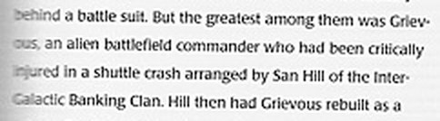

# San Hill

- **Aliases:** —
- **Era:** Prequel
- **Continuity:** default Legends; entries present for: Legends
- **Research tier:** untiered (not listed as INTRO/DEEP/MASTERY in legends-feats.md)
- **Entries:** 47 (26 with quotations; 0 quotations extended to the full sentence/passage from the source text on file; 6 marked as fragments; 8 before the 2026-11-17 fragment fill). Rebuilt 2026-11-17 from 48 old entries; old file: `characters/_bak/san-hill.md.bak-20261117`.
- **How to read:** each entry is the quotation in full (block quote), then its source and point of view. "Note" lines are summaries from our notes, not quotations. `[fragment — full passage not on file]` means the source text is not on the box, so only the words in our notes are shown. Debate and forum material is in the last section and is unverified.

# LEGENDS (Legends / EU — main focus)

## Dark Lord trilogy (Labyrinth of Evil, Revenge of the Sith, Dark Lord): novel notes from the other agent (reference copy)

> What if Grievous should actually die in the crash?
>
> Then the Separatists would simply have to look elsewhere for a commander, Dooku had told Hill. But Grievous had survived—and only too well. In fact, most of the life-threatening injuries he sustained had occurred after he had been pulled from the flaming shuttle wreck, and with great calculation.
— Source: Labyrinth of Evil (novel, read in full): feats, scaling, quotes and story notes.
(Excerpt widened 2026-11-17 to the relevant passage, word for word from Labyrinth of Evil (James Luceno) (text copy `MEGA_Legend_The_Episode_Novelizations_Star_Wars_Revenge_of_the_Sith_01_Labyrinth_of_Evil_James_Luceno_epub`).)
(Excerpt widened 2026-11-17 to the relevant passage, word for word from Labyrinth of Evil (James Luceno) (text copy `MEGA_Legend_The_Episode_Novelizations_Star_Wars_Revenge_of_the_Sith_01_Labyrinth_of_Evil_James_Luceno_epub`).)
(Fragment completed 2026-11-17: full sentence/passage matched word for word in the source text on file: `MEGA_Legend_The_Episode_Novelizations_Star_Wars_Revenge_of_the_Sith_01_Labyrinth_of_Evil_James_Luceno_epub`.)
Note (our notes, around the quote): | D1 | 22 | L1665–1667 | engineered Grievous's shuttle crash with San Hill; the injuries «occurred after he had been pulled from the flaming shuttle wreck, and with great calculation» | Grievous created | Strategic/manipulative |
Context: | # | Ch | Line | Feat | Result | Scaling implication |
Our notes: `notes/materials/022-dark-lord-trilogy/labyrinth-of-evil-notes.md:309`

> “Flesh is weak. You need only gaze on me to see that.”
>
> Encouraged by the remark, Hill had talked in glowing terms of the Geonosians: how they had raised cyborg technology to an art form, and how the blending of living and machine technology was the future.
— Source: Labyrinth of Evil (novel, read in full): feats, scaling, quotes and story notes; | 18 / L1397 | Grievous → San Hill (Kaleesh, pre-rebuild) |.
(Excerpt widened 2026-11-17 to the relevant passage, word for word from Labyrinth of Evil (James Luceno) (text copy `MEGA_Legend_The_Episode_Novelizations_Star_Wars_Revenge_of_the_Sith_01_Labyrinth_of_Evil_James_Luceno_epub`).)
(Excerpt widened 2026-11-17 to the relevant passage, word for word from Labyrinth of Evil (James Luceno) (text copy `MEGA_Legend_The_Episode_Novelizations_Star_Wars_Revenge_of_the_Sith_01_Labyrinth_of_Evil_James_Luceno_epub`).)
Context: | Ch/L | Speaker → version | Quote | Rel. | Note |
Our notes: `notes/materials/022-dark-lord-trilogy/labyrinth-of-evil-notes.md:439`

> Gunray glanced at Shu Mai, Passel Argente, San Hill, and the rest, a backslapping fellowship all of a sudden. Smiling broadly—for the first time in several years—he joined them in celebration.
— Source: Labyrinth of Evil (novel, read in full): feats, scaling, quotes and story notes; Ch54 L5219.
(Excerpt widened 2026-11-17 to the relevant passage, word for word from Labyrinth of Evil (James Luceno) (text copy `MEGA_Legend_The_Episode_Novelizations_Star_Wars_Revenge_of_the_Sith_01_Labyrinth_of_Evil_James_Luceno_epub`).)
Context: Complete quote register (148 lines: every sentence that names Gunray, verbatim, in book order):
Our notes: `notes/materials/022-dark-lord-trilogy/labyrinth-of-evil-notes.md:1605`; `notes/materials/022-dark-lord-trilogy/labyrinth-of-evil-notes.md:1941`

> Supreme Commander of the droid armies, General Grievous had been San Hill and Poggle the Lesser’s gift to Dooku. Once merely a barbaric living being; now a cyborg monstrosity, devoted to death and destruction. Already the butcher of entire populations; the devastator of countless worlds—
>
> IBC chairman San Hill himself had overseen the details of the arrangement. *(L1385)*
>
> "What world will accept us now?" equine-faced San Hill asked in a disconsolate voice. *(L1119)*
— Source: L459; L1385; L1119; L1587 — Labyrinth of Evil (novel, read in full): feats, scaling, quotes and story notes; Role: Grievous was.
(Excerpt widened 2026-11-17 to the relevant passage, word for word from Labyrinth of Evil (James Luceno) (text copy `MEGA_Legend_The_Episode_Novelizations_Star_Wars_Revenge_of_the_Sith_01_Labyrinth_of_Evil_James_Luceno_epub`).)
(Fragment completed 2026-11-17: full sentence/passage matched word for word in the source text on file: `MEGA_Legend_The_Episode_Novelizations_Star_Wars_Revenge_of_the_Sith_01_Labyrinth_of_Evil_James_Luceno_epub`.)
Note text that was attached to the quote line: *(L459)*
Note (our notes, around the quote): Role: Grievous was «San Hill and Poggle the Lesser's gift to Dooku» (L459). San Hill oversaw the rebuild that made him: «IBC chairman San Hill himself had overseen the details of the arrangement.» (L1385). In the Ch15 meeting: «"What world will accept us now?" equine-faced San Hill asked in a disconsolate voice.» (L1119). Shu Mai leaked the Belderone rendezvous (L1587). They celebrate on Utapau (L5219).
Our notes: `notes/materials/022-dark-lord-trilogy/labyrinth-of-evil-notes.md:1929`; `notes/materials/022-dark-lord-trilogy/labyrinth-of-evil-notes.md:1935`; `notes/materials/022-dark-lord-trilogy/labyrinth-of-evil-notes.md:1936`

> Supreme Commander of the droid armies, General Grievous had been San Hill and Poggle the Lesser’s gift to Dooku. Once merely a barbaric living being; now a cyborg monstrosity, devoted to death and destruction. Already the butcher of entire populations; the devastator of countless worlds—
— Source: Labyrinth of Evil (novel, read in full): feats, scaling, quotes and story notes; Ch8 L459.
(Excerpt widened 2026-11-17 to the relevant passage, word for word from Labyrinth of Evil (James Luceno) (text copy `MEGA_Legend_The_Episode_Novelizations_Star_Wars_Revenge_of_the_Sith_01_Labyrinth_of_Evil_James_Luceno_epub`).)
Context: Complete quote register (10 lines: every sentence that names Separatist Council, verbatim, in book order):
Our notes: `notes/materials/022-dark-lord-trilogy/labyrinth-of-evil-notes.md:1932`

> Every bit as shaken, Rune Haako sat alongside Gunray at the cabin’s gleaming table. Other members of the Separatist Council occupied the choice seats: the almost two-dimensionally thin San Hill, Muun chairman of the InterGalactic Banking Clan; the Skakoan foreman of the Techno Union, Wat Tambor, encased in the cumbersome pressure suit that supplied him with methane; the vestigial-winged Geonosian Poggle the Lesser, Archduke of the Stalgasin Hive; the stalk-necked Gossam president of the Commerce Guild, Shu Mai; the cranial-horned Corporate Alliance Magistrate, Passel Argente; and former Republic Senators Po Nudo and Tikkes—Aqualish and Quarren, respectively.
— Source: Labyrinth of Evil (novel, read in full): feats, scaling, quotes and story notes; Ch15 L1103.
(Excerpt widened 2026-11-17 to the relevant passage, word for word from Labyrinth of Evil (James Luceno) (text copy `MEGA_Legend_The_Episode_Novelizations_Star_Wars_Revenge_of_the_Sith_01_Labyrinth_of_Evil_James_Luceno_epub`).)
Context: Complete quote register (10 lines: every sentence that names Separatist Council, verbatim, in book order):
Our notes: `notes/materials/022-dark-lord-trilogy/labyrinth-of-evil-notes.md:1934`

> He told his would-be healers to fish him from the bacta tank. He could bear to die in atmosphere or the vacuum of deep space, but not in liquid. In the shadow of felled trees that would fuel his funeral pyre, he lapsed in and out of consciousness. That was when San Hill had paid him a second visit. Something consequential in mind. Obvious even to someone who could barely see straight.
— Source: Labyrinth of Evil (novel, read in full): feats, scaling, quotes and story notes; Ch18 L1389.
(Excerpt widened 2026-11-17 to the relevant passage, word for word from Labyrinth of Evil (James Luceno) (text copy `MEGA_Legend_The_Episode_Novelizations_Star_Wars_Revenge_of_the_Sith_01_Labyrinth_of_Evil_James_Luceno_epub`).)
Context: Complete quote register (10 lines: every sentence that names Separatist Council, verbatim, in book order):
Our notes: `notes/materials/022-dark-lord-trilogy/labyrinth-of-evil-notes.md:1937`

> The general was not accustomed to losing in battle. Even when a general among his own species, he had suffered few defeats. That was orginally what had brought him to the attention of Sidious. After the Sith Lord had expressed interest in Grievous to Dooku, Dooku, in turn, had expressed interest in Grievous to Chairman San Hill, of the InterGalactic Banking Clan.
— Source: Labyrinth of Evil (novel, read in full): feats, scaling, quotes and story notes; Ch22 L1661.
(Excerpt widened 2026-11-17 to the relevant passage, word for word from Labyrinth of Evil (James Luceno) (text copy `MEGA_Legend_The_Episode_Novelizations_Star_Wars_Revenge_of_the_Sith_01_Labyrinth_of_Evil_James_Luceno_epub`).)
Context: Complete quote register (10 lines: every sentence that names Separatist Council, verbatim, in book order):
Our notes: `notes/materials/022-dark-lord-trilogy/labyrinth-of-evil-notes.md:1939`

> Obi-Wan kept his head down. “It seems to me,” he said carefully, “that Palpatine himself has given us an opening. He has said—both to you, Master Windu, and in the HoloNet address he gave following his rescue—that General Grievous is the true obstacle to peace. Let us forget about the rest of the Separatist leadership, for now. Let Nute Gunray and San Hill and the rest run wherever they like, while we put every available Jedi and all of our agents—the whole of Republic Intelligence, if we can—to work on locating Grievous himself. This will force the hand of the Sith Lord; he will know that Grievous cannot elude our full efforts for long, once we devote ourselves exclusively to his capture. It will draw Sidious out; he will have to make some sort of move, if he wishes the war to continue.”
— Source: Revenge of the Sith (Matthew Stover novelization): Power-Scaling Research Notes; Ch10 Masters L3399.
(Excerpt widened 2026-11-17 to the relevant passage, word for word from Revenge of the Sith (Matthew Stover) (text copy `MEGA_Legend_The_Episode_Novelizations_Star_Wars_Revenge_of_the_Sith_02_Episode_III_Revenge_of_the_Sith_Matthew_Stover_epub`).)
Context: Complete quote register (17 lines: every sentence that names Nute Gunray, verbatim, in book order):
Our notes: `notes/materials/022-dark-lord-trilogy/rots-novel-notes.md:999`; `notes/materials/022-dark-lord-trilogy/rots-novel-notes.md:1092`

What it shows (our notes): Members: San Hill, Wat Tambor, Poggle the Lesser, Shu Mai, Nute Gunray, Rune Haako and others. The introduction sums them up («Poggle the Lesser is Archduke of the weapon masters of Geonosis, where the war began: he is analytical and pitiless, but also pragmatic.», L69).
> Grievous is not like other leaders of the Separatists. Nute Gunray is treacherous and venal, but he’s Neimoidian: venality and treachery are expected, and in the Chancellor of the Trade Federation they’re even virtues. Poggle the Lesser is Archduke of the weapon masters of Geonosis, where the war began: he is analytical and pitiless, but also pragmatic. Reasonable. The political heart of the Separatist Confederacy, Count Dooku, is known for his integrity, his principled stand against what he sees as corruption in the Senate. Though they believe he’s wrong, many respect him for the courage of his mistaken convictions.
— Source: Revenge of the Sith (Matthew Stover novelization): Power-Scaling Research Notes.
(Excerpt widened 2026-11-17 to the relevant passage, word for word from Revenge of the Sith (Matthew Stover) (text copy `MEGA_Legend_The_Episode_Novelizations_Star_Wars_Revenge_of_the_Sith_02_Episode_III_Revenge_of_the_Sith_Matthew_Stover_epub`).)
Our notes: `notes/materials/022-dark-lord-trilogy/rots-novel-notes.md:1086`; `notes/materials/022-dark-lord-trilogy/rots-novel-notes.md:1091`

- Note (summary from our notes, not a quotation): Arc: moved to Mustafar (L3485) → slaughtered by Vader (Ch19, L7779–7859).
  — Source: Ch19, L7779–7859; L3485 — Revenge of the Sith (Matthew Stover novelization): Power-Scaling Research Notes.
Our notes: `notes/materials/022-dark-lord-trilogy/rots-novel-notes.md:1087`

> San Hill recoiled, hands flapping like panicked birds sewn to his wrists. *(L7635)*
>
> The Sith Lord stepped over Haako's corpse to where Wat Tambor clawed uselessly at the transparisteel wall with his armored gauntlets. *(L7859)*
— Source: L7635; L7859 — Revenge of the Sith (Matthew Stover novelization): Power-Scaling Research Notes; Key lines.
Label in our notes: L7635); (L7859
Our notes: `notes/materials/022-dark-lord-trilogy/rots-novel-notes.md:1088`; `notes/materials/022-dark-lord-trilogy/rots-novel-notes.md:1100`; `notes/materials/022-dark-lord-trilogy/rots-novel-notes.md:1096`

- Note (summary from our notes, not a quotation): Scaling implications: none; they are a non-combatant massacre.
  — Source: Revenge of the Sith (Matthew Stover novelization): Power-Scaling Research Notes.
Our notes: `notes/materials/022-dark-lord-trilogy/rots-novel-notes.md:1089`

- Note (summary from our notes, not a quotation): Complete quote register (10 lines: every sentence that names San Hill and the Separatist Council, verbatim, in book order):
  — Source: Revenge of the Sith (Matthew Stover novelization): Power-Scaling Research Notes.
Our notes: `notes/materials/022-dark-lord-trilogy/rots-novel-notes.md:1090`

> “Have you moved the Separatist Council to Mustafar?”
>
> “Yes, Master.” He risked a glance out the viewport. Most of the council had reached the starship. Gunray should be joining them any second; Grievous had seen firsthand how fast the viceroy could run, given proper motivation. “The ship will lift off within moments.”
— Source: Revenge of the Sith (Matthew Stover novelization): Power-Scaling Research Notes; Ch10 Masters L3485.
(Excerpt widened 2026-11-17 to the relevant passage, word for word from Revenge of the Sith (Matthew Stover) (text copy `MEGA_Legend_The_Episode_Novelizations_Star_Wars_Revenge_of_the_Sith_02_Episode_III_Revenge_of_the_Sith_Matthew_Stover_epub`).)
(Excerpt widened 2026-11-17 to the relevant passage, word for word from Revenge of the Sith (Matthew Stover) (text copy `MEGA_Legend_The_Episode_Novelizations_Star_Wars_Revenge_of_the_Sith_02_Episode_III_Revenge_of_the_Sith_Matthew_Stover_epub`).)
Context: Complete quote register (10 lines: every sentence that names San Hill and the Separatist Council, verbatim, in book order):
Our notes: `notes/materials/022-dark-lord-trilogy/rots-novel-notes.md:1093`

> Wat Tambor was adjusting the gas mix inside his armor-Poggle the Lesser was massaging his fleshy lip-tendrils-Shu Mai was fiddling with the brass binding that restrained her hair into the stylish curving horn that rose behind her head-San Hill was stretching his bodystocking, which had begun to ride up in the crotch-Rune Haako was shifting his weight nervously from foot to foot-While Nute Gunray spoke to the holopresence of Darth Sidious.
— Source: Revenge of the Sith (Matthew Stover novelization): Power-Scaling Research Notes; Ch19 The Face of the Sith L7609.
Context: Complete quote register (10 lines: every sentence that names San Hill and the Separatist Council, verbatim, in book order):
Our notes: `notes/materials/022-dark-lord-trilogy/rots-novel-notes.md:1094`

> San Hill beat the others to the greeting. “Welcome, Lord Vader!” His elongated legs almost tangled with each other in his rush to shake the hand of the Sith Lord. “On behalf of the leadership of the Confederacy of Independent Systems, let me be the first to—”
— Source: Revenge of the Sith (Matthew Stover novelization): Power-Scaling Research Notes; Ch19 The Face of the Sith L7627.
(Excerpt widened 2026-11-17 to the relevant passage, word for word from Revenge of the Sith (Matthew Stover) (text copy `MEGA_Legend_The_Episode_Novelizations_Star_Wars_Revenge_of_the_Sith_02_Episode_III_Revenge_of_the_Sith_Matthew_Stover_epub`).)
Context: Complete quote register (10 lines: every sentence that names San Hill and the Separatist Council, verbatim, in book order):
Our notes: `notes/materials/022-dark-lord-trilogy/rots-novel-notes.md:1095`

> Poggle the Lesser, Archduke of Geonosis, scrambled like an animal through a litter of severed arms and legs and heads, both metal and flesh, whimpering, fluttering his ancient gauzy wings until a bar of lightning flash-burned his own head free of his neck.
— Source: Revenge of the Sith (Matthew Stover novelization): Power-Scaling Research Notes; Ch19 The Face of the Sith L7779.
Context: Complete quote register (10 lines: every sentence that names San Hill and the Separatist Council, verbatim, in book order):
Our notes: `notes/materials/022-dark-lord-trilogy/rots-novel-notes.md:1097`

> Shu Mai, president and CEO of the Commerce Guild, looked up from her knees, hands clasped before her, tears streaming down her shriveled cheeks. “We were promised a reward,” she gasped. “A h—h—handsome reward—”
— Source: Revenge of the Sith (Matthew Stover novelization): Power-Scaling Research Notes; Ch19 The Face of the Sith L7781.
(Excerpt widened 2026-11-17 to the relevant passage, word for word from Revenge of the Sith (Matthew Stover) (text copy `MEGA_Legend_The_Episode_Novelizations_Star_Wars_Revenge_of_the_Sith_02_Episode_III_Revenge_of_the_Sith_Matthew_Stover_epub`).)
Context: Complete quote register (10 lines: every sentence that names San Hill and the Separatist Council, verbatim, in book order):
Our notes: `notes/materials/022-dark-lord-trilogy/rots-novel-notes.md:1098`

> The only sound, then, was a panicky stutter of footfalls as Wat Tambor and the two Neimoidians scampered along a hallway toward a nearby conference room.
>
> The Sith Lord was in no hurry to pursue. All the exits from the control center were blast-shielded, and they were sealed, and he had destroyed the controls.
— Source: Revenge of the Sith (Matthew Stover novelization): Power-Scaling Research Notes; Ch19 The Face of the Sith L7787.
(Excerpt widened 2026-11-17 to the relevant passage, word for word from Revenge of the Sith (Matthew Stover) (text copy `MEGA_Legend_The_Episode_Novelizations_Star_Wars_Revenge_of_the_Sith_02_Episode_III_Revenge_of_the_Sith_Matthew_Stover_epub`).)
(Excerpt widened 2026-11-17 to the relevant passage, word for word from Revenge of the Sith (Matthew Stover) (text copy `MEGA_Legend_The_Episode_Novelizations_Star_Wars_Revenge_of_the_Sith_02_Episode_III_Revenge_of_the_Sith_Matthew_Stover_epub`).)
Context: Complete quote register (10 lines: every sentence that names San Hill and the Separatist Council, verbatim, in book order):
Our notes: `notes/materials/022-dark-lord-trilogy/rots-novel-notes.md:1099`

## Star Wars: The New Essential Chronology (Del Rey, 2005): power-scaling and lore notes

> But the greatest among them was Grievous, an alien battlefield commander who had been critically injured in a shuttle crash arranged by San Hill of the Inter-Galactic Banking Clan.
— Source: Part Two: The Fall of the Republic; General Grievous; Count Dooku — Grievous.
Note (our notes, around the quote): General Grievous; Count Dooku — Grievous: "But the greatest among them was Grievous, an alien battlefield commander who had been critically injured in a shuttle crash arranged by San Hill of the Inter-Galactic Banking Clan." Source: The New Essential Chronology, p.49

Our notes: `notes/materials/027-new-essential-chronology/02-part-two-fall-of-the-republic.md:185`

## The Complete Star Wars Encyclopedia, Vol. II (H–O)

> The IBC also financed the resurrection of Durge and General Grievous, actions that IBC leader San Hill believed made Darth Sidious indebted to the clan.
— Source: scan pages 81–120; General Grievous; Palpatine (Darth Sidious).
Note (our notes, around the quote): General Grievous; Palpatine (Darth Sidious): "The IBC also financed the resurrection of Durge and General Grievous, actions that IBC leader San Hill believed made Darth Sidious indebted to the clan." Source: The Complete Star Wars Encyclopedia, Vol. II, p.107
Our notes: `notes/materials/031-complete-star-wars-encyclopedia-vol-2/02-v2-scan-081-120.md:206`

> San Hill told General Grievous that his body had been recovered from the banks of the Jenuwaa Sea after his shuttle was sabotaged and exploded.
— Source: scan pages 161–200; General Grievous. POV: General Grievous, about San Hill.
Note (our notes, around the quote): General Grievous: "San Hill told General Grievous that his body had been recovered from the banks of the Jenuwaa Sea after his shuttle was sabotaged and exploded." Source: The Complete Star Wars Encyclopedia, Vol. II, p.156
Our notes: `notes/materials/031-complete-star-wars-encyclopedia-vol-2/04-v2-scan-161-200.md:17`

## Jedi Counselling/Jedi Counseling 73.pdf [Star Wars Roleplaying Game Revised Core (d20, 2002)]

- Note (summary from our notes, not a quotation): Page contents: Luke/Gamorreans/Bib Fortuna; San Hill reserves and rerolls, Yoda vs Palpatine Betrayal, Sly Moore Dominate; Palpatine Order 66; Durge indoor flight Q (hand-read)
  — Source: Jedi Counselling/Jedi Counseling 73.pdf [Star Wars Roleplaying Game Revis.
Our notes: `notes/materials/037-sw-d20-folder/242-jedi-counseling-73.md:27`

- Note (summary from our notes, not a quotation): San Hill — entry/section: San Hill's Separatist Reserves and initiative rerolls: "Q: Let's say San Hill is on the Separatist squad, and the Separatist and the Republic player both roll a 1 for initiative. Obviously, this requires both sides to reroll, but the definition of Separatist Reserves 20 says that this does not trigger that ability. Why is that?
  — Source: Jedi Counselling/Jedi Counseling 73.pdf [Star Wars Roleplaying Game Revis.
Our notes: `notes/materials/037-sw-d20-folder/242-jedi-counseling-73.md:29`

## Jedi Counselling/Jedi Counseling 87.pdf [Star Wars Roleplaying Game Revised Core (d20, 2002)]

- Note (summary from our notes, not a quotation): Page contents: Errata continued; Grievous/SBD Commander stacking; Battle Droid Officer; San Hill Q/A (hand-read)
  — Source: Jedi Counselling/Jedi Counseling 87.pdf [Star Wars Roleplaying Game Revis.
Our notes: `notes/materials/037-sw-d20-folder/257-jedi-counseling-87.md:31`

- Note (summary from our notes, not a quotation): Page contents: San Hill sequence; Savage and doors; author bio (hand-read)
  — Source: Jedi Counselling/Jedi Counseling 87.pdf [Star Wars Roleplaying Game Revis.
Our notes: `notes/materials/037-sw-d20-folder/257-jedi-counseling-87.md:40`

## Jedi Counselling/Jedi Counseling 92.pdf [Star Wars Roleplaying Game Revised Core (d20, 2002)]

- Note (summary from our notes, not a quotation): Page contents: Use the Force on AoO; Rancor regeneration; Mercenary; San Hill combine fire; author bio (hand-read)
  — Source: Jedi Counselling/Jedi Counseling 92.pdf [Star Wars Roleplaying Game Revis.
Our notes: `notes/materials/037-sw-d20-folder/263-jedi-counseling-92.md:27`

> Would this prevent me from combining fire? A: No. When you activate characters to combine fire, they don't count against your limit of activations per phase. Thus, regardless of the number of activations you can make in a phase (whether it's the normal 2 or a different number resulting from San Hill, Grand Moff Tarkin, and so on), you can activate any number of additional characters to combine fire.
— Source: Jedi Counselling/Jedi Counseling 92.pdf [Star Wars Roleplaying Game Revis.
(Excerpt widened 2026-11-17 to the relevant passage, word for word from research primary sw d20 folder files Star Wars Roleplaying Game Revised Core Jedi Counselling Jedi Counseling 92 (text copy `research_primary_sw_d20_folder_files_Star_Wars_Roleplaying_Game_Revised_Core_Jedi_Counselling_Jedi_Counseling_92_pdf_781788762d`).)
Note (our notes, around the quote): San Hill; Grand Moff Tarkin — entry/section: San Hill and combined fire: "A: No. When you activate characters to combine fire, they don't count against your limit of activations per phase. Thus, regardless of the number of activations you can make in a phase (whether it's the normal 2 or a different number resulting from San Hill, Grand Moff Tarkin, and so on), you can activate any number of additional characters to combine fire." Source: *Jedi Counseling 92* (SWRPG d20 Revised Core), scan p.3
Our notes: `notes/materials/037-sw-d20-folder/263-jedi-counseling-92.md:31`

## Sourcebooks/Geonosis and the Outer Rim Worlds.pdf [Star Wars Roleplaying Game Revised Core (d20, 2002)] (scan pages 61–120)

- Note (summary from our notes, not a quotation): Page contents: Muunilinst: Dress Rehearsal concluded; hook Murder at 4,000 Meters; Riklon Tost (Iotran Guard captain who helped San Hill escape Geonosis; Male Iotran Soldier 6/Elite Trooper 6). (hand-read)
  — Source: Sourcebooks/Geonosis and the Outer Rim Worlds.pdf [Star Wars Roleplaying.
Our notes: `notes/materials/037-sw-d20-folder/667-geonosis-and-the-outer-rim-worlds-scan-061-120.md:354`

> Tost helped IGBC Chairman San Hill escape the debacle at Geonosis and commanded Hailfire Droids during the Clone Wars—experiences that taught him Muun power was better wielded in the boardroom rather than on the battlefield.
— Source: Sourcebooks/Geonosis and the Outer Rim Worlds.pdf [Star Wars Roleplaying; San Hill — entry/section: Riklon Tost and San Hill.
Note (our notes, around the quote): San Hill — entry/section: Riklon Tost and San Hill: "Tost helped IGBC Chairman San Hill escape the debacle at Geonosis and commanded Hailfire Droids during the Clone Wars—experiences that taught him Muun power was better wielded in the boardroom rather than on the battlefield." Source: *Geonosis and the Outer Rim Worlds* (SWRPG d20 Revised Core), scan p.108
Our notes: `notes/materials/037-sw-d20-folder/667-geonosis-and-the-outer-rim-worlds-scan-061-120.md:356`

## Sourcebooks/Ultimate Alien Anthology.pdf [Star Wars Roleplaying Game Revised Core (d20, 2002)] (scan pages 61–120)

- Note (summary from our notes, not a quotation): Page contents: Mrlssi traits; Muun (example names incl. San Hill; Emperor's New Order). (hand-read)
  — Source: Sourcebooks/Ultimate Alien Anthology.pdf [Star Wars Roleplaying Game Revi.
Our notes: `notes/materials/037-sw-d20-folder/673-ultimate-alien-anthology-scan-061-120.md:223`

## Sourcebooks/Starships of the Galaxy.pdf [Star Wars Roleplaying Game Saga Edition (2007)] (scan pages 61–120)

- Note (summary from our notes, not a quotation): Page contents: Banking Clan Frigate (Munificent-class) stat block; history (InterGalactic Banking Clan's own comm network and warships; San Hill brought them to the Separatists; scuttled after the Confederacy's defeat; some joined pirates or the Rebellion); Capabilities; tactical fire (removes enemy morale/insight bonuses). (hand-read)
  — Source: Sourcebooks/Starships of the Galaxy.pdf [Star Wars Roleplaying Game Saga.
Our notes: `notes/materials/037-sw-d20-folder/727-starships-of-the-galaxy-scan-061-120.md:39`

## Web Articles.pdf [Star Wars Roleplaying Game Saga Edition (2007)] (scan pages 181–240)

- Note (summary from our notes, not a quotation): Page contents: Multiple Attacks cont.: Dual Weapon Mastery vs. Double Attack (no free hand), Triple Attack, Multiattack Proficiency talents (elite trooper, Jedi Knight); never risk multiple attacks if exposed; Activating Multiple Attacks in the Miniatures Game (cover chokepoints; keep activations: cheap units, Rodian Black Sun Vigo, Jabba the Hutt's Fringe add-on, San Hill's commander effect and Separatist Reserves 20, R2-D2 Astromech Droid, Lobot). Synergy (Tips & Tactics 3): Squad Synergy in the Minis Game (Rebel Captain/Rebel Troopers; Luke Skywalker, Hero of Yavin, 35 points: Deadly Attack, Flurry Attack, Double Attack, Twin Attack, Lightsaber Deflect, Force 3). (hand-read)
  — Source: Web Articles.pdf [Star Wars Roleplaying Game Saga Edition (2007)] (scan p.
Our notes: `notes/materials/037-sw-d20-folder/732-web-articles-scan-181-240.md:392`

## Star Wars Insider #60 (2002)

- Note (summary from our notes, not a quotation): Page contents: Droids of Episode II (end): Commerce Guild spider droids under Presidente Shu Mai, burrowing spider droids for mining tunnels; InterGalactic Banking Clan under San Hill on Muunilinst fields Hailfire droids — hoop-wheeled assault 'mechs with fanlike pods of hailfire missiles and a single red eye. Photos of Hailfire droids in battle. (hand-read)
  — Source: Star Wars Insider #60 (2002).
Our notes: `notes/materials/038-star-wars-insider/060-ins060.md:606`

## Star Wars Insider #69 (2003)

- Note (summary from our notes, not a quotation): Page contents: Behind the Magic: Wat Tambor (droid foundries) and San Hill. (hand-read)
  — Source: Star Wars Insider #69 (2003).
Our notes: `notes/materials/038-star-wars-insider/069-ins069.md:321`

- Note (summary from our notes, not a quotation): Page contents: Behind the Magic concluded: San Hill, Toonbuck Toora's digital head, other council members. (hand-read)
  — Source: Star Wars Insider #69 (2003).
Our notes: `notes/materials/038-star-wars-insider/069-ins069.md:330`

## Star Wars Insider #86 (2006)

- Note (summary from our notes, not a quotation): Page contents: Unknown Soldier illustration spread (Joe Corroney): Grievous, Sidious, Dooku, San Hill, Kaleesh (hand-read)
  — Source: Star Wars Insider #86 (2006).
Our notes: `notes/materials/038-star-wars-insider/086-ins086.md:255`

- Note (summary from our notes, not a quotation): Page contents: Unknown Soldier continued: Ronderu's death; The Birth of General Grievous; San Hill and the IG-100 MagnaGuards; shuttle crash (hand-read)
  — Source: Star Wars Insider #86 (2006).
Our notes: `notes/materials/038-star-wars-insider/086-ins086.md:269`

## Star Wars Insider #149 (2014)

- Note (summary from our notes, not a quotation): Page contents: Grievous's Greatest Hits cont.: Rising Malevolence (October 2008; targets a medical station), Lair of Grievous (December 2008; EV-A4-D), Visionaries "The Eyes of Revolution" by Warren Fu (Grievous as evil's victim). Comic panel with San Hill (OCR garbled). (hand-read)
  — Source: Star Wars Insider #149 (2014).
Our notes: `notes/materials/038-star-wars-insider/149-ins149.md:85`

## Star Wars Visual Dictionaries, Episodes I–VI (DK, 1998–2005) + The Phantom Menace Expanded Visual Dictionary (DK, 2012)

> naturally finances both sides of a major conflict
> [fragment — full passage not on file]
>
> Count Dooku leads the Separatists and knows every faction's weak points.
— Source: Star Wars Attack of the Clones: The Visual Dictionary (DK, 2002): hand-read notes.
Note (our notes, around the quote): p51 The Commerce Guild (President Shu Mai; Denaria Kee aide; homing spider droid; dwarf spider droid); IG Banking Clan (Muunilinst; San Hill "naturally finances both sides of a major conflict"; hailfire droid "late payment notices"); Senators Po Nudo, Tikkes, Shi'ido changeling aide. DATA FILE: "Count Dooku leads the Separatists and knows every faction's weak points." Commercial armies legally licensed.
Our notes: `notes/materials/047-visual-dictionaries/vd2-ep2.md:54`

> thought to be impregnable. But that was before Darth Sidious sent his new apprentice, Darth Vader, to assassinate the members of the Council. With the Jedi killed, and the chief Separatists soon to follow, no one will stand in Sidious's and Vader's way when they seize total control of the galaxy.
> [fragment — full passage not on file]
>
> financed the resurrection of the Gen'dai warrior Durge, as well as the rehabilitation of Grievous
> [fragment — full passage not on file]
>
> hundreds of thousands of his fellow Geonosians employed in the construction of Darth Sidious's battle station
> [fragment — full passage not on file]
>
> special agreement with Darth Sidious *(Trade Federation first drawn in)*
> [fragment — full passage not on file]
>
> talent for bribery is useless against Vader
> [fragment — full passage not on file]
— Source: Star Wars Revenge of the Sith: The Visual Dictionary (DK, 2005): hand-read notes; p57 Endgame [KEY]: Mustafar facility.
Note (our notes, around the quote): p57 Endgame [KEY]: Mustafar facility "thought to be impregnable. But that was before Darth Sidious sent his new apprentice, Darth Vader, to assassinate the members of the Council. With the Jedi killed, and the chief Separatists soon to follow, no one will stand in Sidious's and Vader's way when they seize total control of the galaxy." DATA FILE: Separatists ignored arms laws; used an InterGalactic Banking Clan code. San Hill ("financed the resurrection of the Gen'dai warrior Durge, as well as the rehabilitation of Grievous"); Poggle ("hundreds of thousands of his fellow Geonosians employed in the construction of Darth Sidious's battle station"); Nute Gunray and Rune Haako "special agreement with Darth Sidious" (Trade Federation first drawn in); Cat Miin (aide); Shu Mai (Commerce Guild, Castell; "talent for bribery is useless against Vader").
Our notes: `notes/materials/047-visual-dictionaries/vd3-ep3.md:56`

## Darth Plagueis (novel, read in full): feats, scaling, quotes and story notes

- Note (summary from our notes, not a quotation): Every named side character with a real role in the book gets a profile here, followed by the complete register of sentences that name them. Named characters with no real role (one to three passing mentions, so no profile): Sly Moore, Armand Isard, San Hill (Larsh Hill's son; named only in passing), Darus, Tenebrous's Bith associates, and the Gran Senators other than Pax Teem.
  — Source: Darth Plagueis (novel, read in full): feats, scaling, quotes and story notes.
Our notes: `external/mega-notes/darth-plagueis-notes.md:587`

> With the Trade Federation fleet still holding in the Chommell sector, and without a besieged world to generate sympathy and support for his nomination, Palpatine might have been just one more potential nominee-but for the company of Hego Damask; Banking Clan co-chairman San Hill; recently appointed Senate Vice Chairman Mas Amedda; and Senator Orn Free Taa, a moving target for Antilles's investigation into corruption and now ostracized by the Rim Faction for backing Palpatine.
— Source: Darth Plagueis (novel, read in full): feats, scaling, quotes and story notes; Ch28 Chain of Command L6583.
Context: Complete quote register (15 lines: every sentence that names Bail Antilles, verbatim, in book order):
Our notes: `external/mega-notes/darth-plagueis-notes.md:1751`; `external/mega-notes/darth-plagueis-notes.md:1765`

## https://starwars.fandom.com/wiki/Grievous/Legends

- Note (summary from our notes, not a quotation): SECTION: Early life / In the service of San Hill
  — Source: Wookieepedia extraction: Grievous (Legends) — https://starwars.fandom.com/wiki/Grievous/Legends.
(Concrete feats)
Our notes: `external/mega-notes/grievous-legends-quotes.txt:12`

# Debate and forum claims (unverified)

Forum posts, Suspect Insight debates and Discord debates, respect threads, and verdicts. These are posters' arguments or quotations they typed; none is checked against the book here unless the entry says so.

## Exar Kun (AncientPower) vs Darth Sidious (Darth Durin's Baneling)

> The Yam'rii. in league with the Trade Federation, pleaded with the Republic to intercede on their behalf, and the Republic Judicial Department sent a Jedi team, led by
>
> Masters T'chooka D'oon and Jmmaar. to adjudicate the conflict. With Senate pressure, both Masters ruled in favor of the Yam'rii and imposed sanctions and reparations on the
>
> Kalee was economically decimated, and the Kaleesh died in droves. Grievous simmered with hatred for the galactic government and the Jedi who served it as he watched his wives die of starvation and saw his children kidnapped and subjected to the worst acts of depravity.
>
> Into this madness came InterGalactic Banking Clan
>
> Chairman San Hill, an emaciated Muun who looked as thought he. too. were half-starved. He conspired to employ
>
> Kalee's greatest champion as a "collections agent." In exchange, the Banking Clan would share the burden of
>
> Kalee's enormous debt. Grievous was disgusted at the idea of serving the megacorporation, deeming it nothing more than the work of a glorified leg-breaker. Still, the innate fighter could not resist the promise of renewed conflict.
>
> Grievous began his new occupation by aggressively collecting from such worlds as Ord Mantell and seizing
>
> Muunilinst's Phlut Design Systems. Because the Banking
>
> Clan would not hire Grievous' Kaleesh warriors, he demanded more intelligent battle droids to serve him. With
>
> Count Dooku's permission. Chairman Hill complied, putting the IG-100 MagnaDroids into production. Hill also upheld his promise to help alleviate Kalee's deficit and reinstate trade. But when Grievous learned that the Republic did nothing to the Yam'rii for vandalizing hallowed Kaleesh burial grounds on the colony worlds, he abandoned his contract and returned to Kalee to avenge the desecration.
— Source: Exar Kun (AncientPower) vs Darth Sidious (Darth Durin's Baneling) — https://www.suspectinsightforums.com/t4488-ss-exar-kun-ancientpower-vs-darth-sidious-durin.
Context: Q50 — Source: Insider #86: Unknown Soldier (2006, Abel G. Pena)
Posted by: not named in our notes (see thread/notes link).
Our notes: `suspect-insight/debates/123-exar-kun-vs-darth-sidious.md:269`

## General Grievous Respect Thread - Gen. Discussion - Comic Vine — respect-thread notes

- Note (summary from our notes, not a quotation): San Hill muses that Grievous' cybernetic augmentations could put him beyond any Jedi physically:
  — Source: SI respect-thread directory: General Grievous Respect Thread - Gen. Discussion - Comic Vine — https://comicvine.gamespot.com/forums/gen-discussion-1/general-grievous-respect-thread-1620576/.
Posted by: not named in our notes (see thread/notes link).
Our notes: `suspect-insight/respect-threads/general-grievous--grievous-general-unknown-author.md:87`
