# Satal Keto

- **Aliases:** Satal
- **Era:** Great Sith War
- **Continuity:** default Legends; entries present for: Legends
- **Research tier:** MASTERY (Tales of the Jedi 024 version only: Freedon Nadd Uprising #1–2, Dark Lords of the Sith #1–6, The Sith War #1–6; primary read 2026-10-27)
- **Entries:** 57 (31 with quotations; 0 quotations extended to the full sentence/passage from the source text on file; 17 marked as fragments). Rebuilt 2026-11-17 from 73 old entries; old file: `characters/_bak/satal-keto.md.bak-20261117`.
- **How to read:** each entry is the quotation in full (block quote), then its source and point of view. "Note" lines are summaries from our notes, not quotations. `[fragment — full passage not on file]` means the source text is not on the box, so only the words in our notes are shown. Debate and forum material is in the last section and is unverified.

# LEGENDS (Legends / EU — main focus)

## Tales of the Jedi: Freedon Nadd Uprising #1–2, Dark Lords of the Sith #1–6, The Sith War #1–6, plus the WEG Tales of the Jedi Companion (power-scaling notes)

- Note (summary from our notes, not a quotation): | #5 | 1–27 | Sith Secrets | Cinnagar, Yavin 4 | Satal poisons Ulic with Sith poison. Exar enslaves the Massassi and finds Sadow's laboratory. Nomi's battle meditation; Ulic kills Satal and becomes Krath leader. |
  — Source: Owner Material 024b — Tales of the Jedi: Dark Lords of the Sith #1–6 (1994–95): power-scaling notes.
Context: | Issue | PDF pages | Title (intro page) | Setting | Main events |
Our notes: `notes/materials/024-tales-of-the-jedi/dark-lords-of-the-sith.md:19`

- Note (summary from our notes, not a quotation): Satal tortures Ulic and injects Sith poison (p4–6). Exar enslaves the Massassi and finds Sadow's ship and laboratory (p7–10). Nomi lets herself be captured (p11–13); her battle meditation turns the guards on each other (p20–21). Ulic kills Satal's assassin and then Satal (p22–25) and becomes Krath leader (p27).
  — Source: Owner Material 024b — Tales of the Jedi: Dark Lords of the Sith #1–6 (1994–95): power-scaling notes.
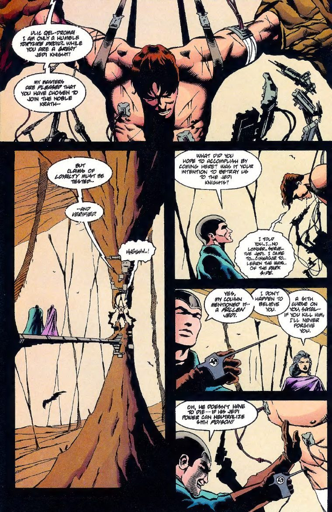
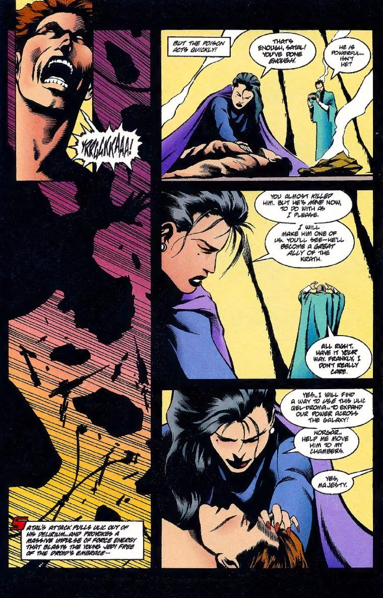
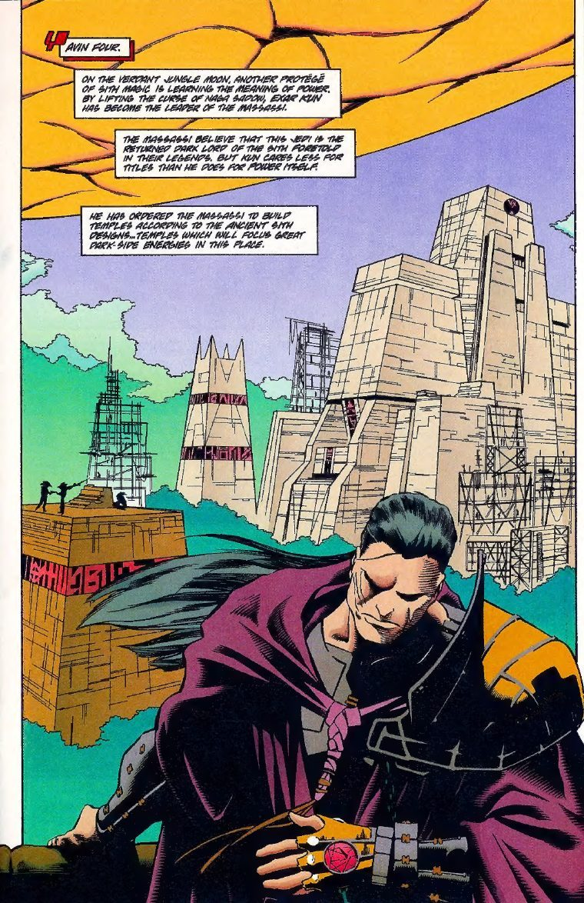
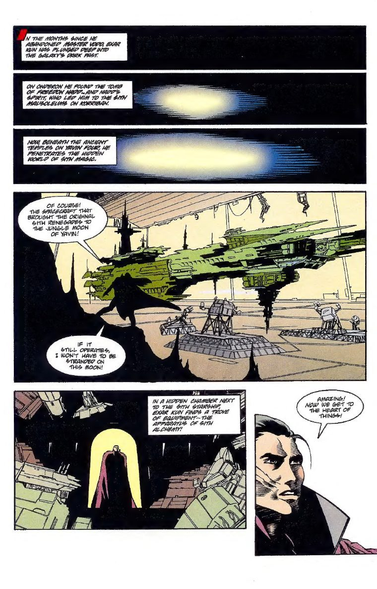

Our notes: `notes/materials/024-tales-of-the-jedi/dark-lords-of-the-sith.md:43`

> MY CHILDREN--I COME TO WARN YOU! IT IS NOT QEL-DROMA YOU MUST FEAR!
>
> BEWARE OF EXAR KUN. HE HAS ACQUIRED GREAT SITH POWERS AND HE HAS AMBITION WITHOUT LIMIT--
> [fragment — full passage not on file]
>
> I NOW DECLARE IT...EXAR KUN IS A PRETENDER TO THE SITH LEGACY...
> [fragment — full passage not on file]
>
> ...THE REAL POWER OF THE SITH RESTS WITH YOU...THREE...
> [fragment — full passage not on file]
— Source: Owner Material 024b — Tales of the Jedi: Dark Lords of the Sith #1–6 (1994–95): power-scaling notes; Freedon Nadd's spirit (dying) to Satal and Aleema Keto. POV: Freedon Nadd's spirit, about Satal Keto.
Note (our notes, around the quote): Freedon Nadd's spirit (dying) to Satal and Aleema Keto: "MY CHILDREN--I COME TO WARN YOU! IT IS NOT QEL-DROMA YOU MUST FEAR!" "BEWARE OF EXAR KUN. HE HAS ACQUIRED GREAT SITH POWERS AND HE HAS AMBITION WITHOUT LIMIT--" "I NOW DECLARE IT...EXAR KUN IS A PRETENDER TO THE SITH LEGACY..." "...THE REAL POWER OF THE SITH RESTS WITH YOU...THREE..." Source: Dark Lords of the Sith #4, p26
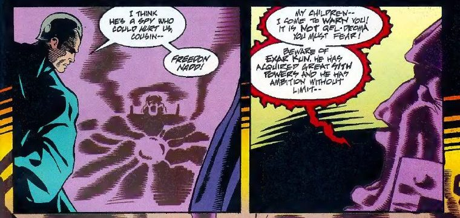
Our notes: `notes/materials/024-tales-of-the-jedi/dark-lords-of-the-sith.md:94`

- Note (summary from our notes, not a quotation): Gives off a "MASSIVE IMPULSE OF FORCE ENERGY" when Satal injects him with Sith poison. Source: Dark Lords of the Sith #5, p4–6
  — Source: Owner Material 024b — Tales of the Jedi: Dark Lords of the Sith #1–6 (1994–95): power-scaling notes.

Our notes: `notes/materials/024-tales-of-the-jedi/dark-lords-of-the-sith.md:108`; `notes/materials/024-tales-of-the-jedi/dark-lords-of-the-sith.md:178`

- Note (summary from our notes, not a quotation): Modernises the Krath arsenal as their new commander. Source: Dark Lords of the Sith #5, p14–15
  — Source: Owner Material 024b — Tales of the Jedi: Dark Lords of the Sith #1–6 (1994–95): power-scaling notes.
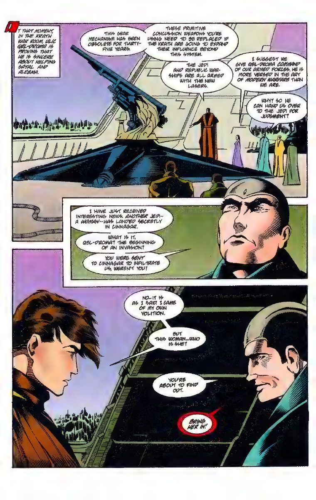
Our notes: `notes/materials/024-tales-of-the-jedi/dark-lords-of-the-sith.md:111`

- Note (summary from our notes, not a quotation): Kills Satal Keto; the Sith poison is ignited by his anger; Force-blasts his brother Cay and Tott Doneeta away. Source: Dark Lords of the Sith #5, p24–25
  — Source: Dark Lords of the Sith #5, p24–25 — Owner Material 024b — Tales of the Jedi: Dark Lords of the Sith #1–6 (1994–95): power-scaling notes.
Our notes: `notes/materials/024-tales-of-the-jedi/dark-lords-of-the-sith.md:113`

- Note (summary from our notes, not a quotation): Blasts Nomi Sunrider with Satal's Sith amulet. Source: Dark Lords of the Sith #6, p18–19
  — Source: Owner Material 024b — Tales of the Jedi: Dark Lords of the Sith #1–6 (1994–95): power-scaling notes.
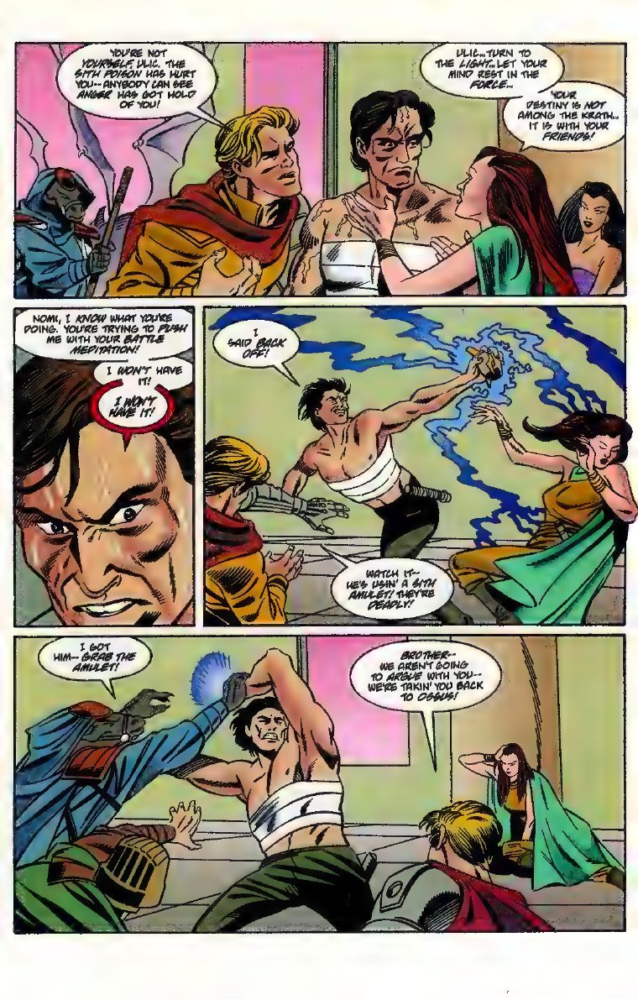
Our notes: `notes/materials/024-tales-of-the-jedi/dark-lords-of-the-sith.md:114`

- Note (summary from our notes, not a quotation): Cuts down Satal's assassin Norgor. Source: Dark Lords of the Sith #5, p22
  — Source: Dark Lords of the Sith #5, p22 — Owner Material 024b — Tales of the Jedi: Dark Lords of the Sith #1–6 (1994–95): power-scaling notes.
Our notes: `notes/materials/024-tales-of-the-jedi/dark-lords-of-the-sith.md:118`

- Note (summary from our notes, not a quotation): Wounded by Krath kamikaze slag; the wound will not heal by Jedi means. Source: Dark Lords of the Sith #2, p26–27; #3, p4–6
  — Source: Owner Material 024b — Tales of the Jedi: Dark Lords of the Sith #1–6 (1994–95): power-scaling notes.

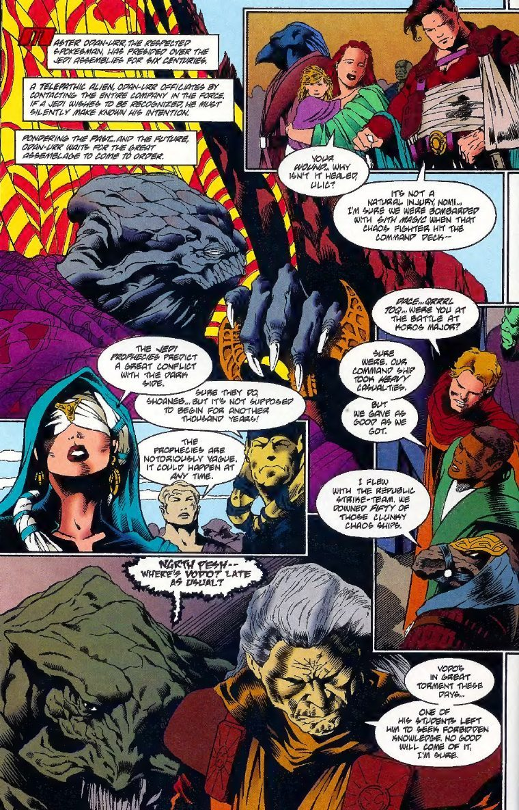
Our notes: `notes/materials/024-tales-of-the-jedi/dark-lords-of-the-sith.md:122`

- Note (summary from our notes, not a quotation): Hypnotic Krath kamikaze chaos fighters (Satal's command) wound Ulic. Source: Dark Lords of the Sith #2, p26–27
  — Source: Owner Material 024b — Tales of the Jedi: Dark Lords of the Sith #1–6 (1994–95): power-scaling notes.

Our notes: `notes/materials/024-tales-of-the-jedi/dark-lords-of-the-sith.md:175`

- Note (summary from our notes, not a quotation): Killed by Ulic Qel-Droma. Source: Dark Lords of the Sith #5, p24–25
  — Source: Dark Lords of the Sith #5, p24–25 — Owner Material 024b — Tales of the Jedi: Dark Lords of the Sith #1–6 (1994–95): power-scaling notes.
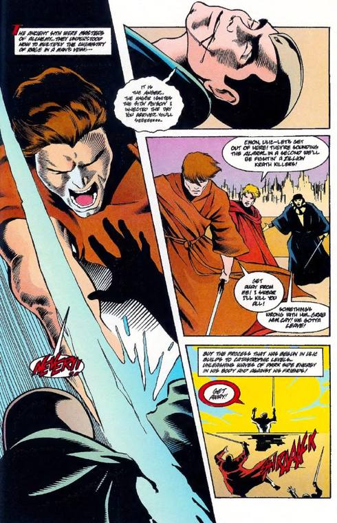
Our notes: `notes/materials/024-tales-of-the-jedi/dark-lords-of-the-sith.md:183`

- Note (summary from our notes, not a quotation): Force-blasted aside by Ulic (with Tott Doneeta) when Ulic kills Satal. Source: Dark Lords of the Sith #5, p24–25
  — Source: Dark Lords of the Sith #5, p24–25 — Owner Material 024b — Tales of the Jedi: Dark Lords of the Sith #1–6 (1994–95): power-scaling notes.
Our notes: `notes/materials/024-tales-of-the-jedi/dark-lords-of-the-sith.md:240`

- Note (summary from our notes, not a quotation): | 9 | Ulic vs Satal Keto | Cinnagar | p24–25 (#5) | Ulic kills him | Sith poison + anger |
  — Source: Owner Material 024b — Tales of the Jedi: Dark Lords of the Sith #1–6 (1994–95): power-scaling notes.
Context: | # | Fight | Where | Pages (issue) | Outcome | Conditions |
Our notes: `notes/materials/024-tales-of-the-jedi/dark-lords-of-the-sith.md:280`

- Note (summary from our notes, not a quotation): 
  — Source: Owner Material 024b — Tales of the Jedi: Dark Lords of the Sith #1–6 (1994–95): power-scaling notes.
Our notes: `notes/materials/024-tales-of-the-jedi/dark-lords-of-the-sith.md:319`

- Note (summary from our notes, not a quotation): 
  — Source: Owner Material 024b — Tales of the Jedi: Dark Lords of the Sith #1–6 (1994–95): power-scaling notes.

Our notes: `notes/materials/024-tales-of-the-jedi/dark-lords-of-the-sith.md:321`

> SATAL AND ALEEMA... I AM NADD.
> [fragment — full passage not on file]
>
> YOU MAY KEEP THE BOOK... AND THE TALISMAN.
> [fragment — full passage not on file]
>
> BOTH RIGHTFULLY BELONG TO YOU.
> [fragment — full passage not on file]
>
> AS DO THESE SWORDS OF THE SITH.
>
> KING OMMIN WILL NO LONGER NEED THEM.
— Source: Freedon Nadd Uprising #2, p18 — Owner Material 024a — Tales of the Jedi: The Freedon Nadd Uprising #1–2 (1994): power-scaling notes.
Note (our notes, around the quote): Spirit appears to Satal and Aleema Keto and gives them the Sith book, the talisman and two Sith swords: "SATAL AND ALEEMA... I AM NADD." "YOU MAY KEEP THE BOOK... AND THE TALISMAN." "BOTH RIGHTFULLY BELONG TO YOU." "AS DO THESE SWORDS OF THE SITH." "KING OMMIN WILL NO LONGER NEED THEM." Source: Freedon Nadd Uprising #2, p18
Our notes: `notes/materials/024-tales-of-the-jedi/freedon-nadd-uprising.md:66`

> OMMIN WAS RIGHT... YOU ARE THE FUTURE OF MY WORK...
> [fragment — full passage not on file]
>
> NOW LEAVE... THIS PASSAGE WILL BRING YOU TO THE SURFACE!
> [fragment — full passage not on file]
— Source: Freedon Nadd Uprising #2, p18 — Owner Material 024a — Tales of the Jedi: The Freedon Nadd Uprising #1–2 (1994): power-scaling notes; Freedon Nadd's spirit to Satal and Aleema Keto. POV: Freedon Nadd's spirit, about Satal Keto.
Note (our notes, around the quote): Freedon Nadd's spirit to Satal and Aleema Keto: "OMMIN WAS RIGHT... YOU ARE THE FUTURE OF MY WORK..." "NOW LEAVE... THIS PASSAGE WILL BRING YOU TO THE SURFACE!" Source: Freedon Nadd Uprising #2, p18
Our notes: `notes/materials/024-tales-of-the-jedi/freedon-nadd-uprising.md:72`

> THEY WERE LEFT TO ME BY MY ANCIENT FOREBEAR, FREEDON NADD.
— Source: Owner Material 024a — Tales of the Jedi: The Freedon Nadd Uprising #1–2 (1994): power-scaling notes. POV: Ommin, about Satal Keto.
Note (our notes, around the quote): Ommin about Freedon Nadd: "HERE LET ME SHOW YOU MY WONDERFUL AMULETS--" "THEY WERE LEFT TO ME BY MY ANCIENT FOREBEAR, FREEDON NADD." Source: Freedon Nadd Uprising #2, p11
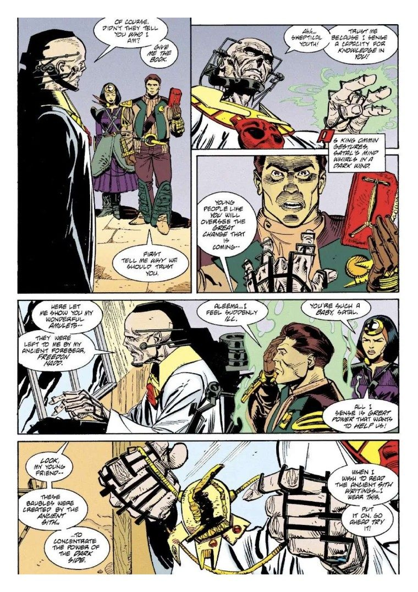
Our notes: `notes/materials/024-tales-of-the-jedi/freedon-nadd-uprising.md:81`

> AS KING OMMIN GESTURES, SATAL'S MIND WHIRLS IN A DARK WIND.
— Source: Owner Material 024a — Tales of the Jedi: The Freedon Nadd Uprising #1–2 (1994): power-scaling notes; Makes Satal's mind whirl with a gesture. POV: narrator, about Satal Keto.
Note (our notes, around the quote): Makes Satal's mind whirl with a gesture: "AS KING OMMIN GESTURES, SATAL'S MIND WHIRLS IN A DARK WIND." · NARRATION. Source: Freedon Nadd Uprising #2, p11

Our notes: `notes/materials/024-tales-of-the-jedi/freedon-nadd-uprising.md:100`

> YES... I WONDER IF ANYONE BUT US CAN FEEL IT.
> [fragment — full passage not on file]
— Source: Owner Material 024a — Tales of the Jedi: The Freedon Nadd Uprising #1–2 (1994): power-scaling notes.
Note (our notes, around the quote): Steals a Sith book from the Galactic Museum's "Sith Hall"; Satal: "YES... I WONDER IF ANYONE BUT US CAN FEEL IT." Source: Freedon Nadd Uprising #1, p25–26
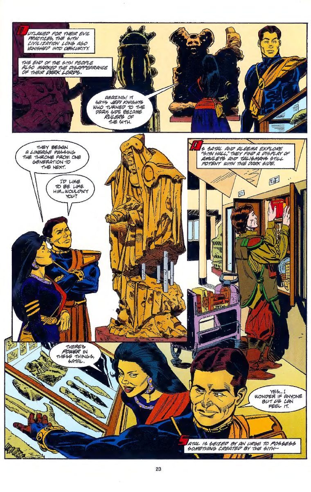
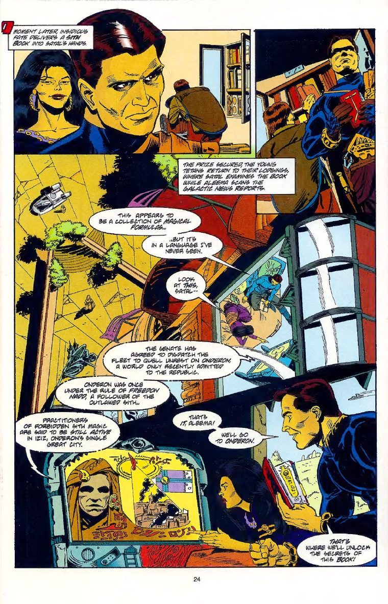
Our notes: `notes/materials/024-tales-of-the-jedi/freedon-nadd-uprising.md:218`

> HOLD TIGHT, COUSIN-- I'M NOT LETTING THE REPUBLIC GET TO THOSE SITH MAGICIANS BEFORE WE DO!
— Source: Owner Material 024a — Tales of the Jedi: The Freedon Nadd Uprising #1–2 (1994): power-scaling notes; Satal Keto. POV: Satal Keto.
Note (our notes, around the quote): Satal Keto: "HOLD TIGHT, COUSIN-- I'M NOT LETTING THE REPUBLIC GET TO THOSE SITH MAGICIANS BEFORE WE DO!" Source: Freedon Nadd Uprising #1, p27
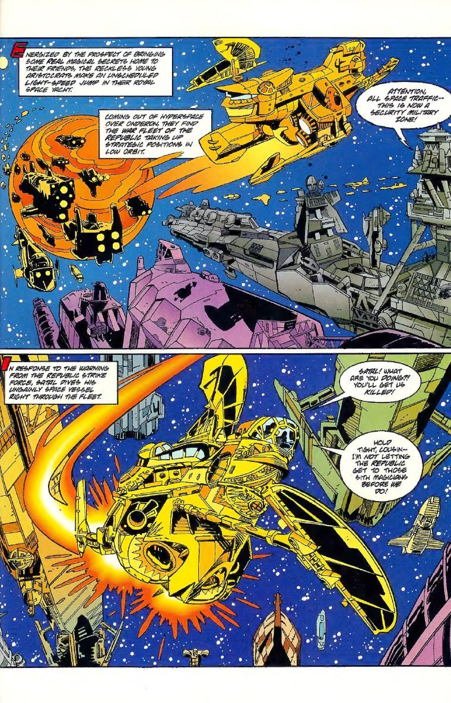
Our notes: `notes/materials/024-tales-of-the-jedi/freedon-nadd-uprising.md:221`

> GIDDY WITH THE SWIRLING ENERGIES OF THE DARK SIDE, SATAL IS IN NO MOOD TO REFUSE THE URGINGS OF HIS COUSIN.
>
> BY THE EMPRESS! I...I CAN READ IT PERFECTLY!
> [fragment — full passage not on file]
>
> OF COURSE YOU CAN, MY SON.
— Source: Owner Material 024a — Tales of the Jedi: The Freedon Nadd Uprising #1–2 (1994): power-scaling notes; Reads the Sith book with Ommin's amulet.
Note (our notes, around the quote): Reads the Sith book with Ommin's amulet: "GIDDY WITH THE SWIRLING ENERGIES OF THE DARK SIDE, SATAL IS IN NO MOOD TO REFUSE THE URGINGS OF HIS COUSIN." Satal: "BY THE EMPRESS! I...I CAN READ IT PERFECTLY!" Ommin: "OF COURSE YOU CAN, MY SON." Source: Freedon Nadd Uprising #2, p12
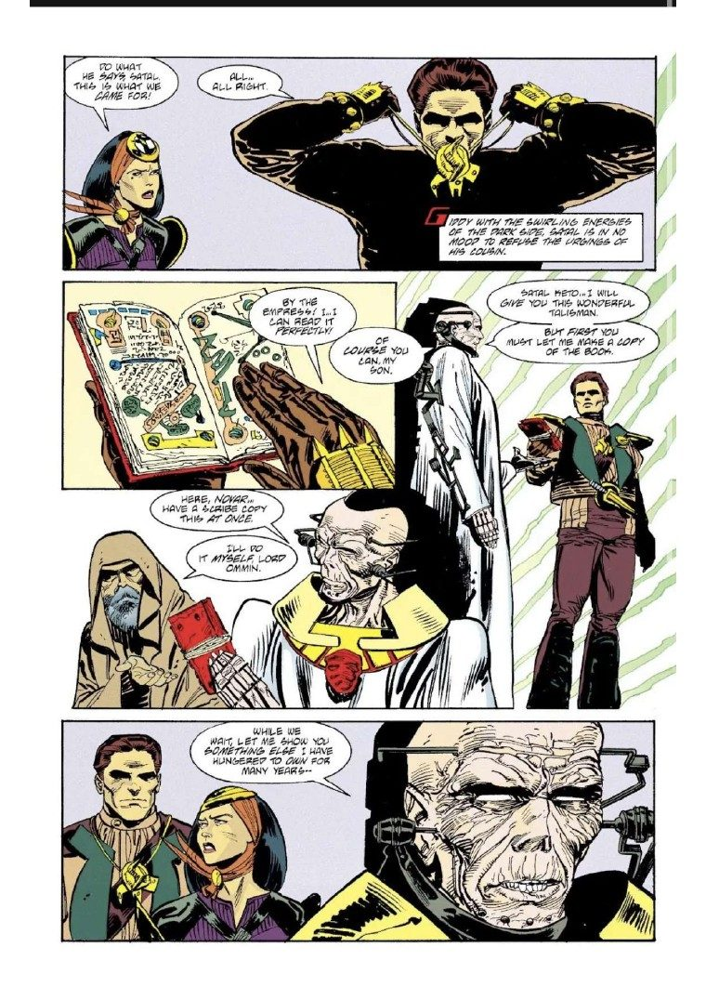
Our notes: `notes/materials/024-tales-of-the-jedi/freedon-nadd-uprising.md:223`

> ALEEMA...I FEEL SUDDENLY ILL.
> [fragment — full passage not on file]
— Source: Owner Material 024a — Tales of the Jedi: The Freedon Nadd Uprising #1–2 (1994): power-scaling notes; Satal Keto. POV: Satal Keto.
Note (our notes, around the quote): Satal Keto: "ALEEMA...I FEEL SUDDENLY ILL." Source: Freedon Nadd Uprising #2, p11

Our notes: `notes/materials/024-tales-of-the-jedi/freedon-nadd-uprising.md:225`

> CONCEALED AMONGST THE DEPARTING TRAVELERS, SATAL KETO AND HIS COUSIN ALEEMA RETURN ACROSS THE GALAXY TO THE EMPRESS TETA SYSTEM...
> [fragment — full passage not on file]
>
> ...WITH PRECIOUS SITH TREASURES IN THEIR BAGGAGE!
> [fragment — full passage not on file]
— Source: Freedon Nadd Uprising #2, p20 — Owner Material 024a — Tales of the Jedi: The Freedon Nadd Uprising #1–2 (1994): power-scaling notes; Leaves Onderon with the Sith book, amulet and swords. POV: narrator, about Satal Keto.
Note (our notes, around the quote): Leaves Onderon with the Sith book, amulet and swords: "CONCEALED AMONGST THE DEPARTING TRAVELERS, SATAL KETO AND HIS COUSIN ALEEMA RETURN ACROSS THE GALAXY TO THE EMPRESS TETA SYSTEM..." "...WITH PRECIOUS SITH TREASURES IN THEIR BAGGAGE!" · NARRATION. Source: Freedon Nadd Uprising #2, p20
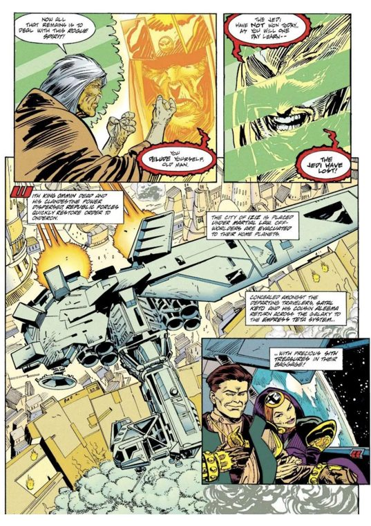
Our notes: `notes/materials/024-tales-of-the-jedi/freedon-nadd-uprising.md:227`

> THERE'S POWER IN THESE THINGS, SATAL.
— Source: Owner Material 024a — Tales of the Jedi: The Freedon Nadd Uprising #1–2 (1994): power-scaling notes; Senses Sith amulets in the museum.
Note (our notes, around the quote): Senses Sith amulets in the museum: "THERE'S POWER IN THESE THINGS, SATAL." Source: Freedon Nadd Uprising #1, p25

Our notes: `notes/materials/024-tales-of-the-jedi/freedon-nadd-uprising.md:230`

> AS A WAY OF AMUSING THEMSELVES, THE INDOLENT YOUNG ARISTOCRATS HAVE BEEN DABBLING IN THE LORE OF MAGIC.
— Source: Owner Material 024a — Tales of the Jedi: The Freedon Nadd Uprising #1–2 (1994): power-scaling notes; Narration on Satal Keto and Aleema Keto. POV: narrator, about Satal Keto.
Note (our notes, around the quote): Narration on Satal Keto and Aleema Keto: "AS A WAY OF AMUSING THEMSELVES, THE INDOLENT YOUNG ARISTOCRATS HAVE BEEN DABBLING IN THE LORE OF MAGIC." · NARRATION. Source: Freedon Nadd Uprising #1, p24
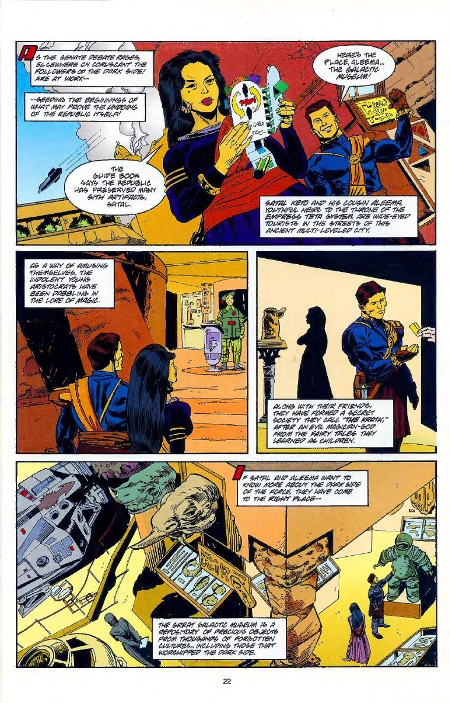
Our notes: `notes/materials/024-tales-of-the-jedi/freedon-nadd-uprising.md:232`

> ALL I SENSE IS GREAT POWER THAT WANTS TO HELP US!
— Source: Owner Material 024a — Tales of the Jedi: The Freedon Nadd Uprising #1–2 (1994): power-scaling notes; Aleema Keto in Ommin's lair. POV: Aleema Keto in Ommin's lair, about Satal Keto.
Note (our notes, around the quote): Aleema Keto in Ommin's lair: "ALL I SENSE IS GREAT POWER THAT WANTS TO HELP US!" Source: Freedon Nadd Uprising #2, p11

Our notes: `notes/materials/024-tales-of-the-jedi/freedon-nadd-uprising.md:236`

> HERE, NOVAR... HAVE A SCRIBE COPY THIS AT ONCE.
> [fragment — full passage not on file]
>
> I'LL DO IT MYSELF, LORD OMMIN.
— Source: Owner Material 024a — Tales of the Jedi: The Freedon Nadd Uprising #1–2 (1994): power-scaling notes; Ommin's servant copies the Sith book himself: Ommin.
Note (our notes, around the quote): Ommin's servant copies the Sith book himself: Ommin: "HERE, NOVAR... HAVE A SCRIBE COPY THIS AT ONCE." Novar: "I'LL DO IT MYSELF, LORD OMMIN." Source: Freedon Nadd Uprising #2, p12

Our notes: `notes/materials/024-tales-of-the-jedi/freedon-nadd-uprising.md:260`

- Note (summary from our notes, not a quotation): Coverage: the book covers *Tales of the Jedi* up to *The Freedon Nadd Uprising* only. It came out before *Dark Lords of the Sith* and *The Sith War* were collected. So it has no stat block for Exar Kun, and he is named only once (p.78). There are also no stat blocks for Naga Sadow, Aleema, Satal or Mandalore.
  — Source: Owner Material 024d — Tales of the Jedi Companion (West End Games, 1996): power-scaling notes.
Our notes: `notes/materials/024-tales-of-the-jedi/tales-of-the-jedi-companion.md:12`

> the spirit of Freedon Nadd appears to Satal and Aleema, giving them the book, the amulet, and a pair of Sith swords.
> [fragment — full passage not on file]
— Source: Owner Material 024d — Tales of the Jedi Companion (West End Games, 1996): power-scaling notes; FNU summary. POV: FNU summary.
Note (our notes, around the quote): FNU summary: "the spirit of Freedon Nadd appears to Satal and Aleema, giving them the book, the amulet, and a pair of Sith swords." Source: Tales of the Jedi Companion (WEG, 1996), p.15
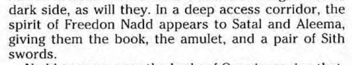
Our notes: `notes/materials/024-tales-of-the-jedi/tales-of-the-jedi-companion.md:100`

## Star Wars: The New Essential Chronology (Del Rey, 2005): power-scaling and lore notes

> Instead, Ulic killed Keto in a great duel, then took his place beside Aleema as the new ruler of the Krath.
— Source: Part One: Tales of the Ancient Republic; Ulic Qel-Droma; Satal Keto — Ulic kills Satal Keto.
Note (our notes, around the quote): Ulic Qel-Droma; Satal Keto — Ulic kills Satal Keto: "Instead, Ulic killed Keto in a great duel, then took his place beside Aleema as the new ruler of the Krath." Source: The New Essential Chronology, p.17
Our notes: `notes/materials/027-new-essential-chronology/01-part-one-ancient-republic.md:121`

## The Complete Star Wars Encyclopedia, Vol. II (H–O)

- Note (summary from our notes, not a quotation): Page contents: 1090 words, 26 paragraphs | headings/entries: Kern; Kerrithrarr; Kessel; Kesselrook, Serja; Kessel Run; Kestic Station; Kestrel; Kestrel Nova; Ketaris; Keten; Kether, Ran; Kethor; Keto, Aleema; Keto, Satal
  — Source: scan pages 201–240.
Our notes: `notes/materials/031-complete-star-wars-encyclopedia-vol-2/05-v2-scan-201-240.md:190`

> He eventually was killed by Jedi Ulic Qel-Droma for instigating the death of Qel- Droma's teacher, Jedi Master Arca Jeth.
— Source: scan pages 201–240.
Note (our notes, around the quote): Satal Keto; Ulic Qel-Droma; Arca Jeth — entry/section: Keto, Satal: "He eventually was killed by Jedi Ulic Qel-Droma for instigating the death of Qel- Droma's teacher, Jedi Master Arca Jeth." Source: The Complete Star Wars Encyclopedia, Vol. II, p.214
Our notes: `notes/materials/031-complete-star-wars-encyclopedia-vol-2/05-v2-scan-201-240.md:203`

## The Complete Star Wars Encyclopedia, Vol. III (P–Z)

> He survived an assassination attempt by Satal and saw Nomi escape imprisonment by Satal just hours before Ulic had agreed to kill her to prove his loyalty to the Krath.
— Source: scan pages 41–80.
Note (our notes, around the quote): Ulic Qel-Droma; Satal Keto; Nomi Sunrider — entry/section: Qel-Droma, Ulic: "He survived an assassination attempt by Satal and saw Nomi escape imprisonment by Satal just hours before Ulic had agreed to kill her to prove his loyalty to the Krath." Source: The Complete Star Wars Encyclopedia, Vol. III, p.55
Our notes: `notes/materials/032-complete-star-wars-encyclopedia-vol-3/01-v3-scan-041-080.md:158`

> Anger inside Ulic exploded, leading him to kill Satal.
— Source: scan pages 41–80; Ulic Qel-Droma; Satal Keto — entry/section: Qel-Droma, Ulic.
Note (our notes, around the quote): Ulic Qel-Droma; Satal Keto — entry/section: Qel-Droma, Ulic: "Anger inside Ulic exploded, leading him to kill Satal." Source: The Complete Star Wars Encyclopedia, Vol. III, p.55
Our notes: `notes/materials/032-complete-star-wars-encyclopedia-vol-3/01-v3-scan-041-080.md:160`

## Power of the Jedi Sourcebook (d20, 2002)

- Note (summary from our notes, not a quotation): Page contents: 977 words, 210 paragraphs | headings/entries: Kenzon, Ephaan 152, 153; Kerilt 64; Keto, Aleema 8; Keto, Satal 8; Khommite 67; Ki-Adi-Mundi 117, 119, 120; Kiffar 17, 123, 124; Kil'qiy, Surenit 32; Kirrek 7, 98; Koba system 112; Koon, Plo 113, 117, 124; Koros system 98, 99; Koros Major 103, 106; Korriban 102; Koth, Eeth 114; Krevaaki 68, 102; Kushiban 68, 129; Kut, Plovin 112; Lah, Tsavong 139; Lannik 69, 113, 117; Lowbacca 11; Madine, Crix 131; Malacia 13, 118; Malastare 113, 116, 117; Mandalore 102; Mar, Easal 132; Marspa, Master 33; Massassi 7, 8, 98, 138, 139; Maul, Darth 43; MedCorps worker 94; Meditative Canyon on Ambria 145-147; Mid Rim 76, 79, 132, 153; Miraluka 70, 107; Mirial 127, 128; Mon Calamari 130; Mon, Ephant 119; Morichro 16, 113; Mothma, Mon 11, 130, 131; Nadill, Memit 7, 99; Nam Chorios 78; Nam Priax 77; Nar Shaddaa 114, 123; Nautolan 71, 125; Nazzar 72; Nebulon Front 113, 114; Nebulon Ranger 59, 103, 104, 105; Neti
  — Source: Chapter Seven: Where the Force is strong; Index.
Our notes: `notes/materials/033-power-of-the-jedi-sourcebook/07-ch7-locations-index.md:181`

## Dark Side Sourcebook (d20, 2001)

> Sith Acolytes Aleema Keto and her cousin Satal Keto, son of the ruler of the Empress Teta system and heir to the corrupt government, were spoiled, bored, and rich. Along with their friends, the pair dabbled in Sith magic and amused themselves with artifacts from the time of the Great Hyperspace War. To gain more power, Aleema persuaded Satal to steal an ancient book of Sith secrets from a Coruscant museum, but they couldn't read the text. They went in search of someone who could. Armed with rumors of Sith practitioners on Onderon, the two aristocrats used their money and novice dark side skills to reach King Ommin. The delighted ruler gave Satal a Sith amulet and had a scribe start work on translating the arcane tome. The specter of Freedon Nadd had been assisting King Ommin, but decided that Satal and Aleema held the key to resurrecting the golden age of the Sith. The dark side avatar appeared before the pair and offered to guide them in their rise to power. Spurred on and encouraged by the spirit's attention, Satal and his cousin extracted a wealth of Sith artifacts and returned to the Empress Teta system. Nadd's spirit, meanwhile, was trapped within an armored tomb on the moon of Dxun. With the artifacts and Sith tome in hand, Satal and Aleema quickly grew in dark side power.
— Source: Chapter Five: Dark Side Traditions (Sith Empire, Set Harth, prophets, Brakiss…); Freedon Nadd; King Ommin; Satal Keto; Aleema Keto.
(Excerpt widened 2026-11-17 to the relevant passage, word for word from research primary dark side sourcebook dss (text copy `research_primary_dark_side_sourcebook_dss_pdf_9cd3453f4a`).)
(Excerpt widened 2026-11-17 to the relevant passage, word for word from research primary dark side sourcebook dss (text copy `research_primary_dark_side_sourcebook_dss_pdf_9cd3453f4a`).)
Note (our notes, around the quote): Freedon Nadd; King Ommin; Satal Keto; Aleema Keto: "The specter of Freedon Nadd had been assisting King Ommin, but decided that Satal and Aleema held the key to resurrecting the golden age of the Sith." Source: Dark Side Sourcebook, p.74
Our notes: `notes/materials/035-dark-side-sourcebook/05-ch5-traditions.md:53`

> Later, Ulic disguised himself as a fallen Jedi and made his way to Satal and Aleema's stronghold in the city of Cinnagar. An assassin threatened to end Aleema's life, but Ulic intervened. He killed the assassin and was accepted into the usurper's sect by the beautiful Aleema. Satal, jealous and suspicious of Ulic, tortured the Jedi, seeking to make him confess to being a spy. Even under the influence of Sith poison, Ulic denied the charges, though his mind was clouded by the foul substance. Aleema scoffed at Satal's suspicions and made Ulic general of their military forces-and her personal pet Jedi. When Satal Keto eventually discovered Ulic's true plans, he confronted the fallen Jedi in a great duel that had terrible repercussions: Ulic unleashed his fury, killing Satal but completing his slide to the dark side. Aleema allowed Ulic to claim his place beside her as the new ruler of their dark side sect. Ulic's military genius, combined with Aleema's Sith illusions, allowed the sect to gain a number of victories against the Republic. In the end, however, a brave band of Jedi Knights captured Ulic and stripped him of his power. Aleema escaped, leaving her one time pet to his fate.
— Source: Chapter Five: Dark Side Traditions (Sith Empire, Set Harth, prophets, Brakiss…); Satal Keto; Ulic Qel-Droma.
(Excerpt widened 2026-11-17 to the relevant passage, word for word from research primary dark side sourcebook dss (text copy `research_primary_dark_side_sourcebook_dss_pdf_9cd3453f4a`).)
(Excerpt widened 2026-11-17 to the relevant passage, word for word from research primary dark side sourcebook dss (text copy `research_primary_dark_side_sourcebook_dss_pdf_9cd3453f4a`).)
Note (our notes, around the quote): Satal Keto; Ulic Qel-Droma: "When Satal Keto eventually discovered Ulic's true plans, he confronted the fallen Jedi in a great duel that had terrible repercussions: Ulic unleashed his fury, killing Satal but completing his slide to the dark side." Source: Dark Side Sourcebook, p.75
Our notes: `notes/materials/035-dark-side-sourcebook/05-ch5-traditions.md:62`

> Force Skills: Affect Mind+8, Alchemy +5, Empathy +6, Fear +9, Force Grip +I], Force Push +8, Illusion +13, Move Object +6. Feats: Dark Side Skill Emphasis (Fear), Dark Side Skill Emphasis (Force Grip), Force-Sensitive, Iron Will, Persuasive, Weapon Group Proficiency (blaster pistols), Weapon Group Proficiency (simple weapons). Force Feats: Alter, Control, Sense, Sith Sorcery. Ulic Qel-Droma, Former Jedi Hnight, Sith Lord Almost four thousand years before the coming of Darth Vader, two other Jedi Knights embraced the dark side, eventually challenging and almost decimating the ranks of the Jedi Order they once loyally served. One, Exar Kun, turned to the dark side in a quest for knowledge long forbidden by the Order. The other, Ulic Qel-Droma, sought to destroy the dark side sect of Satal and Aleema Keto frorn the inside, only to be turned to evil himself by dark side poison. By the time he was finally defeated, Ulic Qel-Droma had become a formidable Dark Lord of the Sith, second only to his partner Exar Kun. Ulic and his brother Cay Qel-Droma trained under Jedi Master Arca Jeth on the world of Arkania, alongside a Twi'lek Jedi named Tott Doneeta. Master Arca sent the three Jedi students to the world of Onderon to settle the dispute between Iziz and the beast-riders of Onderon.
— Source: Chapter Five: Dark Side Traditions (Sith Empire, Set Harth, prophets, Brakiss…).
(Excerpt widened 2026-11-17 to the relevant passage, word for word from research primary dark side sourcebook dss (text copy `research_primary_dark_side_sourcebook_dss_pdf_9cd3453f4a`).)
(Excerpt widened 2026-11-17 to the relevant passage, word for word from research primary dark side sourcebook dss (text copy `research_primary_dark_side_sourcebook_dss_pdf_9cd3453f4a`).)
Note (our notes, around the quote): Ulic Qel-Droma; Satal Keto; Aleema Keto — entry/section: Ulic Qel-Droma, Former Jedi Hnight, Sith Lord: "The other, Ulic Qel-Droma, sought to destroy the dark side sect of Satal and Aleema Keto frorn the inside, only to be turned to evil himself by dark side poison." Source: Dark Side Sourcebook, p.75
Our notes: `notes/materials/035-dark-side-sourcebook/05-ch5-traditions.md:66`

## Sourcebooks/Knights of the Old Rebuplic Campaign Guide.pdf [Star Wars Roleplaying Game Saga Edition (2007)] (scan pages 1–60)

> However, Nadd realizes that the King is on the brink of defeat by Jedi and Republic forces, so he transfers his support to Satal and Aleema, promising to guide them into a new Sith Golden Age.
— Source: Sourcebooks/Knights of the Old Rebuplic Campaign Guide.pdf [Star Wars Rol; Freedon Nadd; Satal Keto; Aleema Keto. POV: Aleema Keto; about Satal Keto.
Note (our notes, around the quote): Freedon Nadd; Satal Keto; Aleema Keto: "However, Nadd realizes that the King is on the brink of defeat by Jedi and Republic forces, so he transfers his support to Satal and Aleema, promising to guide them into a new Sith Golden Age." Source: *Knights of the Old Rebuplic Campaign Guide* (SWRPG Saga Edition), scan p.60
Our notes: `notes/materials/037-sw-d20-folder/718-knights-of-the-old-rebuplic-campaign-guide-scan-001-060.md:384`

## Star Wars Insider #28 (1996)

> Vlic planned to infiltrate the Krath asa means of defeating them, but was ultimately se: duced by the dark side of the Force — helped along by the Sith poisons injected into ham by Satal Keto — and joined with Exar Kun as his foremost apprentice to attempt to bring back the glory days of the Sith.
— Source: Star Wars Insider #28 (1996).
Note (our notes, around the quote): Ulic Qel-Droma; Exar Kun; Satal Keto — entry/section: Ulic Qel-Droma (glossary): "Vlic planned to infiltrate the Krath asa means of defeating them, but was ultimately se: duced by the dark side of the Force — helped along by the Sith poisons injected into ham by Satal Keto — and joined with Exar Kun as his foremost apprentice to attempt to bring back the glory days of the Sith." Source: *Star Wars Insider #28* (1996), scan p.58
Our notes: `notes/materials/038-star-wars-insider/028-ins028.md:329`

## Star Wars Insider #151 (2014)

- Note (summary from our notes, not a quotation): Page contents: Tales of the Jedi: captions (Satal and Aleema Keto uncover Sith magic; Nomi and Andur Sunrider at the Stenness hyperspace terminal; Bogga the Hutt on Dorman's cover of #4); "Never-ending Tales": next, Dark Lords of the Sith; to be concluded. (hand-read)
  — Source: Star Wars Insider #151 (2014).
Our notes: `notes/materials/038-star-wars-insider/151-ins151.md:198`

## https://starwars.fandom.com/wiki/Freedon_Nadd/Legends ; https://starwars.fandom.com/wiki/Freedon_Nadd

- Note (summary from our notes, not a quotation): Nadd trained Aleema and Satal Keto in Sith sorcery. The article says they became powerful sorcerers and, as the Krath, used those abilities to overthrow their home system and launch a jihad against the Republic and Jedi. This is an influence/training result, not a direct solo feat. [10][11][19]
  — Source: FREEDON NADD — Wookieepedia extraction (Legends) — https://starwars.fandom.com/wiki/Freedon_Nadd/Legends ; https://starwars.fandom.com/wiki/Freedon_Nadd.
Our notes: `external/mega-notes/freedon-nadd-quotes.txt:37`

- Note (summary from our notes, not a quotation): Nadd’s final warning to the Ketos calls Kun a threat who had acquired “great Sith powers” and says Kun was a “pretender” while claiming the real Sith power rested with Satal, Aleema, and Ulic. These are Nadd’s statements/opinions and should not be treated as objective power measurements. [10]
  — Source: FREEDON NADD — Wookieepedia extraction (Legends) — https://starwars.fandom.com/wiki/Freedon_Nadd/Legends ; https://starwars.fandom.com/wiki/Freedon_Nadd.
Our notes: `external/mega-notes/freedon-nadd-quotes.txt:46`

## https://starwars.fandom.com/wiki/Ulic_Qel-Droma/Legends

- Note (summary from our notes, not a quotation): Aleema Keto gave Qel-Droma a powerful Sith amulet, originally Satal Keto’s. The article says he learned to use it to attack with blue-hued dark energy and used it against former Jedi friends [25]. When Cay and Nomi tried to retrieve him, Qel-Droma used the amulet to lash out; Cay and Toq had to use the Force to restrain him [25].
  — Source: Tales of the Jedi – Dark Lords of the Sith 6 [per Wookieepedia "Ulic Qel-Droma/Legends" rev 15671614, ref 25; per-sentence approximate match (4/4 sentences matched, min 0.72), verify; agrees with the entry's own ref marker]; per Wookieepedia "Ulic Qel-Droma/Legends" rev 15671614, ref 25; per-sentence approximate match (4/4 sentences matched, min 0.72), verify; agrees with the entry's own ref marker — Ulic Qel-Droma research extraction — https://starwars.fandom.com/wiki/Ulic_Qel-Droma/Legends.
(Source: Tales of the Jedi – Dark Lords of the Sith 6 [per Wookieepedia "Ulic Qel-Droma/Legends" rev 15671614, ref 25; per-sentence approximate match (4/4 sentences matched, min 0.72), verify; agrees with the entry's own ref marker])
Our notes: `external/mega-notes/ulic-qel-droma-quotes.txt:42`

- Note (summary from our notes, not a quotation): The article separately says the Sith poison injected by Satal Keto amplified Qel-Droma’s rage and produced a Force scream that destroyed a small stone pillar and the torture droid; he later used the power to drive off Nomi, Cay, and Tott [24]. This is poison-amplified dark-side power, not necessarily an amulet feat.
  — Source: Tales of the Jedi – Dark Lords of the Sith 5 [per Wookieepedia "Ulic Qel-Droma/Legends" rev 15671614, ref 24; approximate match 0.72, verify; agrees with the entry's own ref marker]; per Wookieepedia "Ulic Qel-Droma/Legends" rev 15671614, ref 24; approximate match 0.72, verify; agrees with the entry's own ref marker — Ulic Qel-Droma research extraction — https://starwars.fandom.com/wiki/Ulic_Qel-Droma/Legends.
(Source: Tales of the Jedi – Dark Lords of the Sith 5 [per Wookieepedia "Ulic Qel-Droma/Legends" rev 15671614, ref 24; approximate match 0.72, verify; agrees with the entry's own ref marker])
Our notes: `external/mega-notes/ulic-qel-droma-quotes.txt:44`

# Debate and forum claims (unverified)

Forum posts, Suspect Insight debates and Discord debates, respect threads, and verdicts. These are posters' arguments or quotations they typed; none is checked against the book here unless the entry says so.

## Darth Caedus (DC77) vs Exar Kun (AncientPower)

- Note (summary from our notes, not a quotation): Freedon Nadd chose Aleema and Satal Keto over King Ommin.
  — Source: Darth Caedus (DC77) vs Exar Kun (AncientPower) — https://www.suspectinsightforums.com/t568-ss-darth-caedus-dc77-vs-exar-kun-ladykulvax.
Posted by: not named in our notes (see thread/notes link).
Context: Nomi Sunrider chain:
Our notes: `suspect-insight/debates/059-darth-caedus-vs-exar-kun.md:24`

> Satal Keto and his cousin Aleema, have begun to explore the magic of the Sith and have used it to corrupt their homeworld in the Empress Teta system.
— Source: Darth Caedus (DC77) vs Exar Kun (AncientPower) — https://www.suspectinsightforums.com/t568-ss-darth-caedus-dc77-vs-exar-kun-ladykulvax.
Context: Q5 — Source: Tales of the Jedi: Dark Lords of the Sith Audiobook Pt.2
Posted by: not named in our notes (see thread/notes link).
Our notes: `suspect-insight/debates/059-darth-caedus-vs-exar-kun.md:85`

## Meetra Surik (IdrisianGraecus) vs Nomi Sunrider (Xolthol)

> Xolthol
> [fragment — full passage not on file]
>
> Ulic Qel-Droma, willing to defeat the sith, decided to infiltrate them by going into the Krath system where the Keto's cousin where leading thanks to their dark power. During the time here, Ulic after being captured have been realeased by Aleema Keto (who fell in love with him) in order to defeat her cousin Satal Keto.
>
> Following the defeat of Satal, Aleema and Ulic become used to trained against each other but it clearly seems that Aleema had the upper hand and by a pretty good margin [10] [LINK: https://comicvine1.cbsistatic.com/uploads/scale_super/11132/111323216/6841777-aleemapower.jpg] .
>
> But this same Aleema Keto, while in a meditation chamber (IE: insanely amp), was literraly trashed by Nomi Sunrider during a mind fight [11] [LINK: https://2.bp.blogspot.com/BtarzVxluoCcufFfhNOt1YwdlK-8FfFW7LwoWckBq6LhkBiFE84cYteQTgjyVkXqqhfIMdLd-JJq=s1600] [12] [LINK: https://2.bp.blogspot.com/VvJ088C4YsDy1thE3jQlRwqsP3kqWZUaw07-olS0VPbsCpzM8Qc4fgLt3wPLbivBarh4XX26Gd0u=s1600] . As you can see, Nomi Sunrider scaled insanely above Aleema Keto
> [fragment — full passage not on file]
— Source: Meetra Surik (IdrisianGraecus) vs Nomi Sunrider (Xolthol) — https://www.suspectinsightforums.com/t1421-ss-meetra-surik-ig-vs-nomi-sunrider-xolthol.
Context: Q26 — Source: [source not stated adjacent] (preceding line: "r foes, she’s just sowing disorder in their ranks, which makes this feet less impressive. And while Arca, yes is able to defeat Amanoa, she’s not dominating anybody, just, you know, sowing disorder. Also, the text says “Hundreds of beast lord”, citat")
Posted by: not named in our notes (see thread/notes link).
Our notes: `suspect-insight/debates/068-meetra-surik-vs-nomi-sunrider.md:238`

> Ulic Qel-Droma, willing to defeat the sith, decided to infiltrate them by going into the Krath system where the Keto's cousin where leading thanks to their dark power. During the time here, Ulic after being captured have been realeased by Aleema Keto (who fell in love with him) in order to defeat her cousin Satal Keto.
>
> Following the defeat of Satal, Aleema and Ulic become used to trained against each other but it clearly seems that Aleema had the upper hand and by a pretty good margin [10] [LINK: https://comicvine1.cbsistatic.com/uploads/scale_super/11132/111323216/6841777-aleemapower.jpg].
>
> But this same Aleema Keto, while in a meditation chamber (IE: insanely amp), was literraly trashed by Nomi Sunrider during a mind fight [11] [LINK: https://2.bp.blogspot.com/BtarzVxluoCcufFfhNOt1YwdlK-8FfFW7LwoWckBq6LhkBiFE84cYteQTgjyVkXqqhfIMdLd-JJq=s1600] [12] [LINK: https://2.bp.blogspot.com/VvJ088C4YsDy1thE3jQlRwqsP3kqWZUaw07-olS0VPbsCpzM8Qc4fgLt3wPLbivBarh4XX26Gd0u=s1600]. As you can see, Nomi Sunrider scaled insanely above Aleema Keto.
— Source: Meetra Surik (IdrisianGraecus) vs Nomi Sunrider (Xolthol) — https://www.suspectinsightforums.com/t1421-ss-meetra-surik-ig-vs-nomi-sunrider-xolthol.
Context: I4 — Source line: ~Full scaling chain~
Posted by: not named in our notes (see thread/notes link).
Our notes: `suspect-insight/debates/068-meetra-surik-vs-nomi-sunrider.md:362`

## Aleema Keto Respect Thread — respect-thread notes

- Note (summary from our notes, not a quotation): Aleema and Satal Keto were able to use their Sith illusions to conquer the six of the seven worlds within the Tetan system, defeating their six military forces individually. When staging a battle over the seventh world, Koros Major, Aleema projects illusions down onto the planet which cause the Tetan armies to believe their weapons are snakes, among other illusions. Then, when Jedi reinforcements from another part of the Republic arrive to provide aid, Aleema projects massive illusions of Space Grazers, an alien lifeform which, if real, could have destroyed the Republic fleets. Nomi Sunrider is able to see through the illusions due to her abilities in battle meditation, and then proceeds to telepathically defeat Aleema. Despite this, Aleema's cousin, Satal, is able to cast a spell on the minds of hundreds of Chaos Fighter pilots, compelling them to crash into the Republic capital ships in a suicidal final attack. It's worth noting that Aleema carried out these feats within a meditation chamber, although her cousin required no such aid in his feat.
  — Source: SI respect-thread directory: Aleema Keto Respect Thread — https://comicvine.gamespot.com/profile/i_like_swords/blog/aleema-keto-respect-thread/102921/.
Posted by: not named in our notes (see thread/notes link).
Our notes: `suspect-insight/respect-threads/aleema-keto.md:33`

> With the artifacts and Sith tome in hand, Satal and Aleema quickly grew in dark side power. They led a rebellion against the government of the Empress Teta system, killing Satal's parents and delighting in the use of their newfound abilities. Barbaric, evil, and totally despotic, the pair spread fear and suffering throughout the system as the inhabited worlds revolted. Republic forces, assisted by Jedi Knights Ulic Qel-Droma and Nomi Sunrider, tried to put an end to the violence, but Aleema used powerful Sith illusions to confuse and confound the unwanted intruders.
— Source: SI respect-thread directory: Aleema Keto Respect Thread — https://comicvine.gamespot.com/profile/i_like_swords/blog/aleema-keto-respect-thread/102921/.
Context: http://imgur.com/a/ACBau
Posted by: not named in our notes (see thread/notes link).
Our notes: `suspect-insight/respect-threads/aleema-keto.md:37`

## Queen Amanoa Respect Thread — respect-thread notes

> Click here to be redirected to my list of respect threads. <
— Source: SI respect-thread directory: Queen Amanoa Respect Thread — https://comicvine.gamespot.com/profile/i_like_swords/blog/queen-amanoa-respect-thread/102919/.
Context: Having said all of that, thanks for reading. Next up will be a respect thread for Aleema and Satal Keto of the Krath, followed by Freedon Nadd himself.
Posted by: not named in our notes (see thread/notes link).
Our notes: `suspect-insight/respect-threads/amanoa.md:101`

## Exar Kun Supreme Respect Thread (NEW UPDATE 8/28/2022) — respect-thread notes

> "My children, it is not Qel-Droma you must fear! Beware of Exar Kun, he has acquired great Sith powers!"
— Source: SI respect-thread directory: Exar Kun Supreme Respect Thread (NEW UPDATE 8/28/2022) — https://www.suspectinsightforums.com/t822-exar-kun-supreme-respect-thread-new-update-8-28-2022.
Context: As his spirit is destroyed, Nadd claims that the Ketos shouldn't fear Ulic, but Exar:
Posted by: not named in our notes (see thread/notes link).
(Source (as named in the post's quote header): Freedon Nadd to Aleema & Satal, Star Wars Omnibus: Tales of the Jedi Vol.2 wrote:)
Our notes: `suspect-insight/respect-threads/exar-kun--exar-kun-ancient-power.md:170`

> Ulic unleashes a force of unruly fury at the death of Master Arca, avenging the death by defeating Keto, and taking the Krath throne by the side of Aleema. Meanwhile on Yavin 4, a more powerful EXAR KUN rests in his meditation chamber
— Source: SI respect-thread directory: Exar Kun Supreme Respect Thread (NEW UPDATE 8/28/2022) — https://www.suspectinsightforums.com/t822-exar-kun-supreme-respect-thread-new-update-8-28-2022.
Context: Exar Kun is even more powerful by the time Ulic Qel-Droma kills Satal Keto and joins his cousin Aleema:
Posted by: not named in our notes (see thread/notes link).
(Source (as named in the post's quote header): Chronicles of the Old Republic wrote:)
Our notes: `suspect-insight/respect-threads/exar-kun--exar-kun-ancient-power.md:222`

## King Ommin Respect Thread — respect-thread notes

- Note (summary from our notes, not a quotation): Ommin effortlessly casts a spell over Satal's mind, forcing him to comply with his wishes and causing him to feel ill.
  — Source: SI respect-thread directory: King Ommin Respect Thread — https://comicvine.gamespot.com/profile/i_like_swords/blog/king-ommin-respect-thread/101298/.
Posted by: not named in our notes (see thread/notes link).
Our notes: `suspect-insight/respect-threads/ommin.md:88`

- Note (summary from our notes, not a quotation): [image: data:image/gif;base64,R0lGODlhAQABAAAAACH5BAEKAAEALAAAAAABAAEAAAICTAEAOw==]
  — Source: SI respect-thread directory: King Ommin Respect Thread — https://comicvine.gamespot.com/profile/i_like_swords/blog/king-ommin-respect-thread/101298/.
Posted by: not named in our notes (see thread/notes link).
Context: Ommin effortlessly casts a spell over Satal's mind, forcing him to comply with his wishes and causing him to feel ill.
Our notes: `suspect-insight/respect-threads/ommin.md:89`; `suspect-insight/respect-threads/ommin.md:90`
