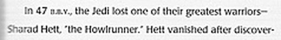

# Sharad Hett

- **Aliases:** —
- **Era:** —
- **Continuity:** default Legends; entries present for: Legends
- **Research tier:** untiered (not listed as INTRO/DEEP/MASTERY in legends-feats.md)
- **Entries:** 14 (7 with quotations; 0 quotations extended to the full sentence/passage from the source text on file; 2 marked as fragments). Rebuilt 2026-11-17 from 15 old entries; old file: `characters/_bak/sharad-hett.md.bak-20261117`.
- **How to read:** each entry is the quotation in full (block quote), then its source and point of view. "Note" lines are summaries from our notes, not quotations. `[fragment — full passage not on file]` means the source text is not on the box, so only the words in our notes are shown. Debate and forum material is in the last section and is unverified.

# LEGENDS (Legends / EU — main focus)

## Star Wars: The New Essential Chronology (Del Rey, 2005): power-scaling and lore notes

- Note (summary from our notes, not a quotation): Sharad Hett: "the Jedi lost one of their greatest warriors, Sharad Hett "the Howlrunner."" Source: The New Essential Chronology, p.33
  — Source: Part Two: The Fall of the Republic. POV: Sharad Hett.

Our notes: `notes/materials/027-new-essential-chronology/02-part-two-fall-of-the-republic.md:39`

> Sing killed Sharad Hett, and Ki-Adi-Mundi took A'Sharad back to Coruscant as his new apprentice.
— Source: Part Two: The Fall of the Republic; Aurra Sing kills Sharad Hett. POV: Aurra Sing kills Sharad Hett.
Note (our notes, around the quote): Aurra Sing kills Sharad Hett: "Sing killed Sharad Hett, and Ki-Adi-Mundi took A'Sharad back to Coruscant as his new apprentice." Source: The New Essential Chronology, p.45
Our notes: `notes/materials/027-new-essential-chronology/02-part-two-fall-of-the-republic.md:141`

## Sourcebooks/Threats of the Galaxy.pdf [Star Wars Roleplaying Game Saga Edition (2007)] (scan pages 61–120)

> On Tatooine, the very air and sunlight are one's enemies.
— Source: Sourcebooks/Threats of the Galaxy.pdf [Star Wars Roleplaying Game Saga Ed; Sharad Hett — entry/section: Pull quote.
Note (our notes, around the quote): Sharad Hett — entry/section: Pull quote: ""On Tatooine, the very air and sunlight are one's enemies." —Sharad Hett" Source: *Threats of the Galaxy* (SWRPG Saga Edition), scan p.119
Our notes: `notes/materials/037-sw-d20-folder/731-threats-of-the-galaxy-scan-061-120.md:401`

## Star Wars Insider #45 (1999)

> self-exiled Tusken Jedi
> [fragment — full passage not on file]
— Source: Star Wars Insider #45 (1999).
Note (our notes, around the quote): Page contents: Horse's Mouth cont.: "Outlander" arc, Ki-Adi-Mundi (new Council member) seeks exiled Jedi Sharad Hett, the "self-exiled Tusken Jedi"; Aurra wants Hett dead. Comics lore, no power statements. (hand-read)
Our notes: `notes/materials/038-star-wars-insider/045-ins045.md:467`

## Star Wars Insider #135 (2012)

> it is nice to have Yoda by your side
> [fragment — full passage not on file]
— Source: Star Wars Insider #135 (2012).
Note (our notes, around the quote): Page contents: Launch Pad: Kathleen Kennedy to become Lucasfilm co-chair as Lucas prepares to retire ("it is nice to have Yoda by your side"); Tsuyoshi Nagano young Luke art; Shadow Conspiracy moved to January 2013. Mon Mothma's Facts: the fake is #5 (Ugnaught children are called Ugletts, not Uglings), verified with a rotated crop; others include Sharad Hett becoming a Tusken warlord. (hand-read)
Our notes: `notes/materials/038-star-wars-insider/135-ins135.md:55`

## Star Wars: The Ultimate Visual Guide (Ryder Windham, DK 2005)

- Note (summary from our notes, not a quotation): Sharad Hett's death: p. 40 says Aurra Sing slew him; p. 47 says he died in Gardulla's attack.
  — Source: 048 summary: Star Wars: The Ultimate Visual Guide (DK, 2005).
Our notes: `notes/materials/048-ultimate-visual-guide/summary.md:22`

## Star Wars: Legacy Book 1 (omnibus): power-scaling notes with panels

> THE GREATEST JEDI OF HIS AGE.
— Source: Legacy Book 1 (omnibus): power-scaling notes with panels; | Hett → Sharad Hett |.
Label in our notes: | p365 |
Context: | Speaker → subject | Quote | Page |
Our notes: `notes/materials/009-legacy-book-1.md:1109`

## Star Wars: Legacy Volume 3, *Claws of the Dragon* (TPB): power-scaling notes with panels

- Note (summary from our notes, not a quotation): | Hett → Sharad Hett | "THE GREATEST JEDI OF HIS AGE" | p64 |
  — Source: Legacy Volume 3, *Claws of the Dragon* (TPB): power-scaling notes with panels.
Context: | Speaker → subject | Quote | Page |
Our notes: `notes/materials/013-legacy-vol-3-claws-of-the-dragon.md:533`

# Debate and forum claims (unverified)

Forum posts, Suspect Insight debates and Discord debates, respect threads, and verdicts. These are posters' arguments or quotations they typed; none is checked against the book here unless the entry says so.

## https://comicvine.gamespot.com/forums/gen-discussion-1/emperor-krayt-respect-thread-1684455/

> A'Sharad is a worthy padawan. He will be a strong Jedi--even stronger than me, I think. *(Sharad Hett; comic, issue not given)*
— Source: CITED EXTRACTION: "Emperor Krayt Respect Thread" (Comic Vine, NewGuy12, 6/19/2015, marked INCOMPLETE) — https://comicvine.gamespot.com/forums/gen-discussion-1/emperor-krayt-respect-thread-1684455/; S. POV: Sharad Hett.
Note (our notes, around the quote): S: "A'Sharad is a worthy padawan. He will be a strong Jedi--even stronger than me, I think." (Sharad Hett; comic, issue not given)
Posted by: not named in our notes (see thread/notes link).
Our notes: `external/mega-notes/krayt-comicvine-respect.txt:6`

## Vong Krayt (Azronger) vs Darth Tyranus (HP_Legend)

> Emperor Krayt (>)> Darth Krayt >> A Sharad Hett (Sith) >> A'Sharad Hett (Jedi) < Obi-Wan Kenobi = Count Dooku.
— Source: Vong Krayt (Azronger) vs Darth Tyranus (HP_Legend) — https://www.suspectinsightforums.com/t14-ss-the-tyrannical-ten-darth-krayt-azronger-vs-darth-tyranus-arkhamasylum3; Conclusion chain. POV: Conclusion chain.
Posted by: not named in our notes (see thread/notes link).
Our notes: `suspect-insight/debates/002-vong-krayt-vs-darth-tyranus.md:31`

## Dooku and Obi-Wan Kenobi (Alz) vs Lord Draahg and Darth Wyyrlok III (Menace)

- Note (summary from our notes, not a quotation): It was presumed that Hett had died during the execution of Order 66. In reality, he had taken the destruction of the Jedi Order to give in to and explore his emotions. Over time, he gained a great deal of strength in the Force, much of which came from collections of Sith lore he discovered in his travels to Korriban. Following the guidance found in an ancient Sith holocron, he eventually gave himself over to the power of the dark side, and became the Dark Lord known as Darth Krayt, a name honoring one of Tatooine's most formidable predators. (The Complete Star Wars Encyclopedia)
  — Source: The Complete Star Wars Encyclopedia — as cited by Menace — SI Discord debate 031 (Dooku and Obi-Wan Kenobi (Alz) vs Lord Draahg and Darth Wyyrlok III (Menace)) — Discord-debate-cited (unverified against the book in this pass).
Posted by: Menace.
Context: typed by Menace in SI Discord debate 031, 11/18/21, 9:06 AM, to support “FOTJ Krayt >> A'sharad Hett.”
Our notes: `suspect-insight/debates/031-dooku-and-obi-wan-kenobi-vs-lord-draahg-and-darth-wyyrlok-iii.md:289`

- Note (summary from our notes, not a quotation): Hett's hands dropped to his belt and the two lightsabers practically leapt into his gloved hands. He ignited both weapons at once, unleashing their identical green energy beams. He swung fast with the lightsaber in his right hand but Ben blocked it. The lightsabers sizzled as they clashed. It was fortunate for Ben that he had continued his Jedi exercises on Tatooine, that he had not allowed his reflexes to become dull. He did not think about how long it had been since he had last used his lightsaber in combat. Nor did he consider that he was older than Hett by at least a decade, or Hett's considerable skills with his own weapons, and that the Tusken was far more experienced at fighting in the desert. Ben knew that any such thoughts would probably only get him killed. As prepared as Ben was for many things, he was not ready to die. Not yet. Not today. Hett brought his other lightsaber in at a sharp angle, forcing Ben to lurch back. Ben gripped his own weapon with both hands as he swung at Hett's legs, but Hett blocked the swipe. There was another loud sizzle as the blades dragged across each other. Ben gasped as Hett launched a powerful kick to his midriff. The kick knocked Ben off his feet, and as he fell back through the air, Hett hurled one of his lightsabers at Ben's body. Ben clung tight to his own lightsaber as he twisted his body in midair to avoid being struck by the spinning blade of Hett's weapon. The moment Hett's lightsaber whipped past Ben's head, Hett used the Force to retrieve it, drawing it back to his waiting left hand. As Hett caught the lightsaber, Ben rolled up from the ground and swung out again. Hett blocked the strike with his right lightsaber, then threw his left arm forward to smash his other lightsaber's handle into Ben's jaw. Ben ignored the painful jolt to his head and reflexively brought his blade up high, forcing Hett to block the blow with his right lightsaber and leaving his own deflection briefly exposed. Before Hett could strike with his other lightsaber, Ben kicked him hard in the stomach. Hett grunted, but he didn't go down. He lashed out again at Ben, kicking up sand as he moved in for the kill. Not one of the mounted Tuskens so much as flinched as they watched the duel, nor did they rally for their chief. They merely watched in silence, waiting for the outcome. Ben blocked each blow, but he wasn't doing it with ease. Hett was far more experienced at fighting on the sand and in the desert heat. Ben knew that his opponent would never surrender, let alone withdraw. As much as he hoped to avoid killing Hett, he also knew that they couldn't keep fighting indefinitely. But in the end, Ben knew he wasn't fighting for his own life. He was fighting for Luke's. Quickly raising his left hand, Ben used the Force to push out at Hett, shoving him back through the air as Ben's lightsaber swept up and through Hett's right arm. Hett shouted as his arm fell away from his body. As Hett stumbled back, Ben used the Force to tear Hett's other lightsaber from his left hand-his lightsabers deactivated as they sailed past Ben and landed in the sand behind him. (Star Wars: The Life and Legend of Obi-Wan Kenobi)
  — Source: Star Wars: The Life and Legend of Obi-Wan Kenobi — as cited by Menace — SI Discord debate 031 (Dooku and Obi-Wan Kenobi (Alz) vs Lord Draahg and Darth Wyyrlok III (Menace)) — Discord-debate-cited (unverified against the book in this pass). POV: narrator (as given by the debater), about Ben / Obi-Wan Kenobi and A'sharad Hett.
Posted by: Menace.
Context: typed by Menace in SI Discord debate 031, 11/18/21, 9:08 AM, split across two consecutive posts, of Ben’s desert duel with Hett; used to argue Hett can contend with ROTS Kenobi.
Our notes: `suspect-insight/debates/031-dooku-and-obi-wan-kenobi-vs-lord-draahg-and-darth-wyyrlok-iii.md:294`

## Sharad Hett Respect Thread — respect-thread notes

- Note (summary from our notes, not a quotation): Respect the Outlander, Sharad Hett
  — Source: SI respect-thread directory: Sharad Hett Respect Thread — https://www.suspectinsightforums.com/t4317-sharad-hett-respect-thread.
Posted by: not named in our notes (see thread/notes link).
Our notes: `suspect-insight/respect-threads/darth-krayt.md:13`

## Quinlan Vos Respect Thread - Gen. Discussion - Comic Vine — respect-thread notes

- Note (summary from our notes, not a quotation): I'm aware of Aurra's accolades, and she has feats as well such as killing Sharad Hett, beating A'Sharad Hett (and then being cheap-shotted in a fashion similar to Maul and Obi-Wan), holding off both Qui-Gon and Obi-Wan at once, etc.
  — Source: SI respect-thread directory: Quinlan Vos Respect Thread - Gen. Discussion - Comic Vine — https://comicvine.gamespot.com/forums/gen-discussion-1/quinlan-vos-respect-thread-1566791/.
Posted by: not named in our notes (see thread/notes link).
Our notes: `suspect-insight/respect-threads/quinlan-vos.md:448`
