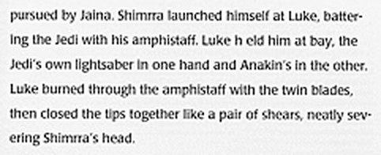
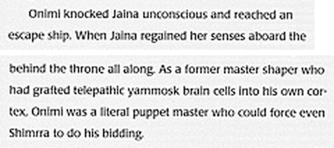
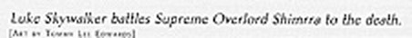
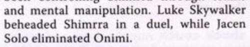
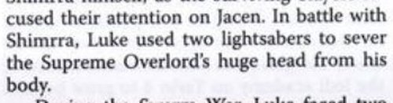
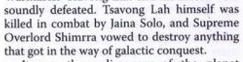
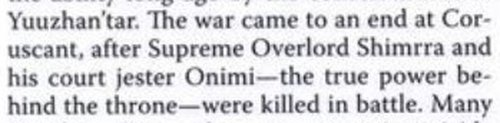
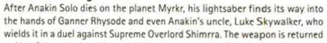
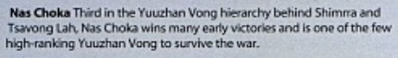

# Shimrra

- **Aliases:** Supreme Overlord Shimrra
- **Era:** NJO
- **Continuity:** default Legends; entries present for: Legends
- **Research tier:** untiered (not listed as INTRO/DEEP/MASTERY in legends-feats.md)
- **Entries:** 114 (47 with quotations; 9 quotations extended to the full sentence/passage from the source text on file; 20 marked as fragments; 31 before the 2026-11-17 fragment fill). Rebuilt 2026-11-17 from 86 old entries; old file: `characters/_bak/shimrra.md.bak-20261117`.
- **How to read:** each entry is the quotation in full (block quote), then its source and point of view. "Note" lines are summaries from our notes, not quotations. `[fragment — full passage not on file]` means the source text is not on the box, so only the words in our notes are shown. Debate and forum material is in the last section and is unverified.

# LEGENDS (Legends / EU — main focus)

## Star Wars: The New Essential Chronology (Del Rey, 2005): power-scaling and lore notes

> Shimrra launched himself at Luke, battering the Jedi with his amphistaff. Luke held him at bay, the Jedi's own lightsaber in one hand and Anakin's in the other. Luke burned through the amphistaff with the twin blades, then closed the tips together like a pair of shears, neatly severing Shimrra's head.
— Source: Part Twelve: The New Jedi Order; Luke Skywalker — Luke kills Shimrra.
Note (our notes, around the quote): Luke Skywalker — Luke kills Shimrra: "Shimrra launched himself at Luke, battering the Jedi with his amphistaff. Luke held him at bay, the Jedi's own lightsaber in one hand and Anakin's in the other. Luke burned through the amphistaff with the twin blades, then closed the tips together like a pair of shears, neatly severing Shimrra's head." Source: The New Essential Chronology, p.227

Our notes: `notes/materials/027-new-essential-chronology/12-part-twelve-new-jedi-order.md:223`

> Onimi knocked Jaina unconscious and reached an escape ship. ... As a former master shaper who had grafted telepathic yammosk brain cells into his own cortex, Onimi was a literal puppet master who could force even Shimrra to do his bidding.
> [fragment — full passage not on file]
— Source: Part Twelve: The New Jedi Order; Jaina Solo — Onimi the puppet master.
Note (our notes, around the quote): Jaina Solo — Onimi the puppet master: "Onimi knocked Jaina unconscious and reached an escape ship. ... As a former master shaper who had grafted telepathic yammosk brain cells into his own cortex, Onimi was a literal puppet master who could force even Shimrra to do his bidding." Source: The New Essential Chronology, p.227

Our notes: `notes/materials/027-new-essential-chronology/12-part-twelve-new-jedi-order.md:225`

> Luke Skywalker battles Supreme Overlord Shimrra to the death.
— Source: Part Twelve: The New Jedi Order; Luke Skywalker — art caption.
Note (our notes, around the quote): Luke Skywalker — art caption: "Luke Skywalker battles Supreme Overlord Shimrra to the death." Source: The New Essential Chronology, p.227, caption

Our notes: `notes/materials/027-new-essential-chronology/12-part-twelve-new-jedi-order.md:229`

## The Complete Star Wars Encyclopedia, Vol. III (P–Z)

- Note (summary from our notes, not a quotation): Page contents: 1144 words, 25 paragraphs | headings/entries: Shi'ido; Shild, Moff Sarn; Shili; Shimia; Shimmer; Shimrra, Supreme Overlord; Shindra's Veil, Battle of; Shiner; Shintel; Ship; Shire, Tanith; Shistavanen
  — Source: scan pages 121–160.
Our notes: `notes/materials/032-complete-star-wars-encyclopedia-vol-3/03-v3-scan-121-160.md:272`

> Luke Skywalker beheaded Shimrra in a duel, while Jacen Solo eliminated Onimi.
— Source: scan pages 121–160; Luke Skywalker; Jacen Solo (Darth Caedus); Onimi.
Note (our notes, around the quote): Luke Skywalker; Jacen Solo (Darth Caedus); Onimi: "Luke Skywalker beheaded Shimrra in a duel, while Jacen Solo eliminated Onimi." Source: The Complete Star Wars Encyclopedia, Vol. III, p.147

Our notes: `notes/materials/032-complete-star-wars-encyclopedia-vol-3/03-v3-scan-121-160.md:274`

> In battle with Shimrra, Luke used two lightsabers to sever the Supreme Overlord's huge head from his body.
— Source: scan pages 161–200; Luke Skywalker. POV: Luke Skywalker, about Shimrra.
Note (our notes, around the quote): Luke Skywalker: "In battle with Shimrra, Luke used two lightsabers to sever the Supreme Overlord's huge head from his body." Source: The Complete Star Wars Encyclopedia, Vol. III, p.165

Our notes: `notes/materials/032-complete-star-wars-encyclopedia-vol-3/04-v3-scan-161-200.md:122`

> Tsavong Lah himself was killed in combat by Jaina Solo, and Supreme Overlord Shimrra vowed to destroy anything that got in the way of galactic conquest.
— Source: scan pages 361–385; Jaina Solo. POV: Jaina Solo, about Shimrra.
Note (our notes, around the quote): Jaina Solo: "Tsavong Lah himself was killed in combat by Jaina Solo, and Supreme Overlord Shimrra vowed to destroy anything that got in the way of galactic conquest." Source: The Complete Star Wars Encyclopedia, Vol. III, p.362

Our notes: `notes/materials/032-complete-star-wars-encyclopedia-vol-3/09-v3-scan-361-385.md:83`

> The war came to an end at Coruscant, after Supreme Overlord Shimrra and his court jester Onimi—the true power behind the throne—were killed in battle.
— Source: scan pages 361–385; Onimi. POV: Onimi, about Shimrra.
Note (our notes, around the quote): Onimi: "The war came to an end at Coruscant, after Supreme Overlord Shimrra and his court jester Onimi—the true power behind the throne—were killed in battle." Source: The Complete Star Wars Encyclopedia, Vol. III, p.362

Our notes: `notes/materials/032-complete-star-wars-encyclopedia-vol-3/09-v3-scan-361-385.md:85`

## Star Wars Gamer/Star Wars Gamer 08.pdf [Star Wars Roleplaying Game (d20, 2000)] (scan pages 1–60)

- Note (summary from our notes, not a quotation): Page contents: Being Yuuzhan Vong: Vong scouts entered Republic space about 30 years before Yavin; the invasion began 25 ABY at Vector Prime; five castes (warrior, shaper, priest, intendant, worker); warriors most loyal to Supreme Overlord Shimrra but lack creativity; shapers may secretly suspect their biotech comes from an ancient, nearly depleted library and so be heretics (hand-read)
  — Source: Star Wars Gamer/Star Wars Gamer 08.pdf [Star Wars Roleplaying Game (d20,.
Our notes: `notes/materials/037-sw-d20-folder/057-star-wars-gamer-08-scan-001-060.md:305`

- Note (summary from our notes, not a quotation): Page contents: Vong adventure seed 'Heretic!': heretic Vong who learned Shimrra deceives his people defect, but their New Republic 'rescuers' are Peace Brigaders (hand-read)
  — Source: Star Wars Gamer/Star Wars Gamer 08.pdf [Star Wars Roleplaying Game (d20,.
Our notes: `notes/materials/037-sw-d20-folder/057-star-wars-gamer-08-scan-001-060.md:359`

## Sourcebooks/Legacy Era Campaign Guide.pdf [Star Wars Roleplaying Game Saga Edition (2007)] (scan pages 61–120)

> After Anakin Solo dies on the planet Myrkr, his lightsaber finds its way into the hands of Ganner Rhysode and even Anakin's uncle, Luke Skywalker, who wields it in a duel against Supreme Overlord Shimrra.
— Source: Sourcebooks/Legacy Era Campaign Guide.pdf [Star Wars Roleplaying Game Sag.
Note (our notes, around the quote): Anakin Solo; Darth Vader (Anakin Skywalker); Luke Skywalker — entry/section: Anakin Solo's Lightsaber: "After Anakin Solo dies on the planet Myrkr, his lightsaber finds its way into the hands of Ganner Rhysode and even Anakin's uncle, Luke Skywalker, who wields it in a duel against Supreme Overlord Shimrra." Source: *Legacy Era Campaign Guide* (SWRPG Saga Edition), scan p.98

Our notes: `notes/materials/037-sw-d20-folder/719-legacy-era-campaign-guide-scan-061-120.md:305`

## Star Wars Insider #74 (2004)

- Note (summary from our notes, not a quotation): Page contents: NJO synopses: Edge of Victory I: Conquest (Anakin rescues Tahiri on occupied Yavin 4; the Jeedai cult), the "Ylesia" e-book and Jag Fel Gamer story, Edge of Victory II: Rebirth (Onimi, Shimrra, Ben Skywalker introduced), and Gamer serial addenda. (hand-read)
  — Source: Star Wars Insider #74 (2004).
Our notes: `notes/materials/038-star-wars-insider/074-ins074.md:150`

> Nas Choka Thied in the Yuuzhan Vong hierarchy behind Shimrra and Tsavong Lah, Nas Choka wins many early victories and is one of the few high-ranking Yuuzhan Vong to survive the war.
— Source: Star Wars Insider #74 (2004); Tsavong Lah — entry/section: Star Wars Insider 074 (2004).
Note (our notes, around the quote): Tsavong Lah — entry/section: Star Wars Insider 074 (2004): "Nas Choka Thied in the Yuuzhan Vong hierarchy behind Shimrra and Tsavong Lah, Nas Choka wins many early victories and is one of the few high-ranking Yuuzhan Vong to survive the war." Source: *Star Wars Insider #74* (2004), scan p.27

Our notes: `notes/materials/038-star-wars-insider/074-ins074.md:172`

## The Dark Nest Trilogy (Troy Denning, Del Rey 2005): FULL consecutive re-read (2026-11-16 CST)

What it shows (our notes): Shimrra lies on "a dais of pulsing red hau polyps". Onimi is "the Shamed One". Yoog Skell: "Never think to lie to the Supreme One".
> Nom Anor, distaste prickling, pushed past the Shamed One and entered. The rounded resinous walls of the chamber shone with a faint luminescence, and the air bore the metallic scent of blood. In the dim light Nom Anor made out the magnificently scarred and mutilated form of Supreme Overlord Shimrra, reclining on a dais of pulsing red hau polyps. Onimi, the Supreme One’s familiar, sank into the shadows at Shimrra’s feet. Nom Anor prostrated himself, all too aware of the scrutiny of Shimrra’s rainbow eyes.
>
> Never think to lie to the Supreme One, Yoog Skell had warned.
>
> Nom Anor would not. He probably could not. Fortunately he was well prepared with the latest news of the infidels’ efforts against the Yuuzhan Vong.
— Source: Bundled e-book: *Star Wars: The New Jedi Order: Ylesia* (Walter Jon Williams, 2002), as included in the Joiner King epub; Shimrra lies on.
(Excerpt widened 2026-11-17 to the relevant passage, word for word from The Joiner King (Troy Denning) (text copy `MEGA_Legend_The_Dark_Nest_Trilogy_Star_Wars_Dark_Nest_01_The_Joiner_King_Troy_Denning_epub`).)
(Excerpt widened 2026-11-17 to the relevant passage, word for word from The Joiner King (Troy Denning) (text copy `MEGA_Legend_The_Dark_Nest_Trilogy_Star_Wars_Dark_Nest_01_The_Joiner_King_Troy_Denning_epub`).)
(Full sentence/passage taken from the source text on file: `novels_tmp_ylesia_ylesia_epub`.)
Our notes: `notes/materials/051-dark-nest-trilogy/jk-05-ylesia.md:6`

What it shows (our notes): The Peace Brigade government on Ylesia is split into factions. Nom Anor: "infidels so disposed as to join an organization called the 'Peace Brigade' may not be temperamentally inclined toward war." Shimrra: "No wonder a galaxy that spawned such as these was given by the gods to us."
> “Perhaps it should be admitted that infidels so disposed as to join an organization called the ‘Peace Brigade’ may not be temperamentally inclined toward war,” Nom Anor said.
>
> “They need a leader to exact obedience,” Shimrra concluded.
>
> No wonder a galaxy that spawned such as these was given by the gods to us.
— Source: Bundled e-book: *Star Wars: The New Jedi Order: Ylesia* (Walter Jon Williams, 2002), as included in the Joiner King epub.
(Excerpt widened 2026-11-17 to the relevant passage, word for word from The Joiner King (Troy Denning) (text copy `MEGA_Legend_The_Dark_Nest_Trilogy_Star_Wars_Dark_Nest_01_The_Joiner_King_Troy_Denning_epub`).)
(Excerpt widened 2026-11-17 to the relevant passage, word for word from The Joiner King (Troy Denning) (text copy `MEGA_Legend_The_Dark_Nest_Trilogy_Star_Wars_Dark_Nest_01_The_Joiner_King_Troy_Denning_epub`).)
(Full sentence/passage taken from the source text on file: `novels_tmp_ylesia_ylesia_epub`.)
Our notes: `notes/materials/051-dark-nest-trilogy/jk-05-ylesia.md:7`

> And—also according to Darjeelai Swan—it was Sal-Solo himself who fired the Centerpoint weapon at our fleet at Fondor.”
— Source: Bundled e-book: *Star Wars: The New Jedi Order: Ylesia* (Walter Jon Williams, 2002), as included in the Joiner King epub.
(Full sentence/passage taken from the source text on file: `novels_tmp_ylesia_ylesia_epub`.)
Note (our notes, around the quote): Thrackan Sal-Solo offers Corellia's neutrality and Centerpoint. His companion Darjeelai Swan reveals under interrogation that Centerpoint is non-functional and that "it was Sal-Solo himself who fired the Centerpoint weapon at our fleet at Fondor."
Our notes: `notes/materials/051-dark-nest-trilogy/jk-05-ylesia.md:8`

> “Fetch him to our presence, Lord, And bring us all into concord.
>
> I wish it known and made a rule
>
> That I am not the only fool.”
>
> Shimrra’s vast frame heaved with what might have been laughter.
>
> “Yes,” he said. “By all means. Let us meet the master of Corellia.”
— Source: Bundled e-book: *Star Wars: The New Jedi Order: Ylesia* (Walter Jon Williams, 2002), as included in the Joiner King epub; Onimi's rhyme. POV: Onimi's rhyme, about Shimrra.
(Excerpt widened 2026-11-17 to the relevant passage, word for word from The Joiner King (Troy Denning) (text copy `MEGA_Legend_The_Dark_Nest_Trilogy_Star_Wars_Dark_Nest_01_The_Joiner_King_Troy_Denning_epub`).)
(Excerpt widened 2026-11-17 to the relevant passage, word for word from The Joiner King (Troy Denning) (text copy `MEGA_Legend_The_Dark_Nest_Trilogy_Star_Wars_Dark_Nest_01_The_Joiner_King_Troy_Denning_epub`).)
Our notes: `notes/materials/051-dark-nest-trilogy/jk-05-ylesia.md:9`

> Sal-Solo’s eyes widened as he listened to Nom Anor’s lengthy translation. The executor did not bother to state the fact that, in the Yuuzhan Vong language, peace was the same word as submission.
— Source: Bundled e-book: *Star Wars: The New Jedi Order: Ylesia* (Walter Jon Williams, 2002), as included in the Joiner King epub.
(Excerpt widened 2026-11-17 to the relevant passage, word for word from The Joiner King (Troy Denning) (text copy `MEGA_Legend_The_Dark_Nest_Trilogy_Star_Wars_Dark_Nest_01_The_Joiner_King_Troy_Denning_epub`).)
(Full sentence/passage taken from the source text on file: `dn_tmp_jk_epub`.)
Our notes: `notes/materials/051-dark-nest-trilogy/jk-05-ylesia.md:10`

What it shows (our notes): Vengeance: "I have just appointed him President ofYlesia [sic] and Commander in Chief of the Peace Brigade." (Shimrra). Onimi's batron to the kidney: "Your resignation is declined, infidel." Darjeelai Swan dies under interrogation.
> I have just appointed him President ofYlesia [sic] and Commander in Chief of the Peace Brigade. *(Shimrra)*
>
> “Your resignation is declined, infidel,” he said. “We shall see you are transported immediately to Ylesia, where you may take your place as head of the government. In the meantime, you will give us the names of your associates on Corellia, so they, too, may be given their instructions.”
— Source: Bundled e-book: *Star Wars: The New Jedi Order: Ylesia* (Walter Jon Williams, 2002), as included in the Joiner King epub; Vengeance. POV: Shimrra.
(Excerpt widened 2026-11-17 to the relevant passage, word for word from The Joiner King (Troy Denning) (text copy `MEGA_Legend_The_Dark_Nest_Trilogy_Star_Wars_Dark_Nest_01_The_Joiner_King_Troy_Denning_epub`).)
(Full sentence/passage taken from the source text on file: `novels_tmp_ylesia_ylesia_epub`.)
Our notes: `notes/materials/051-dark-nest-trilogy/jk-05-ylesia.md:11`

> a kilogram of glitterstim
> [fragment — full passage not on file]
>
> The Peace Brigade had originally owed its allegiance to something called the Alliance of Twelve. Maybe there had been twelve of them at one point, but there were around sixty of them now, and they called themselves a Senate. One horrified look had shown Thrackan what they were: thieves, renegades, turncoats, criminals, slavers, murderers, and alien scum. The people who had betrayed their galaxy to the terror that was the Yuuzhan Vong—and it wasn’t as if they’d done it out of conviction in the lightness of their cause. They made the Hutts who had built the original colony look like a congregation of saints.
>
> Thrackan chuckled to himself. And Shimrra thought he was an expert on the taking of vengeance.
>
> So agreeable did Thrackan find this vision that he almost missed Maal Lah’s next statement.
>
> “Of this I build a nation,” he said.
>
> The Yuuzhan Vong frigate analog, which looked like a large brownish green lump of vomit, arrived escorted by two squadrons of coralskippers, which looked like rather uninteresting rocks. Thrackan’s official bodyguards—whom he would not have trusted to guard his body if they were the last on Ylesia, and who were most likely in the pay of various factions of the Senate anyway—shuffled into line and presented their amphistaffs.
— Source: Bundled e-book: *Star Wars: The New Jedi Order: Ylesia* (Walter Jon Williams, 2002), as included in the Joiner King epub; His bodyguard Dagga Marl is paid.
(Excerpt widened 2026-11-17 to the relevant passage, word for word from The Joiner King (Troy Denning) (text copy `MEGA_Legend_The_Dark_Nest_Trilogy_Star_Wars_Dark_Nest_01_The_Joiner_King_Troy_Denning_epub`).)
(Excerpt widened 2026-11-17 to the relevant passage, word for word from The Joiner King (Troy Denning) (text copy `MEGA_Legend_The_Dark_Nest_Trilogy_Star_Wars_Dark_Nest_01_The_Joiner_King_Troy_Denning_epub`).)
(Full sentence/passage taken from the source text on file: `dn_tmp_jk_epub`.)
Note (our notes, around the quote): His bodyguard Dagga Marl is paid "a kilogram of glitterstim" a week. The Senate has about 60 members ("thieves, renegades, turncoats ... They made the Hutts ... look like a congregation of saints"). The flayed Hutt chief's skin hangs before the Palace of Peace. The t'landa Til run the "Altar of Promises". Thrackan plans to get the Vong addicted ("And Shimrra thought he was an expert on the taking of vengeance."). "Of this I build a nation."
Our notes: `notes/materials/051-dark-nest-trilogy/jk-05-ylesia.md:20`

## NJO 7, *Edge of Victory I: Conquest* (Greg Keyes, Del Rey 2001): FULL consecutive re-read (2026-11-16 CST)

What it shows (our notes): "none of it made to serve us!" / "It is made to serve us"; Nen Yim's work on the endocrine cloister of the Baanu Kor and the Vul Ag protocol; "I need adepts who are resourceful"; her fear that the master knows of her heresy; "We have one of the Jeedai … Supreme Overlord Shimrra himself is watching"
> “Our worldships are built for centuries, perhaps millennia. Yun-Yuuzhan created planets and moons for millions and billions of cycles. The resources in the moon’s interior are released slowly, by tectonic processes, or by life adapting to lack.” She looked back down at the dirt beneath her feet. “But it does feel so strange, the unimaginable wealth I’m standing on. And the life! Different from our own, and varied, and none of it made to serve us!”
>
> The master shaper narrowed her eyes. “It is made to serve us,” she said quietly. “It is the will of the gods that life serves us. You were taught this.”
>
> “Of course, Master,” Nen Yim said. “I only meant we have not shaped it yet. But we shall.”
>
> “Yes, we shall,” Mezhan Kwaad agreed. “And I emphasize we. Do you know why you are an adept, Nen Yim? Do you know why you are here, and not correcting the mutations of methane-fixing recham forteps in a decaying maw luur?”
>
> “No, Master.”
>
> “Because I saw your work on the endocrine cloister in the worldship Baanu Kor.”
>
> Nen Yim knotted her headdress in a humble posture. “I only did what needed to be done,” she said.
>
> “You did it optimally. Many would have stopped short at the molding of tii, but you went beyond that. You applied the Vul Ag protocol, though such has never been used in an endocrine cloister.”
>
> “I thought it would make the outer osmotic membranes more efficiently transpire—”
>
> “Yes. Tradition and propriety are of absolute importance to our task, and yet immersion in those qualities can lead to hidebound thinking. I need adepts who are resourceful, who can use the sacred, unchanging knowledge in new ways. Do you understand?”
>
> “I believe so, Master,” Nen Yim answered cautiously. A small lump of fear formed in her throat. Did the master know?
>
> But she couldn’t. If she knew that Nen Yim had dabbled in heresy, she would never have promoted her. Unless she herself—
>
> No. Not a master. That was impossible.
>
> “Don’t believe,” the master said. “Know, and you shall go far. Do you see? As you say, after generations we have a whole new galaxy of life at our fingertips. It is time to demonstrate exactly what Yun-Yuuzhan intended us for.”
>
> Nen Yim nodded, watching the damuteks again. They were already splitting from their protective skins and beginning to expand, to grow into highly specialized shaper compounds.
>
> “Come, Adept,” the master said. “It is time to receive your hand.”
>
> “So soon?” Nen Yim asked.
>
> “Our work begins tomorrow. We have one of the Jeedai, you know. Only one, but we shall have more. Supreme Overlord Shimrra himself is watching what we do here most carefully. We will not disappoint him.”
>
> “Our work begins tomorrow. We have one of the Jeedai, you know. Only one, but we shall have more. Supreme Overlord Shimrra himself is watching what we do here most carefully. We will not disappoint him.” (CQ ch. 16) — **"none of it made to serve us!"
>
> The master shaper narrowed her eyes. “It is made to serve us,” she said quietly. “It is the will of the gods that life serves us. You were taught this.”
> [fragment — full passage not on file]
— Source: The New Jedi Order: Edge of Victory I: Conquest (Greg Keyes, Del Rey 2001), CQ ch. 16 — 121 Conquest notes (re-read 2026-11-16).
(Fragment completed 2026-11-17 with the full excerpt, word for word from Conquest: Edge of Victory I (Greg Keyes) (text copy `MEGA_Legend_The_New_Jedi_Order_Series_Star_Wars_New_Jedi_Order_08_Edge_of_Victory_01_Conquest_Greg_Keyes_epub`).)
Note text that was attached to the quote line: Nen Yim's work on the endocrine cloister of the Baanu Kor and the Vul Ag protocol; "I need adepts who are resourceful"; her fear that the master knows of her heresy; "We have one of the Jeedai … Supreme Overlord Shimrra himself is watching"**
(Excerpt widened 2026-11-17 to the relevant passage, word for word from Conquest: Edge of Victory I (Greg Keyes) (text copy `MEGA_Legend_The_New_Jedi_Order_Series_Star_Wars_New_Jedi_Order_08_Edge_of_Victory_01_Conquest_Greg_Keyes_epub`).)
(Fragment completed 2026-11-17 with the full excerpt, word for word from Conquest: Edge of Victory I (Greg Keyes) (text copy `MEGA_Legend_The_New_Jedi_Order_Series_Star_Wars_New_Jedi_Order_08_Edge_of_Victory_01_Conquest_Greg_Keyes_epub`).)
(Excerpt widened 2026-11-17 to the relevant passage, word for word from Conquest: Edge of Victory I (Greg Keyes) (text copy `MEGA_Legend_The_New_Jedi_Order_Series_Star_Wars_New_Jedi_Order_08_Edge_of_Victory_01_Conquest_Greg_Keyes_epub`).)
(Fragment completed 2026-11-17: full sentence/passage matched word for word in the source text on file: `MEGA_Legend_The_New_Jedi_Order_Series_Star_Wars_New_Jedi_Order_08_Edge_of_Victory_01_Conquest_Greg_Keyes_epub`.)
Our notes: `notes/materials/121-njo-08-conquest/cq-02.md:65`

What it shows (our notes): Uunu grew up on a poor worldship; "Why should Yuuzhan Vong beg for what the gods have ordained"; the dying worldships and Lord Shimrra's vision of "a galaxy corrupted by heresy, of a cleansing"; Yun-Shuno's promised redemption for the Shamed
> They worked for six hours without stopping, but Anakin had his rhythm now. He told Uunu he’d been on a freighter crew, and described Coruscant and Corellia. She was mostly disgusted by this, since it was impossible to talk about such high-tech worlds without multiple mentions of abominations. He changed the subject to lost Ithor and the moon of Endor, which were less touchy subjects.
>
> After six hours of work, they took a short break for water and to suck a pasty pap from something Anakin knew was an organism but preferred to think of as a warm, distended bag.
>
> “It’s difficult to imagine all of those worlds, each as big or bigger than this one,” Uunu said between sips. “I grew up on one of the poorest worldships. There was little room. We lived very close together. Here, there is nothing but space.”
>
> “There are plenty of uninhabited worlds,” Anakin agreed. “The New Republic would have been happy to make room for you.”
>
> Uunu gave him the puzzled expression he had come to expect in their conversations. “Why should Yuuzhan Vong beg for what the gods have ordained we may have? Why should we tolerate abominations in the galaxy Yun-Yuuzhan has decreed shall be the end of our wanderings?”
>
> “How do you know the gods have decreed this, Uunu?” Anakin asked, trying to keep the edge from his voice.
>
> Her lips tightened. “Your mouth will be the death of you, Bail Lars. I have come to understand you are ignorant rather than stupid, but others will not be so forgiving.”
>
> “I just want to understand. From what I can tell, the Yuuzhan Vong spent centuries if not millennia in space. Why now, why our galaxy? How did the gods make their will known?”
>
> A slight frown creased Uunu’s face, but she did not berate him again. “The signs were many,” she said. “The worldships began to die, and there was much unrest. Caste fought caste and domain fought domain. It was a time of testing, and many thought the gods had abandoned us. Then Lord Shimrra had a vision of a new home, of a galaxy corrupted by heresy, of a cleansing. The priests first saw his vision was true, then the shapers, then the warriors. The time of testing gave way to the time of conquest.” She looked up at him. “That is all. It is how it must be. Ask no more about it, for there is nothing else to say. The people of this galaxy will accept the will of the gods, or they will die.”
>
> Anakin nodded. “And the Shamed Ones? You didn’t mention them. How do they fit into this?”
>
> Her gaze wandered away again. “We have our own prophecies. In this new galaxy, Yun-Shuno has promised us redemption.”
>
> “In what form?”
>
> She did not answer but instead looked off at the horizon. “Look how far it goes,” she said. “On and on.”
— Source: The New Jedi Order: Edge of Victory I: Conquest (Greg Keyes, Del Rey 2001), CQ ch. 24 — 121 Conquest notes (re-read 2026-11-16).
(Excerpt widened 2026-11-17 to the relevant passage, word for word from Conquest: Edge of Victory I (Greg Keyes) (text copy `MEGA_Legend_The_New_Jedi_Order_Series_Star_Wars_New_Jedi_Order_08_Edge_of_Victory_01_Conquest_Greg_Keyes_epub`).)
(Excerpt widened 2026-11-17 to the relevant passage, word for word from Conquest: Edge of Victory I (Greg Keyes) (text copy `MEGA_Legend_The_New_Jedi_Order_Series_Star_Wars_New_Jedi_Order_08_Edge_of_Victory_01_Conquest_Greg_Keyes_epub`).)
(Fragment completed 2026-11-17: full sentence/passage matched word for word in the source text on file: `MEGA_Legend_The_New_Jedi_Order_Series_Star_Wars_New_Jedi_Order_08_Edge_of_Victory_01_Conquest_Greg_Keyes_epub`.)
Note text that was attached to the quote line: (CQ ch. 24) — **Uunu grew up on a poor worldship; "Why should Yuuzhan Vong beg for what the gods have ordained"; the dying worldships and Lord Shimrra's vision of "a galaxy corrupted by heresy, of a cleansing"; Yun-Shuno's promised redemption for the Shamed**
Our notes: `notes/materials/121-njo-08-conquest/cq-03.md:78`

What it shows (our notes): FEAT: Mezhan Kwaad's finger-spears kill the commander and his warriors and pierce Anakin and Rapuung; the huun nerve toxin: "I answer only to Supreme Overlord Shimrra"; the lightsaber floats up despite her torture
> The crowd erupted in frenzy.
>
> Mezhan Kwaad spread her eight fingers, as if waving. Faster than the eyes could catch, those fingers elongated, spearing out. Before the commander could even blink, one went through his eye and out the back of his skull. The warriors around all dropped without a sound, similarly murdered. Anakin lurched forward, but a flick of the shaper’s wrist, and one of the finger-spears pierced his forearm and wrapped around it. Torment contracted every muscle in Anakin’s body, and his lightsaber went clattering down the landing ramp. Vua Rapuung, a blur of motion, fell from a similar wound in the leg. His face flopped next to Anakin’s, eyes fluttering open and shut, a confused expression on his face. His lips were wet with blood.
>
> “Jeedai …,” he croaked, but his words drowned in a fit of hacking.
>
> Anakin’s pain lessened, but he found he could move little more than his eyes. He could see Mezhan Kwaad held something in her other hand that resembled some sort of nut.
>
> “This is huun,” Mezhan Kwaad shouted to the crowd. “It releases a nerve toxin sufficient to kill each and every one of you. I am immune to its effects. Your deaths will be useless; they will not serve the Yuuzhan Vong. Commander Vootuh and these others are the real traitors. I am Mezhan Kwaad, and I answer only to Supreme Overlord Shimrra. When he hears of these incidents, he will set things right. In the meantime, I will take this ship, to better defend myself. I do not wish to harm my fellow Yuuzhan Vong. I will do so only if I must.”
>
> The crowd, led by Hul Rapuung, had started up the ramp. Now they stopped.
>
> Mezhan Kwaad turned to her assistant. “Nen Yim. Drag those two on board.” She motioned toward Anakin and the fading Vua Rapuung.
>
> The younger shaper hesitated, then started toward Anakin. She stopped when she saw Anakin’s lightsaber floating up from behind him.
>
> Mezhan Kwaad saw it, too. She sent a jolt of pain coursing through Anakin’s body that scrambled his thoughts into random impulses.
>
> But the lightsaber continued on. Mezhan Kwaad redoubled her torture of Anakin.
— Source: The New Jedi Order: Edge of Victory I: Conquest (Greg Keyes, Del Rey 2001), CQ ch. 30 — 121 Conquest notes (re-read 2026-11-16).
(Excerpt widened 2026-11-17 to the relevant passage, word for word from Conquest: Edge of Victory I (Greg Keyes) (text copy `MEGA_Legend_The_New_Jedi_Order_Series_Star_Wars_New_Jedi_Order_08_Edge_of_Victory_01_Conquest_Greg_Keyes_epub`).)
(Excerpt widened 2026-11-17 to the relevant passage, word for word from Conquest: Edge of Victory I (Greg Keyes) (text copy `MEGA_Legend_The_New_Jedi_Order_Series_Star_Wars_New_Jedi_Order_08_Edge_of_Victory_01_Conquest_Greg_Keyes_epub`).)
(Fragment completed 2026-11-17: full sentence/passage matched word for word in the source text on file: `MEGA_Legend_The_New_Jedi_Order_Series_Star_Wars_New_Jedi_Order_08_Edge_of_Victory_01_Conquest_Greg_Keyes_epub`.)
Note text that was attached to the quote line: (CQ ch. 30) — **FEAT: Mezhan Kwaad's finger-spears kill the commander and his warriors and pierce Anakin and Rapuung; the huun nerve toxin: "I answer only to Supreme Overlord Shimrra"; the lightsaber floats up despite her torture**
Our notes: `notes/materials/121-njo-08-conquest/cq-04.md:58`

> A slight frown creased Uunu’s face, but she did not berate him again. “The signs were many,” she said. “The worldships began to die, and there was much unrest. Caste fought caste and domain fought domain. It was a time of testing, and many thought the gods had abandoned us. Then Lord Shimrra had a vision of a new home, of a galaxy corrupted by heresy, of a cleansing. The priests first saw his vision was true, then the shapers, then the warriors. The time of testing gave way to the time of conquest.” She looked up at him. “That is all. It is how it must be. Ask no more about it, for there is nothing else to say. The people of this galaxy will accept the will of the gods, or they will die.”
— Source: The New Jedi Order: Edge of Victory I: Conquest (Greg Keyes, Del Rey 2001), CQ ch. 24 — 121 Conquest notes (re-read 2026-11-16).
(Fragment completed 2026-11-17: full sentence/passage matched word for word in the source text on file: `MEGA_Legend_The_New_Jedi_Order_Series_Star_Wars_New_Jedi_Order_08_Edge_of_Victory_01_Conquest_Greg_Keyes_epub`.)
Note text that was attached to the quote line: (CQ ch. 24) — **Shimrra's vision of "a galaxy corrupted by heresy, of a cleansing"**
Context: Shimrra's vision of "a galaxy corrupted by heresy, of a cleansing"
Our notes: `notes/materials/121-njo-08-conquest/summary.md:40`

## *Edge of Victory II: Rebirth* (Greg Keyes, Del Rey 2001): FULL consecutive re-read (2026-11-16 CST)

What it shows (our notes): "Nen Yim bathed in a sea of knowledge"; past the fifth cortex to the seventh and the worldship brain; "The ship was doomed … not so much as a storehouse, but as a prison. Or a mausoleum"; "the gods had not seen fit to add anything … in a thousand years"; where did Shimrra's new protocols come from?
> Nen Yim bathed in a sea of knowledge. Protocols glistened and swirled in the depths, revealing the foundations and endless permutations of life in intimate and splendid detail. Beneath the cognition hood her expression was one of awe and wonder, and for the moment she was the eager, maze-eyed young woman she had been only a few cycles before, loving and in love with the art of shaping, with knowledge itself.
>
> She had long since passed the fifth cortex into the realm of the masters. Here were the living designs for the dovin basals, the thought-seeds of yorik coral, and yes, the protocols governing the creation of master hands. These she passed, navigating the shoals and depths with her questions, steering with her determination.
>
> She found the germ of the worldships and swam through its thick skin. Parts she had seen before, of course—the outline of the recham forteps, the pattern of the osmotic membranes of the endocrine cloisters—but these were only components. She had never seen the profound logic of the vessels laid out holistically. Her grasp of the organic relationships between organs had been based mostly on deduction, and she found it instructive to observe where she had been right and where wrong.
>
> At the center of it, at the outer limits of the seventh and final cortex, she found, at last, the brain. Its making uncoiled for her. She opened herself in turn and absorbed the information, let it fill the places her vaa-tumor had burned a place for. Strands of amino acid sequences flowed by like twisting rivers, pooling in her enhanced memory. Neurons divided, splitting and scrolling into million-branched ganglia that further folded into cortical coils. Subsystems nomic and autonomic explained themselves as the developmental process continued, finally settling into stability, maintenance, reorganization, stasis.
>
> And in the end, when it had all come and gone, when her own brain strained at the rush of knowing, she understood at last.
>
> The ship was doomed. The rikyam would die, and there was no protocol to stop it. Wonder dimmed in her, and the vast living library around her suddenly stood revealed to her not so much as a storehouse, but as a prison. Or a mausoleum, for though it created the impression of being alive, everything in the great Qang qahsa was desiccated, sterile, unchanging. There was nothing new here. If the protocols truly came from the gods, the gods had not seen fit to add anything to the sum of Yuuzhan Vong knowledge in a thousand years.
>
> But that was impossible. Since the invasion of the infidel galaxy, new protocols had been handed down from the gods to Supreme Overlord Shimrra and thence to the shapers. The gods had been generous, especially in doling out weapons. Where had that knowledge gone?
— Source: The New Jedi Order: Edge of Victory II: Rebirth (Greg Keyes, Del Rey 2001), RB ch. 38 — 123 notes (re-read 2026-11-16).
(Excerpt widened 2026-11-17 to the relevant passage, word for word from Star Wars: The New Jedi Order: Edge of Victory II: Rebirth (Greg Keyes) (text copy `MEGA_Legend_The_New_Jedi_Order_Series_Star_Wars_New_Jedi_Order_09_Edge_of_Victory_02_Rebirth_Greg_Keyes_epub`).)
(Excerpt widened 2026-11-17 to the relevant passage, word for word from Star Wars: The New Jedi Order: Edge of Victory II: Rebirth (Greg Keyes) (text copy `MEGA_Legend_The_New_Jedi_Order_Series_Star_Wars_New_Jedi_Order_09_Edge_of_Victory_02_Rebirth_Greg_Keyes_epub`).)
(Fragment completed 2026-11-17: full sentence/passage matched word for word in the source text on file: `MEGA_Legend_The_New_Jedi_Order_Series_Star_Wars_New_Jedi_Order_09_Edge_of_Victory_02_Rebirth_Greg_Keyes_epub`.)
Note text that was attached to the quote line: (RB ch. 38) — **"Nen Yim bathed in a sea of knowledge"; past the fifth cortex to the seventh and the worldship brain; "The ship was doomed … not so much as a storehouse, but as a prison. Or a mausoleum"; "the gods had not seen fit to add anything … in a thousand years"; where did Shimrra's new protocols come from?**
Our notes: `notes/materials/123-njo-09-rebirth/rb-04.md:17`

What it shows (our notes): > “Why to see him, of course. Supreme Overlord Shimrra. He is waiting for you.” (RB ch. 38) — "Why to see him, of course. Supreme Overlord Shimrra. He is waiting for you."
> “Where?” she managed to ask, through lips her own teeth must have gnashed and torn.
>
> “Why to see him, of course. Supreme Overlord Shimrra. He is waiting for you.”
— Source: The New Jedi Order: Edge of Victory II: Rebirth (Greg Keyes, Del Rey 2001), RB ch. 38 — 123 notes (re-read 2026-11-16).
(Excerpt widened 2026-11-17 to the relevant passage, word for word from Star Wars: The New Jedi Order: Edge of Victory II: Rebirth (Greg Keyes) (text copy `MEGA_Legend_The_New_Jedi_Order_Series_Star_Wars_New_Jedi_Order_09_Edge_of_Victory_02_Rebirth_Greg_Keyes_epub`).)
Our notes: `notes/materials/123-njo-09-rebirth/rb-04.md:20`

What it shows (our notes): the great ship's living-bone pylons, qaana choirs and forbidden paaloc incense; Shimrra on a dais of hau polyps, eyes "glowing maa'it implants"; "I have brought her, Dread Shimrra."; "Would you look upon me and die?"; "You are a heretic, Nen Yim. Bred of heretics."
> Nen Yim walked with bowed head through the labyrinthine corridors of the great ship. Sculpted pylons of ancient but living bone raised the vast ceilings, and choirs of rainbow qaana hummed hymns to the gods through their chitinous mandibles. Rare paaloc incense—forbidden to all but the highest of the high—remembered the ancient homeworld of the Yuuzhan Vong to the hindmost recesses of her brain.
>
> Kae Kwaad slunk beside her, strangely subdued.
>
> In the center of the vast chamber, they came to a raised dais of pulsing, fibrous hau polyps, and atop it, shrouded in darkness and translucent lamina, reclined an enormous figure. Only his eyes were clearly visible, glowing maa’it implants that shifted through the colors of the spectrum. Other than that was only an irregular shadow that sent shivers of worship aching through her body. For a terrible moment she believed she had been brought into the very presence of Yun-Yuuzhan himself.
>
> In the center of the vast chamber, they came to a raised dais of pulsing, fibrous hau polyps, and atop it, shrouded in darkness and translucent lamina, reclined an enormous figure. Only his eyes were clearly visible, glowing maa’it implants that shifted through the colors of the spectrum. Other than that was only an irregular shadow that sent shivers of worship aching through her body. For a terrible moment she believed she had been brought into the very presence of Yun-Yuuzhan himself.
>
> In the center of the vast chamber, they came to a raised dais of pulsing, fibrous hau polyps, and atop it, shrouded in darkness and translucent lamina, reclined an enormous figure. Only his eyes were clearly visible, glowing maa’it implants that shifted through the colors of the spectrum. Other than that was only an irregular shadow that sent shivers of worship aching through her body. For a terrible moment she believed she had been brought into the very presence of Yun-Yuuzhan himself.
>
> Kae Kwaad prostrated himself. “I have brought her, Dread Shimrra.”
>
> The eyes burned into her, but it was long, tremulous heartbeats before the figure spoke.
>
> “Would you look upon me, Adept?” he said, his whispered voice surely as majestic and terrible as that of the god he resembled. “Would you look upon me and die?”
>
> Nen Yim supplicated. “I would if you wish it, Dread Lord.”
>
> “You are a heretic, Nen Yim. Bred of heretics.”
>
> “I have done what I thought I must for the Yuuzhan Vong. I am prepared to die for my transgressions.”
— Source: The New Jedi Order: Edge of Victory II: Rebirth (Greg Keyes, Del Rey 2001), RB ch. 47 — 123 notes (re-read 2026-11-16).
(Excerpt widened 2026-11-17 to the relevant passage, word for word from Star Wars: The New Jedi Order: Edge of Victory II: Rebirth (Greg Keyes) (text copy `MEGA_Legend_The_New_Jedi_Order_Series_Star_Wars_New_Jedi_Order_09_Edge_of_Victory_02_Rebirth_Greg_Keyes_epub`).)
(Excerpt widened 2026-11-17 to the relevant passage, word for word from Star Wars: The New Jedi Order: Edge of Victory II: Rebirth (Greg Keyes) (text copy `MEGA_Legend_The_New_Jedi_Order_Series_Star_Wars_New_Jedi_Order_09_Edge_of_Victory_02_Rebirth_Greg_Keyes_epub`).)
(Fragment completed 2026-11-17: full sentence/passage matched word for word in the source text on file: `MEGA_Legend_The_New_Jedi_Order_Series_Star_Wars_New_Jedi_Order_09_Edge_of_Victory_02_Rebirth_Greg_Keyes_epub`.)
Note text that was attached to the quote line: (RB ch. 47) — **the great ship's living-bone pylons, qaana choirs and forbidden paaloc incense; Shimrra on a dais of hau polyps, eyes "glowing maa'it implants"; "I have brought her, Dread Shimrra."; "Would you look upon me and die?"; "You are a heretic, Nen Yim. Bred of heretics."**
Our notes: `notes/materials/123-njo-09-rebirth/rb-04.md:85`

What it shows (our notes): Shimrra's creed: Yun-Harla tricked Yun-Yuuzhan, the secrets passed via Yun-Ne'Shel "to me. I am the gateway of that knowledge"; "In my vision, Nen Yim, you were raised to the rank of master … He requires that you pursue your heresy."; "The other shapers are the dupes of Yun-Harla … before that unleashed knowledge, the infidels will fall."
> “Yun-Yuuzhan shaped the universe from his own body,” Shimrra intoned, his voice now modulated like a sacred chant. “In the days following his great shaping, he was weak, and in that time Yun-Harla tricked him into giving her some of those secrets. These she passed to her handmaiden, Yun-Ne’Shel, and thence to me. I am the gateway of that knowledge. But Yun-Yuuzhan never gave up all of his secrets. Many he still holds for us, free of Yun-Harla’s deceptions. They await us. I have seen it in a vision.”
>
> “I still do not understand, Dread Lord. The eighth cortex—”
>
> “Silence!” The voice raised suddenly to a mind-numbing rumble, and Nen Yim found herself as prostrate as Onimi. She prepared herself for death.
>
> But surprisingly, when he resumed, Shimrra’s voice was again mild. “In my vision, Nen Yim, you were raised to the rank of master. In my vision, you quested for the knowledge that Yun-Yuuzhan holds out. He offers it, but he demands sacrifice and labor to obtain it. He requires that you pursue your heresy.”
>
> Nen Yim, afraid to speak, lay quiet, slowly understanding that she was not to die after all.
>
> “The other shapers are the dupes of Yun-Harla,” Shimrra went on. “They shall not know of this. You will labor here, with me. You will have the resources and assistants my household provides. Together with me, you will bring the deepest secrets of shaping forth from the waking mind of Yun-Yuuzhan, and before that unleashed knowledge, the infidels will fall.” He paused. “Now, you may speak.”
— Source: The New Jedi Order: Edge of Victory II: Rebirth (Greg Keyes, Del Rey 2001), RB ch. 47 — 123 notes (re-read 2026-11-16).
(Excerpt widened 2026-11-17 to the relevant passage, word for word from Star Wars: The New Jedi Order: Edge of Victory II: Rebirth (Greg Keyes) (text copy `MEGA_Legend_The_New_Jedi_Order_Series_Star_Wars_New_Jedi_Order_09_Edge_of_Victory_02_Rebirth_Greg_Keyes_epub`).)
(Excerpt widened 2026-11-17 to the relevant passage, word for word from Star Wars: The New Jedi Order: Edge of Victory II: Rebirth (Greg Keyes) (text copy `MEGA_Legend_The_New_Jedi_Order_Series_Star_Wars_New_Jedi_Order_09_Edge_of_Victory_02_Rebirth_Greg_Keyes_epub`).)
(Fragment completed 2026-11-17: full sentence/passage matched word for word in the source text on file: `MEGA_Legend_The_New_Jedi_Order_Series_Star_Wars_New_Jedi_Order_09_Edge_of_Victory_02_Rebirth_Greg_Keyes_epub`.)
Note text that was attached to the quote line: (RB ch. 47) — **Shimrra's creed: Yun-Harla tricked Yun-Yuuzhan, the secrets passed via Yun-Ne'Shel "to me. I am the gateway of that knowledge"; "In my vision, Nen Yim, you were raised to the rank of master … He requires that you pursue your heresy."; "The other shapers are the dupes of Yun-Harla … before that unleashed knowledge, the infidels will fall."**
Our notes: `notes/materials/123-njo-09-rebirth/rb-04.md:87`

> “Yun-Yuuzhan shaped the universe from his own body,” Shimrra intoned, his voice now modulated like a sacred chant. “In the days following his great shaping, he was weak, and in that time Yun-Harla tricked him into giving her some of those secrets. These she passed to her handmaiden, Yun-Ne’Shel, and thence to me. I am the gateway of that knowledge. But Yun-Yuuzhan never gave up all of his secrets. Many he still holds for us, free of Yun-Harla’s deceptions. They await us. I have seen it in a vision.”
— Source: The New Jedi Order: Edge of Victory II: Rebirth (Greg Keyes, Del Rey 2001), RB ch. 47 — 123 notes (re-read 2026-11-16).
(Fragment completed 2026-11-17: full sentence/passage matched word for word in the source text on file: `MEGA_Legend_The_New_Jedi_Order_Series_Star_Wars_New_Jedi_Order_09_Edge_of_Victory_02_Rebirth_Greg_Keyes_epub`.)
Note text that was attached to the quote line: (RB ch. 47) — **Shimrra: "I am the gateway of that knowledge."**
Context: Shimrra: "I am the gateway of that knowledge."
Our notes: `notes/materials/123-njo-09-rebirth/summary.md:72`

## *Star by Star* (Troy Denning, Del Rey 2001): FULL consecutive re-read (2026-11-16 CST)

What it shows (our notes): "A pity for the invasion."; Vergere: "Then destroy the Talfaglion convoys … That will draw them out." / "And sacrifice Nom Anor?" / "It would not be such a sacrifice."; the priestess Vaecta, "beholden to Lord Shimrra himself"; "But the decision is mine."; a halfhearted feint at Arkania for twenty thousand sacrifices; "You, I must watch. It will amuse me, if nothing else."
> “A pity for the invasion.” Vergere’s tone was that of a thwarted child. “The priests are sure to take a dim view of that.”
>
> Tsavong Lah glanced down to find her feathers hanging flat in disappointment. Sometimes she seemed more a Yuuzhan Vong to him than his own warriors.
>
> “It was a Jeedai squadron that intercepted the invasion of Arkania,” he said, returning to her earlier remark. “And it was only two Jeedai who forced us to sacrifice New Plympto.”
>
> “Then destroy the Talfaglion convoys,” Vergere said. “That will draw them out.”
>
> Tsavong Lah raised his brow. “And sacrifice Nom Anor?”
>
> “It would not be such a sacrifice.”
>
> Tsavong Lah smiled faintly. “You have high ambitions for such an unassuming creature.”
>
> Vaecta stepped over to their side of the spatter pit and looked up. A stoop-shouldered female with an aged and wrinkled face, she did not bow to Tsavong Lah or cross her blood-streaked arms in salute. During a ritual, the priestess was beholden to Lord Shimrra himself and would die—gladly—before offering deference to any other.
>
> “The slave’s silence will not please the Slayer. You should not go through with the attack.”
>
> Tsavong Lah looked away from her. “The decision is mine.”
>
> “Lord Shimrra has made that clear,” she agreed. “I was given to believe Lord Shimrra also made clear you should consider the will of the gods in all things.”
>
> Tsavong Lah continued to look away. “But the decision is mine.”
>
> Vaecta did not disagree.
>
> “Good.” Tsavong Lah looked back to the priestess. “You will ask Yun-Yammka to punish the commanders who allowed the Jeedai squadron to escape. I will order their replacements to make a halfhearted assault on the planet and withdraw.”
>
> “If you tease Yun-Yammka, he will want lives,” Vaecta warned. “Many lives.”
>
> “Of course.” Though Tsavong Lah felt certain the god of war would understand the value of a good feint, it was better to be safe about these things. “He shall have eight thousand.”
>
> “Twenty thousand would be better,” Vaecta retorted.
>
> “Twenty, then.”
>
> Tsavong Lah turned and left the sanctum, already adjusting his plans to accommodate the ritual. The extra sacrifices would require a full escort instead of a single ship, putting an unnecessary strain on his already overextended logistics train.
>
> Vergere waddled up to his side. “Why take that from Vaecta? Even with reinforcements, the New Republic can’t hold Arkania. Capture it and make a fool of her.”
>
> Tsavong Lah whirled on Vergere. “You question my judgment?” He raised his foot as though to kick her. “You think you know better than I how to win battles?”
>
> Vergere gave his leg a contemptuous glance, then bristled her feathers and moved a step closer. “If you have a better idea, all you need do is say so.”
>
> It was all Tsavong Lah could do not to burst out laughing. “Around you? I think not.” Supreme commanders and high prefects trembled at his slightest frown, yet Vergere, this ugly little bird, dismissed his fury as though it were nothing. “You, I must watch. It will amuse me, if nothing else.”
>
> “It would not be such a sacrifice.”
>
> Tsavong Lah smiled faintly. “You have high ambitions for such an unassuming creature.”
> [fragment — full passage not on file]
— Source: The New Jedi Order: Star by Star (Troy Denning, Del Rey 2001), SBS ch. 16 — 124 notes (re-read 2026-11-16).
(Fragment completed 2026-11-17 with the full excerpt, word for word from Star by Star (Troy Denning) (text copy `MEGA_Legend_The_New_Jedi_Order_Series_Star_Wars_New_Jedi_Order_10_Star_by_Star_Troy_Denning_epub`).)
Note text that was attached to the quote line: the priestess Vaecta, "beholden to Lord Shimrra himself"; "But the decision is mine."; a halfhearted feint at Arkania for twenty thousand sacrifices; "You, I must watch. It will amuse me, if nothing else."**
(Excerpt widened 2026-11-17 to the relevant passage, word for word from Star by Star (Troy Denning) (text copy `MEGA_Legend_The_New_Jedi_Order_Series_Star_Wars_New_Jedi_Order_10_Star_by_Star_Troy_Denning_epub`).)
(Fragment completed 2026-11-17 with the full excerpt, word for word from Star by Star (Troy Denning) (text copy `MEGA_Legend_The_New_Jedi_Order_Series_Star_Wars_New_Jedi_Order_10_Star_by_Star_Troy_Denning_epub`).)
(Excerpt widened 2026-11-17 to the relevant passage, word for word from Star by Star (Troy Denning) (text copy `MEGA_Legend_The_New_Jedi_Order_Series_Star_Wars_New_Jedi_Order_10_Star_by_Star_Troy_Denning_epub`).)
(Fragment completed 2026-11-17: full sentence/passage matched word for word in the source text on file: `MEGA_Legend_The_New_Jedi_Order_Series_Star_Wars_New_Jedi_Order_10_Star_by_Star_Troy_Denning_epub`.)
Note text that was attached to the quote line: (SBS ch. 16) — **"A pity for the invasion."; Vergere: "Then destroy the Talfaglion convoys … That will draw them out."
Our notes: `notes/materials/124-njo-10-star-by-star/sbs-03.md:50`

> Nom Anor knew what Tsavong Lah wanted to hear, but he was not foolish enough to lie in the warmaster’s presence—not with Vergere waiting to pounce on his every word. “I have no knowledge of how Bel Iblis prepares his plans.”
>
> “Then guess,” Tsavong Lah said. “I command it.”
>
> Nom Anor’s throat grew scratchy. The blaze bugs, temporarily released from their station by the idleness of the throne, began to descend on the group. The touch of their hot abdomens stung more than the stab of their proboscises, but such was the price of service. No one did more than shoo the ravenous creatures away from their eyes, and the readers did not do that much.
>
> “My master, humans are not like Yuuzhan Vong. Twins are not an infrequent occurrence,” Nom Anor said. In all of Yuuzhan Vong history, there had been only a few twin births—and these only when the gods wished it so. In each instance, one had murdered the other in childhood, then matured to lead the empire through a time of grave crisis. Lord Shimrra himself had murdered his twin brother before growing up to have the dream that foretold the finding of this new galaxy. “Their birth suggests no special favor of the gods.”
>
> “Then you are saying the Solo children are twins?” The reader who asked this was Kol Yabu of the Undying Flame, a “half-and-half” whose burn-melded body had been carefully shaped to appear male from one profile and female from the other. As an apostle of the Undying Flame, Kol Yabu worshiped the twins Yun-Txiin and Yun-Q’aah, brother and sister gods of love and hate and all things opposite. “You admit that Jacen and Jaina Solo are twin Jeedai brother and sister?”
>
> Nom Anor tried to wet his throat, but found his swallow as dry as bone dust. “I admit nothing, Reader.” He looked toward Tsavong Lah and decided it was probably well that the warmaster’s face remained hidden behind a glowing mask of blaze bugs. “Our spy, Viqi Shesh, claims the two Solos are twins, and that their mother and uncle are also twins. Perhaps she is the one we should ask about Bel Iblis’s plan.”
>
> Tsavong Lah avoided the half-and-half’s gaze by glaring at Nom Anor. “Viqi is either a traitor to her own people, or an infidel double agent. I have no faith in her.”
>
> “In this matter, we can trust only the opinion of a Yuuzhan Vong,” Vergere agreed. Unlike the others, she was not limned in scintillating blaze bug light—perhaps because she kept ruffling her feathers to keep the hungry creatures at bay. “And Nom Anor was on Coruscant. Surely he took time to investigate a matter of such importance before fleeing?”
>
> Nom would have liked to claim there had been no time, but he knew better than to think he could defeat Vergere’s trap so easily. Deciding his only hope lay in the unexpected, he took a deep breath, then looked the warmaster in the eye and told the truth.
>
> “There were many records to support Shesh’s claim, my master, and I doubt they were planted. Even in obscure sources, I found nothing to contradict her.” When the blaze bugs began to leave the warmaster’s angry face and take wing, Nom Anor decided his only hope of redemption lay in a risky strategy. “Clearly, fortune was smiling on us when the one named Jacen escaped you at Duro.”
>
> The cognition throne trembled and hopped forward—no doubt in response to the clenched fists inside its arm sacks.
>
> “Tell me how.” The warmaster’s voice was low and harsh, for he did not enjoy being reminded of how Jacen had used the Jedi sorcery a year earlier to rob him of a foot and prevent the sacrifice of Leia Organa Solo.
>
> Nom Anor took a deep breath, then turned to Kol Yabu. “How would Yun-Txiin and Yun-Q’aah view the sacrifice of only one twin?”
>
> The half-and-half considered this for a moment, then said, “The Twins do not demand sacrifices, but the Balance is all.”
>
> “That is not what the executor asked,” Tsavong Lah said, glowering at the priest. “Answer clearly, or I will ask for a reader who does.”
>
> Kol Yabu’s eyesacks paled; he—or she, Nom Anor had never checked to see which—answered to Vaecta, but such a request from the warmaster would not be ignored. “Offended is not the word, Warmaster. The Great Dance would grow unstable.”
>
> Tsavong Lah considered this and nodded. “I thought as much.”
>
> “If I may make a suggestion,” Nom Anor said, determined to exploit his gains. “Perhaps Lord Shimrra would look favorably on a sacrifice of twin Jedi? You could have them fight each other, as Lord Shimrra fought his brother, just as the gods have ordained that twins must do since the beginning of Yuuzhan Vong history.”
>
> Tsavong Lah sat back in the cognition throne, considering. “It would make a great gift to Yun-Yuuzhan, would it not?”
>
> There was no reader to answer, for only Lord Shimrra himself communed with Yun-Yuuzhan, the Cosmic Lord.
>
> “They will never fight each other,” Vergere said, always eager to undermine Nom Anor. “They are as close as a pilot and his coralskipper, these two.”
>
> Nom Anor was spared the necessity of countering her argument by the warmaster himself.
>
> “We will have to break them first, that is all,” Tsavong Lah said. “And Nom Anor should arrange to netcast the combat for the New Republic, I think.”
>
> “As you wish, Great Warmaster.” Nom Anor allowed himself a quick smirk in Vergere’s direction, then said, “Nothing could dishearten the Jedi more, I am sure.”
— Source: The New Jedi Order: Star by Star (Troy Denning, Del Rey 2001), SBS ch. 20 — 124 notes (re-read 2026-11-16).
(Excerpt widened 2026-11-17 to the relevant passage, word for word from Star by Star (Troy Denning) (text copy `MEGA_Legend_The_New_Jedi_Order_Series_Star_Wars_New_Jedi_Order_10_Star_by_Star_Troy_Denning_epub`).)
(Excerpt widened 2026-11-17 to the relevant passage, word for word from Star by Star (Troy Denning) (text copy `MEGA_Legend_The_New_Jedi_Order_Series_Star_Wars_New_Jedi_Order_10_Star_by_Star_Troy_Denning_epub`).)
(Fragment completed 2026-11-17: full sentence/passage matched word for word in the source text on file: `MEGA_Legend_The_New_Jedi_Order_Series_Star_Wars_New_Jedi_Order_10_Star_by_Star_Troy_Denning_epub`.)
Note text that was attached to the quote line: (SBS ch. 20) — **Yuuzhan Vong twins: one always kills the other, and Shimrra murdered his twin brother; Kol Yabu the "half-and-half" of the Undying Flame (Yun-Txiin and Yun-Q'aah): "the Balance is all … The Great Dance would grow unstable."; Nom Anor: "You could have them fight each other, as Lord Shimrra fought his brother"; "a great gift to Yun-Yuuzhan"; Vergere: "They will never fight each other"; "We will have to break them first, that is all … netcast the combat"**
Context: Yuuzhan Vong twins: one always kills the other, and Shimrra murdered his twin brother; Kol Yabu the "half-and-half" of the Undying Flame (Yun-Txiin and Yun-Q'aah): "the Balance is all … The Great Dance would grow unstable."; Nom Anor: "You could have them fight each other, as Lord Shimrra fought his brother"; "a great gift to Yun-Yuuzhan"; Vergere: "They will never fight each other"; "We will have to break them first, that is all … netcast the combat"
Our notes: `notes/materials/124-njo-10-star-by-star/sbs-04.md:11`

What it shows (our notes): Nom Anor to take the Ksstarr to Baanu Rass, the dying worldship over Myrkr that houses the cloning program; "the Solo twins have been promised to Lord Shimrra. Those you must bring back alive."; Vergere: "would it not be wiser to send someone with a more certain touch?"; Elan, Mara
> “I suppose it would be wise to assume the worst.” He turned to Nom Anor. “You will take the Ksstarr and start for Baanu Rass at once.”
>
> Nom Anor nodded, needing no explanation. Currently orbiting the planet Myrkr, Baanu Rass was the largest of the world-ships to enter the galaxy so far. With a dying brain that could no longer control its spin—the shapers there now used dovin basals to give it gravity—Baanu Rass was also three-quarters abandoned, a perfect home for the voxyn cloning program that was proving so effective against the Jedi.
>
> “And the Jeedai?”
>
> “Do what is necessary, but the Solo twins have been promised to Lord Shimrra. Those you must bring back alive.”
>
> “As you command.”
>
> The feeling that filled Nom Anor’s heart was closer to triumph than joy. While the warmaster had proven surprisingly tolerant of events on Coruscant, neither had he chastened Vergere for interfering with his mission. Nom Anor crossed his fists over his breast and backed toward the door, already planning how he would convert this assignment into a sector prefecture.
>
> “Warmaster, I believe this to be a mistake.” Vergere spoke quietly, so that Nom Anor would be forced to admit that he was eavesdropping if he wished to challenge her words. “Given that your reputation with Lord Shimrra is at stake, would it not be wiser to send someone with a more certain touch?”
>
> Nom Anor held his tongue—just barely—and continued to back toward the door, ears straining for the warmaster’s reply.
>
> “If you are referring to events on Coruscant, I know what happened,” Tsavong Lah said. “Nom Anor is not to blame. He did well to return to us at all.”
>
> More to Nom Anor’s astonishment than his anger, Vergere continued to press. “We must also consider the debacle with Elan and the Peace Brigade, and his failures against Mara Jade Skywalker. Nom Anor has faced Jedi many times and done poorly.”
>
> The door valve opened behind Nom Anor, but he remained where he was, not so certain of his position that he could bring himself to depart.
>
> Tsavong Lah turned to face him. “You understand what is at risk, Nom Anor? Vergere’s words are rooted in rivalry, but there is substance to what she says. If you are not confident of success, say so now and let us find a better solution together.”
>
— Source: The New Jedi Order: Star by Star (Troy Denning, Del Rey 2001), SBS ch. 24 — 124 notes (re-read 2026-11-16).
(A fragment line was removed 2026-11-17: its words appear word for word inside the full excerpt in this entry.)
(Excerpt widened 2026-11-17 to the relevant passage, word for word from Star by Star (Troy Denning) (text copy `MEGA_Legend_The_New_Jedi_Order_Series_Star_Wars_New_Jedi_Order_10_Star_by_Star_Troy_Denning_epub`).)
(Fragment completed 2026-11-17 with the full excerpt, word for word from Star by Star (Troy Denning) (text copy `MEGA_Legend_The_New_Jedi_Order_Series_Star_Wars_New_Jedi_Order_10_Star_by_Star_Troy_Denning_epub`).)
(Fragment completed 2026-11-17 with the full excerpt, word for word from Star by Star (Troy Denning) (text copy `MEGA_Legend_The_New_Jedi_Order_Series_Star_Wars_New_Jedi_Order_10_Star_by_Star_Troy_Denning_epub`).)
(Excerpt widened 2026-11-17 to the relevant passage, word for word from Star by Star (Troy Denning) (text copy `MEGA_Legend_The_New_Jedi_Order_Series_Star_Wars_New_Jedi_Order_10_Star_by_Star_Troy_Denning_epub`).)
(Fragment completed 2026-11-17: full sentence/passage matched word for word in the source text on file: `MEGA_Legend_The_New_Jedi_Order_Series_Star_Wars_New_Jedi_Order_10_Star_by_Star_Troy_Denning_epub`.)
Note text that was attached to the quote line: (SBS ch. 24) — **Nom Anor to take the Ksstarr to Baanu Rass, the dying worldship over Myrkr that houses the cloning program; "the Solo twins have been promised to Lord Shimrra. Those you must bring back alive."; Vergere: "would it not be wiser to send someone with a more certain touch?"; Elan, Mara**
Our notes: `notes/materials/124-njo-10-star-by-star/sbs-04.md:48`

> After she stepped aside, Tsavong Lah left his steam cell and draped a cloak over his shoulder hooks, taking care to keep the sleeve well above his elbow so that the condition of his graft would be visible to all. He found Lord Shimrra’s villip set out on the table, its features cloaked in obscurity beneath the cowl-like protrusion of an epidermal mane. The warmaster touched his breast in salute and placed his palm and new talon on the table in front of the villip, then pressed his forehead to the back of his hands.
>
> “Supreme One,” he said. “Forgive the delay. I was cleansing.”
>
> “The gods value the pure.” Shimrra’s voice was a wispy rumble. “But also the triumphant. What of this fleet you lost?”
>
> “The gods have reason to be displeased. The loss was total—six clusters.”
>
> “An expensive feint, my servant.”
>
> Tsavong’s throat went dry. “Supreme One, it was no—”
>
> “I am sure your plan warrants the sacrifice,” Shimrra said, cutting him off. “That is not why we are speaking.”
>
> “Indeed?” Tsavong did not try to correct Shimrra; if the supreme overlord declared the fleet’s loss a feint, then it was so. The warmaster’s mind leapt immediately to the problem of shattering Coruscant’s formidable defenses with only a single-pronged attack—perhaps a variation of the mine-sweeping moon he had intended to use at Borleias, or something involving refugee ships. Refugee ships would be good—the furor over the hostages at Talfaglio had proven how vulnerable to such techniques the New Republic really was. As the rough outline of an idea began to take shape in the warmaster’s mind, he said, “I assure you my plan is an excellent one, Supreme One, but I am honored to speak with you regarding any matter.”
>
> Before continuing, Shimrra hesitated just long enough to express his displeasure without speaking it, then said, “The success of your new grafting is in doubt?”
>
> “It is so,” Tsavong Lah answered. He did not ask, even of himself, how Lord Shimrra knew of his troubles with the radank leg. “I fear my arm may have offended the gods.”
>
> “It is not your arm, my servant. I saw nothing of that.”
>
> Tsavong Lah remained quiet, desperately trying to work out in his own mind whether Shimrra’s vision was the reason they were speaking or merely the excuse.
>
> “It is the twins, my servant,” Shimrra said. “The gods will give us Coruscant, and you will give them these twins.”
>
> “It will be so, Supreme One,” Tsavong Lah said. “Even now, my servants are running them to ground.”
>
> “You are certain?” Shimrra asked. “The gods will not be disappointed again.”
>
> “My servants assure me their plan is an excellent one.” It did not escape Tsavong Lah’s notice that Nom Anor’s words had been much the same as his own to Lord Shimrra. “There is no escape.”
>
> “Let it be so.” Shimrra was silent for a moment, then said, “See and be seen, my servant.”
>
> Tsavong raised his head, but said nothing. He had been invited to look, not speak.
>
> “Know this, Tsavong Lah,” Shimrra said. “In allowing your villip tender to live, you have kept for yourself one who should belong to the gods.”
>
> Tsavong Lah went cold inside. “Supreme One, this is so, but it was not my intention—”
>
> “It pleases the gods to let you keep her. Do not insult them by explaining what they know.” Shimrra’s villip began to invert. “Use her well, my servant. All things are forgiven in victory.”
— Source: The New Jedi Order: Star by Star (Troy Denning, Del Rey 2001), SBS ch. 39 — 124 notes (re-read 2026-11-16).
(Excerpt widened 2026-11-17 to the relevant passage, word for word from Star by Star (Troy Denning) (text copy `MEGA_Legend_The_New_Jedi_Order_Series_Star_Wars_New_Jedi_Order_10_Star_by_Star_Troy_Denning_epub`).)
(Excerpt widened 2026-11-17 to the relevant passage, word for word from Star by Star (Troy Denning) (text copy `MEGA_Legend_The_New_Jedi_Order_Series_Star_Wars_New_Jedi_Order_10_Star_by_Star_Troy_Denning_epub`).)
(Fragment completed 2026-11-17: full sentence/passage matched word for word in the source text on file: `MEGA_Legend_The_New_Jedi_Order_Series_Star_Wars_New_Jedi_Order_10_Star_by_Star_Troy_Denning_epub`.)
Note text that was attached to the quote line: (SBS ch. 39) — **Shimrra's villip: "The gods value the pure … But also the triumphant."; "An expensive feint, my servant." (Shimrra declares the Reecee loss a feint); refugee ships; "It is not your arm, my servant … It is the twins … The gods will give us Coruscant, and you will give them these twins."; "See and be seen"; "In allowing your villip tender to live, you have kept for yourself one who should belong to the gods … All things are forgiven in victory."**
Context: Shimrra's villip: "The gods value the pure … But also the triumphant."; "An expensive feint, my servant." (Shimrra declares the Reecee loss a feint); refugee ships; "It is not your arm, my servant … It is the twins … The gods will give us Coruscant, and you will give them these twins."; "See and be seen"; "In allowing your villip tender to live, you have kept for yourself one who should belong to the gods … All things are forgiven in victory."
Our notes: `notes/materials/124-njo-10-star-by-star/sbs-06.md:32`

## NJO 15: Destiny’s Way (Walter Jon Williams) — DONE

- Note (summary from our notes, not a quotation): Jaina in Trickster (captured Vong frigate / Yun-Harla guise) + Lowbacca + Tesar; plan to kill Shimrra.
  — Source: Destiny’s Way — Notes batch 01 (FULL.txt l.1–~3684) — 130-njo-15-destinys-way/dw-01-front-ch1-9.md.
Our notes: `notes/materials/130-njo-15-destinys-way/dw-01-front-ch1-9.md:29`

- Note (summary from our notes, not a quotation): Intelligence wrong: victim was Supreme Commander Komm Karsh, not Shimrra. Pulsar scuttled; Far Thunder limp; base shift to Kashyyyk; Kre’fey mourning on Bothawui.
  — Source: Destiny’s Way — Notes batch 01 (FULL.txt l.1–~3684) — 130-njo-15-destinys-way/dw-01-front-ch1-9.md.
Our notes: `notes/materials/130-njo-15-destinys-way/dw-01-front-ch1-9.md:33`

> We have come to the turning point!
— Source: Destiny’s Way — Notes batch 01 (FULL.txt l.1–~3684) — 130-njo-15-destinys-way/dw-01-front-ch1-9.md.
Note (our notes, around the quote): Mass caste ceremony; rainbow dovin-basal wings; palace cradle links to World Brain; Nom Anor’s itch amid ritual; Shimrra + Onimi silhouette; “We have come to the turning point!”
Our notes: `notes/materials/130-njo-15-destinys-way/dw-01-front-ch1-9.md:42`

> the true incarnation of Yun-Harla the Trickster?”
— Source: Destiny’s Way — Notes batch 01 (FULL.txt l.1–~3684) — 130-njo-15-destinys-way/dw-01-front-ch1-9.md.
(Full sentence/passage taken from the source text on file: `novels_tmp_destinys_way_FULL_txt`.)
Note (our notes, around the quote): Hall of Confluence: Shimrra scarred giant + Onimi rhyming familiar; Tsavong Lah rebuked for casualty ramparts; pause offensive; surge-coral slave-warriors; breed-at-16; yammosk jammer / Yun-Harla decoy basals / Trickster; assassinate Cal Omas ordered; Well of World Brain fiasco blamed on Vergere (Harrar shares twin-sacrifice blame); Shimrra calls Vergere “true incarnation of Yun-Harla.”
Our notes: `notes/materials/130-njo-15-destinys-way/dw-01-front-ch1-9.md:49`

- Note (summary from our notes, not a quotation): Heresy: Shamed Ones/workers revere Jedi twins + the Ganner as Gate guardian (Traitor callback); Jakan wants purge; Yoog Skell/Shimrra delay mass inquiry until war won.
  — Source: Destiny’s Way — Notes batch 01 (FULL.txt l.1–~3684) — 130-njo-15-destinys-way/dw-01-front-ch1-9.md.
Our notes: `notes/materials/130-njo-15-destinys-way/dw-01-front-ch1-9.md:50`

> don’t give Overlord an itch.
> [fragment — full passage not on file]
— Source: Destiny’s Way — Notes batch 02 (FULL.txt l.4901–~9100+) — 130-njo-15-destinys-way/dw-02-ch11-18.md.
Note (our notes, around the quote): Yoog Skell: Shimrra’s mind-power whipped hall into Ch’Gang Hool’s death; “don’t give Overlord an itch.”
Our notes: `notes/materials/130-njo-15-destinys-way/dw-02-ch11-18.md:14`

- Note (summary from our notes, not a quotation): Nen Yim (heretic eighth-cortex project): antifungal balm; World Brain/Yuuzhan’tar spore of Vong origin (Jacen sabotage); ordered to jammer-proof yammosk + study repulsorlifts; Onimi conduit to Shimrra; fears liquidation after cortex filled.
  — Source: Destiny’s Way — Notes batch 02 (FULL.txt l.4901–~9100+) — 130-njo-15-destinys-way/dw-02-ch11-18.md.
Our notes: `notes/materials/130-njo-15-destinys-way/dw-02-ch11-18.md:22`

- Note (summary from our notes, not a quotation): Square of Sacrifice spoiled by World Brain sewage regurgitation (Jacen sabotage echo); Shimrra kills captives; blames shapers; Tsavong Lah denied offensive until Nom Anor intel + Shimrra OK — two bound together.
  — Source: Destiny’s Way — Notes batch 02 (FULL.txt l.4901–~9100+) — 130-njo-15-destinys-way/dw-02-ch11-18.md.
Our notes: `notes/materials/130-njo-15-destinys-way/dw-02-ch11-18.md:46`

- Note (summary from our notes, not a quotation): Nom Anor sells Deep Core redoubt + Jedi twins to Shimrra; Tsavong Lah commits five battle groups.
  — Source: Destiny’s Way — Notes batch 03 (FULL.txt l.9801–~17126 novel+About; into back matter through ~17500) — 130-njo-15-destinys-way/dw-03-ch18-27.md.
Our notes: `notes/materials/130-njo-15-destinys-way/dw-03-ch18-27.md:33`

- Note (summary from our notes, not a quotation): Shimrra/Onimi: double stakes, hunt Nom Anor, hope Nen Yim fills eighth cortex; laughter in Hall of Confluence.
  — Source: Destiny’s Way — Notes batch 03 (FULL.txt l.9801–~17126 novel+About; into back matter through ~17500) — 130-njo-15-destinys-way/dw-03-ch18-27.md.
Our notes: `notes/materials/130-njo-15-destinys-way/dw-03-ch18-27.md:47`

## NJO 16: Ylesia (Walter Jon Williams) — DONE

- Note (summary from our notes, not a quotation): l.34–100: Nom Anor before Shimrra (Onimi present); reports NR raids with local latitude under Cal Omas; Peace Brigade on Ylesia factional; Viqi Shesh unavailable as leader.
  — Source: Ylesia — Full hand-read notes (FULL.txt 1–4267 EOF) — 131-njo-16-ylesia/yl-01-full.md.
Our notes: `notes/materials/131-njo-16-ylesia/yl-01-full.md:8`

- Note (summary from our notes, not a quotation): l.102–216: Thrackan Sal-Solo Corellia offer (neutrality + Centerpoint); Darjeelai Swan tortured—Centerpoint nonfunctional; Fondor shot by Thrackan; Shimrra appoints Thrackan President of Ylesia / C-in-C Peace Brigade (vengeance for Fondor).
  — Source: Ylesia — Full hand-read notes (FULL.txt 1–4267 EOF) — locator l.102 — 131-njo-16-ylesia/yl-01-full.md.
Our notes: `notes/materials/131-njo-16-ylesia/yl-01-full.md:9`

## NJO 18: Force Heretic II: Refugee (Sean Williams & Shane Dix) — DONE

- Note (summary from our notes, not a quotation): Spy At’raoth (Shamed One, hollowed k’snell+villip) into Shimrra antechamber; challenged; cries “Jeedai! Ganner!” → dies (irksh false tooth). Voices: Drathul, Jakan, Onimi. Nom Anor demands another volunteer; heresy still weak for purge.
  — Source: Force Heretic II: Refugee — Notes batch 02 (FULL.txt 3016–5969) — 133-njo-18-force-heretic-refugee/fh2-02-part2.md.
Our notes: `notes/materials/133-njo-18-force-heretic-refugee/fh2-02-part2.md:18`

- Note (summary from our notes, not a quotation): Challenging “penitent” (ooglith masquer) → Ngaaluh, priestess of deception sect (Harrar’s circle); recognizes Nom Anor; offers unrik (votive living tissue) not weapon. Nom Anor’s plaeryin bol nearly kills her; antidote; best care; potential Shimrra-circle spy. Crowd spun as “survived attack.”
  — Source: Force Heretic II: Refugee — Notes batch 03 (FULL.txt 5970–8969) — 133-njo-18-force-heretic-refugee/fh2-03-part3a.md.
Our notes: `notes/materials/133-njo-18-force-heretic-refugee/fh2-03-part3a.md:23`

- Note (summary from our notes, not a quotation): Nom Anor via Ngaaluh villip: Shimrra rage (Karsh hand; heresy Yu’shaa; destabilization still “good plan”).
  — Source: Force Heretic II: Refugee — Notes batch 04 (FULL.txt 8970–20457) — 133-njo-18-force-heretic-refugee/fh2-04-part3b-epilogue-back.md.
Our notes: `notes/materials/133-njo-18-force-heretic-refugee/fh2-04-part3b-epilogue-back.md:18`

## NJO 19 Force Heretic III: Reunion (Sean Williams & Shane Dix)

- Note (summary from our notes, not a quotation): Shimrra subplot: Shamed heretic to yargh’un pit; Ngaaluh trusted; Nom Anor via villip; Kunra/Shoon-mi; Nom wants real power.
  — Source: Reunion — fh3-01 Front + PART ONE Infiltration (FULL.txt 1–3120) — 135-njo-19-force-heretic-reunion/fh3-01-front-part1.md.
Our notes: `notes/materials/135-njo-19-force-heretic-reunion/fh3-01-front-part1.md:19`

- Note (summary from our notes, not a quotation): Later: Ngaaluh presents Zareb; Shimrra’s court turns — Ngaaluh exposed as spy (too-perfect evidence; interrogated planted witnesses); she poisons herself; body to charnel pit; villip shows rotting corpses; Nom rattled; Kunra continues heresy work.
  — Source: Force Heretic III: Reunion — notes fh3-04 — 135-njo-19-force-heretic-reunion/fh3-04-part4-epilogue.md.
Our notes: `notes/materials/135-njo-19-force-heretic-reunion/fh3-04-part4-epilogue.md:8`

## Rebirth — Part Three: Descent (Ch.24–35)

- Note (summary from our notes, not a quotation): Nen Yim: grutchin assassin aborted; gains access to Qang; eighth cortex empty → despair; Onimi/Kae reveals → taken to Shimrra
  — Source: Rebirth — Part Three: Descent (Ch.24–35) — 123-njo-09-rebirth/rb-03.md.
Our notes: `notes/_superseded/123-njo-09-rebirth-2026-11-09/rb-03.md:14`

## Rebirth — Part Four: Rebirth (Ch.36–47) + Epilogue

- Note (summary from our notes, not a quotation): Nen Yim before Shimrra: Onimi = jester; raised to Master; eighth-cortex secret; Baanu Miir abandoned; heresy sanctioned; sworn hatred of infidels
  — Source: Rebirth — Part Four: Rebirth (Ch.36–47) + Epilogue — 123-njo-09-rebirth/rb-04.md.
Our notes: `notes/_superseded/123-njo-09-rebirth-2026-11-09/rb-04.md:12`

## Star by Star — Ch.13–21 (partial) — INCOMPLETE BATCH

- Note (summary from our notes, not a quotation): Twins sacred to Yuuzhan Vong (Shimrra killed twin); Yun-Txiin/Yun-Q’aah
  — Source: Star by Star — Ch.13–21 (partial) — INCOMPLETE BATCH — 124-njo-10-star-by-star/sbs-03.md.
Our notes: `notes/_superseded/124-njo-10-star-by-star-2026-11-09/sbs-03.md:31`

## "My Problems with Caedus Wank: Why I find Caedus = Maul more believable than Caedus = Yoda" (Master Azronger)

> Edged and sharp as senalak thorns.”
>
> Edged and sharp as senalak thorns.”
>
> When Shimrra swung about, Onimi bowed in mock gallantry. “Great Sky Lord, if the Jeedai Force is nothing more than enhanced ability, why have our shapers not created worthy opponents from the warrior caste?”
>
> Shimrra frowned and aimed a finger at his familiar. “You spoil my surprise, Onimi. But so be it.” He turned to face the white-robed, tentacle-handed shapers. “Let us not keep our company in suspense. Display your handiwork.”
>
> One of the spotlessly adorned shapers rose and hastened from the hall. Moments later, entering through both the priest and warrior portals, marched a group of ten [… truncated here for length; full passage in raw thread.txt from line 1684]
> [fragment — full passage not on file]
— Source: Why I find Caedus = Maul more believable than Caedus = Yoda" (Master Azronger) — https://www.suspectinsightforums.com/t4493-my-problems-with-caedus-wank-why-i-find-caedus-maul-more-believable-than-caedus-yoda.
(Excerpt widened 2026-11-17 to the relevant passage, word for word from The Unifying Force (James Luceno) (text copy `MEGA_Legend_The_New_Jedi_Order_Series_Star_Wars_New_Jedi_Order_21_The_Unifying_Force_James_Luceno_epub`).)
(Excerpt widened 2026-11-17 to the relevant passage, word for word from The Unifying Force (James Luceno) (text copy `MEGA_Legend_The_New_Jedi_Order_Series_Star_Wars_New_Jedi_Order_21_The_Unifying_Force_James_Luceno_epub`).)
Context: A33. Source as labelled by blogger: Star Wars: The New Jedi Order - The Unifying Force (raw thread.txt line 1684)
Our notes: `notes/materials/008-caedus-wank-problems-caedus-maul-vs-yoda.md:429`

> It wasn’t until the eighth level that Luke and his niece and nephew met with resistance, but it was clear from the ferocity with which the warriors attacked—from above, below, and through the various access corridors—that the onslaught was likely to continue all the way to Shimrra’s lair, and probably inside it, as well. If the warriors constituted the first line of defense, it was difficult to imagine what might await them at the summit, assuming they could even make it that far.
>
> In most places the stairway wasn’t wide enough for the two people to stand abreast, and in those stretches Luke [… truncated here for length; full passage in raw thread.txt from line 1741]
> [fragment — full passage not on file]
— Source: Why I find Caedus = Maul more believable than Caedus = Yoda" (Master Azronger) — https://www.suspectinsightforums.com/t4493-my-problems-with-caedus-wank-why-i-find-caedus-maul-more-believable-than-caedus-yoda.
Context: A34. Source as labelled by blogger: Star Wars: The New Jedi Order - The Unifying Force (raw thread.txt line 1741)
Our notes: `notes/materials/008-caedus-wank-problems-caedus-maul-vs-yoda.md:437`

## https://starwars.fandom.com/wiki/Darth_Caedus

- Note (summary from our notes, not a quotation): [FEAT] Section: A new hope — The living world
  — Source: The New Jedi Order: The Unifying Force [per Wookieepedia "Darth Caedus" rev 15733922, ref 84; exact text match; agrees with the entry's own ref marker]; per Wookieepedia "Darth Caedus" rev 15733922, ref 84; exact text match; agrees with the entry's own ref marker — Darth Caedus (Jacen Solo) — article extraction — https://starwars.fandom.com/wiki/Darth_Caedus.
(“Solo gave himself over to the Force to counter Onimi's complete control of their surroundings, enabling him to counter the mastermind's actions.” [84])
(Scaling: Onimi had restored the Force to himself with grafted yammosk cells and had mentally controlled Supreme Overlord Shimrra Jamaane.)
(Source: The New Jedi Order: The Unifying Force [per Wookieepedia "Darth Caedus" rev 15733922, ref 84; exact text match; agrees with the entry's own ref marker])
Our notes: `external/mega-notes/caedus-legends-quotes.txt:207`

## https://starwars.fandom.com/wiki/Jaina_Solo_Fel

- Note (summary from our notes, not a quotation): In the final Yuuzhan Vong battle, she “stood her own” against Supreme Overlord Shimrra’s slayer bodyguards [80]. The wording does not claim she defeated all of them alone.
  — Source: The New Jedi Order: Destiny's Way ; The New Jedi Order: The Unifying Force [per Wookieepedia "Jaina Solo Fel" rev 15688894, ref 19,80; approximate match 0.71, verify; agrees with the entry's own ref marker]; per Wookieepedia "Jaina Solo Fel" rev 15688894, ref 19,80; approximate match 0.71, verify; agrees with the entry's own ref marker — JAINA SOLO FEL — ARTICLE EXTRACTION — https://starwars.fandom.com/wiki/Jaina_Solo_Fel.
(Source: The New Jedi Order: Destiny's Way ; The New Jedi Order: The Unifying Force [per Wookieepedia "Jaina Solo Fel" rev 15688894, ref 19,80; approximate match 0.71, verify; agrees with the entry's own ref marker])
Our notes: `external/mega-notes/jaina-solo-quotes.txt:47`

## https://starwars.fandom.com/wiki/Luke_Skywalker/Legends

> When Shimrra prepared to strike the death blow, Luke Force pulled Anakin's lightsaber into his hand, slashed the amphistaff into pieces with his own blade, and beheaded Shimrra with the cross of the lightsabers.
— Source: The New Jedi Order: The Unifying Force [per Wookieepedia "Luke Skywalker/Legends" rev 15689902, ref 21; exact text match]; per Wookieepedia "Luke Skywalker/Legends" rev 15689902, ref 21; exact text match — Source: https://starwars.fandom.com/wiki/Luke_Skywalker/Legends — https://starwars.fandom.com/wiki/Luke_Skywalker/Legends.
(Source: The New Jedi Order: The Unifying Force [per Wookieepedia "Luke Skywalker/Legends" rev 15689902, ref 21; exact text match])
Our notes: `external/mega-notes/luke-legends-quotes.txt:96`

> After defeating numerous Yuuzhan Vong warriors in Shimrra's Citadel, Luke defeated more than five Slayers; while Kyp Durron, one of the most powerful Jedi of his time, could not best the Slayers who were exposed to Alpha Red.
— Source: The New Jedi Order: The Unifying Force [per Wookieepedia "Luke Skywalker/Legends" rev 15689902, ref 21; exact text match]; per Wookieepedia "Luke Skywalker/Legends" rev 15689902, ref 21; exact text match — Source: https://starwars.fandom.com/wiki/Luke_Skywalker/Legends — https://starwars.fandom.com/wiki/Luke_Skywalker/Legends.
(Source: The New Jedi Order: The Unifying Force [per Wookieepedia "Luke Skywalker/Legends" rev 15689902, ref 21; exact text match])
Our notes: `external/mega-notes/luke-legends-quotes.txt:153`

> Afterward, Luke slew Supreme Overlord Shimrra Jamaane, who was stated to be the best warrior of the Yuuzhan Vong, despite being injured by the poison of the Scepter of Power.[21]
> [fragment — full passage not on file]
— Source: The New Jedi Order: The Unifying Force [per Wookieepedia "Luke Skywalker/Legends" rev 15689902, ref 21; exact text match; agrees with the entry's own ref marker]; per Wookieepedia "Luke Skywalker/Legends" rev 15689902, ref 21; exact text match; agrees with the entry's own ref marker — Source: https://starwars.fandom.com/wiki/Luke_Skywalker/Legends — https://starwars.fandom.com/wiki/Luke_Skywalker/Legends.
(Source: The New Jedi Order: The Unifying Force [per Wookieepedia "Luke Skywalker/Legends" rev 15689902, ref 21; exact text match; agrees with the entry's own ref marker])
Our notes: `external/mega-notes/luke-legends-quotes.txt:155`

> Luke used a powerful ability of the Force his signature green Electric Judgment in the chamber of Shimrra Jamaane.
— Source: The New Jedi Order: The Unifying Force [per Wookieepedia "Luke Skywalker/Legends" rev 15689902, ref 21; exact text match]; per Wookieepedia "Luke Skywalker/Legends" rev 15689902, ref 21; exact text match — Source: https://starwars.fandom.com/wiki/Luke_Skywalker/Legends — https://starwars.fandom.com/wiki/Luke_Skywalker/Legends.
(Source: The New Jedi Order: The Unifying Force [per Wookieepedia "Luke Skywalker/Legends" rev 15689902, ref 21; exact text match])
Our notes: `external/mega-notes/luke-legends-quotes.txt:213`

> stated to be the best warrior of the Yuuzhan Vong,
> [fragment — full passage not on file]
— Source: The New Jedi Order: The Unifying Force [per Wookieepedia "Luke Skywalker/Legends" rev 15689902, ref 21; exact text match]; per Wookieepedia "Luke Skywalker/Legends" rev 15689902, ref 21; exact text match — Source: https://starwars.fandom.com/wiki/Luke_Skywalker/Legends — https://starwars.fandom.com/wiki/Luke_Skywalker/Legends; The article says Shimrra Jamaane was.
Note (our notes, around the quote): The article says Shimrra Jamaane was “stated to be the best warrior of the Yuuzhan Vong,” then describes Luke defeating him while poisoned; the “best warrior” wording is scaling supplied by the article/source, while the defeat is the concrete event.
(Source: The New Jedi Order: The Unifying Force [per Wookieepedia "Luke Skywalker/Legends" rev 15689902, ref 21; exact text match])
Our notes: `external/mega-notes/luke-legends-quotes.txt:254`

## https://starwars.fandom.com/wiki/Mara_Jade_Skywalker

- Note (summary from our notes, not a quotation): She pursued Nom Anor through Imperial City ruins, deactivated her weapon, beat him down with unarmed combat, then spared him in exchange for entry to Shimrra's citadel. The article explicitly says she allowed him to live. [69]
  — Source: Mara Jade Skywalker — research extraction — https://starwars.fandom.com/wiki/Mara_Jade_Skywalker.
Our notes: `external/mega-notes/mara-jade-quotes.txt:104`

- Note (summary from our notes, not a quotation): She helped evacuate the wounded Luke after Shimrra was beheaded; Jacen later healed Luke with his tears. Mara did not defeat Shimrra—the article attributes his beheading to Luke. [69]
  — Source: Mara Jade Skywalker — research extraction — https://starwars.fandom.com/wiki/Mara_Jade_Skywalker.
Our notes: `external/mega-notes/mara-jade-quotes.txt:105`

## Legends Feats & Quotes (Star Wars Legends / EU)

What it shows (our notes): With Luke and Jaina vs Yuuzhan Vong slayers (The Unifying Force, per thread) (debate #17)
> The quartets began to square off with Luke and Jacen, while the larger group formed up opposite Jaina. Seeing that Luke and Jacen were the stronger fighters, the slayers had decided to reserve most of their might for the Jedi they perceived as being the weakest, guessing that Luke and Jacen would always go to Jaina's aid before attempting to reach Shimrra.
>
> -TUF
> [fragment — full passage not on file]
>
> — [source not stated adjacent] (preceding line: "Jacen. I've analyzed the fight too. Blue=Luke's kills, Green=Jacen's kills, Purple=Jaina's kills. Jaina killed maybe one, Luke killed 9-10. Jacen killed 5. And I've already pointed out how impressive killing a Slayer is. As as is stated in the second") (cited by Chris Cortosis *(April 18th 2021, 2:20 pmMessage reputation : 100% in debate #17)*
> [fragment — full passage not on file]
>
> His blade found exposed flesh time and again, but the slayers sustained each searing blow without surrendering ground. The amphistaffs hammered at the lightsaber with such force that flashes of blinding radiance filled the room, projecting giant silhouettes up along the curved walls. In an attempt to forge a united front, and despite battling warriors on three sides,
> [fragment — full passage not on file]
>
> Luke’s lightsaber was a blur of pure energy as he parried a four-pronged attack. His blade found exposed flesh time and again, but the slayers sustained each searing blow without surrendering ground. The amphistaffs hammered at the light-saber with such force that flashes of blinding radiance filled the room, projecting giant silhouettes up along the curved walls. In an attempt to forge a united front, and despite battling warriors on three sides, Luke and Jaina began to move toward one another. For a moment, several slayers found themselves trapped between the two Jedi and the lashing movements of their comrades’ amphistaffs. Pierced simultaneously from either side, one warrior dropped to the floor; then a second.
>
> Luke vaulted through a half-twisting front flip that landed him back to back with Jaina, killing a third warrior on the way down, with a strike to the top of the head. With some effort, Luke saw Jacen through the Force, pressed hard by the four slayers who had dedicated themselves to him. Again Luke leapt, swinging his blade through the air and cleaving the neck of the most formidable of the slayers attacking his nephew. Two slender amphistaffs shot for Luke’s legs, but he managed to jump over both, as if skipping rope, then decapitated the slower amphistaff before it could withdraw.
>
> Again Luke leapt, swinging his blade through the air and cleaving the neck of the most formidable of the slayers attacking his nephew. Two slender amphistaffs shot for Luke's legs, but he managed to jump over both, as if skipping rope, then decapitated the slower amphistaff before it could withdraw. A coufee swooshed through the air millimeters from his right ear. Crouching, he extended one foot and pivoted on the other, knocking feet out from under the knife wielder, then amputating the warriors left foot with a return swing of the lightsaber.
>
> A coufee swooshed through the air millimeters from his right ear. Crouching, he extended one foot and pivoted on the other, knocking the feet out from under the knife wielder, then amputating the warrior’s left foot with a return swing of the lightsaber. Seeing an opening, Luke made a move for Shimrra—only to be dragged down by the dovin basal. Immediately, he rolled to one side, toppling two slayers and removing himself from the gravity field.
>
> Jacen leapt to Jaina’s side of the bunker, and the two of them began working in concert to drive a trio of warriors back toward the moat that encircled Shimrra’s throne. One of the slayers nearly stumbled into the flow, but caught himself in time. Surging after him, Jacen swung his blade through a backhanded crosscut, which the warrior parried, then answered with a fast chop aimed at Jacen’s left knee. Jacen jumped straight up, but not quickly enough, and the amphistaff struck him on the ankle. Landing off balance, he staggered into the wall. Two warriors hurried after him, but made it only halfway when the entire bunker tipped to the right.
>
> A half dozen corpses were sprawled on the floor, sliding or rolling with each random cant of the Citadel. But more than the lightsaber, it was acrobatics that was keeping Jacen from being overwhelmed by the specially engineered warriors. Time and again last-moment leaps had carried him out of the range of their shapeshifting weapons, as the fight moved along the perimeter of the throne room. The gravity-tweaking dovin basal set in the base of the throne made it impossible for Jacen or his opponents to venture closer to the throne than the shallow moat that encircled it without being tugged violently to the yorik coral floor.
>
> Jacen took advantage of the gravitic anomaly now, as one of the slayers lunged for him. He leapt high into the air, and the warrior flew under his feet, only to be pulled to the floor facefirst, so that by the time Jacen had twisted in the air and landed he was able to drive his blade into the small of the warrior’s back, almost pinioning him to the floor. The other two immediately rushed him from behind. Unleashing his amphistaff, one warrior managed to wind the weapon around Jacen’s legs, while the other swung his amphistaff at Jacen’s head. Ducking the swing, Jacen leapt again, taking the attenuated amphistaff with him. Yanked from the warrior’s grasp, the weapon unwound and dropped before it could strike.
>
> Jacen sent a warning to his uncle through the Force, which Luke acknowledged—not only through the Force but also by spinning away from the warriors to provide himself with enough fighting room to confront Shimrra. Whirling through a cartwheel, Luke caught one of the warriors on the chin with the heels of his boots, unbalancing him enough so that Luke could get inside the arm that held the amphistaff and drive his lightsaber through the warrior’s neck. As he quickly withdrew the blade, a second warrior was ready to pounce; Luke stretched out his left hand and impaled the slayer through the right eye. At once the other two converged on him, battering him with their amphistaffs and coufees, opening ragged wounds in his upper arms and chest.
>
> At once the other two converged on him, battering him with their amphistaffs and coufees, opening ragged wounds in his upper arms and chest. Abruptly, the Citadel rocked and the room tilted to the right. Luke dropped to one knee, holding his lightsaber arm up to protect his head, then dived, somersaulting on landing and spinning to his feet to face the warriors' charge. His green blade moved up from the floor in a diagonal motion, cutting off the weapon arm of one of the warriors, then on the downswing grated across the abdomen of the second, leaving a sizzling burn in the slayer's hardened flesh. Wincing, the warrior tried to take hold of the energy blade itself and fell forward on his knees. Luke pierced him through the chest, then pivoted on one foot to take on the others.
>
> One of the warriors stalking Jacen abandoned him to engage Luke. Jacen moved against the others, the shorter of whom feigned a strike at Jacen’s right leg, then twirled the amphistaff in his hands and slammed the tail end of it into Jacen’s right cheek. Reeling from the blow, he staggered within range of the dovin basal, which dragged him to the floor on his back. The short warrior hurried in, his weapon striking at Jacen like a serpent, then stiffening, jabbed him hard in the left forearm, as if to stake the arm to the floor.
>
> The short warrior hurried in, his weapon striking at Jacen like a serpent, then stiffening, jabbed him hard in the left forearm, as if to stake the arm to the floor. Jacen twisted out from under the attack, grasping that Luke had again been pressed to the wall. Having killed three of his assailants, he was facing only one opponent, but his energy was beginning to flag. It was not fatigue born of fear of going to the dark side, but simple exhaustion, and Shimrra was moving in. Eager to award the kill to the Supreme Overlord, the slayer closest to Luke turned and ran at Jacen with his amphistaff held overhead like an ax, intent on splitting open his victim's forehead.
>
> Jacen could feel Luke call deeply on the reservoir that was the Force.
>
> From Luke’s left hand gathered a blinding tangle of energy manipulated into being by the raw power of the Force. As if hitting an invisible wall, the warrior stopped short, then spasmed as green sparks began to coruscate around him. Enveloped, he fell like a tree.
>
> Still twisting and writhing away from the snapping amphistaff, Jacen used his Vongsense to dampen the effect of the dovin basal, allowing him to move out of its gravitic field and get to his feet. His short opponent howled in outrage and whipped the amphistaff. Jacen allowed it to coil around his body; then, as the warrior was reeling the weapon in, Jacen hurled his lightsaber deep into the slayer’s armpit.
>
> Jacen allowed it to coil around his body; then, as the warrior was reeling the weapon in, Jacen hurled his lightsaber deep into the slayer's armpit. The bunker inclined, sending Jacen directly toward Shimrra. Without thinking-and without his lightsaber-he lunged for the neck of the towering Yuuzhan Vong. But Shimrra perceived Jacen's intent, and threw his mighty right arm behind him. Jacen was hit squarely in the center of the chest. Dropping to the floor, he blacked out.
>
> -TUF
> [fragment — full passage not on file]
>
> — [source not stated adjacent] (preceding line: "<<END QUOTE>>") (cited by Chris Cortosis *(April 18th 2021, 2:20 pmMessage reputation : 100% in debate #17)*
> [fragment — full passage not on file]
— Source: (debate #17); (cited by Chris Cortosis (April 18th 2021, 2:20 pmMessage reputation : 100% in debate #17) — Legends Feats & Quotes (Star Wars Legends / EU).
(Excerpt widened 2026-11-17 to the relevant passage, word for word from The Unifying Force (James Luceno) (text copy `MEGA_Legend_The_New_Jedi_Order_Series_Star_Wars_New_Jedi_Order_21_The_Unifying_Force_James_Luceno_epub`).)
(Excerpt widened 2026-11-17 to the relevant passage, word for word from The Unifying Force (James Luceno) (text copy `MEGA_Legend_The_New_Jedi_Order_Series_Star_Wars_New_Jedi_Order_21_The_Unifying_Force_James_Luceno_epub`).)
(Excerpt widened 2026-11-17 to the relevant passage, word for word from The Unifying Force (James Luceno) (text copy `MEGA_Legend_The_New_Jedi_Order_Series_Star_Wars_New_Jedi_Order_21_The_Unifying_Force_James_Luceno_epub`).)
(Full sentence/passage taken from the source text on file: `novels_tmp_unifying_force_unifying_force_epub`.)
(Fragment completed 2026-11-17: full sentence/passage matched word for word in `MEGA_Legend_The_New_Jedi_Order_Series_Star_Wars_New_Jedi_Order_21_The_Unifying_Force_James_Luceno_epub`, which is not the work named in the citation above; check the citation.)
Our notes: `legends-feats.md:1483`; `suspect-insight/debates/017-antares-draco-vs-tuf-jacen-solo.md:229`; `suspect-insight/debates/029-fnu-ulic-qel-droma-vs-tuf-jacen-solo.md:202`; `suspect-insight/debates/026-boc-aseca-vs-tuf-jacen-solo.md:146`; `suspect-insight/debates/017-antares-draco-vs-tuf-jacen-solo.md:225`

# Debate and forum claims (unverified)

Forum posts, Suspect Insight debates and Discord debates, respect threads, and verdicts. These are posters' arguments or quotations they typed; none is checked against the book here unless the entry says so.

## Forum debate: Abeloth vs Sidious & Tenebrae (Suspect Insight)

- Note (summary from our notes, not a quotation): Mostly bare verdicts. Posters treat Abeloth's FotJ showings, her multiple bodies and the home-turf R2 as decisive.
  — Source: Forum debate: Abeloth vs Sidious & Tenebrae (Suspect Insight) — https://www.suspectinsightforums.com/t4099-abeloth-vs-sidious-tenebrae.
Posted by: not named in our notes (see thread/notes link).
(Voters: Bart, BreakofDawn, VictreebelVictr, SupremeDarkTrooper, HellfireUnit, Shimrra, The lord of hunger.)
Our notes: `external/mega-notes/debates-abeloth-vs-sidious-tenebrae.md:10`

## Antares Draco (Informal Geek) vs TUF Jacen Solo (RNGesus)

> "Shimrra's amphistaff," Mara said anxiously.
> [fragment — full passage not on file]
>
> Jacen looked up at her and nodded.
>
> "I saw him get stabbed."
> [fragment — full passage not on file]
>
> Mara pressed her hands to her eyes and began to cry. Jacen took her tear-moistened hands in his and brought them to Luke's chest wound. He held them there for a long moment, removing his hands only once, to convey some of his own tears to Luke's wound. Luke's chest heaved as he took a sharp inhalation, and his eyelids fluttered open. Sobbing openly, Mara laid her head on his chest, and slowly Luke's left hand rose to caress her red-gold hair.
>
> "I'll live, my love," he said weakly.
>
> The Unifying Force
— Source: Antares Draco (Informal Geek) vs TUF Jacen Solo (RNGesus) — https://www.suspectinsightforums.com/t4375-stomper-showdown-r2-8-antares-draco-informal-geek-vs-tuf-jacen-solo-rngesus4.
(Fragment completed 2026-11-17 with the full excerpt, word for word from Traitor (Matthew Stover) (text copy `MEGA_Legend_The_New_Jedi_Order_Series_Star_Wars_New_Jedi_Order_14_Traitor_Matthew_Woodring_Stover_epub`).)
Context: Q2 — Source: [source not stated adjacent] (preceding line: "at Shimrra's amphistaff, the Scepter of Power was the king of amphistaffs. Not only did it control other amphistaffs, but it was also bigger and stronger. Which would mean its venom is probably more potent than that of normal amphistaffs. And Jacen h")
Posted by: not named in our notes (see thread/notes link).
Our notes: `suspect-insight/debates/017-antares-draco-vs-tuf-jacen-solo.md:55`

> **(NJO Sourcebook)**
> [fragment — full passage not on file]
— Source: Antares Draco (Informal Geek) vs TUF Jacen Solo (RNGesus) — https://www.suspectinsightforums.com/t4375-stomper-showdown-r2-8-antares-draco-informal-geek-vs-tuf-jacen-solo-rngesus4.
Context: Q4 — Source: [source not stated adjacent] (preceding line: "Jacen defeated Tsavong Lah. A Yuuzhan Vong warmaster second in rank only to Shimrra. All well before his prime in NJO")
Posted by: not named in our notes (see thread/notes link).
>  [IMG: https://cdn.discordapp.com/attachments/[id]/[id]/unknown.png]
Our notes: `suspect-insight/debates/017-antares-draco-vs-tuf-jacen-solo.md:70`

> Moving directly to one of the slayers, Qelah Kwaad ignited the lightsaber, raised it to her opposite shoulder, and, with a slashing motion, drew the violet blade diagonally across the slayer’s chest.
>
> The smell of burned flesh wafted through the hall.
>
> Shimrra turned slightly to face the commanders. “Only a furrow where any one of you would lie in two pieces on the floor.”
>
> -TUF
> [fragment — full passage not on file]
— Source: Antares Draco (Informal Geek) vs TUF Jacen Solo (RNGesus) — https://www.suspectinsightforums.com/t4375-stomper-showdown-r2-8-antares-draco-informal-geek-vs-tuf-jacen-solo-rngesus4.
(Excerpt widened 2026-11-17 to the relevant passage, word for word from The Unifying Force (James Luceno) (text copy `MEGA_Legend_The_New_Jedi_Order_Series_Star_Wars_New_Jedi_Order_21_The_Unifying_Force_James_Luceno_epub`).)
Context: Q7 — Source: [source not stated adjacent] (preceding line: "elite guard, specifically bred to fight and move like Jedi. Well above normal warriors. As if that's not enough, they also have lightsaber resistant skin. Draco's armor isn't giving him any advantage considering Jacen's usual opponents during NJO had")
Posted by: not named in our notes (see thread/notes link).
Our notes: `suspect-insight/debates/017-antares-draco-vs-tuf-jacen-solo.md:95`

> “Two against eleven,” Chaan said in sudden consternation. “This is vulgar. Dishonor either way!”
>
> Shimrra returned to his throne and sat. “Then we will be pleased to see you humble them, if only to demonstrate that our shapers have failed in their task. Carve them, Commander, as a dish fit for the gods!”
>
> Shimrra returned to his throne and sat.
>
> "Then we will be pleased to see you humble them, if only to demonstrate that our shapers have failed in their task. Carve them, Commander, as a dish fit for the gods!" Chaan saluted crisply. At his curt nod, the ten warriors attacked, two groups of four moving to outflank their opponents, and the remaining two rushing forward immediately to engage and distract. The reactions of the warrior-priests were almost too fast to follow. They turned slightly to the side, almost back to back, wielding weapons in both hands, meeting the frontal attack and the flanking attacks simultaneously. The amphistaffs of the attackers struck seemingly unarmored flesh without finding purchase. Coufees cut and sliced, and yet almost no blood flowed; what little did, congealed instantly.
>
> The amphistaffs of the attackers struck seemingly unar-mored flesh without finding purchase. Coufees cut and sliced, and yet almost no blood flowed; what little did, congealed instantly. The melee weapons of the defenders were no less enhanced than were the small, muscular warrior-priests who wielded them. The specially bred amphistaffs snapped the heads off their lesser cousins, and stabbed with enough force to paralyze, even through armor. The slayers—Shimrra’s Jeedai—leapt to great heights, twisting in midflight and landing behind their attackers, then rushed in, arms windmilling in a blur, gouts of black blood flying in all directions. One by one and sliced to pieces, Chaan’s warriors dropped to the floor.
>
> One by one and sliced to pieces, Chaan's warriors dropped to the floor. Silence gripped the hall as the elite of all castes watched with a mix of awe and dread. Shimrra was already powerful enough without this royal guard. Now he was no match for any domain that might think to thwart him. The fight was over almost as quickly as it began, with the ten warriors-and Chaan-felled and bleeding, and the two warrior-priests unmoved by what they had done, their slender amphistaffs badged with blood.
>
> -TUF
> [fragment — full passage not on file]
— Source: Antares Draco (Informal Geek) vs TUF Jacen Solo (RNGesus) — https://www.suspectinsightforums.com/t4375-stomper-showdown-r2-8-antares-draco-informal-geek-vs-tuf-jacen-solo-rngesus4.
(Excerpt widened 2026-11-17 to the relevant passage, word for word from The Unifying Force (James Luceno) (text copy `MEGA_Legend_The_New_Jedi_Order_Series_Star_Wars_New_Jedi_Order_21_The_Unifying_Force_James_Luceno_epub`).)
(Excerpt widened 2026-11-17 to the relevant passage, word for word from The Unifying Force (James Luceno) (text copy `MEGA_Legend_The_New_Jedi_Order_Series_Star_Wars_New_Jedi_Order_21_The_Unifying_Force_James_Luceno_epub`).)
Context: Q16 — Source: [source not stated adjacent] (preceding line: "That isn't impressive enough for you?")
Posted by: not named in our notes (see thread/notes link).
Our notes: `suspect-insight/debates/017-antares-draco-vs-tuf-jacen-solo.md:144`

## FNU Ulic Qel-Droma (Vaelias) vs TUF Jacen Solo (RNGesus)

> Jacen twisted out from under the attack, grasping that Luke had again been pressed to the wall. Having killed three of his assailants, he was facing only one opponent, but his energy was beginning to flag. It was not fatigue born of fear of going to the dark side, but simple exhaustion, and Shimrra was moving in. Eager to award the kill to the Supreme Overlord, the slayer closest to Luke turned and ran at Jacen with his amphistaff held overhead like an ax, intent on splitting open his victim’s forehead.
>
> **-TUF**
> [fragment — full passage not on file]
— Source: FNU Ulic Qel-Droma (Vaelias) vs TUF Jacen Solo (RNGesus) — https://www.suspectinsightforums.com/t4394-stomper-showdown-r4-1-freedon-nadd-uprising-ulic-qel-droma-vaelias-vs-tuf-jacen-solo-rngesus4.
(Excerpt widened 2026-11-17 to the relevant passage, word for word from The Unifying Force (James Luceno) (text copy `MEGA_Legend_The_New_Jedi_Order_Series_Star_Wars_New_Jedi_Order_21_The_Unifying_Force_James_Luceno_epub`).)
Context: Q65 — Source: [source not stated adjacent] (preceding line: "Way to ignore the rest of the fight. That's one kill out of the rest. Jacen killed 5 slayers in total. He was only able to use that "advantage" for that kill. He's stated to have killed 3 slayers. And it was without any unfair advantages.")
Posted by: not named in our notes (see thread/notes link).
Our notes: `suspect-insight/debates/029-fnu-ulic-qel-droma-vs-tuf-jacen-solo.md:474`

## Onimi (RNGesus) vs Palpatine (Menace)

- Note (summary from our notes, not a quotation): "In your omniscience, you know that's why I risked grafting yammosk cells to my own neural tissue: in the hope of being able to discover some way to escape the rack on which you had mounted us! But instead of rewarding my having the courage to emulate your bold works of creation, you condemned me. You granted me the powers to speak through the mouths of others, to manipulate them at will, to control remotely, as your yammosks do, and yet you punished me with physical deformities that shouted to one and all that my attempt at self-escalation had failed. -- "Only by means of the powers you conferred on me was I able to reach out for Shimrra and make him my puppet! My most audacious act yet. But when I saw that you were either powerless to prevent it or welcoming the opportunity to do open battle with me, I knew that I was right to attempt to overthrow you in the same way.
  — Source: The Unifying Force — as cited by Chris Cortosis — SI Discord debate 097 (Onimi (Chris Cortosis) vs Palpatine (Menace); site directory lists RNGesus vs Menace) — Discord-debate-cited (unverified against the book in this pass).
Posted by: Chris Cortosis.
Context: typed by Chris Cortosis in SI Discord debate 097, 10/9/21, 9:06–9:07 PM, in the Onimi-side opener (typography of the closing quotation as typed).
Our notes: `suspect-insight/debates/097-onimi-vs-palpatine.md:285`

## Lord Hoth (Vaelias) vs Odan-Urr (Darthor)

> Instead, Shimrra was very much alive and all the more intimidating for it.** In him was concentrated the combined strength of the Yuuzhan Vong species**, and if he couldn't be defeated, then all that Luke had done to reach this point would amount to nothing. -The Unifying Force
— Source: Lord Hoth (Vaelias) vs Odan-Urr (Darthor) — https://www.suspectinsightforums.com/t4487-ss-lord-hoth-vaelias-vs-odan-urr-darthor.
Context: Q347 — Source: [source not stated adjacent] (preceding line: "but does it mean he could beat the entire Order by himself if they came at him, of course not, that isn't how the force should be expected to work an its funny you assumed that would logically follow with my claim. despite what we see in other exampl")
Posted by: not named in our notes (see thread/notes link).
Our notes: `suspect-insight/debates/121-lord-hoth-vs-odan-urr.md:1657`

## Mara Jade Skywalker Respect Thread (2022) — respect-thread notes

What it shows (our notes): Nom Anor is joint second-in-command of the Yuuzhan Vong after Shimrra himself:
> A smile twisted across Shimrra’s features. “It seems that the two of you are bound together once again. The fate of one will depend entirely on the fate of the other. If success comes to one, it will come to both. But if one fails …” He left the thought unfinished.
— Source: SI respect-thread directory: Mara Jade Skywalker Respect Thread (2022) — https://www.suspectinsightforums.com/t4439-mara-jade-skywalker-respect-thread-2022.
(Excerpt widened 2026-11-17 to the relevant passage, word for word from Destiny's Way (Walter Jon Williams) (text copy `MEGA_Legend_The_New_Jedi_Order_Series_Star_Wars_New_Jedi_Order_15_Destiny_s_Way_Walter_Jon_Williams_epub`).)
Posted by: not named in our notes (see thread/notes link).
(Source (as named in the post's quote header): Supreme Overlord Shimrra, New Jedi Order: Destiny's Way wrote:)
Our notes: `suspect-insight/respect-threads/mara-jade.md:288`

## Verdict pointers

- verdicts.md: "UnuThul (Dark Nest) vs Shimrra Jamaane (NJO)" (2026-11-12): Dark Nest UnuThul beats NJO Shimrra, mid diff; FotJ Raynar loses to NJO Shimrra, mid diff.

# NJO FULL re-read additions (2026-11-17)
Verbatim excerpts from the full consecutive re-read of the New Jedi Order novels (Dark Journey through The Unifying Force), each shown with the text around it and its source chapter.

## *Destiny's Way*
Shimrra rebukes Tsavong Lah that his victories were won by sending troops over a rampart of their own dead and that warriors must be bred, not grown.

> Shimrra’s answer was sharp. “I do not dispute your warriors’ glory, or their willingness to die! That is not what is at issue.”
>
> “I beg the Supreme Overlord’s pardon,” Tsavong Lah said. “I did not understand—”
>
> “Do not assume that I am a fool!” Shimrra barked. He pointed at Tsavong Lah. “You have won your victories by sending your troops over a rampart of our own dead! How do you intend to replace these casualties?”
>
> Nom Anor gloated at the sight of Shimrra taking the warmaster to task for his failings. He and Tsavong Lah had butted heads often enough, and it did his heart good to see the warrior taken down a few steps in front of his rivals.
>
> “My lord—I—” The warmaster was at a loss. “I have fulfilled all our primary objectives—I have given you the capital—”
>
> “We may grow more warships, but warriors must be bred,” Shimrra said. “It will take a generation or more before our formations stand again at full strength, and we now have many worlds to defend.”

— Source: *Destiny's Way* (Walter Jon Williams, Del Rey 2002), chapter 10 (DW).

Shimrra observes that for fifty years Vergere lived among them studying their ways before her treachery.

> While Nom Anor struggled to recover his presence of mind, Shimrra interrogated Harrar and the warmaster. In the end, the Supreme Overlord leaned back on his throne, disappearing into its spiky interior.
>
> “Interesting,” he said. “For fifty years this Vergere has lived among us, and none of us knew her true nature. For fifty years she studied us, and learned our ways, and was able to plan her treachery.” He leaned forward and turned to Jakan. “Priest!” he said. “Is this creature not the true incarnation of Yun-Harla the Trickster?”

— Source: *Destiny's Way* (Walter Jon Williams, Del Rey 2002), chapter 10 (DW).

Shimrra binds Tsavong Lah and Nom Anor so that the fate of one depends on the other.

> Shimrra looked from one to the other. “Warmaster, you will have your decisive battle, after the fleet is ready. But you will not launch the battle blindly; you will wait for Nom Anor’s spies to report that the time is ripe. And my own permission will be required. Do you understand?”
>
> “Completely, Supreme One.” Tsavong Lah bowed in submission.
>
> A smile twisted across Shimrra’s features. “It seems that the two of you are bound together once again. The fate of one will depend entirely on the fate of the other. If success comes to one, it will come to both. But if one fails …” He left the thought unfinished.

— Source: *Destiny's Way* (Walter Jon Williams, Del Rey 2002), chapter 18 (DW).

Shimrra rallies the castes after Ebaq, doubles the sacrifices and calls for Nom Anor to be found and ground to powder.

> Shimrra could sense the deep foreboding in his inferiors, the sense that the great defeat at Ebaq had been a disaster from which the Yuuzhan Vong might not recover. Cowards, he thought. These fools must be strengthened.
>
> He rose massively from his throne, stood before them in the flayed skin of Steng. He sent his presence out among his listeners and began to work on their emotions, to drive them into a frenzy.
>
> “The gods test their servants!” he shouted. “They have permitted enemy treachery to betray one of our fleets!”
>
> One of the warriors flung himself to the ground. “Command us, Supreme One!”
>
> “We must thank the gods for this chance to test our purity and resolve!” Shimrra roared. “Let the sacrifices be doubled! Let heretics be sought and punished! Let prayers rise to the gods from every temple!”
>
> “So shall it be!” High Priest Jakan was on his feet, shaking a fist.
>
> “Let the warriors redouble their vigilance! Any step backward is a betrayal! Let the commanders plan new offensives and new victories! Let them spill the blood of the infidels!”
>
> The warriors bayed their approval, raising their amphistaffs.
>
> “The traitor Nom Anor must be found!” Shimrra proclaimed. “Let him be slaughtered and his bones ground to powder!”

— Source: *Destiny's Way* (Walter Jon Williams, Del Rey 2002), chapter 27 (DW).

## *Ylesia*
Shimrra has Onimi strike Thrackan Sal-Solo in the kidney to test where a human can be immobilized.

> “Executor,” Shimrra said conversationally, as Sal-Solo continued to speak, “is there a place where one might strike a human in order to cause immobilizing pain?”
>
> Nom Anor considered the request. “There are organs known as ‘kidneys,’ Lord. One on either side of the lower back, just above the hips. A strike there causes considerable anguish, often so severe that the victim is unable to cry out. Or so I am given to understand.”
>
> “Let us find out,” Shimrra said. He made a slight gesture, and Onimi rose from his place at the foot of Shimrra’s dais. In the dim light Nom Anor saw, coiled in the Shamed One’s hand, a baton of rank, the officers’ version of the amphistaff. He was shocked to discover that Shimrra permitted his familiar to carry weapons.
>
> But who else would be more trustworthy? Nom Anor thought. Onimi must know that if Shimrra is killed, his own death will surely follow.
>
> Onimi stepped behind Sal-Solo and flung out his lank arm. The whiplike baton froze into its solid form, now a lean staff, and Onimi with a single efficient swing slashed the weapon into Sal-Solo’s left kidney.

— Source: *Ylesia* (Walter Jon Williams, Del Rey 2002), Ylesia (YL).

Shimrra tells Sal-Solo not to tell his associates the Yuuzhan Vong will control Centerpoint and appoints him President of Ylesia.

> “The answer to that difficulty is a simple one,” Shimrra said through Nom Anor. “Do not tell your associates that the Yuuzhan Vong are destined to control the weapon.”
>
> Sal-Solo hesitated only a fraction of a second before he bowed. “It shall be as the Supreme Overlord desires,” he said.
>
> Shimrra gave an appreciative growl, then turned to Nom Anor. “Is the infidel lying?” he said.
>
> “Of course, Supreme One,” Nom Anor said. “He will never voluntarily relinquish a weapon as powerful as the Centerpoint device.”
>
> “Then tell the infidel this,” Shimrra said. “It will not be necessary for him to return to Corellia—he will simply inform us which of his Centerpoint Party associates we should contact in order to deliver his orders and our assistance. Tell the infidel that I have a much more important duty for him to perform. Tell him that I have just appointed him President of Ylesia and Commander in Chief of the Peace Brigade.”
>
> Nom Anor was struck with admiration. Now that is truly inventive vengeance, he thought. Thrackan Sal-Solo had destroyed thousands of Yuuzhan Vong warriors at Fondor, and now he would be publicly linked with a Yuuzhan Vong–allied government. His reputation would be destroyed; he would be at the mercy of those whose warriors he had killed.

— Source: *Ylesia* (Walter Jon Williams, Del Rey 2002), Ylesia (YL).

## *The Final Prophecy*
Shimrra insists the ship is an infidel thing.

> “There will be more time. Tell me what you have discovered thus far.”
>
> “It is a ship,” Nen Yim replied. “Like our own ships, it is a living organism.”
>
> “Not at all,” Shimrra interrupted. “It has no dovin basals. Its engines are like the infidel engines, dead metal.”
>
> “True,” Nen Yim agreed. “And parts of its structure are not alive. But—”
>
> “Then it is an infidel thing!” Shimrra thundered. “It is nothing like our ships.”

— Source: *The Final Prophecy* (Greg Keyes, Del Rey 2003), chapter 5 (FP).

Shimrra declares the living planet a lie and Ekh'm Val duped.

> “It’s possible. But according to the qahsa, the planet of its origin is itself a living organism—”
>
> “That is a lie,” Shimrra said. “It is a lie because it is impossible. Ekh’m Val was deluded. He was duped by the infidels.”

— Source: *The Final Prophecy* (Greg Keyes, Del Rey 2003), chapter 5 (FP).

Shimrra elevates Qelah Kwaad to master after the mabugat kan success.

> “You already have. The mabugat kan were of your shaping, were they not?”
>
> “They were, Lord Shimrra,” she said.
>
> “Master Yim brought them to my attention. She said you were the brightest of her pupils.”
>
> “She did?” Qelah was surprised. She had always thought Master Yim was jealous of her.
>
> “We have used them with great success. The infidels are now largely without long-range communications. It has been an invaluable aid to our war effort.”
>
> “Thank you, Lord. I am pleased to have been of service.”
>
> “Of course you are,” Shimrra growled reproachfully, and his Shamed jester capered gleefully.
>
> She felt like cowering back into a crouch, but the Dread Lord had bid her stand, so she stood her ground.
>
> “The loss of Master Yim was a great blow,” Shimrra went on. “But her work must continue. You will be elevated to master.”

— Source: *The Final Prophecy* (Greg Keyes, Del Rey 2003), chapter 14 (FP).

Shimrra probes Qelah Kwaad's mind about the ship.

> Shimrra somehow seemed to tower even higher, filling the room, the world, the universe.
>
> “What do you know?” he thundered, and she suddenly realized she had somehow misstepped. “What do you know of the ship?”
>
> A great invisible claw seemed to clamp about her head, its grip growing swiftly tighter. She felt the joints of her body twitching strangely. Her nerves turned to fire, and she sought something, anything to say, and anything that would turn his gaze away from her. If he had asked her at that moment if she was lying, she would have admitted it, admitted that her words were nothing more than thud bugs cast toward Ahsi Yim, so that Qelah Kwaad might be master shaper.
>
> But he hadn’t asked that. He’d asked about the ship.
>
> “Nothing more than that it exists!” she moaned.
>
> “Nen Yim told you nothing of its origins or nature?”
>
> “Nothing, Dread Lord,” she gasped, swaying. “She stayed to herself! She did not speak of it!”
>
> The pressure suddenly dropped away. The pain recoiled itself back into her brain.
>
> “Your ambition is clear,” Shimrra murmured. “But you raise interesting points. They bear investigation.” He glanced at Onimi. Then he looked off at some unseen thing above her.

— Source: *The Final Prophecy* (Greg Keyes, Del Rey 2003), chapter 14 (FP).

## *The Unifying Force*
Shimrra addresses the court as the stink beetles fall.

> “You are asking yourselves, Where have we erred?” Shimrra said at last. “Does the fault lie with our cleansings, our sacrifices, our conquests? Are we being tested by the gods, or have we been abandoned? Is Shimrra still our conduit, or has he become our liability? You are preoccupied with fears concerning balance and derangement. You wonder if all of us haven’t become Shamed Ones in the eyes of the gods—spurned, disdained, ostracized because of our pride and our inability to prevail.”

— Source: *The Unifying Force* (James Luceno, Del Rey 2004), chapter 6 (UF).

Shimrra blames Tsavong Lah for Ebaq 9 and declares the heretics a pestilence.

> Now Shimrra glared at the fretting warriors. “Many of you would like to hold Prefect Nom Anor responsible for what happened at Ebaq Nine, because of the disinformation to which he fell victim. I myself accepted that for a time. But the real failure was Tsavong Lah’s, for allowing himself to be gulled by the enemy. Tsavong Lah thought he died an honorable death, but I say that he shamed us all.”
>
> Eyes downcast, many a warrior squirmed in place.
>
> Shimrra’s gaze found High Priest Jakan—adorned in red—and High Prefect Drathul, sheathed in green. “There are others whom I might chastise and remind of their obligation. But I will reserve that for another occasion.”
>
> A dovin basal cushion floated Shimrra out of his throne to the ring of flower petals that encircled it, where he dismounted the cushion. Ankle-deep in the flowers, he raised his long-toothed scepter of rank. “All can be made right by the coming sacrifice. But we must take care against interference.”
>
> “The heretics, August Lord,” a priest said.
>
> Shimrra waved his empty hand in dismissal. “The heretics are nothing more than a pestilence—a plague of stink bugs we can eradicate at any time. I speak of interference from the unconverted who move silently among us—those who survived the planetary bombardment and worldshaping, the slaves who escaped the maimed seedship that delivered the World Brain to Yuuzhan’tar, the resistance fighters who profane our holy ground, and the Jeedai.”

— Source: *The Unifying Force* (James Luceno, Del Rey 2004), chapter 6 (UF).

Shimrra unveils the slayers as his own Jeedai and compels Chaan to test them.

> “No shaper other than myself is responsible,” Shimrra said, silencing them. “By my injunction do these warriors come to be. Our Jeedai. Charged with guarding the life of your Supreme Overlord, as well as with rooting out our enemies and exterminating them. At their disposal they will have coralskippers of unique design, with advanced weaponry and the ability to travel through darkspace unassisted.” Shimrra paused, then added: “They shall be called slayers, in honor of Yun-Yammka—lest he feel uncomfortable about mingling with priests.”
>
> “They have the look of Shamed Ones!”
>
> Shimrra whirled on the warrior who said it. “Shamed, you say? By my mandate were they created, Supreme Commander Chaan—by divine edict! If the gods had disapproved, would these warriors not bear the markings of pariahs?”
>
> Supreme Commander Chaan stood his ground. “Shamed Ones shaped to resemble those who have been embraced by the gods, Great Lord. Concealing the deformities that would signal their unworthiness. Is it too much to ask that we be shown proof of their status?”
>
> Shimrra grinned diabolically. “Cursed you are by your own request, Commander. Step forward with ten of your warriors and do your best against these.”

— Source: *The Unifying Force* (James Luceno, Del Rey 2004), chapter 6 (UF).

Shimrra explains the gods need Yuuzhan Vong worship and declares a greater war against them.

> Shimrra stared at him. “Oh, you are a dangerous person, Prefect.” He glanced at Onimi. “But as my familiar knows well, I have a liking for danger.” He paused, then added: “I will educate you about the gods. The question is not whether they exist, but if we have any further need of them. Their fall began during our long journey, when they failed to come to our aid. As you have undoubtedly learned, Prefect, one cannot keep loyal servants if one neglects them. So the fault lies with them. Absent our bloody support, absent our solicitations and praises, what would they be left with? The gods may have created us, but it is we who sustain them through worship. Now they are bereft because the roles are reversed. They are angry because they have been forced to recognize that their hour has arrived; that the time has come to surrender power to Shimrra and the new order.”
>
> Again, Shimrra ignited the lightsaber and waved it about, as if to emphasize his remarks.
>
> “This is the greater war, Prefect—the Yuuzhan Vong against the gods.”

— Source: *The Unifying Force* (James Luceno, Del Rey 2004), chapter 6 (UF).

Shimrra explains why he must tread carefully with the religion.

> “Indeed they do. Religious ritual keeps the priests and intendants busy; it keeps the shapers from becoming too ambitious; it keeps the warriors at bay; it keeps the workers from discarding the caste system; and it keeps Shamed Ones from rising up in open revolt. Therefore, if I am to remake this world, I must tread carefully.”
>
> Shimrra’s words only reinforced Nom Anor’s belief that faith was an extravagance, and that true believers were the easiest to manipulate.
>
> “I must tread carefully,” Shimrra repeated, almost to himself. “When faith is under assault and the social order is cracking apart, the weak do not want explanations; they want reassurance and someone to blame.” He laughed quietly. “Ah, but I’m telling you what you already know. Look what wonders this worked with the Shamed Ones who have turned to heresy on Yuuzhan’tar and our other worlds. Do they want explanations? No! They cry out for my blood.”

— Source: *The Unifying Force* (James Luceno, Del Rey 2004), chapter 6 (UF).

Shimrra sends the Peace Brigaders to Corulag with surge-coral implants.

> “They are not worthy of honorable deaths,” Shimrra said. “Not only did they allow their league to be infiltrated by enemy spies, but several of their ships also abandoned the arena at the first sign of engagement, taking with them supplies and a number of sacred objects that were en route from Obroa-skai.”
>
> Shimrra stepped down from the litter, causing a stir among warriors and priests alike, a group of whom unfurled a living carpet in advance of Shimrra’s steps. Onimi followed, capering as he trailed his master.
>
> “On which worlds are we currently engaged in surface contest?” Shimrra asked Nas Choka.
>
> The warmaster thought before speaking. “I could name twenty, Great Lord. Fifty.”
>
> Shimrra grew angry. “Name one, Warmaster.”
>
> “Corulag, then.”
>
> Shimrra nodded. “Corulag it shall be. See to it that the Peace Brigaders are implanted with surge-coral and sent to the front to join the ranks of our human thrall. In battle, perhaps they will redeem themselves.”

— Source: *The Unifying Force* (James Luceno, Del Rey 2004), chapter 11 (UF).

Shimrra warns he will brook no further upsets before the sacrifice.

> “Momentous plans require momentous ritual. Therefore, the sacrifice can neither be delayed nor interfered with. Make certain that the consuls and executors in your charge be advised that I will brook no further upsets. Should anything untoward occur, I will look upon you and your charges as I would any who seek to meddle in our holy venture.”

— Source: *The Unifying Force* (James Luceno, Del Rey 2004), chapter 11 (UF).

Shimrra demands the heart of every Yuuzhan Vong who aided the Prophet.

> Drathul was almost within arm’s reach of Nom Anor when the Supreme Overlord’s voice rang out above the melee of droning thud bugs, snapping amphistaffs, and sizzling blaster-bolts, his huge head rising above those slayers that made up his living fence.
>
> “High Prefect Drathul! No more of this shall we brook! At this place is our patience and goodwill sundered!” Shimrra stood to his full and imposing height, towering over everyone. “I demand the heart of every Yuuzhan Vong who has aided and abetted the Prophet!”

— Source: *The Unifying Force* (James Luceno, Del Rey 2004), chapter 16 (UF).

Shimrra's rise to the polyp throne and his killing of his own twin is recalled.

> During the intergalactic journey, Shimrra—by dint of noble birth, prophecy, and divination—had been placed among a pool of candidates who might one day be eligible for consideration to succeed Supreme Overlord Quoreal on his death. All the nobles who comprised that small, privileged group had been raised as if they might one day rise to the throne. They were doted upon, fed the finest foods, trained in warfare and religion. They enjoyed every luxury. Though overseen by the high priests, the selection process was markedly similar to the way in which infant dhuryams were tested, to determine which was most capable and worthy of becoming a worldship or planetary brain.
>
> Shimrra was at once the pride and distress of Domain Ja-maane. Early evidence of his maliciousness, he had killed his own twin at just seven years of age, to eliminate a possible competitor from entering the pool. His majestic size was attributed to the work of shapers in his domain.

— Source: *The Unifying Force* (James Luceno, Del Rey 2004), chapter 17 (UF).

Shimrra's warriors execute Quoreal and his supporters.

> In one bold action, Shimrra’s warriors moved against Quoreal’s, executing them, along with every member of their domains. Then they did the same to Quoreal, and they put to death almost all the priests, advisers, and shapers who had supported Quoreal in his attempt to steer a course away from the newly discovered galaxy.

— Source: *The Unifying Force* (James Luceno, Del Rey 2004), chapter 17 (UF).

Shimrra dismisses Nas Choka's concerns and assures him of victory.

> “I appreciate your concerns, Warmaster,” Shimrra said, “and indeed, if anyone is worthy of the honorific it is you, for your insight is sharp as a honed coufee.” He paused just long enough for Nas Choka to regain his confidence before adding: “But you are in error. I assure you that Yun-Yuuzhan was greatly pleased by the deaths of so many heretics at the Place of Bones. Trust to him, to Yun-Yuuzhan, to allay the concerns of the Slayer and the other gods. You will be rewarded with victory, Warmaster, and praises will be sung to you and your commanders, now and for generations to come.”
>
> Nom Anor smiled inwardly.
>
> Shimrra was brilliant at playing the game. All his talk of mollifying the gods was nothing more than a subterfuge—something beyond debate by the priests, since the Supreme Overlord was their only real conduit to the gods.
>
> And it struck Nom Anor that Shimrra was right about what he had said at their most recent meeting: the Yuuzhan Vong had outgrown the gods. It wasn’t that the gods didn’t exist, so much as the Yuuzhan Vong no longer needed them.

— Source: *The Unifying Force* (James Luceno, Del Rey 2004), chapter 18 (UF).

Shimrra blesses the armada and pledges to purge machines and reshape the realm.

> “Yun-Yuuzhan, Great Maker,” Shimrra murmured, “we beseech your blessing for these vessels we dispatch into the void, for their mission is yours also by injunction. With this final battle we fulfill our obligation to cleanse the realm you saw fit to provide us, to make it worthy, and in turn to be made worthy by victory of claiming it as our home. From this moment forward, we will set ourselves to the task of taking these humbled species under our wing, and of instructing them in the truth you bade our ancestors hear at the dawn of time.
>
> “We pledge that from these beginnings we will carry our task through to completion, purging this realm of machines, and replacing them with our biological partners. When Yuuzhan’tar has been fully reshaped according to the ancestral architecture, and when temples to you and your sacrosanct domain crown the tops of the highest mountains and dominate the principal population centers of every occupied world, we will petition that you judge our work one final time.
>
> “The grand moment has arrived—the culmination of generations of voyage and discovery. Even now, in these unfamiliar skies, the ancestral galaxy moves into beneficent aspect with this newfound home. What was distant is near at hand; what was completed is begun anew.”

— Source: *The Unifying Force* (James Luceno, Del Rey 2004), chapter 21 (UF).

Shimrra tells Nas Choka it is better to die delivering victory.

> “Better for you, Warmaster, that you die delivering victory.”
>
> “Understood, Lord.”
>
> Shimrra’s villip spoke again. “You have my blessing, and the blessings of the gods. Yun-Yuuzhan and Yun-Yammka soar at your sides, as your right and left hands.”
>
> “I sense their presence, Great Lord.”
>
> “Does the enemy cower before us?”
>
> “For the moment their fleet holds fast.”
>
> “Then they have mustered the courage to meet us toe to toe? It will be their downfall. You have my full confidence, Warmaster. I leave you to your business.”

— Source: *The Unifying Force* (James Luceno, Del Rey 2004), chapter 24 (UF).

Shimrra tells Nom Anor the gods have failed him and he is hardly a coward.

> “Let us see how quick you can be, Prefect, by telling me why I sent for you.”
>
> “Because I have failed you again, Lord. About Ebaq Nine I was duped; at Zonama Sekot I evidently did less than I should have. The living world is here, and now Yuuzhan’tar itself is threatened. Death, and nothing less, is all I warrant.”
>
> “Probably so,” Shimrra said. “But not because of the arrival of Zonama Sekot. For that, it is the gods who have failed me.”
>
> With his face pressed to the floor, Nom Anor’s baffled expression was hidden from view. Although out of the corner of his eye, he could see Onimi, kneeling down as if to get a closer look at his face.
>
> “The gods, Lord?”
>
> Shimrra issued a short laugh. “You are unrivaled, Prefect. Even in this darkest hour your skepticism holds fast. You accept as truth only what your one eye shows you.” He paused, then said, “You are hardly the coward many accuse you of being. And perhaps there is even a bit of wisdom in you—though I fear you do a disservice to yourself. Rise and look upon me.”

— Source: *The Unifying Force* (James Luceno, Del Rey 2004), chapter 30 (UF).

Shimrra says he knows what Zonama Sekot is and the threat it represents.

> “I’m certain you remember that I told you our real war was with the gods.”
>
> “I remember, Lord.”
>
> “And I’m equally certain you dismissed my words as those of someone deranged.”
>
> “Never—”
>
> Shimrra waved him silent. “I ask now that you consider all that has transpired these past few klekkets. As one whose own efforts have been undone time and again by the Jeedai, ask yourself if there is not the hand of a grand master at work here—a god’s hand, if you will.”
>
> Recognizing the rhetorical nature of the question, Nom Anor said nothing.
>
> “You and I know exactly what Zonama Sekot is. There is no denying the truth of it, and no denying the threat it represents to everything I have attempted to bring about in this galaxy. You told me that you had sabotaged the world, and I do not doubt that you tried. And yet it outwits us again.”

— Source: *The Unifying Force* (James Luceno, Del Rey 2004), chapter 30 (UF).

Shimrra declares Zonama Sekot is the gods' act of war and orders worship of Yun-Harla.

> “The gods deliberately saved it,” Shimrra said. “They spared it your treachery, and they placed it in the hands of the Jeedai.” He shook the Scepter of Power in anger. “This is an act of war on their part! Their salvo against those who would retire them and rule in their stead!”
>
> Fortunately, Shimrra wasn’t expecting a response, because Nom Anor was speechless.
>
> “It follows then, that if we destroy Zonama Sekot once and for all, we will not only have defeated the Jeedai, but will have also vanquished the gods themselves!” Shimrra waved the formidable-looking amphistaff again. “To do that we must respond with a salvo of our own. If I can’t divest the gods of their power over us, then I can at least attempt to turn them against one another!”
>
> “How, Lord?” Nom Anor asked in complete befuddlement.
>
> Shimrra glared at him. “I am granting you special powers as my envoy. High Prefect Drathul will hear this from my own lips. As my envoy, it will be your duty to inform the priests in all the temples that they are to cease performing rituals to Yun-Yuuzhan and Yun-Yammka, and instead to devote all their labors to venerating Yun-Harla.”
>
> “But the Trickster is believed by many of the priests to have already played a role in our setbacks,” Nom Anor said. “In the Hapes Consortium and at Borleias … The Jeedai Jaina Solo even masqueraded as her, and outlived Tsavong Lah!”

— Source: *The Unifying Force* (James Luceno, Del Rey 2004), chapter 30 (UF).

Shimrra tells the elite the living world is Zonama Sekot and a final test of worthiness.

> Shimrra raised the Scepter of Power toward the hall’s ribbed ceiling. “Some of you are whispering that the bright light that rises at sunset is an omen of doom—a living world rumored to have been encountered during the rule of my predecessor, whose name I will not deign to mention. I am not unacquainted with this rumor. Following my ascension to the throne I dispatched forces to search out this world—this Zonama Sekot—only to be informed that it was not to be found. So I asked myself: had it disappeared? Had Zonama Sekot been destroyed? Or was it nothing more than a lie perpetrated by my predecessor in an attempt to keep us from conquering and occupying what was by gods-given right our entitled domain?”
>
> While Shimrra paused, Onimi circulated among the audience, baiting members of the elite to respond. Much to the displeasure of High Prefect Drathul, Nom Anor had conveyed Shimrra’s orders to the priests of the temples, enjoining them to devote their attention to Yun-Harla rather than Yun-Yuuzhan or Yun-Yammka. As a result, the royal seers were beside themselves with apprehension—expecting deception and manipulation of the worst sort—and the elite were wondering whether Shimrra’s actions had been undertaken for the benefit of the Yuuzhan Vong or for Shimrra himself.
>
> “I will reveal the truth of it,” the Supreme Overlord said at last. “The bright light is not a trick of the eye. It is in fact the same living world!”

— Source: *The Unifying Force* (James Luceno, Del Rey 2004), chapter 32 (UF).

Shimrra claims to have found the solution in the eighth cortex.

> “The shapers know what I’m referring to when I speak of the eighth cortex. But for you commanders and intendants—even for some of you priests—I will explain. A cortex contains the protocols for shapings—the protocols that originally guided the hands of our ancestors in creating dovin basals and villips, coralskippers and yammosks. It is not a place but a state of mind. And as one approaches the superlative cortex—the eighth cortex—one comes full circle to the beginnings of the Yuuzhan Vong, to our primordial state of being. And what I found there, after enduring much pain and letting much blood—so much blood that my body howled in torment—was the solution, cast in the form of a simple lesson, such as might be taught to our spawn in the crèches.
>
> “The lesson is this: that when they fashioned the universe—and ultimately the Yuuzhan Vong—the gods dispensed with all inequities by ensuring that the qualities of one creation would always balance the qualities of another. Where a poisonous tree takes root, adjacent to it stands a tree that provides the antidote for the poison. Where there are deserts, there are oases of water. And where the waters are vast, there emerge islands of sand and stone. This is the way of the gods—ensuring balance at every turn. I held this thought in mind when, in the depths of the eighth cortex, I heard a voice utter …”

— Source: *The Unifying Force* (James Luceno, Del Rey 2004), chapter 32 (UF).

Shimrra declares the stricken ship the amphistaff to drive the stranger away and orders the armada to Sekot.

> “The solution has only just been delivered to Yuuzhan’tar,” Shimrra said. “Delivered in the form of a stricken space vessel and its crew of afflicted slayers and a dying shaper. On a remote and insignificant world known as Caluula, the vessel and its passengers fell prey to a virulent chemical agent created by our enemy and released in the hope of destroying all things Yuuzhan Vong—from myself down to the simplest of our creations.
>
> “The chemical agent might have done just that, had it not been for the acuity of the shaper, the unconventional actions of his valorous crew of warriors, and the perceptiveness of your Supreme Overlord, who ordered that the vessel be kept from setting down on Yuuzhan’tar, or coming in contact with any other vessels.
>
> “Now witness the beauty of cosmic balance at work! Tchurokk Yun’tchilat!—Witness the will of the gods! For this ill-omened world that lights our night sky, this living world encountered by our forces so many years ago, drifting at the very rim of this galaxy, must, too, have been fashioned by Yun-Yuuzhan and be linked to us in prophecy. Linked, and therefore vulnerable to the deadly contagion fashioned by our enemy, and sanctioned by the gods!”
>
> Once more Shimrra gesticulated with the Scepter of Power. “The crippled vessel is the amphistaff we will hurl to drive the stranger from our gate! The ship that shall be our salvation, and our means of transcending the test the gods have seen fit to engineer!”

— Source: *The Unifying Force* (James Luceno, Del Rey 2004), chapter 32 (UF).

Shimrra learns of the living vessels and demands to see them.

> “Why was I summoned from my meditation with the gods?” Shimrra demanded of no one in particular. “Is my role in our final campaign less than yours, Supreme Commander Laait?” He gazed balefully at the seers. “Or yours?”
>
> Laait remained in genuflection. “Supreme One, the warmaster bade that I seek audience with you as soon as you would permit.”
>
> “Is Warmaster Nas Choka’s inactivity such that he can find time to communicate with the likes of you?”
>
> “Dread Lord, the warmaster had been anything but idle,” Laait said with a hint of exasperation. “Engaged at Muscave, his forces overwhelm those of our enemy. Thus was he able to dispatch to Zonama Sekot a task force that escorts and safeguards the ailing vessel that is our secret weapon.”
>
> Shimrra made a fatigued sound. “I need to hear this from your mouth, Supreme Commander? Did I not just say that your urgent entreaty found me deep in rapport with the gods?”
>
> Laait snapped his fists to his shoulders in salute. “I beg forgiveness, Great One. Then assuredly you already know that Zonama Sekot appeared to be undefended, save for a handful of enemy fighters.”
>
> “Assuredly.”
>
> “And that the task force commander dispatched coral-skippers to engage those fighters.”
>
> “What of it?” Shimrra said heatedly. “Would you hold me prisoner here with your pointless statements?”
>
> Again Laait snapped his fists. “Of course the gods told you, Lord, that the coralskippers have met with resistance from living vessels.”

— Source: *The Unifying Force* (James Luceno, Del Rey 2004), chapter 35 (UF).

Shimrra executes the seers who question his revelation.

> Shimrra seemed to shake himself out of his daze. “Need I remind any of you that I have looked deeply into the eighth cortex, and conversed with Yun-Harla herself on these matters?”
>
> The chief seer nodded. “We bear that in mind, Great One, and ask only for elucidation. Could the ancient prophecies and revelations be wrong? Could they have been misinterpreted? Is it possible that the gods have not engineered the living vessels as an additional test, but in fact have aligned themselves with the Jeedai?”
>
> Shimrra’s eyes flared like novas. “Heresy! Heresy—here in my very house!” He aimed the scepter at the seers. “You buffoons have outlived your usefulness.” He whirled to the slayers. “Rid me of them!”

— Source: *The Unifying Force* (James Luceno, Del Rey 2004), chapter 35 (UF).

Shimrra blames the heretics and orders half the garrison to exterminate them.

> Shimrra spoke before Drathul could argue the point. “Prefect Nom Anor is to be admired for his inventiveness. But, in fact, the vessel our villips show us is no mind trick. In answer to High Priest Jakan’s question, the gods have tutored the living planet in the creation of these monstrosities. But the Jeedai are not responsible.” He paused, then said, “It is the heretics who have brought this latest test upon us. The gods have no desire to award us this galaxy while heretics and Shamed Ones walk freely among us. They won’t permit us to deliver the poison vessel until we have brought Yuuzhan’tar into balance.”
>
> Onimi shuffled to the center of the hall. “Great One,” he began. “Our skies breached, our land despoiled; these heretic ravings we can later foil—”
>
> “Enough of your insolent rhyming, Shamed One!” Shimrra cut him off. “Only by my good graces have you been spared the life led by others of your kind. Do you, too, doubt me? Do you, too, harbor fears of defeat, and rally suddenly to the heretic cause?”
>
> Onimi fell on his face before the throne. “I remain your most abject servant, Lord.”
>
> Shimrra ignored him. “The heretics must be eradicated!” He turned to the commander of the slayers. “Half the Citadel garrison of warriors is to be placed at the right hand of Prefect Nom Anor. He will lead them against the heretics and the Shamed Ones. Not one of them is to be left alive!”

— Source: *The Unifying Force* (James Luceno, Del Rey 2004), chapter 35 (UF).

Shimrra's voice through the mon duul says he battles the gods for the Yuuzhan Vong.

> “ ‘Perish,’ ” Tahiri translated. “ ‘Perish, all of you who would stand between me and exaltation, who would seek to profane me in our finest moment.’ ”
>
> “Shimrra?” Luke asked.
>
> Jacen shook his head uncertainly. “Could be.”
>
> “ ‘I battle the gods on your behalf,’ ” Tahiri continued, “ ‘and you repay me with rebellion. Perish then. Go to your deaths and your gods, while I remake the world.’ ”
>
> “Too bad we can’t answer him,” Mara said.
>
> “We will soon enough,” Luke assured her.
>
> Jacen and Tahiri walked slowly toward the seated mon duul. In eerie unison they motioned with their right arms, and the four-metric-ton beast lowered its front legs to the ground and began to trundle off.

— Source: *The Unifying Force* (James Luceno, Del Rey 2004), chapter 37 (UF).

Shimrra reflects on his plan in the coffer with Onimi.

> Echoing the shape of the worldship Citadel, Shimrra’s coffer—his bunker in the crown of the fortress—was a huge vaulted space with polished walls and stately columns. From the eastern side of its circular floor a stairway of yorik coral spiraled into an upper level, where some said resided the controls that could launch the summit of the Citadel into space, in much the same way that the Well of the World Brain could be launched, to ensure that the Supreme Overlord and the dhuryam survived, no matter what befell the rest of the Yuuzhan Vong and their multitude of biots.
>
> The coffer contained a throne, but Shimrra had yet to take it since entering the coffer from the lavish shaft that accessed the bunker—a dovin basal version of a turbolift. The Supreme Overlord was too restless to remain seated, too mesmerized by villip-assembled images of Yuuzhan’tar engulfed in flames; of Shamed Ones running loose in the streets; of Alliance troops locked in battle with warriors; and of fighter craft darting through the smoke-filled sky, stinging the Citadel with packets of energized light.
>
> Shimrra’s slayer bodyguards were with him, as was Onimi, perhaps the only Shamed One on Yuuzhan’tar or any other occupied world still content to curl at the feet of the elite. A shaper doubled as a villip mistress to make certain that the Supreme Overlord didn’t miss a moment of the devastation he had called down on the planet.

— Source: *The Unifying Force* (James Luceno, Del Rey 2004), chapter 38 (UF).

Shimrra learns Harrar is captured and orders the sacrifice.

> Shimrra stood silent for a moment, then began to nod. “Yes, Onimi, you’re right to give them fair warning. Is it not just as I planned, just as I imagined? Zonama Sekot will die, its living ships will perish, the Jedi will be stripped of their weapons, and the gods will have been defeated—I will have done away with them. Yuuzhan’tar will recover, and I will rid the universe of all vermin.”
>
> The shaper waited until Shimrra was finished, then stepped forward from her villip-choir. “Dread Lord, High Priest Jakan reports that saboteurs have been seized at the Well of the World Brain. Apparently the priest Harrar is among them.”
>
> “Harrar!” Onimi said, then caught himself and hunkered down.
>
> Shimrra glanced at him, then turned back to the shaper. “Too clever even for Nom Anor, that one. It’s no wonder he survived. But now on the side of the enemy … Enlisted or conscripted, I wonder?” He swung to Onimi again. “Betrayal is rife in our fair kingdom, my familiar. The gods breaking faith with their creations. Shamed Ones rising up against those who have for so long suffered them. And now our esteemed Harrar, giving up the elite …”
>
> “Assuming that it meets with your blessing, Dread Lord,” the shaper said, “the prisoners will be prepared for sacrifice.”
>
> “With all speed, set to it,” Shimrra said. “Join them there. Let us give the gods their last ounce of flesh before we dispense with them.”

— Source: *The Unifying Force* (James Luceno, Del Rey 2004), chapter 38 (UF).

Shimrra says how long we have anticipated this meeting and beckons Luke.

> “The Master and the twins,” Shimrra murmured from the throne, in passable Basic. “How long we have anticipated this meeting.”
>
> “As we have,” Luke answered.
>
> Shimrra beckoned with the fingers of his left hand. “Then come forward and show your respect, Master Jeedai.”

— Source: *The Unifying Force* (James Luceno, Del Rey 2004), chapter 40 (UF).

Shimrra reveals Anakin's lightsaber.

> The Supreme Overlord raised his left hand in a parry; then, with Jacen’s lightsaber spinning off toward the throne, he reached into the folds of his hide cape—and extracted a lightsaber! With a flourish, he activated it. A violet blade shot forth with the familiar snap-hiss.
>
> Jacen recognized it immediately.
>
> Anakin’s lightsaber.

— Source: *The Unifying Force* (James Luceno, Del Rey 2004), chapter 40 (UF).

Shimrra mocks Luke with Anakin's lightsaber.

> “Weapon of the Solo we killed at Myrkr,” Shimrra said, his eyes shifting through colors as the energy shaft thrummed. “Conveyed to Yuuzhan’tar by the traitor Vergere, wielded by the Jeedai Ganner against so many of my warriors, retrieved when he died and brought to me, and now yours to confront. So that you may know what my warriors experience at Zonama Sekot, forced to fight against other living vessels.”

— Source: *The Unifying Force* (James Luceno, Del Rey 2004), chapter 40 (UF).

Shimrra is decapitated by Luke.

> The Supreme Overlord reared back to gloat: “One thrust and the deed is done!”
>
> Then all at once, Anakin’s lightsaber flew from Shimrra’s grip into Luke’s left hand.
>
> Through his Vongsense, Jacen could feel Shimrra’s astonishment and dismay.
>
> In a motion almost too swift for Jacen’s eyes to follow, Luke slit the throat of Shimrra’s amphistaff. As its coils began to relax, he sliced his own lighsaber blade upward, cutting the amphistaff’s body into segments. As a horrified Shimrra leaned forward, as if to vise his huge hands around Luke’s neck, Luke crossed the blades and shoved them upward toward Shimrra’s neck. The blades burned clean through. Shimrra’s decapitated head dropped to the floor with a loud thud! and his body crumbled.

— Source: *The Unifying Force* (James Luceno, Del Rey 2004), chapter 40 (UF).

Shimrra's decapitated head lies in the bunker.

> The first thing he saw on entering the circular space was Shimrra’s head, burned clean from his body as only a light-saber could do, the menacing glow gone out of his implanted eyes.
>
> Nom Anor stared in disbelief.
>
> Shimrra was dead.

— Source: *The Unifying Force* (James Luceno, Del Rey 2004), chapter 41 (UF).

