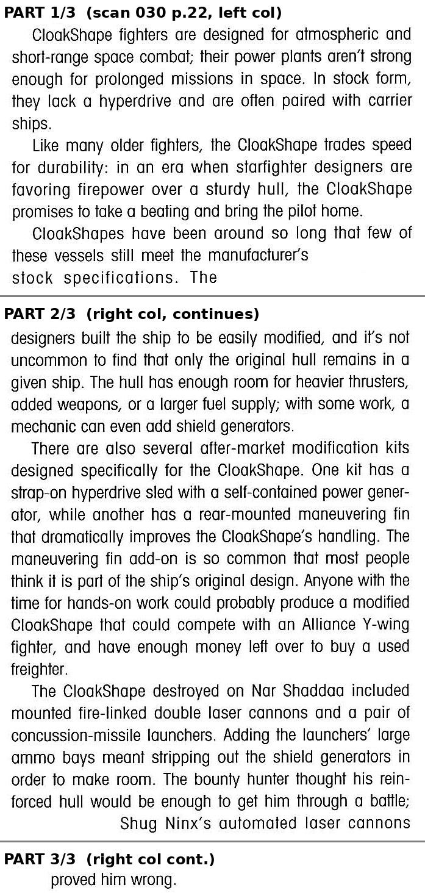

# Shug Ninx

- **Aliases:** Shug
- **Era:** NR (Dark Empire)
- **Continuity:** default Legends; entries present for: Canon, Legends
- **Research tier:** untiered (not listed as INTRO/DEEP/MASTERY in legends-feats.md)
- **Entries:** 17 (10 with quotations; 0 quotations extended to the full sentence/passage from the source text on file; 8 marked as fragments; 10 before the 2026-11-17 fragment fill). Rebuilt 2026-11-17 from 23 old entries; old file: `characters/_bak/shug-ninx.md.bak-20261117`.
- **How to read:** each entry is the quotation in full (block quote), then its source and point of view. "Note" lines are summaries from our notes, not quotations. `[fragment — full passage not on file]` means the source text is not on the box, so only the words in our notes are shown. Debate and forum material is in the last section and is unverified.

# LEGENDS (Legends / EU — main focus)

## Star Wars: Dark Empire (1991–92), Dark Empire II (1994–95), Empire's End (1995), single issues, hand-read

> "EVERY SECOND WE WASTE, LUKE FALLS DEEPER INTO DARKNESS!" (Leia)
> [fragment — full passage not on file]
— Source: Star Wars: Dark Empire #3 — "Book 3: The Battle for Calamari" (Apr 1992). POV: Leia, about Shug Ninx.
Context: p19–22: chase through the Corellian Sector. Shug Ninx's security turbolasers destroy the pursuing bounty hunter. p23–24: Salla Zend and the *Starlight Intruder*, a ship legal for Deep Core runs.
Our notes: `notes/materials/041-dark-empire/de1-03.md:69`

> "H-K DROID'S GOT SOME NEW KIND OF DEFLECTORS! THE FALCON'S MISSILES ARE BOUNCIN' OFF HIS SHIELDS LIKE PEBBLES!" (Shug Ninx)
> [fragment — full passage not on file]
— Source: Star Wars: Dark Empire #5 — "Book 5: Emperor Reborn" (Aug 1992). POV: Shug Ninx.
Context: — Star Wars: Dark Empire #5, p. 6
Our notes: `notes/materials/041-dark-empire/de1-05.md:16`

> CRAMMED INTO A CRAWLSPACE IN THE H-K'S INNARDS, SHUG NINX HAS TAKEN CONTROL OF ALL THE DROID'S CIRCUITS-- *(caption)*
> [fragment — full passage not on file]
>
> OKAY, SALLA! GOT IT HOT-WIRED!
— Source: Star Wars: Dark Empire #5 — "Book 5: Emperor Reborn" (Aug 1992). POV: Shug.
Label in our notes: > (caption) / / "FIRE ONE!" (Shug
Our notes: `notes/materials/041-dark-empire/de1-05.md:62`

- Note (summary from our notes, not a quotation): Shug hotwires the captured H-K and blasts Han and Chewie out of their cell (p17). He turns its weapons on the security patrol, then fights the tower guns until outgunned (p20).
  — Source: Star Wars: Dark Empire #5 — "Book 5: Emperor Reborn" (Aug 1992).
Our notes: `notes/materials/041-dark-empire/de1-05.md:74`

> "LIKE SOME KIND OF DEADLY GALACTIC CHICKEN-RACE, THE TWO POWERFUL STARSHIPS HOLD TO THEIR COLLISION COURSE!" (caption)
>
> "HANG ON--I'M TAKIN' HIM APART!" (Han)
> [fragment — full passage not on file]
— Source: Star Wars: Dark Empire II #2 (Jan 1995).
Context: Shug and Salla appear to have left: a droid says they "LEFT THE MOON FOR GOOD... GIVING UP THE... REBELLION AND MAKING SOME... MONEY." (p17).
Our notes: `notes/materials/041-dark-empire/de2-02.md:58`

> "THANKS TO YOU, ZASM AND FASS, TWO OF MY MOST VALUED DARK-SIDE WARRIORS, ARE NO MORE." (Emperor to Sedriss)
> [fragment — full passage not on file]
— Source: Star Wars: Dark Empire II #3 (Feb 1995).
Context: Salla and Shug get through the Byss gauntlet on a stolen docking code. The next ship in line, also using a stolen code, is destroyed (p6). They spot "SOMETHING BIG" being built in an orbiting dry dock, and Salla guesses "PROBABLY A WEAPON" (p6).
Our notes: `notes/materials/041-dark-empire/de2-03.md:15`

- Note (summary from our notes, not a quotation): Salla Zend, Shug Ninx and the smugglers (Lo Khan, Liz Bonbarrin, the Yaka Luwingo) break through checkpoints and fly in with illegal ion guns (p9–11). One ion burst drops a beast (p12).
  — Source: Star Wars: Dark Empire II #5 (Apr 1995).
Our notes: `notes/materials/041-dark-empire/de2-05.md:34`

- Note (summary from our notes, not a quotation): Chewbacca, Han, Lando, Salla, Shug: Tech and vehicle feats: the *Invincible* takedown (#2), the lightning gun (#5–6), smuggler rescues (#5 p9–13; #6 p22–23).
  — Source: Star Wars: Dark Empire II (#1–6, Dec 1994–May 1995): series summary and scaling notes.
Our notes: `notes/materials/041-dark-empire/de2-summary.md:82`

- Note (summary from our notes, not a quotation): Feat (R2-D2, slicing): he bypasses *Eclipse II*'s bridge, so the commandos get navcomputer and hyperdrive control (p24). He then sets a collision course to Byss coordinates supplied by Shug Ninx and Salla Zend (p26). This is the same trick as the World Devastators (p14, referring back to DE #6).
  — Source: Star Wars: Empire's End #2 (Nov 1995).
Our notes: `notes/materials/041-dark-empire/ee-02.md:217`

## Dark Empire Sourcebook (West End Games, 1993), hand-read

- Note (summary from our notes, not a quotation): Read 2026-11-03 CST, all text: Deppo, Sate Pestage, Imperial Dungeoneers (Ch. 2 end, pp. 40–42); Ch. 3 overview, Deep Core Haulers, Spice Trade, Mako Spince + expulsion-hearing transcript, Salla Zend, Shug Ninx, Lo Khan, Luwingo, Jak Sazz & Grivooga, Romort Raort, Bounty Hunters, Boba Fett + battle armor sidebar, "The Ordeal of Boba Fett", Dengar, Dyyz Nataz & Goa, Scavengers (Rivoche Tarkin report), Typical Scavenger, Nek battle dogs (pp. 43–60).
  — Source: Dark Empire Sourcebook — chunk 3: Chapter Two part B, Chapter Three "The Fringe" (printed pp. 39–60).
Our notes: `notes/materials/043-dark-empire-sourcebook/03-empire-reborn-b-and-fringe.md:3`

What it shows (our notes): Shug Ninx "acquired" a chute "as surplus from the second Death Star" for his spacebarn (p. 49); "space transports repair 11D+2" (p. 49).
> In time, things changed. Han and Lando headed for other areas of space. Shug made a small fortune working on ships. When Salla had her accident, she wanted a safe, stable place to work, and Shug gladly brought her aboard, eventually making her his business partner. Over the years, he could afford to be more 49 selective, working for wealthy crimelords and pirate princes and commanding the highest fees. This posed some security problems, but in characteristic fashion, he solved them all and then some. Even his closest friends couldn’t believe it when about five years ago he “acquired” the chute as surplus from the second Death Star. Moving it from Bonadan called in a lot of old debts, but once it was installed even the most incredulous had to admit it was a stroke of genius. He even turned a profit by renting out the space in front of the opening as a hologram billboard for a local fizzyglug brand. Now, Han’s back in town, bringing the Rebellion, bounty hunters and a whole lot of fighting with him, Shug hasn’t spent much time in space in recent years, and while he feels he’s a little old for this kind of action, it’s been nice to see his old buddy. Funny though, Shug feels this isn’t the last time he’s going to see Han.
>
> Funny though, Shug feels this isn’t the last time he’s going to see Han. Shug Ninx Type: Master Mechanic DEXTERITY 2D+1 Blaster 5D, brawling parry 4D+1, dodge 6D, melee combat 5D, melee parry 5D, vehicle blasters 6D+1 KNOWLEDGE 1D+1 Alien species 5D+2, bureaucracy 7D, cultures 6D, planetary systems 8D+1, streetwise 7D+1. survival 5D, value 7D MECHANICAL 3D+2 Astrogation 6D+2, repulsorlift operation 6D+1, space transports 7D+1, starship gunnery 7D, starship shields 6D+2 PERCEPTION 3D Bargain 7D, con 6D, gambling 5D+1, search 6D+2, sneak 6D STRENGTH 3D Brawling 5D. climbing/jumping 3D+2, stamina 4D TECHNICAL 4D+2 Capital ship repair 9D+2, capital ship weapon repair 7D+1, computer programming/repair 7D+2. droid programming 8D, droid repair 8D+2 repulsorlift repair 10D+1, space transports repair 11D+2. starfighter repair 10D+2. starship weapon repair 9D+2 Force Points: 1 Character Points: 14 Move: 10 Equipment: blaster pistol (4D damage), datapad, mechanic’s tools Lo Khan Han Solo and Lando Calrissian were barely out of training pants when Lo Khan made the biggest haul of his smuggling career on the Gamor Run. He heard that a rival, Uxbeg, had contracted to carry a load to some goon named Spadda.
— Source: Dark Empire Sourcebook — chunk 3: Chapter Two part B, Chapter Three "The Fringe" (printed pp. 39–60); Shug Ninx "acquired" a chute.
(Excerpt widened 2026-11-17 to the relevant passage, word for word from WEG40071 Star Wars Dark Empire Sourcebook pdf x.txt (text copy `MEGA_WEG40071_Star_Wars_Dark_Empire_Sourcebook_pdf_x`).)
(Excerpt widened 2026-11-17 to the relevant passage, word for word from WEG40071 Star Wars Dark Empire Sourcebook pdf x.txt (text copy `MEGA_WEG40071_Star_Wars_Dark_Empire_Sourcebook_pdf_x`).)
(Fragment completed 2026-11-17: full sentence/passage matched word for word in the source text on file: `MEGA_WEG40071_Star_Wars_Dark_Empire_Sourcebook_pdf_x`.)
Note text that was attached to the quote line: *(p. 49)*
Our notes: `notes/materials/043-dark-empire-sourcebook/03-empire-reborn-b-and-fringe.md:16`

## Star Wars Handbook 3: Dark Empire (Dark Horse, 1998) + Star Wars Insider #157–159 "The Making of Dark Empire" (Titan, 2015)

> The bounty on the Solos had quadrupled since the death of Jabba the Hutt.
— Source: Star Wars Handbook 3: Dark Empire (Dark Horse, 1998), notes part 1: pp. 000–026 (complete handbook).
Note (our notes, around the quote): "The bounty on the Solos had quadrupled since the death of Jabba the Hutt." Salla Zend and Shug Ninx appear; the *Starlight Intruder* hauled freight to Byss.
Context: p. 014: Nar Shaddaa (Nadeau and Ensign; Nestelle):
Our notes: `notes/materials/046-dark-empire-handbook-3/hb3-01.md:75`

- Note (summary from our notes, not a quotation): p. 019: Salla Zend / Shug Ninx (Duursema; Nestelle):
  — Source: Star Wars Handbook 3: Dark Empire (Dark Horse, 1998), notes part 1: pp. 000–026 (complete handbook).
Our notes: `notes/materials/046-dark-empire-handbook-3/hb3-01.md:98`

> the Hutts, who had quadrupled the bounties
> [fragment — full passage not on file]
— Source: Star Wars Handbook 3: Dark Empire (Dark Horse, 1998), notes part 1: pp. 000–026 (complete handbook).
Note (our notes, around the quote): "the Hutts, who had quadrupled the bounties". The *Starlight Intruder* made the "deep-core run" to Byss, and the *Falcon* was hidden in Lo Khan's *Hyperspace Marauder*.
Context: p. 019: Salla Zend / Shug Ninx (Duursema; Nestelle):
Our notes: `notes/materials/046-dark-empire-handbook-3/hb3-01.md:99`

> Shug burrowed into the control computer and took control of the massive droid
> [fragment — full passage not on file]
>
> to punch through the prison walls
> [fragment — full passage not on file]
— Source: Star Wars Handbook 3: Dark Empire (Dark Horse, 1998), notes part 1: pp. 000–026 (complete handbook).
Note (our notes, around the quote): An Imperial hunter-killer droid tractor-beamed the *Falcon*. "Shug burrowed into the control computer and took control of the massive droid", using it "to punch through the prison walls"; it then turned on security forces.
Context: p. 019: Salla Zend / Shug Ninx (Duursema; Nestelle):
Our notes: `notes/materials/046-dark-empire-handbook-3/hb3-01.md:100`

## Essential Guide to Vehicles and Vessels (1996)

- Note (summary from our notes, not a quotation): The CloakShape destroyed on Nar Shaddaa included mounted fire-linked double laser cannons and a pair of concussion-missile launchers. Adding the launchers' large ammo bays meant stripping out the shield generators in order to make room. The bounty hunter thought his reinforced hull would be enough to get him through a battle; Shug Ninx's automated laser cannons proved him wrong.
  — Source: The Essential Guide to Vehicles and Vessels (Bill Smith, Del Rey, 1996), printed p.22, scan p.030. The bounty hunter is not named. Han Solo and the Millennium Falcon are not in this crop..
Our notes: `notes/materials/148-essential-guide-to-vehicles-vessels-1996/egvv-chariot-through-enforcer.md`

# CANON (Disney canon — kept separate)

## Star Wars: Dark Empire (1991–92), Dark Empire II (1994–95), Empire's End (1995), single issues, hand-read

> As Lando Calrissian's Viper Automadon war droids attack the Emperor's citadel on Byss, they are met by an army of monstrous creatures bent on destruction.
>
> The war droids are no match for the Emperor's dark-side monsters, and soon the Rebels are pinned down amidst the ruins of their attack.
>
> But Salla Zend and Shug Ninx pull together a group of smugglers to come to the aid of the Rebels. Manning fast-armed freighters, the spacers hold the dark-side beasts at bay long enough for Lando's crew to scramble aboard.
— Source: Star Wars: Dark Empire II #6 (May 1995).
Our notes: `notes/materials/041-dark-empire/de2-06.md:9`

# Debate and forum claims (unverified)

Forum posts, Suspect Insight debates and Discord debates, respect threads, and verdicts. These are posters' arguments or quotations they typed; none is checked against the book here unless the entry says so.

_None in our notes._
