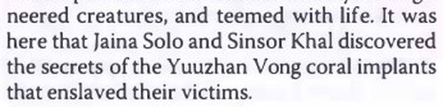

# Sinsor Khal

- **Aliases:** —
- **Era:** NJO
- **Continuity:** default Legends; entries present for: Legends
- **Research tier:** untiered (not listed as INTRO/DEEP/MASTERY in legends-feats.md)
- **Entries:** 4 (1 with quotations; 0 quotations extended to the full sentence/passage from the source text on file; 0 marked as fragments). Rebuilt 2026-11-17 from 2 old entries; old file: `characters/_bak/sinsor-khal.md.bak-20261117`.
- **How to read:** each entry is the quotation in full (block quote), then its source and point of view. "Note" lines are summaries from our notes, not quotations. `[fragment — full passage not on file]` means the source text is not on the box, so only the words in our notes are shown. Debate and forum material is in the last section and is unverified.

# LEGENDS (Legends / EU — main focus)

## The Complete Star Wars Encyclopedia, Vol. I (A–G)

> It was here that Jaina Solo and Sinsor Khal discovered the secrets of the Yuuzhan Vong coral implants that enslaved their victims.
— Source: scan pages 321–360; Jaina Solo. POV: Jaina Solo, about Sinsor Khal.
Note (our notes, around the quote): Jaina Solo: "It was here that Jaina Solo and Sinsor Khal discovered the secrets of the Yuuzhan Vong coral implants that enslaved their victims." Source: The Complete Star Wars Encyclopedia, Vol. I, p.316

Our notes: `notes/materials/030-complete-star-wars-encyclopedia-vol-1/08-v1-scan-321-360.md:78`

## Star Wars Gamer/Star Wars Gamer 08.pdf [Star Wars Roleplaying Game (d20, 2000)] (scan pages 1–60)

- Note (summary from our notes, not a quotation): Page contents: The Apprentice: Jaina says if she wanted to sing ballads she'd travel with Tionne; Sinsor Khal, a small bearded scientist in a blood-hiding red lab coat, calls Jaina Ta'a Chume's young protege and is strangely closed in the Force (hand-read)
  — Source: Star Wars Gamer/Star Wars Gamer 08.pdf [Star Wars Roleplaying Game (d20,.
Our notes: `notes/materials/037-sw-d20-folder/057-star-wars-gamer-08-scan-001-060.md:167`

# Debate and forum claims (unverified)

Forum posts, Suspect Insight debates and Discord debates, respect threads, and verdicts. These are posters' arguments or quotations they typed; none is checked against the book here unless the entry says so.

_None in our notes._

# NJO FULL re-read additions (2026-11-17)
Verbatim excerpts from the full consecutive re-read of the New Jedi Order novels (Dark Journey through The Unifying Force), each shown with the text around it and its source chapter.

## *The Apprentice*
Sinsor Khal radiates Force-like mental power at Jaina.

> JainaandKyp worked together to shift the big man onto the table. As she straightened, hands to the small of her aching back,Jaina felt a flash of mentalpower, a force of mind weirdly similar to that of a Jedi. She whirled towardit and stared directly intoSinsorKhal’s face. The scientist was lookingat her, really looking, with an intensity that suggested he saw thingsmost people could never fathom.

— Source: *The Apprentice* (Elaine Cunningham, 2002), The Apprentice (AP).

Sinsor Khal levitates a surgical tool into his hand.

> An odd smile slipped ontoSinsorKhal’s face. He held his hand out, palm up.
>
> A small, sharp tool rose from the tray and settled down into his grasp with practicedease.Jaina’s jaw fell, but the scientist hardly seemed to notice hisown feat.

— Source: *The Apprentice* (Elaine Cunningham, 2002), The Apprentice (AP).

