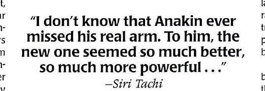

# Siri Tachi

- **Aliases:** —
- **Era:** —
- **Continuity:** default Legends; entries present for: Canon, Legends
- **Research tier:** untiered (not listed as INTRO/DEEP/MASTERY in legends-feats.md)
- **Entries:** 9 (5 with quotations; 0 quotations extended to the full sentence/passage from the source text on file; 10 marked as fragments). Rebuilt 2026-11-17 from 9 old entries; old file: `characters/_bak/siri-tachi.md.bak-20261117`.
- **How to read:** each entry is the quotation in full (block quote), then its source and point of view. "Note" lines are summaries from our notes, not quotations. `[fragment — full passage not on file]` means the source text is not on the box, so only the words in our notes are shown. Debate and forum material is in the last section and is unverified.

# LEGENDS (Legends / EU — main focus)

## Sourcebooks/The Clone Wars Campaign Guide.pdf [Star Wars Roleplaying Game Saga Edition (2007)] (scan pages 181–225)

> A Sabaoth destroyer launches a squadron of Sabaoth starfighters. *(hand-read)*
— Source: Sourcebooks/The Clone Wars Campaign Guide.pdf [Star Wars Roleplaying Game.
Note (our notes, around the quote): Page contents: Raddaugh Gnasp Fluttercraft stat block (CL 4). Sabaoth Destroyer (Sabaoth Squadron recruited by Dooku; Nym destroys several, including Cavik Toth's flagship the Reaver; CL 12). Sabaoth Starfighter begins (first seen at Geonosis vs. Adi Gallia and Siri Tachi). Caption (OCR approx.): "A Sabaoth destroyer launches a squadron of Sabaoth starfighters." (hand-read)
Our notes: `notes/materials/037-sw-d20-folder/728-the-clone-wars-campaign-guide-scan-181-225.md:349`

> They are first seen launching from Sabaoth destroyers in battic over Geonosis, where they meet the Jedi starfighters of Adi Gallia and Siri Tachi.
— Source: Sourcebooks/The Clone Wars Campaign Guide.pdf [Star Wars Roleplaying Game; Adi Gallia. POV: Adi Gallia, about Siri Tachi.
Note (our notes, around the quote): Adi Gallia: "They are first seen launching from Sabaoth destroyers in battic over Geonosis, where they meet the Jedi starfighters of Adi Gallia and Siri Tachi." Source: *The Clone Wars Campaign Guide* (SWRPG Saga Edition), scan p.221

Our notes: `notes/materials/037-sw-d20-folder/728-the-clone-wars-campaign-guide-scan-181-225.md:351`

## Star Wars Insider #88 (2006)

- Note (summary from our notes, not a quotation): Page contents: Ghosts of the Sith: Siri Tachi's apprentice, Trever Flume, Dreshdae landing (hand-read)
  — Source: Star Wars Insider #88 (2006).
Our notes: `notes/materials/038-star-wars-insider/088-ins088.md:350`

## Star Wars Insider #121 (2010)

- Note (summary from our notes, not a quotation): Page contents: Books: The Clone Wars: Defenders of the Republic junior novel (Rob Valois; "Clone Cadets", "ARC Troopers"); Ask Lobot question on Siri Tachi vs. Duchess Satine (reader name omitted). (hand-read)
  — Source: Star Wars Insider #121 (2010).
Our notes: `notes/materials/038-star-wars-insider/121-ins121.md:322`

## Star Wars Insider #137 (2012)

- Note (summary from our notes, not a quotation): Page contents: Hidalgo: the original trilogy era is under-represented in prose; continuity callouts; his sidebar on how Darth Bane re-established the Sith Order; his first Star Wars books (Han Solo at Stars' End, the Foster novelization). Caption (crop-verified): Obi-Wan, Anakin, and Siri Tachi battle seeker droids swarming the Senate chambers (Trevas). (hand-read)
  — Source: Star Wars Insider #137 (2012).
Our notes: `notes/materials/038-star-wars-insider/137-ins137.md:254`

## Star Wars Visual Dictionaries, Episodes I–VI (DK, 1998–2005) + The Phantom Menace Expanded Visual Dictionary (DK, 2012)

> the consummate master of Jedi mind tricks. He uses Force suggestions to bring conflicts to an abrupt end, turning combatants' own fears against themselves.
> [fragment — full passage not on file]
>
> Saber Master: Ki-Adi-Mundi is a master of the fast-paced Ataru form ... Watchman of the Semagi sector
> [fragment — full passage not on file]
>
> Unorthodox Jedi: Adi Gallia sometimes uses her specialized lightsaber to perform the combat style Shien (Form V). The form employs a reverse grip
> [fragment — full passage not on file]
— Source: Star Wars: The Phantom Menace — The Expanded Visual Dictionary (DK, 2012): hand-read notes (new and revised material only); p15 [NEW] Yarael Poof [KEY].
Note (our notes, around the quote): p15 [NEW] Yarael Poof [KEY]: "the consummate master of Jedi mind tricks. He uses Force suggestions to bring conflicts to an abrupt end, turning combatants' own fears against themselves." Ki-Adi-Mundi (binary brain; "Saber Master: Ki-Adi-Mundi is a master of the fast-paced Ataru form ... Watchman of the Semagi sector"). Adi Gallia (Valorum's intelligence source; teamed with Qui-Gon alongside Padawans Siri Tachi and Obi-Wan; "Unorthodox Jedi: Adi Gallia sometimes uses her specialized lightsaber to perform the combat style Shien (Form V). The form employs a reverse grip"). DATA FILE: Chamber floor motifs; council reflects hundreds of species.
Our notes: `notes/materials/047-visual-dictionaries/vd1x-expanded.md:19`

> persuades himself that his willful former Padawan was forced to act in self-defense
> [fragment — full passage not on file]
>
> that anything which is possible must be allowed.
> [fragment — full passage not on file]
>
> Though a master of the Jedi lightsaber style known as Ataru, in which deflection is prized above aggression, Obi-Wan's true style is Soresu, which encourages a practitioner to place himself at the eye of the storm. Soresu is well served by Obi-Wan's innate capacity for patience and perception, but the key to mastery is audacity, a talent he has learned from Anakin. *(note: book's Ataru/deflection wording as printed)*
>
> can all but read each other's minds
> [fragment — full passage not on file]
>
> helped mold his Master into the great Jedi Qui-Gon always thought Obi-Wan might be.
> [fragment — full passage not on file]
>
> Niman stance, with blade cocked high
> [fragment — full passage not on file]
>
> 19 years of self-exile on Tatooine
> [fragment — full passage not on file]
>
> Jedi Siri Tachi, who died saving Padmé
> [fragment — full passage not on file]
— Source: Star Wars Revenge of the Sith: The Visual Dictionary (DK, 2005): hand-read notes.
Note (our notes, around the quote): p12 Jedi Knight (Obi-Wan) [KEY]: "Rescue not mayhem"; knocked unconscious, does not witness Dooku's death; "persuades himself that his willful former Padawan was forced to act in self-defense"; suspects Palpatine convinced Anakin "that anything which is possible must be allowed." Swordmaster: "Though a master of the Jedi lightsaber style known as Ataru, in which deflection is prized above aggression, Obi-Wan's true style is Soresu, which encourages a practitioner to place himself at the eye of the storm. Soresu is well served by Obi-Wan's innate capacity for patience and perception, but the key to mastery is audacity, a talent he has learned from Anakin." (note: book's Ataru/deflection wording as printed). Obi-Wan and Anakin "can all but read each other's minds"; Anakin "helped mold his Master into the great Jedi Qui-Gon always thought Obi-Wan might be." Niman stance callout ("Niman stance, with blade cocked high"). Lightsaber kept during "19 years of self-exile on Tatooine". DATA FILE: relationship with "Jedi Siri Tachi, who died saving Padmé"; mystified by Anakin's attachment to R2-D2.
Our notes: `notes/materials/047-visual-dictionaries/vd3-ep3.md:18`

## The New Essential Guide to Weapons and Technology (2004)

> I don't know that Anakin ever missed his real arm. To him, the new one seemed so much better, so much more powerful . . .
— Source: The New Essential Guide to Weapons and Technology (W. Haden Blackman, Del Rey, 2004), printed p.183, scan p.209. The ellipsis is spaced, as printed..
Note (our notes, around the quote): "I don't know that Anakin ever missed his real arm. To him, the new one seemed so much better, so much more powerful . . ." —Siri Tachi.
Our notes: `notes/materials/155-new-essential-guide-to-weapons-technology-2004/quotes/QUOTES-INDEX.md`

# CANON (Disney canon — kept separate)

## Star Wars Insider #130 (2012)

- Note (summary from our notes, not a quotation): Page contents: Feature (Fry): Luke succeeds by rejecting Yoda's and Obi-Wan's teachings and embracing love and family. EU box: Obi-Wan and Duchess Satine in TCW; Jude Watson's Qui-Gon/Tahl and Obi-Wan/Siri Tachi; Karen Traviss's rogue Jedi Djinn Altis; Stover's ROTS novelization on the Masters-only lore Anakin hoped would save Padmé. (hand-read)
  — Source: Star Wars Insider #130 (2012).
Our notes: `notes/materials/038-star-wars-insider/130-ins130.md:243`

# Debate and forum claims (unverified)

Forum posts, Suspect Insight debates and Discord debates, respect threads, and verdicts. These are posters' arguments or quotations they typed; none is checked against the book here unless the entry says so.

_None in our notes._
