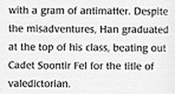
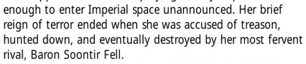
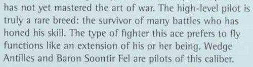
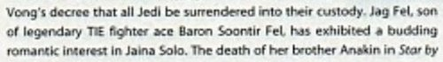
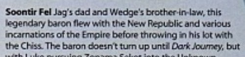

# Soontir Fel

- **Aliases:** Baron Fel
- **Era:** GCW–NR
- **Continuity:** default Legends; entries present for: Legends
- **Research tier:** untiered (not listed as INTRO/DEEP/MASTERY in legends-feats.md)
- **Entries:** 26 (10 with quotations; 2 quotations extended to the full sentence/passage from the source text on file; 11 marked as fragments; 12 before the 2026-11-17 fragment fill). Rebuilt 2026-11-17 from 23 old entries; old file: `characters/_bak/soontir-fel.md.bak-20261117`.
- **How to read:** each entry is the quotation in full (block quote), then its source and point of view. "Note" lines are summaries from our notes, not quotations. `[fragment — full passage not on file]` means the source text is not on the box, so only the words in our notes are shown. Debate and forum material is in the last section and is unverified.

# LEGENDS (Legends / EU — main focus)

## Star Wars: The New Essential Chronology (Del Rey, 2005): power-scaling and lore notes

> He suffered a dev- astating blow when a suspicious Imperial Bank manager placed a freeze on his account~and anoth: er when Bria Tharen left him.
>
> Bankrupt and despairing, Han scraped together his last few credits to obtain a forged set of ID papers and have his retinas surgically altered. Since the Besadll dan was looking for him under an alias, he used his true identity on an application to the Imperial Academy. His final night before enroliment was spoiled by an ugly fig: ure from the past—Garris Shrike, who had been tured by :
>
> :
>
> === PDF p.102 === Vyyk Drago was dead, Free and clear for the first time in his life, Cadet Solo boarded a troop transport for Carida, the most respected military academy in the Empire. Over the next four years, Han proved to be extremely talented, but not a model Imperial student, During one infamous ex- ercise, he landed a malfunctioning U-33 orbital loadlifter with suicidal flair, earning himself the nickname “Slick” from Lleutenant Badure, his piloting instructor. In another Inci- dent, Han’s classmate Mako Spince destroyed Carida’s mascot moon with a gram of antimatter, Despite the misadventures, Han graduated at the top of his class, beating out Cadet Soontir Fel for the title of valedictorian, Graduation was followed by elght months of commissioned service In the Imperial Navy.
>
> :
>
> === PDF p.102 === Vyyk Drago was dead, Free and clear for the first time in his life, Cadet Solo boarded a troop transport for Carida, the most respected military academy in the Empire. Over the next four years, Han proved to be extremely talented, but not a model Imperial student, During one infamous ex- ercise, he landed a malfunctioning U-33 orbital loadlifter with suicidal flair, earning himself the nickname “Slick” from Lleutenant Badure, his piloting instructor. In another Inci- dent, Han’s classmate Mako Spince destroyed Carida’s mascot moon with a gram of antimatter, Despite the misadventures, Han graduated at the top of his class, beating out Cadet Soontir Fel for the title of valedictorian, Graduation was followed by elght months of commissioned service In the Imperial Navy. A promising career in the Corellian sector fleet was cut short when Han rescued 4 Wooklee slave from ill treatment at the hands of a superior Officer, This earned him a dishonor- able discharge, which prevented Chewhscca [Aer oy Mare Cmanecich Han from obtaining any civilian piloting job. However, the Wook- the Hutt bounty.
— Source: Part Four: Profiles in History; Han Solo — top of his class.
(Excerpt widened 2026-11-17 to the relevant passage, word for word from research primary new essential chronology nec paged (text copy `research_primary_new_essential_chronology_nec_paged_txt_88b808b5bc`).)
(Excerpt widened 2026-11-17 to the relevant passage, word for word from research primary new essential chronology nec paged (text copy `research_primary_new_essential_chronology_nec_paged_txt_88b808b5bc`).)
Note (our notes, around the quote): Han Solo — top of his class: "Despite the misadventures, Han graduated at the top of his class, beating out Cadet Soontir Fel for the title of valedictorian." Source: The New Essential Chronology, p.92

Our notes: `notes/materials/027-new-essential-chronology/04-part-four-profiles-in-history.md:29`

## Sourcebooks/Sourcebook Web Enhancements/More Starships!.pdf [Star Wars Roleplaying Game (d20, 2000)]

> With wealth, influence, and the ability to call in favors, she could afford a rather expensive “hobby”: training as a starfighter pilot. After the Battle of Endor, and the death of many of the Empire’s most skilled pilots, she relinquished her role as a politician to become an Imperial pilot, eventually requisitioning and modifying her own personalized starfighter. For over a year, she personally led a wing of four TIE defenders patrolling the Coreward boundaries of the Remnant. By completing a dozen successful patrols—and scoring a respectable number of kills—Countess Ryad gained command of Red Star Squadron, a small unit of TIE pilots who supported her idea of preying on any ship foolish enough to enter Imperial space unannounced. Her brief reign of terror ended when she was accused of treason, hunted down, and eventually destroyed by her most fervent rival, Baron Soontir Fell. Countess Ryad’s personally modified ship, the Red Star 1, flaunted conventional ideas almost as much as she did. While most tacticians believe that TIEs should attack in large waves, Ryad’s ship is more defensive, relying on an enhanced shield generator and a vastly improved ion engine for maximum maneuverability. Her finely-tuned fire control systems allow her the capability to take out multiple poorly shielded ships.
— Source: Sourcebooks/Sourcebook Web Enhancements/More Starships!.pdf [Star Wars Ro; Soontir Fel — entry/section: Fel destroys Countess Ryad.
(Excerpt widened 2026-11-17 to the relevant passage, word for word from h primary sw d20 folder files Star Wars Roleplaying Game Core Sourcebooks Sourcebook Web Enhancements More Starships (text copy `h_primary_sw_d20_folder_files_Star_Wars_Roleplaying_Game_Core_Sourcebooks_Sourcebook_Web_Enhancements_More_Starships_pdf_ede114502d`).)
(Excerpt widened 2026-11-17 to the relevant passage, word for word from h primary sw d20 folder files Star Wars Roleplaying Game Core Sourcebooks Sourcebook Web Enhancements More Starships (text copy `h_primary_sw_d20_folder_files_Star_Wars_Roleplaying_Game_Core_Sourcebooks_Sourcebook_Web_Enhancements_More_Starships_pdf_ede114502d`).)
Note (our notes, around the quote): Soontir Fel — entry/section: Fel destroys Countess Ryad: "Her brief reign of terror ended when she was accused of treason, hunted down, and eventually destroyed by her most fervent rival, Baron Soontir Fell." Source: *More Starships!* (SWRPG d20), scan p.2

Our notes: `notes/materials/037-sw-d20-folder/040-more-starships.md:17`

## Sourcebooks/Rebellion Era Sourcebook.pdf [Star Wars Roleplaying Game (d20, 2000)] (scan pages 1–60)

- Note (summary from our notes, not a quotation): Page contents: TIE pilot corps 'the true elite of the Empire's military'; training nearly twice as long as other Imperial pilots; most Death Star gunnery chiefs were TIE-program washouts; Soontir Fel named among notable TIE aces; typical TIE pilot Soldier 2, Pilot +10 (hand-read)
  — Source: Sourcebooks/Rebellion Era Sourcebook.pdf [Star Wars Roleplaying Game (d20.
Our notes: `notes/materials/037-sw-d20-folder/043-rebellion-era-sourcebook-scan-001-060.md:320`

## Sourcebooks/Star Wars Roleplaying Game Core Rulebook.pdf [Star Wars Roleplaying Game (d20, 2000)] (scan pages 241–300)

> must be remarkable specimens indeed; the 12th-level Jedi Guardian is best for this. In The New Jedi Order, few Jedi have trained well enough to surpass 8th level, whereas in the Old Republic, the Golden Age of the Jedi Order, Jedi of all levels exist.
> [fragment — full passage not on file]
— Source: Sourcebooks/Star Wars Roleplaying Game Core Rulebook.pdf [Star Wars Rolep; Page contents: Generic Jedi guidance: Rebellion-era surviving Jedi.
Note (our notes, around the quote): Page contents: Generic Jedi guidance: Rebellion-era surviving Jedi "must be remarkable specimens indeed; the 12th-level Jedi Guardian is best for this. In The New Jedi Order, few Jedi have trained well enough to surpass 8th level, whereas in the Old Republic, the Golden Age of the Jedi Order, Jedi of all levels exist." Expert ace tier (Soldier 6/Starfighter Ace 6, Pilot +22) = Wedge Antilles, Soontir Fel (p267) (hand-read)
Our notes: `notes/materials/037-sw-d20-folder/046-star-wars-roleplaying-game-core-rulebook-scan-241-300.md:198`

## Star Wars Gamer/Star Wars Gamer 07.pdf [Star Wars Roleplaying Game (d20, 2000)] (scan pages 1–60)

- Note (summary from our notes, not a quotation): Page contents: Red Sky, Blue Flame: cadet commander Shawnkyr Nuruodo takes command after Stent dies; Jag reveals Thrawn engineered his own exile to accept Imperial recruitment, and that Voss Parck staged Soontir Fel's disappearance; Baron Fel once mistook Jag for Wedge; Jag's blue piping marks him as never Chiss; Jag plans to lure the pirates down by flying badly (hand-read)
  — Source: Star Wars Gamer/Star Wars Gamer 07.pdf [Star Wars Roleplaying Game (d20,.
Our notes: `notes/materials/037-sw-d20-folder/056-star-wars-gamer-07-scan-001-060.md:79`

## Sourcebooks/Revised Core Rulebook.pdf [Star Wars Roleplaying Game Revised Core (d20, 2002)] (scan pages 301–360)

> The high-level pilot is truly a rare breed: the survivor of many battles who has honed his skill. The type of fighter this ace prefers to fly functions like an extension of his or her being. Wedge Antilles and Baron Soontir Fel are pilots of this caliber.
— Source: Sourcebooks/Revised Core Rulebook.pdf [Star Wars Roleplaying Game Revised.
Note (our notes, around the quote): Wedge Antilles; Soontir Fel — entry/section: Starfighter pilot archetype (Revised Core Rulebook, Ch14): "The high-level pilot is truly a rare breed: the survivor of many battles who has honed his skill. The type of fighter this ace prefers to fly functions like an extension of his or her being. Wedge Antilles and Baron Soontir Fel are pilots of this caliber." Source: *Revised Core Rulebook* (SWRPG d20 Revised Core), scan p.355

Our notes: `notes/materials/037-sw-d20-folder/671-revised-core-rulebook-scan-301-360.md:442`

## Sourcebooks/Rebellion Era Campaign Guide.pdf [Star Wars Roleplaying Game Saga Edition (2007)] (scan pages 61–120)

- Note (summary from our notes, not a quotation): Page contents: Tycho Celchu (trained under Soontir Fel; defects after Alderaan; Rogue Squadron at Hoth; A-wing at Endor; later marries Winter) and Tycho Celchu (Episode VI) stat block (CL 8). General Airen Cracken (master mechanic of Contruum; forces the Imperial occupation to withdraw; "Cracken's Crew Says Hello" hydrospanner). Art "General Airen Cracken." (hand-read)
  — Source: Sourcebooks/Rebellion Era Campaign Guide.pdf [Star Wars Roleplaying Game.
Our notes: `notes/materials/037-sw-d20-folder/722-rebellion-era-campaign-guide-scan-061-120.md:282`

## Web Articles.pdf [Star Wars Roleplaying Game Saga Edition (2007)] (scan pages 61–120)

> Battle Meditation fits this description, but its definition in the Champions of the Force rules insert specifically notes that it stacks with any effect that improves combined fire. Thus, commander effects provided by Battle Meditation and Control Minds do stack. Baron Fel's commander effect is not the same as the Control Minds commander effect. Instead of adding +X Attack to a character combining fire, it actually changes the combined fire mechanic for all followers within 6 squares, providing a bonus of +6 instead of +4. Thus, in the strictest sense, it doesn't grant a bonus -- it changes how the rule works. Thus, Control Minds stacks with Baron Fel's commander effect. Still, even though these two commander effects stack with the Control Minds commander effect, others that fit the "+X Attack when combining fire" pattern do not stack. 81 Q: The commander effect for Princess Leia, Hoth Commander says, "Whenever a non-Unique ally would be defeated, with a save of 16, it instead immediately returns to play with full Hit Points." I have a few questions about this wording. First, if an opponent defeats one of Leia's non-Unique allies, and the ally makes the save, does the opponent still score points for defeating that character? A: No.
— Source: Web Articles.pdf [Star Wars Roleplaying Game Saga Edition (2007)] (scan p.
(Excerpt widened 2026-11-17 to the relevant passage, word for word from research primary sw d20 folder files Star Wars Roleplaying Game Saga Edition Web Articles (text copy `research_primary_sw_d20_folder_files_Star_Wars_Roleplaying_Game_Saga_Edition_Web_Articles_pdf_6187a774ab`).)
(Excerpt widened 2026-11-17 to the relevant passage, word for word from research primary sw d20 folder files Star Wars Roleplaying Game Saga Edition Web Articles (text copy `research_primary_sw_d20_folder_files_Star_Wars_Roleplaying_Game_Saga_Edition_Web_Articles_pdf_6187a774ab`).)
(Full sentence/passage taken from the source text on file: `research_primary_sw_d20_folder_files_Star_Wars_Roleplaying_Game_Saga_Edition_Web_Articles_pdf`.)
Note (our notes, around the quote): Page contents: Jedi Counseling 104 cont.: Saga Edition is not a ploy to sell miniatures; rules can be abstracted; squares used because most use grids, avoids redundant units, convert as preferred; Minis: Komari Vosa's Control Minds (+2 Attack to combined fire) stacks with Bastila Shan's Battle Meditation (explicitly stacks) and Baron Fel's commander effect (changes combined fire to +6) but not other "+X Attack when combining fire" effects. (hand-read)
Our notes: `notes/materials/037-sw-d20-folder/732-web-articles-scan-061-120.md:145`

## Star Wars Insider #34 (1997)

- Note (summary from our notes, not a quotation): Page contents: Peet Janes "Straight from the Horse's Mouth: X-Wing Rogue Squadron" (pp76-78, printed 72-74): Lucy Autrey Wilson, Ryder Windham and Michael A. Stackpole on the comic; story-arc sidebar (The Rebel Opposition, The Phantom Affair, Battleground: Tatooine, The Warrior Princess, Requiem for a Rogue, In the Empire's Service, The Making of Baron Fel). T lines for Wedge, Loka Hask, Leonia Tavira, Baron Fel. (hand-read)
  — Source: Star Wars Insider #34 (1997).
Our notes: `notes/materials/038-star-wars-insider/034-ins034.md:407`

- Note (summary from our notes, not a quotation): Page contents: 585 words, 16 paragraphs | headings/entries: AND COMING UP; The Making of Baron Fel
  — Source: Star Wars Insider #34 (1997).
Our notes: `notes/materials/038-star-wars-insider/034-ins034.md:422`

## Star Wars Insider #57 (2001)

> Jag Fel, son of legendary TIE fighter ace Baron Soontir Fel, has exhibited a budding romantic interest in Jaina Solo.
— Source: Star Wars Insider #57 (2001); Jaina Solo — entry/section: Jaina Solo.
Note (our notes, around the quote): Jaina Solo — entry/section: Jaina Solo: "Jag Fel, son of legendary TIE fighter ace Baron Soontir Fel, has exhibited a budding romantic interest in Jaina Solo." Source: *Star Wars Insider #57* (2001), scan p.47

Our notes: `notes/materials/038-star-wars-insider/057-ins057.md:352`

## Star Wars Insider #59 (2002)

- Note (summary from our notes, not a quotation): Page contents: Who's Who cont. (magazine p. 56), "Rogue Squadron: The Early Years" with line portraits: Feylis Ardele (Commenor Militia TIE pilot, involved with Avan Beruss), Tycho Celchu, Ibtisam (Mon Calamari, killed over Ciutric), Plourr Ilo (secretly Eiattu royal heir), Elscol Loro (Cilpar Resistance, later organized Thyferra's Ashern), Baron Soontir Fel, Dllr Nep (Sullustan, Malrev incident, died with Herian I'ngre), Xarrce Huwla (Tunroth from Saloch), Nrin Vakil (Quarren, snoopscoot pilot, later trainer). (hand-read)
  — Source: Star Wars Insider #59 (2002).
Our notes: `notes/materials/038-star-wars-insider/059-ins059.md:403`

## Star Wars Insider #74 (2004)

> Soontir Fel Jag’s dad and Wedge's brother-in-law, this legendary baron flew with the New Republic and various incarnations of the Empire before throwing im his lot with the Chiss.
— Source: Star Wars Insider #74 (2004).
Note (our notes, around the quote): Soontir Fel; Wedge Antilles — entry/section: Star Wars Insider 074 (2004): "Soontir Fel Jag’s dad and Wedge's brother-in-law, this legendary baron flew with the New Republic and various incarnations of the Empire before throwing im his lot with the Chiss." Source: *Star Wars Insider #74* (2004), scan p.28

Our notes: `notes/materials/038-star-wars-insider/074-ins074.md:183`

## Star Wars Insider #140 (2013)

- Note (summary from our notes, not a quotation): Page contents: Fantasy Flight X-Wing Miniatures expansions: Slave I ($29.95), A-wing ($14.95), TIE Interceptor with Baron Soontir Fel ($14.95); March/April 2013 (product copy, not used as feats). (hand-read)
  — Source: Star Wars Insider #140 (2013).
Our notes: `notes/materials/038-star-wars-insider/140-ins140.md:435`

## Star Wars Insider Special Edition (2010)

- Note (summary from our notes, not a quotation): Page contents: Han Solo: The Early Years: Shrike's gang, Dewlanna, Dengar swoop rivalry, Vykk Draygo, Imperial Academy and Chewbacca rescue, Boba Fett on Nar Shaddaa, Battle of Nar Shaddaa vs. Soontir Fel, winning the Falcon; profile box. (hand-read)
  — Source: Star Wars Insider Special Edition (2010).
Our notes: `notes/materials/038-star-wars-insider/157-insspecial2010.md:105`

## The Thrawn Trilogy (Timothy Zahn): Heir to the Empire, Dark Force Rising, The Last Command, plus the Heir 20th Anniversary extras

> consist of humans and nonhumans … Including a number of your own people
> [fragment — full passage not on file]
— Source: Heir 20th Anniversary: "CRISIS OF FAITH", an original Star Wars novella by Timothy Zahn (bm1).
Note (our notes, around the quote): Empire of the Hand forces: ISD *Admonitor* under Senior Captain Voss Parck. Baron Soontir Fel commands the TIE squadrons ("Gray Squadron"). Stormtrooper Commander Balkin and the 501st ("consist of humans and nonhumans … Including a number of your own people"). General Tasse. Line Lt. Dramos Sanjin. Stromma stormtrooper Lhagva. The Chiss pilot Stent.
Our notes: `notes/materials/044-thrawn-trilogy/heir20-02.md:8`

## Star Wars: The Ultimate Visual Guide (Ryder Windham, DK 2005)

> Human males—especially those prejudiced to aliens—are recruited from Military Academies to command the clone troops; those who refuse to voluntarily enlist are either drafted to serve alongside the clones as footsoldiers or eliminated.
>
> throw all of his resouces
> [fragment — full passage not on file]
>
> fed propaganda to believe that all alien species are inferior beings
> [fragment — full passage not on file]
>
> a high-gravity world
> [fragment — full passage not on file]
>
> rivaled a fellow Corellian, Cadet Han Solo, in the flight simulators ... disgraced by the mutiny of two of his graduates, Derek 'Hobbie' Klivian and Biggs Darklighter ... 181st Imperial Fighter Wing ... Baron of the Empire.
> [fragment — full passage not on file]
>
> reduce an entire civilization to molten slag
> [fragment — full passage not on file]
>
> cannot be bribed, seduced, or blackmailed into betraying the Emperor.
> [fragment — full passage not on file]
>
> over 15-meters (49 feet) high
> [fragment — full passage not on file]
>
> up to 500 kph (311 mph)
> [fragment — full passage not on file]
>
> committed to accomplishing their missions, even if it requires self-sacrifice.
> [fragment — full passage not on file]
— Source: Star Wars: The Ultimate Visual Guide (DK, 2005): The Clone Wars and The Dark Times (pp. 50–71), hand-read notes; p66-67 Imperial Might (19–0 BBY).
Note (our notes, around the quote): p66-67 Imperial Might (19–0 BBY): "Human males—especially those prejudiced to aliens—are recruited from Military Academies to command the clone troops; those who refuse to voluntarily enlist are either drafted to serve alongside the clones as footsoldiers or eliminated." "resouces" [sic] in para 1 ("throw all of his resouces"). Imperial Academy: students "fed propaganda to believe that all alien species are inferior beings". Carida "a high-gravity world". TIE-FIGHTER ACE: Soontir Fel, "rivaled a fellow Corellian, Cadet Han Solo, in the flight simulators ... disgraced by the mutiny of two of his graduates, Derek 'Hobbie' Klivian and Biggs Darklighter ... 181st Imperial Fighter Wing ... Baron of the Empire." Star Destroyers "reduce an entire civilization to molten slag". Imperial forces: stormtroopers "cannot be bribed, seduced, or blackmailed into betraying the Emperor." AT-AT "over 15-meters (49 feet) high"; speeder bike "up to 500 kph (311 mph)". TIE pilots "committed to accomplishing their missions, even if it requires self-sacrifice."
Our notes: `notes/materials/048-ultimate-visual-guide/uvg-02-clone-wars-dark-times.md:14`

## The Dark Nest Trilogy (Troy Denning, Del Rey 2005): FULL consecutive re-read (2026-11-16 CST)

What it shows (our notes): After the "Third Vagaari War", Chiss families hired whole Killik nests for labor. Precautions were sabotaged ("interfamily rivalries"), and "two entire families had become Joiners". This explains the drop from nine ruling families to four. "Chiss do not have civil wars, Master Skywalker ... We have disagreements." The attack on Soontir Fel was connected.
> “We don’t really understand,” Formbi admitted. “It may have been interfamily rivalries. All we know is that the precautions broke down, and before we realized it, two entire families had become Joiners.”
>
> “Chiss do not have civil wars, Master Skywalker,” Formbi replied. “We have disagreements. The matter was resolved before your visit to Csilla—though I do believe you were witness to some reverberations.”
— Source: Dark Nest I: The Joiner King: notes part 3 (ch. 18 onward).
(Excerpt widened 2026-11-17 to the relevant passage, word for word from The Joiner King (Troy Denning) (text copy `MEGA_Legend_The_Dark_Nest_Trilogy_Star_Wars_Dark_Nest_01_The_Joiner_King_Troy_Denning_epub`).)
(Full sentence/passage taken from the source text on file: `dn_tmp_jk_epub`.)
(Fragment completed 2026-11-17: full sentence/passage matched word for word in the source text on file: `MEGA_Legend_The_Dark_Nest_Trilogy_Star_Wars_Dark_Nest_01_The_Joiner_King_Troy_Denning_epub`.)
Our notes: `notes/materials/051-dark-nest-trilogy/jk-03.md:62`

## NJO 11: Dark Journey (Elaine Cunningham) — DONE

- Note (summary from our notes, not a quotation): LORE: Baron Soontir Fel (Csilla/Chiss) debates son Jagged Fel (~20); Coruscant fall holovid; Anakin reported dead; Jag relief that Jaina lives; Jag + Shawnkyr Nuruodo sent to scout Core/NR collapse (l.~2101–2218). Baron grief: third child to war after Davin/Cherith.
  — Source: Dark Journey — Notes batch 01 (front → Ch.13 partial) — 125-njo-11-dark-journey/dj-01-front-ch1-13.md.
Our notes: `notes/materials/125-njo-11-dark-journey/dj-01-front-ch1-13.md:18`

## Vision of the Future (Timothy Zahn) — Hand of Thrawn 2

- Note (summary from our notes, not a quotation): TIEs lower Falcon to cave under tallgrain hills. Welcome by Sabmin/Carib Devist + identical “brothers” = clones of Baron Soontir Fel (Thrawn sleeper; flash-learn; love soil more than Empire). Saved Solos partly so investigators wouldn’t swarm valley. Want NR sanctuary/left alone; will repair Falcon with MX droids.
  — Source: Vision of the Future — Notes 02: Chapters 4–8 — 140-vision-of-the-future/votf-02-ch4-8.md.
Our notes: `notes/materials/140-vision-of-the-future/votf-02-ch4-8.md:19`

- Note (summary from our notes, not a quotation): Adm. Voss Parck (Victory SD; found Thrawn); Stent of Syndic Mitth’raw’nuruodo’s Household Phalanx; Gen. Baron Soontir Fel (one eye; best pilot claim).
  — Source: Vision of the Future — Notes 07: Chapters 26–28 — 140-vision-of-the-future/votf-07-ch26-28.md.
Our notes: `notes/materials/140-vision-of-the-future/votf-07-ch26-28.md:32`

# Debate and forum claims (unverified)

Forum posts, Suspect Insight debates and Discord debates, respect threads, and verdicts. These are posters' arguments or quotations they typed; none is checked against the book here unless the entry says so.

_None in our notes._

# NJO FULL re-read additions (2026-11-17)
Verbatim excerpts from the full consecutive re-read of the New Jedi Order novels (Dark Journey through The Unifying Force), each shown with the text around it and its source chapter.

## *Force Heretic II: Refugee*
Soontir Fel explains the Chiss custom of standing down when unable to be impartial and recalls offering Mara an alliance.

> “Avoiding the decision-making process, yes.” Fel’s voice was gravelly but strong. Jacen could see where Jagged Fel inherited his father’s presence, if not his width. “My thoughts are not unclouded by emotions over this issue. I recall offering you an alliance some time ago.”
>
> Mara nodded. “The irony wasn’t lost on me, either.”
>
> “You didn’t take it then, yet you expect us to take yours now.” The enormous frame of the man who had once been the Empire’s greatest TIE fighter pilot shifted minutely. It might have been a shrug, Jacen thought. “It is the way of the Chiss,” he went on, “to stand down and let another decide when one is unable to be impartial. I trusted Peita to view with clarity what I could not.”

— Source: *Force Heretic II: Refugee* (Sean Williams and Shane Dix, Del Rey 2003), Part Two (FHF).

Soontir Fel tells Mara that if he'd wanted to try something he would have done so long before and that the deadline won't change.

> Fel almost smiled. “Believe me: if I had wanted to try something, I would have done so long before now.” He turned away. “Time is wasting. We cannot afford to be standing here chatting like fools. If you’re going to come with me, then I suggest you do so now. Because the deadline is not going to change.”
>
> “You’ll make sure of that, will you?” Mara asked.
>
> He fixed her with another steely gaze. “You can count on it, Mara Jade Skywalker.”

— Source: *Force Heretic II: Refugee* (Sean Williams and Shane Dix, Del Rey 2003), Part Two (FHF).

Soontir Fel offers to give himself up to protect the others on the barge but Syal refuses.

> “I think you’re right,” Fel growled. “If it was just me, I’d take my chances over those crevasses. But—” He glanced at Syal, standing behind him with her hand still on his shoulder. He shook his head. “I’m not prepared to take that risk right now.”
>
> “I’m sorry,” Luke said. “It’s us they want.”
>
> “Don’t be too sure. I’m not popular with some of the syndics because I want to change their ways. All it would take is for one of them to decide to make a move while I’m distracted—”
>
> Another explosion rocked the barge, forcing it to turn farther starboard.
>
> “Either way,” Mara said, “we’re all in this together right now.”
>
> “Maybe if I give myself up to them, they’ll leave the rest of you alone,” Fel said.

— Source: *Force Heretic II: Refugee* (Sean Williams and Shane Dix, Del Rey 2003), Part Four (FHF).

Fel tells Luke he's not Force-sensitive but he can count.

> Fel stepped nimbly to his left. Ganet instinctively followed, the charric in her hand ready to fire. With a hiss, Luke’s lightsaber flared to life, slicing smoothly up to sever the barrel of Ganet’s weapon. Fel snap-kicked her legs from beneath her as Luke turned upon the second pilot, effortlessly knocking him to the ground with a Force push.
>
> “You heard me?” Luke called to Fel. “I didn’t know you were Force-sensitive.”
>
> “I’m not,” Fel responded. “But I can count!”

— Source: *Force Heretic II: Refugee* (Sean Williams and Shane Dix, Del Rey 2003), Part Four (FHF).

Fel decides to return to the spaceport alive to show the Chiss the worst they can do usually brings out the best.

> All eyes turned to Fel, who knew best of all how the local security forces would react to the development. “I think we should make our way to the spaceport, as originally planned,” he said after a moment’s consideration. “While we’re out here, there’s still an opportunity to dispose of us and erase the evidence. I think it best we present them with a fait accompli by coming back alive.” He shot a dark glance to Ganet, glowering on her knees before him. “Showing the Chiss the worst they can do usually brings out the best in them. This is probably just what we need to demonstrate the futility of our inaction while the rest of the galaxy is at war. There’s no point pretending we’re strong while our own command structure falls apart around our ears.”

— Source: *Force Heretic II: Refugee* (Sean Williams and Shane Dix, Del Rey 2003), Part Four (FHF).

