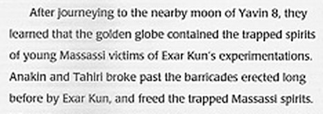
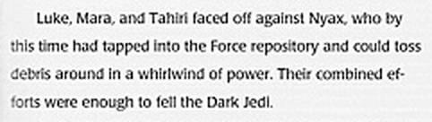
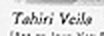
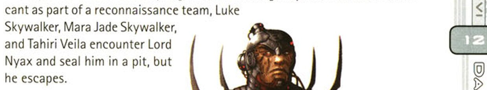
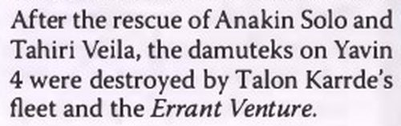
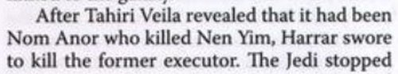
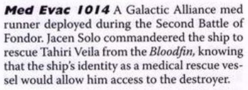
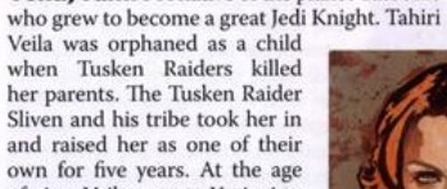
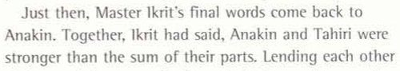
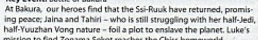

# Tahiri Veila

- **Aliases:** Tahiri
- **Era:** LotF
- **Continuity:** default Legends; entries present for: Legends
- **Research tier:** untiered (not listed as INTRO/DEEP/MASTERY in legends-feats.md)
- **Entries:** 408 (175 with quotations; 44 quotations extended to the full sentence/passage from the source text on file; 58 marked as fragments; 132 before the 2026-11-17 fragment fill). Rebuilt 2026-11-17 from 318 old entries; old file: `characters/_bak/tahiri-veila.md.bak-20261117`.
- **How to read:** each entry is the quotation in full (block quote), then its source and point of view. "Note" lines are summaries from our notes, not quotations. `[fragment — full passage not on file]` means the source text is not on the box, so only the words in our notes are shown. Debate and forum material is in the last section and is unverified.

# LEGENDS (Legends / EU — main focus)

## Legacy of the Force 1–9: novel notes from the other agent (reference copy)

> “Tahiri is not a descendant of Anakin Skywalker,” Lumiya replied. *(on wanting Ben as an apprentice)*
— Source: Legacy of the Force 3: Tempest (novel), feats and scaling notes; S9 · L1556 · Lumiya.
(Full sentence/passage taken from the source text on file: `novels_tmp_tempest_tempest_epub`.)
Note (our notes, around the quote): S9 · L1556 · Lumiya: «Tahiri is not a descendant of Anakin Skywalker» (on wanting Ben as an apprentice).
Our notes: `notes/materials/021-legacy-of-the-force/lotf-3-tempest-notes.md:96`

> Luke had beaten him. *(L4961)*
— Source: L4961 — Legacy of the Force 6: Inferno (novel, read in full): feats, scaling and story notes.
Note (our notes, around the quote): Headline: this is the Luke vs. Caedus book. Luke humiliates Caedus with raw telekinesis in Ch11, hides from him completely (Ch8, Ch17, Ch19), and then beats him in a no-quarter duel in the Embrace-of-Pain chamber (Ch19). Caedus's own POV concedes: «Luke had beaten him.» (L4961). Also: Ben's assassination attempt on Caedus, Caedus burns Kashyyyk, Jaina "kills" Luke (he faked it), Tenel Ka turns on Caedus, Leia vs. Tahiri, and the One Sith on Korriban.
Our notes: `notes/materials/021-legacy-of-the-force/lotf-6-inferno-notes.md:11`

> “Trust me,” Jacen said. “I’ve been flow-walking for years, and the galaxy hasn’t come to an end yet.” *(L77)*
>
> Actually, Jacen should have said impossible. Any change they made in the past would be corrected by the Force, and the flow would return to its present course. *(L73)*
— Source: L77; L73 — Legacy of the Force 6: Inferno (novel, read in full): feats, scaling and story notes.
(Full sentence/passage taken from the source text on file: `novels_tmp_inferno_FULL_txt`.)
Note (our notes, around the quote): Prologue · L73–L159 · Caedus: flow-walks Tahiri into the past at Myrkr: «I've been flow-walking for years» (L77). *Shows:* time-perception power. Lore: «Any change they made in the past would be corrected by the Force» (L73).
Our notes: `notes/materials/021-legacy-of-the-force/lotf-6-inferno-notes.md:41`

- Note (summary from our notes, not a quotation): Ch18 · L4461 · Leia and Tahiri: both bat stun bolts back at the marines who fire on them.
  — Source: Ch18 · L4461 — Legacy of the Force 6: Inferno (novel, read in full): feats, scaling and story notes.
Our notes: `notes/materials/021-legacy-of-the-force/lotf-6-inferno-notes.md:81`

- Note (summary from our notes, not a quotation): | D | Leia vs. Tahiri | Ch18, L4451–4491 | short | Leia ahead; stopped by Han and Tenel Ka | Leia was enraged. Han distracted her once. | Leia > Tahiri. |
  — Source: Ch18, L4451–4491 — Legacy of the Force 6: Inferno (novel, read in full): feats, scaling and story notes.
Context: | # | Fight | Where (lines) | Length | Winner | Holding back / help / injuries | What it suggests |
Our notes: `notes/materials/021-legacy-of-the-force/lotf-6-inferno-notes.md:150`

- Note (summary from our notes, not a quotation): Callbacks: Anakin and Tahiri on Myrkr (Prologue); Kyp and Carida (L4175); Onimi (L5135).
  — Source: L4175; L5135 — Legacy of the Force 6: Inferno (novel, read in full): feats, scaling and story notes.
Our notes: `notes/materials/021-legacy-of-the-force/lotf-6-inferno-notes.md:224`

> “Trust me,” Jacen said. “I’ve been flow-walking for years, and the galaxy hasn’t come to an end yet.” *(L77)*
>
> Any change they made in the past would be corrected by the Force, and the flow would return to its present course. *(L73)*
— Source: L77; L73; L157–159 — Legacy of the Force 6: Inferno (novel, read in full): feats, scaling and story notes.
(Full sentence/passage taken from the source text on file: `novels_tmp_inferno_FULL_txt`.)
Note (our notes, around the quote): Caedus flow-walks Tahiri into the past (Myrkr grashal) to corrupt her: «I've been flow-walking for years» (L77). Lore: «Any change they made in the past would be corrected by the Force, and the flow would return to its present course.» (L73) — Jacen lies to her that it's risky. Flow-walkers cause blurs; reacting makes them visible (L113, L135). Older Tahiri pushes young Tahiri into Anakin's arms → the kiss (L157–159).
Our notes: `notes/materials/021-legacy-of-the-force/lotf-6-inferno-notes.md:246`

- Note (summary from our notes, not a quotation): Bwua'tu's plan: Hapan Home Fleet ambush from Ronay's sensor shadow (L2387). Saba: Bwua'tu is «prey-sensitive» (L2375). Jedi squadrons: Shadow Saber (Kyp), Night Blades (Saba), Dark Sword (Kenth) (L2373–2383). Tahiri present (L2369). Mission: shadow bombs vs Bothan cruisers, rearm at *Megador* Hangar 51, then through the Corellian fleet (L2399–2407).
  — Source: L2387; L2375; L2373–2383; L2369 — Legacy of the Force 6: Inferno (novel, read in full): feats, scaling and story notes.
Our notes: `notes/materials/021-legacy-of-the-force/lotf-6-inferno-notes.md:307`

- Note (summary from our notes, not a quotation): Caedus senses the whole battle: Corellians, Bothans hampered, Commenorians/Hutts relegated (L2485). Tahiri informs Caedus — she's his spy in the Jedi (L2505–2517); they've flow-walked twice more to Anakin (L2511).
  — Source: L2485; L2505–2517; L2511 — Legacy of the Force 6: Inferno (novel, read in full): feats, scaling and story notes.
Our notes: `notes/materials/021-legacy-of-the-force/lotf-6-inferno-notes.md:310`

> He's only doing what's necessary to save the Alliance. *(L4431)*
>
> Anakin would want me to support Jacen. *(L4435)*
— Source: L4431; L4435 — Legacy of the Force 6: Inferno (novel, read in full): feats, scaling and story notes; Tahiri arrives to detain the Solos. POV: Tahiri arrives.
Label in our notes: L4431); (L4435
Our notes: `notes/materials/021-legacy-of-the-force/lotf-6-inferno-notes.md:368`

> Leia landed a jaw-cracking elbow under Tahiri’s chin, and Tahiri slammed a knee into Leia’s ribs. *(L4455)*
>
> The plea made Leia hesitate just long enough for Tahiri to block, then Leia was on her feet again, keeping Tahiri pinned against the strut, beating down her guard, slipping in knee and elbow strikes with a speed and ferocity that only a Barabel-trained fighter could achieve. *(L4475)*
>
> She had found a handy target for all her rage, just as he had when he’d blamed Anakin for Chewbacca’s death, and she was determined to make Tahiri pay for what had happened to Luke … *(L4479)*
— Source: L4451–4491; L4461; L4455; L4463 — Legacy of the Force 6: Inferno (novel, read in full): feats, scaling and story notes.
(Full sentence/passage taken from the source text on file: `novels_tmp_inferno_FULL_txt`.)
Note (our notes, around the quote): LEIA vs TAHIRI duel, Royal Hangar (L4451–4491): both bat stun bolts back at the marines (L4461) — FEAT (both). Leia «a jaw-cracking elbow under Tahiri's chin» (L4455); thrust kick bends Tahiri over a strut (L4463); Tahiri Force-hurls a blaster rifle into Leia's back (L4465); Leia's pirouette at Tahiri's neck (L4467–4471); Leia «beating down her guard, slipping in knee and elbow strikes with a speed and ferocity that only a Barabel-trained fighter could achieve.» (L4475) — FEAT (Leia dominant). Han: Leia «was determined to make Tahiri pay» (L4479). Tahiri lands a spinning back-kick only when Leia is distracted by Han's shot (L4481). Leia nearly throws Han by instinct (L4483). Result: Leia ahead on points; stopped by Han and Tenel Ka.
Our notes: `notes/materials/021-legacy-of-the-force/lotf-6-inferno-notes.md:369`; `notes/materials/021-legacy-of-the-force/lotf-6-inferno-notes.md:82`

> “At the moment, Hapes provides nearly a fifth of the Alliance’s combat capacity,” Tenel Ka said. *(L4527)*
>
> She shook her head with what seemed equal parts sorrow and disgust. “He took my last fleet, Han.
>
> Tenel Ka pulled a small hand mirror from her pocket and began to examine her tear-streaked face. “I think the time has come for someone to do the same to him, don’t you?” *(L4603)*
— Source: L4495; L4547–4551; L4527; L4597 — Legacy of the Force 6: Inferno (novel, read in full): feats, scaling and story notes.
(Full sentence/passage taken from the source text on file: `novels_tmp_inferno_FULL_txt`.)
Note (our notes, around the quote): Tenel Ka intervenes with lightsaber (L4495); seizes Tahiri's StealthX and sends her to Jacen as a "prisoner of war" (L4547–4551). Tenel Ka: Hapes provides «nearly a fifth of the Alliance's combat capacity» (L4527). She lists Jacen's betrayals (L4597): «He took my last fleet» and is ready to switch sides: «I think the time has come for someone to do the same to him» (L4603). Uses the Force to reduce eye puffiness (L4607).
Our notes: `notes/materials/021-legacy-of-the-force/lotf-6-inferno-notes.md:370`

> “Trust me,” Jacen said. “I’ve been flow-walking for years, and the galaxy hasn’t come to an end yet.” *(Prologue, L77)*
>
> With no time to snatch his own weapon off his belt, Caedus lashed out, loosing a bolt of Force lightning that sent Ben tumbling across the floor in a smoking, convulsing heap. *(Ch15, L3627–3633)*
— Source: Ch8, L1917; Ch15, L3627–3633; Ch19, L4719–4725; Ch20, L5007, L5261–5277 — Legacy of the Force 6: Inferno (novel, read in full): feats, scaling and story notes; Key feats: flow-walks Tahiri to Myrkr.
(Full sentence/passage taken from the source text on file: `novels_tmp_inferno_FULL_txt`.)
Note (our notes, around the quote): Key feats: flow-walks Tahiri to Myrkr: «I've been flow-walking for years» (Prologue, L77). Short-range precognition (Ch8, L1917). His danger sense survives Ben's surprise strike, and then «loosing a bolt of Force lightning that sent Ben tumbling across the floor» (Ch15, L3627–3633). Cuts Ben off from the Force in the Embrace of Pain (Ch19, L4719–4725). Fleet-scale battle meditation while his lung is perforated (Ch20, L5007, L5261–5277).
Our notes: `notes/materials/021-legacy-of-the-force/lotf-6-inferno-notes.md:429`

> I'm not weak-minded, you know. *(L485)*
>
> The plea made Leia hesitate just long enough for Tahiri to block, then Leia was on her feet again, keeping Tahiri pinned against the strut, beating down her guard, slipping in knee and elbow strikes with a speed and ferocity that only a Barabel-trained fighter could achieve. *(Ch18, L4475)*
— Source: Ch2, L525, L541–543; Ch18, L4475; Ch2, L525; L485 — Legacy of the Force 6: Inferno (novel, read in full): feats, scaling and story notes.
(Full sentence/passage taken from the source text on file: `novels_tmp_inferno_FULL_txt`.)
Note (our notes, around the quote): Key feats: against about 12 GAG troopers she slashes off a recruit's arms and steers a grenade (Ch2, L525, L541–543). Her mind trick fails on a trained corporal: «I'm not weak-minded, you know.» (L485). Against Tahiri, «beating down her guard, slipping in knee and elbow strikes with a speed and ferocity that only a Barabel-trained fighter could achieve.» (Ch18, L4475).
Our notes: `notes/materials/021-legacy-of-the-force/lotf-6-inferno-notes.md:456`

- Note (summary from our notes, not a quotation): Scaling: Leia > Tahiri.
  — Source: Legacy of the Force 6: Inferno (novel, read in full): feats, scaling and story notes.
Our notes: `notes/materials/021-legacy-of-the-force/lotf-6-inferno-notes.md:457`

> Anakin would want me to support Jacen. *(L4435)*
— Source: L4435 — Legacy of the Force 6: Inferno (novel, read in full): feats, scaling and story notes.
Note (our notes, around the quote): Role/arc: a guilt-ridden collaborator and Caedus's flow-walk partner: «Anakin would want me to support Jacen.» (L4435).
Our notes: `notes/materials/021-legacy-of-the-force/lotf-6-inferno-notes.md:460`

- Note (summary from our notes, not a quotation): Feats: bats back marine stun bolts (L4461). Lands a back-kick only while Han distracts Leia (L4481).
  — Source: L4461; L4481 — Legacy of the Force 6: Inferno (novel, read in full): feats, scaling and story notes.
Our notes: `notes/materials/021-legacy-of-the-force/lotf-6-inferno-notes.md:461`

- Note (summary from our notes, not a quotation): Scaling: below Leia in this book. She rises later (Ben vs. Tahiri in Invincible).
  — Source: Legacy of the Force 6: Inferno (novel, read in full): feats, scaling and story notes.
Our notes: `notes/materials/021-legacy-of-the-force/lotf-6-inferno-notes.md:462`

- Note (summary from our notes, not a quotation): Caedus in Tahiri's StealthX with Allana in his lap (L1029–1033). Tenel Ka's Force-broadcast warning to guards (L1039). Caedus detonates a shaped charge in the diplomatic shuttle with a tight smile (L1043–1045); blows a hole in the hangar wall and escapes to orbit (L1061). Tenel Ka knocked out. Diplomats were unwitting diversion (L1067).
  — Source: L1029–1033; L1039; L1043–1045; L1061 — Legacy of the Force 7: Fury (novel, read in full): feats, scaling and story notes.
Our notes: `notes/materials/021-legacy-of-the-force/lotf-7-fury-notes.md:259`

- Note (summary from our notes, not a quotation): Commenor retaliates with affliceria bioweapon on Coruscant (L2209–2213). Caedus now despises Anakin (L2205). Considers erasing Allana's memories of Tenel Ka (L2219). Tahiri can't find the Jedi (L2203).
  — Source: L2209–2213; L2205; L2219; L2203 — Legacy of the Force 7: Fury (novel, read in full): feats, scaling and story notes.
Our notes: `notes/materials/021-legacy-of-the-force/lotf-7-fury-notes.md:296`

- Note (summary from our notes, not a quotation): Method (be precise about depth): I went through every line in order, front matter to L8485. Because of length, most narrative paragraphs were read through a per-paragraph view (first 150–230 characters of each paragraph, with the file line number); every combat, Force-use, power-statement, and Caedus/Jaina/Luke/Ben/Fett/Tahiri passage that matters for verdicts was then pulled and read in full, and all «…» quotes below were copied from full lines. Politics-only passages (Moff Council, Niathal–Pellaeon talks, Fett family scenes) were read at the paragraph-opening level, so fine detail inside long paragraphs there could be missed. `L####` is the line number in the source file. There is no back-matter interview in this edition.
  — Source: Legacy of the Force 8: Revelation (novel, read in full): feats, scaling and story notes.
Our notes: `notes/materials/021-legacy-of-the-force/lotf-8-revelation-notes.md:8`

- Note (summary from our notes, not a quotation): Headline: the Mandalorian training / Mara-evidence book. Jaina goes to Boba Fett and is trained in anti-Jedi thinking (Fett, Beviin, Mirta, ex-Jedi Bardan Jusik). Ben and Shevu prove Jacen killed Mara (her hair in his StealthX; his recorded confession). Luke beats Caedus in a StealthX duel at Fondor, ripping his fighter apart with the Force, but lets him escape rather than kill civilians. Caedus brings down Fondor's planetary shield by mass mind-influence and bombs Oridin City. Niathal relieves him; the GA splits. Tahiri murders Pellaeon and becomes Caedus's apprentice. Daala returns. On *Bloodfin*, Mirta and Jaina gut Tahiri, Jaina breaks Caedus's Force choke, and a Mandalorian kneecaps Caedus. Jaina resolves to kill her brother «out of love».
  — Source: Legacy of the Force 8: Revelation (novel, read in full): feats, scaling and story notes.
Our notes: `notes/materials/021-legacy-of-the-force/lotf-8-revelation-notes.md:11`

- Note (summary from our notes, not a quotation): L6291 · Tahiri: shoots the unarmed 92-year-old Pellaeon in the chest. Non-Force.
  — Source: Legacy of the Force 8: Revelation (novel, read in full): feats, scaling and story notes.
Our notes: `notes/materials/021-legacy-of-the-force/lotf-8-revelation-notes.md:56`

What it shows (our notes): L7015–7023 · Jaina + Mirta vs Tahiri (2v1): Tahiri deflects Mirta's fire, but her lightsaber «simply failed to slice through» Mirta's beskar (L7019); Jaina fights in Beviin's «blind violence» mode (L7021); Mirta's vibroblade cuts Tahiri's femoral artery (L7023).
> She cannoned into Tahiri and the impact lifted the Jedi bodily. It had to be the pure shock of seeing this ball of armored, cursing fury coming at her, not caring if the enemy held blaster, lightsaber, or ion cannon, that rooted Tahiri just long enough to get hit hard. She lashed out with the lightsaber. Jaina could see Tahiri through the faceplate and knew she would never forget her look of horror as the blade of energy simply failed to slice through Mirta’s body: My lightsaber doesn’t work. For any Jedi, it was a shocking, naked moment.
— Source: L7019; L7021; L7023 — Legacy of the Force 8: Revelation (novel, read in full): feats, scaling and story notes.
(Excerpt widened 2026-11-17 to the relevant passage, word for word from Revelation (Karen Traviss), Chapter Seventeen (text copy `MEGA_Legend_The_Legacy_of_the_Force_Series_Star_Wars_Legacy_of_the_Force_08_Revelation_Karen_Traviss_epub`).)
(Full sentence/passage taken from the source text on file: `lotf_tmp_b8_epub`.)
Also cited as: L7019; L7023 — Legacy of the Force 8: Revelation (novel, read in full): feats, scaling and story notes; Fights/results: deflects Mirta's fire, but her lightsaber.
Also noted as: Fights/results: deflects Mirta's fire, but her lightsaber «simply failed to slice through» beskar (L7019). Mirta cuts her femoral artery (L7023).
Also cited as: Legacy of the Force 8: Revelation (Karen Traviss, 2008) — own full read.
Also noted as: | F20 | c17 ¶67–72 | Mirta (+ Jaina) | Beats Tahiri's reaction time; Tahiri's blade "simply failed to slice through Mirta’s body"; vibroblade cuts her femoral artery | Beskar |
Our notes: `notes/materials/021-legacy-of-the-force/lotf-8-revelation-notes.md:57`; `notes/materials/021-legacy-of-the-force/lotf-8-revelation-notes.md:337`; `notes/materials/040-lotf-own-read/lotf-8-revelation.md:35`

What it shows (our notes): L7027 · Caedus (Force choke) vs Jaina (counter): Caedus chokes Mirta from beyond a hatch to cover Tahiri; Jaina breaks it: «She saw it like a black chain and visualized the links flying apart». Context: Caedus exhausted (L7081), blind, splitting attention.
> The Moffs lay dead. Jaina felt Jacen then; he was throttling Mirta to let Tahiri escape into the docking tube above the hatch. Jaina put every scrap of strength she had into breaking Jacen’s invisible Force choke hold on Mirta. She saw it like a black chain and visualized the links flying apart just as Carid shot past her and scrambled up the ladder followed by Vevut. Fett skidded to a halt and grabbed Mirta by her shoulder, as if he thought the blood on the deck might be hers.
— Source: L7081 — Legacy of the Force 8: Revelation (novel, read in full): feats, scaling and story notes.
(Excerpt widened 2026-11-17 to the relevant passage, word for word from Revelation (Karen Traviss), Chapter Seventeen (text copy `MEGA_Legend_The_Legacy_of_the_Force_Series_Star_Wars_Legacy_of_the_Force_08_Revelation_Karen_Traviss_epub`).)
(Full sentence/passage taken from the source text on file: `lotf_tmp_b8_epub`.)
Our notes: `notes/materials/021-legacy-of-the-force/lotf-8-revelation-notes.md:58`

- Note (summary from our notes, not a quotation): L7135–7143 · Caedus vs Carid: Caedus projects Ailyn Vel's face (his Mara trick, L7135); Carid isn't fooled and shoots him through the knee; Caedus Force-punches the hatch and escapes with Tahiri.
  — Source: Legacy of the Force 8: Revelation (novel, read in full): feats, scaling and story notes.
Our notes: `notes/materials/021-legacy-of-the-force/lotf-8-revelation-notes.md:59`

> Colonel Solo has... exceptional powers
> [fragment — full passage not on file]
— Source: Legacy of the Force 8: Revelation (novel, read in full): feats, scaling and story notes; | S16 | L6211 | Tahiri |.
Label in our notes: | Medium (apprentice). |
Context: | # | Line | Speaker / POV | Statement | Reliability |
Our notes: `notes/materials/021-legacy-of-the-force/lotf-8-revelation-notes.md:86`

- Note (summary from our notes, not a quotation): | D | Jaina + Mirta vs Tahiri | L7015–7027 | seconds | Jaina/Mirta | 2v1; beskar; Tahiri fleeing | Tahiri < Jaina; beskar counters lightsabers. |
  — Source: Legacy of the Force 8: Revelation (novel, read in full): feats, scaling and story notes.
Context: | # | Fight | Where (lines) | Length | Winner | Holding back / help / injuries | What it suggests |
Our notes: `notes/materials/021-legacy-of-the-force/lotf-8-revelation-notes.md:104`

- Note (summary from our notes, not a quotation): | F | Caedus vs Carid (docking tube) | L7051–7157 | seconds | Caedus escapes, kneecapped | Exhausted; holding Tahiri; illusion fails | Illusions don't stop a non-Force pro who expects them (sets up Jaina). |
  — Source: Legacy of the Force 8: Revelation (novel, read in full): feats, scaling and story notes.
Context: | # | Fight | Where (lines) | Length | Winner | Holding back / help / injuries | What it suggests |
Our notes: `notes/materials/021-legacy-of-the-force/lotf-8-revelation-notes.md:106`

- Note (summary from our notes, not a quotation): Caedus/Jacen: dissociating. He forgets Tebut is dead (L1417), rebrands his sacrifice as Allana (S21), stops feeling Jaina and declares Jacen «Gone» (S22), sees phantom fleets, spews his confession to the one honest man he trusts. Power grows in breadth (Fight B) while judgment and control decay (yellow eyes L4197, L5859; holozine rage L7409–7421). He still values loyalty (rescues Tahiri personally, L6415, L7089).
  — Source: L1417 — Legacy of the Force 8: Revelation (novel, read in full): feats, scaling and story notes.
Our notes: `notes/materials/021-legacy-of-the-force/lotf-8-revelation-notes.md:140`

- Note (summary from our notes, not a quotation): Tahiri: blooded by Pellaeon's murder, named apprentice (L6413), nearly killed by Mirta.
  — Source: L6413 — Legacy of the Force 8: Revelation (novel, read in full): feats, scaling and story notes.
Our notes: `notes/materials/021-legacy-of-the-force/lotf-8-revelation-notes.md:147`

- Note (summary from our notes, not a quotation): 41 ABY, twelve-plus weeks after Mara's death. Sets up *Invincible*: Jaina trained and resolved; the Jedi in the Transitory Mists; Tahiri found the old Endor base (L8019); Niathal's government in exile; Daala allied with Fett; Caedus kneecapped with a cracked chest.
  — Source: L8019 — Legacy of the Force 8: Revelation (novel, read in full): feats, scaling and story notes.
Our notes: `notes/materials/021-legacy-of-the-force/lotf-8-revelation-notes.md:174`

> up across Fett's chest
> [fragment — full passage not on file]
>
> Jaina put every scrap of strength she had into breaking Jacen’s invisible Force choke hold on Mirta. She saw it like a black chain and visualized the links flying apart just as Carid shot past her and scrambled up the ladder followed by Vevut. *(L7027)*
— Source: Ch7, L2909–2913; L3383; L7027; L7021 — Legacy of the Force 8: Revelation (novel, read in full): feats, scaling and story notes; Key feats: a reflex slash.
(Full sentence/passage taken from the source text on file: `lotf_tmp_b8_epub`.)
Note (our notes, around the quote): Key feats: a reflex slash «up across Fett's chest» that beskar stops (Ch7, L2909–2913). Caedus «couldn't feel Jaina» (L3383). Breaks his choke: «She saw it like a black chain and visualized the links flying apart» (L7027). Fights Tahiri in Beviin's «blind violence» mode (L7021).
Our notes: `notes/materials/021-legacy-of-the-force/lotf-8-revelation-notes.md:325`

- Note (summary from our notes, not a quotation): Role/arc: blooded by Pellaeon's murder (L6291) and named apprentice (L6413).
  — Source: L6291; L6413 — Legacy of the Force 8: Revelation (novel, read in full): feats, scaling and story notes.
Our notes: `notes/materials/021-legacy-of-the-force/lotf-8-revelation-notes.md:336`

> Colonel Solo has... exceptional powers *(L6211)*
> [fragment — full passage not on file]
— Source: L6211 — Legacy of the Force 8: Revelation (novel, read in full): feats, scaling and story notes; Statement.
Label in our notes: L6211
Our notes: `notes/materials/021-legacy-of-the-force/lotf-8-revelation-notes.md:338`

- Note (summary from our notes, not a quotation): Scaling: Tahiri < Jaina (2v1 here, but clearly outmatched).
  — Source: Legacy of the Force 8: Revelation (novel, read in full): feats, scaling and story notes.
Our notes: `notes/materials/021-legacy-of-the-force/lotf-8-revelation-notes.md:339`

- Note (summary from our notes, not a quotation): Feats: her beskar turns Tahiri's blade, and she cuts Tahiri's femoral artery (L7019–7023). Caedus chokes her and Jaina frees her (L7027).
  — Source: L7019–7023; L7027 — Legacy of the Force 8: Revelation (novel, read in full): feats, scaling and story notes.
Our notes: `notes/materials/021-legacy-of-the-force/lotf-8-revelation-notes.md:352`

- Note (summary from our notes, not a quotation): Method (be precise about depth): I went through every non-blank line in order, front matter to L5971. Most narrative paragraphs were read through a per-paragraph view (first ~105 characters, with the file line number). Every fight and Force-power passage was then pulled and read in full: Nickel One (Ch8–9), Ben vs Tahiri (Ch10, Ch19), shatterpoint (Ch14), the Throat battle (Ch15), the final duel (Ch18). So were every Caedus/Jaina/Luke power statement and the epilogue. All «…» quotes were copied from full lines. Politics and banter passages were read at the paragraph-opening level only. `L####` is the line number in the source file.
  — Source: Legacy of the Force 9: Invincible (novel, read in full): feats, scaling and story notes.
Our notes: `notes/materials/021-legacy-of-the-force/lotf-9-invincible-notes.md:8`

- Note (summary from our notes, not a quotation): Ch3 · L1099–1115 · Tahiri vs Ben: ambush; she burns his back, he Force-pulls her down, GAG captures him.
  — Source: Ch3 · L1099–1115 — Legacy of the Force 9: Invincible (novel, read in full): feats, scaling and story notes.
Our notes: `notes/materials/021-legacy-of-the-force/lotf-9-invincible-notes.md:36`

- Note (summary from our notes, not a quotation): L2900–2918 · Tahiri: Force-lightning torture kills Shevu.
  — Source: Legacy of the Force 9: Invincible (novel, read in full): feats, scaling and story notes.
Our notes: `notes/materials/021-legacy-of-the-force/lotf-9-invincible-notes.md:50`

- Note (summary from our notes, not a quotation): L5412–5430 · Ben vs Tahiri: falling duel down a shaft; Ben has a clean kill and parries instead. Tahiri surrenders.
  — Source: Legacy of the Force 9: Invincible (novel, read in full): feats, scaling and story notes.
Our notes: `notes/materials/021-legacy-of-the-force/lotf-9-invincible-notes.md:73`

- Note (summary from our notes, not a quotation): | D | Ben vs Tahiri | L5412–5430 | short | Ben (spares her) | Tahiri doesn't want to win (L5430) | Ben ≥ Tahiri; Tahiri broken by Caedus's betrayal (L4446–4476). |
  — Source: L5430; L4446–4476 — Legacy of the Force 9: Invincible (novel, read in full): feats, scaling and story notes.
Context: | # | Fight | Where (lines) | Length | Winner | Holding back / help / injuries | What it suggests |
Our notes: `notes/materials/021-legacy-of-the-force/lotf-9-invincible-notes.md:112`

What it shows (our notes): Caedus/Jacen: tries to recommit to «To serve.» (L887), but kills Isolder, tortures Mirta, and uses Tahiri's grief («That was kind of the point», L4632). His love for Allana survives to the end: he vetoes the nanokiller (L4596) and dies warning Tenel Ka (L5184). Jaina's verdict: «he became Jacen again for a second» (L5914); the galaxy he wanted is born under Daala (L5904).
> “Okay,” Tahiri said. “But letting me believe we could bring Anakin back was a terrible way to use me. I still haven’t forgiven you.”
>
> “And I doubt you ever will,” Caedus said. “That was kind of the point.”
>
> “I think he became Jacen again for a second before I … *(L5914)*
— Source: L887; L4596; L5184; L5914 — Legacy of the Force 9: Invincible (novel, read in full): feats, scaling and story notes.
(Excerpt widened 2026-11-17 to the relevant passage, word for word from Invincible (Troy Denning) (text copy `MEGA_Legend_The_Legacy_of_the_Force_Series_Star_Wars_Legacy_of_the_Force_09_Invincible_Troy_Denning_epub`).)
(Full sentence/passage taken from the source text on file: `lotf_tmp_b9_epub`.)
Our notes: `notes/materials/021-legacy-of-the-force/lotf-9-invincible-notes.md:144`

- Note (summary from our notes, not a quotation): Ben: survives torture, keeps his cop's ethic (spares the guards, L2952; spares Tahiri, L5428), offers to lie for her (L5484).
  — Source: L5484 — Legacy of the Force 9: Invincible (novel, read in full): feats, scaling and story notes.
Our notes: `notes/materials/021-legacy-of-the-force/lotf-9-invincible-notes.md:147`

> “Yeah, but I’m done with him,” she said bitterly. “I’m done with all Solos.” *(L5466)*
— Source: L4446–4476; L2920–2928; L5466 — Legacy of the Force 9: Invincible (novel, read in full): feats, scaling and story notes.
(Full sentence/passage taken from the source text on file: `lotf_tmp_b9_epub`.)
Note (our notes, around the quote): Tahiri: her Sith motive (Anakin) is exposed as perception only (L4446–4476); she kills Shevu by accident (L2920–2928), then surrenders: «I'm done with all Solos» (L5466).
Also cited as: L4446–4476; L2900–2918; L5466 — Legacy of the Force 9: Invincible (novel, read in full): feats, scaling and story notes.
Also noted as: Role/arc: her Sith motive is exposed as perception only (L4446–4476). Kills Shevu (L2900–2918). «I'm done with all Solos» (L5466).
Also cited as: Legacy of the Force 9: Invincible (Troy Denning, 2008) — own full read.
Also noted as: Tahiri Veila: a capable duelist (F36, D1, D8) who is psychologically broken by Caedus (c16 ¶41–56). She surrenders: "I’m done with all Solos." [c19 ¶137].
Our notes: `notes/materials/021-legacy-of-the-force/lotf-9-invincible-notes.md:148`; `notes/materials/021-legacy-of-the-force/lotf-9-invincible-notes.md:285`; `notes/materials/040-lotf-own-read/lotf-9-invincible.md:118`

- Note (summary from our notes, not a quotation): 41 ABY, ending LotF. Leads to *Fate of the Jedi* (Daala's government, Jedi distrust, Allana as Amelia Solo, Tahiri's trial; «THE STORY CONTINUES», L5944).
  — Source: Legacy of the Force 9: Invincible (novel, read in full): feats, scaling and story notes.
Our notes: `notes/materials/021-legacy-of-the-force/lotf-9-invincible-notes.md:175`

- Note (summary from our notes, not a quotation): Role/arc: captured and tortured, but keeps his cop's ethic and spares Tahiri (L5428).
  — Source: L5428 — Legacy of the Force 9: Invincible (novel, read in full): feats, scaling and story notes.
Our notes: `notes/materials/021-legacy-of-the-force/lotf-9-invincible-notes.md:279`

- Note (summary from our notes, not a quotation): Feats: Force-throws his captors and escapes (L2944–2952). Force-shoves SD-XX into space (L3550). Beats Tahiri in a falling duel down a shaft and parries instead of taking a clean kill (L5412–5430).
  — Source: L2944–2952; L3550; L5412–5430 — Legacy of the Force 9: Invincible (novel, read in full): feats, scaling and story notes.
Our notes: `notes/materials/021-legacy-of-the-force/lotf-9-invincible-notes.md:280`

- Note (summary from our notes, not a quotation): Fights: Tahiri ambushes and captures him (Ch3, L1099–1115). He later beats her (Ch19).
  — Source: Ch3, L1099–1115 — Legacy of the Force 9: Invincible (novel, read in full): feats, scaling and story notes.
Our notes: `notes/materials/021-legacy-of-the-force/lotf-9-invincible-notes.md:281`

- Note (summary from our notes, not a quotation): Scaling: Ben ≥ Tahiri.
  — Source: Legacy of the Force 9: Invincible (novel, read in full): feats, scaling and story notes.
Our notes: `notes/materials/021-legacy-of-the-force/lotf-9-invincible-notes.md:282`

- Note (summary from our notes, not a quotation): Feats: burns Ben's back in the ambush (L1099–1115). Kills Shevu with Force lightning (L2900–2918).
  — Source: L1099–1115; L2900–2918 — Legacy of the Force 9: Invincible (novel, read in full): feats, scaling and story notes.
Our notes: `notes/materials/021-legacy-of-the-force/lotf-9-invincible-notes.md:286`

- Note (summary from our notes, not a quotation): Scaling: below Ben by the end. She didn't want to win (L5430).
  — Source: L5430 — Legacy of the Force 9: Invincible (novel, read in full): feats, scaling and story notes.
Our notes: `notes/materials/021-legacy-of-the-force/lotf-9-invincible-notes.md:287`

- Note (summary from our notes, not a quotation): Role: the honest GAG captain. Tahiri's lightning torture kills him (L2900–2918).
  — Source: L2900–2918 — Legacy of the Force 9: Invincible (novel, read in full): feats, scaling and story notes.
Our notes: `notes/materials/021-legacy-of-the-force/lotf-9-invincible-notes.md:303`

## Star Wars: The New Essential Chronology (Del Rey, 2005): power-scaling and lore notes

> they learned that the golden globe contained the trapped spirits of young Massassi victims of Exar Kun's experimentations. Anakin and Tahiri broke past the barricades erected long before by Exar Kun, and freed the trapped Massassi spirits.
> [fragment — full passage not on file]
— Source: Part Eleven: Generations of Jedi; Exar Kun; Anakin Solo — Exar Kun's Massassi victims.
Note (our notes, around the quote): Exar Kun; Anakin Solo — Exar Kun's Massassi victims: "they learned that the golden globe contained the trapped spirits of young Massassi victims of Exar Kun's experimentations. Anakin and Tahiri broke past the barricades erected long before by Exar Kun, and freed the trapped Massassi spirits." Source: The New Essential Chronology, p.195

Our notes: `notes/materials/027-new-essential-chronology/11-part-eleven-generations-of-jedi.md:13`

> Luke, Mara, and Tahiri faced off against Nyax, who by this time had tapped into the Force repository and could toss debris around in a whirlwind of power. Their combined efforts were enough to fell the Dark Jedi.
— Source: Part Twelve: The New Jedi Order.
Note (our notes, around the quote): Luke Skywalker; Mara Jade Skywalker — Luke, Mara and Tahiri fell Nyax: "Luke, Mara, and Tahiri faced off against Nyax, who by this time had tapped into the Force repository and could toss debris around in a whirlwind of power. Their combined efforts were enough to fell the Dark Jedi." Source: The New Essential Chronology, p.219

Our notes: `notes/materials/027-new-essential-chronology/12-part-twelve-new-jedi-order.md:155`

- Note (summary from our notes, not a quotation): art caption: "Tahiri Veila" Source: The New Essential Chronology, p.222, caption
  — Source: Part Twelve: The New Jedi Order.

Our notes: `notes/materials/027-new-essential-chronology/12-part-twelve-new-jedi-order.md:188`

## Star Wars Saga Edition: Jedi Academy Training Manual (WotC, 2009): power-scaling and lore notes

> Without the ability to speak or recall his identity, Irek takes the name Lord Nyax from a Corellian myth, locates an abandoned Jedi temple, and taps into the Force wellspring there, increasing his power. While on Corus- cant as part of a reconnaissance team, Luke Skywalker, Mara Jade Skywalker, and Tahiri Veila encounter Lord Nyax and seal him in a pit, but he escapes. lrek Ismaren (Lord Nyax) Encounters Although encountering Irek Ismaren might be pos- sible during the time of the New Republic, he is more likely to be encoun- tered as Lord Nyax on Cor- uscant before or during the Yuuzhan Vong invasion.
— Source: Chapter VI: Dangers of Study.
(Excerpt widened 2026-11-17 to the relevant passage, word for word from research primary jedi academy training manual jatm paged (text copy `research_primary_jedi_academy_training_manual_jatm_paged_txt_fea130719f`).)
(Excerpt widened 2026-11-17 to the relevant passage, word for word from research primary jedi academy training manual jatm paged (text copy `research_primary_jedi_academy_training_manual_jatm_paged_txt_fea130719f`).)
Note (our notes, around the quote): Luke Skywalker; Mara Jade Skywalker — Lord Nyax — sealed in a pit: "Luke Skywalker, Mara Jade Skywalker, and Tahiri Veila encounter Lord Nyax and seal him in a pit, but he escapes." Source: Jedi Academy Training Manual, p.121

Our notes: `notes/materials/028-jedi-academy-training-manual/06-ch6-dangers-of-study.md:69`

## The Complete Star Wars Encyclopedia, Vol. I (A–G)

> After the rescue of Anakin Solo and Tahiri Veila, the damuteks on Yavin 4 were destroyed by Talon Karrde's fleet and the Errant Venture.
— Source: scan pages 161–200; Anakin Solo; Tahiri Veila.
Note (our notes, around the quote): Anakin Solo; Tahiri Veila: "After the rescue of Anakin Solo and Tahiri Veila, the damuteks on Yavin 4 were destroyed by Talon Karrde's fleet and the Errant Venture." Source: The Complete Star Wars Encyclopedia, Vol. I, p.163

Our notes: `notes/materials/030-complete-star-wars-encyclopedia-vol-1/04-v1-scan-161-200.md:151`

## The Complete Star Wars Encyclopedia, Vol. II (H–O)

> After Tahiri Veila revealed that it had been Nom Anor who killed Nen Yim, Harrar swore to kill the former executor.
— Source: scan pages 1–40; Tahiri Veila. POV: Tahiri Veila.
Note (our notes, around the quote): Tahiri Veila: "After Tahiri Veila revealed that it had been Nom Anor who killed Nen Yim, Harrar swore to kill the former executor." Source: The Complete Star Wars Encyclopedia, Vol. II, p.21

Our notes: `notes/materials/031-complete-star-wars-encyclopedia-vol-2/00-v2-scan-001-040.md:186`

> Med Evac 1014 A Galactic Alliance med runner deployed during the Second Battle of Fondor, Jacen Solo commandeered the ship to rescue Tahiri Veila from the Bloodfin, knowing that the ship's identity as a medical rescue vessel would allow him access to the destroyer.
— Source: scan pages 281–320; Jacen Solo (Darth Caedus); Tahiri Veila.
Note (our notes, around the quote): Jacen Solo (Darth Caedus); Tahiri Veila: "Med Evac 1014 A Galactic Alliance med runner deployed during the Second Battle of Fondor, Jacen Solo commandeered the ship to rescue Tahiri Veila from the Bloodfin, knowing that the ship's identity as a medical rescue vessel would allow him access to the destroyer." Source: The Complete Star Wars Encyclopedia, Vol. II, p.300

Our notes: `notes/materials/031-complete-star-wars-encyclopedia-vol-2/07-v2-scan-281-320.md:223`

## The Complete Star Wars Encyclopedia, Vol. III (P–Z)

- Note (summary from our notes, not a quotation): Page contents: 1143 words, 21 paragraphs | headings/entries: Veers, General Maximilian; Veers, Zevulon; VeerTa; Veeshas Tuwan; Vegnu, Jub; Veila, Tahiri
  — Source: scan pages 281–320.
Our notes: `notes/materials/032-complete-star-wars-encyclopedia-vol-3/07-v3-scan-281-320.md:186`

> Tahiri Veila was orphaned as a child when Tusken Raiders killed her parents, The Tusken Raider Sliven and his tribe took her in and raised her as one of their own for five years.
— Source: scan pages 281–320; Tahiri Veila — entry/section: Veila, Tahiri.
Note (our notes, around the quote): Tahiri Veila — entry/section: Veila, Tahiri: "Tahiri Veila was orphaned as a child when Tusken Raiders killed her parents, The Tusken Raider Sliven and his tribe took her in and raised her as one of their own for five years." Source: The Complete Star Wars Encyclopedia, Vol. III, p.299

Our notes: `notes/materials/032-complete-star-wars-encyclopedia-vol-3/07-v3-scan-281-320.md:192`

## The New Essential Guide to Characters (2002)

- Note (summary from our notes, not a quotation): Page contents: 554 words, 14 paragraphs | headings/entries: Tahiri suffered badly during her
  — Source: scan pages 151–180.
Our notes: `notes/materials/034-new-essential-guide-to-characters/05-negc-scan-151-180.md:80`

## Sourcebooks/The New Jedi Order Sourcebook.pdf [Star Wars Roleplaying Game (d20, 2000)] (scan pages 61–120)

> Together, Ikrit had said, Anakin and Tahiri were stronger than the sum of their parts.
— Source: Sourcebooks/The New Jedi Order Sourcebook.pdf [Star Wars Roleplaying Game.
Note (our notes, around the quote): Anakin Solo — entry/section: Escape from Yavin 4 (The New Jedi Order Sourcebook, Ch6): "Together, Ikrit had said, Anakin and Tahiri were stronger than the sum of their parts." Source: *The New Jedi Order Sourcebook* (SWRPG d20), scan p.116

Our notes: `notes/materials/037-sw-d20-folder/049-the-new-jedi-order-sourcebook-scan-061-120.md:355`

## Star Wars Insider #71 (2003)

- Note (summary from our notes, not a quotation): Page contents: Greg Keyes profile opens: his Chosen of the Changeling, Age of Unreason and Kingdoms of Thorn and Bone series; The Final Prophecy (Nen Yim, Harrar, Yu'shaa with Corran Horn and Tahiri seeking Zonama Sekot; Wedge at Bilbringi; Yu'shaa really Nom Anor). (hand-read)
  — Source: Star Wars Insider #71 (2003).
Our notes: `notes/materials/038-star-wars-insider/071-ins071.md:338`

> She was entirely my own invention
> [fragment — full passage not on file]
— Source: Star Wars Insider #71 (2003).
Note (our notes, around the quote): Page contents: Greg Keyes profile: Edge of Victory books, Tahiri and Nen Yim ("She was entirely my own invention"), last NJO manuscript turned in, faith vs. science; his road to publication with The Waterborn; sidebar on upcoming Clone Wars and other novels. (hand-read)
Our notes: `notes/materials/038-star-wars-insider/071-ins071.md:343`

## Star Wars Insider #74 (2004)

- Note (summary from our notes, not a quotation): Page contents: NJO synopses: Edge of Victory I: Conquest (Anakin rescues Tahiri on occupied Yavin 4; the Jeedai cult), the "Ylesia" e-book and Jag Fel Gamer story, Edge of Victory II: Rebirth (Onimi, Shimrra, Ben Skywalker introduced), and Gamer serial addenda. (hand-read)
  — Source: Star Wars Insider #74 (2004).
Our notes: `notes/materials/038-star-wars-insider/074-ins074.md:150`

> At Bakura, our heroes find that the Ssi-Ruuk have returned, promising peace; Jaina and Tahiri – who is still struggling with her half-Jedi, half-Yuuzhan Vong nature – foil a plot to enslave the planet.
— Source: Star Wars Insider #74 (2004).
Note (our notes, around the quote): Jaina Solo; Tahiri Veila — entry/section: Key Event: Battle of Bakura: "At Bakura, our heroes find that the Ssi-Ruuk have returned, promising peace; Jaina and Tahiri – who is still struggling with her half-Jedi, half-Yuuzhan Vong nature – foil a plot to enslave the planet." Source: *Star Wars Insider #74* (2004), scan p.30

Our notes: `notes/materials/038-star-wars-insider/074-ins074.md:204`

## Star Wars Insider #75 (2004)

- Note (summary from our notes, not a quotation): Page contents: Or Die Trying: Stanton offers Jaina an HRD body retaining the Force via Ssi-ruuk entechment, pitching an HRD army against the Yuuzhan Vong and All-Species Replica Droids; she thinks of Tahiri, her dead brother Anakin and Keeramak, then refuses. (hand-read)
  — Source: Star Wars Insider #75 (2004).
Our notes: `notes/materials/038-star-wars-insider/075-ins075.md:431`

## Star Wars Insider #125 (2011)

- Note (summary from our notes, not a quotation): Page contents: Books: Fate of the Jedi: Conviction (Daniel Wallace); Aaron Allston on the Jedi running the government ("World Wrestling Federation ... NATO"), Tahiri Veila's redemptive path, more to learn about Abeloth. Ask Lobot (Leland Y. Chee; questioner omitted): Porkins could have survived with helmet and life support or a Guidenhauser ejection seat. (hand-read)
  — Source: Star Wars Insider #125 (2011).
Our notes: `notes/materials/038-star-wars-insider/125-ins125.md:429`

## Legacy of the Force, own full read (Betrayal, Revelation, Invincible)

- Note (summary from our notes, not a quotation): Not in this book: Alema Rar, Tahiri, Kyp and Fett do not appear in Betrayal.
  — Source: Legacy of the Force 1: Betrayal (Aaron Allston, 2006) — own full read.
Our notes: `notes/materials/040-lotf-own-read/lotf-1-betrayal.md:91`

> Leia Organa Solo; Jedi Knight; copilot, Millennium Falcon (human female)
>
> Ben Skywalker (human male) *(no rank given)*
— Source: Legacy of the Force 1: Betrayal (Aaron Allston, 2006) — own full read.
(Full sentence/passage taken from the source text on file: `lotf_tmp_b1_epub`.)
Note (our notes, around the quote): Dramatis personae: present (front matter). Power-relevant labels: "Luke Skywalker; Jedi Grand Master", "Mara Jade Skywalker; Jedi Master", "Jacen Solo; Jedi Knight", "Jaina Solo; Jedi Knight", "Leia Organa Solo; Jedi Knight; copilot, Millennium Falcon"; "Ben Skywalker (human male)" (no rank given); "Tahiri Veila; Jedi Knight".
Our notes: `notes/materials/040-lotf-own-read/lotf-1-betrayal.md:109`

- Note (summary from our notes, not a quotation): prl–c03: Jaina decides to train with Boba Fett so she can stop Jacen. Ben doubts that Alema killed Mara and goes to Coruscant to work the case with GAG captain Lon Shevu. Niathal, shaken by Tebut's killing, starts feeding Luke information. Caedus sends Tahiri to court Pellaeon. Fett recovers his ex-wife Sintas Vel, blind and amnesiac, from carbonite.
  — Source: Legacy of the Force 8: Revelation (Karen Traviss, 2008) — own full read.
Our notes: `notes/materials/040-lotf-own-read/lotf-8-revelation.md:6`

- Note (summary from our notes, not a quotation): c04–c08: Caedus tests Tahiri at Fondor. Jaina reaches Keldabe and meets the Force-sensitive Mandalorians Gotab and Venku; Fett agrees to train her. On Kavan, Mara's Force ghost tugs her own hair for Ben [c05 ¶54–55]. Ben's forensic droid then finds that hair in Jacen's StealthX [c08 ¶125]. Jacen tells Niathal he is a Sith [c06 ¶122]. Pellaeon quietly calls in Daala.
  — Source: Legacy of the Force 8: Revelation (Karen Traviss, 2008) — own full read.
Our notes: `notes/materials/040-lotf-own-read/lotf-8-revelation.md:7`

- Note (summary from our notes, not a quotation): c13–c16: Second Battle of Fondor. The Jedi hide the Fondorian fleet. Caedus drives his commanders into a battle rage and uses the feedback to talk Fondor's shield crew into dropping the planetary shield. He then bombs Oridin [c13 ¶151–173]. Niathal accepts Fondor's surrender and relieves Caedus. Tahiri murders Pellaeon [c14 ¶122] and becomes Caedus's apprentice [c15 ¶40–43]. Daala's Maw Irregular Fleet routs Caedus, the GA splits, and Niathal forms a government in exile.
  — Source: Legacy of the Force 8: Revelation (Karen Traviss, 2008) — own full read.
Our notes: `notes/materials/040-lotf-own-read/lotf-8-revelation.md:9`

- Note (summary from our notes, not a quotation): c17–c18: Mandalorians storm *Bloodfin*. Mirta and Jaina bring down Tahiri, Jaina breaks Caedus's Force choke on Mirta, and Carid kneecaps Caedus, who still escapes with Tahiri. Back on Coruscant, Caedus tells Shevu how he killed Mara, and Shevu is secretly recording.
  — Source: Legacy of the Force 8: Revelation (Karen Traviss, 2008) — own full read.
Our notes: `notes/materials/040-lotf-own-read/lotf-8-revelation.md:10`

- Note (summary from our notes, not a quotation): | F17 | c14 ¶98–122 | Tahiri | Force-opens Pellaeon's locked hatch and shoots him | Non-combat murder |
  — Source: Legacy of the Force 8: Revelation (Karen Traviss, 2008) — own full read.
Context: | # | Ref | Character | Feat | Quote / note |
Our notes: `notes/materials/040-lotf-own-read/lotf-8-revelation.md:32`

> The agony was suddenly somewhere else. It wasn’t happening to Caedus at that moment, but to another Caedus a long way away. He put his last, best effort into Force-punching the hatch overhead—not pushing, nothing so refined—and bursting it open. At the moment he did that, he pushed off hard with his uninjured leg and rocketed through the docking ring into the sprinter with Tahiri clutched to him.
— Source: Legacy of the Force 8: Revelation (Karen Traviss, 2008) — own full read.
(Excerpt widened 2026-11-17 to the relevant passage, word for word from Revelation (Karen Traviss), Chapter Eighteen (text copy `MEGA_Legend_The_Legacy_of_the_Force_Series_Star_Wars_Legacy_of_the_Force_08_Revelation_Karen_Traviss_epub`).)
(Full sentence/passage taken from the source text on file: `lotf_tmp_b8_epub`.)
Note (our notes, around the quote): | F22 | c18 ¶10–15 | Caedus | Projects Ailyn Vel's face at Carid (fails); after being kneecapped, Force-punches the hatch open and jumps out on one leg, carrying Tahiri | "not pushing, nothing so refined" [c18 ¶15] |
Context: | # | Ref | Character | Feat | Quote / note |
Our notes: `notes/materials/040-lotf-own-read/lotf-8-revelation.md:37`

- Note (summary from our notes, not a quotation): | F23 | c18 ¶16–18 | Caedus | Holds Tahiri's arterial bleed with the Force while giving her first aid | — |
  — Source: Legacy of the Force 8: Revelation (Karen Traviss, 2008) — own full read.
Context: | # | Ref | Character | Feat | Quote / note |
Our notes: `notes/materials/040-lotf-own-read/lotf-8-revelation.md:38`

> Colonel Solo has … exceptional powers
> [fragment — full passage not on file]
— Source: Legacy of the Force 8: Revelation (Karen Traviss, 2008) — own full read; | S26 | c14 ¶79 | Tahiri |.
Label in our notes: | Medium (apprentice) |
Context: | # | Ref | Speaker | Statement | Reliability |
Our notes: `notes/materials/040-lotf-own-read/lotf-8-revelation.md:72`

- Note (summary from our notes, not a quotation): D5 Mirta + Jaina vs Tahiri, Bloodfin ducts [c17 ¶67–74]: Tahiri deflects Jaina-side fire into Mirta's plates [c17 ¶67–68]. Mirta charges and beats her reaction time [c17 ¶69], and Tahiri's lightsaber fails on the beskar [c17 ¶70]. Jaina attacks in Beviin's "blind violence" mode [c17 ¶71–72]. Mirta's vibroblade opens Tahiri's femoral artery and Tahiri flees up the hatch [c17 ¶72–74]. CONDITION: 2v1, confined space, Tahiri trying to escape. Win for Jaina and Mirta.
  — Source: Legacy of the Force 8: Revelation (Karen Traviss, 2008) — own full read.
Our notes: `notes/materials/040-lotf-own-read/lotf-8-revelation.md:80`

- Note (summary from our notes, not a quotation): D6 Caedus (choke) vs Jaina (break) [c17 ¶76]: Caedus chokes Mirta from the docking tube to cover Tahiri, and Jaina tears the choke apart. CONDITION: Caedus is exhausted from F16 [c17 ¶100], cannot see the scene, and is juggling Tahiri, the cutters and the venting tube [c17 ¶97–100]. Low-medium weight for Jaina vs Caedus.
  — Source: Legacy of the Force 8: Revelation (Karen Traviss, 2008) — own full read.
Our notes: `notes/materials/040-lotf-own-read/lotf-8-revelation.md:81`

> Doesn’t suit you, dar’jetii
> [fragment — full passage not on file]
— Source: Legacy of the Force 8: Revelation (Karen Traviss, 2008) — own full read.
Note (our notes, around the quote): D7 Caedus vs Carid, docking tube [c17 ¶111 → c18 ¶15]: Carid crushes Caedus's ankle and jams a blaster into his belly. Caedus's face-projection trick of Ailyn Vel makes Carid pause, but he isn't fooled ("Doesn’t suit you, dar’jetii" [c18 ¶13]). He shoots Caedus through the knee and lets go [c18 ¶14]. Caedus Force-punches the hatch open and escapes [c18 ¶15]. CONDITION: Caedus drained and holding a dying Tahiri; Fett had ordered the Mandalorians to leave Jacen to Jaina [c18 ¶24]. A non-Force professional who expects the trick beats it.
Our notes: `notes/materials/040-lotf-own-read/lotf-8-revelation.md:82`

- Note (summary from our notes, not a quotation): Tahiri Veila: becomes Caedus's apprentice by murdering Pellaeon (F17). She is badly outclassed on *Bloodfin* (D5) and saved only by Caedus.
  — Source: Legacy of the Force 8: Revelation (Karen Traviss, 2008) — own full read.
Our notes: `notes/materials/040-lotf-own-read/lotf-8-revelation.md:91`

- Note (summary from our notes, not a quotation): Jaina ≈ Caedus in raw strength by her own word (S1, S2); Jaina > drained Caedus at a choke contest (D6); Jaina > Tahiri (D5).
  — Source: Legacy of the Force 8: Revelation (Karen Traviss, 2008) — own full read.
Our notes: `notes/materials/040-lotf-own-read/lotf-8-revelation.md:101`

> Jacen Solo; joint Chief of State, Galactic Alliance, and Sith Lord (male human)
>
> Ben Skywalker; Jedi apprentice
> [fragment — full passage not on file]
>
> Leia Organa Solo; Jedi Knight and copilot, Millennium Falcon (female human)
>
> Tahiri Veila; Galactic Alliance lieutenant, Jedi Knight (female human)
>
> Boba Fett; Mandalorian bounty hunter, Mand’alor (male human)
— Source: Legacy of the Force 8: Revelation (Karen Traviss, 2008) — own full read; Dramatis personae: present. Power-relevant labels.
(Full sentence/passage taken from the source text on file: `lotf_tmp_b8_epub`.)
Note (our notes, around the quote): Dramatis personae: present. Power-relevant labels: "Jacen Solo; joint Chief of State, Galactic Alliance, and Sith Lord"; "Ben Skywalker; Jedi apprentice"; "Jaina Solo; Jedi Knight"; "Luke Skywalker; Jedi Grand Master"; "Leia Organa Solo; Jedi Knight and copilot, Millennium Falcon"; "Tahiri Veila; Galactic Alliance lieutenant, Jedi Knight"; "Boba Fett; Mandalorian bounty hunter, Mand'alor".
Our notes: `notes/materials/040-lotf-own-read/lotf-8-revelation.md:115`

- Note (summary from our notes, not a quotation): c03–c05: Caedus bullies the Moffs into an alliance (c03). Tahiri ambushes Ben on Coruscant and captures him [c03 ¶109–122]. Jaina and Leia fail to free him and get gassed (c04). Luke reveals he foresaw the capture, and that he is jamming Caedus's foresight and hiding Jaina from it [c05 ¶32; c05 ¶54].
  — Source: Legacy of the Force 9: Invincible (Troy Denning, 2008) — own full read.
Our notes: `notes/materials/040-lotf-own-read/lotf-9-invincible.md:7`

- Note (summary from our notes, not a quotation): c10–c13: Tahiri's lightning kills Shevu; Ben escapes [c10 ¶132–157]. Caedus's blood stains on Jaina won't wash off [c11 ¶4; c11 ¶16–19]. Ben shoves SD-XX into space; the *Anakin Solo* captures Isolder [c12 ¶138–149]. Caedus interrogates the paralysed Mirta, finds the Jedi base by a Nightsister blood trail [c13 ¶53–56] and decides to kill Luke [c13 ¶128].
  — Source: Legacy of the Force 9: Invincible (Troy Denning, 2008) — own full read.
Our notes: `notes/materials/040-lotf-own-read/lotf-9-invincible.md:9`

- Note (summary from our notes, not a quotation): c14–c16: Jaina learns shatterpoint from Luke and crumbles raw beskar [c14 ¶30–35]. Tenel Ka arrives; the blood trail is identified [c14 ¶92]. The ambush in the Throat follows: Zekk goes missing [c15 ¶116], Luke's StealthX wing bombs the *Anakin Solo* [c15 ¶121–125], and Jaina crash-boards [c15 ¶130]. Caedus misreads a vision of Allana on a white throne as victory [c16 ¶9–19], tells Tahiri that flow-walking cannot change the past [c16 ¶44–55], and vetoes the Moffs' nanokiller plan.
  — Source: Legacy of the Force 9: Invincible (Troy Denning, 2008) — own full read.
Our notes: `notes/materials/040-lotf-own-read/lotf-9-invincible.md:10`

- Note (summary from our notes, not a quotation): c19–c20, epl: Ben stops Tahiri's baradium warhead and she surrenders [c19 ¶107–152]. The Jedi take the *Anakin Solo*, and Luke puts Jag Fel over the Moffs [c20 ¶81–97]. Daala becomes Chief of State [epl ¶35]. Allana is alive as "Amelia" [epl ¶63–70].
  — Source: Legacy of the Force 9: Invincible (Troy Denning, 2008) — own full read.
Our notes: `notes/materials/040-lotf-own-read/lotf-9-invincible.md:12`

- Note (summary from our notes, not a quotation): | F6 | c03 ¶116–118 | Ben | Force-yanks Tahiri's legs out and pulls his lightsaber through the troopers' boots | Still captured [c03 ¶122] |
  — Source: Legacy of the Force 9: Invincible (Troy Denning, 2008) — own full read.
Context: | # | Ref | Character | Feat | Quote / note |
Our notes: `notes/materials/040-lotf-own-read/lotf-9-invincible.md:22`

- Note (summary from our notes, not a quotation): | F20 | c10 ¶132–141 | Tahiri | Lightning torture kills Shevu | Accidental [c10 ¶146] |
  — Source: Legacy of the Force 9: Invincible (Troy Denning, 2008) — own full read.
Context: | # | Ref | Character | Feat | Quote / note |
Our notes: `notes/materials/040-lotf-own-read/lotf-9-invincible.md:36`

- Note (summary from our notes, not a quotation): | F21 | c10 ¶153–157 | Ben | Force-hurls Tahiri into two guards, Force-presses the keys on her remote, stuns her with her own guard's muzzle, summons her lightsaber | Escape |
  — Source: Legacy of the Force 9: Invincible (Troy Denning, 2008) — own full read.
Context: | # | Ref | Character | Feat | Quote / note |
Our notes: `notes/materials/040-lotf-own-read/lotf-9-invincible.md:37`

> Caedus smiled. “It’s in my blood, Tahiri.”
>
> He left it at that—this was neither the time nor the place to explain how a Nightsister blood trail worked. The fighting around the Roche system was growing fiercer by the hour, but he could not leave—did not dare leave—until he understood what had happened to him in the Tactical Planning Forum. He had been fighting Luke one moment, Jaina the next, and then they had both been there—not just illusions of them, but presences real enough to bat blaster bolts back at the stormtroopers attacking them.
— Source: Legacy of the Force 9: Invincible (Troy Denning, 2008) — own full read.
(Excerpt widened 2026-11-17 to the relevant passage, word for word from Invincible (Troy Denning) (text copy `MEGA_Legend_The_Legacy_of_the_Force_Series_Star_Wars_Legacy_of_the_Force_09_Invincible_Troy_Denning_epub`).)
(Excerpt widened 2026-11-17 to the relevant passage, word for word from Invincible (Troy Denning) (text copy `MEGA_Legend_The_Legacy_of_the_Force_Series_Star_Wars_Legacy_of_the_Force_09_Invincible_Troy_Denning_epub`).)
(Full sentence/passage taken from the source text on file: `lotf_tmp_b9_epub`.)
Note (our notes, around the quote): | F23 | c13 ¶53–56 | Caedus | Nightsister blood trail: locates the hidden Jedi base through his blood on Jaina | "It’s in my blood, Tahiri." [c13 ¶55] |
Context: | # | Ref | Character | Feat | Quote / note |
Our notes: `notes/materials/040-lotf-own-read/lotf-9-invincible.md:39`

- Note (summary from our notes, not a quotation): | F36 | c19 ¶101 | Tahiri | Deflects a blaster bolt into a grenade in mid-air | Precision |
  — Source: Legacy of the Force 9: Invincible (Troy Denning, 2008) — own full read.
Context: | # | Ref | Character | Feat | Quote / note |
Our notes: `notes/materials/040-lotf-own-read/lotf-9-invincible.md:52`

- Note (summary from our notes, not a quotation): | F37 | c19 ¶107; c19 ¶114–115 | Tahiri, Ben | Tahiri Force-floats a baradium warhead into the shaft; both Force-stick to the shaft walls to brake their fall | — |
  — Source: Legacy of the Force 9: Invincible (Troy Denning, 2008) — own full read.
Context: | # | Ref | Character | Feat | Quote / note |
Our notes: `notes/materials/040-lotf-own-read/lotf-9-invincible.md:53`

- Note (summary from our notes, not a quotation): D1 Tahiri (+ GAG squad) vs Ben, Monument Plaza [c03 ¶109–122]: Tahiri grabs his lightsaber first [c03 ¶111]. Ben elbows her head [c03 ¶113], and she slashes his lower back [c03 ¶114]. He Force-yanks her legs out [c03 ¶116] and recovers his saber [c03 ¶118], deflects three bolts, and is stunned from behind [c03 ¶122]. CONDITION: ambush, Ben in disguise, a dozen troopers. Not a clean 1v1.
  — Source: Legacy of the Force 9: Invincible (Troy Denning, 2008) — own full read.
Our notes: `notes/materials/040-lotf-own-read/lotf-9-invincible.md:87`

- Note (summary from our notes, not a quotation): D4 Ben vs Tahiri and guards, escape [c10 ¶153–157]: TK ambush from a hoverchair. Ben wins and spares the guards. CONDITION: surprise; Tahiri distracted by having just killed Shevu.
  — Source: Legacy of the Force 9: Invincible (Troy Denning, 2008) — own full read.
Our notes: `notes/materials/040-lotf-own-read/lotf-9-invincible.md:96`

> She let the sentence drop and opened fire into the woods. Ben snatched up his lightsaber and jumped over the log, then saw Tahiri charging back out of the trees, bloody and battered but still swatting Taryn’s blaster bolts back at her. He activated his own lightsaber and stepped forward to defend the Hapan—then watched in amazement as Tahiri deactivated her lightsaber and launched herself in a high arc toward the shaft, one hand stretching toward the warhead.
>
> Gasping in relief—she’d had him, but she had been too slow again—he kicked off her hip and hit the wall behind him, then used the Force to stick himself against it, hard. It was a hot, painful way to slow his descent, but it was better than the alternative.
— Source: Legacy of the Force 9: Invincible (Troy Denning, 2008) — own full read.
(Excerpt widened 2026-11-17 to the relevant passage, word for word from Invincible (Troy Denning) (text copy `MEGA_Legend_The_Legacy_of_the_Force_Series_Star_Wars_Legacy_of_the_Force_09_Invincible_Troy_Denning_epub`).)
(Full sentence/passage taken from the source text on file: `lotf_tmp_b9_epub`.)
Note (our notes, around the quote): D8 Ben (+ Taryn) vs Tahiri, shaft [c19 ¶94–134]: Tahiri bats Ben's covering fire back and detonates Taryn's first grenade with a deflected bolt [c19 ¶101]. She is caught by the next grenades' shockwave [c19 ¶104] and comes back "bloody and battered but still swatting Taryn’s blaster bolts back at her" [c19 ¶106]. In the falling duel he kicks her spine into the wall, and her boot drives him into the rock [c19 ¶110–111]. "she’d had him, but she had been too slow again" [c19 ¶114]. Ben parries without countering when she drops into an open attack [c19 ¶118]. In the water, her feint-ignition misses his throat with no follow-through [c19 ¶132], and she surrenders [c19 ¶134–137]. Ben wins; Tahiri's will breaks before her skill does.
Our notes: `notes/materials/040-lotf-own-read/lotf-9-invincible.md:111`

> “Okay,” Tahiri said. “But letting me believe we could bring Anakin back was a terrible way to use me. I still haven’t forgiven you.”
>
> “And I doubt you ever will,” Caedus said. “That was kind of the point.”
— Source: Legacy of the Force 9: Invincible (Troy Denning, 2008) — own full read.
(Excerpt widened 2026-11-17 to the relevant passage, word for word from Invincible (Troy Denning) (text copy `MEGA_Legend_The_Legacy_of_the_Force_Series_Star_Wars_Legacy_of_the_Force_09_Invincible_Troy_Denning_epub`).)
Note (our notes, around the quote): Darth Caedus (Jacen Solo): widest toolset in the series. Shatterpoint (F12), Aing-Tii fighting-sight (D3), the Nightsister blood trail (F23), fleet battle meditation (F30), ship-wide sensing (F31), Force-backed suggestion (F24), lightning and a lethal Force-grip (F18, F33). He remains frightening while crippled (D2, D7, S15). His limits: Jaina's concealment beats his senses (S22, F28), he cannot read Lecersen's thoughts clearly [c16 ¶88], and his foresight is jammed by Luke (F7). He misreads his own vision (S13). Characterization: his love for Allana survives to the end (c17 ¶109–112, S14). He breaks Tahiri deliberately: "That was kind of the point." [c16 ¶134].
Our notes: `notes/materials/040-lotf-own-read/lotf-9-invincible.md:114`

- Note (summary from our notes, not a quotation): Ben Skywalker: a utility and investigation profile (F19, F21, F22). He wins D4, D5 and D8 and spares Tahiri.
  — Source: Legacy of the Force 9: Invincible (Troy Denning, 2008) — own full read.
Our notes: `notes/materials/040-lotf-own-read/lotf-9-invincible.md:117`

- Note (summary from our notes, not a quotation): Ben > Tahiri (D8, D4), with the caveat that Tahiri had stopped wanting to win.
  — Source: Legacy of the Force 9: Invincible (Troy Denning, 2008) — own full read.
Our notes: `notes/materials/040-lotf-own-read/lotf-9-invincible.md:130`

## The Dark Nest Trilogy (Troy Denning, Del Rey 2005): FULL consecutive re-read (2026-11-16 CST)

What it shows (our notes): Tahiri on Zonama Sekot is mediating in La'okio between the Extolled (formerly the Shamed Ones) and warriors. She lets Ghator strike Bava. "She was as much Yuuzhan Vong now as she was human, at least in mind and spirit." The call is: "Come fast … Come now."
> “Yes.” Tahiri forced her attention back to the group. Their blue-rimmed eyes and leathery faces seemed more familiar to her than the reflection of the blond-haired women she saw in the mirror every morning—but that was hardly a surprise, considering what had happened to her during the war. She was as much Yuuzhan Vong now as she was human, at least in mind and spirit. “But it doesn’t have anything to do with this. Go on.”
>
> Come fast … Come now.
> [fragment — full passage not on file]
— Source: Dark Nest I: The Joiner King (Troy Denning, Del Rey 2005): notes part 1.
(Excerpt widened 2026-11-17 to the relevant passage, word for word from The Joiner King (Troy Denning) (text copy `MEGA_Legend_The_Dark_Nest_Trilogy_Star_Wars_Dark_Nest_01_The_Joiner_King_Troy_Denning_epub`).)
Our notes: `notes/materials/051-dark-nest-trilogy/jk-01.md:12`

What it shows (our notes): The seven Jedi are Myrkr survivors: Jaina, Alema, Zekk, Lowbacca, Tesar, Tekli and Tahiri. "six young Jedi Knights had died in the process—including Anakin himself—and another was missing and presumed lost". This is Raynar.
> “I wish we knew,” Luke said. Undertaken in the middle of the war with the Yuuzhan Vong, the Myrkr mission had been as costly as it had been successful. Anakin Solo and his strike team had destroyed the enemy’s Jedi-killing voxyn. But six young Jedi Knights had died in the process—including Anakin himself—and another was missing and presumed lost. “All I can tell you is that for several weeks, Jaina and the other survivors of that mission reported feeling a ‘call’ from the Unknown Regions. On the day they left, that call became a cry for help.”
— Source: Dark Nest I: The Joiner King (Troy Denning, Del Rey 2005): notes part 1.
(Excerpt widened 2026-11-17 to the relevant passage, word for word from The Joiner King (Troy Denning) (text copy `MEGA_Legend_The_Dark_Nest_Trilogy_Star_Wars_Dark_Nest_01_The_Joiner_King_Troy_Denning_epub`).)
(Full sentence/passage taken from the source text on file: `dn_tmp_jk_epub`.)
Our notes: `notes/materials/051-dark-nest-trilogy/jk-01.md:24`

What it shows (our notes): Chiss doctrine: an "Ascendancy honor code, which prohibited an unprovoked first strike", so the Chiss are "trying to starve the Qoribu nests". Tesar, Tahiri, even Jacen call it "a campaign of species cleansing". Zekk alone urges dispassion.
> Jaina sensed disapproval and knew that Alema favored a more forceful approach, one that would leave the Chiss with no illusions about the consequences of attacking the Colony’s food supply. And she was not alone. Others were outraged as well. Instead of attacking outright—a violation of the Ascendancy honor code, which prohibited an unprovoked first strike—the Chiss were trying to starve the Qoribu nests into retreat. Tesar, Tahiri, even Jacen believed that the Chiss were engaged in a campaign of species cleansing and deserved to get their noses bloodied.
— Source: Dark Nest I: The Joiner King: notes part 2 (ch. 9 onward); Chiss doctrine: an.
(Excerpt widened 2026-11-17 to the relevant passage, word for word from The Joiner King (Troy Denning) (text copy `MEGA_Legend_The_Dark_Nest_Trilogy_Star_Wars_Dark_Nest_01_The_Joiner_King_Troy_Denning_epub`).)
(Full sentence/passage taken from the source text on file: `dn_tmp_jk_epub`.)
(Fragment completed 2026-11-17: full sentence/passage matched word for word in the source text on file: `MEGA_Legend_The_Dark_Nest_Trilogy_Star_Wars_Dark_Nest_01_The_Joiner_King_Troy_Denning_epub`.)
Our notes: `notes/materials/051-dark-nest-trilogy/jk-02.md:42`

What it shows (our notes): Tahiri flies a living skiff "that Zonama Sekot had grown for her". ReyaTaat, a Chiss Joiner and former Chiss Intelligence spy, now Taat.
> Jaina had barely formulated a plan to meet them before Tahiri shot ahead in the sleek little skiff that Zonama Sekot had grown for her. A living ship, its three-lobed hull glowed a deep, sea green against the star.
— Source: Dark Nest I: The Joiner King: notes part 2 (ch. 9 onward); Tahiri flies a living skiff.
(Excerpt widened 2026-11-17 to the relevant passage, word for word from The Joiner King (Troy Denning) (text copy `MEGA_Legend_The_Dark_Nest_Trilogy_Star_Wars_Dark_Nest_01_The_Joiner_King_Troy_Denning_epub`).)
(Full sentence/passage taken from the source text on file: `dn_tmp_jk_epub`.)
Our notes: `notes/materials/051-dark-nest-trilogy/jk-02.md:43`

What it shows (our notes): Jacen now has "a thick beard and brooding brown eyes". Ben: "You went away when I was two. Did you find it?" ... "What I haven’t found, I doubt I ever will." Jacen senses Mara's scrutiny "casually", which "sent a cold prickle down her spine." Tahiri has "three vertical scars the Yuuzhan Vong had left on her forehead".
> This caused Jaina’s eyes to flash, but Ben didn’t seem to notice. He turned to Jacen, who had matured into a handsome man with a thick beard and brooding brown eyes, and seemed unable to decide what he should do next.
>
> “I know you.” Ben took the hand and shook it. “You went away when I was two. Did you find it?”
>
> “No.” Jacen’s tone changed to that of a person addressing an equal. “What I haven’t found, I doubt I ever will.”
>
> Though Mara was being careful not to stare, Jacen gave her a small smile, letting her know that he had sensed her scrutiny. There was nothing menacing in the gesture, but it sent a cold prickle down her spine. As Palpatine’s assassin, her life had often depended on her ability to hide her thoughts—both physically and in the Force. Yet Jacen had sensed her attention casually, the way he might have caught a young woman studying him from afar.
>
> “Raynar is afraid you’ll try to take us back.” Tahiri Veila said. Over the last five years, she had matured into a sinewy blond woman—so much so that Mara might not have recognized her, if not for her bare feet and the three vertical scars the Yuuzhan Vong had left on her forehead. “And isn’t that why you’ve come?”
— Source: Dark Nest I: The Joiner King: notes part 2 (ch. 9 onward); Jacen now has.
(Excerpt widened 2026-11-17 to the relevant passage, word for word from The Joiner King (Troy Denning) (text copy `MEGA_Legend_The_Dark_Nest_Trilogy_Star_Wars_Dark_Nest_01_The_Joiner_King_Troy_Denning_epub`).)
(Full sentence/passage taken from the source text on file: `dn_tmp_jk_epub`.)
Our notes: `notes/materials/051-dark-nest-trilogy/jk-02.md:59`

- Note (summary from our notes, not a quotation): Isolation chambers hold Tesar, Tekli, Tahiri, Jacen, Alema and Gorog. Sensory cortices correlate across all of them. Only Alema's and Gorog's limbic systems correlate.
  — Source: Dark Nest I: The Joiner King: notes part 3 (ch. 18 onward).
Our notes: `notes/materials/051-dark-nest-trilogy/jk-03.md:79`

> Cilghal came out from behind the control console. “Like the Force itself, every mind in the galaxy has two aspects.” She sat next to Luke on the bench. “There is the conscious mind, which embraces what we know of ourselves, and there is the unconscious, which contains the part that remains hidden.” *(Cilghal, JK ch. 29)*
— Source: Dark Nest I: The Joiner King: notes part 4 (end of ch. 29 onward). POV: Cilghal, about Tahiri Veila.
(Full sentence/passage taken from the source text on file: `dn_tmp_jk_epub`.)
Context: Tekli, Tahiri and Tesar break off the experiment for invented reasons. Tahiri: "Looks like I’m not the only one who came out of the war part Yuuzhan Vong ... What’s next? Jedi tattoos?" / "The only thing pain would cause me is a religious experience."
Our notes: `notes/materials/051-dark-nest-trilogy/jk-04.md:8`

What it shows (our notes): Jaina is the "Sword of the Jedi" and expects to die in the war. Jacen chose this posting to guard her. Tahiri is commander of "Barefoot Squadron". Saba: "A pity you humanz lack the advantage of hatchmatez." / "I can testify that it workz."
> Saba’s eyes gave a reptilian glimmer, and her tail twitched. “A pity you humanz lack the advantage of hatchmatez.”
>
> Saba hissed amusement. “I can testify that it workz.”
>
> “I hope you enjoyed your ride, Masters.” The head of the droid pilot spun on its neck. “Please watch your step as you exit.”
— Source: Bundled e-book: *Star Wars: The New Jedi Order: Ylesia* (Walter Jon Williams, 2002), as included in the Joiner King epub.
(Excerpt widened 2026-11-17 to the relevant passage, word for word from The Joiner King (Troy Denning) (text copy `MEGA_Legend_The_Dark_Nest_Trilogy_Star_Wars_Dark_Nest_01_The_Joiner_King_Troy_Denning_epub`).)
(Excerpt widened 2026-11-17 to the relevant passage, word for word from The Joiner King (Troy Denning) (text copy `MEGA_Legend_The_Dark_Nest_Trilogy_Star_Wars_Dark_Nest_01_The_Joiner_King_Troy_Denning_epub`).)
Our notes: `notes/materials/051-dark-nest-trilogy/jk-05-ylesia.md:15`

What it shows (our notes): Kyp proposes destroying the collaborationist capital as a "penalty". Kre'fey plans orbital obliteration ("What we’re doing is merciful by comparison"). Tahiri: "What about civilian casualties?" Jacen: "Let’s capture the government instead". Kyp agrees: "if we put the traitors on trial, that would be on the HoloNet for weeks."
> Kre’fey nodded, then stepped toward her and looked at her with what seemed to be great respect. “I esteem the Jedi traditions of compassion for the innocent, and of precise personal combat with an enemy,” he said. “But my own people don’t have your training. It would be too great a danger to send them to the planet to sort out the innocent from the guilty, and I don’t want to lose good troops in a ground fight when I could accomplish the mission from orbit in safety.” Kre’fey turned to Kyp. “All that shelter would require is increased firepower, and then we get all of them in one go.” His eyes traveled from one Jedi to the next. “Remember who we’re dealing with. They destroyed entire worlds by seeding alien life-forms from orbit. Just think what they did to Ithor. What we’re doing is merciful by comparison.” He shook his head sadly. “And those slaves would be dead anyway, within a year or two, just from overwork.”
>
> Tahiri’s voice piped up instantly. “What about civilian casualties?”
>
> Kre’fey made a deprecatory gesture. “The population of Ylesia is very scattered,” he said. “The civilians were slaves of the Hutts, working in glitterstim packing plants scattered over the countryside, and now they’re slaves of the Vong—or of the Peace Brigade, it’s hard to say which. The town the Peace Brigaders are using as their capital used to be called Colony One, but now it’s Peace City, and there are few slaves there. Most of the city’s inhabitants are collaborators, and they’re guilty by definition.”
>
> “Let’s capture the government instead,” Jacen said, the idea occurring to him even as he spoke it aloud.
>
> Kre’fey looked at him in surprise. “Jacen?” he said.
>
> “Jacen has a point,” Kyp said, from over Kre’fey’s shoulder. “If we destroy Peace City, we make an announcement and then it’s forgotten. But if we put the traitors on trial, that would be on the HoloNet for weeks. Anyone thinking of switching sides would have to think twice, and any collaborators would be shaking in their boots.”
— Source: Bundled e-book: *Star Wars: The New Jedi Order: Ylesia* (Walter Jon Williams, 2002), as included in the Joiner King epub.
(Excerpt widened 2026-11-17 to the relevant passage, word for word from The Joiner King (Troy Denning) (text copy `MEGA_Legend_The_Dark_Nest_Trilogy_Star_Wars_Dark_Nest_01_The_Joiner_King_Troy_Denning_epub`).)
(Excerpt widened 2026-11-17 to the relevant passage, word for word from The Joiner King (Troy Denning) (text copy `MEGA_Legend_The_Dark_Nest_Trilogy_Star_Wars_Dark_Nest_01_The_Joiner_King_Troy_Denning_epub`).)
(Full sentence/passage taken from the source text on file: `novels_tmp_ylesia_ylesia_epub`.)
Our notes: `notes/materials/051-dark-nest-trilogy/jk-05-ylesia.md:16`

What it shows (our notes): Jacen's plan at the Masters' council: "We kill Raynar Thul." / "As long as there is an Unu, there will be a Gorog." Tahiri: "He says one thing and means another." Jacen dodges a question about Allana; Han uses "the Zeltron Lead" on him.
> Jacen stepped over next to Luke, placing himself squarely in front of the Masters. His determination hung heavy and hard in the Force. He was going to stop the war. Too much would be lost if he did not.
>
> “We kill Raynar Thul.”
>
> “That’s true, Mother,” Jacen said. “But the real problem is you can’t destroy the Dark Nest without killing Raynar. As long as there is an Unu, there will be a Gorog.”
>
> “Jacen has obviously given this a lot of thought,” Luke said, raising his hands for quiet. “Why don’t we hear him out?”
>
> “Because hearing Jacen out is dangerous,” Tahiri said, glaring at Jacen. “He says one thing and means another.”
— Source: Dark Nest III: *The Swarm War* (Troy Denning, 2006), notes part 1: front matter, prologue, ch. 1–; Jacen's plan at the Masters' council.
(Excerpt widened 2026-11-17 to the relevant passage, word for word from The Swarm War (Troy Denning) (text copy `MEGA_Legend_The_Dark_Nest_Trilogy_Star_Wars_Dark_Nest_03_The_Swarm_War_Troy_Denning_epub`).)
(Excerpt widened 2026-11-17 to the relevant passage, word for word from The Swarm War (Troy Denning) (text copy `MEGA_Legend_The_Dark_Nest_Trilogy_Star_Wars_Dark_Nest_03_The_Swarm_War_Troy_Denning_epub`).)
(Fragment completed 2026-11-17: full sentence/passage matched word for word in the source text on file: `MEGA_Legend_The_Dark_Nest_Trilogy_Star_Wars_Dark_Nest_03_The_Swarm_War_Troy_Denning_epub`.)
Our notes: `notes/materials/051-dark-nest-trilogy/sw-01.md:25`

> Lowbacca rowled the opinion that being paralyzed was better than following a yuugrr out on its limb.
>
> Luke frowned. Yuugrrs were dim-witted predators famous for stealing Wookiee children out of their beds, then trying to shake their pursuit by going out on a thin limb. More often than not, the limb broke, plunging the yuugrr, the child, and sometimes the pursuers into the depths of the Kashyyyk forest.
>
> Tahiri took a seat between Lowbacca and Tesar, rubbing her forearms against theirs in the Killik manner. “You listen to Jacen as though he were a senior Master, and his advice can’t be trusted. He has his own agenda.”
>
> “We think Jacen may be lying about his vision.”
>
> Luke’s brow shot up. “I didn’t sense any lies when he told me about it.”
— Source: Dark Nest III: *The Swarm War* (Troy Denning, 2006), notes part 1: front matter, prologue, ch. 1–; Lowbacca's.
(Excerpt widened 2026-11-17 to the relevant passage, word for word from The Swarm War (Troy Denning) (text copy `MEGA_Legend_The_Dark_Nest_Trilogy_Star_Wars_Dark_Nest_03_The_Swarm_War_Troy_Denning_epub`).)
(Excerpt widened 2026-11-17 to the relevant passage, word for word from The Swarm War (Troy Denning) (text copy `MEGA_Legend_The_Dark_Nest_Trilogy_Star_Wars_Dark_Nest_03_The_Swarm_War_Troy_Denning_epub`).)
(Full sentence/passage taken from the source text on file: `dn_tmp_sw_epub`.)
(Fragment completed 2026-11-17: full sentence/passage matched word for word in the source text on file: `MEGA_Legend_The_Dark_Nest_Trilogy_Star_Wars_Dark_Nest_03_The_Swarm_War_Troy_Denning_epub`.)
Label in our notes: analogy. Tahiri
Our notes: `notes/materials/051-dark-nest-trilogy/sw-01.md:40`

What it shows (our notes): Luke defends Jacen ("Sometimes it’s better to hit first"). He learns of Jacen blocking Ben's memories ("a technique he learned from the Adepts of the White Current"). Luke: "I never heard of anything like that from them".
> Luke nodded. “Sometimes it’s better to hit first—especially if you see the other guy reaching for a thermal detonator.”
>
> Lowbacca weighed in with a low rumble, explaining that Jacen had told them it was a technique he learned from the Adepts of the White Current.
>
> “I never heard of anything like that from them,” Luke said. “What memory was Jacen trying to block?”
— Source: Dark Nest III: *The Swarm War* (Troy Denning, 2006), notes part 1: front matter, prologue, ch. 1–; Luke defends Jacen (.
(Excerpt widened 2026-11-17 to the relevant passage, word for word from The Swarm War (Troy Denning) (text copy `MEGA_Legend_The_Dark_Nest_Trilogy_Star_Wars_Dark_Nest_03_The_Swarm_War_Troy_Denning_epub`).)
(Excerpt widened 2026-11-17 to the relevant passage, word for word from The Swarm War (Troy Denning) (text copy `MEGA_Legend_The_Dark_Nest_Trilogy_Star_Wars_Dark_Nest_03_The_Swarm_War_Troy_Denning_epub`).)
(Full sentence/passage taken from the source text on file: `dn_tmp_sw_epub`.)
(Fragment completed 2026-11-17: full sentence/passage matched word for word in the source text on file: `MEGA_Legend_The_Dark_Nest_Trilogy_Star_Wars_Dark_Nest_03_The_Swarm_War_Troy_Denning_epub`.)
Our notes: `notes/materials/051-dark-nest-trilogy/sw-01.md:41`

What it shows (our notes): Cilghal finds a "moderate correlation in the aural activity" among the three. Luke sends them to Dagobah "Until I send for you ... I’ll take any failure ... as your resignation."
> Luke glanced over at Cilghal, reaching out to her in the Force with a single question in mind. She raised a webbed hand and gave it an ambiguous flutter that Luke interpreted to suggest a moderate correlation in the aural activity of the three Jedi Knights—enough to suggest there was still a link, but certainly not the complete fusion typical of Joiners.
>
> Until I send for you ... I’ll take any failure ... as your resignation.
> [fragment — full passage not on file]
— Source: Dark Nest III: *The Swarm War* (Troy Denning, 2006), notes part 1: front matter, prologue, ch. 1–; Cilghal finds a.
(Excerpt widened 2026-11-17 to the relevant passage, word for word from The Swarm War (Troy Denning) (text copy `MEGA_Legend_The_Dark_Nest_Trilogy_Star_Wars_Dark_Nest_03_The_Swarm_War_Troy_Denning_epub`).)
(Fragment completed 2026-11-17: full sentence/passage matched word for word in the source text on file: `MEGA_Legend_The_Dark_Nest_Trilogy_Star_Wars_Dark_Nest_03_The_Swarm_War_Troy_Denning_epub`.)
Our notes: `notes/materials/051-dark-nest-trilogy/sw-01.md:42`

What it shows (our notes): Luke exiles Tesar, Lowbacca and Tahiri to Dagobah
> “I know that’s what you think,” Luke said, raising a hand to silence him. “But what I think is that you would rather believe Jacen has betrayed his family, friends, and the order than admit that the Colony is on the brink of plunging the galaxy into the eternal war he saw in his vision.”
>
> Tesar ruffled his scales. “That is zilly! We are not under the Colony’z influence!”
>
> “I’m sorry, Jedi Sebatyne,” Cilghal said, speaking for the first time since the discussion had begun. “But we can’t know that for certain. Your minds are still connected, at least rudimentarily, and Raynar was able to exert a considerable influence over you even before you were exposed to the collective mind.”
>
> “So you’re going to base your decision on the possibility that we’re Joiners?” Tahiri stared at Luke as she asked this, her green eyes as hard and emotionless as olivon. “That’s not like you, Master Skywalker.”
>
> “If you’re asking me to give you the benefit of the doubt, you’re right,” Luke said. “There are many questions about why you betrayed the order, but there are none as to whether you did. You tried to influence my decision by bringing pressure to bear from Madame Thul.”
>
> The three Jedi Knights continued to stare at him, their emotionless eyes neither blinking nor flicking away as they awaited the rest.
>
> “Your actions cast serious doubt on your desire to remain Jedi Knights,” Luke said. “I suggest you go to Dagobah to reflect on the subject.”
>
> “Dagobah?” Tesar rasped. “You are sending us on vacation?”
>
> “On retreat,” Luke corrected. “To meditate on what it means to be a Jedi Knight.”
>
> Tahiri and Lowbacca exchanged glances, then Tahiri asked, “For how long?”
>
> “Until I send for you,” Luke replied. “And if you have any desire at all to remain members of the Jedi order, you will obey me in this. I’ll take any failure—for any reason whatsoever—as your resignation.”
— Source: The Swarm War (Troy Denning, Del Rey 2005), SW ch. 5 — 051 Dark Nest trilogy notes (re-read 2026-11-16).
(Excerpt widened 2026-11-17 to the relevant passage, word for word from The Swarm War (Troy Denning) (text copy `MEGA_Legend_The_Dark_Nest_Trilogy_Star_Wars_Dark_Nest_03_The_Swarm_War_Troy_Denning_epub`).)
(Excerpt widened 2026-11-17 to the relevant passage, word for word from The Swarm War (Troy Denning) (text copy `MEGA_Legend_The_Dark_Nest_Trilogy_Star_Wars_Dark_Nest_03_The_Swarm_War_Troy_Denning_epub`).)
(Fragment completed 2026-11-17: full sentence/passage matched word for word in the source text on file: `MEGA_Legend_The_Dark_Nest_Trilogy_Star_Wars_Dark_Nest_03_The_Swarm_War_Troy_Denning_epub`.)
Note text that was attached to the quote line: (SW ch. 5) — **Luke exiles Tesar, Lowbacca and Tahiri to Dagobah**
Our notes: `notes/materials/051-dark-nest-trilogy/sw-01.md:56`

> Jacen hesitated a fraction of a second, then seemed to realize he had made a mistake and said, “Tahiri and I still talk.”
>
> “About what Lowie and Tesar are doing?” Mara demanded. “Is she spying for you?”
>
> “Actually, spying builds trust.” Jacen was quoting a maxim that Luke had often heard Leia use as the New Republic’s Chief of State. He must have sensed Luke’s displeasure, because he quickly added, “But it looks like I won’t be talking to Tahiri anytime soon, anyway.”
— Source: Dark Nest III: *The Swarm War* (Troy Denning, 2006), notes part 1: front matter, prologue, ch. 1–; Jacen knows about the Tesar/Lowie leak through Tahiri (.
(Excerpt widened 2026-11-17 to the relevant passage, word for word from The Swarm War (Troy Denning) (text copy `MEGA_Legend_The_Dark_Nest_Trilogy_Star_Wars_Dark_Nest_03_The_Swarm_War_Troy_Denning_epub`).)
(Excerpt widened 2026-11-17 to the relevant passage, word for word from The Swarm War (Troy Denning) (text copy `MEGA_Legend_The_Dark_Nest_Trilogy_Star_Wars_Dark_Nest_03_The_Swarm_War_Troy_Denning_epub`).)
(Fragment completed 2026-11-17: full sentence/passage matched word for word in the source text on file: `MEGA_Legend_The_Dark_Nest_Trilogy_Star_Wars_Dark_Nest_03_The_Swarm_War_Troy_Denning_epub`.)
Our notes: `notes/materials/051-dark-nest-trilogy/sw-01.md:63`

> The Force wanted him to protect its child.
>
> The Force wanted him to do to the Killiks what he had done to Ta’a Chume.
>
> “Stop the war.” Jacen slowly drew a veneer of calm over his presence, projecting an aura of tranquillity into the Force that would prevent the others from sensing the lies he was about to tell. “In my vision, the war starts in earnest when the Chiss launch a surprise attack against the new Killik colonies.”
>
> “Exactly,” Jacen said. “Chiss lie—visions don’t.”
>
> Seeing the alarm in their faces—and sensing it in the Force even more clearly—Jacen fell quiet and allowed the others a few moments to contemplate what he was asking. With the Jedi essentially leaderless and in disarray, he had no doubts about their eventual decision. In times of turmoil, most people were eager to follow a being with a vision. Vergere had taught him that.
— Source: The Unseen Queen: notes part 2, ch. 10–; Jacen's reasoning and lies.
(Excerpt widened 2026-11-17 to the relevant passage, word for word from The Unseen Queen (Troy Denning) (text copy `MEGA_Legend_The_Dark_Nest_Trilogy_Star_Wars_Dark_Nest_02_The_Unseen_Queen_Troy_Denning_epub`).)
(Excerpt widened 2026-11-17 to the relevant passage, word for word from The Unseen Queen (Troy Denning) (text copy `MEGA_Legend_The_Dark_Nest_Trilogy_Star_Wars_Dark_Nest_02_The_Unseen_Queen_Troy_Denning_epub`).)
(Full sentence/passage taken from the source text on file: `dn_tmp_uq_epub`.)
(Fragment completed 2026-11-17: full sentence/passage matched word for word in the source text on file: `MEGA_Legend_The_Dark_Nest_Trilogy_Star_Wars_Dark_Nest_02_The_Unseen_Queen_Troy_Denning_epub`.)
Note (our notes, around the quote): Jacen's reasoning and lies: "The Force wanted him to protect its child. / The Force wanted him to do to the Killiks what he had done to Ta’a Chume." He "drew a veneer of calm over his presence ... that would prevent the others from sensing the lies he was about to tell." "Chiss lie—visions don’t." "In times of turmoil, most people were eager to follow a being with a vision. Vergere had taught him that." He takes Jaina, Zekk, Tesar, Lowbacca and Tahiri in six StealthXs.
Our notes: `notes/materials/051-dark-nest-trilogy/uq-02.md:27`

## NJO 7, *Edge of Victory I: Conquest* (Greg Keyes, Del Rey 2001): FULL consecutive re-read (2026-11-16 CST)

What it shows (our notes): the Peace Brigade "flesh merchants"; Jaina suspects Viqi Shesh; "The praxeum!"; Anakin "has killed more Yuuzhan Vong in hand-to-hand combat than any of us"; only Kam, Tionne, Streen and Ikrit left at Yavin 4; Anakin's dream of Tahiri
> Jaina looked relieved. “How to figure out where the worst hot spots are, which Jedi are in the most immediate danger,” she said.
>
> Jacen quirked his mouth as if tasting a Hutt appetizer. “With the Peace Brigade out there, that’s an open question. They aren’t tied to the interests of a single system. They’ll hunt us from the Rim to the Core if they think it’ll appease the Yuuzhan Vong.”
>
> “The Peace Brigade can’t be everywhere at once. They can’t follow every rumor they’ve heard about Jedi.”
>
> “The Peace Brigade has plenty of allies, and good intelligence,” Jacen countered. “Given what they’ve managed already, they must have more than a few insiders, maybe even in the senate. They don’t have to chase rumors. More often than not, from what I can tell, they don’t even make half the captures they boast about. They’re just the flesh merchants who turn Jedi over to the Yuuzhan Vong.”
>
> “I still have a bad feeling about the senator from Kuat, Viqi Shesh,” Jaina muttered.
>
> “My point is this,” Anakin said. “It’s hard to predict which single Jedi might be next on their list. But if they could get a package deal, wouldn’t they jump at it?”
>
> Jaina’s eyes widened. “You think they’ll move against us while we’re gathered here?”
>
> Anakin drew a negative arc with his chin. “Things aren’t that bad yet, and who would want to face all of the most powerful Jedi in the galaxy at once? That would be crazy—us they’ll pick off one at a time. But—”
>
> “The praxeum!” Jacen interrupted.
>
> “Yes,” Anakin agreed. “The Jedi academy!”
>
> “But they’re just kids!” Jaina said.
>
> “Have you noticed that makes any difference to the Yuuzhan Vong, or to the Peace Brigade, for that matter?” Jacen asked. “Besides, Anakin’s only sixteen, and he’s killed more Yuuzhan Vong in hand-to-hand combat than any of us. The Yuuzhan Vong know that.”
>
> “What about the illusion the Jedi have been maintaining around Yavin Four? That’s been keeping strangers away.”
>
> “Not since almost all of the Jedi Knights have left,” Anakin said. “They’ve either come to Coruscant to this meeting, or gone off to try to help comrades who’ve disappeared. Last I heard, only the students Kam and Tionne are left, with maybe Streen, and Master Ikrit. They might not be strong enough. Where did Uncle Luke go? We should talk to him about this, right away. It may already be too late.”
>
> “That’s a good call, Anakin,” Jacen admitted.
>
> “Thanks.”
>
> What Anakin didn’t mention to his siblings was how he had awakened in the night, heart thrumming, gripped by a nameless dread. And though he couldn’t remember the dream that had torn him from sleep, one image had remained with him: the blond hair and green eyes of Tahiri, his best friend.
>
> What Anakin didn’t mention to his siblings was how he had awakened in the night, heart thrumming, gripped by a nameless dread. And though he couldn’t remember the dream that had torn him from sleep, one image had remained with him: the blond hair and green eyes of Tahiri, his best friend.
>
> And Tahiri was at the academy.
> [fragment — full passage not on file]
— Source: The New Jedi Order: Edge of Victory I: Conquest (Greg Keyes, Del Rey 2001), CQ ch. 1 — 121 Conquest notes (re-read 2026-11-16).
(Fragment completed 2026-11-17 with the full excerpt, word for word from Conquest: Edge of Victory I (Greg Keyes) (text copy `MEGA_Legend_The_New_Jedi_Order_Series_Star_Wars_New_Jedi_Order_08_Edge_of_Victory_01_Conquest_Greg_Keyes_epub`).)
(Excerpt widened 2026-11-17 to the relevant passage, word for word from Conquest: Edge of Victory I (Greg Keyes) (text copy `MEGA_Legend_The_New_Jedi_Order_Series_Star_Wars_New_Jedi_Order_08_Edge_of_Victory_01_Conquest_Greg_Keyes_epub`).)
(Fragment completed 2026-11-17 with the full excerpt, word for word from Conquest: Edge of Victory I (Greg Keyes) (text copy `MEGA_Legend_The_New_Jedi_Order_Series_Star_Wars_New_Jedi_Order_08_Edge_of_Victory_01_Conquest_Greg_Keyes_epub`).)
(Fragment completed 2026-11-17 with the full excerpt, word for word from Conquest: Edge of Victory I (Greg Keyes) (text copy `MEGA_Legend_The_New_Jedi_Order_Series_Star_Wars_New_Jedi_Order_08_Edge_of_Victory_01_Conquest_Greg_Keyes_epub`).)
(Excerpt widened 2026-11-17 to the relevant passage, word for word from Conquest: Edge of Victory I (Greg Keyes) (text copy `MEGA_Legend_The_New_Jedi_Order_Series_Star_Wars_New_Jedi_Order_08_Edge_of_Victory_01_Conquest_Greg_Keyes_epub`).)
(Fragment completed 2026-11-17: full sentence/passage matched word for word in the source text on file: `MEGA_Legend_The_New_Jedi_Order_Series_Star_Wars_New_Jedi_Order_08_Edge_of_Victory_01_Conquest_Greg_Keyes_epub`.)
Note text that was attached to the quote line: (CQ ch. 1) — **the Peace Brigade "flesh merchants"; Jaina suspects Viqi Shesh; "The praxeum!"; Anakin "has killed more Yuuzhan Vong in hand-to-hand combat than any of us"; only Kam, Tionne, Streen and Ikrit left at Yavin 4; Anakin's dream of Tahiri**
Our notes: `notes/materials/121-njo-08-conquest/cq-01.md:31`

What it shows (our notes): Anakin forges a clearance and flies off in his X-wing with Fiver; "Uncle Luke was wrong, this time"; the adults' "blind spot"; Tahiri "doomed to a fate much worse than death"
> Anakin checked over the systems indicators.
>
> “How do we look, Fiver?” he asked quietly, studying the cockpit readout display.
>
> SYSTEMS WITHIN OPTIMUM VARIANTS, the R7 unit assured him.
>
> “Good. Just hang on while I get clearance. Meanwhile calculate the first jump in the series to get me to the Yavin system.”
>
> That took a certain amount of finagling, including forging a code that would allow him to fly without a check that might alert Uncle Luke or anyone else who would try to stop him.
>
> Because Uncle Luke was wrong, this time. Anakin could feel it in his very center. The Jedi trainees were in grave danger; Talon Karrde would not get there in time. It might already be too late.
>
> It was strange that Uncle Luke still insisted on thinking of Anakin as a child. Anakin had killed Yuuzhan Vong. He had seen friends die and caused the deaths of others. He was responsible for the destruction of countless ships and the beings who crewed them, and that only scratched the most recent skin of the matter.
>
> It was a blind spot the adults in his life had, an ambivalence and a denial. They didn’t understand who he really was, only what he appeared to be. Even his mother and Uncle Luke, who had the Force to help them.
>
> Aunt Mara probably understood—she had never really been a child, either—but even she was blinkered by her relationship with Uncle Luke; she had to take his feelings into account, as well as her own.
>
> Well, there would be anger. He could explain to Uncle Luke about the feeling he had in the Force, but that might only alert the Master to Anakin’s certainty in this matter. Even if Uncle Luke could be convinced to send someone now, it might be someone else, someone older. But Anakin knew it had to be him, he had to go. If he didn’t, his best friend was doomed to a fate much worse than death.
>
> It was the only thing in his life he was really sure of right now.
>
> “Cleared for takeoff,” the port control said.
>
> “Power it up, Fiver,” Anakin murmured. “We’ve got someplace to be.”
— Source: The New Jedi Order: Edge of Victory I: Conquest (Greg Keyes, Del Rey 2001), CQ ch. 2 — 121 Conquest notes (re-read 2026-11-16).
(Excerpt widened 2026-11-17 to the relevant passage, word for word from Conquest: Edge of Victory I (Greg Keyes) (text copy `MEGA_Legend_The_New_Jedi_Order_Series_Star_Wars_New_Jedi_Order_08_Edge_of_Victory_01_Conquest_Greg_Keyes_epub`).)
(Excerpt widened 2026-11-17 to the relevant passage, word for word from Conquest: Edge of Victory I (Greg Keyes) (text copy `MEGA_Legend_The_New_Jedi_Order_Series_Star_Wars_New_Jedi_Order_08_Edge_of_Victory_01_Conquest_Greg_Keyes_epub`).)
(Fragment completed 2026-11-17: full sentence/passage matched word for word in the source text on file: `MEGA_Legend_The_New_Jedi_Order_Series_Star_Wars_New_Jedi_Order_08_Edge_of_Victory_01_Conquest_Greg_Keyes_epub`.)
Note text that was attached to the quote line: (CQ ch. 2) — **Anakin forges a clearance and flies off in his X-wing with Fiver; "Uncle Luke was wrong, this time"; the adults' "blind spot"; Tahiri "doomed to a fate much worse than death"**
Our notes: `notes/materials/121-njo-08-conquest/cq-01.md:43`

What it shows (our notes): Anakin's childhood Force-sensing of Yavin's depths (Corusca gems, Death Star fragments, the Sun Crusher); he feels the academy's illusion and Tahiri's excited "rhythm"; "something felt very out of place"
> He’d found clouds of methane and ammonia deeper than oceans, hydrogen so stressed by pressure it became metal, life crushed thinner than paper but still thriving, cyclones heavier than lead but faster than the winds of any world habitable by humans. And crystals, sparkling Corusca gems climbing those titan winds, spinning in an ancient dance, capturing what light they could find in the thinner upper atmosphere and gripping it tight in their molecules.
>
> He saw none of this as one might with eyes, of course, but over the nights, through the Force he had felt them, and with references to the library gradually understood them.
>
> In his imagination he had seen more. Pieces of the first Death Star, which had met its end in these very skies, pounded into monomolecular foil by fierce pressure and gravity. Older things, relics of Sith, and species even more lost and distant in time. Once a planet like Yavin swallowed a secret, it wasn’t likely to give it up again. Given the other secrets that had turned up in the Yavin system—and the Sun Crusher Kyp Durron himself had once managed to pull from the belly of the orange giant—that was for the best.
>
> Just beyond the vast rim of Yavin, a bright yellowish star winked—Yavin 8, one of the three moons in the system blessed with life. Anakin had a friend there, a native of that world who had trained briefly at the academy and returned home. He could feel her, very faintly. Yavin 4 was just around the rim, where he had other friends. In a way, the whole system was like a familiar room to Anakin, the sort he could walk into and immediately know if something was out of place.
>
> And something felt very out of place.
>
> In the Force he could feel the Jedi candidates, for they were all strong with it. He could feel Kam Solusar and his wife Tionne, and the ancient Ikrit, not students but full-fledged Jedi. These were seen as through a cloud, suggesting they were at least trying to maintain the illusion that hid Yavin 4 from the casual eye.
>
> But even through that, one presence shone brilliant, made brighter by familiarity and friendship. Tahiri.
>
> She felt him, too, and though he could not quite hear any actual words she might be trying to send, he did feel a sort of rhythm, as of someone talking quickly, excitedly, without pause for breath.
>
> One corner of Anakin’s mouth turned up. Yes, that was Tahiri, all right.
>
> What felt wrong was a little nearer and much weaker. Not Yuuzhan Vong, for they could not be felt in the Force, but someone who shouldn’t be there. Someone slightly confused, but with a growing sense of confidence.
— Source: The New Jedi Order: Edge of Victory I: Conquest (Greg Keyes, Del Rey 2001), CQ ch. 3 — 121 Conquest notes (re-read 2026-11-16).
(Excerpt widened 2026-11-17 to the relevant passage, word for word from Conquest: Edge of Victory I (Greg Keyes) (text copy `MEGA_Legend_The_New_Jedi_Order_Series_Star_Wars_New_Jedi_Order_08_Edge_of_Victory_01_Conquest_Greg_Keyes_epub`).)
(Excerpt widened 2026-11-17 to the relevant passage, word for word from Conquest: Edge of Victory I (Greg Keyes) (text copy `MEGA_Legend_The_New_Jedi_Order_Series_Star_Wars_New_Jedi_Order_08_Edge_of_Victory_01_Conquest_Greg_Keyes_epub`).)
(Fragment completed 2026-11-17: full sentence/passage matched word for word in the source text on file: `MEGA_Legend_The_New_Jedi_Order_Series_Star_Wars_New_Jedi_Order_08_Edge_of_Victory_01_Conquest_Greg_Keyes_epub`.)
Note text that was attached to the quote line: (CQ ch. 3) — **Anakin's childhood Force-sensing of Yavin's depths (Corusca gems, Death Star fragments, the Sun Crusher); he feels the academy's illusion and Tahiri's excited "rhythm"; "something felt very out of place"**
Our notes: `notes/materials/121-njo-08-conquest/cq-01.md:47`

What it shows (our notes): Tahiri's embrace; "great hero-from-the-stars who's too good to keep in touch"; "I'm fourteen now. Last week."; "Shoes were invented by the Sith"; Anakin flinches at her hurt
> They were approaching the turbolift when the door hissed open and ejected a blond-and-orange blur. The blur smacked Anakin at chest height, and he suddenly found surprisingly strong arms wrapped around him in a fierce embrace. Bright green eyes danced centimeters from his own.
>
> He felt his face go warm.
>
> “Hi, Tahiri,” he said.
>
> She pushed back from him. “Hi, yourself, great hero-from-the-stars who’s too good to keep in touch with his best friend.”
>
> “I’ve—”
>
> “Been busy. Right. I know all about it—well, not all about it because we get the news so late here, but I heard about Duro, and Centerpoint, and—”
>
> She stopped suddenly, either because she saw it in his face or felt it in the Force. Centerpoint Station was a sensitive subject.
>
> “Anyway,” she went on, “you won’t believe how boring it’s been without you. All the apprentices have gone off, and that just leaves these kids—” She stepped away, and for the first time, he really saw her.
>
> Whatever she detected in his eyes cut her off in midsentence. “What?” she asked instead. “What are you looking at?”
>
> “I—” Now his face felt like it had been grazed by blasterfire. “You look … different.”
>
> “Older maybe? I’m fourteen now. Last week.”
>
> “Happy birthday.”
>
> “You should have thought of it then, but thanks anyway. Dummy.”
>
> Anakin found himself suddenly unable to meet her eyes. He dropped his gaze. “You’re, uh, still barefoot, I see.”
>
> “What did you expect? I hate shoes. I only wear them when I have to. Shoes were invented by the Sith to keep our delicate toes in anguish and misery, I’m sure of it. Did you think just because I grew a centimeter or two I’d start torturing my feet?”
>
> She looked up at Kam suspiciously. “What’s he doing here, anyway? I know he didn’t come to see me.”
>
> Anakin flinched at the hurt he heard in that.
>
> “Anakin’s come to warn us of trouble,” Kam replied. “In fact, you’ll need to do your catching up later.”
>
> “Really? Trouble?”
>
> “Yes,” Anakin said.
>
> Tahiri put her hands on her hips. “Well, why didn’t you say so? What’s going on?”
>
> “We need to talk to Tionne and Ikrit,” Kam told her, continuing forward into the turbolift.
>
> “Now,” Anakin added, following him.
>
> “But what’s going on?” Tahiri shouted at their suddenly retreating backs.
>
> “I’ll explain on the way,” Anakin promised.
>
> “Fine.” She ducked into the lift just as the door was closing.
>
> “The Yuuzhan Vong warmaster basically put a price on our heads,” Anakin said. “On all our heads, all the Jedi. He announced that if what’s left of the New Republic will turn over all of its Jedi to him—and Jacen especially—he won’t take any more planets.”
> [fragment — full passage not on file]
— Source: The New Jedi Order: Edge of Victory I: Conquest (Greg Keyes, Del Rey 2001), CQ ch. 3 — 121 Conquest notes (re-read 2026-11-16).
(Fragment completed 2026-11-17 with the full excerpt, word for word from Conquest: Edge of Victory I (Greg Keyes) (text copy `MEGA_Legend_The_New_Jedi_Order_Series_Star_Wars_New_Jedi_Order_08_Edge_of_Victory_01_Conquest_Greg_Keyes_epub`).)
(Excerpt widened 2026-11-17 to the relevant passage, word for word from Conquest: Edge of Victory I (Greg Keyes) (text copy `MEGA_Legend_The_New_Jedi_Order_Series_Star_Wars_New_Jedi_Order_08_Edge_of_Victory_01_Conquest_Greg_Keyes_epub`).)
(Fragment completed 2026-11-17 with the full excerpt, word for word from Conquest: Edge of Victory I (Greg Keyes) (text copy `MEGA_Legend_The_New_Jedi_Order_Series_Star_Wars_New_Jedi_Order_08_Edge_of_Victory_01_Conquest_Greg_Keyes_epub`).)
(Fragment completed 2026-11-17 with the full excerpt, word for word from Conquest: Edge of Victory I (Greg Keyes) (text copy `MEGA_Legend_The_New_Jedi_Order_Series_Star_Wars_New_Jedi_Order_08_Edge_of_Victory_01_Conquest_Greg_Keyes_epub`).)
(Excerpt widened 2026-11-17 to the relevant passage, word for word from Conquest: Edge of Victory I (Greg Keyes) (text copy `MEGA_Legend_The_New_Jedi_Order_Series_Star_Wars_New_Jedi_Order_08_Edge_of_Victory_01_Conquest_Greg_Keyes_epub`).)
(Fragment completed 2026-11-17: full sentence/passage matched word for word in the source text on file: `MEGA_Legend_The_New_Jedi_Order_Series_Star_Wars_New_Jedi_Order_08_Edge_of_Victory_01_Conquest_Greg_Keyes_epub`.)
Note text that was attached to the quote line: (CQ ch. 3) — **Tahiri's embrace; "great hero-from-the-stars who's too good to keep in touch"; "I'm fourteen now. Last week."; "Shoes were invented by the Sith"; Anakin flinches at her hurt**
Our notes: `notes/materials/121-njo-08-conquest/cq-01.md:52`

What it shows (our notes): Tahiri: the cave beneath the Palace of the Woolamander; Anakin will stay behind as a decoy: "I'm the better pilot"; Ikrit: "It is part of his destiny. And mine … Not all uses of the Force are aggressive."
> “We’ll have to hide them here, then,” Anakin said. “Where?”
>
> “Down the river! The cave beneath the Palace of the Woolamander,” Tahiri offered. “Master Ikrit’s cave.”
>
> Anakin raised his eyebrows. “That’s a good idea. They’d be really hard to find there, especially if the Peace Brigade doesn’t start looking right away.”
>
> “What do you mean by that?” Kam said, his voice suddenly cautious. “Why would they delay the search?”
>
> “I’ll stay behind,” Anakin said. “I’ll make it look as if we’re still in the temple trying to make a stand. They’ll waste time shooting their way through while you and Tionne get the kids to safety.”
>
> “You’re leaving out one little detail,” Tahiri said. “What about you? What keeps you safe?”
>
> “I’ll hide the X-wing. I know a good place. I can slip through them. Then I’ll play hide-and-seek until Talon Karrde shows up. Once he’s mopped up the Peace Brigade, I’ll lead him to you.”
>
> “You’ve been thinking about this,” Tionne said.
>
> “All the way down,” Anakin admitted. “It’s the best way.”
>
> “He’s right,” Kam said.
>
> “Kam—” Tionne began.
>
> “He’s right,” Kam went on, “except that he’s not the one staying behind—I am.”
>
> “I’m the better pilot,” Anakin said bluntly. “I’m the only one who can pull it off.”
>
> “Anakin is correct,” Ikrit said in his scratchy voice. “It is part of his destiny. And mine.”
>
> “Master Ikrit—”
>
> “You will say I am no warrior. That may be true—it has been long since I wielded a lightsaber, and it was not what I preferred even then. But it is not lightsabers that will prevail here today, not weapons. Not all uses of the Force are aggressive.”
>
> Anakin pursed his lips, but he couldn’t bring himself to contradict the ancient Master.
>
> Kam gnawed his lip for a moment. “Very well,” he said at last. “I don’t like it, but we don’t have time for a debate. Tahiri, come along. Help me and Tionne get the students on the boats.”
>
— Source: The New Jedi Order: Edge of Victory I: Conquest (Greg Keyes, Del Rey 2001), CQ ch. 3 — 121 Conquest notes (re-read 2026-11-16).
(A fragment line was removed 2026-11-17: its words appear word for word inside the full excerpt in this entry.)
(Excerpt widened 2026-11-17 to the relevant passage, word for word from Conquest: Edge of Victory I (Greg Keyes) (text copy `MEGA_Legend_The_New_Jedi_Order_Series_Star_Wars_New_Jedi_Order_08_Edge_of_Victory_01_Conquest_Greg_Keyes_epub`).)
(Fragment completed 2026-11-17 with the full excerpt, word for word from Conquest: Edge of Victory I (Greg Keyes) (text copy `MEGA_Legend_The_New_Jedi_Order_Series_Star_Wars_New_Jedi_Order_08_Edge_of_Victory_01_Conquest_Greg_Keyes_epub`).)
(Fragment completed 2026-11-17 with the full excerpt, word for word from Conquest: Edge of Victory I (Greg Keyes) (text copy `MEGA_Legend_The_New_Jedi_Order_Series_Star_Wars_New_Jedi_Order_08_Edge_of_Victory_01_Conquest_Greg_Keyes_epub`).)
(Excerpt widened 2026-11-17 to the relevant passage, word for word from Conquest: Edge of Victory I (Greg Keyes) (text copy `MEGA_Legend_The_New_Jedi_Order_Series_Star_Wars_New_Jedi_Order_08_Edge_of_Victory_01_Conquest_Greg_Keyes_epub`).)
(Fragment completed 2026-11-17: full sentence/passage matched word for word in the source text on file: `MEGA_Legend_The_New_Jedi_Order_Series_Star_Wars_New_Jedi_Order_08_Edge_of_Victory_01_Conquest_Greg_Keyes_epub`.)
Note text that was attached to the quote line: (CQ ch. 3) — **Tahiri: the cave beneath the Palace of the Woolamander; Anakin will stay behind as a decoy: "I'm the better pilot"; Ikrit: "It is part of his destiny. And mine … Not all uses of the Force are aggressive."**
Our notes: `notes/materials/121-njo-08-conquest/cq-01.md:55`

What it shows (our notes): Tahiri: "I'm staying with Anakin."; Anakin: "I got Chewbacca killed."; "you think I'm a kid, just like they do!"; "I just don't want to see you killed, too."; Kam: "We need you alive." / "Most people don't. It happens anyway."
> Kam gnawed his lip for a moment. “Very well,” he said at last. “I don’t like it, but we don’t have time for a debate. Tahiri, come along. Help me and Tionne get the students on the boats.”
>
> “Fine,” Tahiri said, “but I’m staying with Anakin.”
>
> “No,” Anakin said.
>
> “Yes!” Tahiri retorted. “I’ve been stuck on this mud-ball while you’ve been out fighting the Yuuzhan Vong. I’m sick of it! I’m ready to do something!”
>
> “No,” Anakin said.
>
> “No,” Anakin said.
>
> “You’re too young for this,” Tionne said.
>
> “Anakin’s only two years older than me! He was fifteen at Sernpidal!”
>
> “That’s right,” Anakin said, “and I got Chewbacca killed. Tahiri, please go with Kam.”
>
> Her eyes widened in shocked betrayal. “You don’t want me with you! After all we—you think I’m a kid, just like they do!”
>
> No, Anakin thought. I just don’t want to see you killed, too.
>
> “Come on, Tahiri,” Tionne said gently. “There’s no time to lose.”
>
> “Fine. That’s just fine,” she said, and without another glance at Anakin she darted from the room.
>
> Kam placed his hand on Anakin’s shoulder. “It’s been hard on her without you here.”
>
> Anakin nodded. “Anyway,” he said gruffly, “I’d better get to work.”
>
> “Be careful, Anakin. You don’t have to buy us a lot of time. When you need to go, go. We need you alive.”
>
> “I don’t plan to die,” Anakin assured him.
>
> “Most people don’t. It happens anyway. Trust the Force, listen to Ikrit. May the Force be with you.”
>
> “Most people don’t. It happens anyway. Trust the Force, listen to Ikrit. May the Force be with you.” (CQ ch. 3) — **Tahiri: "I'm staying with Anakin."; Anakin: "I got Chewbacca killed."; "you think I'm a kid, just like they do!"; "I just don't want to see you killed, too."; Kam: "We need you alive."
— Source: The New Jedi Order: Edge of Victory I: Conquest (Greg Keyes, Del Rey 2001), CQ ch. 3 — 121 Conquest notes (re-read 2026-11-16).
(Excerpt widened 2026-11-17 to the relevant passage, word for word from Conquest: Edge of Victory I (Greg Keyes) (text copy `MEGA_Legend_The_New_Jedi_Order_Series_Star_Wars_New_Jedi_Order_08_Edge_of_Victory_01_Conquest_Greg_Keyes_epub`).)
(A fragment line was removed 2026-11-17: its words appear word for word inside the full excerpt in this entry.)
(Fragment completed 2026-11-17 with the full excerpt, word for word from Conquest: Edge of Victory I (Greg Keyes) (text copy `MEGA_Legend_The_New_Jedi_Order_Series_Star_Wars_New_Jedi_Order_08_Edge_of_Victory_01_Conquest_Greg_Keyes_epub`).)
(Excerpt widened 2026-11-17 to the relevant passage, word for word from Conquest: Edge of Victory I (Greg Keyes) (text copy `MEGA_Legend_The_New_Jedi_Order_Series_Star_Wars_New_Jedi_Order_08_Edge_of_Victory_01_Conquest_Greg_Keyes_epub`).)
(Fragment completed 2026-11-17: full sentence/passage matched word for word in the source text on file: `MEGA_Legend_The_New_Jedi_Order_Series_Star_Wars_New_Jedi_Order_08_Edge_of_Victory_01_Conquest_Greg_Keyes_epub`.)
Our notes: `notes/materials/121-njo-08-conquest/cq-01.md:56`

What it shows (our notes): Ikrit "centuries old": he came to free the Massassi children's spirits but "slept for centuries for another cause … To see something new born in you and Tahiri."
> “What do you mean?”
>
> Ikrit blinked, very slowly, then scratched out a long breath.
>
> “I am centuries old, Anakin. I came here to Yavin Four to free the spirits of the imprisoned Massassi children, or so I thought. Now I think there was another reason, an even greater one.”
>
> “Master? What could that be?”
>
> “The task that drew me here was beyond my power to complete. It was beyond the power of any adult Jedi. You and Tahiri were the only ones who could have done it.”
>
> “With your help and advice. Without you, we never could have released them.”
>
> Ikrit ruffed his fur. “With or without me you would have done it,” he purred. “That is why I say I was drawn here for another reason, slept for centuries for another cause.”
>
> “What reason?”
>
> “To see something new born in you and Tahiri. And to give you whatever small help I am able to give to see that birth arrive.”
>
> A chill spidered up Anakin’s back. He couldn’t say why, but Ikrit’s words struck something in his core.
> [fragment — full passage not on file]
— Source: The New Jedi Order: Edge of Victory I: Conquest (Greg Keyes, Del Rey 2001), CQ ch. 4 — 121 Conquest notes (re-read 2026-11-16).
(Fragment completed 2026-11-17 with the full excerpt, word for word from Conquest: Edge of Victory I (Greg Keyes) (text copy `MEGA_Legend_The_New_Jedi_Order_Series_Star_Wars_New_Jedi_Order_08_Edge_of_Victory_01_Conquest_Greg_Keyes_epub`).)
(Excerpt widened 2026-11-17 to the relevant passage, word for word from Conquest: Edge of Victory I (Greg Keyes) (text copy `MEGA_Legend_The_New_Jedi_Order_Series_Star_Wars_New_Jedi_Order_08_Edge_of_Victory_01_Conquest_Greg_Keyes_epub`).)
(Fragment completed 2026-11-17 with the full excerpt, word for word from Conquest: Edge of Victory I (Greg Keyes) (text copy `MEGA_Legend_The_New_Jedi_Order_Series_Star_Wars_New_Jedi_Order_08_Edge_of_Victory_01_Conquest_Greg_Keyes_epub`).)
(Fragment completed 2026-11-17 with the full excerpt, word for word from Conquest: Edge of Victory I (Greg Keyes) (text copy `MEGA_Legend_The_New_Jedi_Order_Series_Star_Wars_New_Jedi_Order_08_Edge_of_Victory_01_Conquest_Greg_Keyes_epub`).)
(Excerpt widened 2026-11-17 to the relevant passage, word for word from Conquest: Edge of Victory I (Greg Keyes) (text copy `MEGA_Legend_The_New_Jedi_Order_Series_Star_Wars_New_Jedi_Order_08_Edge_of_Victory_01_Conquest_Greg_Keyes_epub`).)
(Fragment completed 2026-11-17: full sentence/passage matched word for word in the source text on file: `MEGA_Legend_The_New_Jedi_Order_Series_Star_Wars_New_Jedi_Order_08_Edge_of_Victory_01_Conquest_Greg_Keyes_epub`.)
Note text that was attached to the quote line: (CQ ch. 4) — **Ikrit "centuries old": he came to free the Massassi children's spirits but "slept for centuries for another cause … To see something new born in you and Tahiri."**
Our notes: `notes/materials/121-njo-08-conquest/cq-01.md:62`

What it shows (our notes): the Brigaders shoot at "Ghosts of mist and madness"; Anakin Force-aims blasts out of enemy hands for twenty minutes; the shot from above: Tahiri and two others stayed behind
> He fired his blaster through the narrow window and ducked as return fire heat-spalled the ancient stone. Particle shields like the one he had erected did nothing to stop energy blasts. The thick jungle air filled with the hiss and whine of blasters as the fire expanded to other parts of the temple complex.
>
> “What are they shooting at up there?” Anakin wondered aloud.
>
> “Ghosts of mist and madness,” Ikrit told him.
>
> “They don’t notice no one is shooting back?”
>
> “Not yet. They believe they see the bolts of energy weapons.”
>
> “How long can you keep that up?”
>
> “Longer if the occasional bolt is real.”
>
> “Got you,” Anakin said, leaning around the door frame. Aiming carefully, using the Force, he blew a blaster rifle out of a hooded man’s hands. He continued that way for about twenty minutes, picking his shots carefully. Each second felt like a burden lifted from his shoulders; each movement of the chrono took Tahiri and the rest farther from danger.
>
> “They’ve found the generator,” Ikrit murmured. “Your shield will be down soon.”
>
> “It’s okay,” Anakin said. “We’re almost done here. Even after it’s down they’ll come in cautiously. We’ll have plenty of time to get to the hangar and get my X-wing out. Then all we have to do is run their little blockade.” He’d noticed three of the five ships had landed facing the closed hangar doors. No surprise there, but what they didn’t know was that one of the ion cannons that guarded the hangars was still operational—and had a self-contained power supply good for at least a blast or two.
>
> He leaned out for a parting shot.
>
> A blaster bolt seared by over his shoulder, lanced down into the Peace Brigaders. Anakin jerked his head around.
>
> “That shot came from above us!”
>
> “Yes,” Ikrit said. “Didn’t you notice? Didn’t you know she would come?”
>
> “Notice who?” But in a flash he knew. Tahiri was up there, Tahiri and two other people. All Jedi.
>
> “Hutt slime!” he swore. “Just what I need!” He turned to Master Ikrit. “There won’t be room for all of us in the X-wing. Meet me in the deep grotto. I’ll think of something on the way.”
>
> With that he raced down the corridor, blaster in one hand and lightsaber in the other.
— Source: The New Jedi Order: Edge of Victory I: Conquest (Greg Keyes, Del Rey 2001), CQ ch. 4 — 121 Conquest notes (re-read 2026-11-16).
(Excerpt widened 2026-11-17 to the relevant passage, word for word from Conquest: Edge of Victory I (Greg Keyes) (text copy `MEGA_Legend_The_New_Jedi_Order_Series_Star_Wars_New_Jedi_Order_08_Edge_of_Victory_01_Conquest_Greg_Keyes_epub`).)
(Excerpt widened 2026-11-17 to the relevant passage, word for word from Conquest: Edge of Victory I (Greg Keyes) (text copy `MEGA_Legend_The_New_Jedi_Order_Series_Star_Wars_New_Jedi_Order_08_Edge_of_Victory_01_Conquest_Greg_Keyes_epub`).)
(Fragment completed 2026-11-17: full sentence/passage matched word for word in the source text on file: `MEGA_Legend_The_New_Jedi_Order_Series_Star_Wars_New_Jedi_Order_08_Edge_of_Victory_01_Conquest_Greg_Keyes_epub`.)
Note text that was attached to the quote line: (CQ ch. 4) — **the Brigaders shoot at "Ghosts of mist and madness"; Anakin Force-aims blasts out of enemy hands for twenty minutes; the shot from above: Tahiri and two others stayed behind**
Our notes: `notes/materials/121-njo-08-conquest/cq-01.md:65`

What it shows (our notes): Tahiri, Valin Horn ("Twelve!") and Sannah barricaded in the refectory; "I hadn't thought that far."; "We'll take a Peace Brigade ship." / "There. That wasn't so hard, was it?"
> He found them in the refectory—Tahiri, Valin Horn, and Sannah. They had barricaded the outer door with tables and had two blasters between them, no telling where they had gotten them. When Anakin entered, Tahiri waved the gun at him.
>
> “What are you doing?” Anakin exploded.
>
> “Helping you,” Tahiri said with a grin.
>
> “How did you—”
>
> “Kam thought we were on Tionne’s boat, Tionne thought we were on his. Simple, with a little planning.”
>
> “How did you—”
>
> “How did you—”
>
> “But Valin? Valin’s only eleven!”
>
> “Twelve!” Valin said very seriously. “I can help.”
>
> “This is insane.”
>
> “Fine one you are to talk, Anakin,” Tahiri snapped. “You’re the one who left Coruscant without permission, aren’t you? You get to do everything while we just run away and do nothing? I don’t think so, best friend.”
>
> “Yeah? Well, my plan was to get away in the X-wing. Now we have too many people for that. What does the brilliant Tahiri propose we do, exactly?”
>
> “Oh.” Her green eyes went round. “I hadn’t thought that far.”
>
> “No, I guess you didn’t.”
>
> The floor suddenly vibrated like the shell of a Hapan lute.
>
> “What’s that?” Sannah asked.
>
> Valin, peeking out the window, answered. “The shield is down. Now they’re shooting at the doors. Some men are coming up the stairs, too.”
>
> “No more time,” Anakin said. “We’ll have to think as we go. I told Ikrit to meet us in the grotto.”
>
> “Then we’ll be stuck underground.”
>
> “I didn’t have much time to put this together, Tahiri.”
>
> “You mean there’s more to your plan than hiding in the grotto?”
>
> Anakin blew out a deep breath. “Sure. We’ll take a Peace Brigade ship.”
>
> Tahiri smiled. “There. That wasn’t so hard, was it?”
>
> Tahiri smiled. “There. That wasn’t so hard, was it?” (CQ ch. 4) — **Tahiri, Valin Horn ("Twelve!") and Sannah barricaded in the refectory; "I hadn't thought that far."; "We'll take a Peace Brigade ship."
>
> They reached the turbolift just as a clump of Peace Brigaders appeared at the end of the corridor facing onto the outside stairs.
>
> “Hey! Stop!” one of them shouted.
>
— Source: The New Jedi Order: Edge of Victory I: Conquest (Greg Keyes, Del Rey 2001), CQ ch. 4 — 121 Conquest notes (re-read 2026-11-16).
(A fragment line was removed 2026-11-17: its words appear word for word inside the full excerpt in this entry.)
(Excerpt widened 2026-11-17 to the relevant passage, word for word from Conquest: Edge of Victory I (Greg Keyes) (text copy `MEGA_Legend_The_New_Jedi_Order_Series_Star_Wars_New_Jedi_Order_08_Edge_of_Victory_01_Conquest_Greg_Keyes_epub`).)
(Fragment completed 2026-11-17 with the full excerpt, word for word from Conquest: Edge of Victory I (Greg Keyes) (text copy `MEGA_Legend_The_New_Jedi_Order_Series_Star_Wars_New_Jedi_Order_08_Edge_of_Victory_01_Conquest_Greg_Keyes_epub`).)
(Fragment completed 2026-11-17 with the full excerpt, word for word from Conquest: Edge of Victory I (Greg Keyes) (text copy `MEGA_Legend_The_New_Jedi_Order_Series_Star_Wars_New_Jedi_Order_08_Edge_of_Victory_01_Conquest_Greg_Keyes_epub`).)
(Excerpt widened 2026-11-17 to the relevant passage, word for word from Conquest: Edge of Victory I (Greg Keyes) (text copy `MEGA_Legend_The_New_Jedi_Order_Series_Star_Wars_New_Jedi_Order_08_Edge_of_Victory_01_Conquest_Greg_Keyes_epub`).)
(Fragment completed 2026-11-17: full sentence/passage matched word for word in the source text on file: `MEGA_Legend_The_New_Jedi_Order_Series_Star_Wars_New_Jedi_Order_08_Edge_of_Victory_01_Conquest_Greg_Keyes_epub`.)
Our notes: `notes/materials/121-njo-08-conquest/cq-01.md:66`

What it shows (our notes): the turbolift fight: Anakin deflects bolts, cuts rifles and fingers; Tahiri's blue blade saves him from a force pike; "That ends with the next person who fires a weapon at me."; the Force shove; "You say you're ready for all this? Jump."
> They reached the turbolift just as a clump of Peace Brigaders appeared at the end of the corridor facing onto the outside stairs.
>
> “Hey! Stop!” one of them shouted.
>
> Two blaster shots pinged against the doors as they closed. Anakin let out a breath as the lift started to descend, then sucked it back in.
>
> “It’s going to stop,” Anakin said. “At the second level.”
>
> “Override it.”
>
> “I can’t,” he said, activating his lightsaber with a snap-hiss. “The door will stay open for a few seconds. If they’re out there …”
>
> The door opened on the muzzles of six blasters. Anakin didn’t think. He’d already slapped the “down” button—now he leapt into the midst of his enemies, blocking the first two blaster bolts with his weapon and sending them burning back through the press. He cut a blaster rifle in half and spun. Shouting in alarm, his attackers gave ground, trying to find a range where they could use their weapons. Two came at him with stun batons. He leapt and whirled, disarming one with a cut that took several fingers and another that sheared the baton in half. He felt another blow coming, one he wasn’t quite fast enough to avoid.
>
> When he landed, he was facing another lightsaber, its blade a vibrant blue.
>
> Behind it—gripping it and grinning fiercely—was Tahiri. She’d just slashed the force pike in half that had almost impaled him.
>
> He didn’t let his astonishment faze him. The turbolift with Sannah and Valin was long gone. Find Master Ikrit, he sent after the young candidates, hoping that if they could not make out actual words, they would at least get the sense.
>
> Then he squared his shoulders and faced the Peace Brigaders who were warily regrouping about two meters away. “You don’t stand a chance,” Anakin told them. “I’ve been trying not to hurt you. That ends with the next person who fires a weapon at me.”
>
> “They can’t get all of us,” a woman in front said. She had a seamed brown face and dark eyes.
>
> “Of course we can,” Anakin said.
>
> “All of us?” She smirked. From behind her came the sound of what could only be reinforcements.
>
> Anakin hit the woman, hard, with a telekinetic shove that took all of her companions down, too. Then he whirled and made four quick slashes that opened a gaping hole into the turbolift shaft.
>
> “Go,” he told Tahiri. “You say you’re ready for all this? Jump.”
>
> Tahiri nodded and without the slightest hesitation leapt down the shaft. Anakin followed her, bolts flashing above him. Together, they hurled through darkness.
— Source: The New Jedi Order: Edge of Victory I: Conquest (Greg Keyes, Del Rey 2001), CQ ch. 4 — 121 Conquest notes (re-read 2026-11-16).
(Excerpt widened 2026-11-17 to the relevant passage, word for word from Conquest: Edge of Victory I (Greg Keyes) (text copy `MEGA_Legend_The_New_Jedi_Order_Series_Star_Wars_New_Jedi_Order_08_Edge_of_Victory_01_Conquest_Greg_Keyes_epub`).)
(A fragment line was removed 2026-11-17: its words appear word for word inside the full excerpt in this entry.)
(Fragment completed 2026-11-17 with the full excerpt, word for word from Conquest: Edge of Victory I (Greg Keyes) (text copy `MEGA_Legend_The_New_Jedi_Order_Series_Star_Wars_New_Jedi_Order_08_Edge_of_Victory_01_Conquest_Greg_Keyes_epub`).)
(Excerpt widened 2026-11-17 to the relevant passage, word for word from Conquest: Edge of Victory I (Greg Keyes) (text copy `MEGA_Legend_The_New_Jedi_Order_Series_Star_Wars_New_Jedi_Order_08_Edge_of_Victory_01_Conquest_Greg_Keyes_epub`).)
(Fragment completed 2026-11-17: full sentence/passage matched word for word in the source text on file: `MEGA_Legend_The_New_Jedi_Order_Series_Star_Wars_New_Jedi_Order_08_Edge_of_Victory_01_Conquest_Greg_Keyes_epub`.)
Note text that was attached to the quote line: (CQ ch. 4) — **the turbolift fight: Anakin deflects bolts, cuts rifles and fingers; Tahiri's blue blade saves him from a force pike; "That ends with the next person who fires a weapon at me."; the Force shove; "You say you're ready for all this? Jump."**
Our notes: `notes/materials/121-njo-08-conquest/cq-01.md:67`

What it shows (our notes): the first bolt strikes Ikrit: "No pain, no fear, no remorse, only … understanding."; Tahiri leaps from the hatch to the downed Master
> They were almost free now, passing over Ikrit.
>
> “He can’t keep that up,” Anakin said. “Tahiri, use the Force. Snag him as we go by.”
>
> “You bet,” she answered. Her confidence rang false; Anakin heard a tremor in her voice.
>
> That was when the first bolt slipped through and struck Master Ikrit. Anakin felt it in the Force, a spike of clarity. No pain, no fear, no remorse, only … understanding.
>
> Two more shots hit Ikrit in quick succession, and then fire was pounding their ship again. With a sob of anguish, Anakin jetted the ship through the hole and spun. At the same moment, with an inarticulate growl, Tahiri leapt from the open hatch, lightsaber glowing, and ran toward the downed Master.
— Source: The New Jedi Order: Edge of Victory I: Conquest (Greg Keyes, Del Rey 2001), CQ ch. 7 — 121 Conquest notes (re-read 2026-11-16).
(Excerpt widened 2026-11-17 to the relevant passage, word for word from Conquest: Edge of Victory I (Greg Keyes) (text copy `MEGA_Legend_The_New_Jedi_Order_Series_Star_Wars_New_Jedi_Order_08_Edge_of_Victory_01_Conquest_Greg_Keyes_epub`).)
(Excerpt widened 2026-11-17 to the relevant passage, word for word from Conquest: Edge of Victory I (Greg Keyes) (text copy `MEGA_Legend_The_New_Jedi_Order_Series_Star_Wars_New_Jedi_Order_08_Edge_of_Victory_01_Conquest_Greg_Keyes_epub`).)
(Fragment completed 2026-11-17: full sentence/passage matched word for word in the source text on file: `MEGA_Legend_The_New_Jedi_Order_Series_Star_Wars_New_Jedi_Order_08_Edge_of_Victory_01_Conquest_Greg_Keyes_epub`.)
Note text that was attached to the quote line: (CQ ch. 7) — **the first bolt strikes Ikrit: "No pain, no fear, no remorse, only … understanding."; Tahiri leaps from the hatch to the downed Master**
Our notes: `notes/materials/121-njo-08-conquest/cq-01.md:86`

What it shows (our notes): Anakin skips the transport off a corvette and slams it nose-first into the Great Temple; Sannah on the turbolaser; "I'll be back, Tahiri … That I swear."
> He jerked the ship back around and aimed it at the nearest ship, a corvette, and went to full throttle.
>
> “What the—” Vehn gasped. “You’re going to kill us!”
>
> Anakin fired. The other ship held steady, steady.
>
> Anakin pulled up, just slightly, and skipped off the top of the corvette the way a hurled stone might skip across a lake. The collision tossed them up with a terrible shrieking of metal.
>
> The counterforce hurled the corvette down, not far, but far enough to slam it nose-first into the Great Temple. An orchid of flame uncurled from its engines.
>
> A gasp later, the turbolaser in the turret began talking as Sannah took control of the gun. Anakin put the ship into a climb, fighting for distance though every meter he put behind him tore another stitch from his heart.
>
> “I’ll be back, Tahiri,” he said. “That I swear. I’ll be back.”
>
> Kam Solusar gasped and sagged against the damp stone wall of the cave. Tionne, nearby, stifled a cry of anguish. Some of the children, the more sensitive ones, began to cry, probably not even sure what they were crying about.
— Source: The New Jedi Order: Edge of Victory I: Conquest (Greg Keyes, Del Rey 2001), CQ ch. 7 — 121 Conquest notes (re-read 2026-11-16).
(Excerpt widened 2026-11-17 to the relevant passage, word for word from Conquest: Edge of Victory I (Greg Keyes) (text copy `MEGA_Legend_The_New_Jedi_Order_Series_Star_Wars_New_Jedi_Order_08_Edge_of_Victory_01_Conquest_Greg_Keyes_epub`).)
(Excerpt widened 2026-11-17 to the relevant passage, word for word from Conquest: Edge of Victory I (Greg Keyes) (text copy `MEGA_Legend_The_New_Jedi_Order_Series_Star_Wars_New_Jedi_Order_08_Edge_of_Victory_01_Conquest_Greg_Keyes_epub`).)
(Fragment completed 2026-11-17: full sentence/passage matched word for word in the source text on file: `MEGA_Legend_The_New_Jedi_Order_Series_Star_Wars_New_Jedi_Order_08_Edge_of_Victory_01_Conquest_Greg_Keyes_epub`.)
Note text that was attached to the quote line: (CQ ch. 7) — **Anakin skips the transport off a corvette and slams it nose-first into the Great Temple; Sannah on the turbolaser; "I'll be back, Tahiri … That I swear."**
Our notes: `notes/materials/121-njo-08-conquest/cq-01.md:88`

> “Tahiri!” he shrieked. She paused, as if she might have heard something very far away. Then she came forward, sweeping the weapon down, and Anakin choked on the look in her eye, the mixture of glee and despair, joy and sickness.
>
> He awoke still choking. A strong hand was clamped over his mouth. He squirmed, but the grip on him was sure and strong. He tried to get his feet under him and failed.
>
> Calm. No fear, he thought. Get it together, Anakin. You’re supposed to be on watch. They won’t even hear this, in the cave, if you die.
>
> He used the Force to twist the hand away from his mouth and shove his attacker sprawling, and in the next instant got his feet under him and his lightsaber in hand. In its sudden light he made out a bearded face, a blaster. He leapt foward.
— Source: The New Jedi Order: Edge of Victory I: Conquest (Greg Keyes, Del Rey 2001), CQ ch. 12 — 121 Conquest notes (re-read 2026-11-16).
(Fragment completed 2026-11-17: full sentence/passage matched word for word in the source text on file: `MEGA_Legend_The_New_Jedi_Order_Series_Star_Wars_New_Jedi_Order_08_Edge_of_Victory_01_Conquest_Greg_Keyes_epub`.)
Note text that was attached to the quote line: (CQ ch. 12) — **"Tahiri!"; her look "the mixture of glee and despair, joy and sickness"; Anakin wakes to a hand over his mouth and throws the attacker off with the Force**
Context: "Tahiri!"; her look "the mixture of glee and despair, joy and sickness"; Anakin wakes to a hand over his mouth and throws the attacker off with the Force
Our notes: `notes/materials/121-njo-08-conquest/cq-02.md:29`

What it shows (our notes): Qorl: "old Qorl has seen a hundred like you."; "You smell like a Wookiee's armpit."; "The Force is pulling me to do it."; the E-wing repulsorlift speeder; two signs, Qorl and the dream; "Tahiri, grown, wearing Yuuzhan Vong armor and wielding dark-side Force."
> The old pilot shuffled over and treated Vehn to a thorough once over. He knelt on creaky joints and shook his finger in Vehn’s face. “I know you,” he muttered.
>
> “You’re crazy,” Vehn said. “I’ve never seen you before in my life.”
>
> “Oh, no. Even if you saw somebody like old Qorl, you wouldn’t recognize him. You don’t have the database. On the other hand, old Qorl has seen a hundred like you. You won’t give Qorl any trouble. You’ll do what he says.”
>
> “Right,” Vehn said. “Just … stay away from me, yeah? Or take a bath, at least. You smell like a Wookiee’s armpit.”
>
> Qorl laughed brusquely, put his hands on his thighs, and rose painfully to his full height. He looked squarely at Anakin. “You sure about this, then?” he asked.
>
> “I’ve got to do it,” Anakin said. “The Force is pulling me to do it.”
>
> “The Force. Huh. Will the Force get you halfway around the moon in less then a year? Because that’s how long it will take you to walk it, if you don’t get gobbled by piranha-beetles or die of creek fever. You might as well wait until we have the ship fixed.”
>
> “I don’t have to walk,” Anakin said. “The repulsorlift system in the E-wing was salvageable. I cobbled together something that will pass for a speeder.”
>
> “Already?”
>
> “Days ago. But until you came along, I couldn’t really talk myself into going. I couldn’t take Valin and Sannah, and I couldn’t leave them behind.” But now I have two signs, he finished to himself, Qorl, and my dream. It felt right to go. It felt terribly wrong not to. It felt—Chewbacca’s face flashed in his mind, as he had last seen it, and Tahiri, alone, surrounded.
>
> Tahiri, grown, wearing Yuuzhan Vong armor and wielding dark-side Force.
>
> It was a risk he had to take.
>
> It was a risk he had to take.
>
> “I’m going to explain this to Valin and Sannah now,” Anakin said. “I’ll leave in the morning.”
> [fragment — full passage not on file]
— Source: The New Jedi Order: Edge of Victory I: Conquest (Greg Keyes, Del Rey 2001), CQ ch. 12 — 121 Conquest notes (re-read 2026-11-16).
(Fragment completed 2026-11-17 with the full excerpt, word for word from Conquest: Edge of Victory I (Greg Keyes) (text copy `MEGA_Legend_The_New_Jedi_Order_Series_Star_Wars_New_Jedi_Order_08_Edge_of_Victory_01_Conquest_Greg_Keyes_epub`).)
(Excerpt widened 2026-11-17 to the relevant passage, word for word from Conquest: Edge of Victory I (Greg Keyes) (text copy `MEGA_Legend_The_New_Jedi_Order_Series_Star_Wars_New_Jedi_Order_08_Edge_of_Victory_01_Conquest_Greg_Keyes_epub`).)
(Fragment completed 2026-11-17 with the full excerpt, word for word from Conquest: Edge of Victory I (Greg Keyes) (text copy `MEGA_Legend_The_New_Jedi_Order_Series_Star_Wars_New_Jedi_Order_08_Edge_of_Victory_01_Conquest_Greg_Keyes_epub`).)
(Fragment completed 2026-11-17 with the full excerpt, word for word from Conquest: Edge of Victory I (Greg Keyes) (text copy `MEGA_Legend_The_New_Jedi_Order_Series_Star_Wars_New_Jedi_Order_08_Edge_of_Victory_01_Conquest_Greg_Keyes_epub`).)
(Excerpt widened 2026-11-17 to the relevant passage, word for word from Conquest: Edge of Victory I (Greg Keyes) (text copy `MEGA_Legend_The_New_Jedi_Order_Series_Star_Wars_New_Jedi_Order_08_Edge_of_Victory_01_Conquest_Greg_Keyes_epub`).)
(Fragment completed 2026-11-17: full sentence/passage matched word for word in the source text on file: `MEGA_Legend_The_New_Jedi_Order_Series_Star_Wars_New_Jedi_Order_08_Edge_of_Victory_01_Conquest_Greg_Keyes_epub`.)
Note text that was attached to the quote line: (CQ ch. 12) — **Qorl: "old Qorl has seen a hundred like you."; "You smell like a Wookiee's armpit."; "The Force is pulling me to do it."; the E-wing repulsorlift speeder; two signs, Qorl and the dream; "Tahiri, grown, wearing Yuuzhan Vong armor and wielding dark-side Force."**
Our notes: `notes/materials/121-njo-08-conquest/cq-02.md:32`

What it shows (our notes): Tahiri calls "Anakin." clearly; "I'm coming, Tahiri"; "No!" and a blade of pain tears her away; he faintly feels Jaina
> He stretched out farther in the Force, touching Tahiri again. She was in a dark place and he felt pain, or the fading of pain. He couldn’t tell where.
>
> Anakin.
>
> That startled him. His name rang like an H’kig chime, nothing fuzzy about it.
>
> “I’m coming, Tahiri,” he whispered.
>
> Anakin … But the sense of words dissolved into emotion. Fear, grief, hope. Wordlessly, he reached for her, to give her the equivalent of a squeeze on the hand, and found himself instead in a tight, desperate embrace.
>
> I’ll find you, he projected to her. Just hang on.
>
> No! He couldn’t tell if she was warning him away or responding to the blade of pain that suddenly cut between them, tore her away from him, leaving him once more alone with the treetops.
>
> He searched for her again, but found nothing, not even a faint presence.
>
> “You’re okay, Tahiri,” he mumbled. “I know you are.”
>
> He did sense someone else, however. It was like seeing a faint star, the faintest star in the sky.
>
> “Jaina,” Anakin said. “Hello, Jaina.”
>
> But he couldn’t tell if she felt him back.
>
> Days passed, blurred and monotonous. The forest broke into narrow savannas and sparkling stretches of marsh and then ocean that shimmered like planished copper beneath Yavin and liquid gold by sunlight. He watched the crawling, V-shaped wakes of behemoths he had no names for and could make out only as shadows in the deep. He flew day and night, sleeping only in tiny naps, drawing on the Force to replenish himself. He ate the last of his rations after ten days, but even two days later did not feel hungry. He felt light and humming, like a flash of lightning given human form.
— Source: The New Jedi Order: Edge of Victory I: Conquest (Greg Keyes, Del Rey 2001), CQ ch. 15 — 121 Conquest notes (re-read 2026-11-16).
(Excerpt widened 2026-11-17 to the relevant passage, word for word from Conquest: Edge of Victory I (Greg Keyes) (text copy `MEGA_Legend_The_New_Jedi_Order_Series_Star_Wars_New_Jedi_Order_08_Edge_of_Victory_01_Conquest_Greg_Keyes_epub`).)
(A fragment line was removed 2026-11-17: its words appear word for word inside the full excerpt in this entry.)
(Fragment completed 2026-11-17 with the full excerpt, word for word from Conquest: Edge of Victory I (Greg Keyes) (text copy `MEGA_Legend_The_New_Jedi_Order_Series_Star_Wars_New_Jedi_Order_08_Edge_of_Victory_01_Conquest_Greg_Keyes_epub`).)
(Excerpt widened 2026-11-17 to the relevant passage, word for word from Conquest: Edge of Victory I (Greg Keyes) (text copy `MEGA_Legend_The_New_Jedi_Order_Series_Star_Wars_New_Jedi_Order_08_Edge_of_Victory_01_Conquest_Greg_Keyes_epub`).)
(Fragment completed 2026-11-17: full sentence/passage matched word for word in the source text on file: `MEGA_Legend_The_New_Jedi_Order_Series_Star_Wars_New_Jedi_Order_08_Edge_of_Victory_01_Conquest_Greg_Keyes_epub`.)
Note text that was attached to the quote line: (CQ ch. 15) — **Tahiri calls "Anakin." clearly; "I'm coming, Tahiri"; "No!" and a blade of pain tears her away; he faintly feels Jaina**
Our notes: `notes/materials/121-njo-08-conquest/cq-02.md:54`

What it shows (our notes): Tahiri convulses under the provoker spineray mapping "a reflex unknown in Yuuzhan Vong"; the ancient master Yal Phaath with yellow maa'its: "It strains the protocol"; Nen Yim's interjection
> CHAPTER EIGHTEEN
>
> The young Jeedai fell, her body gripped with convulsions. A strangled cry filled the vivarium.
>
> “Interesting,” Mezhan Kwaad said, watching the reaction. “Do you see, Adept Yim, that—”
>
> “I fail to see what interests you, Master Mezhan Kwaad,” a voice said from behind.
>
> Nen Yim turned and immediately supplicated. Another master had just entered the vivarium, one so incredibly ancient the signs of his domain were entirely obscured. His headdress was a fragile, cloudlike mass, and both hands were those of a master. Both of his eyes had been replaced by yellow maa’its. He was accompanied by an adept aide.
>
> “Master Yal Phaath,” Mezhan Kwaad said. “How good to see you, Ancient.”
>
> “Answer me, Mezhan Kwaad. What so interests you about this creature’s agony? She is an infidel and cannot embrace the pain. There is no surprise in that and nothing interesting in it.”
>
> “It is interesting because the provoker spineray causing her pain has been designed to do so selectively,” Mezhan Kwaad replied, “one nerve array at a time. What we have just seen is a reflex unknown in Yuuzhan Vong. We may now confidently map a part of the human nervous system that has no counterpart in our own.”
>
> “And this is of what use?” Yal Phaath asked.
>
> “We cannot shape what we do not know,” Mezhan Kwaad answered. “This species is new to us.”
>
> “It strains the protocol,” the older master said. “What can be discovered that is not codified already?”
>
> “But, Master,” Nen Yim said, supplicating as she did so. “Surely in a new species—” She broke off when the master flicked the gaze of his maa’its toward her.
>
> “Are all of your adepts so insolent?” he asked dryly.
>
> “I should hope not,” Mezhan Kwaad said stiffly.
>
> Yal Phaath turned back to Nen Yim. His headdress writhed slightly in the air, turning a pale blue. “Adept, if knowledge is not to be found in the archives and sacred memories, what then does a shaper do?”
> [fragment — full passage not on file]
— Source: The New Jedi Order: Edge of Victory I: Conquest (Greg Keyes, Del Rey 2001), CQ ch. 18 — 121 Conquest notes (re-read 2026-11-16).
(Fragment completed 2026-11-17 with the full excerpt, word for word from Conquest: Edge of Victory I (Greg Keyes) (text copy `MEGA_Legend_The_New_Jedi_Order_Series_Star_Wars_New_Jedi_Order_08_Edge_of_Victory_01_Conquest_Greg_Keyes_epub`).)
(Excerpt widened 2026-11-17 to the relevant passage, word for word from Conquest: Edge of Victory I (Greg Keyes) (text copy `MEGA_Legend_The_New_Jedi_Order_Series_Star_Wars_New_Jedi_Order_08_Edge_of_Victory_01_Conquest_Greg_Keyes_epub`).)
(Fragment completed 2026-11-17 with the full excerpt, word for word from Conquest: Edge of Victory I (Greg Keyes) (text copy `MEGA_Legend_The_New_Jedi_Order_Series_Star_Wars_New_Jedi_Order_08_Edge_of_Victory_01_Conquest_Greg_Keyes_epub`).)
(Fragment completed 2026-11-17 with the full excerpt, word for word from Conquest: Edge of Victory I (Greg Keyes) (text copy `MEGA_Legend_The_New_Jedi_Order_Series_Star_Wars_New_Jedi_Order_08_Edge_of_Victory_01_Conquest_Greg_Keyes_epub`).)
(Excerpt widened 2026-11-17 to the relevant passage, word for word from Conquest: Edge of Victory I (Greg Keyes) (text copy `MEGA_Legend_The_New_Jedi_Order_Series_Star_Wars_New_Jedi_Order_08_Edge_of_Victory_01_Conquest_Greg_Keyes_epub`).)
(Fragment completed 2026-11-17: full sentence/passage matched word for word in the source text on file: `MEGA_Legend_The_New_Jedi_Order_Series_Star_Wars_New_Jedi_Order_08_Edge_of_Victory_01_Conquest_Greg_Keyes_epub`.)
Note text that was attached to the quote line: (CQ ch. 18) — **Tahiri convulses under the provoker spineray mapping "a reflex unknown in Yuuzhan Vong"; the ancient master Yal Phaath with yellow maa'its: "It strains the protocol"; Nen Yim's interjection**
Our notes: `notes/materials/121-njo-08-conquest/cq-03.md:13`

What it shows (our notes): Tahiri's Force crush: the shapers can't breathe, "Her green eyes blazed … Nen Yim saw murder there"; Nen Yim triggers every tissue of the ol-villip; "That was well-wrought thinking, Adept"
> He broke off suddenly and staggered. His aide caught him. Nen Yim was still wondering what had happened when she suddenly felt something pressing her entire body, as if she were deep under water. Her lungs labored to draw the syrupy air and her pulse hammered.
>
> Through flashes of blue and black, she saw that Mezhan Kwaad and Yal Phaath’s aide were also struggling to breathe.
>
> The pain increased sharply. Soon her eyeballs would collapse, then her heart. Striving for calm, she spun her failing gaze around the room.
>
> The young Jeedai stood at the side of the vivarium, hands pressed against the transparent membrane. Her green eyes blazed and her teeth were drawn back from her lips in a rictus of fury. Nen Yim saw murder there, and suddenly understood.
>
> She staggered toward her master. Mezhan Kwaad had already collapsed. The ol-villip that controlled the provoker spineray had fallen from her hands. Nen Yim took it up and stroked the variable tissues, all of them at once.
>
> The Jeedai screamed and pounded on the membrane, and for an instant the pressure actually increased, crushing so hard that Nen Yim couldn’t breathe at all. Then, more suddenly than it had come, the uncanny pressure relented, and her lungs jerked in a much-needed breath.
>
> The Jeedai writhed on the floor of her chamber. Nen Yim watched her, reaction starting to set in.
>
> An eight-fingered hand fell on Nen Yim’s shoulder.
>
> “Adept,” her master said, in a strained voice. “The ol-villip, please. Before the specimen dies.”
>
> Nen Yim nodded dumbly and handed Mezhan Kwaad the organism. Mezhan Kwaad adjusted it until the Jeedai stopped her contortions and succumbed to unconsciousness.
>
> “That was well-wrought thinking, Adept,” Mezhan Kwaad told her.
>
> “What happened? Tell me,” Yal Phaath demanded impatiently.
>
> “The Jeedai did it,” Mezhan Kwaad replied. “Surely you’ve heard of their powers.”
>
> “Do not insult me. I am, of course, current on the information concerning the Jeedai. They can move objects, communicate with one another as villips do, even influence the minds of weaker creatures. But there has never been any evidence that they can affect Yuuzhan Vong. Quite the contrary.”
— Source: The New Jedi Order: Edge of Victory I: Conquest (Greg Keyes, Del Rey 2001), CQ ch. 18 — 121 Conquest notes (re-read 2026-11-16).
(Excerpt widened 2026-11-17 to the relevant passage, word for word from Conquest: Edge of Victory I (Greg Keyes) (text copy `MEGA_Legend_The_New_Jedi_Order_Series_Star_Wars_New_Jedi_Order_08_Edge_of_Victory_01_Conquest_Greg_Keyes_epub`).)
(Excerpt widened 2026-11-17 to the relevant passage, word for word from Conquest: Edge of Victory I (Greg Keyes) (text copy `MEGA_Legend_The_New_Jedi_Order_Series_Star_Wars_New_Jedi_Order_08_Edge_of_Victory_01_Conquest_Greg_Keyes_epub`).)
(Fragment completed 2026-11-17: full sentence/passage matched word for word in the source text on file: `MEGA_Legend_The_New_Jedi_Order_Series_Star_Wars_New_Jedi_Order_08_Edge_of_Victory_01_Conquest_Greg_Keyes_epub`.)
Note text that was attached to the quote line: (CQ ch. 18) — **Tahiri's Force crush: the shapers can't breathe, "Her green eyes blazed … Nen Yim saw murder there"; Nen Yim triggers every tissue of the ol-villip; "That was well-wrought thinking, Adept"**
Our notes: `notes/materials/121-njo-08-conquest/cq-03.md:15`

What it shows (our notes): Nen Yim: "She affected the molecules of the atmosphere, compressing them."; Tahiri believes she uses "a kind of energy produced by life"; Mezhan Kwaad: "The gods have not denied it to us, they merely withheld it for a time"; "She is young, her body and mind still pliant to shaping."
> “Do not insult me. I am, of course, current on the information concerning the Jeedai. They can move objects, communicate with one another as villips do, even influence the minds of weaker creatures. But there has never been any evidence that they can affect Yuuzhan Vong. Quite the contrary.”
>
> “I beg the master for permission to speak,” Nen Yim said.
>
> Yal Phaath gave her a reluctant glance. “Speak.”
>
> “The Jeedai did not affect us, not directly. She affected the molecules of the atmosphere, compressing them.”
>
> “She tried to crush us with our own air?”
>
> “And would have succeeded but for my adept,” Mezhan Kwaad observed.
>
> “Amazing. And this power—it is not generated by implants of any kind?”
>
> “She has no implants, either biological or”—her voice lowered—“mechanical. From our earlier interrogation, she believes that she is manipulating a kind of energy produced by life.”
>
> “Ridiculous,” Yal Phaath said. “If such a power existed, why would the gods deny it to the Yuuzhan Vong?”
>
> Mezhan Kwaad smiled a carnivorous smile. “The gods have not denied it to us, they merely withheld it for a time. And now they have delivered it.” She stepped to the vivarium membrane and parted it with a flick of her fourth finger. She knelt by the unconscious Jeedai and stroked her face.
>
> “She is young, her body and mind still pliant to shaping. The warriors promise us more like her, soon.” She stood, looking down at the creature for a few moments, then stepped away and resealed the membrane.
>
> The old master shrugged. “For the glory of the shapers and the Yuuzhan Vong, I wish you success.” He sounded doubtful.
>
> “You may observe anytime you wish,” Mezhan Kwaad said. To Nen Yim it seemed as if her master was taunting Yal Phaath.
— Source: The New Jedi Order: Edge of Victory I: Conquest (Greg Keyes, Del Rey 2001), CQ ch. 18 — 121 Conquest notes (re-read 2026-11-16).
(Excerpt widened 2026-11-17 to the relevant passage, word for word from Conquest: Edge of Victory I (Greg Keyes) (text copy `MEGA_Legend_The_New_Jedi_Order_Series_Star_Wars_New_Jedi_Order_08_Edge_of_Victory_01_Conquest_Greg_Keyes_epub`).)
(Excerpt widened 2026-11-17 to the relevant passage, word for word from Conquest: Edge of Victory I (Greg Keyes) (text copy `MEGA_Legend_The_New_Jedi_Order_Series_Star_Wars_New_Jedi_Order_08_Edge_of_Victory_01_Conquest_Greg_Keyes_epub`).)
(Fragment completed 2026-11-17: full sentence/passage matched word for word in the source text on file: `MEGA_Legend_The_New_Jedi_Order_Series_Star_Wars_New_Jedi_Order_08_Edge_of_Victory_01_Conquest_Greg_Keyes_epub`.)
Note text that was attached to the quote line: (CQ ch. 18) — **Nen Yim: "She affected the molecules of the atmosphere, compressing them."; Tahiri believes she uses "a kind of energy produced by life"; Mezhan Kwaad: "The gods have not denied it to us, they merely withheld it for a time"; "She is young, her body and mind still pliant to shaping."**
Our notes: `notes/materials/121-njo-08-conquest/cq-03.md:16`

What it shows (our notes): Kam senses Tahiri, Valin, Sannah and Anakin on the moon: "Tahiri's been tortured."; Karrde lets the ship go: "We'll fight another day … I'm definitely looking into getting my own Star Destroyer."
> A good crew. They would die if he asked them to.
>
> “Tahiri,” Solusar breathed. His face was beaded with sweat.
>
> “What’s that?”
>
> “Tahiri. And Valin. Sannah. Anakin. They’re all down there.” His voice dropped lower, into a register of anguish. “Tahiri’s been tortured.”
>
> “But they’re down there.”
>
> “Yes. I’m sure of it.”
>
> “Thank you, Jedi Solusar. Dankin, break off the attack. We’re letting this one go. Lay down minimal cover fire and tell the other ships to burn jets. We’ll fight another day, people—when it really counts.” Karrde took a deep breath, trying to release the pent-up tension in his neck and shoulders.
>
> “And hope those Solo kids find that rogue Terrik before we have to fight that fight. After this, I’m definitely looking into getting my own Star Destroyer.”
> [fragment — full passage not on file]
— Source: The New Jedi Order: Edge of Victory I: Conquest (Greg Keyes, Del Rey 2001), CQ ch. 18 — 121 Conquest notes (re-read 2026-11-16).
(Fragment completed 2026-11-17 with the full excerpt, word for word from Conquest: Edge of Victory I (Greg Keyes) (text copy `MEGA_Legend_The_New_Jedi_Order_Series_Star_Wars_New_Jedi_Order_08_Edge_of_Victory_01_Conquest_Greg_Keyes_epub`).)
(Excerpt widened 2026-11-17 to the relevant passage, word for word from Conquest: Edge of Victory I (Greg Keyes) (text copy `MEGA_Legend_The_New_Jedi_Order_Series_Star_Wars_New_Jedi_Order_08_Edge_of_Victory_01_Conquest_Greg_Keyes_epub`).)
(Fragment completed 2026-11-17 with the full excerpt, word for word from Conquest: Edge of Victory I (Greg Keyes) (text copy `MEGA_Legend_The_New_Jedi_Order_Series_Star_Wars_New_Jedi_Order_08_Edge_of_Victory_01_Conquest_Greg_Keyes_epub`).)
(Fragment completed 2026-11-17 with the full excerpt, word for word from Conquest: Edge of Victory I (Greg Keyes) (text copy `MEGA_Legend_The_New_Jedi_Order_Series_Star_Wars_New_Jedi_Order_08_Edge_of_Victory_01_Conquest_Greg_Keyes_epub`).)
(Excerpt widened 2026-11-17 to the relevant passage, word for word from Conquest: Edge of Victory I (Greg Keyes) (text copy `MEGA_Legend_The_New_Jedi_Order_Series_Star_Wars_New_Jedi_Order_08_Edge_of_Victory_01_Conquest_Greg_Keyes_epub`).)
(Fragment completed 2026-11-17: full sentence/passage matched word for word in the source text on file: `MEGA_Legend_The_New_Jedi_Order_Series_Star_Wars_New_Jedi_Order_08_Edge_of_Victory_01_Conquest_Greg_Keyes_epub`.)
Note text that was attached to the quote line: (CQ ch. 18) — **Kam senses Tahiri, Valin, Sannah and Anakin on the moon: "Tahiri's been tortured."; Karrde lets the ship go: "We'll fight another day … I'm definitely looking into getting my own Star Destroyer."**
Our notes: `notes/materials/121-njo-08-conquest/cq-03.md:19`

What it shows (our notes): Nen Yim has mapped Tahiri's nervous system; "Suppose, just for a moment, that there are no protocols to be followed … what would you do? Hypothetically."; the fear of revealing heresy
> Nen Yim glanced around, making certain no one was within hearing.
>
> “It is quite safe here, Adept,” Mezhan Kwaad assured her. “Speak freely.”
>
> “I believe I have finished mapping the Jeedai’s nervous system and brain structure.”
>
> “That is good news. Very commendable. And how would you proceed now?”
>
> “It depends on what results we want. If we wish her obedience, then we should use restraint implants.”
>
> “Why, then, have we mapped her nervous system?”
>
> Nen Yim felt her headdress fidgeting and tried to calm it. “I don’t know, Master. It was your command.”
>
> Mezhan Kwaad tilted her head and smiled faintly. “I am not trying to trick you, Adept. I chose you for very particular reasons. I have told you some of them; about others I have remained silent, but I suspect you are bright enough to know what they are. Suppose, just for a moment, that there are no protocols to be followed. In the absence of direction, what would you do? Hypothetically.”
>
> “Hypothetically,” Nen Yim said. She felt as if she were poised over the digestive villi of a maw luur. She could almost smell the sour scent of the acid. If she answered this question truthfully, she might be revealed as a heretic. If what she had come to suspect about her master was wrong, this conversation would be her last as a shaper, and one of the last in her life.
>
> But she could not surrender to fear.
>
> “I would modify the provoker spineray to fit our expectations of her nervous system, to give us very fine control.”
— Source: The New Jedi Order: Edge of Victory I: Conquest (Greg Keyes, Del Rey 2001), CQ ch. 22 — 121 Conquest notes (re-read 2026-11-16).
(Excerpt widened 2026-11-17 to the relevant passage, word for word from Conquest: Edge of Victory I (Greg Keyes) (text copy `MEGA_Legend_The_New_Jedi_Order_Series_Star_Wars_New_Jedi_Order_08_Edge_of_Victory_01_Conquest_Greg_Keyes_epub`).)
(Excerpt widened 2026-11-17 to the relevant passage, word for word from Conquest: Edge of Victory I (Greg Keyes) (text copy `MEGA_Legend_The_New_Jedi_Order_Series_Star_Wars_New_Jedi_Order_08_Edge_of_Victory_01_Conquest_Greg_Keyes_epub`).)
(Fragment completed 2026-11-17: full sentence/passage matched word for word in the source text on file: `MEGA_Legend_The_New_Jedi_Order_Series_Star_Wars_New_Jedi_Order_08_Edge_of_Victory_01_Conquest_Greg_Keyes_epub`.)
Note text that was attached to the quote line: (CQ ch. 22) — **Nen Yim has mapped Tahiri's nervous system; "Suppose, just for a moment, that there are no protocols to be followed … what would you do? Hypothetically."; the fear of revealing heresy**
Our notes: `notes/materials/121-njo-08-conquest/cq-03.md:55`

What it shows (our notes): Tahiri now speaks the Yuuzhan Vong tongue; "I'd much rather be the slime under a Hutt."; "You are the path to peace"; "Memory is a most malleable commodity"
> The Jeedai watched them come in. Only her green eyes moved, following them closely, like one beast seeking the soft throat of another.
>
> “I would advise you not to attack us with your Jeedai tricks,” Mezhan Kwaad told her. “The provoker has been told to stimulate you to great agony if we are afflicted in any way. Though in time you will come to understand agony, at the moment you seem to dislike it, and it clearly disrupts your concentration. There are worse things we could do to you.”
>
> The Jeedai’s eyes widened. “I can understand you,” she said. Then she stopped, looking even more confused. “I’m not speaking Basic. This is—”
>
> “You speak our language now, yes,” the master shaper said. “If you are to be one of us, you must speak the sacred tongue.”
>
> “Be one of you?” The Jeedai sneered. “Thanks, but I’d much rather be the slime under a Hutt.”
>
> “That’s because you perceive yourself an infidel,” Mezhan Kwaad said reasonably. “You do not understand us, and there are things that confound us about you and the other Jeedai. But we will understand you, and you will understand us. You will become a tissue connecting the Yuuzhan Vong and the Jeedai, nurturing both. You will make it possible for understanding to flow both ways.”
>
> “That’s what you want from me?”
>
> “You are the path to peace,” Mezhan Kwaad assured her.
>
> “Kidnapping me won’t get you peace!” the Jeedai shouted.
>
> “We did not kidnap you,” Mezhan Kwaad said. “We rescued you from the other infidels, remember?”
>
> “You’re twisting things,” the Jeedai returned. “The whole reason they captured me was to give me to you.”
>
> The master’s headdress rearranged itself into an expression of mild anger.
>
> “Memory is a most malleable commodity,” Mezhan Kwaad said. “It is mostly chemical. For instance, you now know our language. You did not learn it.”
>
> “You put it there,” the Jeedai said.
>
> “Yes. Your memory of the words, the grammar, the syntax. All introduced to you.”
>
> “So you can implant memories. Big deal. We Jedi can do that, as well.”
>
> “Indeed. I have no doubt those Jeedai abilities could do much to confuse one as young as yourself. How many of your memories are real? How many manufactured? How could you tell the difference?”
>
> “What’s your point?”
>
> “My point is this. Right now you think you are—what is it, Taher’ai?”
>
> “My name is Tahiri.”
— Source: The New Jedi Order: Edge of Victory I: Conquest (Greg Keyes, Del Rey 2001), CQ ch. 22 — 121 Conquest notes (re-read 2026-11-16).
(Excerpt widened 2026-11-17 to the relevant passage, word for word from Conquest: Edge of Victory I (Greg Keyes) (text copy `MEGA_Legend_The_New_Jedi_Order_Series_Star_Wars_New_Jedi_Order_08_Edge_of_Victory_01_Conquest_Greg_Keyes_epub`).)
(Excerpt widened 2026-11-17 to the relevant passage, word for word from Conquest: Edge of Victory I (Greg Keyes) (text copy `MEGA_Legend_The_New_Jedi_Order_Series_Star_Wars_New_Jedi_Order_08_Edge_of_Victory_01_Conquest_Greg_Keyes_epub`).)
(Fragment completed 2026-11-17: full sentence/passage matched word for word in the source text on file: `MEGA_Legend_The_New_Jedi_Order_Series_Star_Wars_New_Jedi_Order_08_Edge_of_Victory_01_Conquest_Greg_Keyes_epub`.)
Note text that was attached to the quote line: (CQ ch. 22) — **Tahiri now speaks the Yuuzhan Vong tongue; "I'd much rather be the slime under a Hutt."; "You are the path to peace"; "Memory is a most malleable commodity"**
Our notes: `notes/materials/121-njo-08-conquest/cq-03.md:58`

What it shows (our notes): "You are Riina of Domain Kwaad. You are one of us. You always have been." / "No! I know who my parents were!"; Tahiri's despair; "We must show results, soon."
> “My point is this. Right now you think you are—what is it, Taher’ai?”
>
> “My name is Tahiri.”
>
> This brought her up defensive again. “My name is Tahiri Veila! That’s who I am!”
>
> Leia took Tahiri’s shoulders in her hands and looked the girl in the face with her penetrating brown eyes. “I know this isn’t easy, Tahiri. But you must try to understand. I want you to think back to just before you blacked out. Do you remember what I said to you?”
>
> “Yes. Tahiri, a young Jeedai candidate, raised by a tribe strange to her—”
>
> “Sand People.”
>
> “Of course. But soon enough, you will remember. After we’ve stripped away the false memories and undone the disgusting modifications made to your body, you will remember who you are.”
>
> “What are you talking about?” the Jeedai exploded.
>
> “You are Riina of Domain Kwaad. You are one of us. You always have been.”
>
> “No! I know who my parents were!”
>
> “You know the lies you were told, the memories you were given. Fear not. We will bring you back.”
>
> Mezhan Kwaad signaled, and Nen Yim bowed and followed her from the room. Behind them, the young Jeedai wailed in the first sign of true despair that Nen Yim had heard from her.
>
> “Do not wait for tomorrow,” Mezhan Kwaad said. “Make your modifications and begin your trials. We must show results, soon.” (CQ ch. 22) — **"You are Riina of Domain Kwaad. You are one of us. You always have been."
>
> “No! I know who my parents were!”
>
> “You know the lies you were told, the memories you were given. Fear not. We will bring you back.”
> [fragment — full passage not on file]
— Source: The New Jedi Order: Edge of Victory I: Conquest (Greg Keyes, Del Rey 2001), CQ ch. 22 — 121 Conquest notes (re-read 2026-11-16).
(Fragment completed 2026-11-17 with the full excerpt, word for word from Conquest: Edge of Victory I (Greg Keyes) (text copy `MEGA_Legend_The_New_Jedi_Order_Series_Star_Wars_New_Jedi_Order_08_Edge_of_Victory_01_Conquest_Greg_Keyes_epub`).)
Note text that was attached to the quote line: Tahiri's despair; "We must show results, soon."**
(Excerpt widened 2026-11-17 to the relevant passage, word for word from Conquest: Edge of Victory I (Greg Keyes) (text copy `MEGA_Legend_The_New_Jedi_Order_Series_Star_Wars_New_Jedi_Order_08_Edge_of_Victory_01_Conquest_Greg_Keyes_epub`).)
(Excerpt widened 2026-11-17 to the relevant passage, word for word from Refugee: Force Heretic II (Sean Williams) (text copy `MEGA_Legend_The_New_Jedi_Order_Series_Star_Wars_New_Jedi_Order_18_Force_Heretic_02_Refugee_Sean_Williams_Shane_Dix_epub`).)
(Fragment completed 2026-11-17 with the full excerpt, word for word from Refugee: Force Heretic II (Sean Williams) (text copy `MEGA_Legend_The_New_Jedi_Order_Series_Star_Wars_New_Jedi_Order_18_Force_Heretic_02_Refugee_Sean_Williams_Shane_Dix_epub`).)
(Fragment completed 2026-11-17 with the full excerpt, word for word from Conquest: Edge of Victory I (Greg Keyes) (text copy `MEGA_Legend_The_New_Jedi_Order_Series_Star_Wars_New_Jedi_Order_08_Edge_of_Victory_01_Conquest_Greg_Keyes_epub`).)
(Excerpt widened 2026-11-17 to the relevant passage, word for word from Conquest: Edge of Victory I (Greg Keyes) (text copy `MEGA_Legend_The_New_Jedi_Order_Series_Star_Wars_New_Jedi_Order_08_Edge_of_Victory_01_Conquest_Greg_Keyes_epub`).)
(Excerpt widened 2026-11-17 to the relevant passage, word for word from Refugee: Force Heretic II (Sean Williams) (text copy `MEGA_Legend_The_New_Jedi_Order_Series_Star_Wars_New_Jedi_Order_18_Force_Heretic_02_Refugee_Sean_Williams_Shane_Dix_epub`).)
(Fragment completed 2026-11-17: full sentence/passage matched word for word in the source text on file: `MEGA_Legend_The_New_Jedi_Order_Series_Star_Wars_New_Jedi_Order_18_Force_Heretic_02_Refugee_Sean_Williams_Shane_Dix_epub`.)
(Fragment completed 2026-11-17: full sentence/passage matched word for word in the source text on file: `MEGA_Legend_The_New_Jedi_Order_Series_Star_Wars_New_Jedi_Order_08_Edge_of_Victory_01_Conquest_Greg_Keyes_epub`.)
Our notes: `notes/materials/121-njo-08-conquest/cq-03.md:59`

What it shows (our notes): Anakin rides in the vangaak's belly with a gnullith breather; "I've found a better smell than you did, Mom"; "Some things made death seem pretty." (regretted); "Well, back when Ithor had gardens."; he finds Tahiri in pain but alive
> CHAPTER TWENTY-THREE
>
> Anakin rode in the belly of the beast.
>
> Literally. And it stank. The Yuuzhan Vong equivalent of an organic gill, the gnullith Anakin wore did nothing to buffer the confused and odious smells of river crawlfish, silman eel, rotting wetweed, the viscous mucus that coated the inside of the vangaak like jelly—or of the breather itself, which insisted on reminding him, by slowly and constantly writhing, that he had a live animal shoving its tentacles down his throat and nostrils.
>
> The only bright spot was that he hadn’t eaten anything for a day and a half.
>
> It had been better, earlier, when the trawling-boat creature was still making its catch, swimming with its mouth expanded into a flattened funnel ten meters across. The water passed through and out the filtering membranes in its posterior, acting as the underwater equivalent of a fresh breeze. Now that the belly was bloated, the lips had sucked in on themselves, and water flow was cut to the minimum necessary to sustain the live catch squirming all around him.
>
> He was reminded of the story of how his mother and father had met, on the Death Star, a story he’d heard far too many times. Seconds after seeing each other for the first time, they’d ended up fleeing stormtroopers into a garbage hold.
>
> “What an incredible smell you’ve discovered,” his father had sarcastically told his future wife. He hadn’t been very happy with her at the time.
>
> I’ve found a better smell than you did, Mom, he thought.
>
> The thought of Rapuung above, in the warm breezes of Yavin 4 and no doubt delighted over the discomfort of his infidel ally, did nothing to improve Anakin’s mood. If he’d had a working lightsaber, he would have long ago slashed his way through the vangaak even if it meant facing a hundred Yuuzhan Vong warriors. Some things made death seem pretty.
>
> He immediately regretted that thought. There were beings in the galaxy who endured misery that made what he was going through look like a day in a garden on Ithor.
>
> Well, back when Ithor had gardens.
>
> Still, he was more than ready to get out. He passed the time by getting to know his bellymates, gently convincing the more adventurous ones he wasn’t something to nibble on. He tried to relax and forget his body and the unpleasant sensory data it was processing. He found Tahiri—in pain, but alive. He thought he briefly found Jaina, then lost her again. Time stretched and ceased to have meaning.
— Source: The New Jedi Order: Edge of Victory I: Conquest (Greg Keyes, Del Rey 2001), CQ ch. 23 — 121 Conquest notes (re-read 2026-11-16).
(Excerpt widened 2026-11-17 to the relevant passage, word for word from Conquest: Edge of Victory I (Greg Keyes) (text copy `MEGA_Legend_The_New_Jedi_Order_Series_Star_Wars_New_Jedi_Order_08_Edge_of_Victory_01_Conquest_Greg_Keyes_epub`).)
(A fragment line was removed 2026-11-17: its words appear word for word inside the full excerpt in this entry.)
(Fragment completed 2026-11-17 with the full excerpt, word for word from Conquest: Edge of Victory I (Greg Keyes) (text copy `MEGA_Legend_The_New_Jedi_Order_Series_Star_Wars_New_Jedi_Order_08_Edge_of_Victory_01_Conquest_Greg_Keyes_epub`).)
(Excerpt widened 2026-11-17 to the relevant passage, word for word from Conquest: Edge of Victory I (Greg Keyes) (text copy `MEGA_Legend_The_New_Jedi_Order_Series_Star_Wars_New_Jedi_Order_08_Edge_of_Victory_01_Conquest_Greg_Keyes_epub`).)
(Fragment completed 2026-11-17: full sentence/passage matched word for word in the source text on file: `MEGA_Legend_The_New_Jedi_Order_Series_Star_Wars_New_Jedi_Order_08_Edge_of_Victory_01_Conquest_Greg_Keyes_epub`.)
Note text that was attached to the quote line: (CQ ch. 23) — **Anakin rides in the vangaak's belly with a gnullith breather; "I've found a better smell than you did, Mom"; "Some things made death seem pretty." (regretted); "Well, back when Ithor had gardens."; he finds Tahiri in pain but alive**
Our notes: `notes/materials/121-njo-08-conquest/cq-03.md:62`

What it shows (our notes): a spike of pain in Anakin's forehead: "It was Tahiri who had been cut. Scarred like a Yuuzhan Vong."; feigning the implant's command; the amphistaff lash; "What are they doing to you, Tahiri?"
> CHAPTER TWENTY-FOUR
>
> A spike of pain drove through Anakin’s forehead, so unexpected and strange that his legs buckled and he fell to his knees on the black jungle soil, grasping for the wound in his forehead. It felt as if it had been gashed from his hairline to the bridge of his nose. The blood stung his eyes and brimmed his nostrils.
>
> But when he brought his hands down, they were clean. Chapped, blistered, and friction-burned from days of pulling tough weeds from the soil, but not bloody.
>
> Cautiously he felt his head again. The pain still throbbed, but now he felt only unbroken flesh.
>
> “You! Slave!” the tizowyrm chittered in his ear, apparently translating the brutal shout from one of the guards. The coral growth on his neck gave him a faint shock, and he knew he was being given the force of command. He went rigid and fell to the ground, jerking spasmodically. It was easy, given the agony already creeping into his head.
>
> When he thought he’d played that role long enough, he climbed back to his knees and went back to work, knotting his chapped, raw hands around plants and uprooting them.
>
> The Yuuzhan Vong did not care for machines even as complicated as a lever. They had biotic methods of clearing fields other than slaves, but they seemed determined to go through the slaves they had, first.
>
> Grab weed, wriggle, pull. For the ten billionth time.
>
> The pain reverberated behind his eyes, fading a bit, and he began to pick out details through the static.
>
> Not his forehead, not his blood, not his senses. It was Tahiri who had been cut. Scarred like a Yuuzhan Vong.
>
> It was almost too much. He had been feeling her pain sporadically since her capture. Sometimes it was like an itch, sometimes like burning methanol poured down his nerves. But this time it was somehow real, intimate. He could smell her breath and taste her tears. It was like holding her, in that last moment of peace they had had together.
>
> Except she was bleeding, and here he was pulling weeds. If his lightsaber was working …
>
> But that was the problem, wasn’t it? Or one of them. And it was days before he would see Rapuung again.
>
> “Slave.” An amphistaff lashed lightly across his back, and it took everything in him not to leap up into the guard’s face, take his amphistaff, and kill every Yuuzhan Vong in sight.
>
> What are they doing to you, Tahiri?
>
> But he didn’t. Instead he stood compliant, arms at his side.
— Source: The New Jedi Order: Edge of Victory I: Conquest (Greg Keyes, Del Rey 2001), CQ ch. 24 — 121 Conquest notes (re-read 2026-11-16).
(Excerpt widened 2026-11-17 to the relevant passage, word for word from Conquest: Edge of Victory I (Greg Keyes) (text copy `MEGA_Legend_The_New_Jedi_Order_Series_Star_Wars_New_Jedi_Order_08_Edge_of_Victory_01_Conquest_Greg_Keyes_epub`).)
(A fragment line was removed 2026-11-17: its words appear word for word inside the full excerpt in this entry.)
(Fragment completed 2026-11-17 with the full excerpt, word for word from Conquest: Edge of Victory I (Greg Keyes) (text copy `MEGA_Legend_The_New_Jedi_Order_Series_Star_Wars_New_Jedi_Order_08_Edge_of_Victory_01_Conquest_Greg_Keyes_epub`).)
(Excerpt widened 2026-11-17 to the relevant passage, word for word from Conquest: Edge of Victory I (Greg Keyes) (text copy `MEGA_Legend_The_New_Jedi_Order_Series_Star_Wars_New_Jedi_Order_08_Edge_of_Victory_01_Conquest_Greg_Keyes_epub`).)
(Fragment completed 2026-11-17: full sentence/passage matched word for word in the source text on file: `MEGA_Legend_The_New_Jedi_Order_Series_Star_Wars_New_Jedi_Order_08_Edge_of_Victory_01_Conquest_Greg_Keyes_epub`.)
Note text that was attached to the quote line: (CQ ch. 24) — **a spike of pain in Anakin's forehead: "It was Tahiri who had been cut. Scarred like a Yuuzhan Vong."; feigning the implant's command; the amphistaff lash; "What are they doing to you, Tahiri?"**
Our notes: `notes/materials/121-njo-08-conquest/cq-03.md:72`

What it shows (our notes): a Shamed One woman defies the guard and is assigned Anakin; Tahiri distant, "fighting contact"; "What's your name, slave?"; "My name is Bail Lars"
> “Go with this Shamed One,” the guard told him.
>
> He then turned to the person indicated, a young female with no obvious scars. She had a deeply worn look to her, but her eyes had a certain brightness many of the other Shamed Ones’ did not. “Go to the third lambent field, nearest the perimeter. Show him how to harvest.”
>
> “I will need more than one faltering slave to make my quota,” she said.
>
> “You feel it is your place to argue with me?” the warrior snapped.
>
> “No,” she replied. “I think it is a prefect’s place to assign workers.”
>
> “The prefect is busy today. Would you rather make your quota alone?”
>
> She maintained an expression of defiance for another beat, then grudgingly hung her head. “No. Why are you doing this to me?”
>
> “I treat you as I treat everyone.”
>
> She narrowed her eyes, but did not reply. Instead she beckoned Anakin. “Come along, slave. We have a long walk.”
>
> He followed her, trying to reestablish contact with Tahiri. She was still alive, he could get that much, but more distant than the stars.
>
> Almost as if she was fighting contact.
>
> “What’s your name, slave?” the woman asked. It so shocked Anakin that his step actually faltered. “Well?”
>
> “Begging your pardon, but when did any Yuuzhan Vong care to dirty her ears with the name of a slave?”
>
> “Where did a slave get the idea that insolence would go unpunished?” she responded.
>
> “My name is Bail Lars,” he replied.
>
> “What’s wrong with you, Bail Lars? I saw you nearly collapse. So did that filth-bather, Vasi. That’s why he sent you with me, so I’ll fail to meet my quota.”
— Source: The New Jedi Order: Edge of Victory I: Conquest (Greg Keyes, Del Rey 2001), CQ ch. 24 — 121 Conquest notes (re-read 2026-11-16).
(Excerpt widened 2026-11-17 to the relevant passage, word for word from Conquest: Edge of Victory I (Greg Keyes) (text copy `MEGA_Legend_The_New_Jedi_Order_Series_Star_Wars_New_Jedi_Order_08_Edge_of_Victory_01_Conquest_Greg_Keyes_epub`).)
(Excerpt widened 2026-11-17 to the relevant passage, word for word from Conquest: Edge of Victory I (Greg Keyes) (text copy `MEGA_Legend_The_New_Jedi_Order_Series_Star_Wars_New_Jedi_Order_08_Edge_of_Victory_01_Conquest_Greg_Keyes_epub`).)
(Fragment completed 2026-11-17: full sentence/passage matched word for word in the source text on file: `MEGA_Legend_The_New_Jedi_Order_Series_Star_Wars_New_Jedi_Order_08_Edge_of_Victory_01_Conquest_Greg_Keyes_epub`.)
Note text that was attached to the quote line: (CQ ch. 24) — **a Shamed One woman defies the guard and is assigned Anakin; Tahiri distant, "fighting contact"; "What's your name, slave?"; "My name is Bail Lars"**
Our notes: `notes/materials/121-njo-08-conquest/cq-03.md:73`

What it shows (our notes): Tahiri staring at nothing; her memories altered by "trellis" pain: "Accessing her long-term memory extracts a pain sacrifice"; they keep her Jeedai knowledge; the Domain Kwaad scar on her forehead; they will alter "that strange nose of hers"
> The Jeedai’s eyes had lost much of their focus; she no longer glared like a predatory beast. Instead she stared for long hours at nothing, a look of puzzlement on her face.
>
> “She seems stunned,” Tsun noticed.
>
> Nen Yim signaled the vivarium to become opaque to sound. “She can hear us, and she knows the tongue of the gods. Even in that state she might remember anything we say. Or nothing.”
>
> “She is being drugged?”
>
> “Not precisely. We are altering her memories.”
>
> “Ah,” Tsun said knowingly. “The protocol of Qah.”
>
> “No,” Nen Yim corrected, “not exactly. That protocol was ineffective on her human brain.”
>
> “How can that be?”
>
> “How can that be?” Mara asked. Luke knew that she meant the question literally. Before departing, Jaina had sent the council a set of destination coordinates that she and the others had calculated by triangulating the direction from which the mysterious call had come. An astronomical reconnaissance had revealed not even a star in the area, and certainly no indication that the coordinates would be of interest to the Chiss. “Their destination was over a hundred light-years from Ascendancy space.”
>
> “It is a simple biotic protocol in which clumps of memory neurons are introduced into a Yuuzhan Vong brain. The Jeedai’s brain is too different.”
>
> “And yet you are modifying her memory.”
>
> “A bit at a time. Soon we will be able to do so much more efficiently.”
>
> “You have prayed for a new protocol?” Tsun asked slyly.
>
> “No,” Nen Yim replied. “Our approach has followed two axes. We have mapped and remapped her nervous system. We have identified her memory networks and are using the provoker spineray to discourage their use.”
>
> “You mean her old memories trigger pain?”
>
> “Yes. Accessing her long-term memory extracts a pain sacrifice. The more connected memories she tries to bring to conscious thought, the greater her suffering.”
>
> “Why not simply wipe clean the centers of memory and begin again?”
>
> “Because she retains the knowledge of her Jeedai powers. A day will come—after we’ve shaped her—when we’ll want her to remember how to use them.”
>
> Tsun studied the human. “I see you have scarred her forehead with the Domain Kwaad sign.”
>
> “We will do more, in time. We will alter her face, especially that strange nose of hers. But that is superficial. Attend.”
— Source: The New Jedi Order: Edge of Victory I: Conquest (Greg Keyes, Del Rey 2001), CQ ch. 26 — 121 Conquest notes (re-read 2026-11-16).
(Excerpt widened 2026-11-17 to the relevant passage, word for word from Conquest: Edge of Victory I (Greg Keyes) (text copy `MEGA_Legend_The_New_Jedi_Order_Series_Star_Wars_New_Jedi_Order_08_Edge_of_Victory_01_Conquest_Greg_Keyes_epub`).)
(Excerpt widened 2026-11-17 to the relevant passage, word for word from Vector Prime (R.A. Salvatore) (text copy `MEGA_Legend_The_New_Jedi_Order_Series_Star_Wars_New_Jedi_Order_01_Vector_Prime_R_A_Salvatore_epub`).)
(Excerpt widened 2026-11-17 to the relevant passage, word for word from Conquest: Edge of Victory I (Greg Keyes) (text copy `MEGA_Legend_The_New_Jedi_Order_Series_Star_Wars_New_Jedi_Order_08_Edge_of_Victory_01_Conquest_Greg_Keyes_epub`).)
(Excerpt widened 2026-11-17 to the relevant passage, word for word from Vector Prime (R.A. Salvatore) (text copy `MEGA_Legend_The_New_Jedi_Order_Series_Star_Wars_New_Jedi_Order_01_Vector_Prime_R_A_Salvatore_epub`).)
(Fragment completed 2026-11-17: full sentence/passage matched word for word in the source text on file: `MEGA_Legend_The_New_Jedi_Order_Series_Star_Wars_New_Jedi_Order_08_Edge_of_Victory_01_Conquest_Greg_Keyes_epub`.)
(Fragment completed 2026-11-17: full sentence/passage matched word for word in the source text on file: `MEGA_Legend_The_New_Jedi_Order_Series_Star_Wars_New_Jedi_Order_01_Vector_Prime_R_A_Salvatore_epub`.)
Note text that was attached to the quote line: (CQ ch. 26) — **Tahiri staring at nothing; her memories altered by "trellis" pain: "Accessing her long-term memory extracts a pain sacrifice"; they keep her Jeedai knowledge; the Domain Kwaad scar on her forehead; they will alter "that strange nose of hers"**
Our notes: `notes/materials/121-njo-08-conquest/cq-04.md:15`

What it shows (our notes): "Tahiri!" / "Anakin."; "This was real. This happened!"; "My name is Tahiri! … I am Jedi! Tahiri!"; the provoker knocks her out
> Tahiri!
>
> The voice again. Memories of her past splintered like crystal and cut into her brain. Other images flashed, names. One name.
>
> Anakin.
>
> The stream became a river, raging, sucking her under, and Anakin was in it with her. She held to the image, though paroxysms shook her body.
>
> This was real. This happened! We were little, at the academy, we were following dreams that drew us together—
>
> She screamed, leapt, and slammed into the barrier that separated her from the Yuuzhan Vong. She reached out in the Force to try to choke them, but they weren’t there, somehow. There was nothing real behind their startled faces.
>
> “My name is Tahiri!” she screamed at them. “I am Jedi! Tahiri!”
>
> Then a tidal wave of dazzling anguish crawled up every single nerve, centipedes with legs of fire, and she lost consciousness.
>
> Then a tidal wave of dazzling anguish crawled up every single nerve, centipedes with legs of fire, and she lost consciousness. (CQ ch. 26) — **"Tahiri!"
>
> "Anakin."; "This was real. This happened!"; "My name is Tahiri! … I am Jedi! Tahiri!"; the provoker knocks her out**
> [fragment — full passage not on file]
— Source: The New Jedi Order: Edge of Victory I: Conquest (Greg Keyes, Del Rey 2001), CQ ch. 26 — 121 Conquest notes (re-read 2026-11-16).
(Excerpt widened 2026-11-17 to the relevant passage, word for word from Conquest: Edge of Victory I (Greg Keyes) (text copy `MEGA_Legend_The_New_Jedi_Order_Series_Star_Wars_New_Jedi_Order_08_Edge_of_Victory_01_Conquest_Greg_Keyes_epub`).)
(Fragment completed 2026-11-17 with the full excerpt, word for word from Conquest: Edge of Victory I (Greg Keyes) (text copy `MEGA_Legend_The_New_Jedi_Order_Series_Star_Wars_New_Jedi_Order_08_Edge_of_Victory_01_Conquest_Greg_Keyes_epub`).)
(Excerpt widened 2026-11-17 to the relevant passage, word for word from Conquest: Edge of Victory I (Greg Keyes) (text copy `MEGA_Legend_The_New_Jedi_Order_Series_Star_Wars_New_Jedi_Order_08_Edge_of_Victory_01_Conquest_Greg_Keyes_epub`).)
(Fragment completed 2026-11-17: full sentence/passage matched word for word in the source text on file: `MEGA_Legend_The_New_Jedi_Order_Series_Star_Wars_New_Jedi_Order_08_Edge_of_Victory_01_Conquest_Greg_Keyes_epub`.)
Our notes: `notes/materials/121-njo-08-conquest/cq-04.md:19`

What it shows (our notes): crawling up the constricting damutek root "like trying to crawl up the esophagus of a snake"; Tahiri avoiding his contact; his image of her membrane cell and empty cells for more young Jedi; "to save her, he could crawl through anything"
> CHAPTER TWENTY-SEVEN
>
> The damutek root was a hollow tube, and when Anakin and Vua Rapuung entered it, it was almost a meter in diameter. Close, but not claustrophobic.
>
> As soon as it sensed their presence, it constricted, hugging the contours of their bodies with insistent strength. Anakin had to straighten his arms in front of him and drag himself downward with the strength of his fingers.
>
> He felt as if he was suffocating. He couldn’t go backwards, not with Vua Rapuung behind him. To make matters worse, he was moving against a gentle but unrelenting current. When the pressure against him grew too great he would curl his body into a fetal position, something that took almost every bit of strength he had. When he released and straightened his body, it took several seconds for the root walls to contract and conform to his body again. It felt like trying to crawl up the esophagus of a snake intent on swallowing. The only problem with that analogy was that if he were doing that, he would be assured of light at the end of the mucilaginous tunnel. Here he was crawling toward darkness, maybe nothingness. What if the root ended in a sealed aquifer? How long would the breather shoved down his windpipe continue to work? Until he starved, probably.
>
> If he ever got off Yavin 4, he promised himself, he would visit his uncle’s homeworld, Tatooine, or some other similarly desiccated place. He had had more than enough of water and other fluids on this trip to last him decades.
>
> Fighting a nattering little panic, Anakin continued dragging himself forward. Minutes piled into hours.
>
> He thought of sunlight, wind, infinite space.
>
> He thought of Tahiri. Was he wrong to try to rebuild his lightsaber? Should he have gone on charging after her without it? The strong, early contacts in the Force had faded to occasional brushes, most powerfully when she was in agony. Anakin had the clear impression that Tahiri was actually avoiding contact, shoving him away.
>
> Despite this, an image of her prison had assembled itself in his mind—a small chamber divided from a larger one by a thin but unbreakable membrane. Her jailers were Yuuzhan Vong like the one he had seen by the succession pool, the one with the tentacled headdress. Several other cells like the one she was in were visible, but these were empty and dark, presumably waiting for more young Jedi captives.
>
> The other thing he was certain of was that Tahiri was in a great deal of confusion. Not only did she not respond to his touch, she sometimes didn’t even recognize it.
>
> If he thought he could save her without his lightsaber …
>
> But he couldn’t. Even the insanely reckless Vua Rapuung thought so, or they would never be squeezing themselves down a kilometer of small intestine.
>
> Tahiri could hang in there for another two days. She had to. And to save her, he could crawl through anything.
>
> Muscles trembling, even when he freshened them with the Force, he moved on.
>
> When he finally emerged into a space large enough that he could float free and touch nothing, he silently celebrated it by stretching, bending, kicking his arms, and waving his feet. It was the most delicious feeling he could imagine at that moment. For perhaps a minute he thought of nothing but this simple jubilation, but then the darkness lurking in his mind reminded him he would have to crawl right back up the Sith-spawned thing if this cavern didn’t go anywhere. He took out his lambent crystal and willed it to life.
>
— Source: The New Jedi Order: Edge of Victory I: Conquest (Greg Keyes, Del Rey 2001), CQ ch. 27 — 121 Conquest notes (re-read 2026-11-16).
(A fragment line was removed 2026-11-17: its words appear word for word inside the full excerpt in this entry.)
(Excerpt widened 2026-11-17 to the relevant passage, word for word from Conquest: Edge of Victory I (Greg Keyes) (text copy `MEGA_Legend_The_New_Jedi_Order_Series_Star_Wars_New_Jedi_Order_08_Edge_of_Victory_01_Conquest_Greg_Keyes_epub`).)
(Fragment completed 2026-11-17 with the full excerpt, word for word from Conquest: Edge of Victory I (Greg Keyes) (text copy `MEGA_Legend_The_New_Jedi_Order_Series_Star_Wars_New_Jedi_Order_08_Edge_of_Victory_01_Conquest_Greg_Keyes_epub`).)
(Fragment completed 2026-11-17 with the full excerpt, word for word from Conquest: Edge of Victory I (Greg Keyes) (text copy `MEGA_Legend_The_New_Jedi_Order_Series_Star_Wars_New_Jedi_Order_08_Edge_of_Victory_01_Conquest_Greg_Keyes_epub`).)
(Excerpt widened 2026-11-17 to the relevant passage, word for word from Conquest: Edge of Victory I (Greg Keyes) (text copy `MEGA_Legend_The_New_Jedi_Order_Series_Star_Wars_New_Jedi_Order_08_Edge_of_Victory_01_Conquest_Greg_Keyes_epub`).)
(Fragment completed 2026-11-17: full sentence/passage matched word for word in the source text on file: `MEGA_Legend_The_New_Jedi_Order_Series_Star_Wars_New_Jedi_Order_08_Edge_of_Victory_01_Conquest_Greg_Keyes_epub`.)
Note text that was attached to the quote line: (CQ ch. 27) — **crawling up the constricting damutek root "like trying to crawl up the esophagus of a snake"; Tahiri avoiding his contact; his image of her membrane cell and empty cells for more young Jedi; "to save her, he could crawl through anything"**
Our notes: `notes/materials/121-njo-08-conquest/cq-04.md:23`

What it shows (our notes): "I don't care about your revenge any more than you care about Tahiri. But I need to know how far you will go."; the lambent to be grafted to the lightsaber: "A lightsaber isn't exactly a machine." / "In a way it is"
> Anakin measured his words out carefully. “I don’t care if you are,” he said. “I don’t care about your revenge any more than you care about Tahiri. But I need to know how far you will go. You say you’re reconciled to me using my lightsaber.”
>
> “I have said so.”
>
> “I’m going to rebuild it, as I told you. What I didn’t mention is that I’m going to rebuild it using this.” He held up the lambent.
>
> The Yuuzhan Vong’s eyes widened. “You would graft a living servant to your machine?”
>
> “A lightsaber isn’t exactly a machine.”
>
> “It isn’t alive.”
>
> “In a way it is,” Anakin said.
>
> “In a way dung is the same as food, at the molecular level, perhaps. Speak plainly.”
>
> “To do that, I have to tell you about the Force, and you have to listen.”
>
> “The Force is what you Jeedai kill with,” Rapuung said.
>
> “The Force isn’t merely a tool, Anakin,” Corran admonished. “It’s much more than that.”
>
> “I know,” Anakin said, a bit peevishly. “But among other things it is a tool, and for fighting the Yuuzhan Vong, it’s just not the right tool for the job, no more than a hydrospanner is what you would use to calibrate the input feed of an astromech.”
>
> “Why do you wish to explain this to me?”
>
> “Because when I use my lightsaber, I don’t want any surprises from you like I got when I lit the fire. I want to have this out here and now.”
>
> “Very well. Explain your heresy to me.” (CQ ch. 27) — **"I don't care about your revenge any more than you care about Tahiri. But I need to know how far you will go."; the lambent to be grafted to the lightsaber: "A lightsaber isn't exactly a machine."
— Source: The New Jedi Order: Edge of Victory I: Conquest (Greg Keyes, Del Rey 2001), CQ ch. 27 — 121 Conquest notes (re-read 2026-11-16).
(Excerpt widened 2026-11-17 to the relevant passage, word for word from Conquest: Edge of Victory I (Greg Keyes) (text copy `MEGA_Legend_The_New_Jedi_Order_Series_Star_Wars_New_Jedi_Order_08_Edge_of_Victory_01_Conquest_Greg_Keyes_epub`).)
(Excerpt widened 2026-11-17 to the relevant passage, word for word from Conquest: Edge of Victory I (Greg Keyes) (text copy `MEGA_Legend_The_New_Jedi_Order_Series_Star_Wars_New_Jedi_Order_08_Edge_of_Victory_01_Conquest_Greg_Keyes_epub`).)
(Excerpt widened 2026-11-17 to the relevant passage, word for word from Conquest: Edge of Victory I (Greg Keyes) (text copy `MEGA_Legend_The_New_Jedi_Order_Series_Star_Wars_New_Jedi_Order_08_Edge_of_Victory_01_Conquest_Greg_Keyes_epub`).)
(Excerpt widened 2026-11-17 to the relevant passage, word for word from Conquest: Edge of Victory I (Greg Keyes) (text copy `MEGA_Legend_The_New_Jedi_Order_Series_Star_Wars_New_Jedi_Order_08_Edge_of_Victory_01_Conquest_Greg_Keyes_epub`).)
(Fragment completed 2026-11-17: full sentence/passage matched word for word in the source text on file: `MEGA_Legend_The_New_Jedi_Order_Series_Star_Wars_New_Jedi_Order_08_Edge_of_Victory_01_Conquest_Greg_Keyes_epub`.)
(Fragment completed 2026-11-17: full sentence/passage matched word for word in the source text on file: `MEGA_Legend_The_New_Jedi_Order_Series_Star_Wars_New_Jedi_Order_09_Edge_of_Victory_02_Rebirth_Greg_Keyes_epub`.)
Our notes: `notes/materials/121-njo-08-conquest/cq-04.md:26`

What it shows (our notes): the provoker spineray silenced over Nen Yim's objection; Tahiri lifts the stone: "We embrace pain … Your resistance to it is a human weakness implanted in you."; "It didn't hurt"; "I feel like I'm two halves of two different people, glued together … I wish I were whole again."
> “There is something I need to know,” Mezhan Kwaad replied. “You were born with certain powers. You were taught lies about these powers, but we are attending to that. What I fear, Riina, is that your injuries may have crippled those powers.”
>
> “I cannot even think of them,” the Jeedai said. Small droplets of water formed in the corners of her eyes and ran down her face.
>
> “I’m going to help you with that,” the master said. She gestured to make the vivarium opaque to sound and spoke to Nen Yim. “Quiet the provoker spineray.”
>
> Nen Yim started. “Master, that might not be wise. She still has moments when she asserts her real identity. We have closed most of those neural paths, but if we remove the promise of pain—”
>
> “The new memories are in place for now, yes? They seem to be working quite well. They will keep her in check. This will not take long.”
>
> “This will confuse her,” Nen Yim argued. “It might set us back.”
>
> “Who is master here, Adept?” Mezhan Kwaad asked brusquely. “Are you seriously questioning my expertise?”
>
> Nen Yim quickly genuflected. “I am pitiable, Master. Of course I shall do as you say. I merely wished to voice my concerns.”
>
> “They are noted. Now, silence the spineray.”
>
> Nen Yim did so, and Mezhan Kwaad once again made the membrane permeable to sound. She produced a small stone from her oozhith’s pouch and placed it on the chamber floor.
>
> “Once you could lift a stone like this with your will,” she told the Jeedai. “I wish to see you do so now.”
>
> “I will have to call upon false memories,” the Jeedai moaned. “Painful ones.”
>
> “We embrace pain,” Mezhan Kwaad said. “Your resistance to it is a human weakness implanted in you. Do as I say.”
>
> “Yes, Master,” the Jeedai replied. She fixed her gaze on the stone and closed her eyes. She winced, but then her face smoothed, and the stone lifted from the floor as if grasped in an invisible hand.
>
> Mezhan Kwaad barked a brief, victorious laugh. “Nen Yim,” she commanded, “map the brain areas showing the most activity.”
>
> “Yes, Master.”
>
> “Riina, you may lower the stone, now.”
>
> Obediently, the stone sank back to the floor.
>
> “It didn’t hurt,” the Jeedai said. “I thought it would hurt.”
>
> “You see? Your cure is progressing well. Soon you will remember everything about your life as a Yuuzhan Vong.”
>
> “I wish …” The Jeedai trailed off wistfully.
>
> “What?”
>
> “I feel like I’m two halves of two different people, glued together,” she said. “I wish I were whole again.”
>
> “You will be,” Mezhan Kwaad answered. “Before you know it, you will be. Now, if you could lift the stone again, please.”
> [fragment — full passage not on file]
— Source: The New Jedi Order: Edge of Victory I: Conquest (Greg Keyes, Del Rey 2001), CQ ch. 28 — 121 Conquest notes (re-read 2026-11-16).
(Fragment completed 2026-11-17 with the full excerpt, word for word from Conquest: Edge of Victory I (Greg Keyes) (text copy `MEGA_Legend_The_New_Jedi_Order_Series_Star_Wars_New_Jedi_Order_08_Edge_of_Victory_01_Conquest_Greg_Keyes_epub`).)
(Excerpt widened 2026-11-17 to the relevant passage, word for word from Conquest: Edge of Victory I (Greg Keyes) (text copy `MEGA_Legend_The_New_Jedi_Order_Series_Star_Wars_New_Jedi_Order_08_Edge_of_Victory_01_Conquest_Greg_Keyes_epub`).)
(Fragment completed 2026-11-17 with the full excerpt, word for word from Conquest: Edge of Victory I (Greg Keyes) (text copy `MEGA_Legend_The_New_Jedi_Order_Series_Star_Wars_New_Jedi_Order_08_Edge_of_Victory_01_Conquest_Greg_Keyes_epub`).)
(Fragment completed 2026-11-17 with the full excerpt, word for word from Conquest: Edge of Victory I (Greg Keyes) (text copy `MEGA_Legend_The_New_Jedi_Order_Series_Star_Wars_New_Jedi_Order_08_Edge_of_Victory_01_Conquest_Greg_Keyes_epub`).)
(Excerpt widened 2026-11-17 to the relevant passage, word for word from Conquest: Edge of Victory I (Greg Keyes) (text copy `MEGA_Legend_The_New_Jedi_Order_Series_Star_Wars_New_Jedi_Order_08_Edge_of_Victory_01_Conquest_Greg_Keyes_epub`).)
(Fragment completed 2026-11-17: full sentence/passage matched word for word in the source text on file: `MEGA_Legend_The_New_Jedi_Order_Series_Star_Wars_New_Jedi_Order_08_Edge_of_Victory_01_Conquest_Greg_Keyes_epub`.)
Note text that was attached to the quote line: (CQ ch. 28) — **the provoker spineray silenced over Nen Yim's objection; Tahiri lifts the stone: "We embrace pain … Your resistance to it is a human weakness implanted in you."; "It didn't hurt"; "I feel like I'm two halves of two different people, glued together … I wish I were whole again."**
Our notes: `notes/materials/121-njo-08-conquest/cq-04.md:36`

What it shows (our notes): Tahiri "fuzzier, harder to pinpoint"; Mezhan's private chambers; "Like having an affair with you." / "Yes. Speak no more of it."; the eight-armed shaper compound; "they sent the signal the instant they saw us … A Shamed One and a slave in a shaper compound? Unlikely."
> With Rapuung, Anakin slipped into the shadows.
>
> “Your Jeedai is still in this damutek?” Rapuung asked.
>
> Anakin concentrated. Tahiri was there, but every day she became … fuzzier, harder to pinpoint. Now he barely heard her at all.
>
> “She hasn’t moved,” Anakin replied. “She’s that way.” He pointed.
>
> Rapuung grimaced. “That’s not the core laboratories of the shaping compound.”
>
> “It’s where I feel her.”
>
> Rapuung rubbed his flat nose. “It makes sense. It’s where her quarters are, her personal chambers. If she keeps the work on the Jeedai close to her, and hopes it will go unseen, she would do it there.”
>
> “Why would she want that?” Anakin asked.
>
> “I don’t know. I don’t understand the way of shapers. And yet she was always secretive in what she did. She was always nervous.” His voice softened slightly. “Always doing things she shouldn’t.”
>
> “Like having an affair with you.”
>
> Rapuung’s nostrils contracted until they were nearly closed, but he chopped his head once. “Yes. Speak no more of it. Come, infidel.”
>
> “Lead on. I know the direction, but not the way.”
>
> Without another word, Rapuung padded off. An opening in the wall parted for him.
>
> The shaper compound was an eight-armed star with the pool in the center. The corridor they entered took them up one of the arms. Within, the compound was illuminated by phosphorescence punctuated by the occasional lambent that sparked to life when Rapuung came near. A faint smell of seaweed and lizard permeated the corridors, which were at turns quite regular and wildly asymmetric. The pool was not the crosswalks of the place; a torus of connecting corridors joined the rays of the star and served that purpose.
>
> Anakin tensed as they met their first Yuuzhan Vong. A cluster of them stood together, discussing something he couldn’t quite catch. When they saw Rapuung and Anakin they stopped and stared, but didn’t say anything.
>
> “This is easier than I thought it would be,” Anakin said, after they were past the group.
>
> Rapuung grunted. “I would have killed them if I thought it would help, but they sent the signal the instant they saw us.”
>
> “Not that easy.” Corran began to roll up his left sleeve. “It will take some work.”
>
> “What are you talking about?”
>
> “Ever broken a limb?”
>
> Ganner nodded. “My leg.”
>
> “You remember it hurt, right?”
>
> “You remember it hurt, right?”
>
> “A Shamed One and a slave in a shaper compound? Unlikely.”
>
> “But they didn’t—”
>
> “Scream? Run? Shapers they may be, but they are Yuuzhan Vong. If we came to kill them, they would be dead. They know that.”
>
> “But they didn’t—” (CQ ch. 29) — **Tahiri "fuzzier, harder to pinpoint"; Mezhan's private chambers; "Like having an affair with you."
>
> Rapuung’s nostrils contracted until they were nearly closed, but he chopped his head once. “Yes. Speak no more of it. Come, infidel.”
> [fragment — full passage not on file]
— Source: The New Jedi Order: Edge of Victory I: Conquest (Greg Keyes, Del Rey 2001), CQ ch. 29 — 121 Conquest notes (re-read 2026-11-16).
(Fragment completed 2026-11-17 with the full excerpt, word for word from Conquest: Edge of Victory I (Greg Keyes) (text copy `MEGA_Legend_The_New_Jedi_Order_Series_Star_Wars_New_Jedi_Order_08_Edge_of_Victory_01_Conquest_Greg_Keyes_epub`).)
Note text that was attached to the quote line: the eight-armed shaper compound; "they sent the signal the instant they saw us … A Shamed One and a slave in a shaper compound? Unlikely."**
(Excerpt widened 2026-11-17 to the relevant passage, word for word from Conquest: Edge of Victory I (Greg Keyes) (text copy `MEGA_Legend_The_New_Jedi_Order_Series_Star_Wars_New_Jedi_Order_08_Edge_of_Victory_01_Conquest_Greg_Keyes_epub`).)
(Excerpt widened 2026-11-17 to the relevant passage, word for word from Onslaught: Dark Tide I (Michael A. Stackpole) (text copy `MEGA_Legend_The_New_Jedi_Order_Series_Star_Wars_New_Jedi_Order_02_Dark_Tide_01_Onslaught_Michael_A_Stackpole_epub`).)
(Fragment completed 2026-11-17 with the full excerpt, word for word from Conquest: Edge of Victory I (Greg Keyes) (text copy `MEGA_Legend_The_New_Jedi_Order_Series_Star_Wars_New_Jedi_Order_08_Edge_of_Victory_01_Conquest_Greg_Keyes_epub`).)
(Fragment completed 2026-11-17 with the full excerpt, word for word from Onslaught: Dark Tide I (Michael A. Stackpole) (text copy `MEGA_Legend_The_New_Jedi_Order_Series_Star_Wars_New_Jedi_Order_02_Dark_Tide_01_Onslaught_Michael_A_Stackpole_epub`).)
(Excerpt widened 2026-11-17 to the relevant passage, word for word from Conquest: Edge of Victory I (Greg Keyes) (text copy `MEGA_Legend_The_New_Jedi_Order_Series_Star_Wars_New_Jedi_Order_08_Edge_of_Victory_01_Conquest_Greg_Keyes_epub`).)
(Excerpt widened 2026-11-17 to the relevant passage, word for word from Onslaught: Dark Tide I (Michael A. Stackpole) (text copy `MEGA_Legend_The_New_Jedi_Order_Series_Star_Wars_New_Jedi_Order_02_Dark_Tide_01_Onslaught_Michael_A_Stackpole_epub`).)
(Fragment completed 2026-11-17: full sentence/passage matched word for word in the source text on file: `MEGA_Legend_The_New_Jedi_Order_Series_Star_Wars_New_Jedi_Order_08_Edge_of_Victory_01_Conquest_Greg_Keyes_epub`.)
(Fragment completed 2026-11-17: full sentence/passage matched word for word in the source text on file: `MEGA_Legend_The_New_Jedi_Order_Series_Star_Wars_New_Jedi_Order_02_Dark_Tide_01_Onslaught_Michael_A_Stackpole_epub`.)
Our notes: `notes/materials/121-njo-08-conquest/cq-04.md:42`

What it shows (our notes): "Only heartbeats."; the commander's personal troops; Rapuung: "Until I am redeemed before my people, I will not lift the weapon of a warrior."; "You know too little of our ways, infidel, and too little about Mezhan Kwaad." / "Tahiri!"
> “How long was I out?” Anakin asked Vua Rapuung. The Yuuzhan Vong dropped the amphistaff that had been coiled around Anakin’s neck.
>
> “Only heartbeats.”
>
> Anakin pushed himself up. “Are there more warriors?”
>
> “None capable of fighting, not in this chamber. There may be more nearby.”
>
> Anakin gingerly massaged his neck. “I thought you said there wouldn’t be warriors in here.”
>
> “I was wrong. But they must be here for some purpose.”
>
> “Maybe they knew we were coming.”
>
> “Perhaps. I do not think so. These are the commander’s personal troops.”
>
> “Wonderful. We’d better hurry this up, then.”
>
> “Our guide fled, but we need him no longer. We must be near now.”
>
> Anakin looked around at the fallen warriors. “Not that you seem to need it,” he said, “but why not take one of these amphistaffs?”
>
> “I have sworn an oath to the gods,” Rapuung said. “Until I am redeemed before my people, I will not lift the weapon of a warrior.”
>
> “Oh. That makes sense.” Anakin took a few steps and windmilled his arms, making sure everything worked.
>
> “I don’t like the warriors being here,” Rapuung said.
>
> “I’m not fond of it myself.”
>
> “That’s not what I meant. If they are here without the permission of the shapers, it could mean they’ve come to arrest a shaper or to take something from them.”
>
> “Can they do that?”
>
> Vua Rapuung rasped a laugh. “You know too little of our ways, infidel, and too little about Mezhan Kwaad.”
>
> “But what—” Anakin began, but then he got it. “Tahiri!”
>
> “Come,” Vua Rapuung said. “There is still time.” (CQ ch. 29) — **"Only heartbeats."; the commander's personal troops; Rapuung: "Until I am redeemed before my people, I will not lift the weapon of a warrior."; "You know too little of our ways, infidel, and too little about Mezhan Kwaad."
>
> "Tahiri!"**
> [fragment — full passage not on file]
— Source: The New Jedi Order: Edge of Victory I: Conquest (Greg Keyes, Del Rey 2001), CQ ch. 29 — 121 Conquest notes (re-read 2026-11-16).
(Excerpt widened 2026-11-17 to the relevant passage, word for word from Conquest: Edge of Victory I (Greg Keyes) (text copy `MEGA_Legend_The_New_Jedi_Order_Series_Star_Wars_New_Jedi_Order_08_Edge_of_Victory_01_Conquest_Greg_Keyes_epub`).)
(Fragment completed 2026-11-17 with the full excerpt, word for word from Conquest: Edge of Victory I (Greg Keyes) (text copy `MEGA_Legend_The_New_Jedi_Order_Series_Star_Wars_New_Jedi_Order_08_Edge_of_Victory_01_Conquest_Greg_Keyes_epub`).)
(Excerpt widened 2026-11-17 to the relevant passage, word for word from Conquest: Edge of Victory I (Greg Keyes) (text copy `MEGA_Legend_The_New_Jedi_Order_Series_Star_Wars_New_Jedi_Order_08_Edge_of_Victory_01_Conquest_Greg_Keyes_epub`).)
(Fragment completed 2026-11-17: full sentence/passage matched word for word in the source text on file: `MEGA_Legend_The_New_Jedi_Order_Series_Star_Wars_New_Jedi_Order_08_Edge_of_Victory_01_Conquest_Greg_Keyes_epub`.)
Our notes: `notes/materials/121-njo-08-conquest/cq-04.md:47`

What it shows (our notes): the vivisectorium ("some of these pulsed and mewled the way severed body parts didn't"); warriors pour through the wall with Tahiri; "Tahiri!" he shouted, and threw himself at the wave of enemies.
> “This is the place,” Anakin said. “This is where they had her.” His gaze searched wildly about the room. It didn’t resemble a laboratory so much as a vivisectorium, each surface covered with internal organs—except some of these pulsed and mewled the way severed body parts didn’t. Usually. A quarter of the chamber was walled off by a transparent membrane. “She was in there,” he clarified.
>
> “Of course.”
>
> “Where would they have gone?”
>
> “I don’t see any other way out,” Rapuung replied.
>
> “Well, then—” But as before, he sensed something at his back. Another section of the wall had just gone transparent and permeable. Yuuzhan Vong warriors were pouring through it. Behind them Anakin could make out the yellow of Tahiri’s hair.
>
> “Well, then—” But as before, he sensed something at his back. Another section of the wall had just gone transparent and permeable. Yuuzhan Vong warriors were pouring through it. Behind them Anakin could make out the yellow of Tahiri’s hair.
>
> “Tahiri!” he shouted, and threw himself at the wave of enemies.
> [fragment — full passage not on file]
— Source: The New Jedi Order: Edge of Victory I: Conquest (Greg Keyes, Del Rey 2001), CQ ch. 29 — 121 Conquest notes (re-read 2026-11-16).
(Fragment completed 2026-11-17 with the full excerpt, word for word from Conquest: Edge of Victory I (Greg Keyes) (text copy `MEGA_Legend_The_New_Jedi_Order_Series_Star_Wars_New_Jedi_Order_08_Edge_of_Victory_01_Conquest_Greg_Keyes_epub`).)
(Excerpt widened 2026-11-17 to the relevant passage, word for word from Conquest: Edge of Victory I (Greg Keyes) (text copy `MEGA_Legend_The_New_Jedi_Order_Series_Star_Wars_New_Jedi_Order_08_Edge_of_Victory_01_Conquest_Greg_Keyes_epub`).)
(Fragment completed 2026-11-17 with the full excerpt, word for word from Conquest: Edge of Victory I (Greg Keyes) (text copy `MEGA_Legend_The_New_Jedi_Order_Series_Star_Wars_New_Jedi_Order_08_Edge_of_Victory_01_Conquest_Greg_Keyes_epub`).)
(Fragment completed 2026-11-17 with the full excerpt, word for word from Conquest: Edge of Victory I (Greg Keyes) (text copy `MEGA_Legend_The_New_Jedi_Order_Series_Star_Wars_New_Jedi_Order_08_Edge_of_Victory_01_Conquest_Greg_Keyes_epub`).)
(Excerpt widened 2026-11-17 to the relevant passage, word for word from Conquest: Edge of Victory I (Greg Keyes) (text copy `MEGA_Legend_The_New_Jedi_Order_Series_Star_Wars_New_Jedi_Order_08_Edge_of_Victory_01_Conquest_Greg_Keyes_epub`).)
(Fragment completed 2026-11-17: full sentence/passage matched word for word in the source text on file: `MEGA_Legend_The_New_Jedi_Order_Series_Star_Wars_New_Jedi_Order_08_Edge_of_Victory_01_Conquest_Greg_Keyes_epub`.)
Note text that was attached to the quote line: (CQ ch. 29) — **the vivisectorium ("some of these pulsed and mewled the way severed body parts didn't"); warriors pour through the wall with Tahiri; "Tahiri!" he shouted, and threw himself at the wave of enemies.**
Our notes: `notes/materials/121-njo-08-conquest/cq-04.md:48`

What it shows (our notes): Tahiri and the shapers led away; Rapuung knocks out teeth; "I have nothing to be redeemed for … I have been wronged. You all know it."; "You, Tolok Naap. You fought beside me"; "you have clearly gone mad. You fight with an infidel against your own kind."
> Vua Rapuung howled. Anakin fought in grim silence. Their initial charges carried them into the midst of the warriors, but unlike the group they had just bested, these weren’t scattered around a room, unprepared for a fight. Anakin and his companion were soon forced back toward the first vivarium by the six warriors who had engaged them. The other six—one of whom was vastly more scarred than the rest, probably a leader—led Tahiri and what appeared to be two female shapers back out the door Anakin and Rapuung had entered through.
>
> “No!” Anakin exploded. He tried to leap over the warriors blocking his way, but one snagged his ankle with the amphistaff and used the momentum of his leap to slam him into the floor. Anakin cushioned the fall with the Force, but his enemy was still between him and the door, and his foot was still caught. That is, until Rapuung hit the fellow on the back of the head so hard that teeth flew out. Rapuung stood over Anakin, and for a moment, they weren’t under attack. The warriors merely stood there, watching the Shamed One and Anakin warily.
>
> “Vua Rapuung,” one of them snarled finally. “What are you doing here with this infidel? You should be in the Shamed One’s village, pursuing your redemption.”
>
> “I have nothing to be redeemed for,” Rapuung said. “I have been wronged. You all know it.”
>
> “We know your claims.”
>
> “You, Tolok Naap. You fought beside me only a few tens of cycles ago. You believe me cursed by the gods?”
>
> The warrior he had addressed flared his nostrils, but did not reply. The one who had spoken before, however, lowered his voice. “Whatever you were, whether you are cursed or not, you have clearly gone mad. You fight with an infidel against your own kind.”
— Source: The New Jedi Order: Edge of Victory I: Conquest (Greg Keyes, Del Rey 2001), CQ ch. 30 — 121 Conquest notes (re-read 2026-11-16).
(Excerpt widened 2026-11-17 to the relevant passage, word for word from Conquest: Edge of Victory I (Greg Keyes) (text copy `MEGA_Legend_The_New_Jedi_Order_Series_Star_Wars_New_Jedi_Order_08_Edge_of_Victory_01_Conquest_Greg_Keyes_epub`).)
(Excerpt widened 2026-11-17 to the relevant passage, word for word from Conquest: Edge of Victory I (Greg Keyes) (text copy `MEGA_Legend_The_New_Jedi_Order_Series_Star_Wars_New_Jedi_Order_08_Edge_of_Victory_01_Conquest_Greg_Keyes_epub`).)
(Fragment completed 2026-11-17: full sentence/passage matched word for word in the source text on file: `MEGA_Legend_The_New_Jedi_Order_Series_Star_Wars_New_Jedi_Order_08_Edge_of_Victory_01_Conquest_Greg_Keyes_epub`.)
Note text that was attached to the quote line: (CQ ch. 30) — **Tahiri and the shapers led away; Rapuung knocks out teeth; "I have nothing to be redeemed for … I have been wronged. You all know it."; "You, Tolok Naap. You fought beside me"; "you have clearly gone mad. You fight with an infidel against your own kind."**
Our notes: `notes/materials/121-njo-08-conquest/cq-04.md:51`

What it shows (our notes): from the roof Anakin reaches for Tahiri: "Tahiri. You know me. You're my best friend. Please."; "a step in his direction"; "Sithspawn! … They're going to board a ship."; the ship compound
> Moments later, from the roof of the star-shaped compound, Anakin and Vua Rapuung watched warriors station themselves at the ground-level exits and entrances. Yavin was half-set, and it was darker now than it had been when they emerged from the succession pool, but Anakin knew the sun would be up soon.
>
> “They will find our escape route quickly,” Rapuung said.
>
> “I know. I don’t need long.” Once again, he reached out through the Force, searching for Tahiri. She was there, but her presence was still fitful, hard to pinpoint.
>
> Tahiri. Hear me. I must find you.
>
> The response was rejection.
>
> Tahiri. You know me. You’re my best friend. Please.
>
> This time he caught a faint hesitation and then something like a step in his direction. He saw a brief vision of coralskippers and larger Yuuzhan Vong ships he had no name for.
>
> “Sithspawn!” he exclaimed. “They’re going to board a ship.”
>
> Rapuung growled, deep in his throat. “No, they are not,” he said. “This way.”
>
> They leapt down to the outside of the compound between the rays, far from any entrances, and slipped past the most lightly guarded exit, apparently without being noticed. Another hundred meters brought them to the ship compound.
>
> Like its cousin, this damutek was a sprawling star with entrances and exits at the tips of the rays. Unlike it, its succession pool was covered, surfaced with something alien to provide parking space for Yuuzhan Vong ships. Tahiri and the group of warriors with her were walking up the ramp—or tongue, or whatever it was—of one of the larger ships. Perhaps fifty other Yuuzhan Vong went about various tasks in the compound. Most looked like Shamed Ones, though a few intendants were also at hand. Stifling a shout, Anakin threw himself into a run, Rapuung a silent shadow beside him.
— Source: The New Jedi Order: Edge of Victory I: Conquest (Greg Keyes, Del Rey 2001), CQ ch. 30 — 121 Conquest notes (re-read 2026-11-16).
(Excerpt widened 2026-11-17 to the relevant passage, word for word from Conquest: Edge of Victory I (Greg Keyes) (text copy `MEGA_Legend_The_New_Jedi_Order_Series_Star_Wars_New_Jedi_Order_08_Edge_of_Victory_01_Conquest_Greg_Keyes_epub`).)
(Excerpt widened 2026-11-17 to the relevant passage, word for word from Conquest: Edge of Victory I (Greg Keyes) (text copy `MEGA_Legend_The_New_Jedi_Order_Series_Star_Wars_New_Jedi_Order_08_Edge_of_Victory_01_Conquest_Greg_Keyes_epub`).)
(Fragment completed 2026-11-17: full sentence/passage matched word for word in the source text on file: `MEGA_Legend_The_New_Jedi_Order_Series_Star_Wars_New_Jedi_Order_08_Edge_of_Victory_01_Conquest_Greg_Keyes_epub`.)
Note text that was attached to the quote line: (CQ ch. 30) — **from the roof Anakin reaches for Tahiri: "Tahiri. You know me. You're my best friend. Please."; "a step in his direction"; "Sithspawn! … They're going to board a ship."; the ship compound**
Our notes: `notes/materials/121-njo-08-conquest/cq-04.md:54`

What it shows (our notes): thud bugs; one "went through his thigh"; Tsaak Vootuh's amphistaff around Tahiri's neck; "That isn't my name … I am Riina Kwaad."; "Is this the vaunted courage of the Yuuzhan Vong? … Hiding behind a hostage?"
> When they were yet twenty meters from the ship, a cry went up. Three warriors guarding the ramp dropped to their knees and hurled thud bugs. Time slowed for Anakin as he ignited his blade and brought it up to deflect them.
>
> Three snapped against the bright blade and arced off on divergent tangents as embers. None of them hit Anakin, but Rapuung grunted.
>
> He didn’t slow, however. They hit the three guards like a thunder front and sprang up the landing ramp into another hail of thud bugs.
>
> This time Anakin was not as fortunate. One of the things went through his thigh, and he dropped to one knee, blocking two more that would have opened his chest in unpleasant places. Rapuung yowled, twisted, and hit the ramp with a damp, meaty thud.
>
> Anakin struggled to rise.
>
> “Stop, Jeedai,” a cold voice said.
>
> It was the commander. He stood next to Tahiri, with an amphistaff curled around her neck. His remaining three warriors gathered in front of him.
>
> “You’ll help me rescue Tahiri,” Anakin said dubiously.
>
> “It’s a stupid goal, but finding her will serve my purposes well.”
>
> “That isn’t my name,” Tahiri told him. “I am Riina Kwaad.”
>
> “You’re Tahiri, my best friend,” Anakin said. “Whatever they’ve done to you, I know you remember me.”
>
> “You may be a part of the infidel lies implanted in her,” one of the female shapers—the older one—said. “But you are no more than that.”
>
> “Enough,” the commander snapped. “This is to no purpose. You, Jeedai. If you have come to rescue this one, you have failed. I will kill her where she stands if you continue to struggle.”
>
> “Is this the vaunted courage of the Yuuzhan Vong?” Anakin asked. “Hiding behind a hostage?”
>
> “You misunderstand. I know who you are. You are Anakin Solo, brother to Jacen Solo, he who is so much desired by Warmaster Tsavong Lah. I wish to have your surrender. I wish to have you alive. If I do not get my wish—if you take another step in attack—then the female will die. After that, I will cripple you if I can. Since the latter approach might lead to your accidental death, I prefer the former.”
— Source: The New Jedi Order: Edge of Victory I: Conquest (Greg Keyes, Del Rey 2001), CQ ch. 30 — 121 Conquest notes (re-read 2026-11-16).
(Excerpt widened 2026-11-17 to the relevant passage, word for word from Conquest: Edge of Victory I (Greg Keyes) (text copy `MEGA_Legend_The_New_Jedi_Order_Series_Star_Wars_New_Jedi_Order_08_Edge_of_Victory_01_Conquest_Greg_Keyes_epub`).)
(Excerpt widened 2026-11-17 to the relevant passage, word for word from Conquest: Edge of Victory I (Greg Keyes) (text copy `MEGA_Legend_The_New_Jedi_Order_Series_Star_Wars_New_Jedi_Order_08_Edge_of_Victory_01_Conquest_Greg_Keyes_epub`).)
(Fragment completed 2026-11-17 with the full excerpt, word for word from Conquest: Edge of Victory I (Greg Keyes) (text copy `MEGA_Legend_The_New_Jedi_Order_Series_Star_Wars_New_Jedi_Order_08_Edge_of_Victory_01_Conquest_Greg_Keyes_epub`).)
(Excerpt widened 2026-11-17 to the relevant passage, word for word from Conquest: Edge of Victory I (Greg Keyes) (text copy `MEGA_Legend_The_New_Jedi_Order_Series_Star_Wars_New_Jedi_Order_08_Edge_of_Victory_01_Conquest_Greg_Keyes_epub`).)
(Excerpt widened 2026-11-17 to the relevant passage, word for word from Conquest: Edge of Victory I (Greg Keyes) (text copy `MEGA_Legend_The_New_Jedi_Order_Series_Star_Wars_New_Jedi_Order_08_Edge_of_Victory_01_Conquest_Greg_Keyes_epub`).)
(Fragment completed 2026-11-17: full sentence/passage matched word for word in the source text on file: `MEGA_Legend_The_New_Jedi_Order_Series_Star_Wars_New_Jedi_Order_08_Edge_of_Victory_01_Conquest_Greg_Keyes_epub`.)
Note text that was attached to the quote line: (CQ ch. 30) — **thud bugs; one "went through his thigh"; Tsaak Vootuh's amphistaff around Tahiri's neck; "That isn't my name … I am Riina Kwaad."; "Is this the vaunted courage of the Yuuzhan Vong? … Hiding behind a hostage?"**
Our notes: `notes/materials/121-njo-08-conquest/cq-04.md:55`

What it shows (our notes): KEY: Tahiri plucks the lightsaber from the air — "it hadn't been Anakin levitating the weapon at all. / Then Tahiri decapitated her."; Anakin's vision of the dark Tahiri; "You aren't real … You are a lie." / "You are my best friend. I love you."; "Anakin? Are you really—?"
> Tahiri plucked the blade from the air and ignited it with a snap-hiss. Mezhan Kwaad’s expression froze halfway between puzzlement and the sudden, fatal understanding that it hadn’t been Anakin levitating the weapon at all.
>
> Then Tahiri decapitated her.
>
> Tahiri stood for a moment, looking at what she had done, and smiled. Like heat lightning, Anakin’s vision struck back into him, the older Tahiri, the dark Force around her, her pitiless, glacial laughter.
>
> “Tahiri!” he managed.
>
> She looked at him, then, and took a hesitant step toward him, then another. She let the point of the blade drop so it was almost stroking his cheek.
>
> “My friend,” she said, her voice low and weird. “My best friend. You left me.” Her eyes were wrong. They were the same color they had always been, but they had once been warm, full of laughter. Now they were chlorine ice.
>
> “I’ve been trying to find you,” Anakin said. “This whole time …”
>
> “You aren’t real,” Tahiri said. “None of this is. You are a lie.”
>
> He held her gaze and saw the bleakness there, the confusion. He could sense her turmoil. “It’s not a lie, Tahiri. You are my best friend. I love you.”
>
> The blade stroked off a lock of his hair, but he didn’t flinch.
>
> “I love you,” he repeated, the seeds of his vision beginning to take root.
>
> Tahiri closed her eyes, and when she opened them again, they became the green eyes he knew—or almost. “Anakin? Are you really—?” She looked around, as if noticing the crowd for the first time. “Well, this doesn’t look good,” she observed. (CQ ch. 30) — **KEY: Tahiri plucks the lightsaber from the air — "it hadn't been Anakin levitating the weapon at all.
>
> Then Tahiri decapitated her."; Anakin's vision of the dark Tahiri; "You aren't real … You are a lie."
>
> He held her gaze and saw the bleakness there, the confusion. He could sense her turmoil. “It’s not a lie, Tahiri. You are my best friend. I love you.”
> [fragment — full passage not on file]
— Source: The New Jedi Order: Edge of Victory I: Conquest (Greg Keyes, Del Rey 2001), CQ ch. 30 — 121 Conquest notes (re-read 2026-11-16).
(Fragment completed 2026-11-17 with the full excerpt, word for word from Conquest: Edge of Victory I (Greg Keyes) (text copy `MEGA_Legend_The_New_Jedi_Order_Series_Star_Wars_New_Jedi_Order_08_Edge_of_Victory_01_Conquest_Greg_Keyes_epub`).)
Note text that was attached to the quote line: "Anakin? Are you really—?"**
(Excerpt widened 2026-11-17 to the relevant passage, word for word from Conquest: Edge of Victory I (Greg Keyes) (text copy `MEGA_Legend_The_New_Jedi_Order_Series_Star_Wars_New_Jedi_Order_08_Edge_of_Victory_01_Conquest_Greg_Keyes_epub`).)
(Fragment completed 2026-11-17 with the full excerpt, word for word from Conquest: Edge of Victory I (Greg Keyes) (text copy `MEGA_Legend_The_New_Jedi_Order_Series_Star_Wars_New_Jedi_Order_08_Edge_of_Victory_01_Conquest_Greg_Keyes_epub`).)
(Excerpt widened 2026-11-17 to the relevant passage, word for word from Conquest: Edge of Victory I (Greg Keyes) (text copy `MEGA_Legend_The_New_Jedi_Order_Series_Star_Wars_New_Jedi_Order_08_Edge_of_Victory_01_Conquest_Greg_Keyes_epub`).)
(Fragment completed 2026-11-17: full sentence/passage matched word for word in the source text on file: `MEGA_Legend_The_New_Jedi_Order_Series_Star_Wars_New_Jedi_Order_08_Edge_of_Victory_01_Conquest_Greg_Keyes_epub`.)
Our notes: `notes/materials/121-njo-08-conquest/cq-04.md:59`

What it shows (our notes): into the ship; FEAT/death: Vua Rapuung dies "Already surrounded by a pile of corpses … An amphistaff struck Rapuung a downward blow in the neck and came out the small of his back. He … crushed the skull of the one who had wounded him before collapsing."; Tahiri: "Tsii dau poonsi" — the ramp closes
> “Anakin?” Tahiri asked.
>
> “Into the ship,” he shouted. If he could get her safe, maybe he could come back for Rapuung.
>
> No. His first duty was to Tahiri. If he tried to help Rapuung, they would all die.
>
> “Can you fly it?” Tahiri asked.
>
> “We’ll worry about that once we figure out how to get the boarding ramp up.”
>
> They ducked inside the hatch and started searching frantically for some sort of control.
>
> “What are we looking for?” Tahiri asked.
>
> “A knob, a smooth place—a cluster of nerves. I don’t know.”
>
> “I don’t see anything like that! This is hopeless!” Tahiri said.
>
> Anakin ran his hands over the spongy interior of the ship. Tahiri was right. If they couldn’t even get the ramp up, what chance did he have of flying the stupid thing?
>
> Next to none, probably, but he had to try. He couldn’t have come this far just to fail.
>
> He saw Vua Rapuung die. Already surrounded by a pile of corpses, his feet were trapped, forcing him to fight without footwork. An amphistaff struck Rapuung a downward blow in the neck and came out the small of his back. He dropped his own amphistaff down like a blaster bolt and crushed the skull of the one who had wounded him before collapsing. Then the other warriors were on him, amphistaffs slashing, surging past him up the ramp.
>
> “Sithspawn,” Anakin snarled, planting himself in the doorway, lightsaber blazing, determined to go out at least as well as Rapuung had.
>
> “Oh!” Tahiri exclaimed. “Tsii dau poonsi.”
>
> The tizowyrm translated it as the mouth, cause to close.
>
> The ramp sucked in, out from under the feet of the charging warriors, and the hatch shut.
— Source: The New Jedi Order: Edge of Victory I: Conquest (Greg Keyes, Del Rey 2001), CQ ch. 31 — 121 Conquest notes (re-read 2026-11-16).
(Excerpt widened 2026-11-17 to the relevant passage, word for word from Conquest: Edge of Victory I (Greg Keyes) (text copy `MEGA_Legend_The_New_Jedi_Order_Series_Star_Wars_New_Jedi_Order_08_Edge_of_Victory_01_Conquest_Greg_Keyes_epub`).)
(Excerpt widened 2026-11-17 to the relevant passage, word for word from Conquest: Edge of Victory I (Greg Keyes) (text copy `MEGA_Legend_The_New_Jedi_Order_Series_Star_Wars_New_Jedi_Order_08_Edge_of_Victory_01_Conquest_Greg_Keyes_epub`).)
(Fragment completed 2026-11-17: full sentence/passage matched word for word in the source text on file: `MEGA_Legend_The_New_Jedi_Order_Series_Star_Wars_New_Jedi_Order_08_Edge_of_Victory_01_Conquest_Greg_Keyes_epub`.)
Note text that was attached to the quote line: (CQ ch. 31) — **into the ship; FEAT/death: Vua Rapuung dies "Already surrounded by a pile of corpses … An amphistaff struck Rapuung a downward blow in the neck and came out the small of his back. He … crushed the skull of the one who had wounded him before collapsing."; Tahiri: "Tsii dau poonsi" — the ramp closes**
Our notes: `notes/materials/121-njo-08-conquest/cq-04.md:64`

What it shows (our notes): "I sealed it … It won't listen to anyone outside."; the cognition hood won't interface with Anakin ("Without attunement, our brains won't interface directly with Vong technology" / "Yuuzhan Vong," Tahiri corrected absently); Tahiri flies it: "like a fleek eel from a hot pan"; "It's in my head! Telling me to turn back!"; "Gravity was highly overrated."
> “Boy, that didn’t take long,” Anakin said. “I wonder why they didn’t just open the hatch.”
>
> “I sealed it,” Tahiri said “It won’t listen to anyone outside.”
>
> “How do you know, Corran?” Jacen crossed his arms over his chest. “None of the Jedi alive today have had that chance. For all we know, Yoda spent the first three centuries of his life as a hermit. Maybe that’s what we need to do.”
>
> “I just do. I mean, I’m sure they have someone who can open it, but not before we get off the ground.”
>
> “Assuming we can get off the ground,” Anakin said, looking at the controls and fighting a feeling of helplessness. He recognized a villip and an acceleration couch, and that was all. A wide array of not-quite-geometrical shapes extruded from the “console,” along with a variety of patches of differing color and texture. Nothing about any of them spoke to him. There seemed to be no writing or numerals either, no gauges or readouts. The walls of the room were opaque, as well. He couldn’t even see what the Yuuzhan Vong outside were doing, though it was obvious they had dragged up some sort of big gun or explosives.
>
> The ship rocked again, and several of the patches emitted a dull phosphorescence, which probably indicated damage to something-or-other.
>
> “Okay,” Anakin said. “Maybe I can’t fly anything.”
>
> Tahiri lifted a sort of loose bag from the acceleration couch. A thin creeper attached it to the console.
>
> “Put this on your head,” she suggested.
>
> “That’s right!” Anakin said, remembering. “Uncle Luke tried one of those on. It’s some sort of direct brain interface.” He looked at the thing dubiously, then tried it on. Immediately he heard a distant voice, murmuring something he couldn’t understand.
>
> “The tyzowyrm isn’t translating,” he said. “I guess it’s being bypassed by the hood.”
>
> He tried a few mental commands, with no result.
>
> “This could be bad,” he muttered. “It must be like the lambent. Without attunement, our brains won’t interface directly with Vong technology.”
>
> “Yuuzhan Vong,” Tahiri corrected absently.
>
> “Right. Maybe it’s just the language barrier. Maybe … Tahiri, you try it.”
>
> “Me? I’m no pilot.”
>
> “I know. Try it anyway.”
>
> Tahiri shrugged and placed the sack over her head.
>
> It squirmed and shrank to fit.
>
> “Oh!” she said. “Wait.”
>
> The walls became transparent as another concussion set the ship quivering. Anakin could now see what was causing this; another ship, also grounded, was firing on them with one of its plasma weapons. The Yuuzhan Vong had cleared out a safe lane for the shots. Anakin reflected that they probably hoped to break through the hull—skin?—without seriously damaging the ship.
>
> “Okay,” Tahiri murmured, her fingers caressing the various nerve nodes. “Let’s see what—yow!”
>
> The ship jumped off the ground like a fleek eel from a hot pan. Anakin gasped and then whooped, slapping Tahiri on the back.
>
> “We’ll do this yet!” he shouted. “Let’s burn out of here.”
>
> “Which way?”
>
> “Any way! Just go!”
>
> “You’re the captain,” she said. The damutek suddenly blurred away beneath them.
>
> “Not bad,” Anakin said. “Now, if you can figure out how the weapons work—”
>
> Tahiri shrieked suddenly, clawing off the headgear.
>
> “What’s wrong?” Anakin asked.
>
> “It’s in my head! Telling me to turn back! In another second it would have had me!”
>
> “This isn’t good,” Anakin said, watching the ground rush up. It seemed to him he had seen altogether too much of that lately. Gravity was highly overrated.
>
> "Yuuzhan Vong," Tahiri corrected absently); Tahiri flies it: "like a fleek eel from a hot pan"; "It's in my head! Telling me to turn back!"; "Gravity was highly overrated."**
> [fragment — full passage not on file]
— Source: The New Jedi Order: Edge of Victory I: Conquest (Greg Keyes, Del Rey 2001), CQ ch. 31 — 121 Conquest notes (re-read 2026-11-16).
(Excerpt widened 2026-11-17 to the relevant passage, word for word from Conquest: Edge of Victory I (Greg Keyes) (text copy `MEGA_Legend_The_New_Jedi_Order_Series_Star_Wars_New_Jedi_Order_08_Edge_of_Victory_01_Conquest_Greg_Keyes_epub`).)
(Fragment completed 2026-11-17 with the full excerpt, word for word from Conquest: Edge of Victory I (Greg Keyes) (text copy `MEGA_Legend_The_New_Jedi_Order_Series_Star_Wars_New_Jedi_Order_08_Edge_of_Victory_01_Conquest_Greg_Keyes_epub`).)
(Excerpt widened 2026-11-17 to the relevant passage, word for word from Conquest: Edge of Victory I (Greg Keyes) (text copy `MEGA_Legend_The_New_Jedi_Order_Series_Star_Wars_New_Jedi_Order_08_Edge_of_Victory_01_Conquest_Greg_Keyes_epub`).)
(Excerpt widened 2026-11-17 to the relevant passage, word for word from Onslaught: Dark Tide I (Michael A. Stackpole), Chapter Five (text copy `MEGA_Legend_The_New_Jedi_Order_Series_Star_Wars_New_Jedi_Order_02_Dark_Tide_01_Onslaught_Michael_A_Stackpole_epub`).)
(Fragment completed 2026-11-17: full sentence/passage matched word for word in the source text on file: `MEGA_Legend_The_New_Jedi_Order_Series_Star_Wars_New_Jedi_Order_02_Dark_Tide_01_Onslaught_Michael_A_Stackpole_epub`.)
(Fragment completed 2026-11-17: full sentence/passage matched word for word in the source text on file: `MEGA_Legend_The_New_Jedi_Order_Series_Star_Wars_New_Jedi_Order_08_Edge_of_Victory_01_Conquest_Greg_Keyes_epub`.)
Note text that was attached to the quote line: (CQ ch. 31) — **"I sealed it … It won't listen to anyone outside."; the cognition hood won't interface with Anakin ("Without attunement, our brains won't interface directly with Vong technology"
Our notes: `notes/materials/121-njo-08-conquest/cq-04.md:66`

What it shows (our notes): KEY/FEAT: "I know if this is the end, there's nobody I would rather be standing with" / "Together."; the bond: "the Force blew through him like a hurricane. / Tahiri laughed. It was not a child's laugh."; "Together you are stronger than the sum of your parts, Ikrit had said."; "They wrenched a thousand-year-old Massassi tree out of the ground and launched it straight up … as fast as a speeder"
> By the time they found the hatch and crawled out, Anakin could hear the drone of another Yuuzhan Vong ship approaching.
>
> “Tahiri,” he said, “run for it. I’ll just slow you down with this leg.”
>
> “No,” Tahiri said simply.
>
> “Please. I came all this way to rescue you. It can’t have been for nothing.”
>
> Tahiri brushed his cheek with her hand. “It wasn’t for nothing,” she said.
>
> “You know what I mean.”
>
> Jaina gave him a big-sister frown. “You know what I mean.”
>
> Jacen moved past his sister and seated himself on the tan couch. “Experience is one thing that can help anyone, including Jedi. Learn from things, don’t repeat mistakes.”
>
> “I know we used to be in everything together. I know if this is the end, there’s nobody I would rather be standing with. I know that we can still make them sorry they ever tried to mess with the two of us.” She took his hand.
>
> Anakin gripped it back. “Okay,” he conceded. “Together.”
>
> It didn’t take the ship long to find them; they hadn’t made it more than a kilometer beyond the river. This was no speeder analog, either, but something more corvette-sized.
>
> Tahiri touched Anakin in the Force, tentatively, and for the first time he really felt what they had done to her—the pain and confusion, the sickening nightmare sense of unreality. He poured his sympathy and strength back into her, and the bond strengthened. And as she gripped his fingers tighter, as he finally surrendered the last of his barriers against her—against them—the Force blew through him like a hurricane.
>
> Tahiri laughed. It was not a child’s laugh.
>
> Together you are stronger than the sum of your parts, Ikrit had said.
>
> Together.
>
> They wrenched a thousand-year-old Massassi tree out of the ground and launched it straight up. By the time it struck the Yuuzhan Vong ship it was traveling as fast as a speeder. It smacked into the dovin basal and splintered, twisting the ship half-around. Another tree jerked out of the ground, and another. The ship listed, firing gobs of molten plasma into the trees, not understanding exactly what was happening. One of the trees rammed into the cannon structure, and flame burst out all along one side of the ship.
>
> "Together."; the bond: "the Force blew through him like a hurricane.
>
> Tahiri laughed. It was not a child’s laugh.
>
> Together you are stronger than the sum of your parts, Ikrit had said.
> [fragment — full passage not on file]
— Source: The New Jedi Order: Edge of Victory I: Conquest (Greg Keyes, Del Rey 2001), CQ ch. 31 — 121 Conquest notes (re-read 2026-11-16).
(Fragment completed 2026-11-17 with the full excerpt, word for word from Conquest: Edge of Victory I (Greg Keyes) (text copy `MEGA_Legend_The_New_Jedi_Order_Series_Star_Wars_New_Jedi_Order_08_Edge_of_Victory_01_Conquest_Greg_Keyes_epub`).)
Note text that was attached to the quote line: "Together you are stronger than the sum of your parts, Ikrit had said."; "They wrenched a thousand-year-old Massassi tree out of the ground and launched it straight up … as fast as a speeder"**
(Excerpt widened 2026-11-17 to the relevant passage, word for word from Conquest: Edge of Victory I (Greg Keyes) (text copy `MEGA_Legend_The_New_Jedi_Order_Series_Star_Wars_New_Jedi_Order_08_Edge_of_Victory_01_Conquest_Greg_Keyes_epub`).)
(Excerpt widened 2026-11-17 to the relevant passage, word for word from Ruin: Dark Tide II (Michael A. Stackpole) (text copy `MEGA_Legend_The_New_Jedi_Order_Series_Star_Wars_New_Jedi_Order_03_Dark_Tide_02_Ruin_Michael_A_Stackpole_epub`).)
(Fragment completed 2026-11-17 with the full excerpt, word for word from Conquest: Edge of Victory I (Greg Keyes) (text copy `MEGA_Legend_The_New_Jedi_Order_Series_Star_Wars_New_Jedi_Order_08_Edge_of_Victory_01_Conquest_Greg_Keyes_epub`).)
(Fragment completed 2026-11-17 with the full excerpt, word for word from Ruin: Dark Tide II (Michael A. Stackpole) (text copy `MEGA_Legend_The_New_Jedi_Order_Series_Star_Wars_New_Jedi_Order_03_Dark_Tide_02_Ruin_Michael_A_Stackpole_epub`).)
(Excerpt widened 2026-11-17 to the relevant passage, word for word from Conquest: Edge of Victory I (Greg Keyes) (text copy `MEGA_Legend_The_New_Jedi_Order_Series_Star_Wars_New_Jedi_Order_08_Edge_of_Victory_01_Conquest_Greg_Keyes_epub`).)
(Excerpt widened 2026-11-17 to the relevant passage, word for word from Ruin: Dark Tide II (Michael A. Stackpole) (text copy `MEGA_Legend_The_New_Jedi_Order_Series_Star_Wars_New_Jedi_Order_03_Dark_Tide_02_Ruin_Michael_A_Stackpole_epub`).)
(Fragment completed 2026-11-17: full sentence/passage matched word for word in the source text on file: `MEGA_Legend_The_New_Jedi_Order_Series_Star_Wars_New_Jedi_Order_08_Edge_of_Victory_01_Conquest_Greg_Keyes_epub`.)
(Fragment completed 2026-11-17: full sentence/passage matched word for word in the source text on file: `MEGA_Legend_The_New_Jedi_Order_Series_Star_Wars_New_Jedi_Order_03_Dark_Tide_02_Ruin_Michael_A_Stackpole_epub`.)
Note text that was attached to the quote line: (CQ ch. 31) — **KEY/FEAT: "I know if this is the end, there's nobody I would rather be standing with"
Our notes: `notes/materials/121-njo-08-conquest/cq-04.md:67`

What it shows (our notes): Kam Solusar: "Only moments ago, I felt an incredible surge in the Force … I'm sure Anakin was involved, and I think Tahiri, as well."; Karrde: the Vong "using us for target practice and to thin the stupid from their gene pool"; Shada: "When have we ever not been with you, Captain?"
> Talon Karrde followed the pinpoint on the long-range scanner with a raptor gaze.
>
> Still, he was fully aware when Kam Solusar came silently up behind him.
>
> “What is it?” the Jedi asked.
>
> “Long-range sensors tell us some sort of transport just broke the atmosphere of Yavin Four,” Karrde told him.
>
> “Only moments ago, I felt an incredible surge in the Force,” Solusar said. “I’m sure Anakin was involved, and I think Tahiri, as well.”
>
> “Can you feel them now? Are they on that transport?”
>
> “I think they must be,” Solusar replied.
>
> Karrde shook his head. “Not good enough. If I commit that deeply into Yuuzhan Vong territory, there is every chance not a single ship in my fleet will come back out. I need to know. What if it’s just a Peace Brigader or two who’ve been hiding on the far side of Yavin?”
>
> “It’s Anakin,” Solusar replied.
>
> Karrde let his shoulders relax. “Well. That’s better. As long as you sound certain,” he said. “Fine.”
>
> He turned to his crew. “This looks like what we’ve been waiting for, people. Our mission has changed. Up until now we’ve just been surviving, picking off strays. From what I gather, the Yuuzhan Vong have been using us for target practice and to thin the stupid from their gene pool.
>
> “They’ll behave differently when we push to intercept the ship out there. They’ll probably hit us with everything they’ve got, and we’ll be in a position to get hit. We can forget backup from the New Republic; we’re on our own. If there are any doubts about this course of action, I need to hear them now.”
>
> Silence, as he swept his gaze around the bridge and the screens depicting the captains of his other ships.
>
> “When have we ever not been with you, Captain?” Shada asked from the Idiot’s Array.
>
> A chorus of cheers punctuated Shada’s remark.
>
> Karrde’s chest tightened with pride. “All right, people,” he said. “Let’s go to work.”
— Source: The New Jedi Order: Edge of Victory I: Conquest (Greg Keyes, Del Rey 2001), CQ ch. 32 — 121 Conquest notes (re-read 2026-11-16).
(Excerpt widened 2026-11-17 to the relevant passage, word for word from Conquest: Edge of Victory I (Greg Keyes) (text copy `MEGA_Legend_The_New_Jedi_Order_Series_Star_Wars_New_Jedi_Order_08_Edge_of_Victory_01_Conquest_Greg_Keyes_epub`).)
(Excerpt widened 2026-11-17 to the relevant passage, word for word from Conquest: Edge of Victory I (Greg Keyes) (text copy `MEGA_Legend_The_New_Jedi_Order_Series_Star_Wars_New_Jedi_Order_08_Edge_of_Victory_01_Conquest_Greg_Keyes_epub`).)
(Fragment completed 2026-11-17: full sentence/passage matched word for word in the source text on file: `MEGA_Legend_The_New_Jedi_Order_Series_Star_Wars_New_Jedi_Order_08_Edge_of_Victory_01_Conquest_Greg_Keyes_epub`.)
Note text that was attached to the quote line: (CQ ch. 32) — **Kam Solusar: "Only moments ago, I felt an incredible surge in the Force … I'm sure Anakin was involved, and I think Tahiri, as well."; Karrde: the Vong "using us for target practice and to thin the stupid from their gene pool"; Shada: "When have we ever not been with you, Captain?"**
Our notes: `notes/materials/121-njo-08-conquest/cq-04.md:72`

What it shows (our notes): Tahiri's stateroom; Booster slagged the shaper base; "The academy was never a place. It's a thing, an idea. We're just taking it on jets."; the Errant Venture's random jumps; "How can it ever be safe?"
> Anakin found Tahiri’s stateroom door open a crack. Through it he saw her lying on her bed, bare feet propped up on the wall. Her gaze was fastened on the transparisteel window and the distant spray of the core beyond.
>
> Anakin rapped the door frame. “Hi,” he said.
>
> “Hi. Come in if you want.”
>
> “Okay.” He took a seat on the edge of the bed.
>
> “You didn’t show up for dinner,” he said. “I thought I would bring you some.” He placed a food container on the bed. “Corran made it. Seems he’s been doing a lot of cooking these days.”
>
> “Thanks,” Tahiri said. She turned her head and for the first time met his gaze.
>
> “What happened to it?” she asked. “The shaper base?”
>
> “You sure you want to hear about it? Every time someone brings up the subject—”
>
> “I wasn’t ready to talk about it then. Now I am.”
>
> “Okay. Well, Booster pretty much slagged it. Karrde and his people evacuated the slaves. We’re going to drop them off someplace soon. Of course, the Yuuzhan Vong can come back, I guess, since we left the system pretty much without defenses, but there’s nothing we can do about that.”
>
> “No,” Tahiri said. “There isn’t. I guess that’s the end of the academy.
>
> “Of course it isn’t. The academy was never a place. It’s a thing, an idea. We’re just taking it on jets. Booster’s going to let the academy kids stay on the Errant Venture. He’ll make random jumps around the galaxy until it’s safe to settle the kids down someplace.”
>
> “Safe?” Tahiri hissed. “How can it ever be safe? How can anything ever be—” Her words seemed to clot up in her throat, and she turned back to the view of space. (CQ epil.) — **Tahiri's stateroom; Booster slagged the shaper base; "The academy was never a place. It's a thing, an idea. We're just taking it on jets."; the Errant Venture's random jumps; "How can it ever be safe?"**
> [fragment — full passage not on file]
— Source: The New Jedi Order: Edge of Victory I: Conquest (Greg Keyes, Del Rey 2001), CQ epil. — 121 Conquest notes (re-read 2026-11-16).
(Excerpt widened 2026-11-17 to the relevant passage, word for word from Conquest: Edge of Victory I (Greg Keyes) (text copy `MEGA_Legend_The_New_Jedi_Order_Series_Star_Wars_New_Jedi_Order_08_Edge_of_Victory_01_Conquest_Greg_Keyes_epub`).)
(Fragment completed 2026-11-17 with the full excerpt, word for word from Conquest: Edge of Victory I (Greg Keyes) (text copy `MEGA_Legend_The_New_Jedi_Order_Series_Star_Wars_New_Jedi_Order_08_Edge_of_Victory_01_Conquest_Greg_Keyes_epub`).)
(Excerpt widened 2026-11-17 to the relevant passage, word for word from Conquest: Edge of Victory I (Greg Keyes) (text copy `MEGA_Legend_The_New_Jedi_Order_Series_Star_Wars_New_Jedi_Order_08_Edge_of_Victory_01_Conquest_Greg_Keyes_epub`).)
(Fragment completed 2026-11-17: full sentence/passage matched word for word in the source text on file: `MEGA_Legend_The_New_Jedi_Order_Series_Star_Wars_New_Jedi_Order_08_Edge_of_Victory_01_Conquest_Greg_Keyes_epub`.)
Our notes: `notes/materials/121-njo-08-conquest/cq-04.md:87`

What it shows (our notes): KEY: "Anakin, I cut Mezhan Kwaad's head off." / "I wanted to. I liked it. I loved it."; "When I killed her, it was the end of me." / "The best of you is still there, Tahiri."; "Master Ikrit died because of me"; "We can blame Palpatine on you, though."; "Until you've healed. Until I've healed. Then if you still want to go, we go. Together."
> “Tahiri, I know how you feel,” Anakin said.
>
> She closed her eyes, and two small tears squeezed from the corners. “If anyone does, I guess you do,” she said after a moment.
>
> “What they did to you was horrible, I know, and—”
>
> “What they did to me? Anakin, I cut Mezhan Kwaad’s head off.”
>
> “You had to.”
>
> “I wanted to. I liked it. I loved it.”
>
> “She tortured you. She tried to destroy everything you are. You can’t be blamed for a moment of anger.”
>
> “I think she did destroy everything I am,” Tahiri said. “When I killed her, it was the end of me.”
>
> “No,” Anakin said, “that’s not true. And I should know, shouldn’t I? The best of you is still there, Tahiri.” He reached his hand out. It hung there in space for a long time before she reached back, taking it without looking.
>
> “It was all my fault,” she said. “Master Ikrit died because of me. Karrde’s people died because of me.”
>
> “Now this I’m pretty good at,” Anakin said. “Blaming myself for things. I can really teach you to do that right. In fact, if we think really hard about it, I bet we can find some way to blame you for the Yuuzhan Vong finding this galaxy in the first place.” He cocked his head. “No—I think I want the blame for that. We can blame Palpatine on you, though. How’s that?”
>
> Tahiri frowned at him. “When did you start talking so much?” she asked.
>
> “I don’t know. When did you start coughing up one word at a time as if three or four were going to break your mouth?”
>
> The corners of her lips twitched up, not quite forming a smile. “Just shut up, will you? I liked you better the other way.”
>
> “Me, too.”
>
> They watched the stars in silence for a while.
>
> “Where will you go now?” Tahiri asked, when the silence was too thin. “Back out to fight the Yuuzhan Vong?”
>
> “Eventually.”
>
> “I want to go with you.”
>
> “That’s why I said eventually. I’m staying on here for a while. Until you’ve healed. Until I’ve healed. Then if you still want to go, we go. Together.”
>
> She didn’t say anything, but for the first time since they’d left Yavin, he felt something like hope in her. (CQ epil.) — **KEY: "Anakin, I cut Mezhan Kwaad's head off."
>
> "I wanted to. I liked it. I loved it."; "When I killed her, it was the end of me."
>
> “No,” Anakin said, “that’s not true. And I should know, shouldn’t I? The best of you is still there, Tahiri.” He reached his hand out. It hung there in space for a long time before she reached back, taking it without looking.
> [fragment — full passage not on file]
— Source: The New Jedi Order: Edge of Victory I: Conquest (Greg Keyes, Del Rey 2001), CQ epil. — 121 Conquest notes (re-read 2026-11-16).
(Fragment completed 2026-11-17 with the full excerpt, word for word from Conquest: Edge of Victory I (Greg Keyes) (text copy `MEGA_Legend_The_New_Jedi_Order_Series_Star_Wars_New_Jedi_Order_08_Edge_of_Victory_01_Conquest_Greg_Keyes_epub`).)
Note text that was attached to the quote line: "Master Ikrit died because of me"; "We can blame Palpatine on you, though."; "Until you've healed. Until I've healed. Then if you still want to go, we go. Together."**
(Excerpt widened 2026-11-17 to the relevant passage, word for word from Conquest: Edge of Victory I (Greg Keyes) (text copy `MEGA_Legend_The_New_Jedi_Order_Series_Star_Wars_New_Jedi_Order_08_Edge_of_Victory_01_Conquest_Greg_Keyes_epub`).)
(Fragment completed 2026-11-17 with the full excerpt, word for word from Conquest: Edge of Victory I (Greg Keyes) (text copy `MEGA_Legend_The_New_Jedi_Order_Series_Star_Wars_New_Jedi_Order_08_Edge_of_Victory_01_Conquest_Greg_Keyes_epub`).)
(Excerpt widened 2026-11-17 to the relevant passage, word for word from Conquest: Edge of Victory I (Greg Keyes) (text copy `MEGA_Legend_The_New_Jedi_Order_Series_Star_Wars_New_Jedi_Order_08_Edge_of_Victory_01_Conquest_Greg_Keyes_epub`).)
(Fragment completed 2026-11-17: full sentence/passage matched word for word in the source text on file: `MEGA_Legend_The_New_Jedi_Order_Series_Star_Wars_New_Jedi_Order_08_Edge_of_Victory_01_Conquest_Greg_Keyes_epub`.)
Our notes: `notes/materials/121-njo-08-conquest/cq-04.md:88`

> The young Jeedai stood at the side of the vivarium, hands pressed against the transparent membrane. Her green eyes blazed and her teeth were drawn back from her lips in a rictus of fury. Nen Yim saw murder there, and suddenly understood.
— Source: The New Jedi Order: Edge of Victory I: Conquest (Greg Keyes, Del Rey 2001), CQ ch. 18 — 121 Conquest notes (re-read 2026-11-16).
(Fragment completed 2026-11-17: full sentence/passage matched word for word in the source text on file: `MEGA_Legend_The_New_Jedi_Order_Series_Star_Wars_New_Jedi_Order_08_Edge_of_Victory_01_Conquest_Greg_Keyes_epub`.)
Note text that was attached to the quote line: (CQ ch. 18) — **FEAT: Tahiri's Force crush — "Her green eyes blazed … Nen Yim saw murder there"**
Context: FEAT: Tahiri's Force crush — "Her green eyes blazed … Nen Yim saw murder there"
Our notes: `notes/materials/121-njo-08-conquest/summary.md:22`

> “Tahiri. And Valin. Sannah. Anakin. They’re all down there.” His voice dropped lower, into a register of anguish. “Tahiri’s been tortured.”
— Source: The New Jedi Order: Edge of Victory I: Conquest (Greg Keyes, Del Rey 2001), CQ ch. 18 — 121 Conquest notes (re-read 2026-11-16).
(Fragment completed 2026-11-17: full sentence/passage matched word for word in the source text on file: `MEGA_Legend_The_New_Jedi_Order_Series_Star_Wars_New_Jedi_Order_08_Edge_of_Victory_01_Conquest_Greg_Keyes_epub`.)
Note text that was attached to the quote line: (CQ ch. 18) — **Kam Solusar: "Tahiri's been tortured."**
Context: Kam Solusar: "Tahiri's been tortured."
Our notes: `notes/materials/121-njo-08-conquest/summary.md:25`

> “Yes, Master,” the Jeedai replied. She fixed her gaze on the stone and closed her eyes. She winced, but then her face smoothed, and the stone lifted from the floor as if grasped in an invisible hand.
— Source: The New Jedi Order: Edge of Victory I: Conquest (Greg Keyes, Del Rey 2001), CQ ch. 28 — 121 Conquest notes (re-read 2026-11-16).
(Fragment completed 2026-11-17: full sentence/passage matched word for word in the source text on file: `MEGA_Legend_The_New_Jedi_Order_Series_Star_Wars_New_Jedi_Order_08_Edge_of_Victory_01_Conquest_Greg_Keyes_epub`.)
Note text that was attached to the quote line: (CQ ch. 28) — **FEAT: the brainwashed Tahiri lifts the stone "as if grasped in an invisible hand"**
Context: FEAT: the brainwashed Tahiri lifts the stone "as if grasped in an invisible hand"
Our notes: `notes/materials/121-njo-08-conquest/summary.md:29`

> “I feel like I’m two halves of two different people, glued together,” she said. “I wish I were whole again.”
— Source: The New Jedi Order: Edge of Victory I: Conquest (Greg Keyes, Del Rey 2001), CQ ch. 28 — 121 Conquest notes (re-read 2026-11-16).
(Fragment completed 2026-11-17: full sentence/passage matched word for word in the source text on file: `MEGA_Legend_The_New_Jedi_Order_Series_Star_Wars_New_Jedi_Order_08_Edge_of_Victory_01_Conquest_Greg_Keyes_epub`.)
Note text that was attached to the quote line: (CQ ch. 28) — **Tahiri: "I feel like I'm two halves of two different people, glued together"**
Context: Tahiri: "I feel like I'm two halves of two different people, glued together"
Our notes: `notes/materials/121-njo-08-conquest/summary.md:30`

> Not his forehead, not his blood, not his senses. It was Tahiri who had been cut. Scarred like a Yuuzhan Vong.
— Source: The New Jedi Order: Edge of Victory I: Conquest (Greg Keyes, Del Rey 2001), CQ ch. 24 — 121 Conquest notes (re-read 2026-11-16).
(Fragment completed 2026-11-17: full sentence/passage matched word for word in the source text on file: `MEGA_Legend_The_New_Jedi_Order_Series_Star_Wars_New_Jedi_Order_08_Edge_of_Victory_01_Conquest_Greg_Keyes_epub`.)
Note text that was attached to the quote line: (CQ ch. 24) — **"It was Tahiri who had been cut. Scarred like a Yuuzhan Vong."**
Context: "It was Tahiri who had been cut. Scarred like a Yuuzhan Vong."
Our notes: `notes/materials/121-njo-08-conquest/summary.md:38`

What it shows (our notes): > Then Tahiri decapitated her. (CQ ch. 30) — "Then Tahiri decapitated her."
> Tahiri plucked the blade from the air and ignited it with a snap-hiss. Mezhan Kwaad’s expression froze halfway between puzzlement and the sudden, fatal understanding that it hadn’t been Anakin levitating the weapon at all.
>
> Then Tahiri decapitated her.
— Source: The New Jedi Order: Edge of Victory I: Conquest (Greg Keyes, Del Rey 2001), CQ ch. 30 — 121 Conquest notes (re-read 2026-11-16).
(Excerpt widened 2026-11-17 to the relevant passage, word for word from Conquest: Edge of Victory I (Greg Keyes), Chapter Thirty (text copy `MEGA_Legend_The_New_Jedi_Order_Series_Star_Wars_New_Jedi_Order_08_Edge_of_Victory_01_Conquest_Greg_Keyes_epub`).)
Our notes: `notes/materials/121-njo-08-conquest/summary.md:55`

What it shows (our notes): Tahiri: "Tsii dau poonsi."
> “Oh!” Tahiri exclaimed. “Tsii dau poonsi.”
>
> The tizowyrm translated it as the mouth, cause to close.
>
> The ramp sucked in, out from under the feet of the charging warriors, and the hatch shut.
— Source: The New Jedi Order: Edge of Victory I: Conquest (Greg Keyes, Del Rey 2001), CQ ch. 31 — 121 Conquest notes (re-read 2026-11-16).
(Excerpt widened 2026-11-17 to the relevant passage, word for word from Conquest: Edge of Victory I (Greg Keyes) (text copy `MEGA_Legend_The_New_Jedi_Order_Series_Star_Wars_New_Jedi_Order_08_Edge_of_Victory_01_Conquest_Greg_Keyes_epub`).)
(Excerpt widened 2026-11-17 to the relevant passage, word for word from Conquest: Edge of Victory I (Greg Keyes) (text copy `MEGA_Legend_The_New_Jedi_Order_Series_Star_Wars_New_Jedi_Order_08_Edge_of_Victory_01_Conquest_Greg_Keyes_epub`).)
Our notes: `notes/materials/121-njo-08-conquest/summary.md:58`

> They wrenched a thousand-year-old Massassi tree out of the ground and launched it straight up. By the time it struck the Yuuzhan Vong ship it was traveling as fast as a speeder. It smacked into the dovin basal and splintered, twisting the ship half-around. Another tree jerked out of the ground, and another. The ship listed, firing gobs of molten plasma into the trees, not understanding exactly what was happening. One of the trees rammed into the cannon structure, and flame burst out all along one side of the ship.
— Source: The New Jedi Order: Edge of Victory I: Conquest (Greg Keyes, Del Rey 2001), CQ ch. 31 — 121 Conquest notes (re-read 2026-11-16).
(Fragment completed 2026-11-17: full sentence/passage matched word for word in the source text on file: `MEGA_Legend_The_New_Jedi_Order_Series_Star_Wars_New_Jedi_Order_08_Edge_of_Victory_01_Conquest_Greg_Keyes_epub`.)
Note text that was attached to the quote line: (CQ ch. 31) — **FEAT: Anakin and Tahiri "wrenched a thousand-year-old Massassi tree out of the ground and launched it straight up"**
Context: FEAT: Anakin and Tahiri "wrenched a thousand-year-old Massassi tree out of the ground and launched it straight up"
Our notes: `notes/materials/121-njo-08-conquest/summary.md:61`

What it shows (our notes): Tahiri: "I wanted to. I liked it. I loved it."
> “I wanted to. I liked it. I loved it.”
>
> “She tortured you. She tried to destroy everything you are. You can’t be blamed for a moment of anger.”
— Source: The New Jedi Order: Edge of Victory I: Conquest (Greg Keyes, Del Rey 2001), CQ epil. — 121 Conquest notes (re-read 2026-11-16).
(Excerpt widened 2026-11-17 to the relevant passage, word for word from Conquest: Edge of Victory I (Greg Keyes) (text copy `MEGA_Legend_The_New_Jedi_Order_Series_Star_Wars_New_Jedi_Order_08_Edge_of_Victory_01_Conquest_Greg_Keyes_epub`).)
(Excerpt widened 2026-11-17 to the relevant passage, word for word from Conquest: Edge of Victory I (Greg Keyes) (text copy `MEGA_Legend_The_New_Jedi_Order_Series_Star_Wars_New_Jedi_Order_08_Edge_of_Victory_01_Conquest_Greg_Keyes_epub`).)
Our notes: `notes/materials/121-njo-08-conquest/summary.md:72`

## *Edge of Victory II: Rebirth* (Greg Keyes, Del Rey 2001): FULL consecutive re-read (2026-11-16 CST)

What it shows (our notes): "Tahiri still needs me."; "I promised her I would stay a while"; the supply run in a transport: "I could use a copilot."
> Corran again looked slightly skeptical. Then he motioned toward the droids. “These droids were a good idea. I’d be happy to help you repair that one.”
>
> “That’s okay. Like I said, I have plenty of time on my hands.”
>
> Corran smiled. “Getting a little deck fever?”
>
> “I’m ready to get back out there, if that’s what you mean. But Tahiri still needs me.”
>
> “You’re a good friend to her, Anakin.”
>
> “I haven’t been. I’m trying to be.”
>
> “Tahiri won’t get over her ordeal in a few months. She needs more time. I think she’ll understand if you have to go.”
>
> Anakin dropped his gaze from Corran’s. “I promised her I would stay a while, and that’s what I’m going to do. But it’s hard, knowing what’s going on out there. Knowing my friends and family are fighting while I’m here doing nothing.”
>
> “But you aren’t doing nothing; you just said it yourself. You’re still a part of the defensive effort. Protecting the Jedi students is important. Jumping randomly around the galaxy is probably the safest thing we can do, but there’s no telling when the Yuuzhan Vong or one of their sympathizers will pick up our trail. If they do, we’ll need everyone we can get.”
>
> “I guess so. I’m just so restless.”
>
> “You are,” Corran agreed. “I’ve noticed you’ve been kind of itchy. That’s why I was looking for you, in fact.”
>
> “Really? What for?”
>
> “We need supplies. Obviously, if we’re trying to keep our location secret we can’t take the only red Star Destroyer in the galaxy into an inhabited system. I was going to take one of the transports out. I thought you might like to go. Hopefully it will be a boring trip, but—”
>
> “Yes,” Anakin said. “I’ll do it.”
>
> “Good. I could use a copilot. I’ll meet you in the docking bay tomorrow, say after morning meal?”
>
> “Great. Thanks, Corran.”
>
> “No problem. See you then.”
— Source: The New Jedi Order: Edge of Victory II: Rebirth (Greg Keyes, Del Rey 2001), RB ch. 2 — 123 notes (re-read 2026-11-16).
(Excerpt widened 2026-11-17 to the relevant passage, word for word from Conquest: Edge of Victory I (Greg Keyes) (text copy `MEGA_Legend_The_New_Jedi_Order_Series_Star_Wars_New_Jedi_Order_08_Edge_of_Victory_01_Conquest_Greg_Keyes_epub`).)
(Excerpt widened 2026-11-17 to the relevant passage, word for word from Conquest: Edge of Victory I (Greg Keyes) (text copy `MEGA_Legend_The_New_Jedi_Order_Series_Star_Wars_New_Jedi_Order_08_Edge_of_Victory_01_Conquest_Greg_Keyes_epub`).)
(Fragment completed 2026-11-17: full sentence/passage matched word for word in the source text on file: `MEGA_Legend_The_New_Jedi_Order_Series_Star_Wars_New_Jedi_Order_08_Edge_of_Victory_01_Conquest_Greg_Keyes_epub`.)
Note text that was attached to the quote line: (RB ch. 2) — **"Tahiri still needs me."; "I promised her I would stay a while"; the supply run in a transport: "I could use a copilot."**
Our notes: `notes/materials/123-njo-09-rebirth/rb-01.md:25`

> A moment later, she was alone in the inner torus. Even so, she looked about furtively before peeling down the front of the living oozhith that clung to her body and served to cover most of it from sight. Beneath the oozhith, clinging to her belly, was a film-flat creature. It retained the vestigial eyes of its fishlike ancestor but otherwise resembled an olive-and-black mottled pouch, which was more or less what it was—a very special sort of container.
>
> She reached back through the osmotic membrane to touch the fractal coils of the rikyam again. With the pincer on her smallest finger, she clipped off four discrete pieces of the brain and placed them in the pouch. The material closed lovingly around the coils, lubricating them with oxygen-rich fluids that would keep them healthy until she reached her laboratory and a more permanent way of keeping the neurons alive.
>
> She took a deep breath, contemplating the enormity of what she was about to do. The shapers were guided and strictured by the protocols, the thousands of techniques and applications given them by the gods in the misty past. To experiment, to try to invent new protocols, was heresy of the first order.
>
> Nen Yim was a heretic. Her master, Mezhan Kwaad, had been as well, before the Jeedai child Tahiri took her brilliant head from her neck. Together Nen Yim and she had dared to formulate hypotheses and test them. With her death, Mezhan Kwaad had absorbed most of the blame for both the heresy and the failure. Even so, Nen Yim had been spared only because shapers were already too scarce.
>
> Baanu Miir was dying, as a single glance at its decaying chambers made clear her first day within it. For a brain this ill, no protocol she knew would serve, and as an adept she could not access the mysteries beyond the fifth cortex of the qahsa. She would have to make her own protocol, despite already being tainted with heresy, despite the fact that she was certainly being watched.
>
> Her first duty was not to the calcified shaper codes, but to her people. The gods—if they existed at all—must understand that. If the worldship failed, twelve thousand Yuuzhan Vong would die—not in glorious battle or sacrifice, but smothered in carbon dioxide or frozen by the chill of space. She was not going to let that happen, even if it meant this would be her last shaping and her last act in this life.
>
> She replaced the pouch-creature on her abdomen and rolled the oozhith back over it, feeling the tiny cilia of the garment digging into her pores and resuming their symbiotic relationship with her flesh. Then she left the dying brain and returned through dim and opalescent chambers and corridors to her laboratory suite.
— Source: The New Jedi Order: Edge of Victory II: Rebirth (Greg Keyes, Del Rey 2001), RB ch. 4 — 123 notes (re-read 2026-11-16).
(Fragment completed 2026-11-17: full sentence/passage matched word for word in the source text on file: `MEGA_Legend_The_New_Jedi_Order_Series_Star_Wars_New_Jedi_Order_09_Edge_of_Victory_02_Rebirth_Greg_Keyes_epub`.)
Note text that was attached to the quote line: (RB ch. 4) — **Nen Yim clips four pieces of the rikyam into a hidden pouch-creature; "To experiment, to try to invent new protocols, was heresy of the first order. Nen Yim was a heretic."; Mezhan Kwaad beheaded by "the Jeedai child Tahiri"; "If the worldship failed, twelve thousand Yuuzhan Vong would die"**
Context: Nen Yim clips four pieces of the rikyam into a hidden pouch-creature; "To experiment, to try to invent new protocols, was heresy of the first order. Nen Yim was a heretic."; Mezhan Kwaad beheaded by "the Jeedai child Tahiri"; "If the worldship failed, twelve thousand Yuuzhan Vong would die"
Our notes: `notes/materials/123-njo-09-rebirth/rb-01.md:40`

What it shows (our notes): Tahiri's bare feet by the transport Lucre; "You could have told me yesterday."; three vertical scars "like crouching white worms"; "They all act like my skin is about to split open and a krayt dragon will step out."
> Anakin was busy underneath the supply transport Lucre, micro-adjusting the repulsor pads, when a pinkish pair of bare feet appeared. He couldn’t see the person the feet belonged to, but he knew who it was immediately.
>
> “Hi, Tahiri,” he called.
>
> “Hi yourself,” the indignant reply came. Knees squatted down onto the feet, then a pair of hands braced against the floor, and finally green eyes surrounded by a cloud of golden hair appeared. “Come out from under there, Anakin Solo.”
>
> “Sure. Just let me finish up.”
>
> “Finish up what? You have some reason to be tinkering with this ship?”
>
> Uh-oh. Anakin sighed and pushed himself out from underneath the transport.
>
> “I was going to tell you,” he protested.
>
> “I’m sure. When, just before you smoked jets out of here?”
>
> “Tahiri, I’ll be back. Corran and I are going for supplies, that’s all.”
>
> She was staring down into his face now. He could bump her nose with his own by raising up a few centimeters. Her eyes were huge, and not all green, but striated yellow and brown along her iris rims. Had they always been like that?
>
> She punched him in the shoulder, hard. “You could have told me yesterday.”
>
> “Ow!” He pushed farther away and sat up. “What was that for?”
>
> “What do you think?” She straightened, too, and the rest of her face came into focus. Her forehead was etched by three nasty vertical scars, like crouching white worms. The Yuuzhan Vong had tried to make her into one of their own. The scars were the most superficial reminders of the process.
>
> “Look, I know I promised you I wouldn’t leave you yet, but this won’t take long. I’m getting jumpy.”
>
> “So what? Who cares? Didn’t it ever occur to you how I might feel?”
>
> “I thought I had considered that,” Anakin speculated. “Come on, Tahiri. What’s really the matter?”
>
> She pursed her lips. In the background, Fiver whirred and bleeped happily at his task of preparing the ship, with a strident note or two aimed at Corran’s astromech, Whistler. Across the broad bay, one of Terrik’s men cursed as something clanged against the ground. The pain of an insulted thumb wisped by the two Jedi.
>
> “They don’t like me here,” Tahiri said softly. “They all act like my skin is about to split open and a krayt dragon will step out.”
— Source: The New Jedi Order: Edge of Victory II: Rebirth (Greg Keyes, Del Rey 2001), RB ch. 6 — 123 notes (re-read 2026-11-16).
(Excerpt widened 2026-11-17 to the relevant passage, word for word from Star Wars: The New Jedi Order: Edge of Victory II: Rebirth (Greg Keyes) (text copy `MEGA_Legend_The_New_Jedi_Order_Series_Star_Wars_New_Jedi_Order_09_Edge_of_Victory_02_Rebirth_Greg_Keyes_epub`).)
(Excerpt widened 2026-11-17 to the relevant passage, word for word from Star Wars: The New Jedi Order: Edge of Victory II: Rebirth (Greg Keyes) (text copy `MEGA_Legend_The_New_Jedi_Order_Series_Star_Wars_New_Jedi_Order_09_Edge_of_Victory_02_Rebirth_Greg_Keyes_epub`).)
(Fragment completed 2026-11-17: full sentence/passage matched word for word in the source text on file: `MEGA_Legend_The_New_Jedi_Order_Series_Star_Wars_New_Jedi_Order_09_Edge_of_Victory_02_Rebirth_Greg_Keyes_epub`.)
Note text that was attached to the quote line: (RB ch. 6) — **Tahiri's bare feet by the transport Lucre; "You could have told me yesterday."; three vertical scars "like crouching white worms"; "They all act like my skin is about to split open and a krayt dragon will step out."**
Our notes: `notes/materials/123-njo-09-rebirth/rb-01.md:50`

What it shows (our notes): "I almost killed you back on Yavin Four"; "Sometimes I don't know who I am anymore." / "But you're still Tahiri."; "I've spent enough time crying and curled up in a ball."; "You never mean to do anything wrong. But most times it just turns out that way."
> “You’re sure you’re ready for that?” he asked.
>
> “For what? It’s just a supply run, right? Minimal danger? Nowhere near Yuuzhan Vong space?”
>
> “Right,” Anakin said cautiously. “But there’s always danger.”
>
> “Especially when you don’t trust everyone on your ship.”
>
> Anakin’s eyebrows dropped. “Okay, now you’re being dumb. You know I trust you.”
>
> “Really? I almost killed you back on Yavin Four, you know.”
>
> “I know. And I know that wasn’t really you.”
>
> “No?” Tahiri’s face went curiously blank. “I’m not sure. Sometimes I don’t know who I am anymore.”
>
> Anakin put his hand on her shoulder. “I do,” he said. “You aren’t the same as you were before the Yuuzhan Vong captured you. Neither am I. But you’re still Tahiri.”
>
> “Whatever that means.”
>
> “If you want to go with us, I’ll talk to Corran. I honestly didn’t think you would want to get out so early.”
>
> Tahiri shook her head emphatically. “I’ve spent enough time crying and curled up in a ball. You think you’re the only one the walls are closing in on? Whoever I am, I’m not going to figure it out moping around here.” Her voice took on a softer, pleading note. “Let me go with you, Anakin.”
>
> He mussed her hair, the way he had done a hundred times. It suddenly seemed too familiar, and he felt his face warm. “Okay,” he said. “Next time, just ask, though. You don’t always have to come after me like I’ve done something wrong. We don’t have to fight everything out.”
>
> She smiled. “Sorry. You never mean to do anything wrong. But most times it just turns out that way.” (RB ch. 6) — **"I almost killed you back on Yavin Four"; "Sometimes I don't know who I am anymore."
>
> Anakin put his hand on her shoulder. “I do,” he said. “You aren’t the same as you were before the Yuuzhan Vong captured you. Neither am I. But you’re still Tahiri.”
> [fragment — full passage not on file]
— Source: The New Jedi Order: Edge of Victory II: Rebirth (Greg Keyes, Del Rey 2001), RB ch. 6 — 123 notes (re-read 2026-11-16).
(Fragment completed 2026-11-17 with the full excerpt, word for word from Star Wars: The New Jedi Order: Edge of Victory II: Rebirth (Greg Keyes) (text copy `MEGA_Legend_The_New_Jedi_Order_Series_Star_Wars_New_Jedi_Order_09_Edge_of_Victory_02_Rebirth_Greg_Keyes_epub`).)
Note text that was attached to the quote line: "I've spent enough time crying and curled up in a ball."; "You never mean to do anything wrong. But most times it just turns out that way."**
(Excerpt widened 2026-11-17 to the relevant passage, word for word from Star Wars: The New Jedi Order: Edge of Victory II: Rebirth (Greg Keyes) (text copy `MEGA_Legend_The_New_Jedi_Order_Series_Star_Wars_New_Jedi_Order_09_Edge_of_Victory_02_Rebirth_Greg_Keyes_epub`).)
(Fragment completed 2026-11-17 with the full excerpt, word for word from Star Wars: The New Jedi Order: Edge of Victory II: Rebirth (Greg Keyes) (text copy `MEGA_Legend_The_New_Jedi_Order_Series_Star_Wars_New_Jedi_Order_09_Edge_of_Victory_02_Rebirth_Greg_Keyes_epub`).)
(Excerpt widened 2026-11-17 to the relevant passage, word for word from Star Wars: The New Jedi Order: Edge of Victory II: Rebirth (Greg Keyes) (text copy `MEGA_Legend_The_New_Jedi_Order_Series_Star_Wars_New_Jedi_Order_09_Edge_of_Victory_02_Rebirth_Greg_Keyes_epub`).)
(Fragment completed 2026-11-17: full sentence/passage matched word for word in the source text on file: `MEGA_Legend_The_New_Jedi_Order_Series_Star_Wars_New_Jedi_Order_09_Edge_of_Victory_02_Rebirth_Greg_Keyes_epub`.)
Our notes: `notes/materials/123-njo-09-rebirth/rb-01.md:52`

What it shows (our notes): "It stinks." / "Welcome to Eriadu."; Anakin paints the smell; Tahiri: "It's not ugly … It's different."; "If they don't watch it, Eriadu will become another Duro."; no going barefoot here
> “Oh!” Tahiri exclaimed, wrinkling her nose. “It stinks.”
>
> “Yep,” Corran agreed. “Welcome to Eriadu.”
>
> Anakin agreed, as well, albeit silently. But it was a complex stink. If he imagined this stuff Eriaduans sucked in every day as a painting, an oily, bitter, hydrocarbon stench would be the canvas. Sulfury burnt yellow swirled over it, interspersed with starbursts of white ozone spangles and green chloride stars, all under a gray wash of something vaguely organic and ammoniac.
>
> A light rain was falling. Anakin hoped it wouldn’t burn his skin.
>
> “Is Coruscant like this?” Tahiri asked. She had already forgotten the smell and was tracing with eager eyes the clunky but sky-reaching industrial buildings on all sides of the spaceport. Low leaden clouds dragged over the tallest structures, though the canopy opened in places to a more distant, pastel yellow sky.
>
> “Not really,” Anakin said. “For one thing, the buildings on Coruscant aren’t this ugly.”
>
> “It’s not ugly,” Tahiri said. She sounded defensive. “It’s different. I’ve never been on a world with this much … stuff.”
>
> “Well, Coruscant’s got more ‘stuff,’ and now that I think about it, the lower levels make this look like a cloud city. But at least the air is clean. They don’t muck it up like this.”
>
> “You mean this isn’t natural, this smell?” Tahiri asked.
>
> “Nope,” Corran said. “They make things cheap and dirty here. The perfume you’ve noticed is one of the byproducts. If they don’t watch it, Eriadu will become another Duro. Well, what Duro was before the Yuuzhan Vong got hold of it, anyway.”
>
> “I don’t think you ought to go barefoot here, Tahiri,” Anakin remarked.
>
> Tahiri looked down at the grimy duracrete landing field and grimaced. “Maybe you’re right.”
>
> Off to their right, a bulk freighter cut its underjets and settled on repulsorlifts. (RB ch. 12) — **"It stinks."
>
> "Welcome to Eriadu."; Anakin paints the smell; Tahiri: "It's not ugly … It's different."; "If they don't watch it, Eriadu will become another Duro."; no going barefoot here**
> [fragment — full passage not on file]
— Source: The New Jedi Order: Edge of Victory II: Rebirth (Greg Keyes, Del Rey 2001), RB ch. 12 — 123 notes (re-read 2026-11-16).
(Excerpt widened 2026-11-17 to the relevant passage, word for word from Star Wars: The New Jedi Order: Edge of Victory II: Rebirth (Greg Keyes) (text copy `MEGA_Legend_The_New_Jedi_Order_Series_Star_Wars_New_Jedi_Order_09_Edge_of_Victory_02_Rebirth_Greg_Keyes_epub`).)
(Fragment completed 2026-11-17 with the full excerpt, word for word from Star Wars: The New Jedi Order: Edge of Victory II: Rebirth (Greg Keyes) (text copy `MEGA_Legend_The_New_Jedi_Order_Series_Star_Wars_New_Jedi_Order_09_Edge_of_Victory_02_Rebirth_Greg_Keyes_epub`).)
(Excerpt widened 2026-11-17 to the relevant passage, word for word from Star Wars: The New Jedi Order: Edge of Victory II: Rebirth (Greg Keyes) (text copy `MEGA_Legend_The_New_Jedi_Order_Series_Star_Wars_New_Jedi_Order_09_Edge_of_Victory_02_Rebirth_Greg_Keyes_epub`).)
(Fragment completed 2026-11-17: full sentence/passage matched word for word in the source text on file: `MEGA_Legend_The_New_Jedi_Order_Series_Star_Wars_New_Jedi_Order_09_Edge_of_Victory_02_Rebirth_Greg_Keyes_epub`.)
Our notes: `notes/materials/123-njo-09-rebirth/rb-02.md:4`

What it shows (our notes): Corran leaves them to guard the ship; "Do you think people from here think clean worlds smell weird?"; Tahiri on Yavin Four's blueleaf: "What do you think the Yuuzhan Vong did to Yavin Four after we left?"
> “Okay,” Corran said. “I’m going to arrange for the supplies we need. You two—”
>
> “Stay and guard the ship, I bet,” Anakin muttered.
>
> “Right.”
>
> Tahiri’s brow ruffled. “You mean I came all this way and don’t even get to see the place?”
>
> “No,” Corran said. “When I get back, we’ll go into town and find someplace to eat. We’ll do a little exploring. But I don’t want to stay long; there’s no reason for anyone to double-check our transponder code, but if they do, we could run into a little trouble.”
>
> “Well … okay,” Tahiri assented. She sat on the landing ramp, legs folded underneath her. Together she and Anakin watched Corran flag a ground transport and enter it. A few moments later, the blocky vehicle vanished from sight.
>
> “Do you think people from here think clean worlds smell weird?” Tahiri asked.
>
> “Probably. What did you think of Yavin Four, after all those years on Tatooine?”
>
> “I thought it smelled weird,” she concluded, after a bit of thought. “But in a good way. Mostly in a good way. I mean, part of it smelled like a kitchen midden or a ’fresher sump. But the blueleaf, and the flowers …” She trailed off, and her expression changed. “What do you think the Yuuzhan Vong did to Yavin Four after we left? Do you think they changed it, you know, like they did some of the other planets they captured?”
> [fragment — full passage not on file]
— Source: The New Jedi Order: Edge of Victory II: Rebirth (Greg Keyes, Del Rey 2001), RB ch. 12 — 123 notes (re-read 2026-11-16).
(Fragment completed 2026-11-17 with the full excerpt, word for word from Star Wars: The New Jedi Order: Edge of Victory II: Rebirth (Greg Keyes) (text copy `MEGA_Legend_The_New_Jedi_Order_Series_Star_Wars_New_Jedi_Order_09_Edge_of_Victory_02_Rebirth_Greg_Keyes_epub`).)
(Excerpt widened 2026-11-17 to the relevant passage, word for word from Star Wars: The New Jedi Order: Edge of Victory II: Rebirth (Greg Keyes) (text copy `MEGA_Legend_The_New_Jedi_Order_Series_Star_Wars_New_Jedi_Order_09_Edge_of_Victory_02_Rebirth_Greg_Keyes_epub`).)
(Fragment completed 2026-11-17 with the full excerpt, word for word from Star Wars: The New Jedi Order: Edge of Victory II: Rebirth (Greg Keyes) (text copy `MEGA_Legend_The_New_Jedi_Order_Series_Star_Wars_New_Jedi_Order_09_Edge_of_Victory_02_Rebirth_Greg_Keyes_epub`).)
(Fragment completed 2026-11-17 with the full excerpt, word for word from Star Wars: The New Jedi Order: Edge of Victory II: Rebirth (Greg Keyes) (text copy `MEGA_Legend_The_New_Jedi_Order_Series_Star_Wars_New_Jedi_Order_09_Edge_of_Victory_02_Rebirth_Greg_Keyes_epub`).)
(Excerpt widened 2026-11-17 to the relevant passage, word for word from Star Wars: The New Jedi Order: Edge of Victory II: Rebirth (Greg Keyes) (text copy `MEGA_Legend_The_New_Jedi_Order_Series_Star_Wars_New_Jedi_Order_09_Edge_of_Victory_02_Rebirth_Greg_Keyes_epub`).)
(Fragment completed 2026-11-17: full sentence/passage matched word for word in the source text on file: `MEGA_Legend_The_New_Jedi_Order_Series_Star_Wars_New_Jedi_Order_09_Edge_of_Victory_02_Rebirth_Greg_Keyes_epub`.)
Note text that was attached to the quote line: (RB ch. 12) — **Corran leaves them to guard the ship; "Do you think people from here think clean worlds smell weird?"; Tahiri on Yavin Four's blueleaf: "What do you think the Yuuzhan Vong did to Yavin Four after we left?"**
Our notes: `notes/materials/123-njo-09-rebirth/rb-02.md:5`

What it shows (our notes): Tahiri: "part of me sees this and thinks abomination."; the implanted memories of a crèche and a worldship; "There's something in you, Tahiri, that no one could ever change." / "I mean you're too Tahiri"
> “I don’t know,” Anakin said. “I don’t want to think about it.” It had been hard enough to see the Great Temple where so much of his childhood had been spent destroyed. To imagine that the verdant jungle and all of its creatures were also gone was more than he was willing to put himself through without proof.
>
> Tahiri’s face stayed long.
>
> “What?” Anakin asked, when she didn’t say anything for a while.
>
> “I lied a minute ago.”
>
> “Really? About what?”
>
> She nodded at the cityscape. “I said it wasn’t ugly. But part of me thinks it is.”
>
> “Well, I don’t think it’s all that attractive,” Anakin replied.
>
> “No,” Tahiri said, her voice suddenly husky. “It’s not like that. It’s just that part of me sees this and thinks abomination.”
>
> “Oh.”
>
> The Yuuzhan Vong had done more to Tahiri than cut her face. They had implanted memories in her—of their language, of a childhood in a crèche, of growing up on a worldship.
>
> “If you hadn’t rescued me, Anakin, I would be one of them now. I wouldn’t remember any other life.”
>
> “Part of you would have always known,” Anakin disagreed. “There’s something in you, Tahiri, that no one could ever change.”
>
> She shot him a startled frown. “You keep saying things like that. What do you mean? Is it good or bad? You mean I’m too stubborn, or what?”
>
> “I mean you’re too Tahiri,” he said.
>
> “Oh.” She attempted a smile and half succeeded. “I guess I’ll take that as a compliment, since you never give me any obvious ones.”
>
> “Oh.” She attempted a smile and half succeeded. “I guess I’ll take that as a compliment, since you never give me any obvious ones.” (RB ch. 12) — **Tahiri: "part of me sees this and thinks abomination."; the implanted memories of a crèche and a worldship; "There's something in you, Tahiri, that no one could ever change."
— Source: The New Jedi Order: Edge of Victory II: Rebirth (Greg Keyes, Del Rey 2001), RB ch. 12 — 123 notes (re-read 2026-11-16).
(Excerpt widened 2026-11-17 to the relevant passage, word for word from Star Wars: The New Jedi Order: Edge of Victory II: Rebirth (Greg Keyes) (text copy `MEGA_Legend_The_New_Jedi_Order_Series_Star_Wars_New_Jedi_Order_09_Edge_of_Victory_02_Rebirth_Greg_Keyes_epub`).)
(A fragment line was removed 2026-11-17: its words appear word for word inside the full excerpt in this entry.)
(Fragment completed 2026-11-17 with the full excerpt, word for word from Star Wars: The New Jedi Order: Edge of Victory II: Rebirth (Greg Keyes) (text copy `MEGA_Legend_The_New_Jedi_Order_Series_Star_Wars_New_Jedi_Order_09_Edge_of_Victory_02_Rebirth_Greg_Keyes_epub`).)
(Excerpt widened 2026-11-17 to the relevant passage, word for word from Star Wars: The New Jedi Order: Edge of Victory II: Rebirth (Greg Keyes) (text copy `MEGA_Legend_The_New_Jedi_Order_Series_Star_Wars_New_Jedi_Order_09_Edge_of_Victory_02_Rebirth_Greg_Keyes_epub`).)
(Fragment completed 2026-11-17: full sentence/passage matched word for word in the source text on file: `MEGA_Legend_The_New_Jedi_Order_Series_Star_Wars_New_Jedi_Order_09_Edge_of_Victory_02_Rebirth_Greg_Keyes_epub`.)
Our notes: `notes/materials/123-njo-09-rebirth/rb-02.md:6`

What it shows (our notes): the cul-de-sac: the Rodian Jedi Kelbis Nu at bay against a heat sink; Tahiri charges, "still a novice"; Anakin deflects and rolls, and the shooter is hit by his own side's bolt; they are Peace Brigade
> Anakin turned into a long cul-de-sac formed on the left by a chrome-facade skyscraper and on the right by the ribbed-steel wall of a ten-story-high heat sink, steaming in the rain. The end of the alley was the back of another building faced in blackened duraplast. A crowd of vagabonds was gathered, watching a murder about to happen.
>
> The victim was a Jedi, a Rodian. He stood against the heat sink, trying to keep his lightsaber up. Five beings faced him—two with blasters, three with stun batons. All had just turned to face Tahiri, who was about six meters from them, arriving at a dead run, her lightsaber swirling bright patterns over her head.
>
> Anakin saw all of this from a distance of fifty meters or so. He tried to coax his feet to lightspeed.
>
> Taking advantage of Tahiri’s distraction, the Rodian lurched forward. One of the men with a blaster shot him, and the descending screech of the bolt reverberated in the alley.
>
> Tahiri’s blade sheared through a stun baton, nearly taking the hand of the thickset woman wielding it. Anakin winced; Kam had been working with Tahiri on her lightsaber technique, and she was a quick learner, but still a novice.
>
> Novice or not, the thugs with the stun batons backpedaled, drawing blasters instead of taking up the fight hand to hand. Tahiri pressed on, catching one of them and snipping the end of his weapon off. The next man back fired at her and missed. They started to encircle her.
>
> Finally, Anakin arrived. He recognized the Rodian Jedi as Kelbis Nu. The man who had shot the Rodian saw him coming, took careful aim, and fired twice. Two bolts winged into the alley walls, courtesy of Anakin’s lightsaber. He was running past the man, deftly slicing the blaster in half as he went, when he felt a gun pointing at him. He dropped and rolled as the bolt screamed over his head.
>
> A person screamed, too—the man who had shot Kelbis Nu. The blast meant for Anakin had struck him high in the chest, and he fell, legs kicking.
>
> Anakin came back to his feet and found Tahiri facing two men still armed with blasters and two unarmed. They looked uncertain.
>
> It was only then that Anakin realized, by their patches and uniforms, that they were Peace Brigade.
>
> The thugs started backing out of the alley in a small knot, blasters pointed defensively. Anakin stood about a meter to Tahiri’s right and a little in front of her.
— Source: The New Jedi Order: Edge of Victory II: Rebirth (Greg Keyes, Del Rey 2001), RB ch. 12 — 123 notes (re-read 2026-11-16).
(Excerpt widened 2026-11-17 to the relevant passage, word for word from Star Wars: The New Jedi Order: Edge of Victory II: Rebirth (Greg Keyes) (text copy `MEGA_Legend_The_New_Jedi_Order_Series_Star_Wars_New_Jedi_Order_09_Edge_of_Victory_02_Rebirth_Greg_Keyes_epub`).)
(Excerpt widened 2026-11-17 to the relevant passage, word for word from Star Wars: The New Jedi Order: Edge of Victory II: Rebirth (Greg Keyes) (text copy `MEGA_Legend_The_New_Jedi_Order_Series_Star_Wars_New_Jedi_Order_09_Edge_of_Victory_02_Rebirth_Greg_Keyes_epub`).)
(Fragment completed 2026-11-17: full sentence/passage matched word for word in the source text on file: `MEGA_Legend_The_New_Jedi_Order_Series_Star_Wars_New_Jedi_Order_09_Edge_of_Victory_02_Rebirth_Greg_Keyes_epub`.)
Note text that was attached to the quote line: (RB ch. 12) — **the cul-de-sac: the Rodian Jedi Kelbis Nu at bay against a heat sink; Tahiri charges, "still a novice"; Anakin deflects and rolls, and the shooter is hit by his own side's bolt; they are Peace Brigade**
Our notes: `notes/materials/123-njo-09-rebirth/rb-02.md:9`

What it shows (our notes): Tahiri: "Let's take 'em," her voice as in his vision of her "as a dark Jedi … a Yuuzhan Vong warmaster"; "No … Let them go."; "Jedi brats! Your days are numbered!"; the dying Kelbis Nu: "Ya …"
> The thugs started backing out of the alley in a small knot, blasters pointed defensively. Anakin stood about a meter to Tahiri’s right and a little in front of her.
>
> “Let’s take ’em,” she said. Her voice had a furious, cold quality to it that Anakin had heard twice; once when she was under the heaviest influence of her Yuuzhan Vong conditioning; once in a vision he’d had of her as a dark Jedi, her face mutilated by the scars and tattoos of a Yuuzhan Vong warmaster.
>
> “No,” Anakin said. “Let them go.”
>
> His generosity didn’t stop the Peace Brigaders from taking a parting shot as they ducked around the corner.
>
> “Jedi brats!” one of the men shouted. “Your days are numbered!”
>
> When he was sure they weren’t just hiding around the corner, waiting for his guard to drop, Anakin turned to survey the damage.
>
> The Peace Brigader had stopped moving. Kelbis Nu was still alive—barely. His glassy eyes were looking beyond Anakin, but he reached up a hand.
>
> “Ya …,” he said weakly. (RB ch. 12) — **Tahiri: "Let's take 'em," her voice as in his vision of her "as a dark Jedi … a Yuuzhan Vong warmaster"; "No … Let them go."; "Jedi brats! Your days are numbered!"; the dying Kelbis Nu: "Ya …"**
> [fragment — full passage not on file]
— Source: The New Jedi Order: Edge of Victory II: Rebirth (Greg Keyes, Del Rey 2001), RB ch. 12 — 123 notes (re-read 2026-11-16).
(Excerpt widened 2026-11-17 to the relevant passage, word for word from Star Wars: The New Jedi Order: Edge of Victory II: Rebirth (Greg Keyes) (text copy `MEGA_Legend_The_New_Jedi_Order_Series_Star_Wars_New_Jedi_Order_09_Edge_of_Victory_02_Rebirth_Greg_Keyes_epub`).)
(Excerpt widened 2026-11-17 to the relevant passage, word for word from Star Wars: The New Jedi Order: Edge of Victory II: Rebirth (Greg Keyes) (text copy `MEGA_Legend_The_New_Jedi_Order_Series_Star_Wars_New_Jedi_Order_09_Edge_of_Victory_02_Rebirth_Greg_Keyes_epub`).)
Our notes: `notes/materials/123-njo-09-rebirth/rb-02.md:10`

What it shows (our notes): Anakin pulses strength into Kelbis Nu; "Yag'Dhul," a whisper with "a stormwind of danger" behind it; Tahiri: "I was going to save him."; "People died. You got used to it. It still hurt."
> “Tahiri, use your wrist comm. Try to find the local emergency channel.” He took Nu’s hand and pulsed strength from the Force into him. “Hold on for me,” he said. “Help will be here soon.”
>
> “Ya—ya—ya …,” the Rodian gasped.
>
> “Don’t try to talk,” Anakin told him. “Waste of strength.”
>
> Suddenly Kelbis Nu went still, his trembling ceased, and for the first time he seemed to actually see Anakin.
>
> “Yag’Dhul,” he whispered, and behind that whisper was a stormwind of danger.
>
> That was all. The Jedi’s life left him with his last breath.
>
> Tahiri was shouting at someone over her wrist comm.
>
> “Never mind, Tahiri,” Anakin said. “He’s gone.” Tears started in his eyes, but he battled them down.
>
> “He can’t be,” Tahiri said. “I was going to save him.”
>
> “I’m sorry,” Anakin said. “We got here too late.”
>
> Tahiri’s shoulders began to twitch, and she made a sound like hiccuping as she fought to control her tears. Anakin watched her, wishing he could help, that he could make the grief go away, but there was nothing he could do. People died. You got used to it.
>
> Anakin … Every time he blinked, he could see his brother’s corpse on the inside of his eyelids. It still hurt. He guessed it always would.
> [fragment — full passage not on file]
— Source: The New Jedi Order: Edge of Victory II: Rebirth (Greg Keyes, Del Rey 2001), RB ch. 12 — 123 notes (re-read 2026-11-16).
(Fragment completed 2026-11-17 with the full excerpt, word for word from Traitor (Matthew Stover) (text copy `MEGA_Legend_The_New_Jedi_Order_Series_Star_Wars_New_Jedi_Order_14_Traitor_Matthew_Woodring_Stover_epub`).)
(Excerpt widened 2026-11-17 to the relevant passage, word for word from Star Wars: The New Jedi Order: Edge of Victory II: Rebirth (Greg Keyes) (text copy `MEGA_Legend_The_New_Jedi_Order_Series_Star_Wars_New_Jedi_Order_09_Edge_of_Victory_02_Rebirth_Greg_Keyes_epub`).)
(Fragment completed 2026-11-17 with the full excerpt, word for word from Traitor (Matthew Stover) (text copy `MEGA_Legend_The_New_Jedi_Order_Series_Star_Wars_New_Jedi_Order_14_Traitor_Matthew_Woodring_Stover_epub`).)
(Fragment completed 2026-11-17 with the full excerpt, word for word from Traitor (Matthew Stover) (text copy `MEGA_Legend_The_New_Jedi_Order_Series_Star_Wars_New_Jedi_Order_14_Traitor_Matthew_Woodring_Stover_epub`).)
(Excerpt widened 2026-11-17 to the relevant passage, word for word from Star Wars: The New Jedi Order: Edge of Victory II: Rebirth (Greg Keyes) (text copy `MEGA_Legend_The_New_Jedi_Order_Series_Star_Wars_New_Jedi_Order_09_Edge_of_Victory_02_Rebirth_Greg_Keyes_epub`).)
(Fragment completed 2026-11-17: full sentence/passage matched word for word in the source text on file: `MEGA_Legend_The_New_Jedi_Order_Series_Star_Wars_New_Jedi_Order_14_Traitor_Matthew_Woodring_Stover_epub`.)
Note text that was attached to the quote line: (RB ch. 12) — **Anakin pulses strength into Kelbis Nu; "Yag'Dhul," a whisper with "a stormwind of danger" behind it; Tahiri: "I was going to save him."; "People died. You got used to it. It still hurt."**
Our notes: `notes/materials/123-njo-09-rebirth/rb-02.md:11`

What it shows (our notes): an advocate "Not until your trial" / "You mean my sentencing."; calling the ship would expose Corran; Themion slaps him; Tahiri feels it: "Anakin! And pain, and fear, and anger."; "Your friend has already confessed"
> Uh-oh, Anakin thought. So his suspicion had been correct. The police and the Peace Brigade were in this together.
>
> “Am I entitled to an advocate?” Anakin asked.
>
> “One has been assigned you.”
>
> “When can we meet?”
>
> “Not until your trial, of course.”
>
> “You mean my sentencing.”
>
> The officer smiled. “It might go easier on you if you tell us the rest. Who sent you. Which ship is yours. Your name.”
>
> “I want to see the ambassador from Coruscant.”
>
> “Yeah? I’m afraid I don’t have that comm ID handy. If you want to call someone on your ship, and have them contact the ambassador, that’s fine.”
>
> Right. Then they’ll get Corran, too.
>
> “No, thanks,” Anakin said.
>
> The officer stepped forward quickly and slapped him so hard his head rang.
>
> Tahiri, wherever she was, felt it. She responded in the Force in one of those rare, clear-as-transparisteel moments.
>
> Anakin! And pain, and fear, and anger.
>
> “Tahiri!” Anakin shouted. “No!”
>
> “Your friend has already confessed,” Themion said. “She was stubborn, too.” He hit Anakin again. This time Anakin faded a little from the blow to reduce the impact, but it still hurt.
>
> “You mean my sentencing.”
>
> The officer smiled. “It might go easier on you if you tell us the rest. Who sent you. Which ship is yours. Your name.”
> [fragment — full passage not on file]
— Source: The New Jedi Order: Edge of Victory II: Rebirth (Greg Keyes, Del Rey 2001), RB ch. 16 — 123 notes (re-read 2026-11-16).
(Fragment completed 2026-11-17 with the full excerpt, word for word from Star Wars: The New Jedi Order: Edge of Victory II: Rebirth (Greg Keyes) (text copy `MEGA_Legend_The_New_Jedi_Order_Series_Star_Wars_New_Jedi_Order_09_Edge_of_Victory_02_Rebirth_Greg_Keyes_epub`).)
Note text that was attached to the quote line: calling the ship would expose Corran; Themion slaps him; Tahiri feels it: "Anakin! And pain, and fear, and anger."; "Your friend has already confessed"**
(Excerpt widened 2026-11-17 to the relevant passage, word for word from Star Wars: The New Jedi Order: Edge of Victory II: Rebirth (Greg Keyes) (text copy `MEGA_Legend_The_New_Jedi_Order_Series_Star_Wars_New_Jedi_Order_09_Edge_of_Victory_02_Rebirth_Greg_Keyes_epub`).)
(Fragment completed 2026-11-17 with the full excerpt, word for word from Star Wars: The New Jedi Order: Edge of Victory II: Rebirth (Greg Keyes) (text copy `MEGA_Legend_The_New_Jedi_Order_Series_Star_Wars_New_Jedi_Order_09_Edge_of_Victory_02_Rebirth_Greg_Keyes_epub`).)
(Excerpt widened 2026-11-17 to the relevant passage, word for word from Star Wars: The New Jedi Order: Edge of Victory II: Rebirth (Greg Keyes) (text copy `MEGA_Legend_The_New_Jedi_Order_Series_Star_Wars_New_Jedi_Order_09_Edge_of_Victory_02_Rebirth_Greg_Keyes_epub`).)
(Fragment completed 2026-11-17: full sentence/passage matched word for word in the source text on file: `MEGA_Legend_The_New_Jedi_Order_Series_Star_Wars_New_Jedi_Order_09_Edge_of_Victory_02_Rebirth_Greg_Keyes_epub`.)
Note text that was attached to the quote line: (RB ch. 16) — **an advocate "Not until your trial"
Our notes: `notes/materials/123-njo-09-rebirth/rb-02.md:43`

What it shows (our notes): "Somewhere near, a storm was gathering."; "Don't hit me again"; Tahiri bursts in shouting "Do-ro'ik vong pratte!" and Force-blasts Themion three meters; "He deserves worse."; "You let her put these cuffs on you, or I'll let her do whatever she wants."
> Somewhere near, a storm was gathering.
>
> “Don’t hit me again,” Anakin said sternly.
>
> Themion misunderstood. “Aw, does that hurt, little Jedi? Try this.” He pulled a stun baton from his belt.
>
> “Not really,” Anakin said. “For one thing, the buildings on Coruscant aren’t this ugly.”
>
> “It’s not ugly,” Tahiri said. She sounded defensive. “It’s different. I’ve never been on a world with this much … stuff.”
>
> Themion raised the weapon. At the same moment, the door wrenched open with a squeal of metal. Tahiri stood there, a blaster in one hand.
>
> “Do-ro’ik vong pratte!” she shouted.
>
> Themion, open-mouthed, turned to face her and she hit him with a Force blast that threw him three meters. He would have gone much farther, but the jaundiced wall stopped him with prejudice, and he collapsed, groaning.
>
> “I warned you,” Anakin said.
>
> Tahiri rushed to his side. “Are you all right?” she asked. “I felt them hitting you.”
>
> “I’m fine,” Anakin said, rising from the chair. Unknown to the officer, he’d already unlocked his stun cuffs using the Force; now he shucked them from his wrists.
>
> “You’re not fine,” Tahiri said, touching the side of his head. He winced. “You see?” she said. She turned back toward Themion, who was trying to rise. “You smelly Jawa, I’m going to—”
>
> “You’re going to put the stun cuffs on him and that’s all,” Anakin said.
>
> “He deserves worse. He’s a liar and a coward who beats helpless people.” Her eyes narrowed.
>
> “Stay out of my mind, you stinking Jedi,” Themion snarled.
>
> “Give me the blaster, Tahiri.”
>
> She handed it to Anakin without looking.
>
> “Now,” Anakin said. “You let her put these cuffs on you, or I’ll let her do whatever she wants.”
>
> “Now,” Anakin said. “You let her put these cuffs on you, or I’ll let her do whatever she wants.”
— Source: The New Jedi Order: Edge of Victory II: Rebirth (Greg Keyes, Del Rey 2001), RB ch. 16 — 123 notes (re-read 2026-11-16).
(Excerpt widened 2026-11-17 to the relevant passage, word for word from Star Wars: The New Jedi Order: Edge of Victory II: Rebirth (Greg Keyes) (text copy `MEGA_Legend_The_New_Jedi_Order_Series_Star_Wars_New_Jedi_Order_09_Edge_of_Victory_02_Rebirth_Greg_Keyes_epub`).)
(Fragment completed 2026-11-17 with the full excerpt, word for word from Star Wars: The New Jedi Order: Edge of Victory II: Rebirth (Greg Keyes) (text copy `MEGA_Legend_The_New_Jedi_Order_Series_Star_Wars_New_Jedi_Order_09_Edge_of_Victory_02_Rebirth_Greg_Keyes_epub`).)
(Excerpt widened 2026-11-17 to the relevant passage, word for word from Star Wars: The New Jedi Order: Edge of Victory II: Rebirth (Greg Keyes) (text copy `MEGA_Legend_The_New_Jedi_Order_Series_Star_Wars_New_Jedi_Order_09_Edge_of_Victory_02_Rebirth_Greg_Keyes_epub`).)
(Fragment completed 2026-11-17: full sentence/passage matched word for word in the source text on file: `MEGA_Legend_The_New_Jedi_Order_Series_Star_Wars_New_Jedi_Order_09_Edge_of_Victory_02_Rebirth_Greg_Keyes_epub`.)
Note text that was attached to the quote line: (RB ch. 16) — **"Somewhere near, a storm was gathering."; "Don't hit me again"; Tahiri bursts in shouting "Do-ro'ik vong pratte!" and Force-blasts Themion three meters; "He deserves worse."; "You let her put these cuffs on you, or I'll let her do whatever she wants."**
Our notes: `notes/materials/123-njo-09-rebirth/rb-02.md:44`

What it shows (our notes): the tail is shaken; Corran: "I understand why you did it … But you shouldn't have."; Tahiri: "the Jedi can count on no one but ourselves" / "Your dad is no Jedi, Talon Karrde is no Jedi"; "this youthful, idiotic self-confidence of yours"
> The first jump took them no more than half a light-year, and Corran had time to see that one of the interceptors had correctly guessed their vector before they jumped again, seconds later. The second jump was longer, followed immediately by a third. It was hard to tell, but it looked as if they lost their tail on that one.
>
> “How long is this jump, Anakin?”
>
> “A few hours.”
>
> “Great. Then why don’t you explain to me, in great detail, why you were joyriding on a judicial speeder. And do not leave out the part that explains why people were shooting at me, and why you two disobeyed my direct order.”
>
> “A few hours.”
>
> “A few hours.”
>
> “I understand why you did it,” Corran said when the two had finished relating their story. “But you shouldn’t have.”
>
> “Why?” Tahiri demanded. “Wouldn’t you have done the same?”
>
> Corran hesitated fractionally. “No. I felt Kelbis Nu, too, but so dimly I couldn’t figure out where he was. But even if I’d known, I have both of you to think of. As you should have been thinking of me. Anakin, you’ve always been impulsive—”
>
> “This was my fault,” Tahiri interrupted.
>
> “Yes. Emphatically, yes. But Anakin set the example. Didn’t either of you learn anything on Yavin Four?”
>
> “Yes,” Tahiri said. “I learned that the Jedi can count on no one but ourselves.”
>
> “Really? Your dad is no Jedi, Talon Karrde is no Jedi, nor were the people under his command who died trying to rescue you.”
>
> “Well, no one was going to rescue Kelbis,” Anakin pointed out.
>
> “Including you.”
>
> “But we might have. We had to try.”
>
> Corran looked at them both tiredly.
>
> “This isn’t over,” he said. “When we get back to the Errant Venture, we’re going to have this talk again, with Kam and Tionne and anyone else I think of who might be able to get a word past this youthful, idiotic self-confidence of yours. But for the moment—you say Kelbis said something about Yag’Dhul?”
>
> “Really? Your dad is no Jedi, Talon Karrde is no Jedi, nor were the people under his command who died trying to rescue you.”
> [fragment — full passage not on file]
— Source: The New Jedi Order: Edge of Victory II: Rebirth (Greg Keyes, Del Rey 2001), RB ch. 16 — 123 notes (re-read 2026-11-16).
(Fragment completed 2026-11-17 with the full excerpt, word for word from Star Wars: The New Jedi Order: Edge of Victory II: Rebirth (Greg Keyes) (text copy `MEGA_Legend_The_New_Jedi_Order_Series_Star_Wars_New_Jedi_Order_09_Edge_of_Victory_02_Rebirth_Greg_Keyes_epub`).)
Note text that was attached to the quote line: "this youthful, idiotic self-confidence of yours"**
(Excerpt widened 2026-11-17 to the relevant passage, word for word from Star Wars: The New Jedi Order: Edge of Victory II: Rebirth (Greg Keyes) (text copy `MEGA_Legend_The_New_Jedi_Order_Series_Star_Wars_New_Jedi_Order_09_Edge_of_Victory_02_Rebirth_Greg_Keyes_epub`).)
(Fragment completed 2026-11-17 with the full excerpt, word for word from Star Wars: The New Jedi Order: Edge of Victory II: Rebirth (Greg Keyes) (text copy `MEGA_Legend_The_New_Jedi_Order_Series_Star_Wars_New_Jedi_Order_09_Edge_of_Victory_02_Rebirth_Greg_Keyes_epub`).)
(Excerpt widened 2026-11-17 to the relevant passage, word for word from Star Wars: The New Jedi Order: Edge of Victory II: Rebirth (Greg Keyes) (text copy `MEGA_Legend_The_New_Jedi_Order_Series_Star_Wars_New_Jedi_Order_09_Edge_of_Victory_02_Rebirth_Greg_Keyes_epub`).)
(Fragment completed 2026-11-17: full sentence/passage matched word for word in the source text on file: `MEGA_Legend_The_New_Jedi_Order_Series_Star_Wars_New_Jedi_Order_09_Edge_of_Victory_02_Rebirth_Greg_Keyes_epub`.)
Note text that was attached to the quote line: (RB ch. 16) — **the tail is shaken; Corran: "I understand why you did it … But you shouldn't have."; Tahiri: "the Jedi can count on no one but ourselves"
Our notes: `notes/materials/123-njo-09-rebirth/rb-02.md:48`

> As predicted, they found the Errant Venture about one standard day later. The Star Destroyer opened a berth for them, and he navigated the Jade Shadow in without incident.
>
> A small crowd awaited Luke, Mara, and Cilghal. Booster Terrik, captain and owner of the Errant Venture, stood in front, a great gundark of a human with an impressive, well-tended beard and curling mustachios. Just behind him and to the side were three more humans, two in Jedi robes. Luke recognized Kam Solusar by his sure stance, haunted features, and receding blond hair. His wife, Tionne, was as unmistakable; her hair was a silver river cascading down her shoulders. The third human was another woman, clad in a dun jumpsuit, her black-glass hair cut in a bob: Mirax Terrik Horn, Booster’s daughter and sometimes business partner. She was married to Corran Horn, who was conspicuous by his absence.
>
> Behind them were some thirty-odd youngsters of at least seven species. This was what remained of the academy on Yavin 4, the praxeum that had trained almost a hundred Jedi. Now Yavin 4 was occupied by the Yuuzhan Vong, the temple that had housed his students destroyed. With half the galaxy hunting for Jedi gifts to present to the Yuuzhan Vong warmaster, the only safe place for the moment was no place. For months, Booster had been jumping randomly about the galaxy to keep the students hidden.
>
> Two others were missing as well, Luke noticed. Anakin Solo and Tahiri Veila. Knowing Anakin, that was a bad sign. Luke made a mental note to ask after him as soon as the pleasantries were over.
— Source: The New Jedi Order: Edge of Victory II: Rebirth (Greg Keyes, Del Rey 2001), RB ch. 17 — 123 notes (re-read 2026-11-16).
(Fragment completed 2026-11-17: full sentence/passage matched word for word in the source text on file: `MEGA_Legend_The_New_Jedi_Order_Series_Star_Wars_New_Jedi_Order_09_Edge_of_Victory_02_Rebirth_Greg_Keyes_epub`.)
Note text that was attached to the quote line: (RB ch. 17) — **Booster, "a great gundark of a human"; Kam Solusar, Tionne, Mirax Terrik Horn; thirty-odd students, all that remains of the praxeum; "the only safe place for the moment was no place"; Anakin and Tahiri missing: "Knowing Anakin, that was a bad sign."**
Context: Booster, "a great gundark of a human"; Kam Solusar, Tionne, Mirax Terrik Horn; thirty-odd students, all that remains of the praxeum; "the only safe place for the moment was no place"; Anakin and Tahiri missing: "Knowing Anakin, that was a bad sign."
Our notes: `notes/materials/123-njo-09-rebirth/rb-02.md:54`

What it shows (our notes): Anakin and Tahiri went with Corran; Booster: "When that CorSec whelp my daughter married gets back"; Kam: "He took Anakin and Tahiri, together? No, I doubt he has any idea whatsoever what he's doing."
> “Speaking of Corran,” Luke said, after smaller versions of Booster’s laughter had wandered around the table, “where is he? I didn’t see Anakin either.”
>
> “Boy was getting deck fever,” Booster said. “He went with Corran for supplies.”
>
> “They took Tahiri with them?”
>
> “I don’t know about that,” Booster said.
>
> “He did,” Kam said.
>
> Booster’s eyes narrowed in anger. “Without asking my permission? Who’s captain here, anyway? When that CorSec whelp my daughter married gets back, I’m going to teach him who is, that’s for sure.”
>
> “I’m sure Corran knew what he was doing,” Luke said.
>
> “Oh, I wouldn’t go that far,” Kam averred. “He took Anakin and Tahiri, together? No, I doubt he has any idea whatsoever what he’s doing.”
— Source: The New Jedi Order: Edge of Victory II: Rebirth (Greg Keyes, Del Rey 2001), RB ch. 17 — 123 notes (re-read 2026-11-16).
(Excerpt widened 2026-11-17 to the relevant passage, word for word from Star Wars: The New Jedi Order: Edge of Victory II: Rebirth (Greg Keyes) (text copy `MEGA_Legend_The_New_Jedi_Order_Series_Star_Wars_New_Jedi_Order_09_Edge_of_Victory_02_Rebirth_Greg_Keyes_epub`).)
(Excerpt widened 2026-11-17 to the relevant passage, word for word from Star Wars: The New Jedi Order: Edge of Victory II: Rebirth (Greg Keyes) (text copy `MEGA_Legend_The_New_Jedi_Order_Series_Star_Wars_New_Jedi_Order_09_Edge_of_Victory_02_Rebirth_Greg_Keyes_epub`).)
(Fragment completed 2026-11-17: full sentence/passage matched word for word in the source text on file: `MEGA_Legend_The_New_Jedi_Order_Series_Star_Wars_New_Jedi_Order_09_Edge_of_Victory_02_Rebirth_Greg_Keyes_epub`.)
Note text that was attached to the quote line: (RB ch. 17) — **Anakin and Tahiri went with Corran; Booster: "When that CorSec whelp my daughter married gets back"; Kam: "He took Anakin and Tahiri, together? No, I doubt he has any idea whatsoever what he's doing."**
Our notes: `notes/materials/123-njo-09-rebirth/rb-02.md:58`

What it shows (our notes): Tahiri defends Anakin; Corran: "You can't stroll up to every reactor going supercritical and walk away again … one day, the fraction is going to tip"; "Everyone gets a nasty surprise someday … I'd rather get it standing up than lying down."; "I'll go to the dark side … So I keep hearing."; "The Emperor touched me through her womb."; "Inoculation doesn't make you immune." / "It does in medicine"
> “Captain Horn,” Tahiri said suddenly, “if it weren’t for Anakin trying to do the right thing, your kids would be Yuuzhan Vong captives right now. In fact, along with me and the rest of the candidates, they would basically be Yuuzhan Vong. He got us out of that; he’ll get us out of this.”
>
> Corran was silent for a moment. “You know I’m grateful for what you did on Yavin Four, Anakin. Tahiri’s right. But I’m afraid you learned the wrong lesson there, and Tahiri along with you. You can’t stroll up to every reactor going supercritical and walk away again. You aren’t immortal, and you aren’t invincible. So far your quick thinking and strength in the Force have just barely managed to counterbalance your recklessness. But one day, the fraction is going to tip on the other side of the line. Maybe it already has. If you don’t come to terms with that, you’re going to get a nasty surprise.”
>
> Anakin thought of Chewie, of Daeshara’cor, of Vua Rapuung, the Yuuzhan Vong who had saved his life. All dead now. “Everyone gets a nasty surprise someday,” he said. “I’d rather get it standing up than lying down.”
>
> “Getting killed isn’t the only danger, Anakin. You rely heavily on the Force. It informs your every action. Just now you pulled Tahiri and me back to the surface of the asteroid with it, when you might have done so with your hand.”
>
> “And I might have drifted off with you. It was easier, more certain.”
>
> “And you made that decision reflexively, without thinking. In emergency situations, in battle, you make a lot of decisions like that. If you make the wrong one—”
>
> “I’ll go to the dark side,” Anakin said. “So I keep hearing.”
>
> “Being cavalier about it won’t help.”
>
> “Captain Horn, I’ve thought about the dark side for most of my life. My mother named me after the man who became Darth Vader. The Emperor touched me through her womb. Every night I had nightmares that ended with me in my grandfather’s armor. With all due respect, I think I’ve probably thought a lot more about the dark side than anyone I know.”
>
> “Probably. Inoculation doesn’t make you immune.”
>
> “It does in medicine,” Anakin said.
>
> “I’m guilty of a bad analogy then. I do not stand corrected on the point.”
>
> “This is going to be a fun three days,” Tahiri said.
>
> A standard day passed, though of course they only knew that by their chronometers. The asteroid wheeled slowly, about once every four hours. Anakin spent much of his time watching the fleet through the narrow window the fissure left them, trying to estimate how many ships there were. With electrobinoculars, he managed to reckon at least four capital ship analogs and as many as thirty smaller warcraft. That wasn’t counting coralskippers, of which about one-third were at any given time flying patrol. The rest remained docked to their larger brethren.
— Source: The New Jedi Order: Edge of Victory II: Rebirth (Greg Keyes, Del Rey 2001), RB ch. 18 — 123 notes (re-read 2026-11-16).
(Excerpt widened 2026-11-17 to the relevant passage, word for word from Star Wars: The New Jedi Order: Edge of Victory II: Rebirth (Greg Keyes) (text copy `MEGA_Legend_The_New_Jedi_Order_Series_Star_Wars_New_Jedi_Order_09_Edge_of_Victory_02_Rebirth_Greg_Keyes_epub`).)
(Excerpt widened 2026-11-17 to the relevant passage, word for word from Star Wars: The New Jedi Order: Edge of Victory II: Rebirth (Greg Keyes) (text copy `MEGA_Legend_The_New_Jedi_Order_Series_Star_Wars_New_Jedi_Order_09_Edge_of_Victory_02_Rebirth_Greg_Keyes_epub`).)
(Fragment completed 2026-11-17: full sentence/passage matched word for word in the source text on file: `MEGA_Legend_The_New_Jedi_Order_Series_Star_Wars_New_Jedi_Order_09_Edge_of_Victory_02_Rebirth_Greg_Keyes_epub`.)
Note text that was attached to the quote line: (RB ch. 18) — **Tahiri defends Anakin; Corran: "You can't stroll up to every reactor going supercritical and walk away again … one day, the fraction is going to tip"; "Everyone gets a nasty surprise someday … I'd rather get it standing up than lying down."; "I'll go to the dark side … So I keep hearing."; "The Emperor touched me through her womb."; "Inoculation doesn't make you immune."
Our notes: `notes/materials/123-njo-09-rebirth/rb-02.md:63`

What it shows (our notes): "They're starting to emulate you … Part of being a Jedi is setting an example."; "I'm sorry I led Valin into danger."; "About Tahiri."; "Weren't you ever the least bit reckless?" / "Yes … one day, hopefully, you'll be able to understand something about what it cost me."
> “I believe that. It’s also irrelevant. They’re starting to emulate you. Tahiri, back on Eriadu and on Yavin Four—classic Anakin. On Yavin Four, Sannah and my son, Valin, were trying to be like you when they pulled their foolish stunt. All the candidates want to be like you, but the fact is, most of them can’t. They don’t have the raw strength or the talent to pull themselves out of the kind of scrapes you get into. Part of being a Jedi is setting an example.”
>
> “I know that,” Anakin said.
>
> “And believe it or not, you can still learn a thing or two from your elders.”
>
> “I know that, too, Corran. I’m sorry if I’ve been disrespectful.” He paused. “And I’m sorry I led Valin into danger. I didn’t mean to. It never occurred to me that he would follow me.”
>
> “But he did,” Corran said gently. “He’s lucky you were there to get him out of it. As Tahiri was lucky on Eriadu.”
>
> “Yeah. Corran?”
>
> “Yes?”
>
> Anakin deliberated a moment before continuing. “About Tahiri.”
>
> “You’re worried about her.”
>
> “Yes.”
>
> “Want to explain why?”
>
> Anakin almost did, but then he shook his head. “I want to think about it some more. And I want to talk to her.”
>
> Corran chuckled softly. “Well, we’ve got nothing but time. I’m sure you’ll find an opportunity soon enough. Just give me the sign if you want me to switch channels.”
>
> “Thanks. And Corran?”
>
> “Yes?”
>
> “I do respect you. But you flew with Rogue Squadron. Weren’t you ever the least bit reckless?”
>
> Corran’s mirrored face stared back at him. “Yes,” he said. “And one day, hopefully, you’ll be able to understand something about what it cost me.”
>
> "Yes … one day, hopefully, you'll be able to understand something about what it cost me."**
> [fragment — full passage not on file]
— Source: The New Jedi Order: Edge of Victory II: Rebirth (Greg Keyes, Del Rey 2001), RB ch. 18 — 123 notes (re-read 2026-11-16).
(Excerpt widened 2026-11-17 to the relevant passage, word for word from Star Wars: The New Jedi Order: Edge of Victory II: Rebirth (Greg Keyes) (text copy `MEGA_Legend_The_New_Jedi_Order_Series_Star_Wars_New_Jedi_Order_09_Edge_of_Victory_02_Rebirth_Greg_Keyes_epub`).)
(Fragment completed 2026-11-17 with the full excerpt, word for word from Star Wars: The New Jedi Order: Edge of Victory II: Rebirth (Greg Keyes) (text copy `MEGA_Legend_The_New_Jedi_Order_Series_Star_Wars_New_Jedi_Order_09_Edge_of_Victory_02_Rebirth_Greg_Keyes_epub`).)
(Excerpt widened 2026-11-17 to the relevant passage, word for word from Star Wars: The New Jedi Order: Edge of Victory II: Rebirth (Greg Keyes) (text copy `MEGA_Legend_The_New_Jedi_Order_Series_Star_Wars_New_Jedi_Order_09_Edge_of_Victory_02_Rebirth_Greg_Keyes_epub`).)
(Fragment completed 2026-11-17: full sentence/passage matched word for word in the source text on file: `MEGA_Legend_The_New_Jedi_Order_Series_Star_Wars_New_Jedi_Order_09_Edge_of_Victory_02_Rebirth_Greg_Keyes_epub`.)
Note text that was attached to the quote line: (RB ch. 18) — **"They're starting to emulate you … Part of being a Jedi is setting an example."; "I'm sorry I led Valin into danger."; "About Tahiri."; "Weren't you ever the least bit reckless?"
Our notes: `notes/materials/123-njo-09-rebirth/rb-02.md:66`

What it shows (our notes): they cut a hole into the accelerating ship; a low grotto of pulsing black columns, its light dying in the vacuum; Tahiri: "Really ready"; the lambent "lisped a faint warning"
> Corran flicked on his lightsaber and began helping Anakin cut into the ridge on the Yuuzhan Vong ship. Tahiri got the idea and joined them. Together, they sawed a hole deep into the ridge before Anakin’s knees began to buckle from his rapidly increasing mass.
>
> Suddenly a chunk of the ship broke free and fell inward, pushed by the same acceleration that was about to kill the three Jedi. Atmosphere blew out, curtains of ice crystals sparkling in the starlight as Corran leapt through the gap, pulling Tahiri with him. Anakin followed.
>
> Normal weight returned instantly as they entered the ship, probably due to the same gravity-bending dovin basals that drove the craft.
>
> Anakin looked around him to see where they were.
>
> In the mingled glow of their lightsabers, Anakin made out a dark grotto, walls haphazardly patched with luminescence. Even as he watched, however, the light faded as the bitter cold and vacuum that slunk in with the Jedi killed whatever plant or creature manufactured it. The chamber’s function was difficult to determine. The roof was very low, no more than a meter and a half, and it rambled on for a considerable distance. Black columns or tubes ran from floor to ceiling every two meters or so. The columns bulged in the middle, and Anakin thought they were pulsing faintly.
>
> Corran gestured for the two younger Jedi to touch helmets with him.
>
> “Someone will show up to check the hull breach soon,” he told them. “We need to be ready.”
>
> “I’m ready,” Tahiri said. “Really ready. This is a lot better than sitting on some old rock, waiting for them to find us.”
>
> Anakin sensed a bit of annoyance from the older Jedi as Corran went on with his analysis. “I’m guessing this section, whatever it is, is sealed off, else there would still be air whistling through. We need to find the lock.”
>
> “Too late for that,” Anakin said as his lambent lisped a faint warning. “We’ve already got company coming. Close.”
>
> “How can you tell?”
>
> “I feel them.”
>
> Corran nodded. “May the Force be with you,” he told them. Then he moved off to crouch near one of the pillars.
— Source: The New Jedi Order: Edge of Victory II: Rebirth (Greg Keyes, Del Rey 2001), RB ch. 21 — 123 notes (re-read 2026-11-16).
(Excerpt widened 2026-11-17 to the relevant passage, word for word from Star Wars: The New Jedi Order: Edge of Victory II: Rebirth (Greg Keyes) (text copy `MEGA_Legend_The_New_Jedi_Order_Series_Star_Wars_New_Jedi_Order_09_Edge_of_Victory_02_Rebirth_Greg_Keyes_epub`).)
(Excerpt widened 2026-11-17 to the relevant passage, word for word from Star Wars: The New Jedi Order: Edge of Victory II: Rebirth (Greg Keyes) (text copy `MEGA_Legend_The_New_Jedi_Order_Series_Star_Wars_New_Jedi_Order_09_Edge_of_Victory_02_Rebirth_Greg_Keyes_epub`).)
(Fragment completed 2026-11-17: full sentence/passage matched word for word in the source text on file: `MEGA_Legend_The_New_Jedi_Order_Series_Star_Wars_New_Jedi_Order_09_Edge_of_Victory_02_Rebirth_Greg_Keyes_epub`.)
Note text that was attached to the quote line: (RB ch. 21) — **they cut a hole into the accelerating ship; a low grotto of pulsing black columns, its light dying in the vacuum; Tahiri: "Really ready"; the lambent "lisped a faint warning"**
Our notes: `notes/materials/123-njo-09-rebirth/rb-02.md:89`

What it shows (our notes): Corran's dual-phase blade drives into the warrior's armpit, but the amphistaff cracks his helmet; Anakin presses a glove over the crack and boosts his oxygen; Tahiri cycles the lock; "Thanks, Anakin, Tahiri. I owe you both."
> The other warrior was battling Corran, while Tahiri tried to work the lock.
>
> Corran’s dual-phase weapon moved in tightly controlled arcs, always where it needed to be. That fight was nearing its end, too. Corran had stripped a long patch of cloaker from his enemy’s arm. It was already healing, but vacuum and frostbite had done their damage; the arm hung uselessly. Corran parried a flurry of increasingly wilder and more desperate attacks. Taking the last in a parry that pushed his opponent’s staff high above their heads, he then turned his point down and drove it into the warrior’s exposed armpit. The blade sank deep, but the warrior still brought his weapon down, cracking solidly against Corran’s head. Both men fell away, Corran with his hands to his helmet, the Yuuzhan Vong writhing in death throes.
>
> Anakin spun to face their remaining enemies, but none was moving toward them. Not warriors, he thought. But still dangerous, he amended, remembering the deadly tools on the shaper Mezhan Kwaad’s hands. Still, he ought to feel them approaching, if they tried.
>
> Anakin knelt by Corran. The amphistaff had dented the helmet of the vac suit, but worse, a crack had formed between the metal and the transparisteel—he could tell by the rime of frost forming on it. Corran was already struggling for consciousness.
>
> Tahiri was still working at the lock. Anakin pressed his gloved hand over the crack, wishing he had a patch, but those were in the emergency pack, on the other side of the room past the Yuuzhan Vong. By the time he went there and got back—assuming he didn’t have to stop and fight—Corran would be dead.
>
> He increased the feed of Corran’s oxygen in hopes of keeping the pressure high enough to prevent his blood boiling.
>
> Pale light fell across them, and he looked up to see that Tahiri had finally cycled the lock. He dragged Corran through, and within seconds the smaller chamber beyond was pressurized. They passed through the inner lock more easily and into another corridor, this one still illuminated by the phosphorescent fungi.
>
> Anakin quickly worked Corran’s helmet off. The older man was red-faced and had a nasty bump on his head, but otherwise seemed to be in pretty good shape. Within a minute he was standing, albeit shakily.
>
> “Thanks, Anakin, Tahiri. I owe you both.” His head jerked this way and that. “We need to keep moving,” he said. “A ship this size could have a hundred warriors on it.”
— Source: The New Jedi Order: Edge of Victory II: Rebirth (Greg Keyes, Del Rey 2001), RB ch. 21 — 123 notes (re-read 2026-11-16).
(Excerpt widened 2026-11-17 to the relevant passage, word for word from Star Wars: The New Jedi Order: Edge of Victory II: Rebirth (Greg Keyes) (text copy `MEGA_Legend_The_New_Jedi_Order_Series_Star_Wars_New_Jedi_Order_09_Edge_of_Victory_02_Rebirth_Greg_Keyes_epub`).)
(Excerpt widened 2026-11-17 to the relevant passage, word for word from Star Wars: The New Jedi Order: Edge of Victory II: Rebirth (Greg Keyes) (text copy `MEGA_Legend_The_New_Jedi_Order_Series_Star_Wars_New_Jedi_Order_09_Edge_of_Victory_02_Rebirth_Greg_Keyes_epub`).)
(Fragment completed 2026-11-17: full sentence/passage matched word for word in the source text on file: `MEGA_Legend_The_New_Jedi_Order_Series_Star_Wars_New_Jedi_Order_09_Edge_of_Victory_02_Rebirth_Greg_Keyes_epub`.)
Note text that was attached to the quote line: (RB ch. 21) — **Corran's dual-phase blade drives into the warrior's armpit, but the amphistaff cracks his helmet; Anakin presses a glove over the crack and boosts his oxygen; Tahiri cycles the lock; "Thanks, Anakin, Tahiri. I owe you both."**
Our notes: `notes/materials/123-njo-09-rebirth/rb-02.md:91`

What it shows (our notes): a slower reversion (more vulnerable?); the three-mooned planet and station: the Yag'Dhul system; the ship's task is to "scent the readiness of the enemy"; a faked message is impossible because the villip would show Tahiri's face
> The reversion to realspace was different in the Yuuzhan Vong ship, somehow. Slower, maybe. Anakin made a mental note to try to discover whether that was merely perceptual or real. If the latter, were the alien ships more vulnerable during reversion? It would be worth knowing.
>
> “Well?” Corran said, studying the changed star chart. “Where are we? Are we surrounded again?”
>
> Beneath the hood, Tahiri turned her head this way and that, as if looking for something.
>
> “Nothing that I see,” she said. “There are plenty of ships in the system—most of them around that planet with three moons—but none of them look like Yuuzhan Vong yorik coral. And none of them seems to be paying attention to us.”
>
> “Interesting,” Corran mused. “Three moons, eh? Is there a space station near that planet?”
>
> “That could be what that is,” Tahiri said.
>
> “From your description, this likely is the Yag’Dhul system. The Givin have pretty good detection equipment. I wonder if this ship somehow dampens the hyperwave shock during reversion? Or if it’s fully cloaked?”
>
> “I’ll ask the ship if you want,” Tahiri said.
>
> “Do that.”
>
> After a brief pause, Tahiri shook her head. “It doesn’t know, or I’m not asking the right question. But it doesn’t detect any probes locked on us.”
>
> “Maybe that’s why the slower reversion,” Anakin speculated.
>
> “You noticed that too, huh?” Corran said. He rubbed his hands together. “Well, at least we didn’t jump straight from a supernova into a neutron star. Though I suspect we don’t have a lot of time here. Tahiri, any sense of what this ship was supposed to do once here?”
>
> This time Tahiri nodded in the affirmative. “Yes. We’re supposed to scent the readiness of the enemy.”
>
> “So it is a scout ship,” Anakin said.
>
> “Which means the main fleet will be expecting intelligence from us,” Corran concluded. “The question is, how long will they wait before deciding something has gone wrong? Tahiri, can you fake a message? Stall them a little?”
>
> Tahiri shook her head. “No. I’d have to use a villip, which means they would see my face.”
> [fragment — full passage not on file]
— Source: The New Jedi Order: Edge of Victory II: Rebirth (Greg Keyes, Del Rey 2001), RB ch. 25 — 123 notes (re-read 2026-11-16).
(Fragment completed 2026-11-17 with the full excerpt, word for word from Star Wars: The New Jedi Order: Edge of Victory II: Rebirth (Greg Keyes) (text copy `MEGA_Legend_The_New_Jedi_Order_Series_Star_Wars_New_Jedi_Order_09_Edge_of_Victory_02_Rebirth_Greg_Keyes_epub`).)
(Excerpt widened 2026-11-17 to the relevant passage, word for word from Star Wars: The New Jedi Order: Edge of Victory II: Rebirth (Greg Keyes) (text copy `MEGA_Legend_The_New_Jedi_Order_Series_Star_Wars_New_Jedi_Order_09_Edge_of_Victory_02_Rebirth_Greg_Keyes_epub`).)
(Fragment completed 2026-11-17 with the full excerpt, word for word from Star Wars: The New Jedi Order: Edge of Victory II: Rebirth (Greg Keyes) (text copy `MEGA_Legend_The_New_Jedi_Order_Series_Star_Wars_New_Jedi_Order_09_Edge_of_Victory_02_Rebirth_Greg_Keyes_epub`).)
(Fragment completed 2026-11-17 with the full excerpt, word for word from Star Wars: The New Jedi Order: Edge of Victory II: Rebirth (Greg Keyes) (text copy `MEGA_Legend_The_New_Jedi_Order_Series_Star_Wars_New_Jedi_Order_09_Edge_of_Victory_02_Rebirth_Greg_Keyes_epub`).)
(Excerpt widened 2026-11-17 to the relevant passage, word for word from Star Wars: The New Jedi Order: Edge of Victory II: Rebirth (Greg Keyes) (text copy `MEGA_Legend_The_New_Jedi_Order_Series_Star_Wars_New_Jedi_Order_09_Edge_of_Victory_02_Rebirth_Greg_Keyes_epub`).)
(Fragment completed 2026-11-17: full sentence/passage matched word for word in the source text on file: `MEGA_Legend_The_New_Jedi_Order_Series_Star_Wars_New_Jedi_Order_09_Edge_of_Victory_02_Rebirth_Greg_Keyes_epub`.)
Note text that was attached to the quote line: (RB ch. 25) — **a slower reversion (more vulnerable?); the three-mooned planet and station: the Yag'Dhul system; the ship's task is to "scent the readiness of the enemy"; a faked message is impossible because the villip would show Tahiri's face**
Our notes: `notes/materials/123-njo-09-rebirth/rb-03.md:10`

What it shows (our notes): "I would be happy to vivisect you … So that your death might offer the Yuuzhan Vong knowledge" / "I don't get an offer like that every day. Every other day, maybe …"; Corran takes a Shamed One with burn-puckered cheeks to Tahiri; "Yuuzhan Vong," Tahiri corrected
> Corran’s eyes narrowed—not at Kotaa’s words, but at something he had caught from the corner of his eye when the shaper had said the word Jeedai.
>
> “I don’t suppose you want to tell me when they will strike if they don’t hear from us?”
>
> “I would be happy to vivisect you,” the shaper offered. “So that your death might offer the Yuuzhan Vong knowledge and thus have meaning. I am inclined to do you no other favor.”
>
> “I’ll keep that in mind,” Corran said. “I don’t get an offer like that every day. Every other day, maybe …” He turned away from the shaper and looked more closely at the others. “Anyone else care to insult me?”
>
> “I alone am able to mutter in your tuneless language,” Kotaa Zun-qin said.
>
> “That’s fine,” Corran said. “I have a translator.” He approached one of the Shamed Ones. This was a smallish female, her only identifying marks a trio of poorly healed puckered burns on each cheek. He cut her free of the med tape binding her to the bulkhead. The shaper yammered something at the Shamed One in Yuuzhan Vong, and she answered tersely.
>
> Corran pulled his blaster and motioned for the Shamed One to go ahead of him. Together they went up the corridor and into the control room.
>
> “What’s going on, Tahiri?” Corran asked.
>
> “Not much. We’re still not noticed, so far as I can tell, and no more Yuuzhan Vong ships have jumped.”
>
> “No news is good news. Can you talk to one of the Vong for me?”
>
> “Yuuzhan Vong,” Tahiri corrected.
>
> “Yuuzhan Vong,” Tahiri corrected absently.
>
> “Right. Maybe it’s just the language barrier. Maybe … Tahiri, you try it.”
>
> “Me? I’m no pilot.”
>
> “I know. Try it anyway.”
>
> Tahiri shrugged and placed the sack over her head.
>
> It squirmed and shrank to fit.
>
> “Whatever. Can you translate?”
>
> “Sure,” she said cheerfully, removing the control mask from her head.
>
> When the Shamed One saw Tahiri’s scars, her eyes widened, and she gabbled something in her own language.
>
> “I’ll keep that in mind,” Corran said. “I don’t get an offer like that every day. Every other day, maybe …” He turned away from the shaper and looked more closely at the others. “Anyone else care to insult me?”
> [fragment — full passage not on file]
— Source: The New Jedi Order: Edge of Victory II: Rebirth (Greg Keyes, Del Rey 2001), RB ch. 25 — 123 notes (re-read 2026-11-16).
(Fragment completed 2026-11-17 with the full excerpt, word for word from Star Wars: The New Jedi Order: Edge of Victory II: Rebirth (Greg Keyes) (text copy `MEGA_Legend_The_New_Jedi_Order_Series_Star_Wars_New_Jedi_Order_09_Edge_of_Victory_02_Rebirth_Greg_Keyes_epub`).)
Note text that was attached to the quote line: Corran takes a Shamed One with burn-puckered cheeks to Tahiri; "Yuuzhan Vong," Tahiri corrected**
(Excerpt widened 2026-11-17 to the relevant passage, word for word from Star Wars: The New Jedi Order: Edge of Victory II: Rebirth (Greg Keyes) (text copy `MEGA_Legend_The_New_Jedi_Order_Series_Star_Wars_New_Jedi_Order_09_Edge_of_Victory_02_Rebirth_Greg_Keyes_epub`).)
(Excerpt widened 2026-11-17 to the relevant passage, word for word from Conquest: Edge of Victory I (Greg Keyes) (text copy `MEGA_Legend_The_New_Jedi_Order_Series_Star_Wars_New_Jedi_Order_08_Edge_of_Victory_01_Conquest_Greg_Keyes_epub`).)
(Fragment completed 2026-11-17 with the full excerpt, word for word from Star Wars: The New Jedi Order: Edge of Victory II: Rebirth (Greg Keyes) (text copy `MEGA_Legend_The_New_Jedi_Order_Series_Star_Wars_New_Jedi_Order_09_Edge_of_Victory_02_Rebirth_Greg_Keyes_epub`).)
(Fragment completed 2026-11-17 with the full excerpt, word for word from Conquest: Edge of Victory I (Greg Keyes) (text copy `MEGA_Legend_The_New_Jedi_Order_Series_Star_Wars_New_Jedi_Order_08_Edge_of_Victory_01_Conquest_Greg_Keyes_epub`).)
(Excerpt widened 2026-11-17 to the relevant passage, word for word from Star Wars: The New Jedi Order: Edge of Victory II: Rebirth (Greg Keyes) (text copy `MEGA_Legend_The_New_Jedi_Order_Series_Star_Wars_New_Jedi_Order_09_Edge_of_Victory_02_Rebirth_Greg_Keyes_epub`).)
(Excerpt widened 2026-11-17 to the relevant passage, word for word from Conquest: Edge of Victory I (Greg Keyes) (text copy `MEGA_Legend_The_New_Jedi_Order_Series_Star_Wars_New_Jedi_Order_08_Edge_of_Victory_01_Conquest_Greg_Keyes_epub`).)
(Fragment completed 2026-11-17: full sentence/passage matched word for word in the source text on file: `MEGA_Legend_The_New_Jedi_Order_Series_Star_Wars_New_Jedi_Order_09_Edge_of_Victory_02_Rebirth_Greg_Keyes_epub`.)
(Fragment completed 2026-11-17: full sentence/passage matched word for word in the source text on file: `MEGA_Legend_The_New_Jedi_Order_Series_Star_Wars_New_Jedi_Order_08_Edge_of_Victory_01_Conquest_Greg_Keyes_epub`.)
Note text that was attached to the quote line: (RB ch. 25) — **"I would be happy to vivisect you … So that your death might offer the Yuuzhan Vong knowledge"
Our notes: `notes/materials/123-njo-09-rebirth/rb-03.md:13`

What it shows (our notes): Taan tells the fleet commander by villip the crew were found "pasted all over the bulkheads"; Anakin: either a revolt or a dovin basal failure, natural or a Givin "superweapon"; "You ever consider a career in covert security?"; Tahiri: they "wouldn't want to admit" a Shamed revolt
> Anakin returned to the helm, lugging the communication device he had patched together from the beacon and his comlink. He found Corran and Tahiri with a Yuuzhan Vong of the Shamed caste. The Shamed One was talking to a villip. The villip had modeled itself to the massively scarred visage of a warrior.
>
> “What—” he began, but Corran cut him off with a severe look and a finger held to his lip. Anakin took the hint—the villip might pick up his extraneous sound and transmit it, as well. He chewed his lips restlessly. The face on the villip scowled and barked, hissed, and finally, more calmly, seemed to give a series of instructions. Then the villip relaxed into its normal, neutral form.
>
> Corran glanced at Tahiri. “Well?” he demanded.
>
> “I think it went pretty well,” she said.
>
> “What went pretty well?” Anakin asked.
>
> “Our friend here just spun off quite a tale,” Corran told him, nodding at the Yuuzhan Vong. “She told the commander of the fleet that when they came out of hyperspace, something went wrong. She didn’t know what, because she is merely a Shamed One. She was tending the grutchin larvae, located near the primary dovin basal, and felt a weird jolt. When she didn’t receive any orders for a time, she went to see what was needed of her and found the whole crew dead, in fact, hardly recognizable, pasted all over the bulkheads.”
>
> Anakin pursed his lips and then chopped his head forward. “I like it,” he said. “That leaves a couple of possibilities for the commander to think about. Either she’s lying, and there’s been a revolt on board the ship, or she’s telling the truth. If she’s telling the truth, they’ll know that what she described was the result of a complete failure of the dovin basal’s ability to negate inertia—except right at the base of the basal. After that, they have to decide if the Stalking Moon ran into something natural—I dunno, a quantum black hole that made the basal recoil, something like that—or some superweapon the Givin have in place to wreck unwanted ships.”
>
> Corran nodded. “Glad you approve,” he said sarcastically. But beneath his tone Anakin sensed a cool admiration that made him feel suddenly self-conscious.
>
> “You ever consider a career in covert security?” the older Jedi asked. “Anyway, yes, that’s basically what I was thinking. Even if they think option one is the case—”
>
> “Revolt?” Tahiri said doubtfully. “I don’t think so. Even if they could conceive of Shamed Ones killing warriors and shapers, they wouldn’t want to admit it. Do you know what would happen to the commander who let something like that happen on his watch?”
— Source: The New Jedi Order: Edge of Victory II: Rebirth (Greg Keyes, Del Rey 2001), RB ch. 25 — 123 notes (re-read 2026-11-16).
(Excerpt widened 2026-11-17 to the relevant passage, word for word from Star Wars: The New Jedi Order: Edge of Victory II: Rebirth (Greg Keyes) (text copy `MEGA_Legend_The_New_Jedi_Order_Series_Star_Wars_New_Jedi_Order_09_Edge_of_Victory_02_Rebirth_Greg_Keyes_epub`).)
(Excerpt widened 2026-11-17 to the relevant passage, word for word from Star Wars: The New Jedi Order: Edge of Victory II: Rebirth (Greg Keyes) (text copy `MEGA_Legend_The_New_Jedi_Order_Series_Star_Wars_New_Jedi_Order_09_Edge_of_Victory_02_Rebirth_Greg_Keyes_epub`).)
(Fragment completed 2026-11-17: full sentence/passage matched word for word in the source text on file: `MEGA_Legend_The_New_Jedi_Order_Series_Star_Wars_New_Jedi_Order_09_Edge_of_Victory_02_Rebirth_Greg_Keyes_epub`.)
Note text that was attached to the quote line: (RB ch. 25) — **Taan tells the fleet commander by villip the crew were found "pasted all over the bulkheads"; Anakin: either a revolt or a dovin basal failure, natural or a Givin "superweapon"; "You ever consider a career in covert security?"; Tahiri: they "wouldn't want to admit" a Shamed revolt**
Our notes: `notes/materials/123-njo-09-rebirth/rb-03.md:16`

What it shows (our notes): Tahiri, her voice "low and weird": "If you don't fight them, you'll be slaves … You think they aren't interested in ready-made sentient beings who can survive in vacuum? The things they could make with you! … That will be the end of your complicated politics, Dodecian."; "Emperor's bones, she's right"
> Tahiri abruptly interrupted. “If you don’t fight them, you’ll be slaves,” she said. Her voice had gone low and weird, as it had when she thought she was a Yuuzhan Vong, back on Yavin 4.
>
> “There is no reason to suspect that.”
>
> Tahiri laughed. “I was a Yuuzhan Vong captive. I’ve seen what they do. Don’t you get it? Right, they may be staging a strike on Thyferra from here. They may have ten reasons for being here. But I can tell you what one of them is.”
>
> “Explain,” the Givin said.
>
> “You. Your species. The Yuuzhan Vong make every tool they use from living things. They believe life was given to them by the gods to shape. You think they aren’t interested in ready-made sentient beings who can survive in vacuum? The things they could make with you! They’ll blow up this station and blast your ships and cities into ions. Then they’ll take you and give you to their shapers. That will be the end of your complicated politics, Dodecian.”
>
> “Emperor’s bones, she’s right,” Anakin said.
>
> The Givin was silent for a half minute. “You really think this is true?” he asked at last.
>
> “If you let them in without a fight, you’ve got no chance,” Tahiri assured him.
>
> The Givin paused again, and again Anakin got the impression he was listening to some far-off voice.
— Source: The New Jedi Order: Edge of Victory II: Rebirth (Greg Keyes, Del Rey 2001), RB ch. 34 — 123 notes (re-read 2026-11-16).
(Excerpt widened 2026-11-17 to the relevant passage, word for word from Star Wars: The New Jedi Order: Edge of Victory II: Rebirth (Greg Keyes) (text copy `MEGA_Legend_The_New_Jedi_Order_Series_Star_Wars_New_Jedi_Order_09_Edge_of_Victory_02_Rebirth_Greg_Keyes_epub`).)
(Excerpt widened 2026-11-17 to the relevant passage, word for word from Star Wars: The New Jedi Order: Edge of Victory II: Rebirth (Greg Keyes) (text copy `MEGA_Legend_The_New_Jedi_Order_Series_Star_Wars_New_Jedi_Order_09_Edge_of_Victory_02_Rebirth_Greg_Keyes_epub`).)
(Fragment completed 2026-11-17: full sentence/passage matched word for word in the source text on file: `MEGA_Legend_The_New_Jedi_Order_Series_Star_Wars_New_Jedi_Order_09_Edge_of_Victory_02_Rebirth_Greg_Keyes_epub`.)
Note text that was attached to the quote line: (RB ch. 34) — **Tahiri, her voice "low and weird": "If you don't fight them, you'll be slaves … You think they aren't interested in ready-made sentient beings who can survive in vacuum? The things they could make with you! … That will be the end of your complicated politics, Dodecian."; "Emperor's bones, she's right"**
Our notes: `notes/materials/123-njo-09-rebirth/rb-03.md:82`

What it shows (our notes): the "Givin" guide punches Anakin into the room; Anakin's telekinetic blast staggers them; Tahiri hurls cylinders; the guide peels off a masquer: "A good effort, for infidels … Not the Solo the warmaster wishes most, though after Yavin Four your worth has risen immeasurably."
> He spun—almost in time. The Givin struck him across the bridge of the nose with a tightly balled fist, propelling him from the turbolift into the enemy-filled room beyond. His body struck Corran in the back of the knees. Surprised, the ex-CorSec Jedi still managed a shoulder roll, though Anakin caught a bright glimpse of pain from him as an amphistaff struck a glancing blow. Head ringing, Anakin brought his radiant weapon up in a high parry he knew he had to make, felt the sharp thwack of a staff across it. Still aware of the danger at his back, he then threw himself to the side. He rolled up to see Tahiri doing a high, Force-aided flip to land in a protective stance beside Corran. Anakin rose and threw the most powerful telekinetic blast he could at the group of Yuuzhan Vong.
>
> If they had been any other species, it would have pasted them to the wall. Instead, two fell and the other three staggered as if in a high wind. Tahiri, unable to affect them at all, found another solution; a stack of cylinders in the corner suddenly flew into the already off-balance warriors, sending the rest of them down. Only the Givin, who had stepped back from the action, kept his feet, and he was laughing, a harsh, very un-Givinlike laugh.
>
> From side corridors, eight more Yuuzhan Vong filed into the far side of the room from where the Jedi now stood against a bulkhead, lightsabers bristling out like quills.
>
> The Givin reached up, touched the side of his nose, and something oozed off, revealing the Yuuzhan Vong beneath.
>
> “A good effort, for infidels,” he said, taking an amphistaff proffered by one of the newcomers. He looked squarely at Anakin. “Not the Solo the warmaster wishes most, though after Yavin Four your worth has risen immeasurably.”
— Source: The New Jedi Order: Edge of Victory II: Rebirth (Greg Keyes, Del Rey 2001), RB ch. 39 — 123 notes (re-read 2026-11-16).
(Excerpt widened 2026-11-17 to the relevant passage, word for word from Star Wars: The New Jedi Order: Edge of Victory II: Rebirth (Greg Keyes) (text copy `MEGA_Legend_The_New_Jedi_Order_Series_Star_Wars_New_Jedi_Order_09_Edge_of_Victory_02_Rebirth_Greg_Keyes_epub`).)
(Excerpt widened 2026-11-17 to the relevant passage, word for word from Star Wars: The New Jedi Order: Edge of Victory II: Rebirth (Greg Keyes) (text copy `MEGA_Legend_The_New_Jedi_Order_Series_Star_Wars_New_Jedi_Order_09_Edge_of_Victory_02_Rebirth_Greg_Keyes_epub`).)
(Fragment completed 2026-11-17: full sentence/passage matched word for word in the source text on file: `MEGA_Legend_The_New_Jedi_Order_Series_Star_Wars_New_Jedi_Order_09_Edge_of_Victory_02_Rebirth_Greg_Keyes_epub`.)
Note text that was attached to the quote line: (RB ch. 39) — **the "Givin" guide punches Anakin into the room; Anakin's telekinetic blast staggers them; Tahiri hurls cylinders; the guide peels off a masquer: "A good effort, for infidels … Not the Solo the warmaster wishes most, though after Yavin Four your worth has risen immeasurably."**
Our notes: `notes/materials/123-njo-09-rebirth/rb-04.md:28`

What it shows (our notes): Tahiri tells the warriors in their tongue that Nom Anor refused a challenge from "the slayer of Shedao Shai"; Shok Choka takes it up; Anakin: "Tell him I fought with Vua Rapuung. Tell him I demand my right to combat, or I will carry their names as cowards to the gods."; the warriors form a ring
> Tahiri suddenly began shouting in Yuuzhan Vong. The warriors looked at her, first puzzled, then angry. One turned and spat something at Nom Anor.
>
> “What did you say?” Anakin asked.
>
> “The warriors with him don’t speak Basic, and they don’t have tizowyrms. They didn’t realize that Nom Anor was turning down a challenge. I told them you were the slayer of Shedao Shai.”
>
> “Good going, Tahiri. Now what?” Corran asked.
>
> “The head warrior of this bunch—Shok Choka—wants to take up the challenge.”
>
> “Tell him I accept,” Corran said.
>
> “No,” Anakin said. “Tell him I accept. Tell him I slew many warriors on Yavin Four. Tell him I fought with Vua Rapuung. Tell him I demand my right to combat, or I will carry their names as cowards to the gods.”
>
> Nom Anor was shouting himself hoarse in Yuuzhan Vong, but the warriors seemed to have almost forgotten he existed. It would have been funny if the situation hadn’t been so deadly.
>
> As Tahiri translated, Anakin stepped out, lightsaber blazing. The other warriors fell back, forming a ring. Shok Choka stepped into it.
— Source: The New Jedi Order: Edge of Victory II: Rebirth (Greg Keyes, Del Rey 2001), RB ch. 39 — 123 notes (re-read 2026-11-16).
(Excerpt widened 2026-11-17 to the relevant passage, word for word from Star Wars: The New Jedi Order: Edge of Victory II: Rebirth (Greg Keyes) (text copy `MEGA_Legend_The_New_Jedi_Order_Series_Star_Wars_New_Jedi_Order_09_Edge_of_Victory_02_Rebirth_Greg_Keyes_epub`).)
(Excerpt widened 2026-11-17 to the relevant passage, word for word from Star Wars: The New Jedi Order: Edge of Victory II: Rebirth (Greg Keyes) (text copy `MEGA_Legend_The_New_Jedi_Order_Series_Star_Wars_New_Jedi_Order_09_Edge_of_Victory_02_Rebirth_Greg_Keyes_epub`).)
(Fragment completed 2026-11-17: full sentence/passage matched word for word in the source text on file: `MEGA_Legend_The_New_Jedi_Order_Series_Star_Wars_New_Jedi_Order_09_Edge_of_Victory_02_Rebirth_Greg_Keyes_epub`.)
Note text that was attached to the quote line: (RB ch. 39) — **Tahiri tells the warriors in their tongue that Nom Anor refused a challenge from "the slayer of Shedao Shai"; Shok Choka takes it up; Anakin: "Tell him I fought with Vua Rapuung. Tell him I demand my right to combat, or I will carry their names as cowards to the gods."; the warriors form a ring**
Our notes: `notes/materials/123-njo-09-rebirth/rb-04.md:30`

What it shows (our notes): "I doubt it. If he was, why such an unwieldy trap?"; a twenty-year-old vac suit and an airpack; Tahiri giggling with hypoxia; "This one time, please, without questions, just do what I tell you to."; Corran shuts them in a locker with the airpack: "I'll be back."; "Maybe his luck had finally run out."; "Corran's been out of more scrapes than the two of us put together"
> Anakin did, feeling the air grow thinner and colder as he did so. Most were empty. “But what if Illiet was in with Nom Anor?”
>
> “I doubt it. If he was, why such an unwieldy trap? Nom Anor must have contacted the other Yuuzhan Vong to meet him, to get him off the station. Hah!” He yanked a large vac suit from one of the lockers. “Look at this thing,” he said. “It must be twenty years old.”
>
> The next locker turned up an airpack, but no suit. Neither did the next few, and Tahiri was starting to giggle with hypoxia. Anakin felt symptoms himself.
>
> “Okay, that’s it,” Corran said. “You two. Get in there.” He pointed to one of the large lockers.
>
> “Why?” Anakin asked.
>
> “Because she loved him,” Uunu said, “and he spurned her.”
>
> “Love?” Somehow it had never occurred to Anakin that Yuuzhan Vong fell in love.
>
> “Just do as I say. This one time, please, without questions, just do what I tell you to.”
>
> It seemed funny that Corran was shouting at him again. Part of Anakin knew that was a bad sign.
>
> He grabbed Tahiri’s hand and pulled her into the locker. Corran shoved the airpack in behind them.
>
> “Minimum feed to keep you alive. Remember the locker is probably leaky.” He swayed on his feet, seeming to nearly collapse. “I’ll be back. There’s another set of lockers down the hall.”
>
> He slammed the locker door, and they were in total darkness. Anakin felt around for the feed valve, and soon a small hiss escaped the airpack. He turned it up until his dizziness subsided.
>
> “What if he doesn’t have enough strength to get the suit on?” Tahiri said. “What if it’s leaky?”
>
> “Don’t think about it,” Anakin said. “We can only wait now.”
>
> “The walls are getting cold,” she said.
>
> They’ll get a lot colder before it’s over, Anakin thought. Unless the Yuuzhan Vong light the station up and blow it to atoms. Either way it won’t be long before we don’t care anymore. Maybe Corran was right. Maybe his luck had finally run out.
>
> “Don’t worry, Tahiri,” Anakin said, contrary to what he was thinking. “Corran’s been out of more scrapes than the two of us put together. He’ll be back.”
— Source: The New Jedi Order: Edge of Victory II: Rebirth (Greg Keyes, Del Rey 2001), RB ch. 40 — 123 notes (re-read 2026-11-16).
(Excerpt widened 2026-11-17 to the relevant passage, word for word from Conquest: Edge of Victory I (Greg Keyes) (text copy `MEGA_Legend_The_New_Jedi_Order_Series_Star_Wars_New_Jedi_Order_08_Edge_of_Victory_01_Conquest_Greg_Keyes_epub`).)
(Excerpt widened 2026-11-17 to the relevant passage, word for word from Star Wars: The New Jedi Order: Edge of Victory II: Rebirth (Greg Keyes) (text copy `MEGA_Legend_The_New_Jedi_Order_Series_Star_Wars_New_Jedi_Order_09_Edge_of_Victory_02_Rebirth_Greg_Keyes_epub`).)
(Excerpt widened 2026-11-17 to the relevant passage, word for word from Conquest: Edge of Victory I (Greg Keyes) (text copy `MEGA_Legend_The_New_Jedi_Order_Series_Star_Wars_New_Jedi_Order_08_Edge_of_Victory_01_Conquest_Greg_Keyes_epub`).)
(Excerpt widened 2026-11-17 to the relevant passage, word for word from Star Wars: The New Jedi Order: Edge of Victory II: Rebirth (Greg Keyes) (text copy `MEGA_Legend_The_New_Jedi_Order_Series_Star_Wars_New_Jedi_Order_09_Edge_of_Victory_02_Rebirth_Greg_Keyes_epub`).)
(Fragment completed 2026-11-17: full sentence/passage matched word for word in the source text on file: `MEGA_Legend_The_New_Jedi_Order_Series_Star_Wars_New_Jedi_Order_08_Edge_of_Victory_01_Conquest_Greg_Keyes_epub`.)
(Fragment completed 2026-11-17: full sentence/passage matched word for word in the source text on file: `MEGA_Legend_The_New_Jedi_Order_Series_Star_Wars_New_Jedi_Order_09_Edge_of_Victory_02_Rebirth_Greg_Keyes_epub`.)
Note text that was attached to the quote line: (RB ch. 40) — **"I doubt it. If he was, why such an unwieldy trap?"; a twenty-year-old vac suit and an airpack; Tahiri giggling with hypoxia; "This one time, please, without questions, just do what I tell you to."; Corran shuts them in a locker with the airpack: "I'll be back."; "Maybe his luck had finally run out."; "Corran's been out of more scrapes than the two of us put together"**
Our notes: `notes/materials/123-njo-09-rebirth/rb-04.md:38`

What it shows (our notes): in the locker: "Corran's been gone a long time" / "Only about five minutes."; "If we can yank Massassi trees out of the ground with the Force"; "You'd feel it if I did."; "Oh, just shut up."; "I'm scared, too, Tahiri."
> “Corran’s been gone a long time,” Tahiri whispered.
>
> “Not so long,” Anakin replied. “Only about five minutes.”
>
> “Seems longer.” He felt her shiver, probably from the biting cold. In fact, the only part of Anakin that wasn’t freezing was the strip along his side where he was pressed against the younger Jedi.
>
> “There has to be something we can do,” she said. “If we can yank Massassi trees out of the ground with the Force, surely we can—”
>
> “What? Pull a bunch of oxygen molecules up here from Yag’Dhul, seal up the station, and repressurize it?”
>
> “Hey, at least I’m trying to think of something.”
>
> “So am I,” Anakin said, his voice rising a little. “If you have an idea, let’s hear it.”
>
> “You know very well I don’t have an idea,” Tahiri snapped back. “You’d feel it if I did.”
>
> “Tahiri—”
>
> “Oh, just shut up.”
>
> Anakin suddenly understood. Tahiri was frightened, as frightened as he had ever known her to be.
>
> “I’m scared, too, Tahiri.”
>
> “No, you’re not. You’re never scared. Even when you are, you aren’t by normal standards.”
>
> “Not so long,” Anakin replied. “Only about five minutes.”
>
> “Seems longer.” He felt her shiver, probably from the biting cold. In fact, the only part of Anakin that wasn’t freezing was the strip along his side where he was pressed against the younger Jedi.
> [fragment — full passage not on file]
— Source: The New Jedi Order: Edge of Victory II: Rebirth (Greg Keyes, Del Rey 2001), RB ch. 41 — 123 notes (re-read 2026-11-16).
(Fragment completed 2026-11-17 with the full excerpt, word for word from Star Wars: The New Jedi Order: Edge of Victory II: Rebirth (Greg Keyes) (text copy `MEGA_Legend_The_New_Jedi_Order_Series_Star_Wars_New_Jedi_Order_09_Edge_of_Victory_02_Rebirth_Greg_Keyes_epub`).)
Note text that was attached to the quote line: "If we can yank Massassi trees out of the ground with the Force"; "You'd feel it if I did."; "Oh, just shut up."; "I'm scared, too, Tahiri."**
(Excerpt widened 2026-11-17 to the relevant passage, word for word from Star Wars: The New Jedi Order: Edge of Victory II: Rebirth (Greg Keyes) (text copy `MEGA_Legend_The_New_Jedi_Order_Series_Star_Wars_New_Jedi_Order_09_Edge_of_Victory_02_Rebirth_Greg_Keyes_epub`).)
(Fragment completed 2026-11-17 with the full excerpt, word for word from Star Wars: The New Jedi Order: Edge of Victory II: Rebirth (Greg Keyes) (text copy `MEGA_Legend_The_New_Jedi_Order_Series_Star_Wars_New_Jedi_Order_09_Edge_of_Victory_02_Rebirth_Greg_Keyes_epub`).)
(Excerpt widened 2026-11-17 to the relevant passage, word for word from Star Wars: The New Jedi Order: Edge of Victory II: Rebirth (Greg Keyes) (text copy `MEGA_Legend_The_New_Jedi_Order_Series_Star_Wars_New_Jedi_Order_09_Edge_of_Victory_02_Rebirth_Greg_Keyes_epub`).)
(Fragment completed 2026-11-17: full sentence/passage matched word for word in the source text on file: `MEGA_Legend_The_New_Jedi_Order_Series_Star_Wars_New_Jedi_Order_09_Edge_of_Victory_02_Rebirth_Greg_Keyes_epub`.)
Note text that was attached to the quote line: (RB ch. 41) — **in the locker: "Corran's been gone a long time"
Our notes: `notes/materials/123-njo-09-rebirth/rb-04.md:47`

What it shows (our notes): the Givin ship in berth thirteen, "nearly all engine", its controls laid out by Ju Simma's theorem; Tahiri: "I was thinking about Taan."; "An A-wing couldn't touch this thing" / "It's not all about speed"
> “Wow,” Anakin said, when he saw the ship waiting for them in berth thirteen. They’d squeaked by two groups of ooglith-cloaked Yuuzhan Vong prowling the halls, apparently still searching for them, and had expected a fight when they reached the ship—if the ship was even still there. It was, and the Yuuzhan Vong weren’t.
>
> “Maybe Nom Anor and his bunch got caught when the air went out,” Corran speculated.
>
> “Wow,” Anakin repeated.
>
> “Don’t gawk,” Corran said. “We don’t have time for it. It may take us some time to figure out how to work this thing. There is still a fleet out there, remember?”
>
> “Right,” Anakin said. “Sorry.”
>
> But it was hard not to be impressed. The Givin ship was simple, elegant, nearly all engine, about the size of a light transport. A bundle of spindly cylinders protruding from a relatively enormous engine torus made up the core of the ion drive, though three more extended on booms from the side of the main assembly. These last weren’t fixed, either, but could be maneuvered in a complete sphere. Forward of that was the hyperdrive assembly, and almost as an afterthought, it seemed, a crew section and cockpit that was nearly all transparisteel.
>
> On board they found that only the sleeping compartment could be pressurized. The life support unit was thus commensurately underpowered, so they remained in their suits. The controls were a complete mystery until Corran pointed out they were laid out mathematically according to Ju Simma’s theorem. Once that was understood, the ship was weird to operate, but not particularly difficult.
>
> Corran took the controls and unlocked the docking bolts.
>
> “Here we go,” he said. “The pitiful laser this thing has won’t be of much use in a fight, so we’re just going to run, unless anyone else has a better suggestion.”
>
> “But the station—” Tahiri began.
>
> “Is doomed. And the best hope for the Givin is reinforcements from Coruscant.”
>
> “I was thinking about Taan.”
>
> “I’m sorry,” Corran said. “But the Yuuzhan Vong will probably retrieve her. If she’s lucky … Anyway, we’re out of this, just as soon as I can get us out. Let’s see, where would the inertial compensator be?”
>
> Anakin pointed to a logarithmically scaled input. “I’m guessing that’s it.”
>
> “We’ll see. Strap in and hang on. I hope this thing has the legs it advertises.”
>
> It did. Anakin could barely restrain a whoop when they blew out of the dock. If he had been flying, he wouldn’t have been able to keep it in.
>
> “An A-wing couldn’t touch this thing,” he said.
>
> “It’s not all about speed,” Corran said.
>
> “If you’re running, it is,” Anakin replied reasonably, as they streaked past a patrol of coralskippers. They turned late, like a herd of startled banthas, and began pursuit. Within a minute the skips must have been under top acceleration, but they looked almost as if they were standing still.
— Source: The New Jedi Order: Edge of Victory II: Rebirth (Greg Keyes, Del Rey 2001), RB ch. 44 — 123 notes (re-read 2026-11-16).
(Excerpt widened 2026-11-17 to the relevant passage, word for word from Star Wars: The New Jedi Order: Edge of Victory II: Rebirth (Greg Keyes) (text copy `MEGA_Legend_The_New_Jedi_Order_Series_Star_Wars_New_Jedi_Order_09_Edge_of_Victory_02_Rebirth_Greg_Keyes_epub`).)
(Excerpt widened 2026-11-17 to the relevant passage, word for word from Star Wars: The New Jedi Order: Edge of Victory II: Rebirth (Greg Keyes) (text copy `MEGA_Legend_The_New_Jedi_Order_Series_Star_Wars_New_Jedi_Order_09_Edge_of_Victory_02_Rebirth_Greg_Keyes_epub`).)
(Fragment completed 2026-11-17: full sentence/passage matched word for word in the source text on file: `MEGA_Legend_The_New_Jedi_Order_Series_Star_Wars_New_Jedi_Order_09_Edge_of_Victory_02_Rebirth_Greg_Keyes_epub`.)
Note text that was attached to the quote line: (RB ch. 44) — **the Givin ship in berth thirteen, "nearly all engine", its controls laid out by Ju Simma's theorem; Tahiri: "I was thinking about Taan."; "An A-wing couldn't touch this thing"
Our notes: `notes/materials/123-njo-09-rebirth/rb-04.md:66`

What it shows (our notes): "Being happy to see my father-in-law's ship."; Anakin fears Mara is already dead; awkwardness with Tahiri ("his fingers feel like hammers"); "What would happen when they were in shirtsleeves again? It was a nearly terrifying thought."; "You think Mara's okay?" / "No."
> “It’s a weird thing,” Corran said, as the Errant Venture grew larger through the transparisteel lozenge of the Givin ship.
>
> “What’s that?” Anakin asked.
>
> “Being happy to see my father-in-law’s ship.”
>
> “Ah.” Anakin tried to smile, but he couldn’t. He’d been searching for Aunt Mara in the Force. The results were ambiguous—at times he thought he had her, but at other times it didn’t seem like her at all. The feeling that she was dying had scarred his mind, and deep in his gut he feared she was already dead and his occasional sense of contact was merely a residual imprint of her living self.
>
> He turned to go back and wake Tahiri and found her standing only a meter or so away. She gave him a brief smile.
>
> “Uh … hi,” he said.
>
> “Hi,” Tahiri replied. Her eyes refused to settle on his for long, but he could feel her uncertainty matching his own. “Looks like we’re almost there,” she pointed out unnecessarily.
>
> “Yeah.” Why did his fingers feel like hammers and his legs like spongy pillars? This was Tahiri.
>
> “And we can finally get out of these things for good,” Tahiri went on. “I never want to wear a vac suit again as long as I live.”
>
> “Right. Me either.” The suits had made a recurrence of what had happened in the locker on Yag’Dhul Station impossible. What would happen when they were in shirtsleeves again?
>
> It was a nearly terrifying thought.
>
> It was a nearly terrifying thought.
>
> “You think Mara’s okay?”
>
> Anakin shook his head. “No.”
>
> “She will be. She has to be.”
>
> Anakin shook his head. “No. It’s not like that. It’s just—it’s politics, Valin.”
>
> “What does that mean?”
>
> “What does that mean?”
>
> “He left him,” Han blurted, ending with a sputtering growl. He shook his head and gently but firmly moved Leia aside. “We’ve got to get ready for the attack,” he said.
>
> “Yeah.” A long, awkward silence followed as they drew near the Errant Venture. Corran was busily trying to prove they were who he said they were—despite the fact that they weren’t in the same ship they’d left in—so he could get clearance to enter the docking bay.
>
> “Hey, Anakin?” Tahiri asked.
>
> “Yeah?” (RB ch. 46) — **"Being happy to see my father-in-law's ship."; Anakin fears Mara is already dead; awkwardness with Tahiri ("his fingers feel like hammers"); "What would happen when they were in shirtsleeves again? It was a nearly terrifying thought."; "You think Mara's okay?"
>
> "No."**
> [fragment — full passage not on file]
— Source: The New Jedi Order: Edge of Victory II: Rebirth (Greg Keyes, Del Rey 2001), RB ch. 46 — 123 notes (re-read 2026-11-16).
(Excerpt widened 2026-11-17 to the relevant passage, word for word from Star Wars: The New Jedi Order: Edge of Victory II: Rebirth (Greg Keyes) (text copy `MEGA_Legend_The_New_Jedi_Order_Series_Star_Wars_New_Jedi_Order_09_Edge_of_Victory_02_Rebirth_Greg_Keyes_epub`).)
(Excerpt widened 2026-11-17 to the relevant passage, word for word from Conquest: Edge of Victory I (Greg Keyes) (text copy `MEGA_Legend_The_New_Jedi_Order_Series_Star_Wars_New_Jedi_Order_08_Edge_of_Victory_01_Conquest_Greg_Keyes_epub`).)
(Excerpt widened 2026-11-17 to the relevant passage, word for word from Vector Prime (R.A. Salvatore) (text copy `MEGA_Legend_The_New_Jedi_Order_Series_Star_Wars_New_Jedi_Order_01_Vector_Prime_R_A_Salvatore_epub`).)
(Fragment completed 2026-11-17 with the full excerpt, word for word from Star Wars: The New Jedi Order: Edge of Victory II: Rebirth (Greg Keyes) (text copy `MEGA_Legend_The_New_Jedi_Order_Series_Star_Wars_New_Jedi_Order_09_Edge_of_Victory_02_Rebirth_Greg_Keyes_epub`).)
(Fragment completed 2026-11-17 with the full excerpt, word for word from Conquest: Edge of Victory I (Greg Keyes) (text copy `MEGA_Legend_The_New_Jedi_Order_Series_Star_Wars_New_Jedi_Order_08_Edge_of_Victory_01_Conquest_Greg_Keyes_epub`).)
(Fragment completed 2026-11-17 with the full excerpt, word for word from Vector Prime (R.A. Salvatore) (text copy `MEGA_Legend_The_New_Jedi_Order_Series_Star_Wars_New_Jedi_Order_01_Vector_Prime_R_A_Salvatore_epub`).)
(Excerpt widened 2026-11-17 to the relevant passage, word for word from Star Wars: The New Jedi Order: Edge of Victory II: Rebirth (Greg Keyes) (text copy `MEGA_Legend_The_New_Jedi_Order_Series_Star_Wars_New_Jedi_Order_09_Edge_of_Victory_02_Rebirth_Greg_Keyes_epub`).)
(Excerpt widened 2026-11-17 to the relevant passage, word for word from Conquest: Edge of Victory I (Greg Keyes) (text copy `MEGA_Legend_The_New_Jedi_Order_Series_Star_Wars_New_Jedi_Order_08_Edge_of_Victory_01_Conquest_Greg_Keyes_epub`).)
(Fragment completed 2026-11-17: full sentence/passage matched word for word in the source text on file: `MEGA_Legend_The_New_Jedi_Order_Series_Star_Wars_New_Jedi_Order_09_Edge_of_Victory_02_Rebirth_Greg_Keyes_epub`.)
(Fragment completed 2026-11-17: full sentence/passage matched word for word in the source text on file: `MEGA_Legend_The_New_Jedi_Order_Series_Star_Wars_New_Jedi_Order_08_Edge_of_Victory_01_Conquest_Greg_Keyes_epub`.)
Our notes: `notes/materials/123-njo-09-rebirth/rb-04.md:79`

> Wrong again. Her face calmed, and she shook her head. “I paid for them,” she said. “I won’t give them up.”
— Source: The New Jedi Order: Edge of Victory II: Rebirth (Greg Keyes, Del Rey 2001), RB ch. 6 — 123 notes (re-read 2026-11-16).
(Fragment completed 2026-11-17: full sentence/passage matched word for word in the source text on file: `MEGA_Legend_The_New_Jedi_Order_Series_Star_Wars_New_Jedi_Order_09_Edge_of_Victory_02_Rebirth_Greg_Keyes_epub`.)
Note text that was attached to the quote line: (RB ch. 6) — **Tahiri on her scars: "I paid for them"**
Context: Tahiri on her scars: "I paid for them"
Our notes: `notes/materials/123-njo-09-rebirth/summary.md:25`

> “You. Your species. The Yuuzhan Vong make every tool they use from living things. They believe life was given to them by the gods to shape. You think they aren’t interested in ready-made sentient beings who can survive in vacuum? The things they could make with you! They’ll blow up this station and blast your ships and cities into ions. Then they’ll take you and give you to their shapers. That will be the end of your complicated politics, Dodecian.”
— Source: The New Jedi Order: Edge of Victory II: Rebirth (Greg Keyes, Del Rey 2001), RB ch. 34 — 123 notes (re-read 2026-11-16).
(Fragment completed 2026-11-17: full sentence/passage matched word for word in the source text on file: `MEGA_Legend_The_New_Jedi_Order_Series_Star_Wars_New_Jedi_Order_09_Edge_of_Victory_02_Rebirth_Greg_Keyes_epub`.)
Note text that was attached to the quote line: (RB ch. 34) — **Tahiri to the Givin: "The things they could make with you!"**
Context: Tahiri to the Givin: "The things they could make with you!"
Our notes: `notes/materials/123-njo-09-rebirth/summary.md:31`

## *Star by Star* (Troy Denning, Del Rey 2001): FULL consecutive re-read (2026-11-16 CST)

What it shows (our notes): the council: "they're the murderers here, not us" vs Cilghal; Jaina: "we're not entirely innocent in this"; Danni: "We can't presume to know how these killers think"; Anakin and Tahiri: "Break their blockade"; Jacen: "If we fight, the Yuuzhan Vong kill more people; if we don't fight, they kill them anyway … The Jedi are supposed to be the defenders of life"
> “You’ll have to excuse us for being a little nervous.” Leia flashed an annoyed look at her husband, then continued, “That was quite a demonstration Nom Anor put on. Ten thousand people dead, and I doubt he would have stopped if I had told him where to find Eclipse. What are we going to do about Talfaglio?”
>
> “First, remember that by allowing the Yuuzhan Vong to make the responsibility ours, we would only be playing into their hands,” Luke said. “We must always remember that they’re the murderers here, not us.”
>
> “That is true as far as it goes, Master Skywalker,” Cilghal said, addressing Luke more formally now that they were in a larger group. “But I am not comfortable closing my eyes to the death of so many. Whether the responsibility is ours or not, we must do something if we can prevent it.”
>
> “And we’re not entirely innocent in this, either.” Jaina entered the vault leading R2-D2 and several Jedi. News of Tsavong Lah’s threat was spreading fast, and base personnel were pouring into the conference vault. “There were Jedi on the Nebula Chaser, and those Jedi were leading the resistance on New Plympto. The Rar sisters put the whole starliner at risk by boarding it—as we did by rendezvousing with it.”
>
> “And you know the Yuuzhan Vong wouldn’t have taken them for sacrifices how?” Danni Quee asked, always quick to pinpoint the flaw in any argument. A small-framed woman with green eyes and curly blond hair, Danni had been one of the first Yuuzhan Vong prisoners—and the first to witness their breaking tortures. “We can’t presume to know how these killers think,” she went on. “It will cause mistakes. Bad ones.”
>
> As Danni spoke, she stepped aside to let Jaina join Luke in the holocomm’s sensor arc.
>
> “Hi, Dad, Mom,” Jaina said. “Sorry to keep you waiting.”
>
> “We weren’t waiting that long,” Leia said.
>
> The tension drained from Han’s face, and he added, “Yeah, no problem.”
>
> The calm lasted about a second before Anakin Solo, his brown hair as unruly as ever, stepped forward to kick the discussion into hyperdrive. “Look, it doesn’t really matter whether we’re responsible or not. There are hundreds of thousands—maybe millions—of lives at risk. We’ve got to do something, that’s all.”
>
> “What would you have us do, Anakin?” Luke asked.
>
> Tahiri answered for him. “Break their blockade, of course.” Blond and willowy, Tahiri resembled in many respects a fifteen-year-old version of Danni Quee—even down to having been a Yuuzhan Vong prisoner, until Anakin rescued her from a shaper laboratory. “We make them pay, so they don’t try it again. It’s the only way we turn this back on them.”
>
> “And that may be exactly what the Yuuzhan Vong expect us to do,” Danni said. “If they see the Jedi as warriors like themselves, they will expect an honorable response.”
>
> Han nodded in the hologram. “They’re calling the Jedi out. You’d be fools to go—especially when they’re waiting for you.”
>
> “So we let a world die?” Jacen’s quiet voice was a stark contrast to the rising tension in the room. He turned toward Tahiri and Anakin. “But waving our lightsabers around will only get more people killed, too.”
>
> Anakin scowled, as he so often did when talking with his older brother these days. “Maybe you can just stand aside and watch—”
>
> Jacen raised a hand. “Let me finish, Anakin. I’m saying that neither choice is good.” He glanced at the others in the room. “If we fight, the Yuuzhan Vong kill more people; if we don’t fight, they kill them anyway. We can’t permit either. The Jedi are supposed to be the defenders of life in this galaxy.”
>
> “What are you saying, Jacen?” Han demanded. “That the Jedi have to surrender?” He closed his eyes and winced. “Tell me that’s not what you’re saying.”
>
> “Nobody is going to surrender, Han,” Luke said.
>
> He was sympathetic to Han’s concern. Of all the young Jedi Knights who had come to Eclipse, Jacen was the most philosophical, often struggling with the paradoxical idea that it was sometimes necessary to destroy in order to preserve. Luke knew his nephew’s concerns to be the result of a disturbing vision on the planet Duro, in which Jacen had seen the galaxy tipping toward darkness and been unable to stop it. Fearful of tipping the balance even farther, the young Jedi had temporarily abandoned the Force altogether. Though he had resumed its use when events necessitated it in order to save his mother’s life, Jacen remained uncertain enough about his vision that at times his uneasiness still moved him close to inaction—a situation as perilous, in its own way, as the one that would soon be leading Alema into danger.
— Source: The New Jedi Order: Star by Star (Troy Denning, Del Rey 2001), SBS ch. 2 — 124 notes (re-read 2026-11-16).
(Excerpt widened 2026-11-17 to the relevant passage, word for word from Star by Star (Troy Denning) (text copy `MEGA_Legend_The_New_Jedi_Order_Series_Star_Wars_New_Jedi_Order_10_Star_by_Star_Troy_Denning_epub`).)
(Excerpt widened 2026-11-17 to the relevant passage, word for word from Star by Star (Troy Denning) (text copy `MEGA_Legend_The_New_Jedi_Order_Series_Star_Wars_New_Jedi_Order_10_Star_by_Star_Troy_Denning_epub`).)
(Fragment completed 2026-11-17: full sentence/passage matched word for word in the source text on file: `MEGA_Legend_The_New_Jedi_Order_Series_Star_Wars_New_Jedi_Order_10_Star_by_Star_Troy_Denning_epub`.)
Note text that was attached to the quote line: (SBS ch. 2) — **the council: "they're the murderers here, not us" vs Cilghal; Jaina: "we're not entirely innocent in this"; Danni: "We can't presume to know how these killers think"; Anakin and Tahiri: "Break their blockade"; Jacen: "If we fight, the Yuuzhan Vong kill more people; if we don't fight, they kill them anyway … The Jedi are supposed to be the defenders of life"**
Our notes: `notes/materials/124-njo-10-star-by-star/sbs-02.md:27`

What it shows (our notes): the young Jedi Knights at the tissue locker (Anakin and barefoot Tahiri, Lowbacca and Jaina, Zekk, one-armed Tenel Ka, Raynar sobbing); Lusa the Chironian "just running through a meadow" when voxyn ran her down; Jaina: "we should just go off into the Unknown Regions"; "what will we do when the Yuuzhan Vong come for us there?"
> Cilghal peered through the door and saw a line of young Jedi standing on the other side of the room, looking through a transparisteel observation panel into the frozen tissue locker. At one end of the group stood Anakin, tall, lanky, and broad-shouldered in the way of human males as they crossed from adolescence into adulthood, recognizable even from behind by his sandy-brown tousled mane. Beside him, as always, stood Tahiri, small and svelte with short-cropped blond hair, feet customarily bare, her EV footwear in one hand and Anakin’s arm in the other. The Wookiee groan had come from the opposite end of the line, where russet-furred Lowbacca stood with Jaina Solo’s slender form wrapped into his hairy arm. Next to them stood Zekk and Tenel Ka, Zekk a wiry young man with shaggy black hair hanging over his collar, Tenel Ka a tall and willowy beauty with rust-colored hair and an arm amputated just above the elbow. And more or less in the center was the one Cilghal had heard crying, blond-haired Raynar Thul, standing alone with his fists pressed against the transparisteel, his shoulders rising and falling as he sobbed.
>
> Cilghal remained outside, trying to decide whether collecting yet another tissue sample justified the intrusion. The young Jedi Knights were a close-knit group, having spent many of their formative years studying at Luke’s Jedi academy on Yavin 4. Together, they had fought off Imperial kidnappers, Dark Jedi, ruthless crime organizations, and more hazards than the Mon Calamari healer could name. Whatever was grieving them, it did not seem right to trespass on their gathering now.
>
> She started to back away, but her presence had not gone unnoticed. Tenel Ka turned and fixed a pair of red-rimmed eyes on her.
>
> “Do not mind us,” she said. “We are not here to disturb your work.”
>
> Feeling the companions’ anguish through the Force but unsure of what to do about it, Cilghal entered the room and went to the closet where she kept the cryosuit she would need to collect her samples.
>
> “Someone else has died?” she asked, fearing the truth even as she surmised it.
>
> “Lusa,” Anakin said, voice cracking. Lusa was one of their close friends from the academy on Yavin 4, a nature-loving Chironian female. Anakin gestured vaguely toward the frozen carcasses in the tissue locker. “A pack of voxyn ran her down.”
>
> “We just heard over the subspace,” Tahiri added. “She was at home, just running through a meadow.”
>
> “She was supposed to be safe,” Jaina added, finally pulling her face out of Lowbacca’s fur. “Chiron is a long way from the Yuuzhan Vong.”
>
> Cilghal felt a stab of guilt. “I am sorry to be so slow. I have learned much about these creatures, but nothing of use.”
>
> Raynar mumbled a suggestion that she work harder. Out of respect for his grief, Cilghal pretended not to hear and began to fumble into her cryosuit.
>
> Lowbacca was not so generous, groaning softly and admonishing the young Jedi for his rudeness. Raynar started to say something in reply, but his throat failed him and he turned back toward the tissue locker.
>
> Jaina stepped away from Lowbacca and patted Raynar’s arm, then turned to Cilghal. “Forgive Raynar, Cilghal. He and Lusa were very close.” Though Jaina’s eyes were puffy from crying, Cilghal could feel that the red came from anger. “No one is angry at you. Jedi are dying, and the senate blames us for losing the war. Sometimes, I think we should just go off into the Unknown Regions and leave the New Republic to the Yuuzhan Vong.”
>
> “I understand,” Cilghal said. Grief—especially young grief—had to have an outlet, or it would eat away the vessel. “But what will we do when the Yuuzhan Vong come for us there?”
>
> Jaina’s eyes hardened, but she nodded. “I know—and I suppose there’s no guarantee the Chiss would welcome us.”
— Source: The New Jedi Order: Star by Star (Troy Denning, Del Rey 2001), SBS ch. 8 — 124 notes (re-read 2026-11-16).
(Excerpt widened 2026-11-17 to the relevant passage, word for word from Star by Star (Troy Denning) (text copy `MEGA_Legend_The_New_Jedi_Order_Series_Star_Wars_New_Jedi_Order_10_Star_by_Star_Troy_Denning_epub`).)
(Excerpt widened 2026-11-17 to the relevant passage, word for word from Star by Star (Troy Denning) (text copy `MEGA_Legend_The_New_Jedi_Order_Series_Star_Wars_New_Jedi_Order_10_Star_by_Star_Troy_Denning_epub`).)
(Fragment completed 2026-11-17: full sentence/passage matched word for word in the source text on file: `MEGA_Legend_The_New_Jedi_Order_Series_Star_Wars_New_Jedi_Order_10_Star_by_Star_Troy_Denning_epub`.)
Note text that was attached to the quote line: (SBS ch. 8) — **the young Jedi Knights at the tissue locker (Anakin and barefoot Tahiri, Lowbacca and Jaina, Zekk, one-armed Tenel Ka, Raynar sobbing); Lusa the Chironian "just running through a meadow" when voxyn ran her down; Jaina: "we should just go off into the Unknown Regions"; "what will we do when the Yuuzhan Vong come for us there?"**
Our notes: `notes/materials/124-njo-10-star-by-star/sbs-02.md:70`

What it shows (our notes): Tahiri: "The Sand People say everyone has a weakness"; the genetic codes "always map the same"; Tekli; "Not always." / "Clones? … They're cloning the voxyn!"; "Unless they have only one."; Anakin: "That would be a weakness, definitely … We need them now."
> Jaina’s eyes hardened, but she nodded. “I know—and I suppose there’s no guarantee the Chiss would welcome us.”
>
> “Then I suppose we must find a way to defend this part of the galaxy.” Cilghal nearly fell as she thrust her leg into the cryosuit. “If we can.”
>
> “Don’t these creatures have a weakness?” Tahiri asked. “The Sand People say everyone has a weakness—everyone except them.”
>
> “The voxyn have no weakness I have found,” Cilghal answered. “As we suspected, they are part of this galaxy and part of the Yuuzhan Vong’s, but I have not gone far beyond that. There is so much that makes no sense.”
>
> “You are tired.” Tenel Ka came over and held one of the suit’s bulky arms. “I will help you.”
>
> “Maybe she should rest.” Anakin turned around, revealing eyes as red as Tenel Ka’s. “It’s hard to think straight when you can’t even stand.”
>
> Cilghal smiled at his concern. “You’re right, of course, but I cannot bring myself to sleep while others are dying.” She pushed her arm through the second sleeve. “I may as well work.”
>
> “Is there anything we can do?” Tenel Ka asked. “We have sentry duty in an hour, but—”
>
> “You can watch,” Cilghal said. “You can tell me how I keep contaminating these samples.”
>
> “Contaminating them?” Tahiri asked. “What do you mean?”
>
> “Their genetic codes always map the same,” Cilghal said. “It’s not the equipment—I have checked—so I must be contaminating the samples when I collect them.”
>
> Tenel Ka exchanged glances with her friends, then laid a hand on Cilghal’s arm to stop her from closing the suit. “How many times have you tried?”
>
> “Four,” Cilghal said.
>
> “And they always map the same?” Jaina asked. “Exactly the same?”
>
> Cilghal nodded, struggling to see what the young Jedi were driving at. “Even when Tekli gathers the samples.” Tekli was her apprentice, a young Chadra-Fan no older than Jaina. “We are making a systematic error somewhere.”
>
> “And what if you are not?” Tenel Ka asked.
>
> A wave of weariness came over Cilghal, and she shook her head. “We are. No two genetic sequences are identical. There are always differences.”
>
> “Not always,” Jaina said.
>
> Cilghal frowned, then felt her skin brighten to a pale green. “Clones?” she gasped. “They’re cloning the voxyn!”
>
> “Why would they do that?” Tenel Ka asked. “Would it not make more sense to breed them?”
>
> “Perhaps.” Cilghal was suddenly wide awake, her thoughts flying at lightspeed. “Unless they have only one.”
>
> Anakin’s eyes lit with excitement—or perhaps it was determination. “That would be a weakness, definitely.”
>
> “But these voxyn all came from the same shipment,” Tenel Ka observed. “Can we be sure that a pack from another shipment would not come from a different master?”
>
> Cilghal thought for a moment, going over all the different kinds of tests—both scientific and through the Force—she could run. She kept coming to the same conclusion.
>
> “There is no way to be sure,” she said. “Not from one set of samples.”
>
> “Then we need more samples.” Anakin was already half out the door before he seemed to realize that Tahiri was the only one following. He scowled back at the others. “We need them now.”
>
> “Then we need more samples.” Anakin was already half out the door before he seemed to realize that Tahiri was the only one following. He scowled back at the others. “We need them now.” (SBS ch. 8) — **Tahiri: "The Sand People say everyone has a weakness"; the genetic codes "always map the same"; Tekli; "Not always."
>
> "Clones? … They're cloning the voxyn!"; "Unless they have only one."; Anakin: "That would be a weakness, definitely … We need them now."**
> [fragment — full passage not on file]
— Source: The New Jedi Order: Star by Star (Troy Denning, Del Rey 2001), SBS ch. 8 — 124 notes (re-read 2026-11-16).
(Excerpt widened 2026-11-17 to the relevant passage, word for word from Star by Star (Troy Denning) (text copy `MEGA_Legend_The_New_Jedi_Order_Series_Star_Wars_New_Jedi_Order_10_Star_by_Star_Troy_Denning_epub`).)
(Excerpt widened 2026-11-17 to the relevant passage, word for word from Star by Star (Troy Denning) (text copy `MEGA_Legend_The_New_Jedi_Order_Series_Star_Wars_New_Jedi_Order_10_Star_by_Star_Troy_Denning_epub`).)
(Fragment completed 2026-11-17 with the full excerpt, word for word from Star by Star (Troy Denning) (text copy `MEGA_Legend_The_New_Jedi_Order_Series_Star_Wars_New_Jedi_Order_10_Star_by_Star_Troy_Denning_epub`).)
(Fragment completed 2026-11-17 with the full excerpt, word for word from Star by Star (Troy Denning) (text copy `MEGA_Legend_The_New_Jedi_Order_Series_Star_Wars_New_Jedi_Order_10_Star_by_Star_Troy_Denning_epub`).)
(Excerpt widened 2026-11-17 to the relevant passage, word for word from Star by Star (Troy Denning) (text copy `MEGA_Legend_The_New_Jedi_Order_Series_Star_Wars_New_Jedi_Order_10_Star_by_Star_Troy_Denning_epub`).)
(Excerpt widened 2026-11-17 to the relevant passage, word for word from Star by Star (Troy Denning) (text copy `MEGA_Legend_The_New_Jedi_Order_Series_Star_Wars_New_Jedi_Order_10_Star_by_Star_Troy_Denning_epub`).)
(Fragment completed 2026-11-17: full sentence/passage matched word for word in the source text on file: `MEGA_Legend_The_New_Jedi_Order_Series_Star_Wars_New_Jedi_Order_10_Star_by_Star_Troy_Denning_epub`.)
(Fragment completed 2026-11-17: full sentence/passage matched word for word in the source text on file: `MEGA_Legend_The_New_Jedi_Order_Series_Star_Wars_New_Jedi_Order_10_Star_by_Star_Troy_Denning_epub`.)
Our notes: `notes/materials/124-njo-10-star-by-star/sbs-02.md:71`

What it shows (our notes): no massive attack (Ulaha's odds); Wraith Squadron could not cross the frontier; Tahiri: "'Let the enemy fight.' I don't think they're trying to be fair."; Alema on New Plympto traps; Anakin: "So we do—and let them ferry us across the frontier."; "You don't … We do."
> “Let us dismiss any thought of a massive attack out of hand,” Ulaha Kore said. “Even if we could assemble a large-enough fleet—and we cannot—our probability of success is below single digits.”
>
> “And the mere attempt would telegraph our intentions,” Luke said. “We must think of a better way.”
>
> “A commando force,” Zekk said. “We sneak a small strike team in the back way—”
>
> “Not unless you’re better at it than Wraith Squadron,” Han interrupted. Before leaving Coruscant, he had stopped by the New Republic Defense Force medcenter to check on Wedge and found the general in a garrulous mood. “They’ve been trying to penetrate the frontier between Corellia and Vortex for six months. The Yuuzhan Vong have dovin basal interdictors everywhere; the Wraiths were pulled out of every hyperspace lane they tried. And the stretch between the Perlemian Trade Route and the Hydian Way was especially bad; they were jumped this side of the frontier.”
>
> “Now we know why,” Luke surmised. “The Yuuzhan Vong suspect we will discover this secret, and they’re prepared for us to take action.”
>
> “I think they’re counting on it,” Tahiri said. Despite her age—at just over fifteen, she was the youngest Jedi present—her comment commanded attention. Having survived a Yuuzhan Vong shaper’s attempt to turn her into a Jedi-hunting slave, she understood the Yuuzhan Vong better than anyone present. “They have a saying, ‘Let the enemy fight.’ I don’t think they’re trying to be fair.”
>
> “You are very right, Tahiri,” Alema said. The praise drew only an icy glare in response, but the Twi’lek pretended not to notice. She addressed herself to Luke and the senior Jedi. “On New Plympto, the Yuuzhan Vong always tried to anticipate our response and build a trap around it. You can be sure they’re looking for us now.”
>
> “Then we have to fool them,” Anakin said, speaking in his typical tone of teenage certainty. He turned to the younger Jedi gathered around him. “The Yuuzhan Vong want us to surrender, right? So we do—and let them ferry us across the frontier.”
>
> “Go on,” Luke said, deftly drawing attention back to the assembly’s more mature side. “We’re listening.”
>
> Anakin disengaged himself from Tahiri and stepped toward his uncle. “It’ll buy time for Talfaglio, too.”
>
> “That would be a plus,” Luke said. “How do we do this?”
>
> “You don’t,” Anakin said. “We do.”
— Source: The New Jedi Order: Star by Star (Troy Denning, Del Rey 2001), SBS ch. 13 — 124 notes (re-read 2026-11-16).
(Excerpt widened 2026-11-17 to the relevant passage, word for word from Star by Star (Troy Denning) (text copy `MEGA_Legend_The_New_Jedi_Order_Series_Star_Wars_New_Jedi_Order_10_Star_by_Star_Troy_Denning_epub`).)
(Excerpt widened 2026-11-17 to the relevant passage, word for word from Star by Star (Troy Denning) (text copy `MEGA_Legend_The_New_Jedi_Order_Series_Star_Wars_New_Jedi_Order_10_Star_by_Star_Troy_Denning_epub`).)
(Fragment completed 2026-11-17: full sentence/passage matched word for word in the source text on file: `MEGA_Legend_The_New_Jedi_Order_Series_Star_Wars_New_Jedi_Order_10_Star_by_Star_Troy_Denning_epub`.)
Note text that was attached to the quote line: (SBS ch. 13) — **no massive attack (Ulaha's odds); Wraith Squadron could not cross the frontier; Tahiri: "'Let the enemy fight.' I don't think they're trying to be fair."; Alema on New Plympto traps; Anakin: "So we do—and let them ferry us across the frontier."; "You don't … We do."**
Our notes: `notes/materials/124-njo-10-star-by-star/sbs-03.md:26`

What it shows (our notes): Leia's warning to Han about overprotectiveness; Anakin's plan: a traitor hands them over near Obroa-skai, then they take the ship to Myrkr; Jaina: "If you go, I go."; Tahiri: "If you say young, I'll kick you where you really don't want to be kicked … Can anyone else understand the language?"
> Han felt Lando’s hand on his arm even before he realized he was starting forward. Lando had been there when Leia finally laid into Han for nearly getting her killed at the droid demonstration. In no uncertain terms, she had told him that while she was glad to have him back, she would not tolerate overprotectiveness in a husband any more than she would in a Noghri bodyguard—who was certainly much better at it. The next time Han smothered her or one of their children with his deranged need to control, she had warned, he would find himself flying the Falcon alone. Han vowed to hear his younger son out, then stepped back and quietly thanked Lando for the reminder.
>
> Anakin looked back to his group. “We’ll have a traitor turn us over to the Yuuzhan Vong on the pretext of buying time for the Talfaglion hostages. We’ll set up a transfer for somewhere near Obroa-skai, let them cross the frontier, then take over the ship and fly to Myrkr.” He turned to his older sister. “I know Wedge—General Antilles—has let you fly a couple of captured Yuuzhan Vong vessels. Can you teach Zekk?”
>
> Jaina studied him suspiciously. “Why would I need to? You’re not doing something that crazy without me.”
>
> A look of distress came to Anakin’s face. “But you’re only on temporary leave. The Rogues could call you back anytime.”
>
> “Sure they could.” Jaina rolled her eyes; then her face grew hard in the same way Leia’s did when she would abide no argument. “If you go, I go.”
>
> “Me, too,” Tahiri said.
>
> Anakin frowned. “You? You’re too—”
>
> “If you say young, I’ll kick you where you really don’t want to be kicked,” Tahiri interrupted. “Nobody here knows the Yuuzhan Vong from the inside like I do. Can anyone else—except you, maybe—be sure they’d know a shaper laboratory? Can anyone else understand the language?”
>
> “Good point,” Jaina said. “We’ll need her help to run the ship.”
>
> Anakin frowned at his sister. “Can you fly a Yuuzhan Vong ship or not? If Wedge just had you put on the cognition hood or something—”
>
> “I’ve flown—and so has Tahiri, unless you’ve forgotten,” Jaina said. She was referring to Anakin’s narrow escape in the Yag’Dhul system a few months before, when, along with Corran Horn and Tahiri, he escaped an almost certain death by capturing a Yuuzhan Vong scouting ship. “Most of the piloting stuff is symbolic, but who knows about the rest? There’s more to this than flying.”
>
> “And what happens when they start hailing us?” Tahiri asked. “You’ll need to know what they’re saying—and how to answer.”
>
> She glanced around the room expectantly. When no one responded, Han bit his tongue and waited for his brother-in-law to shoot down the plan.
— Source: The New Jedi Order: Star by Star (Troy Denning, Del Rey 2001), SBS ch. 13 — 124 notes (re-read 2026-11-16).
(Excerpt widened 2026-11-17 to the relevant passage, word for word from Star by Star (Troy Denning) (text copy `MEGA_Legend_The_New_Jedi_Order_Series_Star_Wars_New_Jedi_Order_10_Star_by_Star_Troy_Denning_epub`).)
(Excerpt widened 2026-11-17 to the relevant passage, word for word from Star by Star (Troy Denning) (text copy `MEGA_Legend_The_New_Jedi_Order_Series_Star_Wars_New_Jedi_Order_10_Star_by_Star_Troy_Denning_epub`).)
(Fragment completed 2026-11-17: full sentence/passage matched word for word in the source text on file: `MEGA_Legend_The_New_Jedi_Order_Series_Star_Wars_New_Jedi_Order_10_Star_by_Star_Troy_Denning_epub`.)
Note text that was attached to the quote line: (SBS ch. 13) — **Leia's warning to Han about overprotectiveness; Anakin's plan: a traitor hands them over near Obroa-skai, then they take the ship to Myrkr; Jaina: "If you go, I go."; Tahiri: "If you say young, I'll kick you where you really don't want to be kicked … Can anyone else understand the language?"**
Our notes: `notes/materials/124-njo-10-star-by-star/sbs-03.md:27`

What it shows (our notes): the argument; Lando provoked it on purpose; Anakin: "Shut up! That's an order! … Nobody is turning to the dark side on this mission."; Tahiri's smirk at Alema; "Jacen! … Can you do this?"
> Everyone started to talk at once, Alema and Raynar arguing that destroying the voxyn and defeating the Yuuzhan Vong would justify any action, Zekk telling them they didn’t know what they were talking about, Jacen insisting it was wrong to put the ends before the means. Though the others seemed to fall somewhere between the two poles, they spoke just as loudly, drawing even Eryl Besa and Jovan Drark, an imperturbable Rodian, into the argument on opposite sides. Only the Barabels, squatting in the corner with their reptilian pupils narrowed to vertical slits, seemed in possession of themselves.
>
> Anakin sighed deep inside, then noticed Lando watching him and realized just how wise his mother had been in choosing the arms merchant to ferry them to the enemy. As sincere as Lando’s warning about not hesitating might be, there was a hidden agenda behind his words. Knowing the strike team was going to have this argument eventually, he had intentionally provoked it while they could take time to work things through—and now he was waiting for Anakin to solve the problem.
>
> “Quiet.” Anakin waited a moment, then tried again, and when that failed, shouted, “Shut up! That’s an order!”
>
> His rudeness, and the Force he used to augment his voice, finally got through to the others. Before the argument could resume, he continued, “Nobody is turning to the dark side on this mission.” He glared at Raynar and Alema. “Is that clear?”
>
> “I didn’t mean to suggest we should,” Alema began quietly. “Only that we can’t shy—”
>
> “Is that clear?” Anakin demanded again.
>
> Alema’s lekku curled at the tips, but she pushed her lip out and said, “Of course, Anakin.”
>
> Anakin felt more than glimpsed the strange smirk that came to Tahiri’s face. While she was not fond of any of the strike team’s female Jedi, she seemed to truly dislike Alema. Deciding to puzzle over the matter later, he turned to Raynar and cocked his brow.
>
> Raynar nodded. “Fine. Who’d want to anyway?”
>
> Anakin accepted this and turned to Zekk and Jacen. “But Lando’s right. We may have to do some things we don’t feel good about, and do them quickly. If you can’t live with that, maybe you should catch a ride home on the freighter.”
>
> “What kind of things?” Jacen asked. “If we talk about our limits now—”
>
> “Jacen!” Anakin hissed. “Can you do this?”
>
> Instead of answering, Jacen looked around for support. He found it, of course, especially from Zekk and Tenel Ka, but Anakin began to think even his brother’s special talent for handling animals might not be worth the discord he would bring to the team. He looked to Lando for guidance, but found only the expressionless face of a seasoned gambler. Anakin would have to solve this problem on his own; where they were going, there would be no advice from old heroes of the Rebellion.
— Source: The New Jedi Order: Star by Star (Troy Denning, Del Rey 2001), SBS ch. 14 — 124 notes (re-read 2026-11-16).
(Excerpt widened 2026-11-17 to the relevant passage, word for word from Star by Star (Troy Denning) (text copy `MEGA_Legend_The_New_Jedi_Order_Series_Star_Wars_New_Jedi_Order_10_Star_by_Star_Troy_Denning_epub`).)
(Excerpt widened 2026-11-17 to the relevant passage, word for word from Star by Star (Troy Denning) (text copy `MEGA_Legend_The_New_Jedi_Order_Series_Star_Wars_New_Jedi_Order_10_Star_by_Star_Troy_Denning_epub`).)
(Fragment completed 2026-11-17: full sentence/passage matched word for word in the source text on file: `MEGA_Legend_The_New_Jedi_Order_Series_Star_Wars_New_Jedi_Order_10_Star_by_Star_Troy_Denning_epub`.)
Note text that was attached to the quote line: (SBS ch. 14) — **the argument; Lando provoked it on purpose; Anakin: "Shut up! That's an order! … Nobody is turning to the dark side on this mission."; Tahiri's smirk at Alema; "Jacen! … Can you do this?"**
Our notes: `notes/materials/124-njo-10-star-by-star/sbs-03.md:38`

What it shows (our notes): the Barabels split the gunk three ways; Tahiri bandages his back; the armored molytex-and-quantum-fiber jumpsuits; Anakin senses Jacen's reservation and regrets bringing him; "Astral! … Let's go do this."
> Anakin knocked the garbage off the handle and clipped the weapon to the equipment harness Tesar was holding out to him. The Barabels exchanged expressionless reptilian glances, then Krasov retrieved the gunk and divided it into three even pieces. Anakin rolled his eyes and selected a blaster pistol and half a dozen stun grenades from the small arsenal Tesar was carrying, then called the rest of the group over while Tahiri, who had insisted on taking the duty over from Tekli, plastered his back with bacta bandages.
>
> Bela passed jumpsuits to those who were not yet dressed, and within moments everyone on the strike team was garbed in a simple brown uniform that made the Jedi Knights seem both efficient and intimidating. The jumpsuits were also light armor, for they were lined with the same alternating layers of molytex and quantum fiber that made the YVH droids’ laminanium armor so impenetrable. In a pinch, they could even serve as vac suits; they had been designed to work with the emergency suits worn back on Eclipse, but attached independently to the appendage pieces and could be made airtight in their own right.
>
> Anakin divided the strike team into two squads—assault and support—and outlined his plan. After allowing everyone a few moments to meditate and rejuvenate their anguished bodies through the Force, they opened their emotions to each other.
>
> As Jacen weaved the battle meld, Anakin sensed a certain reservation in his brother, some misgiving that sent unsettling ripples through the entire strike team. He immediately regretted not sending Jacen back with Lando, but swallowed his irritation and focused on the task at hand. The team would sense his resentment through their emotional bond, and such distractions were the last thing they needed now.
>
> Anakin fitted a breath mask over his nose and mouth, then affixed the attachable hood to his jumpsuit to protect his head. When the others did the same, he was so awed by the effect that he instantly felt better.
>
> “Astral!” he exclaimed. “Let’s go do this.”
>
> YVH 2-1S opened his elbow and fired a pair of flash grenades down the corridor, then stepped through the tattered door membrane. Thud bugs began to plink at his laminanium armor. He silenced the source with a flurry of blaster bolts, and the Jedi followed him forward. The interior of the ship looked oddly cavernlike and murky, with hazy circles of bioluminescent lichen clinging to the walls and clouds of coma gas swirling through the air and door valves sagging open every two meters.
— Source: The New Jedi Order: Star by Star (Troy Denning, Del Rey 2001), SBS ch. 23 — 124 notes (re-read 2026-11-16).
(Excerpt widened 2026-11-17 to the relevant passage, word for word from Star by Star (Troy Denning) (text copy `MEGA_Legend_The_New_Jedi_Order_Series_Star_Wars_New_Jedi_Order_10_Star_by_Star_Troy_Denning_epub`).)
(Excerpt widened 2026-11-17 to the relevant passage, word for word from Star by Star (Troy Denning) (text copy `MEGA_Legend_The_New_Jedi_Order_Series_Star_Wars_New_Jedi_Order_10_Star_by_Star_Troy_Denning_epub`).)
(Fragment completed 2026-11-17: full sentence/passage matched word for word in the source text on file: `MEGA_Legend_The_New_Jedi_Order_Series_Star_Wars_New_Jedi_Order_10_Star_by_Star_Troy_Denning_epub`.)
Note text that was attached to the quote line: (SBS ch. 23) — **the Barabels split the gunk three ways; Tahiri bandages his back; the armored molytex-and-quantum-fiber jumpsuits; Anakin senses Jacen's reservation and regrets bringing him; "Astral! … Let's go do this."**
Our notes: `notes/materials/124-njo-10-star-by-star/sbs-04.md:37`

What it shows (our notes): Jovan's Force wave flattens the senalak thorn field; Anakin doubts the mission; Tahiri: "you're not making it any easier with that big negatude … This is me, Anakin."; the spaceport pit and its twenty berthing bays
> In the dim planetglow shining down from Myrkr’s emerald face, the flattened senalak shafts looked more like ice spikes than any security system Anakin had ever seen. The rigid stalks were only knee-high and no thicker than a finger, but as Jovan Drark’s invisible Force wave pushed a safe furrow through the field, their blunt blue caps released a meter-long strand of thorns. The barbed cord would flail around in the vacuum for a couple of seconds, presumably entwining and capturing—if not killing—whatever had disturbed it.
>
> Had Alema not warned them about the trap, the strike team would have entered the security field completely unprepared. Given the trap they had already flown into aboard the Exquisite Death, Anakin was beginning to wonder if they were really prepared for this. Ulaha had given them less than a 50 percent chance of success, and as far as he could tell, things were not getting any better. He was beginning to wonder if coming after the voxyn queen had been such a good idea after all.
>
> “Anakin, this has to be done—and you’re not making it any easier with that big negatude.” Tahiri was crawling along behind Anakin, her blond hair spilling out behind her faceplate. “So they were expecting us. You dealt with it, and now they aren’t.”
>
> “Sorry. Thought I had that stuff closed off.”
>
> “You did.” Tahiri rolled her eyes. “This is me, Anakin.”
>
> The last of the senalaks fell to Jovan’s Force wave, and they found themselves at the edge of the spaceport. Basically a huge pit thirty meters deep and a kilometer across, it was surrounded by a cavernous colonnade sealed behind a transparent membrane and accessed by a ring of air-locked valveways. Twenty biotic berthing bays lay spaced evenly across the floor, all covered by retractable carapaces and sized to accommodate corvette-analog vessels.
— Source: The New Jedi Order: Star by Star (Troy Denning, Del Rey 2001), SBS ch. 27 — 124 notes (re-read 2026-11-16).
(Excerpt widened 2026-11-17 to the relevant passage, word for word from Star by Star (Troy Denning) (text copy `MEGA_Legend_The_New_Jedi_Order_Series_Star_Wars_New_Jedi_Order_10_Star_by_Star_Troy_Denning_epub`).)
(Excerpt widened 2026-11-17 to the relevant passage, word for word from Star by Star (Troy Denning) (text copy `MEGA_Legend_The_New_Jedi_Order_Series_Star_Wars_New_Jedi_Order_10_Star_by_Star_Troy_Denning_epub`).)
(Fragment completed 2026-11-17: full sentence/passage matched word for word in the source text on file: `MEGA_Legend_The_New_Jedi_Order_Series_Star_Wars_New_Jedi_Order_10_Star_by_Star_Troy_Denning_epub`.)
Note text that was attached to the quote line: (SBS ch. 27) — **Jovan's Force wave flattens the senalak thorn field; Anakin doubts the mission; Tahiri: "you're not making it any easier with that big negatude … This is me, Anakin."; the spaceport pit and its twenty berthing bays**
Our notes: `notes/materials/124-njo-10-star-by-star/sbs-04.md:71`

What it shows (our notes): Bela flushes a voxyn ("Found it!"); the black mist downs Welk and Alema (a voxyn caught her underwater); "Now is no time for jealousy, Tahiri." / "I just don't like being sent off like some child."; Barabel concussion grenades stun three voxyn; "The whole pack."
> A forest of lightsabers snapped to life, and Anakin ordered, “Keep going—let’s stay ahead of that mist until it disperses.”
>
> The Barabels inserted their earplugs, then dropped to their bellies and glided out across the water, their thick tails propelling them quietly forward. The rest of the strike team put in their own earplugs and waded after the hatchmates, some with blaster weapons in hand, others with lightsabers, some with both.
>
> They advanced no more than twenty meters before a loud purling rippled through the trees ahead, and Jacen felt an outpouring of surprise from Bela. He pointed toward her side of the gorge and started to shout the alarm, but the rest of the team was already splashing in her direction.
>
> The Barabel shot from the water like a rocket, plastering her body against a nearby tree trunk and scrambling for the top. Behind her came a voxyn’s flattish snout, its beady lips drawing open to spray acid. A flurry of blaster bolts converged on the creature’s head. Many hit scales and bounced harmlessly away, but several more burned through or buried themselves into the soft tissue around its eyes and ear slits. Ganner and Alema leapt forward and hacked off the smoking head with their lightsabers, leaving the neck stump to slide back beneath the surface.
>
> “Found it!” Bela called, dropping back into the swamp.
>
> The three Barabels broke into a fit of sissing inside their breath masks, then the mist curtain caught up to them and tiny droplets of black vapor began to melt into the water.
>
> “Alema, Welk—into the water!” Jacen yelled.
>
> Alema was already underwater by the time he finished, but, not being part of the battle meld, Welk was slower. He looked around in confusion for a moment, then finally grasped what was happening and threw himself beneath the surface—only to bob to the surface a few seconds later, limp and floating facedown.
>
> Lomi used the Force to summon him to her, then held him above the water while Tekli examined him.
>
> “His breathing is fine,” the Chadra-Fan said. “I think it’s only …”
>
> She let the sentence trail off as she—and everyone else in the battle meld—experienced a sudden surge of panic from Alema.
>
> “You think what?” Lomi asked, unaware of what the others were feeling. “Will he recover, or am I—”
>
> She was interrupted by the crackle of liquid turning instantly to vapor as Alema’s lightsaber ignited underwater. The Twi’lek shot out of the swamp in a cloud of steam, using the Force to somersault backward over Ganner.
>
> “Another voxyn!” Alema yelled, pointing. “It caught me by … the …”
>
> Her eyes closed before she finished, and she splashed into the water on her back. Ganner and Bela ignited their own lightsabers and began to back away, stabbing at the water as they moved. Jacen concentrated on muting the team’s negative feelings and keeping the battle meld efficient, and Anakin used the Force to lift Alema out of harm’s way and float her over to Tahiri.
>
> “Take her.” Anakin pointed back toward the murky forest where the coralskippers had found them. “Take Lomi and Tekli, wait for us on dry land.”
>
> “Me?” Tahiri let the Twi’lek sink half into the water before reaching out with the Force to keep her afloat. “Why do I have—”
>
> “Because Anakin asked you to,” Jacen said. He stretched a hand toward where Alema had fallen and summoned the Twi’lek’s lightsaber from beneath the water, then slapped it into the girl’s hand. “Now is no time for jealousy, Tahiri.”
>
> “I’m not jealous,” Tahiri snapped. “I just don’t like being sent off like some child.”
>
> With that, she motioned to Lomi and Tekli, then took Alema and retreated up the canyon. Jacen activated his own lightsaber and started forward to join the others searching for the voxyn, but saw the Barabels spreading across the channel with a handful of concussion grenades and realized they had a better idea.
>
> “Everybody back,” Anakin ordered, approving the plan even before the Barabels suggested it. “Watch those trees—we don’t want them falling on someone.”
>
> The Barabels began to throw their grenades in simultaneous trios, working inward from the farthest distance they guessed the voxyn could have traveled. With each column of water the explosions sent shooting into the air, Jacen felt a sharp concussion against his legs. On the second throw, three voxyn floated to the surface with glazed eyes and bleeding ears. Ganner and Lowbacca used their lightsabers to finish the stunned creatures.
>
> “That’s four.” Anakin deactivated his lightsaber. “The whole pack.” (SBS ch. 30) — **Bela flushes a voxyn ("Found it!"); the black mist downs Welk and Alema (a voxyn caught her underwater); "Now is no time for jealousy, Tahiri."
>
> “I’m not jealous,” Tahiri snapped. “I just don’t like being sent off like some child.”
>
> With that, she motioned to Lomi and Tekli, then took Alema and retreated up the canyon. Jacen activated his own lightsaber and started forward to join the others searching for the voxyn, but saw the Barabels spreading across the channel with a handful of concussion grenades and realized they had a better idea.
> [fragment — full passage not on file]
— Source: The New Jedi Order: Star by Star (Troy Denning, Del Rey 2001), SBS ch. 30 — 124 notes (re-read 2026-11-16).
(Fragment completed 2026-11-17 with the full excerpt, word for word from Star by Star (Troy Denning) (text copy `MEGA_Legend_The_New_Jedi_Order_Series_Star_Wars_New_Jedi_Order_10_Star_by_Star_Troy_Denning_epub`).)
Note text that was attached to the quote line: Barabel concussion grenades stun three voxyn; "The whole pack."**
(Excerpt widened 2026-11-17 to the relevant passage, word for word from Star by Star (Troy Denning) (text copy `MEGA_Legend_The_New_Jedi_Order_Series_Star_Wars_New_Jedi_Order_10_Star_by_Star_Troy_Denning_epub`).)
(Fragment completed 2026-11-17 with the full excerpt, word for word from Star by Star (Troy Denning) (text copy `MEGA_Legend_The_New_Jedi_Order_Series_Star_Wars_New_Jedi_Order_10_Star_by_Star_Troy_Denning_epub`).)
(Excerpt widened 2026-11-17 to the relevant passage, word for word from Star by Star (Troy Denning) (text copy `MEGA_Legend_The_New_Jedi_Order_Series_Star_Wars_New_Jedi_Order_10_Star_by_Star_Troy_Denning_epub`).)
(Fragment completed 2026-11-17: full sentence/passage matched word for word in the source text on file: `MEGA_Legend_The_New_Jedi_Order_Series_Star_Wars_New_Jedi_Order_10_Star_by_Star_Troy_Denning_epub`.)
Our notes: `notes/materials/124-njo-10-star-by-star/sbs-05.md:27`

What it shows (our notes): FEAT: Jacen lures the voxyn onto the Yuuzhan Vong ("He was treading as close as he cared to the dark side."); grenades and Force urging; the patrol wiped out; "not exactly guilty … but hardly noble either"; Tahiri: "That was astral!"; Anakin: "You saved a lot of Jedi today." (the warmest since Centerpoint); "had the day been over."
> Ganner and Lomi retreated to cover, and Jacen reached out to the voxyn he had sensed earlier, calling on the Force to soothe them out of their shock, to lull them into thinking there was nothing to fear ahead.
>
> The voxyn responded almost too well. The entire strike team experienced a hungry stirring in the Force as the beasts reached out to locate them, then Jacen felt the creatures start down the canyon toward the ambush. The two sides began to trade fire more sporadically, the Yuuzhan Vong content to sit in cover in the mistaken belief that help would arrive soon, the Jedi content to let them. Jacen thought about comming Jovan to tell him to keep an eye out for Nom Anor and Vergere, then decided against it. He was treading as close as he cared to the dark side.
>
> Less than a minute later, a Yuuzhan Vong snarled in surprise, then gurgled horribly as a voxyn dragged him underwater. Several other Yuuzhan Vong cried out as the creatures brushed past, but only two let out screams suggesting they had been attacked. The voxyn, Jacen realized, were more interested in the Force wielders down the way.
>
> “Out of the water, now!” he commed.
>
> As his fellow Jedi used the Force to boost themselves into the trees, Jacen thumbed a fragmentation grenade active and tossed it into the swamp. While not as powerful as a concussion grenade, it would generate enough of a shock wave to serve his purpose. He waited until the grenade exploded, then reached out to the voxyn, encouraging them to blame anything in the water for the attack.
>
> Several more Yuuzhan Vong cried out. A few even stumbled from cover to be picked off by Jovan and the Barabels, but more than a dozen remained in hiding and continued to fling thud bugs into the trees. Climbing into a tree himself, Jacen dropped the battle meld—it was not working that well anyway—and focused only on the voxyn. He threw another fragmentation grenade and urged the creatures to attack anything in the water.
>
> The Yuuzhan Vong attacks dwindled as they turned to battle the attacking voxyn. A handful tried to scramble into the trees as the Jedi had done, but without the Force to boost them, they could not climb fast enough to escape their pursuers. Lowbacca and the Barabels took advantage of the distraction to leap through the treetops and attack from above. Soon they were shooting at nothing but voxyn, and a few concussion grenades brought the last of creatures to the surface.
>
> Jacen dropped back into the swamp feeling not exactly guilty about luring the creatures to their doom, but hardly noble either. Maybe Zekk was right; maybe Lomi’s mere presence was enough to taint the entire strike team. Jacen was still trying to work this out when Anakin waded over with Tahiri, both of them grinning ear to ear.
>
> Tahiri clasped Jacen’s arm and pulled herself up to kiss his cheek. “That was astral!”
>
> “Well done.” Anakin slapped Jacen’s on the back, and there was more warmth in the gesture than had passed between the two brothers since Centerpoint Station. “You saved a lot of Jedi today.”
>
> Jacen would have felt good about that, had the day been over.
— Source: The New Jedi Order: Star by Star (Troy Denning, Del Rey 2001), SBS ch. 30 — 124 notes (re-read 2026-11-16).
(Excerpt widened 2026-11-17 to the relevant passage, word for word from Star by Star (Troy Denning) (text copy `MEGA_Legend_The_New_Jedi_Order_Series_Star_Wars_New_Jedi_Order_10_Star_by_Star_Troy_Denning_epub`).)
(Excerpt widened 2026-11-17 to the relevant passage, word for word from Star by Star (Troy Denning) (text copy `MEGA_Legend_The_New_Jedi_Order_Series_Star_Wars_New_Jedi_Order_10_Star_by_Star_Troy_Denning_epub`).)
(Fragment completed 2026-11-17: full sentence/passage matched word for word in the source text on file: `MEGA_Legend_The_New_Jedi_Order_Series_Star_Wars_New_Jedi_Order_10_Star_by_Star_Troy_Denning_epub`.)
Note text that was attached to the quote line: (SBS ch. 30) — **FEAT: Jacen lures the voxyn onto the Yuuzhan Vong ("He was treading as close as he cared to the dark side."); grenades and Force urging; the patrol wiped out; "not exactly guilty … but hardly noble either"; Tahiri: "That was astral!"; Anakin: "You saved a lot of Jedi today." (the warmest since Centerpoint); "had the day been over."**
Our notes: `notes/materials/124-njo-10-star-by-star/sbs-05.md:32`

What it shows (our notes): thirty hours in; Myrkr's light through a window patch; Jovan: power feeds isolated by "mineral secretions"; "little flitnats, completely harmless"; Alema: "Nothing the Yuuzhan Vong create is harmless … This is a trap." / Tahiri: "Everything's a trap with you"
> Given a few resources and a little time, she and Lowbacca might well have found a way to restore the machinery—but with the infiltration already thirty hours old, the last thing the strike team could do was give the Yuuzhan Vong more time to react. A pale green tint began to come over the chalky passage, and Jaina looked up to see Myrkr pushing its emerald disk across a jagged patch of window membrane that had been used to mend a twenty-meter breach in the outer shell of the worldship. She suddenly felt rejuvenated, a little less jittery and worried. There was something about the arrival of a bright body in the sky that always made her feel as though she had just risen from a long night in a warm bunk.
>
> Jovan Drark’s Rodian voice buzzed over the comlink. “The Force has favored us today. The batteries still have a charge, but the power feeds have been isolated by mineral secretions.”
>
> A shiver of danger sense raced down Jaina’s spine. “Secretions?” she commed.
>
> “It appears to be an insect nest,” Jovan reported. “Lowbacca is cleaning it off now.”
>
> Jacen’s voice came over the comm channel. “What kind of insects?” Though her twin brother was always interested in new creatures, Jaina sensed through their bond that he was asking out of more than curiosity. “If they look like worms with legs—”
>
> “It’s no shockapede hive,” Jovan commed. “These are little flitnats, completely harmless.”
>
> “Nothing the Yuuzhan Vong create is harmless,” Alema Rar said to Anakin. “This is a trap.”
>
> “Everything’s a trap with you,” Tahiri objected. As she spoke, the walker’s cockpit illumination activated, creating a band of pale light above the next dune. “Why can’t the Force just be with us for once? We could all use the ride.”
— Source: The New Jedi Order: Star by Star (Troy Denning, Del Rey 2001), SBS ch. 33 — 124 notes (re-read 2026-11-16).
(Excerpt widened 2026-11-17 to the relevant passage, word for word from Star by Star (Troy Denning) (text copy `MEGA_Legend_The_New_Jedi_Order_Series_Star_Wars_New_Jedi_Order_10_Star_by_Star_Troy_Denning_epub`).)
(Excerpt widened 2026-11-17 to the relevant passage, word for word from Star by Star (Troy Denning) (text copy `MEGA_Legend_The_New_Jedi_Order_Series_Star_Wars_New_Jedi_Order_10_Star_by_Star_Troy_Denning_epub`).)
(Fragment completed 2026-11-17: full sentence/passage matched word for word in the source text on file: `MEGA_Legend_The_New_Jedi_Order_Series_Star_Wars_New_Jedi_Order_10_Star_by_Star_Troy_Denning_epub`.)
Note text that was attached to the quote line: (SBS ch. 33) — **thirty hours in; Myrkr's light through a window patch; Jovan: power feeds isolated by "mineral secretions"; "little flitnats, completely harmless"; Alema: "Nothing the Yuuzhan Vong create is harmless … This is a trap."
Note text that was attached to the quote line: Tahiri:
Our notes: `notes/materials/124-njo-10-star-by-star/sbs-05.md:53`

> “They are already in danger,” Lomi said. “And you are the one who wishes to try the voxyn warren. This is the only way to reach it.”
>
> “You know you’re going to get us killed?” Welk asked. “Even Yuuzhan Vong don’t go down there.”
>
> “Which is why we must,” Anakin said. Whether Nom Anor intended to or not, he was wearing the strike team down, steadily depleting its munitions and draining its vigor. “We need to break through soon, or we never will.”
>
> “If this doesn’t work, we may have to accept never,” Lomi said. “There comes a time when we must think of our own lives.”
>
> “Yeah, like after we’ve vaped the queen.” Tahiri stepped to Anakin’s side. “There is no try, only do.”
>
> Lomi flashed Tahiri a condescending smirk. “Very impressive, child. You have memorized Skywalker’s maxims.” She looked back to Anakin. “Seriously, if this does not work, you must signal your extraction team. I won’t throw away my life.”
>
> “There’s more at risk here than your life—or ours,” Anakin said.
>
> Lomi rolled her eyes. “I know—the Jedi themselves.”
>
> “The Jedi are the galaxy’s best hope of survival,” Anakin replied. “Otherwise, the Yuuzhan Vong wouldn’t be working so hard to destroy us.”
>
> Lomi ran her eyes down Anakin’s figure, her expression almost seductive. “You are so very earnest, Anakin. It is really quite adorable.” Her smile turned icy. “But I did not see Skywalker sending his Jedi Knights to save the Nightsisters when the Yuuzhan Vong captured Dathomir. I will show you to the voxyn cave, but if we cannot fight through, you must call your extraction team.”
>
> Anakin hesitated a moment, wondering how earnest she would think him after he lied to her—and then he realized there was no need. He returned her smile with one just as icy.
>
> “Extraction team?” he asked. “What extraction team would that be?”
>
> Lomi’s eyes narrowed, and she reached out to test Anakin with the Force. “Do you think you can …” When she encountered no resistance, her jaw fell, and she let the probe drop. “You are on a suicide mission?”
>
> “It’s no suicide mission,” Tahiri said. “We’ve walked rockier trails than this, lots of times.”
>
> Lomi ignored her and continued to stare at Anakin.
>
> “The warmaster anticipated our plans,” he explained. “We lost our ship coming in.”
>
> “And your backup plan?” Lomi asked. “Surely, you have a backup plan?”
>
> Anakin nodded. “Kill the queen and destroy the lab, then hope we can steal a ship in the confusion.”
>
> “I see.” The anger in Lomi’s eyes grew more intent. “There is no try …”
>
> “Only do,” Welk finished, his voice mocking. “If that doesn’t blast my bones!”
>
> “Only do,” Welk finished, his voice mocking. “If that doesn’t blast my bones!” (SBS ch. 36) — **the voxyn warren: "Even Yuuzhan Vong don't go down there."
>
> "Which is why we must"; Tahiri: "There is no try, only do."
>
> "You have memorized Skywalker's maxims."; "The Jedi are the galaxy's best hope of survival"; Lomi: "You are so very earnest, Anakin … But I did not see Skywalker sending his Jedi Knights to save the Nightsisters when the Yuuzhan Vong captured Dathomir."; "What extraction team would that be?"
>
> Lomi’s eyes narrowed, and she reached out to test Anakin with the Force. “Do you think you can …” When she encountered no resistance, her jaw fell, and she let the probe drop. “You are on a suicide mission?”
> [fragment — full passage not on file]
— Source: The New Jedi Order: Star by Star (Troy Denning, Del Rey 2001), SBS ch. 36 — 124 notes (re-read 2026-11-16).
(Fragment completed 2026-11-17 with the full excerpt, word for word from Star by Star (Troy Denning) (text copy `MEGA_Legend_The_New_Jedi_Order_Series_Star_Wars_New_Jedi_Order_10_Star_by_Star_Troy_Denning_epub`).)
Note text that was attached to the quote line: "If that doesn't blast my bones!"**
(Excerpt widened 2026-11-17 to the relevant passage, word for word from Star by Star (Troy Denning) (text copy `MEGA_Legend_The_New_Jedi_Order_Series_Star_Wars_New_Jedi_Order_10_Star_by_Star_Troy_Denning_epub`).)
(Fragment completed 2026-11-17 with the full excerpt, word for word from Star by Star (Troy Denning) (text copy `MEGA_Legend_The_New_Jedi_Order_Series_Star_Wars_New_Jedi_Order_10_Star_by_Star_Troy_Denning_epub`).)
(Excerpt widened 2026-11-17 to the relevant passage, word for word from Star by Star (Troy Denning) (text copy `MEGA_Legend_The_New_Jedi_Order_Series_Star_Wars_New_Jedi_Order_10_Star_by_Star_Troy_Denning_epub`).)
(Fragment completed 2026-11-17: full sentence/passage matched word for word in the source text on file: `MEGA_Legend_The_New_Jedi_Order_Series_Star_Wars_New_Jedi_Order_10_Star_by_Star_Troy_Denning_epub`.)
Context: the voxyn warren: "Even Yuuzhan Vong don't go down there." / "Which is why we must"; Tahiri: "There is no try, only do." / "You have memorized Skywalker's maxims."; "The Jedi are the galaxy's best hope of survival"; Lomi: "You are so very earnest, Anakin … But I did not see Skywalker sending his Jedi Knights to save the Nightsisters when the Yuuzhan Vong captured Dathomir."; "What extraction team would that be?" / "You are on a suicide mission?"; "If that doesn't blast my bones!"
Our notes: `notes/materials/124-njo-10-star-by-star/sbs-05.md:78`

What it shows (our notes): Tahiri spots a gablith masquer: "Careful!" / "You're one to talk!"; arsensalts dissolve the jelly; Anakin somersaults over the attackers; Tesar bites an elbow; Raynar: "I can't feel her, Anakin. She's not in the Force."; the razor bugs mean the team is close to the labs
> Anakin stepped out of the alley and heard an amphistaff hiss. He caught the snakish head on his lightsaber, then spun around, driving a back kick into his attacker’s midsection and bringing his molten blade around in a neck-high sweep. The impostor collapsed, head tumbling from his shoulders.
>
> Tahiri somersaulted under Anakin’s lightsaber and sprang to her feet behind her blade, driving the tip up through the torso of a Duros male. Seeing no amphistaff, Anakin thought she had made a terrible mistake, then sensed Yuuzhan Vong pain and saw a gablith masquer peeling off the Duros’ face.
>
> Anakin jerked her behind him. “Careful!”
>
> “You’re one to talk!” she snapped.
>
> Tahiri pulled a handful of arsensalts from her equipment pouch and sprinkled them on a blorash jelly sliding toward their feet. The stuff drew back, then began to divide itself into oblivion. Anakin circled past and first sensed, then saw more impostors, three human and two Duros, shouldering their way out of the crowd.
>
> He pushed Tahiri at Ganner and the Barabels and ordered them to secure the alley entrance, then sprang into the air and called on the Force to carry himself over the charging Yuuzhan Vong. As he somersaulted past their heads, he dragged his lightsaber across one impostor’s skull and split it down the center. He landed behind the group and thrust-kicked another onto Tesar’s waiting blade.
>
> The Barabel ducked a whistling amphistaff, then trapped the arm that had swung it and pulled the elbow into his sharp-toothed mouth. With the odds in the alley now firmly in the strike team’s favor, Anakin turned to find Raynar pulling Eryl’s limp body into his arms, his face streaked with tears and seemingly unaware of the blorash jelly binding his knee to the ground. Anakin sprinkled some salts on the blob.
>
> Raynar looked up, eyes wide. “I can’t feel her, Anakin. She’s not in the Force.”
>
> Anakin shared his shock. Before, Nom Anor had seemed intent on recapturing the strike team alive. So why were Yuuzhan Vong hurling razor bugs now? Because, suddenly, the strike team had a good chance of reaching the cloning labs, that was why. He pulled Eryl into Raynar’s arms, then pushed them both toward the alley.
>
> “I’ll send Tekli.” (SBS ch. 36) — **Tahiri spots a gablith masquer: "Careful!"
>
> “I’m not getting much sleep lately,” Revan admitted. “Bad dreams,” he added as Canderous arched an eyebrow. “Besides, you’re one to talk. Looks like you haven’t shaved in three days.”
>
> The Mandalorian smiled and caressed the stubble across his cheeks and chin with an open palm.
— Source: The New Jedi Order: Star by Star (Troy Denning, Del Rey 2001), SBS ch. 36 — 124 notes (re-read 2026-11-16).
(Fragment completed 2026-11-17 with the full excerpt, word for word from Star Wars: Fate of the Jedi: Apocalypse (Troy Denning) (text copy `MEGA_Legend_The_Fate_of_the_Jedi_Series_Star_Wars_Fate_of_the_Jedi_09_Apocalypse_Troy_Denning_epub`).)
Note text that was attached to the quote line: arsensalts dissolve the jelly; Anakin somersaults over the attackers; Tesar bites an elbow; Raynar: "I can't feel her, Anakin. She's not in the Force."; the razor bugs mean the team is close to the labs**
(Excerpt widened 2026-11-17 to the relevant passage, word for word from Star by Star (Troy Denning) (text copy `MEGA_Legend_The_New_Jedi_Order_Series_Star_Wars_New_Jedi_Order_10_Star_by_Star_Troy_Denning_epub`).)
(Excerpt widened 2026-11-17 to the relevant passage, word for word from Star by Star (Troy Denning) (text copy `MEGA_Legend_The_New_Jedi_Order_Series_Star_Wars_New_Jedi_Order_10_Star_by_Star_Troy_Denning_epub`).)
Our notes: `notes/materials/124-njo-10-star-by-star/sbs-05.md:81`

What it shows (our notes): Anakin kills Jaina's attacker despite the wound; "By the Sith, Anakin! Why'd you do something like that?"; "We lost two … You were in trouble." / "And now you are … Are you ever going to learn?"; "Let's go before someone else gets killed."; "Tahiri, stop … It's just a little cut."
> Anakin shunted it aside, used his Jedi training to prevent his suffering from crippling him. He was injured, but not mortally so. One of Jaina’s attackers spun to attack, changing his amphistaff to whip form in midswing.
>
> Anakin batted the fanged head aside, leapt forward, feigned a slash. The impostor tried to step inside—had to try. Anakin slipped a foot behind his foe’s heel and swept the leg. The Yuuzhan Vong went down, rolled, then opened his own throat on Anakin’s downturned lightsaber.
>
> Now free of her blorash jelly, Jaina was driving her foe back with a wild web of lightsaber slashes. Calling on the Force for strength, Anakin stepped over and slashed his blade across the Yuuzhan Vong’s knees. Jaina opened the warrior’s chestplate before he hit the ground, then turned and grabbed Anakin by the elbow.
>
> “By the Sith, Anakin! Why’d you do something like that?”
>
> “Like what?” he asked.
>
> Jaina glared; they both knew his rescue had been rash.
>
> “We lost two … and I wasn’t going to …” The words caught in Anakin’s throat, and he had to try again. “You were in trouble.”
>
> “And now you are.” Jaina tried to wipe the blood from her eyes and failed, then started toward the alley. “Anakin, this was really … Are you ever going to learn?”
>
> As they turned, Anakin found himself looking at a wall of Jedi, with Lowbacca and Zekk flanked by Jacen, Ganner, and everyone else he had ordered to stay in the alley. The last of the Yuuzhan Vong impostors lay on the ground behind them, their masquers and vonduun crab armor hacked into smoking pieces. Zekk went instantly to Jaina’s side. Tahiri beat Lowbacca and Jacen to Anakin’s. She tried to pull his hand away from the wound, but he wouldn’t allow it. He lifted his chin toward Alema, who was still crouched behind the hovercar burning holes in Yuuzhan Vong chests.
>
> “Call her off,” he said. “Let’s go before someone else gets killed.”
>
> Paying no attention, Tahiri continued to tug at his arm. “Anakin, how bad is it? Let me—”
>
> “Tahiri, stop.” Anakin pushed her arm down. “It’s just a little cut.”
>
> “Tahiri, stop.” Anakin pushed her arm down. “It’s just a little cut.”
>
> "And now you are … Are you ever going to learn?"; "Let's go before someone else gets killed."; "Tahiri, stop … It's just a little cut."**
> [fragment — full passage not on file]
— Source: The New Jedi Order: Star by Star (Troy Denning, Del Rey 2001), SBS ch. 36 — 124 notes (re-read 2026-11-16).
(Excerpt widened 2026-11-17 to the relevant passage, word for word from Star by Star (Troy Denning) (text copy `MEGA_Legend_The_New_Jedi_Order_Series_Star_Wars_New_Jedi_Order_10_Star_by_Star_Troy_Denning_epub`).)
(Fragment completed 2026-11-17 with the full excerpt, word for word from Star by Star (Troy Denning) (text copy `MEGA_Legend_The_New_Jedi_Order_Series_Star_Wars_New_Jedi_Order_10_Star_by_Star_Troy_Denning_epub`).)
(Excerpt widened 2026-11-17 to the relevant passage, word for word from Star by Star (Troy Denning) (text copy `MEGA_Legend_The_New_Jedi_Order_Series_Star_Wars_New_Jedi_Order_10_Star_by_Star_Troy_Denning_epub`).)
(Fragment completed 2026-11-17: full sentence/passage matched word for word in the source text on file: `MEGA_Legend_The_New_Jedi_Order_Series_Star_Wars_New_Jedi_Order_10_Star_by_Star_Troy_Denning_epub`.)
Note text that was attached to the quote line: (SBS ch. 36) — **Anakin kills Jaina's attacker despite the wound; "By the Sith, Anakin! Why'd you do something like that?"; "We lost two … You were in trouble."
Our notes: `notes/materials/124-njo-10-star-by-star/sbs-05.md:83`

What it shows (our notes): Tahiri levitates him: "Need help! … Neg that! You're not all right—not even close."; Tekli rides on his levitated legs; "He has internal bleeding."; a trained voxyn pack, "Everyone hoped it was a typical pack."
> He stumbled and would have fallen, had not Tahiri reached out with the Force and levitated him.
>
> “Need help!” she cried.
>
> The strike team slowed, Jaina and several others crowding around even as Anakin protested he was all right.
>
> “Neg that!” Tahiri ordered. “You’re not all right—not even close.”
>
> The sound of the Yuuzhan Vong feet swelled to tramping. Tekli emerged from somewhere under and between Ganner and Raynar, who were sharing the burden of carrying Eryl’s body.
>
> “Keep him levitated!” Jaina ordered. She plucked Tekli off the ground and set the Chadra-Fan astride Anakin’s legs, then grabbed his wrist and started up the passage. “Everyone, move!”
>
> Anakin tried to insist that he needed no help, but managed only a gurgle. One of the Barabels dropped a flechette mine to delay the Yuuzhan Vong, and the strike team broke into a hard run. Tekli began to undo bandages, her weight barely noticeable on his Force-supported legs. The Chadra-Fan tossed the blood-soaked bacta gauze aside and placed her hand over the wound. The Force flowed into Anakin, yet his strength continued to fade.
>
> “We must stop,” Tekli said.
>
> “No.” Anakin’s voice was barely a whisper. “Can’t let …”
>
> Tekli ignored him. “He has internal bleeding. I need to see what’s happening.”
>
> “How much time?” Jaina asked.
>
> “That depends on what I find,” Tekli said. “Fifteen minutes, maybe twice that.”
>
> The tramping of Yuuzhan Vong feet grew steadier, and the Force stirred with the familiar hunger of voxyn on the hunt. These were not the free-roaming beasts that had been harassing the Jedi so far, but well-trained creatures kept on leashes by experienced handlers. The strike team had killed three already; if the pack was typical, there would be only one more.
>
> Everyone hoped it was a typical pack.
>
> Alema stared back down the passage toward the approaching threat, then turned to Jaina. “I can buy us fifteen minutes.” Her voice sounded strangely distant. “I need half a dozen concussion grenades.”
— Source: The New Jedi Order: Star by Star (Troy Denning, Del Rey 2001), SBS ch. 38 — 124 notes (re-read 2026-11-16).
(Excerpt widened 2026-11-17 to the relevant passage, word for word from Star by Star (Troy Denning) (text copy `MEGA_Legend_The_New_Jedi_Order_Series_Star_Wars_New_Jedi_Order_10_Star_by_Star_Troy_Denning_epub`).)
(Excerpt widened 2026-11-17 to the relevant passage, word for word from Star by Star (Troy Denning) (text copy `MEGA_Legend_The_New_Jedi_Order_Series_Star_Wars_New_Jedi_Order_10_Star_by_Star_Troy_Denning_epub`).)
(Fragment completed 2026-11-17: full sentence/passage matched word for word in the source text on file: `MEGA_Legend_The_New_Jedi_Order_Series_Star_Wars_New_Jedi_Order_10_Star_by_Star_Troy_Denning_epub`.)
Note text that was attached to the quote line: (SBS ch. 38) — **Tahiri levitates him: "Need help! … Neg that! You're not all right—not even close."; Tekli rides on his levitated legs; "He has internal bleeding."; a trained voxyn pack, "Everyone hoped it was a typical pack."**
Our notes: `notes/materials/124-njo-10-star-by-star/sbs-06.md:19`

What it shows (our notes): "Not getting anyone else killed." / "Except yourself, if you don't let me finish!"; "Your spleen was punctured … it will continue to seep until you enter a trance"; Tahiri: "Do something! Use the Force!" / "I have."; "We must start with what's possible"; Tenel Ka Force-throws a grenade one-armed
> The zipping sound of blasters gave way to the snap-hiss of lightsabers, and Anakin raised his head. Atop the rubble pile, a solid line of colored blades was dancing against the darkness beyond.
>
> “Got to go!” He pushed himself to his elbows. “Not getting anyone else killed.”
>
> “Except yourself, if you don’t let me finish!” Tekli snapped. She nodded to Tahiri, who promptly pushed Anakin back down. “We can leave in a few seconds.”
>
> Anakin dared to look and found the Chadra-Fan coating the interior of his wound with salve. He was alarmed to discover he no longer felt her working.
>
> “You numbed me?” he asked.
>
> “To help with the pain.” Tekli took a pad of bacta gauze from Tahiri and packed it into the wound. “But I can only do so much. You need a healing trance.”
>
> Anakin nodded. “When we’re done.”
>
> Tekli looked up, her flattish nose twitching. “Sooner. Much sooner.”
>
> “Sooner?” Tahiri echoed. She glanced back toward the fight on the rubble pile. “But healing trances take hours—even days!”
>
> Tekli ignored her and continued to speak to Anakin. “Your spleen was punctured.” She looked back to her work, joining the edges of the wound with thread instead of synthflesh in case she needed to reopen it. “I closed the hole, but it will continue to seep until you enter a trance and heal it yourself.”
>
> “How’s he going to do that?” Tahiri demanded. “We can’t stop, not with the Yuuzhan Vong so close!”
>
> There was an uneasy silence as the situation grew clear. Jacen tightened his lips to keep them from trembling and reached out to Anakin through the Force, trying to reassure him. Tahiri grabbed Tekli by the arm and pulled her to her feet.
>
> “Do something! Use the Force!”
>
> The Chadra-Fan laid a comforting hand over the one holding her arm. “I have.”
>
> “We must start with what’s possible,” Jacen said, pulling Tahiri away. “Maybe we’ll find a way to buy enough time.”
>
> “Not by staying here,” Anakin said. He felt more guilty than frightened; it was his wound placing the mission—and his companions’ lives—at risk. He rolled to his elbows and sat upright, grimacing when Tekli’s bacta numb proved weaker than he had expected. He activated his comlink, then said, “Prepare to break off. Buy some space.”
>
> Parrying with her one arm, Tenel Ka used the Force to pluck a fragmentation grenade from her harness and activate the thumb switch, then sent it hurling past her opponent. Two seconds later, it exploded with a brilliant flash, and the battle din quieted to a rumble.
>
> “Lowbacca, Alema, Ganner, Lomi, Raynar—you first,” Anakin commanded. (SBS ch. 38) — **"Not getting anyone else killed."
>
> "Except yourself, if you don't let me finish!"; "Your spleen was punctured … it will continue to seep until you enter a trance"; Tahiri: "Do something! Use the Force!"
>
> "I have."; "We must start with what's possible"; Tenel Ka Force-throws a grenade one-armed**
> [fragment — full passage not on file]
— Source: The New Jedi Order: Star by Star (Troy Denning, Del Rey 2001), SBS ch. 38 — 124 notes (re-read 2026-11-16).
(Excerpt widened 2026-11-17 to the relevant passage, word for word from Star by Star (Troy Denning) (text copy `MEGA_Legend_The_New_Jedi_Order_Series_Star_Wars_New_Jedi_Order_10_Star_by_Star_Troy_Denning_epub`).)
(Fragment completed 2026-11-17 with the full excerpt, word for word from Star by Star (Troy Denning) (text copy `MEGA_Legend_The_New_Jedi_Order_Series_Star_Wars_New_Jedi_Order_10_Star_by_Star_Troy_Denning_epub`).)
(Excerpt widened 2026-11-17 to the relevant passage, word for word from Star by Star (Troy Denning) (text copy `MEGA_Legend_The_New_Jedi_Order_Series_Star_Wars_New_Jedi_Order_10_Star_by_Star_Troy_Denning_epub`).)
(Fragment completed 2026-11-17: full sentence/passage matched word for word in the source text on file: `MEGA_Legend_The_New_Jedi_Order_Series_Star_Wars_New_Jedi_Order_10_Star_by_Star_Troy_Denning_epub`.)
Our notes: `notes/materials/124-njo-10-star-by-star/sbs-06.md:22`

What it shows (our notes): Tahiri: "You're still team leader." / "Some leader … I keep getting people killed." / "People are getting killed. Who says it's your fault?" / "I do … They do." / "Neg that! They just want you to get us out of here … Think of something—fast."; a kiss; Raynar stung by a voxyn barb (antidote)
> Jaina joined the others on the firing lines. Anakin squatted behind the dead voxyn and stared into the rustling darkness, alert to any change in sound or in the Force that meant more creatures coming. Though hardly as sensitive to the beasts as Jacen, he could tell that most of the creatures on the other side of the archway were bloodthirsty but defensive—and almost stationary.
>
> “You don’t have to let them push you around,” Tahiri said, dropping to her knees and almost yelling to make herself heard over the battle roar. “You’re still team leader.”
>
> “Some leader,” Anakin said.
>
> Tahiri waited almost a full second before demanding, “What’s that mean?”
>
> “I keep getting people killed.”
>
> “People are getting killed. Who says it’s your fault?”
>
> “I do.” Anakin glanced toward the battle. “They do.”
>
> “Neg that! They just want you to get us out of here.” A concussion grenade shook the corridor and was answered by a dozen sonic screeches. “So do I. Think of something—fast.”
>
> Tahiri kissed him and turned toward the battle, her blaster drawn. So far, the bolt storm was holding the voxyn at bay, but that would change. It would change soon. Several Jedi were already drawing down their last power packs, and eventually the voxyn would mount an attack through Anakin’s archway—unless the strike team left first.
>
> Tesar rasped a curse, hurled his minicannon at a voxyn, and summoned Krasov’s weapon to hand. His target sprang at his head, claws lashing. Raynar Thul caught the creature on a hissing lightsaber, opened a three-meter slash down its belly, then leapt away—into the path of its lashing tail.
>
> The barb penetrated. Raynar winced and retreated into the Jedi ranks, severing the tail a meter from his jumpsuit and leaving the stump to hang. Anakin spun to call Tekli and found her scurrying forward, antidote in hand.
>
> They had to move, they had to move soon. (SBS ch. 40) — **Tahiri: "You're still team leader."
>
> "I do … They do."
>
> "Neg that! They just want you to get us out of here … Think of something—fast."; a kiss; Raynar stung by a voxyn barb (antidote)**
> [fragment — full passage not on file]
— Source: The New Jedi Order: Star by Star (Troy Denning, Del Rey 2001), SBS ch. 40 — 124 notes (re-read 2026-11-16).
(Excerpt widened 2026-11-17 to the relevant passage, word for word from Star by Star (Troy Denning) (text copy `MEGA_Legend_The_New_Jedi_Order_Series_Star_Wars_New_Jedi_Order_10_Star_by_Star_Troy_Denning_epub`).)
(Fragment completed 2026-11-17 with the full excerpt, word for word from Star by Star (Troy Denning) (text copy `MEGA_Legend_The_New_Jedi_Order_Series_Star_Wars_New_Jedi_Order_10_Star_by_Star_Troy_Denning_epub`).)
(Excerpt widened 2026-11-17 to the relevant passage, word for word from Star by Star (Troy Denning) (text copy `MEGA_Legend_The_New_Jedi_Order_Series_Star_Wars_New_Jedi_Order_10_Star_by_Star_Troy_Denning_epub`).)
(Fragment completed 2026-11-17: full sentence/passage matched word for word in the source text on file: `MEGA_Legend_The_New_Jedi_Order_Series_Star_Wars_New_Jedi_Order_10_Star_by_Star_Troy_Denning_epub`.)
Our notes: `notes/materials/124-njo-10-star-by-star/sbs-06.md:42`

What it shows (our notes): the strike team closes on the frightened queen; magma spitters cut off the breach; "Take him … and go." / "'You'? I'm not going—" / "Do it! … I'll be along."; Tekli's knowing glance; Tahiri: "No—for that, you have to come back." / "Soon, then." / "Soon … May the Force be with you."
> The flames crackled out. Anakin opened his eyes and saw yellow glow lichen shining bright, the last wisps of vapor cloud evaporating into the hot air. He lay there for a long time, taking stock of his condition, trying to fight off his anguish. It took five full breaths to establish that the pain was caused only by his old wound, ten heartbeats more to bring it under control.
>
> Gradually, Anakin grew aware of the battle meld again, of the strike team’s mounting elation. Pushing his agony aside, calling on the Force, he lifted himself to his feet. The Jedi were advancing on the left side of the grashal, driving back the last handful of shapers and guards, slashing nutrient vines and cloning pods as they went. Through the pulsing tangle of stalks, he could not see what they were hunting—but he could feel it, over by the grashal wall, trapped a little below floor level, unsettled, wild, ferocious. Afraid.
>
> Behind Anakin, the longblaster boomed. He felt panic from Tahiri and turned to find her rushing into the grashal. A ball of fire followed her through the breach and exploded into the monolith standing there, and Tahiri went flying.
>
> Anakin rushed to help, but she was up before he took two steps. “Magma spitters! We’re cut off.”
>
> Anakin did not bother to look. “Tekli?”
>
> Tahiri pointed behind him, where the Chadra-Fan was sprinkling stinksalts on Tesar’s forked tongue. The Barabel was smiling, but not waking.
>
> “Take him … and go.” Every word filled Anakin’s belly with fire. He pointed toward the others. “You may need to cut a way out.”
>
> “ ‘You’?” Tahiri said. “I’m not going—”
>
> “Do it!” Anakin snapped. When Tahiri’s face fell, he spoke more gently. “You need … to help Tekli. I’ll be along.”
>
> “Yes, Tahiri,” Tekli said. She cast a knowing glance at Anakin, then kneeled astride the Barabel and began to slap him. “Tesar is not responding. I cannot move him and work on him both.”
>
> Tahiri looked doubtful, but could hardly refuse to help. Blinking back a tear, she stretched up to kiss Anakin on the lips—then caught herself and shook her head. “No—for that, you have to come back.”
>
> Anakin gave her his best lopsided smile. “Soon, then.”
>
> “Soon,” Tahiri repeated. “May the Force be with you.”
>
> Caedus exhaled in exasperation. “Is this about the academy?” He sneaked a glance toward his observation bubble, where a halo of battle light could be seen flashing around his chair, broken only by the thick triangular pedestal on which it rested. “I told you, I’m not going to leave one of the Alliance’s most valuable assets unprotected—”
>
> "Do it! … I'll be along."; Tekli's knowing glance; Tahiri: "No—for that, you have to come back."
>
> "Soon, then."
>
> "Soon … May the Force be with you."**
> [fragment — full passage not on file]
— Source: The New Jedi Order: Star by Star (Troy Denning, Del Rey 2001), SBS ch. 43 — 124 notes (re-read 2026-11-16).
(Excerpt widened 2026-11-17 to the relevant passage, word for word from Star by Star (Troy Denning) (text copy `MEGA_Legend_The_New_Jedi_Order_Series_Star_Wars_New_Jedi_Order_10_Star_by_Star_Troy_Denning_epub`).)
(Fragment completed 2026-11-17 with the full excerpt, word for word from Star by Star (Troy Denning) (text copy `MEGA_Legend_The_New_Jedi_Order_Series_Star_Wars_New_Jedi_Order_10_Star_by_Star_Troy_Denning_epub`).)
(Fragment completed 2026-11-17 with the full excerpt, word for word from Inferno (Troy Denning) (text copy `MEGA_Legend_The_Legacy_of_the_Force_Series_Star_Wars_Legacy_of_the_Force_06_Inferno_Troy_Denning_epub`).)
(Excerpt widened 2026-11-17 to the relevant passage, word for word from Star by Star (Troy Denning) (text copy `MEGA_Legend_The_New_Jedi_Order_Series_Star_Wars_New_Jedi_Order_10_Star_by_Star_Troy_Denning_epub`).)
(Excerpt widened 2026-11-17 to the relevant passage, word for word from Inferno (Troy Denning) (text copy `MEGA_Legend_The_Legacy_of_the_Force_Series_Star_Wars_Legacy_of_the_Force_06_Inferno_Troy_Denning_epub`).)
(Fragment completed 2026-11-17: full sentence/passage matched word for word in the source text on file: `MEGA_Legend_The_New_Jedi_Order_Series_Star_Wars_New_Jedi_Order_10_Star_by_Star_Troy_Denning_epub`.)
Note text that was attached to the quote line: (SBS ch. 43) — **the strike team closes on the frightened queen; magma spitters cut off the breach; "Take him … and go."
(Fragment completed 2026-11-17: full sentence/passage matched word for word in the source text on file: `MEGA_Legend_The_Legacy_of_the_Force_Series_Star_Wars_Legacy_of_the_Force_06_Inferno_Troy_Denning_epub`.)
Our notes: `notes/materials/124-njo-10-star-by-star/sbs-06.md:74`

What it shows (our notes): the impostor dragging a cargo pod of voxyn tissue "enough to clone a million"; "He felt himself not exactly departing, but melting back into the Force."; "Go now." / "Anakin, I can't!"; "Thirty seconds … Take her, Jacen. Kiss Tahiri for me."
> The warriors arrived again, and Anakin had to defend himself. Purple blade ticking back and forth, blocking and parrying and slipping strike after strike, he faded two steps and saw an opening. He brought his feet up and planted his heels in the center Yuuzhan Vong’s chest. His lightsaber flashed twice, cleaving the skulls of the adjacent warriors, then he kicked off, launching himself into a series of Force-assisted cartwheels.
>
> Anakin continued far enough to see where the impostor had come from, a work area near the queen’s pen. Dozens of tendrils lay stretched along a workbench, each ending in a small cloning pod, some open, some closed. It looked like a tissue transfer station.
>
> That was what the impostor had, a cargo pod full of voxyn tissue, enough to clone a million. Anakin’s aura flashed and dimmed, flashed again and dimmed more, his cells rupturing in chain reactions, the cycles coming faster and faster as less of him remained to contain the energy. He felt himself not exactly departing, but melting back into the Force. He pulled his last thermal detonator off his harness and thumbed the timer three clicks.
>
> Go now.
>
> “Anakin, I can’t!” Jaina commed.
>
> Anakin raised the detonator so his brother and sister could see. Thirty seconds. He released the trigger. Take her, Jacen. Kiss Tahiri for me.
>
> Anakin raised the detonator so his brother and sister could see. Thirty seconds. He released the trigger. Take her, Jacen. Kiss Tahiri for me. (SBS ch. 43) — **the impostor dragging a cargo pod of voxyn tissue "enough to clone a million"; "He felt himself not exactly departing, but melting back into the Force."; "Go now."
>
> "Anakin, I can't!"; "Thirty seconds … Take her, Jacen. Kiss Tahiri for me."**
> [fragment — full passage not on file]
— Source: The New Jedi Order: Star by Star (Troy Denning, Del Rey 2001), SBS ch. 43 — 124 notes (re-read 2026-11-16).
(Excerpt widened 2026-11-17 to the relevant passage, word for word from Star by Star (Troy Denning) (text copy `MEGA_Legend_The_New_Jedi_Order_Series_Star_Wars_New_Jedi_Order_10_Star_by_Star_Troy_Denning_epub`).)
(Fragment completed 2026-11-17 with the full excerpt, word for word from Star by Star (Troy Denning) (text copy `MEGA_Legend_The_New_Jedi_Order_Series_Star_Wars_New_Jedi_Order_10_Star_by_Star_Troy_Denning_epub`).)
(Excerpt widened 2026-11-17 to the relevant passage, word for word from Star by Star (Troy Denning) (text copy `MEGA_Legend_The_New_Jedi_Order_Series_Star_Wars_New_Jedi_Order_10_Star_by_Star_Troy_Denning_epub`).)
(Fragment completed 2026-11-17: full sentence/passage matched word for word in the source text on file: `MEGA_Legend_The_New_Jedi_Order_Series_Star_Wars_New_Jedi_Order_10_Star_by_Star_Troy_Denning_epub`.)
Our notes: `notes/materials/124-njo-10-star-by-star/sbs-06.md:80`

What it shows (our notes): Lowie alive on the comlink, apologizing; the Yuuzhan Vong are taking Anakin's body; Tahiri: "Going after Anakin's body—what do you think? … They're not taking him anywhere."; Jacen: "He told us to destroy the queen." / Jaina: "Then destroy her … But I'm going back."
> They were spared the necessity of a long wait by a low growl over their comlinks. Jacen snatched up his own comlink.
>
> “Tesar?” he asked. As the strike team’s stealthiest member and only natural night hunter, the Barabel had been the obvious choice to send slinking through the murky lanes of the domicile warren. “Did you find her?”
>
> He was answered not by the Barabel’s voice, but by another low growl. It took him a moment to recognize the sound as a Shyriiwook word, as Wookiee voices did not carry well over comlinks.
>
> “Lowie?” Jaina gasped, grabbing her own comlink. “Is that you?”
>
> Lowbacca confirmed his identity with a groan, then began a long apology for allowing the Tachyon Flier to be stolen.
>
> “Lowie, forget it—they fooled us, too,” Jacen said. “Where are you now?”
>
> The answer Lowbacca rumbled was considerably more than a location.
>
> “Why would they do that?” Jacen asked.
>
> Lowbacca grunted a guess.
>
> “Keep watching,” Jaina said. “And whatever you do, stay with him. I’ll be there as soon as I can.”
>
> She snapped her comlink off, and Jacen barely caught her arm before she reached the door.
>
> “What are you doing?”
>
> Leia activated her comlink and opened a channel to the droid. “What are you doing?”
>
> C-3PO raised his own comlink. “They appear to need a translator. I was going to offer my—”
>
> “Going after Anakin’s body—what do you think?” It was Tahiri who said this, speaking for the first time since they had fled the grashal. “They’re not taking him anywhere.”
>
> She rose and went to Jaina’s side, as did Alema and, a moment later, Zekk. Jacen ignored them all and continued to hold his sister’s arm.
>
> “What about Anakin’s last words?” he asked. “He told us to destroy the queen.”
>
> “Then destroy her.” Jaina tore her arm free of his hand and slapped the tickle pad. “But I’m going back.”
>
> Not even checking to see if she would be seen, Jaina jerked her lightsaber off her belt and led the others out into the dark.
>
> Jaina: "Then destroy her … But I'm going back."**
> [fragment — full passage not on file]
— Source: The New Jedi Order: Star by Star (Troy Denning, Del Rey 2001), SBS ch. 46 — 124 notes (re-read 2026-11-16).
(Excerpt widened 2026-11-17 to the relevant passage, word for word from Star by Star (Troy Denning) (text copy `MEGA_Legend_The_New_Jedi_Order_Series_Star_Wars_New_Jedi_Order_10_Star_by_Star_Troy_Denning_epub`).)
(Excerpt widened 2026-11-17 to the relevant passage, word for word from A Forest Apart (Troy Denning) (text copy `MEGA_Legend_Tatooine_Ghost_Star_Wars_A_Forest_Apart_Troy_Denning_epub`).)
(Fragment completed 2026-11-17 with the full excerpt, word for word from Star by Star (Troy Denning) (text copy `MEGA_Legend_The_New_Jedi_Order_Series_Star_Wars_New_Jedi_Order_10_Star_by_Star_Troy_Denning_epub`).)
(Fragment completed 2026-11-17 with the full excerpt, word for word from A Forest Apart (Troy Denning) (text copy `MEGA_Legend_Tatooine_Ghost_Star_Wars_A_Forest_Apart_Troy_Denning_epub`).)
(Excerpt widened 2026-11-17 to the relevant passage, word for word from Star by Star (Troy Denning) (text copy `MEGA_Legend_The_New_Jedi_Order_Series_Star_Wars_New_Jedi_Order_10_Star_by_Star_Troy_Denning_epub`).)
(Excerpt widened 2026-11-17 to the relevant passage, word for word from A Forest Apart (Troy Denning) (text copy `MEGA_Legend_Tatooine_Ghost_Star_Wars_A_Forest_Apart_Troy_Denning_epub`).)
(Fragment completed 2026-11-17: full sentence/passage matched word for word in the source text on file: `MEGA_Legend_The_New_Jedi_Order_Series_Star_Wars_New_Jedi_Order_10_Star_by_Star_Troy_Denning_epub`.)
(Fragment completed 2026-11-17: full sentence/passage matched word for word in the source text on file: `MEGA_Legend_Tatooine_Ghost_Star_Wars_A_Forest_Apart_Troy_Denning_epub`.)
Note text that was attached to the quote line: (SBS ch. 46) — **Lowie alive on the comlink, apologizing; the Yuuzhan Vong are taking Anakin's body; Tahiri: "Going after Anakin's body—what do you think? … They're not taking him anywhere."; Jacen: "He told us to destroy the queen."
Our notes: `notes/materials/124-njo-10-star-by-star/sbs-06.md:113`

What it shows (our notes): the crash; Tahiri, one arm broken, talking to Anakin's husk; concussed Lowie lobbing plasma from a salvaged launcher; "Nom Anor is trying to capture us alive." / "Let him try … I'm going to enjoy this."
> Gritting her teeth against the pain, Jaina sat up and looked around. The inside of the shuttle was a listing mass of clutter, with a long crack running the length of the hull and a fluid-smeared tangle of cognition hoods and burst villips strewn across the flight deck. Jaina flashed on a garbled memory of struggling with those controls to keep the nose up, of skimming a crater rim and coming down like the rock the shuttle was, of skipping across the basin floor and rolling sideways and decelerating sharply as the nose caught … then there was nothing, only a vague feeling of pitching forward and the sound of screaming voices and a sudden darkness.
>
> Across from Jaina, Tahiri lay on a litter next to Anakin, one obviously broken arm resting across the husk in which his body was encased. Barely half lucid, she was still talking to him, describing how they had tracked him down in the Yuuzhan Vong mortuary.
>
> In the back of the vessel, Lowbacca let out a low groan as he moved something heavy into place. He rumbled softly to himself in the half-slurred voice of a Wookiee with a concussion, then let what sounded like a rock plop into a pool of viscous liquid. A sodden bang followed, and an instant after that, the distant crackle of an erupting plasma ball.
>
> “A little short,” Alema called from the forward door. “Raise it one degree, and you’ll burn them crisp.”
>
> “I take it we’re under attack,” Jaina said to Zekk.
>
> “Not exactly under attack, but they’re coming,” Zekk confirmed. “Nom Anor is trying to capture us alive.”
>
> A sneer came to Jaina’s lips. “Let him try.” She swung her legs off her makeshift litter and reached for her power blaster. “I’m going to enjoy this.” (SBS ch. 52) — **the crash; Tahiri, one arm broken, talking to Anakin's husk; concussed Lowie lobbing plasma from a salvaged launcher; "Nom Anor is trying to capture us alive."
>
> "Let him try … I'm going to enjoy this."**
> [fragment — full passage not on file]
— Source: The New Jedi Order: Star by Star (Troy Denning, Del Rey 2001), SBS ch. 52 — 124 notes (re-read 2026-11-16).
(Excerpt widened 2026-11-17 to the relevant passage, word for word from Star by Star (Troy Denning) (text copy `MEGA_Legend_The_New_Jedi_Order_Series_Star_Wars_New_Jedi_Order_10_Star_by_Star_Troy_Denning_epub`).)
(Fragment completed 2026-11-17 with the full excerpt, word for word from Star by Star (Troy Denning) (text copy `MEGA_Legend_The_New_Jedi_Order_Series_Star_Wars_New_Jedi_Order_10_Star_by_Star_Troy_Denning_epub`).)
(Excerpt widened 2026-11-17 to the relevant passage, word for word from Star by Star (Troy Denning) (text copy `MEGA_Legend_The_New_Jedi_Order_Series_Star_Wars_New_Jedi_Order_10_Star_by_Star_Troy_Denning_epub`).)
(Fragment completed 2026-11-17: full sentence/passage matched word for word in the source text on file: `MEGA_Legend_The_New_Jedi_Order_Series_Star_Wars_New_Jedi_Order_10_Star_by_Star_Troy_Denning_epub`.)
Our notes: `notes/materials/124-njo-10-star-by-star/sbs-07.md:68`

> “You did.” Tahiri rolled her eyes. “This is me, Anakin.”
>
> The last of the senalaks fell to Jovan’s Force wave, and they found themselves at the edge of the spaceport. Basically a huge pit thirty meters deep and a kilometer across, it was surrounded by a cavernous colonnade sealed behind a transparent membrane and accessed by a ring of air-locked valveways. Twenty biotic berthing bays lay spaced evenly across the floor, all covered by retractable carapaces and sized to accommodate corvette-analog vessels.
— Source: The New Jedi Order: Star by Star (Troy Denning, Del Rey 2001), SBS ch. 27 — 124 notes (re-read 2026-11-16).
(Excerpt widened 2026-11-17 to the relevant passage, word for word from Star by Star (Troy Denning) (text copy `MEGA_Legend_The_New_Jedi_Order_Series_Star_Wars_New_Jedi_Order_10_Star_by_Star_Troy_Denning_epub`).)
(Excerpt widened 2026-11-17 to the relevant passage, word for word from Star by Star (Troy Denning) (text copy `MEGA_Legend_The_New_Jedi_Order_Series_Star_Wars_New_Jedi_Order_10_Star_by_Star_Troy_Denning_epub`).)
Context: Tahiri
Our notes: `notes/materials/124-njo-10-star-by-star/summary.md:11`

## "My Problems with Caedus Wank: Why I find Caedus = Maul more believable than Caedus = Yoda" (Master Azronger)

> Caedus kept himself rooted to the deck, continuing to stare at his grown-up Allana until a piece of flimsiplast blew through the holograph. Then the white throne and the regal friends all faded away, and the face of his beautiful daughter twisted into the angry, hateful visage of his sister Jaina.
>
> Get ready, Caedus, she was warning him. Here I come.
>
> Caedus laughed. “I am ready, Jaina.” He turned his back on the vision, finally allowing Tahiri to pull him away. “And I’ve already won.”
>
> “I’m sorry, my lord.” Tahiri continued to hold his arm, literally dragging him out the hatch at the rear [… truncated here for length; full passage in raw thread.txt from line 2047]
> [fragment — full passage not on file]
— Source: Why I find Caedus = Maul more believable than Caedus = Yoda" (Master Azronger) — https://www.suspectinsightforums.com/t4493-my-problems-with-caedus-wank-why-i-find-caedus-maul-more-believable-than-caedus-yoda.
(Excerpt widened 2026-11-17 to the relevant passage, word for word from Invincible (Troy Denning) (text copy `MEGA_Legend_The_Legacy_of_the_Force_Series_Star_Wars_Legacy_of_the_Force_09_Invincible_Troy_Denning_epub`).)
(Excerpt widened 2026-11-17 to the relevant passage, word for word from Invincible (Troy Denning) (text copy `MEGA_Legend_The_Legacy_of_the_Force_Series_Star_Wars_Legacy_of_the_Force_09_Invincible_Troy_Denning_epub`).)
Context: A38. Source as labelled by blogger: Star Wars: Legacy of the Force - Invincible (raw thread.txt line 2047)
Our notes: `notes/materials/008-caedus-wank-problems-caedus-maul-vs-yoda.md:463`

## https://starwars.fandom.com/wiki/Abeloth ; https://starwars.fandom.com/wiki/Abeloth/Legends

- Note (summary from our notes, not a quotation): Saba Sebatyne fought an Abeloth manifestation at the Jedi Temple computer core. Abeloth tried to pump dark Force essence into Saba as a replacement avatar; Saba cut off the tendrils, smashed a hole through Abeloth's fangs, tore her throat, bit through skin, cartilage, muscle, bone, and spinal cord, and removed her head. Saba and Tahiri each reported killing an Abeloth [1].
  — Source: Abeloth research extraction (Wookieepedia / Star Wars Legends) — https://starwars.fandom.com/wiki/Abeloth ; https://starwars.fandom.com/wiki/Abeloth/Legends.
Our notes: `external/mega-notes/abeloth-quotes.txt:65`

> an astonishingly powerful Force user
> [fragment — full passage not on file]
— Source: Abeloth research extraction (Wookieepedia / Star Wars Legends) — https://starwars.fandom.com/wiki/Abeloth ; https://starwars.fandom.com/wiki/Abeloth/Legends; The article calls her.
Note (our notes, around the quote): The article calls her “an astonishingly powerful Force user” and says mortals could not understand her dark power [7]. Ship says Abeloth is older and more powerful than Jaina Solo can imagine [4]; Tahiri calls her a “living Force volcano,” and Jaina compares her to a nova [11][1]. These are character descriptions/hype, not feats.
Our notes: `external/mega-notes/abeloth-quotes.txt:81`

## https://starwars.fandom.com/wiki/Darth_Caedus

- Note (summary from our notes, not a quotation): [FEAT] Section: Dark Lord of the Sith — Clash at Fondor
  — Source: Legacy of the Force: Revelation [per Wookieepedia "Darth Caedus" rev 15733922, ref 23; exact text match; agrees with the entry's own ref marker]; per Wookieepedia "Darth Caedus" rev 15733922, ref 23; exact text match; agrees with the entry's own ref marker — Darth Caedus (Jacen Solo) — article extraction — https://starwars.fandom.com/wiki/Darth_Caedus.
(“Caedus climbed down to carry her to the medical runner, but one of the Mandalorians seized his leg with a crushgaunt and shot him in the knee; still exhausted from his earlier exertion, Caedus was unable to respond in time. Instead, he concentrated on stopping Veila's bleeding and Force-jumping into his ship.” [23])
(Scaling: The article identifies Mirta Gev and Jaina Solo among the Mandalorians and says he rescued the badly injured Tahiri Veila.)
(Source: Legacy of the Force: Revelation [per Wookieepedia "Darth Caedus" rev 15733922, ref 23; exact text match; agrees with the entry's own ref marker])
Our notes: `external/mega-notes/caedus-legends-quotes.txt:336`

## https://starwars.fandom.com/wiki/Jaina_Solo_Fel

- Note (summary from our notes, not a quotation): At Fondor/Bloodfin, Jaina held off Imperials while Mirta Gev fought Tahiri Veila. Caedus arrived and Force-choked Gev; Jaina broke Caedus’s grip, allowing Caedus and Veila to escape [89]. This is an intervention, not a defeat of Caedus.
  — Source: Legacy of the Force: Revelation [per Wookieepedia "Jaina Solo Fel" rev 15688894, ref 89; per-sentence approximate match (2/3 sentences matched, min 0.68), verify; agrees with the entry's own ref marker]; per Wookieepedia "Jaina Solo Fel" rev 15688894, ref 89; per-sentence approximate match (2/3 sentences matched, min 0.68), verify; agrees with the entry's own ref marker — JAINA SOLO FEL — ARTICLE EXTRACTION — https://starwars.fandom.com/wiki/Jaina_Solo_Fel.
(Source: Legacy of the Force: Revelation [per Wookieepedia "Jaina Solo Fel" rev 15688894, ref 89; per-sentence approximate match (2/3 sentences matched, min 0.68), verify; agrees with the entry's own ref marker])
Our notes: `external/mega-notes/jaina-solo-quotes.txt:70`

- Note (summary from our notes, not a quotation): The article says she and her companions endured two days of evasion, combat, and forced healing trances. Severely injured, she volunteered as the diversion against Sith Lady Korelei/Abeloth, collapsed from exhaustion, and rose again to confront Abeloth before Abeloth fled because Tahiri destroyed another incarnation elsewhere [5]. The article does not claim Jaina defeated Abeloth.
  — Source: JAINA SOLO FEL — ARTICLE EXTRACTION — https://starwars.fandom.com/wiki/Jaina_Solo_Fel.
Our notes: `external/mega-notes/jaina-solo-quotes.txt:88`

## https://starwars.fandom.com/wiki/Mara_Jade_Skywalker

- Note (summary from our notes, not a quotation): With Luke and Tahiri Veila, she pursued Lord Nyax/Irek Ismaren, a Dark Jedi with six surgically implanted lightsaber blades. The article says Nyax's superior strength almost overwhelmed all three Jedi; Veila severely wounded him, and the group defeated him with relatively little injury. This is a team feat, not a solo win for Mara. [64]
  — Source: Mara Jade Skywalker — research extraction — https://starwars.fandom.com/wiki/Mara_Jade_Skywalker.
Our notes: `external/mega-notes/mara-jade-quotes.txt:93`

## Legends Feats & Quotes (Star Wars Legends / EU)

- Note (summary from our notes, not a quotation): FotJ: defeats Tahiri Veila (41 ABY) at 14; fights ~36 hours in the Jedi Temple battle (debate #109)
  — Source: (debate #109) — Legends Feats & Quotes (Star Wars Legends / EU).
Our notes: `legends-feats.md:581`

What it shows (our notes): Force barrier vs ~20 assault-cruiser cannon bolts (Swarm War) (debate #1)
> A blue cascade of cannon bolts began to sweep across the dune, its deep thump-thumping an almost gentle counter-point to the crashing roar of the turbolasers. Jaina and Zekk stood expectant for what seemed an eternity. There was no use trying to run or take cover. Drop ship weapons systems were designed to spread a carpet of death around their landing zones. Often, they laid fire as thick as twenty bolts a square meter.
>
> Zekk took a cannon blast full on his blade and was driven to his knees. Jaina spun to his side and tapped two more bolts away, only to find herself badly out of position as a third dropped toward her head.
>
> Zekk’s lightsaber swept up just centimeters from her face, catching the bolt on the blade tip and sending it zipping across the dune. Jaina spun away from another attack and glimpsed Jacen and Tahiri standing back-to-back, Jacen holding his hand above their heads, cannon fire ricocheting away as though he held a deflector shield in his palm. That was something Jaina and Zekk had never seen before.
>
> — -Dark Nest: The Swarm War (cited by NevesYtneves (DC77) in debate #1)
> [fragment — full passage not on file]
— Source: (debate #1); (cited by NevesYtneves (DC77) — Legends Feats & Quotes (Star Wars Legends / EU).
(Excerpt widened 2026-11-17 to the relevant passage, word for word from The Unseen Queen (Troy Denning) (text copy `MEGA_Legend_The_Dark_Nest_Trilogy_Star_Wars_Dark_Nest_02_The_Unseen_Queen_Troy_Denning_epub`).)
Our notes: `legends-feats.md:809`; `suspect-insight/debates/001-darth-caedus-vs-rotj-darth-vader.md:115`

# Debate and forum claims (unverified)

Forum posts, Suspect Insight debates and Discord debates, respect threads, and verdicts. These are posters' arguments or quotations they typed; none is checked against the book here unless the entry says so.

## Legacy of the Force 1–9: novel notes from the other agent (reference copy)

- Note (summary from our notes, not a quotation): Second tier: Leia > Tahiri (Fight D). Zekk and Jaina outclass unpowered GAG troops. The One Sith Morto > Alema in a TK grip (L3877).
  — Source: L3877 — Legacy of the Force 6: Inferno (novel, read in full): feats, scaling and story notes.
Posted by: not named in our notes (see thread/notes link).
Our notes: `notes/materials/021-legacy-of-the-force/lotf-6-inferno-notes.md:168`

- Note (summary from our notes, not a quotation): Knights: Jaina (top; concealment beats Caedus; broke a drained Caedus's choke) > Tahiri.
  — Source: Legacy of the Force 8: Revelation (novel, read in full): feats, scaling and story notes.
Posted by: not named in our notes (see thread/notes link).
Our notes: `notes/materials/021-legacy-of-the-force/lotf-8-revelation-notes.md:119`

- Note (summary from our notes, not a quotation): Tahiri is a dangerous Knight but well below Jaina (Fight D).
  — Source: Legacy of the Force 8: Revelation (novel, read in full): feats, scaling and story notes.
Posted by: not named in our notes (see thread/notes link).
Our notes: `notes/materials/021-legacy-of-the-force/lotf-8-revelation-notes.md:184`

- Note (summary from our notes, not a quotation): Luke (S1, S3–S5, feats 4/9/20/31) > Caedus (feats 6–8, 11–12, 16, 24–26) ≳ Jaina (raw power below him per S6–S7, but beat him twice: once boosted, once alone vs a crippled, distracted Caedus) > Ben > Tahiri.
  — Source: Legacy of the Force 9: Invincible (novel, read in full): feats, scaling and story notes.
Posted by: S1, S3–S5, feats 4/9/20/31.
Our notes: `notes/materials/021-legacy-of-the-force/lotf-9-invincible-notes.md:123`

- Note (summary from our notes, not a quotation): Ben > Tahiri (Fight D), and Tahiri is out of the Sith role.
  — Source: Legacy of the Force 9: Invincible (novel, read in full): feats, scaling and story notes.
Posted by: Fight D.
Our notes: `notes/materials/021-legacy-of-the-force/lotf-9-invincible-notes.md:185`

## Legends feat notes

- Note (summary from our notes, not a quotation): Leia > Tahiri (L4451-4491).
  — Source: L4451-4491 — Legends feat notes — https://starwars.fandom.com/wiki/Palpatine/Legends ; https://comicvine.gamespot.com/emperor-palpatine/4005-16164/ ; https://www.suspectinsightforums.com/t1921-darth-krayt-versus-darth-sidious.
Posted by: not named in our notes (see thread/notes link).
Our notes: `external/mega-notes/legends-feats.md:595`

- Note (summary from our notes, not a quotation): Jaina + Mirta vs. Tahiri on *Bloodfin* (L7015-7027): Tahiri's lightsaber fails on beskar (L7019). Jaina breaks an exhausted Caedus's Force choke on Mirta (L7027). Carid kneecaps Caedus after his illusion trick fails (L7135-7143).
  — Source: L7015-7027; L7019; L7027; L7135-7143 — Legends feat notes — https://starwars.fandom.com/wiki/Palpatine/Legends ; https://comicvine.gamespot.com/emperor-palpatine/4005-16164/ ; https://www.suspectinsightforums.com/t1921-darth-krayt-versus-darth-sidious.
Posted by: not named in our notes (see thread/notes link).
Our notes: `external/mega-notes/legends-feats.md:621`

- Note (summary from our notes, not a quotation): Ladder: Luke > Caedus > Jaina > Tahiri. Beskar-armored Mandalorians are a real counter to lightsaber users.
  — Source: Legends feat notes — https://starwars.fandom.com/wiki/Palpatine/Legends ; https://comicvine.gamespot.com/emperor-palpatine/4005-16164/ ; https://www.suspectinsightforums.com/t1921-darth-krayt-versus-darth-sidious.
Posted by: not named in our notes (see thread/notes link).
Our notes: `external/mega-notes/legends-feats.md:624`

- Note (summary from our notes, not a quotation): Ben vs. Tahiri (L5412-5430): Ben wins and spares her, and she surrenders.
  — Source: L5412-5430 — Legends feat notes — https://starwars.fandom.com/wiki/Palpatine/Legends ; https://comicvine.gamespot.com/emperor-palpatine/4005-16164/ ; https://www.suspectinsightforums.com/t1921-darth-krayt-versus-darth-sidious.
Posted by: not named in our notes (see thread/notes link).
Our notes: `external/mega-notes/legends-feats.md:634`

- Note (summary from our notes, not a quotation): Ladder: Luke > Caedus ≳ Jaina (raw power) > Ben > Tahiri. Jaina wins the prepared fight against a crippled Caedus. Verdicts are in verdicts.md (Oct 17, 2026).
  — Source: Legends feat notes — https://starwars.fandom.com/wiki/Palpatine/Legends ; https://comicvine.gamespot.com/emperor-palpatine/4005-16164/ ; https://www.suspectinsightforums.com/t1921-darth-krayt-versus-darth-sidious.
Posted by: not named in our notes (see thread/notes link).
Our notes: `external/mega-notes/legends-feats.md:637`

## Verdicts and rankings (living file)

- Note (summary from our notes, not a quotation): Leia was beating down Tahiri's guard with Barabel-style strikes (Inferno L4475). Tahiri landed only when Han distracted Leia (L4481). Ben beat Tahiri in the falling duel and chose to parry instead of killing her (LotF 9 L5412–5430), though Tahiri did not want to win (L5430).
  — Source: L4481; L5430 — Verdicts and rankings (living file).
Posted by: verdict file (verdicts.md).
Our notes: `external/mega-notes/verdicts.md:221`

## Darth Traya (MasterCilghal) vs Jaina Solo (Xolthol)

> 3°) JADEN SKILLS
> [fragment — full passage not on file]
>
> I didn't feel any need to adress what you say about the Vader fight, because I mostly agree on this. Nonetheless, being able to stalemate someone like Vader is still interresting.
>
> In addition to this we have also the fight of Boba against the StarKiller clone and his fight against  Rahm Kota.
>
> Both of them show how impressive is Boba as a fighter and that defeating him require way more than just force power: it require skills.
>
> Yes,  Boba was far older than the version of him that challenged Vader, but just remember that an even older version of Boba with the help of Tahiri Veil (not what we can define as an insanely powerful jedi) was able to destroy one of Abeloth avatar, something really impressive even taken into account the context.
>
> Boba vs Abeloth:
> [fragment — full passage not on file]
>
> Did I not say? Abeloth replied. We are going to be together. The lieutenant’s body is weak. Yours will be strong.
>
> Yours has felt the Force—
>
> The explanation was cut short by the sharp crackle of a mini rocket, its roar rising in pitch as it approached. Tahiri glanced toward the shattered viewing panel and saw Fett standing there, the arm with the launcher still pointed down into the lab.
>
> Then Abeloth twisted away, ripping herself open on Tahiri’s lightsaber blade, and was gone. The mini rocket arrived an eyeblink later, striking the floor in front of Tahiri … and failing to explode. Fett dipped his helmet—as though to say you’re welcome—then spun away and disappeared about two breaths ahead of Abeloth. She sprang through the hole after him, an oily dark fume pouring from the wound in her side.
>
> Then Abeloth twisted away, ripping herself open on Tahiri's lightsaber blade, and was gone. The mini rocket arrived an eyeblink later, striking the floor in front of Tahiri and failing to explode. Fett dipped his helmet-as though to say you're welcome-then spun away and disappeared about two breaths ahead of Abeloth. She sprang through the hole after him, an oily dark fume pouring from the wound in her side.
>
> Fett dipped his helmet—as though to say you’re welcome—then spun away and disappeared about two breaths ahead of Abeloth. She sprang through the hole after him, an oily dark fume pouring from the wound in her side.
>
> Fett dipped his helmet—as though to say you’re welcome—then spun away and disappeared about two breaths ahead of Abeloth. She sprang through the hole after him, an oily dark fume pouring from the wound in her side.
>
> It took a couple of heartbeats for Tahiri to believe she hadn’t lost her mind. It seemed impossible, but Fett had just risked his life to save hers. And he was using himself as bait, when he could have just taken his scientists and fled. Maybe he wasn’t such a bad guy after all—or maybe he just valued his word more than his life.
>
> Either way, Tahiri was not going to waste the time he had just bought her—quite possibly with his life. She pulled two more thermal detonators from her vac suit pockets and armed them both, then set one fuse for twenty seconds and secured this detonator inside a thigh pocket.
>
> Either way, Tahiri was not going to waste the time he had just bought her-quite possibly with his life. She pulled two more thermal detonators from her vac suit pockets and armed them both, then set one fuse for twenty seconds and secured this detonator inside a thigh pocket. The other detonator she kept in her hand, setting the fuse for ten seconds.
>
> By the time Tahiri finished her preparations, brilliant bursts of orange and blue were flashing in the workroom as Fett unloaded his full arsenal into Abeloth. Keeping a silent count in her head, Tahiri Force-leapt through the shattered viewing panel and turned toward the far end of the room, where the two nanotech scientists-Tarm and Yu-were still shackled and cowering in their chairs.
>
> By the time Tahiri finished her preparations, brilliant bursts of orange and blue were flashing in the workroom as Fett unloaded his full arsenal into Abeloth. Keeping a silent count in her head, Tahiri Force-leapt through the shattered viewing panel and turned toward the far end of the room, where the two nanotech scientists—Tarm and Yu—were still shackled and cowering in their chairs.
>
> By the time Tahiri finished her preparations, brilliant bursts of orange and blue were flashing in the workroom as Fett unloaded his full arsenal into Abeloth. Keeping a silent count in her head, Tahiri Force-leapt through the shattered viewing panel and turned toward the far end of the room, where the two nanotech scientists—Tarm and Yu—were still shackled and cowering in their chairs.
>
> Fett was in front of the two scientists, crouching behind the large lab table that filled the middle of the room, firing everything he had at Abeloth. The blasterfire she simply took, her wounded body barely flinching as bolt after bolt burned through.
>
> The flames she stopped with a shield of Force energy that sent tongues of crimson fire licking in every direction but toward her. And the mini rockets she simply Force-nudged off-course, sending them streaking past to explode harmlessly against the wall.
>
> Tahiri’s count reached five. Abeloth was facing away from her.
>
> Tahiri's count reached five. Abeloth was facing away from her. She had leapt up on the table and was walking across it toward Fett.
>
> Abeloth was facing away from her. She had leapt up on the table and was walking across it toward Fett.
>
> Tahiri raised the thermal detonator so Fett would have at least some chance of grasping her plan, then opened her hand and used the Force to float it gently toward Abeloth.
>
> The detonator had traveled barely half the distance when Abeloth pivoted sideways so that she could see both of her enemies, and extended a tentacle. The orb tore free of Tahiri’s Force grasp and went sailing toward Fett.
>
> With only a few seconds left before the first detonator exploded, Tahiri went straight to Plan B, activating her lightsaber and Force-leaping to the attack. She was on Abeloth by the count of eight, hacking through a trio of tentacles—which dropped to the tabletop and promptly slithered around her ankles.
>
> With only a few seconds left before the first detonator exploded, Tahiri went straight to Plan B, activating her lightsaber and Force-leaping to the attack. She was on Abeloth by the count of eight, hacking through a trio of tentacles—which dropped to the tabletop and promptly slithered around her ankles.
>
> A tremendous roar filled the room as Fett activated his jetpack and came streaking toward them, one hand grasping the detonator Abeloth had sent flying toward him—which he had nabbed from the air. He jammed the detonator into the fume-oozing wound in the same instant Tahiri’s count reached nine.
>
> She turned to leap away—then something strong clamped her biceps, and her arm nearly came out of its socket as she was jerked into the air. By the time she realized Fett had politely snagged her on the way past, they were crashing into the front corner of the workroom.
>
> She turned to leap away—then something strong clamped her biceps, and her arm nearly came out of its socket as she was jerked into the air. By the time she realized Fett had politely snagged her on the way past, they were crashing into the front corner of the workroom. Everything went white and loud, and Tahiri feared they had failed to escape the detonator’s blast radius.
>
> That fear vanished an instant later as she hit the floor in an aching heap. Fett came down on top of her, all hard metal and sharp edges, and Tahiri realized that she had actually survived.
>
> Had Abeloth?
> [fragment — full passage not on file]
>
> Being able to defeat Boba Fett, being able to fight the Community is to my point the proof of him being a good fighter.
>
> The fight with master Relin that you put on the table as a low showing is clearly a huge logical error.
>
> We have no information about master Relin (except the fact that he is a jedi master). What you deduce is that Master Relin is a poor fighter so Jaden isn't consistent as a fighter.
>
> I prefer a more logical approach and knowing that Jaden is a good fighter, understand that master Relin, in addition to his fighting style advantage (that he should have because of the fact that he certainly know more figthing style than Korr), must be a good fighter.
>
> CONCLUSION:
> [fragment — full passage not on file]
>
> The Jaden Korr scaling chain still stand perfectly and is far above anything that Traya have demonstrated.
— Source: Darth Traya (MasterCilghal) vs Jaina Solo (Xolthol) — https://www.suspectinsightforums.com/t110-ss-darth-traya-mastercilghal-vs-jaina-solo-xolthol.
(Excerpt widened 2026-11-17 to the relevant passage, word for word from Star Wars: Fate of the Jedi: Apocalypse (Troy Denning) (text copy `MEGA_Legend_The_Fate_of_the_Jedi_Series_Star_Wars_Fate_of_the_Jedi_09_Apocalypse_Troy_Denning_epub`).)
(Fragment completed 2026-11-17 with the full excerpt, word for word from Star Wars: Fate of the Jedi: Apocalypse (Troy Denning) (text copy `MEGA_Legend_The_Fate_of_the_Jedi_Series_Star_Wars_Fate_of_the_Jedi_09_Apocalypse_Troy_Denning_epub`), which is not the work named in the citation above; check the citation.)
(Excerpt widened 2026-11-17 to the relevant passage, word for word from Star Wars: Fate of the Jedi: Apocalypse (Troy Denning) (text copy `MEGA_Legend_The_Fate_of_the_Jedi_Series_Star_Wars_Fate_of_the_Jedi_09_Apocalypse_Troy_Denning_epub`).)
Context: Q80 — Source: (inline bold passage) | ~Clear superiority over Kyle Katarn~**
Posted by: not named in our notes (see thread/notes link).
>  [IMG: https://static.comicvine.com/uploads/square_avatar/11111/111114474/3954639-killing%20starkiller%20clone.jpg]   [IMG: https://static.comicvine.com/uploads/square_avatar/11111/111114474/3954640-killing%20starkiller%20clone2.jpg]   [IMG: https://static.comicvine.com/uploads/square_avatar/11111/111114474/3954641-killing%20starkiller%20clone3.jpg]
>  [IMG: https://static.comicvine.com/uploads/square_avatar/11111/111114474/3954646-vs%20kota.jpg]   [IMG: https://static.comicvine.com/uploads/square_avatar/11111/111114474/3954647-vs%20kota2.jpg]   [IMG: https://static.comicvine.com/uploads/square_avatar/11111/111114474/3954648-vs%20kota3.jpg]   [IMG: https://static.comicvine.com/uploads/square_avatar/11111/111114474/3954649-vs%20kota4.jpg]   [IMG: https://static.comicvine.com/uploads/square_avatar/11111/111114474/3954650-vs%20kota5.jpg]   [IMG: https://static.comicvine.com/uploads/square_avatar/11111/111114474/3954651-vs%20kota6.jpg]
Our notes: `suspect-insight/debates/055-darth-traya-vs-jaina-solo.md:537`; `suspect-insight/respect-threads/boba-fett.md:884`

> Tahiri recounted the basic facts of her encounter with Abeloth, starting with the powerful Force presence she had felt slipping through the blockade at Exodo II and quickly proceeding to her suspicions about Abeloth’s role in the election. She believed it had been Abeloth behind Daala’s proposal to avoid a bloody civil war by holding a vote instead.
>
> When it became obvious that Abeloth was using the Force to assure a victory for Daala, Tahiri had tracked the entity to Hagamoor 3 and—finding Boba Fett on the moon pursuing an objective of his own—she had struck a deal to work together.
>
> Without explaining how Abeloth had come to select this facility as her lair, Tahiri gave a quick account of how she and Fett had tracked her into a secret laboratory owned by Tol Getelles. They had found their quarry inhabiting the rapidly decaying body of Lydea Pagorski—the same Imperial lieutenant who had perjured herself at Tahiri’s trial on Coruscant.
>
> Without explaining how Abeloth had come to select this facility as her lair, Tahiri gave a quick account of how she and Fett had tracked her into a secret laboratory owned by Tol Getelles. They had found their quarry inhabiting the rapidly decaying body of Lydea Pagorski—the same Imperial lieutenant who had perjured herself at Tahiri’s trial on Coruscant. A vicious battle with Abeloth had followed, and Tahiri and Fett had barely survived.
>
> “The only reason you’re talking to me now,” Tahiri explained, “is that Abeloth didn’t kill me outright. She needed my body next, because Pagorski’s was burning out. Apparently, the bodies of Force-users last longer.”
>
> The transit capsule began to slow as it approached the Senate Building boarding station.
>
> “You’re sure you killed her?” Jaina asked.
>
> “You’re sure you killed her?”
— Source: Darth Traya (MasterCilghal) vs Jaina Solo (Xolthol) — https://www.suspectinsightforums.com/t110-ss-darth-traya-mastercilghal-vs-jaina-solo-xolthol.
(Excerpt widened 2026-11-17 to the relevant passage, word for word from Star Wars: Fate of the Jedi: Apocalypse (Troy Denning) (text copy `MEGA_Legend_The_Fate_of_the_Jedi_Series_Star_Wars_Fate_of_the_Jedi_09_Apocalypse_Troy_Denning_epub`).)
(Excerpt widened 2026-11-17 to the relevant passage, word for word from Star Wars: Fate of the Jedi: Apocalypse (Troy Denning) (text copy `MEGA_Legend_The_Fate_of_the_Jedi_Series_Star_Wars_Fate_of_the_Jedi_09_Apocalypse_Troy_Denning_epub`).)
Context: Q97 — Source: Apocalypse
Posted by: not named in our notes (see thread/notes link).
Our notes: `suspect-insight/debates/055-darth-traya-vs-jaina-solo.md:695`

## TUF Kyp Durron (MasterCilghal) vs the Outlander (Praxis)

> “Yes, I do.” Tahiri didn’t sound apologetic or contrite. “But if it were just a matter of skills, or power for that matter, you’d be trying to send Kyp Durron, wouldn’t you?”
— Source: TUF Kyp Durron (MasterCilghal) vs the Outlander (Praxis) — https://www.suspectinsightforums.com/t2563-ss-kyp-durron-mastercilghal-vs-the-outlander-praxis; Rebel Dream: Tahiri thinks Kyp should have gone after Nyax.
(Excerpt widened 2026-11-17 to the relevant passage, word for word from Rebel Dream: Enemy Lines I (Aaron Allston) (text copy `MEGA_Legend_The_New_Jedi_Order_Series_Star_Wars_New_Jedi_Order_12_Enemy_Lines_01_Rebel_Dream_Aaron_Allston_epub`).)
(Full sentence/passage taken from the source text on file: `research_suspect_insight_raw_threads_077_txt`.)
Label in our notes: of power or skill
Posted by: not named in our notes (see thread/notes link).
Context: Evidence for Kyp ~ Luke:
Our notes: `suspect-insight/debates/077-tuf-kyp-durron-vs-the-outlander.md:28`

## Exar Kun (AncientPower) vs Darth Sidious (Meatpants)

> “Everything within three hundred meters, anyway,” the tech said. “We can’t do the whole thing at once without crashing every speeder and blastboat within fifty kilometers.”
>
> Tahiri turned to Saba. “No one put a backdoor in the Temple’s surveillance system?”
>
> “Of course,” Saba replied. “But Abeloth entered the computer core and removed it—along with all our other backdoorz.
>
> “Of course,” Saba replied. “But Abeloth entered the computer core and removed it—along with all our other backdoorz. She controlz all systemz in the Temple now.”
>
> Tahiri’s eyes widened in alarm—or perhaps it was excitement. With humans, Saba could never tell.
>
> Tahiri’s eyes widened in alarm—or perhaps it was excitement. With humans, Saba could never tell.
>
> “When you say entered,” Tahiri said, “do you mean Abeloth actually moved her Force presence into the circuits, like Callista did aboard the Eye of Palpatine’s computer?”
>
> “Yes … that is why we must destroy the surveillance system,” Saba said, forcing herself to be patient. “Before one can kill the kranbak, one must put out the eyes of the kranbak.”
— Source: Exar Kun (AncientPower) vs Darth Sidious (Meatpants) — https://www.suspectinsightforums.com/t4381-ss-champion-of-the-dark-side-exar-kun-ladykulvax-vs-darth-sidious-meatpants.
(Excerpt widened 2026-11-17 to the relevant passage, word for word from Star Wars: Fate of the Jedi: Apocalypse (Troy Denning) (text copy `MEGA_Legend_The_Fate_of_the_Jedi_Series_Star_Wars_Fate_of_the_Jedi_09_Apocalypse_Troy_Denning_epub`).)
(Excerpt widened 2026-11-17 to the relevant passage, word for word from Star Wars: Fate of the Jedi: Apocalypse (Troy Denning) (text copy `MEGA_Legend_The_Fate_of_the_Jedi_Series_Star_Wars_Fate_of_the_Jedi_09_Apocalypse_Troy_Denning_epub`).)
Context: Q19 — Source: Fate of the Jedi: Apocalypse
Posted by: not named in our notes (see thread/notes link).
Our notes: `suspect-insight/debates/087-exar-kun-vs-darth-sidious.md:162`; `suspect-insight/debates/077-tuf-kyp-durron-vs-the-outlander.md:289`

## Mara Jade Skywalker (EmperorCaedus) vs Darth Wyyrlok III (DC77)

> ‘"Yes, I do." Tahiri didn't sound apologetic or contrite. "But if it were just a matter of skills, or power for that matter, you'd be trying to send Kyp Durron, wouldn't you?"’
— Source: Mara Jade Skywalker (EmperorCaedus) vs Darth Wyyrlok III (DC77) — https://www.suspectinsightforums.com/t4396-ss-mara-jade-skywalker-emperorcaedus-vs-darth-wyyrlok-iii-dc77.
Context: Q43 — Source: The New Jedi Order: Enemy Lines I: Rebel Dream
Posted by: not named in our notes (see thread/notes link).
Our notes: `suspect-insight/debates/093-mara-jade-skywalker-vs-darth-wyyrlok-iii.md:581`; `suspect-insight/debates/087-exar-kun-vs-darth-sidious.md:118`; `suspect-insight/debates/077-tuf-kyp-durron-vs-the-outlander.md:69`

## Ki-Adi-Mundi (Rogue Emperor) vs Corran Horn (Corran Horn)

> “Just watch those lifts,” Corran reminded her.
>
> Then he let his body slide out into the air.
>
> For the first few seconds, he was in true free fall, accelerating toward the bottom of the shaft at the exponential speed of gravity. Then he began to tighten his grip, creating friction against the cable. His rate of fall slowed, but his arms complained, and the jacket warmed quickly. He relaxed again, clamped down again, alternating.
>
> Above him, the top of the shaft had already diminished to a circle so small that Tahiri's face was barely visible. Below him, the light strips on the walls still met together in a point.
>
> He had a long way to go, and proceeding like this he wasn't going to make it. His arms would wear out long before he reached the bottom, or more likely the jacket would burn through. He'd known that from the start, but had needed to experiment with the cable for what he was about to do.
>
> He closed his eyes, feeling the air rush past, feeling the living Force around him, the great pulsing life of Sekot, the unseen floor, his own body, all one in the Force—
>
> And relaxed. He kept his hands loosely around the cable, but put no pressure on it. He was really falling now, his body trending horizontal as the atmosphere pushed against it. Fear tried to rise up and take him, but he batted it away. There was nothing to be afraid of—he knew he could do this.
>
> Of course, he’d always had a little trouble with levitation …
>
> He had to get the moment exactly right, and he had to trust the Force to let him know when it was.
>
> It came. He clamped down on the jacket, and his arms felt like they were coming out of their sockets. The smell of scorched synthleather filled his nostrils, and he felt the floor coming up, still too fast. He pushed, pushed in the Force—
>
> —and slammed into the ground. He felt his knees buckle, released the jacket, and rolled.
> [fragment — full passage not on file]
>
> “Ouch,” he murmured.
>
> Nom Anor heard something strike the floor, not too far away, and without even having to look, he knew the Jedi had somehow found a way to come down the shaft after him.
— Source: Ki-Adi-Mundi (Rogue Emperor) vs Corran Horn (Corran Horn) — https://www.suspectinsightforums.com/t4402-ki-adi-mundi-rogue-emperor-vs-corran-horn-admiral-ackbar.
(Excerpt widened 2026-11-17 to the relevant passage, word for word from The Final Prophecy (Greg Keyes) (text copy `MEGA_Legend_The_New_Jedi_Order_Series_Star_Wars_New_Jedi_Order_20_The_Final_Prophecy_Greg_Keyes_epub`).)
(Fragment completed 2026-11-17 with the full excerpt, word for word from The Final Prophecy (Greg Keyes) (text copy `MEGA_Legend_The_New_Jedi_Order_Series_Star_Wars_New_Jedi_Order_20_The_Final_Prophecy_Greg_Keyes_epub`).)
(Excerpt widened 2026-11-17 to the relevant passage, word for word from The Final Prophecy (Greg Keyes) (text copy `MEGA_Legend_The_New_Jedi_Order_Series_Star_Wars_New_Jedi_Order_20_The_Final_Prophecy_Greg_Keyes_epub`).)
(Fragment completed 2026-11-17: full sentence/passage matched word for word in the source text on file: `MEGA_Legend_The_New_Jedi_Order_Series_Star_Wars_New_Jedi_Order_20_The_Final_Prophecy_Greg_Keyes_epub`.)
Context: Q20 — Source: The New Jedi Order: The Final Prophecy,
Posted by: not named in our notes (see thread/notes link).
Our notes: `suspect-insight/debates/095-ki-adi-mundi-vs-corran-horn.md:190`

> Saba felt metal buckling and clearplas shattering, then they tumbled off on opposite sides, Saba hitting the deck near Tahiri and Abeloth landing on her feet by the balcony’s edge. Fearing that her prey would attempt to retreat into the computer core, Saba grabbed at Abeloth in the Force, at the same time slashing her lightsaber through the console that separated them.
>
> The blade suddenly died. For an instant Saba thought the pulse bomb had detonated early. She cursed her pack’s lack of faith in her skill, but then Abeloth was racing toward her, coming in faster than she was being pulled, and Saba realized that her prey had extinguished the blade.
>
> Even with no arms left to fight with, Abeloth remained determined to take Saba’s body.
>
> Her huge mouth gaped open, revealing two rows of fangs—fangs sharp enough to shred blast armor, set in jaws wide enough to bite through a rancor neck.
>
> That was no way to fight a Barabel.
>
> Saba brought both fists up together, jamming them into Abeloth’s mouth in a Force-enhanced double punch.
>
> That was no way to fight a Barabel.
>
> Saba brought both fists up together, jamming them into Abeloth's mouth in a Force-enhanced double punch. The blow knocked a ten-centimeter hole through both sets of fangs, and when Abeloth bit down there was nothing but toothless gum clamping Saba's scaly forearms.
>
> Saba brought both fists up together, jamming them into Abeloth’s mouth in a Force-enhanced double punch. The blow knocked a ten-centimeter hole through both sets of fangs, and when Abeloth bit down there was nothing but toothless gum clamping Saba’s scaly forearms.
>
> Still, the pain was excruciating, and Saba came close to stopping before she felt her forearms snapping. Hissing in pain, she balled her fists anyway, locking her talons deep into the back of Abeloth’s throat. In one smooth jerk, she pulled her prey’s head down sideways and exposed the neck.
>
> Then Saba sank her fangs in deep. They sliced through skin and gristle and just kept sinking, cutting through muscle and bone and spinal cord.
>
> Then Saba sank her fangs in deep. They sliced through skin and gristle and just kept sinking, cutting through muscle and bone and spinal cord. Abeloth’s body went limp with shock. Saba used her broken arms to jerk the head down farther, exposing even more neck. She ripped flesh. She gnashed sinew. She crushed vertebrae. She whipped her muzzle back and forth, and she felt the prey’s head pop loose.
>
> She crushed vertebrae. She whipped her muzzle back and forth, and she felt the prey’s head pop loose.
>
> Only then did Abeloth’s jaws open and release Saba’s broken arms. She let her hands open, and her claws slipped free. The head went flying across the balcony and landed at the feet of Tahiri and the two Void Jumpers. All three stared at the gruesome thing in open shock, until Tahiri finally seemed to recover her wits and look toward Saba.
— Source: Ki-Adi-Mundi (Rogue Emperor) vs Corran Horn (Corran Horn) — https://www.suspectinsightforums.com/t4402-ki-adi-mundi-rogue-emperor-vs-corran-horn-admiral-ackbar.
(Excerpt widened 2026-11-17 to the relevant passage, word for word from Star Wars: Fate of the Jedi: Apocalypse (Troy Denning) (text copy `MEGA_Legend_The_Fate_of_the_Jedi_Series_Star_Wars_Fate_of_the_Jedi_09_Apocalypse_Troy_Denning_epub`).)
(Excerpt widened 2026-11-17 to the relevant passage, word for word from Star Wars: Fate of the Jedi: Apocalypse (Troy Denning) (text copy `MEGA_Legend_The_Fate_of_the_Jedi_Series_Star_Wars_Fate_of_the_Jedi_09_Apocalypse_Troy_Denning_epub`).)
Context: Q31 — Source: Fate of the Jedi: Apocalypse
Posted by: not named in our notes (see thread/notes link).
Our notes: `suspect-insight/debates/095-ki-adi-mundi-vs-corran-horn.md:243`

## Ben Skywalker (Stanley) vs Darth Baras (Fated Xtasy)

- Note (summary from our notes, not a quotation): Tahiri's near one-shot of Ben in their earlier duel.
  — Source: Ben Skywalker (Stanley) vs Darth Baras (Fated Xtasy) — https://www.suspectinsightforums.com/t4438-ben-skywalkerstanley-vs-darth-barasfated-xtasy.
Posted by: not named in our notes (see thread/notes link).
Our notes: `suspect-insight/debates/109-ben-skywalker-vs-darth-baras.md:54`

> 14 years old Ben> 29 years old Tahiri> 15 years old Tahiri> 16 years old Jacen.
— Source: Ben Skywalker (Stanley) vs Darth Baras (Fated Xtasy) — https://www.suspectinsightforums.com/t4438-ben-skywalkerstanley-vs-darth-barasfated-xtasy; Chain (verbatim).
Posted by: not named in our notes (see thread/notes link).
Our notes: `suspect-insight/debates/109-ben-skywalker-vs-darth-baras.md:68`

- Note (summary from our notes, not a quotation): Stanley's Zym/era-weakness argument and his Tahiri chain were seen as overextended.
  — Source: Ben Skywalker (Stanley) vs Darth Baras (Fated Xtasy) — https://www.suspectinsightforums.com/t4438-ben-skywalkerstanley-vs-darth-barasfated-xtasy.
Posted by: not named in our notes (see thread/notes link).
Our notes: `suspect-insight/debates/109-ben-skywalker-vs-darth-baras.md:74`

> A line of scalding pain erupted across his lower back, and he saw the bright glow of Tahiri's blade tip shining beside and a little behind him. When his body did not fall to the plaza deck in two pieces, he guessed that he was still alive and continued his spin, bringing his hand around in a reverse knife-hand strike that would have caught her just below the ear and almost certainly knocked her unconscious-had she not blocked.
>
> As Ben's head snapped back, he caught a glimpse of scarred brow and blond hair, then felt his teeth biting through his tongue and his feet flying out from beneath him and realized Tahiri had caught him beneath the chin with a fist or an elbow or a hydraulic hammer, and it hardly mattered which because all he could feel was the inescapable darkness of a black hole drawing him down into the singularity of unconsciousness, into helplessness, defeat, and death.
>
> Ben refused to go. He lashed out in the Force, grabbing at the last place he had seen Tahiri, pulling with all his might and feeling:feeling something give, feeling something like legs or ankles or feet come flying toward him, then hearing Tahiri scream in anger or pain or maybe just surprise.
>
> A sharp clang echoed through the plaza decking as her armor hit, and the darkness started to retreat from Ben's head. He sensed Tahiri lying at his feet, just as flat on the deck as he was. She swore, profaning Ben's dead mother and promising to make him pay for making this so hard, then he saw his lightsaber lying on the durasteel not far from his hand-surrounded by a dozen pairs of black boots, but still within his Force grasp.
>
> Ben reached out in the Force. Half a dozen troopers cried out in astonishment as the weapon banged off their boots, spinning and tumbling through the thicket of shins and ankles to arrive in his hand upside down, with the emitter nozzle pointed straight into his eye.
>
> Tahiri’s voice sounded from a meter beyond his feet. “I’ve had it with this kreetle!”
>
> Ben flipped the lightsaber around and sat up. Tahiri was sitting up now, too, looking straight toward him. Her face was slimmer and more lined than he remembered it, but still as beautiful as ever, framed by a halo of flowing golden hair and marred only by the three diagonal scars on her brow and the fury in her eyes.
>
> “Put him out,” Tahiri ordered. “Now!”
>
> Ben ignited his lightsaber, and that was when he saw—finally—the black wall of GAG troopers arrayed around him in a ring, all pointing blaster rifles in his direction. He gave himself over to the Force and felt himself springing to his feet, his blade moving to block, then heard it bat onetwothree blaster bolts aside before a flurry of hot punches caught him square in the back. His body exploded into paralyzing pain, and the electric darkness rose up to swallow him again.
— Source: Ben Skywalker (Stanley) vs Darth Baras (Fated Xtasy) — https://www.suspectinsightforums.com/t4438-ben-skywalkerstanley-vs-darth-barasfated-xtasy.
(Excerpt widened 2026-11-17 to the relevant passage, word for word from Invincible (Troy Denning) (text copy `MEGA_Legend_The_Legacy_of_the_Force_Series_Star_Wars_Legacy_of_the_Force_09_Invincible_Troy_Denning_epub`).)
(Excerpt widened 2026-11-17 to the relevant passage, word for word from Invincible (Troy Denning) (text copy `MEGA_Legend_The_Legacy_of_the_Force_Series_Star_Wars_Legacy_of_the_Force_09_Invincible_Troy_Denning_epub`).)
Context: Q24 — Source: LOTJ | Tahiri nearly killed him, and Ben pulled some TK to try and bring her down with him. So no, 14yo Ben lost the first time.  What you’re forgetting to include is that Tahiri was hit with a grenade and therefore injured as described in the novel.
Posted by: not named in our notes (see thread/notes link).
Our notes: `suspect-insight/debates/109-ben-skywalker-vs-darth-baras.md:178`

> Ben jumped up and began to fire-not at Tahiri, but at the baradium warhead, forcing her to dive into position to protect the bomb. Taryn sent both grenades flying across the shaft just as Tahiri dropped into a cartwheel. The Hapan whooped in delight as the maneuver carried Tahiri past the warhead-and out of position to defend the troopers dragging it forward.
>
> The grenades detonated to either side of the litter, shredding the stormtroopers' armor and hurling their torn bodies aside. Tahiri was caught by the shock wave and hurled out of sight into the trees. The warhead dropped to the ground unharmed.
>
> “Good job.” Taryn took her blaster rifle back and clambered over the log. “Now let’s go finish—”
>
> She let the sentence drop and opened fire into the woods. Ben snatched up his lightsaber and jumped over the log, then saw Tahiri charging back out of the trees, bloody and battered but still swatting Taryn’s blaster bolts back at her. He activated his own lightsaber and stepped forward to defend the Hapan—then watched in amazement as Tahiri deactivated her lightsaber and launched herself in a high arc toward the shaft, one hand stretching toward the warhead.
>
> "Uh-oh." Ben opened himself to the Force and reached out for the warhead, grasping for it with his mind:saw it rising off its broken litter, starting to float toward the shaft. "Blast!"
>
> He raced forward, gathering himself to spring, and heard Taryn calling behind him.
>
> “Ben? Ben, wait. No!”
>
> But Ben was already somersaulting after Tahiri, dropping down into the shaft above her. As they fell, she whirled around and brought her blade up, slashing at his neck—but not quickly enough to prevent him from blocking. He countered with a snap-kick to the spine that drew a pained grunt and sent her sailing into the wall.
>
> Still falling, she came tumbling back at him, double-slashing at his midsection, then planting a boot in his ribs that drove the wind from his lungs and sent him slamming into the rocky wall. He tumbled out of control for an instant, plummeting through the darkness, then used the Force to bring himself under control.
>
> How deep was this hole?
>
> Tahiri’s blade came weaving at him out of the murk, and Ben realized he had lost his night-vision goggles. He blocked, blocked again, then realized he had left his stomach wide open … and still managed to get his blade down a split second before Tahiri pressed her advantage.
>
> Gasping in relief-she'd had him, but she had been too slow again-he kicked off her hip and hit the wall behind him, then used the Force to stick himself against it, hard. It was a hot, painful way to slow his descent, but it was better than the alternative.
>
> Ben saw a glow above him and looked up to see Tahiri doing the same thing on the opposite side of the shaft, a dark figure behind a bright blade, glaring down at him with bright eyes. He pressed harder, slowing his descent more so she would not have the altitude advantage-then heard a loud splash below as the warhead reached the bottom.
>
> Water. Great.
> [fragment — full passage not on file]
>
> Tahiri pushed away from the wall, dropping toward him behind a wild cyclone of kicking boots and slashing blade.
>
> It was a foolish attack. All Ben had to do was guard high, then parry and take her legs off at the knees. He raised his blade to do just that—then finally realized what he was seeing and parried without countering.
>
> Tahiri dropped past, her face not showing relief, but screwed into a mask of surprise and rage, and Ben realized that she really didn't want to kill him. Maybe she didn't even want to survive.
>
> She splashed into the water, then screamed and went silent.
>
> Ben hit half a second later, letting out his own scream as his knees were driven up to his chin. Cold, dark water poured over his head and began to rush down his throat. He coughed into the water, sucked in more water, and finally regained control of his reflexes and closed his mouth.
>
> There was water in his ears, and he could feel his hair swirling around him, but he had no idea how far under he was. He looked up and saw steam rising past the tip of his lightsaber, so he knew he couldn't be that deep. So why wasn't he rising to the surface?
>
> Ben tried to kick himself up-and immediately realized the problem. All that sandy soil that he had seen dropping into the sinkhole had to go somewhere, and now he was buried to the waist in it. Still fighting not to cough and gulp down more water, he grabbed the slick rock beside him, wiggling his legs and trying to drag himself forward, slowly opening a cavity around his hips.
>
> After a few seconds, Ben managed to pull himself free and half scramble, half float to the surface-where it took him a few more seconds to realize that only about half of the gasping and coughing he heard was his own. He turned and found the silhouette of Tahiri's head and shoulders about three meters away, her lightsaber between them but not attacking, her free hand stretched toward a line of lights blinking in the distinctive three-red-two-yellow-one-green pattern of the baradium warhead.
>
> "Tahiri, you don't want to do that." Ben tried to stand and immediately sank back to his knees in the wet tailings. "I know you don't, because you're no better suited to being a Sith apprentice than I was."
>
> Tahiri glanced over, but kept her hand stretched toward the warhead. "Stay out of it, Ben." Her face was plunged into shadow, but he could still see her hair and eyes, both gleaming silver in the blade light reflecting off the water. "You don't have to get hurt."
>
> "See? That's what I mean." Ben gave up trying to stand and simply knelt, using his shins to spread his weight across the wet pile. "If you were Sith material, you wouldn't care whether I got hurt. You wouldn't have gotten so mad when you killed Shevu."
>
> "I don't like killing anyone, Ben," Tahiri said. She switched her free hand to her lightsaber, so that now she was holding it in a powerful two-handed grip. "That doesn't mean I ever hesitate."
>
> Ben snorted. "You're not even a good liar." He started to knee-walk toward the warhead. "I'd have thought Caedus would have taught you that much."
>
> Tahiri held her blade in front of Ben’s chest. “I’m not lying, Ben.”
>
> “Then you’ll have to prove it,” Ben said. He brought his own blade up and pressed it against Tahiri’s, forcing it aside. “I’m going to go over there to take the detonator charge out of that warhead. There’s only one way to stop me—and you won’t do it.”
>
> Tahiri switched off her lightsaber-then switched it back on so fast that Ben barely had time to lean out of the way before the blade extended where his throat had been a moment before. But the follow-through never came, and Ben's head remained firmly attached to his shoulders.
>
> "Close-I'll give you that." The way Ben's heart was hammering, he felt like he might die of fear even if Tahiri didn't kill him-but he was willing to take that chance. He leaned around the blade and started knee-walking toward the warhead again. "But not close enough. When you come back to the Order, we'll get Uncle Han to teach you a few things about bluffing."
>
> Tahiri sighed, then switched off her blade. “I’m not coming back to the Order, Ben.”
>
> The tension left Ben’s body so fast that his hands began to shake uncontrollably. She was giving up.
>
> "No? Then what are you going to do? Become some kind of bounty hunter?" Ben reached the warhead and began to dig it out. "Because you know Caedus isn't going to take you back."
>
> “Yeah, but I’m done with him,” she said bitterly. “I’m done with all Solos.”
>
> Tahiri hung her lightsaber on her belt, then removed a glow rod and shined it up the water-filled tunnel. “Is anybody going to be looking for me down here? I’d rather not get killed trying to sneak away.”
— Source: Ben Skywalker (Stanley) vs Darth Baras (Fated Xtasy) — https://www.suspectinsightforums.com/t4438-ben-skywalkerstanley-vs-darth-barasfated-xtasy.
(Excerpt widened 2026-11-17 to the relevant passage, word for word from Invincible (Troy Denning) (text copy `MEGA_Legend_The_Legacy_of_the_Force_Series_Star_Wars_Legacy_of_the_Force_09_Invincible_Troy_Denning_epub`).)
(Fragment completed 2026-11-17 with the full excerpt, word for word from Invincible (Troy Denning) (text copy `MEGA_Legend_The_Legacy_of_the_Force_Series_Star_Wars_Legacy_of_the_Force_09_Invincible_Troy_Denning_epub`).)
(Excerpt widened 2026-11-17 to the relevant passage, word for word from Invincible (Troy Denning) (text copy `MEGA_Legend_The_Legacy_of_the_Force_Series_Star_Wars_Legacy_of_the_Force_09_Invincible_Troy_Denning_epub`).)
(Fragment completed 2026-11-17: full sentence/passage matched word for word in the source text on file: `MEGA_Legend_The_Legacy_of_the_Force_Series_Star_Wars_Legacy_of_the_Force_09_Invincible_Troy_Denning_epub`.)
Context: Q25 — Source: FOTJ: Invincible
Posted by: not named in our notes (see thread/notes link).
Our notes: `suspect-insight/debates/109-ben-skywalker-vs-darth-baras.md:189`

## Lord Hoth (Vaelias) vs Odan-Urr (Darthor)

> The call had arisen a few hours earlier, in the middle of a StealthX assault that had failed to turn hack the Chiss task force. The summons was coming from the direction of the known galaxy, a sense of beckoning and urgency that was growing more powerful by the hour, calling the Jedi Knights back toward Ossus, demanding they return to the Academy at once.
>
> "We all feel it," Tahiri said. She furrowed her scarred brow, then turned to Tesar and Lowbacca. "At least I think we do."
>
> The Barabel and the Wookiee nodded in agreement.
>
> “It iz hard to ignore,” Tesar said.
>
> “It iz hard to ignore,” Tesar said.
>
> “And we shouldn’t try,” Jacen replied. “Something bad must be happening for my uncle to summon us all like this. Even Luke Skywalker can’t pull on the Force that hard without suffering for it.”
>
> Luke's entire body felt stiff and sore, his head was aching, and his hands were trembling. He tested his legs and found them a little wobbly.
>
> “I’m fine,” he said. His stomach felt as empty as space. “A little hungry, maybe.”
>
> “I’ll bet.” Continuing to hold his arm, Mara turned to leave the meditation pavilion. “Let’s get you something to eat … and some rest.”
>
> Luke did not follow her. "I can last another hour." Through the Force, he could feel nearly the entire Jedi order gathered in the lecture hall, waiting to learn why he had summoned them. "We need to do this now."
>
> "Luke, you look like you've been hanging out in wampa caves again," Mara said. "You need to rest."
— Source: Lord Hoth (Vaelias) vs Odan-Urr (Darthor) — https://www.suspectinsightforums.com/t4487-ss-lord-hoth-vaelias-vs-odan-urr-darthor.
(Excerpt widened 2026-11-17 to the relevant passage, word for word from The Unseen Queen (Troy Denning) (text copy `MEGA_Legend_The_Dark_Nest_Trilogy_Star_Wars_Dark_Nest_02_The_Unseen_Queen_Troy_Denning_epub`).)
(Excerpt widened 2026-11-17 to the relevant passage, word for word from The Swarm War (Troy Denning) (text copy `MEGA_Legend_The_Dark_Nest_Trilogy_Star_Wars_Dark_Nest_03_The_Swarm_War_Troy_Denning_epub`).)
(Excerpt widened 2026-11-17 to the relevant passage, word for word from The Unseen Queen (Troy Denning) (text copy `MEGA_Legend_The_Dark_Nest_Trilogy_Star_Wars_Dark_Nest_02_The_Unseen_Queen_Troy_Denning_epub`).)
(Excerpt widened 2026-11-17 to the relevant passage, word for word from The Swarm War (Troy Denning) (text copy `MEGA_Legend_The_Dark_Nest_Trilogy_Star_Wars_Dark_Nest_03_The_Swarm_War_Troy_Denning_epub`).)
Context: Q75 — Source: Dark Nest III: The Swarm War
Posted by: not named in our notes (see thread/notes link).
Our notes: `suspect-insight/debates/121-lord-hoth-vs-odan-urr.md:372`

## Abeloth Respect Thread — respect-thread notes

What it shows (our notes): Abeloth's presence caused violent plantlife to grow.
> Tahiri could see only one reason for Abeloth to use her powers to guarantee Daala’s victory, and that was because she expected the admiral to become her puppet ruler.
>
> Abeloth intended to take the Empire for her own.
>
> And once Abeloth had the Empire, there would be no stopping her. The Empire would be an ideal base from which to expand, and against their combined powers, even the Galactic Alliance would not be able to oppose her for long.
>
> As Tahiri continued to walk, the cleanliness of the tunnel began to fade. Three hundred meters in, dark spots of mildew began to appear along the walls.
>
> As Tahiri continued to walk, the cleanliness of the tunnel began to fade. Three hundred meters in, dark spots of mildew began to appear along the walls. At four hundred meters, the plastoid had turned dark with growth, and the fungus was starting to form mounds.
>
> By five hundred meters, she was picking her way past stalks of meter-high fungi and ducking under dangling curtains of moss. Though she had never visited a world where Abeloth held sway, she had spoken to enough Jedi to know what she was seeing—and how cautious she needed to be around the strange flora.
>
> By five hundred meters, she was picking her way past stalks of meter-high fungi and ducking under dangling curtains of moss. Though she had never visited a world where Abeloth held sway, she had spoken to enough Jedi to know what she was seeing—and how cautious she needed to be around the strange flora.
>
> Tahiri was about six hundred meters down the tunnel when she came to a scene as puzzling as it was gruesome. A secondary passage opened out to the left, where it became a steep ramp ascending toward the surface building that sat above this part of the Moon Maiden.
>
> At the base of the ramp, half a dozen human security guards lay scattered among the fungi stalks. Another half a dozen—probably the first to arrive—had made it into the main tunnel, where the plastoid walls were painted with blood and the floor was littered with bodies and weapons.
— Source: SI respect-thread directory: Abeloth Respect Thread — https://comicvine.gamespot.com/profile/emperordmb/blog/abeloth-respect-thread/125991/.
(Excerpt widened 2026-11-17 to the relevant passage, word for word from Star Wars: Fate of the Jedi: Apocalypse (Troy Denning) (text copy `MEGA_Legend_The_Fate_of_the_Jedi_Series_Star_Wars_Fate_of_the_Jedi_09_Apocalypse_Troy_Denning_epub`).)
(Excerpt widened 2026-11-17 to the relevant passage, word for word from Star Wars: Fate of the Jedi: Apocalypse (Troy Denning) (text copy `MEGA_Legend_The_Fate_of_the_Jedi_Series_Star_Wars_Fate_of_the_Jedi_09_Apocalypse_Troy_Denning_epub`).)
Posted by: not named in our notes (see thread/notes link).
(Source (as named in the post's quote header): Fate of the Jedi: Apocalypse)
Our notes: `suspect-insight/respect-threads/abeloth.md:270`

What it shows (our notes): Abeloth used her powers to manipulate the minds of the Empire's citizens to substantially increase Daala's popularity.
> Tahiri recognized what was happening only because she felt the power of the Force in it, and even then the flimsi’s influence was difficult to resist until she crumpled it up and threw it on the floor.
>
> The second sled contained a stack of holosign projector pads. Rather than activate one and risk having a hologram of Daala pop up and start talking, Tahiri concentrated her Force awareness over the sled. There was a dark aura clinging to the projector pads, as though they had been imbued with a tiny amount of Force energy by a very powerful dark side Force-user.
>
> Abeloth.
>
> Tahiri started down the tunnel again, more concerned than ever.
>
> Abeloth.
>
> Tahiri started down the tunnel again, more concerned than ever. After the trouble Abeloth had gone to in running the blockade at Boreleo, it seemed all too likely that she had formed an alliance with Daala and was using her powers to boost Daala’s popularity in the Empire—and this discovery certainly supported those suspicions. But it also cast the campaign to elect the admiral in a whole new light. Tahiri could see only one reason for Abeloth to use her powers to guarantee Daala’s victory, and that was because she expected the admiral to become her puppet ruler.
>
> Abeloth intended to take the Empire for her own.
>
> Tahiri could see only one reason for Abeloth to use her powers to guarantee Daala’s victory, and that was because she expected the admiral to become her puppet ruler.
>
> Abeloth intended to take the Empire for her own.
>
> And once Abeloth had the Empire, there would be no stopping her. The Empire would be an ideal base from which to expand, and against their combined powers, even the Galactic Alliance would not be able to oppose her for long.
>
> As Tahiri continued to walk, the cleanliness of the tunnel began to fade.
— Source: SI respect-thread directory: Abeloth Respect Thread — https://comicvine.gamespot.com/profile/emperordmb/blog/abeloth-respect-thread/125991/.
(Excerpt widened 2026-11-17 to the relevant passage, word for word from Star Wars: Fate of the Jedi: Apocalypse (Troy Denning) (text copy `MEGA_Legend_The_Fate_of_the_Jedi_Series_Star_Wars_Fate_of_the_Jedi_09_Apocalypse_Troy_Denning_epub`).)
(Excerpt widened 2026-11-17 to the relevant passage, word for word from Star Wars: Fate of the Jedi: Apocalypse (Troy Denning) (text copy `MEGA_Legend_The_Fate_of_the_Jedi_Series_Star_Wars_Fate_of_the_Jedi_09_Apocalypse_Troy_Denning_epub`).)
Posted by: not named in our notes (see thread/notes link).
(Source (as named in the post's quote header): Fate of the Jedi: Apocalypse)
Our notes: `suspect-insight/respect-threads/abeloth.md:543`

What it shows (our notes): Abeloth suffused moff heads with Force energy until they were explosive, and when one exploded it sent Tahiri flying even when she used a Force barrier.
> The entity caught the bolt and held it, still burning, in her hand. There was a gaping scorch hole in her cheek where the earlier bolt had exited. Her lavender skin had faded to a blue-tinted alabaster, and when she locked gazes with Luke, her pupils had contracted to mere points of silver light. She smiled, her mouth stretching so wide that it reached from ear to ear, then her arm whipped forward and sent the blaster bolt sizzling straight at Luke’s eyes, and he could deny the truth no longer.
>
> Abeloth was here.
>
> Down in the smoky genetics lab on Hagamoor 3, Tahiri had no time to call for help.
>
> Abeloth was here.
>
> Not that Fett could have offered much. A tentacle lashed up toward the workroom where Tahiri stood, and the head floating at the end—the one that looked like flabby Moff Quillan—came flying into the transparisteel viewing panel that separated the two rooms.
>
> Not that Fett could have offered much. A tentacle lashed up toward the workroom where Tahiri stood, and the head floating at the end—the one that looked like flabby Moff Quillan—came flying into the transparisteel viewing panel that separated the two rooms.
>
> Instead of bursting against the panel as Tahiri had expected, the head exploded in a purple flash of Force energy. Tahiri brought her arm up, using the Force to push against the blast wave, and barely managed to keep from being shredded by the spray of metal shards that came flying her way.
>
> Then Tahiri was flying, being drawn out through the shattered viewing panel into the searing heat of the genetics laboratory. How much time had passed since she had checked her chrono, she could not say.
— Source: SI respect-thread directory: Abeloth Respect Thread — https://comicvine.gamespot.com/profile/emperordmb/blog/abeloth-respect-thread/125991/.
(Excerpt widened 2026-11-17 to the relevant passage, word for word from Star Wars: Fate of the Jedi: Apocalypse (Troy Denning) (text copy `MEGA_Legend_The_Fate_of_the_Jedi_Series_Star_Wars_Fate_of_the_Jedi_09_Apocalypse_Troy_Denning_epub`).)
(Excerpt widened 2026-11-17 to the relevant passage, word for word from Star Wars: Fate of the Jedi: Apocalypse (Troy Denning) (text copy `MEGA_Legend_The_Fate_of_the_Jedi_Series_Star_Wars_Fate_of_the_Jedi_09_Apocalypse_Troy_Denning_epub`).)
Posted by: not named in our notes (see thread/notes link).
(Source (as named in the post's quote header): Fate of the Jedi: Apocalypse)
Our notes: `suspect-insight/respect-threads/abeloth.md:685`

What it shows (our notes): Abeloth's Shadow-Ghouls were very hard for the Jedi to kill and were capable of wounding Jedi with their touch.
> “Keep going,” Luke urged the stranger. “Pull harder!”
>
> “Keep going,” Luke urged the stranger. “Pull harder!”
>
> The red glow in the eyes of the shadow-ghouls faded suddenly to pink, and openings began to appear in their staggered-gauntlet formation. Saba sprang into the first gap, holding her ignited lightsaber between her and the nearest ghoul, trying to reach the body to which it was attached by a long writhing tail. The thing kept trying to slip around the blade’s purple-white glow to slash at a head or shoulder or hip.
>
> Saba advanced behind a whirling shield of blocks and slashes, cutting through a shadowy arm here, a leg there, even a neck or body. The pieces dropped away, withering into nothingness before they hit the floor, and the ghoul instantly grew a replacement.
>
> Saba advanced behind a whirling shield of blocks and slashes, cutting through a shadowy arm here, a leg there, even a neck or body. The pieces dropped away, withering into nothingness before they hit the floor, and the ghoul instantly grew a replacement. Still, the constant hacking was enough to keep the thing from touching Saba, and at last she reached the body itself. She cut the tail free of the corpse's chest, at the same time kneeling down and reaching for its face.
>
> Still, the constant hacking was enough to keep the thing from touching Saba, and at last she reached the body itself. She cut the tail free of the corpse’s chest, at the same time kneeling down and reaching for its face.
>
> Still, the constant hacking was enough to keep the thing from touching Saba, and at last she reached the body itself. She cut the tail free of the corpse’s chest, at the same time kneeling down and reaching for its face.
>
> As quick as she was, the ghoul had already reemerged from the corpse. It came diving in at her, sinking two shadowy hands into her thigh. Saba’s entire leg went numb, then erupted in icy anguish as the thing’s shadowy claws began to slide through her muscle.
>
> Saba used two fingers to close the corpse’s eyes, then rose hissing and cursing and limped away. Olazon was at her side instantly, hitting the corpse with a blast from his flamegun and incinerating it.
>
> Saba used two fingers to close the corpse's eyes, then rose hissing and cursing and limped away. Olazon was at her side instantly, hitting the corpse with a blast from his flamegun and incinerating it. As he worked, Tahiri was already leaping past them to wave back the next shadow-ghoul. They had tried incinerating the bodies from a distance-before closing the eyes-but that had only complicated matters. The shadow-ghouls had stayed attached to the scorched remains, and it was impossible to make them go away as long as the eye sockets were uncovered.
— Source: SI respect-thread directory: Abeloth Respect Thread — https://comicvine.gamespot.com/profile/emperordmb/blog/abeloth-respect-thread/125991/.
(Excerpt widened 2026-11-17 to the relevant passage, word for word from Star Wars: Fate of the Jedi: Apocalypse (Troy Denning) (text copy `MEGA_Legend_The_Fate_of_the_Jedi_Series_Star_Wars_Fate_of_the_Jedi_09_Apocalypse_Troy_Denning_epub`).)
(Excerpt widened 2026-11-17 to the relevant passage, word for word from Star Wars: Fate of the Jedi: Apocalypse (Troy Denning) (text copy `MEGA_Legend_The_Fate_of_the_Jedi_Series_Star_Wars_Fate_of_the_Jedi_09_Apocalypse_Troy_Denning_epub`).)
Posted by: not named in our notes (see thread/notes link).
(Source (as named in the post's quote header): Fate of the Jedi: Apocalypse)
Our notes: `suspect-insight/respect-threads/abeloth.md:697`

What it shows (our notes): Abeloth survived ripping herself open on Tahiri's lightsaber blade in a weakened avatar body.
> Yours has felt the Force—
>
> The lieutenant’s body is weak. Yours will be strong.
>
> Yours has felt the Force—
>
> The explanation was cut short by the sharp crackle of a mini rocket, its roar rising in pitch as it approached. Tahiri glanced toward the shattered viewing panel and saw Fett standing there, the arm with the launcher still pointed down into the lab.
>
> Then Abeloth twisted away, ripping herself open on Tahiri’s lightsaber blade, and was gone. The mini rocket arrived an eyeblink later, striking the floor in front of Tahiri … and failing to explode.
>
> Then Abeloth twisted away, ripping herself open on Tahiri’s lightsaber blade, and was gone. The mini rocket arrived an eyeblink later, striking the floor in front of Tahiri … and failing to explode. Fett dipped his helmet—as though to say you’re welcome—then spun away and disappeared about two breaths ahead of Abeloth.
— Source: SI respect-thread directory: Abeloth Respect Thread — https://comicvine.gamespot.com/profile/emperordmb/blog/abeloth-respect-thread/125991/.
(Excerpt widened 2026-11-17 to the relevant passage, word for word from Star Wars: Fate of the Jedi: Apocalypse (Troy Denning) (text copy `MEGA_Legend_The_Fate_of_the_Jedi_Series_Star_Wars_Fate_of_the_Jedi_09_Apocalypse_Troy_Denning_epub`).)
(Excerpt widened 2026-11-17 to the relevant passage, word for word from Star Wars: Fate of the Jedi: Apocalypse (Troy Denning) (text copy `MEGA_Legend_The_Fate_of_the_Jedi_Series_Star_Wars_Fate_of_the_Jedi_09_Apocalypse_Troy_Denning_epub`).)
Posted by: not named in our notes (see thread/notes link).
(Source (as named in the post's quote header): Fate of the Jedi: Apocalypse)
Our notes: `suspect-insight/respect-threads/abeloth.md:749`

What it shows (our notes): Abeloth completely physically restrained Tahiri with her tentacles in a severely weakened avatar body.
> Tahiri brought her arm up, using the Force to push against the blast wave, and barely managed to keep from being shredded by the spray of metal shards that came flying her way.
>
> Then Tahiri was flying, being drawn out through the shattered viewing panel into the searing heat of the genetics laboratory. How much time had passed since she had checked her chrono, she could not say. Two minutes, no more than three—and she needed to keep Abeloth occupied for at least eight. Not good.
>
> Tahiri jammed a hand into one of her vac suit thigh pockets and felt the reassuring smoothness of a thermal detonator—and then she was in Abeloth’s grasp, wrapped in a tentacle so tightly she could hardly breathe. A second tentacle wrapped itself around Tahiri’s wrist and pulled her hand out of the pocket, still holding the not-yet-armed detonator.
>
> Abeloth spun Tahiri around, and she found herself looking into a monstrous face—a face so consumed by Force energy it barely looked human. What little flesh remained had turned as gray as ash, and it was peeling away in flakes the size of thumbnails.
>
> Abeloth spun Tahiri around, and she found herself looking into a monstrous face-a face so consumed by Force energy it barely looked human. What little flesh remained had turned as gray as ash, and it was peeling away in flakes the size of thumbnails. The nose had collapsed into open cavities, and the lips had withered into brown strips that looked like they might fall off any moment.
>
> What little flesh remained had turned as gray as ash, and it was peeling away in flakes the size of thumbnails.
>
> The nose had collapsed into open cavities, and the lips had withered into brown strips that looked like they might fall off any moment.
>
> But the eyes were familiar—and shocking. They were the same icy blue irises that had stared at Tahiri from the witness stand as Pagorski testified—as she lied about the death of Admiral Pellaeon. But the pupils weren’t Pagorski’s. They were huge, and they seemed dark and bottomless, with no light except a pair of tiny silver points that seemed to be receding even as Tahiri looked into them, to be drawing her down into a cold and soulless Void from which there could be no escape.
>
> Inside Tahiri’s mind, Abeloth’s wispy voice said, There is no need for explosives, child.
>
> The tentacle squeezed Tahiri’s wrist until her hand opened and the thermal detonator dropped to the floor—still unarmed.
>
> We are going to be together a long time, you and I.
>
> Tahiri jammed the emitter nozzle of her lightsaber into the pit of Abeloth's stomach. "Not if I can help it."
>
> Tahiri jammed the emitter nozzle of her lightsaber into the pit of Abeloth’s stomach.
>
> “Not if I can help it,” Jag said, grimly. “Admiral, you now have one target above all others. Stop that Interceptor!”
>
> Tahiri jammed the emitter nozzle of her lightsaber into the pit of Abeloth’s stomach.
>
> “Not if I can help it.”
>
> She thumbed the switch and saw the tip of her sapphire lightsaber shoot out through Abeloth’s back. Guessing it would take more than a single penetrating wound to kill a Force entity, Tahiri immediately whipped her hand down, dragging the blade down through her captor’s body at an angle … or so she had intended.
>
> When the blade failed to move, Tahiri looked down and saw that this hand, too, was wrapped in a tentacle. She tried to pull free and found that not only was she unable to move the hand, she could no longer even feel it.
>
> That is the thing, my child, Abeloth said. You can't help it.
>
> That is the thing, my child, Abeloth said. You can’t help it.
>
> That is the thing, my child, Abeloth said. You can’t help it.
>
> A tentacle rose between them, then bent forward and began to slither up Tahiri’s chin.
>
> “What?” Tahiri gasped.
>
> “What?” Tahiri gasped.
>
> "What?" Tahiri gasped. A cold terror was rising inside her, and she had to fight to avoid panicking. "What are you doing?"
>
> A cold terror was rising inside her, and she had to fight to avoid panicking. “What are you doing?”
>
> A cold terror was rising inside her, and she had to fight to avoid panicking. “What are you doing?”
>
> Did I not say? Abeloth replied. We are going to be together. The lieutenant’s body is weak. Yours will be strong.
>
> Yours has felt the Force—
>
> The explanation was cut short by the sharp crackle of a mini rocket, its roar rising in pitch as it approached. Tahiri glanced toward the shattered viewing panel and saw Fett standing there, the arm with the launcher still pointed down into the lab.
>
> Yours has felt the Force—
>
> Then Abeloth twisted away, ripping herself open on Tahiri’s lightsaber blade, and was gone.
— Source: SI respect-thread directory: Abeloth Respect Thread — https://comicvine.gamespot.com/profile/emperordmb/blog/abeloth-respect-thread/125991/.
(Excerpt widened 2026-11-17 to the relevant passage, word for word from Star Wars: Fate of the Jedi: Apocalypse (Troy Denning) (text copy `MEGA_Legend_The_Fate_of_the_Jedi_Series_Star_Wars_Fate_of_the_Jedi_09_Apocalypse_Troy_Denning_epub`).)
(Excerpt widened 2026-11-17 to the relevant passage, word for word from Ascension (Christie Golden) (text copy `MEGA_Legend_The_Fate_of_the_Jedi_Series_Star_Wars_Fate_of_the_Jedi_08_Ascension_Christie_Golden_epub`).)
(Excerpt widened 2026-11-17 to the relevant passage, word for word from Star Wars: Fate of the Jedi: Apocalypse (Troy Denning) (text copy `MEGA_Legend_The_Fate_of_the_Jedi_Series_Star_Wars_Fate_of_the_Jedi_09_Apocalypse_Troy_Denning_epub`).)
Posted by: not named in our notes (see thread/notes link).
(Source (as named in the post's quote header): Fate of the Jedi: Apocalypse)
Our notes: `suspect-insight/respect-threads/abeloth.md:806`

## Darth Caedus Respect Thread — respect-thread notes

- Note (summary from our notes, not a quotation): Jacen Solo used the force to protect himself and Tahiri Veila from cannon bolts fired from an Chiss assault cruiser.
  — Source: SI respect-thread directory: Darth Caedus Respect Thread — https://www.suspectinsightforums.com/t3840-darth-caedus-respect-thread.
Posted by: not named in our notes (see thread/notes link).
Our notes: `suspect-insight/respect-threads/darth-caedus.md:69`

- Note (summary from our notes, not a quotation): **Jaina spun away from another attack and glimpsed Jacen and Tahiri standing back-to-back, Jacen holding his hand above their heads, cannon fire ricocheting away as though he held a deflector shield in his palm. That was something Jaina and Zekk had never seen before.
  — Source: Star Wars Dark Nest The Swarm War**.
Posted by: not named in our notes (see thread/notes link).
(Source: Star Wars Dark Nest The Swarm War** — SI respect-thread directory: Darth Caedus Respect Thread — https://www.suspectinsightforums.com/t3840-darth-caedus-respect-thread)
Our notes: `suspect-insight/respect-threads/darth-caedus.md:71`

- Note (summary from our notes, not a quotation): Poster note: That's not his prime version. He grew stronger when he turned to the dark side.
  — Source: SI respect-thread directory: Darth Caedus Respect Thread — https://www.suspectinsightforums.com/t3840-darth-caedus-respect-thread.
Posted by: not named in our notes (see thread/notes link).
Context: **Jaina spun away from another attack and glimpsed Jacen and Tahiri standing back-to-back, Jacen holding his hand above their heads, cannon fire ricocheting away as though he held a deflector shield in his palm. That was something Jaina and Zekk had never seen before.
Our notes: `suspect-insight/respect-threads/darth-caedus.md:73`

## Mara Jade Skywalker Respect Thread (2022) — respect-thread notes

- Note (summary from our notes, not a quotation): In 27BBY, Mara Jade and to a lesser degree Tahiri Veila, make it possible to defeat Lord Nyax:
  — Source: SI respect-thread directory: Mara Jade Skywalker Respect Thread (2022) — https://www.suspectinsightforums.com/t4439-mara-jade-skywalker-respect-thread-2022.
Posted by: not named in our notes (see thread/notes link).
Our notes: `suspect-insight/respect-threads/mara-jade.md:253`

- Note (summary from our notes, not a quotation): [image: https://i.servimg.com/u/f21/20/06/49/72/c_mar110.jpg]
  — Source: SI respect-thread directory: Mara Jade Skywalker Respect Thread (2022) — https://www.suspectinsightforums.com/t4439-mara-jade-skywalker-respect-thread-2022.
Posted by: not named in our notes (see thread/notes link).
Context: In 27BBY, Mara Jade and to a lesser degree Tahiri Veila, make it possible to defeat Lord Nyax:
Our notes: `suspect-insight/respect-threads/mara-jade.md:254`

- Note (summary from our notes, not a quotation): [image: https://i.servimg.com/u/f21/20/06/49/72/image022.jpg]
  — Source: SI respect-thread directory: Mara Jade Skywalker Respect Thread (2022) — https://www.suspectinsightforums.com/t4439-mara-jade-skywalker-respect-thread-2022.
Posted by: not named in our notes (see thread/notes link).
Context: In 27BBY, Mara Jade and to a lesser degree Tahiri Veila, make it possible to defeat Lord Nyax:
Our notes: `suspect-insight/respect-threads/mara-jade.md:255`

# NJO FULL re-read additions (2026-11-17)
Verbatim excerpts from the full consecutive re-read of the New Jedi Order novels (Dark Journey through The Unifying Force), each shown with the text around it and its source chapter.

## *Rebel Dream*
Tahiri's lightsaber snaps on in time to cut a thud bug.

> “They’ll wait until we can’t hear what the first group is doing back at the site we just left,” Tahiri said. “But they’ll be impatient. It’ll be pretty soon after that. Such as … now.” Tahiri thumbed her lightsaber on; its snap-hiss heralded the lengthening of its glowing blade just in time for that blade to intercept a thud bug. The thud bug flared into incandescence and disappeared with a crackling sound.

— Source: *Rebel Dream* (Aaron Allston, Del Rey 2002), chapter 9 (RD).

## *Rebel Stand*
Tahiri kicks a one-armed Vong warrior back into the ranks.

> Luke parried a thud bug hurled his way by one of the warriors in the second rank, then made a wild swing at the warrior in front of him. That fighter ducked, but he was not the true target; Luke’s blow continued onto the arm of Tahiri’s opponent to his right, hitting it at the unprotected elbow, severing it. That warrior roared, more, it seemed, in anger than in pain, as his arm and amphistaff dropped to the walkway floor. Tahiri took advantage of the moment to kick him, propelling the warrior back into the second rank. Meanwhile, in Luke’s peripheral vision, Mara deftly incinerated a razor bug hurled at her, then parried a hard swing from a front-rank amphistaff and a thrust from another in the second row.

— Source: *Rebel Stand* (Aaron Allston, Del Rey 2003), chapter 1 (RS).

Tahiri describes the dark-side wave from Lord Nyax: "It was like feeling Anakin die again. And wanting again to die with him.".

> “Dark Jedi might be able to impose their will on normal people,” Tahiri said. She had her arms crossed, and Luke suspected her pose was an effort to keep herself from trembling. “But not on fully trained Jedi. This was like jumping into an ocean of the dark side of the Force. It was like feeling Anakin die again. And wanting again to die with him.” More tears came, and she looked away so that the others would not see them.

— Source: *Rebel Stand* (Aaron Allston, Del Rey 2003), chapter 7 (RS).

Tahiri stumbles into a knee-blade's path and whips aside in balance.

> Tahiri, in front, lunged forward … and stumbled, right into the path of a knee blade. Mara reached out, an effort to shove with the Force, knowing that she was too late, knowing that the knee-blade would emerge in a fraction of a second from the back of Tahiri’s skull—but Tahiri whipped to the side, still in control, still in balance, even as Luke crashed feetfirst into Lord Nyax’s neck, forcing its head down toward its own knee-blade.

— Source: *Rebel Stand* (Aaron Allston, Del Rey 2003), chapter 14 (RS).

Tahiri rises through Nyax's pain: "I know something about pain you don't. Pain drowns other people. I just swim in it.".

> She was rolling to her stomach, forcing her way to her feet. Off-balance, weaving as she stood, she nevertheless managed to pick up her lightsaber and ignite it. She looked at Nyax, anger blazing in her eyes. “I know something about pain you don’t,” she said. “Pain drowns other people. I just swim in it.” She took a step toward her tormenter.
>
> Luke could feel Nyax’s anger, his moment of confusion. And though Luke couldn’t move, he could act. He reached out through the Force and grabbed the stone that Nyax had tried to use against him moments earlier. He jerked it toward his enemy.
>
> And though he was weakened by pain, by distraction, it flew those few meters and slammed into Nyax’s back, driving him forward, slamming him off his feet.
>
> Tahiri leapt forward, bringing her lightsaber down in an all-out attack. Nyax managed to get one of his arm-blades up to intercept it, then kicked out, shoving off against a pile of rubble. He slid away from Tahiri, and the slide continued well past the point that it should, carrying him clear of her … but he left skin and blood behind on rubble he crossed.

— Source: *Rebel Stand* (Aaron Allston, Del Rey 2003), chapter 14 (RS).

Tahiri tells Luke she will "finish" Nyax because she is both a Jedi and Vong-weapon user, then takes the boulder run.

> “I have one.” Tahiri knelt to improve her balance while she stared ahead. In the distance, this stream of boulders took a sharp turn, then moved to within a few meters of Nyax’s position and beyond. “Just past that point. Distract him. I’ll finish him.”
>
> Luke cocked an eyebrow at her. “You’ll finish him. How?”
>
> There was something in Tahiri’s eyes that sent a chill down Luke’s spine. “He could fight the Jedi just by feeling us in the Force,” she said. “He couldn’t feel the Yuuzhan Vong, so he had to watch. Well, I’m both.” She rose and turned away from Luke and Mara, then took the long leap to the next flying boulder back in line. She raced its length, then leaped again to the third boulder down.

— Source: *Rebel Stand* (Aaron Allston, Del Rey 2003), chapter 15 (RS).

Tahiri, closed to the Force so Nyax cannot sense her, hits his back and breaks it with thrown Vong creatures.

> Something slammed into his back, just below the point where his internal armor plate protected him. His eyes snapped wide. He had not felt it coming. He used his power to overcome the pain.
>
> A second thing struck him. He felt bones in his lower back shatter. Numbness flowed across his legs. He exerted greater control over himself, desperately trying to force sensation into those limbs, as he turned.
>
> His third antagonist, the smaller female with the yellow hair, rode another boulder, lying upon it and gripping it with one hand. She looked at him with alien mercilessness in her eyes. She barely registered in his special senses—she must have closed herself off to the power, reducing his ability to detect her, his ability to anticipate her moves.

— Source: *Rebel Stand* (Aaron Allston, Del Rey 2003), chapter 15 (RS).

## *Force Heretic I: Remnant*
Tahiri calls Jaina and says Anakin wants her dead before the signal cuts.

> Jaina was struck by a powerful psychic pain emanating from the girl—a pain so great that it had spilled over into the world around her. She attempted to offer comfort to Tahiri through the Force, extending herself so that she could mentally embrace her and ease her torment. But the emotions were too intense—too raw.
>
> “Tahiri, what’s wrong? What’s happened?”
>
> “It’s Anakin.”
>
> “Anakin? What about Anakin?”
>
> “He—” Again Tahiri’s voice ceased in midsentence. It was almost as though something was stopping her from speaking. Then, all of a sudden, the words burst free from her: “He’s trying to kill me, Jaina. Anakin wants me dead!”

— Source: *Force Heretic I: Remnant* (Sean Williams and Shane Dix, Del Rey 2003), Part One (FHR).

Tahiri, bleeding and panicked, screams for Anakin as the medics sedate her.

> As Jaina watched, Tahiri stirred. From an apparent state of deep unconsciousness, she twitched and tried to roll over. The medics did their best to restrain her, but she was stronger than she looked. With arms flailing around and her eyes wide and unseeing, she tried to stand up, but was failed by her unsteady legs.
>
> “Anakin?” she screamed. “Anakin!”
>
> Her eyes caught Jaina’s the same instant one of the medics stuck a spray hypo against her throat. The hiss of the spray coincided with an intense surge through the Force, as Jaina felt Tahiri’s panic and terror rush into her all at once. Then Tahiri slumped face-forward into the embrace of the droid and the surge faded.

— Source: *Force Heretic I: Remnant* (Sean Williams and Shane Dix, Del Rey 2003), Part One (FHR).

In her vision Tahiri sees a snake effigy whose red eyes accuse her.

> The effigies that rose into the shadows she knew well—all except one. The farthest one from where she stood was a god unlike any she had seen before; she felt it did not even belong here with the others. It was mostly hidden in the shadows, rising like a giant snake high above the other graven images around the compound. Its presence was a blasphemy she wanted to protest against, but she couldn’t because she felt it was here because of her. Its eyes—they weren’t staring into the pit like the other statues, they were staring at her. More than that: those immense, red eyes were accusing her.
>
> Why did you leave me? she heard it whisper into her thoughts.

— Source: *Force Heretic I: Remnant* (Sean Williams and Shane Dix, Del Rey 2003), Part One (FHR).

Tahiri finds a silver object under a mattress in a room she was drawn to through the Force.

> Still allowing her instincts to guide her, Tahiri stepped over to the bed, lifting the quilt covering it to look underneath. Finding nothing, she lifted the entire mattress.
>
> There.
>
> At full stretch, she could just manage to get her fingers on the tiny silver object that lay on the dusty floor. And the moment she touched it, a shock went through her that sent her reeling. She lay on the floor, clutching the object, panting to catch her breath and fighting to hold the darkness at the back of her mind from sweeping in.
>
> This was it: this was what had been calling to her. Just like the voices were calling to her now …

— Source: *Force Heretic I: Remnant* (Sean Williams and Shane Dix, Del Rey 2003), Part Two (FHR).

Tahiri recognizes the pendant as an image of Yun-Yammka and cries out in Yuuzhan Vong.

> She brought the pendant up to examine it more closely. It was silver in appearance, but fashioned from a substance unfamiliar to her, and molded in the shape of a bulbous-headed, many-tentacled jellyfish—a bizarre cross between an Umgullian blob and a Sarlacc.
>
> But she knew what it was. Although she’d never seen anything quite like it before, she recognized it immediately.
>
> It was an image of the Yuuzhan Vong deity Yun-Yammka, the Slayer.
>
> A wail came bubbling up from inside her, crying out in a language she wasn’t supposed to know: Ukla-na vissa crai!

— Source: *Force Heretic I: Remnant* (Sean Williams and Shane Dix, Del Rey 2003), Part Two (FHR).

Tahiri draws her ice-blue lightsaber at an unseen threat when she looks at the pendant.

> Jaina watched as Tahiri looked down at something she had clutched in her hand. The cam angle didn’t allow a good shot of what the object was, exactly, but Tahiri’s reaction upon seeing it was both startling and disturbing. The girl recoiled as though struck by a blaster bolt to the forehead, her expression one of absolute horror. In an instant, too fast for the cam to follow, her ice-blue lightsaber was out and at the ready, sweeping to cover her from any attack. The security guards fell back, themselves startled, bringing their blasters up to the ready. The leader barked a warning, but Tahiri didn’t seem to hear or see him. Her eyes were wide as they darted manically from side to side, exactly as if she was expecting an attack. Her lightsaber whipped around in a bright arc as she pirouetted to cover herself from some nonexistent attack from the rear. The guards jumped back a step or two farther at this, confused by the sudden change in the situation. Jaina could understand their fear, too. There was a look on Tahiri’s face that warned of what might happen if she was provoked.

— Source: *Force Heretic I: Remnant* (Sean Williams and Shane Dix, Del Rey 2003), Part Two (FHR).

Tahiri whispers in her dream: why can't the Force be with me for once.

> The sound of the AT-AT firing again dragged her attention back to her friends. The black sphere had arrived, and she could now see that it was a swarm of flitnats come to engulf her. She stood firmly in the face of the incoming wave of insects, determined not to turn away, but nevertheless feeling the weight of futility tugging at her very soul.
>
> “Why can’t the Force be with me for once?” she said. The words were whispered, and yet their echo boomed around the dunes.

— Source: *Force Heretic I: Remnant* (Sean Williams and Shane Dix, Del Rey 2003), Part Three (FHR).

Tahiri senses the Vong have arrived and reasons the totem proves they struck a deal with the Fia.

> A disconcerting feeling spread through her, like ice crystallizing. It had to be the Yuuzhan Vong. She was as sure of it as she was of her own name. They or their representatives had been on Galantos before—the totem of Yun-Yammka proved that. They had probably struck a deal with the Fia: protection from the Yevetha in exchange for resources. The Fia would have assumed that they meant the minerals brought to the surface of their planet by its restless crust—but Tahiri knew better. The Fia were going to learn the hard way that the resource the Yuuzhan Vong valued most was living tissue.

— Source: *Force Heretic I: Remnant* (Sean Williams and Shane Dix, Del Rey 2003), Part Three (FHR).

Tahiri ignites her lightsaber in front of Thrum and tells him it is all the authorization he requires.

> “We don’t need your regulations,” Tahiri said, influencing her words with the Force as she took a couple of steps toward the Fia. Leia and Han were as surprised to see her as Thrum. “Open the door and let us through.”
>
> Something shifted behind Thrum’s eyes, and for a moment it seemed as though he might concede to Tahiri’s demand. But protocol, in this instance anyway, was stronger than Force suggestion.
>
> “I cannot,” he insisted, shaking his head violently as though to shake loose the unwanted thought. “I have already said that I don’t have the authorization to—”
>
> He trailed off in midsentence as Tahiri’s lightsaber hissed to life, its bright blue blade reflecting in his wide and frightened eyes.
>
> “This is all the authorization you require,” she said, brandishing the weapon close to his face. “Now, please, open this door.”

— Source: *Force Heretic I: Remnant* (Sean Williams and Shane Dix, Del Rey 2003), Part Three (FHR).

Tahiri blocks Fian stun bolts with her lightsaber and ricochets them back at the guards.

> The slap of footfalls alerted Tahiri to the fact that they were being followed. As Thrum pointed excitedly to the exit to the landing field, a squad of Fian security guards rounded the corner behind them. Seeing the fugitives, they began firing immediately. Their blasters were set for stun, but that only delayed their hostile intent. Tahiri ignited her lightsaber, effortlessly blocking the shots and sending them ricocheting back at the guards. Three fell immediately to the ground, causing the remaining guard to beat a hasty retreat around a corner. It was enough of a delay to allow everyone in her party to get safely through the exit.

— Source: *Force Heretic I: Remnant* (Sean Williams and Shane Dix, Del Rey 2003), Part Three (FHR).

Tahiri fights her way to the Falcon with her lightsaber and feels invincible.

> There was no time to argue with the stranger; she could already hear the rising wail of the Falcon’s engines. Han would be cursing her if she held them up any longer. Taking a deep breath, she gathered the Force around her like an invisible shield and braved the empty space between her and the unlikely-looking freighter. She ignited her lightsaber to build a wall of energy between her and the Fian security forces, moving the lightsaber in graceful, confident arcs around her, easily deflecting the blaster bolts as she backed her way toward the ramp. The joy of the fight rose within her, as she reveled in her skill with the blade and the failure of her enemies.
>
> I am a Jedi Knight, she thought. I am invincible!

— Source: *Force Heretic I: Remnant* (Sean Williams and Shane Dix, Del Rey 2003), Part Three (FHR).

Tahiri realizes the masked pilot is a Ryn from his farewell and his smell.

> Tahiri registered Han’s snort of annoyance, but it was almost buried under a realization prompted by the stranger’s farewell combined with the sound of his voice and the smell she had noted on the landing field. We will sing your song…
>
> “He’s a Ryn!” she exclaimed.

— Source: *Force Heretic I: Remnant* (Sean Williams and Shane Dix, Del Rey 2003), Part Three (FHR).

## *Force Heretic II: Refugee*
Tahiri senses the alien pilots' minds aren't suffering and are clean.

> “The pilots of those ships aren’t human,” Tahiri said, breaking into the discussion softly. Leia turned to face the young Jedi; the girl’s eyes were still closed, as though meditating. “They’re definitely alien. And—” She hesitated for a second, then her eyes flickered open. “Everyone’s heard the stories about the Ssi-ruuk and how awful entechment is. It’s supposed to be agony, right?”
>
> Leia nodded, still remembering the look on Luke’s face when he had been rescued from the mighty Ssi-ruuvi vessel in which he’d been held captive, years ago. Exposure to the perverted entechment technology, and to the life energy forcibly removed from those taken captive in battle with Bakura, had touched him profoundly.
>
> “Well, these minds aren’t suffering,” Tahiri said. “They’re clean.”

— Source: *Force Heretic II: Refugee* (Sean Williams and Shane Dix, Del Rey 2003), Part One (FHF).

Tahiri senses tension aboard Sentinel through the Force.

> The first thing Tahiri noticed as she stepped over the threshold into Sentinel was the tension. It was like an overwhelming odor emanating from everything around her: the air, the walls, the floors, the light fittings—even from the people themselves. She winced; it was more a physical reaction to something she was sensing through the Force. What caused it, however, she couldn’t tell. She just knew it was there.
>
> The second thing she noticed was the briskness of the salute Princess Leia and Han received as they stepped through the air lock. The guards, dressed in dark green uniforms, fairly jumped to attention like wires snapping taut.
>
> She didn’t think the reaction came from any Palpatine-style discipline, though; Bakura was a peaceful world, with no history of dictators since the last Imperial governor, Nereus, had been overthrown during the Ssi-ruuvi crisis. More likely, she thought, the guards were reacting to the same tension in the air that she had detected. Something was making everyone jumpy.

— Source: *Force Heretic II: Refugee* (Sean Williams and Shane Dix, Del Rey 2003), Part One (FHF).

Tahiri identifies the suited technician as a Ryn bringing a warning that things on Bakura are not as they seem.

> She turned away from the sight of the dignitaries beyond the transparisteel doors, and as she did so caught sight of a technician approaching the Millennium Falcon, a long black cable clutched in one hand. He was moving furtively, coming up behind where Jaina and her parents stood. At least Tahiri assumed it was a “he.” The oversuit that the tech wore was designed to protect its wearer from hostile environments, and as such was too heavy and bulky to reveal the being’s gender or even species.
>
> She knew that Han hadn’t authorized any maintenance on his ship while they were docked, though, so she stepped forward to intercept the tech before he could get any closer.
>
> “Hey!” she called. “You’re not supposed to be here!”
>
> The suited figure hesitated, then changed direction to head toward Tahiri. She stopped in her tracks, the grip on her lightsaber instinctively tightening.
>
> “Hold it right there,” she warned.
>
> “I bring a message,” the figure said. The voice issuing from inside his helmet was distorted like a stormtrooper’s.
>
> Tahiri’s brow creased with suspicion. “What kind of message? And who’s it for?”
>
> “Han Solo,” the technician said. “I need to tell him to be careful. Things here are not as they seem.”
>
> “Things rarely are these days,” she returned. Her grip on the lightsaber eased slightly. The precise form of the person inside the suit was hidden, but her instincts were clear.
>
> “You’re a Ryn, aren’t you?”
>
> The figure seemed slightly taken aback. “How did you—?”

— Source: *Force Heretic II: Refugee* (Sean Williams and Shane Dix, Del Rey 2003), Part Two (FHF).

Tahiri fights the thought that she is not who she says and slashes at it in her mind.

> What? What was it Jaina searched for when she looked at Tahiri? The truth, perhaps, of who she really was?
>
> The thought hit her like a blow from behind. No! She performed a mental forward somersault, rolling with the punch and coming up fighting. That’s not who I am! In her mind, she slashed at the thought with her lightsaber, cutting the notion to ribbons. You can’t make me be someone I’m not!

— Source: *Force Heretic II: Refugee* (Sean Williams and Shane Dix, Del Rey 2003), Part Two (FHF).

Tahiri creeps into Han and Leia's room to destroy the Yun-Yammka totem before being seized.

> I must destroy the evidence, she breathed to herself. Destroy it, and the problem will go away.
>
> Using the Force to guide her through the darkened bedroom, she made her way to a small table containing a bowl of flowers and a glass of water. There was something else there, too—something that the Force couldn’t reveal to her. Now that she was closer she could see it, the small object caught in a fine sliver of moonlight from the open window. And just as on Galantos when she’d first found it, every one of her physical senses was tingling from the echoes emanating from the small pendant.
>
> She reached out with her hand to pick up the silver totem molded into the likeness of Yun-Yammka, the slayer. At the very moment her fingers touched it, a hand reached out of the blackness to grab her wrist, and a voice called out her name in a language that disgusted her.
>
> If the voice said anything else, she never heard it, as darkness suddenly swirled around her and swallowed her senses.

— Source: *Force Heretic II: Refugee* (Sean Williams and Shane Dix, Del Rey 2003), Part Two (FHF).

Tahiri insists she knows who she is when Leia holds out the Yun-Yammka pendant.

> Leia held out the silver pendant. Its many-tentacled, snarling visage seemed to mock her from its cradle of soft, human flesh. “You were looking for this, weren’t you?”
>
> Tahiri nodded, embarrassed. “It—it calls to me. It reminds me of …” She trailed off, unable to put what she was feeling into words.
>
> “Of who you are?” Leia suggested.
>
> The words seemed to stab a sharp pain in her mind, to which she responded with anger. “I know who I am! I’m Tahiri Veila!”

— Source: *Force Heretic II: Refugee* (Sean Williams and Shane Dix, Del Rey 2003), Part Two (FHF).

Tahiri's grief at Anakin's absence, the Force without him in it being an empty thing.

> Her body shook with sobs as she doubled up, clutching her stomach. Anakin’s absence was like a yawning gulf in her life, a hole that nothing could fill. The future they should have had together would never happen, and nothing could ever take its place. Not even becoming a full Jedi Knight was any comfort. The Force without him in it was an empty thing.
>
> It’s not supposed to be like this! she wanted to shout at the universe. Change it back! Make it right. Make it better. Make the pain go away!
>
> She fell to the floor, rolling tightly into a fetal position, desperately wanting to push back the pain. Anakin had sacrificed himself for the greater good, and the thought of that only enhanced the love she felt for him. She wanted to go back and kiss him that last time, instead of holding off as she’d done. She wanted to go back and fight at his side, to help him overcome the Yuuzhan Vong warriors who had ultimately brought him down. She wanted to die with him, because life without him was so incomprehensible.

— Source: *Force Heretic II: Refugee* (Sean Williams and Shane Dix, Del Rey 2003), Part Three (FHF).

Tahiri declares she is Tahiri Veila and a Jedi as the darkness recedes.

> I am not Riina! I am Tahiri Veila! Despite her determination, her mental voice sounded feeble. I am a Jedi!
>
> The darkness receded and she sagged back into the chair with a sob. What was she going to do? If the slightest hint of Yuuzhan Vong was going to destabilize her so deeply, how could she possibly hope to be of use in the war against the enemy? And what if Riina took over completely? What then would become of her and the people around her?

— Source: *Force Heretic II: Refugee* (Sean Williams and Shane Dix, Del Rey 2003), Part Three (FHF).

Tahiri resolves she alone must prove she can be trusted and asks Goure to help rescue Jaina.

> Jaina couldn’t be blamed for the position Tahiri was in. Nor could Jag, or Anakin’s parents. There was only one person responsible, and that was herself. She had to be the one to prove to everyone that she could be trusted, that she was the one in control and not Riina.
>
> “Don’t be sorry,” she said to the anxious Ryn. She wiped the tears from her face and quashed down the darkness still threatening to rise to the surface. The pendant was in her hand, and she pushed it back into the inner pocket of her robes where she didn’t have to look at it. “Just help me rescue my friend.”

— Source: *Force Heretic II: Refugee* (Sean Williams and Shane Dix, Del Rey 2003), Part Three (FHF).

Tahiri declares she is Tahiri Veila, Jedi Knight and child of the Sand People, and will prevail or die trying.

> A worm of doubt burrowed into the trance, however, as something unsettling occurred to her. No matter where she went, she could never again be the same. There would always be Riina at the back of her mind, trying to come forward. There would always be that question niggling at her thoughts: Who am I, really? How could she live a life like that, let alone get through one more day?
>
> I am Tahiri Veila, she told herself again, Jedi Knight and child of the Sand People. I will prevail!
>
> Or I’ll die trying …

— Source: *Force Heretic II: Refugee* (Sean Williams and Shane Dix, Del Rey 2003), Part Three (FHF).

Goure tells Tahiri the Ryn are the first line of defense against those who rot the Alliance from within.

> “News of what happened there has yet to filter down to me,” he said. “But yes, if the Peace Brigade were there then we would have done what we could to resist them. Look on it as our contribution to the war effort. We can’t take on the Yuuzhan Vong directly—not even we could infiltrate their society—so we aim lower, at those who rot the Galactic Alliance from within.”
>
> “A second line of defense,” Tahiri suggested.
>
> “We like to think of it as the first line,” he countered. “There’s no point defeating the Yuuzhan Vong if we defeat ourselves in the process.”

— Source: *Force Heretic II: Refugee* (Sean Williams and Shane Dix, Del Rey 2003), Part Three (FHF).

Tahiri trusts Goure's instinct and disables two security droids with the Force instead of her lightsaber.

> But an instinct told her to trust Goure. He didn’t seem to be running without purpose. Wherever he was taking her, he obviously thought they could get away. And there were ways to fight that didn’t involve using a lightsaber.
>
> She sent a psychokinetic pulse to knock out the nearest droid. It spun out of control, showering sparks as it rolled crazily around the stone wall before plummeting to the bottom of the stairwell. The second backed away a meter or so, its weapon arms rising threateningly. She sent a power surge through its repulsorlift circuits, sending it upward to a fate similar to the first. Its screams of protest faded rapidly as it disappeared into the shadows above.

— Source: *Force Heretic II: Refugee* (Sean Williams and Shane Dix, Del Rey 2003), Part Three (FHF).

Riina speaks through Tahiri in Basic and says Anakin killed her before the bomb goes off.

> “Riina?” Jaina asked.
>
> The voice changed to Basic with uncanny ease. “Anakin killed me—and now you want me dead, too! I won’t let that happen! Krel nag sh’n rrush fek!”
>
> “Wait, Riina!”
>
> It was too late: time had run out. The bomb went off with a muffled concussion that Jaina felt rather than heard. The floor bucked beneath her, throwing everyone to the ground. The lights went out; someone screamed.

— Source: *Force Heretic II: Refugee* (Sean Williams and Shane Dix, Del Rey 2003), Part Four (FHF).

## *Force Heretic III: Reunion*
Tahiri faces Riina on the precipice inside her mind and each declares she will not succumb.

> Yes, that was it. Riina: the other girl’s name. She wanted to destroy Tahiri and take the world from her. Tahiri could feel the girl’s intentions as though they were her own.
>
> I will not succumb, she thought determinedly. I am Tahiri Veila; I am a Jedi Knight!
>
> And I am Riina of Domain Kwaad, the girl said in response. I shall not succumb, either.

— Source: *Force Heretic III: Reunion* (Sean Williams and Shane Dix, Del Rey 2003), Prologue (FHU).

Tahiri and Riina agree something is coming while they duel.

> Did you feel that?
>
> Although the voice came from her assailant, it reminded her too much of her own voice.
>
> I felt it, she replied, stepping to one side as Riina’s lightsaber swung past.
>
> Do you know what it is?
>
> Tahiri sensed Riina’s uncertainty, and her hands gripped her pommel a little tighter.
>
> No, she said, taking the lightsaber in both hands and bringing it down toward Riina’s head.
>
> Riina blocked it easily, as though she’d been expecting it. The lightsabers remained locked, crackling menacingly in the quiet. Then Riina leaned in closer with a nervous half smile, and her green eyes fixed Tahiri through the glow of her weapon.
>
> Something’s coming, she whispered.

— Source: *Force Heretic III: Reunion* (Sean Williams and Shane Dix, Del Rey 2003), Part One (FHU).

Tahiri refuses to ally with Riina and acknowledges Anakin can't help her now.

> She fought hard, fending off not just the lightsaber, but also her suspicions. Ally herself with Riina? That was tantamount to giving in! She’d been subsumed once by the alien personality, and only Anakin’s intervention had saved her. She couldn’t count on him a second time, since he was—
>
> Her mind balked at the word as it rang through her like a funeral bell tolling:
>
> Dead.
>
> Anakin couldn’t help her now, or ever. There could be no escaping this simple truth. She was on her own.

— Source: *Force Heretic III: Reunion* (Sean Williams and Shane Dix, Del Rey 2003), Part One (FHU).

Riina says she and Tahiri are bound together and Tahiri could only bury her.

> You could help me fight it, Riina whispered close to her ear. Stand and help me kill it.
>
> How? … Tahiri started, but didn’t know how to finish the question.
>
> You fought before, Riina said. You held your own against me. You are strong.
>
> Tahiri shook her head. She wasn’t a warrior at heart. She’d tried to be one once, but it had cost her the one thing she’d truly loved. It had cost her Anakin; it had cost her a family.
>
> I was never strong enough to destroy you, she said. I could only bury you.
>
> You weren’t trying to destroy me, Riina said. You were trying to destroy yourself.
>
> Tahiri wanted to deny the accusation. But the scars on her arm burned in support of Riina’s argument.
>
> And you know I can never let you do that, Riina said.
>
> Why not? Tahiri asked, her face flushing with shame.
>
> Because I don’t want to die with you.
>
> But you’re already dead! You are a cold and cruel death that constantly sits inside me!
>
> And you are the cold death that envelops me, Riina responded, her words in Tahiri’s ear as rough as a sandstorm. We are bound together, you and I. This is a fate we must accept.

— Source: *Force Heretic III: Reunion* (Sean Williams and Shane Dix, Del Rey 2003), Part Two (FHU).

Tahiri says Anakin is dead and she has run too long and will face her fears.

> Anakin is dead. Tahiri’s voice came clearly from the darkness. The grief caught in her throat on the last word. I cannot bring him back.
>
> The terrible, never-forgotten sadness rose in Jaina again, made all the more terrible in this nightmarish setting. She pushed it back and concentrated on sending Tahiri feelings of love and assurance.
>
> I’ve run for too long. Tahiri advanced with her lightsaber raised. Riina matched her step by step. It’s time I faced my fears.
>
> Jaina tensed, unsure what she could do.
>
> As though from a great distance, she thought she heard Jag’s voice calling to her.
>
> I love you, Jaina, the voice whispered over the darkened landscape. Please come back to me …
>
> It was an illusion, she knew, a product of wishful thinking. Jag may have felt such sentiments, but he’d never actually say them. But just the thought of him saying such things was enough to give her the strength she needed.
>
> Face your fears, Tahiri, she told the shadowy world around her.
>
> The dreamscape began to tremble, as though about to dissolve away.

— Source: *Force Heretic III: Reunion* (Sean Williams and Shane Dix, Del Rey 2003), Part Three (FHU).

Tahiri refuses to lose who she is while Riina lunges at the shadow.

> Tahiri struggled to think through a haze of tears. The voice of the shadow, the thing that had come to her, made her mind quake with fear. She didn’t know what it was, or what it wanted. It was simply implacable, unstoppable.
>
> And Riina wanted her to attack it …
>
> What am I doing? she asked herself. All she felt was blackness—an oppressed, choking blackness that constantly threatened to close around her and devour her whole.
>
> Whatever it is, Riina said, it has to be better than fighting yourself.
>
> You’re not me!
>
> And you’re not me; but apart, we’re not anyone at all.
>
> No! The exclamation came as much from grief as it did anger. The emotion was a reaction to Riina’s words, but she directed the word at the shadow-creature. She wanted to destroy it, utterly—along with any unwanted truths it represented to her.
>
> I don’t—She stopped, afraid that to utter the words meant admitting defeat. The shadow-creature fell back a few steps, waiting for a renewed assault. I don’t want to lose who I am.
>
> Riina’s expression changed to one of anger—an anger that Tahiri felt course through her own body. Neither do I!
>
> The Yuuzhan Vong girl lunged at the shadow. Perhaps something flinched, but Tahiri couldn’t be sure. Was there really something out there, or was she just dreaming it?
>
> Anakin would have known …

— Source: *Force Heretic III: Reunion* (Sean Williams and Shane Dix, Del Rey 2003), Part Three (FHU).

Tahiri learns from Riina that Anakin did not kill her and they must live or die together.

> I’m scared, she admitted quietly. This world scares me.
>
> This world is all I’ve known since Yavin Four, Riina said.
>
> Tahiri looked at her, then, understanding the simple truth of her situation for the first time. This isn’t a dream, is it?
>
> I’m as real as the shadow-creature we’re fighting.
>
> But Anakin killed you! You were dead!
>
> Anakin thought he killed me, Riina said. But he hadn’t. He just forced me down deep into your unconscious. In many ways I suppose I was dead. I had no body, no senses, nothing to call my own. There was just me, trapped in this darkness. It was like a nightmare from which there felt like no escape. At times I thought I might go mad. In the end, though, I began to surface, and with me came my suffering and torment—the torment that has been affecting you all this time.
>
> Tahiri trembled at the notion. She knew it was the truth; she’d always known it. She just hadn’t wanted to accept it.
>
> It took me months to piece it all together, Riina went on. And as I recovered, you weakened. It soon became clear to me that I didn’t have to stay in this nightmare world. So I started to fight. Sometimes I even won. You had blackouts, and it was during these times that I was able to emerge. But my purchase on reality was feeble, and you kept pushing me back here. There were many times that I thought I’d be here forever—or worse, disappear altogether!
>
> I wish you had, Tahiri said. She couldn’t help the bitterness.

— Source: *Force Heretic III: Reunion* (Sean Williams and Shane Dix, Del Rey 2003), Part Three (FHU).

Riina tells Tahiri her guilt is for having healed and learned to live without Anakin.

> You feel guilt for having gotten on with your life. It’s not that you are alive; it’s that you’ve learned to live without Anakin. It’s that you have healed, and you don’t think you should have by now.
>
> Tahiri wanted to refute it, but she couldn’t. The truth burned her in ways she couldn’t ignore.
>
> You have to let go, Tahiri. There is no shame in that. The time has come to stop grieving. You have already stopped; you just don’t know it yet. That’s all.

— Source: *Force Heretic III: Reunion* (Sean Williams and Shane Dix, Del Rey 2003), Part Three (FHU).

Tahiri hurls her lightsaber and sees that the shadow is Jaina.

> Bitterness clouded Tahiri’s vision. She hated Riina for speaking words that revealed the truth of her feelings. Angrily she hurled her lightsaber into the dark. It spun wildly through the air, lighting up the shadows as it went, illuminating the rocks and crags of the worldship they stood on. And as it cut through the darkness, she could feel her grief ease and part; she could feel a sense of awakening.
>
> I know what to do now, she told Riina. Even as she spoke the words, she quailed, thinking of everything she might be leaving behind. The Solo family, her duty as a Jedi, her memories—
>
> But, she suddenly asked herself, how much of it was hers at all? Anakin’s family wasn’t hers. The Jedi Knights could carry on well enough without her. And her memories only served to bring her pain. As long as she didn’t fall to the dark side, she could turn her back on it all with a clear conscience …
>
> The time for thinking was over. Slowly, with a feeling like falling, she reached out, and her lightsaber flew back into her hand.
>
> At the same time, the shadows seemed to part. She saw the thing that had come for her and Riina with startling clarity. It wasn’t a god from the bowels of an alien mind; it wasn’t the dark side; it wasn’t her guilt, or her despair.
>
> It was Jaina.

— Source: *Force Heretic III: Reunion* (Sean Williams and Shane Dix, Del Rey 2003), Part Three (FHU).

Tahiri refuses to kill Jaina and says she would sooner they both stay forever than unleash Riina on her world.

> No, Tahiri said simply. No, we mustn’t. I mustn’t. To do so would not relieve me of my grief; it would compound it. To kill her would send me to the dark side. And that’s what you’d like, isn’t it, Riina? That’s why you clouded my sight, so I couldn’t see!
>
> The Yuuzhan Vong girl seemed infinitely smaller than she had a moment earlier.
>
> You spoke the truth when you said we could never be separated, but you feel that if I embrace the dark side then I will become a prisoner of these shadow lands, allowing you to become the dominant personality.
>
> Riina said nothing in return.
>
> Tahiri shook her head. I would sooner we both stay here forever than unleash you upon my world!
>
> Riina snarled and tried to pull away, but Tahiri held tight. Their fingers were slick with blood, but her will was strong.

— Source: *Force Heretic III: Reunion* (Sean Williams and Shane Dix, Del Rey 2003), Part Three (FHU).

Tahiri and Riina begin to merge, resolving to embrace both cultures and the good and the bad.

> It’s time, she said. I’m tired of being lost.
>
> The ragged edges of their wound sought each other and sealed as though it had never existed. Tahiri gasped at the unsettling sensation, and heard Riina do the same. She watched with alarm as their entwined fingers melted into each other, as though their skin had wrapped around both hands, binding them together. Tahiri met Riina’s eyes and recognized the horror she saw there. Then the two of them stared as the lumpy knot of flesh that was their combined hands began to spread along their arms. Tahiri could see the bones moving beneath, testing their new environment. Then the knot began to move up their forearms, drawing them closer together.
>
> Riina continued to try to fight it, but Tahiri refused to relent—even though she shared the Yuuzhan Vong girl’s fear and revulsion for what was happening to them.
>
> There’s still time to change your mind, Riina cried as she struggled. We don’t have to do this!
>
> You’re wrong, Tahiri said. We do have to do this. It’s the only way.
>
> Despite her determination, though, the words didn’t ease the dread tightening in her chest. While she felt sure that this was what needed to be done, she really didn’t know what the result was going to be.
>
> The knot reached their elbows, and Tahiri felt her hand sliding under the skin to Riina’s shoulder. It felt as though an outside force were at work, pulling the mirror image of herself into a tight embrace.
>
> Tahiri met Riina’s wide-eyed stare again.

— Source: *Force Heretic III: Reunion* (Sean Williams and Shane Dix, Del Rey 2003), Part Three (FHU).

Tahiri says she feels whole and swears us-hrok to Jaina.

> “For the first time in years, I feel … whole,” the girl said. “And that has to be right, surely?” She looked at Jaina. “I remember you being there, trying to help me. You didn’t do anything; you were just there. Even when part of me wanted to attack you, you didn’t fight back. That convinced me that fighting was wrong. Your example helped heal my wounded mind. We would have destroyed each other had it not been for you.”
>
> The girl’s hands moved weakly, made a strange gesture in front of her face. Then she reached out to take Jaina’s hand.
>
> “That’s known as us-hrok,” she said. “It indicates my indebtedness and loyalty to you for your help. I offer it to you not as a Yuuzhan Vong, nor as a human who knows a few foreign traditions. This is from me.” The girl’s certainty seemed to falter for a second, then her determination firmed. “I will be grateful to you forever, Jaina Solo, sister of the one I loved. I will always consider you family, and will protect you with my life. I vow this on my honor, with all my strength.”

— Source: *Force Heretic III: Reunion* (Sean Williams and Shane Dix, Del Rey 2003), Part Three (FHU).

Tahiri promises a warrior never abandons her family and says they will find her parents.

> She raised her eyebrows and shook her head, dumbfounded. “I must have been out for some time.”
>
> “Don’t worry,” rasped a dry throat from the other bed. Tahiri’s eyes were fixed on Jaina. “The one thing a warrior never does is abandon her family. We’ll find them and bring them back, I promise.”

— Source: *Force Heretic III: Reunion* (Sean Williams and Shane Dix, Del Rey 2003), Part Three (FHU).

Tahiri proposes luring Vorrik into a trap by offering to betray Leia and Han.

> “I think I might be able to help,” Tahiri said. “All I need is access to a Yuuzhan Vong hulk. I’m sure there must be at least one floating around out there left over from the battle.”
>
> “Actually, we have the orbits of six charted,” Pellaeon said. “But I doubt you’ll get away with taking one of them down to the surface. After Colonel Fel’s performance, they won’t fall for that trick in a hurry again.”
>
> “That’s not what I intend. There might be a living villip choir on one of them. Give me that, and I’ll give you the window you require.”
>
> The blond girl’s expression was fiercely determined, almost stern; she was a far cry from the confused, broken girl who had come to Mon Calamari for help prior to setting out on the mission.
>
> “And how will you do that, exactly?” Pellaeon asked.
>
> “I will tell Vorrik that I intend to lead the Falcon and the relay base into a trap,” she said. “I’ll tell him that I plan to betray Princess Leia and Captain Solo in the bargain.”
>
> Pellaeon seemed uncertain. “He’ll suspect a double cross.”
>
> “Perhaps,” Tahiri said easily. “But he won’t be able to afford not to take advantage of the offer. A quick and easy victory will enable him to move elsewhere without disgrace.”

— Source: *Force Heretic III: Reunion* (Sean Williams and Shane Dix, Del Rey 2003), Part Three (FHU).

Tahiri explains why the Empire must be included in everything.

> “Trust,” she said. “If we don’t use the Imperials, they’ll feel as though they’re being left out, and then they’ll wonder why. If we’re not actively keeping secrets from them, then we should let them participate in everything we do. I suspect that this is why peace accords with the Empire have failed in the past. A lack of fighting isn’t peace; it’s just a temporary cessation of war.”
>
> Jaina nodded. “If we’re going to work together, the Empire and the Galactic Alliance have to not just communicate with each other, but use each other, also. Talking isn’t enough. Until we fight together, risk our lives alongside one another, we will always be apart.”
>
> “I’ll give the squadrons some work to do until you’re ready to commandeer what you need,” Captain Mayn interjected into the conversation. “As the ranking Jedi here, I’ll take your instructions on what you require the Selonia to do in support of your mission.”
>
> It hit Jaina, then, that she was effectively in charge. Yes, she was relaying her orders, but the finer points would be under her command. Even the Grand Admiral of the Imperial Fleet was prepared to take her recommendations. It was strange, but she didn’t feel discomforted by the authority she suddenly found herself carrying.

— Source: *Force Heretic III: Reunion* (Sean Williams and Shane Dix, Del Rey 2003), Part Three (FHU).

Tahiri jokes Anakin would have told Jaina and Jag to get a room.

> “You two,” Tahiri said. There was a smile on her face the likes of which Jaina hadn’t seen in a long time. She’d smiled before, but not like this—not so completely. “If Anakin were here, I’m sure he would have told the two of you to get a room or something.”
>
> Jaina returned the smile, certain that both of them felt the same pang of grief below the happy memory—and certain, too, now, that Tahiri was going to be all right.

— Source: *Force Heretic III: Reunion* (Sean Williams and Shane Dix, Del Rey 2003), Part Three (FHU).

Tahiri thinks as one mind now and resolves to fight the Yuuzhan Vong for Anakin.

> The part that had once been … The words seemed strange, irrelevant. She was thinking with one mind now, not two. Her thoughts were her own, and the time when her body had carried both Tahiri and Riina was little more than a bad dream—an increasingly distant one at that. The knowledge they shared didn’t come in words, as though from separate minds. It felt more as one would converse with a conscience, a part of oneself. It felt right.
>
> The Yuuzhan Vong did this to me, she told herself. Whether I was Tahiri or Riina, they abused my mind and left me to suffer. And then they took Anakin away from me. For that, if nothing else, I will fight them.

— Source: *Force Heretic III: Reunion* (Sean Williams and Shane Dix, Del Rey 2003), Part Three (FHU).

Tahiri calls Vorrik as Riina of Domain Kwaad and offers to deliver his enemies.

> “I, Riina of Domain Kwaad, seek to humble myself before Commander B’shith Vorrik,” she said, loudly and clearly in the Yuuzhan Vong language.
>
> The villips fluttered like aquatic creatures feeding in an inrushing tide. Strange patterns fluttered across the choir’s field of view, tantalizing but never quite taking coherent form. A liquid, static-filled voice tried to speak to her but emerged as nothing but grating vowels.
>
> She tried again. “Riina of Domain Kwaad calls from the valiant husk of Hrosha-Gul. I abase my unworthy self in hope of an audience. My service to Yun-Yuuzhan’s glorious cause has not yet ended.”
>
> More grating sounds, then suddenly a harsh, guttural voice coalesced out of the noise.
>
> “The commander does not waste time with failed domains.”
>
> “Domain Kwaad did not fail. I am Riina, a warrior, shaped to obey. Hear me out if you wish your enemies delivered.”
>
> “Your words are lies, and your lies are empty.”
>
> “My only lies are to our mutual enemies. It is they I send to their deaths.”

— Source: *Force Heretic III: Reunion* (Sean Williams and Shane Dix, Del Rey 2003), Part Three (FHU).

Tahiri introduces herself to the Yuuzhan Vong chain as Riina of Domain Kwaad and offers to betray the Jedi.

> “I bring intelligence of the enemy’s movements,” she said. “The infidels have taken me into their trust. I will betray their conspiracy in order to further Commander Vorrik’s glory.”
>
> “And who are you to promise such things?”
>
> “I am Riina of Domain Kwaad. I am the one-who-was-shaped.”
>
> Another pause. “I have heard of this heresy. You are a Jeedai abomination.”
>
> “I am the pride of Yun-Harla. The shapers made me to obey. I abase myself now in the hope that you will allow me to perform my sacred duty, so that I might return to the fold of the mighty Yuuzhan Vong.”

— Source: *Force Heretic III: Reunion* (Sean Williams and Shane Dix, Del Rey 2003), Part Three (FHU).

Tahiri reopens her old scars through the Force to prove her loyalty to Vorrik.

> “As it should, Commander. Were I not to be sacrificed, I would beg the shapers to give me a body more suitable of service to Yun-Yammka.” She took a deep breath and concentrated. “As it is, I wish only to prove my dedication to the gods. I am a faithful servant of Yun-Harla. The Cloaked Goddess protects me among the infidels. She keeps my true face hidden. But it is there, beneath this foul visage. I ask her for a sign that will prove my loyalty to you. I beseech the Trickster for one last chance to cleanse myself of the stain of abomination!”
>
> Tahiri tipped her head back. The old scars on her forehead burned as she sent the Force through them. Inflicted by the Shaper Mezhan Kwaad during the implantation of Riina, Tahiri had kept the scars as a memento of her trials. They had come to symbolize everything from her loss of self on Yavin 4 to the death of Anakin. They were to play a much more important role now.
>
> Under her will, the deep wounds opened afresh. Blood trickled down her temples and face as her skin parted and peeled back. She was careful not to show any emotion but joy, keeping her mind focused on the Force rather than the pain. The villip would be showing Commander Vorrik everything. The slightest flicker of humanity, and he would know that she was lying.

— Source: *Force Heretic III: Reunion* (Sean Williams and Shane Dix, Del Rey 2003), Part Three (FHU).

Tahiri reflects she is someone new who doesn't balk at what must be done.

> Jaina ran out of hiding to soothe her. “You didn’t need to do that,” she said. “Are you all right?”
>
> Tahiri nodded, but didn’t argue about need. There had been little choice. She wasn’t little Tahiri any more; she was someone new—and this someone didn’t balk at what had to be done.

— Source: *Force Heretic III: Reunion* (Sean Williams and Shane Dix, Del Rey 2003), Part Three (FHU).

Tahiri identifies the yorik-trema and the tsik seru weapons for Jag.

> “Yorik-trema,” Tahiri said. “One of the landing craft. This is a hostile environment, so its hold will be full of tsik seru rather than the usual ground troops.”
>
> “And they are?” Jag asked.
>
> “Tsik vais equipped with plasma blasters, designed to move fast and make nuisances of themselves.”
>
> “Any other weapons?”
>
> “Netting beetles, razorbugs, needle thorns—anything the pilots can carry.”

— Source: *Force Heretic III: Reunion* (Sean Williams and Shane Dix, Del Rey 2003), Part Four (FHU).

Tahiri jams the plasma nozzles of three tsik seru with the Force.

> Barely had she finished thinking this when three tsik seru swooped at her out of the gloom, disrupting her thoughts. Her new, joined self fought smoothly, instinctively. There was not the slightest awkwardness or hesitation in her actions. The Yuuzhan Vong part of her meshed with the Jedi Knight to create something truly deadly, something neither side had seen before—and she used that advantage to the fullest.
>
> Plasma fire couldn’t be deflected by a lightsaber, but the nozzles that spewed it forth—deep pits just above and forward of the tsik seru intake vents—could be closed by the Force. She applied a Force-push at exactly the right moment, tweaking the alien sphincter muscles just as they clenched to fire, causing the plasma cannon to jam. The resulting explosion—a messy burst that tore a huge hole in the tsik seru’s triangular flank—sent it spinning out of control into a cliff face. The Yuuzhan Vong pilot was thrown free and landed with a bone-snapping crunch.
>
> Satisfied with the result, Tahiri repeated the tactic on the remaining two fliers while dodging their attempts to cut her down. As the third tumbled like a broken-winged bird into the ground, a speeder bike buzzed across her path, wobbling precariously. Through the enviro-suit helmet, she recognized Droma.

— Source: *Force Heretic III: Reunion* (Sean Williams and Shane Dix, Del Rey 2003), Part Four (FHU).

Tahiri somersaults onto the boulder and fights now that Jaina is safe.

> “So where are our speeders?” Jag said, firing his blaster at a knot of reptoids who looked about ready to charge.
>
> Tahiri pointed at a crater behind the line of reptoids. “A tsik seru took them out before I could take it out. We tried calling for help, but our line of sight is shot down here. We were lucky you came along.”
>
> He felt strangely like laughing, but doubted the approaching line of snarling reptoids would see the joke. “You’re back where you started!”
>
> “Not at all.” Tahiri’s grin was fleeting and joyful. “Now Jaina’s safe, I don’t have to watch my back.” She tensed. “Try and keep up, Colonel. We’re getting out of here.”
>
> With a powerful, Force-augmented spring, she somersaulted up onto the boulder they’d been sheltering in front of and began blasting the reptoids from above.

— Source: *Force Heretic III: Reunion* (Sean Williams and Shane Dix, Del Rey 2003), Part Four (FHU).

Tahiri kills a reptoid with a two-handed blow.

> Tahiri ducked. A coufee swished over her head. With a grunt she came back up with her lightsaber in a two-handed blow and drove it into the reptoid’s chest. The blue blade stuck out the alien’s back for an instant before she withdrew it and stepped away. The alien staggered back with an expression of agonized surprise on its face, then toppled over into the snow.

— Source: *Force Heretic III: Reunion* (Sean Williams and Shane Dix, Del Rey 2003), Part Four (FHU).

Tahiri volunteers to arm the charges and Jag insists on going with her.

> “Or sabotaged, more likely,” Han said. He sighed. “Okay, I guess somebody will have to go in and arm the charges manually.”
>
> “I’ll go,” Tahiri said without hesitation.
>
> “And I’ll go with her,” Jag said.
>
> Tahiri turned to face him. “I can manage on my own.”
>
> “I know that,” he answered evenly. “But I still need to go.”

— Source: *Force Heretic III: Reunion* (Sean Williams and Shane Dix, Del Rey 2003), Part Four (FHU).

Tahiri understands Jag needs to watch over her until she's proven.

> She nodded, understanding the unstated sentiment. She was still new and untested; someone needed to watch over her until they were certain that she wasn’t going to betray them. Which was fine with her. If having him tag along was going to help allay suspicions, then so be it.

— Source: *Force Heretic III: Reunion* (Sean Williams and Shane Dix, Del Rey 2003), Part Four (FHU).

Tahiri burns thud bugs and kills an amphistaff warrior in the transponder base.

> He tapped in the digits one at a time while she watched to make sure he didn’t mistype anything. Just as he was keying in the second-to-last digit, though, something black shot past his faceplate. He jumped back, reaching for his charric blaster as the glowing controls burst into a shower of sparks. Tahiri was one step ahead of him. Two more thud bugs came darting in; she burned them out of the air with her lightsaber just as a Yuuzhan Vong warrior bore down upon them, waving an amphistaff. Tahiri shouted something guttural in return and met him halfway.
>
> Jag stayed down, not wanting to risk hitting Tahiri with an ill-timed shot in the cramped space, but ready to step in if needed. It was hard to tell exactly what was going on; her lightsaber left sheets of glare in its wake. It looked for a moment as though she was being driven back by heavy blows from the amphistaff, but then, just when he felt sure she was beaten, she ducked beneath the weapon and delivered a lazy-looking slash that opened the warrior up from groin to chin. With a steaming gurgle, the alien fell backward and was still.

— Source: *Force Heretic III: Reunion* (Sean Williams and Shane Dix, Del Rey 2003), Part Four (FHU).

Tahiri supports the wounded Eniknar and suggests touching helmets to hear him.

> Something shuffled out of the darkness toward them. In a heartbeat, Tahiri had turned from Jag, her lightsaber at the ready for another attack. Just as quickly, though, her posture relaxed. It wasn’t another warrior, but a Galactic Alliance–issue enviro-suit limned with frost. Steaming blood caked one side. Through the partially fogged visor, Jag made out square, reptilian features, clenched with pain.
>
> “Eniknar?” Tahiri took some of the base security chief’s weight onto her as the Noghri almost collapsed to the ground next to them. His lips were moving, but Jag couldn’t hear anything.
>
> “His comm is gone,” Tahiri said. “You should be able to hear him if you touch helmets.”

— Source: *Force Heretic III: Reunion* (Sean Williams and Shane Dix, Del Rey 2003), Part Four (FHU).

Tahiri argues they must let Eniknar do it and says she just knows he isn't lying.

> “I don’t think we have time for that,” Tahiri returned soberly. “And besides, even if we could, we can’t fit three on a speeder. One of us would still be left behind.”
>
> Jag turned over a number of possibilities in his head, each dismissed as quickly as they came to him.
>
> “How do we even know we can trust Eniknar?” he argued, pulling away from the injured security chief so his objection wouldn’t be overheard. “Droma warned us to be careful of him, right? Leia thinks he’s a traitor. What if this is a ruse? If we leave him to—”
>
> “It’s not a ruse,” Tahiri said.
>
> “How can you be so sure?”
>
> Her gaze dropped to Eniknar, seeming to stare into him rather than at him. After a long moment, she looked back at Jag.
>
> “I just am.”
>
> “Well, that still doesn’t mean he has to be the one who sacrifices—”
>
> “Jag,” she interrupted sternly. “We don’t have time for this. From the look of him, I doubt that he’s going to survive very long anyway.”

— Source: *Force Heretic III: Reunion* (Sean Williams and Shane Dix, Del Rey 2003), Part Four (FHU).

Tahiri speaks the Vong blessing for Eniknar and promises he gets an apology.

> “Rrush’hok ichnar vinim’hok,” she muttered softly.
>
> “What’s that?”
>
> “It’s a Yuuzhan Vong blessing,” she said. “It means, ‘die well, brave warrior.’ ”
>
> Jag acknowledged the sentiment with a nod of his head, although her ease with the Yuuzhan Vong culture continued to unsettle him. “I guess the others owe him an apology.”
>
> “I’ll make sure he gets one, when things quiet down.”

— Source: *Force Heretic III: Reunion* (Sean Williams and Shane Dix, Del Rey 2003), Part Four (FHU).

Tahiri explains why the old Tahiri and Riina chose Jaina and thanks her.

> “I remember when the old Tahiri called me,” she said. “She thought Anakin was trying to kill her. Was that Riina talking?”
>
> Tahiri nodded. “Partly—but it was also me, for I was still plagued by guilt. The old me felt as though she had abandoned Anakin by moving on emotionally with her life. She believed she should have done more for him—or perhaps even died with him.” There were tears in the young woman’s eyes, but all other emotions were carefully contained. “We were on the brink of mental collapse, sharing one body, some memories, and little personality. Neither wanted the other to survive, but I think Riina knew first what had to be done. Without merging, both would have died, or lost what sanity we had left. As our fragile equilibrium crumbled around us, we threw ourselves at the only person who could help us, trusting her to do what was right, even if she didn’t know at the time what that was.”
>
> “I think I’m beginning to understand,” Jaina said soberly.
>
> “You reminded us of Anakin, Jaina,” Tahiri went on. “You were his sister, and are like him in many ways. We felt we could trust you. We felt sure that you would be there for us should we have needed you.”
>
> “To end it?”
>
> “Or to rescue us. Either way.” Tahiri’s expression was grave. “I, the new Tahiri, the person who has inherited everything those two were, am grateful they—we—did choose you. I shall always be in your debt, Jaina, for what you did for us.”

— Source: *Force Heretic III: Reunion* (Sean Williams and Shane Dix, Del Rey 2003), Epilogue (FHU).

Tahiri refines her combined fighting style naming Jedi and Kwaad techniques.

> Tahiri was in one of the Selonia’s empty holds, exercising. She wasn’t hiding as such, but was definitely trying to keep out of the way. It gave her an excuse to work on her technique. Since merging the two halves of her self, she’d been struggling to assimilate more than just ways of thought, speech, and being. The old Tahiri and Riina had fought in very different ways, and she needed to refine the techniques so she could more effectively incorporate both the next time she had to go into combat.
>
> As she sparred with shadows, tossing her lightsaber from hand to hand and kicking powerfully, leaping gracefully, striking the air with unerring accuracy, her mind kept a ceaseless running commentary: Jedi Force leap, asth-korr throat hold, Sand People high kick, Kwaad double punch …

— Source: *Force Heretic III: Reunion* (Sean Williams and Shane Dix, Del Rey 2003), Epilogue (FHU).

Tahiri tells Han why she let Droma go.

> Tahiri offered a slight shrug. “Because he asked me to.”
>
> Han took two steps into the room. His expression was clouded—hurt, too, although he would never admit to that. He would claim that he was angry at having been deceived. But really, there had been no deception. He just hadn’t been told.
>
> “Why you?” Han asked. “Why wouldn’t he talk to me?”
>
> That was the core of it, she knew. He was transparent to her. She could see through his reserve with the cold clarity of an alien warrior and read his innermost thoughts with the sensitivity of a Jedi. She felt for him, in her own way.
>
> “Because he knew you would ask questions,” she said. “You’re too much a part of the system he is trying to work around. There can be only so much overlap before the members of the Ryn network lose the thing that makes them special and become like you: blind in subtle ways, vulnerable when you can’t afford to be. For now, you and he must stand apart—until the day that peace comes.”

— Source: *Force Heretic III: Reunion* (Sean Williams and Shane Dix, Del Rey 2003), Epilogue (FHU).

Tahiri tells Han Droma ran the Ryn network from the bar on Onadax.

> “He encouraged the riot on Onadax to cover your getaway—and his, too. He’d been running the Ryn network through that operation, the bar, for six months. That was about three months longer than he would have liked, he said, but it was necessary to take that much time to make sure everything was running properly; once he was sure it was, he could move on. When you’re the head of such a secretive organization, he said, you don’t want to sit still too long. Their strength lies in their—”

— Source: *Force Heretic III: Reunion* (Sean Williams and Shane Dix, Del Rey 2003), Epilogue (FHU).

Tahiri explains how Droma turned the Ryn's weaknesses into strengths.

> “It makes sense if you think about it. Your involvement with him gave him a very high standing with all the Ryn. His species has been leaderless for a very long time—not that they want what we would traditionally regard as a leader. They’re nomads, born to be wanderers and therefore endlessly exploited. They’re expected to wander all over the galaxy, so few security people will stop them, beyond the usual harassment. And if someone sees Ryn working, they’ll usually leave them alone. The Ryn go everywhere, see everything, and talk endlessly to each other by notes, songs, and rumors carried by trading ships. They’re frequent stowaways, so few people would become suspicious at finding Ryn where they weren’t meant to be.” She shrugged. “What he’s done is take what most people regard as being the Ryn’s weaknesses and turned them into strengths.”
>
> “Who’d have thought?” Han mused with a smile curling one corner of his mouth.
>
> She nodded.
>
> Han shook his head, losing the smile. “I still don’t understand why he had to leave so soon. Or why he couldn’t tell me all this himself.”
>
> She faced his incomprehension squarely. “The more people who know about him and his Ryn network, the greater the risk he runs. The less evidence exists that he runs the whole thing, the safer he becomes. His family won’t betray him, and neither will you, but there are people farther removed he can’t necessarily trust. The Ryn have learned the hard way not to place their faith in strangers.”

— Source: *Force Heretic III: Reunion* (Sean Williams and Shane Dix, Del Rey 2003), Epilogue (FHU).

Tahiri says all wounds heal with time and opposites become one.

> “Thanks, Tahiri,” he said.
>
> “All wounds heal with time,” she said. The words rang with a truth that made her shiver. After so long, she could finally say them with absolute conviction. “All guilt fades, and opposites become one.”

— Source: *Force Heretic III: Reunion* (Sean Williams and Shane Dix, Del Rey 2003), Epilogue (FHU).

Tahiri reflects on the Yun-Yammka pendant as a symbol of what she endured.

> She thought about this as she watched Han walk out of the room and return to his ship. Yun-Yammka, the Slayer, hung around her neck in the form of the small silver pendant that she had found on Galantos. It held no significance for her now at all, except as a symbol. It served as a reminder—sometimes grim, more often triumphant—of everything she had endured while finding her new self.
>
> Maybe I will tell them, she thought when Han had gone. Maybe I will …

— Source: *Force Heretic III: Reunion* (Sean Williams and Shane Dix, Del Rey 2003), Epilogue (FHU).

## *The Final Prophecy*
Tahiri explains why she came to Dagobah to face Anakin's vision.

> Anakin’s parents hadn’t very much liked the idea of her coming to Dagobah alone, but she’d managed to convince them of the necessity. She believed that the human and Yuuzhan Vong personalities that had once shared her body had become one seamless entity. It felt that way, felt right. But Anakin had seen a vision of her, a melding of Jedi and Yuuzhan Vong, and it hadn’t been a pretty vision. She’d thought at first, after the joining that had nearly driven her mad, that she had avoided that outcome. But before she moved on, before she put those she loved at risk, she had to consider the possibility that the fusion of Tahiri Veila with Riina of Domain Kwaad was a step in the fulfillment of that vision.
>
> Anakin, after all, had known her better than anyone. And Anakin had been very strong.
>
> If the creature he had seen was lurking in her, the time to face it was now, not later.

— Source: *The Final Prophecy* (Greg Keyes, Del Rey 2003), chapter 1 (FP).

Tahiri considers that the Force is the key to understanding between the two sides.

> The Force was key to that understanding. The Yuuzhan Vong were somehow blind to it. If they could actually feel the Force around them, if they could feel the wrongness of their creations, they might find a better path, one less bent on destruction. If the Jedi could feel the Yuuzhan Vong in the Force, they might find—not better ways to fight them—but paths to conciliation.
>
> She needed more than that, though. It wasn’t enough to know what was wrong—she also had to know how to make things right.
>
> Tahiri had no delusions of grandeur. She was no savior, no prophet, no super-Jedi. She was the result of a Yuuzhan Vong experiment gone wrong. But she did understand both sides of the problem, and if there was any chance she could help Master Skywalker find the solution her galaxy so desperately needed—well, she had to take it. It was a role she accepted with humility and great caution. Those trying to do good often committed the most atrocious crimes.

— Source: *The Final Prophecy* (Greg Keyes, Del Rey 2003), chapter 1 (FP).

Tahiri kills a Yuuzhan Vong warrior with his own amphistaff.

> A warrior caught her motion from the corner of his eye and turned to meet her, snarling a war cry. His face transfigured in surprise when she answered it in his own language. He whirled his amphistaff toward her, a lateral strike aimed at her scapula. She caught the blade and cut toward his knuckles, but he parried with distance, pulled his weapon free of the bind, and lunged deep with the venomous tip. She caught it in a high sweep and stepped in, cut to his shoulder where the vonduun crab armor shed its fury in a shower of sparks, then dodged past, reversing the weapon and plunging its fiery point into the vulnerable spot in the armpit. The warrior gasped and sank to his knees, and she whipped the weapon around to decapitate him even as she launched herself at the next foe.

— Source: *The Final Prophecy* (Greg Keyes, Del Rey 2003), chapter 1 (FP).

Tahiri kills two more warriors on Dagobah.

> For answer the Shamed One suddenly bolted forward, so quickly he took the leader by surprise, bowling into him before he could raise his weapon. The other two turned to help, but Tahiri danced forward, feinting at the knee and then cutting high through the warrior’s throat when he dropped his guard to parry. She exchanged a flurry of blows with the second, though it ended the same, with the warrior flopping lifeless to the ground.

— Source: *The Final Prophecy* (Greg Keyes, Del Rey 2003), chapter 1 (FP).

Tahiri lies to the dying Hul Qat and promises to carry his news to the Prophet.

> Tahiri reached out and took his hand. “Yes,” she lied, not even knowing exactly what lie she was telling. “Yes, you’re right. You found it. Don’t worry about anything now.”
>
> His eyes filled with tears. “You must help me,” he said. “I cannot take the news myself. The Prophet must know where this world is.”
>
> “I will do it,” Tahiri said.
>
> This time she was not lying.

— Source: *The Final Prophecy* (Greg Keyes, Del Rey 2003), chapter 1 (FP).

Tahiri tells Han she made a promise to a Shamed One because it was the right thing to do.

> “I didn’t have a choice,” Tahiri pointed out. “The frigate was sort of between me and escape.”
>
> “Sure you had a choice. From what you say, they probably didn’t even know you were there—they were after their own runaways. You had a whole planet to hide on. You could have picked a better opportunity to leave—like after they did. It’s a real miracle that you got out of the system, jumping on a half-fried engine—it’s amazing you didn’t end up on Tatooine. And Ylesia. And Bonadan. What was your blazing hurry?”
>
> “I made a promise,” Tahiri said.
>
> “A promise? To what, a marsh spider?”
>
> “No. To a Shamed One.”
>
> “A Yuuzhan Vong?” His tone was incredulous, but then his face registered his mistake. Everyone was still getting used to exactly who she was now.
>
> That didn’t mean she was going to let him off the hook. “I made a promise to a person,” she said. “Because it was the right thing to do.”

— Source: *The Final Prophecy* (Greg Keyes, Del Rey 2003), chapter 9 (FP).

Tahiri explains to Threepio how she must unlearn the Vong view of machines.

> Tahiri smiled. “It’s complete. But it’s like—like being raised by parents who taught you one set of values, and then learning a different set of values in school. Which is right? There are conflicts in what most people feel and believe. I’m no different in that respect, maybe just a little more extreme. Do you understand?”
>
> “I believe so.”
>
> “Part of me was raised to believe that machines—especially thinking machines—are abominations. But that’s just something I learned. It’s not part of who I am. It’s not part of the Yuuzhan Vong on any intrinsic level, either—it’s just what the leaders and priests teach us as crèchelings. It’s something that can be unlearned, that must be unlearned, because it’s wrong. You’re my friend, Threepio, or at least I hope you are. And if, now and then, I have an unthinking reaction to you, I truly hope you can understand and forgive me.”

— Source: *The Final Prophecy* (Greg Keyes, Del Rey 2003), chapter 9 (FP).

Tahiri hugs C-3PO.

> “Oh, very easily,” C-3PO said. “Thank you for explaining it to me.” His voice shifted back to consternation. “Oh, heavens, I’m holding you up when you should be resting. I’ll go now.”
>
> “Wait, Threepio.”
>
> “Is there something else?”
>
> “Just this.” And she threw her arms around him and gave him a hug.

— Source: *The Final Prophecy* (Greg Keyes, Del Rey 2003), chapter 9 (FP).

Tahiri explains the izai of her promise.

> Tahiri smiled slightly. “My promise was one of izai, not one of strict legality.”
>
> “What?”
>
> “Izai is the essence of a promise. The Shamed One thought he had found the planet foretold. I promised him that I would take this news back to his Prophet. But Dagobah isn’t the planet foretold. Therefore, the izai—the essence of my promise—requires me to carry the news that the planet of prophecy has been found.”

— Source: *The Final Prophecy* (Greg Keyes, Del Rey 2003), chapter 9 (FP).

Tahiri defends Anakin saying he knew what he was doing.

> “Anakin did know what he was doing,” Tahiri said, softly. “If he hadn’t done it, there might not be a single Jedi alive today. I know I wouldn’t be here. Didn’t you know what you were doing when you came back to save Master Skywalker at the Death Star all those years ago?”

— Source: *The Final Prophecy* (Greg Keyes, Del Rey 2003), chapter 9 (FP).

Tahiri meets Corran and recalls Eriadu.

> “In the aging flesh,” he said. “It’s nice to meet you, Tahiri.”
>
> The surge of joy she’d felt at seeing the former CorSec officer faded a little at the odd turn of phrase. So he knew she had changed, of course—and he had that guarded look in his eyes. That was Corran—suspicion was as natural a part of him as it was her. Still, it felt bad.
>
> He’s wondering if I’m friend or foe, she realized. That felt worse.
>
> “I do remember you, Corran,” she said, trying not to let the hurt and anger show in her voice. “I’m just happy you’re still talking to me after the mess I got you into at Eriadu.” She hoped the shared reference would set him more at ease.

— Source: *The Final Prophecy* (Greg Keyes, Del Rey 2003), chapter 9 (FP).

Tahiri says Anakin started the Prophet's movement with Vua Rapuung.

> Kenth raised an eyebrow. “Yes. We’ve heard of him, of course, but it’s been unclear exactly what his goals are. While any division within the Yuuzhan Vong weakens them, we’ve never known what the rebel attitude toward the Galactic Alliance is. We know the Jedi figure into their creed, but little more than that.”
>
> “Anakin started it,” Tahiri said. “Or, in a way he did. He and Vua Rapuung, when they rescued me on Yavin.”

— Source: *The Final Prophecy* (Greg Keyes, Del Rey 2003), chapter 9 (FP).

Tahiri tells Han the Prophet's message is real because of a feeling.

> “It’s not a setup,” Tahiri said.
>
> All eyes turned toward her.
>
> “Tahiri—” Leia began.
>
> Tahiri pushed ahead. “His followers are already looking for Zonama Sekot. I met some of them on Dagobah.”
>
> “Means nothing,” Han replied. “How do we even know this guy on that thing is actually this ‘Prophet’? Shimrra has a pretty good spy network with us. How much better do you think it must be among his own people? He figures this Prophet guy would intrigue us, and now he’s baited the trap with him.”
>
> “I don’t think so,” Tahiri said. “I think that was the real thing.”
>
> “Based on what?”
>
> “A feeling.”

— Source: *The Final Prophecy* (Greg Keyes, Del Rey 2003), chapter 9 (FP).

Tahiri tells the Solos she must do her part as Anakin and Jaina and Jacen did.

> Tahiri sighed. “You mean a lot to me, Captain Solo. Both of you do. I’ve never really had parents—not human ones, anyway—and I respect you. But this is something I have to do. Jaina and Jacen do their part. Anakin did his part.”
>
> “And look how that turned out.” Han was trying to sound flip, but she felt the stab of Han’s pain at the mention of his youngest son.
>
> “That’s the chance we take,” she said softly. “It’s the chance you’ve been taking all your life. I know you don’t want to lose anyone else. I know you worry about Jaina and Jacen, and you don’t want to add worry for me to that. But this war has gone on far too long. If things keep going like they’re going, it will only end when one side is exterminated. We have to find another way. That’s why Luke and Jacen went to find Zonama Sekot.”

— Source: *The Final Prophecy* (Greg Keyes, Del Rey 2003), chapter 9 (FP).

Tahiri tells Corran she would not exterminate the Yuuzhan Vong and that culture can change.

> “You helped betray a military commander to save yourself and your friends. Tell me—if we discovered the only way to win this war was to kill every Yuuzhan Vong, would you do it?”
>
> “No. Neither would Luke or Jacen.”
>
> Corran nodded and stroked his beard. “Don’t dodge. What if it really came down to them or us?”
>
> “There is no them or us, Corran. Do you really think the Shamed Ones want this war? Do you really think that malice is built into the Yuuzhan Vong at the hereditary level?”
>
> “It’s built into their culture.”
>
> “Exactly. And culture can change.”

— Source: *The Final Prophecy* (Greg Keyes, Del Rey 2003), chapter 9 (FP).

Tahiri pilots the Yuuzhan Vong ship by cognition hood and pushes the dovin basals.

> The controls, of course, consisted of a cognition hood that fit on Tahiri’s head. She guided the ship by becoming a part of it. A non–Yuuzhan Vong could fly one—Jaina had proven that—but it helped to have the language and the instincts.
>
> And her instincts told her she couldn’t wait any longer or Corran really was going to have cause for complaint. She cut in the dovin basals, pushing them away from the planet, killing their velocity. She nudged the applied force up quickly, so quickly that the living gravitic drives couldn’t also fully compensate for the g’s they were pulling. She felt her weight double, then triple, and the blood in her brain started looking for a way out of her toes.

— Source: *The Final Prophecy* (Greg Keyes, Del Rey 2003), chapter 10 (FP).

Tahiri berates herself in front of Corran after the skip into the sea.

> “Khapet,” Tahiri snarled. She’d screwed up. Now they would have to fight, run, and hope to make it to a safe place to jump to hyperspace before they were overwhelmed. Nice going, Tahiri. Prove to Corran you really are the stupid little girl he remembers.
>
> “They’re going,” Corran breathed. “They must have just been investigating the splash. Or the burn trail.” He nodded. “Good call. I don’t want to do it again anytime soon, but …”
>
> “That’s two of us,” Tahiri said, sighing and watching the fliers continue on their patrol.

— Source: *The Final Prophecy* (Greg Keyes, Del Rey 2003), chapter 10 (FP).

Tahiri tells Corran to fight what's in front of him and find out about the Prophet.

> Corran’s jaw clamped, then he shrugged. “Well, we’ve stolen ships before. We can do it again.”
>
> But she could tell he was worried. The quipping was to set her at ease, because he still thought she was a kid.
>
> “Fight what’s in front of you,” she said. “Let’s go find out more about this Prophet.”

— Source: *The Final Prophecy* (Greg Keyes, Del Rey 2003), chapter 11 (FP).

Tahiri argues her memories are as real as his when Corran challenges Riina.

> “You think that makes a difference?” she asked, stung. “How do you know all your memories are real? If you found out your memories of Mirax were implanted, that there was no such person, would she be any less real to you?”
>
> “Unh-unh,” Corran said. “Not buying the sophomoric philosophy. Part of you was once a real person. Part of you was created, like a computer program.”
>
> “You think Threepio isn’t real?”
>
> “You know what I mean.”
>
> “I know what you mean,” Tahiri said. She’d pretty much had enough of this, because she didn’t know whether to cry or hit him. “And I’ll bet I’ve thought about it a lot more than you have. What I don’t know is why you’re pushing this, here, now. I thought we covered this before leaving Mon Calamari.”

— Source: *The Final Prophecy* (Greg Keyes, Del Rey 2003), chapter 11 (FP).

Tahiri says she is not part Tahiri and part Riina but the child of both.

> That was a tu’q, a solid hit. “No, of course I can’t,” she finally managed. “But I’m not part Tahiri and part Riina. There aren’t two voices in my head. Those two fought, and joined, and I was born. They were sort of like my parents. Nothing about either one of them is perfect in me. Even if I inherited something nasty from Riina, it will be flawed. I’ll be able to fight it.”

— Source: *The Final Prophecy* (Greg Keyes, Del Rey 2003), chapter 11 (FP).

Tahiri tells Corran Anakin's vision is a warning about the Jedi part of her.

> “Anakin saw me as a Dark Jedi with Yuuzhan Vong markings. He was strong in the Force.” She shook her head. “It’s not some hidden Yuuzhan Vong part of me that should worry you, Corran. It’s the Jedi part. Tahiri was trained as a Jedi from childhood. I—the person I’ve become—was not.”

— Source: *The Final Prophecy* (Greg Keyes, Del Rey 2003), chapter 11 (FP).

Tahiri ignites her lightsaber on Kunra.

> “It’s a trick!” Tahiri whispered. She ignited her lightsaber. Corran’s blazed on an instant later.
>
> The warrior stopped, now fully illuminated.
>
> “Jeedai!”
>
> “Look at him,” Tahiri said. “He’s not malformed. He’s not Shamed!”
>
> But the warrior had dropped to his knees. “Jeedai,” he said in Basic. “Welcome. But you are not correct. I am indeed Shamed.”

— Source: *The Final Prophecy* (Greg Keyes, Del Rey 2003), chapter 11 (FP).

Tahiri says she dislikes Yu'shaa and tries to fight her reflexive dislike of Shamed Ones.

> “I don’t really like it,” Tahiri said. “But part of that might be a reflexive dislike of Shamed Ones.”
>
> “You think that affects your read of the situation?”
>
> “I hope not. I’m trying to fight it. But there’s something about him I don’t like, that’s for sure.”

— Source: *The Final Prophecy* (Greg Keyes, Del Rey 2003), chapter 11 (FP).

Tahiri confronts Nen Yim about what she did to her.

> The gaze of the yellow-haired one struck Nen Yim like a thud bug, and a jolt of recognition ran through her. Everything changed, suddenly, and she realized her only triumph was death.
>
> “You,” she said. “You’ve come to kill me.”
>
> Tahiri gave Nen Yim a cold grin.
>
> “You think so?” she said. “Why would I do that? Merely because you tortured me, turned my brain inside out, tried to turn me against everything I had ever known?”
>
> “You two know each other, then,” Corran speculated.
>
> Tahiri nodded grimly. “She’s one of the shapers who experimented on me. Her name is Nen Yim.” She looked at the fallen warriors. “I see you’ve got a new hand. Like Mezhan Kwaad’s.”
>
> “Mezhan Kwaad was a master. Now I am.”

— Source: *The Final Prophecy* (Greg Keyes, Del Rey 2003), chapter 12 (FP).

Tahiri tells Nen Yim she nearly died and nearly went mad.

> “She’s mine, Corran,” Tahiri growled. She stepped forward, raising her weapon to guard between them. Turning to the shaper, she continued, “You have no idea what you’ve put me through, Nen Yim. I nearly died. I nearly went mad.”
>
> “But you did not.”
>
> “I did not. Nor did I become what you were trying to make of me.”
>
> “That was fairly clear when you decapitated Mezhan Kwaad,” the shaper replied.
>
> “Yes,” Tahiri said. “That was a quick end for her. My torture lasted a lot longer.”

— Source: *The Final Prophecy* (Greg Keyes, Del Rey 2003), chapter 12 (FP).

Tahiri lowers her weapon and does not kill Nen Yim.

> The rage was blackening in her, a vua’sa nearing a rival’s den. She watched for the slightest twitch of the shaper’s hand, the smallest excuse to—
>
> To what? Kill her?
>
> She took a deep, slow breath, and lowered her weapon. Her hand was trembling and her belly was tight. She willed the muscles to relax.
>
> “We’ve come a long way through a lot of trouble for you,” she said. “I don’t intend to kill you, not now. You’re the reason we’re here, aren’t you?”
>
> “I wish to see Zonama Sekot,” the shaper said. “If you have come to take me there, then yes.”
>
> “We should talk about this later,” Corran said.
>
> “We will,” Tahiri said. “We certainly will. After we’ve gotten out of here but long before we reach Zonama Sekot. Do you understand me?”
>
> “I understand you,” Nen Yim replied. “But for now, if we’re to escape, you must do as I say.”

— Source: *The Final Prophecy* (Greg Keyes, Del Rey 2003), chapter 12 (FP).

Tahiri kills three amphistaff warriors with feints and a leap.

> All three bore amphistaffs. She hurled herself at them as if committed to a full-on charge, but at the last instant stopped short. As a result, the counterattack from the lead warrior was also short. She picked up the rigid end of his staff in a high bind and cut down through the juncture of neck and shoulder, sweeping her blade around to catch a second attacker in a high parry. Then she dropped, instinctively ducking the slash from the third. Even so, the second warrior recovered quickly and wrapped his suddenly flexible staff around her ankle. Tahiri used the Force to leap away, and the warrior yanked her back, which was what she’d been planning. She went with the pull, and both of her feet hit him in the face. He grunted and fell back, but didn’t release the staff. As she fell, she reversed her weapon and let the third warrior impale himself through the armpit. Black vapor exploded from the wound and the scent of burning blood sang in her nostrils.

— Source: *The Final Prophecy* (Greg Keyes, Del Rey 2003), chapter 12 (FP).

Tahiri is impaled by an amphistaff and refuses to die.

> She rolled to get back to her feet, but the remaining warrior kicked her in the side of the head. The blow rang in her skull, and white lights threatened to blot out her vision. She swung wildly, but failed to connect with anything. Then everything went strange as something hard and sharp went through her shoulder.
>
> “Oh,” she said. “Oh.” Her arms were suddenly rubber.
>
> The warrior grinned in triumph.
>
> “No,” she told him. “No, absolutely not.”
>
> She grabbed the amphistaff that had impaled her, but she barely felt it. She tried to focus beyond the pain, use the Force to throw herself back, but all she saw was the snarling face of the warrior who was about to kill her, and all she felt was her body husking out, going light, fading …

— Source: *The Final Prophecy* (Greg Keyes, Del Rey 2003), chapter 12 (FP).

Tahiri tells Nen Yim she is no longer human and not Yuuzhan Vong.

> “Jeedai,” the shaper said, without turning.
>
> “Master Yim.” She said it in Yuuzhan Vong.
>
> “So some of our implants did take.”
>
> Anger flared again, but Tahiri fought it down. “Yes,” she said. “I am no longer human and I am not Yuuzhan Vong. Congratulations.”

— Source: *The Final Prophecy* (Greg Keyes, Del Rey 2003), chapter 13 (FP).

Tahiri tells Nen Yim there is nothing in her but curiosity and duty.

> “Blame? What blame is there? Mezhan Kwaad was a shaper. She shaped you. Had I been in charge of the project, I would feel no remorse for what you’ve become.”
>
> “Right,” Tahiri said. “No remorse. No pain. No passion. There’s nothing in you, is there, Nen Yim? Except maybe curiosity and duty.”

— Source: *The Final Prophecy* (Greg Keyes, Del Rey 2003), chapter 13 (FP).

Tahiri recalls killing Mezhan Kwaad could have been disabling.

> “Oh, yes I did,” Tahiri said, recalling the crystallized fury of that moment. “I remember it very well. I could have disabled her instead of killing her. But after the pain she put me through, that you helped put me through—”

— Source: *The Final Prophecy* (Greg Keyes, Del Rey 2003), chapter 13 (FP).

Tahiri says hate is to be avoided and she wants reconciliation between her parent peoples.

> That’s a good question, Tahiri mused. “In the Jedi view,” she told the shaper, “hate is to be avoided. If there is hatred in me for you—and there may be yet—I do not want it. The Yuuzhan Vong have taken much from me—my childhood, my identity, someone I loved. But I am as much a part of you now as I am native to this galaxy. I have reconciled my different natures. Now I want to help see that reconciliation between my parent peoples.”

— Source: *The Final Prophecy* (Greg Keyes, Del Rey 2003), chapter 13 (FP).

Tahiri agrees with Nen Yim that they don't trust Harrar.

> “To learn what I can from him. There are other factions among our people, you know. Shimrra has detractors in other quarters—the Quorealists, for instance, who supported the predecessor he slew to attain power. It may be Harrar is one. Certainly he knows about them. Also, I want to keep him where I can see him. He is less dangerous to me that way.”
>
> “Well, we agree on that,” Tahiri said. “I don’t trust him, either.”
>
> “We’ll keep an eye on him together, then.”

— Source: *The Final Prophecy* (Greg Keyes, Del Rey 2003), chapter 13 (FP).

Tahiri explains Yuuzhan Vong don't eat for enjoyment.

> “You like this stuff?” Corran grunted, reluctantly taking another mouthful.
>
> “No one likes it,” Tahiri said. “Yuuzhan Vong don’t eat for enjoyment. Unless it’s to make a statement, you know, eating the flesh of the vua’sa you killed in ritual combat or whatever.”

— Source: *The Final Prophecy* (Greg Keyes, Del Rey 2003), chapter 13 (FP).

Tahiri suggests the gods are a misunderstanding of the Force.

> “How about this?” Tahiri mused. “Here’s a guess for you. Your gods are actually a misunderstanding of the Force.”
>
> “The energy field you Jeedai claim informs your powers?” She sounded dubious.
>
> “You don’t believe in the Force?”
>
> “In the sense that it’s clear you draw on some sort of energy to perform your tricks, as your machines draw on a power source, yes. That does not mean it is some all-pervasive mystical energy with a will of its own, as you Jeedai seem to believe. Indeed, if it is, how can you explain the fact that the Yuuzhan Vong do not exist in the Force?”
>
> “Well, that’s a mystery,” Tahiri said. “But the Force isn’t like a battery. It’s a lot bigger than that.”
>
> “So you believe. If so, perhaps your Force and our gods are both misunderstandings of something that somehow encompasses us all.”
>
> Tahiri felt a little chill. That was what Anakin had believed, or very near.

— Source: *The Final Prophecy* (Greg Keyes, Del Rey 2003), chapter 15 (FP).

Tahiri tells Nen Yim that if you believe Yun-Yuuzhan made the universe you can believe anything.

> “Maybe a wandering giant made it as a wedding gift for a nebula,” Tahiri said.
>
> “Why should you assert such a ridiculous explanation?” The shaper seemed truly puzzled.
>
> “Why must you pick everything apart?” Tahiri asked. “Besides, if you believe Yun-Yuuzhan made the universe from his severed body parts, you ought to be able to believe anything.”

— Source: *The Final Prophecy* (Greg Keyes, Del Rey 2003), chapter 15 (FP).

Tahiri suggests the dovin basals are rejected because Yuuzhan Vong life doesn't exist in the Force.

> “I don’t think it’s biology,” Tahiri said. “I think it’s the Force.”
>
> They both turned to her. “Explain,” Corran said.
>
> “This ship exists in the Force,” Tahiri explained. “You can feel it, can’t you, Corran? And the nearer we get to Sekot—”
>
> “The stronger the connection becomes,” he agreed. “Yeah, I’ve felt that.” It was as if the ship was eagerly returning to a long-lost family.
>
> “So maybe this ship is rejecting the engines, because they don’t exist in the Force, and the closer we get to Zonama Sekot, the stronger that rejection becomes.”

— Source: *The Final Prophecy* (Greg Keyes, Del Rey 2003), chapter 18 (FP).

Tahiri tells Nen Yim to look at how Sekotan and Yuuzhan Vong life differ.

> Tahiri leaned against the bulkhead and crossed her arms. “Look, you said it yourself—you need a guess to start from. You’ve been asking why Yuuzhan Vong and Sekotan technology are so similar. Turn that around—how are they different? Because if Sekotan life-forms exist in the Force and Yuuzhan Vong life-forms don’t, somewhere, somehow, there must be a big difference.”

— Source: *The Final Prophecy* (Greg Keyes, Del Rey 2003), chapter 18 (FP).

Tahiri says even if they can't land Luke, Jacen and Mara can help.

> “It’s risky,” he said, coming back to the moment, “but I believe I could get us to the system in one more jump, assuming there’s not an uncharted black hole in our path. But if Tahiri is right, as soon as we arrive, the engines will fail, if they don’t fail during the jump.”
>
> “But we’ll be there,” Tahiri said. “And even if we can’t land, Master Skywalker, Jacen, and Mara can help us.”

— Source: *The Final Prophecy* (Greg Keyes, Del Rey 2003), chapter 18 (FP).

Tahiri asks to go with Nen Yim to keep an eye on her.

> “That sounds neat,” Tahiri said. “Can I go?”
>
> Aces, kid, Corran thought.
>
> The shaper shrugged noncommittally.
>
> Tahiri shared a quick mental smile with Corran. He was amazed at how quickly she had turned a misstep into an opportunity, solving their immediate problems rather neatly. He wished she could deal with social situations as conveniently.

— Source: *The Final Prophecy* (Greg Keyes, Del Rey 2003), chapter 20 (FP).

Tahiri explains the Force binds living things on Zonama Sekot.

> “It’s the Force,” Tahiri interrupted. “I can feel the ties, feel a sort of constant chatter among—well, everything.”
>
> Nen Yim focused on the young Jedi. “I have heard that you Jeedai possess telepathy like our villips,” she said. “But the ones I’ve taken ap—examined showed no signs of specialized organs, either.”
>
> “No, of course not,” Tahiri said, her voice suddenly dark. “The Force binds everything together. Some creatures communicate through it. I can feel what Corran is thinking, sometimes. With Anakin it was even stronger, like …” She trailed off. “Never mind. You’ll have to take my word for it.”
>
> “And—using this Force—you can impress your will upon others, yes?” Yu’shaa said.
>
> “Yes, on the weak-minded,” Tahiri replied. “But I get no sense that anything here on Zonama Sekot is being coerced into anything. It’s like every living thing just agrees to do things this way.”

— Source: *The Final Prophecy* (Greg Keyes, Del Rey 2003), chapter 23 (FP).

Tahiri lifts a stone to show Nen Yim the Force.

> “I cannot see this Force, measure it, or test it,” Nen Yim said. “I cannot credit it with the effect you assert.”
>
> A stone suddenly rose from the ground, floated toward Nen Yim, and fell near her feet.
>
> “You may not know what it is,” Tahiri said, “you might not be able to see it or feel it, but you can see the results.”

— Source: *The Final Prophecy* (Greg Keyes, Del Rey 2003), chapter 23 (FP).

Tahiri tells them this is where we are from.

> Nen Yim conceded that with a small nod. Then a thought struck her with the force of a baton. “Assuming you are correct,” she said, “you are connected to this Force—as no Yuuzhan Vong is. And yet, in part, you are Yuuzhan Vong. What does your Force tell you this place is? To us?”
>
> “I’ve been thinking about that a lot,” the young woman replied. “I’ve never been able to quite put it into words until just now.”
>
> “And?” Harrar asked.
>
> Tahiri took a deep breath. “This is where we are from,” she replied.

— Source: *The Final Prophecy* (Greg Keyes, Del Rey 2003), chapter 23 (FP).

Tahiri breaks down and asks Corran for special training.

> “Sometimes I don’t express myself very well, I think,” she said. “I mean, I’ve just integrated two personalities. I don’t have this all worked out yet.”
>
> “Hey, easy,” Corran murmured. “I misunderstood you, that’s all.”
>
> “No, no—Corran, you’re my hero. Ever since that time when you and Anakin and I—I thought we were friends, and then—” She stopped. She was just sounding stupid.
>
> “Look, Tahiri—”
>
> “I need more training,” she blurted out. “Special training. Can’t you see that? Why haven’t you ever offered—I mean you know so much more than I do …” She trailed off, both horrified and relieved that she had finally said it.
>
> He just stared at her for a second. “I never imagined you wanted anything like that from me.”
>
> “Well—” How could someone so smart be so stupid? “Why wouldn’t I? I need some sort of guidance, Corran. I might seem like I know what I’m doing, but I don’t.”
>
> “I’m not a Master, Tahiri,” Corran said gently. “There are Masters who would be happy to train you.”
>
> “You have half a chance of understanding me,” Tahiri said. “They don’t.”

— Source: *The Final Prophecy* (Greg Keyes, Del Rey 2003), chapter 27 (FP).

Tahiri agrees to Corran's conditions for training.

> “You mean you’ll take me on?”
>
> “Provisionally, since there are no Masters around, and until I get Luke’s yes or no on the matter—if you agree to those conditions.”
>
> She wiped her eyes with the back of her hand. “I agree, then.”

— Source: *The Final Prophecy* (Greg Keyes, Del Rey 2003), chapter 27 (FP).

Tahiri recounts a Riina childhood memory that is Nen Yim's.

> Tahiri nodded. “Some things like crystal, others muddier. I remember once, my crèche-mates—P’loh and Zhul—we took one of the scrubbing korsks and put it in the communal food area. It—”
>
> “Ate all the i’fii,” Nen Yim finished, feeling a strange twisting in her.
>
> “Yes,” Tahiri said. She frowned. “How did you know?”
>
> “Do you remember an incident involving a damaged fighting n’amiq?”
>
> “I—wait. You mean those lizard-bird things the warriors used to fight against each other? I … I found one once. One of the warriors had abandoned it in the grand vivarium because it wouldn’t fight. It was injured and I nursed it back to health. Then one of my crèche-mates took it and fought it—I got there in time to see it die. It was torn to shreds. I thought it kept looking at me, pleading for help.”

— Source: *The Final Prophecy* (Greg Keyes, Del Rey 2003), chapter 27 (FP).

Tahiri asks after P'loh and Zhul and realizes friends died on both sides.

> But when Tahiri looked back up, her gaze held only curiosity. “Whatever happened to P’loh?” she asked.
>
> Relief spread down Nen Yim’s backbone. “She was assigned to Belkadan, and killed there,” she replied.
>
> “And Zhul?”
>
> “Zhul is an adept on the worldship Baanu Ghezh, and so far as I know is well.”
>
> “And the young warrior who watched our dormitories in primary shaping?”
>
> We, Nen Yim noted. She said we, as if … “Killed taking Yuuzhan’tar. They say he died bravely, crashing into an infidel ship even as his own disintegrated.”
>
> Tahiri rubbed her forehead. “He was nice,” she said.
>
> “Yes, if such can be said of a warrior.”
>
> “As if I wasn’t confused enough,” Tahiri murmured. “Now I find out I have friends on both sides of the war who died. Maybe I even killed one of them.”

— Source: *The Final Prophecy* (Greg Keyes, Del Rey 2003), chapter 27 (FP).

Tahiri tells Nen Yim she forgave her.

> Nen Yim didn’t have a response to that.
>
> “I have a lot of questions to ask you,” Tahiri said. “But now isn’t the time. I need—I need to absorb this.”
>
> “As do I. I knew no more than you.”
>
> Tahiri looked up. “I forgave you, you know. Even before I knew this.”

— Source: *The Final Prophecy* (Greg Keyes, Del Rey 2003), chapter 27 (FP).

Tahiri says Riina used a lightsaber during integration.

> “Consider, Tahiri. Your brain contains Yuuzhan Vong implants. Yet you still sense and use the Force.”
>
> “Yes!” Tahiri said. “And when my personalities were integrating, Riina used a lightsaber, like a Jedi.” She peered at the qahsa. “So this could work.”

— Source: *The Final Prophecy* (Greg Keyes, Del Rey 2003), chapter 27 (FP).

Tahiri reaches for the qahsa to break Nen Yim's bond and is struck down.

> “Nen Yim!” Tahiri cried, starting forward. She reached to help her, to pull the thing from her hands, but stopped.
>
> She didn’t know what was happening. Anything she did might make it worse.
>
> Of course if she did nothing, Nen Yim might die, she thought, as the shaper’s convulsions grew more and more violent.
>
> Carefully, she reached out in the Force. Nen Yim herself was a blank slate, as usual, but in the qahsa, something was happening. It was buzzing and humming with power—Tahiri could feel the flow of it from all around her, a million voices speaking at once.
>
> Black blood began to dribble from Nen Yim’s nostrils.
>
> Okay, Tahiri thought. I have to do something. Breaking Nen Yim’s bond with the qahsa couldn’t make things worse—it was already killing her.
>
> She reached for the qahsa, hoping the Force would guide her.
>
> When she touched it, a world struck her down.

— Source: *The Final Prophecy* (Greg Keyes, Del Rey 2003), chapter 27 (FP).

Tahiri recalls Jacen's lesson on anger and wants to cut Nom Anor's heart out.

> Tahiri stood grimly, anger and grief coursing through her. Jacen had said you could draw power from anger without turning to the dark side. That evil was praxis, not the emotions that drove it.
>
> But there had to be a trick in that. Because what she wanted most to do at that moment was cut the Prophet’s heart out—and not too quickly.
>
> He would be headed to where Corran and Harrar had gone. Was Harrar in on this?
>
> Then there would be two hearts to carve.

— Source: *The Final Prophecy* (Greg Keyes, Del Rey 2003), chapter 28 (FP).

Tahiri tells the dying Nen Yim she is part of this.

> “No.” Nen Yim’s hand came up. “Leave me here. Let me become a part of this.”
>
> Tears were blurring Tahiri’s vision. She wiped them away with the back of her hand.
>
> “You are a part of this,” she said.
>
> “So are you. And part of me. Don’t forget.” Nen Yim gasped and her body seized. “Wanted to tell you about Sekot. It’s what—” But that was the last thing she said. Her mouth kept working for a time, but no words came out. A few moments later, her pulse was gone.

— Source: *The Final Prophecy* (Greg Keyes, Del Rey 2003), chapter 28 (FP).

Tahiri tells Corran and Harrar that Nen Yim is dead and the Prophet is Nom Anor.

> “Nen Yim is dead,” she said, her voice as heavy and flat as a sheet of duracrete. “The Prophet killed her.”
>
> “The Prophet?” Harrar asked. “Are you certain?”
>
> She turned on Harrar almost as if she meant to attack him. “She told me so herself, before she died,” she snapped. “She’d just made some sort of discovery about Sekot, something important. She told me she wanted to be alone and think. She was gone for a long time, so I went looking for her. I found her. He’d done a pretty good job on her head with a rock. But she managed to tell me that he’s planning on killing Sekot.”
>
> “Killing?…” Corran began, then put his hands on her shoulders. “Okay. Slow down. Tell me everything she told you. And start with this discovery of hers.”
>
> He listened carefully as Tahiri went through the story. Telling it again did not seem to calm her down.
>
> “But the Prophet believes this planet is the salvation of his followers,” Corran said. “Why would he want to destroy it?”
>
> “Because he isn’t the Prophet,” Tahiri replied. “He’s Nom Anor.”
>
> “Nom Anor?” Corran and Harrar repeated in unison.
>
> Harrar closed his eyes and ground his knuckles into his forehead. “Nom Anor,” he muttered. “Of course.”
>
> Corran certainly knew who Nom Anor was, and not just by reputation. The executor had very nearly killed him—and Tahiri and Anakin—in the Yag’Dhul system.

— Source: *The Final Prophecy* (Greg Keyes, Del Rey 2003), chapter 29 (FP).

Tahiri tries to calm her anger as Corran's apprentice.

> “Which means we have to find him fast,” Tahiri said. “So what are we waiting for?”
>
> “For you to calm down, for one thing,” Corran said. “I’m not having an apprentice of mine run into battle in your state.”
>
> “I’m okay,” Tahiri said, defensively.
>
> “No, you’re angry. Remember our deal. Especially the part where you have to do what I say.”
>
> She nodded, then took a deep breath. “I’ll try. It’s hard.”
>
> “The Yuuzhan Vong belief in revenge is very strong,” Harrar said.
>
> “I’m aware of that,” Tahiri said. “Sometimes it doesn’t feel right to fight it.”

— Source: *The Final Prophecy* (Greg Keyes, Del Rey 2003), chapter 29 (FP).

Tahiri refuses to murder an unarmed Nom Anor despite her anger.

> “Stop right there,” Tahiri commanded.
>
> “If I don’t, will you cut me down?” Nom Anor asked. “I have no weapons.”
>
> “You wouldn’t use them if you had them,” Tahiri snapped. “Coward. You wouldn’t fight Anakin at Yag’Dhul.”
>
> Nom Anor shrugged. “True enough. How is the young Solo brat? No—didn’t I hear he died? Yes, that’s right, he did. And you two were close, were you not? What a pity.”
>
> “Shut up,” Tahiri said. The hatred was welling up in her, urging her to do exactly as he had suggested, cut him down and slash that murderous smug leer from his face.
>
> “You’re angry,” Nom Anor said. “I thought you Jedi weren’t supposed to get angry.”
>
> “I make an exception for you,” Tahiri said.
>
> “How flattering,” the executor purred. “You would turn to the dark side just for me?”
>
> “You have no idea what you’re talking about,” Tahiri said.
>
> “Wrong,” Nom Anor replied, taking a step out of the turbolift. “I have studied your ways, Jedi. I know that if you strike me down in anger you will have committed the most terrible sin your kind can commit.”
>
> “You won’t care about that,” Tahiri said. “You’ll be dead.”
>
> “Will I?” He took another step.
>
> “Stop,” Tahiri commanded.
>
> “Very well. I will do as you ask.” He stopped, less than a meter away, staring at her. She felt her hands shaking—not with fear, but with the effort to control her passions.
>
> “Kill him,” Harrar said.
>
> “He’s not armed,” Tahiri said. “I won’t murder him.”

— Source: *The Final Prophecy* (Greg Keyes, Del Rey 2003), chapter 31 (FP).

Tahiri calls Nom Anor a coward for not fighting Anakin.

> The door opened, and Nom Anor stepped out, smiling, his hands extended with open palms.
>
> “Stop right there,” Tahiri commanded.
>
> “If I don’t, will you cut me down?” Nom Anor asked. “I have no weapons.”
>
> “You wouldn’t use them if you had them,” Tahiri snapped. “Coward. You wouldn’t fight Anakin at Yag’Dhul.”

— Source: *The Final Prophecy* (Greg Keyes, Del Rey 2003), chapter 31 (FP).

Tahiri uses the Force to reach the cable and climbs a hundred meters with burned hands.

> Tahiri flailed in space, reaching desperately to grab something, anything, but nothing was in reach. From the corner of her vision she caught sight of the cable Corran had slid down, less than a meter away—which was still half a meter too far.
>
> The Force, idiot, she thought. She reached out, tugging at the cable with the Force, changing her vector so she angled toward it.
>
> She wrapped her bare palms around it, gasping as her hands burned. Her fingers tried to open reflexively, but she couldn’t let them, or she would fall. Nom Anor would escape, Sekot would die—and she would let Corran down.
>
> If the older Jedi was still alive.
>
> She embraced the pain and focused beyond it, using the Force to further slow her descent. Finally, every muscle in her body shrieking in chorus with her palms, she came to a stop.
>
> She looked up, and discovered she had fallen almost a hundred meters.
>
> The anger was back, but now she needed it—not to fight, but to wrap her legs around the cable and pull herself up, though every centimeter gained brought a world of agony. She felt blisters rupturing on her hands.
>
> At least it makes them stickier, she reflected. Her hands conformed to the cable now, as if they were made of tal gum.

— Source: *The Final Prophecy* (Greg Keyes, Del Rey 2003), chapter 31 (FP).

Tahiri uses Vongsense to track Nom Anor.

> “He’s going for high ground,” Corran said. “Can you sense your lightsaber?”
>
> “No,” she said. “There’s something interfering—more than usual.”
>
> “I feel it, too,” Corran said. “It’s Zonama Sekot. Something’s wrong.”
>
> “We failed,” Tahiri said. “Whatever Nom Anor was going to do, he’s already done it, I’m sure of it.”
>
> “There may still be time to stop him,” Corran replied. “Concentrate. Use your Vongsense.”
>
> She closed her eyes, and he felt her relax, reaching out to someplace he couldn’t go.
>
> “I feel him,” she said at last. “Up ahead.”

— Source: *The Final Prophecy* (Greg Keyes, Del Rey 2003), chapter 31 (FP).

Tahiri kicks Nom Anor down and threatens to cut off his feet.

> Just in time to see the blade of a foot, level with his eyes. Behind the foot was an airborne Tahiri, her body horizontal to the ground.
>
> The kick caught him above the nostrils, snapping his head back and knocking him completely off his feet. He crashed into the trunk of a tree, and half of the wind blew out of him. He clawed for the Jedi weapon he’d thrust in his sash, but it was missing.
>
> In fact, it was in Tahiri’s hands, the energy blade already on.
>
> “This is mine,” she said.
>
> Corran had come up behind her. “Don’t kill him,” the older Jedi said.
>
> “I won’t,” Tahiri replied, but Nom Anor heard the tone in her voice. It was not a human tone at all—although she was speaking Basic, every nuance of her speech was Yuuzhan Vong. There was no mercy in it, but promises aplenty.
>
> “I’m going to cut off his feet, though,” she continued, stepping nearer. “And then his hands. Unless he tells us how to stop what he’s done to Sekot.”

— Source: *The Final Prophecy* (Greg Keyes, Del Rey 2003), chapter 31 (FP).

Tahiri obeys Corran and withdraws her blade.

> “He’s dead,” Nom Anor replied. “I killed him.” He watched the tip of Tahiri’s blade dip toward his foot, and then winced as she traced a shallow burn across the ankle.
>
> “Tahiri, no,” Corran commanded.
>
> Her eyes narrowed further, then she withdrew the blade.
>
> “Yes, Master,” she said.

— Source: *The Final Prophecy* (Greg Keyes, Del Rey 2003), chapter 31 (FP).

Tahiri screams with Sekot's pain and rises.

> The ground bucked beneath them and an anguished cry exploded in the Force, filling Tahiri’s head with such agony that she hardly noticed when she thudded back to the ground. Desperately she tried to shut out the world’s pain and regain her feet, but the will behind it was too strong. She felt as if a trillion needles were growing from her heart, pushing through her heart and lungs and bone. She clutched at her head, screaming with Zonama Sekot’s voice.
>
> Through her blurred vision, she saw Nom Anor running off through the crazily tilted trees.
>
> No! Sekot, he’s the one doing this to you!
>
> She was never sure if Sekot somehow heard her, or if that gave her the extra strength she needed to push away the sick pain, but she levered herself to her feet.
>
> Corran was up, leaning heavily against a tree.

— Source: *The Final Prophecy* (Greg Keyes, Del Rey 2003), chapter 31 (FP).

Tahiri leaps onto Nom Anor's boarding ramp and is thrown off.

> The remaining warriors shook off their stupor and charged, but Tahiri ignored them, tearing through one of the gaps cut by the Shadow. Nom Anor wasn’t watching her—instead he was dodging laserfire, trying to reach the landing ramp of the Yuuzhan Vong ship. He made it there only a few meters ahead of her, but as soon as he was on it, it began to retract.
>
> With a war cry, she hurled herself through the air, landing on the ramp, sweeping her lightsaber toward the executor’s head.
>
> Nom Anor ducked at the last instant and her lightsaber cut into the coral hull. He scrambled away from her, and she started to follow, but the ship suddenly bounded up from the ground, twisting as it went. Tahiri lost her footing and fell. She grasped at the edge of the retracting ramp and missed, but caught the edge of a plasma cannon with her left hand. Furiously, she cut at the hull with her lightsaber. It resisted the blow, and her weight suddenly tripled as the ship went into drive. She lost her grip and went whirling back to the ground, landing so hard all of the wind went out of her. She lay there, trying to recover, watching helplessly as the yorik coral vessel bored up through the atmosphere with Jade Shadow in hot pursuit.

— Source: *The Final Prophecy* (Greg Keyes, Del Rey 2003), chapter 33 (FP).

Tahiri jokes with Corran outnumbered thirty to two.

> “Remember, you’re supposed to be training me,” Tahiri commented as she and Corran moved to stand back to back. “What does the wise Jedi do in a situation like this?” The warriors were advancing toward them in a tightening circle. In the distance, near where the tops of the field guides could be seen, the sky was a mass of white vapor.
>
> “The wise Jedi avoids situations like this,” Corran said.
>
> “Oh,” Tahiri said. “I don’t guess I know any wise Jedi, then. Very disillusioning.”
>
> She counted thirty warriors.
>
> “Right,” Corran said. “And that’s your lesson for the day—don’t hang on to your illusions.”
>
> “I was hoping more for a crash course in ‘how to kick butt when you’re outnumbered thirty to two.’ ”
>
> “Well, if you’re going to be picky about what I teach …”

— Source: *The Final Prophecy* (Greg Keyes, Del Rey 2003), chapter 33 (FP).

Tahiri says she let him get away and now Sekot will die.

> He wrapped her up in an embrace that hurt almost as much as it felt good. Tears threatened again.
>
> “I let him get away,” she murmured. “After all that, I let him get away. And now Sekot will die.”
>
> “Die?” Master Skywalker said. “Do you two understand what’s going on here? What’s wrong with Sekot?”

— Source: *The Final Prophecy* (Greg Keyes, Del Rey 2003), chapter 33 (FP).

Tahiri greets Sekot.

> Nen Yim shook her head sadly. “No. This one has passed on. I found her attached to my memory—her, and much information concerning her technology—and the ship that brought you here. The modifications she made to the ship are—interesting. I may experiment with the design, should we survive this.”
>
> “Tahiri,” Jacen said, “this is Sekot, the living intelligence of the planet.”
>
> “I—” What did one say to a world? “I’m pleased to meet you.”

— Source: *The Final Prophecy* (Greg Keyes, Del Rey 2003), Epilogue (FP).

Tahiri takes the blame for bringing Nom Anor.

> “They did not make the jump with us,” she replied. “Whether they were destroyed, left behind, or pulled off onto another vector, I cannot say.”
>
> “I’m sorry,” Tahiri sighed.
>
> “Sorry?” Luke asked.
>
> “Yes. I brought him here. I argued for it, and now everything’s ruined.”

— Source: *The Final Prophecy* (Greg Keyes, Del Rey 2003), Epilogue (FP).

## *The Unifying Force*
Tahiri agrees Jaina should go to Coruscant.

> Tahiri looked at Jaina. “At Borleias I told you not to accompany Luke and Mara to Coruscant, because I was afraid that your presence would endanger them. Now I agree with Harrar that you should go.”
>
> Jaina folded her arms across her chest. “Nice to see that everyone is so comfortable with deciding my destiny.”

— Source: *The Unifying Force* (James Luceno, Del Rey 2004), chapter 34 (UF).

Tahiri and Jacen's Vongsense keep patrols away.

> “The quickest route is through the north concourse,” Mara told Judder Page when everyone had come to a halt on a puddled ledge. Rain dripped from the visors of their helmets and cascaded down the front of their biosuits. Mara was leading the combined teams from memory, though also relying on Jacen and Tahiri’s “Vongsense” to keep everyone from encountering patrols of Yuuzhan Vong warriors.

— Source: *The Unifying Force* (James Luceno, Del Rey 2004), chapter 37 (UF).

Tahiri casts a Force Wall and grabs Nom Anor.

> He pivoted in time to see Tahiri throw up her hands in some sort of Force gesture, and a dozen warriors hit the ground as if struck by a swarm of invisible thud bugs. A Force Wall! Nom Anor thought. Tahiri used her Jedi powers a second time to create an even wider circle of clear space, then whirled and grabbed Nom Anor by the arm, spinning him around to face her, her eyes already wide with discovery.
>
> Sending his amphistaff flying with a Force command, she immobilized him by clutching the yoke of his robeskin. Then she turned and gesticulated toward her fellow Jedi.
>
> “Mara, I have Nom Anor!”
>
> Over the heads of combatants, through the hail, misted blood, and forest of flailing arms, Nom Anor could see Skywalker gazing directly at him in eager peril.

— Source: *The Unifying Force* (James Luceno, Del Rey 2004), chapter 37 (UF).

Tahiri promises to locate Widowmaker.

> “Tekli, have the shapers agreed to allow you to study with them?” Mara asked.
>
> The Chadra-Fan nodded. “I’ll be traveling with Harrar.”
>
> “What about Danni and Tahiri?” Luke said.
>
> “Who do you think’s piloting Harrar’s airship?” Danni said.
>
> “Tahiri,” Luke said, “I’d like you to make it a priority to locate Widowmaker.”
>
> “I will, Master,” she said.
>
> Mara looked sad. “It’s not too late to change your minds and come with us.”
>
> “Oh, but they have to remain here,” Jabitha interrupted. “Someone is going to have to succeed me as Magister. Perhaps some three …”
>
> Luke smiled in understanding. “Have a safe jump.”
>
> “The Ferroans have their shelters,” Jabitha said, “the Yuuzhan Vong, theirs. The jump will go well.”

— Source: *The Unifying Force* (James Luceno, Del Rey 2004), chapter 45 (UF).

