# Talon Karrde

- **Aliases:** Karrde
- **Era:** Galactic Civil War
- **Continuity:** default Legends; entries present for: Legends
- **Research tier:** untiered (not listed as INTRO/DEEP/MASTERY in legends-feats.md)
- **Entries:** 237 (163 with quotations; 5 quotations extended to the full sentence/passage from the source text on file; 54 marked as fragments; 150 before the 2026-11-17 fragment fill). Rebuilt 2026-11-17 from 279 old entries; old file: `characters/_bak/talon-karrde.md.bak-20261117`.
- **How to read:** each entry is the quotation in full (block quote), then its source and point of view. "Note" lines are summaries from our notes, not quotations. `[fragment — full passage not on file]` means the source text is not on the box, so only the words in our notes are shown. Debate and forum material is in the last section and is unverified.

# LEGENDS (Legends / EU — main focus)

## Legacy of the Force 1–9: novel notes from the other agent (reference copy)

> Kyp’s voice became more sober. “The mission group reports partial success. *(L1905)*
>
> I was certain Kyle would be able to escape-or die before being broken. *(L1921)*
— Source: L1905; L1913–1921; L1921; L1927 — Legacy of the Force 7: Fury (novel, read in full): feats, scaling and story notes; Kyp. POV: Kyp, about Talon Karrde.
(Full sentence/passage taken from the source text on file: `novels_tmp_fury_FULL_txt`.)
Note (our notes, around the quote): Kyp: «The mission group reports partial success» (L1905); Katarn badly injured, Mithric dead; the ambush was designed to fail; the tracer was the real goal (L1913–1921). Luke: «I was certain Kyle would be able to escape-or die before being broken.» (L1921). Luke calls in Wedge, Booster, Karrde (L1927); Kyp: «Welcome back.» (L1929).
Our notes: `notes/materials/021-legacy-of-the-force/lotf-7-fury-notes.md:288`

> He gestured at the material of his flight suit. “Laced with cortosis alloy. Not much—with the Temple and the academy at Ossus both abandoned, Master Luke could supply me with only a little. But a little still means that a graze from a lightsaber could result in minor or no damage instead of an amputation. *(L3771)*
>
> He shrugged; his entire torso rose as one piece. “It doesn’t make me a Jedi … but we don’t need another Jedi. We need something she can’t predict. *(L3779)*
— Source: L3763–3769; L3771; L3779; L3785 — Legacy of the Force 7: Fury (novel, read in full): feats, scaling and story notes.
(Full sentence/passage taken from the source text on file: `novels_tmp_fury_FULL_txt`.)
Note (our notes, around the quote): Jag's Jedi-hunter kit: beskar helmet/breastplate/crushgaunts, thruster pack, custom oversized blaster with a secret feature (L3763–3769), flight suit «Laced with cortosis alloy ... a graze from a lightsaber could result in minor or no damage instead of an amputation» (L3771); «It doesn't make me a Jedi. ... but we don't need another Jedi. We need something she can't predict.» (L3779). Karrde's data gives probable coordinates of Brisha Syo's (Lumiya's) habitat (L3785).
Our notes: `notes/materials/021-legacy-of-the-force/lotf-7-fury-notes.md:338`

## Jedi Academy Trilogy (Kevin J. Anderson, 1994): Jedi Search, Dark Apprentice, Champions of the Force (power-scaling notes)

> Mara stopped in front of him, glanced at the two Jedi trainees waiting to depart on their jungle trek, then ignored them completely. “I can’t deny what I’ve learned here, Luke. But Talon Karrde gave me control of the smugglers’ alliance, and I’ve got too much to do. I can’t just meditate all day long.” Her narrow chiseled face seemed flushed even in the dim light. “I need to send for another transport to get out of here, since your prize student ran off with my ship.”
— Source: Dark Apprentice, ch.30, PDF p.218 — Owner Material 026 — Jedi Academy Trilogy: Dark Apprentice (Kevin J. Anderson); Mara leaves. POV: Mara leaves, about Talon Karrde.
(Excerpt widened 2026-11-17 to the relevant passage, word for word from Dark Apprentice (Kevin Anderson), Chapter 30 (text copy `MEGA_Legend_The_Jedi_Academy_Trilogy_Star_Wars_Jedi_Academy_02_Dark_Apprentice_Kevin_J_Anderson_epub`).)
Note (our notes, around the quote): Mara leaves: "“I can’t deny what I’ve learned here, Luke. But Talon Karrde gave me control of the smugglers’ alliance, and I’ve got too much to do. I can’t just meditate all day long.”" Source: Dark Apprentice, ch.30, PDF p.218
Our notes: `notes/materials/026-jedi-academy-trilogy/dark-apprentice.md:194`

## Star Wars: The New Essential Chronology (Del Rey, 2005): power-scaling and lore notes

- Note (summary from our notes, not a quotation): art caption: "Smuggling Kingpin Talon Karrde" Source: The New Essential Chronology, p.151, caption
  — Source: Part Seven: Empire Resurgent.
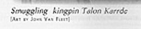
Our notes: `notes/materials/027-new-essential-chronology/07-part-seven-empire-resurgent.md:42`

## The Complete Star Wars Encyclopedia, Vol. I (A–G)

> The smuggler Talon Karrde posted men on Anchoron in an unsuccessful search for Grand Admiral Thrawn's traffic in clones, and Leia Organa Solo, in her attempts to locate an Imperial spy, planted a false report stating that a Star Destroyer had been spotted near the planet.
— Source: scan pages 41–80; Grand Admiral Thrawn; Leia Organa Solo.
Note (our notes, around the quote): Grand Admiral Thrawn; Leia Organa Solo: "The smuggler Talon Karrde posted men on Anchoron in an unsuccessful search for Grand Admiral Thrawn's traffic in clones, and Leia Organa Solo, in her attempts to locate an Imperial spy, planted a false report stating that a Star Destroyer had been spotted near the planet." Source: The Complete Star Wars Encyclopedia, Vol. I, p.30
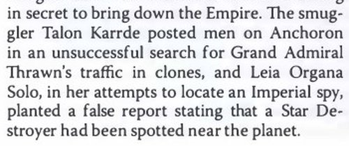
Our notes: `notes/materials/030-complete-star-wars-encyclopedia-vol-1/01-v1-scan-041-080.md:38`

> After the rescue of Anakin Solo and Tahiri Veila, the damuteks on Yavin 4 were destroyed by Talon Karrde's fleet and the Errant Venture.
— Source: scan pages 161–200; Anakin Solo; Tahiri Veila.
Note (our notes, around the quote): Anakin Solo; Tahiri Veila: "After the rescue of Anakin Solo and Tahiri Veila, the damuteks on Yavin 4 were destroyed by Talon Karrde's fleet and the Errant Venture." Source: The Complete Star Wars Encyclopedia, Vol. I, p.163
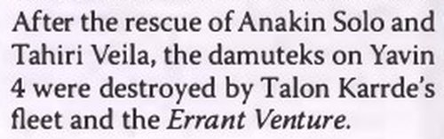
Our notes: `notes/materials/030-complete-star-wars-encyclopedia-vol-1/04-v1-scan-161-200.md:151`

> When Talon Karrde discovered the operation, Gamgalon nearly killed Karrde, but Mara Jade killed Gamgalon first.
— Source: scan pages 321–360; Mara Jade Skywalker. POV: Mara Jade Skywalker, about Talon Karrde.
Note (our notes, around the quote): Mara Jade Skywalker: "When Talon Karrde discovered the operation, Gamgalon nearly killed Karrde, but Mara Jade killed Gamgalon first." Source: The Complete Star Wars Encyclopedia, Vol. I, p.318
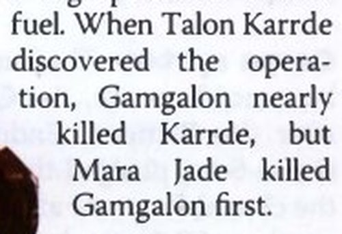
Our notes: `notes/materials/030-complete-star-wars-encyclopedia-vol-1/08-v1-scan-321-360.md:94`

## The Complete Star Wars Encyclopedia, Vol. II (H–O)

- Note (summary from our notes, not a quotation): Page contents: 1129 words, 18 paragraphs | headings/entries: Karoc; Karr, Hondo; Karra; Karrde, Talon
  — Source: scan pages 201–240.
Our notes: `notes/materials/031-complete-star-wars-encyclopedia-vol-2/05-v2-scan-201-240.md:45`

> Karrde, Talon The lawless shadows of the underworld spawned despicable characters possessed of greed, vice, and a lack of scruples—kingpins like Jabba the Hutt, capable of killing without compunction.
— Source: scan pages 201–240; Darth Talon — entry/section: Karrde, Talon.
Note (our notes, around the quote): Darth Talon — entry/section: Karrde, Talon: "Karrde, Talon The lawless shadows of the underworld spawned despicable characters possessed of greed, vice, and a lack of scruples—kingpins like Jabba the Hutt, capable of killing without compunction." Source: The Complete Star Wars Encyclopedia, Vol. II, p.200
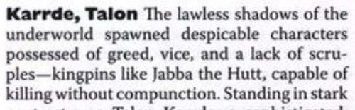
Our notes: `notes/materials/031-complete-star-wars-encyclopedia-vol-2/05-v2-scan-201-240.md:49`

> Peace didn't last long, however, and during the Confederation—GA War, after Jacen Solo declared the Jedi enemies of the state, Karrde provided his organization's information and equipment to help the Jedi successfully raid Solo's Star Destroyer.
— Source: scan pages 201–240; Jacen Solo (Darth Caedus).
Note (our notes, around the quote): Jacen Solo (Darth Caedus): "Peace didn't last long, however, and during the Confederation—GA War, after Jacen Solo declared the Jedi enemies of the state, Karrde provided his organization's information and equipment to help the Jedi successfully raid Solo's Star Destroyer." Source: The Complete Star Wars Encyclopedia, Vol. II, p.201
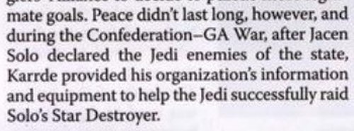
Our notes: `notes/materials/031-complete-star-wars-encyclopedia-vol-2/05-v2-scan-201-240.md:58`

## The Complete Star Wars Encyclopedia, Vol. III (P–Z)

> Later, at Han Solo's request, Jade and Karrde located and brought to the planet Almania several Force-bending ysalamiri, which Solo used to help Luke and Leia defeat the Dark Jedi Kueller.
— Source: scan pages 161–200; Han Solo; Luke Skywalker; Leia Organa Solo; Kueller.
Note (our notes, around the quote): Han Solo; Luke Skywalker; Leia Organa Solo; Kueller: "Later, at Han Solo's request, Jade and Karrde located and brought to the planet Almania several Force-bending ysalamiri, which Solo used to help Luke and Leia defeat the Dark Jedi Kueller." Source: The Complete Star Wars Encyclopedia, Vol. III, p.166
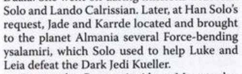
Our notes: `notes/materials/032-complete-star-wars-encyclopedia-vol-3/04-v3-scan-161-200.md:153`

> After the rescue of Anakin Solo, the shaper base was destroyed by bombardment from Talon Karrde's fleet.
— Source: scan pages 321–360; Anakin Solo. POV: Anakin Solo, about Talon Karrde.
Note (our notes, around the quote): Anakin Solo: "After the rescue of Anakin Solo, the shaper base was destroyed by bombardment from Talon Karrde's fleet." Source: The Complete Star Wars Encyclopedia, Vol. III, p.351
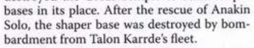
Our notes: `notes/materials/032-complete-star-wars-encyclopedia-vol-3/08-v3-scan-321-360.md:298`

## Power of the Jedi Sourcebook (d20, 2002)

> After Anakin's rescue, Talon Karrde's fleet destroyed the shaper base—and the remains of the academy along with it.
— Source: Chapter Seven: Where the Force is strong; Index; Darth Vader (Anakin Skywalker).
Note (our notes, around the quote): Darth Vader (Anakin Skywalker): "After Anakin's rescue, Talon Karrde's fleet destroyed the shaper base—and the remains of the academy along with it." Source: Power of the Jedi Sourcebook, p.139
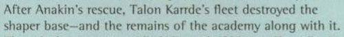
Our notes: `notes/materials/033-power-of-the-jedi-sourcebook/07-ch7-locations-index.md:69`

## The New Essential Guide to Characters (2002)

> Now set firmly against Grand Admiral Thrawn, Karrde convinced several rival smuggling kingpins to work with him against the Empire.
— Source: scan pages 91–120; Grand Admiral Thrawn. POV: Grand Admiral Thrawn, about Talon Karrde.
Note (our notes, around the quote): Grand Admiral Thrawn: "Now set firmly against Grand Admiral Thrawn, Karrde convinced several rival smuggling kingpins to work with him against the Empire." Source: The New Essential Guide to Characters, p.101
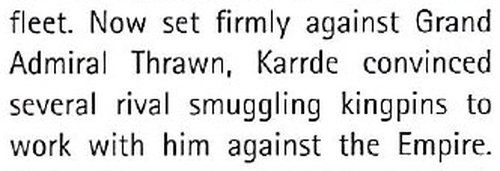
Our notes: `notes/materials/034-new-essential-guide-to-characters/03-negc-scan-091-120.md:35`

> Karrde helped Han Solo obtain the ysalamiri used to defeat the tyrant Kueller during the Almanian crisis.
— Source: scan pages 91–120; Han Solo; Kueller.
Note (our notes, around the quote): Han Solo; Kueller: "Karrde helped Han Solo obtain the ysalamiri used to defeat the tyrant Kueller during the Almanian crisis." Source: The New Essential Guide to Characters, p.101
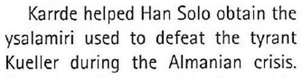
Our notes: `notes/materials/034-new-essential-guide-to-characters/03-negc-scan-091-120.md:39`

## Sourcebooks/Secrets of Tatooine.pdf [Star Wars Roleplaying Game (d20, 2000)] (scan pages 1–60)

> With Jabba's own death just before the Battle of Endor, Valarian finally had her chance to seize Jabba's empire. Assuming that all Jabba's lieutenants had been killed aboard his sail barge—there certainly wasn't any news coming out of Jabba's palace—Valarian quickly took over Jabba's operations in and around Mos Eisley and began extending her reach into Tatooine's other cities as well. Of course, without Jabba around to call the shots, most of the Hutt's smuggler contacts drifted to other patrons, notably the elusive Talon Karrde.
— Source: Sourcebooks/Secrets of Tatooine.pdf [Star Wars Roleplaying Game (d20, 200.
Note (our notes, around the quote): Lady Valarian; Jabba the Hutt; Talon Karrde — entry/section: Lady Valarian: "With Jabba's own death just before the Battle of Endor, Valarian finally had her chance to seize Jabba's empire. Assuming that all Jabba's lieutenants had been killed aboard his sail barge—there certainly wasn't any news coming out of Jabba's palace—Valarian quickly took over Jabba's operations in and around Mos Eisley and began extending her reach into Tatooine's other cities as well. Of course, without Jabba around to call the shots, most of the Hutt's smuggler contacts drifted to other patrons, notably the elusive Talon Karrde." Source: *Secrets of Tatooine* (SWRPG d20), scan p.50
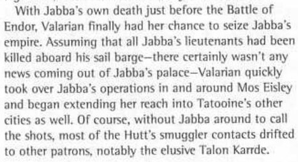
Our notes: `notes/materials/037-sw-d20-folder/045-secrets-of-tatooine-scan-001-060.md:305`

## Sourcebooks/Star Wars Roleplaying Game Core Rulebook.pdf [Star Wars Roleplaying Game (d20, 2000)] (scan pages 241–300)

> Chewbacca has remained Han's friend through countless adventures, helping to rescue him from the clutches of the gangster Jabba the Hutt, facing the three-eyed Trioculus, recruiting the smuggler Talon Karrde and the assassin Mara Jade to fight Grand Admiral Thrawn, destroying the Wayland weapons and cloning facilities, and even helping to raise Han's children.
— Source: Sourcebooks/Star Wars Roleplaying Game Core Rulebook.pdf [Star Wars Rolep; Chewbacca; Mara Jade Skywalker; Grand Admiral Thrawn.
Note (our notes, around the quote): Chewbacca; Mara Jade Skywalker; Grand Admiral Thrawn: "Chewbacca has remained Han's friend through countless adventures, helping to rescue him from the clutches of the gangster Jabba the Hutt, facing the three-eyed Trioculus, recruiting the smuggler Talon Karrde and the assassin Mara Jade to fight Grand Admiral Thrawn, destroying the Wayland weapons and cloning facilities, and even helping to raise Han's children." Source: *Star Wars Roleplaying Game Core Rulebook* (SWRPG d20), scan p.243
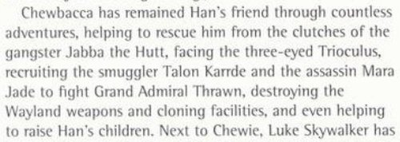
Our notes: `notes/materials/037-sw-d20-folder/046-star-wars-roleplaying-game-core-rulebook-scan-241-300.md:46`

## Sourcebooks/The New Jedi Order Sourcebook.pdf [Star Wars Roleplaying Game (d20, 2000)] (scan pages 61–120)

- Note (summary from our notes, not a quotation): Page contents: 674 words, 17 paragraphs | headings/entries: Talon Karrde's Ruse; Talon Harrde
  — Source: Sourcebooks/The New Jedi Order Sourcebook.pdf [Star Wars Roleplaying Game.
Our notes: `notes/materials/037-sw-d20-folder/049-the-new-jedi-order-sourcebook-scan-061-120.md:316`

> Even as Talon Karrde takes his ships to the edge of the Yavin system, awaiting an opportunity to rescue Anakin and his fellow students, Yuuzhan Vong warships drop gigantic pods to the surface of Yavin 4—obliterating all traces of the Jedi academy with organic structures.
— Source: Sourcebooks/The New Jedi Order Sourcebook.pdf [Star Wars Roleplaying Game; Darth Vader (Anakin Skywalker).
Note (our notes, around the quote): Darth Vader (Anakin Skywalker): "Even as Talon Karrde takes his ships to the edge of the Yavin system, awaiting an opportunity to rescue Anakin and his fellow students, Yuuzhan Vong warships drop gigantic pods to the surface of Yavin 4—obliterating all traces of the Jedi academy with organic structures." Source: *The New Jedi Order Sourcebook* (SWRPG d20), scan p.112
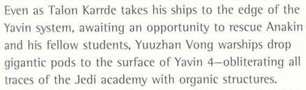
Our notes: `notes/materials/037-sw-d20-folder/049-the-new-jedi-order-sourcebook-scan-061-120.md:323`

> Even as the realization hits Talon Karrde that Wild Karrde is the only thing left between the Yuuzhan Vong and the imminent destruction of Anakin's beleaguered transport, a massive, red Imperial Star Destroyer drops out of hyperspace almost on top of them.
— Source: Sourcebooks/The New Jedi Order Sourcebook.pdf [Star Wars Roleplaying Game; Darth Vader (Anakin Skywalker).
Note (our notes, around the quote): Darth Vader (Anakin Skywalker): "Even as the realization hits Talon Karrde that Wild Karrde is the only thing left between the Yuuzhan Vong and the imminent destruction of Anakin's beleaguered transport, a massive, red Imperial Star Destroyer drops out of hyperspace almost on top of them." Source: *The New Jedi Order Sourcebook* (SWRPG d20), scan p.117
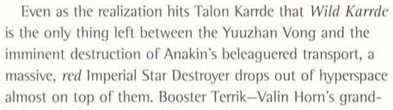
Our notes: `notes/materials/037-sw-d20-folder/049-the-new-jedi-order-sourcebook-scan-061-120.md:362`

## Star Wars Gamer/Star Wars Gamer 02.pdf [Star Wars Roleplaying Game (d20, 2000)] (scan pages 1–60)

- Note (summary from our notes, not a quotation): Page contents: Fiction "Fen Nabon" (Tish Eggleston Pahl & Chris Cassidy): smuggler Fenig Nabon (33, adopted by Corellian smuggler Jett, flies YT Star Lady) meets Talon Karrde at the Black Dust Tavern, Socorro, just after Endor; Karrde hires her to find a Jedi-proof base (hand-read)
  — Source: Star Wars Gamer/Star Wars Gamer 02.pdf [Star Wars Roleplaying Game (d20,.
Our notes: `notes/materials/037-sw-d20-folder/051-star-wars-gamer-02-scan-001-060.md:60`

What it shows (our notes): Page contents: Fen Nabon fiction: Karrde on the Jedi (no crop): '“And how long do you think it will take Skywalker to start reestablishing a Jedi Order?” Karrde pressed. “And once he does that, how long before they turn their attention to us, with or without a new Senate?”' (hand-read)
> Karrde was overreacting. Wasn’t he? “Yes, but-” “And how long do you think it will take Skywalker to start reestablishing a Jedi Order?” Karrde pressed. “And once he does that, how long before they turn their attention to us, with or without a new Senate?”
— Source: Star Wars Gamer/Star Wars Gamer 02.pdf [Star Wars Roleplaying Game (d20,.
(Excerpt widened 2026-11-17 to the relevant passage, word for word from 04ABY: A Credit for Your Thoughts (Tish Eggleton Pahl) (text copy `MEGA_All_Short_Stories_04ABY_A_Credit_for_Your_Thoughts_Tish_Eggleton_Pahl_Chris_Cassidy_epub`).)
Our notes: `notes/materials/037-sw-d20-folder/051-star-wars-gamer-02-scan-001-060.md:70`

> “If the past is any guide, neither the Jedi, nor the new Senate the Rebellion is supposedly intending to establish are likely to appreciate our methods of doing business.” “We’re talking about one Jedi here,” Fen objected quietly. “Not thousands.” Karrde narrowed his eyes in annoyance. “Skywalker destroyed Darth Vader and the Emperor in a matter of days.” Her head was reeling. Sure, like everyone else she knew the Empire was probably on its way down, but the Jedi rising in its place?
— Source: Star Wars Gamer/Star Wars Gamer 02.pdf [Star Wars Roleplaying Game (d20,.
(Excerpt widened 2026-11-17 to the relevant passage, word for word from 04ABY: A Credit for Your Thoughts (Tish Eggleton Pahl) (text copy `MEGA_All_Short_Stories_04ABY_A_Credit_for_Your_Thoughts_Tish_Eggleton_Pahl_Chris_Cassidy_epub`).)
Note (our notes, around the quote): Talon Karrde; Luke Skywalker — entry/section: Fen Nabon fiction: Karrde on Skywalker: "Karrde narrowed his eyes in annoyance. “Skywalker destroyed Darth Vader and the Emperor in a matter of days.”" Source: *Star Wars Gamer 02* (SWRPG d20), scan p.13
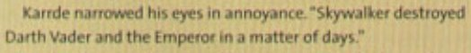
Our notes: `notes/materials/037-sw-d20-folder/051-star-wars-gamer-02-scan-001-060.md:72`

- Note (summary from our notes, not a quotation): Page contents: Karrde's new man Aves; Coruscanti con Ghitsa Dogder; bar brawl with Gran Gecee, Gotal Hrdinah, Duros Radek (hand-read)
  — Source: Star Wars Gamer/Star Wars Gamer 02.pdf [Star Wars Roleplaying Game (d20,.
Our notes: `notes/materials/037-sw-d20-folder/051-star-wars-gamer-02-scan-001-060.md:77`

- Note (summary from our notes, not a quotation): Page contents: Dogder's lead: an old Corellian smuggler and his ysalamiri, the rodent that repels Jedi; Fen and Dogder split 60/40 (Karrde's Myrkr base origin) (hand-read)
  — Source: Star Wars Gamer/Star Wars Gamer 02.pdf [Star Wars Roleplaying Game (d20,.
Our notes: `notes/materials/037-sw-d20-folder/051-star-wars-gamer-02-scan-001-060.md:102`

## Star Wars Gamer/Star Wars Gamer 03.pdf [Star Wars Roleplaying Game (d20, 2000)] (scan pages 1–60)

- Note (summary from our notes, not a quotation): Page contents: Gamer 03 contents: "Bane of the Sith" fiction (Darth Bane after Ruusan), Conquest excerpt (Talon Karrde, NJO), Smugglers' Alliance, C-3PX Most Wanted, Cloud Cover adventure (hand-read)
  — Source: Star Wars Gamer/Star Wars Gamer 03.pdf [Star Wars Roleplaying Game (d20,.
Our notes: `notes/materials/037-sw-d20-folder/052-star-wars-gamer-03-scan-001-060.md:20`

- Note (summary from our notes, not a quotation): Page contents: 188 words, 14 paragraphs | headings/entries: Karrde ... Talon Karrde; AN EXCERPT FROM; CONQUEST; ILLUSTRATION BY THERESE NIELSEN; STAR WARS GAMER 29
  — Source: Star Wars Gamer/Star Wars Gamer 03.pdf [Star Wars Roleplaying Game (d20,.
Our notes: `notes/materials/037-sw-d20-folder/052-star-wars-gamer-03-scan-001-060.md:144`

> Shada, when will you learn to trust my instincts? When have I ever gotten you killed?
— Source: Star Wars Gamer/Star Wars Gamer 03.pdf [Star Wars Roleplaying Game (d20,; Talon Karrde; Shada D'ukal — entry/section: Conquest excerpt.
Note (our notes, around the quote): Talon Karrde; Shada D'ukal — entry/section: Conquest excerpt: ""Shada, when will you learn to trust my instincts? When have I ever gotten you killed?"" Source: *Star Wars Gamer 03* (SWRPG d20), scan p.24
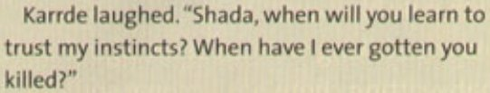
Our notes: `notes/materials/037-sw-d20-folder/052-star-wars-gamer-03-scan-001-060.md:151`

- Note (summary from our notes, not a quotation): Page contents: Conquest excerpt: Karrde bluffs Peace Brigade Captain Imsatad (served with Thrawn at Wayland) at Yavin 4 to protect the Jedi children, posing as a bounty seeker wanting Vong passage (hand-read)
  — Source: Star Wars Gamer/Star Wars Gamer 03.pdf [Star Wars Roleplaying Game (d20,.
Our notes: `notes/materials/037-sw-d20-folder/052-star-wars-gamer-03-scan-001-060.md:156`

> Better sensors than you have, for one thing. Detailed knowledge of Yavin 4 that I believe you lack. A crew that is very, very good at finding things. Certain special defenses against Jedi—and the means of finding them.
— Source: Star Wars Gamer/Star Wars Gamer 03.pdf [Star Wars Roleplaying Game (d20,; Talon Karrde — entry/section: Conquest excerpt.
Note (our notes, around the quote): Talon Karrde — entry/section: Conquest excerpt: ""Better sensors than you have, for one thing. Detailed knowledge of Yavin 4 that I believe you lack. A crew that is very, very good at finding things. Certain special defenses against Jedi—and the means of finding them."" Source: *Star Wars Gamer 03* (SWRPG d20), scan p.25
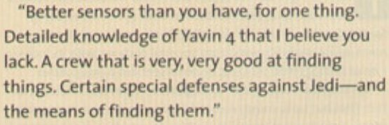
Our notes: `notes/materials/037-sw-d20-folder/052-star-wars-gamer-03-scan-001-060.md:158`

> When Karrde learned that Thrawn was after the long-lost Katana fleet (Old Republic dreadnaughts that Karrde had himself discovered some fifteen years before) he elected to sell their location to the New Republic instead,
> [fragment — full passage not on file]
— Source: Star Wars Gamer/Star Wars Gamer 03.pdf [Star Wars Roleplaying Game (d20,; Talon Karrde; Grand Admiral Thrawn — entry/section: Smugglers' Alliance.
Note (our notes, around the quote): Talon Karrde; Grand Admiral Thrawn — entry/section: Smugglers' Alliance: "When Karrde learned that Thrawn was after the long-lost Katana fleet (Old Republic dreadnaughts that Karrde had himself discovered some fifteen years before) he elected to sell their location to the New Republic instead," Source: *Star Wars Gamer 03* (SWRPG d20), scan p.54
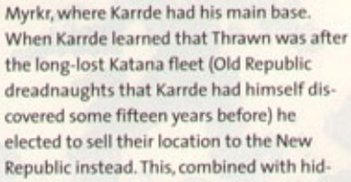
Our notes: `notes/materials/037-sw-d20-folder/052-star-wars-gamer-03-scan-001-060.md:323`

> Over the years Talon Karrde's organization has grown to include well over 800 operatives and almost two dozen ships,
> [fragment — full passage not on file]
— Source: Star Wars Gamer/Star Wars Gamer 03.pdf [Star Wars Roleplaying Game (d20,; Talon Karrde — entry/section: Smugglers' Alliance.
Note (our notes, around the quote): Talon Karrde — entry/section: Smugglers' Alliance: "Over the years Talon Karrde's organization has grown to include well over 800 operatives and almost two dozen ships," Source: *Star Wars Gamer 03* (SWRPG d20), scan p.54
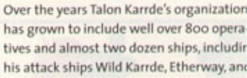
Our notes: `notes/materials/037-sw-d20-folder/052-star-wars-gamer-03-scan-001-060.md:325`

> Karrde will deal in almost anything— especially information, the only cargo with no storage overhead—but he draws the line at slavery and kidnapping.
— Source: Star Wars Gamer/Star Wars Gamer 03.pdf [Star Wars Roleplaying Game (d20,; Talon Karrde — entry/section: Smugglers' Alliance.
Note (our notes, around the quote): Talon Karrde — entry/section: Smugglers' Alliance: "Karrde will deal in almost anything— especially information, the only cargo with no storage overhead—but he draws the line at slavery and kidnapping." Source: *Star Wars Gamer 03* (SWRPG d20), scan p.55
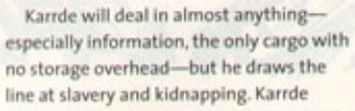
Our notes: `notes/materials/037-sw-d20-folder/052-star-wars-gamer-03-scan-001-060.md:332`

> Karrde plainly trusts the weapons specialist with his life.
— Source: Star Wars Gamer/Star Wars Gamer 03.pdf [Star Wars Roleplaying Game (d20,; Fein; Talon Karrde — entry/section: Smugglers' Alliance.
Note (our notes, around the quote): Fein; Talon Karrde — entry/section: Smugglers' Alliance: "Karrde plainly trusts the weapons specialist with his life." Source: *Star Wars Gamer 03* (SWRPG d20), scan p.57
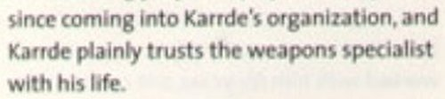
Our notes: `notes/materials/037-sw-d20-folder/052-star-wars-gamer-03-scan-001-060.md:363`

> Ambushed by an Interdictor cruiser—and facing a death penalty for smuggling spice—Karrde and Ellor desperately outmaneuvered the Interdictor until they made hyperspace.
— Source: Star Wars Gamer/Star Wars Gamer 03.pdf [Star Wars Roleplaying Game (d20,; Ellor; Talon Karrde — entry/section: Smugglers' Alliance.
Note (our notes, around the quote): Ellor; Talon Karrde — entry/section: Smugglers' Alliance: "Ambushed by an Interdictor cruiser—and facing a death penalty for smuggling spice—Karrde and Ellor desperately outmaneuvered the Interdictor until they made hyperspace." Source: *Star Wars Gamer 03* (SWRPG d20), scan p.60
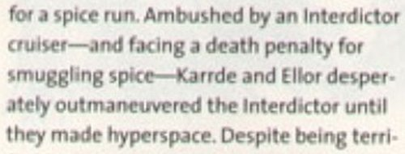
Our notes: `notes/materials/037-sw-d20-folder/052-star-wars-gamer-03-scan-001-060.md:397`

## Star Wars Gamer/Star Wars Gamer 04.pdf [Star Wars Roleplaying Game (d20, 2000)] (scan pages 61–105)

- Note (summary from our notes, not a quotation): Page contents: Ships of the Smugglers' Alliance (JD Wiker): Wild Karrde (Action VI, sensor jamming -10), Dawn Beat/Amanda Fallow YZ-775s, Lastri's Ort star galleon bought from a desperate ex-moff, Uwana Buyer yacht; Mazzic's Distant Rainbow and Preybirds Raptor/Skyclaw (pilots Griv, Amber); Gillespee's Kern's Pride (30 years together, Rebel troop/refugee/medical ship); Billey's Goshyn Queen; Clyngunn's Lady Sunfire; Brasck's slave yacht Green Palace; Ferrier's The Gunship with a conner net (hand-read)
  — Source: Star Wars Gamer/Star Wars Gamer 04.pdf [Star Wars Roleplaying Game (d20,.
Our notes: `notes/materials/037-sw-d20-folder/053-star-wars-gamer-04-scan-061-105.md:20`

## Star Wars Gamer/Star Wars Gamer 05.pdf [Star Wars Roleplaying Game (d20, 2000)] (scan pages 1–60)

- Note (summary from our notes, not a quotation): Page contents: HoloNet Transmission Q&A (JD Wiker): Yoda/Yaddle species deliberately unrevealed ('Judge Yoda by his species, do you? Species matters not'); Sturm and Drang tails clipped (Karrde's vornskyrs) correction; Deflect Blasters errata (hand-read)
  — Source: Star Wars Gamer/Star Wars Gamer 05.pdf [Star Wars Roleplaying Game (d20,.
Our notes: `notes/materials/037-sw-d20-folder/054-star-wars-gamer-05-scan-001-060.md:50`

## Star Wars Gamer/Star Wars Gamer 10.pdf [Star Wars Roleplaying Game (d20, 2000)] (scan pages 1–60)

- Note (summary from our notes, not a quotation): Page contents: War on Wayland: a Shaper base of damuteks grows on the slumped ruins of Mount Tantiss (damuteks known from Talon Karrde's records and Anakin Solo's infiltration on Yavin 4); a sick, burned perimeter zone (hand-read)
  — Source: Star Wars Gamer/Star Wars Gamer 10.pdf [Star Wars Roleplaying Game (d20,.
Our notes: `notes/materials/037-sw-d20-folder/059-star-wars-gamer-10-scan-001-060.md:117`

- Note (summary from our notes, not a quotation): Page contents: Handoff: Mara follows the tails to a house and is caught by Markko; she has lost her Force warning sense and wonders whether the Force was ever hers or only the Emperor acting through her; the locals mention Talon Karrde, a would-be smuggling chief filling Jabba's void; Alec Pradeux was among Palpatine's advisors (hand-read)
  — Source: Star Wars Gamer/Star Wars Gamer 10.pdf [Star Wars Roleplaying Game (d20,.
Our notes: `notes/materials/037-sw-d20-folder/059-star-wars-gamer-10-scan-001-060.md:175`

- Note (summary from our notes, not a quotation): Page contents: Handoff: Talon Karrde recruits Ghent as his slicer, his people having dealt with both the Imperial and Rebel pursuers, and he plans to search the mystery woman's abandoned belongings (hand-read)
  — Source: Star Wars Gamer/Star Wars Gamer 10.pdf [Star Wars Roleplaying Game (d20,.
Our notes: `notes/materials/037-sw-d20-folder/059-star-wars-gamer-10-scan-001-060.md:219`

## Sourcebooks/Sourcebook Web Enhancements/Galactic Gazetteer - Hoth and the Greater Javin.pdf [Star Wars Roleplaying Game Revised Core (d20, 2002)]

- Note (summary from our notes, not a quotation): Page contents: Ione stats; Mataou (ro hypa venom), Anantapar, Shuxl, Ertegas, Darlyn Boda (toccat haruspexes), Orn Kios, Ozu, Isde Naha, Togominda; Ison Corridor: Varonat (Morodin; Krish; Talon Karrde) (hand-read)
  — Source: Sourcebooks/Sourcebook Web Enhancements/Galactic Gazetteer - Hoth and the.
Our notes: `notes/materials/037-sw-d20-folder/644-galactic-gazetteer-hoth-and-the-greater-javin.md:54`

## Sourcebooks/Hero's Guide.pdf [Star Wars Roleplaying Game Revised Core (d20, 2002)] (scan pages 61–120)

- Note (summary from our notes, not a quotation): Page contents: Rise of the Empire factions cont.; The New Republic era (Thrawn, Daala, Pellaeon, Xizor's death); The New Jedi Order era; Creating New Factions (Talon Karrde's Smugglers' Alliance). (hand-read)
  — Source: Sourcebooks/Hero's Guide.pdf [Star Wars Roleplaying Game Revised Core (d2.
Our notes: `notes/materials/037-sw-d20-folder/668-heros-guide-scan-061-120.md:304`

> Talon Karrde's Smugglers' Alliance, for example, is more of a guild than a faction. Even though it includes a great many members scattered throughout the galaxy, the group was founded to stand against the threat of Grand Admiral Thrawn. With Thrawn gone, the Smugglers' Alliance had little reason to stay together, and it ceased to exist.
— Source: Sourcebooks/Hero's Guide.pdf [Star Wars Roleplaying Game Revised Core (d2.
Note (our notes, around the quote): Talon Karrde; Grand Admiral Thrawn — entry/section: Talon Karrde's Smugglers' Alliance: "Talon Karrde's Smugglers' Alliance, for example, is more of a guild than a faction. Even though it includes a great many members scattered throughout the galaxy, the group was founded to stand against the threat of Grand Admiral Thrawn. With Thrawn gone, the Smugglers' Alliance had little reason to stay together, and it ceased to exist." Source: *Hero's Guide* (SWRPG d20 Revised Core), scan p.115
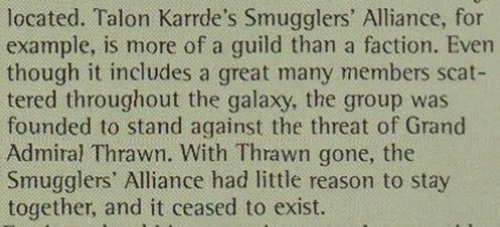
Our notes: `notes/materials/037-sw-d20-folder/668-heros-guide-scan-061-120.md:310`

## Sourcebooks/Ultimate Adversaries.pdf [Star Wars Roleplaying Game Revised Core (d20, 2002)] (scan pages 121–162)

- Note (summary from our notes, not a quotation): Page contents: Vornskr stats; Voxyn (Talon Karrde's vornskrs Sturm and Drang, Peace Brigade, Yuuzhan Vong). (hand-read)
  — Source: Sourcebooks/Ultimate Adversaries.pdf [Star Wars Roleplaying Game Revised.
Our notes: `notes/materials/037-sw-d20-folder/672-ultimate-adversaries-scan-121-162.md:37`

> When Talon Karrde duped the Peace Brigade on Yavin 4, he brought along his pet vornskrs, Sturm and Drang. The Peace Brigade was extremely interested to learn that the creatures were not only able to sense Force-users but also seemed particularly aggressive toward Jedi. Though Karrde did not tell the Peace Brigade where to find wild vornskrs, it was only a matter of time before the Peace Brigade captured some of its own.
— Source: Sourcebooks/Ultimate Adversaries.pdf [Star Wars Roleplaying Game Revised; Talon Karrde — entry/section: Voxyn: Origins.
Note (our notes, around the quote): Talon Karrde — entry/section: Voxyn: Origins: "When Talon Karrde duped the Peace Brigade on Yavin 4, he brought along his pet vornskrs, Sturm and Drang. The Peace Brigade was extremely interested to learn that the creatures were not only able to sense Force-users but also seemed particularly aggressive toward Jedi. Though Karrde did not tell the Peace Brigade where to find wild vornskrs, it was only a matter of time before the Peace Brigade captured some of its own." Source: *Ultimate Adversaries* (SWRPG d20 Revised Core), scan p.126
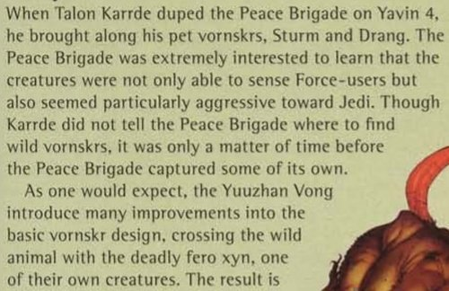
Our notes: `notes/materials/037-sw-d20-folder/672-ultimate-adversaries-scan-121-162.md:39`

## Sourcebooks/Scum and Villany.pdf [Star Wars Roleplaying Game Saga Edition (2007)] (scan pages 61–120)

- Note (summary from our notes, not a quotation): Page contents: Table 3-6 Bounties (d20 wanted-for/description/reward; roll 20 = treason, sedition: NPC such as Han Solo, Talon Karrde, Corran Horn, reward Special). Gather Information to locate target; example Lesk Hisshar hunting a Duros on Nar Shaddaa (Palace Casino). Survival tracking; DC 25 Use Computer to analyze Cronau radiation signature. Capturing Targets. (hand-read)
  — Source: Sourcebooks/Scum and Villany.pdf [Star Wars Roleplaying Game Saga Edition.
Our notes: `notes/materials/037-sw-d20-folder/725-scum-and-villany-scan-061-120.md:153`

- Note (summary from our notes, not a quotation): Page contents: Bounty Generator (2d20 on Table 3-6; CL x 1,000; secondary bounty half value of captured equipment; famous targets such as Han Solo or Talon Karrde). Con Games; Sample Scam; sidebar Scammers and Marks; The Toydarian Drop (worth ~25,000 credits; Deception vs Will Defense, NPC +15). (hand-read)
  — Source: Sourcebooks/Scum and Villany.pdf [Star Wars Roleplaying Game Saga Edition.
Our notes: `notes/materials/037-sw-d20-folder/725-scum-and-villany-scan-061-120.md:162`

- Note (summary from our notes, not a quotation): Page contents: Booster Terrik cont. (Pulsar Skate; Antilles family, Wedge; Z-95; 5 years on Kessel; released after Hoth; fought Ysanne Isard; Yag'Dhul Station; Hutts and Talon Karrde; Star Destroyer Virulence renamed Errant Venture; Corran Horn, Rogue Squadron). Stat block CL 12 (Medium Human scoundrel 5/soldier 5/crime lord 2). Boushh begins (Ubese bounty hunter impersonated by Leia Organa at Jabba's Palace). (hand-read)
  — Source: Sourcebooks/Scum and Villany.pdf [Star Wars Roleplaying Game Saga Edition.
Our notes: `notes/materials/037-sw-d20-folder/725-scum-and-villany-scan-061-120.md:279`

## Sourcebooks/Scum and Villany.pdf [Star Wars Roleplaying Game Saga Edition (2007)] (scan pages 121–180)

- Note (summary from our notes, not a quotation): Page contents: Y164 Slave Transport (stat block CL 13, Colossal (frigate) space transport; 12,400 slaves). LOCALES intro. The Errant Venture (ex-Virulence, Imperial II-class Star Destroyer; Battle of Endor, Battle of Thyferra; Booster Terrik; painted red; Talon Karrde; Thrawn's "return"; Yuuzhan Vong; Second Corellian Insurrection; Jedi Academy; son-in-law Corran Horn). (hand-read)
  — Source: Sourcebooks/Scum and Villany.pdf [Star Wars Roleplaying Game Saga Edition.
Our notes: `notes/materials/037-sw-d20-folder/725-scum-and-villany-scan-121-180.md:56`

## Sourcebooks/The Force Unleashed Campaign Guide.pdf [Star Wars Roleplaying Game Saga Edition (2007)] (scan pages 61–120)

- Note (summary from our notes, not a quotation): Page contents: Car'das ranks (Crewmember, Navigator or Helmsman, Officer, First Officer, Captain); Roleplaying Applications (Talon Karrde). House Organa (royal family of Alderaan; Queen Breha; Bail funnels resources to anti-Imperial causes; Sabe trains Leia and Winter; hidden resources on Bothawui and Eriadu). (hand-read)
  — Source: Sourcebooks/The Force Unleashed Campaign Guide.pdf [Star Wars Roleplaying.
Our notes: `notes/materials/037-sw-d20-folder/729-the-force-unleashed-campaign-guide-scan-061-120.md:113`

## Sourcebooks/Threats of the Galaxy.pdf [Star Wars Roleplaying Game Saga Edition (2007)] (scan pages 61–120)

- Note (summary from our notes, not a quotation): Page contents: Talon Karrde CL 12 stat block (Human scoundrel 7/crime lord 5; Attract Minion, Impel Ally I and II, Stellar Warrior; modified Action VI Transport Wild Karrde); VCX-350 Light Freighter sidebar (CEC transport used by smugglers after the fall of the Empire) with CEC VCX-350 stat block (CL 10, Colossal, cost 300,000). (hand-read)
  — Source: Sourcebooks/Threats of the Galaxy.pdf [Star Wars Roleplaying Game Saga Ed.
Our notes: `notes/materials/037-sw-d20-folder/731-threats-of-the-galaxy-scan-061-120.md:219`

> The vicious Admiral Thrawn, intelligence agencies, bounty hunters, rival smugglers, and crime lords all had it out for Karrde, who proved smart (and lucky) enough to evade them aff and thrive.
— Source: Sourcebooks/Threats of the Galaxy.pdf [Star Wars Roleplaying Game Saga Ed; Grand Admiral Thrawn. POV: Grand Admiral Thrawn, about Talon Karrde.
Note (our notes, around the quote): Grand Admiral Thrawn: "The vicious Admiral Thrawn, intelligence agencies, bounty hunters, rival smugglers, and crime lords all had it out for Karrde, who proved smart (and lucky) enough to evade them aff and thrive." Source: *Threats of the Galaxy* (SWRPG Saga Edition), scan p.90
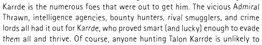
Our notes: `notes/materials/037-sw-d20-folder/731-threats-of-the-galaxy-scan-061-120.md:221`

## Web Articles.pdf [Star Wars Roleplaying Game Saga Edition (2007)] (scan pages 61–120)

- Note (summary from our notes, not a quotation): Page contents: Jedi Counseling 100 Minis cont.: Lord Vader's Overwhelming Force is a buff that works against Force Immunity; Nym plus Mas Amedda's Booming Voice does not extend Disruptive (not a commander effect); Disruptive both blocks enemies within 6 squares from being affected by enemy commander effects and suppresses their own commander effects; examples with Grand Admiral Thrawn, Talon Karrde, Elite and Heavy Stormtroopers, and Grand Moff Tarkin's 1-3 activations (thrawn, talon-karrde, grand-moff-tarkin, nym, mas-amedda: rules-only mentions). (hand-read)
  — Source: Web Articles.pdf [Star Wars Roleplaying Game Saga Edition (2007)] (scan p.
Our notes: `notes/materials/037-sw-d20-folder/732-web-articles-scan-061-120.md:65`

> (As a comparison, this is about 1/4 as much room as the same vehicle would require if you converted that cargo space into a hangar bay.) Q: My players have discovered that they can make very good warships by modifying freighters, turning all that extra cargo space into emplacement points. I can’t find anything wrong with it in the rules, but it looks like a converted freighter could overpower a Star Destroyer! Am I missing something, or is this intentional? A: You are missing something. Under Nonstandard Modifications (page 39, Starships of the Galaxy), you’ll find this little catchall rule: “The GM is the final arbiter of what systems are sufficiently dissimilar to qualify as nonstandard, and particularly unusual combinations may be forbidden altogether.” In other words, no modification is legal unless you specifically say it is. What you’re describing—turning a freighter into a big pile of emplacement points to hold high-end capital-ship weaponry—skids right past nonstandard (“sufficiently dissimilar” systems) and smacks right into the middle of forbidden (“particularly unusual combinations”). The rules as written not only empower you to veto such an absurd design, they expect you to do so. If your players object, tell them that they have to prove that the proposed modification is not “particularly unusual” by providing a few examples of similar cases.
— Source: Web Articles.pdf [Star Wars Roleplaying Game Saga Edition (2007)] (scan p.
(Excerpt widened 2026-11-17 to the relevant passage, word for word from research primary sw d20 folder files Star Wars Roleplaying Game Saga Edition Web Articles (text copy `research_primary_sw_d20_folder_files_Star_Wars_Roleplaying_Game_Saga_Edition_Web_Articles_pdf_6187a774ab`).)
(Excerpt widened 2026-11-17 to the relevant passage, word for word from research primary sw d20 folder files Star Wars Roleplaying Game Saga Edition Web Articles (text copy `research_primary_sw_d20_folder_files_Star_Wars_Roleplaying_Game_Saga_Edition_Web_Articles_pdf_6187a774ab`).)
(Full sentence/passage taken from the source text on file: `research_primary_sw_d20_folder_files_Star_Wars_Roleplaying_Game_Saga_Edition_Web_Articles_pdf`.)
Note (our notes, around the quote): Page contents: Jedi Counseling 115 cont.: cargo-stored vehicles need about 100 tons (50 cubic meters) per unit of hangar space; freighters converted to warships are vetoed by Nonstandard Modifications (p39: "particularly unusual combinations may be forbidden altogether"); modified freighters (Millennium Falcon, Outrider, Wild Karrde, Ebon Hawk) and the Gallofree GR-75 never became pocket battleships; guidelines: no similar stock system (hyperdrive on a starfighter), >50% speed/hp/shields or >100% weapons/passengers/hangar, emplacement points from cargo equal to cost modifier; Minis: Invisibility: adjacent characters may use attacks and targeted abilities, invisible characters still grant cover (competitive game balance); multiple Mines don't stack ("minefield" analogy), Large characters save once, non-movement entry (Grand Admiral Thrawn's commander effect, disembarking, Force Push) doesn't trigger Mines. (hand-read)
Our notes: `notes/materials/037-sw-d20-folder/732-web-articles-scan-061-120.md:361`

## Web Articles.pdf [Star Wars Roleplaying Game Saga Edition (2007)] (scan pages 301–360)

- Note (summary from our notes, not a quotation): Page contents: Han Solo, Galactic Hero (LotF Preview 4 cont.): background (40 ABY, Corellia secession, Luke and Jacen, Galactic Alliance Guard) and miniatures tactics (Disruptive, Never Tell Me The Odds vs Thrawn; compared with Boba Fett, Bounty Hunter; Greater Mobile Attack bullet tactics; Talon Karrde initiative control) - T records (bullets rendered "•"; "does"/"rarely" marked [sic]); stat card (New Republic; cost 50; HP 90; Def 19; Atk +10; Dmg 20; Unique, Accurate Shot, Cunning Attack, Disruptive, Double Attack, Evade, Greater Mobile Attack, Never Tell Me The Odds); Saga stats Han Solo (early Legacy Era) CL 19 Medium Human scoundrel 5/soldier 3/ace pilot 5/gunslinger 5/officer 1 (Destiny 3; Force 7; Dark Side 2; Init +20; Basic, Huttese, Rodese, Shyriiwook; Ref 34, Fort 31, Will 35; hp 98; heavy blaster pistol +17 (3d8+13) with Rapid Shot/Double Attack options; quad laser cannons; concussion missiles; Combined Fire, Deceptive Shot, Draw Fire, Fool's Luck, Full Throttle, Keep It Together; maneuvers angle deflector shields, overwhelming assault, skim the surface; trusty sidearm +2, vehicle dodge +2; possessions heavy blaster pistol with targeting scope, tool kit, modified YT-1300 (Millennium Falcon)); footnote "Described in Starships of the Galaxy". (hand-read)
  — Source: Web Articles.pdf [Star Wars Roleplaying Game Saga Edition (2007)] (scan p.
Our notes: `notes/materials/037-sw-d20-folder/732-web-articles-scan-301-360.md:150`

## Star Wars Insider #33 (1997)

- Note (summary from our notes, not a quotation): Page contents: Bob Cooper "Straight from the Horse's Mouth" (pp74-76, printed 70-72): making of Dark Horse's Dark Force Rising #1 p3 (Mike Baron script; Gil Kane, Terry Dodson, Kevin Nowlan, Ellie de Ville, Pamela Rambo); dialogue examples with Mara Jade and Talon Karrde are production illustrations. Real-world. (hand-read)
  — Source: Star Wars Insider #33 (1997).
Our notes: `notes/materials/038-star-wars-insider/033-ins033.md:396`

## Star Wars Insider #47 (1999)

- Note (summary from our notes, not a quotation): Page contents: Union: Imperial remnants plan to spoil the wedding; cast incl. Karrde, Wedge, Booster, Mirax, Corran Horn; Stackpole quotes. Publishing commentary. (hand-read)
  — Source: Star Wars Insider #47 (1999).
Our notes: `notes/materials/038-star-wars-insider/047-ins047.md:395`

## Star Wars Insider #54 (2001)

> we just couldn't get the Ugnauts to work any faster
> [fragment — full passage not on file]
>
> You heard the man, they don't allow his kind there. His head though? Yeah, sure.
— Source: Star Wars Insider #54 (2001).
Note (our notes, around the quote): Page contents: Rebel Rumblings cont. (writer names omitted): editor acknowledges start-up problems ("we just couldn't get the Ugnauts to work any faster"); complaint about thinner issues; IG-88's head visible in the cantina plumbing (editor: "You heard the man, they don't allow his kind there. His head though? Yeah, sure."); trading-card nostalgia. "Next Issue" box (top right, read from page image): Samuel L. Jackson interview, Brian Daley remembered, Star Wars on The Muppet Show, Episode II prequel update; "In Two Weeks!" Star Wars Gamer back-to-nature issue (Eight from Aduba-3, Alien Safari field guide, The Secrets of Kashyyyk, Starfaring Jungles (Ithorian Herd Ships), Starships of the Smuggler's Alliance (Talon Karrde's fleet: Wild Karrde, Etherway, Uwana Buyer)). "Wanna Rumble?" submission rules. (hand-read)
Our notes: `notes/materials/038-star-wars-insider/054-ins054.md:401`

## Star Wars Insider #75 (2004)

- Note (summary from our notes, not a quotation): Page contents: "The Emperor's Hand" Mara Jade profile: Zahn's 1991 Heir to the Empire creation (Talon Karrde's lieutenant; "Mara" means "bitter" in Hebrew, "Jade" for her green eyes); model Shannon Baksa-McRandle; Mara at Jabba's palace with orders to kill Luke; her parallels with Luke, Han, Leia, Lando and Vader. (hand-read)
  — Source: Star Wars Insider #75 (2004). POV: Page contents, about Talon Karrde.
Our notes: `notes/materials/038-star-wars-insider/075-ins075.md:478`

## Star Wars Insider #80 (2005)

- Note (summary from our notes, not a quotation): Page contents: Bogden's moon Kohima in Bounty Hunter (Komari Vosa, Bando Gora); Subterrel (Dexter Jettster's prospecting, Kaminoan clone miners); Sullust and Slave Ship comparisons; Rishi (Dark Force Rising, Talon Karrde and Mara Jade) and the Rishi Maze; SagDEG. (hand-read)
  — Source: Star Wars Insider #80 (2005).
Our notes: `notes/materials/038-star-wars-insider/080-ins080.md:372`

## Star Wars Insider #89 (2006)

- Note (summary from our notes, not a quotation): Page contents: Scoundrels: Han Solo dossier; BoShek interview; Talon Karrde; caption Lando loses the Falcon (hand-read)
  — Source: Star Wars Insider #89 (2006).
Our notes: `notes/materials/038-star-wars-insider/089-ins089.md:233`

## Star Wars Insider #91 (2007)

- Note (summary from our notes, not a quotation): Page contents: Jedi Library cont.: Zahn on plotting; Mara's Force strength from Palpatine; loyalty later transferred to Talon Karrde, the New Republic and Luke; 30th Anniversary Fact card (novelization ghostwritten by Alan Dean Foster, Chewbacca's medal); Upcoming Star Wars Books list; You Can Draw Star Wars ad (hand-read)
  — Source: Star Wars Insider #91 (2007).
Our notes: `notes/materials/038-star-wars-insider/091-ins091.md:136`

> Her strong sense of loyalty will later be transferred to Talon Karrde, then to the New Republic, and finally to Luke.
— Source: Star Wars Insider #91 (2007).
Note (our notes, around the quote): Mara Jade Skywalker; Talon Karrde; Luke Skywalker — entry/section: Mara's loyalty: ""Her strong sense of loyalty will later be transferred to Talon Karrde, then to the New Republic, and finally to Luke." —Timothy Zahn, Star Wars Insider 91, p. 21" Source: *Star Wars Insider #91* (2007), scan p.21
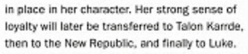
Our notes: `notes/materials/038-star-wars-insider/091-ins091.md:140`

## Star Wars Insider #104 (2008)

- Note (summary from our notes, not a quotation): Page contents: International Collecting cont. (Star Wars Pine Sol bottle, Dixan laundry detergent); Toys: Expanded Universe comic two-packs (Cade Skywalker, Darth Talon, Grand Admiral Thrawn, Talon Karrde, Dengar, Fenn Shysa, Antares Draco, Ganner); Cartamundi playing cards (hand-read)
  — Source: Star Wars Insider #104 (2008).
Our notes: `notes/materials/038-star-wars-insider/104-ins104.md:395`

## Star Wars Insider #112 (2009)

> He was even ugly as a baby!
— Source: Star Wars Insider #112 (2009).
Note (our notes, around the quote): Page contents: Quiz Sections Two-Three, Jedi vs Sith and Read All About It (questions 11-19: shaaks on Naboo, Yoda's blissl, Labyrinth of Evil, Vader on Dantooine, Heir to the Empire working titles, Timothy Zahn as Talon Karrde card model, "He was even ugly as a baby!"). Out-of-universe. (hand-read)
Our notes: `notes/materials/038-star-wars-insider/112-ins112.md:319`

## Star Wars Insider #133 (2012)

- Note (summary from our notes, not a quotation): Page contents: Battles: Ruusan (Lord Hoth's gambit vs Kaan's Brotherhood); Bilbringi (Thrawn killed by his Noghri bodyguard; Karrde's smugglers hit the rear); Fondor (Jacen Solo vs Niathal; Daala's Maw Irregulars and Mandalorian commandos turn the tide). (hand-read)
  — Source: Star Wars Insider #133 (2012).
Our notes: `notes/materials/038-star-wars-insider/133-ins133.md:117`

## Dark Empire Sourcebook (West End Games, 1993), hand-read

> "Stealing a gram of antimatter from the physics lab, he had Intended to blast the Academy Seal off the surface of the “mascot moon,” a rocky planetoid in high orbit. Instead, the blast destroyed the planetoid." — p. 45 (Mako Spince)
> [fragment — full passage not on file]
>
> "Wyrmyr: Enough, of this. He blew up a moon!" — p. 46 (hearing transcript; "Cadet Solo" was a witness)
> [fragment — full passage not on file]
— Source: Dark Empire Sourcebook — chunk 3: Chapter Two part B, Chapter Three "The Fringe" (printed pp. 39–60).
Context: Lore: Jabba's death triggered "a full-scale Hutt clan war" (p. 44); Talon Karrde built a "massive" empire in a few years (p. 44). Deep Core hauler licences give smugglers immunity "for any actions against the New Republic" (p. 44).
Our notes: `notes/materials/043-dark-empire-sourcebook/03-empire-reborn-b-and-fringe.md:12`

## The Thrawn Trilogy (Timothy Zahn): Heir to the Empire, Dark Force Rising, The Last Command, plus the Heir 20th Anniversary extras

What it shows (our notes): > — Thrawn, DFR ch. 1
> The glowing eyes bored into Pellaeon’s face. “Never forget, Captain, that our goal is no longer merely the pitiful rear-guard harassment of the past five years. With Mount Tantiss and our late Emperor’s collection of Spaarti cylinders in our hands, the initiative is once again ours. Very soon now we’ll begin the process of taking planets back from the Rebellion; and for that we’ll need an army every bit as well trained as the officers and crew of the Fleet.”
— Source: Dark Force Rising — notes part 1: front matter, ch. 1–2.
(Excerpt widened 2026-11-17 to the relevant passage, word for word from Heir to the Empire (Timothy Zahn) (text copy `MEGA_Legend_The_Thrawn_Trilogy_Star_Wars_Thrawn_Trilogy_01_Heir_to_the_Empire_20th_Anniversary_Edition_Timothy_Zahn_epub`).)
Our notes: `notes/materials/044-thrawn-trilogy/dfr-01.md:9`

> one of his twelve Grand Admirals ... given Thrawn’s not-entirely-human heritage and the Emperor’s well-known prejudices
> [fragment — full passage not on file]
— Source: Dark Force Rising — notes part 1: front matter, ch. 1–2; Thrawn's twelve-Grand-Admiral context. POV: Thrawn's twelve-Grand-Admiral context, about Talon Karrde.
Note (our notes, around the quote): Thrawn's twelve-Grand-Admiral context: "one of his twelve Grand Admirals ... given Thrawn’s not-entirely-human heritage and the Emperor’s well-known prejudices". He has commanded the *Chimaera* for "the year".
Our notes: `notes/materials/044-thrawn-trilogy/dfr-01.md:10`

What it shows (our notes): Thrawn plans the raid three ways: the base, the Hyllyard City contacts, and field experience. It is masked by a timed transmission summoning the Interdictor *Constrainer*.
> “I don’t either,” Thrawn agreed. “But it’s the only sizable cover available for nearly ten million kilometers around Myrkr. There’s really no other place for Karrde to watch our operation from.”
>
> "You forget, Captain ... that I’ve met the man. More important, I’ve seen the sort of artwork he collects." — Thrawn, DFR ch. 1
> [fragment — full passage not on file]
— Source: Dark Force Rising — notes part 1: front matter, ch. 1–2.
(Excerpt widened 2026-11-17 to the relevant passage, word for word from Heir to the Empire (Timothy Zahn) (text copy `MEGA_Legend_The_Thrawn_Trilogy_Star_Wars_Thrawn_Trilogy_01_Heir_to_the_Empire_20th_Anniversary_Edition_Timothy_Zahn_epub`).)
(Fragment completed 2026-11-17: full sentence/passage matched word for word in the source text on file: `MEGA_Legend_The_Thrawn_Trilogy_Star_Wars_Thrawn_Trilogy_01_Heir_to_the_Empire_20th_Anniversary_Edition_Timothy_Zahn_epub`.)
Note text that was attached to the quote line: — Thrawn, DFR ch. 1
Our notes: `notes/materials/044-thrawn-trilogy/dfr-01.md:11`

What it shows (our notes): Covell's force: 4 AT-ATs (one per side), AT-STs, and hoverscouts carrying 8-man squads. Covell "had directed literally hundreds of assault campaigns". Myrkr's "metal-rich flora" dampens comms.
> The acknowledgments came in; and with a shiver from the steel deck beneath him, the huge AT-AT walker was off, lumbering its deceptively awkward-looking way through the forest toward the encampment a kilometer away. Ahead of the AT-AT, occasionally visible through the armored transparisteel viewport, a pair of AT-ST scout walkers ran in twin-point formation, tracking along the AT-AT’s path and watching for enemy positions or booby traps. Not that such futile gestures would do Karrde any good. Covell had directed literally hundreds of assault campaigns in his years of Imperial service, and he knew full well the awesome capabilities of the fighting machines under his command.
— Source: Dark Force Rising — notes part 1: front matter, ch. 1–2.
(Excerpt widened 2026-11-17 to the relevant passage, word for word from Heir to the Empire (Timothy Zahn) (text copy `MEGA_Legend_The_Thrawn_Trilogy_Star_Wars_Thrawn_Trilogy_01_Heir_to_the_Empire_20th_Anniversary_Edition_Timothy_Zahn_epub`).)
(Fragment completed 2026-11-17: full sentence/passage matched word for word in the source text on file: `MEGA_Legend_The_Thrawn_Trilogy_Star_Wars_Thrawn_Trilogy_01_Heir_to_the_Empire_20th_Anniversary_Edition_Timothy_Zahn_epub`.)
Our notes: `notes/materials/044-thrawn-trilogy/dfr-01.md:14`

What it shows (our notes): Vornskrs stare at Mara the way the wild ones stared at Luke "just before they attacked him". (ANALYSIS: this marks her Force-sensitivity.)
> Except that those vornskr stares hadn’t been directed at her. They’d been reserved instead for Skywalker. Usually just before they attacked him.
— Source: Dark Force Rising — notes part 1: front matter, ch. 1–2.
(Excerpt widened 2026-11-17 to the relevant passage, word for word from Heir to the Empire (Timothy Zahn) (text copy `MEGA_Legend_The_Thrawn_Trilogy_Star_Wars_Thrawn_Trilogy_01_Heir_to_the_Empire_20th_Anniversary_Edition_Timothy_Zahn_epub`).)
(Fragment completed 2026-11-17: full sentence/passage matched word for word in the source text on file: `MEGA_Legend_The_Thrawn_Trilogy_Star_Wars_Thrawn_Trilogy_01_Heir_to_the_Empire_20th_Anniversary_Edition_Timothy_Zahn_epub`.)
Our notes: `notes/materials/044-thrawn-trilogy/dfr-01.md:15`

> "With their four huge gravity-wave generators capable of simulating planet-sized masses, Interdictor Cruisers were the Empire’s weapon of choice ... coming in fresh out of lightspeed itself, the Interdictor would need another minute before it could power up those generators." — DFR ch. 1
> [fragment — full passage not on file]
>
> But no. It was all coming back, as it had so many times before in the past five years. The hunches and sensory flickers, the urges and the compulsions.
>
> Which meant that, very soon now, the dreams would probably be starting again, too.
— Source: Dark Force Rising — notes part 1: front matter, ch. 1–2.
(Fragment completed 2026-11-17: full sentence/passage matched word for word in the source text on file: `MEGA_Legend_The_Thrawn_Trilogy_Star_Wars_Thrawn_Trilogy_01_Heir_to_the_Empire_20th_Anniversary_Edition_Timothy_Zahn_epub`.)
Note text that was attached to the quote line: — Mara, DFR ch. 1
Context: Mara's precognitive danger sense: she powers up *before* the Interdictor arrives. "They’re coming." The Interdictor drops in "not twenty kilometers away".
Our notes: `notes/materials/044-thrawn-trilogy/dfr-01.md:16`

What it shows (our notes): Mara's post-Endor jobs: serving girl in a Phorliss cantina, "come-up flector for a swoop gang on Caprioril", hyperdrive mechanic in the Ison Corridor. Karrde is "the most powerful smuggler in the galaxy".
> But she wasn’t a serving girl in a Phorliss cantina this time, or a come-up flector for a swoop gang on Caprioril, or even a hyperdrive mechanic stuck in the backwater of the Ison Corridor. She was second in command to the most powerful smuggler in the galaxy, with the kind of resources and mobility she hadn’t had since the death of the Emperor.
— Source: Dark Force Rising — notes part 1: front matter, ch. 1–2; Mara's post-Endor jobs: serving girl in a Phorliss cantina.
(Excerpt widened 2026-11-17 to the relevant passage, word for word from Heir to the Empire (Timothy Zahn) (text copy `MEGA_Legend_The_Thrawn_Trilogy_Star_Wars_Thrawn_Trilogy_01_Heir_to_the_Empire_20th_Anniversary_Edition_Timothy_Zahn_epub`).)
(Fragment completed 2026-11-17: full sentence/passage matched word for word in the source text on file: `MEGA_Legend_The_Thrawn_Trilogy_Star_Wars_Thrawn_Trilogy_01_Heir_to_the_Empire_20th_Anniversary_Edition_Timothy_Zahn_epub`.)
Our notes: `notes/materials/044-thrawn-trilogy/dfr-01.md:19`

> “Mara is second in command,” Karrde cut him off. “As such, she has the right and the duty to make important decisions.”
— Source: Dark Force Rising — notes part 1: front matter, ch. 1–2; Karrde. POV: Karrde.
(Excerpt widened 2026-11-17 to the relevant passage, word for word from Heir to the Empire (Timothy Zahn) (text copy `MEGA_Legend_The_Thrawn_Trilogy_Star_Wars_Thrawn_Trilogy_01_Heir_to_the_Empire_20th_Anniversary_Edition_Timothy_Zahn_epub`).)
(Fragment completed 2026-11-17: full sentence/passage matched word for word in the source text on file: `MEGA_Legend_The_Thrawn_Trilogy_Star_Wars_Thrawn_Trilogy_01_Heir_to_the_Empire_20th_Anniversary_Edition_Timothy_Zahn_epub`.)
Our notes: `notes/materials/044-thrawn-trilogy/dfr-01.md:20`

What it shows (our notes): Thrawn: "Or else he was somehow warned off." He starts working the Mara puzzle.
> “Yes,” Thrawn nodded. “And it implies one of three things. Either Karrde was about to leave anyway, or else he panicked for some reason—” The red eyes glittered. “Or else he was somehow warned off.”
— Source: Dark Force Rising — notes part 1: front matter, ch. 1–2; Thrawn. POV: Thrawn, about Talon Karrde.
(Excerpt widened 2026-11-17 to the relevant passage, word for word from Heir to the Empire (Timothy Zahn) (text copy `MEGA_Legend_The_Thrawn_Trilogy_Star_Wars_Thrawn_Trilogy_01_Heir_to_the_Empire_20th_Anniversary_Edition_Timothy_Zahn_epub`).)
Our notes: `notes/materials/044-thrawn-trilogy/dfr-01.md:21`

> Eight of the fifteen groups ... expressed interest
> [fragment — full passage not on file]
>
> Thrawn nodded. “We’ll give them a few weeks. If there’ve been no results after that time, we’ll make the invitation a bit more compulsory.”
— Source: Dark Force Rising — notes part 1: front matter, ch. 1–2; The warship invitation. POV: The warship invitation, about Talon Karrde.
(Excerpt widened 2026-11-17 to the relevant passage, word for word from Heir to the Empire (Timothy Zahn) (text copy `MEGA_Legend_The_Thrawn_Trilogy_Star_Wars_Thrawn_Trilogy_01_Heir_to_the_Empire_20th_Anniversary_Edition_Timothy_Zahn_epub`).)
(Fragment completed 2026-11-17: full sentence/passage matched word for word in the source text on file: `MEGA_Legend_The_Thrawn_Trilogy_Star_Wars_Thrawn_Trilogy_01_Heir_to_the_Empire_20th_Anniversary_Edition_Timothy_Zahn_epub`.)
Label in our notes: Thrawn
Our notes: `notes/materials/044-thrawn-trilogy/dfr-01.md:22`

> The Noghri ... are loyal to me personally.
> [fragment — full passage not on file]
— Source: Dark Force Rising — notes part 1: front matter, ch. 1–2.
Note (our notes, around the quote): C'baoth: the Taanab operation will be his last for now. Thrawn takes "a personal hand" in the Leia matter. "The Noghri ... are loyal to me personally."
Our notes: `notes/materials/044-thrawn-trilogy/dfr-01.md:23`

What it shows (our notes): Each assault yields "the three best infantry troopers and two best mechanized operators" for transfer to Mount Tantiss and Wayland. (ANALYSIS: these are clone templates.)
> “I’ll want the general’s report on file in three hours,” Thrawn continued. “Twelve hours after that I want his recommendations as to the three best infantry troopers and two best mechanized operators in the assault. Those five men will be transferred to the Mount Tantiss operation and given immediate transport to Wayland.”
— Source: Dark Force Rising — notes part 1: front matter, ch. 1–2; Each assault yields.
(Excerpt widened 2026-11-17 to the relevant passage, word for word from Heir to the Empire (Timothy Zahn) (text copy `MEGA_Legend_The_Thrawn_Trilogy_Star_Wars_Thrawn_Trilogy_01_Heir_to_the_Empire_20th_Anniversary_Edition_Timothy_Zahn_epub`).)
(Fragment completed 2026-11-17: full sentence/passage matched word for word in the source text on file: `MEGA_Legend_The_Thrawn_Trilogy_Star_Wars_Thrawn_Trilogy_01_Heir_to_the_Empire_20th_Anniversary_Edition_Timothy_Zahn_epub`.)
Our notes: `notes/materials/044-thrawn-trilogy/dfr-01.md:24`

What it shows (our notes): C'baoth's POV: Jomark's High Castle sits on a volcanic rim, with Ring Lake "four hundred meters almost straight down". His memory is failing ("only glimpses of memory").
> It didn’t matter anyway. Memory wasn’t important; concentration wasn’t important; his own past wasn’t important. He could call upon the Force when he wanted to, and that was what was important. As long as he could do that, no one could ever hurt him or take away what he had.
>
> "This wasn’t Wayland, which he’d wrested from the Dark Jedi whom the Emperor had set to guard his Mount Tantiss storehouse ... On Wayland he hadn’t had to do anything like that, not since he’d fought against the Emperor’s Guardian. ... It had been a grand battle, that fight against the Guardian." — DFR ch. 1
> [fragment — full passage not on file]
— Source: Dark Force Rising — notes part 1: front matter, ch. 1–2.
(Excerpt widened 2026-11-17 to the relevant passage, word for word from Heir to the Empire (Timothy Zahn) (text copy `MEGA_Legend_The_Thrawn_Trilogy_Star_Wars_Thrawn_Trilogy_01_Heir_to_the_Empire_20th_Anniversary_Edition_Timothy_Zahn_epub`).)
(Fragment completed 2026-11-17: full sentence/passage matched word for word in the source text on file: `MEGA_Legend_The_Thrawn_Trilogy_Star_Wars_Thrawn_Trilogy_01_Heir_to_the_Empire_20th_Anniversary_Edition_Timothy_Zahn_epub`.)
Note text that was attached to the quote line: — DFR ch. 1
Our notes: `notes/materials/044-thrawn-trilogy/dfr-01.md:25`

> three times before in the past few seasons ... Like someone who had learned how to utilize the Force for a time, but then somehow forgotten. *(ANALYSIS: this is Mara.)*
> [fragment — full passage not on file]
— Source: Dark Force Rising — notes part 1: front matter, ch. 1–2; He has sensed Force "flickers.
Label in our notes: " (ANALYSIS: this is Mara
Our notes: `notes/materials/044-thrawn-trilogy/dfr-01.md:28`

What it shows (our notes): He senses the ISD "entering high orbit, far above the clouds". Battle coordination costs him "effort and pain"; it is "hard ... to hold his thoughts and feelings closely in line, and for long periods at a time."
> Above him, he could sense now the Imperial Star Destroyer entering high orbit, far above the clouds where none of the others on Jomark would see it. When night fell, the shuttle would come, and they would take him off somewhere—Taanab, he thought—to help coordinate yet another of these multiple Imperial attacks.
>
> hard ... to hold his thoughts and feelings closely in line, and for long periods at a time.
> [fragment — full passage not on file]
— Source: Dark Force Rising — notes part 1: front matter, ch. 1–2; He senses the ISD.
(Excerpt widened 2026-11-17 to the relevant passage, word for word from Heir to the Empire (Timothy Zahn) (text copy `MEGA_Legend_The_Thrawn_Trilogy_Star_Wars_Thrawn_Trilogy_01_Heir_to_the_Empire_20th_Anniversary_Edition_Timothy_Zahn_epub`).)
(Fragment completed 2026-11-17: full sentence/passage matched word for word in the source text on file: `MEGA_Legend_The_Thrawn_Trilogy_Star_Wars_Thrawn_Trilogy_01_Heir_to_the_Empire_20th_Anniversary_Edition_Timothy_Zahn_epub`.)
Our notes: `notes/materials/044-thrawn-trilogy/dfr-01.md:29`

> "We don’t give up the Dreadnaughts under duress ... Not to Thrawn; not to anyone else." — Karrde, DFR ch. 5
> [fragment — full passage not on file]
— Source: Dark Force Rising — notes part 2: ch. 3–5.
Context: Karrde found it "just over fifteen years ago" while a navigator/sensor specialist. The ships were still "fully functional, with both interior and running lights". Their own ship hit "the mass shadow of a large comet": 8 dead, 6 left. He memorized the coordinates and erased the records.
Our notes: `notes/materials/044-thrawn-trilogy/dfr-02.md:28`

> I can’t turn it on and off like a sensor pack ... Not anymore.
> [fragment — full passage not on file]
>
> “Ah,” Karrde said. The word implied he understood; the tone indicated otherwise. “Interesting. Is this a remnant of some previous Jedi training?”
— Source: Dark Force Rising — notes part 2: ch. 3–5.
(Excerpt widened 2026-11-17 to the relevant passage, word for word from Dark Force Rising (Timothy Zahn), Chapter 5 (text copy `MEGA_Legend_The_Thrawn_Trilogy_Star_Wars_Thrawn_Trilogy_02_Dark_Force_Rising_Timothy_Zahn_epub`).)
Label in our notes: Karrde asks
Our notes: `notes/materials/044-thrawn-trilogy/dfr-02.md:34`

> And later that night, as the Wild Karrde drove through the mottled sky of hyperspace, the dreams started again.
— Source: Dark Force Rising — notes part 2: ch. 3–5.
(Fragment completed 2026-11-17: full sentence/passage matched word for word in the source text on file: `MEGA_Legend_The_Thrawn_Trilogy_Star_Wars_Thrawn_Trilogy_02_Dark_Force_Rising_Timothy_Zahn_epub`.)
Note (our notes, around the quote): Bounty: Karrde 20,000. They leave Rishi in about 2 hours. "the dreams started again."
Our notes: `notes/materials/044-thrawn-trilogy/dfr-02.md:35`

- Note (summary from our notes, not a quotation): Their Dreadnaught source is a thin, white-haired, "weasely" gambler who meets on the Coral Vanda, a subocean casino on Pantolomin. (ANALYSIS: the survivor of Karrde's old crew, named later in the book.)
  — Source: Dark Force Rising — notes part 6: ch. 15–17.
Our notes: `notes/materials/044-thrawn-trilogy/dfr-06.md:15`

What it shows (our notes): The capture at Karrde's base: TIE sonic boom, landing pit paving turned to "steaming blocks of half-molten ceramic", and stormtroopers on droplines.
> The violent thunderclap of a sonic boom shattered the air around him, slamming hard against his head and nearly toppling him to the ground. He glanced up, ears ringing, just as two slower-moving TIE fighters swooped past overhead, laying down a spitting pattern of laser fire at the mouth of the exit tunnel. The paving erupted into steaming blocks of half-molten ceramic under the assault, blocking any chance of quick escape in that direction. Karrde snapped off a reflexive if meaningless shot toward the TIE fighters; and he was just beginning to shift his aim back toward the figures in the tunnel when a dozen stormtroopers suddenly leaped into view at the upper rim of the landing pit, sliding down droplines to the ground. “Down!” he snapped at Mara, his voice hardly audible to his paralyzed sense of hearing. He dived for the ground, hitting awkwardly on his left arm and bringing his blaster to bear on the nearest stormtrooper. He fired, missing by half a meter … and he was just noticing the curious fact that the Imperials weren’t returning fire when the blaster was deftly plucked from his hand.
— Source: Dark Force Rising — notes part 7: ch. 18–21.
(Excerpt widened 2026-11-17 to the relevant passage, word for word from Dark Force Rising (Timothy Zahn), Chapter 19 (text copy `MEGA_Legend_The_Thrawn_Trilogy_Star_Wars_Thrawn_Trilogy_02_Dark_Force_Rising_Timothy_Zahn_epub`).)
(Fragment completed 2026-11-17: full sentence/passage matched word for word in the source text on file: `MEGA_Legend_The_Thrawn_Trilogy_Star_Wars_Thrawn_Trilogy_02_Dark_Force_Rising_Timothy_Zahn_epub`.)
Our notes: `notes/materials/044-thrawn-trilogy/dfr-07.md:12`

> Thrawn’s Noghri bodyguard sidled in from two meters away, threw his arm across her neck and shoulder, and spun her around and halfway to the deck ... His forearm was pressing solidly against her carotid artery
> [fragment — full passage not on file]
— Source: Dark Force Rising — notes part 7: ch. 18–21; Rukh vs. Mara.
Our notes: `notes/materials/044-thrawn-trilogy/dfr-07.md:13`

> "Mara glared at him and lashed out again, this time with the Force. Thrawn frowned slightly, fingers moving across his neck as if trying to brush away an intangible cobweb ... Thrawn gazed unblinkingly back at her, his throat muscles moving as he fought against the grip ... a minute later, gasping for breath, Mara had to concede defeat." — DFR ch. 19
> [fragment — full passage not on file]
>
> "I trust you’ve learned the limits of your small powers ... A little trick the Emperor taught you?" — Thrawn, DFR ch. 19
> [fragment — full passage not on file]
— Source: Dark Force Rising — notes part 7: ch. 18–21.
Context: Mara's TK choke on Thrawn (scaling):
Our notes: `notes/materials/044-thrawn-trilogy/dfr-07.md:14`

- Note (summary from our notes, not a quotation): (ANALYSIS: Mara's post-Palpatine Force strength is weak. A sustained full-effort choke for about a minute only bothers Thrawn's throat muscles. Note there was no ysalamir right next to her, though there was one on the ship; it's a hangar bay scene.)
  — Source: Dark Force Rising — notes part 7: ch. 18–21.
Our notes: `notes/materials/044-thrawn-trilogy/dfr-07.md:17`

What it shows (our notes): Thrawn: "I rule the Empire now ... The only treason is defiance of my orders." He offers Mara first officer of a Katana Dreadnaught, or else she'd be "given instead to Master C’baoth as a little bonus gift".
> I rule the Empire now ... The only treason is defiance of my orders.
> [fragment — full passage not on file]
>
> “My Empire isn’t in the habit of wasting valuable resources,” the other countered. “You’d be given instead to Master C’baoth as a little bonus gift. And I suspect you would soon wish I’d had you executed.”
— Source: Dark Force Rising — notes part 7: ch. 18–21; Thrawn. POV: Thrawn, about Talon Karrde.
(Excerpt widened 2026-11-17 to the relevant passage, word for word from Dark Force Rising (Timothy Zahn), Chapter 19 (text copy `MEGA_Legend_The_Thrawn_Trilogy_Star_Wars_Thrawn_Trilogy_02_Dark_Force_Rising_Timothy_Zahn_epub`).)
(Fragment completed 2026-11-17: full sentence/passage matched word for word in the source text on file: `MEGA_Legend_The_Thrawn_Trilogy_Star_Wars_Thrawn_Trilogy_02_Dark_Force_Rising_Timothy_Zahn_epub`.)
Our notes: `notes/materials/044-thrawn-trilogy/dfr-07.md:18`

> Joruus C’baoth is a mad Jedi Master ... in exchange for Jedi to mold into whatever twisted image he chooses.
> [fragment — full passage not on file]
— Source: Dark Force Rising — notes part 7: ch. 18–21.
Our notes: `notes/materials/044-thrawn-trilogy/dfr-07.md:19`

> the Emperor had had a private back door installed into the main computer of every Star Destroyer ... no commander could ever lock him out of his own ships. Not him, and not his top agents.
> [fragment — full passage not on file]
— Source: Dark Force Rising — notes part 7: ch. 18–21; The Emperor's back door.
Note (our notes, around the quote): The Emperor's back door: "the Emperor had had a private back door installed into the main computer of every Star Destroyer ... no commander could ever lock him out of his own ships. Not him, and not his top agents." Mara uses it to pull the prisoner list, detention block diagram, duty roster, and the *Chimaera*'s 6-day course.
Our notes: `notes/materials/044-thrawn-trilogy/dfr-07.md:20`

- Note (summary from our notes, not a quotation): Aves gives her a boosted Skipray blastboat (from Vagran) and an ysalamir on a portable frame.
  — Source: Dark Force Rising — notes part 7: ch. 18–21.
Our notes: `notes/materials/044-thrawn-trilogy/dfr-07.md:21`

What it shows (our notes): Garbage compactor: Luke makes a Jedi-enhanced jump that reaches "only about halfway to the top", then chimney-climbs. He cuts the grating and frees Karrde, who is in the "softening-up phase. Lack of food and sleep".
> The footing was unstable, and the garbage compactor walls impressively tall, and even with Jedi enhancement behind the jump he made it only about halfway to the top. But even as he reached the top of his arc he drew his knees up and swung his feet out; and with a wrenching jolt to his legs and lower back, he wedged himself solidly between the walls. Taking a moment to catch his breath and get his bearings, he started up.
>
> “Fit and ready,” Karrde said, already up and moving toward the door. “Fortunately, they’re still in the softening-up phase. Lack of food and sleep—you’re familiar with the routine.”
— Source: Dark Force Rising — notes part 8: ch. 22–24; Garbage compactor: Luke makes a Jedi-enhanced jump that reaches.
(Excerpt widened 2026-11-17 to the relevant passage, word for word from Dark Force Rising (Timothy Zahn), Chapter 22 (text copy `MEGA_Legend_The_Thrawn_Trilogy_Star_Wars_Thrawn_Trilogy_02_Dark_Force_Rising_Timothy_Zahn_epub`).)
(Fragment completed 2026-11-17: full sentence/passage matched word for word in the source text on file: `MEGA_Legend_The_Thrawn_Trilogy_Star_Wars_Thrawn_Trilogy_02_Dark_Force_Rising_Timothy_Zahn_epub`.)
Our notes: `notes/materials/044-thrawn-trilogy/dfr-08.md:6`

What it shows (our notes): Karrde flies the *Falcon* through the gap of a descending lift plate and skims above the ISD's main drive exhaust to shield the ship's underside from TIEs. Luke on the quad guns: "focused his mind and let the Force flow into him".
> “I’m ready,” Luke assured him. Fingers resting lightly on the firing controls, he focused his mind and let the Force flow into him.
— Source: Dark Force Rising — notes part 8: ch. 22–24.
(Excerpt widened 2026-11-17 to the relevant passage, word for word from Dark Force Rising (Timothy Zahn), Chapter 23 (text copy `MEGA_Legend_The_Thrawn_Trilogy_Star_Wars_Thrawn_Trilogy_02_Dark_Force_Rising_Timothy_Zahn_epub`).)
(Fragment completed 2026-11-17: full sentence/passage matched word for word in the source text on file: `MEGA_Legend_The_Thrawn_Trilogy_Star_Wars_Thrawn_Trilogy_02_Dark_Force_Rising_Timothy_Zahn_epub`.)
Our notes: `notes/materials/044-thrawn-trilogy/dfr-08.md:19`

What it shows (our notes): Karrde: "approximately two hundred pre-Clone Wars vintage Dreadnaught-class heavy cruisers". Thrawn: "We’ve lost a round, Captain ... No more." Intelligence has identified Karrde's former crewman, and Thrawn sets course for Pantolomin: "Now it’s a race."
> What do you think the New Republic would say to approximately two hundred pre-Clone Wars vintage Dreadnaught-class heavy cruisers?”
>
> We’ve lost a round, Captain ... No more.
> [fragment — full passage not on file]
>
> “Yes, sir,” Pellaeon said, nodding the order on to the navigator and doing a quick calculation in his head. Time for the Millennium Falcon to reach Coruscant; time for the Chimaera to reach Pantolomin …
>
> “Yes,” Thrawn said into his thoughts. “Now it’s a race.”
— Source: Dark Force Rising — notes part 8: ch. 22–24; Karrde. POV: Karrde.
(Excerpt widened 2026-11-17 to the relevant passage, word for word from Dark Force Rising (Timothy Zahn), Chapter 23 (text copy `MEGA_Legend_The_Thrawn_Trilogy_Star_Wars_Thrawn_Trilogy_02_Dark_Force_Rising_Timothy_Zahn_epub`).)
(Fragment completed 2026-11-17: full sentence/passage matched word for word in the source text on file: `MEGA_Legend_The_Thrawn_Trilogy_Star_Wars_Thrawn_Trilogy_02_Dark_Force_Rising_Timothy_Zahn_epub`.)
Our notes: `notes/materials/044-thrawn-trilogy/dfr-08.md:21`

> Captain Hoffner was a very astute man ... I worked with Hoffner for over two years
> [fragment — full passage not on file]
— Source: Dark Force Rising — notes part 9: ch. 25–27; Karrde. POV: Karrde.
Our notes: `notes/materials/044-thrawn-trilogy/dfr-09.md:14`

- Note (summary from our notes, not a quotation): Mon Mothma orders an Escort Frigate and two X-wing squadrons (via Admiral Drayson). Karrde holds back the coordinates until morning.
  — Source: Dark Force Rising — notes part 9: ch. 25–27.
Our notes: `notes/materials/044-thrawn-trilogy/dfr-09.md:15`

> I do not intend to fall ... My supporters among the New Republic military will see to that. Ackbar will fall, and I will rise in his place.
> [fragment — full passage not on file]
— Source: Dark Force Rising — notes part 9: ch. 25–27; Fey'lya. POV: Fey'lya, about Talon Karrde.
Our notes: `notes/materials/044-thrawn-trilogy/dfr-09.md:16`

What it shows (our notes): Mara at the Imperial Palace: "YOU WILL KILL LUKE SKYWALKER." "I’m trying." She has "no excuses left."
> Mara Jade performed dozens of successful missions for the Emperor, earning his appreciation and his occasional indulgence for the missions she failed. One such was her mission to assassinate Luke Skywalker, the Jedi hero of the Rebellion who destroyed the first Death Star and escaped Darth Vader's clutches on Bespin. Mara intercepted Skywalker on Tatooine, in the desert palace of the depraved Hutt crime lord Jabba, but was prevented from fulfilling her mission. Skywalker escaped, and though the Emperor was disappointed, he ordered Mara to give up the chase for the time being. When the Emperor next contacted her, he was dyingslain by Darth Vader at the Battle of Endor. His final telepathic command thundered in Mara Jade's mind: "You will kill Luke Skywalker." But in the turmoil following news of the Emperor's death, it was all Mara could do to arrange passage away from Imperial Center without being captured and executed by the Emperor's Director of Intelligence, Ysanne lsard. Mara fled to the anonymity offered by the Outer Rim Territories. Though the Emperor's final command still pounded in her skull, she managed to live a relatively quiet life-with the occasional wild adventure brought about by her past position in the Empire. Eventually, she joined the smuggler baron Talon Karrde and served with him as a mechanic and, after a time, as an advisor.
— Source: Dark Force Rising — notes part 9: ch. 25–27; Mara at the Imperial Palace.
(Excerpt widened 2026-11-17 to the relevant passage, word for word from research primary dark side sourcebook dss (text copy `research_primary_dark_side_sourcebook_dss_pdf_9cd3453f4a`).)
(Excerpt widened 2026-11-17 to the relevant passage, word for word from research primary dark side sourcebook dss (text copy `research_primary_dark_side_sourcebook_dss_pdf_9cd3453f4a`).)
(Full sentence/passage taken from the source text on file: `research_primary_dark_side_sourcebook_dss_pdf`.)
Our notes: `notes/materials/044-thrawn-trilogy/dfr-09.md:17`

What it shows (our notes): Karrde sends Mara to the Trogan system to call in Aves and "everything we have that can both fly and fight". Ghent is sent to Coruscant to slice Ackbar's bank account. Leia gets Mara a reconnaissance Y-wing.
> “I want you to leave tonight for the Trogan system,” he said, handing her the data card. “Best guess is that’s where Aves will have holed up. Make contact and tell him I want everything we have that can both fly and fight to rendezvous with me at the Katana fleet as soon as possible.”
— Source: Dark Force Rising — notes part 9: ch. 25–27.
(Excerpt widened 2026-11-17 to the relevant passage, word for word from Dark Force Rising (Timothy Zahn), Chapter 26 (text copy `MEGA_Legend_The_Thrawn_Trilogy_Star_Wars_Thrawn_Trilogy_02_Dark_Force_Rising_Timothy_Zahn_epub`).)
(Fragment completed 2026-11-17: full sentence/passage matched word for word in the source text on file: `MEGA_Legend_The_Thrawn_Trilogy_Star_Wars_Thrawn_Trilogy_02_Dark_Force_Rising_Timothy_Zahn_epub`.)
Our notes: `notes/materials/044-thrawn-trilogy/dfr-09.md:18`

> “Good,” Karrde nodded, his face hardening. “There’s just one more thing, then. I want you to understand that there are exactly two reasons why I’m doing this. First, as gratitude to your brother for risking his life to help Mara rescue me; and second, to get the Imperials off my back by eliminating their chief reason to hunt me down. That’s all. As far as your war and your internal politics are concerned, my organization intends to remain completely neutral. Is that clear?”
— Source: Dark Force Rising — notes part 9: ch. 25–27; Karrde. POV: Karrde.
(Excerpt widened 2026-11-17 to the relevant passage, word for word from Dark Force Rising (Timothy Zahn), Chapter 26 (text copy `MEGA_Legend_The_Thrawn_Trilogy_Star_Wars_Thrawn_Trilogy_02_Dark_Force_Rising_Timothy_Zahn_epub`).)
(Fragment completed 2026-11-17: full sentence/passage matched word for word in the source text on file: `MEGA_Legend_The_Thrawn_Trilogy_Star_Wars_Thrawn_Trilogy_02_Dark_Force_Rising_Timothy_Zahn_epub`.)
Our notes: `notes/materials/044-thrawn-trilogy/dfr-09.md:19`

What it shows (our notes): Luke wakes Wedge for Rogue Squadron: a dozen X-wings in an old transport. Fey'lya demands that Solo and Skywalker be arrested and takes "personal charge of this mission".
> “This is not the past,” Fey’lya interrupted her. “This is the present; and they have not been cleared.” His fur flattened. “Under the circumstances, I think I had best take personal charge of this mission.”
— Source: Dark Force Rising — notes part 9: ch. 25–27.
(Excerpt widened 2026-11-17 to the relevant passage, word for word from Dark Force Rising (Timothy Zahn), Chapter 26 (text copy `MEGA_Legend_The_Thrawn_Trilogy_Star_Wars_Thrawn_Trilogy_02_Dark_Force_Rising_Timothy_Zahn_epub`).)
(Fragment completed 2026-11-17: full sentence/passage matched word for word in the source text on file: `MEGA_Legend_The_Thrawn_Trilogy_Star_Wars_Thrawn_Trilogy_02_Dark_Force_Rising_Timothy_Zahn_epub`.)
Our notes: `notes/materials/044-thrawn-trilogy/dfr-09.md:20`

What it shows (our notes): Karrde baits Fey'lya into saying "What other use are soldiers to a politician? ... all those who are not on my side are my enemies" over the open comm. His X-wings desert him, and Virgilio relieves him: "some of us don’t consider loyalty to be all that outmoded".
> What other use are soldiers to a politician? ... all those who are not on my side are my enemies
> [fragment — full passage not on file]
>
> “You see, Councilor, some of us don’t consider loyalty to be all that outmoded,” Virgilio cut him off, turning to Leia. “Councilor Organa Solo, I’d like you to join me on the bridge at your convenience. We’ve called for a Star Cruiser to back us up, but it’ll take awhile to get here.”
— Source: Dark Force Rising — notes part 9: ch. 25–27; Karrde baits Fey'lya into saying.
(Excerpt widened 2026-11-17 to the relevant passage, word for word from Dark Force Rising (Timothy Zahn), Chapter 27 (text copy `MEGA_Legend_The_Thrawn_Trilogy_Star_Wars_Thrawn_Trilogy_02_Dark_Force_Rising_Timothy_Zahn_epub`).)
(Fragment completed 2026-11-17: full sentence/passage matched word for word in the source text on file: `MEGA_Legend_The_Thrawn_Trilogy_Star_Wars_Thrawn_Trilogy_02_Dark_Force_Rising_Timothy_Zahn_epub`.)
Our notes: `notes/materials/044-thrawn-trilogy/dfr-09.md:31`

- Note (summary from our notes, not a quotation): Mara's Z-95 blinds the *Judicator*'s lower-aft-central sensor package by firing at the shielding beneath the central drive nozzle. Karrde's group is 18 craft.
  — Source: Dark Force Rising — notes part 10: ch. 28–29 + end matter.
Our notes: `notes/materials/044-thrawn-trilogy/dfr-10.md:8`

What it shows (our notes): Only 15 of the original 200 Katana ships remain. Thrawn had already moved the rest after getting the location from Hoffner. Karrde: "the Grand Admiral simply applied a large infusion of cash."
> “Save your sympathy,” Karrde advised. “In retrospect, it seems unlikely that Thrawn needed to bother with anything so uncivilized as coercion. For Hoffner to have talked so freely implies the Grand Admiral simply applied a large infusion of cash.”
— Source: Dark Force Rising — notes part 10: ch. 28–29 + end matter.
(Excerpt widened 2026-11-17 to the relevant passage, word for word from Dark Force Rising (Timothy Zahn), Chapter 28 (text copy `MEGA_Legend_The_Thrawn_Trilogy_Star_Wars_Thrawn_Trilogy_02_Dark_Force_Rising_Timothy_Zahn_epub`).)
(Fragment completed 2026-11-17: full sentence/passage matched word for word in the source text on file: `MEGA_Legend_The_Thrawn_Trilogy_Star_Wars_Thrawn_Trilogy_02_Dark_Force_Rising_Timothy_Zahn_epub`.)
Our notes: `notes/materials/044-thrawn-trilogy/dfr-10.md:10`

> Locating a single inert ejection seat among all the debris of battle had been a nearly hopeless task for Karrde’s people. For a Jedi, it was no trick at all.
— Source: Dark Force Rising — notes part 10: ch. 28–29 + end matter.
Note (our notes, around the quote): "Locating a single inert ejection seat among all the debris of battle had been a nearly hopeless task for Karrde’s people. For a Jedi, it was no trick at all." Mara is rescued (air nearly gone, mild concussion).
Our notes: `notes/materials/044-thrawn-trilogy/dfr-10.md:20`

- Note (summary from our notes, not a quotation): Han and Dravis: Talon Karrde is named as the likely new top smuggler (ch. 2).
  — Source: Heir to the Empire (Timothy Zahn, Bantam 1991) — notes part 1: front matter, Chapters 1–3.
Our notes: `notes/materials/044-thrawn-trilogy/heir-01.md:26`

What it shows (our notes): > "An ysalamir in this stage is sessile—its claws have elongated to the point where they’ve essentially grown directly into the core of the branch it inhabits." — Heir, ch. 3
> “Not really.” Karrde took a bite of his bruallki. “At least, not unless there’s a use for the things that we don’t know about. Coming all the way out here to collect ysalamiri is a bit of an overkill to use against a single Jedi.”
— Source: Heir to the Empire (Timothy Zahn, Bantam 1991) — notes part 1: front matter, Chapters 1–3.
(Excerpt widened 2026-11-17 to the relevant passage, word for word from Heir to the Empire (Timothy Zahn) (text copy `MEGA_Legend_The_Thrawn_Trilogy_Star_Wars_Thrawn_Trilogy_01_Heir_to_the_Empire_20th_Anniversary_Edition_Timothy_Zahn_epub`).)
(Fragment completed 2026-11-17: full sentence/passage matched word for word in the source text on file: `MEGA_Legend_The_Thrawn_Trilogy_Star_Wars_Thrawn_Trilogy_01_Heir_to_the_Empire_20th_Anniversary_Edition_Timothy_Zahn_epub`.)
Note text that was attached to the quote line: — Heir, ch. 3 (Karrde)
Our notes: `notes/materials/044-thrawn-trilogy/heir-01.md:29`

> five and a half
> [fragment — full passage not on file]
>
> And to learn exactly what it was Luke Skywalker had done to make her so desperately hate him.8
— Source: Heir to the Empire (Timothy Zahn, Bantam 1991) — notes part 1: front matter, Chapters 1–3; Mara Jade. POV: Mara Jade, about Talon Karrde.
(Fragment completed 2026-11-17: full sentence/passage matched word for word in the source text on file: `MEGA_Legend_The_Thrawn_Trilogy_Star_Wars_Thrawn_Trilogy_01_Heir_to_the_Empire_20th_Anniversary_Edition_Timothy_Zahn_epub`.)
Note text that was attached to the quote line: *(ch. 3)*
Note (our notes, around the quote): Mara Jade: "five and a half" months with Karrde. She reacts sharply on the Emperor and Vader ("He died there"). Karrde: "what it was Luke Skywalker had done to make her so desperately hate him." (ch. 3)
Our notes: `notes/materials/044-thrawn-trilogy/heir-01.md:31`

> high metal content ... makes sensor readings unreliable *(ch. 3)*
> [fragment — full passage not on file]
— Source: Heir to the Empire (Timothy Zahn, Bantam 1991) — notes part 1: front matter, Chapters 1–3; Myrkr vegetation. POV: Myrkr vegetation, about Talon Karrde.
Label in our notes: ch. 3
Our notes: `notes/materials/044-thrawn-trilogy/heir-01.md:32`

What it shows (our notes): The Wild Karrde's aft holds feel "oddly dark" to Luke (ysalamiri, not yet named) (ch. 18).
> "With a lightsaber attached to your belt? ... You were either Luke Skywalker, Jedi, or else someone with a taste for antiques and an insufferably high opinion of his swordsmanship." — Heir, ch. 18 (Karrde)
> [fragment — full passage not on file]
>
> “As a matter of fact, we were,” Karrde agreed calmly. “Though I can’t actually take any of the credit for that. It was one of my associates, Mara Jade, who led us here.” His head inclined slightly to his right. “She’s on the bridge at the moment.”
>
> It took Luke another second to find his voice. Never before, not even from the Emperor, had he ever felt such a black and bitter hatred. “I’ve never met her before,” he managed.
>
> There were Jedi methods for fighting off unconsciousness. But they all took at least a split second of preparation—a split second that Luke did not have. Dimly, he felt himself falling; heard Artoo’s frantic trilling in the distance; and wondered with his last conscious thought how in the worlds Karrde had done this to him.
— Source: Heir to the Empire — notes part 5: Chapters 14 (end)–18.
(Excerpt widened 2026-11-17 to the relevant passage, word for word from Heir to the Empire (Timothy Zahn) (text copy `MEGA_Legend_The_Thrawn_Trilogy_Star_Wars_Thrawn_Trilogy_01_Heir_to_the_Empire_20th_Anniversary_Edition_Timothy_Zahn_epub`).)
(Fragment completed 2026-11-17: full sentence/passage matched word for word in the source text on file: `MEGA_Legend_The_Thrawn_Trilogy_Star_Wars_Thrawn_Trilogy_01_Heir_to_the_Empire_20th_Anniversary_Edition_Timothy_Zahn_epub`.)
Note text that was attached to the quote line: — Heir, ch. 18 (Mara sensed Luke from light-years away)
Note text that was attached to the quote line: — Heir, ch. 18
Note text that was attached to the quote line: — Heir, ch. 18 (stunned from behind)
Our notes: `notes/materials/044-thrawn-trilogy/heir-05.md:32`

What it shows (our notes): Bounty: "Thirty thousand" (ch. 19). Karrde's vornskrs react to Luke (they hunt by sensing the Force; explained later) (ch. 19).
> “The reason you’re staying where we put you,” Karrde said. “They seem to have the unusual ability to push back the Force—to create bubbles, so to speak, where the Force simply doesn’t exist.”
>
> “Actually, I’m not sure anyone knows,” Karrde conceded. “Legend says that individual ysalamiri have bubbles from one to ten meters in radius, but that groups of them together have considerably larger ones. Some sort of reinforcement, I gather. Perhaps you’ll do us the courtesy of participating in a few experiments regarding them before you leave.”5
>
> “Not very many have,” Karrde agreed. “And in the past, most of those who did had a vested interest in keeping it that way. The Jedi of the Old Republic avoided the planet, for obvious reasons, which was why a fair number of smuggling groups back then had their bases here. After the Emperor destroyed the Jedi, most of the groups pulled up roots and left, preferring to be closer to their potential markets. Now that the Jedi are rising again”—he nodded gravely to Luke—“perhaps some of them will return. Though I daresay the general populace would probably not appreciate that.”
>
> “Partly local legend,” Karrde said. “Mainly, the fact that you’re standing here talking with me. How else could a man with a stun weapon and an extremely nervous mind have walked right up behind a Jedi without being noticed?”
— Source: Heir to the Empire — notes part 6: Chapters 19–21 (to line 2517). POV: Bounty, about Talon Karrde.
(Excerpt widened 2026-11-17 to the relevant passage, word for word from Heir to the Empire (Timothy Zahn) (text copy `MEGA_Legend_The_Thrawn_Trilogy_Star_Wars_Thrawn_Trilogy_01_Heir_to_the_Empire_20th_Anniversary_Edition_Timothy_Zahn_epub`).)
(Fragment completed 2026-11-17: full sentence/passage matched word for word in the source text on file: `MEGA_Legend_The_Thrawn_Trilogy_Star_Wars_Thrawn_Trilogy_01_Heir_to_the_Empire_20th_Anniversary_Edition_Timothy_Zahn_epub`.)
Note text that was attached to the quote line: — Heir, ch. 19 (Karrde)
Note text that was attached to the quote line: — Heir, ch. 19
Our notes: `notes/materials/044-thrawn-trilogy/heir-06.md:7`

> “The Empire would find out anyway.” Karrde shook his head. “Their new commander is extremely good at piecing bits of information together. No, I think your best hope right now is for us to find a compromise. Some way we can let you go while still giving the Imperials what they want.” He cocked his head slightly. “Which leads us back to my original question.”
— Source: Heir to the Empire — notes part 6: Chapters 19–21 (to line 2517); Karrde, on the Empire's new commander.
(Excerpt widened 2026-11-17 to the relevant passage, word for word from Heir to the Empire (Timothy Zahn) (text copy `MEGA_Legend_The_Thrawn_Trilogy_Star_Wars_Thrawn_Trilogy_01_Heir_to_the_Empire_20th_Anniversary_Edition_Timothy_Zahn_epub`).)
(Fragment completed 2026-11-17: full sentence/passage matched word for word in the source text on file: `MEGA_Legend_The_Thrawn_Trilogy_Star_Wars_Thrawn_Trilogy_01_Heir_to_the_Empire_20th_Anniversary_Edition_Timothy_Zahn_epub`.)
Note text that was attached to the quote line: *(ch. 19)*
Label in our notes: ch. 19
Our notes: `notes/materials/044-thrawn-trilogy/heir-06.md:12`

> “I can fly anything.”
>
> “Good,” he said, smiling slightly. “You’d better be off, then. The Millennium Falcon will be landing in less than twenty minutes.”
— Source: Heir to the Empire — notes part 6: Chapters 19–21 (to line 2517); Karrde now knows "Grand Admiral Thrawn" is the hunter. Mara.
(Excerpt widened 2026-11-17 to the relevant passage, word for word from Heir to the Empire (Timothy Zahn) (text copy `MEGA_Legend_The_Thrawn_Trilogy_Star_Wars_Thrawn_Trilogy_01_Heir_to_the_Empire_20th_Anniversary_Edition_Timothy_Zahn_epub`).)
(Excerpt widened 2026-11-17 to the relevant passage, word for word from Heir to the Empire (Timothy Zahn) (text copy `MEGA_Legend_The_Thrawn_Trilogy_Star_Wars_Thrawn_Trilogy_01_Heir_to_the_Empire_20th_Anniversary_Edition_Timothy_Zahn_epub`).)
(Fragment completed 2026-11-17: full sentence/passage matched word for word in the source text on file: `MEGA_Legend_The_Thrawn_Trilogy_Star_Wars_Thrawn_Trilogy_01_Heir_to_the_Empire_20th_Anniversary_Edition_Timothy_Zahn_epub`.)
Note text that was attached to the quote line: *(ch. 21)*
Label in our notes: ch. 21
Our notes: `notes/materials/044-thrawn-trilogy/heir-06.md:21`

What it shows (our notes): Karrde turns down Han's offer to avoid "taking sides". Ghent is "possibly the best in the business" as a slicer (ch. 22).
> Karrde steered them to three vacant seats. “Good evening, all.” He nodded to the others at the table. “May I present Calrissian and Solo, who’ll be dining with us tonight.” He gestured to each of the men in turn. “Three of my associates: Wadewarn,4 Chin, and Ghent. Ghent is the slicer I mentioned; possibly the best in the business.” He waved to the woman. “And of course you’ve already met Mara Jade.”
— Source: Heir to the Empire — notes part 7: Chapters 22–23.
(Excerpt widened 2026-11-17 to the relevant passage, word for word from Heir to the Empire (Timothy Zahn) (text copy `MEGA_Legend_The_Thrawn_Trilogy_Star_Wars_Thrawn_Trilogy_01_Heir_to_the_Empire_20th_Anniversary_Edition_Timothy_Zahn_epub`).)
(Fragment completed 2026-11-17: full sentence/passage matched word for word in the source text on file: `MEGA_Legend_The_Thrawn_Trilogy_Star_Wars_Thrawn_Trilogy_01_Heir_to_the_Empire_20th_Anniversary_Edition_Timothy_Zahn_epub`.)
Our notes: `notes/materials/044-thrawn-trilogy/heir-07.md:4`

What it shows (our notes): Thrawn comes to Myrkr for more ysalamiri ("None of them has died, Captain. We simply need more of them."). He wants warships, which is Karrde's guilty reaction and an early Katana hint (ch. 22).
> “Ah,” Thrawn said, nodding. “I see the misunderstanding. Normally, yes, you’d be correct. But Skywalker is a Jedi; and among a Jedi’s bag of tricks is the ability to go into a sort of comatose state.” He paused, and the image on the screen flickered momentarily. “So there’s still plenty of time for you to join in the hunt.”
— Source: Heir to the Empire — notes part 7: Chapters 22–23.
(Excerpt widened 2026-11-17 to the relevant passage, word for word from Heir to the Empire (Timothy Zahn) (text copy `MEGA_Legend_The_Thrawn_Trilogy_Star_Wars_Thrawn_Trilogy_01_Heir_to_the_Empire_20th_Anniversary_Edition_Timothy_Zahn_epub`).)
(Fragment completed 2026-11-17: full sentence/passage matched word for word in the source text on file: `MEGA_Legend_The_Thrawn_Trilogy_Star_Wars_Thrawn_Trilogy_01_Heir_to_the_Empire_20th_Anniversary_Edition_Timothy_Zahn_epub`.)
Note text that was attached to the quote line: — Heir, ch. 22 (Thrawn)
Our notes: `notes/materials/044-thrawn-trilogy/heir-07.md:5`

> “Neither do I,” he countered coldly. “What I do find compelling is that they’re our guests. They’ve sat at our table and eaten our food … and like it or not, that means they’re under our protection.”
— Source: Heir to the Empire — notes part 7: Chapters 22–23; Karrde's hospitality code. POV: Karrde's hospitality code.
(Excerpt widened 2026-11-17 to the relevant passage, word for word from Heir to the Empire (Timothy Zahn) (text copy `MEGA_Legend_The_Thrawn_Trilogy_Star_Wars_Thrawn_Trilogy_01_Heir_to_the_Empire_20th_Anniversary_Edition_Timothy_Zahn_epub`).)
(Fragment completed 2026-11-17: full sentence/passage matched word for word in the source text on file: `MEGA_Legend_The_Thrawn_Trilogy_Star_Wars_Thrawn_Trilogy_01_Heir_to_the_Empire_20th_Anniversary_Edition_Timothy_Zahn_epub`.)
Note text that was attached to the quote line: *(ch. 22)*
Label in our notes: ch. 22
Our notes: `notes/materials/044-thrawn-trilogy/heir-07.md:7`

> So much ... for him doing things the obvious way. *(ch. 23, Karrde)*
> [fragment — full passage not on file]
— Source: Heir to the Empire — notes part 7: Chapters 22–23; Thrawn arrives on the rightmost shuttle, not the center one.
Label in our notes: ch. 23, Karrde
Our notes: `notes/materials/044-thrawn-trilogy/heir-07.md:13`

- Note (summary from our notes, not a quotation): Han and Lando find Luke's micrel power supply ("Sibha Habadeet", bioelectronic, from an artificial hand). Karrde admits holding Luke (ch. 24).
  — Source: Heir to the Empire — notes part 8: Chapters 24–25.
Our notes: `notes/materials/044-thrawn-trilogy/heir-08.md:4`

What it shows (our notes): Thrawn's deduction: radio silence plus Karrde's refusal plus "the search was over" add up to Skywalker in the Skipray. He deploys "three squads of stormtroopers ... half a biker scout unit, too, and three Chariot light assault vehicles" to Hyllyard City (ch. 24).
> “We’re not moving Sluis Van,” Thrawn said emphatically. “Our entire victory campaign against the Rebellion begins there, and I’ll not have so complex and far-reaching a schedule altered. Not for Skywalker; not for anyone else.” He nodded at the flame statues surrounding them. “Sluissi art clearly indicates a biannual cyclic pattern, and I want to hit them at their most sluggish point. We’ll leave for our rendezvous with the Inexorable and the cloaking shield test as soon as the troops and vehicles have been dropped. Three squads of stormtroopers should be adequate to handle Skywalker, if he is indeed here.”
— Source: Heir to the Empire — notes part 8: Chapters 24–25.
(Excerpt widened 2026-11-17 to the relevant passage, word for word from Heir to the Empire (Timothy Zahn) (text copy `MEGA_Legend_The_Thrawn_Trilogy_Star_Wars_Thrawn_Trilogy_01_Heir_to_the_Empire_20th_Anniversary_Edition_Timothy_Zahn_epub`).)
(Fragment completed 2026-11-17: full sentence/passage matched word for word in the source text on file: `MEGA_Legend_The_Thrawn_Trilogy_Star_Wars_Thrawn_Trilogy_01_Heir_to_the_Empire_20th_Anniversary_Edition_Timothy_Zahn_epub`.)
Note text that was attached to the quote line: — Heir, ch. 24 (Thrawn)
Our notes: `notes/materials/044-thrawn-trilogy/heir-08.md:5`

> “I know,” Karrde said grimly. “And all that warm enthusiasm could be a problem. Because if we can’t get Skywalker free from the Imperials … well, we can’t let them have him alive.”
— Source: Heir to the Empire — notes part 8: Chapters 24–25; Karrde: if they can't free Skywalker from the Imperials.
(Excerpt widened 2026-11-17 to the relevant passage, word for word from Heir to the Empire (Timothy Zahn) (text copy `MEGA_Legend_The_Thrawn_Trilogy_Star_Wars_Thrawn_Trilogy_01_Heir_to_the_Empire_20th_Anniversary_Edition_Timothy_Zahn_epub`).)
(Fragment completed 2026-11-17: full sentence/passage matched word for word in the source text on file: `MEGA_Legend_The_Thrawn_Trilogy_Star_Wars_Thrawn_Trilogy_01_Heir_to_the_Empire_20th_Anniversary_Edition_Timothy_Zahn_epub`.)
Note text that was attached to the quote line: *(ch. 24)*
Label in our notes: ch. 24
Our notes: `notes/materials/044-thrawn-trilogy/heir-08.md:11`

> "And abruptly, right in the middle of Han’s last word, Luke felt a surge of awareness and strength fill him. ... The Force was again with him. ... Just over twelve kilometers. Karrde had been right—those ysalamiri did, indeed, reinforce one another." — Heir, ch. 30 (Key stat: the Myrkr ysalamiri Force-null extends to about 12 km altitude)
> [fragment — full passage not on file]
— Source: Heir to the Empire — notes part 10: Chapters 30–32, About the Author, Also By.
Context: > "One man ... And without the Force, too," — Heir, ch. 30 (Karrde on the Hyllyard arch collapse)
Our notes: `notes/materials/044-thrawn-trilogy/heir-10.md:4`

What it shows (our notes): Thrawn attacks the abandoned Myrkr base with General Covell's AT-ATs as "field experience". He deduces Karrde is hiding behind the only asteroid "for nearly ten million kilometers" and calls in the Interdictor *Constrainer*.
> Her eyes filled with distant pain. “I was his hand, Skywalker,” she said, her voice remembering. “That’s how I was known to his inner court: as the Emperor’s Hand. I served him all over the galaxy, doing jobs the Imperial Fleet and stormtroopers couldn’t handle. That was my one great talent, you see—I could hear his call from anywhere in the Empire, and report back to him the same way. I exposed traitors for him, brought down his enemies, helped him keep the kind of control over the mindless bureaucracies that he needed. I had prestige, and power, and respect.”
— Source: Heir to the Empire — notes part 11: Back matter (Del Rey Legends edition, lines 4023–5560).
(Excerpt widened 2026-11-17 to the relevant passage, word for word from Heir to the Empire (Timothy Zahn) (text copy `MEGA_Legend_The_Thrawn_Trilogy_Star_Wars_Thrawn_Trilogy_01_Heir_to_the_Empire_20th_Anniversary_Edition_Timothy_Zahn_epub`).)
(Fragment completed 2026-11-17: full sentence/passage matched word for word in the source text on file: `MEGA_Legend_The_Thrawn_Trilogy_Star_Wars_Thrawn_Trilogy_01_Heir_to_the_Empire_20th_Anniversary_Edition_Timothy_Zahn_epub`.)
Note text that was attached to the quote line: (Heir ch. 26) is echoed here: "The hunches and sensory flickers, the urges and the compulsions" return. Mara senses the Interdictor coming before any sensor does. — DFR ch. 1
Our notes: `notes/materials/044-thrawn-trilogy/heir-11.md:9`

What it shows (our notes): Luke's clone-sensing: he scans crowds for "the strange aura he'd detected in the boarding party of clones". He picks Karrde's "coolly calculating mind" out of a "torrent of human and alien thoughts". He locates the clones at "Half a kilometer away" and estimates "twenty to thirty of them" inside a closed cargo carrier.
> A group of men dressed in the dulbands and robes of Svivreni traders came around a corner two blocks ahead, and as he had so many times in the past two days, Luke reached out toward them with the Force. One quick check was all it took: the traders did not have the strange aura he’d detected in the boarding party of clones that had attacked them aboard the Katana.
>
> But even as he withdrew his consciousness, something else caught Luke’s attention. Something he had almost missed amid the torrent of human and alien thoughts and sensations that swirled together around him like bits of colored glass in a sandstorm. A coolly calculating mind, one which Luke felt certain he’d encountered before but couldn’t quite identify through the haze of mental noise between them.
>
> Half a kilometer away
> [fragment — full passage not on file]
>
> “They’re definitely coming this way,” Luke told him. He reached out with the Force, trying to sort out the clone sense from the sandstorm of other thoughts and minds surrounding him. “I’d guess twenty to thirty of them.”
— Source: The Last Command: notes part 2, ch. 2–4 (and ch. 5 opening); Luke's clone-sensing: he scans crowds for.
(Excerpt widened 2026-11-17 to the relevant passage, word for word from The Last Command (Timothy Zahn), Chapter 2 (text copy `MEGA_Legend_The_Thrawn_Trilogy_Star_Wars_Thrawn_Trilogy_03_The_Last_Command_Timothy_Zahn_epub`).)
(Fragment completed 2026-11-17: full sentence/passage matched word for word in the source text on file: `MEGA_Legend_The_Thrawn_Trilogy_Star_Wars_Thrawn_Trilogy_03_The_Last_Command_Timothy_Zahn_epub`.)
Our notes: `notes/materials/044-thrawn-trilogy/tlc-02.md:5`

What it shows (our notes): Clone growth-time scaling:
> (ch. 2) "Clones can only be grown so quickly if you want them mentally stable enough to trust with your warships. One year minimum per clone, as I recall the old rule of thumb." … "The pre-Clone Wars documents I've seen suggest three to five years would be a more appropriate period." — Karrde, ch. 2
> [fragment — full passage not on file]
>
> “The full cycle was fifteen to twenty days.”
>
> Karrde stopped short. “What?” he demanded, turning to stare at Luke.
— Source: The Last Command: notes part 2, ch. 2–4 (and ch. 5 opening).
(Excerpt widened 2026-11-17 to the relevant passage, word for word from The Last Command (Timothy Zahn) (text copy `MEGA_Legend_The_Thrawn_Trilogy_Star_Wars_Thrawn_Trilogy_03_The_Last_Command_Timothy_Zahn_epub`).)
(Excerpt widened 2026-11-17 to the relevant passage, word for word from The Last Command (Timothy Zahn) (text copy `MEGA_Legend_The_Thrawn_Trilogy_Star_Wars_Thrawn_Trilogy_03_The_Last_Command_Timothy_Zahn_epub`).)
(Fragment completed 2026-11-17: full sentence/passage matched word for word in the source text on file: `MEGA_Legend_The_Thrawn_Trilogy_Star_Wars_Thrawn_Trilogy_03_The_Last_Command_Timothy_Zahn_epub`.)
Note text that was attached to the quote line: — Luke, ch. 2, on the Katana clones
Our notes: `notes/materials/044-thrawn-trilogy/tlc-02.md:6`

> Luke felt a hollow sensation in his stomach. Ukio was one of the top five producers of foodstuffs in the entire New Republic. The repercussions for Abrion sector alone—“How badly was Ukio damaged?”
>
> “A knack for doing the impossible was one of the things Grand Admirals were selected for,” Karrde said dryly. “Details of the attack are still sketchy; it’ll be interesting to see how he pulled it off.”
— Source: The Last Command: notes part 2, ch. 2–4 (and ch. 5 opening); Ukio is.
(Excerpt widened 2026-11-17 to the relevant passage, word for word from The Last Command (Timothy Zahn), Chapter 2 (text copy `MEGA_Legend_The_Thrawn_Trilogy_Star_Wars_Thrawn_Trilogy_03_The_Last_Command_Timothy_Zahn_epub`).)
(Fragment completed 2026-11-17: full sentence/passage matched word for word in the source text on file: `MEGA_Legend_The_Thrawn_Trilogy_Star_Wars_Thrawn_Trilogy_03_The_Last_Command_Timothy_Zahn_epub`.)
Label in our notes: Karrde
Our notes: `notes/materials/044-thrawn-trilogy/tlc-02.md:9`

- Note (summary from our notes, not a quotation): The bounty on Karrde is "nearly fifty thousand". Fingal is an Intelligence watchdog on Governor Staffa. Thrawn's directive is to let Luke leave unhindered, since Calius is a decoy conduit.
  — Source: The Last Command: notes part 2, ch. 2–4 (and ch. 5 opening).
Our notes: `notes/materials/044-thrawn-trilogy/tlc-02.md:11`

> “Perhaps they did,” Karrde pointed out. “I don’t think any information on the cloning techniques of that era has survived. Everything I’ve ever seen has come from the much earlier prewar experiments.”
— Source: The Last Command: notes part 3, ch. 5 (end) to ch. 8; Aves doubts Luke's growth figures. Karrde.
(Excerpt widened 2026-11-17 to the relevant passage, word for word from The Last Command (Timothy Zahn), Chapter 6 (text copy `MEGA_Legend_The_Thrawn_Trilogy_Star_Wars_Thrawn_Trilogy_03_The_Last_Command_Timothy_Zahn_epub`).)
Our notes: `notes/materials/044-thrawn-trilogy/tlc-03.md:9`

What it shows (our notes): Lancer frigate: "the Lancer's twenty quad laser batteries" … "Standard Lancer crew was 850". Two Lancers are judged "better than an even match" for Karrde's group. Karrde's 15 freighters plus Gillespee's ~20 ships swarm them. The smugglers' meeting is set for Trogan in eight days.
> “Giving you a hand,” Karrde said. Ahead, the Lancer’s twenty quad laser batteries opened up, raining green flashes down on the Wild Karrde. The turbolasers fired back, their three groups of fire looking rather pathetic in comparison. “All right—we’ve got this one tied down. Better get out before that other one finds the range.”
>
> He looked back at the Lancer, and his smile faded. Standard Lancer crew was 850; and from the capable way that one was holding off the rest of the ships, he would guess they were running with full complement. How many of them, he wondered, had been freshly created at Grand Admiral Thrawn’s clone factory? “By the way, Gillespee,” he added, “if you happen to run into any of our colleagues on the way, you might want to invite them along. I think they’d be interested in what I have to say.”
>
> Karrde looked back at the Imperial ships. The Wild Karrde was a long way from being helpless in a fight, and his people were some of the best. But with weaponry that had been designed to take out enemy starfighters, two Lancers would be better than an even match for the group he’d brought to Chazwa.
— Source: The Last Command: notes part 3, ch. 5 (end) to ch. 8; Lancer frigate.
(Excerpt widened 2026-11-17 to the relevant passage, word for word from The Last Command (Timothy Zahn), Chapter 6 (text copy `MEGA_Legend_The_Thrawn_Trilogy_Star_Wars_Thrawn_Trilogy_03_The_Last_Command_Timothy_Zahn_epub`).)
(Fragment completed 2026-11-17: full sentence/passage matched word for word in the source text on file: `MEGA_Legend_The_Thrawn_Trilogy_Star_Wars_Thrawn_Trilogy_03_The_Last_Command_Timothy_Zahn_epub`.)
Our notes: `notes/materials/044-thrawn-trilogy/tlc-03.md:11`

> “Not really,” Mara said cautiously. “He communicated with Karrde a few times when I was there and visited our Myrkr base once. He had a big business going in Myrkr ysalamiri for a while—Karrde once figured they’d hauled five or six thousand of them out of there—”
— Source: The Last Command: notes part 3, ch. 5 (end) to ch. 8; Ysalamiri trade: Karrde.
(Excerpt widened 2026-11-17 to the relevant passage, word for word from The Last Command (Timothy Zahn), Chapter 8 (text copy `MEGA_Legend_The_Thrawn_Trilogy_Star_Wars_Thrawn_Trilogy_03_The_Last_Command_Timothy_Zahn_epub`).)
(Fragment completed 2026-11-17: full sentence/passage matched word for word in the source text on file: `MEGA_Legend_The_Thrawn_Trilogy_Star_Wars_Thrawn_Trilogy_03_The_Last_Command_Timothy_Zahn_epub`.)
Our notes: `notes/materials/044-thrawn-trilogy/tlc-03.md:29`

What it shows (our notes): Thrawn: "I've made it a point to deal personally with each of them at least once over the past year." The ambush united the smugglers, "precisely the turn of events I'd gone to great lengths to avoid." He plans to frame Karrde for the attack.
> “I’m sure you don’t,” Thrawn said, his voice deadly quiet. He gestured; and from his position beside Thrawn’s chair the Noghri bodyguard Rukh took a step forward. “But it’s really quite simple. I know these smugglers, Ferrier. I’ve studied their operations, and I’ve made it a point to deal personally with each of them at least once over the past year. None of them wants to become entangled in this war, and without your staged attack I’m quite certain they would have left Trogan convinced that they could sit things out in traditional smuggler neutrality.”
>
> He gestured again to Rukh, and suddenly the Noghri’s slender assassin’s knife was in his hand. “The result of your interference,” he continued quietly, “has been to unite them against the Empire—precisely the turn of events I’d gone to great lengths to avoid.” His glowing eyes bored into Ferrier’s face. “And I do not appreciate having my efforts wasted.”
— Source: The Last Command: notes part 4, ch. 9–10 (and ch. 11 opening); Thrawn. POV: Thrawn, about Talon Karrde.
(Excerpt widened 2026-11-17 to the relevant passage, word for word from The Last Command (Timothy Zahn), Chapter 10 (text copy `MEGA_Legend_The_Thrawn_Trilogy_Star_Wars_Thrawn_Trilogy_03_The_Last_Command_Timothy_Zahn_epub`).)
(Fragment completed 2026-11-17: full sentence/passage matched word for word in the source text on file: `MEGA_Legend_The_Thrawn_Trilogy_Star_Wars_Thrawn_Trilogy_03_The_Last_Command_Timothy_Zahn_epub`.)
Our notes: `notes/materials/044-thrawn-trilogy/tlc-04.md:23`

> “We’re not going to be able to stop here,” he murmured, half to himself. “We’re going to have to organize. All of us.”
— Source: The Last Command: notes part 5, ch. 11 (cont.) to ch. 13; Karrde. POV: Karrde.
(Excerpt widened 2026-11-17 to the relevant passage, word for word from The Last Command (Timothy Zahn), Chapter 12 (text copy `MEGA_Legend_The_Thrawn_Trilogy_Star_Wars_Thrawn_Trilogy_03_The_Last_Command_Timothy_Zahn_epub`).)
Our notes: `notes/materials/044-thrawn-trilogy/tlc-05.md:19`

- Note (summary from our notes, not a quotation): The coalition frays. Par'tah is offered an Ord Trasi sublight-engine contract. Karrde plans to have Ghent slice the smugglers onto a New Republic sector fleet privateer payroll.
  — Source: The Last Command: notes part 6, ch. 14–16 (opening).
Our notes: `notes/materials/044-thrawn-trilogy/tlc-06.md:16`

> "possibly the only animals in the galaxy who hunted via the Force. … Force sensitivity itself wasn't unheard of, certainly—the Gotal had a fairly useless form of it, and there were persistent rumors about the Duinuogwuin as well … the existence of the bizarre Force-empty bubbles created by Myrkr's ysalamiri could finally be explained if they were simply a form of defense or camouflage against predators." — Karrde, ch. 15
> [fragment — full passage not on file]
— Source: The Last Command: notes part 6, ch. 14–16 (opening).
Context: Vornskrs hunt via the Force (key lore):
Our notes: `notes/materials/044-thrawn-trilogy/tlc-06.md:17`

What it shows (our notes): Thrawn frees Mazzic and blames Lt. Kosk's "bribery". Ferrier's Defel will plant a forged Karrde–Kosk data card aboard the Wild Karrde. "Some people automatically distrust free information."
> “It won’t matter, Captain,” Thrawn assured him. “We’ve given him all that’s necessary; and if Mazzic himself isn’t clever enough to finger Karrde, one of the other smuggler chiefs will be. In any case, it’s always better to offer too little rather than too much. Some people automatically distrust free information.”
— Source: The Last Command: notes part 6, ch. 14–16 (opening).
(Excerpt widened 2026-11-17 to the relevant passage, word for word from The Last Command (Timothy Zahn), Chapter 15 (text copy `MEGA_Legend_The_Thrawn_Trilogy_Star_Wars_Thrawn_Trilogy_03_The_Last_Command_Timothy_Zahn_epub`).)
Our notes: `notes/materials/044-thrawn-trilogy/tlc-06.md:20`

What it shows (our notes): Ferrier's Defel planted the forged card. Karrde: the vornskrs are good at tracking "Only if you're hunting ysalamiri or Jedi."
> “What about those vornskr pets of yours, sir?” one of the Starry Ice crewers asked. “Are they any good at tracking?”
>
> “Only if you’re hunting ysalamiri or Jedi,” Karrde told him. “Well. Whoever was here seems to be gone now. Still, we may have driven him off before he finished whatever it was he came to do. Torve, I want you to set up a guard detail for the area. Have Aves alert the duty personnel aboard the Starry Ice and Etherway, as well.”
— Source: The Last Command: notes part 7, ch. 16 (cont.) to ch. 18 (most).
(Excerpt widened 2026-11-17 to the relevant passage, word for word from The Last Command (Timothy Zahn), Chapter 18 (text copy `MEGA_Legend_The_Thrawn_Trilogy_Star_Wars_Thrawn_Trilogy_03_The_Last_Command_Timothy_Zahn_epub`).)
Our notes: `notes/materials/044-thrawn-trilogy/tlc-07.md:24`

- Note (summary from our notes, not a quotation): Ferrier pulls a "thermal detonator" and forces Karrde to fly him to his ship. Karrde signals with running lights and threatens to self-destruct the ship with a knee-panel switch. Clyngunn knocks out the Defel. Ferrier shoots up the fire-control board and flees.
  — Source: The Last Command: notes part 7, ch. 16 (cont.) to ch. 18 (most).
Our notes: `notes/materials/044-thrawn-trilogy/tlc-07.md:26`

- Note (summary from our notes, not a quotation): Karrde's smugglers plan to steal the Bilbringi CGT during the battle. Ghent will write them onto the payroll.
  — Source: The Last Command: notes part 8, ch. 18 (end) to ch. 21 (Covell).
Our notes: `notes/materials/044-thrawn-trilogy/tlc-08.md:23`

What it shows (our notes): Karrde's Bilbringi sensor log shows exactly 22, so the siege is over. Bel Iblis: Thrawn won't spread cloaking tech; "The last thing he can afford would be for us to get our hands on a working model."
> “No,” Bel Iblis shook his head. “Aside from the logistics problems involved, I can’t imagine Thrawn spreading his cloaking technology around more than he has to. The last thing he can afford would be for us to get our hands on a working model.”
— Source: The Last Command: notes part 9, ch. 21 (end) to ch. 24 (opening).
(Excerpt widened 2026-11-17 to the relevant passage, word for word from The Last Command (Timothy Zahn), Chapter 23 (text copy `MEGA_Legend_The_Thrawn_Trilogy_Star_Wars_Thrawn_Trilogy_03_The_Last_Command_Timothy_Zahn_epub`).)
Our notes: `notes/materials/044-thrawn-trilogy/tlc-09.md:25`

> the Emperor's storehouse may not be destroyed before the Grand Admiral can remove some of its contents … a disaster. To both the Bothan people and to the galaxy.
> [fragment — full passage not on file]
— Source: The Last Command: notes part 9, ch. 21 (end) to ch. 24 (opening); Fey'lya pays Karrde "seventy thousand" to take Leia to Wayland.
Our notes: `notes/materials/044-thrawn-trilogy/tlc-09.md:30`

- Note (summary from our notes, not a quotation): Noghri landing-light recognition signal. The Wild Karrde shoots a landing gap with turbolasers.
  — Source: The Last Command: notes part 10, ch. 24 (cont.) to ch. 27 (opening).
Our notes: `notes/materials/044-thrawn-trilogy/tlc-10.md:11`

> “Thank you, Chin,” Karrde said, taking them as he squatted down to scratch both animals briefly behind the ears. “I don’t believe you’ve met my pet vornskrs, Councilor. This one’s named Drang; the somewhat more aloof one there is Sturm. On Myrkr they use the Force to hunt their prey Here, they’re going to use it to find Mara. Right?”
— Source: The Last Command: notes part 10, ch. 24 (cont.) to ch. 27 (opening); Karrde's vornskrs. POV: Karrde's vornskrs.
(Excerpt widened 2026-11-17 to the relevant passage, word for word from The Last Command (Timothy Zahn), Chapter 24 (text copy `MEGA_Legend_The_Thrawn_Trilogy_Star_Wars_Thrawn_Trilogy_03_The_Last_Command_Timothy_Zahn_epub`).)
Our notes: `notes/materials/044-thrawn-trilogy/tlc-10.md:12`

> Leia shook her head. “That’s just it: they’re not. The Force is back. Just before you jumped out of cover.”
— Source: The Last Command: notes part 10, ch. 24 (cont.) to ch. 27 (opening); Han meets Leia, Karrde, and the vornskrs. Leia.
(Excerpt widened 2026-11-17 to the relevant passage, word for word from The Last Command (Timothy Zahn), Chapter 26 (text copy `MEGA_Legend_The_Thrawn_Trilogy_Star_Wars_Thrawn_Trilogy_03_The_Last_Command_Timothy_Zahn_epub`).)
(Fragment completed 2026-11-17: full sentence/passage matched word for word in the source text on file: `MEGA_Legend_The_Thrawn_Trilogy_Star_Wars_Thrawn_Trilogy_03_The_Last_Command_Timothy_Zahn_epub`.)
Our notes: `notes/materials/044-thrawn-trilogy/tlc-10.md:40`

What it shows (our notes): C'baoth TK-pulls Karrde's blaster, Leia's lightsaber, and Han's target blaster all at once: "As will their insignificant weapons."
> He looked across the room and beckoned. Still crouching behind the catwalk wreckage, Karrde jerked in surprise as his blaster rose from his holster and shot through the air toward C’baoth. Halfway there it was joined by Organa Solo’s dropped lightsaber and the blaster Solo was still doggedly trying to chase down. “As will their insignificant weapons,” C’baoth added. Holding a negligent hand out to receive them, he turned his eyes back to the duel about to play itself to its conclusion.
— Source: The Last Command: notes part 11, ch. 27 (end) to ch. 29, plus front of back matter.
(Excerpt widened 2026-11-17 to the relevant passage, word for word from The Last Command (Timothy Zahn), Chapter 27 (text copy `MEGA_Legend_The_Thrawn_Trilogy_Star_Wars_Thrawn_Trilogy_03_The_Last_Command_Timothy_Zahn_epub`).)
(Fragment completed 2026-11-17: full sentence/passage matched word for word in the source text on file: `MEGA_Legend_The_Thrawn_Trilogy_Star_Wars_Thrawn_Trilogy_03_The_Last_Command_Timothy_Zahn_epub`.)
Our notes: `notes/materials/044-thrawn-trilogy/tlc-11.md:7`

- Note (summary from our notes, not a quotation): Simultaneous rockfall covers Han, Leia, and Karrde under the catwalk, plus stones piled in front of the turbolift.
  — Source: The Last Command: notes part 11, ch. 27 (end) to ch. 29, plus front of back matter.
Context: C'baoth's TK rockfall (key):
Our notes: `notes/materials/044-thrawn-trilogy/tlc-11.md:22`

## The Thrawn Trilogy Sourcebook (West End Games, 1996; WEG 40131)

- Note (summary from our notes, not a quotation): Fingal (new): aide to Governor Staffa of Berchest and a reactivated Intel agent watching for Luke and Karrde.
  — Source: Thrawn Trilogy Sourcebook, notes part 6: PDF pp. 66–76 (book pp. 69–79), Ch. 4 (cont.): Imperial forces, Intelligence, officers.
Our notes: `notes/materials/045-thrawn-trilogy-sourcebook/tts-06.md:25`

What it shows (our notes): General Theol Drost: Bilbringi security chief; a Karrde raid "cost the Empire a nearly-completed Star Destroyer". Tactics: space perimeter security 6D+1.
> After serving for nearly a decade as the commander of a number of space station garrisons, ammo dumps and fueling centers, Drost was promoted to security chief at the Bilbringi shipyards. A recent attack by Talon Karrde's smuggler group left the shipyards a shambles and cost the Empire a nearly-completed Star Destroyer. Drost's career depended upon the redesign of shipyard security. His attempts failed miserably, as shown by the Republic's final attack on Bilbringi.
— Source: Thrawn Trilogy Sourcebook, notes part 6: PDF pp. 66–76 (book pp. 69–79), Ch. 4 (cont.): Imperial forces, Intelligence, officers; General Theol Drost: Bilbringi security chief; a Karrde raid.
(Excerpt widened 2026-11-17 to the relevant passage, word for word from WEG40131 Star Wars The Thrawn Trilogy Sourcebook pdf x.txt (text copy `MEGA_WEG40131_Star_Wars_The_Thrawn_Trilogy_Sourcebook_pdf_x`).)
(Excerpt widened 2026-11-17 to the relevant passage, word for word from WEG40131 Star Wars The Thrawn Trilogy Sourcebook pdf x.txt (text copy `MEGA_WEG40131_Star_Wars_The_Thrawn_Trilogy_Sourcebook_pdf_x`).)
(Fragment completed 2026-11-17: full sentence/passage matched word for word in the source text on file: `MEGA_WEG40131_Star_Wars_The_Thrawn_Trilogy_Sourcebook_pdf_x`.)
Our notes: `notes/materials/045-thrawn-trilogy-sourcebook/tts-06.md:29`

- Note (summary from our notes, not a quotation): Lt. Reynol Kosk: Trogan garrison officer bribed by Niles Ferrier to attack Karrde's smuggler meeting; killed.
  — Source: Thrawn Trilogy Sourcebook, notes part 7: PDF pp. 76–87 (book pp. 79–90), Ch. 4 end; Ch. 5 The Fringe (start).
Our notes: `notes/materials/045-thrawn-trilogy-sourcebook/tts-07.md:9`

What it shows (our notes): Talon Karrde: keeps his top position secret. His data proved the Ukio "super weapon" "was a cleverly constructed hoax"; Bilbringi data showed "22 otherwise ordinary asteroids" being modified. He went to Wayland "for a mere 70,000 credits, paid by agitated Bothan diplomats". He refuses to deal in slavery or kidnapping. Command 9D. Rumored NR Intelligence training, which he denies.
> Lately, the data he sells seems to arrive at exactly the right moment to stave off disaster, and it is of top quality. Rumors abound that Karrde was trained by New Republic Intelligence. It is a rumor that he flatly denies. "I would be nowhere near as effective if I had been trained by New Republic agents," he says with a sly smirk. Karrde has struck an uneasy alliance with Luke Skywalker. It was Skywalker's promises of payment from the New Republic that initially prompted Karrde to help search for Grand Admiral Thrawn's troop cloning facility. Karrde obtained a macrobinocular recording of the bombardment of Ukio, providing the information that conclusively proved that the Empire's "super weapon" was a cleverly constructed hoax. Karrde also provided detailed sensor accounts indicating that the Imperial blockade of Coruscant was over. His data from the Bilbringi shipyards showed that the Empire had been somehow modifying 22 otherwise ordinary asteroids. Once Karrde learned of the Empire's "cloaked asteroid" assault on Coruscant, he divulged that the New Republic had indeed destroyed all of Thrawn's asteroids. Karrdeisapragmatic businessman, buthehas strong feelings about the welfare of his people.
>
> Princess Leia Organa Solo was forced to lie to the smuggler because Mara was already off-planet with Han Solo, Luke Skywalker, Chewbacca and Lando Calrissian. The group had located the cloning facility and was en route to the planet Wayland to destroy it. While he is loath to be drawn into the war by choosing sides, he has realized that he is doing what must be done, even if he hates being at the mercy of forces beyond his control. "Volunteering" to accompany Princess Leia to Wayland (for a mere 70,000 credits, paid by agitated Bothan diplomats), Karrde showed a more "hands-on" approach to smuggling. Only rarely does Karrde take part in such a violent operation — his involvement keenly illustrates the concern Karrde has for his crew. It is unusual to see such loyalty in a smuggler; perhaps the New Republic will be forced to deal with the TheThrawnTrilogySourcebook 85 Chapter Five: The Fringe fringe in a totally different manner from now on.
— Source: Thrawn Trilogy Sourcebook, notes part 7: PDF pp. 76–87 (book pp. 79–90), Ch. 4 end; Ch. 5 The Fringe (start).
(Excerpt widened 2026-11-17 to the relevant passage, word for word from WEG40131 Star Wars The Thrawn Trilogy Sourcebook pdf x.txt (text copy `MEGA_WEG40131_Star_Wars_The_Thrawn_Trilogy_Sourcebook_pdf_x`).)
(A fragment line was removed 2026-11-17: its words appear word for word inside the full excerpt in this entry.)
(Excerpt widened 2026-11-17 to the relevant passage, word for word from WEG40131 Star Wars The Thrawn Trilogy Sourcebook pdf x.txt (text copy `MEGA_WEG40131_Star_Wars_The_Thrawn_Trilogy_Sourcebook_pdf_x`).)
(Fragment completed 2026-11-17: full sentence/passage matched word for word in the source text on file: `MEGA_WEG40131_Star_Wars_The_Thrawn_Trilogy_Sourcebook_pdf_x`.)
Our notes: `notes/materials/045-thrawn-trilogy-sourcebook/tts-07.md:19`

- Note (summary from our notes, not a quotation): Karrde's organization:
  — Source: Thrawn Trilogy Sourcebook, notes part 7: PDF pp. 76–87 (book pp. 79–90), Ch. 4 end; Ch. 5 The Fringe (start).
Our notes: `notes/materials/045-thrawn-trilogy-sourcebook/tts-07.md:28`

- Note (summary from our notes, not a quotation): Chin (from Myrkr, vornskr handler, ysalamiri removal)
  — Source: Thrawn Trilogy Sourcebook, notes part 7: PDF pp. 76–87 (book pp. 79–90), Ch. 4 end; Ch. 5 The Fringe (start).
Context: Karrde's organization:
Our notes: `notes/materials/045-thrawn-trilogy-sourcebook/tts-07.md:30`

- Note (summary from our notes, not a quotation): Dankin, Fynn Torve, Wadewarn (pilots)
  — Source: Thrawn Trilogy Sourcebook, notes part 7: PDF pp. 76–87 (book pp. 79–90), Ch. 4 end; Ch. 5 The Fringe (start).
Context: Karrde's organization:
Our notes: `notes/materials/045-thrawn-trilogy-sourcebook/tts-07.md:31`

> Chin trains and handles Karrde's pet vornskrs, domesticating the wild creatures while training them to serve as guards. He also understands the mysterious ysalamiri, and has perfected techniques for removing them from their tree branches without killing them. His other duties in the organization include maintaining base security and overseeing base operations. Dankin, Fynn Torve and Wadewarn are among the best of Karrde's freighter pilots. They may not be as flashy as Han Solo or as sophisticated as Lando Calrissian, but they can do their jobs well. They handle the most important and difficult runs for Karrde. Ghent is a young human male and probably one of the best "slicers" in the galaxy. The young man has long relied upon an uncanny knack to slice into computer code and make a machine almost totally do his bidding. He is a highly prized member of Talon Karrde's organization. Ghent was instrumental in locating the hidden transmitter in the Imperial Palace: Delta Source. Ghent is almost completely uninterested in anything besides a computer terminal.
— Source: Thrawn Trilogy Sourcebook, notes part 7: PDF pp. 76–87 (book pp. 79–90), Ch. 4 end; Ch. 5 The Fringe (start); Ghent. POV: Ghent, about Talon Karrde.
(Excerpt widened 2026-11-17 to the relevant passage, word for word from WEG40131 Star Wars The Thrawn Trilogy Sourcebook pdf x.txt (text copy `MEGA_WEG40131_Star_Wars_The_Thrawn_Trilogy_Sourcebook_pdf_x`).)
(Excerpt widened 2026-11-17 to the relevant passage, word for word from WEG40131 Star Wars The Thrawn Trilogy Sourcebook pdf x.txt (text copy `MEGA_WEG40131_Star_Wars_The_Thrawn_Trilogy_Sourcebook_pdf_x`).)
(Fragment completed 2026-11-17: full sentence/passage matched word for word in the source text on file: `MEGA_WEG40131_Star_Wars_The_Thrawn_Trilogy_Sourcebook_pdf_x`.)
Note (our notes, around the quote): Ghent: "probably one of the best 'slicers' in the galaxy"; found Delta Source; about 1.5 m tall.
Context: Karrde's organization:
Our notes: `notes/materials/045-thrawn-trilogy-sourcebook/tts-07.md:32`

- Note (summary from our notes, not a quotation): Ships: Etherway, Starry Ice, Wild Karrde. Abregado relief shipments.
  — Source: Thrawn Trilogy Sourcebook, notes part 7: PDF pp. 76–87 (book pp. 79–90), Ch. 4 end; Ch. 5 The Fringe (start).
Context: Karrde's organization:
Our notes: `notes/materials/045-thrawn-trilogy-sourcebook/tts-07.md:33`

- Note (summary from our notes, not a quotation): PDF p. 86: full-page "Talon Karrde's Myrkr Base" map/illustration (art).
  — Source: Thrawn Trilogy Sourcebook, notes part 7: PDF pp. 76–87 (book pp. 79–90), Ch. 4 end; Ch. 5 The Fringe (start).
Our notes: `notes/materials/045-thrawn-trilogy-sourcebook/tts-07.md:34`

- Note (summary from our notes, not a quotation): Shirlee Faughn (2IC, communications 8D+2); Rappapor the Bith; Ellor (Duro, met a young Karrde; outran an Interdictor with Gy'lan spice).
  — Source: Thrawn Trilogy Sourcebook, notes part 9: PDF pp. 96–106 (book pp. 99–109), Ch. 5 end; Ch. 6 Planets (start).
Our notes: `notes/materials/045-thrawn-trilogy-sourcebook/tts-09.md:8`

> aliens from another galaxy
> [fragment — full passage not on file]
— Source: Thrawn Trilogy Sourcebook, notes part 11: PDF pp. 114–126 (book pp. 117–129), Ch. 6 Planets (Filve–Poderis).
Note (our notes, around the quote): Hijarna: a world apparently "destroyed by warfare"; the black-stone Fortress of Hijarna, used by Karrde for the smugglers' alliance meeting. Pop-media theories include "aliens from another galaxy", a super-virus, and a "huge temporal rift".
Our notes: `notes/materials/045-thrawn-trilogy-sourcebook/tts-11.md:5`

- Note (summary from our notes, not a quotation): (ANALYSIS: an unexplained planet-scale devastation; no power figure given.)
  — Source: Thrawn Trilogy Sourcebook, notes part 11: PDF pp. 114–126 (book pp. 117–129), Ch. 6 Planets (Filve–Poderis).
Context: Hijarna: a world apparently "destroyed by warfare"; the black-stone Fortress of Hijarna, used by Karrde for the smugglers' alliance meeting. Pop-media theories include "aliens from another galaxy", a super-virus, and a "huge temporal rift".
Our notes: `notes/materials/045-thrawn-trilogy-sourcebook/tts-11.md:6`

- Note (summary from our notes, not a quotation): Rishi: star Rish; planets Risha, Rishal, Rishos. H'kig colonists live in swamp vales; avian Rishii live in the peaks. Karrde's fallback base; population 2 billion.
  — Source: Thrawn Trilogy Sourcebook, notes part 12: PDF pp. 126–137 (book pp. 129–140), Ch. 6 end (Poderis–Yaga Minor); Ch. 7 Aliens (start).
Our notes: `notes/materials/045-thrawn-trilogy-sourcebook/tts-12.md:8`

- Note (summary from our notes, not a quotation): Sidebar "The H'kig Religion": H'kig, a martyr on Galand, executed after insulting the Viceroy. Followers emigrated "Seventy years ago" in two colony ships.
  — Source: Thrawn Trilogy Sourcebook, notes part 12: PDF pp. 126–137 (book pp. 129–140), Ch. 6 end (Poderis–Yaga Minor); Ch. 7 Aliens (start).
Context: Rishi: star Rish; planets Risha, Rishal, Rishos. H'kig colonists live in swamp vales; avian Rishii live in the peaks. Karrde's fallback base; population 2 billion.
Our notes: `notes/materials/045-thrawn-trilogy-sourcebook/tts-12.md:9`

> they confuse all Force-users with the ysalamiri
> [fragment — full passage not on file]
— Source: Thrawn Trilogy Sourcebook, notes part 14: PDF pp. 146–163 (book pp. 149–160), Ch. 7 end; Ch. 8 Creatures.
Note (our notes, around the quote): Force Sense 3D: detects Force users at ≤10 m (Very Easy) up to >100 m (Heroic); "they confuse all Force-users with the ysalamiri". Karrde's tail-less pets are named Sturm and Drang.
Context: Vornskr:
Our notes: `notes/materials/045-thrawn-trilogy-sourcebook/tts-14.md:27`

What it shows (our notes): *Wild Karrde* (Action VI): x1; hull 4D, shields 3D; 3 turbolasers 5D; sensor mask +4D+2; "the tightest sensor stealth mode this side of an Imperial spy ship"; vornskr kennel.
> An example of a bulk freighter is Talon Karrde's Wild Karrde, though the vessel is in no way a standard freighter. The Wild Karrde is a Corellian model that looks as though it has taken one too many lightspeed jumps in its day. Appearances, however, can be deceiving. Though its drive system appears to be manufacturer's standard, it has undergone a complete and massive upgrading. Under the control of a capable pilot, the Wild Karrde can maneuver much better than its size and shape would indicate, and it is faster than other vessels in its class. Unlike most other bulk freighters, the Wild Karrde carries a full weapons system, a warship-class sensor package, an armor-reinforced hull, and a powerful shield generator. It has the tightest sensor stealth mode this side of an Imperial spy ship, and a top-of-the-line nav computer that few other freighter owners could ever hope to afford. The interior of the Wild Karrde has also undergone modification. As the ship serves as Karrde's mobile headquarters, he has redesigned its features accordingly. The bridge and command deck has been refitted with the best components he could find. A large portion of the forward hold has been turned into a living/office area, complete with private bunks, high-quality food processing units, full baths, and Karrde's private office and apartment.
— Source: Thrawn Trilogy Sourcebook, notes part 20: PDF pp. 225–237 (book pp. 222–234), Ch. 13 Starships (cont.).
(Excerpt widened 2026-11-17 to the relevant passage, word for word from WEG40131 Star Wars The Thrawn Trilogy Sourcebook pdf x.txt (text copy `MEGA_WEG40131_Star_Wars_The_Thrawn_Trilogy_Sourcebook_pdf_x`).)
(Excerpt widened 2026-11-17 to the relevant passage, word for word from WEG40131 Star Wars The Thrawn Trilogy Sourcebook pdf x.txt (text copy `MEGA_WEG40131_Star_Wars_The_Thrawn_Trilogy_Sourcebook_pdf_x`).)
(Fragment completed 2026-11-17: full sentence/passage matched word for word in the source text on file: `MEGA_WEG40131_Star_Wars_The_Thrawn_Trilogy_Sourcebook_pdf_x`.)
Our notes: `notes/materials/045-thrawn-trilogy-sourcebook/tts-20.md:27`

> a mere 22 asteroids
> [fragment — full passage not on file]
— Source: Thrawn Trilogy Sourcebook, notes part 21: PDF pp. 237–252 (book pp. 234–248 and back), Ch. 13 end; Appendix: Tactics and Battles; Karrde revealed.
Context: Siege of Coruscant:
Our notes: `notes/materials/045-thrawn-trilogy-sourcebook/tts-21.md:33`

## NJO 5, *Agents of Chaos II: Jedi Eclipse* (James Luceno, Del Rey 2000): FULL consecutive re-read (2026-11-16 CST)

What it shows (our notes): Karrde: "You see into the heart of reality"; Luke: "My father was not the seer but the lens."
> The cryptic murmuring of the Force returned him to the moment. He recognized that his visitor had ceased talking some time ago, and he swung to face him now.
>
> “I’m sorry, Talon, you were saying?”
>
> Talon Karrde smiled faintly. But instead of picking up where he’d left off, he smoothed the ends of his dark mustache and continued to observe the Jedi Master with candid interest.
>
> “You know, Luke, I can’t tell you how often I’ve wondered what the universe looks like through the eyes of a Jedi. I used to tell myself that you weren’t all that different from an H’kig priest or an Ithorian who had heard the call, only instead of revering H’kig or nature you looked to the Force. But the comparisons never held up. You see things the rest of us don’t see—or can’t see—and those things aren’t just the products of a mind-set the Jedi have cultivated as a separate reality. You see into the heart of reality, and that ability informs your actions.”
>
> Karrde’s blue eyes sparkled. “I’ve seen you make decisions I couldn’t fathom at the time, but later turned out to be the right decisions. I used to watch Mara do the same thing. And as someone who has always prided himself on making use of privileged information, I had to ask myself whether those decisions were based solely on data I didn’t have access to, or if the Force gave you the ability to tug reality this way or that as needed—as required by your visions.
>
> “I sense the latter’s true with you, but I’m not sure if it applies to Mara.” Karrde uttered a short laugh. “I’m sorry I never knew you when you were fresh off Tatooine—before you turned into a deep thinker. I’m not saying that Mara isn’t a deep thinker, but the Force seems to compel her to act more on intuition than deliberation.”
>
> Ceremoniously, Luke lowered the cowl of his Jedi robe. “Mara and I are different but complementary—in the same way Anakin and Jacen are. There are different aspects to the Force, and not all Jedi focus on the same one. My Masters admonished me for always looking toward the future without really seeing it.”
>
> “Could your father see the future?” Talon asked carefully.
>
> “My father was not the seer but the lens.” Luke grew introspective for a moment, then smiled enigmatically. “By the way, if Mara had known you were coming to Yavin 4, she would have postponed her visit to Coruscant.”
— Source: The New Jedi Order: Agents of Chaos II: Jedi Eclipse (James Luceno, Del Rey 2000), JE ch. 6 — 118 Jedi Eclipse notes (re-read 2026-11-16).
(Excerpt widened 2026-11-17 to the relevant passage, word for word from Jedi Eclipse (James Luceno) (text copy `MEGA_Legend_The_New_Jedi_Order_Series_Star_Wars_New_Jedi_Order_05_Agents_of_Chaos_02_Jedi_Eclipse_James_Luceno_epub`).)
(Excerpt widened 2026-11-17 to the relevant passage, word for word from Jedi Eclipse (James Luceno) (text copy `MEGA_Legend_The_New_Jedi_Order_Series_Star_Wars_New_Jedi_Order_05_Agents_of_Chaos_02_Jedi_Eclipse_James_Luceno_epub`).)
(Fragment completed 2026-11-17: full sentence/passage matched word for word in the source text on file: `MEGA_Legend_The_New_Jedi_Order_Series_Star_Wars_New_Jedi_Order_05_Agents_of_Chaos_02_Jedi_Eclipse_James_Luceno_epub`.)
Note text that was attached to the quote line: (JE ch. 6) — **Karrde: "You see into the heart of reality"; Luke: "My father was not the seer but the lens."**
Our notes: `notes/materials/118-njo-05-jedi-eclipse/je-01.md:58`

What it shows (our notes): Mara healthier after Vergere's tears: "Not an elixir—tears"; "can't be replicated"; Karrde offers to track Vergere down
> “Another evaluation?”
>
> “On the contrary. She refuses to be scanned, examined, or evaluated by anyone.”
>
> “Then it actually cured her—this magic elixir Solo was given?”
>
> “Not an elixir—tears. And no one will use the word cure, even Mara. I urged her to hold off on taking the antidote until we could be sure it wasn’t potentially dangerous, but she refused. She insisted on taking the risk.”
>
> Talon nodded. “Her intuition. But you’re not convinced?”
>
> Luke gazed at the jungle. “The Yuuzhan Vong priestess who claimed she wanted political asylum was a weapon sent to assassinate as many Jedi as she could gather. The being who traveled with her, Vergere, was not Yuuzhan Vong, but that doesn’t mean she wasn’t serving their interests.”
>
> “The elixir could have been part of the plot,” Talon said. “The Yuuzhan Vong could have wanted to make it appear this Vergere was on our side, to erase doubts about the substance she gave Han.”
>
> Luke said nothing.
>
> “But Mara’s better.”
>
> “Healthier than she’s been in almost a year,” Luke admitted. “Joyous—as I am.”
>
> “If she does slide, if the effect turns out to be temporary …”
>
> “Whatever is contained in Vergere’s tears can’t be replicated. The chemical action is as puzzling as anything we’ve seen from the Yuuzhan Vong. We can only hope the effect is permanent.”
>
> Karrde considered it. “You know I’d do anything to help Mara. I’ll track down Vergere. I’ll wring more tears out of her if I have to.”
>
> Luke smiled. “I appreciate that, Talon. I’ll tell Mara you said so, though I suspect she already knows.”
> [fragment — full passage not on file]
— Source: The New Jedi Order: Agents of Chaos II: Jedi Eclipse (James Luceno, Del Rey 2000), JE ch. 6 — 118 Jedi Eclipse notes (re-read 2026-11-16).
(Fragment completed 2026-11-17 with the full excerpt, word for word from Jedi Eclipse (James Luceno) (text copy `MEGA_Legend_The_New_Jedi_Order_Series_Star_Wars_New_Jedi_Order_05_Agents_of_Chaos_02_Jedi_Eclipse_James_Luceno_epub`).)
(Excerpt widened 2026-11-17 to the relevant passage, word for word from Jedi Eclipse (James Luceno) (text copy `MEGA_Legend_The_New_Jedi_Order_Series_Star_Wars_New_Jedi_Order_05_Agents_of_Chaos_02_Jedi_Eclipse_James_Luceno_epub`).)
(Fragment completed 2026-11-17 with the full excerpt, word for word from Jedi Eclipse (James Luceno) (text copy `MEGA_Legend_The_New_Jedi_Order_Series_Star_Wars_New_Jedi_Order_05_Agents_of_Chaos_02_Jedi_Eclipse_James_Luceno_epub`).)
(Fragment completed 2026-11-17 with the full excerpt, word for word from Jedi Eclipse (James Luceno) (text copy `MEGA_Legend_The_New_Jedi_Order_Series_Star_Wars_New_Jedi_Order_05_Agents_of_Chaos_02_Jedi_Eclipse_James_Luceno_epub`).)
(Excerpt widened 2026-11-17 to the relevant passage, word for word from Jedi Eclipse (James Luceno) (text copy `MEGA_Legend_The_New_Jedi_Order_Series_Star_Wars_New_Jedi_Order_05_Agents_of_Chaos_02_Jedi_Eclipse_James_Luceno_epub`).)
(Fragment completed 2026-11-17: full sentence/passage matched word for word in the source text on file: `MEGA_Legend_The_New_Jedi_Order_Series_Star_Wars_New_Jedi_Order_05_Agents_of_Chaos_02_Jedi_Eclipse_James_Luceno_epub`.)
Note text that was attached to the quote line: (JE ch. 6) — **Mara healthier after Vergere's tears: "Not an elixir—tears"; "can't be replicated"; Karrde offers to track Vergere down**
Our notes: `notes/materials/118-njo-05-jedi-eclipse/je-01.md:59`

What it shows (our notes): Karrde: "follow the spice"; Hutt deliveries stopped only to Tynna, Bothawui and Corellia; Kyp's needling; Karrde: Intelligence "has been infiltrated"
> The debate decided for the moment, the teens settled down and everyone gradually formed a loose circle around Luke and Karrde.
>
> “Talon has a proposition for us,” Luke said. “I haven’t heard it yet, but knowing him as I do, I’m sure it will be interesting.”
>
> “Or at least entertaining,” Kyp Durron mumbled, drawing laughs.
>
> Karrde took the jesting in stride. “As I’m sure you know, the Hutts have struck some sort of bargain with the Yuuzhan Vong. By bargain, I mean just that, since the Hutts would sooner go to war than roll over for an enemy, no matter how commanding. So it stands to reason that in exchange for allowing the Yuuzhan Vong into their space, the Hutts asked for and got something in return. To figure out what that is, all anyone needs to do is follow the spice.”
>
> Karrde paused briefly. “I’ve been doing just that, and I haven’t noticed any signs of interruption in the flow of spice—except in three systems: Tynna, Bothawui, and Corellia.”
>
> He waited until the murmuring died down before continuing. “The Hutts wouldn’t suddenly cease deliveries to three profitable sectors unless there was good reason to avoid them. I’m willing to bet that the reason has to do with intelligence the Yuuzhan Vong provided as their part of the deal. Namely, that those systems have been targeted for invasion.
>
> “The fact that no one has moved in to pick up the slack suggests that the Hutts have advised all their partners and subcontractors to steer a wide berth around Tynna, Bothawui, and Corellia. But even this doesn’t add up to a case good enough to present to the New Republic. To do that would require proof positive that avoiding those worlds isn’t just the result of the Hutts speculating about where the Yuuzhan Vong will strike.”
>
> “Why not approach the Hutts and ask them directly?” Kenth Hamner asked. Tall and wellborn, Hamner had been a Defense Force colonel before resigning from military life to follow the Jedi way.
>
> “Easier said than done,” Karrde said, “and in fact, the New Republic is trying to do just that. But if someone outside the military could furnish corroborating evidence, the Defense Force would have what they need to catch the Yuuzhan Vong completely by surprise.”
>
> “Why do you come to us with this?” Streen asked. “You’ve been liaison between the Imperial Remnant and the New Republic since the peace accord. You certainly don’t need us to get the attention of Admiral Sovv.”
>
> “I know why he’s come to us,” Kyp Durron said, keeping his eyes on Karrde. “Because the New Republic left him out of the loop when they asked Leia to approach the Imperial Remnant about joining the fight.”
>
> Karrde snorted. “It wasn’t my place to approach the Remnant assembly. I’m a broker, Kyp, not an ambassador.”
>
> “Then what makes you think it’s your place to approach us?” Kyp retorted.
>
> “The fact is, I don’t know who else to trust with this. Judging by the way New Republic Intelligence handled that bogus Yuuzhan Vong defector, I’d venture to say that the Intelligence division, maybe even the Advisory Council itself, has been infiltrated. What’s more, the Defense Force can’t act without the approval of the senate, and the Security and Intelligence Council isn’t likely to back Admiral Sovv on the word of an ex-smuggler.”
>
> “You still haven’t clarified why you need us,” Ulaha said. A Bith, she was delicate-looking and musically gifted. “After Ithor, we’re hardly in good stead with the senate ourselves.”
>
> “That’s the point: you need to get them listening to you again. You’d think they would have learned their lesson from Ithor, but old habits die hard and they’re still reluctant to trust you. They don’t want to be perceived as indebted to the Jedi. It smacks of Old Republic thinking.”
>
> Ganner grimaced, wrinkling the facial scar he had incurred at Garqi. “It warms my heart to see that you’re thinking about us, Karrde, but the Jedi don’t need a public relations person.”
— Source: The New Jedi Order: Agents of Chaos II: Jedi Eclipse (James Luceno, Del Rey 2000), JE ch. 6 — 118 Jedi Eclipse notes (re-read 2026-11-16).
(Excerpt widened 2026-11-17 to the relevant passage, word for word from Jedi Eclipse (James Luceno) (text copy `MEGA_Legend_The_New_Jedi_Order_Series_Star_Wars_New_Jedi_Order_05_Agents_of_Chaos_02_Jedi_Eclipse_James_Luceno_epub`).)
(Excerpt widened 2026-11-17 to the relevant passage, word for word from Jedi Eclipse (James Luceno) (text copy `MEGA_Legend_The_New_Jedi_Order_Series_Star_Wars_New_Jedi_Order_05_Agents_of_Chaos_02_Jedi_Eclipse_James_Luceno_epub`).)
(Fragment completed 2026-11-17: full sentence/passage matched word for word in the source text on file: `MEGA_Legend_The_New_Jedi_Order_Series_Star_Wars_New_Jedi_Order_05_Agents_of_Chaos_02_Jedi_Eclipse_James_Luceno_epub`.)
Note text that was attached to the quote line: (JE ch. 6) — **Karrde: "follow the spice"; Hutt deliveries stopped only to Tynna, Bothawui and Corellia; Kyp's needling; Karrde: Intelligence "has been infiltrated"**
Our notes: `notes/materials/118-njo-05-jedi-eclipse/je-01.md:63`

What it shows (our notes): Karrde: "A lot of people wish that Emperor Palpatine was still around … The best defense against treachery is treachery"; Jacen: "It demeans us"
> “You’re wrong, Ganner. You’re too trusting. Anti-Jedi sentiment is spreading. Some folks think you’re holding back, others think you’re incompetent. A lot of people wish that Emperor Palpatine was still around, because they feel he’d know how to deal with the Yuuzhan Vong. If you want to go back to being monks, that’s your choice. But if you want to serve peace and justice, you need to smarten your image, and one way to do that would be to provide intelligence that ends up giving the New Republic a major victory. The best defense against treachery is treachery.”
>
> “What role could we play in this?” Jacen asked impatiently.
>
> Talon looked at him. “I can facilitate a meeting with one of the Hutts’ spice smugglers. We can find out for ourselves why no one is willing to deliver to Tynna and the rest.”
>
> Jacen rolled his eyes. “This is Centerpoint all over again.” He glanced at Luke. “The Jedi shouldn’t have any part in this. It demeans us.”
>
> “It doesn’t demean anyone,” Anakin argued. “We can help without having to raise a hand—or a lightsaber. You, if anybody, should be in favor of that.”
— Source: The New Jedi Order: Agents of Chaos II: Jedi Eclipse (James Luceno, Del Rey 2000), JE ch. 6 — 118 Jedi Eclipse notes (re-read 2026-11-16).
(Excerpt widened 2026-11-17 to the relevant passage, word for word from Jedi Eclipse (James Luceno) (text copy `MEGA_Legend_The_New_Jedi_Order_Series_Star_Wars_New_Jedi_Order_05_Agents_of_Chaos_02_Jedi_Eclipse_James_Luceno_epub`).)
(Excerpt widened 2026-11-17 to the relevant passage, word for word from Jedi Eclipse (James Luceno) (text copy `MEGA_Legend_The_New_Jedi_Order_Series_Star_Wars_New_Jedi_Order_05_Agents_of_Chaos_02_Jedi_Eclipse_James_Luceno_epub`).)
(Fragment completed 2026-11-17: full sentence/passage matched word for word in the source text on file: `MEGA_Legend_The_New_Jedi_Order_Series_Star_Wars_New_Jedi_Order_05_Agents_of_Chaos_02_Jedi_Eclipse_James_Luceno_epub`.)
Note text that was attached to the quote line: (JE ch. 6) — **Karrde: "A lot of people wish that Emperor Palpatine was still around … The best defense against treachery is treachery"; Jacen: "It demeans us"**
Our notes: `notes/materials/118-njo-05-jedi-eclipse/je-01.md:64`

What it shows (our notes): the Starmaster crew identify Karrde; Shada D'ukal: "Lethal, even without weapons"; Karrde waves at the hidden scanner
> “That’s him,” the other Rodian said, indicating the latter male with the tap of a long, sucker-equipped finger against the display screen. “That’s Karrde.”
>
> The Twi’lek positioned his thick tattooed head-tails over his shoulders and leaned between the Rodians for a closer look. “You’re certain?”
>
> The one who had made the identification twitched his short snout. “If not, it’s either his twin or a clone.”
>
> The Twi’lek straightened. “I’ll alert the boss.”
>
> Hurrying through the compartment hatchway, he entered a large hold, clamorous with activity. Stacked high throughout the space were alloy shipping crates recently ferried up Ryloth’s well from Kala’uun Spaceport. Two-legged binary loadlifters supervised by masked Twi’lek foremen were arranging the crates for further shipping and off-loading, while utilitarian-looking asp droids stenciled the crates with port-of-call information and applied laser-readable labels. Despite the forceful draw of overhead exhaust fans, dark motes danced and swirled in the recycled air.
>
> One hand clamped to his mouth, the Twi’lek threaded his way through the maze of stacks, arriving ultimately at a laboratory isolated from the hold by tall permaplas window walls. Inside, two humans wearing goggles, rebreathers, and environment suits were assessing the quality of a fine black powder sampled from an opened shipping crate bearing the corporate logo of Galactic Exotics, alleged to contain edible fungi. The stockier of the pair removed his mask and goggles to reveal bulging eyes in an otherwise bland face.
>
> “He just arrived,” the Twi’lek reported. “Docking Bay 6738. Two men and a woman accompany him. They are clearing contamination and control now.”
>
> “You’re certain it’s him.”
>
> “Certain. But we’ll run an identity scan just in case.”
>
> The man peeled off elbow-length gloves, slipped out of the environment suit, and settled himself at a display console. “Keep the cam and scanner feeds open so I can see and hear for myself.”
>
> “Will you be informing Borga?”
>
> The man considered it. “We’ll see.”
>
> The Twi’lek took the same route back to the compartment. By the time he arrived and was peering over the shoulder of the Rodian closest to the screen, Karrde and his companions were literally at the door.
>
> “Positive identification on Karrde,” the Rodian said after studying the scanner readouts. “No information on the other men, but neither one is armed with blasters. The scanner matches the woman to Shada D’ukal, a known associate of Karrde’s.” The Rodian looked at the Twi’lek. “Lethal, even without weapons.”
>
> The second Rodian lifted a blaster from his hip holster, checked the charge, and primed the weapon.
>
> “Unnecessary,” the Twi’lek told him. “They’d be fools to try anything.”
>
> The Rodian’s round black eyes fixed on him. “You pay me to be prepared.”
>
> The Twi’lek nodded, grinning slightly to show filed teeth. “I stand corrected.”
>
> “Look,” the Rodian’s partner interrupted. “He’s on to us.”
>
> The Twi’lek glanced at the display screen in time to see Karrde waving at the optical scanner concealed in the bulkhead above the hatchway.
>
> “I still don’t understand why Karrde would be interested in dealing with us,” the armed Rodian remarked. “He trafficks in information, not spice.”
>
> The Twi’lek caressed his bulged forehead and moved to the hatchway. “This isn’t about spice. But we’re expected to hear him out, so that’s what we’re going to do.”
— Source: The New Jedi Order: Agents of Chaos II: Jedi Eclipse (James Luceno, Del Rey 2000), JE ch. 10 — 118 Jedi Eclipse notes (re-read 2026-11-16).
(Excerpt widened 2026-11-17 to the relevant passage, word for word from Jedi Eclipse (James Luceno) (text copy `MEGA_Legend_The_New_Jedi_Order_Series_Star_Wars_New_Jedi_Order_05_Agents_of_Chaos_02_Jedi_Eclipse_James_Luceno_epub`).)
(Excerpt widened 2026-11-17 to the relevant passage, word for word from Jedi Eclipse (James Luceno) (text copy `MEGA_Legend_The_New_Jedi_Order_Series_Star_Wars_New_Jedi_Order_05_Agents_of_Chaos_02_Jedi_Eclipse_James_Luceno_epub`).)
(Fragment completed 2026-11-17: full sentence/passage matched word for word in the source text on file: `MEGA_Legend_The_New_Jedi_Order_Series_Star_Wars_New_Jedi_Order_05_Agents_of_Chaos_02_Jedi_Eclipse_James_Luceno_epub`.)
Note text that was attached to the quote line: (JE ch. 10) — **the Starmaster crew identify Karrde; Shada D'ukal: "Lethal, even without weapons"; Karrde waves at the hidden scanner**
Our notes: `notes/materials/118-njo-05-jedi-eclipse/je-02.md:21`

What it shows (our notes): Karrde asks for eight blocks shipped to Tynna, Kothlis/Bothawui, then Corellia, and is refused for all three; Ganner: "We were told you could move spice with impunity under the new terms"
> He aimed a remote at the hatchway sensor, and the hatch pocketed itself into the bulkhead. Karrde and the others entered, his two male companions hanging back and Shada D’ukal sidestepping into a corner where she could keep a watchful eye on the proceedings.
>
> “Welcome, Talon Karrde,” the Twi’lek said in Basic. “I’m Rol’Waran.”
>
> Karrde nodded. “A pleasure.” He didn’t bother to introduce anyone else.
>
> “Your chair,” Rol’Waran barked at one of the Rodians, who immediately stood and stepped aside. He waited for Karrde to make himself comfortable. “I’m told that you’re interested in procuring product.”
>
> “Eight blocks.”
>
> Rol’Waran’s normally narrow eyes widened. “A substantial quantity. However, since your past and recent activities are not unknown to me, would you mind explaining why you’re suddenly interested in product?”
>
> Karrde laughed innocently. “If you’re concerned about entrapment or anything of that nature—”
>
> “Nothing of the sort,” Rol’Waran was quick to assure. “After all, we are only subordinate players in the grand game. But I was given to understand that you had abandoned illegality for activity of a more … diplomatic nature.”
>
> Karrde crossed his legs, resting his ankle on his knee. “The Yuuzhan Vong invasion has rendered obsolete my position as liaison between Bastion and Coruscant.”
>
> “Meaning, he’s unemployed,” the shorter of the two men behind him said.
>
> “Yes,” Rol’Waran said, stroking his left lekku pensively. “The Yuuzhan Vong have heaped changes on us, as well.”
>
> “Not the way I hear it,” the same man remarked.
>
> “Just what have you heard?” Rol’Waran asked.
>
> The man’s upper lip curled. “That spice remains a safe bet.”
>
> Karrde cleared his throat. “What he means is that product has always been a prized commodity, and now, what with more mouths to feed—”
>
> “Hard times bring about a need for escape,” Karrde’s comrade cut him off. “We’re all for letting everyone bury their heads in the sand.”
>
> Rol’Waran cut his pink eyes to Karrde. “So you’re interested in going into business.”
>
> “Assuming that shipment can be arranged.”
>
> Rol’Waran smiled tightly. “That would, of course, add to the price. Where did you have in mind?”
>
> “To begin with, Tynna.”
>
> An awkward silence fell over the compartment, while Rol’Waran and the Rodians traded covert glances. “Tynna is extremely problematic at the moment,” Rol’Waran said at last. “I could arrange shipment to Rodia, perhaps even Kalarba, but you’d have to take it from there.”
>
> “What about Kothlis or Bothawui?” Karrde said.
>
> Rol’Waran shook his head. “Not at present.”
>
> Karrde loosed an annoyed exhale. “If you can ship to Rodia, can I at least get you to bring it up the run to Corellia? That’s the actual destination.”
>
> Rol’Waran tilted his head to one side. “Again, I’m afraid we have a problem.”
>
> “What’s the problem?” Karrde’s scar-faced accomplice asked harshly. “We were told you could move spice with impunity under the new terms.”
>
> Rol’Waran’s tiny eyes darted. “New terms?”
>
> He was about to say more when the hatch opened to reveal the stout laboratory technician filling the portal. Karrde’s accomplices reacted swiftly, but Karrde was just as quick to interpose himself between them and the grinning intruder.
>
— Source: The New Jedi Order: Agents of Chaos II: Jedi Eclipse (James Luceno, Del Rey 2000), JE ch. 10 — 118 Jedi Eclipse notes (re-read 2026-11-16).
(A fragment line was removed 2026-11-17: its words appear word for word inside the full excerpt in this entry.)
(Excerpt widened 2026-11-17 to the relevant passage, word for word from Jedi Eclipse (James Luceno) (text copy `MEGA_Legend_The_New_Jedi_Order_Series_Star_Wars_New_Jedi_Order_05_Agents_of_Chaos_02_Jedi_Eclipse_James_Luceno_epub`).)
(Fragment completed 2026-11-17 with the full excerpt, word for word from Jedi Eclipse (James Luceno) (text copy `MEGA_Legend_The_New_Jedi_Order_Series_Star_Wars_New_Jedi_Order_05_Agents_of_Chaos_02_Jedi_Eclipse_James_Luceno_epub`).)
(Fragment completed 2026-11-17 with the full excerpt, word for word from Jedi Eclipse (James Luceno) (text copy `MEGA_Legend_The_New_Jedi_Order_Series_Star_Wars_New_Jedi_Order_05_Agents_of_Chaos_02_Jedi_Eclipse_James_Luceno_epub`).)
(Excerpt widened 2026-11-17 to the relevant passage, word for word from Jedi Eclipse (James Luceno) (text copy `MEGA_Legend_The_New_Jedi_Order_Series_Star_Wars_New_Jedi_Order_05_Agents_of_Chaos_02_Jedi_Eclipse_James_Luceno_epub`).)
(Fragment completed 2026-11-17: full sentence/passage matched word for word in the source text on file: `MEGA_Legend_The_New_Jedi_Order_Series_Star_Wars_New_Jedi_Order_05_Agents_of_Chaos_02_Jedi_Eclipse_James_Luceno_epub`.)
Note text that was attached to the quote line: (JE ch. 10) — **Karrde asks for eight blocks shipped to Tynna, Kothlis/Bothawui, then Corellia, and is refused for all three; Ganner: "We were told you could move spice with impunity under the new terms"**
Our notes: `notes/materials/118-njo-05-jedi-eclipse/je-02.md:22`

What it shows (our notes): Showolter, Kalenda and Karrde watch Tynna fall without intervening: "Tynna has to fall to save Corellia and Bothawui"; Tynna down from two hundred fighters to fewer than thirty
> “It’s horrible,” Kalenda said abjectly, turning away from the narrow viewports. “I can’t stand just sitting here, doing nothing.”
>
> “Showing ourselves will allow the Yuuzhan Vong to know we’ve found a flaw in their strategy,” Showolter pointed out. Even so, the realization that they really could do nothing brought an end to his ruminations about the beauty of battle and pulled down the corners of his mouth. “But I agree: it’s horrible.”
>
> Kalenda was slight, dark-skinned, and a touch glassy-eyed, where Showolter was thickset, pale, and a bit more conspicuous than Intelligence liked its officers to be. Recently they had worked closely together in overseeing the Yuuzhan Vong defector case, which had not only turned into a political debacle of major proportions, but had also landed both of them in bacta tanks.
>
> In private moments Showolter still chided himself for having been so easily manipulated by Elan—the Yuuzhan Vong priestess and faux defector who had very nearly done in Han Solo, as well. Showolter had never trusted her, and yet despite his suspicions he had relaxed his guard and ultimately failed to deliver her to Coruscant. He often wondered what might have happened had he succeeded. Would he have been a victim of her poison breath, as Solo had come close to being? Would she have accomplished her goal of assassinating Luke Skywalker and other Jedi Knights? He wondered, too, about the fate of the strange being that had accompanied Elan, the one called Vergere, who had fled in one of the Millennium Falcon’s escape pods, perhaps back into enemy hands, perhaps not.
>
> Kalenda had also borne the brunt of the fallout from the affair, as it was thought that she had unwittingly divulged vital details to an informer who sat—even now—in the senate or on the Security and Intelligence Council.
>
> Showolter’s and Kalenda’s tarnished reputations were clearly what had prompted Talon Karrde to seek them out. Karrde, and the Jedi apparently, had uncovered evidence linking the spice trade to New Republic worlds in imminent danger of attack by the Yuuzhan Vong. The nature of that link was so tenuous, however, that few would have paid it any heed—save for two defamed officers intent on clearing their names at any cost.
>
> Knowing that high-ranking members of the military would be disinclined to hear them out, Showolter and Kalenda had shared Karrde’s data only with select members of the intelligence community. One such member had kept them apprised of Yuuzhan Vong fleet movements in Hutt space, and another of HoloNet S-thread disturbances in the hyperspace routes linking Hutt space to the Tynnani system. The jump of several warships from Hutt space had been enough to prompt Showolter and Kalenda to take a gamble on the flotilla’s destination. Already en route to Tynna when confirmation of the HoloNet disruptions had been received, they had arrived almost simultaneously with the Yuuzhan Vong ships.
>
> Arms wrapped tightly around herself, Kalenda was staring as if mesmerized by the distant flashes of light. “What were we thinking, Showolter? We should have at least tried to bring the Defense Force into this.”
>
> “We’ve been through that,” he reflected sourly. “They wouldn’t have listened. And even if they had, they would have dismissed the evidence as unsubstantiated or at best coincidental—especially considering the source.” He glanced over his shoulder at the LSR’s fifth and only civilian passenger. “No offense, Karrde.”
>
> “None taken,” Karrde assured from one of the seats. He glanced at Kalenda, then added, “Remind her, Major, of the most important reason for not going to the military.”
>
> Showolter snorted ruefully. “On the off chance Admiral Sovv actually listened to us and dispatched a battle group to Tynna.”
>
> Kalenda pondered the fact dully. “If the Yuuzhan Vong had found New Republic ships waiting for them, they’d know we’re on to them.” She gazed out the viewport. “Tynna has to fall to save Corellia and Bothawui.”
>
> Showolter shrugged meaningfully. “And maybe dozens more have to fall.”
>
> Kalenda sighed with purpose. “I’ve been to Tynna. It’s one of the most beautiful worlds in the Expansion Region. And the Tynnans are probably one of the most well-informed and well-intentioned species anywhere.” She turned to Karrde. “I just can’t accept that there wasn’t some other way of corroborating the intelligence you brought us.”
>
> “If nothing else, it’ll be over quickly,” one of the pilots remarked. “Tynna’s space defense didn’t number more than two hundred fighters to begin with, and by our count they’re already down to less than thirty.”
>
> Kalenda squinted, as if to hold the battle at bay. “Why don’t they surrender? It’s suicide.” She compressed her lips in bitterness. “If only they understood what they’re dying for …”
>
> “Telling them wouldn’t have changed anything,” Karrde said, joining her at the viewport. “If your choice was to fight with your last breath or allow yourself to be captured and sacrificed, what would you do?”
— Source: The New Jedi Order: Agents of Chaos II: Jedi Eclipse (James Luceno, Del Rey 2000), JE ch. 16 — 118 Jedi Eclipse notes (re-read 2026-11-16).
(Excerpt widened 2026-11-17 to the relevant passage, word for word from Jedi Eclipse (James Luceno) (text copy `MEGA_Legend_The_New_Jedi_Order_Series_Star_Wars_New_Jedi_Order_05_Agents_of_Chaos_02_Jedi_Eclipse_James_Luceno_epub`).)
(Excerpt widened 2026-11-17 to the relevant passage, word for word from Jedi Eclipse (James Luceno) (text copy `MEGA_Legend_The_New_Jedi_Order_Series_Star_Wars_New_Jedi_Order_05_Agents_of_Chaos_02_Jedi_Eclipse_James_Luceno_epub`).)
(Fragment completed 2026-11-17: full sentence/passage matched word for word in the source text on file: `MEGA_Legend_The_New_Jedi_Order_Series_Star_Wars_New_Jedi_Order_05_Agents_of_Chaos_02_Jedi_Eclipse_James_Luceno_epub`.)
Note text that was attached to the quote line: (JE ch. 16) — **Showolter, Kalenda and Karrde watch Tynna fall without intervening: "Tynna has to fall to save Corellia and Bothawui"; Tynna down from two hundred fighters to fewer than thirty**
Our notes: `notes/materials/118-njo-05-jedi-eclipse/je-03.md:13`

What it shows (our notes): the Hutts' council: "The Yuuzhan Vong do not suffer safe, middle ground"; Borga triples spice to the Bothan worlds to signal that Corellia is the target; "When drawing the Sarlacc from its hole, a wise Hutt uses another's hand"; Bombaasa is to tip Karrde about the Jedi at Kalarba
> “I warned you,” Pazda was telling Borga shortly after the Yuuzhan Vong had left the court. The gray-bearded Desilijic Hutt brought his hoversled closer to Borga’s levitated pallet. “Any dealings with these heathens will come to a dreadful end.”
>
> From her pallet, Borga watched Crev Bombaasa, Gardulla the Younger, and former Consul General Golga nod in agreement. “I myself sensed as much, though I confess I thought we’d be able to remain neutral for a while longer.”
>
> Pazda loosed a scornful sound. “The Yuuzhan Vong do not suffer safe, middle ground. They will have things their way or not at all. Before long, there will be nothing counterfeit about the obeisance we show them.”
>
> From atop a modest repulsorlift couch, Golga looked from Pazda to Borga. “Short of going to war, what can be done?”
>
> Borga interlocked her fingers in patent disquiet. “What was it Senator Viqi Shesh told you regarding New Republic battle contingencies?”
>
> “She intimated that the senate and the military were convinced that the Yuuzhan Vong would strike next at either Corellia or Bothawui,” Golga said. “However, the message I was to deliver to you was that the New Republic hopes to see Corellia attacked, where they evidently have a surprise in store. Senator Shesh also wanted it known that the information was a gift—to rectify an earlier wrong, as I recall. Obviously the New Republic was trusting that the Yuuzhan Vong would call her bluff.”
>
> “I relayed as much to Malik Carr,” Borga said pensively, “and it now appears that Choka has taken the bait. But I begin to wonder who is using whom. If Choka is keen on using us to send a false message to the New Republic, he does so by deliberately putting our spice ships at risk at Bothawui. And if that is indeed the case, he is obviously prepared for the eventuality that we will declare war.”
>
> “You see,” Pazda said, “there is no middle ground.”
>
> Borga turned to the ample Crev Bombaasa. “Triple our usual spice shipments to the Bothan worlds. Let’s be certain we send a clear message to the New Republic that Corellia is the target.”
>
> Bombaasa nodded dubiously. “What about your promise to Choka about sharing information?”
>
> “A promise is like a shipment of spice jettisoned in deep space,” Gardulla the Younger sniped. “It weighs nothing.”
>
> “That may be so,” Crev said, “but if our treachery is discovered, Nal Hutta itself will be imperiled—not to mention Randa.”
>
> “We risk something greater by partnering with the invaders,” Pazda argued.
>
> Everyone waited for Borga’s response.
>
> “Crev is correct,” she said at last. “If we’re to help thwart the Yuuzhan Vong, we must be circumspect. When drawing the Sarlacc from its hole, a wise Hutt uses another’s hand.” She turned to Leenik. “You have a better grasp of Yuuzhan Vong than I. What instructions did Choka give to the commander of the Crèche?”
>
> The Rodian bowed. “Choka said that he was dispatching a ship to rendezvous with the Crèche at Kalarba.”
>
> Borga looked at Crev Bombaasa. “Contact your friend Talon Karrde. Perhaps the Jedi will be interested in learning the whereabouts of one of their missing Knights.”
— Source: The New Jedi Order: Agents of Chaos II: Jedi Eclipse (James Luceno, Del Rey 2000), JE ch. 19 — 118 Jedi Eclipse notes (re-read 2026-11-16).
(Excerpt widened 2026-11-17 to the relevant passage, word for word from Jedi Eclipse (James Luceno) (text copy `MEGA_Legend_The_New_Jedi_Order_Series_Star_Wars_New_Jedi_Order_05_Agents_of_Chaos_02_Jedi_Eclipse_James_Luceno_epub`).)
(Excerpt widened 2026-11-17 to the relevant passage, word for word from Jedi Eclipse (James Luceno) (text copy `MEGA_Legend_The_New_Jedi_Order_Series_Star_Wars_New_Jedi_Order_05_Agents_of_Chaos_02_Jedi_Eclipse_James_Luceno_epub`).)
(Fragment completed 2026-11-17: full sentence/passage matched word for word in the source text on file: `MEGA_Legend_The_New_Jedi_Order_Series_Star_Wars_New_Jedi_Order_05_Agents_of_Chaos_02_Jedi_Eclipse_James_Luceno_epub`.)
Note text that was attached to the quote line: (JE ch. 19) — **the Hutts' council: "The Yuuzhan Vong do not suffer safe, middle ground"; Borga triples spice to the Bothan worlds to signal that Corellia is the target; "When drawing the Sarlacc from its hole, a wise Hutt uses another's hand"; Bombaasa is to tip Karrde about the Jedi at Kalarba**
Our notes: `notes/materials/118-njo-05-jedi-eclipse/je-03.md:43`

What it shows (our notes): Shada and Karrde watch Kyp's squadron land; the history of the Dozen-and-Two Avengers, Miko Reglia, Helska; now "Kyp's Dozen"
> “Talk about ragtag outfits,” Shada D’ukal said as thirteen X-wings, A-wings, and modified Y-wings—many of them as patched up as a pirate craft—pierced the magcon field of Kothlis II orbital station’s aft docking bay. The starfighters had surely been scanned on arrival in Bothan space, but no sooner did they settle down to the deck than a Bothan military unit moved in to execute a thorough search and documents check.
>
> Talon Karrde and the former Mistryl Shadow Guard from Emberlene watched from an observation gallery that overlooked the bay, Shada wearing a form-hugging outfit of black elastex, and Karrde, in a tailored suit, looking more like her booking agent than her employer.
>
> “A pity you never got to see Kyp’s squadron a year ago,” Karrde said. “Back then they had two XJs fresh from Incom, along with a couple of B-wings in near immaculate condition.”
>
> Shada kept her eyes on the starfighters. “So I’ve heard.”
>
> “Kyp had named them the Dozen-and-Two Avengers—much to Skywalker’s dismay. Kyp sicced them on the Outer Rim, detaining pirates and smugglers, and generally sticking his nose whenever he wanted, all without Coruscant batting an eye.”
>
> “The Dozen-and-Two?” Shada said.
>
> “Kyp and Miko Reglia—his Jedi apprentice at the time.”
>
> “I should have known.”
>
> I didn’t know. I should have known. I … Jaina covered her eyes with her left hand. Tears leaked out between her fingers. A sense of guilt compounded the loss. Intellectually she knew that there was nothing she could have done to save Anni, but that didn’t stop her from feeling that she should have found a way to keep her friend alive. Now I know how Anakin feels about Chewie.
>
> “They liked to frequent Dubrillion. Several members of the squadron were recordholders on those modified TIEs Calrissian bought for his asteroid obstacle course—or at least until Jaina Solo showed everyone how Lando’s Folly should be run.” Karrde laughed, mostly to himself. “But I have to credit Kyp for showmanship. Launching or landing, he’d lead the Avengers through flashy maneuvers, sometimes to amplified orchestral music. Then Helska happened.”
>
> Shada turned slightly in Karrde’s direction. “Kyp lost everyone?”
>
> “It was the first engagement between starfighters and Yuuzhan Vong coralskippers—the first substantiated one, at any rate. The Avengers didn’t have a clue what they were up against. Reglia was captured alive, but apparently died later during an escape attempt.”
>
> Shada returned her gaze to the docking bay. “So where do you suppose Kyp found replacements?”
>
> “Most of them are combat veterans from one conflict or another. Several were flying relief missions to threatened, even occupied worlds, earning New Republic credits for authenticated Yuuzhan Vong kills. Kyp proposed that everyone would do better if they formed an actual unit, and at the same time he’d have his Avengers back.”
>
> “But they’re not sanctioned by the military.”
>
> Karrde shook his head. “They’re classified as a support unit. As an appeasement to Skywalker and the military, Kyp dropped the name Avengers. Now they’re just Kyp’s Dozen.” He looked at Shada. “Let’s go say hello.”
— Source: The New Jedi Order: Agents of Chaos II: Jedi Eclipse (James Luceno, Del Rey 2000), JE ch. 21 — 118 Jedi Eclipse notes (re-read 2026-11-16).
(Excerpt widened 2026-11-17 to the relevant passage, word for word from Jedi Eclipse (James Luceno) (text copy `MEGA_Legend_The_New_Jedi_Order_Series_Star_Wars_New_Jedi_Order_05_Agents_of_Chaos_02_Jedi_Eclipse_James_Luceno_epub`).)
(Excerpt widened 2026-11-17 to the relevant passage, word for word from Ruin: Dark Tide II (Michael A. Stackpole) (text copy `MEGA_Legend_The_New_Jedi_Order_Series_Star_Wars_New_Jedi_Order_03_Dark_Tide_02_Ruin_Michael_A_Stackpole_epub`).)
(Excerpt widened 2026-11-17 to the relevant passage, word for word from Jedi Eclipse (James Luceno) (text copy `MEGA_Legend_The_New_Jedi_Order_Series_Star_Wars_New_Jedi_Order_05_Agents_of_Chaos_02_Jedi_Eclipse_James_Luceno_epub`).)
(Excerpt widened 2026-11-17 to the relevant passage, word for word from Ruin: Dark Tide II (Michael A. Stackpole) (text copy `MEGA_Legend_The_New_Jedi_Order_Series_Star_Wars_New_Jedi_Order_03_Dark_Tide_02_Ruin_Michael_A_Stackpole_epub`).)
(Fragment completed 2026-11-17: full sentence/passage matched word for word in the source text on file: `MEGA_Legend_The_New_Jedi_Order_Series_Star_Wars_New_Jedi_Order_03_Dark_Tide_02_Ruin_Michael_A_Stackpole_epub`.)
(Fragment completed 2026-11-17: full sentence/passage matched word for word in the source text on file: `MEGA_Legend_The_New_Jedi_Order_Series_Star_Wars_New_Jedi_Order_05_Agents_of_Chaos_02_Jedi_Eclipse_James_Luceno_epub`.)
Note text that was attached to the quote line: (JE ch. 21) — **Shada and Karrde watch Kyp's squadron land; the history of the Dozen-and-Two Avengers, Miko Reglia, Helska; now "Kyp's Dozen"**
Our notes: `notes/materials/118-njo-05-jedi-eclipse/je-03.md:57`

What it shows (our notes): Karrde to Kyp and Ganner: spice resumed to Bothawui; Kyp: "There is no rift … He approved my coming here"; Bombaasa's tip that a Jedi is on a war-coordinator ship bound for Kalarba; "Rescue is our mandate."
> By the time Karrde and Shada arrived in the hold, Kyp, Ganner Rhysode, and the twelve members of Kyp’s squadron were huddled near the modified Y-wing copiloted by Ganner. The noses of some of the other starfighters were emboldened by meteor storms of laser-engraved coralskippers.
>
> Seeing Karrde and Shada, the two Jedi walked toward them.
>
> “One heck of a place for a rendezvous, Karrde,” Kyp said. “Half the Fifth Fleet is parked between here and Bothawui. We’re lucky we were even cleared for Kothlis, never mind this place.”
>
> “I didn’t want to trust what I have to say to normal channels,” Karrde explained. “As for the fleet, the Bothans aren’t taking any chances—even though conditions have changed since our visit to Ryloth.”
>
> “Changed how?” Kyp asked conspiratorially.
>
> Karrde nodded his head toward the observation gallery. “Step into my office for a moment.”
>
> Kyp signaled his fliers to remain with the ships; then he and Ganner followed Karrde and Shada to a turbolift that accessed the overlook. No one spoke until they arrived on the gallery, where they pulled four chairs together and sat down.
>
> “The Hutts have resumed shipping spice to Bothawui and Kothlis,” Karrde began. “With all the patrols, not much is getting through, but that’s irrelevant.”
>
> “Are they shipping to Corellia?” Ganner asked.
>
> “Not yet.”
>
> Kyp frowned in bewilderment. “Then why is the fleet here and not at Corellia? From what I hear, the Corellian sector’s about to revolt.”
>
> Karrde shook his head. “I don’t know why. It would appear that not everyone accepts the significance of the intelligence we provided.”
>
> “Fey’lya,” Kyp said.
>
> “And others on the Advisory Council. But spice has nothing to do with what I have for you.” Karrde paused briefly. “Are rescue missions off-limits to Jedi? I ask only because I don’t want to be responsible for widening the rift between you and Skywalker.”
>
> “There is no rift,” Kyp said firmly. “We don’t see eye to eye on some things, but there’s no rift. He approved my coming here.”
>
> “That’s good, because I’m reluctant to take this information to Rogue Squadron. Even with Jaina Solo flying with them, I’d have a lot of explaining to do.” Karrde’s eyes narrowed as he assessed the two Jedi. “Is Wurth Skidder still missing?”
>
> Ganner suddenly leaned forward. “Yes.”
>
> “No other Jedi?”
>
> “What have you heard, Karrde?” Kyp demanded.
>
> “This comes direct from Crev Bombaasa, so I’m trusting that it’s reliable information. Yuuzhan Vong forces are holding a Jedi aboard a ship headed for Kalarba. The ship is carrying a war coordinator, so there’s a good chance it’s either well armed or traveling under escort.”
>
> “Kalarba,” Kyp said with a nod. “That’s why you chose to meet here. We’re only a jump away.”
>
> “You’ll have to move fast regardless. Skidder’s slated to be transferred to another ship and handed over to some top commander. Once that happens, your chances of getting near him are probably next to none.”
>
> Ganner tightened his lips and nodded. “Thanks for bringing this to us, Karrde.”
>
> Karrde got to his feet. “You’re certain Skywalker won’t object.”
>
> Kyp gave his head a shake. “Rescue is our mandate.”
>
> Several thousand demonstrators—most of them Drall and humans but with some Selonians mixed in—railed from behind the majestic gates that had once allowed Governor-General Marcha of Mastigophorous to maintain a tranquil enclave for herself on that part of Drall. Squads of Public Safety Service guards reinforced the fence that encircled the compound, though in fact any determined Drall could simply have burrowed their way onto the grounds.
>
— Source: The New Jedi Order: Agents of Chaos II: Jedi Eclipse (James Luceno, Del Rey 2000), JE ch. 21 — 118 Jedi Eclipse notes (re-read 2026-11-16).
(A fragment line was removed 2026-11-17: its words appear word for word inside the full excerpt in this entry.)
(Excerpt widened 2026-11-17 to the relevant passage, word for word from Jedi Eclipse (James Luceno) (text copy `MEGA_Legend_The_New_Jedi_Order_Series_Star_Wars_New_Jedi_Order_05_Agents_of_Chaos_02_Jedi_Eclipse_James_Luceno_epub`).)
(Fragment completed 2026-11-17 with the full excerpt, word for word from Jedi Eclipse (James Luceno) (text copy `MEGA_Legend_The_New_Jedi_Order_Series_Star_Wars_New_Jedi_Order_05_Agents_of_Chaos_02_Jedi_Eclipse_James_Luceno_epub`).)
(Fragment completed 2026-11-17 with the full excerpt, word for word from Jedi Eclipse (James Luceno) (text copy `MEGA_Legend_The_New_Jedi_Order_Series_Star_Wars_New_Jedi_Order_05_Agents_of_Chaos_02_Jedi_Eclipse_James_Luceno_epub`).)
(Excerpt widened 2026-11-17 to the relevant passage, word for word from Jedi Eclipse (James Luceno) (text copy `MEGA_Legend_The_New_Jedi_Order_Series_Star_Wars_New_Jedi_Order_05_Agents_of_Chaos_02_Jedi_Eclipse_James_Luceno_epub`).)
(Fragment completed 2026-11-17: full sentence/passage matched word for word in the source text on file: `MEGA_Legend_The_New_Jedi_Order_Series_Star_Wars_New_Jedi_Order_05_Agents_of_Chaos_02_Jedi_Eclipse_James_Luceno_epub`.)
Note text that was attached to the quote line: (JE ch. 21) — **Karrde to Kyp and Ganner: spice resumed to Bothawui; Kyp: "There is no rift … He approved my coming here"; Bombaasa's tip that a Jedi is on a war-coordinator ship bound for Kalarba; "Rescue is our mandate."**
Our notes: `notes/materials/118-njo-05-jedi-eclipse/je-03.md:58`

What it shows (our notes): Luke and Karrde: "We're partners in the outcome"; Luke felt "betrayed … by the Force," then realized "it was the Yuuzhan Vong rather than the Jedi who were employing deception, stealth, and misdirection"; does the Vong presence "mute the clarity of the Force"?; "Wurth made his choice on Gyndine"; Kyp's faction now has Skidder's death to avenge
> As they had done on Karrde’s previous visit to Yavin 4, Luke and Talon followed the winding path to the Great Temple.
>
> “All I managed to do was place the Jedi in a worse position with the New Republic Senate and military,” Karrde was saying. “That’s why I felt I had to apologize in person.”
>
> “No one is expecting an apology,” Luke told him. “If actions were always judged by their consequence, we’d spend half our lives making amends. You came to us with a plan, and we went along with it. We’re partners in the outcome.”
>
> Karrde looked skeptical. “Unfortunately, that kind of reasoning doesn’t go far with Borsk Fey’lya and his allies. As happened after Ithor, they need someone to blame for what happened at Fondor, and I’ve set the Jedi up as the perfect fall guys.”
>
> Luke took a moment to respond. When he had first learned of the events at Fondor, he had felt betrayed—not by Karrde so much as by the Force. Almost as betrayed as he’d felt when Obi-Wan Kenobi and Yoda had conspired to keep secret the real identity of his father. But the sense of betrayal had passed through him in an instant. The Force hadn’t concealed anything from him; he had simply misunderstood that it was the Yuuzhan Vong rather than the Jedi who were employing deception, stealth, and misdirection. What continued to bother him, though, was the possibility that the mere presence of the Yuuzhan Vong was enough to mute the clarity of the Force.
>
> “Success and failure are sometimes intertwined,” Luke said finally. “Inadvertently or not, the Hutts misled us. But it was their information that allowed Kyp and Ganner to rescue those held captive aboard the yammosk vessel.”
>
> Karrde allowed a nod. “Everyone is too busy assigning blame to note the rescue of the captives or the destruction of the yammosk vessel. I’m only sorry that Kyp didn’t arrive in time to save Skidder.”
>
> “Wurth made his choice on Gyndine.”
>
> Luke left it at that, choosing not to add that Skidder’s sacrifice had widened the gulf between Kyp’s faction and some of the other Jedi. Where Skidder had sought to avenge the deaths of Miko Reglia and Daeshara’cor, Kyp and those who stood by him now had Skidder’s death to avenge.
— Source: The New Jedi Order: Agents of Chaos II: Jedi Eclipse (James Luceno, Del Rey 2000), JE ch. 28 — 118 Jedi Eclipse notes (re-read 2026-11-16).
(Excerpt widened 2026-11-17 to the relevant passage, word for word from Jedi Eclipse (James Luceno) (text copy `MEGA_Legend_The_New_Jedi_Order_Series_Star_Wars_New_Jedi_Order_05_Agents_of_Chaos_02_Jedi_Eclipse_James_Luceno_epub`).)
(Excerpt widened 2026-11-17 to the relevant passage, word for word from Jedi Eclipse (James Luceno) (text copy `MEGA_Legend_The_New_Jedi_Order_Series_Star_Wars_New_Jedi_Order_05_Agents_of_Chaos_02_Jedi_Eclipse_James_Luceno_epub`).)
(Fragment completed 2026-11-17: full sentence/passage matched word for word in the source text on file: `MEGA_Legend_The_New_Jedi_Order_Series_Star_Wars_New_Jedi_Order_05_Agents_of_Chaos_02_Jedi_Eclipse_James_Luceno_epub`.)
Note text that was attached to the quote line: (JE ch. 28) — **Luke and Karrde: "We're partners in the outcome"; Luke felt "betrayed … by the Force," then realized "it was the Yuuzhan Vong rather than the Jedi who were employing deception, stealth, and misdirection"; does the Vong presence "mute the clarity of the Force"?; "Wurth made his choice on Gyndine"; Kyp's faction now has Skidder's death to avenge**
Our notes: `notes/materials/118-njo-05-jedi-eclipse/je-04.md:83`

What it shows (our notes): the Hutts split and blockaded; Karrde: the Vong have "sundered the Hutts, created a schism in the senate, taken the Hapans out of the war, sabotaged the import of the Jedi"; Luke: "Always in motion is the future … I saw without seeing … We can learn from our mistakes."
> “If the Hutts deliberately misled us, they were repaid in kind,” Karrde said bitterly. “Fondor was one of the most profitable markets for the Besadii, and they lost some of their finest ships and most enterprising smugglers during the battle. Now Borga has to prepare for war with only half the clans supporting her and the rest holding her responsible for the Yuuzhan Vong’s betrayal. Several clan leaders have decamped Nal Hutta for Ganath, Ylesia, even Tatooine, and with the Yuuzhan Vong fleet blockading Hutt space, the New Republic couldn’t help even if it wanted to. Borga will be lucky if she doesn’t birth her child prematurely.”
>
> Karrde came to a sudden halt in the middle of the path and swung to Luke. “Do you think the Yuuzhan Vong realize what they’ve accomplished? They’ve sundered the Hutts, created a schism in the senate, taken the Hapans out of the war, sabotaged the import of the Jedi.” Before Luke could respond, he added, “Did you have any inkling it could end this way?”
>
> Luke heard the voice of his former Jedi Master: Always in motion is the future. Hard to see …
>
> “The future isn’t fixed,” he said. “It’s made up of possibilities. I saw without seeing.”
>
> Karrde blew out his breath. “What can we do now?”
>
> Decide you must how to serve them best. Help them you could. But you would destroy all for which they have fought and suffered.
>
> Luke took Karrde by the shoulders. “We can learn from our mistakes.”
>
> Leia had raced home from the shuttle departure platform only to find that Anakin and Jacen had already left. Now, with Isolder’s cheerless departure still on her mind and C-3PO and Olmahk helping her pack for an afternoon flight to Duro, the house comm system chirped, chirping insistently even after she had activated the answer-message function.
— Source: The New Jedi Order: Agents of Chaos II: Jedi Eclipse (James Luceno, Del Rey 2000), JE ch. 28 — 118 Jedi Eclipse notes (re-read 2026-11-16).
(Excerpt widened 2026-11-17 to the relevant passage, word for word from Jedi Eclipse (James Luceno) (text copy `MEGA_Legend_The_New_Jedi_Order_Series_Star_Wars_New_Jedi_Order_05_Agents_of_Chaos_02_Jedi_Eclipse_James_Luceno_epub`).)
(Excerpt widened 2026-11-17 to the relevant passage, word for word from Jedi Eclipse (James Luceno) (text copy `MEGA_Legend_The_New_Jedi_Order_Series_Star_Wars_New_Jedi_Order_05_Agents_of_Chaos_02_Jedi_Eclipse_James_Luceno_epub`).)
(Fragment completed 2026-11-17: full sentence/passage matched word for word in the source text on file: `MEGA_Legend_The_New_Jedi_Order_Series_Star_Wars_New_Jedi_Order_05_Agents_of_Chaos_02_Jedi_Eclipse_James_Luceno_epub`.)
Note text that was attached to the quote line: (JE ch. 28) — **the Hutts split and blockaded; Karrde: the Vong have "sundered the Hutts, created a schism in the senate, taken the Hapans out of the war, sabotaged the import of the Jedi"; Luke: "Always in motion is the future … I saw without seeing … We can learn from our mistakes."**
Our notes: `notes/materials/118-njo-05-jedi-eclipse/je-04.md:84`

## NJO 6, *Balance Point* (Kathy Tyers, Del Rey 2000): FULL consecutive re-read (2026-11-16 CST)

What it shows (our notes): Jade Shadow (Lando's yacht, named by Tendra, armed via Karrde); Anakin's X-wing hidden groundside; Mara's pregnancy normal so far; "There'd been nightmares, though."
> Mara found the hooded cloak, trunked mask, and goggles stifling, but she took advantage of the disguise to observe Duros’ reactions as Port Duggan’s long rideway carried them up the dockyard arm to Duggan Station. She caught red-eyed glares, lowered brows, and stares; and if Duros had noses, she didn’t doubt they would’ve wrinkled in distaste. Tresina Lobi had hinted that the Duros, like other species on worlds the Yuuzhan Vong hadn’t reached, resented the refugee influx. On Duro, that might be complicated by general nervousness about the political tensions at Corellia.
>
> They’d arrived from Coruscant in Mara’s newly modified ship, a yacht Lando had picked up for a song—so he claimed—as soon as he realized how easily its broad aft cargo bay could be modified to carry an X-wing. Other hands had shaped this ship, too. Lando’s wife, Tendra, just back from an extended visit to her Saccorian kin, named it Jade Shadow after admiring its nonreflective gray hull. Talon Karrde and his connections had found the retractable laser cannons, camouflaged torp launchers, and shields to make Shadow almost a match for the Jade’s Fire that Mara had sacrificed at Nirauan.
>
> Carrying Luke’s fighter in the bay, and escorted by Anakin in his own X-wing, she brought the Shadow over Duro’s south pole, using one of Ghent’s universal transponder codes. Groundside, they locked down Anakin’s X-wing, and R2-D2 rerouted Anakin’s shields to draw on a stack of spare power supplies, setting them to pull just enough power to protect the X-wing from Duro’s atmosphere. Then they all boarded Shadow again. Flying with Luke as copilot, Mara made a microjump outsystem, changed transponder codes, and they arrived at Duro as a well-heeled Kubaz family.
>
> Drall and Selonian refugees, leaving Corellia while they still were considered first-class citizens, mingled with dockworkers of half a dozen other species retooling the civilian shipyards for military use. A horned Devaronian shouldered past three gray-skinned, long-faced Duros natives. A massive silver-tipped Wookiee plodded in the other direction. Mara caught a whiff of exotic perfume and spotted a comely Trianii swaggering up the corridor, drawing stares with her feline grace.
>
> Mara still hadn’t felt anything unbalanced or unhealthy about the cluster of cells dividing, differentiating, digging ever more tightly into her body—none of the gut-wrenching signs of abnormality she’d felt in so many diseased cells. She was determined to take every day without ominous developments as a gift, and not worry how many more she might be given.
>
> There’d been nightmares, though.
>
> She eyed Anakin’s slightly slumped posture as he stood to one side of the rideway. She’d coached him in the characteristic Kubaz whirring accent, their cultured speaking style, and their gait, after nixing Luke’s idea of disguising themselves as Duros. It was always hard to pass for a native.
— Source: The New Jedi Order: Balance Point (Kathy Tyers, Del Rey 2000), BP ch. 15 — 119 Balance Point notes (re-read 2026-11-16).
(Excerpt widened 2026-11-17 to the relevant passage, word for word from Balance Point (Kathy Tyers) (text copy `MEGA_Legend_The_New_Jedi_Order_Series_Star_Wars_New_Jedi_Order_06_Balance_Point_Kathy_Tyers_epub`).)
(Excerpt widened 2026-11-17 to the relevant passage, word for word from Balance Point (Kathy Tyers) (text copy `MEGA_Legend_The_New_Jedi_Order_Series_Star_Wars_New_Jedi_Order_06_Balance_Point_Kathy_Tyers_epub`).)
(Fragment completed 2026-11-17: full sentence/passage matched word for word in the source text on file: `MEGA_Legend_The_New_Jedi_Order_Series_Star_Wars_New_Jedi_Order_06_Balance_Point_Kathy_Tyers_epub`.)
Note text that was attached to the quote line: (BP ch. 15) — **Jade Shadow (Lando's yacht, named by Tendra, armed via Karrde); Anakin's X-wing hidden groundside; Mara's pregnancy normal so far; "There'd been nightmares, though."**
Our notes: `notes/materials/119-njo-06-balance-point/bp-03.md:5`

> CHAPTER TWENTY-TWO
>
> Even without a copilot, Mara could call on most of Jade Shadow’s capabilities. Lando’s techs had installed pilot-controlled AG-1G lasers—nearly as powerful as the AG-2Gs he’d put on the Millennium Falcon, years ago—plus a full KDY shielding suite. Shada had shown up with a gift from Talon Karrde, two Dymex HM-8 torp launchers. Mara hadn’t asked the former Mistryl Shadow Guard where they came from; she’d simply specified that they, too, had to be pilot-accessible. Now, just so long as nothing went wrong with life-support—which she would need a third arm to reach—she was almost as single-handedly capable as Luke and Anakin in their XJ X-wings.
>
> She’d dropped Anakin at his ship, down near the pole. Now she keyed her heads-up display to paint him and Luke silver-blue. In the distance, beyond Orr-Om’s death throes, Luke turned tightly to take one more strafing run at the monster coiled around it.
>
> Sharply tapered forward from its tandem power core and drive unit, Shadow flew almost as smoothly as Jade’s Fire, if not quite as nimbly as the X-wings. Mara clenched stick and throttle, diving into atmosphere again. Down in the opaque goop, her port and starboard visual scanners were useless. Long-range sensors, mounted just below her heads-up, showed a trio of mismatched but aerodynamic craft rising to meet her.
>
> Duro Defense Force already had been driven back to defend the other orbital cities, and their few B-wings had flown straight into the enemy’s attack wing and been shot to pieces. Nimbler DDF E-wings and local Dagger-D police ships harried the landing force’s coralskipper escorts, but plainly, this small Yuuzhan Vong force meant only to establish a beachhead—too quickly for Gateway to evacuate. Now the dome dwellers were hostages.
> [fragment — full passage not on file]
— Source: The New Jedi Order: Balance Point (Kathy Tyers, Del Rey 2000), BP ch. 22 — 119 Balance Point notes (re-read 2026-11-16).
(Fragment completed 2026-11-17 with the full excerpt, word for word from Balance Point (Kathy Tyers) (text copy `MEGA_Legend_The_New_Jedi_Order_Series_Star_Wars_New_Jedi_Order_06_Balance_Point_Kathy_Tyers_epub`).)
(Fragment completed 2026-11-17 with the full excerpt, word for word from Balance Point (Kathy Tyers) (text copy `MEGA_Legend_The_New_Jedi_Order_Series_Star_Wars_New_Jedi_Order_06_Balance_Point_Kathy_Tyers_epub`).)
(Fragment completed 2026-11-17 with the full excerpt, word for word from Balance Point (Kathy Tyers) (text copy `MEGA_Legend_The_New_Jedi_Order_Series_Star_Wars_New_Jedi_Order_06_Balance_Point_Kathy_Tyers_epub`).)
(Fragment completed 2026-11-17: full sentence/passage matched word for word in the source text on file: `MEGA_Legend_The_New_Jedi_Order_Series_Star_Wars_New_Jedi_Order_06_Balance_Point_Kathy_Tyers_epub`.)
Note text that was attached to the quote line: (BP ch. 22) — **Jade Shadow's armament (AG-1G lasers, KDY shields, Karrde's Dymex torp launchers via Shada); the DDF driven back; the domes are hostages**
Context: Jade Shadow's armament (AG-1G lasers, KDY shields, Karrde's Dymex torp launchers via Shada); the DDF driven back; the domes are hostages
Our notes: `notes/materials/119-njo-06-balance-point/bp-04.md:4`

## NJO 7, *Edge of Victory I: Conquest* (Greg Keyes, Del Rey 2001): FULL consecutive re-read (2026-11-16 CST)

What it shows (our notes): the Solo children raise the praxeum; Luke already knows, the illusion around Yavin 4 has lapsed; the Errant Venture plan; Mara: "Talon Karrde"
> They sat and watched the skies of Coruscant, and spoke no more until someone came to their door.
>
> “Speak and they will come,” Luke murmured. “It’s the Solo children.”
>
> “I can send them away.”
>
> “No. They need to talk to me.” He raised his voice. “Come on in.”
>
> He stood and brightened the lights. Anakin, Jaina, and Jacen entered.
>
> “Sorry we left the meeting,” Jaina said.
>
> “I knew what you were doing, and I thank you for trying. Kyp—Kyp must walk his own path for a while. But that’s not why you came, is it?”
>
> “No,” Jacen said. “We’re worried about the Jedi academy.”
>
> “Right,” Anakin joined in. “It occurred to me that if I were Peace Brigade, and wanted to catch a bunch of Jedi all at once—”
>
> “You’d go to Yavin Four. Good thinking.”
>
> Anakin’s face fell visibly. “You already thought of it.”
>
> Luke nodded. “Don’t feel bad. It was only a few days ago that we had enough reports to spot the trend and realize just how seriously the warmaster’s promise has been taken. Trying to deal with all the local fires, trying to find government support to put a stop to this or at least slow it down, I didn’t realize that there are no longer enough mature Jedi in the system to maintain the illusion we were projecting.”
>
> “So what do we do?” Jacen asked.
>
> “I requested the New Republic send a ship to evacuate them, but they’re dragging their heels. They might continue to for weeks.”
>
> “We can’t wait that long!” Jaina said.
>
> “No,” Luke agreed. “I’ve been trying to find Booster Terrik. I think the best thing for the moment would be to not only evacuate the academy but keep the kids on the move, in the Errant Venture. If we just move them to another planet, we don’t really solve the problem.”
>
> “So they’re with Booster?” Anakin said.
>
> “I can’t locate him, unfortunately. I’m still working on it.”
>
> “Talon Karrde,” Mara said softly.
>
> “Perfect,” Luke said. “You know where to find him?”
>
> “What do you think?” Mara said, smirking.
>
> “But what if the Peace Brigade is already at Yavin Four, or on the way?” Anakin asked.
— Source: The New Jedi Order: Edge of Victory I: Conquest (Greg Keyes, Del Rey 2001), CQ ch. 2 — 121 Conquest notes (re-read 2026-11-16).
(Excerpt widened 2026-11-17 to the relevant passage, word for word from Conquest: Edge of Victory I (Greg Keyes) (text copy `MEGA_Legend_The_New_Jedi_Order_Series_Star_Wars_New_Jedi_Order_08_Edge_of_Victory_01_Conquest_Greg_Keyes_epub`).)
(Excerpt widened 2026-11-17 to the relevant passage, word for word from Conquest: Edge of Victory I (Greg Keyes) (text copy `MEGA_Legend_The_New_Jedi_Order_Series_Star_Wars_New_Jedi_Order_08_Edge_of_Victory_01_Conquest_Greg_Keyes_epub`).)
(Fragment completed 2026-11-17: full sentence/passage matched word for word in the source text on file: `MEGA_Legend_The_New_Jedi_Order_Series_Star_Wars_New_Jedi_Order_08_Edge_of_Victory_01_Conquest_Greg_Keyes_epub`.)
Note text that was attached to the quote line: (CQ ch. 2) — **the Solo children raise the praxeum; Luke already knows, the illusion around Yavin 4 has lapsed; the Errant Venture plan; Mara: "Talon Karrde"**
Our notes: `notes/materials/121-njo-08-conquest/cq-01.md:40`

What it shows (our notes): the Wild Karrde finds Peace Brigade ships; "Gambling is a foolish occupation … I want to know."; "When have I ever gotten you killed?"; Karrde will not wait for his other ships
> CHAPTER SIX
>
> Talon Karrde clasped his hands beneath his goatee and studied the scene on the Wild Karrde’s command deck viewscreen through pale blue eyes.
>
> “Well, Shada,” he told the striking woman at his right hand, “it appears that our baby-sitting chore has become somewhat more … interesting than anticipated.”
>
> “I would say so,” Shada D’ukal replied. “The sensor shroud shows at least seven ships in orbit around Yavin Four and another six on the surface.”
>
> “None of them are Yuuzhan Vong, I take it.”
>
> “No. A mixed bag, but I’d lay odds that they are Peace Brigade.”
>
> “Gambling is a foolish occupation,” Karrde said. “I want to know. And I want to know what they’re doing.” He ticked his finger against the armrest. “I knew we should have found some way to leave sooner. Skywalker was right.” He sighed and leaned forward, studying the long-range sensors.
>
> “There’s some sort of firefight on the surface, yes, H’sishi?”
>
> “Looks like it,” the Togorian mewled.
>
> “Solusar?” Karrde wondered. “Maybe. How long before we can be there?”
>
> “They outnumber us badly,” Shada pointed out. “We should call the rest of our ships before we do anything.”
>
> “We should certainly call them, but we can’t wait for them. Someone down there is fighting for his life, most likely one of the people I told Skywalker I would protect. What’s more, the fact that there are still ships on the surface suggests they haven’t finished what they came here to do. That is, they don’t have the Jedi children yet. If we wait until they have them aboard, in space, the job of rescuing them will become much more complicated.”
>
> “I see that,” Shada said. “But it will be more complicated yet if they blow us out of the sky.”
>
> Karrde laughed. “Shada, when will you learn to trust my instincts? When have I ever gotten you killed?”
>
> “You have a point there, I suppose.”
>
> Karrde pointed at Yavin 4, at the moment a dark disk silhouetted against the larger orange profile of its primary. “So I want to be there, now. Dankin, keep full cloak, but let me know when they notice us.”
>
> “Of course, sir.”
>
> That point came an hour later, when they were almost sitting on the nearest of the orbiting ships.
>
> “They’re hailing us, sir,” Dankin told him. “And powering up weapons.”
>
> “Put them on.”
>
> A moment later, a thick-featured human male with thin, graying hair appeared on the communication holoscreen.
>
— Source: The New Jedi Order: Edge of Victory I: Conquest (Greg Keyes, Del Rey 2001), CQ ch. 6 — 121 Conquest notes (re-read 2026-11-16).
(A fragment line was removed 2026-11-17: its words appear word for word inside the full excerpt in this entry.)
(Excerpt widened 2026-11-17 to the relevant passage, word for word from Conquest: Edge of Victory I (Greg Keyes) (text copy `MEGA_Legend_The_New_Jedi_Order_Series_Star_Wars_New_Jedi_Order_08_Edge_of_Victory_01_Conquest_Greg_Keyes_epub`).)
(Fragment completed 2026-11-17 with the full excerpt, word for word from Conquest: Edge of Victory I (Greg Keyes) (text copy `MEGA_Legend_The_New_Jedi_Order_Series_Star_Wars_New_Jedi_Order_08_Edge_of_Victory_01_Conquest_Greg_Keyes_epub`).)
(Fragment completed 2026-11-17 with the full excerpt, word for word from Conquest: Edge of Victory I (Greg Keyes) (text copy `MEGA_Legend_The_New_Jedi_Order_Series_Star_Wars_New_Jedi_Order_08_Edge_of_Victory_01_Conquest_Greg_Keyes_epub`).)
(Excerpt widened 2026-11-17 to the relevant passage, word for word from Conquest: Edge of Victory I (Greg Keyes) (text copy `MEGA_Legend_The_New_Jedi_Order_Series_Star_Wars_New_Jedi_Order_08_Edge_of_Victory_01_Conquest_Greg_Keyes_epub`).)
(Fragment completed 2026-11-17: full sentence/passage matched word for word in the source text on file: `MEGA_Legend_The_New_Jedi_Order_Series_Star_Wars_New_Jedi_Order_08_Edge_of_Victory_01_Conquest_Greg_Keyes_epub`.)
Note text that was attached to the quote line: (CQ ch. 6) — **the Wild Karrde finds Peace Brigade ships; "Gambling is a foolish occupation … I want to know."; "When have I ever gotten you killed?"; Karrde will not wait for his other ships**
Our notes: `notes/materials/121-njo-08-conquest/cq-01.md:79`

What it shows (our notes): Captain Imsatad: "a smuggler, a pirate, and a traitor to the Empire"; Karrde: "to collect the bounty on the young Jedi below"; "Do you really think I brought only one ship?"
> “They’re hailing us, sir,” Dankin told him. “And powering up weapons.”
>
> “Put them on.”
>
> A moment later, a thick-featured human male with thin, graying hair appeared on the communication holoscreen.
>
> “Transport, identify yourself.” He chopped the words out in even syllables.
>
> “My name, sir, is Talon Karrde. Perhaps you’ve heard of me.”
>
> The man’s eyes pinched warily. “Yes, I’ve heard of you, Captain Karrde. It’s rude to sneak up on someone like that. And dangerous.”
>
> “And it’s rude to be given a name and not offer one,” Karrde returned.
>
> A look of annoyance crossed the fellow’s face. “Don’t try me, Captain Karrde. You may call me Captain Imsatad. What do you want?”
>
> Karrde favored the man with a wan smile. “I was going to ask you the same question.”
>
> “I don’t follow you,” Imsatad said.
>
> “You seem to be having some sort of trouble. I’m offering my assistance.”
>
> “We need no assistance, I assure you. And to be blunt, Captain Karrde, I don’t believe you. I remember you as a smuggler, a pirate, and a traitor to the Empire.”
>
> “Then perhaps you remember, as well, what became of those who treated me with disrespect,” Karrde said icily. “But if we are being blunt—and perhaps that is best here, since you seem to lack the education for more civilized discourse—I am undoubtedly here for the same reason you are—to collect the bounty on the young Jedi below.”
>
> “I don’t know what you’re talking about.”
>
> Karrde leaned toward the screen, eyes glittering dangerously. “You are a liar, Captain, and a poor one. I see no reason for us to play games.”
>
> “I trust you’ve noticed you’re outnumbered.”
>
> “I trust you noted I was able to drop in on you in, shall we say, an unannounced fashion. Do you really think I brought only one ship?”
— Source: The New Jedi Order: Edge of Victory I: Conquest (Greg Keyes, Del Rey 2001), CQ ch. 6 — 121 Conquest notes (re-read 2026-11-16).
(Excerpt widened 2026-11-17 to the relevant passage, word for word from Conquest: Edge of Victory I (Greg Keyes) (text copy `MEGA_Legend_The_New_Jedi_Order_Series_Star_Wars_New_Jedi_Order_08_Edge_of_Victory_01_Conquest_Greg_Keyes_epub`).)
(A fragment line was removed 2026-11-17: its words appear word for word inside the full excerpt in this entry.)
(Fragment completed 2026-11-17 with the full excerpt, word for word from Conquest: Edge of Victory I (Greg Keyes) (text copy `MEGA_Legend_The_New_Jedi_Order_Series_Star_Wars_New_Jedi_Order_08_Edge_of_Victory_01_Conquest_Greg_Keyes_epub`).)
(Excerpt widened 2026-11-17 to the relevant passage, word for word from Conquest: Edge of Victory I (Greg Keyes) (text copy `MEGA_Legend_The_New_Jedi_Order_Series_Star_Wars_New_Jedi_Order_08_Edge_of_Victory_01_Conquest_Greg_Keyes_epub`).)
(Fragment completed 2026-11-17: full sentence/passage matched word for word in the source text on file: `MEGA_Legend_The_New_Jedi_Order_Series_Star_Wars_New_Jedi_Order_08_Edge_of_Victory_01_Conquest_Greg_Keyes_epub`.)
Note text that was attached to the quote line: (CQ ch. 6) — **Captain Imsatad: "a smuggler, a pirate, and a traitor to the Empire"; Karrde: "to collect the bounty on the young Jedi below"; "Do you really think I brought only one ship?"**
Our notes: `notes/materials/121-njo-08-conquest/cq-01.md:80`

What it shows (our notes): "Profit is always my business."; "You've let your quarry slip through your fingers"; Karrde's cover: passage through Yuuzhan Vong space; "special defenses against Jedi"; Imsatad "was with Thrawn at Wayland"; "But do not bore me."
> Imsatad glared at him, then cut his visual. Karrde waited patiently until, a few moments later, the image returned.
>
> “This is none of your business,” the man said.
>
> “Profit is always my business.”
>
> “There is no profit here, and if there were, you would already be too late.”
>
> “Oh, I don’t think so. Why are your ships still on the surface? Why do my sensors show what seems to be protracted search activity? You’ve let your quarry slip through your fingers, Captain.” Karrde smiled and leaned back in his chair. “Consider my offer of help. I ask little in return, and I could be a nuisance if you spurn my kindness.”
>
> “That sounds like a threat.”
>
> Karrde spread his hands. “Take it however you please. Shall we discuss this further or not?”
>
> “You say you ask for little. What, exactly, would that be?”
>
> “A few kind words in the ears of the Yuuzhan Vong. An introduction. You see, Captain, for some years now I’ve been retired from my chosen profession. But these are very interesting times, exactly the sort of times my kind thrives on, if you know what I mean. I’d like to come out of retirement.”
>
> “Go on.”
>
> Karrde stroked his mustache thoughtfully. “The Yuuzhan Vong have promised a truce if the Jedi are delivered to them. I would like to bargain for passage through Yuuzhan Vong space, once the borders are established.”
>
> “Why should they allow a smuggler to use their space?”
>
> “There may be things they need. I can get them. If not, I would be doing them no harm; all of my activities would be aimed at the scattered remnants of the New Republic. But those remnants are separated, at times, by Yuuzhan Vong–occupied systems. The cost of circumventing them, frankly, would be prohibitive.”
>
> Imsatad nodded, and a brief look of disgust wrinkled his features. “I see. You realize I can promise none of that.”
>
> “I only asked for a mention of my help in this affair. You can promise that.”
>
> “I could,” Imsatad acknowledged. “What exactly can you offer me?”
>
> “Better sensors than you have, for one thing. Detailed knowledge of Yavin Four that I believe you lack. A crew that is very, very good at finding things. Certain special defenses against Jedi—and the means of finding them.”
>
> Imsatad stiffened, and his voice dropped low. “I was with Thrawn at Wayland. You still?…”
>
> “Ah. You know what I mean, then.”
>
> “I know you betrayed him.”
>
> Karrde rolled his eyes. “How tiresome. Very well, Captain, if you don’t wish my services, there are others who will.”
>
> “Wait!” Imsatad chewed his lip for a moment. “I need to consult with my officers on this.”
>
> “Take a few moments,” Karrde said, lifting a finger. “But do not bore me.” He cut the transmission.
— Source: The New Jedi Order: Edge of Victory I: Conquest (Greg Keyes, Del Rey 2001), CQ ch. 6 — 121 Conquest notes (re-read 2026-11-16).
(Excerpt widened 2026-11-17 to the relevant passage, word for word from Conquest: Edge of Victory I (Greg Keyes) (text copy `MEGA_Legend_The_New_Jedi_Order_Series_Star_Wars_New_Jedi_Order_08_Edge_of_Victory_01_Conquest_Greg_Keyes_epub`).)
(A fragment line was removed 2026-11-17: its words appear word for word inside the full excerpt in this entry.)
(Fragment completed 2026-11-17 with the full excerpt, word for word from Conquest: Edge of Victory I (Greg Keyes) (text copy `MEGA_Legend_The_New_Jedi_Order_Series_Star_Wars_New_Jedi_Order_08_Edge_of_Victory_01_Conquest_Greg_Keyes_epub`).)
(Excerpt widened 2026-11-17 to the relevant passage, word for word from Conquest: Edge of Victory I (Greg Keyes) (text copy `MEGA_Legend_The_New_Jedi_Order_Series_Star_Wars_New_Jedi_Order_08_Edge_of_Victory_01_Conquest_Greg_Keyes_epub`).)
(Fragment completed 2026-11-17: full sentence/passage matched word for word in the source text on file: `MEGA_Legend_The_New_Jedi_Order_Series_Star_Wars_New_Jedi_Order_08_Edge_of_Victory_01_Conquest_Greg_Keyes_epub`.)
Note text that was attached to the quote line: (CQ ch. 6) — **"Profit is always my business."; "You've let your quarry slip through your fingers"; Karrde's cover: passage through Yuuzhan Vong space; "special defenses against Jedi"; Imsatad "was with Thrawn at Wayland"; "But do not bore me."**
Our notes: `notes/materials/121-njo-08-conquest/cq-01.md:81`

What it shows (our notes): Karrde a hostage with Imsatad's searchers (Maber Yeff); vornskrs "particularly suited for hunting Jedi"; Shada's caged "ysalamiri" ruse ("My sweet Sleena")
> CHAPTER EIGHT
>
> Talon Karrde was a hostage, but he wasn’t supposed to know that. Imsatad probably thought himself clever and subtle for maneuvering Karrde into joining the search party on the moon’s surface and equally clever to make certain that there were twenty of his own people to Karrde’s four.
>
> Karrde was quite content to allow him that illusion of shrewdness.
>
> “We’ve already searched here,” Maber Yeff, the leader of the Peace Brigade segment of the team, said in his shrill little voice, waving his hand at a long row of vine-smothered ruins.
>
> “I’m sure you did,” Karrde replied. “But not with vornskrs.”
>
> Yeff’s pale, ax-nosed face turned dubiously toward the long-limbed beasts loping ahead of the group. “How do you know they don’t just smell womp rats or something?” he asked.
>
> “If they could do that, they would be valuable indeed,” Karrde replied. “As there are no womp rats on Yavin Four, it would require hyperwave noses to sniff them out all the way over on Tatooine.”
>
> Jaina gave him a big-sister frown. “You know what I mean.”
>
> Jacen moved past his sister and seated himself on the tan couch. “Experience is one thing that can help anyone, including Jedi. Learn from things, don’t repeat mistakes.”
>
> “Vornskrs sense the Force, and especially those creatures that use the Force. They are particularly suited for hunting Jedi.”
>
> “Yeah? Where can we get some? That would be useful in our line of work.”
>
> “Alas, mine are the only tame ones in existence. You don’t want to meet a wild one, I promise you.”
>
> “Still. We’ve got plenty more of these Jedi to hunt down, and with all of the advantages their sorcery gives them—and if these things do what you say—”
>
> “Observe,” Karrde said. The beasts had pricked up their ears and were panting eagerly. They darted through a crumbling entranceway.
>
> “But we looked in there,” Yeff repeated.
>
> “How many Jedi do you estimate are hiding in there? Based on my information, at least two adults and perhaps thirty children. Do you think you could see them if they didn’t want to be seen? Or that you would remember them if you did see them?”
>
> “Can they really do that?”
>
> “They can really do that.”
>
> “That’s what Captain Imsatad said. He also said you have a way around that.”
>
> Karrde smile thinly. “Indeed. A certain creature from the same planet as the vornskrs. It projects a bubble that repels the Force.”
>
> “That’s what your pretty lady has in the covered cage.”
>
> From the corner of his eye, Karrde saw Shada’s brows lower dangerously, but she continued to play her part. “Exactly. My sweet Sleena is as delicate as they are. She understands their needs.”
>
> “Yeah.” Yeff spared “Sleena” another leer. “Can I see it?”
>
> “Sunlight harms them, and they are easily agitated. If you wish, after the hunt, I’ll show them to you. For the time being, I suggest you have your people ready their weapons. The children shouldn’t put up much of a fight, but the adults will be formidable, even without their Jedi powers.”
— Source: The New Jedi Order: Edge of Victory I: Conquest (Greg Keyes, Del Rey 2001), CQ ch. 8 — 121 Conquest notes (re-read 2026-11-16).
(Excerpt widened 2026-11-17 to the relevant passage, word for word from Conquest: Edge of Victory I (Greg Keyes) (text copy `MEGA_Legend_The_New_Jedi_Order_Series_Star_Wars_New_Jedi_Order_08_Edge_of_Victory_01_Conquest_Greg_Keyes_epub`).)
(Excerpt widened 2026-11-17 to the relevant passage, word for word from Ruin: Dark Tide II (Michael A. Stackpole) (text copy `MEGA_Legend_The_New_Jedi_Order_Series_Star_Wars_New_Jedi_Order_03_Dark_Tide_02_Ruin_Michael_A_Stackpole_epub`).)
(A fragment line was removed 2026-11-17: its words appear word for word inside the full excerpt in this entry.)
(Fragment completed 2026-11-17 with the full excerpt, word for word from Conquest: Edge of Victory I (Greg Keyes) (text copy `MEGA_Legend_The_New_Jedi_Order_Series_Star_Wars_New_Jedi_Order_08_Edge_of_Victory_01_Conquest_Greg_Keyes_epub`).)
(Excerpt widened 2026-11-17 to the relevant passage, word for word from Conquest: Edge of Victory I (Greg Keyes) (text copy `MEGA_Legend_The_New_Jedi_Order_Series_Star_Wars_New_Jedi_Order_08_Edge_of_Victory_01_Conquest_Greg_Keyes_epub`).)
(Excerpt widened 2026-11-17 to the relevant passage, word for word from Ruin: Dark Tide II (Michael A. Stackpole) (text copy `MEGA_Legend_The_New_Jedi_Order_Series_Star_Wars_New_Jedi_Order_03_Dark_Tide_02_Ruin_Michael_A_Stackpole_epub`).)
(Fragment completed 2026-11-17: full sentence/passage matched word for word in the source text on file: `MEGA_Legend_The_New_Jedi_Order_Series_Star_Wars_New_Jedi_Order_03_Dark_Tide_02_Ruin_Michael_A_Stackpole_epub`.)
(Fragment completed 2026-11-17: full sentence/passage matched word for word in the source text on file: `MEGA_Legend_The_New_Jedi_Order_Series_Star_Wars_New_Jedi_Order_08_Edge_of_Victory_01_Conquest_Greg_Keyes_epub`.)
Note text that was attached to the quote line: (CQ ch. 8) — **Karrde a hostage with Imsatad's searchers (Maber Yeff); vornskrs "particularly suited for hunting Jedi"; Shada's caged "ysalamiri" ruse ("My sweet Sleena")**
Our notes: `notes/materials/121-njo-08-conquest/cq-01.md:92`

What it shows (our notes): the vornskrs find the hidden cavern; "Neither do I."; Karrde stuns Yeff and his men; Shada "a gyroscoping blur in the midst of their enemies"
> They followed the vornskrs into the ruins, through crumbling galleries incensed with the crushed-spice scent of blueleaf and the grainy, wormy smell of rotting wood. At first the light was dim but sufficient, falling in shards through gaps in the wall and roof, diffused by mist, leaves, and stringy mosslike stuff. But as they followed the vornskrs, it grew darker, and eventually they reached the opening to a stairwell that dropped steeply down into the bedrock foundations of the place.
>
> Karrde drew his blaster and nodded to Shada, on his right. Most everyone else already had theirs out.
>
> “After you,” Karrde suggested.
>
> “Your beasts,” Yeff told him. “You go ahead.”
>
> “As you wish.”
>
> The tunnel took them down through ages of stone scribed now and then in alien figures and script. Eventually it debouched into a large cavern. The vornskrs stood snarling and spitting at the darkness.
>
> “Sit,” Karrde commanded, the hair on his neck pricking up. Had he just seen a motion, part of a face, or was he just fooling himself? His own life depended on the answer.
>
> He looked again at the vornskrs, at the way their eyes moved. As if watching something walking, very near.
>
> “Where are they? I don’t see anything.” Yeff swung his lamp around.
>
> “No,” Karrde said. “Neither do I.” He raised his blaster and stunned the Peace Brigader.
>
> He managed to nail another one before the return fire came, and by then he was already diving for the rocks. Team members Halm and Ferson, alert for his signal, were already doing the same. Shada, on the other hand, was a gyroscoping blur in the midst of their enemies. Too bad Yeff was already stunned; otherwise he would be learning a whole new appreciation for the “pretty lady” right now.
> [fragment — full passage not on file]
— Source: The New Jedi Order: Edge of Victory I: Conquest (Greg Keyes, Del Rey 2001), CQ ch. 8 — 121 Conquest notes (re-read 2026-11-16).
(Fragment completed 2026-11-17 with the full excerpt, word for word from Conquest: Edge of Victory I (Greg Keyes) (text copy `MEGA_Legend_The_New_Jedi_Order_Series_Star_Wars_New_Jedi_Order_08_Edge_of_Victory_01_Conquest_Greg_Keyes_epub`).)
(Excerpt widened 2026-11-17 to the relevant passage, word for word from Conquest: Edge of Victory I (Greg Keyes) (text copy `MEGA_Legend_The_New_Jedi_Order_Series_Star_Wars_New_Jedi_Order_08_Edge_of_Victory_01_Conquest_Greg_Keyes_epub`).)
(Fragment completed 2026-11-17 with the full excerpt, word for word from Conquest: Edge of Victory I (Greg Keyes) (text copy `MEGA_Legend_The_New_Jedi_Order_Series_Star_Wars_New_Jedi_Order_08_Edge_of_Victory_01_Conquest_Greg_Keyes_epub`).)
(Fragment completed 2026-11-17 with the full excerpt, word for word from Conquest: Edge of Victory I (Greg Keyes) (text copy `MEGA_Legend_The_New_Jedi_Order_Series_Star_Wars_New_Jedi_Order_08_Edge_of_Victory_01_Conquest_Greg_Keyes_epub`).)
(Excerpt widened 2026-11-17 to the relevant passage, word for word from Conquest: Edge of Victory I (Greg Keyes) (text copy `MEGA_Legend_The_New_Jedi_Order_Series_Star_Wars_New_Jedi_Order_08_Edge_of_Victory_01_Conquest_Greg_Keyes_epub`).)
(Fragment completed 2026-11-17: full sentence/passage matched word for word in the source text on file: `MEGA_Legend_The_New_Jedi_Order_Series_Star_Wars_New_Jedi_Order_08_Edge_of_Victory_01_Conquest_Greg_Keyes_epub`.)
Note text that was attached to the quote line: (CQ ch. 8) — **the vornskrs find the hidden cavern; "Neither do I."; Karrde stuns Yeff and his men; Shada "a gyroscoping blur in the midst of their enemies"**
Our notes: `notes/materials/121-njo-08-conquest/cq-01.md:93`

What it shows (our notes): "It's an empty cage."; "If keeping my word requires risk, that's acceptable."; "you've changed coats before, Karrde." / "So have you."
> Kam Solusar returned a few moments later. Karrde made out his stern face and receding hairline in the dim light of a glow lamp. Solusar walked up to Karrde and regarded him for a moment.
>
> “You’re lucky I didn’t cut you down,” he said. “Bringing those men down here where the children are. Using your vornskrs against us. What if they had attacked the students?”
>
> Karrde cocked his head. “My pets are very well trained. They attack only on my order. Look, Solusar. I had to find you. I couldn’t do it without the interference of those fools, and when I did find you I had to get rid of them. They thought I had an ysalamiri with me, that your Jedi powers would be blocked.”
>
> “But you didn’t bring one.”
>
> “It’s an empty cage.”
>
> “So you turned on them, not knowing if we were really here or not.”
>
> “I know my pets. I was certain you were down here, and I didn’t want to cripple you by actually bringing an ysalamiri.”
>
> “That was quite a risk.”
>
> “I told Luke Skywalker I would take his students off of Yavin Four. If keeping my word requires risk, that’s acceptable.”
>
> Solusar nodded impatiently. “Understood. But how am I to know you’re telling the truth? I know you, yes, and you’ve been on the right side. But a lot of people are joining the Peace Brigade, and you’ve changed coats before, Karrde.”
>
> “So have you. Have you ever wanted to put the old one back on?”
>
> Solusar’s eyes narrowed, then he chopped his head in a single affirmation. “I’ll trust you. What now?”
>
> “Now I suggest we get out of here, before they send reinforcements.” (CQ ch. 8) — **"It's an empty cage."; "If keeping my word requires risk, that's acceptable."; "you've changed coats before, Karrde."
— Source: The New Jedi Order: Edge of Victory I: Conquest (Greg Keyes, Del Rey 2001), CQ ch. 8 — 121 Conquest notes (re-read 2026-11-16).
(Excerpt widened 2026-11-17 to the relevant passage, word for word from Conquest: Edge of Victory I (Greg Keyes) (text copy `MEGA_Legend_The_New_Jedi_Order_Series_Star_Wars_New_Jedi_Order_08_Edge_of_Victory_01_Conquest_Greg_Keyes_epub`).)
(Excerpt widened 2026-11-17 to the relevant passage, word for word from Conquest: Edge of Victory I (Greg Keyes) (text copy `MEGA_Legend_The_New_Jedi_Order_Series_Star_Wars_New_Jedi_Order_08_Edge_of_Victory_01_Conquest_Greg_Keyes_epub`).)
(Fragment completed 2026-11-17: full sentence/passage matched word for word in the source text on file: `MEGA_Legend_The_New_Jedi_Order_Series_Star_Wars_New_Jedi_Order_08_Edge_of_Victory_01_Conquest_Greg_Keyes_epub`.)
Our notes: `notes/materials/121-njo-08-conquest/cq-01.md:95`

What it shows (our notes): "Faith is blind, unquestioned belief."; "Cover your ears."; the Wild Karrde's turbolasers set the jungle ablaze and lift out the children
> Unfortunately, Captain Imsatad had not underestimated Karrde as badly as he might have. When they reached the surface, the forest was teeming with Peace Brigaders.
>
> “Perfect,” Kam Solusar muttered, ducking a blaster bolt that vaped a fist-sized hole in the stone near him. “At least before, we were hidden.”
>
> Karrde straightened the front of his outfit and glanced casually at his chrono. “Solusar, I’m injured. Don’t you have any faith in me?”
>
> “Faith is blind, unquestioned belief. What do you think?”
>
> “I think I would cover my ears if I were you.” He raised his voice. “Tionne, children. Cover your ears.”
>
> “Wha—” Solusar began, but was drowned out by what might have been two hands the size of Death Stars clapping.
>
> Karrde grinned with fierce satisfaction as turbolaser fire set the surrounding jungle ablaze. It was good to have a crew he could trust. He stepped from behind cover and, carefully aiming and picking off the few Peace Brigaders who were still paying attention, trotted toward where the Wild Karrde was landing. When the landing ramp came down, Kam Solusar and Tionne shepherded the children on board as Karrde and his crew provided cover fire. In moments, they were all inside.
>
> Karrde was the last aboard, and even as his feet hit the deck, the modified Corellian transport pirouetted and tossed itself at the sky. Through the closing hatch, Karrde saw several enemy ships already on their trail.
>
> He had known it would be a near thing. He almost couldn’t believe they had pulled it off.
>
> Of course, he would never say that aloud.
>
> Humming, he went at a brisk but dignified pace to his bridge.
>
> By the time he got there, the sky was already a deep blue bruise getting blacker by the second.
>
> “Well, gentlebeings,” Karrde said as he took his seat. “What’s the situation?”
— Source: The New Jedi Order: Edge of Victory I: Conquest (Greg Keyes, Del Rey 2001), CQ ch. 8 — 121 Conquest notes (re-read 2026-11-16).
(Excerpt widened 2026-11-17 to the relevant passage, word for word from Conquest: Edge of Victory I (Greg Keyes) (text copy `MEGA_Legend_The_New_Jedi_Order_Series_Star_Wars_New_Jedi_Order_08_Edge_of_Victory_01_Conquest_Greg_Keyes_epub`).)
(Excerpt widened 2026-11-17 to the relevant passage, word for word from Conquest: Edge of Victory I (Greg Keyes) (text copy `MEGA_Legend_The_New_Jedi_Order_Series_Star_Wars_New_Jedi_Order_08_Edge_of_Victory_01_Conquest_Greg_Keyes_epub`).)
(Fragment completed 2026-11-17: full sentence/passage matched word for word in the source text on file: `MEGA_Legend_The_New_Jedi_Order_Series_Star_Wars_New_Jedi_Order_08_Edge_of_Victory_01_Conquest_Greg_Keyes_epub`.)
Note text that was attached to the quote line: (CQ ch. 8) — **"Faith is blind, unquestioned belief."; "Cover your ears."; the Wild Karrde's turbolasers set the jungle ablaze and lift out the children**
Our notes: `notes/materials/121-njo-08-conquest/cq-01.md:96`

What it shows (our notes): "always kick the biggest and meanest one right in the teeth"; "One can never have too much good wine, beautiful women, or attention"; Karrde drops the shields, lets the frigate tractor his released proton torpedoes, and detonates them
> “Well, gentlebeings,” Karrde said as he took his seat. “What’s the situation?”
>
> H’sishi shot him a harried look from the sensor station. “We did some damage to our watchdogs in orbit, but they’re all still flying. Now we have the ships from the surface to deal with as well.”
>
> “Well. Deal with them.”
>
> “Yes, sir.”
>
> The ship shuddered, and the inertial dampeners whined.
>
> “Opur,” Karrde shouted at one of his security men. “Make certain the children are secured somewhere. I don’t want one hair on their little Jedi heads harmed.”
>
> “Yes, sir,” Opur said, hurrying off.
>
> “Now.” Karrde studied the layout. “They’ve got us penned in, don’t they?”
>
> “Unless we can make the jump to lightspeed.”
>
> “With big Yavin right there?” Karrde mused. “No, not today. I think we’ll punch through the cage instead.” He tapped the console. “Here.”
>
> “That’s their most heavily armed ship,” Shada observed.
>
> “When a pack of vornskrs comes for you, always kick the biggest and meanest one right in the teeth. It will certainly get their attention.”
>
> “I believe we already have their attention.”
>
> “One can never have too much good wine, beautiful women, or attention,” Karrde said. “Go, and keep the throttle open.”
>
> “We won’t get their shields down before we reach them,” Shada said.
>
> “No, we won’t. Buy we’ll certainly see who blinks first.” He reflected for an instant. “Give me the controls.”
>
> “I thought you said gambling was a foolish occupation,” Shada remarked, as the frigate grew larger on their screens.
>
> “Indeed I did,” Karrde replied. “But I’m not gambling. On my mark, release proton torpedoes. Don’t fire them—just release them.”
>
> “As you wish, sir,” the gunner replied, sounding puzzled.
>
> “They’re trying for tractor lock,” Shada said.
>
> “Yes. Let them have it.”
>
> “What?”
>
> “Drop the shields.”
>
> This time the dampeners couldn’t absorb all of the shock; the deck felt as if it was buckling beneath their feet as the tractor beam caught them, killing their forward motion.
>
> “Torpedoes. Now,” Karrde said.
>
> “Torpedoes released.” Shada looked up. “The tractor beam has them.”
>
> “Good. Arm them and put our shields back up.”
>
> “Sir, they’ve commenced fire on the torpedoes.”
>
> “Have they released the tractor beam?”
>
> “No, sir.”
>
> “Detonate the torpedoes, then.”
>
> He reengaged the drive as the screen went white.
— Source: The New Jedi Order: Edge of Victory I: Conquest (Greg Keyes, Del Rey 2001), CQ ch. 8 — 121 Conquest notes (re-read 2026-11-16).
(Excerpt widened 2026-11-17 to the relevant passage, word for word from Conquest: Edge of Victory I (Greg Keyes) (text copy `MEGA_Legend_The_New_Jedi_Order_Series_Star_Wars_New_Jedi_Order_08_Edge_of_Victory_01_Conquest_Greg_Keyes_epub`).)
(A fragment line was removed 2026-11-17: its words appear word for word inside the full excerpt in this entry.)
(Fragment completed 2026-11-17 with the full excerpt, word for word from Conquest: Edge of Victory I (Greg Keyes) (text copy `MEGA_Legend_The_New_Jedi_Order_Series_Star_Wars_New_Jedi_Order_08_Edge_of_Victory_01_Conquest_Greg_Keyes_epub`).)
(Excerpt widened 2026-11-17 to the relevant passage, word for word from Conquest: Edge of Victory I (Greg Keyes) (text copy `MEGA_Legend_The_New_Jedi_Order_Series_Star_Wars_New_Jedi_Order_08_Edge_of_Victory_01_Conquest_Greg_Keyes_epub`).)
(Fragment completed 2026-11-17: full sentence/passage matched word for word in the source text on file: `MEGA_Legend_The_New_Jedi_Order_Series_Star_Wars_New_Jedi_Order_08_Edge_of_Victory_01_Conquest_Greg_Keyes_epub`.)
Note text that was attached to the quote line: (CQ ch. 8) — **"always kick the biggest and meanest one right in the teeth"; "One can never have too much good wine, beautiful women, or attention"; Karrde drops the shields, lets the frigate tractor his released proton torpedoes, and detonates them**
Our notes: `notes/materials/121-njo-08-conquest/cq-01.md:97`

What it shows (our notes): the Wild Karrde limps from the torpedo blast, hyperdrive damaged; "Don't ever doubt that the gods favor me."; the fleet is two hours out; "Shada, you have the bridge."
> CHAPTER TEN
>
> Karrde didn’t black out, but time stretched weirdly as his harness tried to cut him in half and his ship spun madly, power blinking on and off, finally settling on off before minimal emergency systems kicked in. The inertial compensator started up, and gravity reasserted itself, but the screen was a confusing jumble.
>
> “Report!” he snapped. “What’s going on?”
>
> H’sishi looked up reluctantly. “Minimal damage to the frigate,” she said. “We took a pretty hard bounce, and we’re limping a bit.”
>
> “Limp away from them, at least,” Karrde said. “Head for the outer system.”
>
> “The hyperdrive core took some of the worst damage,” Dankin pointed out. “I don’t think we can jump.”
>
> “Well, we certainly can’t here, not in the hole Yavin’s dug for itself.”
>
> “The big ships we can still outrun, at least for a while. The frigate will catch us eventually, but we’ve got a lead it will take them at least an hour to cut down. We’ve got a couple of E-wings that will be harassing us shortly.”
>
> “Good luck to them,” Karrde grunted.
>
> “We do have some weak points in the hull, now,” Shada pointed out.
>
> “That’s why we’ll shoot them out of space, Shada my dear,” Karrde answered.
>
> “And our shields—”
>
> “Will hold up long enough.”
>
> “Long enough for what?” Shada said. “Without hyperdrive—”
>
> H’sishi suddenly grated out a yowling snarl.
>
> “What’s the matter, H’sishi?”
>
> “I can give you something better than a working hyperdrive, Captain,” the Togorian said.
>
> “And what might that be?”
>
> Her toothy grin nearly split her head in half. “The rest of our fleet, sir.”
>
> “You asked what I was waiting on, Shada? Don’t ever doubt that the gods favor me. How far out are they?”
>
> “Umm, urr.” H’sishi was suddenly more sober. “Two hours at least, sir.”
>
> “Well,” Karrde said cheerfully. “Then I’m taking suggestions on how to stretch the—it’s what, eight minutes now? Into the two hours we need.”
>
> The hull suddenly rattled.
>
> “E-wings on us, sir,” Dankin reported.
>
> “Well, don’t keep them waiting. Show them what this helpless old transport has in store for them. Shada, you have the bridge.”
>
> “You’re leaving in the middle of a fight?”
>
> “It won’t be a long one. When that capital ship catches us, give me a call. I need to talk to Solusar.”
— Source: The New Jedi Order: Edge of Victory I: Conquest (Greg Keyes, Del Rey 2001), CQ ch. 10 — 121 Conquest notes (re-read 2026-11-16).
(Excerpt widened 2026-11-17 to the relevant passage, word for word from Conquest: Edge of Victory I (Greg Keyes) (text copy `MEGA_Legend_The_New_Jedi_Order_Series_Star_Wars_New_Jedi_Order_08_Edge_of_Victory_01_Conquest_Greg_Keyes_epub`).)
(A fragment line was removed 2026-11-17: its words appear word for word inside the full excerpt in this entry.)
(Fragment completed 2026-11-17 with the full excerpt, word for word from Conquest: Edge of Victory I (Greg Keyes) (text copy `MEGA_Legend_The_New_Jedi_Order_Series_Star_Wars_New_Jedi_Order_08_Edge_of_Victory_01_Conquest_Greg_Keyes_epub`).)
(Excerpt widened 2026-11-17 to the relevant passage, word for word from Conquest: Edge of Victory I (Greg Keyes) (text copy `MEGA_Legend_The_New_Jedi_Order_Series_Star_Wars_New_Jedi_Order_08_Edge_of_Victory_01_Conquest_Greg_Keyes_epub`).)
(Fragment completed 2026-11-17: full sentence/passage matched word for word in the source text on file: `MEGA_Legend_The_New_Jedi_Order_Series_Star_Wars_New_Jedi_Order_08_Edge_of_Victory_01_Conquest_Greg_Keyes_epub`.)
Note text that was attached to the quote line: (CQ ch. 10) — **the Wild Karrde limps from the torpedo blast, hyperdrive damaged; "Don't ever doubt that the gods favor me."; the fleet is two hours out; "Shada, you have the bridge."**
Our notes: `notes/materials/121-njo-08-conquest/cq-02.md:12`

What it shows (our notes): the Yuuzhan Vong fleet arrives (two warship analogs); Karrde sends Shada for reinforcements; "if there's anything I'm good at, it's surviving."; "I'll be back," Shada promised.
> “Sithspawn,” Shada snarled from across the bridge.
>
> “What? What is it?”
>
> “Karrde, if you’re going to get those children out of this system, I suggest you hurry.”
>
> “What? More Peace Brigade?” He stared at the long-range sensors. Blips were appearing—lots of them. “H’sishi, what do we have there?”
>
> The tactician looked up grimly. “Yuuzhan Vong, sir, lots of them. At least two warship analogs and a whole lot of smaller ships.”
>
> Karrde gripped the back of his chair until his knuckles turned white, cursing inwardly, trying to keep his face calm.
>
> “How long?”
>
> “No more than an hour, sir.”
>
> “Long enough to get the Idiot’s Array away. Do it now, and have the Demise run with her.”
>
> “What about us?” Shada asked.
>
> “We can’t fight them head-on,” Karrde said.
>
> “Anakin and the rest are still down there,” Solusar snapped. “If you’re thinking of leaving them—”
>
> Karrde cut him off with a wave of his hand. “I’m thinking of no such thing. If we leave this system, they’ll button it up so tight only the New Republic Fleet could get in here. But our tactics will have to change. And we need reinforcements. Shada, I want you on the Idiot’s Array. Bring back whatever it takes.”
>
> “You’re crazy if you think I’m leaving you here.”
>
> “We’ll be fine. It’s a big system, and we’re not without resources. If the Yuuzhan Vong plan on occupying Yavin Four, we can makes things very unpleasant for them. You ought to know by now, Shada, that if there’s anything I’m good at, it’s surviving. Now go. We have no time to argue about this.”
>
> “I’ll be back,” Shada promised.
>
> “Of course you will. And I’ll be here to meet you. Now get going.”
— Source: The New Jedi Order: Edge of Victory I: Conquest (Greg Keyes, Del Rey 2001), CQ ch. 10 — 121 Conquest notes (re-read 2026-11-16).
(Excerpt widened 2026-11-17 to the relevant passage, word for word from Conquest: Edge of Victory I (Greg Keyes) (text copy `MEGA_Legend_The_New_Jedi_Order_Series_Star_Wars_New_Jedi_Order_08_Edge_of_Victory_01_Conquest_Greg_Keyes_epub`).)
(A fragment line was removed 2026-11-17: its words appear word for word inside the full excerpt in this entry.)
(Fragment completed 2026-11-17 with the full excerpt, word for word from Conquest: Edge of Victory I (Greg Keyes) (text copy `MEGA_Legend_The_New_Jedi_Order_Series_Star_Wars_New_Jedi_Order_08_Edge_of_Victory_01_Conquest_Greg_Keyes_epub`).)
(Excerpt widened 2026-11-17 to the relevant passage, word for word from Conquest: Edge of Victory I (Greg Keyes) (text copy `MEGA_Legend_The_New_Jedi_Order_Series_Star_Wars_New_Jedi_Order_08_Edge_of_Victory_01_Conquest_Greg_Keyes_epub`).)
(Fragment completed 2026-11-17: full sentence/passage matched word for word in the source text on file: `MEGA_Legend_The_New_Jedi_Order_Series_Star_Wars_New_Jedi_Order_08_Edge_of_Victory_01_Conquest_Greg_Keyes_epub`.)
Note text that was attached to the quote line: (CQ ch. 10) — **the Yuuzhan Vong fleet arrives (two warship analogs); Karrde sends Shada for reinforcements; "if there's anything I'm good at, it's surviving."; "I'll be back," Shada promised.**
Our notes: `notes/materials/121-njo-08-conquest/cq-02.md:16`

What it shows (our notes): "The mewling of a Yuuzhan Vong infant in a crèche has more fierceness than your whine."; the tizowyrm translates "peace" as "willing and appropriate submission"; "Where are the Jeedai?" / "We have one."; Karrde stays at the system's edge
> Commander Tsaak Vootuh aimed his opalescent eyes at the trembling human, restraining the part of himself that wanted to put the pathetic creature out of its misery.
>
> Which was most of him.
>
> “You are Imsatad?” he asked.
>
> “Yes, sir.”
>
> “Straighten yourself,” Vootuh snarled. “The mewling of a Yuuzhan Vong infant in a crèche has more fierceness than your whine.” As he spoke, he cherished the thin hiss of breath through the deep chevrons that cut through his cheeks. He clasped his hands behind his back so that the cloak gripping into the flesh of his shoulders fell open to reveal the full glory of the tattoos and burn puckers that adorned his torso. He silently praised Yun-Yuuzhan for not condemning him to be one of these smooth, honorless infidels.
>
> “Yes, sir,” Imsatad replied, his voice slightly firmer.
>
> “You explained to my subordinates that you are an ally of ours? One of the—” He frowned, trying to remember the name of the group in Basic. “Peez Brigade?”
>
> The tizowyrm in his ear translated the first word as “willing and appropriate submission from the submissive to the conqueror.”
>
> “Yes, sir.”
>
> “I wonder how you will confirm that,” Tsaak Vootuh said. “Our information was that this moon was home to many young Jeedai. And yet I find none at all. This is peculiar, and I suspect you are to blame.”
>
> “No!” Imsatad said. “We came here in good faith, to keep the terms of the peace your warmaster Tsavong Lah proposed.”
>
> “And failed miserably to do so. Where are the Jeedai?”
>
> Imsatad hesitated. “We have one. The others are with Karrde.”
>
> “The commander of the flotilla that fled our approach?”
>
> “That’s him. He tricked us into—”
>
> “I have no interest in the details of your failure. Two of this Karrde’s ships made the jump to hyperspace. I assume those ships contained the prize you let slip through your fingers.”
>
> “With all respect, Commander, if it weren’t for me and my crew, you wouldn’t have even one Jedi. Karrde would have taken them all before you arrived.”
>
> “Perhaps, perhaps not. But tell me—why does he remain in this system?”
>
> Imsatad frowned. “Does he?”
>
> “Yes. He has withdrawn to the edge of the system, but remains there. I do not complain, for it will give me and my warriors combat when I feared we must sit idle. But I wish to know his reason. I do not imagine that he would stay for the sake of a single immature Jeedai.” He leaned close, dropping his voice to a whisper. “What have you failed to tell me?”
>
> “Yes. He has withdrawn to the edge of the system, but remains there. I do not complain, for it will give me and my warriors combat when I feared we must sit idle. But I wish to know his reason. I do not imagine that he would stay for the sake of a single immature Jeedai.” He leaned close, dropping his voice to a whisper. “What have you failed to tell me?” (CQ ch. 13) — **"The mewling of a Yuuzhan Vong infant in a crèche has more fierceness than your whine."; the tizowyrm translates "peace" as "willing and appropriate submission"; "Where are the Jeedai?"
>
> "We have one."; Karrde stays at the system's edge**
> [fragment — full passage not on file]
— Source: The New Jedi Order: Edge of Victory I: Conquest (Greg Keyes, Del Rey 2001), CQ ch. 13 — 121 Conquest notes (re-read 2026-11-16).
(Excerpt widened 2026-11-17 to the relevant passage, word for word from Conquest: Edge of Victory I (Greg Keyes) (text copy `MEGA_Legend_The_New_Jedi_Order_Series_Star_Wars_New_Jedi_Order_08_Edge_of_Victory_01_Conquest_Greg_Keyes_epub`).)
(Fragment completed 2026-11-17 with the full excerpt, word for word from Conquest: Edge of Victory I (Greg Keyes) (text copy `MEGA_Legend_The_New_Jedi_Order_Series_Star_Wars_New_Jedi_Order_08_Edge_of_Victory_01_Conquest_Greg_Keyes_epub`).)
(Excerpt widened 2026-11-17 to the relevant passage, word for word from Conquest: Edge of Victory I (Greg Keyes) (text copy `MEGA_Legend_The_New_Jedi_Order_Series_Star_Wars_New_Jedi_Order_08_Edge_of_Victory_01_Conquest_Greg_Keyes_epub`).)
(Fragment completed 2026-11-17: full sentence/passage matched word for word in the source text on file: `MEGA_Legend_The_New_Jedi_Order_Series_Star_Wars_New_Jedi_Order_08_Edge_of_Victory_01_Conquest_Greg_Keyes_epub`.)
Our notes: `notes/materials/121-njo-08-conquest/cq-02.md:36`

What it shows (our notes): the Yuuzhan Vong told the New Republic their occupation is "temporary," for raw materials; Karrde's raids on Stroiketcy; Luke: "You sold my students out. I won't forget that. Ever."; Fey'lya bars the Jedi from Yavin on pain of arrest
> Luke felt matters rushing to a heated conclusion and knew part of it was his own fault. Perhaps the rage he felt pulsing from Jaina was partially responsible, but he was dangerously near losing his own head in the matter. He placed his palms together. “Chief Fey’lya, if you won’t consider military action, at least consider a diplomatic solution.”
>
> The Bothan reclined in his chair. “The matter has already been brought to our attention. Negotiations have been and are occurring.”
>
> “Brought by whom?”
>
> “The Yuuzhan Vong, of course. The Yavin situation has already generated a good deal of tension.”
>
> “What? You knew?”
>
> “The Yuuzhan Vong assure us that their occupation of the system is temporary. They went there in search of raw materials, not captives. They knew nothing about your Jedi praxeum.”
>
> Luke bore down on the chief of state with his gaze. “I ask again,” he said softly. “You knew the Yuuzhan Vong were going to Yavin, and didn’t see fit to warn me?”
>
> “Don’t be absurd,” Fey’lya snorted. “Do you think I could keep that from your Jedi spies? No. The Yuuzhan Vong entered the Yavin system peacefully. There was already some sort of scuffle between smugglers going on when they got there, and some of those smugglers remain and continue to harass the Yuuzhan Vong water-mining activities on Stroiketcy. It took considerable diplomatic effort to convince them that these outlaws have nothing to do with the New Republic.” He cocked his head. “You know nothing of these pirates, do you, Master Skywalker? This wouldn’t be yet another example of unsanctioned Jedi activity, would it?”
>
> Luke narrowed his eyes. “You sold my students out. I won’t forget that. Ever.”
>
> “I see. Instead of answering my question, you threaten me.” Fey’lya waved the back of his hand. “You’ve taken up enough of my time, Skywalker. Let me just leave you with a warning. I’m formally cautioning you that the Yavin system is off-limits to you and your followers. If the forces there are in any way connected with you, you will recall them. Under no circumstances are you to go there yourself or send Jedi in your stead. If you make any move in that direction, you will be placed under arrest. You are already, I rather needlessly point out, under close observation. Is that clear?”
— Source: The New Jedi Order: Edge of Victory I: Conquest (Greg Keyes, Del Rey 2001), CQ ch. 14 — 121 Conquest notes (re-read 2026-11-16).
(Excerpt widened 2026-11-17 to the relevant passage, word for word from Conquest: Edge of Victory I (Greg Keyes) (text copy `MEGA_Legend_The_New_Jedi_Order_Series_Star_Wars_New_Jedi_Order_08_Edge_of_Victory_01_Conquest_Greg_Keyes_epub`).)
(Excerpt widened 2026-11-17 to the relevant passage, word for word from Conquest: Edge of Victory I (Greg Keyes) (text copy `MEGA_Legend_The_New_Jedi_Order_Series_Star_Wars_New_Jedi_Order_08_Edge_of_Victory_01_Conquest_Greg_Keyes_epub`).)
(Fragment completed 2026-11-17: full sentence/passage matched word for word in the source text on file: `MEGA_Legend_The_New_Jedi_Order_Series_Star_Wars_New_Jedi_Order_08_Edge_of_Victory_01_Conquest_Greg_Keyes_epub`.)
Note text that was attached to the quote line: (CQ ch. 14) — **the Yuuzhan Vong told the New Republic their occupation is "temporary," for raw materials; Karrde's raids on Stroiketcy; Luke: "You sold my students out. I won't forget that. Ever."; Fey'lya bars the Jedi from Yavin on pain of arrest**
Our notes: `notes/materials/121-njo-08-conquest/cq-02.md:44`

What it shows (our notes): a Vong warship breaks orbit; Karrde must know if Jedi are aboard; Kam: the Yuuzhan Vong "make me doubt my Jedi senses altogether. They make the whole area … murky"; "A good crew. They would die if he asked them to."
> “Captain, one of the Yuuzhan Vong warships has broken orbit,” H’sishi said. “It has a substantial escort.”
>
> Karrde stroked his mustache. “Get Solusar up here. Meanwhile, close distance, and have the Etherway and the Idiot’s Array lay down a barrage. Let’s keep her in the gas giant’s mass shadow for as long as we can.”
>
> “Yes, sir,” Dankin, the pilot, returned.
>
> “And get Solusar up here,” Karrde repeated. “We’ll need him for this.”
>
> “I’m already here, Captain Karrde.”
>
> Indeed, Solusar was standing just behind him. “Ah. Perfect. The Yuuzhan Vong are trying to punch a ship through our defenses, presumably to leave the system. My question is, should I let them go?”
>
> “You haven’t let any others go,” Solusar pointed out.
>
> “True. But none of those tried in such force. If we fight here, I’ll lose ships, more than we can spare. If I thought relief was on the way, I might risk it. As it is, I need to know—are there Jedi on that ship?”
>
> For an instant, Karrde saw a twinge of what might pass for fear in the Jedi’s eyes.
>
> “I can’t be certain,” Solusar said stiffly.
>
> “Why not?”
>
> “I can’t sense the Yuuzhan Vong in the Force. Their ships might as well be lifeless asteroids as far as my senses are concerned.”
>
> “Then I should think the children would stand out in quite a spectacular manner.”
>
> “They should, and they don’t. If it weren’t important, I would say there are no non–Yuuzhan Vong on any of those ships. But it is important. If I’m wrong, we might end up letting them go—then we’d be fighting here for nothing.”
>
> “How might you be wrong? I don’t understand.”
>
> “The Yuuzhan Vong not only don’t exist in the Force—they make me doubt my Jedi senses altogether. They make the whole area … murky, somehow. I’ve no better way to explain it.”
>
> Karrde looked back at the screen. The Yuuzhan Vong had scrambled fighters.
>
> “I can’t wait much longer, Solusar. I have to decide. Forget the ships; try to sense them on the moon. If they’re still there, they can’t be on that warship.”
>
> “I’ll try,” the Jedi said. He closed his eyes.
>
> Karrde watched the enemy fighters race closer. So far, he had managed hit-and-run operations at minimal risk to his people. He’d made good use of mines and asteroids and other classic guerrilla weapons of intrasystem war.
>
> But if he had to stop that ship, he would have to commit to a real stand-up-slug-it-out battle, a battle he could win—at the cost of the war.
>
> Maybe that was all they wanted. His instincts certainly told him that this was a decoy of some kind, not what he was fighting for. Solusar seemed to concur. But if they couldn’t be sure …
>
> “First fighter wave in thirty seconds,” H’sishi said tonelessly.
>
> “Get ready, people.”
>
> A good crew. They would die if he asked them to.
>
> “Tahiri,” Solusar breathed. His face was beaded with sweat.
— Source: The New Jedi Order: Edge of Victory I: Conquest (Greg Keyes, Del Rey 2001), CQ ch. 18 — 121 Conquest notes (re-read 2026-11-16).
(Excerpt widened 2026-11-17 to the relevant passage, word for word from Conquest: Edge of Victory I (Greg Keyes) (text copy `MEGA_Legend_The_New_Jedi_Order_Series_Star_Wars_New_Jedi_Order_08_Edge_of_Victory_01_Conquest_Greg_Keyes_epub`).)
(A fragment line was removed 2026-11-17: its words appear word for word inside the full excerpt in this entry.)
(Fragment completed 2026-11-17 with the full excerpt, word for word from Conquest: Edge of Victory I (Greg Keyes) (text copy `MEGA_Legend_The_New_Jedi_Order_Series_Star_Wars_New_Jedi_Order_08_Edge_of_Victory_01_Conquest_Greg_Keyes_epub`).)
(Excerpt widened 2026-11-17 to the relevant passage, word for word from Conquest: Edge of Victory I (Greg Keyes) (text copy `MEGA_Legend_The_New_Jedi_Order_Series_Star_Wars_New_Jedi_Order_08_Edge_of_Victory_01_Conquest_Greg_Keyes_epub`).)
(Fragment completed 2026-11-17: full sentence/passage matched word for word in the source text on file: `MEGA_Legend_The_New_Jedi_Order_Series_Star_Wars_New_Jedi_Order_08_Edge_of_Victory_01_Conquest_Greg_Keyes_epub`.)
Note text that was attached to the quote line: (CQ ch. 18) — **a Vong warship breaks orbit; Karrde must know if Jedi are aboard; Kam: the Yuuzhan Vong "make me doubt my Jedi senses altogether. They make the whole area … murky"; "A good crew. They would die if he asked them to."**
Our notes: `notes/materials/121-njo-08-conquest/cq-03.md:18`

What it shows (our notes): Kam senses Tahiri, Valin, Sannah and Anakin on the moon: "Tahiri's been tortured."; Karrde lets the ship go: "We'll fight another day … I'm definitely looking into getting my own Star Destroyer."
> A good crew. They would die if he asked them to.
>
> “Tahiri,” Solusar breathed. His face was beaded with sweat.
>
> “What’s that?”
>
> “Tahiri. And Valin. Sannah. Anakin. They’re all down there.” His voice dropped lower, into a register of anguish. “Tahiri’s been tortured.”
>
> “But they’re down there.”
>
> “Yes. I’m sure of it.”
>
> “Thank you, Jedi Solusar. Dankin, break off the attack. We’re letting this one go. Lay down minimal cover fire and tell the other ships to burn jets. We’ll fight another day, people—when it really counts.” Karrde took a deep breath, trying to release the pent-up tension in his neck and shoulders.
>
> “And hope those Solo kids find that rogue Terrik before we have to fight that fight. After this, I’m definitely looking into getting my own Star Destroyer.”
> [fragment — full passage not on file]
— Source: The New Jedi Order: Edge of Victory I: Conquest (Greg Keyes, Del Rey 2001), CQ ch. 18 — 121 Conquest notes (re-read 2026-11-16).
(Fragment completed 2026-11-17 with the full excerpt, word for word from Conquest: Edge of Victory I (Greg Keyes) (text copy `MEGA_Legend_The_New_Jedi_Order_Series_Star_Wars_New_Jedi_Order_08_Edge_of_Victory_01_Conquest_Greg_Keyes_epub`).)
(Excerpt widened 2026-11-17 to the relevant passage, word for word from Conquest: Edge of Victory I (Greg Keyes) (text copy `MEGA_Legend_The_New_Jedi_Order_Series_Star_Wars_New_Jedi_Order_08_Edge_of_Victory_01_Conquest_Greg_Keyes_epub`).)
(Fragment completed 2026-11-17 with the full excerpt, word for word from Conquest: Edge of Victory I (Greg Keyes) (text copy `MEGA_Legend_The_New_Jedi_Order_Series_Star_Wars_New_Jedi_Order_08_Edge_of_Victory_01_Conquest_Greg_Keyes_epub`).)
(Fragment completed 2026-11-17 with the full excerpt, word for word from Conquest: Edge of Victory I (Greg Keyes) (text copy `MEGA_Legend_The_New_Jedi_Order_Series_Star_Wars_New_Jedi_Order_08_Edge_of_Victory_01_Conquest_Greg_Keyes_epub`).)
(Excerpt widened 2026-11-17 to the relevant passage, word for word from Conquest: Edge of Victory I (Greg Keyes) (text copy `MEGA_Legend_The_New_Jedi_Order_Series_Star_Wars_New_Jedi_Order_08_Edge_of_Victory_01_Conquest_Greg_Keyes_epub`).)
(Fragment completed 2026-11-17: full sentence/passage matched word for word in the source text on file: `MEGA_Legend_The_New_Jedi_Order_Series_Star_Wars_New_Jedi_Order_08_Edge_of_Victory_01_Conquest_Greg_Keyes_epub`.)
Note text that was attached to the quote line: (CQ ch. 18) — **Kam senses Tahiri, Valin, Sannah and Anakin on the moon: "Tahiri's been tortured."; Karrde lets the ship go: "We'll fight another day … I'm definitely looking into getting my own Star Destroyer."**
Our notes: `notes/materials/121-njo-08-conquest/cq-03.md:19`

What it shows (our notes): Kam Solusar: "Only moments ago, I felt an incredible surge in the Force … I'm sure Anakin was involved, and I think Tahiri, as well."; Karrde: the Vong "using us for target practice and to thin the stupid from their gene pool"; Shada: "When have we ever not been with you, Captain?"
> Talon Karrde followed the pinpoint on the long-range scanner with a raptor gaze.
>
> Still, he was fully aware when Kam Solusar came silently up behind him.
>
> “What is it?” the Jedi asked.
>
> “Long-range sensors tell us some sort of transport just broke the atmosphere of Yavin Four,” Karrde told him.
>
> “Only moments ago, I felt an incredible surge in the Force,” Solusar said. “I’m sure Anakin was involved, and I think Tahiri, as well.”
>
> “Can you feel them now? Are they on that transport?”
>
> “I think they must be,” Solusar replied.
>
> Karrde shook his head. “Not good enough. If I commit that deeply into Yuuzhan Vong territory, there is every chance not a single ship in my fleet will come back out. I need to know. What if it’s just a Peace Brigader or two who’ve been hiding on the far side of Yavin?”
>
> “It’s Anakin,” Solusar replied.
>
> Karrde let his shoulders relax. “Well. That’s better. As long as you sound certain,” he said. “Fine.”
>
> He turned to his crew. “This looks like what we’ve been waiting for, people. Our mission has changed. Up until now we’ve just been surviving, picking off strays. From what I gather, the Yuuzhan Vong have been using us for target practice and to thin the stupid from their gene pool.
>
> “They’ll behave differently when we push to intercept the ship out there. They’ll probably hit us with everything they’ve got, and we’ll be in a position to get hit. We can forget backup from the New Republic; we’re on our own. If there are any doubts about this course of action, I need to hear them now.”
>
> Silence, as he swept his gaze around the bridge and the screens depicting the captains of his other ships.
>
> “When have we ever not been with you, Captain?” Shada asked from the Idiot’s Array.
>
> A chorus of cheers punctuated Shada’s remark.
>
> Karrde’s chest tightened with pride. “All right, people,” he said. “Let’s go to work.”
— Source: The New Jedi Order: Edge of Victory I: Conquest (Greg Keyes, Del Rey 2001), CQ ch. 32 — 121 Conquest notes (re-read 2026-11-16).
(Excerpt widened 2026-11-17 to the relevant passage, word for word from Conquest: Edge of Victory I (Greg Keyes) (text copy `MEGA_Legend_The_New_Jedi_Order_Series_Star_Wars_New_Jedi_Order_08_Edge_of_Victory_01_Conquest_Greg_Keyes_epub`).)
(Excerpt widened 2026-11-17 to the relevant passage, word for word from Conquest: Edge of Victory I (Greg Keyes) (text copy `MEGA_Legend_The_New_Jedi_Order_Series_Star_Wars_New_Jedi_Order_08_Edge_of_Victory_01_Conquest_Greg_Keyes_epub`).)
(Fragment completed 2026-11-17: full sentence/passage matched word for word in the source text on file: `MEGA_Legend_The_New_Jedi_Order_Series_Star_Wars_New_Jedi_Order_08_Edge_of_Victory_01_Conquest_Greg_Keyes_epub`.)
Note text that was attached to the quote line: (CQ ch. 32) — **Kam Solusar: "Only moments ago, I felt an incredible surge in the Force … I'm sure Anakin was involved, and I think Tahiri, as well."; Karrde: the Vong "using us for target practice and to thin the stupid from their gene pool"; Shada: "When have we ever not been with you, Captain?"**
Our notes: `notes/materials/121-njo-08-conquest/cq-04.md:72`

What it shows (our notes): Karrde plots straight in with the Idiot's Array, Demise and Etherway; Anakin's turret vs coralskippers; the destroyer analog closing
> “Yes, but if we go around, we’ll never reach them before that destroyer analog. Dankin, plot it straight in, and have the Idiot’s Array, the Demise, and the Etherway escort us.”
>
> “Sir, they’re hardly our best-armed ships.”
>
> “But they’re the only ones who can keep up with us, aren’t they? Keep her steady.”
>
> “Very good, sir. We’ll be in their range in ten minutes. Unless they have something we don’t know about, which seems to be almost a given with the Vong.”
>
> * * *
>
> Anakin watched the third coralskipper spin off to port. He hadn’t destroyed it—his first two shots had been sucked in by the gravitic anomalies its dovin basal projected and the third had only tapped it—but the smaller craft didn’t have the speed to stay with the transport. They were more than nuisances, but not much more at this point.
>
> It was the destroyer analog coming in from above starboard that bothered him, that and the fact that they couldn’t see much beyond it. For all they knew, there could be an entire fleet between him and Talon Karrde. If Karrde was there at all. He tried once again to reach out for Kam Solusar’s familiar presence and thought, briefly, that he had found it. But Kam might be light-years in that direction—or it might be wishful thinking. He couldn’t be sure.
>
> What was sure was that very soon the destroyer was going to catch them. He hoped Vehn had a few tricks up his sleeve.
> [fragment — full passage not on file]
— Source: The New Jedi Order: Edge of Victory I: Conquest (Greg Keyes, Del Rey 2001), CQ ch. 32 — 121 Conquest notes (re-read 2026-11-16).
(Fragment completed 2026-11-17 with the full excerpt, word for word from Conquest: Edge of Victory I (Greg Keyes) (text copy `MEGA_Legend_The_New_Jedi_Order_Series_Star_Wars_New_Jedi_Order_08_Edge_of_Victory_01_Conquest_Greg_Keyes_epub`).)
(Excerpt widened 2026-11-17 to the relevant passage, word for word from Conquest: Edge of Victory I (Greg Keyes) (text copy `MEGA_Legend_The_New_Jedi_Order_Series_Star_Wars_New_Jedi_Order_08_Edge_of_Victory_01_Conquest_Greg_Keyes_epub`).)
(Fragment completed 2026-11-17 with the full excerpt, word for word from Conquest: Edge of Victory I (Greg Keyes) (text copy `MEGA_Legend_The_New_Jedi_Order_Series_Star_Wars_New_Jedi_Order_08_Edge_of_Victory_01_Conquest_Greg_Keyes_epub`).)
(Fragment completed 2026-11-17 with the full excerpt, word for word from Conquest: Edge of Victory I (Greg Keyes) (text copy `MEGA_Legend_The_New_Jedi_Order_Series_Star_Wars_New_Jedi_Order_08_Edge_of_Victory_01_Conquest_Greg_Keyes_epub`).)
(Excerpt widened 2026-11-17 to the relevant passage, word for word from Conquest: Edge of Victory I (Greg Keyes) (text copy `MEGA_Legend_The_New_Jedi_Order_Series_Star_Wars_New_Jedi_Order_08_Edge_of_Victory_01_Conquest_Greg_Keyes_epub`).)
(Fragment completed 2026-11-17: full sentence/passage matched word for word in the source text on file: `MEGA_Legend_The_New_Jedi_Order_Series_Star_Wars_New_Jedi_Order_08_Edge_of_Victory_01_Conquest_Greg_Keyes_epub`.)
Note text that was attached to the quote line: (CQ ch. 32) — **Karrde plots straight in with the Idiot's Array, Demise and Etherway; Anakin's turret vs coralskippers; the destroyer analog closing**
Our notes: `notes/materials/121-njo-08-conquest/cq-04.md:75`

What it shows (our notes): "A red Imperial Star Destroyer."; Booster Terrik: "I suppose I'll be pulling you out of this mess, as well … Where's my grandson?"; "See you on the other side, Karrde." / "The other side of what?" / "The nebula I'm about to make."
> “Shada,” Karrde murmured again, feeling very tired. He’d lost more friends than enemies through the years. He’d faced death himself enough times that he had no illusions; one day the game would go against him and he would die. But somehow, of all the people he knew, he’d imagined that Shada would outlive him.
>
> “One destroyer down,” he gritted, “and one to go.”
>
> “We’ve just lost the Etherway, sir,” H’sishi said.
>
> “Destroyed?”
>
> “No. Her power grid is down.”
>
> “Then it’s just us.”
>
> “Yes.”
>
> “Against all that.”
>
> “Unless you want to wait for everyone else, sir, I—sir, behind us!”
>
> Karrde saw the ship appear on the screen; sheer conditioning kept his heart from jumping up into his throat.
>
> The ship that had appeared, almost on top of them, was an Imperial Star Destroyer.
>
> A red Imperial Star Destroyer.
>
> “Message, sir,” Dankin said.
>
> “Put it on.”
>
> A bearded human face appeared. “Well, Karrde,” he growled. “I suppose I’ll be pulling you out of this mess, as well. I hope you have something appropriate to compensate me with.”
>
> “Booster Terrik!”
>
> “None other.”
>
> “I’m sure I can dig something out of my warehouses.”
>
> “Never mind that. Where’s my grandson?”
>
> “We think he’s on the transport that big Yuuzhan Vong ship’s about to swallow.”
>
> “That’s all I wanted to know. See you on the other side, Karrde.”
>
> “The other side of what?”
>
> “The other side of what?”
>
> “The other side of what?”
>
> “The nebula I’m about to make.”
>
> The screen went dark.
>
> “All right, everyone,” Karrde said. “We’ve got a new game here. Let’s play it well.”
>
> "The other side of what?"
— Source: The New Jedi Order: Edge of Victory I: Conquest (Greg Keyes, Del Rey 2001), CQ ch. 32 — 121 Conquest notes (re-read 2026-11-16).
(Excerpt widened 2026-11-17 to the relevant passage, word for word from Conquest: Edge of Victory I (Greg Keyes) (text copy `MEGA_Legend_The_New_Jedi_Order_Series_Star_Wars_New_Jedi_Order_08_Edge_of_Victory_01_Conquest_Greg_Keyes_epub`).)
(A fragment line was removed 2026-11-17: its words appear word for word inside the full excerpt in this entry.)
(Fragment completed 2026-11-17 with the full excerpt, word for word from Conquest: Edge of Victory I (Greg Keyes) (text copy `MEGA_Legend_The_New_Jedi_Order_Series_Star_Wars_New_Jedi_Order_08_Edge_of_Victory_01_Conquest_Greg_Keyes_epub`).)
(Excerpt widened 2026-11-17 to the relevant passage, word for word from Conquest: Edge of Victory I (Greg Keyes) (text copy `MEGA_Legend_The_New_Jedi_Order_Series_Star_Wars_New_Jedi_Order_08_Edge_of_Victory_01_Conquest_Greg_Keyes_epub`).)
(Fragment completed 2026-11-17: full sentence/passage matched word for word in the source text on file: `MEGA_Legend_The_New_Jedi_Order_Series_Star_Wars_New_Jedi_Order_08_Edge_of_Victory_01_Conquest_Greg_Keyes_epub`.)
Note text that was attached to the quote line: (CQ ch. 32) — **"A red Imperial Star Destroyer."; Booster Terrik: "I suppose I'll be pulling you out of this mess, as well … Where's my grandson?"; "See you on the other side, Karrde."
Our notes: `notes/materials/121-njo-08-conquest/cq-04.md:77`

What it shows (our notes): Karrde tallies his losses; Corran: "I want to thank you for saving my son and the other children. I know what it cost you." / No, you don't, Karrde thought.; "When I make promises, I do my best to keep them."; Shada alive: "You didn't think I was stupid enough to stay on a flaming ship, did you?"; "what's wrong with your eye?"; "They'd won."
> Karrde wasn’t grinning, a standard day later, when the Yuuzhan Vong ships finally packed it in and jumped to hyperspace. He was watching the drifting ruins of ships, Yuuzhan Vong and otherwise, and grimly tallying his losses.
>
> Yes, he was getting too old for this nonsense.
>
> “Captain. Message for you, sir,” H’sishi said.
>
> He considered ignoring it, but at this point—so soon after the battle—it could be something critical.
>
> “Put it on, H’sishi,” he said.
>
> A few seconds later a lean, middle-aged face appeared.
>
> “Corran Horn,” Karrde said. “It’s good to see you. I assume you were on your father-in-law’s Star Destroyer?”
>
> “When Jacen and Jaina found us, yes. I was one of the X-wings out there. I …” His face contorted very briefly, then returned to a neutral expression. “Karrde, I want to thank you for saving my son and the other children. I know what it cost you.”
>
> No, you don’t, Karrde thought. “You’re welcome,” he told Horn. “When I make promises, I do my best to keep them.”
>
> “We’re alike in that,” Horn replied. “And I also pay my debts. I owe you a big one.”
>
> Karrde received the sentiment with a nod of his head. “I’m glad your son is well. Is there anything else I can do for you? I’m sorry to be short, but I’m not much in the mood for conversation right now.”
>
> “I’ll let you go in a second. This doesn’t even come close to squaring us up, but I do have something for you.”
>
> “What’s that?”
>
> “Someone, I should say.” Horn moved aside and was replaced by Shada D’ukal’s wry features.
>
> “Shada!”
>
> “Come on, Karrde,” Shada said. “You didn’t think I was stupid enough to stay on a flaming ship, did you? Once I got the lock, we went for the escape pods. Horn ran across us in his X-wing, doing a slow spiral toward the gas giant.” She squinted at the screen. “Hey, boss, what’s wrong with your eye?”
>
> “The air unit has been blowing dust in from somewhere,” Karrde said, blinking away the suspicious moisture. “Get your tail back over here, so we can discuss how long it will take you to pay me back for the Idiot’s Array.”
>
> Shada rolled her eyes. “See you soon, boss.”
>
> Then, despite his losses, Talon Karrde did allow himself a small, quiet smile. Why not? They’d won.
>
> Then, despite his losses, Talon Karrde did allow himself a small, quiet smile. Why not? They’d won. (CQ ch. 32) — **Karrde tallies his losses; Corran: "I want to thank you for saving my son and the other children. I know what it cost you."
>
> No, you don't, Karrde thought.; "When I make promises, I do my best to keep them."; Shada alive: "You didn't think I was stupid enough to stay on a flaming ship, did you?"; "what's wrong with your eye?"; "They'd won."**
> [fragment — full passage not on file]
— Source: The New Jedi Order: Edge of Victory I: Conquest (Greg Keyes, Del Rey 2001), CQ ch. 32 — 121 Conquest notes (re-read 2026-11-16).
(Excerpt widened 2026-11-17 to the relevant passage, word for word from Conquest: Edge of Victory I (Greg Keyes) (text copy `MEGA_Legend_The_New_Jedi_Order_Series_Star_Wars_New_Jedi_Order_08_Edge_of_Victory_01_Conquest_Greg_Keyes_epub`).)
(Fragment completed 2026-11-17 with the full excerpt, word for word from Conquest: Edge of Victory I (Greg Keyes) (text copy `MEGA_Legend_The_New_Jedi_Order_Series_Star_Wars_New_Jedi_Order_08_Edge_of_Victory_01_Conquest_Greg_Keyes_epub`).)
(Excerpt widened 2026-11-17 to the relevant passage, word for word from Conquest: Edge of Victory I (Greg Keyes) (text copy `MEGA_Legend_The_New_Jedi_Order_Series_Star_Wars_New_Jedi_Order_08_Edge_of_Victory_01_Conquest_Greg_Keyes_epub`).)
(Fragment completed 2026-11-17: full sentence/passage matched word for word in the source text on file: `MEGA_Legend_The_New_Jedi_Order_Series_Star_Wars_New_Jedi_Order_08_Edge_of_Victory_01_Conquest_Greg_Keyes_epub`.)
Our notes: `notes/materials/121-njo-08-conquest/cq-04.md:81`

What it shows (our notes): Luke to Karrde: "You sold my students out. I won't forget"
> Luke narrowed his eyes. “You sold my students out. I won’t forget that. Ever.”
>
> “I see. Instead of answering my question, you threaten me.” Fey’lya waved the back of his hand. “You’ve taken up enough of my time, Skywalker. Let me just leave you with a warning. I’m formally cautioning you that the Yavin system is off-limits to you and your followers. If the forces there are in any way connected with you, you will recall them. Under no circumstances are you to go there yourself or send Jedi in your stead. If you make any move in that direction, you will be placed under arrest. You are already, I rather needlessly point out, under close observation. Is that clear?”
— Source: The New Jedi Order: Edge of Victory I: Conquest (Greg Keyes, Del Rey 2001), CQ ch. 14 — 121 Conquest notes (re-read 2026-11-16).
(Excerpt widened 2026-11-17 to the relevant passage, word for word from Conquest: Edge of Victory I (Greg Keyes) (text copy `MEGA_Legend_The_New_Jedi_Order_Series_Star_Wars_New_Jedi_Order_08_Edge_of_Victory_01_Conquest_Greg_Keyes_epub`).)
(Excerpt widened 2026-11-17 to the relevant passage, word for word from Conquest: Edge of Victory I (Greg Keyes) (text copy `MEGA_Legend_The_New_Jedi_Order_Series_Star_Wars_New_Jedi_Order_08_Edge_of_Victory_01_Conquest_Greg_Keyes_epub`).)
Our notes: `notes/materials/121-njo-08-conquest/summary.md:17`

## *Edge of Victory II: Rebirth* (Greg Keyes, Del Rey 2001): FULL consecutive re-read (2026-11-16 CST)

What it shows (our notes): Mara's voice "radium at absolute zero"; the charge: Yavin Four; a prisoner released by the Yuuzhan Vong testifies the attack was led by Talon Karrde in communication with Luke
> “Arrest us?” Mara asked Hamner as the droid set his drink down. Her voice was radium at absolute zero, and Luke shivered. It was the voice of the woman who had once tried to kill him and very nearly succeeded.
>
> “What’s the charge?” Luke asked.
>
> “Fey’lya has evidence that you were behind the unsanctioned military action at Yavin Four a few months ago,” Hamner said. “That opens you to a variety of charges, I’m afraid, especially since as chief of state he expressly forbade you to engage in any such activity.”
>
> “What evidence?” Luke asked.
>
> “The Yuuzhan Vong released a prisoner taken on Yavin Four,” Hamner said. “Fey’lya’s calling it a ‘hopeful sign of goodwill.’ The prisoner testified that Jedi were involved with and in fact led an unprovoked attack against the Yuuzhan Vong in a neutral system. He claims to have been a part of that force, which he asserts was led by Talon Karrde. He further maintains that Karrde had frequent communication with you, and that he witnessed those communications.”
— Source: The New Jedi Order: Edge of Victory II: Rebirth (Greg Keyes, Del Rey 2001), RB ch. 5 — 123 notes (re-read 2026-11-16).
(Excerpt widened 2026-11-17 to the relevant passage, word for word from Star Wars: The New Jedi Order: Edge of Victory II: Rebirth (Greg Keyes) (text copy `MEGA_Legend_The_New_Jedi_Order_Series_Star_Wars_New_Jedi_Order_09_Edge_of_Victory_02_Rebirth_Greg_Keyes_epub`).)
(Excerpt widened 2026-11-17 to the relevant passage, word for word from Star Wars: The New Jedi Order: Edge of Victory II: Rebirth (Greg Keyes) (text copy `MEGA_Legend_The_New_Jedi_Order_Series_Star_Wars_New_Jedi_Order_09_Edge_of_Victory_02_Rebirth_Greg_Keyes_epub`).)
(Fragment completed 2026-11-17: full sentence/passage matched word for word in the source text on file: `MEGA_Legend_The_New_Jedi_Order_Series_Star_Wars_New_Jedi_Order_09_Edge_of_Victory_02_Rebirth_Greg_Keyes_epub`.)
Note text that was attached to the quote line: (RB ch. 5) — **Mara's voice "radium at absolute zero"; the charge: Yavin Four; a prisoner released by the Yuuzhan Vong testifies the attack was led by Talon Karrde in communication with Luke**
Our notes: `notes/materials/123-njo-09-rebirth/rb-01.md:43`

What it shows (our notes): the tail is shaken; Corran: "I understand why you did it … But you shouldn't have."; Tahiri: "the Jedi can count on no one but ourselves" / "Your dad is no Jedi, Talon Karrde is no Jedi"; "this youthful, idiotic self-confidence of yours"
> The first jump took them no more than half a light-year, and Corran had time to see that one of the interceptors had correctly guessed their vector before they jumped again, seconds later. The second jump was longer, followed immediately by a third. It was hard to tell, but it looked as if they lost their tail on that one.
>
> “How long is this jump, Anakin?”
>
> “A few hours.”
>
> “Great. Then why don’t you explain to me, in great detail, why you were joyriding on a judicial speeder. And do not leave out the part that explains why people were shooting at me, and why you two disobeyed my direct order.”
>
> “A few hours.”
>
> “A few hours.”
>
> “I understand why you did it,” Corran said when the two had finished relating their story. “But you shouldn’t have.”
>
> “Why?” Tahiri demanded. “Wouldn’t you have done the same?”
>
> Corran hesitated fractionally. “No. I felt Kelbis Nu, too, but so dimly I couldn’t figure out where he was. But even if I’d known, I have both of you to think of. As you should have been thinking of me. Anakin, you’ve always been impulsive—”
>
> “This was my fault,” Tahiri interrupted.
>
> “Yes. Emphatically, yes. But Anakin set the example. Didn’t either of you learn anything on Yavin Four?”
>
> “Yes,” Tahiri said. “I learned that the Jedi can count on no one but ourselves.”
>
> “Really? Your dad is no Jedi, Talon Karrde is no Jedi, nor were the people under his command who died trying to rescue you.”
>
> “Well, no one was going to rescue Kelbis,” Anakin pointed out.
>
> “Including you.”
>
> “But we might have. We had to try.”
>
> Corran looked at them both tiredly.
>
> “This isn’t over,” he said. “When we get back to the Errant Venture, we’re going to have this talk again, with Kam and Tionne and anyone else I think of who might be able to get a word past this youthful, idiotic self-confidence of yours. But for the moment—you say Kelbis said something about Yag’Dhul?”
>
> “Really? Your dad is no Jedi, Talon Karrde is no Jedi, nor were the people under his command who died trying to rescue you.”
> [fragment — full passage not on file]
— Source: The New Jedi Order: Edge of Victory II: Rebirth (Greg Keyes, Del Rey 2001), RB ch. 16 — 123 notes (re-read 2026-11-16).
(Fragment completed 2026-11-17 with the full excerpt, word for word from Star Wars: The New Jedi Order: Edge of Victory II: Rebirth (Greg Keyes) (text copy `MEGA_Legend_The_New_Jedi_Order_Series_Star_Wars_New_Jedi_Order_09_Edge_of_Victory_02_Rebirth_Greg_Keyes_epub`).)
Note text that was attached to the quote line: "this youthful, idiotic self-confidence of yours"**
(Excerpt widened 2026-11-17 to the relevant passage, word for word from Star Wars: The New Jedi Order: Edge of Victory II: Rebirth (Greg Keyes) (text copy `MEGA_Legend_The_New_Jedi_Order_Series_Star_Wars_New_Jedi_Order_09_Edge_of_Victory_02_Rebirth_Greg_Keyes_epub`).)
(Fragment completed 2026-11-17 with the full excerpt, word for word from Star Wars: The New Jedi Order: Edge of Victory II: Rebirth (Greg Keyes) (text copy `MEGA_Legend_The_New_Jedi_Order_Series_Star_Wars_New_Jedi_Order_09_Edge_of_Victory_02_Rebirth_Greg_Keyes_epub`).)
(Excerpt widened 2026-11-17 to the relevant passage, word for word from Star Wars: The New Jedi Order: Edge of Victory II: Rebirth (Greg Keyes) (text copy `MEGA_Legend_The_New_Jedi_Order_Series_Star_Wars_New_Jedi_Order_09_Edge_of_Victory_02_Rebirth_Greg_Keyes_epub`).)
(Fragment completed 2026-11-17: full sentence/passage matched word for word in the source text on file: `MEGA_Legend_The_New_Jedi_Order_Series_Star_Wars_New_Jedi_Order_09_Edge_of_Victory_02_Rebirth_Greg_Keyes_epub`.)
Note text that was attached to the quote line: (RB ch. 16) — **the tail is shaken; Corran: "I understand why you did it … But you shouldn't have."; Tahiri: "the Jedi can count on no one but ourselves"
Our notes: `notes/materials/123-njo-09-rebirth/rb-02.md:48`

What it shows (our notes): "Please don't move," Jacen requested sincerely; Talon Karrde and Shada D'ukal ("She can be very disarming"); "If I can't trust a scoundrel and a pirate, who can I trust?"; two of the sharpers were assassin droids; "It's the Solo blood"
> “Urk,” Shalo said.
>
> “Please don’t move,” Jacen requested sincerely.
>
> “You get ’em all, Karrde?” Han called into the silence that now ruled the cantina. He kept his eyes focused on Shalo.
>
> “Shada has it under control,” a cultured voice came back. “We’ll be right there. I’d like to make sure all of my people are in position.”
>
> Jacen couldn’t glance around, but he felt a number of newcomers enter the cantina.
>
> “Take your time,” Han called back. “I was just having a chat with my old buddy Shalo.”
>
> “You’re crazy, Solo,” Shalo said.
>
> “Now, is that polite? Listen, Shalo. I can wipe out you and your whole petty operation if I want—or you can cooperate. I …” Han smiled and shook a finger. “You know—I did know about your employees with the blaster rifles. So did my colleagues. One of them—do you know Shada D’ukal? She can be very disarming.”
>
> “D’ukal is here?”
>
> “I love the way you say my name,” a woman’s voice said from just behind Jacen. She stepped into view.
>
> Shada D’ukal was a strikingly handsome woman in perhaps her late forties with long black hair streaked liberally with pure white. The man next to her was a good match to her with his silver-streaked hair and impeccable goatee.
>
> “Captain Karrde,” Han said, standing. “I’m so glad you could make it. Shada, good to see you again. You’ve both met my son Jacen.”
>
> Karrde stroked his goatee and studied the offered seat with mock suspicion. “Oh, well,” he said at last. “If I can’t trust a scoundrel and a pirate, who can I trust?”
>
> “Hey, I trusted you.”
>
> “A good thing, too,” Shada said. “Two of the sharpers were assassin droids.”
>
> “Shalo, I’m impressed.”
>
> The two newcomers sat down. “Hello, Jacen,” Shada said. “I’m a little surprised to see you here.”
>
> “You’re not the only one,” Jacen replied.
>
> “It’s the Solo blood,” Han opined. “It comes with the looks. So how’s things with you two?”
>
> “Things are going well enough on our end,” Karrde said. “I think I can meet whatever needs you have. But first, I have a little present for you.”
— Source: The New Jedi Order: Edge of Victory II: Rebirth (Greg Keyes, Del Rey 2001), RB ch. 27 — 123 notes (re-read 2026-11-16).
(Excerpt widened 2026-11-17 to the relevant passage, word for word from Star Wars: The New Jedi Order: Edge of Victory II: Rebirth (Greg Keyes) (text copy `MEGA_Legend_The_New_Jedi_Order_Series_Star_Wars_New_Jedi_Order_09_Edge_of_Victory_02_Rebirth_Greg_Keyes_epub`).)
(Excerpt widened 2026-11-17 to the relevant passage, word for word from Star Wars: The New Jedi Order: Edge of Victory II: Rebirth (Greg Keyes) (text copy `MEGA_Legend_The_New_Jedi_Order_Series_Star_Wars_New_Jedi_Order_09_Edge_of_Victory_02_Rebirth_Greg_Keyes_epub`).)
(Fragment completed 2026-11-17: full sentence/passage matched word for word in the source text on file: `MEGA_Legend_The_New_Jedi_Order_Series_Star_Wars_New_Jedi_Order_09_Edge_of_Victory_02_Rebirth_Greg_Keyes_epub`.)
Note text that was attached to the quote line: (RB ch. 27) — **"Please don't move," Jacen requested sincerely; Talon Karrde and Shada D'ukal ("She can be very disarming"); "If I can't trust a scoundrel and a pirate, who can I trust?"; two of the sharpers were assassin droids; "It's the Solo blood"**
Our notes: `notes/materials/123-njo-09-rebirth/rb-03.md:34`

What it shows (our notes): Karrde's slicer traces the Kuat freighters' funds to Kuat Photonics; Viqi Shesh "Not under that name"; "If Shesh is behind this, we'll hurt her more out here than on Coruscant."
> Shalo’s face was nearly as white as the Togorian’s fur as she led him off.
>
> “Now,” Han said, “what’s my surprise?”
>
> Karrde smiled. “I had my slicer look into those ships you’ve been hitting, the ones coming out of Kuat. It took some doing, even for him. The funds for the ships were washed so many times they ought to be random molecules by now. But in the end, it looks like the allocation can be traced back to the office of Kuat Photonics.”
>
> “Kuat Photonics?” Jacen asked.
>
> “A privately held corporation.” Karrde handed Han a data card. “A list of the owners.”
>
> “Would Viqi Shesh be on that list?” Jacen asked.
>
> Karrde studied him. “You expect her to be?”
>
> “We had some trouble with her at Duro,” Jacen said. “It was just a feeling.”
>
> “Sorry to disappoint you,” Karrde said. “Not under that name.”
>
> “Maybe you could check the names?” Jacen asked. “See if they’re legitimate?”
>
> Karrde laughed sardonically and looked at Han. “Is that the Solo sense of humor, or is he serious?”
>
> “I take that to mean no,” Jacen said dryly.
>
> “What he means is,” Han explained, “it would take a long time—a very long time—and probably get us nowhere. Meanwhile, we’d be there instead of here, where we can actually stop the ships. If Shesh is behind this, we’ll hurt her more out here than on Coruscant.”
>
> “The old man has it right,” Karrde said. “The tracks my slicer found are faint to begin with. They could be easily erased.”
>
> “But we might find proof,” Jacen argued. “Real proof.”
>
> “Maybe,” Han said. “Maybe at berths fifteen through eighteen.”
>
> “Are we going to hit them?” Shada asked.
>
> “Hit them? No. They’ll be easier pickings in space.”
— Source: The New Jedi Order: Edge of Victory II: Rebirth (Greg Keyes, Del Rey 2001), RB ch. 27 — 123 notes (re-read 2026-11-16).
(Excerpt widened 2026-11-17 to the relevant passage, word for word from Star Wars: The New Jedi Order: Edge of Victory II: Rebirth (Greg Keyes) (text copy `MEGA_Legend_The_New_Jedi_Order_Series_Star_Wars_New_Jedi_Order_09_Edge_of_Victory_02_Rebirth_Greg_Keyes_epub`).)
(Excerpt widened 2026-11-17 to the relevant passage, word for word from Star Wars: The New Jedi Order: Edge of Victory II: Rebirth (Greg Keyes) (text copy `MEGA_Legend_The_New_Jedi_Order_Series_Star_Wars_New_Jedi_Order_09_Edge_of_Victory_02_Rebirth_Greg_Keyes_epub`).)
(Fragment completed 2026-11-17: full sentence/passage matched word for word in the source text on file: `MEGA_Legend_The_New_Jedi_Order_Series_Star_Wars_New_Jedi_Order_09_Edge_of_Victory_02_Rebirth_Greg_Keyes_epub`.)
Note text that was attached to the quote line: (RB ch. 27) — **Karrde's slicer traces the Kuat freighters' funds to Kuat Photonics; Viqi Shesh "Not under that name"; "If Shesh is behind this, we'll hurt her more out here than on Coruscant."**
Our notes: `notes/materials/123-njo-09-rebirth/rb-03.md:36`

What it shows (our notes): "your son is pulling down easily three times what you were ever worth" / "Inflation."; "You aren't my captain on the ground, Dad."; "A lady never minds the escort of a handsome gentleman"; Karrde draws: "His answer came as blasterfire."
> “Are we going to hit them?” Shada asked.
>
> “Hit them? No. They’ll be easier pickings in space.”
>
> “Shouldn’t we at least check them out?” Jacen said.
>
> Shada nodded. “I’ll have look.”
>
> Jacen straightened. “Mind if I tag along?”
>
> “I do,” Han said. “Or didn’t you get that part about the bounty on your head?”
>
> “Jealous, Solo?” Karrde asked Han.
>
> “How’s that?”
>
> “Well, your son is pulling down easily three times what you were ever worth.”
>
> “Inflation. In Imperial credits it works out about the same. And don’t distract me—Jacen goes back to the Falcon.”
>
> “Oh, no. You aren’t my captain on the ground, Dad.”
>
> “Where did you pick up that nonsense?” Han growled.
>
> “You wanted me to help with this business—I’m helping. If Shada will have me, I’m going with her.”
>
> “A lady never minds the escort of a handsome gentleman. Especially one with Jedi powers.”
>
> Han threw up his hands. “Fine. I give up. But you can make that two handsome escorts, because I’m not letting my son out of my sight. I know this slagheap too well.”
>
> Karrde’s eyes narrowed, suddenly, and he drew his blaster. “This is, for the moment, an academic conversation, my friends.”
>
> “Why?” Jacen asked.
>
> His answer came as blasterfire.
>
> His answer came as blasterfire.
>
> "Inflation."; "You aren't my captain on the ground, Dad."; "A lady never minds the escort of a handsome gentleman"; Karrde draws: "His answer came as blasterfire."**
> [fragment — full passage not on file]
— Source: The New Jedi Order: Edge of Victory II: Rebirth (Greg Keyes, Del Rey 2001), RB ch. 27 — 123 notes (re-read 2026-11-16).
(Excerpt widened 2026-11-17 to the relevant passage, word for word from Star Wars: The New Jedi Order: Edge of Victory II: Rebirth (Greg Keyes) (text copy `MEGA_Legend_The_New_Jedi_Order_Series_Star_Wars_New_Jedi_Order_09_Edge_of_Victory_02_Rebirth_Greg_Keyes_epub`).)
(Fragment completed 2026-11-17 with the full excerpt, word for word from Star Wars: The New Jedi Order: Edge of Victory II: Rebirth (Greg Keyes) (text copy `MEGA_Legend_The_New_Jedi_Order_Series_Star_Wars_New_Jedi_Order_09_Edge_of_Victory_02_Rebirth_Greg_Keyes_epub`).)
(Excerpt widened 2026-11-17 to the relevant passage, word for word from Star Wars: The New Jedi Order: Edge of Victory II: Rebirth (Greg Keyes) (text copy `MEGA_Legend_The_New_Jedi_Order_Series_Star_Wars_New_Jedi_Order_09_Edge_of_Victory_02_Rebirth_Greg_Keyes_epub`).)
(Fragment completed 2026-11-17: full sentence/passage matched word for word in the source text on file: `MEGA_Legend_The_New_Jedi_Order_Series_Star_Wars_New_Jedi_Order_09_Edge_of_Victory_02_Rebirth_Greg_Keyes_epub`.)
Note text that was attached to the quote line: (RB ch. 27) — **"your son is pulling down easily three times what you were ever worth"
Our notes: `notes/materials/123-njo-09-rebirth/rb-03.md:37`

What it shows (our notes): "He had backup for his backup."; the Peace Brigade attacks Karrde's cordon; "This planet always was bad luck"; "Good thing you have the situation completely in control"; "Imagine that, one of your old buddies setting you up."
> “Shalo was smarter than I thought,” Han snarled as he drew his blaster. “He had backup for his backup.”
>
> Jacen tried to pick apart the action. Karrde had placed people strategically within the cantina—both in the balcony and on the floor—to disarm Shalo’s men, and then set up a cordon outside. That outer ring of protection was now under attack by a third group. A very numerous third group. Karrde’s people outside were already down or had retreated within the building.
>
> “Help me with this table,” Han said.
>
> Jacen grabbed one edge and helped his father drag it to one of the windows. Several bolts seared by their heads as they barricaded the opening, bringing with them plumes of ubiquitous Tatooine dust.
>
> “This planet always was bad luck,” the elder Solo grumbled. He lifted his blaster and fired a couple of shots over the edge of the table without looking.
>
> “Good thing you have the situation completely in control,” Jacen remarked.
>
> “Hey, no plan is perfect. Did you get a look at who they were?”
>
> “Peace Brigade, I’m pretty sure.”
>
> “I’m getting tired of those guys. Shalo set us up.”
>
> “Imagine that, one of your old buddies setting you up.”
>
> “Well, there’s been worse,” Han said. “You ready?”
>
> “Ready for what?”
>
> “I give it about six seconds before they start lobbing grenades in here. We do not want to stay here. On three?”
>
> “Three it is.”
>
> “Three it is.”
>
> “Karrde?” Han sang out.
>
> “Busy,” Karrde replied, firing through the doorway.
>
> “Give us some cover.”
>
> “You got it.”
>
> “One, two—hey!”
>
> On two Jacen ignited his lightsaber and bounded to his feet. He was immediately forced to deflect three blaster bolts in quick succession. His father popped up behind him, nailing one of his assailants with the first shot.
— Source: The New Jedi Order: Edge of Victory II: Rebirth (Greg Keyes, Del Rey 2001), RB ch. 31 — 123 notes (re-read 2026-11-16).
(Excerpt widened 2026-11-17 to the relevant passage, word for word from Star Wars: The New Jedi Order: Edge of Victory II: Rebirth (Greg Keyes) (text copy `MEGA_Legend_The_New_Jedi_Order_Series_Star_Wars_New_Jedi_Order_09_Edge_of_Victory_02_Rebirth_Greg_Keyes_epub`).)
(A fragment line was removed 2026-11-17: its words appear word for word inside the full excerpt in this entry.)
(Fragment completed 2026-11-17 with the full excerpt, word for word from Star Wars: The New Jedi Order: Edge of Victory II: Rebirth (Greg Keyes) (text copy `MEGA_Legend_The_New_Jedi_Order_Series_Star_Wars_New_Jedi_Order_09_Edge_of_Victory_02_Rebirth_Greg_Keyes_epub`).)
(Excerpt widened 2026-11-17 to the relevant passage, word for word from Star Wars: The New Jedi Order: Edge of Victory II: Rebirth (Greg Keyes) (text copy `MEGA_Legend_The_New_Jedi_Order_Series_Star_Wars_New_Jedi_Order_09_Edge_of_Victory_02_Rebirth_Greg_Keyes_epub`).)
(Fragment completed 2026-11-17: full sentence/passage matched word for word in the source text on file: `MEGA_Legend_The_New_Jedi_Order_Series_Star_Wars_New_Jedi_Order_09_Edge_of_Victory_02_Rebirth_Greg_Keyes_epub`.)
Note text that was attached to the quote line: (RB ch. 31) — **"He had backup for his backup."; the Peace Brigade attacks Karrde's cordon; "This planet always was bad luck"; "Good thing you have the situation completely in control"; "Imagine that, one of your old buddies setting you up."**
Our notes: `notes/materials/123-njo-09-rebirth/rb-03.md:58`

What it shows (our notes): a Gamorrean crushes Jacen against a wall; "He could easily reach out in the Force and … No. He would die first."; Han breaks a statue over its head: "That's right, Jacen. Use your lightsaber!"; "Here, a little souvenir."; Karrde and Shada clear the rooftops
> Han was interrupted by the Gamorrean who came blazing around the edge of the door. The being’s close-range fire missed, but the butt of his weapon didn’t when he dealt the Corellian an uppercut that lifted him off his feet. His father’s body knocked Jacen off-balance, and before he could recover, the Gamorrean, squealing and snorking, wrapped his thick limbs around Jacen’s body and slammed him into the nearest wall. The Jedi’s lightsaber went flying.
>
> Stunned, Jacen boxed his attacker’s ears, but if there was any effect, he didn’t notice it. He tried to focus on retrieving his lightsaber, but in all of the confusion he couldn’t be sure where it was.
>
> He felt the Gamorrean, though, felt his heart hammering in his chest. He could easily reach out in the Force and …
>
> No. He would die first.
>
> And that was coming up fast, because he couldn’t breathe. He beat feebly at his attacker’s head as outside the twin suns seemed to be going out.
>
> Then he was falling, slumping against the wall and covered with ceramic statuettes of Sand People and Jawas falling from the shelves above. The Gamorrean had turned back to Han, who had just clobbered it over the head with some sort of larger stone statue. His father’s eyes were widening in surprise at the fact that the Gamorrean hadn’t collapsed, but only gotten madder.
>
> “You’re a thickheaded son-of—” he began, but then had to duck a powerful right.
>
> “Look,” Han said, dancing back from the Gamorrean, “you don’t know who you’re dealing with. If you just go ahead and surrender, I’ll go easy on you.” He looked suddenly past his enraged opponent to Jacen.
>
> “That’s right, Jacen. Use your lightsaber!”
>
> Jacen was still trying to find his feet, much less his lightsaber. What’s he talking about?
>
> The Gamorrean turned, though, and Han hit him over the head again, holding the statue in both hands. This time it broke. The Gamorrean, looking puzzled, collapsed.
>
> “You okay, son?” Han asked.
>
> “Yeah. A little woozy.”
>
> Han hefted the half of the statue that remained in his hands, then proffered it to Jacen. “Here, a little souvenir.”
>
> Jacen turned it over in his hands and uttered a small laugh. Very small, because it hurt his stressed—perhaps cracked—ribs.
>
> Han, meanwhile, was rooting for his blaster, one eye on the door.
>
> “I should have known that old smuggler wouldn’t sit still to be blown up,” Han muttered.
>
> Looking past his father, through the dust and smoke, Jacen could make out a pair of figures on the rooftop—Karrde and Shada. They had just finished the snipers there and were now using the high ground to clear the streets. The job was almost done.
— Source: The New Jedi Order: Edge of Victory II: Rebirth (Greg Keyes, Del Rey 2001), RB ch. 31 — 123 notes (re-read 2026-11-16).
(Excerpt widened 2026-11-17 to the relevant passage, word for word from Star Wars: The New Jedi Order: Edge of Victory II: Rebirth (Greg Keyes) (text copy `MEGA_Legend_The_New_Jedi_Order_Series_Star_Wars_New_Jedi_Order_09_Edge_of_Victory_02_Rebirth_Greg_Keyes_epub`).)
(Excerpt widened 2026-11-17 to the relevant passage, word for word from Star Wars: The New Jedi Order: Edge of Victory II: Rebirth (Greg Keyes) (text copy `MEGA_Legend_The_New_Jedi_Order_Series_Star_Wars_New_Jedi_Order_09_Edge_of_Victory_02_Rebirth_Greg_Keyes_epub`).)
(Fragment completed 2026-11-17: full sentence/passage matched word for word in the source text on file: `MEGA_Legend_The_New_Jedi_Order_Series_Star_Wars_New_Jedi_Order_09_Edge_of_Victory_02_Rebirth_Greg_Keyes_epub`.)
Note text that was attached to the quote line: (RB ch. 31) — **a Gamorrean crushes Jacen against a wall; "He could easily reach out in the Force and … No. He would die first."; Han breaks a statue over its head: "That's right, Jacen. Use your lightsaber!"; "Here, a little souvenir."; Karrde and Shada clear the rooftops**
Our notes: `notes/materials/123-njo-09-rebirth/rb-03.md:60`

What it shows (our notes): none of Karrde's people killed; "Tatooine isn't going to be one of your safe houses"; the Darklighter family dock; Jacen: "he was expecting something. Something big."
> About fifteen minutes later, Jacen and Han met outside with Karrde and his people. By some minor miracle, none of them had been killed, though several would be in bacta tanks for a while.
>
> “I’d say Tatooine isn’t going to be one of your safe houses,” Karrde remarked. “I also suggest we get off this ball of rock before the Brigade convinces the spaceport to impound our ships, if they haven’t already.”
>
> “I wouldn’t worry too much about that,” Han said. “The Darklighter family still has some clout, and we’re at their dock. Still, it would probably be best to get out of here.” He shook his head in disgust. “What a waste of time this was. Now that they know we’re here, we’ll never find out anything about their operation.”
>
> “Oh, I wouldn’t say that,” Jacen said.
>
> “What do you mean?”
>
> “We’ve still got Shalo, right?”
>
> “Unless H’sishi was ambushed on the way back to my ship.”
>
> “I got something from him, something he was hiding. I tried to tell you.”
>
> “What do you mean?”
>
> “What?”
>
> “I’m not sure. But he was expecting something. Something big.”
>
> Shalo was a good deal more subdued during his second interview, and much more cooperative.
>
> “A convoy is stopping off here,” he admitted. “Day after tomorrow. On its way to Ylesia.”
>
> “What’s the cargo?”
> [fragment — full passage not on file]
— Source: The New Jedi Order: Edge of Victory II: Rebirth (Greg Keyes, Del Rey 2001), RB ch. 31 — 123 notes (re-read 2026-11-16).
(Fragment completed 2026-11-17 with the full excerpt, word for word from Star Wars: The New Jedi Order: Edge of Victory II: Rebirth (Greg Keyes) (text copy `MEGA_Legend_The_New_Jedi_Order_Series_Star_Wars_New_Jedi_Order_09_Edge_of_Victory_02_Rebirth_Greg_Keyes_epub`).)
(Excerpt widened 2026-11-17 to the relevant passage, word for word from Star Wars: The New Jedi Order: Edge of Victory II: Rebirth (Greg Keyes) (text copy `MEGA_Legend_The_New_Jedi_Order_Series_Star_Wars_New_Jedi_Order_09_Edge_of_Victory_02_Rebirth_Greg_Keyes_epub`).)
(Fragment completed 2026-11-17 with the full excerpt, word for word from Star Wars: The New Jedi Order: Edge of Victory II: Rebirth (Greg Keyes) (text copy `MEGA_Legend_The_New_Jedi_Order_Series_Star_Wars_New_Jedi_Order_09_Edge_of_Victory_02_Rebirth_Greg_Keyes_epub`).)
(Fragment completed 2026-11-17 with the full excerpt, word for word from Star Wars: The New Jedi Order: Edge of Victory II: Rebirth (Greg Keyes) (text copy `MEGA_Legend_The_New_Jedi_Order_Series_Star_Wars_New_Jedi_Order_09_Edge_of_Victory_02_Rebirth_Greg_Keyes_epub`).)
(Excerpt widened 2026-11-17 to the relevant passage, word for word from Star Wars: The New Jedi Order: Edge of Victory II: Rebirth (Greg Keyes) (text copy `MEGA_Legend_The_New_Jedi_Order_Series_Star_Wars_New_Jedi_Order_09_Edge_of_Victory_02_Rebirth_Greg_Keyes_epub`).)
(Fragment completed 2026-11-17: full sentence/passage matched word for word in the source text on file: `MEGA_Legend_The_New_Jedi_Order_Series_Star_Wars_New_Jedi_Order_09_Edge_of_Victory_02_Rebirth_Greg_Keyes_epub`.)
Note text that was attached to the quote line: (RB ch. 31) — **none of Karrde's people killed; "Tatooine isn't going to be one of your safe houses"; the Darklighter family dock; Jacen: "he was expecting something. Something big."**
Our notes: `notes/materials/123-njo-09-rebirth/rb-03.md:61`

What it shows (our notes): "That was mean, Princess … I like this side of you."; Karrde with four ships; "Being a mother creeps up on me sometimes."; "We didn't have the luxury to be perfect parents … they turned out okay."; "We're all breakable, Han."; "Maybe I sort of like having him around"; "those most sensitive to the Force can be the most clueless about people"
> “That was mean, Princess,” Han remarked. “I like this side of you.”
>
> “I was trying to sleep.”
>
> “Well, I can be quiet.”
>
> “No, that’s okay. I’m awake, now. What’s going on?”
>
> “Not much. Karrde showed up a while back, with four ships. Should be more than enough, given the size of the convoy Shalo described.”
>
> “When do we expect them?”
>
> “Any time now. An hour from now or ten.”
>
> She nodded and sat up sleepily. “You got my son a little banged up down on Tatooine,” she accused.
>
> “Well, he’s not the first and he won’t be the last to take a bruise or two on that forsaken planet.” His cocky tone relented a little. “I didn’t think I was putting him in real danger.”
>
> “No, I understand,” Leia said softly. “Being a mother creeps up on me sometimes. It’s a shame it didn’t creep up on me more often when they were little.”
>
> Han took her hand. “We didn’t have the luxury to be perfect parents,” he told her. “Whatever that is. The thing is—they turned out okay.”
>
> “I know. That isn’t the issue. Han, they won’t ever be little again. It’s over. Even Anakin is almost grown, and I missed so much of it. And Jaina—”
>
> “There’s nothing wrong with Jaina she won’t outgrow.”
>
> Leia shook her head. “I don’t know. She can be so bitter sometimes, and I really can’t blame her. For all of her toughness, she’s also fragile.” She patted him on the shoulder. “Like someone else I know.”
>
> “Ah, carbon sluff,” Han said. “I ain’t breakable. You ought to know that by now.”
>
> “We’re all breakable, Han.”
>
> “Huh.”
>
> “But I digress. I don’t think it was a bad thing to take Jacen down there. You two seem … better for it.”
>
> Han shrugged. “What you said—about missing so much time when they were little. Maybe I, uh … feel a little of that. Maybe I sort of like having him around, working with him. When he’s not going all moral on me, at least.” He patted her on the shoulder. “Like someone else I know.”
>
> Leia shot him a fond smile disguised as a sarcastic smirk. She quickly let it relax. “Have you told him that, Han?”
>
> “Nah. It might go to his head. I figure with that Force stuff he sort of knows anyway.”
>
> “You above all people should know that sometimes those most sensitive to the Force can be the most clueless about people.”
>
> “Well, you have a good point there,” Han replied. “Sometimes I think—”
>
> Suddenly ships began reverting to sublight.
>
> “Heavy freighters,” Han said, sitting up. “There’s our convoy. Get ready, Princess of Blood.”
— Source: The New Jedi Order: Edge of Victory II: Rebirth (Greg Keyes, Del Rey 2001), RB ch. 33 — 123 notes (re-read 2026-11-16).
(Excerpt widened 2026-11-17 to the relevant passage, word for word from Star Wars: The New Jedi Order: Edge of Victory II: Rebirth (Greg Keyes) (text copy `MEGA_Legend_The_New_Jedi_Order_Series_Star_Wars_New_Jedi_Order_09_Edge_of_Victory_02_Rebirth_Greg_Keyes_epub`).)
(A fragment line was removed 2026-11-17: its words appear word for word inside the full excerpt in this entry.)
(Fragment completed 2026-11-17 with the full excerpt, word for word from Star Wars: The New Jedi Order: Edge of Victory II: Rebirth (Greg Keyes) (text copy `MEGA_Legend_The_New_Jedi_Order_Series_Star_Wars_New_Jedi_Order_09_Edge_of_Victory_02_Rebirth_Greg_Keyes_epub`).)
(Excerpt widened 2026-11-17 to the relevant passage, word for word from Star Wars: The New Jedi Order: Edge of Victory II: Rebirth (Greg Keyes) (text copy `MEGA_Legend_The_New_Jedi_Order_Series_Star_Wars_New_Jedi_Order_09_Edge_of_Victory_02_Rebirth_Greg_Keyes_epub`).)
(Fragment completed 2026-11-17: full sentence/passage matched word for word in the source text on file: `MEGA_Legend_The_New_Jedi_Order_Series_Star_Wars_New_Jedi_Order_09_Edge_of_Victory_02_Rebirth_Greg_Keyes_epub`.)
Note text that was attached to the quote line: (RB ch. 33) — **"That was mean, Princess … I like this side of you."; Karrde with four ships; "Being a mother creeps up on me sometimes."; "We didn't have the luxury to be perfect parents … they turned out okay."; "We're all breakable, Han."; "Maybe I sort of like having him around"; "those most sensitive to the Force can be the most clueless about people"**
Our notes: `notes/materials/123-njo-09-rebirth/rb-03.md:74`

What it shows (our notes): the convoy with two capital ships: "overkill"; "an odd radiation signature from that last cargo pod"; "Maybe I'm getting old."; Karrde: "Doesn't smell good, does it?"; "they're trying too hard to look well prepared"
> Suddenly ships began reverting to sublight.
>
> “Heavy freighters,” Han said, sitting up. “There’s our convoy. Get ready, Princess of Blood.”
>
> “You’ve always known how to flatter a girl, Han.”
>
> “That escort,” Han muttered after a little more study. “Two capital ships. I don’t like it.”
>
> “You don’t think a heavy escort makes sense?” Leia asked. “They know we’ve been intercepting their shipping. They don’t know about Karrde. Two capital ships and the starfighters they can carry would be plenty to deal with the Falcon.”
>
> Han shot her a hurt look.
>
> “Hey, I’m just being realistic,” Leia said.
>
> “So am I. You’re right. Two capital ships seems like overkill.”
>
> “Let’s back off, then,” Leia said. “There’ll be other convoys.”
>
> “The freighters. Scan them.”
>
> “Ouch,” Leia said. “Nasty thought.”
>
> “Yeah. I have lots of those.”
>
> “Well, they look clean. I don’t think they’re hiding a fleet. There is an odd radiation signature from that last cargo pod. Looks incidental, though.”
>
> “What’s going on up there?” Jacen called from the laser turret.
>
> “Your father is having second thoughts,” Leia called back down.
>
> “Huh? I’m just being a little cautious,” Han said.
>
> Leia frowned. “Seriously, Han. If you have misgivings, let’s get out of here.”
>
> Han sighed. “I just don’t like it. Maybe I’m getting old.” He leaned forward and tapped on the comm unit. He and Karrde had a limited-range tight-beam system set up that was unlikely to attract attention.
>
> Karrde appeared a few seconds later.
>
> “Doesn’t smell good, does it?” Karrde said.
>
> “You read my mind. It’s like they’re trying too hard to look well prepared. If that makes any sense.”
>
> “It doesn’t, but I know what you mean. Maybe we should let this one pass.”
>
> “Han—” Leia interrupted.
>
> “Just a minute,” he said. “Okay, Karrde, maybe—”
— Source: The New Jedi Order: Edge of Victory II: Rebirth (Greg Keyes, Del Rey 2001), RB ch. 33 — 123 notes (re-read 2026-11-16).
(Excerpt widened 2026-11-17 to the relevant passage, word for word from Star Wars: The New Jedi Order: Edge of Victory II: Rebirth (Greg Keyes) (text copy `MEGA_Legend_The_New_Jedi_Order_Series_Star_Wars_New_Jedi_Order_09_Edge_of_Victory_02_Rebirth_Greg_Keyes_epub`).)
(Excerpt widened 2026-11-17 to the relevant passage, word for word from Star Wars: The New Jedi Order: Edge of Victory II: Rebirth (Greg Keyes) (text copy `MEGA_Legend_The_New_Jedi_Order_Series_Star_Wars_New_Jedi_Order_09_Edge_of_Victory_02_Rebirth_Greg_Keyes_epub`).)
(Fragment completed 2026-11-17: full sentence/passage matched word for word in the source text on file: `MEGA_Legend_The_New_Jedi_Order_Series_Star_Wars_New_Jedi_Order_09_Edge_of_Victory_02_Rebirth_Greg_Keyes_epub`.)
Note text that was attached to the quote line: (RB ch. 33) — **the convoy with two capital ships: "overkill"; "an odd radiation signature from that last cargo pod"; "Maybe I'm getting old."; Karrde: "Doesn't smell good, does it?"; "they're trying too hard to look well prepared"**
Our notes: `notes/materials/123-njo-09-rebirth/rb-03.md:75`

What it shows (our notes): "The space around the Sunulok birthed stars"; lasers ignite the hydrogen cloud; "I see it, but I don't believe it"; the dovin basals let go; Karrde: "That's the most beautiful thing I've heard in a long time … I'm gone."
> The space around the Sunulok birthed stars. That’s what it looked like, anyway, and in astrophysical fact that was more or less what was happening.
>
> The cloud of boiling liquid hydrogen had enveloped most of the Interdictor, and wherever a laser beam or concussion missile pierced that gauzy haze an unbearably bright pinprick of light erupted, then quickly blossomed larger before suddenly going out.
>
> “Keep firing, you two,” Han told his wife and son, adding the forward guns to the mix.
>
> “I see it, but I don’t believe it,” Jacen said. A constellation of the expanding and deflating suns burned around the Sunulok, now, so brightly they almost couldn’t see it, and Han laughed aloud, though the coralskippers were still pounding the Falcon. The dovin basals’ grip on the Falcon suddenly relaxed, and the laser beams were lancing through the hydrogen cloud to burn clots off the Yuuzhan Vong ship itself. Targeting the cluster of dovin basals, Han launched his last spread of concussion missiles and then threw the Falcon back into drive.
>
> He punched up Karrde’s comm channel. “Hey,” he said, “the interdictor is out of commission, but I can’t say for how long. If I were you I’d go to lightspeed.”
>
> “That’s the most beautiful thing I’ve heard in a long time,” Karrde replied. “I’m gone.”
>
> “Keep those skips back until we hit hyperspace,” Han told Leia and Jacen.
>
> “Can do,” Jacen called back up.
>
> Behind them, Han was gratified to see plasma boiling from the Sunulok. A few minutes later, they’d left the Interdictor—and the rest of their enemies—light-years behind.
— Source: The New Jedi Order: Edge of Victory II: Rebirth (Greg Keyes, Del Rey 2001), RB ch. 41 — 123 notes (re-read 2026-11-16).
(Excerpt widened 2026-11-17 to the relevant passage, word for word from Star Wars: The New Jedi Order: Edge of Victory II: Rebirth (Greg Keyes) (text copy `MEGA_Legend_The_New_Jedi_Order_Series_Star_Wars_New_Jedi_Order_09_Edge_of_Victory_02_Rebirth_Greg_Keyes_epub`).)
(Excerpt widened 2026-11-17 to the relevant passage, word for word from Star Wars: The New Jedi Order: Edge of Victory II: Rebirth (Greg Keyes) (text copy `MEGA_Legend_The_New_Jedi_Order_Series_Star_Wars_New_Jedi_Order_09_Edge_of_Victory_02_Rebirth_Greg_Keyes_epub`).)
(Fragment completed 2026-11-17: full sentence/passage matched word for word in the source text on file: `MEGA_Legend_The_New_Jedi_Order_Series_Star_Wars_New_Jedi_Order_09_Edge_of_Victory_02_Rebirth_Greg_Keyes_epub`.)
Note text that was attached to the quote line: (RB ch. 41) — **"The space around the Sunulok birthed stars"; lasers ignite the hydrogen cloud; "I see it, but I don't believe it"; the dovin basals let go; Karrde: "That's the most beautiful thing I've heard in a long time … I'm gone."**
Our notes: `notes/materials/123-njo-09-rebirth/rb-04.md:41`

## *Star by Star* (Troy Denning, Del Rey 2001): FULL consecutive re-read (2026-11-16 CST)

What it shows (our notes): "This is Farmboy." (call sign picked by Mara); Operation Safe Passage, the Yammosk Action; Wedge ("An old Rogue") and Bel Iblis ("And an old Rebel") arrive with the Mon Mothma and the Elegos A'Kla; tipped off by Karrde; "And this is a Jedi operation"
> Luke was not worried. The Jedi were there to break the blockade and buy the refugee convoy time to escape, not destroy the fleet. There was one aspect of the mission that would need rethinking, however. He asked R2-D2 for an open channel.
>
> “This is Farmboy.” His call sign had been picked by Mara. “Operation Safe Passage is still a go, but there are too many hostiles for the Yammosk Action. Repeat, Yammosk Action is—”
>
> “Hold a moment, Farmboy,” Corran said. As the Jedi battle controller, he was aboard the Wild Knights’ freighter, Jolly Man, using a new subspace eavesdropping suite to monitor the Talfaglion sensors. “We have company exiting hyperspace.”
>
> “Company?” Luke’s heart did not sink; there was nothing in the Force to suggest an ambush. “Who?”
>
> “An old Rogue,” the familiar voice of Wedge Antilles said.
>
> “And an old Rebel.”
>
> Though this voice was also familiar, Luke did not recognize it until R2-D2 ran a scan analysis and identified it as that of General Garm Bel Iblis. Luke switched his tactical display to local space and saw a pair of unfamiliar Star Destroyers—the transponder identified them as the Mon Mothma and the Elegos A ’Kla—moving into position behind his fleet. Accompanied by a cruiser and two frigates each, both ships were bleeding squadrons of XJ3 X-wings and Series 4 E-wings into space.
>
> “Gentlemen, welcome!” Luke commed. “But if you don’t mind my asking—”
>
> “We just happened by on a shakedown cruise,” Bel Iblis said, cutting him off.
>
> “So close to Talfaglio?” This from Mara, whose years in Palpatine’s service had given her a deep distrust of unanticipated gifts. “I don’t think so.”
>
> “An old employer of yours recommended the route,” Wedge said. He was referring to the infamous Talon Karrde, onetime smuggling king/information broker and sometime intelligence agent. No one ever knew exactly what Talon Karrde was up to. “He seemed to think we would have a chance to test some new weapons.”
>
> “That you might.” Luke did not bother to ask how Karrde had learned the timing and location of their operation; Karrde always protected his sources. “Control will fill you in on the plan.”
>
> “Karrde already has,” Bel Iblis said. “We thought we’d let you punch through ahead, then take cross-fire positions to either side of the escape corridor. We’d assume lead, but we’re not sure how well this new stuff is going to work.”
>
> “And this is a Jedi operation,” Luke finished, reading between the lines. Someone wanted to improve their image on the news-vids. “Thanks.”
— Source: The New Jedi Order: Star by Star (Troy Denning, Del Rey 2001), SBS ch. 28 — 124 notes (re-read 2026-11-16).
(Excerpt widened 2026-11-17 to the relevant passage, word for word from Star by Star (Troy Denning) (text copy `MEGA_Legend_The_New_Jedi_Order_Series_Star_Wars_New_Jedi_Order_10_Star_by_Star_Troy_Denning_epub`).)
(Excerpt widened 2026-11-17 to the relevant passage, word for word from Star by Star (Troy Denning) (text copy `MEGA_Legend_The_New_Jedi_Order_Series_Star_Wars_New_Jedi_Order_10_Star_by_Star_Troy_Denning_epub`).)
(Fragment completed 2026-11-17: full sentence/passage matched word for word in the source text on file: `MEGA_Legend_The_New_Jedi_Order_Series_Star_Wars_New_Jedi_Order_10_Star_by_Star_Troy_Denning_epub`.)
Note text that was attached to the quote line: (SBS ch. 28) — **"This is Farmboy." (call sign picked by Mara); Operation Safe Passage, the Yammosk Action; Wedge ("An old Rogue") and Bel Iblis ("And an old Rebel") arrive with the Mon Mothma and the Elegos A'Kla; tipped off by Karrde; "And this is a Jedi operation"**
Our notes: `notes/materials/124-njo-10-star-by-star/sbs-05.md:6`

What it shows (our notes): "You call this a shortcut?"; the hidden lane to Reecee: "The New Republic doesn't know about this lane. Nobody does." … "Well, Lando knows … And Chewbacca, he knew—so did Roa. And, of course, Talon Karrde always knows." / "Yeah … Like I said, nobody."
> “You call this a shortcut?”
>
> “Trust me.” Han looked away from the starless swirl of black nebula gas outside and smiled at his wife. “If the Vong who jumped Booster were protecting something, we’ll find it at the end of this run. This is the only way they could have reached the Core region without tripping a picket mine.”
>
> “And we aren’t going to trip a picket mine why?” Leia asked.
>
> “Because there aren’t any,” Han said. “The New Republic doesn’t know about this lane. Nobody does.”
>
> “Nobody?”
>
> “Well, Lando knows.” Han returned his gaze to the long-range sensors and began to scan for dangerous mass centers. “And Chewbacca, he knew—so did Roa. And, of course, Talon Karrde always knows.”
>
> “So, basically you’re saying that every smuggler or gambler who ever had a reason to slip into Reecee undetected knows this shortcut?”
>
> “Yeah,” Han said. “Like I said, nobody.”
>
> They had already made five jumps in as many hours, and now they were flying the Falcon into the inky heart of the Black Bantha. Listed erroneously on most charts as a Gamma Class navigation hazard—which usually meant an unlocated black hole—the Bantha was actually a protostar, a small cloud of relatively cool gas slowly contracting to become a star. In a few million years or so, it would contract enough to start fusing hydrogen, but for now its core emitted nothing more dangerous than a vague aura of infrared heat. A good pilot could fly straight through it at near lightspeed, so long as he stayed clear of its dust ring and avoided the uncharted gamma-ray pulsar on the other side.
>
> "Yeah … Like I said, nobody."**
> [fragment — full passage not on file]
— Source: The New Jedi Order: Star by Star (Troy Denning, Del Rey 2001), SBS ch. 37 — 124 notes (re-read 2026-11-16).
(Excerpt widened 2026-11-17 to the relevant passage, word for word from Star by Star (Troy Denning) (text copy `MEGA_Legend_The_New_Jedi_Order_Series_Star_Wars_New_Jedi_Order_10_Star_by_Star_Troy_Denning_epub`).)
(Fragment completed 2026-11-17 with the full excerpt, word for word from Star by Star (Troy Denning) (text copy `MEGA_Legend_The_New_Jedi_Order_Series_Star_Wars_New_Jedi_Order_10_Star_by_Star_Troy_Denning_epub`).)
(Excerpt widened 2026-11-17 to the relevant passage, word for word from Star by Star (Troy Denning) (text copy `MEGA_Legend_The_New_Jedi_Order_Series_Star_Wars_New_Jedi_Order_10_Star_by_Star_Troy_Denning_epub`).)
(Fragment completed 2026-11-17: full sentence/passage matched word for word in the source text on file: `MEGA_Legend_The_New_Jedi_Order_Series_Star_Wars_New_Jedi_Order_10_Star_by_Star_Troy_Denning_epub`.)
Note text that was attached to the quote line: (SBS ch. 37) — **"You call this a shortcut?"; the hidden lane to Reecee: "The New Republic doesn't know about this lane. Nobody does." … "Well, Lando knows … And Chewbacca, he knew—so did Roa. And, of course, Talon Karrde always knows."
Our notes: `notes/materials/124-njo-10-star-by-star/sbs-06.md:4`

What it shows (our notes): the Jedi "intelligence apparatus" (a feeling among the Masters, confirmed by Karrde); "The battle will turn on us—" / "And the war on the battle" / Saba: "You have said this seven times already."; "Sorry. Just wanted to be sure."
> Admiral Sovv captured Luke’s attention again by thanking him and the Jedi “intelligence apparatus” for alerting the Defense Force to the time and place of the enemy’s arrival. This drew a chuckle from Mara and the rest of the Jedi Knights; the “apparatus” had been a growing sense among the more powerful Masters that there was trouble coming from the OboRin Comet Cluster. Given that the Force was blind to the Yuuzhan Vong, the Jedi had been mystified by the feelings and reluctant to act on them—until they learned from Talon Karrde that a huge Yuuzhan Vong assault fleet had departed Borleias about the same time the sensations began. Admiral Sovv, who had been looking for political cover to concentrate his defenses around Coruscant, had seized on the feelings as a “reliable report from Jedi intelligence” and used them as an excuse to recall several outlying fleets. Wedge had told Luke privately that the admiral did not really expect the Yuuzhan Vong to show, but had set up today’s ambush for the sake of maintaining appearances.
>
> When contacts finally stopped dropping out of hyperspace on the tactical display, Sovv said, “The moment is upon us, my friends. Please switch to your assigned battle channel now, and may the Force be with you.”
>
> Luke opened the channel assigned to Eclipse. “You all know what we’re attempting and why. Stay in formation, and follow your squadron leader’s orders. The battle will turn on us—”
>
> “And the war on the battle,” several voices replied.
>
> “We know, Master Skywalker,” Saba Sebatyne said. “You have said this seven times already.”
>
> This drew a nervous laugh from both Eclipse wings.
>
> Luke would have liked to do his part to ease the tension with a witty comeback, but found that part of his mind still too fogged by grief. “Sorry. Just wanted to be sure. Control?”
>
> “Stand by for target identification,” Corran said. “Hisser, go ahead and stick your nose out. Everyone else hold positions.”
>
> “And the war on the battle,” several voices replied.
>
> “We know, Master Skywalker,” Saba Sebatyne said. “You have said this seven times already.”
>
> This drew a nervous laugh from both Eclipse wings.
> [fragment — full passage not on file]
— Source: The New Jedi Order: Star by Star (Troy Denning, Del Rey 2001), SBS ch. 45 — 124 notes (re-read 2026-11-16).
(Fragment completed 2026-11-17 with the full excerpt, word for word from Star by Star (Troy Denning) (text copy `MEGA_Legend_The_New_Jedi_Order_Series_Star_Wars_New_Jedi_Order_10_Star_by_Star_Troy_Denning_epub`).)
Note text that was attached to the quote line: Saba: "Sorry. Just wanted to be sure."**
(Excerpt widened 2026-11-17 to the relevant passage, word for word from Star by Star (Troy Denning) (text copy `MEGA_Legend_The_New_Jedi_Order_Series_Star_Wars_New_Jedi_Order_10_Star_by_Star_Troy_Denning_epub`).)
(Fragment completed 2026-11-17 with the full excerpt, word for word from Star by Star (Troy Denning) (text copy `MEGA_Legend_The_New_Jedi_Order_Series_Star_Wars_New_Jedi_Order_10_Star_by_Star_Troy_Denning_epub`).)
(Excerpt widened 2026-11-17 to the relevant passage, word for word from Star by Star (Troy Denning) (text copy `MEGA_Legend_The_New_Jedi_Order_Series_Star_Wars_New_Jedi_Order_10_Star_by_Star_Troy_Denning_epub`).)
(Fragment completed 2026-11-17: full sentence/passage matched word for word in the source text on file: `MEGA_Legend_The_New_Jedi_Order_Series_Star_Wars_New_Jedi_Order_10_Star_by_Star_Troy_Denning_epub`.)
Note text that was attached to the quote line: (SBS ch. 45) — **the Jedi "intelligence apparatus" (a feeling among the Masters, confirmed by Karrde); "The battle will turn on us—"
Our notes: `notes/materials/124-njo-10-star-by-star/sbs-06.md:97`

## NJO 12: Enemy Lines I: Rebel Dream (Aaron Allston) — DONE

> enemies in front of me = already failed Ben
> [fragment — full passage not on file]
— Source: Rebel Dream — Notes batch 02 (Ch.8 mid → Ch.11 mid) — 127-njo-12-rebel-dream/rd-02-ch8-11.md.
Note (our notes, around the quote): Day15: Luke + Kell Tainer (Wraith mechanic; Tyria Sarkin’s husband) repair X-wing. Mara refuses Coruscant then later agrees (“enemies in front of me = already failed Ben”). Luke to Coruscant; Iella Intelligence team + Kell. Lando volunteers refugee-ship hunt (Talon Karrde + Danni gravitic tracker + Rogues + Alema).
Our notes: `notes/materials/127-njo-12-rebel-dream/rd-02-ch8-11.md:10`

## Survivor’s Quest (Timothy Zahn) + Fool’s Bargain

- Note (summary from our notes, not a quotation): Talon Karrde aboard Booster Terrik’s bright-red Star Destroyer Errant Venture; network alert Domgrin; worried about Luke/Mara — personnel error in expanded intel network post-Caamas.
  — Source: Survivor’s Quest — sq-01 Front + Chs 1–3 (FULL.txt 1–~2176) — 138-survivors-quest/sq-01-front-ch1-3.md.
Our notes: `notes/materials/138-survivors-quest/sq-01-front-ch1-3.md:7`

## Specter of the Past (Timothy Zahn) — Hand of Thrawn 1

- Note (summary from our notes, not a quotation): Suspect Imperial-funded privateers; Luke senses clones aboard battlecruiser (Katana-era sense). Suggest Talon Karrde contact; Mara awkwardness. Diamala distrust thesis lands hard on Luke (Obi-Wan/Yoda/Callista parallels).
  — Source: Specter of the Past — sotp-01 front + Chs 1–6 (FULL.txt ~1–1150) — 139-specter-of-the-past/sotp-01-front-ch1-6.md.
Our notes: `notes/materials/139-specter-of-the-past/sotp-01-front-ch1-6.md:19`

> The Hand of Thrawn.
> [fragment — full passage not on file]
— Source: Specter of the Past — sotp-01 front + Chs 1–6 (FULL.txt ~1–1150) — 139-specter-of-the-past/sotp-01-front-ch1-6.md.
Note (our notes, around the quote): Devaronian Lak Jit claims Debble Agreement possession of 6 Mount Tantiss datacards; tied to Talon Karrde. Labels: Pestoriv Conference; Ri’Dar mating dances; then “The Hand of Thrawn.” Scrambled content.
Our notes: `notes/materials/139-specter-of-the-past/sotp-01-front-ch1-6.md:23`

> you owe me one *(ll.2161–2173)*
> [fragment — full passage not on file]
— Source: Specter of the Past — Notes 03: Chapters 11–16 — locator l.2145 — 139-specter-of-the-past/sotp-03-ch11-16.md.
Note (our notes, around the quote): Faughn plots intercept: Nirauan system, Gradilis, Wild Space/Unknown Regions boundary (l.2145). Mara/Starry Ice go; Karrde notes Corran’s Force talent privately—“you owe me one” (ll.2161–2173).
Our notes: `notes/materials/139-specter-of-the-past/sotp-03-ch11-16.md:10`

- Note (summary from our notes, not a quotation): Force murder-sense on parallel skyarch: rescues old woman + “child” = Noghri Plakhmirakh protecting Moranda Savich (Karrde courier) from 12 Hutt-hire assassins; Luke Force-tosses grenade.
  — Source: Specter of the Past — Notes 04: Chapters 17–24 (novel close) — 139-specter-of-the-past/sotp-04-ch17-24.md.
Our notes: `notes/materials/139-specter-of-the-past/sotp-04-ch17-24.md:6`

## Vision of the Future (Timothy Zahn) — Hand of Thrawn 2

- Note (summary from our notes, not a quotation): Escorted by two alien ships (TIE-melded design; Thrawn full-name transmission language; Basic threat). Escort maneuvers → ambush blue fire; Luke flees into gorges without returning fire (don’t know who they are). Camo-nets X-wing; packs from Karrde; Force-lifts Artoo up cliffs.
  — Source: Vision of the Future — Notes 01: Front + Chapters 1–3 (+ Ch4 start) — locator ll.309 — 140-vision-of-the-future/votf-01-front-ch1-3.md.
Our notes: `notes/materials/140-vision-of-the-future/votf-01-front-ch1-3.md:19`

- Note (summary from our notes, not a quotation): Car’das Aing-Tii door-wave vs conventional slow stone triggers (patience trap). Can overhear shouted thoughts (not full mind-read)—Shada snaps “stay out.” Soft mental call brings Karrde to library.
  — Source: Vision of the Future — Notes 09: Chapters 32–35 — 140-vision-of-the-future/votf-09-ch32-35.md.
Our notes: `notes/materials/140-vision-of-the-future/votf-09-ch32-35.md:19`

- Note (summary from our notes, not a quotation): Gift choice: Emberlene history vs mystery datacard—Shada takes mystery (rejects vengeance). Later: content “incredible”; Karrde skips Coruscant—“much better” destination.
  — Source: Vision of the Future — Notes 09: Chapters 32–35 — 140-vision-of-the-future/votf-09-ch32-35.md.
Our notes: `notes/materials/140-vision-of-the-future/votf-09-ch32-35.md:20`

## Conquest — Yavin 4 Peace Brigade / Ikrit / Karrde (approx l.1038–3095)

- Note (summary from our notes, not a quotation): Karrde + Shada + vornskrs find Kam/Tionne/kids; fake ysalamiri; Wild Karrde proton-torpedo tractor trick vs frigate; Yuuzhan Vong arrive → kids evacuated on Idiot’s Array.
  — Source: Conquest — Yavin 4 Peace Brigade / Ikrit / Karrde (approx l.1038–3095) — 121-njo-08-conquest/cq-02-yavin-escape.md.
Our notes: `notes/_superseded/121-njo-08-conquest-2026-11-09/cq-02-yavin-escape.md:8`

## Conquest — Part Three climax + Epilogue (l.5664–6930)

- Note (summary from our notes, not a quotation): Karrde fleet + Idiot’s Array sacrifice (Shada survives pods) + Errant Venture (Booster; Jacen/Jaina/Corran X-wings) break blockade.
  — Source: Conquest — Part Three climax + Epilogue (l.5664–6930) — 121-njo-08-conquest/cq-04-climax-epilogue.md.
Our notes: `notes/_superseded/121-njo-08-conquest-2026-11-09/cq-04-climax-epilogue.md:8`

## Conquest — FEAT / ANTI-FEAT / SCALING digest

- Note (summary from our notes, not a quotation): Karrde: Wild Karrde torpedo-in-tractor; blockade guerrilla; Idiot’s Array tractor+critical.
  — Source: Conquest — FEAT / ANTI-FEAT / SCALING digest — 121-njo-08-conquest/cq-05-feats-scaling.md.
Our notes: `notes/_superseded/121-njo-08-conquest-2026-11-09/cq-05-feats-scaling.md:7`

## Rebirth — Part Four: Rebirth (Ch.36–47) + Epilogue

- Note (summary from our notes, not a quotation): Falcon: dump tritium/H2 tanker into Sunulok voids → fusion choke → escape; Karrde jumps
  — Source: Rebirth — Part Four: Rebirth (Ch.36–47) + Epilogue — 123-njo-09-rebirth/rb-04.md.
Our notes: `notes/_superseded/123-njo-09-rebirth-2026-11-09/rb-04.md:7`

## https://starwars.fandom.com/wiki/Luke_Skywalker/Legends

> Luke then returned to Karrde's base with Han and Lando and the three left in the Millennium Falcon.
— Source: Heir to the Empire [per Wookieepedia "Luke Skywalker/Legends" rev 15689902, ref 122; exact text match]; per Wookieepedia "Luke Skywalker/Legends" rev 15689902, ref 122; exact text match — Source: https://starwars.fandom.com/wiki/Luke_Skywalker/Legends — https://starwars.fandom.com/wiki/Luke_Skywalker/Legends.
(Source: Heir to the Empire [per Wookieepedia "Luke Skywalker/Legends" rev 15689902, ref 122; exact text match])
Our notes: `external/mega-notes/luke-legends-quotes.txt:59`

## https://starwars.fandom.com/wiki/Mara_Jade_Skywalker

- Note (summary from our notes, not a quotation): She infiltrated Thrawn's Star Destroyer Chimaera, hacked its computer, reached the detention block, and freed Talon Karrde. [15]
  — Source: Mara Jade Skywalker — research extraction — https://starwars.fandom.com/wiki/Mara_Jade_Skywalker.
Our notes: `external/mega-notes/mara-jade-quotes.txt:21`

- Note (summary from our notes, not a quotation): With her Force abilities suppressed by ysalamiri, she survived several vornskr attacks while working with Luke. She later sensed an Imperial trap, activated the Wild Karrde in time, and piloted it out of the Interdictor's range into hyperspace. [4, 15]
  — Source: Dark Force Rising [per Wookieepedia "Mara Jade Skywalker" rev 15683787, ref 15; per-sentence approximate match (1/2 sentences matched, min 0.72), verify]; per Wookieepedia "Mara Jade Skywalker" rev 15683787, ref 15; per-sentence approximate match (1/2 sentences matched, min 0.72), verify — Mara Jade Skywalker — research extraction — https://starwars.fandom.com/wiki/Mara_Jade_Skywalker.
(Source: Dark Force Rising [per Wookieepedia "Mara Jade Skywalker" rev 15683787, ref 15; per-sentence approximate match (1/2 sentences matched, min 0.72), verify])
Our notes: `external/mega-notes/mara-jade-quotes.txt:60`

- Note (summary from our notes, not a quotation): She killed bounty hunter Gunner Groth. After turning herself over to Thrawn, she used her old access/passwords to slice into Chimaera and, with Luke, freed Karrde from the brig. [15]
  — Source: Mara Jade Skywalker — research extraction — https://starwars.fandom.com/wiki/Mara_Jade_Skywalker.
Our notes: `external/mega-notes/mara-jade-quotes.txt:62`

## Essential Guide to Characters (1995)

- Note (summary from our notes, not a quotation): Aves coordinates Karrde’s operatives and offers advice. Chin, a middle-aged Myrkr native, handles and trains Karrde’s pet vornskrs, Sturm and Drang. Chin also harvests the mysterious Force dampeners known as ysalamiri. Dankin, Fynn Torve, and Wadewarn are three of Karrde’s best freighter pilots. Ghent is a barely-above-teens slicer with tremendous knowledge of computers, droids, and access codes.
  — Source: The Essential Guide to Characters (Andy Mangels, Del Rey, 1995), printed pp.88–89, scans p.097–098. The 1995 guide's telling, not a power feat..
Our notes: `notes/materials/147-essential-guide-to-characters-1995/egc-jerriko-through-kneesaa.md`
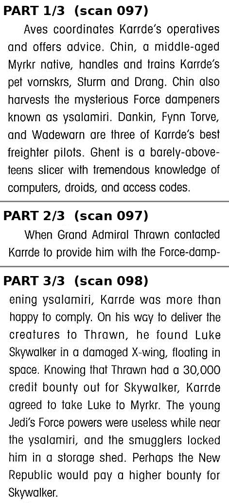

## Essential Guide to Vehicles and Vessels (1996)

- Note (summary from our notes, not a quotation): That ship was nearly destroyed at the battle for the Katana fleet, but Talon Karrde's technicians were able to completely refurbish it, and Mara still uses it as her personal (and well-armed) courier ship.
  — Source: The Essential Guide to Vehicles and Vessels (Bill Smith, Del Rey, 1996), printed p.200, scan p.119.
Our notes: `notes/materials/148-essential-guide-to-vehicles-vessels-1996/egvv-wildkarrde-through-z95.md`
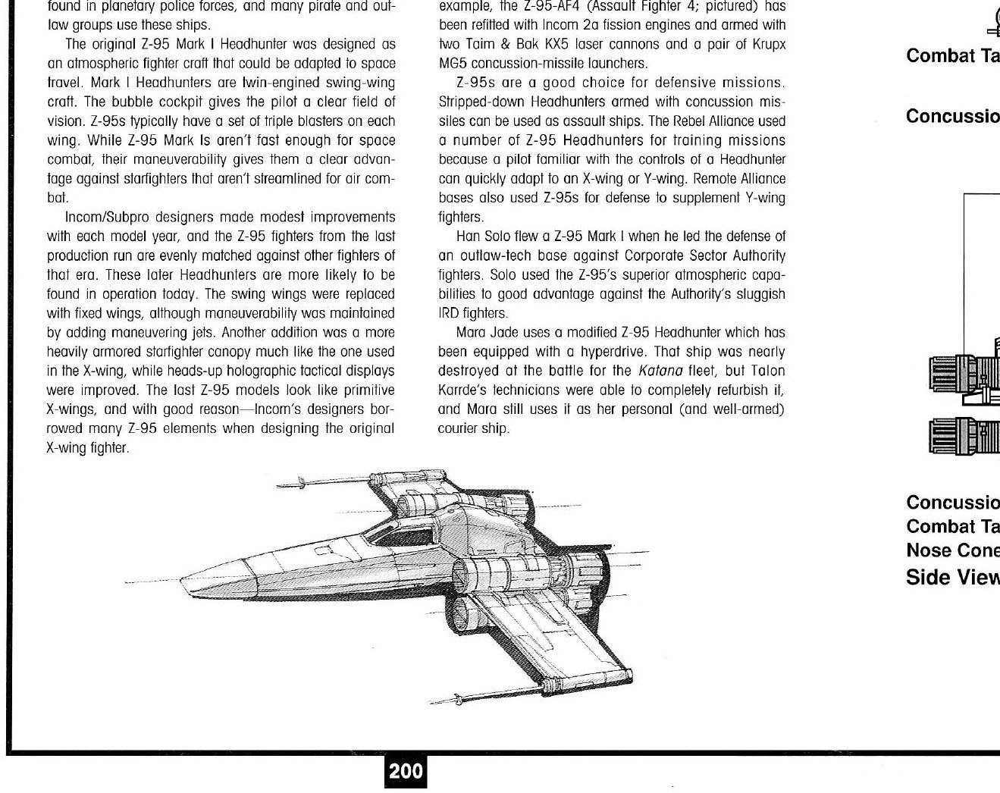

## The New Essential Guide to Vehicles and Vessels (2003)

> You can't even call your wife on a comlink without Talon Karrde hearing about it.
— Source: The New Essential Guide to Vehicles and Vessels (W. Haden Blackman, Del Rey, 2003), printed p.167, scan p.189..
Note (our notes, around the quote): "You can't even call your wife on a comlink without Talon Karrde hearing about it." —Han Solo.
Our notes: `notes/materials/154-new-essential-guide-to-vehicles-vessels-2003/quotes/QUOTES-INDEX.md`
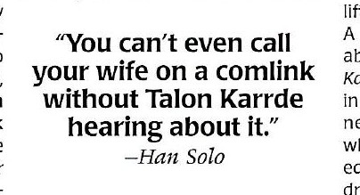

# Debate and forum claims (unverified)

Forum posts, Suspect Insight debates and Discord debates, respect threads, and verdicts. These are posters' arguments or quotations they typed; none is checked against the book here unless the entry says so.

## The Hero of Coruscant (RNGesus) vs Oppo Rancisis and Greedo (Cheth)

> Luke looked up at the carved towers, their sunlit red-orange in sharp contrast to the billowing white clouds rolling in from the sea behind them. "What would you say if I told you the clones who attacked us on the Katana were grown in less than a year?"
>
> Karrde shrugged. "That depends on how much less."
>
> "The full cycle was fifteen to twenty days."
>
> Karrde stopped short. “What?” he demanded, turning to stare at Luke.
>
> “Fifteen to twenty days,” Luke repeated, stopping beside him.
>
> “Fifteen to twenty days,” Luke repeated, stopping beside him.
>
> "Fifteen to twenty days," Luke repeated, stopping beside him.
>
> -- "How complete was it?"
>
> "Very," Mara said with a shiver. "It had a full nutrient delivery system in place, plus a flash-teaching setup for personality imprinting and tech training on the clones while they developed."
>
> **-The Last Command**
> [fragment — full passage not on file]
— Source: The Hero of Coruscant (RNGesus) vs Oppo Rancisis and Greedo (Cheth) — https://www.suspectinsightforums.com/t4433-pt-tournament-prelim-round-rng-hero-of-coruscant-vs-cheth-oppo-rancisis-greedo.
(Excerpt widened 2026-11-17 to the relevant passage, word for word from The Last Command (Timothy Zahn) (text copy `MEGA_Legend_The_Thrawn_Trilogy_Star_Wars_Thrawn_Trilogy_03_The_Last_Command_Timothy_Zahn_epub`).)
(Excerpt widened 2026-11-17 to the relevant passage, word for word from The Last Command (Timothy Zahn) (text copy `MEGA_Legend_The_Thrawn_Trilogy_Star_Wars_Thrawn_Trilogy_03_The_Last_Command_Timothy_Zahn_epub`).)
Context: Q65 — Source: [source not stated adjacent] (preceding line: "Nature of Thrawn Campaign Clones:")
Posted by: not named in our notes (see thread/notes link).
Our notes: `suspect-insight/debates/037-the-hero-of-coruscant-vs-oppo-rancisis-and-greedo.md:489`

## Han Solo(Legends) respect thread — respect-thread notes

What it shows (our notes): Noted as the man who may have been the fastest in the galaxy with a blaster.
> Mara winced in sympathetic pain as Solo was thrown backwards into the guardrail at the front of the hologram pit. Through the crackle of the lightning she heard Organa Solo shout her husband’s name and jump to his side, dropping her blaster and igniting her lightsaber just in time to catch the third blast of lightning on the green-white blade. Abruptly, C’baoth shifted his aim upward to the damaged catwalk hanging precariously over their heads. The lightning flashed again—
>
> And with a crack of exploding metal the center of the catwalk split apart. Pivoting on its last remaining support strut, it toppled ponderously downward toward Organa Solo.
>
> Her head movement must have caught Karrde’s eye. He looked up at her, his face expressionless. Still patting the vornskrs, he tilted his head fractionally toward Solo and Organa Solo. Frowning, Mara followed his gaze—
>
> And froze. Beside the section of catwalk wreckage still half covering his wife, Solo was moving. Slowly, a couple of centimeters at a time, he was creeping across the floor.
>
> Toward the blaster Organa Solo had dropped.
>
> “You ask too much, Skywalker,” C’baoth warned softly. “Mara Jade will be mine. Must be mine. It is the destiny demanded of her by the Force. Not even you may trifle with that.”
>
> "They're not too bad," she said, catching his arm to help steady him. "But Han's going to need medical treatment—he's got some bad burns."
>
> "So does Mara," Karrde said grimly, coming up the steps holding an unconscious Mara in his arms. "We have to get her to the Wild Karrde as quickly as possible."
>
> “So does Mara,” Karrde said grimly, coming up the steps holding an unconscious Mara in his arms. “We have to get her to the Wild Karrde as quickly as possible.”
>
> “So does Mara,” Karrde said grimly, coming up the steps holding an unconscious Mara in his arms. “We have to get her to the Wild Karrde as quickly as possible.”
>
> “So give them a call,” Han said. He was kneeling over the dead Luuke clone, gazing down at him. “Tell them to come pick us up.”
>
> - The Last Command(In-Sidiousvader)
> [fragment — full passage not on file]
— Source: SI respect-thread directory: Han Solo(Legends) respect thread — https://www.suspectinsightforums.com/t1762-han-sololegends-respect-thread.
(Excerpt widened 2026-11-17 to the relevant passage, word for word from The Last Command (Timothy Zahn) (text copy `MEGA_Legend_The_Thrawn_Trilogy_Star_Wars_Thrawn_Trilogy_03_The_Last_Command_Timothy_Zahn_epub`).)
(Excerpt widened 2026-11-17 to the relevant passage, word for word from The Last Command (Timothy Zahn) (text copy `MEGA_Legend_The_Thrawn_Trilogy_Star_Wars_Thrawn_Trilogy_03_The_Last_Command_Timothy_Zahn_epub`).)
(Fragment completed 2026-11-17 with the full excerpt, word for word from The Last Command (Timothy Zahn) (text copy `MEGA_Legend_The_Thrawn_Trilogy_Star_Wars_Thrawn_Trilogy_03_The_Last_Command_Timothy_Zahn_epub`).)
(Excerpt widened 2026-11-17 to the relevant passage, word for word from The Last Command (Timothy Zahn) (text copy `MEGA_Legend_The_Thrawn_Trilogy_Star_Wars_Thrawn_Trilogy_03_The_Last_Command_Timothy_Zahn_epub`).)
(Excerpt widened 2026-11-17 to the relevant passage, word for word from The Last Command (Timothy Zahn) (text copy `MEGA_Legend_The_Thrawn_Trilogy_Star_Wars_Thrawn_Trilogy_03_The_Last_Command_Timothy_Zahn_epub`).)
(Fragment completed 2026-11-17: full sentence/passage matched word for word in the source text on file: `MEGA_Legend_The_Thrawn_Trilogy_Star_Wars_Thrawn_Trilogy_03_The_Last_Command_Timothy_Zahn_epub`.)
Posted by: not named in our notes (see thread/notes link).
Our notes: `suspect-insight/respect-threads/han-solo.md:442`

# NJO FULL re-read additions (2026-11-17)
Verbatim excerpts from the full consecutive re-read of the New Jedi Order novels (Dark Journey through The Unifying Force), each shown with the text around it and its source chapter.

## *The Unifying Force*
Karrde explains who rose and fell after the war.

> “We’re waiting for the dust to settle,” Talon said. “And I don’t mean the yorik coral dust. Everything from here to Helska and back has been given a good shaking. A lot of groups that were at the top are suddenly at the bottom, and the other way around.”
>
> “Who, for instance?” Tycho said.
>
> Talon considered it briefly. “Well, at the top you’ve got the Bothans, chiefly because of Fey’lya’s brave last stand and Kre’fey’s heroic victory. But vying for second place are the Sullustans, Hapans, the former Imperials, the Mon Calamari.”
>
> “Who do you figure has fallen?” Wedge asked.
>
> “Everyone Rimward of Wayland. Plus the Ithorians, Bimms, Kuati, Corellians. But more than anyone, the Hutts.”
>
> Lando nodded. “A lot of folk were forced to do without spice during the war, and have lost their appetite for it. In fact, just about anyone who had regular dealings with the Hutts has lost credibility—the Rodians—except for the Jungle Clans—Whiphids, Klatoonians, Weequays, Vodrans, Io-trans, Nikto … Didn’t help that a lot of them supported the Peace Brigade.”
>
> “They’re the ones who should be brought to trial for war crimes,” Booster said.
>
> “They will be,” Wedge said. “Cal Omas has left the decision to individual worlds and systems.”
>
> “Who else is on the way up?” Tycho asked.
>
> “Corporate Sector and Tion Hegemony,” Talon said, without having to think about it. “Just about every system Rimward of Eriadu on the Rimma, and Varonat on the Trade Spine.”

— Source: *The Unifying Force* (James Luceno, Del Rey 2004), chapter 44 (UF).

Karrde says the Smugglers' Alliance is now ex-Smugglers' Alliance.

> “That would be Ex-Smugglers’ Alliance,” Talon said.
>
> Han rolled his eyes.
>
> “It’s true, Han. We’ve mended our ways.”
>
> “Seen the light,” Booster said.
>
> “Come around,” Crev added.
>
> “Reformed,” Lando said.
>
> Tycho looked around the table. “Anyone want to add another cliché?”
>
> “How about ‘gotten too old for this’?” Han said.
>
> Wedge nodded. “That’ll do.”
>
> Han glanced at Lando and Talon again. “What, Tendra and Shada are making honest men of you?”
>
> Talon shook his head firmly. “Shada and I are business partners. That’s it.”

— Source: *The Unifying Force* (James Luceno, Del Rey 2004), chapter 44 (UF).

